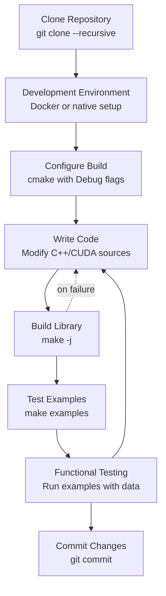
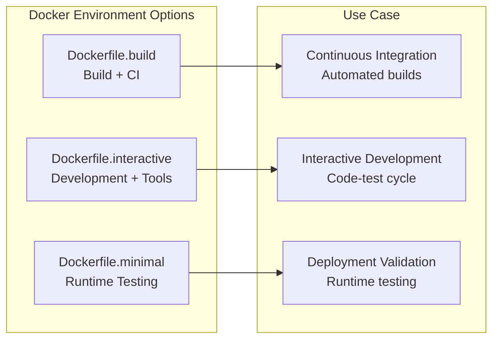
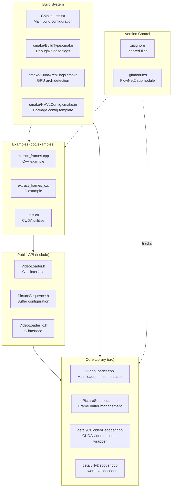
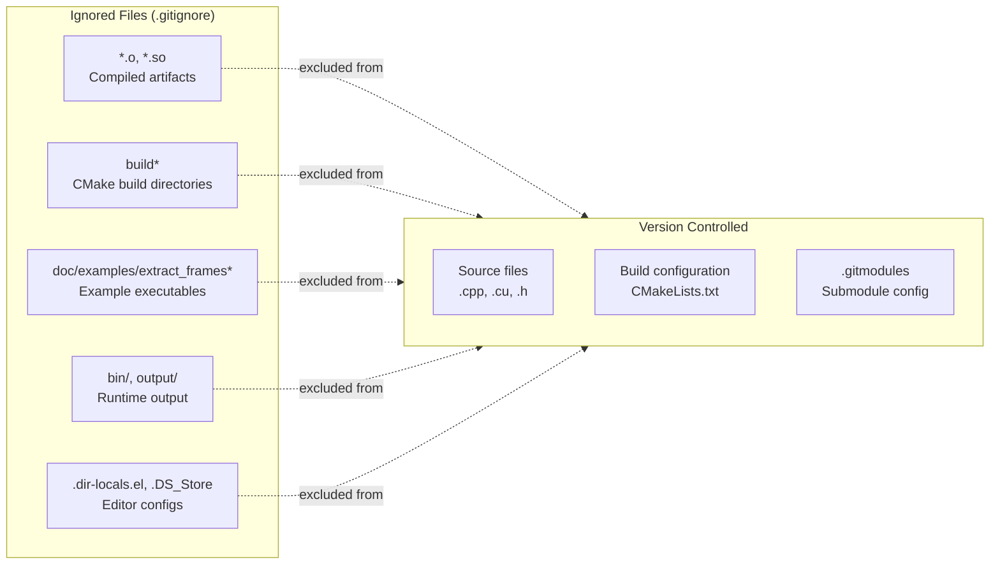
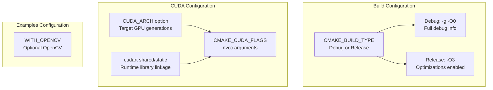
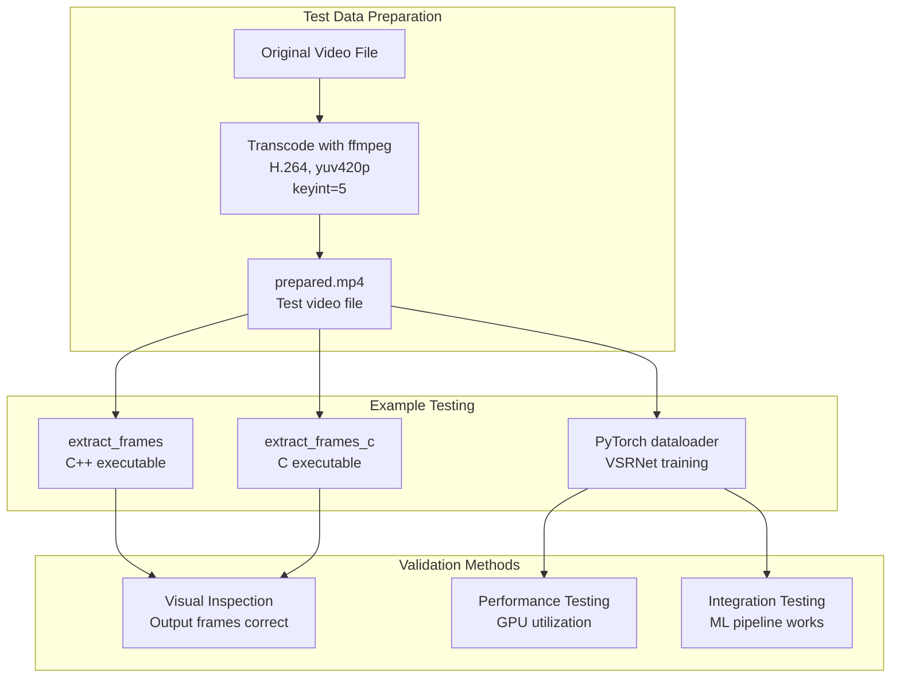
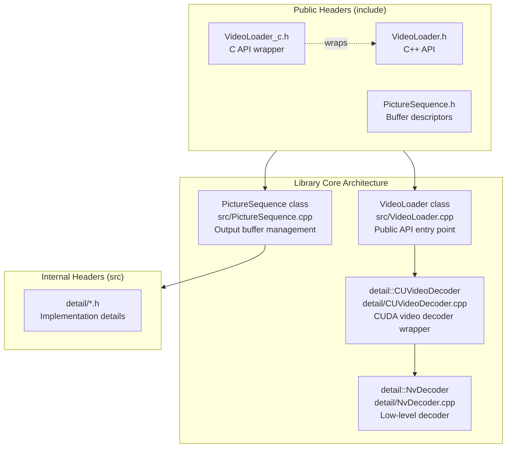

<!-- source: DeepWiki mcp.deepwiki.com · repo NVIDIA/nvvl · page 8 Development Guide · fetched 2026-10-26 -->

# Development Guide

<details>
<summary>Relevant source files</summary>

The following files were used as context for generating this wiki page:

- [.gitignore](.gitignore)
- [.gitmodules](.gitmodules)
- [README.md](README.md)

</details>


This page provides information for developers who want to contribute to NVVL or modify the library for their own purposes. It covers the development workflow, repository organization, build system usage, and testing approaches.

**Note:** NVVL is a research artifact that has been incorporated into [DALI](https://github.com/NVIDIA/DALI). While the repository remains available, active development has moved to DALI. This guide is primarily for those interested in understanding the codebase or making custom modifications.

For information about:
- Building NVVL as a user, see [Building from Source](#2.1)
- Repository file structure, see [Repository Structure](#8.1)
- Git submodule management, see [Git Submodules](#8.2)
- Build system details, see [Build System](#5)

## Development Workflow Overview

The typical development workflow for contributing to NVVL follows this pattern:



**Development Workflow Stages**

Sources: [README.md:1-313]()

## Development Environment Setup

### Prerequisites

NVVL development requires:

| Component | Version | Purpose |
|-----------|---------|---------|
| CUDA Toolkit | 8.0+ (9.0+ recommended) | GPU acceleration and nvcuvid API |
| CMake | 3.8+ | Build system with native CUDA support |
| C++ Compiler | C++14 support | Core library compilation |
| FFmpeg libraries | libavformat, libavcodec, libavfilter, libavutil | Video parsing and demuxing |
| nvidia-ml | Driver version 384+ | GPU management and monitoring |
| Doxygen | (optional) | API documentation generation |
| OpenCV | (optional) | Examples with OpenCV integration |

Sources: [README.md:61-73]()

### Using Docker for Development

The recommended development approach uses Docker environments to ensure consistent dependencies:



**Docker Environment Selection**

For interactive development, use `Dockerfile.interactive` which includes development tools like `ffmpeg` command-line utilities for preparing test data. See [Interactive Development Images](#6.3) for details.

Sources: [README.md:75-79]()

### Native Development Setup

For native development without Docker:

1. **Install CMake 3.8+** (required for native CUDA language support):
   ```bash
   pip install cmake
   # or
   wget https://cmake.org/files/v3.10/cmake-3.10.2-Linux-x86_64.sh
   /bin/sh cmake-3.10.2-Linux-x86_64.sh --prefix=/usr/local
   ```

2. **Configure debug build**:
   ```bash
   mkdir build && cd build
   cmake .. -DCMAKE_BUILD_TYPE=Debug -DWITH_OPENCV=1
   make -j
   ```

3. **Build examples for testing**:
   ```bash
   make examples
   ```

Sources: [README.md:81-99](), [README.md:101-140]()

## Repository Structure Overview

The NVVL repository follows a standard C++ project layout with clear separation between library code, public API, examples, and build infrastructure:



**Core Repository Components**

For detailed file-by-file breakdown, see [Repository Structure](#8.1).

Sources: [README.md:1-313]()

## Git Configuration and Submodules

### Ignored Build Artifacts

The `.gitignore` file excludes build outputs and temporary files:



**Build Artifact Exclusions**

This ensures that:
- Build directories (`build*`) can be created anywhere without polluting version control
- Example executables (`extract_frames`, `extract_frames_c`) are generated but not tracked
- Output directories (`bin`, `output`) for runtime artifacts are ignored
- Object files (`*.o`) and shared libraries (`*.so`) are excluded

Sources: [.gitignore:1-10]()

### Git Submodule Configuration

NVVL includes FlowNet2-PyTorch as a submodule for the super-resolution example:

| Property | Value | Purpose |
|----------|-------|---------|
| Submodule path | `examples/pytorch_superres/flownet2-pytorch` | Location in repository |
| Remote URL | `https://github.com/NVIDIA/flownet2-pytorch` | Source repository |
| Ignore setting | `untracked` | Ignore untracked files in submodule |

**Submodule initialization:**
```bash
git clone --recursive https://github.com/NVIDIA/nvvl
# or after normal clone:
git submodule update --init --recursive
```

The `ignore = untracked` setting prevents untracked files in the FlowNet2-PyTorch directory (such as build artifacts or data files) from appearing in `git status` output for the parent repository.

For complete submodule documentation, see [Git Submodules](#8.2).

Sources: [.gitmodules:1-5]()

## Build System for Developers

### Debug vs Release Builds



**Key CMake Configuration Options**

For development, use:
```bash
cmake .. \
    -DCMAKE_BUILD_TYPE=Debug \
    -DCUDA_ARCH="Pascal;Volta" \
    -DCMAKE_CUDA_FLAGS="-cudart shared" \
    -DWITH_OPENCV=1
```

For detailed build system documentation, see [CMake Configuration](#5.1) and [CUDA Architecture Detection](#5.2).

Sources: [README.md:101-135]()

## Testing and Validation

NVVL does not have a formal unit test suite. Instead, testing is performed through the example applications:



**Testing Workflow**

### Preparing Test Data

Prepare a test video file with proper encoding:
```bash
ffmpeg -i original.mp4 -map v:0 -c:v libx264 -crf 18 \
    -pix_fmt yuv420p -g 5 -profile:v high prepared.mp4
```

Key requirements:
- Codec: H.264 or HEVC
- Pixel format: `yuv420p` (required by hardware decoder)
- Keyframe interval: Match expected sequence length (e.g., `-g 5` for 5-frame sequences)
- No open GOPs (for HEVC: add `-x265-params "keyint=X:no-open-gop=1"`)

Sources: [README.md:149-183]()

### Running Example Tests

1. **Build examples**:
   ```bash
   make examples
   ```

2. **Test C++ example**:
   ```bash
   ./doc/examples/extract_frames prepared.mp4 0 5 output/
   ```

3. **Test C example**:
   ```bash
   ./doc/examples/extract_frames_c prepared.mp4 0 5 output/
   ```

4. **Verify outputs**:
   - Check that output frames are generated in the specified directory
   - Visually inspect frames for corruption or decoding artifacts
   - Verify correct frame count and dimensions
   - Check GPU memory usage and performance

Sources: [README.md:137-140]()

### Advanced Testing with PyTorch

The PyTorch super-resolution example provides integration testing:
- Tests PyTorch wrapper functionality
- Validates multi-GPU data loading
- Exercises the full pipeline under training workload

See [PyTorch Super-Resolution](#4.4) for details on running these tests.

## Code Organization Principles

Understanding how the codebase is organized helps when making modifications:



**Architectural Layers**

1. **Public API Layer** (`include/`):
   - Stable interface for users
   - Changes require careful consideration of backward compatibility
   - Documented in Doxygen comments

2. **Implementation Layer** (`src/`):
   - Internal logic and algorithms
   - Can be refactored without affecting users
   - Detail namespace for truly internal components

3. **Detail Namespace** (`src/detail/`):
   - Hardware-specific code
   - CUDA/nvcuvid interaction
   - Not exposed in public headers

Sources: [README.md:1-313]()

## Development Best Practices

### Modifying Core Library Code

When making changes to the core library:

1. **Maintain API stability**: The public headers in `include/` define the contract with users. Changes here require version bumps and migration guides.

2. **Use detail namespace**: Implementation details should go in the `detail` namespace within `src/detail/` to clearly separate internal code.

3. **Handle CUDA errors**: All CUDA API calls should check return values and provide meaningful error messages.

4. **Consider memory management**: NVVL uses RAII patterns in C++. Ensure proper cleanup in destructors and avoid raw pointer ownership in public API.

### Working with Video Decoders

The decoder stack has specific requirements:

- **FFmpeg parsing** happens on CPU in the main thread
- **CUDA decoding** happens asynchronously on a separate stream
- **Post-processing** (scaling, cropping) uses GPU texture units
- **Synchronization** is managed through CUDA events

When modifying decoder code:
- Respect the async nature of the pipeline
- Don't block the CPU waiting for GPU operations
- Use CUDA events for proper synchronization

### Adding New Features

To add a new transformation or output format:

1. Extend `PictureSequence::Layer` structure in [include/PictureSequence.h]()
2. Implement GPU kernel in `src/` directory
3. Update `VideoLoader::receive_frames` logic in [src/VideoLoader.cpp]()
4. Add example usage to [doc/examples/extract_frames.cpp]()
5. Update Doxygen documentation

## Documentation Generation

NVVL uses Doxygen for API documentation:

```bash
make doc
```

This generates HTML documentation in `build/doc/html/`. Documentation is built from comments in the public headers (`include/` directory).

When adding or modifying public API:
- Add Doxygen comments using `///` or `/** */` style
- Document all parameters using `@param`
- Document return values using `@return`
- Include usage examples in `@code` blocks

For documentation generation details, see [Generating Documentation](#7.1).

Sources: [README.md:142-147]()

## Maintenance Status

**Important**: NVVL is a research artifact that is no longer actively maintained. The functionality has been incorporated into [NVIDIA DALI](https://github.com/NVIDIA/DALI), which is the recommended solution for new projects.

This repository remains available for:
- Understanding the original implementation
- Creating custom modifications for specific use cases
- Academic research referencing the original work

For new feature requests or bug reports, please use [DALI's issue tracker](https://github.com/NVIDIA/DALI/issues).

Sources: [README.md:1-6](), [README.md:20-24]()

---

