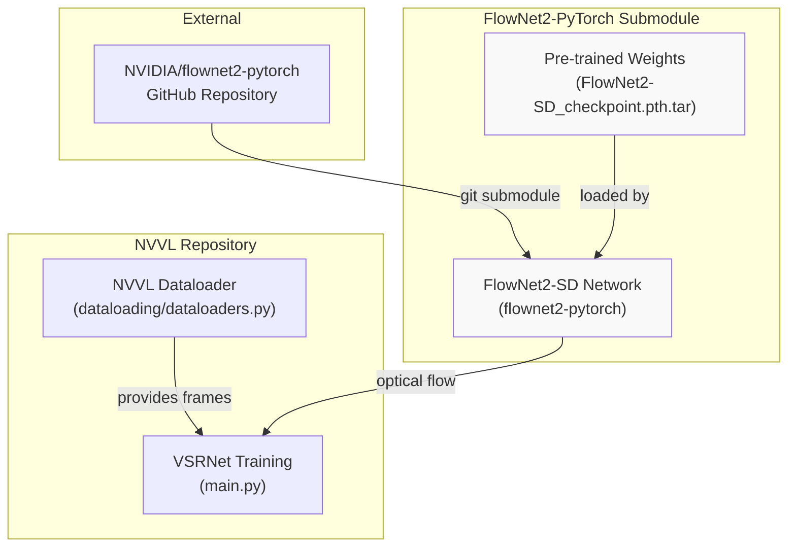
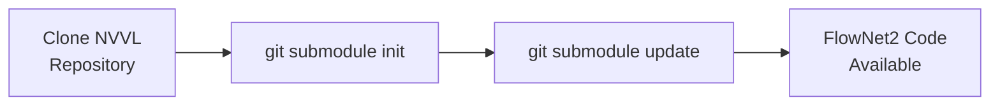
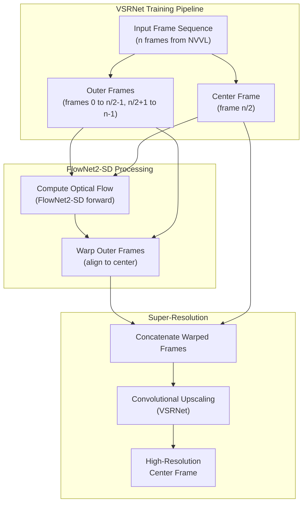
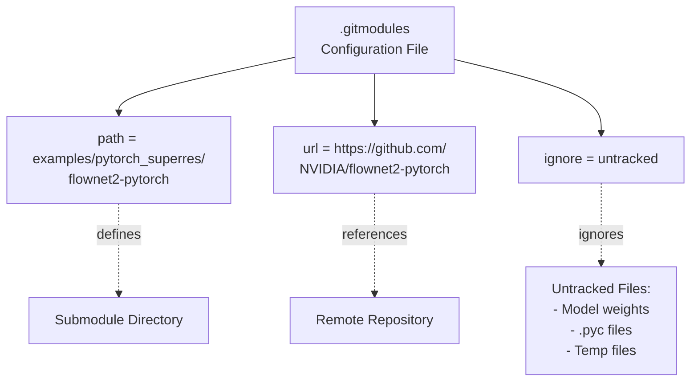

<!-- source: DeepWiki mcp.deepwiki.com · repo NVIDIA/nvvl · page 8.2 Git Submodules · fetched 2026-10-26 -->

# Git Submodules

<details>
<summary>Relevant source files</summary>

The following files were used as context for generating this wiki page:

- [.gitmodules](.gitmodules)
- [examples/pytorch_superres/README.md](examples/pytorch_superres/README.md)

</details>


## Purpose and Scope

This page documents the git submodules used in the NVVL repository. Currently, NVVL includes a single submodule for the FlowNet2-PyTorch implementation, which provides optical flow estimation capabilities for the PyTorch super-resolution example. For information about the super-resolution example itself, see [PyTorch Super-Resolution](#4.4).

---

## Overview

The NVVL repository uses git submodules to incorporate external dependencies that are tightly integrated into specific examples. Rather than requiring users to separately clone and configure external repositories, submodules provide a versioned, tracked reference to specific commits of external code.

**Current Submodules:**

| Submodule | Path | Repository | Configuration |
|-----------|------|------------|---------------|
| flownet2-pytorch | `examples/pytorch_superres/flownet2-pytorch` | `https://github.com/NVIDIA/flownet2-pytorch` | `ignore = untracked` |

Sources: [.gitmodules:1-5]()

---

## FlowNet2-PyTorch Submodule

### Purpose

The FlowNet2-PyTorch submodule provides a PyTorch implementation of the FlowNet2-SD optical flow estimation network. This network is a critical component of the VSRNet (Video Super-Resolution Network) example, where it performs motion compensation by computing optical flow between video frames.

In the super-resolution pipeline, VSRNet uses an odd number of successive frames as input. The outer frames must be warped to align with the center frame before they can be processed by the convolutional upscaling network. FlowNet2-SD provides the optical flow fields needed to perform this warping operation.



**Diagram: FlowNet2-PyTorch Submodule Integration**

Sources: [examples/pytorch_superres/README.md:1-11](), [.gitmodules:1-4]()

---

### Initialization

The submodule must be initialized before the PyTorch super-resolution example can be used. The initialization process downloads the FlowNet2-PyTorch code at the specific commit version referenced by the NVVL repository.

**Initialization Commands:**

```bash
git submodule init
git submodule update
```

These commands should be run from the root directory of the NVVL repository. The `git submodule init` command registers the submodule configuration from [.gitmodules:1-4]() into your local `.git/config`, and `git submodule update` clones the actual submodule repository into the specified path.



**Diagram: Submodule Initialization Workflow**

**Alternative: Clone with Submodules**

To initialize submodules during the initial clone operation:

```bash
git clone --recurse-submodules https://github.com/NVIDIA/nvvl
```

Sources: [examples/pytorch_superres/README.md:76-85]()

---

### Usage in VSRNet Training

Once initialized, the FlowNet2-PyTorch submodule is imported and used during VSRNet training to compute optical flow between frames. The network architecture and forward pass implementation are provided by the submodule code.

**Default Model Path:**

The VSRNet training code expects pre-trained FlowNet2-SD weights at:

```
examples/pytorch_superres/flownet2-pytorch/networks/FlowNet2-SD_checkpoint.pth.tar
```

**Customizing Model Path:**

The path can be overridden using the `--flownet_path` command-line argument to `main.py`:

```bash
python main.py --flownet_path /path/to/FlowNet2-SD_checkpoint.pth.tar
```



**Diagram: FlowNet2-SD Data Flow in VSRNet**

Sources: [examples/pytorch_superres/README.md:3-10](), [examples/pytorch_superres/README.md:86-91]()

---

### Pre-trained Model Requirements

Training VSRNet requires pre-trained weights from the FlowNet2-SD network. These weights are not included in the repository and must be downloaded separately.

**Download Location:**

Pre-trained model: [FlowNet2-SD [173MB]](https://drive.google.com/file/d/1QW03eyYG_vD-dT-Mx4wopYvtPu_msTKn/view?usp=sharing)

**License:**

The pre-trained weights have a separate [license agreement](https://drive.google.com/file/d/1TVv0BnNFh3rpHZvD-easMb9jYrPE2Eqd/view?usp=sharing) that must be adhered to when using these weights.

**Installation:**

After downloading, place the weights file at the expected path:

```bash
# After downloading FlowNet2-SD_checkpoint.pth.tar
mkdir -p examples/pytorch_superres/flownet2-pytorch/networks/
mv FlowNet2-SD_checkpoint.pth.tar examples/pytorch_superres/flownet2-pytorch/networks/
```

Sources: [examples/pytorch_superres/README.md:86-91]()

---

### Submodule Configuration

The submodule is configured with the `ignore = untracked` setting in [.gitmodules:4](). This configuration tells git to ignore untracked files within the submodule directory.

**Purpose of Ignore Setting:**

| Setting | Effect |
|---------|--------|
| `ignore = untracked` | Git will not report untracked files in the submodule as changes. This includes downloaded model weights and generated Python bytecode files. |

This is particularly useful for the FlowNet2-PyTorch submodule because:

1. **Model weights** (`FlowNet2-SD_checkpoint.pth.tar`) are downloaded by users after cloning but are not version-controlled
2. **Python bytecode** (`.pyc` files) generated during import should not appear as repository changes
3. **Temporary files** created during network training or inference are user-specific

**Checking Submodule Status:**

To see the current status of submodules:

```bash
git submodule status
```

This displays the commit hash that the submodule is pinned to and whether the submodule is initialized.



**Diagram: Submodule Configuration Structure**

Sources: [.gitmodules:1-5]()

---

## Working with the Submodule

### Updating the Submodule

If the FlowNet2-PyTorch repository is updated and NVVL needs to reference a newer commit:

```bash
cd examples/pytorch_superres/flownet2-pytorch
git fetch
git checkout <desired-commit-or-tag>
cd ../../..
git add examples/pytorch_superres/flownet2-pytorch
git commit -m "Update FlowNet2-PyTorch submodule"
```

### Checking Submodule Commit

To verify which commit the submodule is pinned to:

```bash
git ls-tree HEAD examples/pytorch_superres/flownet2-pytorch
```

### Common Issues

| Issue | Solution |
|-------|----------|
| Empty `flownet2-pytorch` directory | Run `git submodule init` and `git submodule update` |
| FlowNet2-SD model not found | Download pre-trained weights and place at correct path |
| Import errors from flownet2 module | Ensure submodule is initialized and Python path includes the submodule directory |

Sources: [examples/pytorch_superres/README.md:76-85]()

---

