# Page: Overview

# Overview

<details>
<summary>Relevant source files</summary>

The following files were used as context for generating this wiki page:

- [LICENSE](LICENSE)
- [README.md](README.md)

</details>


This document provides an overview of NVVL (NVIDIA Video Loader), a GPU-accelerated video loading library designed for machine learning applications. It covers NVVL's purpose, architecture, relationship to DALI, key components, and primary use cases.

For detailed setup instructions, see [Getting Started](#2). For comprehensive API documentation, see [Core Library](#3). For practical implementation examples, see [Examples and Tutorials](#4).

## Purpose and Current Status

NVVL is a library for loading random sequences of video frames from compressed video files directly into GPU memory as tensors ready for machine learning training. As of 2018, **NVVL functionality has been incorporated into [DALI (NVIDIA Data Loading Library)](https://github.com/NVIDIA/DALI)**, which is the recommended solution for new projects. The NVVL project remains available on GitHub as a reference implementation but is no longer actively maintained.

**Note:** NVVL is example code from a research project performed by NVIDIA researchers. While useful, it is not a supported NVIDIA product and is provided largely as-is.

Sources: [README.md:1-24]()

## Core Problem and Solution

### The Problem

Traditional machine learning training pipelines store video datasets as individual frame images (e.g., PNG files), which creates significant bottlenecks:

- **Storage Overhead**: Individual frames consume 40x more disk space than compressed video
- **I/O Bottleneck**: More bytes must be read from disk during training
- **CPU Load**: Image decoding on CPU requires dedicated cores for data loading
- **Scalability**: Datasets may not fit on fast local storage (SSDs)

### NVVL's Solution

NVVL addresses these issues through:

1. **Compressed Video Storage**: Store datasets as H.264/HEVC video files
2. **Hardware Decoding**: Offload video decoding to NVIDIA GPU hardware decoders (nvcuvid)
3. **GPU-Resident Pipeline**: Perform all transformations on GPU, eliminating CPU/GPU data transfers
4. **Direct Tensor Output**: Provide ready-to-use tensors in GPU device memory

**Performance Results**: On NVIDIA DGX-1, NVVL reduced CPU load to 50-60% compared to PNG-based dataloaders.

Sources: [README.md:26-49]()

## High-Level Architecture

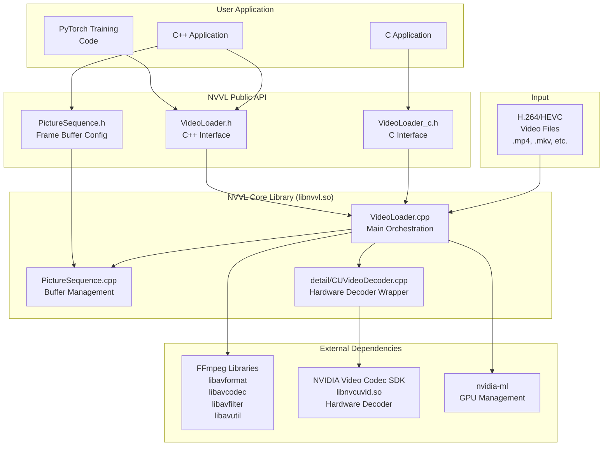

**Diagram: NVVL Architecture with Code Entities**

NVVL is structured in three layers:

1. **Public API Layer**: Header files in `include/` directory exposing C++ and C interfaces
2. **Core Library**: Implementation in `src/` directory, compiled into `libnvvl.so`
3. **External Dependencies**: FFmpeg for container parsing, nvcuvid for hardware decoding

Sources: [README.md:8-18](), [README.md:61-69]()

## Core Components and Code Entities

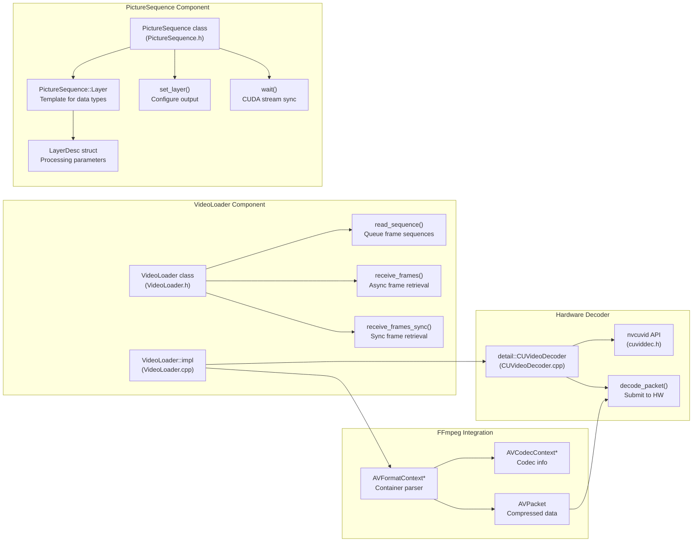

**Diagram: Core Component Code Entity Mapping**

### Key Classes and Files

| Component | Header | Implementation | Purpose |
|-----------|--------|----------------|---------|
| **VideoLoader** | `include/VideoLoader.h` | `src/VideoLoader.cpp` | Main API entry point; manages reading sequences and frame queuing |
| **PictureSequence** | `include/PictureSequence.h` | `src/PictureSequence.cpp` | Defines output buffer configuration and processing parameters |
| **CUVideoDecoder** | N/A (internal) | `src/detail/CUVideoDecoder.cpp` | Wraps NVIDIA hardware video decoder (nvcuvid) |

Sources: [README.md:198-209](), [README.md:214-239]()

## Data Flow Pipeline

```mermaid
graph LR
    VideoFile["Compressed<br/>Video File<br/>H.264/HEVC"]
    
    subgraph FFmpeg_Parse["FFmpeg Parsing"]
        av_open["av_open_input_file()"]
        av_read["av_read_frame()"]
        AVPacket_out["AVPacket<br/>(compressed)"]
    end
    
    subgraph HW_Decode["Hardware Decoding"]
        cuvidDecode["cuvidDecodePicture()"]
        cuvidMap["cuvidMapVideoFrame()"]
        NV12["NV12 Surface<br/>(GPU memory)"]
    end
    
    subgraph GPU_Transform["GPU Transformations"]
        NPP["CUDA/NPP kernels"]
        Scale["Scale"]
        Crop["Crop"]
        Flip["Horizontal Flip"]
        ColorConvert["YUV→RGB<br/>Conversion"]
    end
    
    subgraph Output_Buffer["Output Buffer"]
        PictureSequence_data["PictureSequence.Layer.data<br/>(user-allocated)"]
        Tensor["GPU Tensor<br/>float/half/uint8<br/>NCHW/NHWC"]
    end
    
    VideoFile --> av_open
    av_open --> av_read
    av_read --> AVPacket_out
    AVPacket_out --> cuvidDecode
    cuvidDecode --> cuvidMap
    cuvidMap --> NV12
    NV12 --> NPP
    NPP --> Scale
    Scale --> Crop
    Crop --> Flip
    Flip --> ColorConvert
    ColorConvert --> PictureSequence_data
    PictureSequence_data --> Tensor
```

**Diagram: NVVL Processing Pipeline with API Calls**

### Pipeline Stages

1. **Container Demuxing**: FFmpeg (`libavformat`) parses video container to extract compressed packets
2. **Hardware Decoding**: CUDA Video Decoder API (`cuvidDecodePicture()`) decodes packets using GPU hardware
3. **Surface Mapping**: `cuvidMapVideoFrame()` maps decoded NV12 surfaces to CUDA device memory
4. **GPU Transformations**: CUDA kernels perform scaling, cropping, flipping using texture units
5. **Color Space Conversion**: YUV (NV12) converted to RGB or kept as YCbCr
6. **Output**: Final tensor written to user-provided buffer in `PictureSequence::Layer::data`

Sources: [README.md:10-18]()

## Key Features

### Supported Video Formats

- **Codecs**: H.264 (libx264), HEVC/H.265 (libx265)
- **Containers**: Any format supported by FFmpeg (MP4, MKV, AVI, etc.)
- **Pixel Format**: YUV420p (required by hardware decoder)
- **Keyframe Requirements**: Frequent keyframes recommended (interval = sequence length)

Sources: [README.md:151-173]()

### Output Flexibility

The `PictureSequence::Layer` API allows configuration of:

| Parameter | Options | Description |
|-----------|---------|-------------|
| **Data Type** | `float`, `half`, `uint8` | Output tensor precision |
| **Color Space** | RGB, YCbCr | Color representation |
| **Normalization** | `[0, 1]` or `[0, 255]` | Value range |
| **Dimensions** | Any stride order | NCHW, NHWC, or custom via `stride` fields |
| **Scaling** | `scale_width`, `scale_height` | Resize frames |
| **Cropping** | `width`, `height`, `crop_x`, `crop_y` | Extract regions |
| **Flipping** | `horiz_flip` | Horizontal flip augmentation |

Sources: [README.md:237-261]()

### Asynchronous Operation

- `VideoLoader::receive_frames()` returns immediately, decoding continues asynchronously
- `PictureSequence::wait()` inserts CUDA stream synchronization event
- Enables overlapping data loading with computation

Sources: [README.md:275-286]()

## API Interfaces

NVVL provides three API interfaces:

### C++ Interface
- Main API: `VideoLoader` class and `PictureSequence` class
- Type-safe templates: `PictureSequence::Layer<float>`, `PictureSequence::Layer<half>`, `PictureSequence::Layer<uint8_t>`
- RAII resource management
- Header: [include/VideoLoader.h](), [include/PictureSequence.h]()
- Example: [doc/examples/extract_frames.cpp]()

### C Interface
- Function-based API: `nvvl_*` functions
- Manual resource management: `nvvl_create_video_loader()`, `nvvl_destroy_video_loader()`
- Header: [include/VideoLoader_c.h]()
- Example: [doc/examples/extract_frames_c.c]()

### PyTorch Wrapper
- Python API for PyTorch integration
- Direct loading into PyTorch tensors
- Custom dataloader implementation
- Documentation: [pytorch/README.md]()
- Example: [examples/pytorch_superres/]()

Sources: [README.md:186-197](), [README.md:288-290]()

## Dependencies

### Required Runtime Dependencies

| Library | Purpose | Typical Package |
|---------|---------|-----------------|
| **CUDA Toolkit** | GPU runtime and hardware decoder API | NVIDIA CUDA 8.0+ (9.0+ recommended) |
| **libavformat** | Container format parsing | `libavformat-dev` (Ubuntu) |
| **libavcodec** | Codec information structures | `libavcodec-dev` |
| **libavfilter** | FFmpeg filter infrastructure | `libavfilter-dev` |
| **libavutil** | FFmpeg utility functions | `libavutil-dev` |
| **libnvcuvid** | NVIDIA video decoder library | Included with CUDA Toolkit |
| **nvidia-ml** | GPU device management | `libnvidia-ml.so` |

### Optional Build Dependencies

| Tool | Purpose | Version Requirement |
|------|---------|---------------------|
| **CMake** | Build system | 3.8+ |
| **OpenCV** | Examples only (frame writing) | Any recent version |
| **Doxygen** | API documentation generation | Any recent version |

Sources: [README.md:61-73]()

## Use Cases

### Primary Use Case: ML Training Data Loading

NVVL is optimized for loading video data during neural network training:

1. **Video Super-Resolution**: Upscaling video frames (see [PyTorch Super-Resolution Example](#4.4))
2. **Action Recognition**: Temporal understanding from frame sequences
3. **Video Generation**: Training generative models on video data
4. **Optical Flow Estimation**: Learning motion between frames

### Advantages Over Frame-Based Loading

- **40x storage reduction**: Compressed video vs. individual PNG frames
- **Lower I/O bandwidth**: Fewer bytes read from disk
- **50-60% CPU reduction**: Hardware decoding offloads CPU
- **Faster training iteration**: Data fits on faster local storage

Sources: [README.md:26-49]()

## Relationship to DALI

**Current Recommendation**: As stated in the repository README, NVVL functionality has been incorporated into [NVIDIA DALI (Data Loading Library)](https://github.com/NVIDIA/DALI). For new projects, DALI is the recommended solution as it:

- Includes NVVL video loading capabilities
- Provides broader data loading functionality (images, audio, etc.)
- Receives active development and support
- Offers framework integration (PyTorch, TensorFlow, MXNet)

**NVVL Status**: The NVVL repository remains available as a reference implementation and for existing projects but is not actively maintained. New issues and feature requests should be submitted to the [DALI repository](https://github.com/NVIDIA/DALI/issues).

Sources: [README.md:1-5]()

## License

NVVL is released under the BSD 3-Clause License. Individual components have separate licenses:

- **NVVL source code**: BSD 3-Clause (see [LICENSE:1-27]())
- **Boost library files**: Boost Software License 1.0 (see [src/boost/LICENSE_1_0.txt]())
- **NVIDIA Video Codec SDK headers**: NVIDIA proprietary license (see headers in [src/nvidia/]())

For complete license information, see [License and Legal](#9).

Sources: [LICENSE:1-35]()

## Next Steps

- **Setup**: See [Building from Source](#2.1) or [Using Docker](#2.2)
- **Video Preparation**: See [Video Data Preparation](#2.3) for encoding guidelines
- **API Learning**: See [VideoLoader API](#3.2) and [PictureSequence API](#3.3)
- **Examples**: Start with [C++ Frame Extraction](#4.1) or [C Frame Extraction](#4.2)

---

# Page: Getting Started

# Getting Started

<details>
<summary>Relevant source files</summary>

The following files were used as context for generating this wiki page:

- [CMakeLists.txt](CMakeLists.txt)
- [README.md](README.md)

</details>


This document provides an overview of how to begin using NVVL, including prerequisites, installation options, and basic usage patterns. For detailed build instructions, see [Building from Source](#2.1). For containerized workflows, see [Using Docker](#2.2). For video file preparation guidelines, see [Video Data Preparation](#2.3).

**Important**: NVVL has been incorporated into [DALI (NVIDIA Data Loading Library)](https://github.com/NVIDIA/DALI), which is actively maintained and offers additional functionality. For new projects, DALI is recommended. NVVL remains available but is no longer actively maintained.

## Prerequisites

NVVL requires the following dependencies to build and run:

| Dependency | Minimum Version | Purpose |
|------------|----------------|---------|
| CUDA Toolkit | 8.0 (9.0+ recommended) | Hardware video decoding and GPU processing |
| FFmpeg libraries | Any recent version | Container parsing and codec handling |
| CMake | 3.8 | Build system with CUDA language support |
| C++ Compiler | C++14 support | Building the library |

### FFmpeg Components

NVVL specifically requires these FFmpeg libraries:

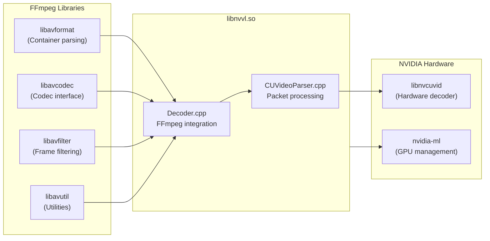

**Diagram: NVVL Runtime Dependencies**

Sources: [README.md:61-69](), [CMakeLists.txt:16-29](), [CMakeLists.txt:73]()

### Installation Methods

The FFmpeg libraries can be installed via:
- **System packages**: `libavcodec-dev libavfilter-dev libavformat-dev libavutil-dev` on Ubuntu 16.04+
- **From source**: See the example configurations in [docker/]() directory
- **Pre-configured Docker images**: See [Using Docker](#2.2)

For CMake 3.8+, which is not available in many distributions:

```bash
# Via pip (recommended)
pip install cmake

# Or via binary distribution
wget https://cmake.org/files/v3.10/cmake-3.10.2-Linux-x86_64.sh
/bin/sh cmake-3.10.2-Linux-x86_64.sh --prefix=/usr/local
```

Sources: [README.md:61-99]()

## Installation Options

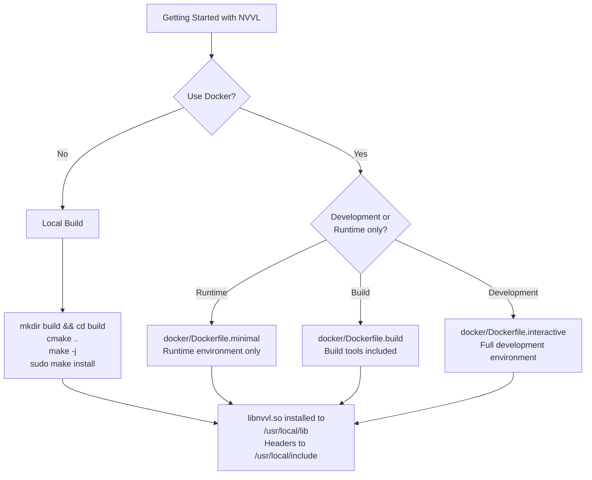

**Diagram: Installation Workflow**

Sources: [README.md:59-148](), [CMakeLists.txt:1-126]()

### Quick Build

For a standard local build with default options:

```bash
mkdir build && cd build
cmake ..
make -j
sudo make install
```

This installs:
- `libnvvl.so` to `/usr/local/lib`
- Public headers from [include/]() to `/usr/local/include`
- CMake package configuration files to `/usr/local/lib/cmake/NVVL/`

Sources: [README.md:101-108](), [CMakeLists.txt:76-122]()

### Build Configuration

Common CMake options passed via `cmake .. -DOPTION=Value`:

| Option | Values | Default | Description |
|--------|--------|---------|-------------|
| `CUDA_ARCH` | `Kepler`, `Maxwell`, `Pascal`, `Volta`, or `sm_XX` | `Maxwell;Pascal;Volta` | GPU architectures to compile for |
| `CMAKE_CUDA_FLAGS` | String | `-cudart shared` | Arguments passed to `nvcc` |
| `CMAKE_BUILD_TYPE` | `Debug`, `Release` | (varies) | Build type configuration |
| `CMAKE_INSTALL_PREFIX` | Path | `/usr/local` | Installation directory |
| `WITH_OPENCV` | `0`, `1` | `0` | Enable OpenCV in examples |

See [Building from Source](#2.1) for detailed configuration options.

Sources: [README.md:112-135](), [CMakeLists.txt:3-5](), [cmake/BuildType.cmake](), [cmake/CudaArchFlags.cmake]()

## Basic Usage Pattern

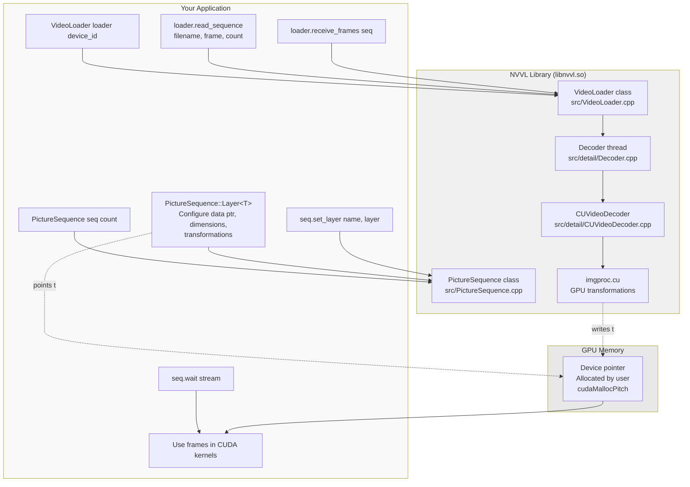

**Diagram: Core API Usage Flow with Code Entities**

Sources: [README.md:186-290](), [src/VideoLoader.cpp](), [src/PictureSequence.cpp](), [include/VideoLoader.h](), [include/PictureSequence.h]()

### Minimal Example

```cpp
// Create loader for device 0
auto loader = NVVL::VideoLoader{0};

// Request frames 100-105 from video
loader.read_sequence("video.mp4", 100, 5);

// Create sequence to receive 5 frames
auto seq = PictureSequence{5};

// Configure output layer
auto pixels = PictureSequence::Layer<float>{};
pixels.data = /* device pointer from cudaMallocPitch */;
pixels.desc.count = 5;
pixels.desc.channels = 3;
pixels.desc.width = 224;
pixels.desc.height = 224;
pixels.desc.color_space = ColorSpace_RGB;
pixels.desc.normalized = true;
// ... configure strides ...

// Add layer and receive frames
seq.set_layer("pixels", pixels);
loader.receive_frames(seq);

// Wait for completion before using data
seq.wait(cuda_stream);
```

This pattern demonstrates the core classes:
- **`VideoLoader`**: Manages video reading and decoding [src/VideoLoader.cpp]()
- **`PictureSequence`**: Describes output buffers and processing [src/PictureSequence.cpp]()
- **`PictureSequence::Layer<T>`**: Typed layer configuration for output formats

For complete examples, see:
- C++ example: [doc/examples/extract_frames.cpp]() (see [C++ Frame Extraction](#4.1))
- C example: [doc/examples/extract_frames_c.c]() (see [C Frame Extraction](#4.2))

Sources: [README.md:186-290](), [include/VideoLoader.h](), [include/PictureSequence.h]()

## Data Types and Processing

NVVL supports multiple output data types and processing options configured through `PictureSequence::Layer<T>`:

| Type | Description | Normalization |
|------|-------------|---------------|
| `float` | 32-bit floating point | `[0, 1]` or `[0, 255]` |
| `half` | 16-bit floating point | `[0, 1]` or `[0, 255]` |
| `uint8_t` | 8-bit unsigned integer | `[0, 255]` only |

### Layer Configuration Options

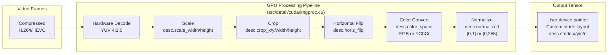

**Diagram: Frame Processing Pipeline Configuration**

Each transformation is configured through fields in `PictureSequence::Layer<T>::desc`:
- **Scaling**: `scale_width`, `scale_height` for resize before crop
- **Cropping**: `crop_x`, `crop_y`, `crop_width`, `crop_height` for region extraction
- **Flipping**: `horiz_flip` for horizontal mirroring
- **Color space**: `ColorSpace_RGB` or `ColorSpace_YCbCr`
- **Normalization**: `normalized` flag for `[0, 1]` vs `[0, 255]` range
- **Memory layout**: `stride.x`, `stride.y`, `stride.c`, `stride.n` for custom dimension ordering

All processing occurs on the GPU using dedicated texture mapping hardware and CUDA kernels.

Sources: [README.md:14-18](), [README.md:237-266](), [include/PictureSequence.h](), [src/detail/cuda/imgproc.cu]()

## Video Requirements

NVVL supports H.264 and HEVC codecs with specific encoding requirements for optimal performance:

| Requirement | Value | Reason |
|-------------|-------|--------|
| Pixel format | `yuv420p` | Hardware decoder requirement |
| Keyframe interval | Match sequence length | Minimize decoding overhead for random access |
| GOP structure | Closed GOPs (HEVC) | Required by seeking logic |
| Container | Any FFmpeg-supported | `.mp4`, `.mkv`, etc. |

Example encoding command:

```bash
ffmpeg -i input.mp4 -map v:0 \
       -c:v libx264 -crf 18 \
       -pix_fmt yuv420p -g 5 \
       -profile:v high output.mp4
```

For detailed video preparation guidelines, see [Video Data Preparation](#2.3).

Sources: [README.md:149-184]()

## Framework Integration

While the C/C++ library can be used directly, most users should use framework wrappers:

- **PyTorch**: Python wrapper available in [pytorch/]() directory. Does not require pre-installing the C++ library; setup scripts build it automatically.
- **DALI**: For new projects, use [DALI](https://github.com/NVIDIA/DALI) which incorporates NVVL functionality.

For advanced PyTorch usage with super-resolution example, see [PyTorch Super-Resolution](#4.4).

Sources: [README.md:1-6](), [README.md:51-57](), [pytorch/README.md]()

## Next Steps

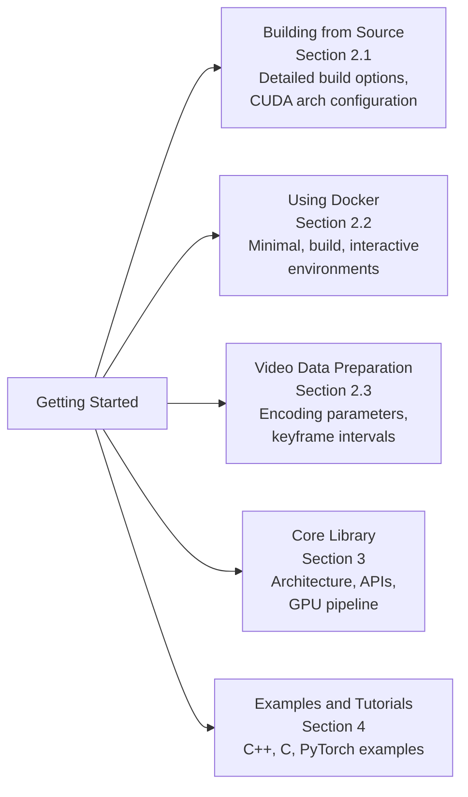

**Diagram: Documentation Navigation**

- **[Building from Source](#2.1)**: Detailed build configuration, CMake options, and troubleshooting
- **[Using Docker](#2.2)**: Pre-configured environments for different use cases
- **[Video Data Preparation](#2.3)**: Encoding guidelines for optimal performance
- **[Core Library](#3)**: In-depth documentation of NVVL's architecture and APIs
- **[Examples and Tutorials](#4)**: Practical code examples from basic to advanced

For API reference documentation, build with `make doc` (requires Doxygen). See [Generating Documentation](#7.1).

Sources: [README.md:137-148]()

---

# Page: Building from Source

# Building from Source

<details>
<summary>Relevant source files</summary>

The following files were used as context for generating this wiki page:

- [CMakeLists.txt](CMakeLists.txt)
- [README.md](README.md)
- [cmake/BuildType.cmake](cmake/BuildType.cmake)
- [cmake/CudaArchFlags.cmake](cmake/CudaArchFlags.cmake)

</details>


This page provides detailed instructions for building the NVVL library from source code. It covers system prerequisites, dependency requirements, CMake configuration options, and the complete build and installation process.

For information about using pre-configured Docker environments instead of building manually, see [Using Docker](#2.2). For details about the CMake build system internals, see [CMake Configuration](#5.1).

## Purpose and Scope

This document guides developers through compiling NVVL from source on Linux systems. It covers:
- Installing required dependencies (CUDA Toolkit, FFmpeg libraries, CMake)
- Configuring the build with CMake options
- Compiling the shared library and optional components
- Installing to system directories

This page focuses on the mechanics of building the library itself. For information about preparing video data for use with NVVL, see [Video Data Preparation](#2.3).

## Prerequisites

### Required Dependencies

NVVL requires the following dependencies to build and run:

| Dependency | Minimum Version | Purpose | Notes |
|------------|----------------|---------|-------|
| **CUDA Toolkit** | 8.0+ (9.0+ recommended) | GPU acceleration, hardware video decoding | Includes `nvcuvid` library for hardware decoding |
| **FFmpeg libraries** | N/A | Video file parsing and demuxing | Requires `libavformat`, `libavcodec`, `libavfilter`, `libavutil` |
| **CMake** | 3.8+ | Build system | Version 3.8+ required for CUDA language support |
| **C++ Compiler** | N/A | Compilation | C++14 support required |
| **pkg-config** | N/A | Dependency detection | Used to locate FFmpeg libraries |
| **nvidia-ml** | N/A | GPU management | NVIDIA Management Library |

Sources: [README.md:61-73](), [CMakeLists.txt:1-23]()

### FFmpeg Installation

FFmpeg libraries can be installed either from source or via system packages:

**Ubuntu 16.04+ packages:**
```bash
sudo apt-get install libavcodec-dev libavfilter-dev libavformat-dev libavutil-dev
```

**Building from source:**
See the example Dockerfiles in the repository for reference configurations.

Sources: [README.md:65-69]()

### CMake Installation

CMake 3.8 or later is required because NVVL uses CMake's builtin CUDA language support introduced in that version. If your distribution provides an older version, install CMake via pip:

```bash
pip install cmake
```

Or download a binary distribution:
```bash
wget https://cmake.org/files/v3.10/cmake-3.10.2-Linux-x86_64.sh
/bin/sh cmake-3.10.2-Linux-x86_64.sh --prefix=/usr/local
```

Sources: [README.md:71-99]()

## Build System Architecture

The following diagram shows how the CMake build system processes source files into the installed library:

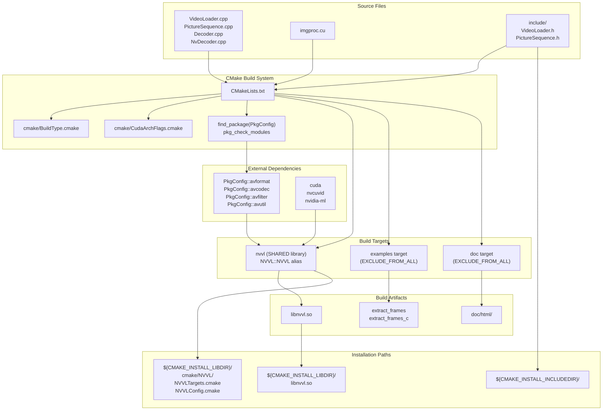

**Build Flow:** The `CMakeLists.txt` configures the build by detecting dependencies via `pkg-config`, applying build type settings from `BuildType.cmake`, and generating CUDA architecture flags via `CudaArchFlags.cmake`. The main `nvvl` target compiles C++ and CUDA source files into `libnvvl.so`, which is installed alongside headers and CMake package configuration files.

Sources: [CMakeLists.txt:1-126](), [cmake/BuildType.cmake:1-17](), [cmake/CudaArchFlags.cmake:1-51]()

## CMake Target Configuration

The build system defines several key targets and their properties:

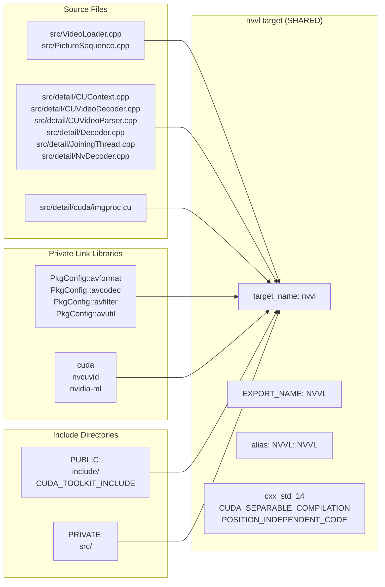

**Target Properties:** The `nvvl` target at [CMakeLists.txt:32-73]() is configured as a shared library with C++14 features, CUDA separable compilation, and position-independent code. It links privately against FFmpeg and CUDA libraries, and exposes public headers via `BUILD_INTERFACE` and `INSTALL_INTERFACE` generator expressions.

Sources: [CMakeLists.txt:32-73]()

## Build Configuration Options

CMake can be configured with the following options using `cmake .. -DOPTION=Value` syntax:

### CUDA_ARCH

Specifies GPU architectures to generate device code for. Can be architecture generation names or specific compute capabilities.

**Valid values:**
- Generation names: `Kepler`, `Maxwell`, `Pascal`, `Volta` (Volta requires CUDA 9.0+)
- Specific architectures: `sm_30`, `sm_35`, `sm_37`, `sm_50`, `sm_52`, `sm_60`, `sm_61`, `sm_70`
- Multiple values separated by semicolon: `"Maxwell;Pascal;Volta"`

**Default:** `Maxwell;Pascal` (adds `Volta` if CUDA 9.0+)

**Example:**
```bash
cmake .. -DCUDA_ARCH="Pascal;Volta"
```

The `CudaArchFlags.cmake` module processes this option and generates `-gencode` flags. Each architecture is translated to appropriate compute capability numbers at [cmake/CudaArchFlags.cmake:23-51]().

Sources: [README.md:114-118](), [cmake/CudaArchFlags.cmake:1-51]()

### CMAKE_CUDA_FLAGS

Custom arguments to pass to the `nvcc` compiler. The default value links against the shared CUDA runtime.

**Default:** `-cudart shared`

**Common options:**
- `-cudart static` - Link against static CUDA runtime
- Custom gencode flags for fine-grained architecture control

**Example:**
```bash
cmake .. -DCMAKE_CUDA_FLAGS="-cudart static -gencode arch=compute_61,code=sm_61"
```

The default is set at [CMakeLists.txt:3-5]() if not already defined.

Sources: [README.md:120-124](), [CMakeLists.txt:3-5]()

### CMAKE_BUILD_TYPE

Specifies the build configuration type. The `BuildType.cmake` module sets a default if none is specified.

**Valid values:**
- `Debug` - Debugging symbols, `-Og` optimization for GCC
- `Release` - Full optimization, no debug symbols
- `RelWithDebInfo` - Optimization with debug symbols (default)
- `MinSizeRel` - Size optimization

**Default:** `RelWithDebInfo`

**Example:**
```bash
cmake .. -DCMAKE_BUILD_TYPE=Release
```

The default build type logic is at [cmake/BuildType.cmake:4-13]().

Sources: [README.md:132](), [cmake/BuildType.cmake:1-17]()

### CMAKE_INSTALL_PREFIX

Installation directory for the library, headers, and CMake configuration files.

**Default:** `/usr/local`

**Example:**
```bash
cmake .. -DCMAKE_INSTALL_PREFIX=/opt/nvvl
```

Sources: [README.md:129-130]()

### WITH_OPENCV

Enable optional OpenCV functionality in examples. This only affects example code, not the core library.

**Default:** Not set (OpenCV features disabled)

**Example:**
```bash
cmake .. -DWITH_OPENCV=1
```

Sources: [README.md:126-127]()

## Build Process

### Standard Build Procedure

The typical CMake build pattern:

```bash
mkdir build && cd build
cmake ..
make -j
sudo make install
```

This sequence:
1. Creates an out-of-source build directory
2. Configures the build system and detects dependencies
3. Compiles the library in parallel
4. Installs to the system (requires root for default prefix)

Sources: [README.md:101-108]()

### Build Steps Explained

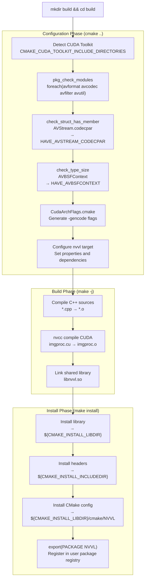

**Configuration Phase:** CMake detects the CUDA toolkit and FFmpeg libraries via `pkg-config`. It checks for FFmpeg API compatibility by testing for `AVStream.codecpar` at [CMakeLists.txt:24-28]() and `AVBSFContext` type. The `CudaArchFlags.cmake` module generates appropriate `-gencode` flags based on `CUDA_ARCH`.

**Build Phase:** C++ sources are compiled with `-Wall -Wno-unused-function` warnings (non-CUDA files only) at [CMakeLists.txt:48-49](). CUDA sources are compiled with `nvcc` using separable compilation. All objects are linked into `libnvvl.so`.

**Install Phase:** The library, headers, and CMake package configuration files are installed. The package is also registered in the user's CMake package registry at [CMakeLists.txt:122]().

Sources: [CMakeLists.txt:1-126]()

### FFmpeg Compatibility Detection

The build system performs runtime compatibility checks for FFmpeg API changes:

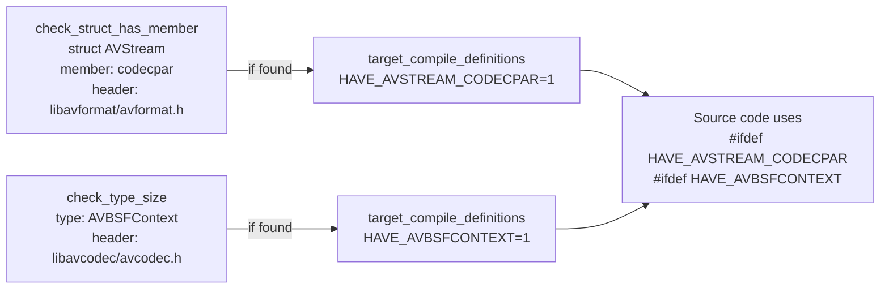

These checks at [CMakeLists.txt:24-57]() enable conditional compilation for different FFmpeg API versions. `HAVE_AVSTREAM_CODECPAR` indicates the newer API where codec parameters are stored in `AVStream.codecpar` instead of `AVStream.codec`. `HAVE_AVBSFCONTEXT` indicates support for the bitstream filter context API.

Sources: [CMakeLists.txt:24-57]()

## Building Optional Components

### Examples

Build the C and C++ example programs:

```bash
make examples
```

This target is marked `EXCLUDE_FROM_ALL` at [CMakeLists.txt:125](), so examples are not built by default. The examples subdirectory contains:
- `extract_frames` (C++ example)
- `extract_frames_c` (C example)

See [C++ Frame Extraction](#4.1) and [C Frame Extraction](#4.2) for details on these examples.

Sources: [README.md:137-140](), [CMakeLists.txt:125]()

### API Documentation

Generate Doxygen HTML documentation:

```bash
make doc
```

This requires Doxygen to be installed and builds HTML documentation into `doc/html/`. The `doc` target is also marked `EXCLUDE_FROM_ALL` at [CMakeLists.txt:124]().

Sources: [README.md:142-147](), [CMakeLists.txt:124]()

## Installation Layout

After running `make install`, NVVL is installed with the following structure:

| Component | Installation Path | Description |
|-----------|------------------|-------------|
| **Shared Library** | `${CMAKE_INSTALL_LIBDIR}/libnvvl.so` | Main shared library |
| **Headers** | `${CMAKE_INSTALL_INCLUDEDIR}/` | Public API headers (entire `include/` directory) |
| **CMake Config** | `${CMAKE_INSTALL_LIBDIR}/cmake/NVVL/` | Package configuration files |
| **NVVLTargets.cmake** | `${CMAKE_INSTALL_LIBDIR}/cmake/NVVL/NVVLTargets.cmake` | Exported target definitions |
| **NVVLConfig.cmake** | `${CMAKE_INSTALL_LIBDIR}/cmake/NVVL/NVVLConfig.cmake` | Package configuration |
| **NVVLConfigVersion.cmake** | `${CMAKE_INSTALL_LIBDIR}/cmake/NVVL/NVVLConfigVersion.cmake` | Version compatibility file |

The installation logic is defined at [CMakeLists.txt:76-122](). The `INSTALL_CONFIGDIR` variable at [CMakeLists.txt:78]() determines the CMake package configuration location.

Sources: [CMakeLists.txt:76-122]()

## CMake Package Export

The build system exports NVVL as a CMake package that downstream projects can use via `find_package(NVVL)`:

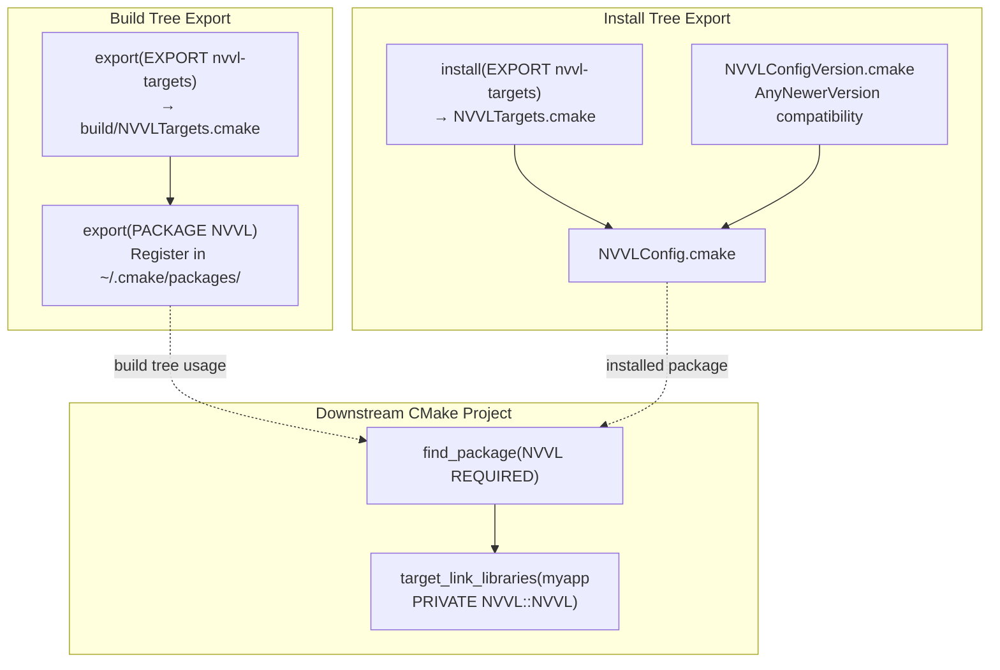

**Build Tree Usage:** The build tree exports targets at [CMakeLists.txt:119]() and registers the package at [CMakeLists.txt:122](), allowing downstream projects to find NVVL without installation.

**Install Tree Usage:** Installing the package creates `NVVLTargets.cmake`, `NVVLConfig.cmake`, and `NVVLConfigVersion.cmake` in the CMake module path. The version file uses `AnyNewerVersion` compatibility at [CMakeLists.txt:100-104]().

**Downstream Integration:** Projects can find NVVL with `find_package(NVVL)` and link against the `NVVL::NVVL` imported target. The namespace is set via `NAMESPACE NVVL::` at [CMakeLists.txt:93]().

Sources: [CMakeLists.txt:76-122]()

## Compiler and Build Features

### Required Language Features

The `nvvl` target requires C++14 standard via `target_compile_features(nvvl PUBLIC cxx_std_14)` at [CMakeLists.txt:46](). This is propagated to downstream targets linking against `NVVL::NVVL`.

### Compiler Warnings

Non-CUDA sources are compiled with warnings enabled at [CMakeLists.txt:48-49]():
```cmake
target_compile_options(nvvl PRIVATE
    $<$<NOT:$<COMPILE_LANGUAGE:CUDA>>:-Wall;-Wno-unused-function>)
```

The generator expression ensures warnings only apply to C/C++ compilation, not CUDA.

### CUDA Compilation

CUDA sources use:
- **Separable compilation:** `CUDA_SEPARABLE_COMPILATION ON` at [CMakeLists.txt:61]()
- **Position-independent code:** `POSITION_INDEPENDENT_CODE ON` at [CMakeLists.txt:60]()

Sources: [CMakeLists.txt:46-63]()

## Troubleshooting

### Common Build Issues

| Issue | Cause | Solution |
|-------|-------|----------|
| **CMake version error** | CMake < 3.8 | Install CMake 3.8+ via pip or binary distribution |
| **CUDA not found** | CUDA Toolkit not in standard location | Set `CUDA_HOME` or `CMAKE_CUDA_COMPILER` |
| **FFmpeg not found** | pkg-config can't locate FFmpeg | Install FFmpeg development packages or set `PKG_CONFIG_PATH` |
| **Unknown architecture error** | Invalid `CUDA_ARCH` value | Use valid generation names or `sm_XX` format |
| **Volta on old CUDA** | CUDA < 9.0 with Volta requested | Upgrade CUDA Toolkit or remove Volta from `CUDA_ARCH` |
| **Fermi error** | Fermi GPU specified | Fermi GPUs lack hardware video decoders; use newer GPU |

The architecture validation logic at [cmake/CudaArchFlags.cmake:24-41]() provides error messages for invalid configurations.

### Debug Build Configuration

To see detailed CMake configuration:
```bash
cmake .. -DCMAKE_VERBOSE_MAKEFILE=ON
```

To see detected FFmpeg configuration:
```bash
pkg-config --cflags --libs libavformat libavcodec libavfilter libavutil
```

Sources: [cmake/CudaArchFlags.cmake:24-41]()

## Next Steps

After building and installing NVVL:

- **Use Docker environments:** See [Using Docker](#2.2) for pre-configured build and runtime containers
- **Prepare video data:** See [Video Data Preparation](#2.3) for codec requirements and optimization
- **Explore examples:** See [C++ Frame Extraction](#4.1) and [PyTorch Super-Resolution](#4.4) for usage patterns
- **Integrate with your project:** See [Package Configuration](#5.3) for using NVVL in downstream CMake projects

Sources: [README.md:1-313]()

---

# Page: Using Docker

# Using Docker

<details>
<summary>Relevant source files</summary>

The following files were used as context for generating this wiki page:

- [docker/Dockerfile.build](docker/Dockerfile.build)
- [docker/Dockerfile.interactive](docker/Dockerfile.interactive)
- [docker/Dockerfile.minimal](docker/Dockerfile.minimal)
- [docker/README.md](docker/README.md)

</details>


## Purpose and Scope

This document describes the Docker environments provided by NVVL for different use cases: runtime deployment, library building, and interactive development. These pre-configured Docker images provide reproducible environments with the correct dependencies, CUDA versions, and FFmpeg configurations.

For information about building NVVL from source without Docker, see [Building from Source](#2.1). For details about the build system configuration, see [CMake Configuration](#5.1).

## Overview of Docker Environments

NVVL provides three Docker configurations, each optimized for different scenarios:

| Dockerfile | Base Image | Primary Use Case | FFmpeg Configuration | Additional Tools |
|------------|------------|------------------|---------------------|------------------|
| `Dockerfile.minimal` | `nvidia/cuda:9.1-runtime-ubuntu16.04` | Production deployment | Minimal (demux only) | None |
| `Dockerfile.build` | `nvidia/cuda:9.1-devel-ubuntu16.04` | CI/CD builds | Minimal (demux only) | CMake, pkg-config, Doxygen |
| `Dockerfile.interactive` | `nvidia/cuda:9.1-devel-ubuntu16.04` | Development/debugging | Full (includes ffmpeg CLI, encoders) | CMake, pkg-config, Doxygen, ffmpeg tool |

All Docker environments are parameterized with build arguments for `CUDA_VERSION`, `FFMPEG_VERSION`, and `CMAKE_VERSION`, allowing customization at build time.

**Sources:** [docker/README.md:1-20](), [docker/Dockerfile.minimal:1-4](), [docker/Dockerfile.build:1-5](), [docker/Dockerfile.interactive:1-5]()

## Docker Environment Architecture

```mermaid
graph TB
    subgraph BaseImages["Base Images"]
        RuntimeBase["nvidia/cuda:9.1-runtime-ubuntu16.04<br/>Runtime libraries only"]
        DevelBase["nvidia/cuda:9.1-devel-ubuntu16.04<br/>Development headers + libraries"]
    end
    
    subgraph MinimalEnv["Dockerfile.minimal"]
        MinimalFFmpeg["Minimal FFmpeg Build<br/>avformat, avcodec, avfilter<br/>demuxer=mov,matroska<br/>bsf=h264_mp4toannexb,hevc_mp4toannexb"]
        MinimalDeps["Runtime Dependencies<br/>libx11-6, libxext6"]
        MinimalNV["NVIDIA_DRIVER_CAPABILITIES<br/>video,compute,utility"]
    end
    
    subgraph BuildEnv["Dockerfile.build"]
        BuildFFmpeg["Minimal FFmpeg Build<br/>(same as minimal)"]
        BuildDeps["Build Dependencies<br/>pkg-config, doxygen"]
        BuildTools["Build Tools<br/>CMake 3.10.2"]
        BuildNVCUVID["nvcuvid Symlinks<br/>/usr/local/lib/libnvcuvid.so<br/>/usr/lib/x86_64-linux-gnu/libnvcuvid.so"]
    end
    
    subgraph InteractiveEnv["Dockerfile.interactive"]
        InteractiveFFmpeg["Full FFmpeg Build<br/>+ libx264, libx265<br/>+ cuvid, nvenc, cuda<br/>+ ffmpeg CLI tool<br/>+ encoders, decoders, hwaccels"]
        InteractiveDeps["Build Dependencies<br/>pkg-config, doxygen"]
        InteractiveTools["Build Tools<br/>CMake 3.10.2"]
        InteractiveNVCUVID["nvcuvid Symlinks<br/>(same as build)"]
    end
    
    RuntimeBase --> MinimalEnv
    DevelBase --> BuildEnv
    DevelBase --> InteractiveEnv
    
    MinimalDeps --> MinimalFFmpeg
    MinimalFFmpeg --> MinimalNV
    
    BuildDeps --> BuildFFmpeg
    BuildFFmpeg --> BuildTools
    BuildTools --> BuildNVCUVID
    
    InteractiveDeps --> InteractiveFFmpeg
    InteractiveFFmpeg --> InteractiveTools
    InteractiveTools --> InteractiveNVCUVID
```

**Diagram: Docker Environment Component Structure**

This diagram shows how the three Docker environments build upon different NVIDIA CUDA base images and include different levels of functionality. The minimal environment prioritizes size and security for production, while build and interactive environments include development tools.

**Sources:** [docker/Dockerfile.minimal:1-33](), [docker/Dockerfile.build:1-54](), [docker/Dockerfile.interactive:1-62]()

## Dockerfile.minimal - Runtime Environment

The minimal Docker environment provides only what is necessary to run applications linked against `libnvvl`. It uses the CUDA runtime base image (no development headers) and builds FFmpeg with the absolute minimum features required.

### Base Configuration

```
FROM nvidia/cuda:9.1-runtime-ubuntu16.04
ARG FFMPEG_VERSION=3.4.2
```

**Sources:** [docker/Dockerfile.minimal:1-3]()

### FFmpeg Configuration

The minimal FFmpeg build disables all features except those required for video demuxing:

| Configure Flag | Purpose |
|----------------|---------|
| `--disable-all --disable-autodetect` | Start with nothing enabled |
| `--enable-avformat --enable-avcodec --enable-avfilter` | Core libraries |
| `--enable-protocol=file` | Local file reading only |
| `--enable-demuxer=mov,matroska` | Support MP4 and MKV containers |
| `--enable-bsf=h264_mp4toannexb,hevc_mp4toannexb` | Bitstream filters for H.264/HEVC |
| `--disable-static --enable-shared` | Shared libraries only |

This configuration produces a minimal FFmpeg suitable for NVVL's parsing needs without encoders, filters, or network protocols.

**Sources:** [docker/Dockerfile.minimal:16-28]()

### Required Dependencies

The minimal environment installs only runtime dependencies:

- `libx11-6`, `libxext6` - Required by nvcuvid for X11 display support
- `NVIDIA_DRIVER_CAPABILITIES=video,compute,utility` - Enables GPU video decode and compute capabilities

**Sources:** [docker/Dockerfile.minimal:6-8]()

### Size Optimization

Build tools (`yasm`, `wget`, `bzip2`, `g++`, `gcc`, `libc-dev`, `make`) are purged after FFmpeg compilation to minimize image size:

```
apt-get purge -y yasm wget bzip2 g++ gcc libc-dev make && \
apt-get autoremove -y
```

**Sources:** [docker/Dockerfile.minimal:31-32]()

## Dockerfile.build - Build Environment

The build Docker environment includes all tools necessary to compile NVVL from source, making it suitable for CI/CD pipelines and automated builds.

### Base Configuration

```
FROM nvidia/cuda:9.1-devel-ubuntu16.04
ARG FFMPEG_VERSION=3.4.2
ARG CMAKE_VERSION=3.10.2
```

Uses the `-devel` base image which includes CUDA development headers and libraries required for compilation.

**Sources:** [docker/Dockerfile.build:1-5]()

### Build Tools

The environment installs:

- **CMake 3.10.2** - Downloaded from cmake.org and installed to `/usr/local`
- **pkg-config** - For dependency detection
- **Doxygen** - For documentation generation

**Sources:** [docker/Dockerfile.build:36-44]()

### nvcuvid Development Symlinks

The build environment works around nvidia-docker's runtime-only library provision by creating unversioned symlinks for development:

```
RUN ln -s /usr/local/nvidia/lib64/libnvcuvid.so.1 /usr/local/lib/libnvcuvid.so && \
    ln -s libnvcuvid.so.1 /usr/lib/x86_64-linux-gnu/libnvcuvid.so
```

This allows the linker to find `libnvcuvid.so` during compilation. Symlinks are created in two locations to accommodate different nvidia-docker versions.

**Sources:** [docker/Dockerfile.build:46-53]()

### FFmpeg Configuration

Uses the same minimal FFmpeg configuration as `Dockerfile.minimal` since only demuxing capabilities are required for building and testing NVVL.

**Sources:** [docker/Dockerfile.build:12-34]()

## Dockerfile.interactive - Development Environment

The interactive Docker environment provides a comprehensive development setup including a full-featured FFmpeg with encoding capabilities, useful for preparing test videos and interactive debugging.

### Enhanced FFmpeg Build

Unlike the minimal builds, the interactive environment enables extensive FFmpeg features:

| Feature Category | Enabled Components |
|------------------|-------------------|
| **Codecs** | `libx264`, `libx265`, H.264, HEVC |
| **Hardware Acceleration** | `cuvid`, `nvenc`, `cuda` |
| **Decoders** | `h264`, `h264_cuvid`, `hevc`, `hevc_cuvid` |
| **Encoders** | `h264_nvenc`, `hevc_nvenc`, `libx264`, `libx265` |
| **Hardware Accelerators** | `h264_cuvid`, `hevc_cuvid` |
| **Tools** | `ffmpeg` CLI, `swresample`, `swscale` |
| **Muxers** | `mp4`, `matroska` |
| **Filters** | `scale` |

This configuration enables video transcoding and preparation workflows inside the container.

**Sources:** [docker/Dockerfile.interactive:22-38]()

### Key Configure Flags

```
--enable-gpl --enable-libx264 --enable-libx265
--enable-swresample --enable-ffmpeg
--enable-swscale --enable-filter=scale
--enable-muxer=mp4,matroska
--enable-cuvid --enable-nvenc --enable-cuda
--enable-decoder=h264,h264_cuvid,hevc,hevc_cuvid
--enable-encoder=h264_nvenc,hevc_nvenc,libx264,libx265
--enable-hwaccel=h264_cuvid,hevc_cuvid
--enable-parser=h264,hevc
```

**Sources:** [docker/Dockerfile.interactive:30-38]()

### Codec Library Dependencies

The interactive build requires additional system packages:

- `libx264-148`, `libx264-dev` - H.264 encoding support
- `libx265-79`, `libx265-dev` - HEVC encoding support
- `yasm` - Assembly optimizer for codec performance

Development packages (`-dev`) are removed after build but runtime libraries remain.

**Sources:** [docker/Dockerfile.interactive:13-42]()

## Building and Using Docker Images

### Building an Image

All Dockerfiles support build-time customization via `ARG` parameters:

```bash
# Build with default versions
docker build -f docker/Dockerfile.build -t nvvl-build .

# Build with custom CUDA and FFmpeg versions
docker build \
  --build-arg CUDA_VERSION=10.0 \
  --build-arg FFMPEG_VERSION=4.1 \
  --build-arg CMAKE_VERSION=3.12.0 \
  -f docker/Dockerfile.interactive \
  -t nvvl-dev .
```

### Running with nvidia-docker

All images require nvidia-docker to access GPU capabilities:

```bash
# Interactive development shell
nvidia-docker run -it --rm \
  -v $(pwd):/workspace \
  -w /workspace \
  nvvl-dev /bin/bash

# Build NVVL inside container
nvidia-docker run --rm \
  -v $(pwd):/workspace \
  -w /workspace \
  nvvl-build \
  /bin/bash -c "mkdir build && cd build && cmake .. && make"
```

### Environment Variables

All images set `NVIDIA_DRIVER_CAPABILITIES=video,compute,utility` to enable:
- **video** - Hardware video decode/encode via nvcuvid/nvenc
- **compute** - CUDA compute operations
- **utility** - nvidia-smi and management operations

**Sources:** [docker/Dockerfile.minimal:8](), [docker/Dockerfile.build:10](), [docker/Dockerfile.interactive:10]()

## Common Docker Configuration Patterns

### Layer Structure Comparison

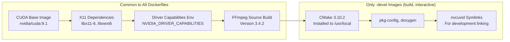

**Diagram: Common Docker Configuration Patterns**

**Sources:** [docker/Dockerfile.minimal:1-33](), [docker/Dockerfile.build:1-54](), [docker/Dockerfile.interactive:1-62]()

### OpenCV Variants

The README mentions `_opencv` suffixed variants that include OpenCV builds with necessary modules for running NVVL examples. These are not shown in the provided files but follow the same pattern with additional OpenCV compilation steps.

**Sources:** [docker/README.md:17-19]()

### Development Workflow Considerations

The README notes these images support "the decidedly non-docker-ish practice of developing while inside a container." This is facilitated by:

1. The nvcuvid symlink workaround for in-container compilation
2. Volume mounting the source directory
3. Including interactive tools like the ffmpeg CLI

This allows developers to iterate on NVVL code without installing dependencies on the host system.

**Sources:** [docker/README.md:14-15](), [docker/Dockerfile.build:46-53](), [docker/Dockerfile.interactive:54-61]()

---

# Page: Video Data Preparation

# Video Data Preparation

<details>
<summary>Relevant source files</summary>

The following files were used as context for generating this wiki page:

- [README.md](README.md)
- [examples/pytorch_superres/README.md](examples/pytorch_superres/README.md)

</details>


## Purpose and Scope

This page explains how to prepare video files for optimal performance with NVVL. Video data preparation involves encoding video files with appropriate codecs, keyframe intervals, and pixel formats to enable efficient random access to frame sequences during training. This page covers codec requirements, keyframe interval configuration, and practical transcoding workflows.

For information about building and installing NVVL, see [Building from Source](#2.1). For Docker-based workflows, see [Using Docker](#2.2).

## Video Codec Fundamentals

### Keyframes and Inter-Frame Dependencies

Video codecs achieve compression by storing only certain frames as complete images in the data stream. These frames are called **keyframes** (or **intra-frames** or **I-frames**). All other frames require data from other frames—either before or after them in time—to be decoded. These dependent frames are called **inter-frames** (P-frames and B-frames).

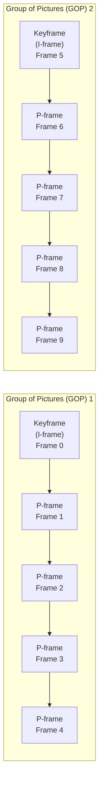

**Diagram: Video Codec Frame Structure with Keyframe Intervals**

The interval between keyframes forms a **Group of Pictures (GOP)**. To decode any sequence of frames, the decoder must start at the keyframe before the sequence and continue past the sequence to the next keyframe after it.

### Impact on Random Access Performance

When sequentially streaming through a video, keyframe intervals are not problematic. However, when decoding small sequences of frames randomly throughout the video, large gaps between keyframes create significant performance overhead:

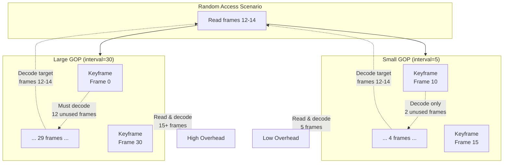

**Diagram: Impact of Keyframe Interval on Random Access Performance**

Sources: [README.md:149-167]()

## Codec and Format Requirements

### Supported Video Codecs

NVVL supports two video codecs through the NVIDIA hardware decoder:

| Codec | Name | Notes |
|-------|------|-------|
| H.264 | AVC (Advanced Video Coding) | Most common, broad hardware support |
| HEVC | H.265 (High Efficiency Video Coding) | Better compression, no open GOP support in NVVL |

The hardware decoder in NVIDIA GPUs provides accelerated decoding for these codecs, offloading work from the CPU.

### Container Format Requirements

NVVL supports **any container format that FFmpeg can parse**. Common formats include:
- `.mp4` (MPEG-4 Part 14)
- `.mkv` (Matroska)
- `.avi` (Audio Video Interleave)
- `.mov` (QuickTime)

The container format is independent of the codec; for example, H.264 video can be stored in `.mp4`, `.mkv`, or other containers.

### Pixel Format Requirements

The video must use the **`yuv420p` pixel format** to be supported by the NVIDIA hardware decoder. This is a 4:2:0 chroma subsampled YUV format where:
- Luma (Y) channel is full resolution
- Chroma (U and V) channels are half resolution in both dimensions

Most video encoders default to or support this format, as it is the most common for H.264 and HEVC.

### HEVC-Specific Requirements

For HEVC (H.265) streams, NVVL's seeking logic **does not support open GOPs**. An open GOP allows B-frames to reference frames outside the GOP boundaries, which complicates random seeking. When encoding HEVC video, you must disable open GOPs.

Sources: [README.md:151-178]()

## Keyframe Interval Configuration

### Choosing the Keyframe Interval

The optimal keyframe interval depends on the length of frame sequences you will read during training. A good rule of thumb:

**Set the keyframe interval equal to the sequence length you will be reading**

For example:
- If reading 5-frame sequences → set keyframe interval to 5
- If reading 10-frame sequences → set keyframe interval to 10
- If reading variable lengths → choose a value near the average or most common length

This provides a good compromise between:
- **File size**: More keyframes increase file size (keyframes compress less than inter-frames)
- **Loading performance**: Fewer unnecessary frames decoded per random access

### FFmpeg Encoder Parameters

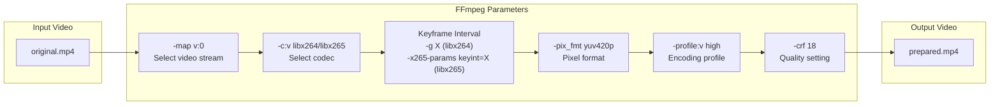

**Diagram: FFmpeg Transcoding Parameter Flow**

#### For H.264 (libx264)

To set keyframe interval to `X` frames:
```bash
-g X
```

Example: For 5-frame sequences:
```bash
-g 5
```

#### For HEVC (libx265)

To set keyframe interval to `X` frames and disable open GOPs:
```bash
-x265-params "keyint=X:no-open-gop=1"
```

Example: For 5-frame sequences:
```bash
-x265-params "keyint=5:no-open-gop=1"
```

### Additional Required Parameters

| Parameter | Purpose | Value |
|-----------|---------|-------|
| `-pix_fmt yuv420p` | Set pixel format | Required for hardware decoder |
| `-map v:0` | Select video stream | Removes extra audio/video streams |
| `-profile:v high` | Encoding profile | Recommended for H.264 |
| `-crf 18` | Quality setting | Lower = better quality (typical range: 18-28) |

Sources: [README.md:169-183]()

## Practical Transcoding Examples

### Complete H.264 Transcoding Command

```bash
ffmpeg -i original.mp4 \
       -map v:0 \
       -c:v libx264 \
       -crf 18 \
       -pix_fmt yuv420p \
       -g 5 \
       -profile:v high \
       prepared.mp4
```

This command:
1. Reads from `original.mp4`
2. Selects only the first video stream (`-map v:0`)
3. Encodes with H.264 (`-c:v libx264`)
4. Sets quality to CRF 18 (`-crf 18`)
5. Uses yuv420p pixel format (`-pix_fmt yuv420p`)
6. Sets keyframe interval to 5 (`-g 5`)
7. Uses high profile (`-profile:v high`)
8. Outputs to `prepared.mp4`

### Complete HEVC Transcoding Command

```bash
ffmpeg -i original.mp4 \
       -map v:0 \
       -c:v libx265 \
       -crf 18 \
       -pix_fmt yuv420p \
       -x265-params "keyint=5:no-open-gop=1" \
       prepared.mp4
```

The key difference is using `libx265` and the `-x265-params` syntax for keyframe configuration.

### Stream Selection Details

The `-map v:0` parameter is crucial:
- `v` = video streams only (excludes audio, subtitles, etc.)
- `:0` = first video stream
- This removes extra audio tracks and subtitle streams that would increase file size and potentially interfere with decoding

Sources: [README.md:180-183]()

## Production Data Preparation Workflow

For large-scale video dataset preparation, a multi-stage workflow is recommended, as demonstrated in the PyTorch super-resolution example:

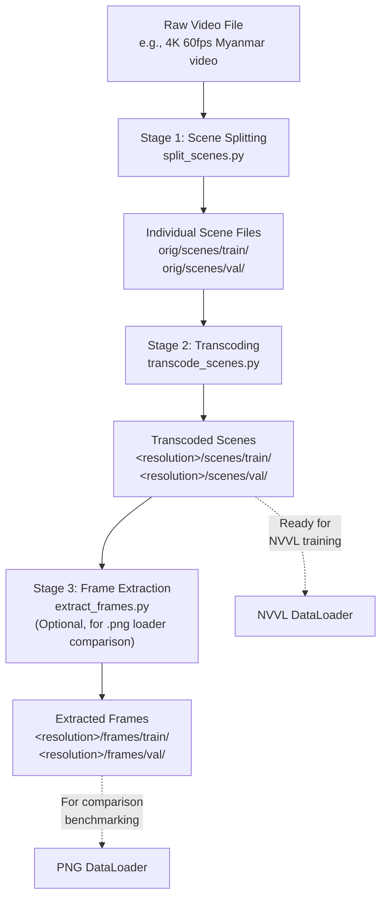

**Diagram: Multi-Stage Data Preparation Pipeline**

### Stage 1: Scene Splitting

Split the raw video into individual scenes and remove audio tracks:

```bash
python ./tools/split_scenes.py \
       --raw_data <path_to_mp4_file> \
       --out_data <data_dir>
```

Output: Scenes written to `<data_dir>/orig/scenes/` (split into `train/` and `val/` folders)

### Stage 2: Transcoding Scenes

Transcode scenes with smaller keyframe intervals and optional resolution downscaling:

```bash
python ./tools/transcode_scenes.py \
       --master_data <data_dir> \
       --resolution <resolution>
```

Where `<resolution>` can be:
- `4K` (3840×2160)
- `1080p` (1920×1080)
- `720p` (1280×720)
- `540p` (960×540)

Output: Transcoded scenes written to `<data_dir>/<resolution>/scenes/` (split into `train/` and `val/`)

This stage applies the optimal keyframe interval and pixel format settings for NVVL.

### Stage 3: Frame Extraction (Optional)

For benchmarking NVVL against traditional `.png` dataloaders:

```bash
python ./tools/extract_frames.py \
       --master_data <data_dir> \
       --resolution <resolution>
```

Output: Extracted frames written to `<data_dir>/<resolution>/frames/` (split into `train/` and `val/`, one folder per scene)

### Workflow Benefits

This staged approach provides several benefits:

| Benefit | Description |
|---------|-------------|
| **Speed** | Splitting first, then transcoding each scene is faster than transcoding the entire video |
| **Parallelization** | Individual scenes can be transcoded in parallel |
| **Flexibility** | Can generate multiple resolutions from the same split scenes |
| **Validation** | Can compare NVVL performance against `.png` dataloaders |

Sources: [examples/pytorch_superres/README.md:92-135]()

## Performance Impact

Proper video data preparation has significant impact on storage, I/O, and loading performance:

| Metric | H.264 .mp4 (NVVL) | .png files | Improvement |
|--------|-------------------|------------|-------------|
| **Disk Space** | 0.592 GB | 23 GB | **~40x smaller** |
| **Per-Iteration Load Time** | 0.91 ms | 2.73 ms | **~3x faster** |
| **CPU Load** | 10% | 17% | **Reduced by 40%** |

These measurements are from the PyTorch super-resolution example using 540p video with 5-frame sequences. Proper keyframe interval configuration (matching the sequence length) is critical to achieving these performance gains.

Sources: [README.md:26-45](), [examples/pytorch_superres/README.md:22-48]()

## Summary

Proper video data preparation for NVVL requires:

1. **Codec**: H.264 or HEVC
2. **Pixel Format**: `yuv420p`
3. **Keyframe Interval**: Set to match your sequence length
4. **Container**: Any FFmpeg-supported format (`.mp4` recommended)
5. **Stream Selection**: Remove extra audio/video streams
6. **HEVC**: Disable open GOPs with `no-open-gop=1`

The investment in proper video preparation pays off with dramatic reductions in storage requirements and improved loading performance during training.

Sources: [README.md:149-183](), [examples/pytorch_superres/README.md:92-135]()

---

# Page: Core Library

# Core Library

<details>
<summary>Relevant source files</summary>

The following files were used as context for generating this wiki page:

- [CMakeLists.txt](CMakeLists.txt)
- [README.md](README.md)

</details>


## Purpose and Scope

This document provides an overview of NVVL's core C/C++ library, including its main components, architecture, and usage patterns. The core library (`libnvvl.so`) handles video decoding, GPU processing, and memory management to deliver decoded video frames as GPU tensors.

For detailed information on specific topics, see:
- Library internals and processing pipeline: [Library Architecture](#3.1)
- `VideoLoader` class API reference: [VideoLoader API](#3.2)
- `PictureSequence` class and layer configuration: [PictureSequence API](#3.3)
- GPU acceleration and transformations: [GPU Processing Pipeline](#3.4)
- External dependencies and their roles: [Dependencies](#3.5)
- Build configuration and installation: [Building from Source](#2.1)

Sources: [README.md:1-313](), [CMakeLists.txt:1-126]()

## Overview

The NVVL core library provides GPU-accelerated video decoding and preprocessing for machine learning workloads. It uses FFmpeg to parse compressed video files and NVIDIA's hardware video decoder (`nvcuvid`) to decode frames directly to GPU memory, bypassing the CPU. The library performs on-the-fly transformations (scaling, cropping, flipping, color space conversion) using GPU texture mapping units, delivering ready-to-use tensors in various formats (`float`, `half`, `uint8`).

The library provides both C++ and C interfaces defined in public headers under `include/`. The shared library `libnvvl.so` is built from source files in `src/` and installed with CMake package configuration for easy integration into downstream projects.

Sources: [README.md:8-18](), [README.md:186-290](), [CMakeLists.txt:32-73]()

## Library Components

### Primary API Classes

The core library exposes two main classes to users:

| Class | Header | Purpose |
|-------|--------|---------|
| `VideoLoader` | `include/VideoLoader.h` | Manages decoding threads, frame queues, and coordinates the decoding pipeline |
| `PictureSequence` | `include/PictureSequence.h` | Describes output buffer layout, transformations, and synchronization for decoded frames |

**VideoLoader** ([src/VideoLoader.cpp]()) is the main entry point. It accepts video file paths and frame sequence specifications, manages worker threads for parallel decoding, and delivers decoded frames to user-provided GPU buffers. It maintains statistics on video properties (frame count, dimensions, codec).

**PictureSequence** ([src/PictureSequence.cpp]()) defines the destination and processing parameters for decoded frames. Users create "layers" within a sequence to specify output data type, color space, normalization, cropping, scaling, and memory layout. Multiple layers can extract different representations from the same frame sequence.

Sources: [README.md:198-286](), [CMakeLists.txt:33-34]()

### Internal Decoder Components

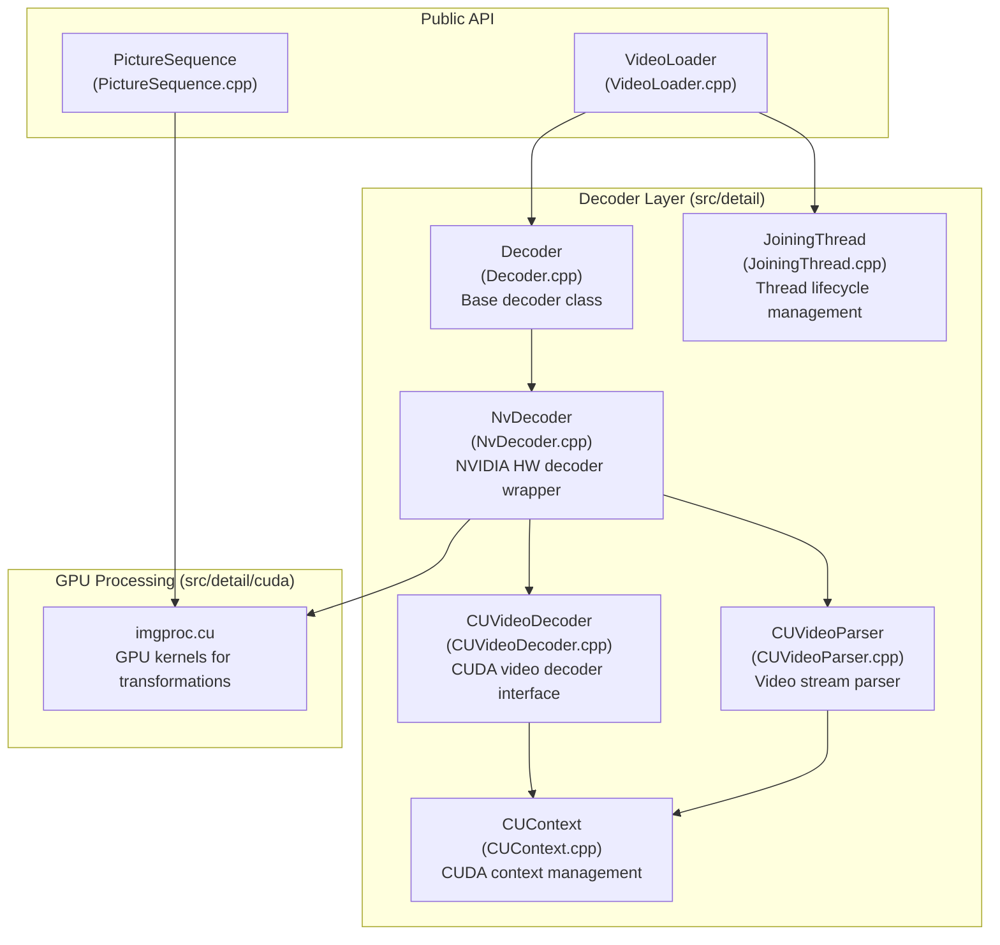

**Decoder Components:**

- **Decoder** ([src/detail/Decoder.cpp]()): Abstract base class defining the decoder interface
- **NvDecoder** ([src/detail/NvDecoder.cpp]()): Implements NVIDIA hardware decoder integration
- **CUVideoDecoder** ([src/detail/CUVideoDecoder.cpp]()): Wraps `nvcuvid` decoder API calls
- **CUVideoParser** ([src/detail/CUVideoParser.cpp]()): Parses compressed video packets and feeds decoder
- **CUContext** ([src/detail/CUContext.cpp]()): Manages CUDA contexts for decoder operations
- **JoiningThread** ([src/detail/JoiningThread.cpp]()): RAII thread wrapper ensuring clean shutdown

**GPU Processing:**

- **imgproc.cu** ([src/detail/cuda/imgproc.cu]()): CUDA kernels performing scaling, cropping, color conversion, normalization, and format transformations

Sources: [CMakeLists.txt:35-42]()

## Component Architecture

### Layered Design

```mermaid
graph TB
    subgraph "Application Layer"
        UserCode["User Application Code"]
    end
    
    subgraph "API Layer (include)"
        CPPAPI["C++ API<br/>VideoLoader, PictureSequence"]
        CAPI["C API<br/>nvvl_* functions"]
    end
    
    subgraph "Core Implementation (src)"
        VLImpl["VideoLoader Implementation<br/>Thread management<br/>Frame queue"]
        PSImpl["PictureSequence Implementation<br/>Layer management<br/>Synchronization"]
    end
    
    subgraph "Decoder Implementation (src/detail)"
        DecoderLayer["Decoder hierarchy<br/>NvDecoder, CUVideoDecoder"]
        ParserLayer["Parser layer<br/>CUVideoParser"]
        ContextLayer["CUDA context<br/>CUContext"]
    end
    
    subgraph "GPU Processing (src/detail/cuda)"
        Kernels["CUDA transformation kernels<br/>imgproc.cu"]
    end
    
    subgraph "External Dependencies"
        FFmpeg["FFmpeg libraries<br/>libavformat, libavcodec"]
        nvcuvid["nvcuvid<br/>Hardware decoder API"]
        CUDA["CUDA runtime<br/>Device memory, streams"]
    end
    
    UserCode --> CPPAPI
    UserCode --> CAPI
    CPPAPI --> VLImpl
    CPPAPI --> PSImpl
    CAPI --> VLImpl
    CAPI --> PSImpl
    
    VLImpl --> DecoderLayer
    PSImpl --> Kernels
    
    DecoderLayer --> ParserLayer
    DecoderLayer --> ContextLayer
    ParserLayer --> FFmpeg
    DecoderLayer --> nvcuvid
    
    Kernels --> CUDA
    ContextLayer --> CUDA
```

The architecture is organized in layers to separate concerns:

1. **API Layer**: Clean C++ and C interfaces hiding implementation details
2. **Core Implementation**: Frame queue management, threading, statistics
3. **Decoder Implementation**: Hardware decoder integration and packet parsing
4. **GPU Processing**: CUDA kernels for transformations and format conversions
5. **External Dependencies**: FFmpeg for parsing, CUDA/nvcuvid for decoding

Sources: [CMakeLists.txt:32-73](), [README.md:186-290]()

## Data Flow Pipeline

### Frame Loading Sequence

```mermaid
sequenceDiagram
    participant App as "Application"
    participant VL as "VideoLoader"
    participant Dec as "Decoder Thread"
    participant FFmpeg as "FFmpeg Parser"
    participant HW as "nvcuvid HW Decoder"
    participant Kern as "imgproc Kernels"
    participant PS as "PictureSequence"
    
    App->>VL: read_sequence(file, frame, count)
    VL->>Dec: Queue decode request
    Dec->>FFmpeg: Open and seek to keyframe
    FFmpeg-->>Dec: Compressed packets
    Dec->>HW: Feed packets
    HW-->>Dec: Decoded YUV frames (GPU)
    Dec->>Kern: Transform request
    Kern->>Kern: Scale, crop, flip, convert
    
    App->>VL: receive_frames(PictureSequence)
    VL->>PS: Configure output layers
    PS->>Kern: Copy to user buffers
    Kern-->>PS: GPU event for completion
    PS-->>App: Async completion (event)
    
    App->>PS: wait(stream)
    PS->>App: Inserts CUDA wait event
```

**Pipeline Steps:**

1. **Request Phase**: Application calls `read_sequence()` with video file path, starting frame number, and sequence length
2. **Parsing Phase**: Decoder thread opens video file with FFmpeg, seeks to keyframe before requested frames, demuxes compressed packets
3. **Decoding Phase**: Compressed packets sent to hardware decoder via `nvcuvid` API, decoder outputs YUV420 frames in GPU memory
4. **Transformation Phase**: GPU kernels perform scaling, cropping, flipping, color conversion (RGB/YCbCr), normalization, and data type conversion
5. **Delivery Phase**: Transformed frames copied to user-provided buffers specified in `PictureSequence` layers
6. **Synchronization Phase**: CUDA event inserted for asynchronous completion notification

Sources: [README.md:198-286]()

## Library Build Structure

The core library is built as a shared library with specific compile and link requirements:

**Build Target Configuration:**

```
Target: nvvl (libnvvl.so)
Language: C++14, CUDA
Source files: 9 files (see Component Architecture)
Link libraries: FFmpeg, cuda, nvcuvid, nvidia-ml
```

**Key Build Properties:**

| Property | Value | Purpose |
|----------|-------|---------|
| `POSITION_INDEPENDENT_CODE` | `ON` | Enable shared library creation |
| `CUDA_SEPARABLE_COMPILATION` | `ON` | Allow CUDA code across multiple files |
| `CMAKE_CUDA_FLAGS` | `-cudart shared` | Use shared CUDA runtime |
| C++ Standard | `cxx_std_14` | Require C++14 features |

**Include Directories:**

- Public: `include/` (API headers), CUDA toolkit includes
- Private: `src/` (implementation headers)

**Installed Artifacts:**

- Shared library: `${CMAKE_INSTALL_LIBDIR}/libnvvl.so`
- Headers: `${CMAKE_INSTALL_INCLUDEDIR}/`
- CMake config: `${CMAKE_INSTALL_LIBDIR}/cmake/NVVL/`

Sources: [CMakeLists.txt:32-96]()

## Basic Usage Pattern

### Initialization

```cpp
// Create loader for specific GPU device
auto loader = NVVL::VideoLoader{device_id};
```

The `VideoLoader` constructor initializes decoder threads and CUDA contexts for the specified device.

### Reading Frames

```cpp
// Queue a frame sequence for decoding
loader.read_sequence(filename, frame_num, sequence_length);
```

This queues a decode request. The loader seeks to the keyframe before `frame_num` and decodes `sequence_length` frames. Decoding happens asynchronously on background threads.

### Receiving Frames

```cpp
// Define output format and destination
auto seq = PictureSequence{sequence_count};
auto pixels = PictureSequence::Layer<float>{};

// Configure layer (memory, dimensions, transformations)
pixels.data = gpu_buffer_ptr;
pixels.desc.count = sequence_count;
pixels.desc.channels = 3;
pixels.desc.width = crop_width;
pixels.desc.height = crop_height;
pixels.desc.scale_width = scale_width;
pixels.desc.scale_height = scale_height;
pixels.desc.color_space = ColorSpace_RGB;
pixels.desc.normalized = true;
// ... configure strides for memory layout

// Add layer and request frames
seq.set_layer("pixels", pixels);
loader.receive_frames(seq);  // Async operation
```

The `PictureSequence` specifies output memory layout, data types, and transformations. `receive_frames()` returns immediately; decoding and processing continue asynchronously.

### Synchronization

```cpp
// Insert wait event into CUDA stream
seq.wait(cuda_stream);
// Subsequent kernels on cuda_stream will wait for frames
```

The `wait()` method inserts a CUDA event wait into the application's stream, enabling proper synchronization without blocking the CPU.

Sources: [README.md:198-286](), [README.md:232-261]()

## Interface Languages

The library provides two language interfaces:

**C++ Interface:**
- Defined in: `include/VideoLoader.h`, `include/PictureSequence.h`
- Features: RAII resource management, templated layers for type safety, exception handling
- Example: [doc/examples/extract_frames.cpp]()

**C Interface:**
- Defined in: C headers (prefixed with `nvvl_*`)
- Features: Manual resource management, error code returns, simpler ABI
- Example: [doc/examples/extract_frames_c.c]()

Both interfaces access the same underlying implementation. The C interface enables integration with languages that have C FFI but not C++ FFI.

Sources: [README.md:190-196](), [README.md:288-290]()

---

# Page: Library Architecture

# Library Architecture

<details>
<summary>Relevant source files</summary>

The following files were used as context for generating this wiki page:

- [CMakeLists.txt](CMakeLists.txt)
- [README.md](README.md)

</details>


This document explains NVVL's internal architecture, including the video decoding pipeline, component organization, threading model, and memory management. For details on using the public APIs, see [VideoLoader API](#3.2) and [PictureSequence API](#3.3). For information about GPU processing features, see [GPU Processing Pipeline](#3.4). For details on external dependencies, see [Dependencies](#3.5).

## Overview

NVVL is structured as a multi-threaded pipeline that coordinates FFmpeg container parsing, NVIDIA hardware video decoding, and GPU-based image processing. The library consists of two public-facing classes (`VideoLoader` and `PictureSequence`) and several internal detail classes that handle the video decoding pipeline.

The architecture separates concerns into distinct layers:

| Layer | Responsibility | Key Components |
|-------|---------------|----------------|
| Public API | User-facing interface | `VideoLoader`, `PictureSequence` |
| Decoding Logic | Video decoder orchestration | `Decoder`, `NvDecoder` |
| CUDA Wrappers | Hardware decoder interface | `CUVideoDecoder`, `CUVideoParser` |
| CUDA Management | Context and resource management | `CUContext` |
| GPU Processing | Image transformations | `imgproc.cu` kernels |
| Threading | Asynchronous operation | `JoiningThread` |

Sources: [CMakeLists.txt:32-42](), [README.md:8-18]()

## Component Architecture

```mermaid
graph TB
    subgraph Public_API["Public API Layer"]
        VideoLoader["VideoLoader<br/>(VideoLoader.cpp)"]
        PictureSequence["PictureSequence<br/>(PictureSequence.cpp)"]
    end
    
    subgraph Detail_Layer["Detail Implementation Layer"]
        Decoder["Decoder<br/>(detail/Decoder.cpp)"]
        NvDecoder["NvDecoder<br/>(detail/NvDecoder.cpp)"]
        JoiningThread["JoiningThread<br/>(detail/JoiningThread.cpp)"]
    end
    
    subgraph CUDA_Layer["CUDA Wrapper Layer"]
        CUVideoDecoder["CUVideoDecoder<br/>(detail/CUVideoDecoder.cpp)"]
        CUVideoParser["CUVideoParser<br/>(detail/CUVideoParser.cpp)"]
        CUContext["CUContext<br/>(detail/CUContext.cpp)"]
    end
    
    subgraph GPU_Processing["GPU Processing Layer"]
        imgproc["Image Processing Kernels<br/>(detail/cuda/imgproc.cu)"]
    end
    
    subgraph External["External Libraries"]
        FFmpeg["FFmpeg Libraries<br/>(avformat, avcodec)"]
        nvcuvid["NVIDIA Video Decoder<br/>(nvcuvid)"]
    end
    
    VideoLoader --> Decoder
    VideoLoader --> PictureSequence
    Decoder --> NvDecoder
    Decoder --> JoiningThread
    NvDecoder --> CUVideoDecoder
    NvDecoder --> CUVideoParser
    CUVideoDecoder --> CUContext
    CUVideoParser --> FFmpeg
    CUVideoDecoder --> nvcuvid
    Decoder --> imgproc
    PictureSequence --> imgproc
```

**Component Architecture Diagram**

The library is organized into four distinct layers. The Public API layer provides `VideoLoader` for managing video loading operations and `PictureSequence` for specifying output configuration. The Detail Implementation layer contains `Decoder` which orchestrates the decoding process, `NvDecoder` which manages the NVIDIA hardware decoder, and `JoiningThread` which handles the asynchronous decoding thread. The CUDA Wrapper layer provides thin wrappers around NVIDIA's video decoding APIs through `CUVideoDecoder` and `CUVideoParser`, with `CUContext` managing CUDA contexts. The GPU Processing layer contains CUDA kernels for image transformations.

Sources: [CMakeLists.txt:32-42](), [README.md:8-18]()

## Video Decoding Pipeline

The video decoding pipeline processes compressed video files through multiple stages to produce GPU tensors ready for machine learning:

```mermaid
graph LR
    subgraph Input["Input Stage"]
        VideoFile["Video File<br/>(H.264/HEVC)"]
    end
    
    subgraph Parsing["FFmpeg Parsing Stage"]
        AVFormatContext["AVFormatContext<br/>Container Demux"]
        AVPacket["AVPacket<br/>Compressed Frames"]
    end
    
    subgraph Hardware_Decode["Hardware Decode Stage"]
        CUVideoParser_Stage["CUVideoParser<br/>Bitstream Parsing"]
        CUVideoDecoder_Stage["CUVideoDecoder<br/>HW Decode to NV12"]
    end
    
    subgraph Transform["GPU Transform Stage"]
        imgproc_kernels["imgproc CUDA Kernels<br/>Scale/Crop/Flip<br/>Color Conversion"]
    end
    
    subgraph Output["Output Stage"]
        PictureSequence_Buffer["PictureSequence Layers<br/>GPU Memory<br/>(float/half/uint8)"]
    end
    
    VideoFile --> AVFormatContext
    AVFormatContext --> AVPacket
    AVPacket --> CUVideoParser_Stage
    CUVideoParser_Stage --> CUVideoDecoder_Stage
    CUVideoDecoder_Stage --> imgproc_kernels
    imgproc_kernels --> PictureSequence_Buffer
```

**Video Decoding Pipeline Flow**

The pipeline begins with FFmpeg parsing the video container to extract compressed packets. These packets are fed to `CUVideoParser` which parses the bitstream and determines frame dependencies. The `CUVideoDecoder` performs hardware-accelerated decoding to NV12 format in GPU memory. The `imgproc` CUDA kernels then perform transformations (scaling, cropping, flipping) and color space conversion, writing results directly to the user-provided `PictureSequence` buffers.

| Pipeline Stage | Input Format | Output Format | Component |
|----------------|--------------|---------------|-----------|
| Container Parsing | Video file | Compressed packets | FFmpeg (avformat) |
| Bitstream Parsing | Compressed packets | Decode parameters | `CUVideoParser` |
| Hardware Decode | Compressed packets | NV12 frames (GPU) | `CUVideoDecoder` |
| GPU Transform | NV12 frames | RGB/YCbCr tensors | `imgproc.cu` |
| Layer Output | Transformed frames | User buffers | `PictureSequence` |

Sources: [README.md:8-18](), [CMakeLists.txt:36-42]()

## Threading Model

NVVL uses a multi-threaded architecture to overlap video decoding with GPU processing and user computation:

```mermaid
graph TB
    subgraph Main_Thread["Main Thread"]
        VideoLoader_read["VideoLoader::read_sequence()<br/>Queue frame requests"]
        VideoLoader_receive["VideoLoader::receive_frames()<br/>Get decoded frames"]
        User_Compute["User Computation<br/>ML training/inference"]
    end
    
    subgraph Decoder_Thread["Decoder Thread (JoiningThread)"]
        Decoder_run["Decoder::run()<br/>Decode loop"]
        FFmpeg_read["FFmpeg: av_read_frame()<br/>Read packets"]
        Parser_feed["CUVideoParser: cuvidParseVideoData()<br/>Feed to parser"]
        Decoder_callback["Decoder callback<br/>Handle decoded frames"]
        imgproc_call["Launch imgproc kernels<br/>Transform frames"]
    end
    
    subgraph Synchronization["Synchronization"]
        Queue["Frame request queue<br/>(thread-safe)"]
        CUDAEvent["CUDA Event<br/>Completion signal"]
        Stream["CUDA Stream<br/>Async operations"]
    end
    
    VideoLoader_read --> Queue
    Queue --> Decoder_run
    Decoder_run --> FFmpeg_read
    FFmpeg_read --> Parser_feed
    Parser_feed --> Decoder_callback
    Decoder_callback --> imgproc_call
    imgproc_call --> CUDAEvent
    CUDAEvent --> Stream
    VideoLoader_receive --> Stream
    Stream --> User_Compute
```

**Threading Model Diagram**

The main thread calls `VideoLoader::read_sequence()` to enqueue frame requests and `VideoLoader::receive_frames()` to retrieve results. A separate decoder thread, managed by `JoiningThread`, runs a continuous loop reading packets from FFmpeg, feeding them to the hardware decoder via `CUVideoParser`, and processing decoded frames. The decoder callback launches `imgproc` kernels to transform frames and signals completion via CUDA events. The main thread can wait on these events using `PictureSequence::wait()` before accessing the data.

Sources: [CMakeLists.txt:39](), [README.md:275-286]()

## Memory Management

NVVL manages GPU memory through CUDA contexts and streams to enable efficient asynchronous operation:

### CUDA Context Management

The `CUContext` class [src/detail/CUContext.cpp]() manages CUDA contexts and ensures proper initialization. Each `VideoLoader` instance operates on a specific GPU device specified at construction time.

### Buffer Allocation

Memory allocation follows this model:

| Memory Type | Ownership | Allocation | Usage |
|-------------|-----------|------------|-------|
| Decoded frames (NV12) | `CUVideoDecoder` | Internal decoder buffers | Temporary staging |
| Transform output | User (via `PictureSequence`) | User-allocated GPU memory | Final output tensors |
| Intermediate buffers | `imgproc` kernels | None (direct write) | N/A |

Users allocate GPU memory for output tensors and provide pointers through `PictureSequence::Layer::data`. The library writes directly to these buffers, avoiding extra copies. Strides can be configured to support various tensor layouts (NCHW, NHWC, etc.) via `PictureSequence::Layer::desc.stride`.

### Stream-Based Asynchronous Operation

NVVL uses CUDA streams for asynchronous GPU operations. The decoding and transformation pipeline runs on its own stream, allowing user computation to proceed in parallel. Synchronization is achieved through CUDA events:

1. Decoder launches `imgproc` kernels on internal stream
2. Records CUDA event on internal stream
3. User calls `PictureSequence::wait(stream)` 
4. Inserts stream wait on user's stream for the recorded event
5. User's subsequent kernels wait automatically

This design eliminates CPU-GPU synchronization overhead in typical usage.

Sources: [CMakeLists.txt:35-36](), [README.md:244-286](), [README.md:309-312]()

## Component Interaction

The following diagram shows the detailed interaction between components during a typical frame loading operation:

```mermaid
sequenceDiagram
    participant User
    participant VideoLoader
    participant Decoder
    participant JoiningThread
    participant CUVideoParser
    participant CUVideoDecoder
    participant imgproc
    participant PictureSequence

    User->>VideoLoader: read_sequence(filename, frame, count)
    VideoLoader->>Decoder: Push request to queue
    Decoder->>JoiningThread: Queued on decoder thread
    
    JoiningThread->>Decoder: run() [decoder thread]
    Decoder->>CUVideoParser: cuvidParseVideoData(packet)
    CUVideoParser->>CUVideoDecoder: Callback: decode frame
    CUVideoDecoder->>CUVideoDecoder: Hardware decode to NV12
    CUVideoDecoder->>Decoder: mapFrame() get decoded surface
    
    User->>VideoLoader: receive_frames(PictureSequence)
    VideoLoader->>PictureSequence: Get layer descriptors
    PictureSequence-->>VideoLoader: Layer config (data ptr, format)
    
    Decoder->>imgproc: Launch transform kernels<br/>(scale, crop, color convert)
    imgproc->>PictureSequence: Write to layer.data
    Decoder->>PictureSequence: Record CUDA event
    
    User->>PictureSequence: wait(user_stream)
    PictureSequence->>User: Stream wait inserted
    User->>User: Launch compute kernels<br/>(automatically waits)
```

**Component Interaction Sequence Diagram**

This sequence shows the complete flow from frame request to GPU tensor availability. The user calls `read_sequence()` to enqueue a request, which is processed asynchronously by the decoder thread. When the user calls `receive_frames()` with a configured `PictureSequence`, the decoder obtains the layer specifications and launches GPU kernels to write transformed frames directly to the user's buffers. The `wait()` method ensures proper synchronization before the user accesses the data.

### Key Interaction Patterns

**Request Queueing**: `VideoLoader::read_sequence()` adds requests to a thread-safe queue consumed by the decoder thread, enabling multiple requests to be batched.

**Callback-Based Decoding**: `CUVideoParser` uses callbacks to notify when frames are decoded, allowing the library to process frames as soon as they're available rather than polling.

**Zero-Copy Transform**: The `imgproc` kernels read directly from the hardware decoder's output surfaces and write directly to user-provided buffers, eliminating intermediate copies.

**Event-Based Synchronization**: CUDA events recorded after kernel launches enable precise synchronization without blocking the CPU thread.

Sources: [README.md:203-286](), [CMakeLists.txt:32-42]()

## Library Compilation and Linkage

The NVVL shared library (`libnvvl.so`) is built with the following characteristics:

| Property | Configuration |
|----------|---------------|
| Language | C++14 (CUDA language mode) |
| Compiler flags | `-Wall -Wno-unused-function` (non-CUDA), `-cudart shared` |
| CUDA features | Separable compilation, position-independent code |
| Dependencies | FFmpeg (avformat, avcodec, avfilter, avutil), CUDA (cuda, nvcuvid, nvidia-ml) |
| Thread model | POSIX threads (implicit via FFmpeg and CUDA) |

The library is compiled with CUDA separable compilation enabled [CMakeLists.txt:61](), allowing device code in multiple translation units to be linked together. This is required because the `imgproc.cu` kernels are called from `Decoder.cpp`.

Runtime linking requires FFmpeg libraries, `libnvcuvid.so` (NVIDIA video decoder), and `libnvidia-ml.so` (NVIDIA management library) to be available [CMakeLists.txt:73]().

Sources: [CMakeLists.txt:32-73]()

---

# Page: VideoLoader API

# VideoLoader API

<details>
<summary>Relevant source files</summary>

The following files were used as context for generating this wiki page:

- [README.md](README.md)
- [doc/examples/extract_frames.cpp](doc/examples/extract_frames.cpp)
- [doc/examples/extract_frames_c.c](doc/examples/extract_frames_c.c)

</details>


## Purpose and Scope

This document provides comprehensive documentation of the `VideoLoader` class and its C interface counterpart, which serve as the primary entry point for loading video frames in NVVL. The `VideoLoader` manages video file parsing, frame decoding requests, and coordinates delivery of decoded frames to GPU memory buffers.

For information about configuring output destinations and processing options, see [PictureSequence API](#3.3). For details on the internal decoding and processing pipeline, see [GPU Processing Pipeline](#3.4). For overall library architecture, see [Library Architecture](#3.1).

## Overview

The `VideoLoader` class manages the video loading pipeline by:
- Opening and parsing video files via FFmpeg
- Queuing frame sequences for decoding
- Coordinating hardware decoder operations
- Delivering decoded frames to user-specified GPU buffers
- Tracking decoding statistics

The loader operates as a frame queue manager that accepts requests to read frame sequences and fulfills them by routing data through the hardware decoder and GPU processing pipeline.

**Sources:** [README.md:198-213](), [doc/examples/extract_frames.cpp:198-205]()

## VideoLoader Lifecycle

```mermaid
stateDiagram-v2
    [*] --> Created: "VideoLoader(device_id)"
    Created --> ReadingSequences: "read_sequence()"
    ReadingSequences --> ReadingSequences: "read_sequence() (additional)"
    ReadingSequences --> ReceivingFrames: "receive_frames() / receive_frames_sync()"
    ReceivingFrames --> ReadingSequences: "read_sequence() (next batch)"
    ReceivingFrames --> QueryStats: "get_stats()"
    QueryStats --> ReceivingFrames
    ReceivingFrames --> [*]: "Destructor / nvvl_destroy_video_loader()"
```

**Sources:** [README.md:198-286](), [doc/examples/extract_frames.cpp:192-232]()

## C++ Interface

### Constructor

The `VideoLoader` constructor initializes the loader for a specific CUDA device:

```cpp
NVVL::VideoLoader loader{device_id};
```

**Parameters:**
- `device_id` (int): CUDA device ordinal to use for decoding operations

The constructor allocates internal resources for video parsing and sets up the hardware decoder on the specified device.

**Sources:** [README.md:204](), [doc/examples/extract_frames.cpp:198]()

### Core Methods

#### frame_count()

```cpp
int frame_count(const std::string& filename);
```

Parses the video file and returns the total number of frames in the video. This is a lightweight operation that only reads the video file metadata.

**Parameters:**
- `filename`: Path to the video file

**Returns:** Total number of frames in the video

**Example:**
```cpp
auto frame_count = loader.frame_count("video.mp4");
```

**Sources:** [doc/examples/extract_frames.cpp:201-202]()

#### read_sequence()

```cpp
void read_sequence(const std::string& filename, 
                   int frame_num, 
                   int sequence_length);
```

Queues a sequence of frames for decoding. This method is asynchronous and returns immediately after enqueueing the request. Multiple sequences can be queued before receiving any frames.

**Parameters:**
- `filename`: Path to the video file
- `frame_num`: Starting frame number (0-indexed)
- `sequence_length`: Number of consecutive frames to read

The loader will seek to the appropriate keyframe and decode all necessary frames to produce the requested sequence. Frames are decoded in the background and become available for retrieval via `receive_frames()` or `receive_frames_sync()`.

**Sources:** [README.md:210](), [doc/examples/extract_frames.cpp:205]()

#### receive_frames() and receive_frames_sync()

```cpp
void receive_frames(PictureSequence& sequence);
void receive_frames_sync(PictureSequence& sequence);
```

Retrieves decoded frames from the loader and writes them to the buffers specified in the `PictureSequence` object.

**Differences:**
- `receive_frames()`: **Asynchronous** - Returns immediately after initiating the transfer. Use `PictureSequence::wait()` to synchronize before accessing data.
- `receive_frames_sync()`: **Synchronous** - Blocks until frames are decoded and transferred to the destination buffers.

**Parameters:**
- `sequence`: A configured `PictureSequence` object specifying output buffers and processing options

The `sequence.count()` does not need to match the `sequence_length` from `read_sequence()`. You can read a large sequence and receive it as multiple smaller tensors, or read multiple sequences and receive them concatenated.

**Sources:** [README.md:272-286](), [doc/examples/extract_frames.cpp:188]()

#### get_stats()

```cpp
struct Stats {
    uint64_t packets_read;  // Total compressed packets read
    uint64_t bytes_read;    // Total bytes read from files
    uint64_t frames_used;   // Total frames delivered to output
};

Stats get_stats();
```

Returns statistics about video loading operations performed by this loader instance. Useful for profiling and understanding decoder efficiency.

**Returns:** A `Stats` structure containing cumulative statistics

**Example:**
```cpp
auto stats = loader.get_stats();
std::cout << "Total video packets read: " << stats.packets_read
          << " (" << stats.bytes_read << " bytes)\n"
          << "Total frames used: " << stats.frames_used << std::endl;
```

**Sources:** [doc/examples/extract_frames.cpp:225-229]()

## C Interface

The C interface provides equivalent functionality through opaque handle types for use in C code or for FFI bindings to other languages.

### Type Definitions

| C++ Type | C Type | Description |
|----------|--------|-------------|
| `NVVL::VideoLoader` | `VideoLoaderHandle` | Opaque pointer to loader instance |
| `NVVL::PictureSequence` | `PictureSequenceHandle` | Opaque pointer to sequence instance |

### C API Functions

#### nvvl_create_video_loader()

```c
VideoLoaderHandle nvvl_create_video_loader(int device_id);
```

Creates a new VideoLoader instance on the specified CUDA device.

**Sources:** [doc/examples/extract_frames_c.c:40]()

#### nvvl_read_sequence()

```c
void nvvl_read_sequence(VideoLoaderHandle loader,
                        const char* filename,
                        int frame,
                        int count);
```

Queues a frame sequence for decoding. Equivalent to the C++ `read_sequence()` method.

**Sources:** [doc/examples/extract_frames_c.c:61]()

#### nvvl_receive_frames_sync()

```c
void nvvl_receive_frames_sync(VideoLoaderHandle loader,
                              PictureSequenceHandle sequence);
```

Synchronously receives decoded frames. Equivalent to the C++ `receive_frames_sync()` method.

**Sources:** [doc/examples/extract_frames_c.c:62]()

#### nvvl_destroy_video_loader()

```c
void nvvl_destroy_video_loader(VideoLoaderHandle loader);
```

Destroys the VideoLoader instance and releases all associated resources.

**Sources:** [doc/examples/extract_frames_c.c:65]()

## Usage Patterns

### Synchronous Workflow

The simplest usage pattern is fully synchronous: queue a sequence, then immediately receive it.

```mermaid
sequenceDiagram
    participant App as "Application"
    participant VL as "VideoLoader"
    participant Decoder as "HW Decoder"
    participant GPU as "GPU Memory"

    App->>VL: "read_sequence(file, start, count)"
    VL->>Decoder: "Queue decode request"
    App->>VL: "receive_frames_sync(sequence)"
    VL->>Decoder: "Wait for decode"
    Decoder->>GPU: "Write decoded frames"
    GPU-->>App: "Frames ready"
    App->>App: "Process frames"
```

**Example:**
```cpp
auto loader = NVVL::VideoLoader{device_id};
auto sequence = PictureSequence{count, device_id};
// ... configure sequence layers ...

loader.read_sequence(filename, 0, count);
loader.receive_frames_sync(sequence);
// frames are now ready for use
```

**Sources:** [doc/examples/extract_frames.cpp:205-189](), [doc/examples/extract_frames_c.c:61-62]()

### Asynchronous Workflow with Stream Synchronization

For better performance, use asynchronous receives with explicit stream synchronization. This allows overlapping decode operations with computation.

```mermaid
sequenceDiagram
    participant App as "Application"
    participant VL as "VideoLoader"
    participant Decoder as "HW Decoder"
    participant Stream as "CUDA Stream"

    App->>VL: "read_sequence(batch1)"
    VL->>Decoder: "Queue decode (batch1)"
    App->>VL: "receive_frames(seq1)"
    VL->>Decoder: "Request frames (batch1)"
    Decoder-->>VL: "Frames decoding..."
    
    App->>VL: "read_sequence(batch2)"
    VL->>Decoder: "Queue decode (batch2)"
    
    App->>Stream: "seq1.wait(stream)"
    Stream->>Stream: "Insert wait event"
    Note over Decoder,Stream: "Batch1 decode completes"
    Stream->>App: "Continue with batch1"
    
    App->>VL: "receive_frames(seq2)"
    VL->>Decoder: "Request frames (batch2)"
    App->>Stream: "seq2.wait(stream)"
    Note over Decoder,Stream: "Batch2 decode completes"
    Stream->>App: "Continue with batch2"
```

**Example:**
```cpp
auto loader = NVVL::VideoLoader{device_id};
auto seq1 = PictureSequence{count, device_id};
auto seq2 = PictureSequence{count, device_id};
// ... configure sequences ...

// Queue multiple batches
loader.read_sequence(filename, 0, count);
loader.receive_frames(seq1);

loader.read_sequence(filename, count, count);
loader.receive_frames(seq2);

// Synchronize and use batch 1
seq1.wait(cuda_stream);
// ... launch kernels on seq1 ...

// Synchronize and use batch 2
seq2.wait(cuda_stream);
// ... launch kernels on seq2 ...
```

**Sources:** [README.md:275-286]()

## VideoLoader Component Relationships

```mermaid
graph TB
    subgraph "Application Code"
        App["Application<br/>main()"]
    end
    
    subgraph "NVVL Core"
        VL["VideoLoader<br/>Device Management<br/>Queue Management"]
        PS["PictureSequence<br/>Buffer Configuration<br/>See Page 3.3"]
    end
    
    subgraph "Internal Pipeline"
        FFmpeg["FFmpeg Parser<br/>libavformat/libavcodec"]
        Decoder["CUVideoDecoder<br/>nvcuvid hardware decoder"]
        Transform["GPU Transform<br/>Scale/Crop/Flip/Convert"]
    end
    
    subgraph "Output"
        GPU["GPU Memory<br/>Device Buffers"]
    end
    
    App-->|"read_sequence()"|VL
    App-->|"receive_frames()"|VL
    App-->|"Configures"|PS
    VL-->|"Uses"|PS
    VL-->|"Parses video"|FFmpeg
    VL-->|"Queue frames"|Decoder
    Decoder-->|"Decoded frames"|Transform
    Transform-->|"Write to"|GPU
    PS-.->|"Specifies buffers"|GPU
```

**Sources:** [README.md:198-286](), [doc/examples/extract_frames.cpp:160-232]()

## Multi-Type Processing Example

A typical pattern is to process the same video sequence multiple times with different output configurations (data types, color spaces, normalization, etc.):

| Configuration | Type | Color Space | Normalized | Scale | Flip | Frames |
|---------------|------|-------------|------------|-------|------|--------|
| Config 1 | `uint8_t` | RGB | No | No | No | 0-3 |
| Config 2 | `uint8_t` | RGB | No | No | Yes | 4-7 |
| Config 3 | `uint8_t` | RGB | No | Yes | No | 8-11 |
| Config 4 | `float` | RGB | Yes | Yes | No | 32-35 |
| Config 5 | `half` | YCbCr | Yes | Yes | No | 60-63 |

This allows testing different processing options or generating multiple representations for different model inputs from a single decode pass.

**Sources:** [doc/examples/extract_frames.cpp:207-223]()

## Thread Safety and Device Management

**Important considerations:**

- Each `VideoLoader` instance is bound to a specific CUDA device specified at construction
- Multiple `VideoLoader` instances can operate concurrently on different devices
- The same video file can be opened by multiple loader instances
- `read_sequence()` calls are queued internally and processed in order
- With CUDA 9.0+ (driver 384+), decode operations execute on a dedicated stream for better concurrency

**Sources:** [README.md:64-65, 309-312]()

---

# Page: PictureSequence API

# PictureSequence API

<details>
<summary>Relevant source files</summary>

The following files were used as context for generating this wiki page:

- [README.md](README.md)
- [doc/examples/extract_frames.cpp](doc/examples/extract_frames.cpp)
- [doc/examples/extract_frames_c.c](doc/examples/extract_frames_c.c)

</details>


The `PictureSequence` class represents a destination for decoded video frames and controls how those frames are processed and stored in GPU memory. It serves as the primary interface for configuring frame output from the `VideoLoader`, specifying data types, processing transformations, memory layout, and synchronization. For information about initiating video decoding and frame sequence reading, see [VideoLoader API](#3.2). For details on GPU processing transformations, see [GPU Processing Pipeline](#3.4).

## Overview

A `PictureSequence` acts as a container for one or more "layers", where each layer defines:
- Output data type (`float`, `half`, or `uint8_t`)
- Processing configuration (scaling, cropping, flipping, color space conversion)
- Memory layout (dimensions, strides, buffer location)
- Frame selection from the decoded sequence

Multiple layers can be added to a single `PictureSequence`, allowing different representations of the same frames (e.g., RGB and YCbCr color spaces, or normalized and unnormalized data) to be produced simultaneously.

**Sources:** [README.md:214-286](), [include/PictureSequence.h]()

## PictureSequence Architecture

```mermaid
graph TB
    subgraph VideoLoader["VideoLoader"]
        DecSeq["Decoded Frame Sequence<br/>frame_0 ... frame_N"]
    end
    
    subgraph PictureSequence["PictureSequence Object"]
        SeqCount["sequence_count<br/>Number of frames to receive"]
        DeviceID["device_id<br/>GPU device"]
        LayerMap["Layer Map<br/>Named layers"]
    end
    
    subgraph Layer1["Layer: 'pixels' (float)"]
        L1Desc["Layer&lt;float&gt;::desc<br/>PictureLayerDesc"]
        L1Data["data pointer<br/>GPU memory buffer"]
        L1Config["Processing Config:<br/>- RGB color space<br/>- Normalized [0,1]<br/>- Scale 1280x720->640x360<br/>- Horizontal flip"]
    end
    
    subgraph Layer2["Layer: 'raw' (uint8_t)"]
        L2Desc["Layer&lt;uint8_t&gt;::desc<br/>PictureLayerDesc"]
        L2Data["data pointer<br/>GPU memory buffer"]
        L2Config["Processing Config:<br/>- YCbCr color space<br/>- Unnormalized [0,255]<br/>- No scaling<br/>- No flip"]
    end
    
    subgraph SyncMech["Synchronization"]
        Events["CUDA Events<br/>Frame ready signals"]
        WaitFunc["wait stream<br/>Insert sync point"]
    end
    
    DecSeq --> SeqCount
    SeqCount --> LayerMap
    LayerMap --> Layer1
    LayerMap --> Layer2
    
    L1Desc --> L1Config
    L1Desc --> L1Data
    L2Desc --> L2Config
    L2Desc --> L2Data
    
    Layer1 --> Events
    Layer2 --> Events
    Events --> WaitFunc
    
    style PictureSequence fill:#e1f5ff
    style Layer1 fill:#e8f5e9
    style Layer2 fill:#e8f5e9
    style SyncMech fill:#fff4e1
```

**Sources:** [README.md:214-286](), [doc/examples/extract_frames.cpp:167-189]()

## Creating a PictureSequence

### C++ Interface

A `PictureSequence` is constructed by specifying the number of frames it will receive and optionally the device ID:

```cpp
// Basic construction
auto seq = NVVL::PictureSequence{sequence_count};

// With explicit device ID
auto seq = NVVL::PictureSequence{sequence_count, device_id};
```

The `sequence_count` parameter does not need to match the number of frames read by `VideoLoader::read_sequence()`. You can:
- Read a large sequence and receive it as multiple smaller `PictureSequence` objects
- Read multiple smaller sequences and receive them concatenated in a single `PictureSequence`

**Sources:** [README.md:216-221](), [doc/examples/extract_frames.cpp:167]()

### C Interface

```c
PictureSequenceHandle sequence = nvvl_create_sequence(sequence_count);
```

The C interface returns an opaque handle that must be passed to subsequent API calls.

**Sources:** [doc/examples/extract_frames_c.c:42]()

## Layer Configuration

```mermaid
graph LR
    subgraph LayerCreation["Layer Creation"]
        Template["PictureSequence::Layer&lt;T&gt;"]
        Types["T = float, half, uint8_t"]
        Template --> Types
    end
    
    subgraph Descriptor["PictureLayerDesc Structure"]
        Dimensions["Dimensions:<br/>count, channels<br/>width, height"]
        Scaling["Scaling:<br/>scale_width<br/>scale_height<br/>scale_method"]
        Transform["Transformations:<br/>horiz_flip<br/>crop_x, crop_y"]
        ColorNorm["Output Format:<br/>color_space<br/>normalized<br/>index_map"]
        Strides["Memory Layout:<br/>stride.x, stride.y<br/>stride.c, stride.n"]
    end
    
    subgraph DataPtr["Data Pointer"]
        GPUMem["GPU Memory Buffer<br/>cudaMallocPitch"]
        Pitch["pitch/stride<br/>Row alignment"]
    end
    
    Types --> Descriptor
    Descriptor --> DataPtr
    
    Dimensions -.configures.-> GPUMem
    Strides -.defines layout.-> GPUMem
```

**Sources:** [README.md:227-266](), [include/PictureSequence.h]()

### Layer Structure

Each layer consists of:

| Component | Type | Purpose |
|-----------|------|---------|
| `data` | `T*` | Pointer to GPU memory buffer where frames will be written |
| `desc` | `PictureLayerDesc` | Descriptor containing all processing configuration |
| `type` (C API) | `NVVL_PicDataType` | Data type enum (PDT_BYTE, PDT_HALF, PDT_FLOAT) |

**Sources:** [include/PictureSequence.h](), [doc/examples/extract_frames_c.c:44-59]()

### Descriptor Fields

The `PictureLayerDesc` structure contains the following fields:

#### Dimensions

| Field | Type | Description |
|-------|------|-------------|
| `count` | `uint16_t` | Number of frames in the sequence |
| `channels` | `uint16_t` | Number of color channels (typically 3) |
| `width` | `uint16_t` | Width of output frames (after cropping) |
| `height` | `uint16_t` | Height of output frames (after cropping) |

#### Scaling and Cropping

| Field | Type | Description |
|-------|------|-------------|
| `scale_width` | `int16_t` | Width to scale frames to before cropping (0 = no scaling) |
| `scale_height` | `int16_t` | Height to scale frames to before cropping (0 = no scaling) |
| `crop_x` | `int16_t` | X coordinate of crop region (default: 0) |
| `crop_y` | `int16_t` | Y coordinate of crop region (default: 0) |
| `scale_method` | `ScaleMethod` | Scaling algorithm (ScaleMethod_Linear, ScaleMethod_Nearest) |

#### Transformations

| Field | Type | Description |
|-------|------|-------------|
| `horiz_flip` | `bool` | Apply horizontal flip (mirroring) |

#### Output Format

| Field | Type | Description |
|-------|------|-------------|
| `color_space` | `ColorSpace` | ColorSpace_RGB or ColorSpace_YCbCr |
| `normalized` | `bool` | If true, output values in [0, 1]; if false, [0, 255] |
| `index_map` | `int[4]` | Map input frame indices to output positions (advanced) |

#### Memory Layout

| Field | Type | Description |
|-------|------|-------------|
| `stride.x` | `size_t` | Stride between pixels (typically 1) |
| `stride.y` | `size_t` | Stride between rows (in elements, not bytes) |
| `stride.c` | `size_t` | Stride between channels |
| `stride.n` | `size_t` | Stride between frames |

**Sources:** [README.md:237-261](), [doc/examples/extract_frames.cpp:171-185]()

## Data Types and Memory Allocation

### Supported Data Types

```mermaid
graph TD
    subgraph DataTypes["Supported Data Types"]
        Float["float (32-bit)<br/>PictureSequence::Layer&lt;float&gt;<br/>PDT_FLOAT"]
        Half["half (16-bit FP16)<br/>PictureSequence::Layer&lt;half&gt;<br/>PDT_HALF"]
        Byte["uint8_t (8-bit)<br/>PictureSequence::Layer&lt;uint8_t&gt;<br/>PDT_BYTE"]
    end
    
    subgraph Normalized["Normalized Output"]
        Float --> NormFloat["Range: [0.0, 1.0]"]
        Half --> NormHalf["Range: [0.0, 1.0]"]
        Byte --> NormByte["Not typical<br/>Use unnormalized"]
    end
    
    subgraph Unnormalized["Unnormalized Output"]
        Float --> UnnormFloat["Range: [0.0, 255.0]"]
        Half --> UnnormHalf["Range: [0.0, 255.0]"]
        Byte --> UnnormByte["Range: [0, 255]"]
    end
    
    style DataTypes fill:#e1f5ff
    style Normalized fill:#e8f5e9
    style Unnormalized fill:#fff4e1
```

**Sources:** [README.md:18](), [doc/examples/extract_frames.cpp:208-223]()

### Memory Allocation Example (C++)

```cpp
// Allocate GPU memory with pitch alignment
float* data = nullptr;
size_t pitch = 0;
cudaMallocPitch(&data, &pitch,
                crop_width * sizeof(float),
                crop_height * sequence_count * 3);

// Configure layer
auto pixels = PictureSequence::Layer<float>{};
pixels.data = data;
pixels.desc.count = sequence_count;
pixels.desc.channels = 3;
pixels.desc.width = crop_width;
pixels.desc.height = crop_height;
pixels.desc.stride.y = pitch / sizeof(float);  // Convert bytes to elements
```

**Sources:** [README.md:242-261](), [doc/examples/extract_frames.cpp:24-40]()

### Memory Allocation Example (C)

```c
struct NVVL_PicLayer layer;
memset(&layer, 0, sizeof(layer));

layer.desc.count = sequence_count;
layer.desc.channels = 3;
layer.desc.width = sequence_width;
layer.desc.height = sequence_height;
layer.type = PDT_BYTE;

cudaMallocPitch(&layer.data, &layer.desc.stride.y,
                layer.desc.width, 
                layer.desc.height * sequence_count * 3);
```

**Sources:** [doc/examples/extract_frames_c.c:44-55]()

## Memory Layout and Stride Configuration

The stride fields define how data is laid out in the output buffer, allowing flexible dimension ordering (NCHW, NHWC, etc.).

### Common Layout: NCHW (Batch, Channel, Height, Width)

```cpp
pixels.desc.stride.x = 1;                              // Adjacent pixels
pixels.desc.stride.y = pitch / sizeof(T);              // Next row
pixels.desc.stride.c = stride.y * height;              // Next channel
pixels.desc.stride.n = stride.c * channels;            // Next frame
```

This produces memory layout:
```
[frame0_ch0][frame0_ch1][frame0_ch2][frame1_ch0][frame1_ch1]...
```

### Alternative Layout: NHWC

```cpp
pixels.desc.stride.x = channels;                       // Interleaved channels
pixels.desc.stride.y = pitch / sizeof(T);              
pixels.desc.stride.c = 1;                              // Adjacent channels
pixels.desc.stride.n = stride.y * height * channels;   
```

### Stride Calculation Diagram

```mermaid
graph LR
    subgraph MemoryBuffer["Linear GPU Memory Buffer"]
        Start["data pointer"]
    end
    
    subgraph AccessPattern["Element Access Formula"]
        Formula["data[n*stride.n + c*stride.c + y*stride.y + x*stride.x]"]
    end
    
    subgraph Indices["Index Variables"]
        N["n: frame index<br/>[0, count-1]"]
        C["c: channel index<br/>[0, channels-1]"]
        Y["y: row index<br/>[0, height-1]"]
        X["x: pixel index<br/>[0, width-1]"]
    end
    
    Start --> Formula
    N --> Formula
    C --> Formula
    Y --> Formula
    X --> Formula
```

**Note:** All strides are measured in **number of elements**, not bytes. When using `cudaMallocPitch`, convert the pitch (in bytes) to elements by dividing by `sizeof(T)`.

**Sources:** [README.md:257-266](), [doc/examples/extract_frames.cpp:183-185](), [doc/examples/extract_frames_c.c:56-58]()

## Processing Configuration Examples

### Example 1: Basic RGB Output

```cpp
auto pixels = PictureSequence::Layer<uint8_t>{};
pixels.data = gpu_buffer;
pixels.desc.count = 4;
pixels.desc.channels = 3;
pixels.desc.width = 640;
pixels.desc.height = 360;
pixels.desc.color_space = ColorSpace_RGB;
pixels.desc.normalized = false;  // [0, 255] range
pixels.desc.horiz_flip = false;
// No scaling (scale_width/height default to 0)
```

**Sources:** [doc/examples/extract_frames.cpp:208]()

### Example 2: Scaled, Normalized Float Output

```cpp
auto pixels = PictureSequence::Layer<float>{};
pixels.data = gpu_buffer;
pixels.desc.count = 4;
pixels.desc.channels = 3;
pixels.desc.width = 640;
pixels.desc.height = 360;
pixels.desc.scale_width = 1280;   // Scale from 1280x720
pixels.desc.scale_height = 720;
pixels.desc.color_space = ColorSpace_RGB;
pixels.desc.normalized = true;    // [0.0, 1.0] range
pixels.desc.horiz_flip = false;
```

**Sources:** [doc/examples/extract_frames.cpp:214-216]()

### Example 3: Half-Precision with Flipping

```cpp
auto pixels = PictureSequence::Layer<half>{};
pixels.data = gpu_buffer;
pixels.desc.count = 4;
pixels.desc.channels = 3;
pixels.desc.width = 640;
pixels.desc.height = 360;
pixels.desc.scale_width = 1280;
pixels.desc.scale_height = 720;
pixels.desc.color_space = ColorSpace_RGB;
pixels.desc.normalized = true;
pixels.desc.horiz_flip = true;     // Mirror horizontally
```

**Sources:** [doc/examples/extract_frames.cpp:209]()

### Example 4: YCbCr Color Space

```cpp
auto pixels = PictureSequence::Layer<float>{};
pixels.data = gpu_buffer;
pixels.desc.count = 4;
pixels.desc.channels = 3;
pixels.desc.width = 640;
pixels.desc.height = 360;
pixels.desc.color_space = ColorSpace_YCbCr;  // Luminance + Chroma
pixels.desc.normalized = false;
```

**Sources:** [doc/examples/extract_frames.cpp:212](), [doc/examples/extract_frames.cpp:218]()

## Adding Layers to PictureSequence

### C++ Interface

```cpp
// Create and configure layer
auto pixels = PictureSequence::Layer<float>{};
// ... configure pixels.data and pixels.desc ...

// Add layer with name
seq.set_layer("pixels", pixels);

// Can add multiple layers
auto raw = PictureSequence::Layer<uint8_t>{};
// ... configure raw ...
seq.set_layer("raw", raw);
```

**Sources:** [README.md:268-271](), [doc/examples/extract_frames.cpp:186]()

### C Interface

```c
struct NVVL_PicLayer layer;
// ... configure layer ...
nvvl_set_layer(sequence, &layer, "pixels");
```

**Sources:** [doc/examples/extract_frames_c.c:59]()

## Receiving Frames

```mermaid
graph TB
    subgraph VideoLoader["VideoLoader"]
        ReadSeq["read_sequence<br/>filename, start, count"]
        DecodeQueue["Internal Decode Queue"]
    end
    
    subgraph PictureSequence["PictureSequence"]
        Layers["Configured Layers<br/>data pointers, descriptors"]
    end
    
    subgraph ReceiveMode["Receive Mode"]
        Async["receive_frames seq<br/>Asynchronous<br/>Returns immediately"]
        Sync["receive_frames_sync seq<br/>Synchronous<br/>Blocks until complete"]
    end
    
    subgraph GPUMemory["GPU Memory"]
        Output["Processed Frame Data<br/>In layer buffers"]
        Events["CUDA Events<br/>Completion signals"]
    end
    
    ReadSeq --> DecodeQueue
    DecodeQueue --> Layers
    Layers --> Async
    Layers --> Sync
    Async --> Output
    Sync --> Output
    Async --> Events
    Output --> Events
```

### C++ Interface

```cpp
// Asynchronous - returns immediately
loader.receive_frames(seq);
// ... can do other work ...
seq.wait(cuda_stream);  // Wait before using data

// Synchronous - blocks until complete
loader.receive_frames_sync(seq);
// Data ready immediately
```

**Sources:** [README.md:275-282](), [doc/examples/extract_frames.cpp:188]()

### C Interface

```c
// Synchronous only
nvvl_receive_frames_sync(loader, sequence);
```

**Sources:** [doc/examples/extract_frames_c.c:62]()

## Synchronization

Asynchronous frame reception requires explicit synchronization before accessing the frame data.

### Using `wait()` (C++ Only)

```cpp
// Submit receive request
loader.receive_frames(seq);

// Do other work on CPU or different GPU streams
// ...

// Before using frame data, synchronize
cudaStream_t my_stream;
cudaStreamCreate(&my_stream);
seq.wait(my_stream);  // Inserts wait event into stream

// Launch kernels on my_stream - they will wait for frames
my_kernel<<<grid, block, 0, my_stream>>>(seq_data, ...);
```

The `wait()` method inserts a CUDA event wait into the specified stream, ensuring subsequent operations on that stream wait for the frames to be ready.

**Sources:** [README.md:278-286]()

## Retrieving Layer Data

### C++ Interface

After frames are received, retrieve individual frames from layers:

```cpp
// Get metadata
auto frame_nums = sequence.get_meta<int>("frame_num");

// Iterate through frames
for (int i = 0; i < sequence.count(); ++i) {
    // Get layer for specific frame
    auto pixels = sequence.get_layer<float>("pixels", i);
    
    // Access data
    auto width = pixels.desc.width;
    auto height = pixels.desc.height;
    auto channels = pixels.desc.channels;
    
    // Data pointer for this frame
    float* frame_data = pixels.data;
    
    // Access individual channel
    float* channel_0 = pixels.data + 0 * pixels.desc.stride.c;
    float* channel_1 = pixels.data + 1 * pixels.desc.stride.c;
    float* channel_2 = pixels.data + 2 * pixels.desc.stride.c;
}
```

**Sources:** [doc/examples/extract_frames.cpp:84-105]()

### C Interface

```c
struct NVVL_PicLayer pixels = nvvl_get_layer(sequence, PDT_BYTE, "pixels");
printf("Got a sequence of size: %d\n", pixels.desc.count);

for (int i = 0; i < pixels.desc.count; i++) {
    uint8_t* frame_data = pixels.data + i * pixels.desc.stride.n;
    // Process frame_data
}
```

**Sources:** [doc/examples/extract_frames_c.c:11-27]()

## Metadata Access

`PictureSequence` can store metadata associated with frames:

```cpp
// Retrieve frame numbers (automatically added by VideoLoader)
auto frame_nums = sequence.get_meta<int>("frame_num");

// Access per-frame metadata
for (int i = 0; i < sequence.count(); ++i) {
    int frame_number = frame_nums[i];
    std::cout << "Frame " << frame_number << std::endl;
}
```

The `"frame_num"` metadata is automatically populated by `VideoLoader` and indicates the original frame index from the video file.

**Sources:** [doc/examples/extract_frames.cpp:84](), [doc/examples/extract_frames.cpp:132]()

## Complete Usage Example

```mermaid
graph TB
    subgraph Setup["Setup Phase"]
        CreateLoader["VideoLoader loader device_id"]
        CreateSeq["PictureSequence seq count"]
        AllocMem["cudaMallocPitch<br/>Allocate GPU buffers"]
        ConfigLayer["Configure Layer<T><br/>Set descriptors, data ptr"]
        AddLayer["seq.set_layer name, layer"]
    end
    
    subgraph Decode["Decode Phase"]
        ReadSeq["loader.read_sequence<br/>filename, start, count"]
        Receive["loader.receive_frames seq<br/>or receive_frames_sync"]
    end
    
    subgraph Access["Access Phase"]
        Wait["seq.wait stream<br/>if async"]
        GetLayer["seq.get_layer&lt;T&gt; name, idx"]
        GetMeta["seq.get_meta&lt;T&gt; name"]
        Process["Process frame data<br/>Launch kernels, copy, etc"]
    end
    
    CreateLoader --> CreateSeq
    CreateSeq --> AllocMem
    AllocMem --> ConfigLayer
    ConfigLayer --> AddLayer
    AddLayer --> ReadSeq
    ReadSeq --> Receive
    Receive --> Wait
    Wait --> GetLayer
    GetLayer --> Process
    Receive --> GetMeta
    GetMeta --> Process
```

### C++ Example

```cpp
// 1. Create VideoLoader and PictureSequence
auto loader = NVVL::VideoLoader{device_id};
auto seq = PictureSequence{sequence_count, device_id};

// 2. Allocate GPU memory
float* data = nullptr;
size_t pitch = 0;
cudaMallocPitch(&data, &pitch,
                width * sizeof(float),
                height * sequence_count * 3);

// 3. Configure layer
auto pixels = PictureSequence::Layer<float>{};
pixels.data = data;
pixels.desc.count = sequence_count;
pixels.desc.channels = 3;
pixels.desc.width = width;
pixels.desc.height = height;
pixels.desc.scale_width = scale_width;
pixels.desc.scale_height = scale_height;
pixels.desc.color_space = ColorSpace_RGB;
pixels.desc.normalized = true;
pixels.desc.stride.x = 1;
pixels.desc.stride.y = pitch / sizeof(float);
pixels.desc.stride.c = pixels.desc.stride.y * height;
pixels.desc.stride.n = pixels.desc.stride.c * 3;

// 4. Add layer to sequence
seq.set_layer("pixels", pixels);

// 5. Request frame sequence
loader.read_sequence(filename, start_frame, sequence_length);

// 6. Receive frames
loader.receive_frames_sync(seq);

// 7. Access frames
auto frame_nums = seq.get_meta<int>("frame_num");
for (int i = 0; i < seq.count(); ++i) {
    auto layer = seq.get_layer<float>("pixels", i);
    // Use layer.data for frame i
}
```

**Sources:** [README.md:200-286](), [doc/examples/extract_frames.cpp:167-189]()

## C API Function Reference

| Function | Purpose |
|----------|---------|
| `nvvl_create_sequence(count)` | Create a PictureSequence handle |
| `nvvl_set_layer(seq, layer, name)` | Add a layer to the sequence |
| `nvvl_get_layer(seq, type, name)` | Retrieve a layer from the sequence |
| `nvvl_destroy_sequence(seq)` | Destroy a PictureSequence handle |

The C API uses `struct NVVL_PicLayer` which contains:
- `type`: `NVVL_PicDataType` enum (PDT_BYTE, PDT_HALF, PDT_FLOAT)
- `data`: `void*` pointer to GPU memory
- `desc`: `struct PictureLayerDesc` with same fields as C++ version

**Sources:** [doc/examples/extract_frames_c.c:1-67](), [include/VideoLoader.h]()

## Performance Considerations

1. **Memory Alignment**: Use `cudaMallocPitch` for optimal memory access patterns. The pitch may be larger than `width * sizeof(T)` for alignment.

2. **Multiple Layers**: Adding multiple layers to a single `PictureSequence` processes frames only once, applying different transformations in parallel. This is more efficient than multiple separate sequences.

3. **Stride Configuration**: NCHW layout (channel-major) typically provides better performance for deep learning frameworks.

4. **Half-Precision**: Using `half` (FP16) reduces memory bandwidth requirements by 50% compared to `float`, with minimal precision loss for most ML applications.

5. **Asynchronous Operation**: Use `receive_frames()` (async) rather than `receive_frames_sync()` to overlap decoding with other computation.

**Sources:** [README.md:38-45](), [doc/examples/extract_frames.cpp:219-223]()

---

# Page: GPU Processing Pipeline

# GPU Processing Pipeline

<details>
<summary>Relevant source files</summary>

The following files were used as context for generating this wiki page:

- [README.md](README.md)
- [doc/examples/extract_frames.cpp](doc/examples/extract_frames.cpp)

</details>


This document explains NVVL's GPU-accelerated video processing pipeline, covering hardware-accelerated decoding, on-the-fly transformations, color space conversion, and output formatting. The pipeline is designed to eliminate CPU bottlenecks by performing all video processing operations directly on the GPU.

For information about configuring output buffers and memory layout, see [PictureSequence API](#3.3). For details on the high-level VideoLoader interface, see [VideoLoader API](#3.2).

## Pipeline Overview

NVVL's processing pipeline transforms compressed video packets into ready-to-use GPU tensors through four main stages: hardware decoding, GPU transformations, color space conversion, and memory formatting.

```mermaid
graph LR
    CompressedPackets["Compressed Video Packets<br/>(H.264/HEVC)"]
    HWDecoder["NVIDIA Hardware Decoder<br/>nvcuvid API<br/>YUV420 output"]
    GPUTransform["GPU Transformations<br/>Texture Mapping Units"]
    ColorConvert["Color Space Conversion<br/>RGB or YCbCr"]
    OutputBuffer["PictureSequence Buffer<br/>Device Memory<br/>float/half/uint8"]
    
    CompressedPackets --> HWDecoder
    HWDecoder --> GPUTransform
    GPUTransform --> ColorConvert
    ColorConvert --> OutputBuffer
    
    ScaleOp["Scale<br/>scale_width, scale_height"]
    CropOp["Crop<br/>crop_x, crop_y, width, height"]
    FlipOp["Horizontal Flip<br/>horiz_flip"]
    
    ScaleOp -.configured via.-> GPUTransform
    CropOp -.configured via.-> GPUTransform
    FlipOp -.configured via.-> GPUTransform
```

Sources: [README.md:8-18](), [README.md:38-45]()

## Hardware Video Decoding

NVVL uses NVIDIA's hardware video decoder (nvcuvid API) to decode H.264 and HEVC video streams directly on the GPU. This offloads decoding work from the CPU and produces decoded frames directly in GPU memory as YUV420 planar data.

### Decoder Capabilities

| Feature | Support |
|---------|---------|
| Video Codecs | H.264, HEVC (H.265) |
| Input Format | Any FFmpeg-parseable container |
| Decoder Output | YUV420 planar format |
| Memory Location | GPU device memory |
| Pixel Format Requirement | yuv420p |

The hardware decoder outputs frames in YUV420 planar format. All subsequent transformations operate on this decoded data without requiring CPU intervention or memory transfers to host memory.

Sources: [README.md:151-178]()

## GPU Transformation Operations

After hardware decoding, NVVL applies transformations using the GPU's dedicated texture mapping units. These operations are configured via the `PictureSequence::Layer` descriptor and applied on-the-fly as frames are decoded.

```mermaid
graph TB
    subgraph "PictureSequence::Layer Configuration"
        LayerDesc["Layer Descriptor"]
        ScaleParams["scale_width<br/>scale_height<br/>scale_method"]
        CropParams["width<br/>height<br/>crop_x<br/>crop_y"]
        FlipParam["horiz_flip"]
        NormParam["normalized"]
        ColorParam["color_space"]
        
        LayerDesc --> ScaleParams
        LayerDesc --> CropParams
        LayerDesc --> FlipParam
        LayerDesc --> NormParam
        LayerDesc --> ColorParam
    end
    
    subgraph "GPU Processing"
        DecodedFrame["Decoded YUV420 Frame<br/>Original Dimensions"]
        Scaled["Scaled Frame<br/>scale_width x scale_height"]
        Cropped["Cropped Region<br/>width x height"]
        Flipped["Horizontally Flipped"]
        ColorConverted["RGB or YCbCr<br/>3 channels"]
        Normalized["Normalized [0,1] or [0,255]<br/>float/half/uint8"]
        
        DecodedFrame --> Scaled
        Scaled --> Cropped
        Cropped --> Flipped
        Flipped --> ColorConverted
        ColorConverted --> Normalized
    end
    
    ScaleParams -.controls.-> Scaled
    CropParams -.controls.-> Cropped
    FlipParam -.controls.-> Flipped
    ColorParam -.controls.-> ColorConverted
    NormParam -.controls.-> Normalized
```

Sources: [README.md:14-18](), [doc/examples/extract_frames.cpp:163-189]()

### Scaling

Frames can be scaled to a target resolution before cropping. Scaling is configured using the `scale_width` and `scale_height` fields in the layer descriptor. If these fields are not set (or set to 0), no scaling is performed.

**Configuration Example:**
```cpp
pixels.desc.scale_width = scale_width;   // Target width after scaling
pixels.desc.scale_height = scale_height; // Target height after scaling
pixels.desc.scale_method = ScaleMethod_Linear; // Scaling algorithm
```

The `scale_method` field controls the interpolation algorithm used for scaling. Available methods include linear interpolation and other texture sampling modes provided by the GPU.

Sources: [doc/examples/extract_frames.cpp:176-177](), [doc/examples/extract_frames.cpp:182]()

### Cropping

After optional scaling, a rectangular region is cropped from the frame. The crop region is specified by the `width` and `height` fields in the layer descriptor, along with optional `crop_x` and `crop_y` offsets (defaulting to 0,0 if not specified).

**Configuration Example:**
```cpp
pixels.desc.width = sequence_width;   // Width of crop region
pixels.desc.height = sequence_height; // Height of crop region
// crop_x and crop_y default to 0 if not set
```

The crop operation extracts the specified region using the GPU's texture mapping hardware, which efficiently handles boundary conditions and memory access patterns.

Sources: [doc/examples/extract_frames.cpp:173-174]()

### Horizontal Flipping

Frames can be horizontally flipped for data augmentation. This is controlled by the `horiz_flip` boolean field.

**Configuration Example:**
```cpp
pixels.desc.horiz_flip = true;  // Enable horizontal flip
```

The flip operation is performed using texture coordinate manipulation, with no additional memory operations required.

Sources: [doc/examples/extract_frames.cpp:179](), [doc/examples/extract_frames.cpp:209]()

## Color Space Conversion

NVVL supports two output color spaces: RGB and YCbCr. The hardware decoder outputs YUV420 data, which is converted to the requested color space during the GPU transformation stage.

### Color Space Options

| Color Space | `color_space` Value | Description |
|-------------|---------------------|-------------|
| RGB | `ColorSpace_RGB` | Standard RGB with separate R, G, B channels |
| YCbCr | `ColorSpace_YCbCr` | Luma + chroma (Y, Cb, Cr channels) |

**Configuration Example:**
```cpp
pixels.desc.color_space = ColorSpace_RGB; // or ColorSpace_YCbCr
```

The color space conversion is performed efficiently using GPU texture units, which support these conversions in hardware. RGB output is most common for image processing and visualization, while YCbCr may be preferred for certain video processing tasks or when working with networks that process in YUV space.

Sources: [README.md:17](), [doc/examples/extract_frames.cpp:181](), [doc/examples/extract_frames.cpp:208-223]()

## Output Formatting

The final stage of the pipeline formats the processed frames into the requested data type and normalization range.

### Data Type Support

| Type | C++ Type | CUDA Type | Typical Use Case |
|------|----------|-----------|------------------|
| 8-bit unsigned integer | `uint8_t` | `uint8_t` | Integer image data, minimal memory |
| 16-bit floating point | `half` | `__half` | Mixed-precision training, memory efficiency |
| 32-bit floating point | `float` | `float` | Full-precision training, maximum accuracy |

**Configuration Example:**
```cpp
auto pixels = PictureSequence::Layer<float>{}; // Specify output type
```

### Normalization

The `normalized` field controls the output value range:
- `normalized = true`: Values in range [0.0, 1.0]
- `normalized = false`: Values in range [0.0, 255.0] for float/half, [0, 255] for uint8

**Configuration Example:**
```cpp
pixels.desc.normalized = true; // Output range [0, 1]
```

When `normalized` is true, pixel values are divided by 255.0 to produce values in the [0, 1] range, which is standard for many neural network preprocessing pipelines.

Sources: [README.md:17-18](), [doc/examples/extract_frames.cpp:180](), [doc/examples/extract_frames.cpp:214-223]()

## Memory Layout Configuration

The output buffer's memory layout is controlled by stride parameters in the layer descriptor. Strides specify the number of elements between consecutive pixels in each dimension.

```mermaid
graph TB
    subgraph "Stride Configuration"
        StrideX["stride.x<br/>Elements between pixels<br/>Usually 1"]
        StrideY["stride.y<br/>Elements per row<br/>Includes pitch padding"]
        StrideC["stride.c<br/>Elements between channels<br/>= stride.y * height"]
        StrideN["stride.n<br/>Elements between frames<br/>= stride.c * channels"]
    end
    
    subgraph "Common Layouts"
        NCHW["NCHW Layout<br/>Batch, Channel, Height, Width<br/>stride.n > stride.c > stride.y > stride.x"]
        NHWC["NHWC Layout<br/>Batch, Height, Width, Channel<br/>Different stride configuration"]
    end
    
    StrideX --> NCHW
    StrideY --> NCHW
    StrideC --> NCHW
    StrideN --> NCHW
    
    StrideX --> NHWC
    StrideY --> NHWC
    StrideC --> NHWC
    StrideN --> NHWC
```

**NCHW Layout Configuration Example:**
```cpp
pixels.desc.stride.x = 1;
pixels.desc.stride.y = pitch / sizeof(T);  // Elements per row
pixels.desc.stride.c = pixels.desc.stride.y * pixels.desc.height;
pixels.desc.stride.n = pixels.desc.stride.c * 3; // 3 channels
```

The stride values are in element counts, not bytes. The `pitch` value from `cudaMallocPitch` must be converted to element counts by dividing by `sizeof(T)`.

Sources: [doc/examples/extract_frames.cpp:170](), [doc/examples/extract_frames.cpp:183-185]()

## Processing Configuration Examples

The following table shows various processing configurations and their use cases:

| Type | Color Space | Scale | Normalized | Flip | Use Case |
|------|-------------|-------|------------|------|----------|
| `uint8_t` | RGB | No | No | No | Raw pixel extraction |
| `uint8_t` | RGB | Yes | No | Yes | Augmented image data |
| `float` | RGB | Yes | Yes | No | Neural network training |
| `float` | YCbCr | Yes | Yes | No | Video processing networks |
| `half` | RGB | Yes | Yes | No | Mixed-precision training |

**Example showing multiple configurations:**
```cpp
// Raw uint8 RGB without processing
process_frames<uint8_t>(loader, ColorSpace_RGB, false, false, false);

// Scaled and flipped for augmentation
process_frames<uint8_t>(loader, ColorSpace_RGB, true, false, true);

// Normalized float for training
process_frames<float>(loader, ColorSpace_RGB, true, true, false);

// Half-precision for memory efficiency
process_frames<half>(loader, ColorSpace_RGB, true, true, false);

// YCbCr color space for video processing
process_frames<float>(loader, ColorSpace_YCbCr, true, true, false);
```

Sources: [doc/examples/extract_frames.cpp:207-223]()

## Performance Benefits

The GPU processing pipeline provides significant performance advantages:

1. **Hardware Decoding**: Offloads video decoding from CPU to GPU, reducing CPU load by 40-50% compared to software decoding
2. **Zero-Copy Operation**: Decoded frames remain in GPU memory throughout processing, eliminating host-device transfers
3. **Texture Mapping Units**: Scaling, cropping, and flipping operations use dedicated hardware with minimal overhead
4. **Asynchronous Execution**: All processing occurs asynchronously on separate CUDA streams (with CUDA 9.0+ and driver version 384+)
5. **Memory Efficiency**: Direct processing from compressed video reduces storage requirements by ~40x compared to extracted frames

The pipeline is optimized to eliminate CPU/IO bottlenecks in machine learning training workflows, particularly important in systems with high GPU-to-CPU ratios like the NVIDIA DGX series.

Sources: [README.md:38-49](), [README.md:308-312]()

## Integration with PictureSequence

The GPU processing pipeline is configured through `PictureSequence::Layer` objects. A complete processing configuration involves:

1. Creating a `PictureSequence::Layer<T>` with the desired output type
2. Allocating device memory for the output buffer
3. Configuring processing parameters in `layer.desc`
4. Adding the layer to a `PictureSequence` via `set_layer()`
5. Passing the sequence to `VideoLoader::receive_frames()` or `receive_frames_sync()`

The layer descriptor fields directly control each stage of the GPU pipeline:

```mermaid
graph LR
    LayerFields["Layer Descriptor Fields"]
    
    ScaleStage["Scaling Stage<br/>scale_width<br/>scale_height<br/>scale_method"]
    
    CropStage["Crop Stage<br/>width<br/>height<br/>crop_x<br/>crop_y"]
    
    FlipStage["Flip Stage<br/>horiz_flip"]
    
    ColorStage["Color Conversion<br/>color_space"]
    
    NormStage["Normalization<br/>normalized"]
    
    MemLayout["Memory Layout<br/>stride.x/y/c/n<br/>data pointer"]
    
    LayerFields --> ScaleStage
    LayerFields --> CropStage
    LayerFields --> FlipStage
    LayerFields --> ColorStage
    LayerFields --> NormStage
    LayerFields --> MemLayout
```

Sources: [doc/examples/extract_frames.cpp:163-189]()

---

# Page: Dependencies

# Dependencies

<details>
<summary>Relevant source files</summary>

The following files were used as context for generating this wiki page:

- [CMakeLists.txt](CMakeLists.txt)
- [README.md](README.md)
- [docker/Dockerfile.build](docker/Dockerfile.build)

</details>


This document describes the external dependencies required by NVVL, their roles in the library architecture, and how they are detected and linked during the build process. For information about the build configuration system that handles these dependencies, see [CMake Configuration](#5.1). For instructions on setting up a development environment with these dependencies, see [Building from Source](#2.1) and [Using Docker](#2.2).

## Overview

NVVL depends on several external libraries that provide video parsing, hardware-accelerated decoding, and GPU compute capabilities. These dependencies fall into two categories: runtime dependencies required for library operation and build-time dependencies needed only during compilation.

```mermaid
graph TB
    subgraph BuildTime["Build-Time Dependencies"]
        CMake["CMake 3.8+<br/>CUDA language support"]
        PkgConfig["pkg-config<br/>FFmpeg detection"]
        Doxygen["Doxygen (optional)<br/>API documentation"]
        CXXCompiler["C++ Compiler<br/>C++14 support"]
    end
    
    subgraph Runtime["Runtime Dependencies"]
        subgraph FFmpeg["FFmpeg Libraries"]
            avformat["libavformat<br/>Container demuxing"]
            avcodec["libavcodec<br/>Codec identification"]
            avfilter["libavfilter<br/>Filtering framework"]
            avutil["libavutil<br/>Utility functions"]
        end
        
        subgraph CUDA_["CUDA Ecosystem"]
            cudart["CUDA Runtime<br/>cudart library"]
            nvcuvid["nvcuvid<br/>Video decode API"]
            nvml["nvidia-ml<br/>GPU management"]
            cuda_lib["cuda<br/>Driver library"]
        end
    end
    
    subgraph NVVL_Lib["NVVL Library"]
        Core["libnvvl.so"]
    end
    
    CMake -.builds.-> Core
    PkgConfig -.detects.-> FFmpeg
    CXXCompiler -.compiles.-> Core
    
    avformat --> Core
    avcodec --> Core
    avfilter --> Core
    avutil --> Core
    nvcuvid --> Core
    nvml --> Core
    cuda_lib --> Core
    cudart -.linked by.-> Core
```

**Sources:** [CMakeLists.txt:15-73](), [README.md:61-73]()

## FFmpeg Libraries

FFmpeg provides the video file parsing and container demuxing capabilities required by NVVL. Four FFmpeg libraries are used:

### libavformat

The `libavformat` library handles container format parsing and demuxing. It reads video files (MP4, MKV, etc.) and extracts individual compressed video packets. NVVL uses this to:
- Open video files
- Seek to specific timestamps
- Read compressed video packets in sequence

### libavcodec

The `libavcodec` library provides codec identification and configuration. NVVL uses this to:
- Identify the video codec (H.264, HEVC)
- Extract codec parameters needed for hardware decoder initialization
- Handle codec-specific packet formats

The build system checks for FFmpeg API compatibility by testing for the presence of `AVStream.codecpar` and `AVBSFContext`, which differ between FFmpeg versions.

### libavfilter

The `libavfilter` library provides the filtering framework. While NVVL performs most transformations on the GPU, it uses FFmpeg's filter infrastructure for certain operations.

### libavutil

The `libavutil` library provides common utility functions and data structures used by the other FFmpeg libraries.

### FFmpeg Detection

The CMake build system detects FFmpeg libraries using `pkg-config`:

```mermaid
graph LR
    PkgConfig["pkg-config"]
    
    subgraph Detection["CMake Detection Logic"]
        FindFFmpeg["foreach m in<br/>avformat avcodec<br/>avfilter avutil"]
        PkgCheck["pkg_check_modules"]
        ImportTarget["PkgConfig::module"]
    end
    
    subgraph FFmpegVars["Generated Variables"]
        IncludeDirs["module_INCLUDE_DIRS"]
        Libraries["module_LIBRARIES"]
        FFmpegLibs["FFmpeg_LIBS list"]
    end
    
    subgraph VersionCheck["Version Compatibility Checks"]
        CheckStruct["check_struct_has_member<br/>AVStream.codecpar"]
        CheckType["check_type_size<br/>AVBSFContext"]
        CompileDefs["HAVE_AVSTREAM_CODECPAR<br/>HAVE_AVBSFCONTEXT"]
    end
    
    PkgConfig --> FindFFmpeg
    FindFFmpeg --> PkgCheck
    PkgCheck --> ImportTarget
    ImportTarget --> FFmpegLibs
    
    PkgCheck --> IncludeDirs
    PkgCheck --> Libraries
    
    IncludeDirs --> CheckStruct
    Libraries --> CheckStruct
    IncludeDirs --> CheckType
    
    CheckStruct --> CompileDefs
    CheckType --> CompileDefs
```

**Sources:** [CMakeLists.txt:17-28]()

The detection process is implemented in the top-level CMakeLists.txt:

| Step | CMake Code | Purpose |
|------|------------|---------|
| Require pkg-config | `find_package(PkgConfig REQUIRED)` | Ensure pkg-config is available |
| Loop over modules | `foreach(m avformat avcodec avfilter avutil)` | Process each FFmpeg library |
| Module detection | `pkg_check_modules(${m} REQUIRED IMPORTED_TARGET lib${m})` | Find library via pkg-config |
| Create import target | Creates `PkgConfig::${m}` | CMake import target for linking |
| Aggregate list | `list(APPEND FFmpeg_LIBS PkgConfig::${m})` | Build list of all FFmpeg libraries |

**Sources:** [CMakeLists.txt:17-22]()

The build system performs API compatibility checks to handle FFmpeg version differences:

```cpp
// Checks if AVStream has codecpar member (newer FFmpeg versions)
check_struct_has_member("struct AVStream" codecpar libavformat/avformat.h 
                        HAVE_AVSTREAM_CODECPAR LANGUAGE C)

// Checks if AVBSFContext type exists (bitstream filters)
check_type_size("AVBSFContext" AVBSFCONTEXT LANGUAGE CXX)
```

If these features are detected, corresponding compile definitions are set: `HAVE_AVSTREAM_CODECPAR` and `HAVE_AVBSFCONTEXT`.

**Sources:** [CMakeLists.txt:24-29](), [CMakeLists.txt:51-57]()

### FFmpeg Build Configuration

The Docker build environment demonstrates minimal FFmpeg configuration required for NVVL:

| Configure Option | Purpose |
|------------------|---------|
| `--disable-static` | Build shared libraries only |
| `--disable-all` | Start with all components disabled |
| `--enable-shared` | Enable shared library output |
| `--enable-avformat` | Enable container demuxing |
| `--enable-avcodec` | Enable codec framework |
| `--enable-avfilter` | Enable filtering framework |
| `--enable-protocol=file` | Enable file I/O protocol |
| `--enable-demuxer=mov,matroska` | Enable MP4 and MKV demuxers |
| `--enable-bsf=h264_mp4toannexb,hevc_mp4toannexb` | Enable bitstream filters for H.264/HEVC |

**Sources:** [docker/Dockerfile.build:18-30]()

## CUDA Ecosystem

NVVL relies on several components from the NVIDIA CUDA ecosystem for GPU-accelerated video decoding and processing.

### CUDA Runtime (cudart)

The CUDA runtime library (`libcudart.so`) provides the CUDA API used throughout NVVL. By default, NVVL links against the shared CUDA runtime. This can be controlled via the `CMAKE_CUDA_FLAGS` variable:

```cmake
# Default: shared runtime
set(CMAKE_CUDA_FLAGS "-cudart shared")

# Alternative: static runtime
# set(CMAKE_CUDA_FLAGS "-cudart static")
```

**Sources:** [CMakeLists.txt:3-5](), [README.md:120-124]()

### nvcuvid (NVIDIA Video Decoder)

The `libnvcuvid.so` library provides the NVIDIA Video Decoder API (NVDECODE), which exposes the hardware video decoding engines on NVIDIA GPUs. This is the core dependency that enables NVVL's GPU-accelerated decoding.

```mermaid
graph TB
    subgraph VideoFile["Compressed Video"]
        Packets["H.264/HEVC<br/>Packets"]
    end
    
    subgraph NVVL_Code["NVVL Implementation"]
        CUVideoDecoder["CUVideoDecoder<br/>src/detail/CUVideoDecoder.cpp"]
        CUVideoParser["CUVideoParser<br/>src/detail/CUVideoParser.cpp"]
        NvDecoder["NvDecoder<br/>src/detail/NvDecoder.cpp"]
    end
    
    subgraph nvcuvid_API["libnvcuvid API"]
        cuvidCreateDecoder["cuvidCreateDecoder"]
        cuvidCreateVideoParser["cuvidCreateVideoParser"]
        cuvidDecodePicture["cuvidDecodePicture"]
        cuvidMapVideoFrame["cuvidMapVideoFrame"]
    end
    
    subgraph HW["GPU Hardware"]
        DecEngine["NVDEC<br/>Decode Engine"]
    end
    
    Packets --> CUVideoParser
    CUVideoParser --> cuvidCreateVideoParser
    CUVideoParser --> cuvidDecodePicture
    
    CUVideoDecoder --> cuvidCreateDecoder
    NvDecoder --> cuvidMapVideoFrame
    
    cuvidCreateDecoder --> DecEngine
    cuvidDecodePicture --> DecEngine
    cuvidMapVideoFrame --> DecEngine
```

**Sources:** [CMakeLists.txt:73](), [src/detail/CUVideoDecoder.cpp](), [src/detail/CUVideoParser.cpp](), [src/detail/NvDecoder.cpp]()

The NVDECODE API is used by:
- `CUVideoDecoder` - Creates and manages video decoder instances
- `CUVideoParser` - Parses video packets and feeds them to the decoder
- `NvDecoder` - Maps decoded frames from video memory to CUDA memory

The `nvcuvid` library requires specific NVIDIA driver capabilities to function. The Docker environment sets:

```dockerfile
ENV NVIDIA_DRIVER_CAPABILITIES=video,compute,utility
```

**Sources:** [docker/Dockerfile.build:10]()

### nvidia-ml (NVIDIA Management Library)

The `libnvidia-ml.so` library provides the NVIDIA Management Library (NVML) API for GPU monitoring and management. NVVL uses this for:
- Detecting available GPUs
- Querying GPU capabilities
- Managing GPU resources

**Sources:** [CMakeLists.txt:73]()

### cuda (CUDA Driver Library)

The `libcuda.so` library is the CUDA driver library that provides low-level GPU access. NVVL uses this for:
- CUDA context management (see `CUContext` class)
- Device memory operations
- Stream synchronization

**Sources:** [CMakeLists.txt:73](), [src/detail/CUContext.cpp]()

### CUDA Toolkit Include Directories

The NVVL library target includes CUDA toolkit headers in its public interface:

```cmake
target_include_directories(nvvl
    PUBLIC
        ${CMAKE_CUDA_TOOLKIT_INCLUDE_DIRECTORIES}
    ...
)
```

This allows downstream projects linking against NVVL to access CUDA types and functions.

**Sources:** [CMakeLists.txt:65-72]()

## Dependency Linking

The `nvvl` library target links against all runtime dependencies:

```mermaid
graph LR
    subgraph CMakeTarget["CMake Target: nvvl"]
        Visibility["PRIVATE linkage"]
    end
    
    subgraph LinkedLibs["Linked Libraries"]
        FFmpegList["FFmpeg_LIBS<br/>PkgConfig::avformat<br/>PkgConfig::avcodec<br/>PkgConfig::avfilter<br/>PkgConfig::avutil"]
        CudaLib["cuda"]
        NvcuvidLib["nvcuvid"]
        NvmlLib["nvidia-ml"]
    end
    
    Visibility --> FFmpegList
    Visibility --> CudaLib
    Visibility --> NvcuvidLib
    Visibility --> NvmlLib
```

**Sources:** [CMakeLists.txt:73]()

The linking is performed with `PRIVATE` visibility, meaning these dependencies are not propagated to downstream targets. Downstream projects only need to link against `NVVL::NVVL` without explicitly listing these dependencies.

## Version Requirements

| Dependency | Minimum Version | Notes |
|------------|----------------|-------|
| CUDA Toolkit | 8.0 | CUDA 9.0+ recommended for async kernel execution |
| FFmpeg libavformat | N/A | Must support `pkg-config` detection |
| FFmpeg libavcodec | N/A | API compatibility checked at build time |
| FFmpeg libavfilter | N/A | Standard FFmpeg 3.x or 4.x versions work |
| FFmpeg libavutil | N/A | Matched with other FFmpeg libraries |
| CMake | 3.8 | Required for CUDA language support |
| C++ Compiler | C++14 | Set via `target_compile_features` |

**Sources:** [README.md:62-65](), [README.md:71-73](), [README.md:309-312](), [CMakeLists.txt:46]()

### CUDA Version Notes

While CUDA 8.0 is the minimum supported version, CUDA 9.0 or later provides better performance. With CUDA 9.0+ and nvidia kernel modules version 384+, CUDA kernels launched by NVVL run asynchronously on a separate stream. With earlier versions, kernels are launched on the default stream, which can impact performance.

**Sources:** [README.md:309-312]()

## Development Dependencies

The `libnvcuvid.so` library presents a unique challenge during development. The `nvidia-docker` runtime provides the library for runtime use but not the development symlink required by the linker. The build Dockerfile works around this:

```dockerfile
# Create unversioned symlink for development
RUN ln -s /usr/local/nvidia/lib64/libnvcuvid.so.1 /usr/local/lib/libnvcuvid.so && \
    ln -s libnvcuvid.so.1 /usr/lib/x86_64-linux-gnu/libnvcuvid.so
```

This creates the `libnvcuvid.so` symlink that `ld` expects when linking against `-lnvcuvid`, pointing to the versioned `libnvcuvid.so.1` provided by nvidia-docker.

**Sources:** [docker/Dockerfile.build:52-53]()

## Runtime Library Loading

At runtime, the NVVL library requires the following shared libraries to be available in the system library path:

```mermaid
graph TB
    subgraph Application["User Application"]
        App["./my_app"]
    end
    
    subgraph NVVL["NVVL Library"]
        LibNVVL["libnvvl.so"]
    end
    
    subgraph SystemLibs["System Library Path<br/>/usr/lib, /usr/local/lib"]
        LibAVFormat["libavformat.so"]
        LibAVCodec["libavcodec.so"]
        LibAVFilter["libavfilter.so"]
        LibAVUtil["libavutil.so"]
        LibCuda["libcuda.so"]
        LibNvcuvid["libnvcuvid.so"]
        LibNvml["libnvidia-ml.so"]
        LibCudart["libcudart.so"]
    end
    
    App --> LibNVVL
    
    LibNVVL -.requires.-> LibAVFormat
    LibNVVL -.requires.-> LibAVCodec
    LibNVVL -.requires.-> LibAVFilter
    LibNVVL -.requires.-> LibAVUtil
    LibNVVL -.requires.-> LibCuda
    LibNVVL -.requires.-> LibNvcuvid
    LibNVVL -.requires.-> LibNvml
    LibNVVL -.requires.-> LibCudart
```

The dynamic linker resolves these dependencies automatically when `libnvvl.so` is loaded, provided they are in the library search path.

**Sources:** [CMakeLists.txt:73](), [docker/Dockerfile.build:8-9]()

## Optional Dependencies

### OpenCV

OpenCV is an optional dependency used only in example applications, not in the core library. The `extract_frames.cpp` example can optionally save decoded frames using OpenCV's image writing functions.

The build system provides a `WITH_OPENCV` option to enable OpenCV integration in examples:

```cmake
# To build examples with OpenCV support
cmake .. -DWITH_OPENCV=1
```

**Sources:** [README.md:126-127]()

### Doxygen

Doxygen is an optional build-time dependency for generating API documentation. If Doxygen is installed, the `doc` target becomes available:

```bash
make doc
```

This generates HTML documentation from inline comments in the header files.

**Sources:** [README.md:142-147](), [CMakeLists.txt:124]()

---

# Page: Examples and Tutorials

# Examples and Tutorials

<details>
<summary>Relevant source files</summary>

The following files were used as context for generating this wiki page:

- [README.md](README.md)
- [doc/CMakeLists.txt](doc/CMakeLists.txt)

</details>


This page provides an overview of the example applications and tutorials included with NVVL. These examples demonstrate how to use NVVL's APIs, ranging from basic frame extraction in C and C++ to advanced machine learning pipelines with PyTorch. Each example is documented in detail in its respective subsection.

The examples serve both as learning resources and as reference implementations for integrating NVVL into various types of applications. For information about building NVVL itself from source, see [Building from Source](#2.1). For detailed API documentation, see [Core Library](#3).

## Example Categories

NVVL provides examples organized by complexity and use case:

| Example | Language/Framework | Primary Purpose | Page |
|---------|-------------------|-----------------|------|
| C Frame Extraction | C | Demonstrate minimal C API usage for basic frame extraction | [4.2](#4.2) |
| C++ Frame Extraction | C++ | Demonstrate full C++ API with multiple data types and OpenCV integration | [4.1](#4.1) |
| CUDA Utilities | CUDA | Provide helper functions for precision conversions in GPU code | [4.3](#4.3) |
| PyTorch Super-Resolution | PyTorch/Python | Demonstrate real-world ML pipeline with NVVL dataloader, VSRNet, and FlowNet2 | [4.4](#4.4) |

Sources: [README.md:137-196]()

## Building Examples

Examples are located in [doc/examples]() and are built separately from the main NVVL library. After configuring the build with CMake as described in [Building from Source](#2.1), build the examples using:

```bash
make examples
```

The C++ frame extraction example has optional OpenCV integration. To enable this functionality, configure CMake with:

```bash
cmake .. -DWITH_OPENCV=1
```

Sources: [README.md:137-140]()

## Example Architecture

```mermaid
graph TB
    subgraph NVVL_Core["NVVL Library APIs"]
        CPP_API["C++ API<br/>VideoLoader class<br/>PictureSequence class"]
        C_API["C API<br/>nvvl_* functions"]
    end
    
    subgraph Basic["Basic Examples<br/>[doc/examples]"]
        ExtractC["extract_frames_c.c<br/>Minimal C usage<br/>uint8_t only"]
        ExtractCPP["extract_frames.cpp<br/>Full C++ features<br/>Multiple types<br/>OpenCV optional"]
        Utils["utils.cu / utils.h<br/>Half-precision helpers"]
    end
    
    subgraph Advanced["Advanced Example<br/>[examples/pytorch_superres]"]
        Dataloader["NVVL PyTorch Dataloader<br/>nvvl_dataloader.py<br/>Direct .mp4 loading"]
        VSRNet["VSRNet Model<br/>Video Super-Resolution"]
        FlowNet["FlowNet2-SD<br/>Optical Flow<br/>[git submodule]"]
        Tools["Data Tools<br/>split_scenes.py<br/>transcode_scenes.py<br/>extract_frames.py"]
    end
    
    C_API --> ExtractC
    CPP_API --> ExtractCPP
    CPP_API --> Dataloader
    
    ExtractCPP -.uses.-> Utils
    VSRNet -.uses.-> Utils
    
    Dataloader --> VSRNet
    FlowNet --> VSRNet
    Tools -.prepares.-> Dataloader
```

**Figure 1: Example Application Ecosystem**

This diagram shows the relationship between NVVL's APIs and the provided examples. Basic examples demonstrate direct library usage, while the advanced PyTorch example shows integration into a complete ML training pipeline.

Sources: [README.md:48-57](), [README.md:186-196]()

## Example Progression and Learning Path

The examples are designed to be studied in order of increasing complexity:

```mermaid
graph LR
    Start["Start Here"] --> C_Example["1. C Example<br/>extract_frames_c.c<br/>Basic API patterns"]
    C_Example --> CPP_Example["2. C++ Example<br/>extract_frames.cpp<br/>Full features<br/>Multiple data types"]
    CPP_Example --> CUDA_Utils["3. CUDA Utilities<br/>utils.cu<br/>GPU helper functions"]
    CUDA_Utils --> PyTorch["4. PyTorch Example<br/>Super-Resolution<br/>Production ML pipeline"]
    
    C_Example -.demonstrates.-> BasicConcepts["Basic Concepts:<br/>VideoLoader creation<br/>read_sequence<br/>receive_frames"]
    CPP_Example -.demonstrates.-> IntermediateConcepts["Intermediate:<br/>PictureSequence layers<br/>Type templates<br/>Processing options"]
    PyTorch -.demonstrates.-> AdvancedConcepts["Advanced:<br/>Framework integration<br/>Custom dataloaders<br/>Multi-model pipelines"]
```

**Figure 2: Recommended Learning Path**

Sources: [README.md:186-196]()

### 1. C Frame Extraction ([4.2](#4.2))

The C example [doc/examples/extract_frames_c.c]() demonstrates the minimal C API interface. It shows:
- Creating a `nvvl_video_loader` with `nvvl_create_video_loader`
- Reading sequences with `nvvl_read_sequence`
- Setting up layers with `nvvl_set_layer`
- Receiving frames with `nvvl_receive_frames`

This example outputs `uint8_t` data only and is the simplest starting point for understanding NVVL's core concepts.

### 2. C++ Frame Extraction ([4.1](#4.1))

The C++ example [doc/examples/extract_frames.cpp]() demonstrates the full-featured C++ API. It shows:
- Using the `NVVL::VideoLoader` class with RAII
- Creating `PictureSequence` objects with typed layers
- Multiple data types: `float`, `half`, and `uint8_t`
- Various processing options: scaling, cropping, color space conversion
- Optional OpenCV integration for frame output

This example is the most comprehensive demonstration of NVVL's processing capabilities.

### 3. CUDA Utilities ([4.3](#4.3))

The utility files [doc/examples/utils.cu]() and [doc/examples/utils.h]() provide:
- `convertFp16toFp32`: Convert half-precision to single-precision on GPU
- `convertFp32toFp16`: Convert single-precision to half-precision on GPU

These utilities are used by both the C++ frame extraction example and the PyTorch super-resolution example for mixed-precision workflows.

### 4. PyTorch Super-Resolution ([4.4](#4.4))

The PyTorch example [examples/pytorch_superres]() demonstrates a complete production ML pipeline:
- Custom NVVL-based PyTorch `Dataset` implementation
- VSRNet architecture for video super-resolution
- FlowNet2-SD integration for motion compensation
- Data preparation tools for video dataset creation
- Training and evaluation scripts

This example shows real-world performance benefits quantified in the example's README.

Sources: [README.md:186-196](), [README.md:48-49]()

## Common Usage Patterns

All examples follow a common pattern for using NVVL:

```mermaid
sequenceDiagram
    participant App as "Application Code"
    participant VL as "VideoLoader"
    participant PS as "PictureSequence"
    participant GPU as "GPU Memory"
    
    App->>VL: Create VideoLoader(device_id)
    App->>GPU: Allocate device memory
    App->>PS: Create PictureSequence(count)
    App->>PS: Add layers with memory pointers
    App->>VL: read_sequence(filename, frame, count)
    App->>VL: receive_frames(PictureSequence)
    Note over VL: Asynchronous decoding<br/>and processing
    App->>PS: wait(cuda_stream)
    Note over GPU: Frames ready in<br/>device memory
```

**Figure 3: NVVL Usage Pattern Across All Examples**

This sequence is implemented differently in each example based on the API used (C vs C++) and the complexity of the processing pipeline, but the fundamental flow remains consistent.

Sources: [README.md:186-291]()

## Example Locations

The examples are organized in the repository as follows:

```
nvvl/
├── doc/
│   └── examples/          # Basic C and C++ examples
│       ├── extract_frames_c.c
│       ├── extract_frames.cpp
│       ├── utils.cu
│       └── utils.h
└── examples/
    └── pytorch_superres/  # Advanced PyTorch example
        ├── nvvl_dataloader.py
        ├── VSRNet.py
        ├── flownet2/      # Git submodule
        ├── split_scenes.py
        ├── transcode_scenes.py
        └── extract_frames.py
```

Sources: [README.md:137-140](), [README.md:48-57]()

## Data Requirements for Examples

All examples require video files prepared according to NVVL's specifications. The key requirements are:

- **Codec**: H.264 (`libx264`) or HEVC (`libx265`)
- **Pixel Format**: `yuv420p` (required for hardware decoder)
- **Keyframe Interval**: Set to match expected sequence length for optimal performance
- **Container**: Any FFmpeg-supported format (`.mp4`, `.mkv`, etc.)

For detailed information on preparing video data, see [Video Data Preparation](#2.3).

Example transcoding command:
```bash
ffmpeg -i input.mp4 -map v:0 -c:v libx264 -crf 18 \
       -pix_fmt yuv420p -g 5 -profile:v high output.mp4
```

Sources: [README.md:149-183]()

## Performance Measurements

The PyTorch super-resolution example includes detailed performance measurements demonstrating NVVL's benefits:

- **Storage Reduction**: H.264 `.mp4` files are ~40x smaller than `.png` frame sequences
- **CPU Load Reduction**: 50-60% of the CPU load compared to loading `.png` files
- **I/O Reduction**: Fewer bytes read from disk due to compressed format

These measurements were performed on NVIDIA DGX-1 systems and are documented in detail in the super-resolution example documentation.

Sources: [README.md:26-49]()

## Next Steps

After reviewing the examples overview:

1. **New Users**: Start with the C Frame Extraction example ([4.2](#4.2)) to learn basic NVVL concepts
2. **C++ Developers**: Proceed to the C++ Frame Extraction example ([4.1](#4.1)) for full API coverage
3. **ML Practitioners**: Review the PyTorch Super-Resolution example ([4.4](#4.4)) for production pipeline patterns
4. **Library Developers**: Study the CUDA Utilities ([4.3](#4.3)) for GPU processing integration

For building and installing NVVL, see [Getting Started](#2). For detailed API documentation, see [Core Library](#3).

Sources: [README.md:1-196]()

---

# Page: C++ Frame Extraction

# C++ Frame Extraction

<details>
<summary>Relevant source files</summary>

The following files were used as context for generating this wiki page:

- [doc/CMakeLists.txt](doc/CMakeLists.txt)
- [doc/examples/cuda/utils.cu](doc/examples/cuda/utils.cu)
- [doc/examples/cuda/utils.h](doc/examples/cuda/utils.h)
- [doc/examples/extract_frames.cpp](doc/examples/extract_frames.cpp)

</details>


This document provides a detailed walkthrough of the C++ frame extraction example, which demonstrates the full capabilities of NVVL's C++ API. The example shows how to extract and process video frames with support for multiple data types, color spaces, and transformations. For basic C API usage, see [C Frame Extraction](#4.2). For details on the CUDA utility functions used in this example, see [CUDA Utilities](#4.3).

Sources: [doc/examples/extract_frames.cpp:1-232]()

## Overview

The C++ frame extraction example (`extract_frames.cpp`) is a comprehensive demonstration of NVVL's capabilities. It processes a single video file through 16 different configurations, exercising various combinations of:

- **Data types**: `uint8_t`, `float`, `half` (FP16)
- **Color spaces**: RGB and YCbCr
- **Processing options**: scaling, normalization, horizontal flip
- **Output modes**: OpenCV-based PNG export (optional) or simple verification

The example showcases template-based programming patterns that allow the same code to handle different data types efficiently.

Sources: [doc/examples/extract_frames.cpp:192-232]()

## Processing Pipeline

```mermaid
graph TB
    subgraph Main["main() Function"]
        Init["VideoLoader initialization<br/>device_id = 1"]
        LoadVideo["Load video file<br/>loader.frame_count()"]
        Enqueue["Enqueue all frames<br/>loader.read_sequence()"]
    end
    
    subgraph ProcessFrames["process_frames&lt;T&gt;() Template"]
        AllocSeq["Create PictureSequence<br/>sequence_count = 4"]
        AllocMem["Allocate GPU memory<br/>get_data&lt;T&gt;()"]
        ConfigLayer["Configure Layer&lt;T&gt;<br/>Set dimensions, strides<br/>color space, scaling"]
        SetLayer["s.set_layer('data', pixels)"]
        Receive["loader.receive_frames_sync(s)"]
    end
    
    subgraph Output["Output Processing"]
        WriteCV["write_frame&lt;T&gt;()<br/>With OpenCV"]
        WriteSimple["write_frame&lt;T&gt;()<br/>Without OpenCV"]
    end
    
    Init --> LoadVideo
    LoadVideo --> Enqueue
    Enqueue --> AllocSeq
    
    AllocSeq --> AllocMem
    AllocMem --> ConfigLayer
    ConfigLayer --> SetLayer
    SetLayer --> Receive
    
    Receive --> WriteCV
    Receive --> WriteSimple
    
    style ProcessFrames fill:#f9f9f9
    style Output fill:#f9f9f9
```

**Diagram: C++ Frame Extraction Processing Flow**

The pipeline begins with video loading, proceeds through configuration and frame reception, and ends with output processing. The `process_frames` template function is called multiple times with different type parameters and configurations.

Sources: [doc/examples/extract_frames.cpp:162-232]()

## Configuration Parameters

The example uses several compile-time constants to define the processing configuration:

| Constant | Value | Purpose |
|----------|-------|---------|
| `sequence_width` | 640 | Output frame width (1280/2) |
| `sequence_height` | 360 | Output frame height (720/2) |
| `sequence_count` | 4 | Number of frames per batch |
| `scale_width` | 640 | Scaling target width |
| `scale_height` | 360 | Scaling target height |
| `device_id` | 1 | GPU device to use |

These constants are defined at the top of the file and used throughout to ensure consistency in buffer allocation and configuration.

Sources: [doc/examples/extract_frames.cpp:14-19]()

## Memory Management

The example uses a sophisticated template-based approach to manage GPU memory for different data types:

```mermaid
graph LR
    subgraph Templates["Template Functions"]
        NewData["new_data&lt;T&gt;()<br/>Allocates pitched memory"]
        GetData["get_data&lt;T&gt;()<br/>Static buffer management"]
    end
    
    subgraph Types["Supported Types"]
        Uint8["uint8_t<br/>8-bit unsigned"]
        Float["float<br/>32-bit floating"]
        Half["half<br/>16-bit floating"]
    end
    
    subgraph Memory["GPU Memory"]
        Pitched["cudaMallocPitch()<br/>Aligned allocation"]
        Static["static unique_ptr<br/>with cudaFree deleter"]
    end
    
    NewData --> Pitched
    GetData --> Static
    Static --> NewData
    
    Uint8 --> GetData
    Float --> GetData
    Half --> GetData
```

**Diagram: Memory Management Architecture**

### Memory Allocation Functions

The `new_data` template allocates pitched memory on the GPU:

```cpp
template<typename T>
T* new_data(size_t* pitch, size_t width, size_t height)
```

This function uses `cudaMallocPitch` to allocate properly aligned memory, which is crucial for optimal GPU performance. The pitch (stride in bytes) is returned to the caller.

The `get_data` template provides a singleton pattern for memory buffers:

```cpp
template<typename T>
auto get_data(size_t* ret_pitch)
```

This function maintains a static buffer for each data type, allocating it on first use and automatically freeing it via `std::unique_ptr` with a custom `cudaFree` deleter. The buffer is sized to hold `sequence_count * 3` frames (3 color channels).

Sources: [doc/examples/extract_frames.cpp:23-41]()

## Layer Configuration

The `process_frames` function demonstrates how to configure a `PictureSequence::Layer` for frame processing:

```mermaid
graph TB
    subgraph Layer["PictureSequence::Layer&lt;T&gt;"]
        Data["data: T*<br/>GPU memory pointer"]
        Desc["desc: LayerDesc"]
    end
    
    subgraph LayerDesc["LayerDesc Structure"]
        Count["count: sequence_count"]
        Channels["channels: 3"]
        Dimensions["width, height:<br/>sequence dimensions"]
        Scaling["scale_width, scale_height:<br/>Optional scaling"]
        Transforms["horiz_flip: bool<br/>normalized: bool"]
        ColorSpace["color_space:<br/>RGB or YCbCr"]
        ScaleMethod["scale_method:<br/>Linear, Nearest, etc."]
        Strides["stride.x, stride.y<br/>stride.c, stride.n"]
    end
    
    Data -.points to.-> GPUMem["GPU Memory Buffer"]
    Desc --> Count
    Desc --> Channels
    Desc --> Dimensions
    Desc --> Scaling
    Desc --> Transforms
    Desc --> ColorSpace
    Desc --> ScaleMethod
    Desc --> Strides
```

**Diagram: PictureSequence Layer Configuration**

The configuration process involves:

1. **Creating a PictureSequence**: `auto s = PictureSequence{sequence_count, device_id}`
2. **Allocating memory**: `pixels.data = get_data<T>(&pixels.desc.stride.y)`
3. **Setting dimensions**: `pixels.desc.width`, `pixels.desc.height`, `pixels.desc.count`, `pixels.desc.channels`
4. **Configuring transformations**: Optional scaling, flipping, normalization
5. **Setting color space**: `ColorSpace_RGB` or `ColorSpace_YCbCr`
6. **Computing strides**: Layout specification for memory access
7. **Registering the layer**: `s.set_layer("data", pixels)`

Sources: [doc/examples/extract_frames.cpp:167-186]()

### Stride Configuration

The stride configuration defines the memory layout:

| Stride | Value | Description |
|--------|-------|-------------|
| `stride.x` | 1 | Elements between horizontal pixels |
| `stride.y` | Pitch from allocation | Elements between vertical rows |
| `stride.c` | `stride.y * height` | Elements between color channels |
| `stride.n` | `stride.c * 3` | Elements between frames in sequence |

This configuration creates a channel-planar layout where all pixels of one channel are stored contiguously before the next channel begins.

Sources: [doc/examples/extract_frames.cpp:170-185]()

## Data Type Support

The example demonstrates three different data types, each with specific characteristics:

### Type Comparison

| Type | Size | Range | Normalized Range | Use Case |
|------|------|-------|------------------|----------|
| `uint8_t` | 8-bit | 0-255 | 0.0-1.0 | Standard image formats, minimal memory |
| `float` | 32-bit | Varies | 0.0-1.0 | High precision, ML training |
| `half` | 16-bit | Varies | 0.0-1.0 | Mixed precision training, memory efficiency |

### Type-Specific Handling

```mermaid
graph TB
    subgraph Processing["write_frame&lt;T&gt;() Processing"]
        GetLayer["sequence.get_layer&lt;T&gt;('data', i)"]
        TypeCheck{Data Type?}
    end
    
    subgraph Uint8["uint8_t Path"]
        DirectCV["Direct OpenCV usage<br/>CV_8U type"]
    end
    
    subgraph Float["float Path"]
        FloatCV["OpenCV with conversion<br/>CV_32FC1 type"]
    end
    
    subgraph Half["half Path"]
        HalfConv["half2float conversion<br/>CUDA kernel"]
        HalfCV["OpenCV with float<br/>CV_32FC1 type"]
    end
    
    GetLayer --> TypeCheck
    TypeCheck -->|uint8_t| DirectCV
    TypeCheck -->|float| FloatCV
    TypeCheck -->|half| HalfConv
    HalfConv --> HalfCV
```

**Diagram: Type-Specific Processing Paths**

The `half` type requires special handling because OpenCV doesn't natively support FP16. The example provides a specialized template function that converts `half` to `float` using the `half2float` CUDA utility before processing with OpenCV.

Sources: [doc/examples/extract_frames.cpp:62-80](), [doc/examples/extract_frames.cpp:119-127]()

## OpenCV Integration

When compiled with `HAVE_OPENCV` defined, the example can write frames to PNG files:

```mermaid
graph TB
    subgraph GetPixels["get_pixels&lt;T&gt;() Function"]
        ExtractLayer["Extract layer from sequence"]
        SplitChannels["Split into separate channels<br/>Create GpuMat per channel"]
        Merge["cv::cuda::merge(channels, tmp)"]
        Convert["convertTo(out, CV_8U, scale)"]
    end
    
    subgraph WriteFrame["write_frame&lt;T&gt;() Function"]
        Loop["For each frame in sequence"]
        GetMeta["get_meta&lt;int&gt;('frame_num')"]
        ColorCheck{Color Space?}
        RGB["get_pixels RGB order {2,1,0}"]
        YUV["get_pixels YUV order {0,2,1}<br/>cvtColor YCrCb2BGR"]
        Download["gpu_bgr.download(host_bgr)"]
        Write["cv::imwrite(output_file, host_bgr)"]
    end
    
    ExtractLayer --> SplitChannels
    SplitChannels --> Merge
    Merge --> Convert
    
    Loop --> GetMeta
    GetMeta --> ColorCheck
    ColorCheck -->|RGB| RGB
    ColorCheck -->|YCbCr| YUV
    RGB --> Download
    YUV --> Download
    Download --> Write
```

**Diagram: OpenCV Processing Pipeline**

### Channel Order Handling

The `get_pixels` function handles channel ordering based on the source color space:

- **RGB input**: Channels are reordered from RGB to BGR using `{2, 1, 0}` to match OpenCV's expected BGR format
- **YCbCr input**: Channels are ordered as `{0, 2, 1}` (Y, Cr, Cb) then converted to BGR using `cv::cuda::cvtColor`

This ensures that regardless of the source color space, the output PNG files have correct colors.

Sources: [doc/examples/extract_frames.cpp:43-105]()

### Normalization Handling

When frames are normalized (values in 0.0-1.0 range), the conversion to 8-bit format applies a scale factor:

```cpp
tmp.convertTo(out, CV_8U, pixels.desc.normalized ? 255.0 : 1.0);
```

This multiplies normalized values by 255 to map them to the 0-255 range expected by 8-bit image formats.

Sources: [doc/examples/extract_frames.cpp:58](), [doc/examples/extract_frames.cpp:78]()

## Non-OpenCV Mode

When OpenCV is not available, the example provides a simple verification mode that reads and checksums sample pixels:

```mermaid
graph LR
    subgraph Verification["write_frame&lt;T&gt;() Without OpenCV"]
        GetData["dev_data&lt;T&gt;()<br/>Get device pointer"]
        Loop["For each channel"]
        Copy["cudaMemcpy to host<br/>First 100 pixels"]
        Sum["Compute checksum"]
        Print["Print frame number and sum"]
    end
    
    GetData --> Loop
    Loop --> Copy
    Copy --> Sum
    Sum --> Print
```

**Diagram: Non-OpenCV Verification Flow**

This mode is useful for:
- Testing NVVL functionality without OpenCV dependencies
- Quick verification that frames are being decoded correctly
- Performance testing without I/O overhead

The `host_type` template trait provides the appropriate host-side type for each device type, with special handling for `half` which is converted to `float` for CPU processing.

Sources: [doc/examples/extract_frames.cpp:106-158]()

## Example Configurations

The `main` function demonstrates 16 different processing configurations:

```mermaid
graph TB
    subgraph Configs["16 Processing Configurations"]
        direction TB
        Group1["Frames 0-3: uint8_t RGB, no scale"]
        Group2["Frames 4-7: uint8_t RGB, no scale, flip"]
        Group3["Frames 8-11: uint8_t RGB, scaled"]
        Group4["Frames 12-15: uint8_t RGB, scaled, flip"]
        Group5["Frames 16-19: uint8_t YCbCr, no scale"]
        Group6["Frames 20-23: uint8_t YCbCr, scaled"]
        Group7["Frames 24-27: float RGB, no scale"]
        Group8["Frames 28-31: float RGB, scaled"]
        Group9["Frames 32-35: float RGB, scaled, normalized"]
        Group10["Frames 36-39: float YCbCr, scaled"]
        Group11["Frames 40-43: float YCbCr, scaled, normalized"]
        Group12["Frames 44-47: half RGB, no scale"]
        Group13["Frames 48-51: half RGB, scaled"]
        Group14["Frames 52-55: half RGB, scaled, normalized"]
        Group15["Frames 56-59: half YCbCr, scaled"]
        Group16["Frames 60-63: half YCbCr, scaled, normalized"]
    end
```

**Diagram: Example Configuration Matrix**

### Configuration Patterns

The configurations follow a systematic pattern to test different combinations:

| Type | Color Space | Scaled | Normalized | Flipped | Frame Range |
|------|-------------|--------|------------|---------|-------------|
| uint8_t | RGB | No | No | No | 0-3 |
| uint8_t | RGB | No | No | Yes | 4-7 |
| uint8_t | RGB | Yes | No | No | 8-11 |
| uint8_t | RGB | Yes | No | Yes | 12-15 |
| uint8_t | YCbCr | No | No | No | 16-19 |
| uint8_t | YCbCr | Yes | No | No | 20-23 |
| float | RGB | No | No | No | 24-27 |
| float | RGB | Yes | No | No | 28-31 |
| float | RGB | Yes | Yes | No | 32-35 |
| float | YCbCr | Yes | No | No | 36-39 |
| float | YCbCr | Yes | Yes | No | 40-43 |
| half | RGB | No | No | No | 44-47 |
| half | RGB | Yes | No | No | 48-51 |
| half | RGB | Yes | Yes | No | 52-55 |
| half | YCbCr | Yes | No | No | 56-59 |
| half | YCbCr | Yes | Yes | No | 60-63 |

Sources: [doc/examples/extract_frames.cpp:208-224]()

## Usage Pattern

The typical usage pattern demonstrated in the example:

1. **Initialize VideoLoader**: Create a `VideoLoader` instance with a device ID
2. **Query video properties**: Use `frame_count()` to determine video length
3. **Enqueue frames**: Call `read_sequence()` to queue frames for decoding
4. **Configure PictureSequence**: Set up output buffers and processing parameters
5. **Receive frames**: Call `receive_frames_sync()` to get decoded frames
6. **Process frames**: Access frame data through `get_layer()` and metadata through `get_meta()`
7. **Check statistics**: Use `get_stats()` to monitor decoding performance

### Complete Example Flow

```mermaid
sequenceDiagram
    participant App as Application
    participant VL as VideoLoader
    participant PS as PictureSequence
    participant GPU as GPU Hardware
    
    App->>VL: VideoLoader(device_id)
    App->>VL: frame_count(filename)
    VL-->>App: total frames
    
    App->>VL: read_sequence(filename, 0, count)
    VL->>GPU: Queue frames for decode
    
    App->>PS: PictureSequence(count, device_id)
    App->>PS: set_layer("data", layer_config)
    
    App->>VL: receive_frames_sync(PS)
    GPU->>GPU: Decode frames
    GPU->>GPU: Apply transformations
    GPU->>PS: Write to layer buffer
    VL-->>App: Frames ready
    
    loop For each frame
        App->>PS: get_layer("data", index)
        PS-->>App: Frame data pointer
        App->>PS: get_meta("frame_num", index)
        PS-->>App: Frame number
        App->>App: Process frame
    end
    
    App->>VL: get_stats()
    VL-->>App: Decoding statistics
```

**Diagram: Sequence of Operations**

Sources: [doc/examples/extract_frames.cpp:192-231]()

## Performance Considerations

The example demonstrates several performance-oriented design choices:

### Memory Reuse
Static buffers in `get_data()` are allocated once and reused across all configurations, avoiding repeated allocation overhead.

### Pitched Memory
Using `cudaMallocPitch()` ensures optimal memory alignment for GPU access, improving transfer bandwidth and kernel performance.

### Synchronous Processing
The example uses `receive_frames_sync()` for simplicity, but production code would benefit from asynchronous processing (see [VideoLoader API](#3.2)).

### Batch Processing
Processing 4 frames at a time (`sequence_count = 4`) amortizes the overhead of GPU operations across multiple frames.

Sources: [doc/examples/extract_frames.cpp:34-39]()

## Building and Running

The example is built as part of the NVVL build process when examples are enabled. To build:

```bash
mkdir build && cd build
cmake -DBUILD_EXAMPLES=ON ..
make
```

To run:

```bash
# With OpenCV (writes PNG files)
./examples/extract_frames /path/to/video.mp4

# Without OpenCV (prints checksums)
./examples/extract_frames /path/to/video.mp4
```

The example expects an `output/frames` directory to exist when running with OpenCV support.

Sources: [doc/examples/extract_frames.cpp:192-196]()

## Statistics Output

After processing all configurations, the example prints decoding statistics:

```cpp
auto stats = loader.get_stats();
std::cout << "Total video packets read: " << stats.packets_read
          << " (" << stats.bytes_read << " bytes)\n"
          << "Total frames used: " << stats.frames_used
          << std::endl;
```

This provides insight into:
- **packets_read**: Number of compressed video packets decoded
- **bytes_read**: Total bytes of compressed video data processed
- **frames_used**: Number of frames actually used by the application

These statistics help assess the efficiency of video processing and can guide optimization efforts.

Sources: [doc/examples/extract_frames.cpp:225-229]()

---

# Page: C Frame Extraction

# C Frame Extraction

<details>
<summary>Relevant source files</summary>

The following files were used as context for generating this wiki page:

- [doc/CMakeLists.txt](doc/CMakeLists.txt)
- [doc/examples/cuda/utils.cu](doc/examples/cuda/utils.cu)
- [doc/examples/cuda/utils.h](doc/examples/cuda/utils.h)
- [doc/examples/extract_frames_c.c](doc/examples/extract_frames_c.c)

</details>


## Purpose and Scope

This document covers the C frame extraction example, which demonstrates the minimal C API interface for NVVL. The example shows how to decode video frames using NVVL's C API, focusing on basic uint8_t output and manual memory management patterns.

For C++ API usage with additional features like OpenCV integration and multiple data types, see [C++ Frame Extraction](#4.1). For CUDA utility functions used in other examples, see [CUDA Utilities](#4.3).

**Sources:** [doc/examples/extract_frames_c.c:1-67]()

---

## Overview

The C frame extraction example demonstrates NVVL's C API, which provides a lower-level interface suitable for integration with C codebases or language bindings. Unlike the C++ API, the C interface uses opaque handles, explicit memory management, and a more verbose configuration style.

The example performs the following operations:
1. Initialize a video loader
2. Create a picture sequence buffer
3. Manually allocate and configure GPU memory for frames
4. Read and decode a sequence of frames
5. Validate the output by computing a checksum

**Sources:** [doc/examples/extract_frames_c.c:30-67]()

---

## C API Architecture

```mermaid
graph TB
    subgraph "C API Layer"
        VLHandle["VideoLoaderHandle<br/>(Opaque Handle)"]
        PSHandle["PictureSequenceHandle<br/>(Opaque Handle)"]
        PicLayer["NVVL_PicLayer<br/>(Struct)"]
        Functions["C API Functions<br/>nvvl_create_video_loader()<br/>nvvl_create_sequence()<br/>nvvl_set_layer()<br/>nvvl_read_sequence()<br/>nvvl_receive_frames_sync()<br/>nvvl_get_layer()<br/>nvvl_destroy_video_loader()"]
    end
    
    subgraph "User Code"
        Init["Initialization<br/>Create loader & sequence"]
        Memory["Memory Management<br/>cudaMallocPitch()<br/>Manual stride setup"]
        Config["Layer Configuration<br/>Set dimensions, type"]
        Read["Frame Reading<br/>Request & receive"]
        Process["Frame Processing<br/>Access pixel data"]
    end
    
    Init --> VLHandle
    Init --> PSHandle
    Memory --> PicLayer
    Config --> PicLayer
    PicLayer --> PSHandle
    VLHandle --> Read
    PSHandle --> Read
    Read --> Process
    
    Functions -.provides.-> VLHandle
    Functions -.provides.-> PSHandle
    Functions -.operates on.-> PicLayer
```

**Diagram: C API Structure**

The C API uses opaque handles (`VideoLoaderHandle`, `PictureSequenceHandle`) that encapsulate internal implementation details. Users configure frames through the `NVVL_PicLayer` struct, which requires manual memory allocation and stride calculation.

**Sources:** [doc/examples/extract_frames_c.c:40-62]()

---

## API Call Sequence

```mermaid
sequenceDiagram
    participant User as User Code
    participant NVVL as NVVL C API
    participant GPU as GPU Memory
    
    User->>NVVL: nvvl_create_video_loader(device_id)
    NVVL-->>User: VideoLoaderHandle
    
    User->>NVVL: nvvl_create_sequence(count)
    NVVL-->>User: PictureSequenceHandle
    
    User->>GPU: cudaMallocPitch(&data, &pitch, ...)
    GPU-->>User: Allocated buffer
    
    User->>User: Setup NVVL_PicLayer struct<br/>Set dimensions, strides, type
    
    User->>NVVL: nvvl_set_layer(sequence, layer, "pixels")
    
    User->>NVVL: nvvl_read_sequence(loader, filename, start, count)
    
    User->>NVVL: nvvl_receive_frames_sync(loader, sequence)
    Note over NVVL,GPU: Decoding and GPU processing
    
    User->>NVVL: nvvl_get_layer(sequence, PDT_BYTE, "pixels")
    NVVL-->>User: NVVL_PicLayer with data pointer
    
    User->>GPU: cudaMemcpy(host_buffer, data, ...)
    GPU-->>User: Frame data
    
    User->>NVVL: nvvl_destroy_video_loader(loader)
```

**Diagram: C API Call Sequence**

This sequence shows the complete lifecycle of frame extraction using the C API. Note the synchronous `nvvl_receive_frames_sync` call, which blocks until all frames are decoded.

**Sources:** [doc/examples/extract_frames_c.c:40-66]()

---

## Memory Layout Configuration

The C API requires explicit memory layout configuration through the `NVVL_PicLayer` structure. Understanding the stride calculations is critical for correct operation.

### NVVL_PicLayer Structure

| Field | Type | Purpose |
|-------|------|---------|
| `desc.count` | `uint16_t` | Number of frames in sequence |
| `desc.channels` | `uint16_t` | Number of color channels (3 for RGB) |
| `desc.width` | `uint16_t` | Frame width in pixels |
| `desc.height` | `uint16_t` | Frame height in pixels |
| `desc.stride.x` | `size_t` | Bytes between adjacent pixels (typically 1) |
| `desc.stride.y` | `size_t` | Bytes between rows (from cudaMallocPitch) |
| `desc.stride.c` | `size_t` | Bytes between color channels |
| `desc.stride.n` | `size_t` | Bytes between frames |
| `type` | `enum` | Data type (PDT_BYTE, PDT_HALF, PDT_FLOAT) |
| `data` | `void*` | GPU memory pointer |

```mermaid
graph LR
    subgraph "Memory Layout NCHW"
        F0["Frame 0<br/>stride.n bytes"]
        F1["Frame 1<br/>stride.n bytes"]
        FN["Frame N-1"]
    end
    
    subgraph "Single Frame"
        C0["Channel 0 R<br/>stride.c bytes"]
        C1["Channel 1 G<br/>stride.c bytes"]
        C2["Channel 2 B<br/>stride.c bytes"]
    end
    
    subgraph "Single Channel"
        R0["Row 0<br/>stride.y bytes"]
        R1["Row 1<br/>stride.y bytes"]
        RH["Row height-1"]
    end
    
    subgraph "Single Row"
        P0["Pixel 0<br/>stride.x bytes"]
        P1["Pixel 1"]
        PW["Pixel width-1"]
    end
    
    F0 --> C0
    C0 --> R0
    R0 --> P0
```

**Diagram: NVVL_PicLayer Memory Layout (NCHW Format)**

NVVL uses NCHW (batch, channels, height, width) format. The stride values define the byte offsets needed to traverse each dimension.

**Sources:** [doc/examples/extract_frames_c.c:44-59]()

---

## Example Walkthrough

### Initialization

The example begins by creating the core NVVL objects:

```
VideoLoaderHandle loader = nvvl_create_video_loader(0);
PictureSequenceHandle sequence = nvvl_create_sequence(sequence_count);
```

[doc/examples/extract_frames_c.c:40-42]()

- `nvvl_create_video_loader(0)` creates a loader on GPU device 0
- `nvvl_create_sequence(10)` creates a buffer for 10 frames

### Memory Allocation and Configuration

The example manually allocates GPU memory and configures strides:

```c
struct NVVL_PicLayer b;
memset(&b, 0, sizeof(b));
b.desc.count = sequence_count;    // 10 frames
b.desc.channels = 3;               // RGB
b.desc.width = sequence_width;     // 400 pixels
b.desc.height = sequence_height;   // 400 pixels
b.type = PDT_BYTE;                 // uint8_t output

cudaMallocPitch(&b.data, &b.desc.stride.y, 
                b.desc.width, 
                b.desc.height * sequence_count * 3);

b.desc.stride.x = 1;                              // 1 byte per pixel
b.desc.stride.c = b.desc.stride.y * b.desc.height; // Full channel
b.desc.stride.n = b.desc.stride.c * 3;             // Full frame (3 channels)
```

[doc/examples/extract_frames_c.c:44-58]()

Key points:
- `cudaMallocPitch` allocates aligned memory and returns the row stride in `b.desc.stride.y`
- Total allocation: `width * (height * count * channels)` = 400 × (400 × 10 × 3) = 4.8 MB
- Stride calculations ensure proper memory layout for NCHW format

### Reading Frames

Frame reading uses two API calls:

```c
nvvl_read_sequence(loader, argv[1], 0, sequence_count);
nvvl_receive_frames_sync(loader, sequence);
```

[doc/examples/extract_frames_c.c:61-62]()

- `nvvl_read_sequence` initiates decoding from frame 0
- `nvvl_receive_frames_sync` blocks until all frames are decoded and transferred to GPU

### Accessing Frame Data

The example retrieves and validates frames:

```c
struct NVVL_PicLayer pixels = nvvl_get_layer(sequence, PDT_BYTE, "pixels");
for (int i = 0; i < pixels.desc.count; i++) {
    uint8_t* p = pixels.data + i*pixels.desc.stride.n;
    uint8_t tmp[100];
    cudaMemcpy(tmp, p, 100, cudaMemcpyDeviceToHost);
    
    uint32_t sum = 0;
    for (int j = 0; j < 100; j++) {
        sum += tmp[j];
    }
    printf(" Frame %d sum (first 100): %d\n", i, sum);
}
```

[doc/examples/extract_frames_c.c:10-27]()

This computes a simple checksum of the first 100 bytes of each frame to verify data was decoded correctly.

**Sources:** [doc/examples/extract_frames_c.c:10-27](), [doc/examples/extract_frames_c.c:61-63]()

---

## Key Differences from C++ API

The C API has several important differences from the C++ API documented in [C++ Frame Extraction](#4.1):

| Aspect | C API | C++ API |
|--------|-------|---------|
| **Handle Management** | Opaque handles (`VideoLoaderHandle`) | Smart pointers/RAII |
| **Memory Allocation** | Manual with `cudaMallocPitch` | Automatic or optional manual |
| **Type Safety** | Void pointers, explicit type enum | Template-based |
| **Error Handling** | Return codes, NULL checks | Exceptions |
| **Data Types** | Limited (uint8_t example) | Multiple (uint8_t, half, float) |
| **Configuration** | Manual struct setup | Method chaining |
| **OpenCV Integration** | Not demonstrated | Built-in support |

### Code Comparison: Initialization

**C API:**
```c
VideoLoaderHandle loader = nvvl_create_video_loader(0);
PictureSequenceHandle sequence = nvvl_create_sequence(10);
```

**C++ API (for comparison):**
```cpp
NVVL::VideoLoader loader(0);
PictureSequence sequence(10, 400, 400);
```

The C++ API provides RAII-based resource management, while the C API requires explicit cleanup with `nvvl_destroy_video_loader()`.

**Sources:** [doc/examples/extract_frames_c.c:40-42](), [doc/examples/extract_frames_c.c:65]()

---

## Data Type Support

The C example demonstrates only `PDT_BYTE` (uint8_t) output:

```c
b.type = PDT_BYTE;
```

[doc/examples/extract_frames_c.c:50]()

The C API supports three data types via the `PictureDataType` enum:
- `PDT_BYTE` - 8-bit unsigned integer (0-255)
- `PDT_HALF` - 16-bit floating point
- `PDT_FLOAT` - 32-bit floating point

However, the example only demonstrates `PDT_BYTE`. For half-precision conversion utilities, see [CUDA Utilities](#4.3).

**Sources:** [doc/examples/extract_frames_c.c:50]()

---

## Building the Example

The C example is built as part of the NVVL examples. It has minimal dependencies:

**Required:**
- CUDA Runtime (for `cudaMallocPitch`, `cudaMemcpy`)
- NVVL library (`libnvvl.so`)
- Standard C library

**Build command:**
```bash
mkdir build && cd build
cmake ..
make extract_frames_c
```

The resulting executable accepts a video file path as its only argument:

```bash
./extract_frames_c /path/to/video.mp4
```

**Sources:** [doc/examples/extract_frames_c.c:31-34]()

---

## Usage Patterns

### Recommended Use Cases

The C API is appropriate for:

1. **C Projects** - Integration with existing C codebases
2. **Language Bindings** - Creating Python, Rust, or other language wrappers
3. **Minimal Dependencies** - When C++ runtime is unavailable
4. **Fine-Grained Control** - When manual memory management is required

### Not Recommended For

1. **C++ Projects** - Use the C++ API for better type safety and RAII
2. **Complex Processing** - The C++ API has more convenience features
3. **OpenCV Integration** - The C++ example shows direct OpenCV interop

**Sources:** [doc/examples/extract_frames_c.c:1-67]()

---

## Error Handling

The example demonstrates minimal error handling:

```c
if (cudaMemcpy(tmp, p, 100, cudaMemcpyDeviceToHost) != cudaSuccess) {
    fprintf(stderr, "Couldn't copy frame data to cpu\n");
    exit(1);
}
```

[doc/examples/extract_frames_c.c:16-19]()

Production code should add:
- NULL checks after `nvvl_create_video_loader` and `nvvl_create_sequence`
- CUDA error checking after `cudaMallocPitch`
- Validation of returned layer dimensions
- Proper cleanup in error paths

**Sources:** [doc/examples/extract_frames_c.c:16-19](), [doc/examples/extract_frames_c.c:52-55]()

---

## Summary

The C frame extraction example demonstrates NVVL's minimal C API interface. It shows the essential pattern of:

1. Creating loader and sequence handles
2. Manually allocating GPU memory with proper alignment
3. Configuring the `NVVL_PicLayer` structure with explicit strides
4. Reading frames synchronously
5. Accessing decoded frame data

This example serves as a foundation for C integrations and language bindings, though C++ applications should prefer the more ergonomic C++ API documented in [C++ Frame Extraction](#4.1).

**Sources:** [doc/examples/extract_frames_c.c:1-67]()

---

# Page: CUDA Utilities

# CUDA Utilities

<details>
<summary>Relevant source files</summary>

The following files were used as context for generating this wiki page:

- [doc/examples/cuda/utils.cu](doc/examples/cuda/utils.cu)
- [doc/examples/cuda/utils.h](doc/examples/cuda/utils.h)

</details>


## Purpose and Scope

This document covers the CUDA utility functions provided in the NVVL repository to support the example applications. These utilities are located in `doc/examples/cuda/` and primarily provide precision conversion operations needed when working with different data types in NVVL's output. The utilities are designed for use in the examples rather than being part of the core NVVL library.

For information about the core NVVL library GPU processing capabilities, see [GPU Processing Pipeline](#3.4). For usage of these utilities in context, see [C++ Frame Extraction](#4.1) and [PyTorch Super-Resolution](#4.4).

## Utility Files Overview

The CUDA utilities consist of two files that provide helper functions for the example applications:

| File | Purpose |
|------|---------|
| `doc/examples/cuda/utils.h` | Header file declaring utility function interfaces |
| `doc/examples/cuda/utils.cu` | CUDA implementation of utility functions and kernels |

**Utility Files Structure**

```mermaid
graph TB
    subgraph "Utility Files"
        utils_h["utils.h<br/>Function declarations"]
        utils_cu["utils.cu<br/>CUDA implementations"]
    end
    
    subgraph "Functions Provided"
        half2float_func["half2float()<br/>Host wrapper function"]
        half2float_kern["half2float_kernel()<br/>CUDA kernel"]
        divUp["divUp()<br/>Grid calculation helper"]
    end
    
    subgraph "Example Applications"
        cpp_example["extract_frames.cpp<br/>C++ Example"]
        pytorch_example["PyTorch Examples<br/>Super-resolution dataloader"]
    end
    
    utils_h --> half2float_func
    utils_cu --> half2float_func
    utils_cu --> half2float_kern
    utils_cu --> divUp
    
    half2float_func --> half2float_kern
    divUp --> half2float_func
    
    cpp_example -.uses.-> half2float_func
    pytorch_example -.may use.-> half2float_func
```

Sources: [doc/examples/cuda/utils.h:1-6](), [doc/examples/cuda/utils.cu:1-47]()

## Half-Precision to Float Conversion

The primary utility provided is `half2float`, which converts half-precision (16-bit) floating-point data to single-precision (32-bit) floating-point format on the GPU.

### Function Signature

```cpp
void half2float(half* input, size_t input_pitch,
                uint16_t width, uint16_t height,
                float* output, size_t output_pitch);
```

### Parameters

| Parameter | Type | Description |
|-----------|------|-------------|
| `input` | `half*` | Pointer to input half-precision data in GPU memory |
| `input_pitch` | `size_t` | Row stride of input data in elements (for 2D pitched memory) |
| `width` | `uint16_t` | Width of the data in elements |
| `height` | `uint16_t` | Height of the data in rows |
| `output` | `float*` | Pointer to output float data buffer in GPU memory |
| `output_pitch` | `size_t` | Row stride of output data in elements (for 2D pitched memory) |

**Constraint**: The width parameter must be a multiple of 2 for optimal vectorized processing. The function throws a `std::runtime_error` if this requirement is not met.

Sources: [doc/examples/cuda/utils.h:3-5](), [doc/examples/cuda/utils.cu:28-46]()

## Implementation Architecture

The conversion is implemented as a CUDA kernel with a host wrapper that handles kernel launch configuration and error checking.

### Conversion Pipeline

```mermaid
graph LR
    subgraph "Host Code"
        input_params["Input Parameters<br/>width, height, pitches"]
        grid_calc["Grid Calculation<br/>divUp() helper"]
        kernel_launch["Kernel Launch<br/>half2float_kernel<<<>>>"]
        sync["cudaDeviceSynchronize()"]
        error_check["Error Checking"]
    end
    
    subgraph "GPU Kernel"
        thread_idx["Thread Index<br/>Calculation"]
        bounds_check["Bounds Checking"]
        half2_load["Load half2<br/>(2 elements)"]
        conversion["__half22float2()<br/>Intrinsic"]
        float2_store["Store float2<br/>(2 elements)"]
    end
    
    input_params --> grid_calc
    grid_calc --> kernel_launch
    kernel_launch --> thread_idx
    thread_idx --> bounds_check
    bounds_check --> half2_load
    half2_load --> conversion
    conversion --> float2_store
    float2_store --> sync
    sync --> error_check
```

Sources: [doc/examples/cuda/utils.cu:8-46]()

### Kernel Design

The `half2float_kernel` processes data using vectorized operations for improved performance:

**Thread Organization**:
- Block dimensions: 32×8 threads [doc/examples/cuda/utils.cu:31]()
- Each thread processes 2 half-precision elements (1 `half2` vector) [doc/examples/cuda/utils.cu:11]()
- Grid dimensions calculated using `divUp` helper [doc/examples/cuda/utils.cu:32]()

**Memory Access Pattern**:
```mermaid
graph TD
    subgraph "Memory Layout"
        input_mem["Input Buffer<br/>half precision<br/>Pitched memory"]
        output_mem["Output Buffer<br/>float precision<br/>Pitched memory"]
    end
    
    subgraph "Thread Processing"
        thread_xy["Thread (x,y)"]
        calc_offset["Calculate Offset<br/>y * pitch + x"]
        load_half2["Load as half2<br/>(vectorized)"]
        convert["__half22float2()"]
        store_float2["Store as float2<br/>(vectorized)"]
    end
    
    input_mem --> calc_offset
    calc_offset --> load_half2
    load_half2 --> convert
    convert --> store_float2
    store_float2 --> output_mem
    thread_xy --> calc_offset
```

Sources: [doc/examples/cuda/utils.cu:8-22]()

### Vectorized Conversion

The kernel uses CUDA's vectorized half-precision intrinsics for efficiency:

1. **Input Access**: Data is loaded as `half2` (2 packed half values) using reinterpret_cast [doc/examples/cuda/utils.cu:21]()
2. **Conversion**: Uses `__half22float2()` intrinsic for hardware-accelerated conversion [doc/examples/cuda/utils.cu:21]()
3. **Output Storage**: Results are stored as `float2` (2 packed float values) [doc/examples/cuda/utils.cu:20]()

This approach processes 2 elements per thread with a single conversion instruction, improving throughput compared to element-by-element processing.

Sources: [doc/examples/cuda/utils.cu:17-21]()

## Helper Functions

### Grid Size Calculation

The `divUp` function is a utility for calculating grid dimensions when launching CUDA kernels:

```cpp
int divUp(int total, int grain) {
    return (total + grain - 1) / grain;
}
```

This computes the ceiling of integer division, ensuring sufficient grid blocks to cover all data elements. It is used to calculate grid dimensions from image dimensions and block sizes.

Sources: [doc/examples/cuda/utils.cu:24-26]()

## Error Handling

The `half2float` function includes comprehensive error handling:

| Check Type | Location | Behavior |
|------------|----------|----------|
| Width validation | Before kernel launch | Throws `std::runtime_error` if width is odd [doc/examples/cuda/utils.cu:34-36]() |
| CUDA errors | After `cudaDeviceSynchronize()` | Prints error message to stderr [doc/examples/cuda/utils.cu:40-45]() |

**Error Handling Flow**

```mermaid
graph TD
    start["half2float() called"]
    width_check{"Width % 2 == 0?"}
    throw_error["throw std::runtime_error"]
    launch["Launch kernel"]
    sync["cudaDeviceSynchronize()"]
    cuda_check{"cudaSuccess?"}
    print_error["Print error to stderr"]
    return["Return"]
    
    start --> width_check
    width_check -->|No| throw_error
    width_check -->|Yes| launch
    launch --> sync
    sync --> cuda_check
    cuda_check -->|No| print_error
    cuda_check -->|Yes| return
    print_error --> return
```

Sources: [doc/examples/cuda/utils.cu:34-45]()

## Usage Context

These utilities are designed to support NVVL's example applications when working with different precision formats:

**Typical Usage Scenario**:
1. NVVL can output data in half-precision format (`PictureSequence::PDT_HALF`) for memory efficiency
2. Downstream processing or visualization may require single-precision float data
3. The `half2float` utility performs on-GPU conversion without CPU involvement
4. Data remains in GPU memory throughout the pipeline

**Integration Points**:
- C++ frame extraction example may use this when configured for half-precision output
- PyTorch examples may use this for data type conversion in custom dataloaders
- Any custom example that needs to convert between precision formats

Sources: [doc/examples/cuda/utils.cu:1-47]()

## Performance Characteristics

The implementation prioritizes simplicity and correctness for example code rather than maximum optimization, as noted in the comment at [doc/examples/cuda/utils.cu:7]().

**Design Characteristics**:
- Vectorized processing (2 elements per thread) provides reasonable performance
- Simple grid configuration (32×8 blocks) works well for typical image sizes
- Synchronous execution with `cudaDeviceSynchronize()` ensures completion before returning
- Memory pitch support enables efficient handling of CUDA's 2D allocated memory

**Performance Considerations**:
- Block size of 32×8 = 256 threads provides good occupancy on modern GPUs
- Vectorized `half2`/`float2` operations reduce memory transactions by 2×
- Width must be even to leverage vectorization (enforced by runtime check)

Sources: [doc/examples/cuda/utils.cu:7-46]()

## Technical Dependencies

The utilities require the following CUDA components:

| Dependency | Purpose |
|------------|---------|
| `<cuda_runtime.h>` | CUDA runtime API for kernel launches and synchronization |
| `<cuda_fp16.h>` | Half-precision types (`half`, `half2`) and intrinsics (`__half22float2`) |

Standard C++ headers (`<iostream>`, `<stdexcept>`, `<stdint.h>`) are used for error handling and type definitions.

Sources: [doc/examples/cuda/utils.cu:1-5]()

---

# Page: PyTorch Super-Resolution

# PyTorch Super-Resolution

<details>
<summary>Relevant source files</summary>

The following files were used as context for generating this wiki page:

- [examples/pytorch_superres/.gitignore](examples/pytorch_superres/.gitignore)
- [examples/pytorch_superres/LICENSE](examples/pytorch_superres/LICENSE)
- [examples/pytorch_superres/README.md](examples/pytorch_superres/README.md)
- [examples/pytorch_superres/data/input.png](examples/pytorch_superres/data/input.png)
- [examples/pytorch_superres/data/predicted.png](examples/pytorch_superres/data/predicted.png)

</details>


## Purpose

This page documents the PyTorch super-resolution example, which demonstrates NVVL usage in a real-world machine learning application. The example implements VSRNet, a video super-resolution network that uses optical flow-based motion compensation to upscale video frames by 4x. This example showcases NVVL's integration with PyTorch dataloaders for efficient video frame loading directly from compressed .mp4 files, as well as distributed multi-GPU training infrastructure.

For basic NVVL API usage patterns, see [C++ Frame Extraction](#4.1) and [C Frame Extraction](#4.2). For information on building the core library, see [Building from Source](#2.1).

## System Overview

The super-resolution example consists of four major subsystems: the VSRNet neural network architecture, the FlowNet2-SD optical flow network (integrated as a git submodule), NVVL-based data loading infrastructure, and data preparation utilities. The system replicates the architecture from "End-to-End Learning of Video Super-Resolution with Motion Compensation" by Makansi et al. (2017).

```mermaid
graph TB
    subgraph DataPrep["Data Preparation Tools"]
        SplitTool["split_scenes.py<br/>Scene detection and splitting"]
        TranscodeTool["transcode_scenes.py<br/>Keyframe interval optimization"]
        ExtractTool["extract_frames.py<br/>PNG extraction for comparison"]
    end
    
    subgraph DataLoaders["Data Loading"]
        NVVLLoader["NVVL Dataloader<br/>dataloaders.py:VideoFolder"]
        PNGLoader["PNG Dataloader<br/>dataloaders.py:ImageFolder"]
        VideoFiles["Scene .mp4 files"]
        PNGFiles["Extracted .png frames"]
    end
    
    subgraph Networks["Neural Networks"]
        FlowNet["FlowNet2-SD<br/>flownet2-pytorch submodule<br/>Pre-trained optical flow"]
        VSRNet["VSRNet<br/>Motion-compensated SR network"]
    end
    
    subgraph Training["Training Infrastructure"]
        MainScript["main.py<br/>Training entry point"]
        DistScript["run_docker_distributed.sh<br/>Multi-GPU launcher"]
        TensorBoard["TensorBoard logging<br/>Loss curves and metrics"]
    end
    
    SplitTool --> TranscodeTool
    TranscodeTool --> VideoFiles
    TranscodeTool --> ExtractTool
    ExtractTool --> PNGFiles
    
    VideoFiles --> NVVLLoader
    PNGFiles --> PNGLoader
    
    NVVLLoader --> VSRNet
    PNGLoader --> VSRNet
    FlowNet --> VSRNet
    
    MainScript --> VSRNet
    MainScript --> NVVLLoader
    MainScript --> PNGLoader
    DistScript --> MainScript
    MainScript --> TensorBoard
```

**Sources:** [examples/pytorch_superres/README.md:1-192]()

## Network Architecture

### VSRNet Processing Pipeline

VSRNet takes an odd number of consecutive video frames (typically 3, 5, or 7) and produces a single upscaled version of the center frame. The outer frames are warped to align with the center frame using optical flow computed by FlowNet2-SD, then all frames are fed through a convolutional network to predict the high-resolution output.

```mermaid
graph LR
    subgraph Input["Input Frame Sequence"]
        F1["Frame t-1<br/>Low resolution"]
        F2["Frame t<br/>Low resolution<br/>(Center/Target)"]
        F3["Frame t+1<br/>Low resolution"]
    end
    
    subgraph FlowComputation["Optical Flow Computation"]
        Flow1["FlowNet2-SD<br/>Flow(F1 → F2)"]
        Flow2["FlowNet2-SD<br/>Flow(F3 → F2)"]
    end
    
    subgraph Warping["Motion Compensation"]
        Warp1["Warp F1<br/>using Flow1"]
        Warp2["Warp F3<br/>using Flow2"]
    end
    
    subgraph SuperResolution["Super-Resolution CNN"]
        Concat["Concatenate:<br/>Warped F1, F2, Warped F3"]
        ConvNet["Convolutional Network<br/>+ Batch Normalization"]
        Output["High-resolution<br/>Frame t<br/>(4x upscaled)"]
    end
    
    F1 --> Flow1
    F2 --> Flow1
    F3 --> Flow2
    F2 --> Flow2
    
    Flow1 --> Warp1
    F1 --> Warp1
    Flow2 --> Warp2
    F3 --> Warp2
    
    Warp1 --> Concat
    F2 --> Concat
    Warp2 --> Concat
    
    Concat --> ConvNet
    ConvNet --> Output
```

**Sources:** [examples/pytorch_superres/README.md:3-8]()

### FlowNet2-SD Integration

FlowNet2-SD is a pre-trained optical flow network integrated as a git submodule at `flownet2-pytorch/`. The network must be initialized with pre-trained weights before training VSRNet. The default weight location is `flownet2-pytorch/networks/FlowNet2-SD_checkpoint.pth.tar`, configurable via the `--flownet_path` argument to `main.py`.

| Component | Description |
|-----------|-------------|
| **Submodule Path** | `flownet2-pytorch/` |
| **Source Repository** | https://github.com/NVIDIA/flownet2-pytorch |
| **Initialization** | `git submodule init && git submodule update` |
| **Weight File** | `FlowNet2-SD_checkpoint.pth.tar` (173MB) |
| **Configuration Parameter** | `--flownet_path` in `main.py` |
| **Role** | Compute optical flow between consecutive frames for motion compensation |

**Sources:** [examples/pytorch_superres/README.md:76-90]()

## Data Loading Architecture

### NVVL-Based Dataloader

The NVVL dataloader, implemented in the `VideoFolder` class within `dataloading/dataloaders.py`, enables random access to frame sequences directly from compressed .mp4 files. This eliminates the need to extract and store individual frames as images, significantly reducing disk usage and I/O overhead.

```mermaid
graph TD
    subgraph VideoFolderClass["VideoFolder Dataloader Class"]
        Init["__init__<br/>Initialize NVVL VideoLoader<br/>Configure frame sequences"]
        GetItem["__getitem__<br/>Random access frame sequence<br/>Returns tensors on GPU"]
        Config["PictureSequence configuration:<br/>- Scale factor<br/>- Crop size<br/>- Normalization"]
    end
    
    subgraph NVVLCore["NVVL Core Library"]
        VideoLoaderAPI["VideoLoader API<br/>Hardware-accelerated decoding"]
        PicSeq["PictureSequence<br/>GPU memory management"]
    end
    
    subgraph Storage["Data Storage"]
        SceneMp4["Scene .mp4 files<br/>Optimized keyframe interval"]
    end
    
    subgraph Output["DataLoader Output"]
        LRFrames["Low-res frame sequence<br/>PyTorch tensor on GPU"]
        HRFrame["High-res target frame<br/>PyTorch tensor on GPU"]
    end
    
    SceneMp4 --> VideoLoaderAPI
    Config --> PicSeq
    VideoLoaderAPI --> PicSeq
    Init --> Config
    GetItem --> VideoLoaderAPI
    PicSeq --> LRFrames
    PicSeq --> HRFrame
```

**Sources:** [examples/pytorch_superres/README.md:12-19]()

### PyTorch PNG Dataloader

The PNG dataloader, implemented in the `ImageFolder` class within `dataloading/dataloaders.py`, provides a baseline comparison by loading pre-extracted PNG frames from disk. This approach requires substantially more disk space and CPU resources for frame decompression and loading.

```mermaid
graph TD
    subgraph ImageFolderClass["ImageFolder Dataloader Class"]
        InitPNG["__init__<br/>Index PNG files<br/>Configure transforms"]
        GetItemPNG["__getitem__<br/>Load PNG from disk<br/>CPU → GPU transfer"]
        WorkerProc["DataLoader workers<br/>Parallel CPU loading"]
    end
    
    subgraph Storage["Data Storage"]
        PNGDirs["Scene directories<br/>Individual .png files<br/>~40x larger than .mp4"]
    end
    
    subgraph Processing["CPU Processing"]
        Decode["PNG decompression"]
        Transform["Transforms:<br/>- Crop<br/>- Normalize"]
        ToTensor["Convert to tensor"]
    end
    
    subgraph Output["DataLoader Output"]
        LRFramesPNG["Low-res frame sequence<br/>PyTorch tensor on GPU"]
        HRFramePNG["High-res target frame<br/>PyTorch tensor on GPU"]
    end
    
    PNGDirs --> GetItemPNG
    GetItemPNG --> Decode
    Decode --> Transform
    Transform --> ToTensor
    ToTensor --> LRFramesPNG
    ToTensor --> HRFramePNG
    WorkerProc --> GetItemPNG
```

**Sources:** [examples/pytorch_superres/README.md:14-19]()

### Performance Comparison

The README provides detailed performance benchmarks comparing NVVL and PNG dataloaders across multiple training configurations. NVVL consistently demonstrates lower CPU load, reduced host memory usage, dramatically reduced disk space requirements, and faster per-iteration data loading times.

| Metric | NVVL Advantage |
|--------|----------------|
| **CPU Load** | Reduced by ~40% (10 vs 17-20 for PNG) |
| **Host Memory** | Reduced by ~15-20% (4.0% vs 4.7-4.8%) |
| **Disk Space** | Reduced by ~40-65x (0.592-0.961 GB vs 23-38 GB) |
| **Data Loading Time** | Reduced by 3-13x (0.21-0.91 ms vs 2.66-3.15 ms) |

Example configuration (540p, no crop, fp32, batch size 7):

| Data Loader | CPU Load | Peak Host Memory (%) | Disk Space (GB) | Per Iteration Data Time (ms) |
|-------------|----------|---------------------|-----------------|------------------------------|
| NVVL        | 10       | 4.0                 | 0.592           | 0.91                         |
| PNG (10 workers) | 17  | 4.7                 | 23              | 2.73                         |

**Note:** Per-iteration data loading times are measured with CUDA synchronization. Due to asynchronous loading, this latency may be hidden by computation unless the model forward/backward pass is faster than data loading.

**Sources:** [examples/pytorch_superres/README.md:20-47]()

## Data Preparation Pipeline

The example provides three Python tools for preparing the Myanmar 60p video dataset. These tools are designed to be run sequentially, each taking the output of the previous step as input.

```mermaid
graph TB
    subgraph Input["Raw Video Input"]
        RawVideo["Myanmar 4K 60fps video<br/>Single large .mp4 file"]
    end
    
    subgraph Step1["Step 1: Scene Splitting"]
        SplitScript["split_scenes.py"]
        SceneDetect["FFmpeg scene detection<br/>Content-based splitting"]
        AudioRemove["Remove audio track"]
        TrainValSplit["Split into train/val sets"]
        ScenesMp4["orig/scenes/train/*.mp4<br/>orig/scenes/val/*.mp4"]
    end
    
    subgraph Step2["Step 2: Transcoding"]
        TranscodeScript["transcode_scenes.py"]
        Resolution["Resolution options:<br/>4K, 1080p, 720p, 540p"]
        KeyframeOpt["Optimize keyframe interval<br/>Improve random access"]
        CodecReencode["Re-encode with FFmpeg"]
        TranscodedMp4["resolution/scenes/train/*.mp4<br/>resolution/scenes/val/*.mp4"]
    end
    
    subgraph Step3["Step 3: Frame Extraction"]
        ExtractScript["extract_frames.py"]
        FFmpegExtract["FFmpeg frame extraction"]
        PNGWrite["Write individual PNG files"]
        PNGFrames["resolution/frames/train/scene_N/*.png<br/>resolution/frames/val/scene_N/*.png"]
    end
    
    RawVideo --> SplitScript
    SplitScript --> SceneDetect
    SceneDetect --> AudioRemove
    AudioRemove --> TrainValSplit
    TrainValSplit --> ScenesMp4
    
    ScenesMp4 --> TranscodeScript
    TranscodeScript --> Resolution
    Resolution --> KeyframeOpt
    KeyframeOpt --> CodecReencode
    CodecReencode --> TranscodedMp4
    
    TranscodedMp4 --> ExtractScript
    ExtractScript --> FFmpegExtract
    FFmpegExtract --> PNGWrite
    PNGWrite --> PNGFrames
    
    TranscodedMp4 -.NVVL uses.-> NVVLTraining["Training with NVVL"]
    PNGFrames -.PNG loader uses.-> PNGTraining["Training with PNG loader"]
```

### Scene Splitting Tool

The `split_scenes.py` tool performs scene detection on the raw video file, splits it into individual scenes, removes the audio track, and organizes scenes into training and validation directories. This is the first step in data preparation.

**Usage:**
```bash
python ./tools/split_scenes.py --raw_data <path_to_mp4_file> --out_data <data_dir>
```

**Output Structure:**
- `<data_dir>/orig/scenes/train/*.mp4` - Training scenes
- `<data_dir>/orig/scenes/val/*.mp4` - Validation scenes

**Sources:** [examples/pytorch_superres/README.md:103-112]()

### Transcoding Tool

The `transcode_scenes.py` tool re-encodes scene files to optimize keyframe intervals for random access and optionally downscales to lower resolutions. Shorter keyframe intervals improve NVVL's random access performance by reducing the distance to the nearest keyframe when seeking to arbitrary frames.

**Usage:**
```bash
python ./tools/transcode_scenes.py --master_data <data_dir> --resolution <resolution>
```

**Supported Resolutions:**
- `4K` - 3840x2160
- `1080p` - 1920x1080
- `720p` - 1280x720
- `540p` - 960x540

**Output Structure:**
- `<data_dir>/<resolution>/scenes/train/*.mp4` - Training scenes
- `<data_dir>/<resolution>/scenes/val/*.mp4` - Validation scenes

**Sources:** [examples/pytorch_superres/README.md:114-123]()

### Frame Extraction Tool

The `extract_frames.py` tool extracts individual PNG frames from scene .mp4 files for use with the PNG-based dataloader. This step is only necessary for performance comparison with the PNG dataloader; NVVL training can proceed directly from the transcoded .mp4 files.

**Usage:**
```bash
python ./tools/extract_frames.py --master_data <data_dir> --resolution <resolution>
```

**Output Structure:**
- `<data_dir>/<resolution>/frames/train/scene_N/*.png` - Training frames
- `<data_dir>/<resolution>/frames/val/scene_N/*.png` - Validation frames

Where `scene_N` is one directory per scene containing sequential frame files.

**Sources:** [examples/pytorch_superres/README.md:125-134]()

## Training Infrastructure

### Entry Points and Configuration

Training is initiated through `main.py`, which configures the network architecture, dataloaders, optimizer, and training loop. The `run_docker_distributed.sh` script provides a wrapper for multi-GPU distributed training using PyTorch's DistributedDataParallel.

```mermaid
graph TB
    subgraph LaunchScript["run_docker_distributed.sh"]
        DockerRun["nvidia-docker run<br/>Mount volumes<br/>Set environment"]
        GPUAlloc["Allocate all available GPUs"]
        DistConfig["Configure PyTorch distributed:<br/>- WORLD_SIZE<br/>- RANK<br/>- MASTER_ADDR"]
    end
    
    subgraph MainScript["main.py"]
        ArgParse["Argument parsing:<br/>--data_dir<br/>--flownet_path<br/>--batch_size<br/>--num_frames<br/>--fp16<br/>etc."]
        InitDist["Initialize distributed process group"]
        LoadData["Initialize dataloaders:<br/>VideoFolder or ImageFolder"]
        LoadModels["Load models:<br/>- FlowNet2-SD (frozen)<br/>- VSRNet (trainable)"]
        Optimizer["Initialize optimizer:<br/>Adam with cyclic LR"]
        TrainLoop["Training loop:<br/>- Forward pass<br/>- Loss computation<br/>- Backward pass<br/>- Gradient sync<br/>- Optimizer step"]
        TBLogging["TensorBoard logging:<br/>Loss, PSNR, timings"]
    end
    
    DockerRun --> ArgParse
    GPUAlloc --> DistConfig
    DistConfig --> InitDist
    ArgParse --> LoadData
    ArgParse --> LoadModels
    LoadModels --> Optimizer
    LoadData --> TrainLoop
    Optimizer --> TrainLoop
    TrainLoop --> TBLogging
```

**Key Training Parameters:**

| Parameter | Purpose | Default/Recommended |
|-----------|---------|---------------------|
| `--data_dir` | Root directory for dataset | Required |
| `--flownet_path` | Path to FlowNet2-SD weights | `flownet2-pytorch/networks/FlowNet2-SD_checkpoint.pth.tar` |
| `--num_frames` | Number of input frames | 3, 5, or 7 (odd number) |
| `--batch_size` | Batch size per GPU | 4-7 depending on resolution |
| `--fp16` | Enable mixed precision training | Boolean flag |
| `--resolution` | Input resolution | `540p`, `720p`, `1080p`, `4K` |
| `--crop_size` | Random crop size | Optional, for 720p→540p etc. |

**Sources:** [examples/pytorch_superres/README.md:137-147]()

### Multi-GPU Distributed Training

The training infrastructure supports distributed data parallel training across multiple GPUs. PyTorch's DistributedDataParallel is used to synchronize gradients across GPUs, enabling efficient scaling to 2-8 GPUs.

**System Requirements:**
- 2 or more Kepler, Pascal, Maxwell, or Volta NVIDIA GPUs
- CUDA 9.0+
- PyTorch 0.4+

**Multi-GPU Architecture:**
- Each GPU processes a separate mini-batch
- Gradients are averaged across all GPUs after backward pass
- Model parameters are synchronized before each forward pass
- FlowNet2-SD weights are frozen and shared across all GPUs
- Only VSRNet parameters are updated during training

**Sources:** [examples/pytorch_superres/README.md:49-51](), [examples/pytorch_superres/README.md:137-147]()

### Mixed Precision Training

The example supports both fp32 and fp16 (mixed precision) training. Mixed precision training can improve performance on Volta and newer architectures while maintaining numerical stability.

**Implementation Details:**
- Half-precision (fp16) computation for forward and backward passes
- Gradient scaling to prevent underflow
- Loss scaling for numerical stability
- Performance benefit varies by resolution and batch size

**Performance Impact (from benchmarks):**
- fp32: 0.91 ms data loading time (540p, batch 7)
- fp16: 0.21 ms data loading time (540p, batch 7)

**Note:** CUDA utilities for half-precision conversions are documented in [CUDA Utilities](#4.3).

**Sources:** [examples/pytorch_superres/README.md:10](), [examples/pytorch_superres/README.md:29-38]()

### Monitoring and Visualization

Training progress is monitored through TensorBoard, which logs loss curves, validation metrics (PSNR), timing information, and sample images. The TensorBoard server runs on port 6006 and can be accessed at `<host_ip>:6006` while training is active.

**Logged Metrics:**
- Training loss per iteration
- Validation PSNR (Peak Signal-to-Noise Ratio)
- Data loading time per iteration
- Forward pass time
- Backward pass time
- Sample input and output images

**Sources:** [examples/pytorch_superres/README.md:147](), [examples/pytorch_superres/README.md:161-167]()

## Docker Environment

A Dockerfile is provided at `docker/Dockerfile` that builds a complete training environment with all dependencies. The base container inherits from NVIDIA GPU Cloud (NGC) PyTorch containers.

**Build Command:**
```bash
cd examples/pytorch_superres/docker
docker build -t vsrnet .
```

**Required Dependencies in Container:**
- CUDA 9.0+
- PyTorch 0.4+
- FFmpeg 3.4.2
- scikit-image
- tensorflow (for TensorBoard)
- tensorboard
- tensorboardX

**Sources:** [examples/pytorch_superres/README.md:49-74]()

## File Structure

The example follows a structured organization with separate directories for data loading code, tools, network implementations, and configuration.

```
examples/pytorch_superres/
├── dataloading/
│   └── dataloaders.py          # VideoFolder and ImageFolder classes
├── tools/
│   ├── split_scenes.py         # Scene detection and splitting
│   ├── transcode_scenes.py     # Keyframe optimization and transcoding
│   └── extract_frames.py       # PNG extraction for comparison
├── docker/
│   └── Dockerfile              # Complete training environment
├── flownet2-pytorch/           # Git submodule (FlowNet2-SD)
│   └── networks/
│       └── FlowNet2-SD_checkpoint.pth.tar  # Pre-trained weights
├── main.py                     # Training entry point
├── run_docker_distributed.sh   # Multi-GPU launch script
├── README.md                   # Documentation
└── LICENSE                     # BSD 3-clause license
```

**Ignored Files/Directories (from `.gitignore`):**
- `__pycache__/` - Python bytecode
- `runs/` - TensorBoard logs
- `null` - Temporary files
- `networks/` - Downloaded model checkpoints

**Sources:** [examples/pytorch_superres/.gitignore:1-6](), [examples/pytorch_superres/README.md:1-192]()

## References

The implementation is based on two academic papers:

1. **VSRNet Architecture:**
   - Makansi, O., Ilg, E., and Brox, T. (2017). "End-to-End Learning of Video Super-Resolution with Motion Compensation." German Conference on Pattern Recognition (GCPR) 2017.
   - URL: http://lmb.informatik.uni-freiburg.de/Publications/2017/IB17

2. **FlowNet2-SD:**
   - Ilg, E., Mayer, N., Saikia, T., Keuper, M., Dosovitskiy, A., and Brox, T. (2017). "FlowNet 2.0: Evolution of Optical Flow Estimation with Deep Networks." IEEE Conference on Computer Vision and Pattern Recognition (CVPR).
   - URL: http://lmb.informatik.uni-freiburg.de//Publications/2017/IMKDB17

**Sources:** [examples/pytorch_superres/README.md:169-191]()

---

# Page: Build System

# Build System

<details>
<summary>Relevant source files</summary>

The following files were used as context for generating this wiki page:

- [CMakeLists.txt](CMakeLists.txt)
- [cmake/BuildType.cmake](cmake/BuildType.cmake)
- [cmake/CudaArchFlags.cmake](cmake/CudaArchFlags.cmake)

</details>


## Purpose and Scope

This document describes NVVL's CMake-based build system architecture, including dependency resolution, target configuration, and package generation. It covers the top-level build organization and how the various CMake modules work together to produce the shared library.

For specific topics:
- Build type configuration and compiler flags: see [CMake Configuration](#5.1)
- CUDA GPU architecture selection: see [CUDA Architecture Detection](#5.2)
- Installation and downstream integration: see [Package Configuration](#5.3)

## Build System Architecture

NVVL uses CMake 3.8+ as its build system, organized into a main configuration file and specialized modules for different aspects of the build.

### CMake Module Organization

```mermaid
graph TB
    Main["CMakeLists.txt<br/>Main Build Configuration"]
    BuildType["cmake/BuildType.cmake<br/>Build Type Defaults"]
    CudaArch["cmake/CudaArchFlags.cmake<br/>CUDA Architecture Flags"]
    ConfigIn["cmake/NVVLConfig.cmake.in<br/>Package Config Template"]
    
    DocDir["doc/CMakeLists.txt<br/>Documentation Build"]
    ExamplesDir["doc/examples/CMakeLists.txt<br/>Examples Build"]
    
    Main -->|"include()"| BuildType
    Main -->|"include()"| CudaArch
    Main -->|"configure_package_config_file()"| ConfigIn
    Main -->|"add_subdirectory(EXCLUDE_FROM_ALL)"| DocDir
    Main -->|"add_subdirectory(EXCLUDE_FROM_ALL)"| ExamplesDir
    
    BuildType -.->|"sets"| BuildTypeVar["CMAKE_BUILD_TYPE<br/>CMAKE_CXX_FLAGS_DEBUG"]
    CudaArch -.->|"appends to"| CudaFlags["CMAKE_CUDA_FLAGS<br/>-gencode arch=compute_XX"]
    ConfigIn -.->|"generates"| ConfigOut["NVVLConfig.cmake<br/>find_package() support"]
```

**Build System Module Structure**

Sources: [CMakeLists.txt:1-14](), [cmake/BuildType.cmake:1-17](), [cmake/CudaArchFlags.cmake:1-51]()

The build system is organized into three primary modules:
- **Main configuration** ([CMakeLists.txt]()) - Project definition, targets, dependencies, installation
- **Build type module** ([cmake/BuildType.cmake]()) - Sets default build configuration to `RelWithDebInfo`
- **CUDA architecture module** ([cmake/CudaArchFlags.cmake]()) - Generates GPU architecture compilation flags

## Build Process Flow

### Initialization and Configuration

```mermaid
graph TD
    Start["cmake .."]
    
    MinVer["Check CMake >= 3.8"]
    CudaFlags["Set CMAKE_CUDA_FLAGS<br/>-cudart shared"]
    Project["project(NVVL VERSION 1.0<br/>LANGUAGES C CXX CUDA)"]
    
    IncludeBT["include(cmake/BuildType.cmake)"]
    SetBuildType["Set CMAKE_BUILD_TYPE<br/>default: RelWithDebInfo"]
    
    IncludeCA["include(cmake/CudaArchFlags.cmake)"]
    ProcessArch["Process CUDA_ARCH list<br/>Generate -gencode flags"]
    
    FindPkg["find_package(PkgConfig REQUIRED)"]
    FindFFmpeg["pkg_check_modules()<br/>avformat avcodec avfilter avutil"]
    CheckFFmpeg["check_struct_has_member()<br/>check_type_size()"]
    
    Start --> MinVer
    MinVer --> CudaFlags
    CudaFlags --> Project
    Project --> IncludeBT
    IncludeBT --> SetBuildType
    SetBuildType --> IncludeCA
    IncludeCA --> ProcessArch
    ProcessArch --> FindPkg
    FindPkg --> FindFFmpeg
    FindFFmpeg --> CheckFFmpeg
    CheckFFmpeg --> DefineTargets["Define Build Targets"]
```

**CMake Configuration Phase**

Sources: [CMakeLists.txt:1-29](), [cmake/BuildType.cmake:4-13](), [cmake/CudaArchFlags.cmake:9-21]()

The configuration phase proceeds through these steps:

1. **Version check** - Ensures CMake 3.8+ for CUDA language support
2. **CUDA runtime setup** - Sets `-cudart shared` flag if not already defined [CMakeLists.txt:3-5]()
3. **Project declaration** - Defines NVVL 1.0 with C, C++, and CUDA languages [CMakeLists.txt:7]()
4. **Build type configuration** - Sets default to `RelWithDebInfo` if not specified [cmake/BuildType.cmake:4-13]()
5. **Architecture detection** - Processes `CUDA_ARCH` variable and generates `-gencode` flags [cmake/CudaArchFlags.cmake:9-51]()
6. **Dependency resolution** - Finds FFmpeg libraries via `pkg-config` and checks API compatibility [CMakeLists.txt:17-28]()

### Target Definition and Compilation

```mermaid
graph LR
    subgraph "Library Target: nvvl"
        Sources["Source Files<br/>VideoLoader.cpp<br/>PictureSequence.cpp<br/>CUVideoDecoder.cpp<br/>imgproc.cu<br/>..."]
        
        Compile["Compilation<br/>C++14 standard<br/>-Wall warnings<br/>CUDA separable compilation"]
        
        Link["Linking<br/>FFmpeg libs<br/>cuda<br/>nvcuvid<br/>nvidia-ml"]
        
        Output["libnvvl.so<br/>Shared Library"]
    end
    
    Sources --> Compile
    Compile --> Link
    Link --> Output
    
    Features["Compile Features<br/>cxx_std_14"] -.-> Compile
    Props["Properties<br/>POSITION_INDEPENDENT_CODE<br/>CUDA_SEPARABLE_COMPILATION"] -.-> Compile
    Defs["Definitions<br/>HAVE_AVSTREAM_CODECPAR<br/>HAVE_AVBSFCONTEXT"] -.-> Compile
```

**Build Target Configuration**

Sources: [CMakeLists.txt:32-74]()

The main build target `nvvl` is a shared library with these characteristics:

| Property | Value | Line Reference |
|----------|-------|----------------|
| Target name | `nvvl` | [CMakeLists.txt:32]() |
| Export name | `NVVL` | [CMakeLists.txt:62]() |
| Namespace | `NVVL::NVVL` | [CMakeLists.txt:44]() |
| Language standard | C++14 | [CMakeLists.txt:46]() |
| Position-independent code | ON | [CMakeLists.txt:60]() |
| CUDA separable compilation | ON | [CMakeLists.txt:61]() |

**Source Files**

The library comprises 10 source files [CMakeLists.txt:33-42]():
- `src/VideoLoader.cpp` - Main API implementation
- `src/PictureSequence.cpp` - Frame sequence management
- `src/detail/CUContext.cpp` - CUDA context wrapper
- `src/detail/CUVideoDecoder.cpp` - Video decoder wrapper
- `src/detail/CUVideoParser.cpp` - Video stream parser
- `src/detail/Decoder.cpp` - Decoder abstraction
- `src/detail/JoiningThread.cpp` - Thread management
- `src/detail/NvDecoder.cpp` - NVIDIA decoder implementation
- `src/detail/cuda/imgproc.cu` - CUDA image processing kernels

## Dependency Management

### FFmpeg Library Detection

```mermaid
graph TB
    PkgConfig["PkgConfig Module<br/>find_package(PkgConfig REQUIRED)"]
    
    Loop["foreach(m avformat avcodec avfilter avutil)"]
    
    Check["pkg_check_modules($m REQUIRED<br/>IMPORTED_TARGET lib$m)"]
    
    Target["Creates PkgConfig::$m<br/>imported target"]
    
    Append["list(APPEND FFmpeg_LIBS<br/>PkgConfig::$m)"]
    
    Link["target_link_libraries(nvvl<br/>PRIVATE ${FFmpeg_LIBS})"]
    
    PkgConfig --> Loop
    Loop --> Check
    Check --> Target
    Target --> Append
    Append --> Link
```

**FFmpeg Component Resolution**

Sources: [CMakeLists.txt:17-22]()

The build system uses `pkg-config` to locate FFmpeg libraries:

1. **Module iteration** - Loops through required FFmpeg components: `avformat`, `avcodec`, `avfilter`, `avutil` [CMakeLists.txt:18]()
2. **Package check** - Calls `pkg_check_modules()` with `IMPORTED_TARGET` to create CMake targets [CMakeLists.txt:20]()
3. **Target accumulation** - Builds `FFmpeg_LIBS` list with `PkgConfig::avformat`, `PkgConfig::avcodec`, etc. [CMakeLists.txt:21]()

### FFmpeg API Compatibility Checks

```mermaid
graph LR
    SetIncludes["CMAKE_REQUIRED_INCLUDES<br/>= avformat_INCLUDE_DIRS"]
    SetLibs["CMAKE_REQUIRED_LIBRARIES<br/>= avformat_LIBRARIES"]
    
    Check1["check_struct_has_member()<br/>AVStream.codecpar"]
    Result1["HAVE_AVSTREAM_CODECPAR"]
    
    Check2["check_type_size()<br/>AVBSFContext"]
    Result2["HAVE_AVBSFCONTEXT"]
    
    SetIncludes --> Check1
    SetLibs --> Check1
    Check1 --> Result1
    
    Check2 --> Result2
    
    Result1 -.->|"if defined"| Def1["target_compile_definitions()<br/>HAVE_AVSTREAM_CODECPAR=1"]
    Result2 -.->|"if defined"| Def2["target_compile_definitions()<br/>HAVE_AVBSFCONTEXT=1"]
```

**API Version Detection**

Sources: [CMakeLists.txt:24-57]()

NVVL adapts to different FFmpeg versions through compile-time checks:

1. **AVStream.codecpar check** [CMakeLists.txt:26]()
   - Tests for `codecpar` member in `struct AVStream`
   - Sets `HAVE_AVSTREAM_CODECPAR` if present
   - Defines preprocessor macro for conditional compilation [CMakeLists.txt:51-53]()

2. **AVBSFContext check** [CMakeLists.txt:28]()
   - Tests for `AVBSFContext` type existence
   - Sets `HAVE_AVBSFCONTEXT` if present
   - Defines preprocessor macro for conditional compilation [CMakeLists.txt:55-57]()

These checks enable backward compatibility with older FFmpeg versions while using newer APIs when available.

### CUDA and NVIDIA Libraries

```mermaid
graph LR
    CudaToolkit["CMAKE_CUDA_TOOLKIT_INCLUDE_DIRECTORIES<br/>CUDA headers from toolkit"]
    
    LibCuda["cuda<br/>CUDA runtime"]
    LibNvcuvid["nvcuvid<br/>Hardware video decoder"]
    LibNvml["nvidia-ml<br/>GPU management"]
    
    TargetInclude["target_include_directories(nvvl<br/>PUBLIC ${CMAKE_CUDA_TOOLKIT_INCLUDE_DIRECTORIES})"]
    
    TargetLink["target_link_libraries(nvvl<br/>PRIVATE cuda nvcuvid nvidia-ml)"]
    
    CudaToolkit --> TargetInclude
    LibCuda --> TargetLink
    LibNvcuvid --> TargetLink
    LibNvml --> TargetLink
```

**NVIDIA Library Dependencies**

Sources: [CMakeLists.txt:69-74]()

The library links against three NVIDIA libraries [CMakeLists.txt:73]():

| Library | Purpose |
|---------|---------|
| `cuda` | CUDA runtime API |
| `nvcuvid` | Hardware video decoding via CUVID API |
| `nvidia-ml` | GPU device management and monitoring |

CUDA toolkit headers are included via `CMAKE_CUDA_TOOLKIT_INCLUDE_DIRECTORIES` [CMakeLists.txt:69](), which CMake populates automatically when CUDA is enabled as a project language.

## Installation and Export

### Installation Targets

```mermaid
graph TD
    LibTarget["install(TARGETS nvvl<br/>EXPORT nvvl-targets)"]
    LibDest["LIBRARY DESTINATION<br/>${CMAKE_INSTALL_LIBDIR}"]
    ArchDest["ARCHIVE DESTINATION<br/>${CMAKE_INSTALL_LIBDIR}"]
    
    Headers["install(DIRECTORY include/<br/>DESTINATION ${CMAKE_INSTALL_INCLUDEDIR})"]
    
    ExportTargets["install(EXPORT nvvl-targets<br/>FILE NVVLTargets.cmake<br/>NAMESPACE NVVL::)"]
    ExportDest["DESTINATION<br/>${CMAKE_INSTALL_LIBDIR}/cmake/NVVL"]
    
    ConfigFiles["install(FILES<br/>NVVLConfig.cmake<br/>NVVLConfigVersion.cmake)"]
    
    LibTarget --> LibDest
    LibTarget --> ArchDest
    LibTarget -.->|"generates"| ExportTargets
    
    Headers --> HeaderDest["${CMAKE_INSTALL_INCLUDEDIR}/"]
    
    ExportTargets --> ExportDest
    ConfigFiles --> ExportDest
```

**Installation Layout**

Sources: [CMakeLists.txt:76-116]()

The installation process creates this directory structure:

```
${CMAKE_INSTALL_PREFIX}/
├── lib/
│   ├── libnvvl.so                    # Shared library
│   └── cmake/NVVL/
│       ├── NVVLTargets.cmake         # Imported target definitions
│       ├── NVVLConfig.cmake          # Package configuration
│       └── NVVLConfigVersion.cmake   # Version compatibility
└── include/
    ├── VideoLoader.h                 # Public headers
    ├── PictureSequence.h
    └── ...
```

**Installation Components:**

1. **Library files** [CMakeLists.txt:80-84]()
   - Shared library (`libnvvl.so`) to `${CMAKE_INSTALL_LIBDIR}`
   - Archive variant to same location for static linking

2. **Header files** [CMakeLists.txt:86]()
   - All files from `include/` directory to `${CMAKE_INSTALL_INCLUDEDIR}`

3. **CMake export files** [CMakeLists.txt:89-96]()
   - `NVVLTargets.cmake` defining the `NVVL::NVVL` imported target
   - Uses namespace `NVVL::` for all exported targets

4. **Package configuration** [CMakeLists.txt:98-116]()
   - `NVVLConfigVersion.cmake` for version compatibility checks
   - `NVVLConfig.cmake` generated from template for `find_package()` support

### Build Tree Export

```mermaid
graph LR
    ExportCmd["export(EXPORT nvvl-targets<br/>FILE NVVLTargets.cmake<br/>NAMESPACE NVVL::)"]
    
    Location["${CMAKE_CURRENT_BINARY_DIR}/<br/>NVVLTargets.cmake"]
    
    Registry["export(PACKAGE NVVL)"]
    UserRegistry["~/.cmake/packages/NVVL/"]
    
    ExportCmd --> Location
    Location -.->|"enables"| BuildTreeUse["Use from build tree<br/>without installation"]
    
    Registry --> UserRegistry
    UserRegistry -.->|"enables"| AutoFind["find_package(NVVL)<br/>finds build tree"]
```

**Build Tree Integration**

Sources: [CMakeLists.txt:118-122]()

NVVL can be used directly from the build tree without installation:

1. **Export to build directory** [CMakeLists.txt:119]()
   - Creates `NVVLTargets.cmake` in build directory
   - Allows downstream projects to use `find_package(NVVL PATHS /path/to/build)`

2. **User package registry** [CMakeLists.txt:122]()
   - Registers build tree location in `~/.cmake/packages/NVVL/`
   - Enables automatic discovery via `find_package(NVVL)` without specifying path
   - Useful for development workflows where library is frequently rebuilt

## Build Targets Summary

### Primary Targets

| Target | Type | Description | Source |
|--------|------|-------------|--------|
| `nvvl` | Shared Library | Main library target | [CMakeLists.txt:32]() |
| `NVVL::NVVL` | Alias | Namespace alias for library | [CMakeLists.txt:44]() |
| `doc` | Subdirectory | Documentation generation (excluded from all) | [CMakeLists.txt:124]() |
| `doc/examples` | Subdirectory | Example programs (excluded from all) | [CMakeLists.txt:125]() |

Sources: [CMakeLists.txt:32-44](), [CMakeLists.txt:124-126]()

Both `doc` and `doc/examples` subdirectories are marked `EXCLUDE_FROM_ALL`, meaning they are not built by default when running `make` or `cmake --build .`. They must be explicitly requested:

```bash
cmake --build . --target doc          # Build documentation
cmake --build . --target extract_frames  # Build specific example
```

### Compiler and Linker Configuration

**Compile Options** [CMakeLists.txt:48-49]():
- `-Wall` enabled for C/C++ code (not CUDA)
- `-Wno-unused-function` suppresses unused function warnings
- Applied only to non-CUDA source files using generator expression

**CUDA Configuration**:
- Shared CUDA runtime (`-cudart shared`) [CMakeLists.txt:4]()
- Separable compilation enabled [CMakeLists.txt:61]()
- Architecture flags generated by [cmake/CudaArchFlags.cmake]()

**Debug Configuration** [cmake/BuildType.cmake:16]():
- Uses `-Og` optimization for faster debugging with modern GCC
- Includes `-g` for debug symbols

Sources: [CMakeLists.txt:3-5](), [CMakeLists.txt:48-49](), [CMakeLists.txt:59-63](), [cmake/BuildType.cmake:16]()

---

# Page: CMake Configuration

# CMake Configuration

<details>
<summary>Relevant source files</summary>

The following files were used as context for generating this wiki page:

- [CMakeLists.txt](CMakeLists.txt)
- [cmake/BuildType.cmake](cmake/BuildType.cmake)

</details>


This page documents NVVL's CMake build configuration system, including project setup, build type management, compiler flags, and target configuration. For information about CUDA architecture detection and gencode flags, see [CUDA Architecture Detection](#5.2). For details on CMake package generation and installation, see [Package Configuration](#5.3). For user-facing build instructions, see [Building from Source](#2.1).

## Project Setup

The NVVL project is configured with CMake version 3.8 or higher and declares three languages: C, CXX (C++), and CUDA. The project version is defined as 1.0.

[CMakeLists.txt:1-7]() initializes the project:

```cmake
cmake_minimum_required(VERSION 3.8)
project(NVVL VERSION 1.0 LANGUAGES C CXX CUDA)
```

The CUDA runtime is configured to use shared linking by default unless explicitly overridden:

[CMakeLists.txt:3-5]()

### CMake Configuration Flow

```mermaid
graph TB
    CMakeMin["cmake_minimum_required(VERSION 3.8)"]
    ProjectDecl["project(NVVL VERSION 1.0<br/>LANGUAGES C CXX CUDA)"]
    CUDAFlags["CMAKE_CUDA_FLAGS<br/>Default: -cudart shared"]
    
    BuildType["cmake/BuildType.cmake<br/>Build type configuration"]
    CudaArch["cmake/CudaArchFlags.cmake<br/>Architecture detection"]
    
    PkgConfig["find_package(PkgConfig)"]
    FFmpegFind["pkg_check_modules<br/>avformat avcodec avfilter avutil"]
    
    Checks["Feature Detection<br/>HAVE_AVSTREAM_CODECPAR<br/>HAVE_AVBSFCONTEXT"]
    
    TargetDef["add_library(nvvl SHARED)"]
    TargetProps["Target Properties<br/>Features & Flags"]
    
    CMakeMin --> ProjectDecl
    ProjectDecl --> CUDAFlags
    ProjectDecl --> BuildType
    ProjectDecl --> CudaArch
    ProjectDecl --> PkgConfig
    
    PkgConfig --> FFmpegFind
    FFmpegFind --> Checks
    
    Checks --> TargetDef
    BuildType --> TargetProps
    CudaArch --> TargetProps
    TargetDef --> TargetProps
    
    style BuildType fill:#f9f9f9
    style CudaArch fill:#f9f9f9
    style TargetProps fill:#f9f9f9
```

Sources: [CMakeLists.txt:1-73]()

## Build Types

NVVL uses [cmake/BuildType.cmake]() to configure default build types and compiler flags. If no build type is specified, the system defaults to `RelWithDebInfo` (Release with Debug Information).

### Available Build Types

| Build Type | Description | Use Case |
|------------|-------------|----------|
| `Debug` | Optimization disabled, full debug symbols | Development and debugging |
| `Release` | Full optimization, no debug symbols | Production deployment |
| `MinSizeRel` | Size-optimized, no debug symbols | Size-constrained environments |
| `RelWithDebInfo` | Optimized with debug symbols (default) | Performance profiling and debugging |

[cmake/BuildType.cmake:4-13]() sets the default and available options:

```cmake
set(default_build_type "RelWithDebInfo")
set_property(CACHE CMAKE_BUILD_TYPE PROPERTY STRINGS
  "Debug" "Release" "MinSizeRel" "RelWithDebInfo")
```

### Debug Build Flags

For Debug builds, NVVL configures the C++ compiler to use `-Og` (optimize for debugging) instead of the CMake default of `-O0`:

[cmake/BuildType.cmake:16]()

```cmake
SET(CMAKE_CXX_FLAGS_DEBUG  "-Og -g")
```

The `-Og` flag provides better debugging experience with modern GCC while maintaining some optimization, resulting in more representative performance behavior during debugging sessions.

Sources: [cmake/BuildType.cmake:1-17]()

## Target Configuration

### Library Target Definition

The core `nvvl` shared library target is defined with the following source files:

[CMakeLists.txt:32-42]()

```cmake
add_library(nvvl SHARED
    src/VideoLoader.cpp
    src/PictureSequence.cpp
    src/detail/CUContext.cpp
    src/detail/CUVideoDecoder.cpp
    src/detail/CUVideoParser.cpp
    src/detail/Decoder.cpp
    src/detail/JoiningThread.cpp
    src/detail/NvDecoder.cpp
    src/detail/cuda/imgproc.cu
)
```

An alias target `NVVL::NVVL` is created for namespace consistency in downstream projects:

[CMakeLists.txt:44]()

### Target Properties

```mermaid
graph LR
    nvvl["nvvl target<br/>(shared library)"]
    
    Features["Compile Features<br/>cxx_std_14"]
    Props["Target Properties"]
    Includes["Include Directories"]
    Links["Link Libraries"]
    
    nvvl --> Features
    nvvl --> Props
    nvvl --> Includes
    nvvl --> Links
    
    PIC["POSITION_INDEPENDENT_CODE ON"]
    Separable["CUDA_SEPARABLE_COMPILATION ON"]
    ExportName["EXPORT_NAME NVVL"]
    
    Props --> PIC
    Props --> Separable
    Props --> ExportName
    
    PublicInc["PUBLIC:<br/>include/<br/>CUDA toolkit"]
    PrivateInc["PRIVATE:<br/>src/"]
    
    Includes --> PublicInc
    Includes --> PrivateInc
    
    FFmpeg["FFmpeg_LIBS<br/>avformat avcodec<br/>avfilter avutil"]
    CUDA["cuda"]
    nvcuvid["nvcuvid"]
    nvml["nvidia-ml"]
    
    Links --> FFmpeg
    Links --> CUDA
    Links --> nvcuvid
    Links --> nvml
```

Sources: [CMakeLists.txt:44-73]()

[CMakeLists.txt:59-63]() configures critical target properties:

```cmake
set_target_properties(nvvl PROPERTIES
    POSITION_INDEPENDENT_CODE ON
    CUDA_SEPARABLE_COMPILATION ON
    EXPORT_NAME NVVL
)
```

| Property | Value | Purpose |
|----------|-------|---------|
| `POSITION_INDEPENDENT_CODE` | `ON` | Enables PIC for shared library compatibility |
| `CUDA_SEPARABLE_COMPILATION` | `ON` | Allows CUDA device code to be compiled separately and linked later |
| `EXPORT_NAME` | `NVVL` | Sets the exported target name for `find_package(NVVL)` |

## Compiler Options and Features

### C++ Standard Requirement

NVVL requires C++14 as a public compile feature, ensuring downstream projects also use C++14 or later:

[CMakeLists.txt:46]()

```cmake
target_compile_features(nvvl PUBLIC cxx_std_14)
```

### Warning Flags

Compiler warnings are configured for non-CUDA source files:

[CMakeLists.txt:48-49]()

```cmake
target_compile_options(nvvl PRIVATE
    $<$<NOT:$<COMPILE_LANGUAGE:CUDA>>:-Wall;-Wno-unused-function>)
```

This configuration:
- Applies `-Wall` (all warnings) to C/C++ files only
- Suppresses unused function warnings with `-Wno-unused-function`
- Excludes CUDA files from these flags using generator expressions

### CUDA Compilation Settings

[CMakeLists.txt:3-5]() sets the default CUDA flags:

```cmake
if(NOT CMAKE_CUDA_FLAGS)
    set(CMAKE_CUDA_FLAGS "-cudart shared")
endif()
```

The `-cudart shared` flag links against the shared CUDA runtime library instead of the static version, reducing binary size and allowing runtime version flexibility.

Sources: [CMakeLists.txt:3-5, 46-49]()

## Include Directories

NVVL's include directory structure is configured to support both build-time and install-time usage:

[CMakeLists.txt:65-72]()

```cmake
target_include_directories(nvvl
    PUBLIC
        $<INSTALL_INTERFACE:include>
        $<BUILD_INTERFACE:${CMAKE_CURRENT_SOURCE_DIR}/include>
        ${CMAKE_CUDA_TOOLKIT_INCLUDE_DIRECTORIES}
    PRIVATE
        ${CMAKE_CURRENT_SOURCE_DIR}/src
)
```

### Include Directory Configuration

```mermaid
graph TB
    nvvl["nvvl target"]
    
    subgraph Public["PUBLIC Include Paths"]
        Install["INSTALL_INTERFACE:<br/>include/"]
        Build["BUILD_INTERFACE:<br/>CMAKE_CURRENT_SOURCE_DIR/include"]
        CUDA["CMAKE_CUDA_TOOLKIT_INCLUDE_DIRECTORIES"]
    end
    
    subgraph Private["PRIVATE Include Paths"]
        Src["CMAKE_CURRENT_SOURCE_DIR/src"]
    end
    
    nvvl --> Public
    nvvl --> Private
    
    Downstream["Downstream Projects"]
    Internal["Internal Implementation"]
    
    Public -.visible to.-> Downstream
    Private -.visible to.-> Internal
```

Sources: [CMakeLists.txt:65-72]()

| Scope | Path | Purpose |
|-------|------|---------|
| PUBLIC (Install) | `include/` | Public headers for installed library |
| PUBLIC (Build) | `${CMAKE_CURRENT_SOURCE_DIR}/include` | Public headers during build |
| PUBLIC | CUDA toolkit includes | CUDA headers for API users |
| PRIVATE | `${CMAKE_CURRENT_SOURCE_DIR}/src` | Internal implementation headers |

## Feature Detection and Conditional Compilation

NVVL performs feature detection for FFmpeg API compatibility across different versions:

[CMakeLists.txt:24-28]()

```cmake
set(CMAKE_REQUIRED_INCLUDES ${avformat_INCLUDE_DIRS})
set(CMAKE_REQUIRED_LIBRARIES ${avformat_LIBRARIES})
check_struct_has_member("struct AVStream" codecpar libavformat/avformat.h 
                        HAVE_AVSTREAM_CODECPAR LANGUAGE C)
check_type_size("AVBSFContext" AVBSFCONTEXT LANGUAGE CXX)
```

These checks detect:
- `HAVE_AVSTREAM_CODECPAR`: Whether FFmpeg's `AVStream` structure has the `codecpar` member (added in FFmpeg 3.1)
- `HAVE_AVBSFCONTEXT`: Whether the `AVBSFContext` type exists (bitstream filter API)

The results are propagated to the build as compile definitions:

[CMakeLists.txt:51-57]()

```cmake
if (HAVE_AVSTREAM_CODECPAR)
    target_compile_definitions(nvvl PRIVATE HAVE_AVSTREAM_CODECPAR=1)
endif()

if (HAVE_AVBSFCONTEXT)
    target_compile_definitions(nvvl PRIVATE HAVE_AVBSFCONTEXT=1)
endif()
```

These definitions allow the source code to use preprocessor conditionals for FFmpeg version compatibility.

Sources: [CMakeLists.txt:24-57]()

## Dependency Configuration

### FFmpeg Libraries

NVVL locates FFmpeg libraries using `pkg-config`:

[CMakeLists.txt:17-22]()

```cmake
find_package(PkgConfig REQUIRED)
foreach(m avformat avcodec avfilter avutil)
    string(TOUPPER ${m} M)
    pkg_check_modules(${m} REQUIRED IMPORTED_TARGET lib${m})
    list(APPEND FFmpeg_LIBS PkgConfig::${m})
endforeach(m)
```

This creates imported targets for each FFmpeg component:
- `PkgConfig::avformat` - Container format demuxing
- `PkgConfig::avcodec` - Codec access
- `PkgConfig::avfilter` - Filter graph framework
- `PkgConfig::avutil` - Common utility functions

### CUDA and Hardware Decoder Libraries

[CMakeLists.txt:73]() links the required NVIDIA libraries:

```cmake
target_link_libraries(nvvl PRIVATE ${FFmpeg_LIBS} cuda nvcuvid nvidia-ml)
```

| Library | Purpose |
|---------|---------|
| `${FFmpeg_LIBS}` | All FFmpeg components (avformat, avcodec, avfilter, avutil) |
| `cuda` | CUDA driver API |
| `nvcuvid` | NVIDIA hardware video decoder (CUVID) API |
| `nvidia-ml` | NVIDIA Management Library for GPU monitoring |

All dependencies are linked with `PRIVATE` scope, meaning they are not propagated to downstream targets.

Sources: [CMakeLists.txt:17-22, 73]()

## Customization Options

### Overriding CUDA Flags

Users can override the default CUDA compilation flags by setting `CMAKE_CUDA_FLAGS` before invoking CMake:

```bash
cmake -DCMAKE_CUDA_FLAGS="-cudart static -arch=sm_70" ..
```

[CMakeLists.txt:3-5]() checks for existing flags before setting defaults.

### Specifying Build Type

The build type can be specified at configuration time:

```bash
cmake -DCMAKE_BUILD_TYPE=Release ..
```

Or changed in existing build directories:

```bash
cmake -DCMAKE_BUILD_TYPE=Debug .
```

### Build Configuration Matrix

```mermaid
graph LR
    User["User Invocation"]
    
    subgraph Options["Configuration Options"]
        BuildType["CMAKE_BUILD_TYPE<br/>Debug Release<br/>RelWithDebInfo MinSizeRel"]
        CUDAFlags["CMAKE_CUDA_FLAGS<br/>Custom CUDA options"]
        InstallPrefix["CMAKE_INSTALL_PREFIX<br/>Installation path"]
    end
    
    subgraph Output["Build Outputs"]
        DebugLib["libnvvl.so (Debug)<br/>-Og -g flags"]
        ReleaseLib["libnvvl.so (Release)<br/>Optimized no debug"]
        RelDebLib["libnvvl.so (RelWithDebInfo)<br/>Optimized + debug (default)"]
    end
    
    User --> Options
    
    BuildType --> DebugLib
    BuildType --> ReleaseLib
    BuildType --> RelDebLib
    
    CUDAFlags -.affects.-> DebugLib
    CUDAFlags -.affects.-> ReleaseLib
    CUDAFlags -.affects.-> RelDebLib
```

Sources: [cmake/BuildType.cmake:1-17](), [CMakeLists.txt:3-5]()

### Common Configuration Examples

| Use Case | Configuration Command |
|----------|----------------------|
| Development build | `cmake -DCMAKE_BUILD_TYPE=Debug ..` |
| Production build | `cmake -DCMAKE_BUILD_TYPE=Release ..` |
| Profiling build | `cmake -DCMAKE_BUILD_TYPE=RelWithDebInfo ..` (default) |
| Custom CUDA arch | `cmake -DCMAKE_CUDA_FLAGS="-arch=sm_75" ..` |
| Custom install path | `cmake -DCMAKE_INSTALL_PREFIX=/opt/nvvl ..` |

## Subdirectories

The main CMakeLists.txt includes two subdirectories for documentation and examples:

[CMakeLists.txt:124-125]()

```cmake
add_subdirectory(doc EXCLUDE_FROM_ALL)
add_subdirectory(doc/examples EXCLUDE_FROM_ALL)
```

Both are marked with `EXCLUDE_FROM_ALL`, meaning they are not built by default with `make` or `make all`. They must be built explicitly:

```bash
make doc           # Build documentation
make examples      # Build example programs
```

Sources: [CMakeLists.txt:124-125]()

---

# Page: CUDA Architecture Detection

# CUDA Architecture Detection

<details>
<summary>Relevant source files</summary>

The following files were used as context for generating this wiki page:

- [CMakeLists.txt](CMakeLists.txt)
- [cmake/CudaArchFlags.cmake](cmake/CudaArchFlags.cmake)

</details>


## Purpose and Scope

This document describes NVVL's CUDA architecture detection and configuration system, which automatically generates appropriate `-gencode` compiler flags for NVIDIA GPU architectures. The system translates user-friendly GPU generation names (e.g., "Pascal", "Volta") or specific compute capabilities (e.g., "sm_52") into the compiler flags required by `nvcc` to generate optimized device code.

For general CMake build configuration, see [CMake Configuration](#5.1). For information about the overall build system structure, see [Build System](#5).

**Sources:** [cmake/CudaArchFlags.cmake:1-51]()

## Overview

The CUDA architecture detection system is implemented in `cmake/CudaArchFlags.cmake` and provides a mechanism to control which GPU architectures NVVL's CUDA device code is compiled for. This affects both binary compatibility (which GPUs can run the code) and performance (architecture-specific optimizations).

The system operates during the CMake configuration phase, before any compilation occurs. It processes the `CUDA_ARCH` CMake cache variable and appends appropriate `-gencode` flags to `CMAKE_CUDA_FLAGS`.

**Sources:** [cmake/CudaArchFlags.cmake:1-6](), [CMakeLists.txt:13]()

## Configuration Flow

```mermaid
flowchart TD
    Start["CMakeLists.txt includes<br/>CudaArchFlags.cmake"]
    CheckVar{"CUDA_ARCH<br/>variable set?"}
    CheckFlags{"CMAKE_CUDA_FLAGS<br/>contains gencode<br/>arguments?"}
    UseExisting["Use existing flags<br/>Return early"]
    SetDefaults["Set default architectures:<br/>Maxwell, Pascal<br/>(+Volta if CUDA ≥9.0)"]
    UseCustom["Use user-specified<br/>CUDA_ARCH list"]
    ProcessArch["Process each architecture<br/>in the list"]
    MapArch{"Architecture type?"}
    GenName["Generation name<br/>(Maxwell/Pascal/etc)"]
    SmCode["Specific sm_XX code"]
    Invalid["Fatal error:<br/>Unknown architecture"]
    MapToNums["Map to SM numbers:<br/>Maxwell → 50,52<br/>Pascal → 60,61<br/>etc."]
    DirectNum["Extract XX from sm_XX"]
    CheckVolta{"Volta requested?"}
    CheckCudaVer{"CUDA version<br/>≥ 9.0?"}
    VoltaError["Fatal error:<br/>CUDA too old"]
    VoltaOK["Add 70"]
    CheckFermi{"Fermi?"}
    FermiError["Fatal error:<br/>No hardware decoders"]
    GenerateFlags["Generate -gencode flags:<br/>-gencode arch=compute_XX,code=sm_XX"]
    Done["Architecture detection<br/>complete"]

    Start --> CheckVar
    CheckVar -->|No| CheckFlags
    CheckVar -->|Yes| UseCustom
    CheckFlags -->|Yes| UseExisting
    CheckFlags -->|No| SetDefaults
    UseExisting --> Done
    SetDefaults --> ProcessArch
    UseCustom --> ProcessArch
    ProcessArch --> MapArch
    MapArch -->|Generation| GenName
    MapArch -->|sm_XX| SmCode
    MapArch -->|Unknown| Invalid
    GenName --> CheckFermi
    CheckFermi -->|Yes| FermiError
    CheckFermi -->|No| CheckVolta
    CheckVolta -->|Yes| CheckCudaVer
    CheckVolta -->|No| MapToNums
    CheckCudaVer -->|No| VoltaError
    CheckCudaVer -->|Yes| VoltaOK
    VoltaOK --> GenerateFlags
    MapToNums --> GenerateFlags
    SmCode --> DirectNum
    DirectNum --> GenerateFlags
    GenerateFlags --> Done
```

**Sources:** [cmake/CudaArchFlags.cmake:7-51]()

## GPU Architecture Mapping

The system supports multiple GPU generations and translates high-level names to specific compute capability versions. The following table shows the complete mapping:

| Generation Name | Compute Capabilities | Example GPUs | Supported |
|----------------|---------------------|--------------|-----------|
| Fermi | 20, 21 | GTX 480, GTX 580 | ❌ Explicitly rejected |
| Kepler | 30, 35, 37 | Tesla K40, GTX Titan | ✅ Yes |
| Maxwell | 50, 52 | GTX 980, GTX Titan X | ✅ Default |
| Pascal | 60, 61 | GTX 1080, Tesla P100 | ✅ Default |
| Volta | 70 | Tesla V100, Titan V | ✅ Default (CUDA ≥9.0) |

**Note:** Fermi GPUs are explicitly rejected because they lack the necessary hardware video decoders required by NVVL's `nvcuvid` dependency.

**Sources:** [cmake/CudaArchFlags.cmake:24-41]()

## Architecture Name Resolution

```mermaid
flowchart LR
    subgraph Input["User Input"]
        GenNames["Generation Names:<br/>'Maxwell'<br/>'Pascal'<br/>'Volta'"]
        SmCodes["Specific Codes:<br/>'sm_52'<br/>'sm_61'<br/>'sm_70'"]
    end
    
    subgraph Processing["CudaArchFlags.cmake"]
        ParseArch["Parse CUDA_ARCH list"]
        MapGen["Map generation names<br/>to SM numbers"]
        ExtractSm["Extract number<br/>from sm_XX"]
        ValidateVer["Validate CUDA version<br/>for architecture"]
        Accumulate["Accumulate __arch_nums list"]
    end
    
    subgraph Output["Generated Flags"]
        Gencode["CMAKE_CUDA_FLAGS:<br/>-gencode arch=compute_50,code=sm_50<br/>-gencode arch=compute_52,code=sm_52<br/>-gencode arch=compute_60,code=sm_60<br/>..."]
    end
    
    GenNames --> ParseArch
    SmCodes --> ParseArch
    ParseArch --> MapGen
    ParseArch --> ExtractSm
    MapGen --> ValidateVer
    ExtractSm --> ValidateVer
    ValidateVer --> Accumulate
    Accumulate --> Gencode
```

**Sources:** [cmake/CudaArchFlags.cmake:23-50]()

## Configuration Options

### Default Behavior

When `CUDA_ARCH` is not set and no architecture flags are present in `CMAKE_CUDA_FLAGS`, the system uses default architectures:

```cmake
# Default architectures (if not configured)
set(__arch_names "Maxwell" "Pascal")
if(CMAKE_CUDA_COMPILER_VERSION VERSION_GREATER_EQUAL "9.0")
    list(APPEND __arch_names "Volta")
endif()
```

This generates code for:
- Maxwell: `sm_50`, `sm_52`
- Pascal: `sm_60`, `sm_61`
- Volta: `sm_70` (if CUDA ≥ 9.0)

**Sources:** [cmake/CudaArchFlags.cmake:14-17]()

### Custom Architecture Selection

Users can specify architectures using the `CUDA_ARCH` CMake cache variable:

```bash
# Build for Pascal GPUs only
cmake -DCUDA_ARCH="Pascal" ..

# Build for specific compute capabilities
cmake -DCUDA_ARCH="sm_52;sm_61;sm_70" ..

# Build for multiple generations
cmake -DCUDA_ARCH="Maxwell;Pascal;Volta" ..

# Build for Kepler through Pascal
cmake -DCUDA_ARCH="Kepler;Maxwell;Pascal" ..
```

**Sources:** [cmake/CudaArchFlags.cmake:7-21]()

### Preserving Existing Flags

If `CMAKE_CUDA_FLAGS` already contains architecture-related flags (`--gpu-architecture`, `-arch`, `--gpu-code`, `-code`, `--generate-code`, or `-gencode`), the system preserves those flags and skips automatic generation:

```cmake
if(${CMAKE_CUDA_FLAGS} MATCHES "--gpu-architecture|-arch[= ]|--gpu-code| -code[= ]|--generate-code|-gencode")
    message(STATUS "Using device code generation options found in CMAKE_CUDA_FLAGS")
    return()
endif()
```

This allows advanced users to manually specify exact compilation targets.

**Sources:** [cmake/CudaArchFlags.cmake:10-13]()

## Code Generation Details

### Architecture to Gencode Translation

For each compute capability number, the system generates a corresponding `-gencode` argument:

```cmake
foreach(arch ${__arch_nums})
    string(APPEND CMAKE_CUDA_FLAGS " -gencode arch=compute_${arch},code=sm_${arch}")
endforeach()
```

For example, if `__arch_nums` contains `50`, `52`, `60`, `61`, the generated flags are:

```
-gencode arch=compute_50,code=sm_50 -gencode arch=compute_52,code=sm_52 -gencode arch=compute_60,code=sm_60 -gencode arch=compute_61,code=sm_61
```

**Sources:** [cmake/CudaArchFlags.cmake:48-50]()

### Compute vs. SM Codes

Each `-gencode` argument specifies:
- `arch=compute_XX`: The virtual architecture (PTX intermediate representation)
- `code=sm_XX`: The actual GPU architecture (SASS machine code)

This generates optimized binary code for `sm_XX` while embedding PTX for forward compatibility.

**Sources:** [cmake/CudaArchFlags.cmake:48-50]()

## Version Requirements and Validation

### Volta Architecture Requirement

Volta (compute capability 7.0) requires CUDA 9.0 or newer. The system validates this requirement:

```cmake
elseif(${arch} STREQUAL "Volta")
    if (CMAKE_CUDA_COMPILER_VERSION VERSION_LESS "9.0")
        message(FATAL_ERROR "Requested Volta architecture, but CUDA version ${CMAKE_CUDA_COMPILER_VERSION} is not new enough")
    endif()
    list(APPEND __arch_nums "70")
```

If Volta is requested with an older CUDA version, configuration fails with a clear error message.

**Sources:** [cmake/CudaArchFlags.cmake:32-36]()

### Fermi Rejection

Fermi GPUs are explicitly rejected because NVVL requires hardware video decoding capabilities not present in Fermi:

```cmake
if(${arch} STREQUAL "Fermi")
    message(FATAL_ERROR "ERROR: Fermi GPU does not have the necessary hardware video decoders")
```

**Sources:** [cmake/CudaArchFlags.cmake:24-25]()

## Integration with Build System

The architecture detection module is included early in the main CMakeLists.txt:

```cmake
include(cmake/BuildType.cmake)
include(cmake/CudaArchFlags.cmake)
```

This ensures architecture flags are set before any CUDA compilation occurs. The flags affect all CUDA source files compiled for the `nvvl` target, including:
- `src/detail/cuda/imgproc.cu`

And any device code in the library sources.

**Sources:** [CMakeLists.txt:12-13](), [CMakeLists.txt:41]()

## Error Handling

The system performs comprehensive validation and reports errors for:

| Error Condition | Error Message | Location |
|----------------|---------------|----------|
| Unknown architecture name | `ERROR: Unknown architecture ${arch} in CUDA_ARCH` | [cmake/CudaArchFlags.cmake:40]() |
| Fermi requested | `ERROR: Fermi GPU does not have the necessary hardware video decoders` | [cmake/CudaArchFlags.cmake:25]() |
| Volta with old CUDA | `Requested Volta architecture, but CUDA version ${CMAKE_CUDA_COMPILER_VERSION} is not new enough` | [cmake/CudaArchFlags.cmake:34]() |
| No architectures specified | `ERROR: Don't know what GPU architectures to compile for.` | [cmake/CudaArchFlags.cmake:45]() |

All errors are fatal and stop the configuration process, preventing invalid builds.

**Sources:** [cmake/CudaArchFlags.cmake:24-46]()

## Architecture Detection State Machine

```mermaid
stateDiagram-v2
    [*] --> CheckCudaArch: Include CudaArchFlags.cmake
    
    CheckCudaArch --> CheckExistingFlags: CUDA_ARCH empty
    CheckCudaArch --> ProcessCustomArch: CUDA_ARCH set
    
    CheckExistingFlags --> UseExisting: Gencode flags found
    CheckExistingFlags --> SetDefaults: No flags found
    
    UseExisting --> [*]: Skip processing
    
    SetDefaults --> ProcessArchList: __arch_names = Maxwell,Pascal,(Volta)
    ProcessCustomArch --> ProcessArchList: __arch_names = CUDA_ARCH
    
    ProcessArchList --> ValidateArch: For each architecture
    
    ValidateArch --> ErrorFermi: Architecture is Fermi
    ValidateArch --> MapToNumbers: Architecture is valid
    ValidateArch --> ErrorUnknown: Architecture unknown
    
    ErrorFermi --> [*]: Configuration fails
    ErrorUnknown --> [*]: Configuration fails
    
    MapToNumbers --> CheckVoltaVersion: Architecture is Volta
    MapToNumbers --> AccumulateNumbers: Other architectures
    
    CheckVoltaVersion --> ErrorOldCuda: CUDA < 9.0
    CheckVoltaVersion --> AccumulateNumbers: CUDA >= 9.0
    
    ErrorOldCuda --> [*]: Configuration fails
    
    AccumulateNumbers --> GenerateGencode: All architectures processed
    GenerateGencode --> [*]: Flags appended to CMAKE_CUDA_FLAGS
```

**Sources:** [cmake/CudaArchFlags.cmake:7-51]()

## Practical Examples

### Example 1: Building for a Specific Data Center

If deploying to a data center with Tesla V100 GPUs (Volta, compute capability 7.0):

```bash
cmake -DCUDA_ARCH="Volta" -DCMAKE_BUILD_TYPE=Release ..
make
```

Generated flags: `-gencode arch=compute_70,code=sm_70`

### Example 2: Building for Consumer GPUs

For GTX 1080 Ti (Pascal, compute capability 6.1):

```bash
cmake -DCUDA_ARCH="sm_61" ..
make
```

Generated flags: `-gencode arch=compute_61,code=sm_61`

### Example 3: Wide Compatibility Build

For distribution to users with various GPUs from Maxwell to Volta:

```bash
cmake -DCUDA_ARCH="Maxwell;Pascal;Volta" ..
make
```

Generated flags:
```
-gencode arch=compute_50,code=sm_50 -gencode arch=compute_52,code=sm_52 -gencode arch=compute_60,code=sm_60 -gencode arch=compute_61,code=sm_61 -gencode arch=compute_70,code=sm_70
```

This produces a larger binary but ensures compatibility across multiple GPU generations.

**Sources:** [cmake/CudaArchFlags.cmake:23-50]()

## Implementation Details

### Variable Naming Conventions

| Variable Name | Purpose | Scope |
|--------------|---------|-------|
| `CUDA_ARCH` | User-facing configuration variable | Cache variable |
| `__arch_names` | Internal list of architecture names to process | Local to CudaArchFlags.cmake |
| `__arch_nums` | Internal list of compute capability numbers | Local to CudaArchFlags.cmake |
| `CMAKE_CUDA_FLAGS` | Global CUDA compiler flags | CMake built-in |
| `CMAKE_CUDA_COMPILER_VERSION` | Detected CUDA version | CMake built-in |

The double underscore prefix (`__`) indicates internal implementation variables that should not be used by other parts of the build system.

**Sources:** [cmake/CudaArchFlags.cmake:7-50]()

### Regular Expression Matching

The system uses regex matching to extract compute capability numbers from `sm_XX` format:

```cmake
elseif(${arch} MATCHES "sm_([0-9]+)")
    list(APPEND __arch_nums ${CMAKE_MATCH_1})
```

This allows users to specify exact compute capabilities like `sm_52` or `sm_61` when generation names are too broad.

**Sources:** [cmake/CudaArchFlags.cmake:37-38]()

---

# Page: Package Configuration

# Package Configuration

<details>
<summary>Relevant source files</summary>

The following files were used as context for generating this wiki page:

- [CMakeLists.txt](CMakeLists.txt)
- [cmake/NVVLConfig.cmake.in](cmake/NVVLConfig.cmake.in)

</details>


This document explains NVVL's CMake package configuration system, which enables downstream projects to integrate NVVL using the standard `find_package(NVVL)` mechanism. It covers the generation of package configuration files, installation layout, dependency handling, and usage patterns for consuming projects.

For information about building NVVL itself, see [Building from Source](#2.1). For general CMake build configuration options, see [CMake Configuration](#5.1).

## Purpose and Scope

CMake package configuration is the mechanism by which NVVL exports its build targets, headers, and dependencies in a standardized format that downstream projects can consume. When NVVL is installed, it generates several CMake files that allow other projects to locate NVVL, link against it correctly, and automatically resolve its dependencies.

This system provides:
- **Target export** - Makes the `NVVL::NVVL` imported target available to downstream projects
- **Dependency propagation** - Automatically handles FFmpeg and CUDA dependencies
- **Version compatibility** - Ensures version requirements are met
- **Build tree usage** - Allows using NVVL directly from its build directory without installation

## Package Configuration Components

```mermaid
graph TB
    CMakeLists["CMakeLists.txt<br/>[Installation Configuration]"]
    ConfigTemplate["cmake/NVVLConfig.cmake.in<br/>[Configuration Template]"]
    
    subgraph GeneratedFiles["Generated Files"]
        NVVLTargets["NVVLTargets.cmake<br/>[Target Definitions]"]
        NVVLConfig["NVVLConfig.cmake<br/>[Package Config]"]
        NVVLConfigVersion["NVVLConfigVersion.cmake<br/>[Version Checking]"]
    end
    
    subgraph InstallLocation["Installation Location"]
        LibDir["/usr/local/lib/cmake/NVVL/"]
    end
    
    subgraph DownstreamProject["Downstream Project"]
        FindPackage["find_package(NVVL)"]
        LinkTarget["target_link_libraries(app NVVL::NVVL)"]
    end
    
    CMakeLists -->|"generates"| NVVLTargets
    CMakeLists -->|"generates"| NVVLConfigVersion
    ConfigTemplate -->|"configure_package_config_file"| NVVLConfig
    
    NVVLTargets --> LibDir
    NVVLConfig --> LibDir
    NVVLConfigVersion --> LibDir
    
    FindPackage -->|"locates"| LibDir
    LibDir -->|"provides"| LinkTarget
```

**Diagram: Package Configuration Generation and Usage**

The package configuration system consists of three generated files that work together to provide a complete integration mechanism for downstream projects.

Sources: [CMakeLists.txt:76-122](), [cmake/NVVLConfig.cmake.in:1-14]()

## Installation Directory Structure

NVVL installs files to standard system directories following the GNU Install Directories convention:

| Component | Install Location | CMake Variable |
|-----------|-----------------|----------------|
| Shared Library | `/usr/local/lib/libnvvl.so` | `CMAKE_INSTALL_LIBDIR` |
| Public Headers | `/usr/local/include/` | `CMAKE_INSTALL_INCLUDEDIR` |
| Package Config | `/usr/local/lib/cmake/NVVL/` | `INSTALL_CONFIGDIR` |

The package configuration directory is specifically set as:

```cmake
set(INSTALL_CONFIGDIR ${CMAKE_INSTALL_LIBDIR}/cmake/NVVL)
```

This follows the standard CMake convention where package configuration files reside in `<prefix>/lib/cmake/<PackageName>/`.

Sources: [CMakeLists.txt:77-78](), [CMakeLists.txt:86]()

## NVVLTargets.cmake: Target Export

The `NVVLTargets.cmake` file contains the definition of the imported `NVVL::NVVL` target, including:
- Library location
- Include directories
- Compile features (C++14 requirement)
- Link dependencies

This file is generated during installation:

```cmake
install(EXPORT nvvl-targets
  FILE
    NVVLTargets.cmake
  NAMESPACE
    NVVL::
  DESTINATION
    ${INSTALL_CONFIGDIR}
)
```

The `NAMESPACE NVVL::` directive ensures the exported target is named `NVVL::NVVL`, following the modern CMake convention of namespaced targets. The double-colon syntax makes it clear that this is an imported target and provides better error messages if the target is not found.

The export references the `nvvl` target defined earlier:

```cmake
install(TARGETS nvvl
    EXPORT nvvl-targets
    LIBRARY DESTINATION ${CMAKE_INSTALL_LIBDIR}
    ARCHIVE DESTINATION ${CMAKE_INSTALL_LIBDIR}
)
```

Sources: [CMakeLists.txt:80-96]()

## NVVLConfig.cmake: Package Configuration

The `NVVLConfig.cmake` file is the main entry point for downstream projects using `find_package(NVVL)`. It is generated from the template `cmake/NVVLConfig.cmake.in`:

```mermaid
graph LR
    Template["NVVLConfig.cmake.in"]
    Configure["configure_package_config_file()"]
    Generated["NVVLConfig.cmake"]
    
    Template --> Configure
    Configure --> Generated
    
    subgraph ConfigContent["Configuration Content"]
        LocateSelf["Get package directory"]
        FindDeps["Find FFmpeg dependencies"]
        IncludeTargets["Include NVVLTargets.cmake"]
    end
    
    Generated --> ConfigContent
```

**Diagram: NVVLConfig.cmake Generation**

The template performs three key tasks:

### 1. Self-Location

```cmake
get_filename_component(NVVL_CMAKE_DIR "${CMAKE_CURRENT_LIST_FILE}" PATH)
```

This determines where the package configuration files are located, enabling relative path resolution.

### 2. Dependency Resolution

```cmake
find_package(PkgConfig)
foreach(m avformat avcodec avfilter avutil)
    string(TOUPPER ${m} M)
    pkg_check_modules(${m} REQUIRED IMPORTED_TARGET lib${m})
    list(APPEND FFmpeg_LIBS PkgConfig::${m})
endforeach(m)
```

NVVL requires FFmpeg libraries, and the configuration file ensures these dependencies are found when a downstream project uses `find_package(NVVL)`. This propagates the dependency requirement automatically - downstream projects don't need to manually find FFmpeg.

### 3. Target Inclusion

```cmake
if(NOT TARGET NVVL::NVVL)
    include("${NVVL_CMAKE_DIR}/NVVLTargets.cmake")
endif()
```

This includes the target definitions, but only if the target hasn't already been loaded (preventing duplicate inclusion).

The configuration is generated using:

```cmake
configure_package_config_file(${CMAKE_CURRENT_LIST_DIR}/cmake/NVVLConfig.cmake.in
    ${CMAKE_CURRENT_BINARY_DIR}/NVVLConfig.cmake
    INSTALL_DESTINATION ${INSTALL_CONFIGDIR}
)
```

Sources: [cmake/NVVLConfig.cmake.in:1-14](), [CMakeLists.txt:106-109]()

## NVVLConfigVersion.cmake: Version Compatibility

The version file ensures that downstream projects requesting a specific version of NVVL get compatible versions:

```cmake
write_basic_package_version_file(
    ${CMAKE_CURRENT_BINARY_DIR}/NVVLConfigVersion.cmake
    VERSION ${PROJECT_VERSION}
    COMPATIBILITY AnyNewerVersion
)
```

The `AnyNewerVersion` compatibility mode means:
- A project requesting version 1.0 will accept NVVL 1.0, 1.1, 2.0, etc.
- A project requesting version 1.5 will reject NVVL 1.0
- This follows semantic versioning principles where newer versions maintain backward compatibility

The project version is set in the main `CMakeLists.txt`:

```cmake
project(NVVL VERSION 1.0 LANGUAGES C CXX CUDA)
```

Sources: [CMakeLists.txt:7](), [CMakeLists.txt:100-104]()

## Dependency Propagation

```mermaid
graph TB
    DownstreamProject["Downstream Project<br/>find_package(NVVL)"]
    
    NVVLConfig["NVVLConfig.cmake"]
    
    subgraph Dependencies["Transitive Dependencies"]
        FFmpeg["FFmpeg Libraries<br/>PkgConfig::avformat<br/>PkgConfig::avcodec<br/>PkgConfig::avfilter<br/>PkgConfig::avutil"]
        CUDA["CUDA Libraries<br/>(via target properties)"]
        NvCuvid["nvcuvid<br/>(via target properties)"]
    end
    
    NVVLTarget["NVVL::NVVL Target"]
    
    DownstreamProject -->|"calls"| NVVLConfig
    NVVLConfig -->|"finds"| FFmpeg
    NVVLConfig -->|"loads"| NVVLTarget
    NVVLTarget -.->|"links"| FFmpeg
    NVVLTarget -.->|"links"| CUDA
    NVVLTarget -.->|"links"| NvCuvid
```

**Diagram: Dependency Propagation to Downstream Projects**

When a downstream project links against `NVVL::NVVL`, it automatically receives:

1. **FFmpeg Dependencies** - Found explicitly in `NVVLConfig.cmake`
2. **CUDA Dependencies** - Embedded in the target properties from the original build
3. **Include Directories** - Public headers are exported via `$<INSTALL_INTERFACE:include>`

The original target configuration specifies:

```cmake
target_include_directories(nvvl
    PUBLIC
        $<INSTALL_INTERFACE:include>
        $<BUILD_INTERFACE:${CMAKE_CURRENT_SOURCE_DIR}/include>
        ${CMAKE_CUDA_TOOLKIT_INCLUDE_DIRECTORIES}
    PRIVATE
        ${CMAKE_CURRENT_SOURCE_DIR}/src
    )
target_link_libraries(nvvl PRIVATE ${FFmpeg_LIBS} cuda nvcuvid nvidia-ml)
```

The `PUBLIC` include directories and `PRIVATE` link libraries are preserved in the exported target, ensuring downstream projects can compile and link correctly.

Sources: [cmake/NVVLConfig.cmake.in:4-9](), [CMakeLists.txt:65-73]()

## Downstream Project Integration

A downstream project can integrate NVVL using standard CMake commands:

### Basic Usage

```cmake
find_package(NVVL REQUIRED)
target_link_libraries(my_application PRIVATE NVVL::NVVL)
```

### With Version Requirement

```cmake
find_package(NVVL 1.0 REQUIRED)
target_link_libraries(my_application PRIVATE NVVL::NVVL)
```

### Optional Dependency

```cmake
find_package(NVVL QUIET)
if(NVVL_FOUND)
    target_link_libraries(my_application PRIVATE NVVL::NVVL)
    target_compile_definitions(my_application PRIVATE HAVE_NVVL)
endif()
```

When `find_package(NVVL)` succeeds, it provides:
- `NVVL_FOUND` - Boolean indicating success
- `NVVL::NVVL` - Imported target with all properties
- `NVVL_VERSION` - Version string (via NVVLConfigVersion.cmake)

The downstream project does **not** need to:
- Manually find FFmpeg
- Locate CUDA libraries
- Set include directories
- Configure compiler flags for C++14

All of these are handled automatically through the exported target properties.

Sources: [CMakeLists.txt:89-96]()

## Build Tree Export

NVVL also supports usage directly from its build directory without installation:

```cmake
export(EXPORT nvvl-targets FILE ${CMAKE_CURRENT_BINARY_DIR}/NVVLTargets.cmake NAMESPACE NVVL::)
export(PACKAGE NVVL)
```

This creates `NVVLTargets.cmake` in the build directory and registers the package in the user's package registry (`~/.cmake/packages/NVVL` on Linux).

A downstream project can then find NVVL even if it's not installed:

```cmake
# CMake will check the user package registry
find_package(NVVL REQUIRED)
```

This is particularly useful for:
- Development workflows where frequent rebuilds occur
- Testing NVVL changes without system-wide installation
- CI/CD pipelines that don't want to modify system directories

The build tree export uses the same target namespace and configuration as the install tree export, ensuring consistency.

Sources: [CMakeLists.txt:119-122]()

## Target Properties and Aliases

The `nvvl` target is created with an alias that matches the exported name:

```cmake
add_library(NVVL::NVVL ALIAS nvvl)
```

This allows the same `NVVL::NVVL` target name to be used whether:
- Building NVVL as part of a larger project (uses alias)
- Using NVVL as an installed package (uses imported target)
- Using NVVL from its build directory (uses exported target)

The target is configured with:

```cmake
set_target_properties(nvvl PROPERTIES
    POSITION_INDEPENDENT_CODE ON
    CUDA_SEPARABLE_COMPILATION ON
    EXPORT_NAME NVVL
    )
```

The `EXPORT_NAME NVVL` property ensures that in the exported target file, the target is referred to as `NVVL` rather than `nvvl`, which combined with the `NVVL::` namespace produces the final `NVVL::NVVL` target name.

Sources: [CMakeLists.txt:44](), [CMakeLists.txt:59-63]()

## Installation Process

The complete installation sequence:

| Step | Action | Generated File | Purpose |
|------|--------|----------------|---------|
| 1 | `install(TARGETS nvvl ...)` | `/usr/local/lib/libnvvl.so` | Shared library |
| 2 | `install(DIRECTORY include/ ...)` | `/usr/local/include/` | Public headers |
| 3 | `install(EXPORT nvvl-targets ...)` | `/usr/local/lib/cmake/NVVL/NVVLTargets.cmake` | Target definitions |
| 4 | `write_basic_package_version_file(...)` | `build/NVVLConfigVersion.cmake` | Version checking |
| 5 | `configure_package_config_file(...)` | `build/NVVLConfig.cmake` | Package configuration |
| 6 | `install(FILES ...)` | `/usr/local/lib/cmake/NVVL/NVVLConfig*.cmake` | Config files |

After installation, downstream projects can use:

```bash
cmake -DCMAKE_PREFIX_PATH=/usr/local ..
```

Or if installed to a custom prefix:

```bash
cmake -DCMAKE_PREFIX_PATH=/custom/prefix ..
```

CMake will automatically search `<prefix>/lib/cmake/NVVL/` for the package configuration files.

Sources: [CMakeLists.txt:76-116]()

---

# Page: Docker Environments

# Docker Environments

<details>
<summary>Relevant source files</summary>

The following files were used as context for generating this wiki page:

- [docker/Dockerfile.build](docker/Dockerfile.build)
- [docker/Dockerfile.interactive](docker/Dockerfile.interactive)
- [docker/Dockerfile.minimal](docker/Dockerfile.minimal)
- [docker/README.md](docker/README.md)

</details>


## Purpose and Scope

This document describes the Docker container environments provided by NVVL to support different use cases: production runtime deployment, library development/building, and interactive development. Each Dockerfile is configured with minimal dependencies tailored to its specific purpose.

For instructions on using these Docker environments during initial setup, see [Using Docker](#2.2). For details on the CMake build system used within these containers, see [Build System](#5).

## Overview

NVVL provides three primary Docker environments, each based on NVIDIA's CUDA Docker images but configured for different stages of the development and deployment lifecycle:

| Dockerfile | Base Image | Primary Purpose | Target Users |
|------------|------------|-----------------|--------------|
| `Dockerfile.minimal` | `nvidia/cuda:9.1-runtime-ubuntu16.04` | Production runtime | Deployment, CI/CD runtime |
| `Dockerfile.build` | `nvidia/cuda:9.1-devel-ubuntu16.04` | Building NVVL | CI/CD build stages, package creation |
| `Dockerfile.interactive` | `nvidia/cuda:9.1-devel-ubuntu16.04` | Interactive development | Developers working inside containers |

Each Dockerfile also has an `_opencv` variant that includes OpenCV libraries for running the example applications. These variants follow the same pattern but add OpenCV dependencies.

**Sources:** [docker/README.md:1-20]()

## Docker Environment Hierarchy

```mermaid
graph TB
    subgraph NVIDIA["NVIDIA Base Images"]
        CudaRuntime["nvidia/cuda:9.1-runtime-ubuntu16.04<br/>Runtime libraries only"]
        CudaDevel["nvidia/cuda:9.1-devel-ubuntu16.04<br/>Development headers + runtime"]
    end
    
    subgraph NVVL["NVVL Docker Images"]
        Minimal["Dockerfile.minimal<br/>Runtime dependencies"]
        Build["Dockerfile.build<br/>Build tools + dependencies"]
        Interactive["Dockerfile.interactive<br/>Build tools + ffmpeg CLI"]
    end
    
    subgraph OpenCV["OpenCV Variants"]
        MinimalCV["Dockerfile.minimal_opencv"]
        BuildCV["Dockerfile.build_opencv"]
        InteractiveCV["Dockerfile.interactive_opencv"]
    end
    
    CudaRuntime -->|"FROM"| Minimal
    CudaDevel -->|"FROM"| Build
    CudaDevel -->|"FROM"| Interactive
    
    Minimal -.extends.-> MinimalCV
    Build -.extends.-> BuildCV
    Interactive -.extends.-> InteractiveCV
```

**Sources:** [docker/Dockerfile.minimal:1](), [docker/Dockerfile.build:2](), [docker/Dockerfile.interactive:2](), [docker/README.md:17-19]()

## Common Architecture Components

All three Docker environments share a common foundation with customizable build arguments and core dependencies required for NVVL's video decoding capabilities.

### Build Arguments

Each Dockerfile accepts the following build arguments for version customization:

| Argument | Default Value | Purpose |
|----------|---------------|---------|
| `CUDA_VERSION` | `9.1` | CUDA toolkit version (passed to base image) |
| `FFMPEG_VERSION` | `3.4.2` | FFmpeg version to build from source |
| `CMAKE_VERSION` | `3.10.2` | CMake version (build/interactive only) |

**Sources:** [docker/Dockerfile.minimal:3](), [docker/Dockerfile.build:1-5](), [docker/Dockerfile.interactive:1-5]()

### Core Dependencies

All environments install the following baseline dependencies:

```mermaid
graph LR
    subgraph Core["Core Runtime Dependencies"]
        X11["libx11-6<br/>libxext6<br/>X11 libraries for nvcuvid"]
        DriverCap["NVIDIA_DRIVER_CAPABILITIES=<br/>video,compute,utility"]
        FFmpeg["FFmpeg from source<br/>libavformat.so<br/>libavcodec.so<br/>libavfilter.so"]
    end
    
    subgraph Purpose["Purpose"]
        VideoDecode["Hardware video<br/>decoding support"]
        Demux["Container<br/>demuxing"]
    end
    
    X11 --> VideoDecode
    DriverCap --> VideoDecode
    FFmpeg --> Demux
```

The environment variable `NVIDIA_DRIVER_CAPABILITIES=video,compute,utility` is critical—it enables the container to access NVIDIA's video codec hardware through the CUDA driver.

**Sources:** [docker/Dockerfile.minimal:5-8](), [docker/Dockerfile.build:7-10](), [docker/Dockerfile.interactive:7-10]()

### FFmpeg Build Configuration

All three environments build FFmpeg from source with a minimal, NVVL-specific configuration rather than using system packages. This reduces image size and ensures only necessary components are included.

#### Common FFmpeg Options

The following FFmpeg configuration is consistent across all images:

| Configure Option | Purpose |
|-----------------|---------|
| `--prefix=/usr/local` | Install location |
| `--disable-static` | Build only shared libraries |
| `--disable-all` | Disable everything by default |
| `--disable-autodetect` | Prevent unwanted dependency detection |
| `--disable-iconv` | Disable iconv (not needed) |
| `--enable-shared` | Build shared libraries |
| `--enable-avformat` | Enable container format support |
| `--enable-avcodec` | Enable codec support |
| `--enable-avfilter` | Enable filtering framework |
| `--enable-protocol=file` | Enable file I/O protocol |
| `--enable-demuxer=mov,matroska` | Enable MP4 and MKV demuxers |
| `--enable-bsf=h264_mp4toannexb,hevc_mp4toannexb` | Enable bitstream filters for H.264/HEVC |

This minimal configuration results in FFmpeg libraries that can only demux MP4 and Matroska containers with H.264/HEVC codecs—exactly what NVVL requires for hardware decoding.

**Sources:** [docker/Dockerfile.minimal:16-28](), [docker/Dockerfile.build:18-30](), [docker/Dockerfile.interactive:22-38]()

## Image Comparison

### Dockerfile.minimal

```mermaid
graph TD
    Base["nvidia/cuda:9.1-runtime-ubuntu16.04"]
    
    subgraph Install["Installation Steps"]
        Step1["Install X11 dependencies<br/>apt-get: libx11-6, libxext6"]
        Step2["Set NVIDIA_DRIVER_CAPABILITIES"]
        Step3["Build minimal FFmpeg<br/>Only demuxers + bitstream filters"]
        Step4["Clean up build tools<br/>Remove: yasm, wget, gcc, make"]
    end
    
    Result["Minimal runtime image<br/>~1GB smaller than alternatives"]
    
    Base --> Step1
    Step1 --> Step2
    Step2 --> Step3
    Step3 --> Step4
    Step4 --> Result
```

**Characteristics:**
- Uses `runtime` base image (no CUDA development headers)
- Installs temporary build tools to compile FFmpeg, then removes them [docker/Dockerfile.minimal:11-32]()
- No build tools, CMake, or pkg-config in final image
- Smallest image size—suitable for production deployment where NVVL is pre-compiled

**Sources:** [docker/Dockerfile.minimal:1-33](), [docker/README.md:6-7]()

### Dockerfile.build

```mermaid
graph TD
    Base["nvidia/cuda:9.1-devel-ubuntu16.04"]
    
    subgraph Install["Installation Steps"]
        Step1["Install X11 dependencies"]
        Step2["Build minimal FFmpeg<br/>Keep yasm/wget for other builds"]
        Step3["Install build tools<br/>pkg-config, doxygen, CMake 3.10.2"]
        Step4["Create libnvcuvid.so symlinks<br/>/usr/local/lib/libnvcuvid.so<br/>/usr/lib/x86_64-linux-gnu/libnvcuvid.so"]
    end
    
    Result["Development image<br/>Can build NVVL from source"]
    
    Base --> Step1
    Step1 --> Step2
    Step2 --> Step3
    Step3 --> Step4
    Step4 --> Result
```

**Characteristics:**
- Uses `devel` base image with CUDA headers and nvcc compiler
- Installs CMake 3.10.2 from official binaries [docker/Dockerfile.build:37-44]()
- Includes pkg-config for dependency detection
- Includes Doxygen for API documentation generation
- Creates `libnvcuvid.so` symlinks to work around nvidia-docker development limitations [docker/Dockerfile.build:52-53]()

**Workaround Details:** The symlink creation at [docker/Dockerfile.build:52-53]() addresses a specific nvidia-docker limitation. NVIDIA's Docker runtime provides versioned library files (e.g., `libnvcuvid.so.1`) but not the unversioned symlinks (e.g., `libnvcuvid.so`) needed for compilation. The Dockerfile creates these symlinks in two locations to support different nvidia-docker versions.

**Sources:** [docker/Dockerfile.build:1-54](), [docker/README.md:9]()

### Dockerfile.interactive

```mermaid
graph TD
    Base["nvidia/cuda:9.1-devel-ubuntu16.04"]
    
    subgraph Install["Installation Steps"]
        Step1["Install X11 dependencies"]
        Step2["Install video codec libraries<br/>libx264-148, libx264-dev<br/>libx265-79, libx265-dev"]
        Step3["Build full-featured FFmpeg<br/>--enable-gpl<br/>--enable-libx264/libx265<br/>--enable-cuvid/nvenc<br/>--enable-ffmpeg CLI<br/>--enable-encoders/decoders"]
        Step4["Install build tools<br/>pkg-config, doxygen, CMake"]
        Step5["Create libnvcuvid.so symlinks"]
    end
    
    Result["Interactive development image<br/>Can build NVVL + encode/transcode videos"]
    
    Base --> Step1
    Step1 --> Step2
    Step2 --> Step3
    Step3 --> Step4
    Step4 --> Step5
    Step5 --> Result
```

**Characteristics:**
- Includes significantly more FFmpeg features than the other images
- Enables FFmpeg CLI tool (`--enable-ffmpeg`) for video manipulation [docker/Dockerfile.interactive:31]()
- Includes GPU-accelerated encoding/decoding support:
  - `--enable-cuvid`, `--enable-nvenc`, `--enable-cuda` [docker/Dockerfile.interactive:34]()
  - Hardware accelerators: `h264_cuvid`, `hevc_cuvid` [docker/Dockerfile.interactive:37]()
  - Hardware encoders: `h264_nvenc`, `hevc_nvenc` [docker/Dockerfile.interactive:36]()
- Includes software codecs: libx264, libx265 [docker/Dockerfile.interactive:30,36]()
- Enables additional FFmpeg features: swresample, swscale, scaling filters [docker/Dockerfile.interactive:31-32]()
- Supports more container formats: mp4, matroska muxers [docker/Dockerfile.interactive:33]()

This configuration allows developers to prepare test videos, transcode footage, and experiment with video processing inside the container without requiring external tools.

**Sources:** [docker/Dockerfile.interactive:1-62](), [docker/README.md:11-15]()

## Component Comparison Matrix

The following table summarizes the key differences between the three Docker environments:

| Component | Minimal | Build | Interactive |
|-----------|---------|-------|-------------|
| **Base Image** | cuda:9.1-runtime | cuda:9.1-devel | cuda:9.1-devel |
| **CUDA Headers** | ❌ | ✅ | ✅ |
| **nvcc Compiler** | ❌ | ✅ | ✅ |
| **CMake** | ❌ | ✅ (3.10.2) | ✅ (3.10.2) |
| **pkg-config** | ❌ | ✅ | ✅ |
| **Doxygen** | ❌ | ✅ | ✅ |
| **FFmpeg CLI** | ❌ | ❌ | ✅ |
| **FFmpeg Demuxers** | mov, matroska | mov, matroska | mov, matroska |
| **FFmpeg Muxers** | ❌ | ❌ | mp4, matroska |
| **FFmpeg Encoders** | ❌ | ❌ | h264_nvenc, hevc_nvenc, libx264, libx265 |
| **FFmpeg Decoders** | ❌ | ❌ | h264, h264_cuvid, hevc, hevc_cuvid |
| **libx264/libx265** | ❌ | ❌ | ✅ |
| **libnvcuvid.so symlinks** | ❌ | ✅ | ✅ |
| **Primary Use Case** | Runtime deployment | Building NVVL | Interactive development |
| **Approximate Size** | Smallest (~2GB) | Medium (~3GB) | Largest (~4GB) |

**Sources:** [docker/Dockerfile.minimal:1-33](), [docker/Dockerfile.build:1-54](), [docker/Dockerfile.interactive:1-62]()

## NVIDIA Driver Capabilities

All three Dockerfiles set the environment variable `NVIDIA_DRIVER_CAPABILITIES=video,compute,utility`, which is required for NVVL to access hardware video decoding:

| Capability | Purpose in NVVL |
|------------|-----------------|
| `video` | Access to NVDEC/NVENC hardware via `libnvcuvid.so` |
| `compute` | CUDA compute operations for on-GPU transformations |
| `utility` | NVML (nvidia-ml) for GPU management and statistics |

Without the `video` capability, the container cannot access NVIDIA's hardware video decoder, and NVVL will fail at runtime.

**Sources:** [docker/Dockerfile.minimal:8](), [docker/Dockerfile.build:10](), [docker/Dockerfile.interactive:10]()

## Build Argument Customization

All Dockerfiles support customization via build arguments. Example usage:

```bash
# Build with CUDA 10.0 and FFmpeg 4.0.2
docker build \
  --build-arg CUDA_VERSION=10.0 \
  --build-arg FFMPEG_VERSION=4.0.2 \
  --build-arg CMAKE_VERSION=3.12.0 \
  -f docker/Dockerfile.build \
  -t nvvl-build:custom \
  .
```

The `CUDA_VERSION` argument is passed directly to the base image tag, so it must match an available NVIDIA CUDA image version. Common values include `9.0`, `9.1`, `9.2`, `10.0`, `10.1`, etc.

**Sources:** [docker/Dockerfile.build:1-5](), [docker/Dockerfile.interactive:1-5](), [docker/Dockerfile.minimal:3]()

## OpenCV Variants

The [docker/README.md:17-19]() mentions that each Dockerfile has an `_opencv` variant (e.g., `Dockerfile.build_opencv`) that includes OpenCV libraries. These variants are used to run the NVVL example applications that demonstrate OpenCV integration.

The OpenCV variants follow the same base architecture as their counterparts but add:
- OpenCV development headers
- OpenCV CUDA modules (for GPU-accelerated image processing)
- Additional build dependencies for compiling OpenCV

For details on the example applications that require OpenCV, see [C++ Frame Extraction](#4.1).

**Sources:** [docker/README.md:17-19]()

## Development Workflow Considerations

The Docker environments support different stages of the NVVL development and deployment workflow:

```mermaid
graph LR
    subgraph Development["Development Phase"]
        Interactive["Dockerfile.interactive<br/>Develop + test + prepare data"]
    end
    
    subgraph CI["CI/CD Phase"]
        Build["Dockerfile.build<br/>Compile + test + package"]
    end
    
    subgraph Production["Production Phase"]
        Minimal["Dockerfile.minimal<br/>Deploy compiled binaries"]
    end
    
    Interactive -->|"git push"| Build
    Build -->|"copy libnvvl.so"| Minimal
```

The README notes that using development containers (build, interactive) for actual development is "decidedly non-docker-ish" practice [docker/README.md:14-15](), but these images support it for teams that prefer containerized development environments.

**Sources:** [docker/README.md:1-20]()

---

# Page: Minimal Runtime Images

# Minimal Runtime Images

<details>
<summary>Relevant source files</summary>

The following files were used as context for generating this wiki page:

- [docker/Dockerfile.minimal](docker/Dockerfile.minimal)
- [docker/Dockerfile.minimal_opencv](docker/Dockerfile.minimal_opencv)
- [docker/README.md](docker/README.md)

</details>


## Purpose and Scope

This document describes the minimal runtime Docker images designed for production deployment of applications using NVVL. These images contain only the essential runtime dependencies required to execute programs linked against `libnvvl.so`, with aggressive size optimization through minimal FFmpeg builds and dependency reduction.

For building NVVL from source within Docker, see [Build Development Images](#6.2). For interactive development with additional tools, see [Interactive Development Images](#6.3).

**Sources:** [docker/README.md:1-19]()

## Image Variants

NVVL provides two minimal runtime image configurations:

| Dockerfile | Base Image | FFmpeg | OpenCV | Primary Use Case |
|------------|------------|---------|---------|------------------|
| `Dockerfile.minimal` | `nvidia/cuda:9.1-runtime-ubuntu16.04` | Custom minimal build | No | Pure NVVL applications |
| `Dockerfile.minimal_opencv` | `nvcr.io/nvidia/pytorch:18.02-py3` | Custom minimal build | Custom minimal build | NVVL + OpenCV integration |

Both variants prioritize minimal size by:
- Building FFmpeg from source with only required features enabled
- Removing build tools after compilation
- Using CUDA runtime (not development) base images
- Disabling all unnecessary FFmpeg components

**Sources:** [docker/README.md:6-19](), [docker/Dockerfile.minimal:1](), [docker/Dockerfile.minimal_opencv:1]()

## Architecture Overview

```mermaid
graph TB
    subgraph BaseLayer["Base Image Layer"]
        CudaRuntime["nvidia/cuda:9.1-runtime-ubuntu16.04<br/>CUDA Runtime Libraries<br/>No Development Tools"]
    end
    
    subgraph DependenciesLayer["System Dependencies"]
        X11["libx11-6<br/>libxext6<br/>X11 for nvcuvid"]
        EnvVar["NVIDIA_DRIVER_CAPABILITIES<br/>video,compute,utility"]
    end
    
    subgraph BuildLayer["Build-Time Layer"]
        BuildTools["yasm, wget, bzip2<br/>g++, gcc, libc-dev, make"]
        FFmpegSource["FFmpeg 3.4.2 Source<br/>Downloaded from ffmpeg.org"]
    end
    
    subgraph ConfigLayer["FFmpeg Configuration"]
        MinimalConfig["--disable-static<br/>--disable-all<br/>--disable-autodetect<br/>--enable-shared"]
        EnabledFeatures["--enable-avformat<br/>--enable-avcodec<br/>--enable-avfilter<br/>--enable-protocol=file"]
        Demuxers["--enable-demuxer=mov,matroska"]
        BSF["--enable-bsf=h264_mp4toannexb<br/>hevc_mp4toannexb"]
    end
    
    subgraph RuntimeLayer["Final Runtime"]
        FFmpegLibs["/usr/local/lib<br/>libavformat.so<br/>libavcodec.so<br/>libavfilter.so"]
        CleanedImage["Build Tools Removed<br/>Source Code Removed"]
    end
    
    CudaRuntime --> X11
    X11 --> EnvVar
    EnvVar --> BuildTools
    BuildTools --> FFmpegSource
    FFmpegSource --> MinimalConfig
    MinimalConfig --> EnabledFeatures
    EnabledFeatures --> Demuxers
    Demuxers --> BSF
    BSF --> FFmpegLibs
    FFmpegLibs --> CleanedImage
```

**Sources:** [docker/Dockerfile.minimal:1-33]()

## Base Image Configuration

### CUDA Runtime Base

The minimal image uses `nvidia/cuda:9.1-runtime-ubuntu16.04` as its foundation, which provides:

- CUDA runtime libraries without development headers
- Ubuntu 16.04 LTS base system
- Minimal system footprint

**Sources:** [docker/Dockerfile.minimal:1]()

### nvcuvid Dependencies

NVVL's hardware video decoding requires the `nvcuvid` library, which depends on X11 libraries:

```dockerfile
# nvcuvid deps
RUN apt-get update --fix-missing && \
    apt-get install -y libx11-6 libxext6
```

**Sources:** [docker/Dockerfile.minimal:5-7]()

### Driver Capabilities

The environment variable `NVIDIA_DRIVER_CAPABILITIES` must include `video` to enable hardware video decoding:

```dockerfile
ENV NVIDIA_DRIVER_CAPABILITIES=video,compute,utility
```

This grants the container access to:
- `video` - NVDEC/NVENC hardware acceleration
- `compute` - CUDA compute capabilities
- `utility` - nvidia-smi and management tools

**Sources:** [docker/Dockerfile.minimal:8]()

## FFmpeg Build Configuration

### Build Strategy

The minimal image compiles FFmpeg from source with an aggressive minimization strategy:

```mermaid
graph LR
    subgraph DisablePhase["Disable All (Default Off)"]
        DisableAll["--disable-all"]
        DisableStatic["--disable-static"]
        DisableAutodetect["--disable-autodetect"]
        DisableIconv["--disable-iconv"]
    end
    
    subgraph EnablePhase["Enable Only Required"]
        EnableShared["--enable-shared"]
        EnableFormat["--enable-avformat"]
        EnableCodec["--enable-avcodec"]
        EnableFilter["--enable-avfilter"]
    end
    
    subgraph ProtocolPhase["Protocol Support"]
        FileProtocol["--enable-protocol=file"]
    end
    
    subgraph DemuxerPhase["Container Demuxers"]
        MovDemuxer["--enable-demuxer=mov"]
        MatroskaDemuxer["--enable-demuxer=matroska"]
    end
    
    subgraph BSFPhase["Bitstream Filters"]
        H264BSF["--enable-bsf=h264_mp4toannexb"]
        HEVCBSF["--enable-bsf=hevc_mp4toannexb"]
    end
    
    DisablePhase --> EnablePhase
    EnablePhase --> ProtocolPhase
    ProtocolPhase --> DemuxerPhase
    DemuxerPhase --> BSFPhase
```

**Sources:** [docker/Dockerfile.minimal:16-28]()

### Enabled Features Table

| Feature Category | Enabled Components | Purpose |
|-----------------|-------------------|---------|
| **Core Libraries** | `avformat`, `avcodec`, `avfilter` | Container parsing, codec identification, frame processing |
| **Protocols** | `file` only | Local file system access (no network protocols) |
| **Demuxers** | `mov`, `matroska` | MP4 and MKV container support |
| **Bitstream Filters** | `h264_mp4toannexb`, `hevc_mp4toannexb` | Convert MP4 bitstream to Annex B format for hardware decoders |

**Sources:** [docker/Dockerfile.minimal:23-28]()

### Build Process

The FFmpeg build follows this sequence:

1. **Install build dependencies:** [docker/Dockerfile.minimal:11]()
   - `yasm` - Assembly optimizer for codec performance
   - `wget`, `bzip2` - Source download and extraction
   - `g++`, `gcc`, `libc-dev`, `make` - Compilation toolchain

2. **Download and extract source:** [docker/Dockerfile.minimal:12-14]()
   ```bash
   wget -q http://ffmpeg.org/releases/ffmpeg-$FFMPEG_VERSION.tar.bz2
   tar xf ffmpeg-$FFMPEG_VERSION.tar.bz2
   ```

3. **Configure with minimal flags:** [docker/Dockerfile.minimal:16-28]()

4. **Compile and install:** [docker/Dockerfile.minimal:29]()
   ```bash
   make -j8 && make install
   ```

5. **Clean up build artifacts:** [docker/Dockerfile.minimal:30-32]()
   - Remove source directory
   - Purge build tools
   - Run `apt-get autoremove` to remove orphaned dependencies

**Sources:** [docker/Dockerfile.minimal:11-32]()

## FFmpeg Configuration Details

### Disabled Features

The `--disable-all` flag disables all optional features by default. Combined with `--disable-autodetect`, this prevents FFmpeg from discovering and linking against system libraries, ensuring a truly minimal build:

| Configuration Flag | Effect |
|-------------------|--------|
| `--disable-static` | Build only shared libraries (reduces size) |
| `--disable-all` | Disable all optional components |
| `--disable-autodetect` | Don't auto-detect external libraries |
| `--disable-iconv` | Disable character encoding conversion (not needed) |

**Sources:** [docker/Dockerfile.minimal:18-21]()

### Required Components

Only components necessary for NVVL's operation are enabled:

```mermaid
graph TD
    avformat["avformat<br/>Container Format Handling"]
    avcodec["avcodec<br/>Codec Information"]
    avfilter["avfilter<br/>Frame Processing"]
    file["file protocol<br/>Local File Access"]
    mov["mov demuxer<br/>MP4 Container"]
    matroska["matroska demuxer<br/>MKV Container"]
    h264bsf["h264_mp4toannexb<br/>H.264 Bitstream Conversion"]
    hevcbsf["hevc_mp4toannexb<br/>HEVC Bitstream Conversion"]
    
    avformat --> mov
    avformat --> matroska
    avformat --> file
    avcodec --> h264bsf
    avcodec --> hevcbsf
    
    mov -.supports.-> VideoFiles["MP4 Video Files"]
    matroska -.supports.-> VideoFiles
    h264bsf -.enables.-> HWDecode["Hardware Decoding"]
    hevcbsf -.enables.-> HWDecode
```

**Sources:** [docker/Dockerfile.minimal:23-28]()

### Bitstream Filters

The bitstream filters `h264_mp4toannexb` and `hevc_mp4toannexb` are critical for hardware decoding:

- **MP4 format:** Stores H.264/HEVC in MP4 format (length-prefixed NAL units)
- **Hardware decoders:** Expect Annex B format (start code-prefixed NAL units)
- **Conversion:** These filters perform the necessary bitstream conversion

Without these filters, NVVL cannot pass MP4-encapsulated video to NVIDIA's hardware decoders.

**Sources:** [docker/Dockerfile.minimal:28]()

## OpenCV Variant

### Additional Configuration

`Dockerfile.minimal_opencv` extends the minimal configuration by adding OpenCV with CUDA support:

```mermaid
graph TB
    BaseMinimal["Minimal FFmpeg Build<br/>Same as Dockerfile.minimal"]
    
    subgraph OpenCVBuild["OpenCV Build Configuration"]
        CUDAGen["CUDA_GENERATION=Volta<br/>Target GPU Architecture"]
        DisabledModules["Disabled Modules<br/>cudabgsegm, cudafeatures2d<br/>cudalegacy, cudaobjdetect<br/>dnn, features2d, flann<br/>highgui, ml, objdetect<br/>photo, python_bindings_generator<br/>shape, superres, ts"]
        DisabledFormats["Disabled Formats<br/>WEBP, TIFF<br/>OPENEXR, JASPER"]
    end
    
    subgraph EnabledModules["Enabled OpenCV Modules"]
        Core["core - Basic structures"]
        ImgProc["imgproc - Image processing"]
        VideoIO["videoio - Video I/O"]
        CUDACore["cudacore - CUDA support"]
        CUDACodec["cudacodec - CUDA video"]
        CUDAImgProc["cudaimgproc - CUDA processing"]
        CUDAWarping["cudawarping - CUDA geometric"]
    end
    
    BaseMinimal --> OpenCVBuild
    OpenCVBuild --> EnabledModules
```

**Sources:** [docker/Dockerfile.minimal_opencv:35-51]()

### Base Image Difference

The OpenCV variant uses `nvcr.io/nvidia/pytorch:18.02-py3` as its base instead of the plain CUDA runtime:

| Aspect | `Dockerfile.minimal` | `Dockerfile.minimal_opencv` |
|--------|---------------------|---------------------------|
| Base Image | `nvidia/cuda:9.1-runtime-ubuntu16.04` | `nvcr.io/nvidia/pytorch:18.02-py3` |
| Size | Minimal | Medium (includes PyTorch) |
| Use Case | Pure NVVL deployment | NVVL with ML framework and OpenCV |

**Sources:** [docker/Dockerfile.minimal:1](), [docker/Dockerfile.minimal_opencv:1]()

### OpenCV Build Arguments

The OpenCV build is controlled by three arguments:

```dockerfile
ARG FFMPEG_VERSION=3.4.2
ARG OPENCV_VERSION=3.4.0
ARG OPENCV_CUDA_GENERATION=Volta
```

The `OPENCV_CUDA_GENERATION` parameter optimizes OpenCV's CUDA code for specific GPU architectures (e.g., `Volta`, `Pascal`, `Turing`).

**Sources:** [docker/Dockerfile.minimal_opencv:3-5]()

### OpenCV Module Selection

The build explicitly disables unnecessary modules using CMake flags:

```bash
cmake -DCUDA_GENERATION=$OPENCV_CUDA_GENERATION \
  $(for m in cudabgsegm cudafeatures2d cudalegacy \
  cudaobjdetect dnn features2d flann highgui ml \
  objdetect photo python_bindings_generator shape \
  superres ts; do echo -DBUILD_opencv_$m=OFF; done) \
  $(for f in WEBP TIFF OPENEXR JASPER; do echo -DWITH_$f=OFF; done)
```

This loop-based approach disables:
- **CUDA modules:** Background segmentation, feature detection, object detection
- **CPU modules:** DNN inference, ML algorithms, high-level GUI
- **Image formats:** WEBP, TIFF, OpenEXR, JASPER (not needed for video)

**Sources:** [docker/Dockerfile.minimal_opencv:42-48]()

## Size Optimization Strategies

### Build Tool Removal

Both minimal images follow the pattern of removing build tools after compilation:

```mermaid
graph LR
    Install["Install Build Tools<br/>apt-get install -y<br/>yasm wget bzip2<br/>g++ gcc libc-dev make"]
    Download["Download Source<br/>FFmpeg/OpenCV"]
    Build["Compile<br/>./configure + make"]
    Clean["Remove Build Tools<br/>apt-get purge/remove<br/>apt-get autoremove"]
    
    Install --> Download
    Download --> Build
    Build --> Clean
```

**FFmpeg cleanup approach:**

| Dockerfile | Cleanup Method | Packages Removed |
|-----------|----------------|------------------|
| `Dockerfile.minimal` | `apt-get purge` + `autoremove` | All build dependencies including compilers |
| `Dockerfile.minimal_opencv` | `apt-get remove` | Only `yasm` (keeps tools for potential future builds) |

**Sources:** [docker/Dockerfile.minimal:31-32](), [docker/Dockerfile.minimal_opencv:33]()

### Shared Library Configuration

Both images use `--enable-shared --disable-static` for FFmpeg:

- **Shared libraries** (`.so`) - Can be shared between processes, smaller total size
- **Static libraries** (`.a`) - Linked into each binary, larger total size

This configuration optimizes for:
1. Reduced disk space (single copy of FFmpeg libraries)
2. Memory efficiency (shared library pages in RAM)
3. Dynamic linking flexibility (can update libraries independently)

**Sources:** [docker/Dockerfile.minimal:18,22](), [docker/Dockerfile.minimal_opencv:20,24]()

### Source Code Removal

After installation, all source trees are deleted:

```bash
cd /tmp && rm -rf ffmpeg-$FFMPEG_VERSION
cd /tmp && rm -rf opencv-$OPENCV_VERSION
```

This removes:
- Extracted source code
- Object files and build intermediates
- Documentation and examples included in source distributions

**Sources:** [docker/Dockerfile.minimal:30](), [docker/Dockerfile.minimal_opencv:51]()

## Runtime Dependencies Summary

### Minimal Image Dependencies

```mermaid
graph TD
    App["NVVL Application<br/>libnvvl.so"]
    
    subgraph RuntimeDeps["Runtime Dependencies"]
        FFmpegLibs["FFmpeg Libraries<br/>libavformat.so.57<br/>libavcodec.so.57<br/>libavfilter.so.6"]
        CUDALibs["CUDA Libraries<br/>libcuda.so<br/>libnvcuvid.so"]
        X11Libs["X11 Libraries<br/>libX11.so.6<br/>libXext.so.6"]
        SystemLibs["System Libraries<br/>libc.so.6<br/>libm.so.6<br/>libpthread.so.0"]
    end
    
    App --> FFmpegLibs
    App --> CUDALibs
    CUDALibs --> X11Libs
    FFmpegLibs --> SystemLibs
```

**Sources:** [docker/Dockerfile.minimal:1-33]()

### OpenCV Variant Dependencies

The OpenCV variant adds:
- `libopencv_core.so.3.4`
- `libopencv_cudacodec.so.3.4`
- `libopencv_cudaimgproc.so.3.4`
- Additional CUDA libraries for OpenCV operations

**Sources:** [docker/Dockerfile.minimal_opencv:35-51]()

## Usage Patterns

### Container Execution

To run an application using the minimal runtime image:

```bash
docker run --gpus all \
  -v /path/to/videos:/data \
  your-minimal-image:tag \
  /path/to/your/nvvl-application
```

The `--gpus all` flag grants access to GPU devices, and `NVIDIA_DRIVER_CAPABILITIES` enables video decoding hardware.

### Multi-Stage Build Pattern

The minimal runtime images are typically the final stage in a multi-stage build:

```dockerfile
# Build stage
FROM nvvl-build-image AS builder
COPY . /workspace
RUN cmake --build build --target install

# Runtime stage
FROM Dockerfile.minimal
COPY --from=builder /usr/local/lib/libnvvl.so /usr/local/lib/
COPY --from=builder /usr/local/include/nvvl /usr/local/include/nvvl
COPY your-application /app/
CMD ["/app/your-application"]
```

This pattern:
1. Builds NVVL and your application with full toolchain (see [Build Development Images](#6.2))
2. Copies only runtime artifacts to minimal image
3. Results in smallest possible production image

**Sources:** [docker/README.md:6-7]()

## Version Specifications

### FFmpeg Version

Both minimal images use FFmpeg 3.4.2 by default:

```dockerfile
ARG FFMPEG_VERSION=3.4.2
```

This version is selected for:
- Stability in hardware decoding support
- Compatibility with CUDA 9.1 ecosystem
- Known working configuration with nvcuvid

**Sources:** [docker/Dockerfile.minimal:3](), [docker/Dockerfile.minimal_opencv:3]()

### Build Parallelism

Both images use `make -j8` for parallel compilation:

```bash
make -j8 && make install
```

The `-j8` flag spawns 8 parallel compilation jobs, balancing:
- Build speed (more parallel jobs)
- Memory usage (each job consumes RAM)
- Container build environment typical resources

**Sources:** [docker/Dockerfile.minimal:29](), [docker/Dockerfile.minimal_opencv:31,49]()

---

# Page: Build Development Images

# Build Development Images

<details>
<summary>Relevant source files</summary>

The following files were used as context for generating this wiki page:

- [docker/Dockerfile.build](docker/Dockerfile.build)
- [docker/Dockerfile.build_opencv](docker/Dockerfile.build_opencv)
- [docker/README.md](docker/README.md)

</details>


## Purpose and Scope

The build development images provide complete toolchains for compiling NVVL from source within Docker containers. These images include all build dependencies (FFmpeg, CMake, pkg-config, Doxygen) and development versions of CUDA libraries needed to compile the NVVL library and its examples.

For runtime deployment without development tools, see [Minimal Runtime Images](#6.1). For development workflows that include additional interactive tools, see [Interactive Development Images](#6.3). For complete build configuration details, see [CMake Configuration](#5.1).

Sources: [docker/README.md:1-20]()

## Image Variants

NVVL provides two build development image variants:

| Dockerfile | Purpose | Use Case |
|------------|---------|----------|
| `Dockerfile.build` | Standard build environment | Building NVVL library and examples without OpenCV |
| `Dockerfile.build_opencv` | Build environment with OpenCV | Building NVVL library and OpenCV-dependent examples |

Both images share the same base configuration and differ only in the inclusion of OpenCV. The OpenCV variant adds a minimal OpenCV build configured specifically for running NVVL's example code.

Sources: [docker/README.md:9-19](), [docker/Dockerfile.build:1-54](), [docker/Dockerfile.build_opencv:1-76]()

## Base Image Configuration

```mermaid
graph TB
    BaseImage["nvidia/cuda:9.1-devel-ubuntu16.04"]
    BuildImage["nvvl-build"]
    BuildOpenCVImage["nvvl-build-opencv"]
    
    BaseImage --> BuildImage
    BaseImage --> BuildOpenCVImage
    
    subgraph "Build Arguments"
        CudaVer["CUDA_VERSION=9.1"]
        FFmpegVer["FFMPEG_VERSION=3.4.2"]
        CMakeVer["CMAKE_VERSION=3.10.2"]
    end
    
    CudaVer -.configures.-> BaseImage
    FFmpegVer -.configures.-> BuildImage
    FFmpegVer -.configures.-> BuildOpenCVImage
    CMakeVer -.configures.-> BuildImage
    CMakeVer -.configures.-> BuildOpenCVImage
```

**Base Image Configuration**

Both build images start from `nvidia/cuda:${CUDA_VERSION}-devel-ubuntu16.04`, which provides:
- CUDA development toolkit (nvcc compiler, headers)
- Ubuntu 16.04 base system
- NVIDIA runtime libraries

The `-devel` variant is critical as it includes CUDA development headers and compilation tools required to build NVVL's CUDA kernels and link against CUDA libraries.

Sources: [docker/Dockerfile.build:1-2](), [docker/Dockerfile.build_opencv:1-2]()

## Build Dependencies Architecture

```mermaid
graph LR
    subgraph "System Dependencies"
        X11["libx11-6"]
        Xext["libxext6"]
        PkgConfig["pkg-config"]
        Doxygen["doxygen"]
        Yasm["yasm"]
        Wget["wget"]
    end
    
    subgraph "Built from Source"
        FFmpeg["FFmpeg 3.4.2<br/>Minimal configuration"]
        CMake["CMake 3.10.2<br/>Pre-built binary"]
        OpenCV["OpenCV<br/>(build_opencv only)"]
    end
    
    subgraph "NVIDIA Libraries"
        NvcuvidSym["libnvcuvid.so symlinks"]
    end
    
    subgraph "Build Outputs"
        NVVLLib["libnvvl.so"]
        Examples["Example executables"]
        Docs["Doxygen documentation"]
    end
    
    X11 --> NVVLLib
    Xext --> NVVLLib
    FFmpeg --> NVVLLib
    NvcuvidSym --> NVVLLib
    PkgConfig -.detects.-> FFmpeg
    CMake -.builds.-> NVVLLib
    CMake -.builds.-> Examples
    Doxygen -.generates.-> Docs
    OpenCV --> Examples
```

**Dependency Installation Flow**

Sources: [docker/Dockerfile.build:1-54](), [docker/Dockerfile.build_opencv:1-76]()

## FFmpeg Configuration

The build images compile FFmpeg from source with a minimal configuration tailored for NVVL's requirements:

```mermaid
graph TD
    subgraph "FFmpeg Build Configuration"
        Source["ffmpeg-3.4.2.tar.bz2"]
        Configure["./configure with flags"]
        Build["make -j8 && make install"]
    end
    
    subgraph "Enabled Components"
        SharedLibs["--enable-shared"]
        AvFormat["--enable-avformat"]
        AvCodec["--enable-avcodec"]
        AvFilter["--enable-avfilter"]
        FileProto["--enable-protocol=file"]
        Demuxers["--enable-demuxer=mov,matroska"]
        BSF["--enable-bsf=h264_mp4toannexb,hevc_mp4toannexb"]
    end
    
    subgraph "Disabled Components"
        DisableAll["--disable-all"]
        DisableStatic["--disable-static"]
        DisableAutodetect["--disable-autodetect"]
    end
    
    Source --> Configure
    Configure --> Build
    
    SharedLibs -.flag.-> Configure
    AvFormat -.flag.-> Configure
    AvCodec -.flag.-> Configure
    AvFilter -.flag.-> Configure
    FileProto -.flag.-> Configure
    Demuxers -.flag.-> Configure
    BSF -.flag.-> Configure
    DisableAll -.flag.-> Configure
    DisableStatic -.flag.-> Configure
    DisableAutodetect -.flag.-> Configure
```

**FFmpeg Build Process**

The FFmpeg build is highly selective, enabling only components required for NVVL:

| Component | Purpose |
|-----------|---------|
| `avformat` | Container parsing (MP4, Matroska/MKV) |
| `avcodec` | Codec detection and packet handling |
| `avfilter` | Basic filtering capabilities |
| `protocol=file` | Local file access only |
| `demuxer=mov,matroska` | MP4 and MKV container support |
| `bsf=h264_mp4toannexb,hevc_mp4toannexb` | Bitstream filters for H.264/HEVC |

This minimal configuration reduces build time and image size while providing all functionality needed by NVVL. Static libraries are disabled (`--disable-static`) in favor of shared libraries to minimize image size and enable dynamic linking.

Sources: [docker/Dockerfile.build:12-34](), [docker/Dockerfile.build_opencv:12-34]()

## Build Tool Installation

```mermaid
graph TB
    subgraph "CMake Installation"
        CMakeURL["cmake.org/files/v3.10/<br/>cmake-3.10.2-Linux-x86_64.sh"]
        CMakeInstall["/usr/local/bin/cmake"]
    end
    
    subgraph "Development Tools"
        PkgConfig["pkg-config<br/>FFmpeg detection"]
        Doxygen["doxygen<br/>API documentation"]
    end
    
    subgraph "Build Requirements"
        CMakeMin["CMake >= 3.8"]
        PkgConfigUse["pkg-config for FFmpeg"]
        DoxygenUse["Doxygen for docs"]
    end
    
    CMakeURL --> CMakeInstall
    CMakeInstall -.satisfies.-> CMakeMin
    PkgConfig -.satisfies.-> PkgConfigUse
    Doxygen -.satisfies.-> DoxygenUse
```

**Build Tool Configuration**

The images install specific versions of build tools:

- **CMake 3.10.2**: Installed from pre-built binary to ensure version compatibility. NVVL requires CMake 3.8+ for modern CUDA support. The installation extracts the pre-built archive to `/usr/local`.

- **pkg-config**: System package manager version. Used during NVVL's CMake configuration to detect FFmpeg libraries installed in `/usr/local`.

- **Doxygen**: System package manager version. Optional dependency for generating API documentation from NVVL's header files.

Sources: [docker/Dockerfile.build:36-44](), [docker/Dockerfile.build_opencv:36-44]()

## OpenCV Build Configuration

The `Dockerfile.build_opencv` variant includes a minimal OpenCV build:

```mermaid
graph TB
    subgraph "OpenCV Configuration"
        Source["opencv-${OPENCV_VERSION}<br/>from GitHub"]
        CMakeBuild["CMake with selective modules"]
        Install["make install && ldconfig"]
    end
    
    subgraph "Disabled Modules"
        DisabledList["cudabgsegm, cudacodec, cudafeatures2d<br/>cudafilters, cudalegacy, cudaoptflow<br/>cudaobjdetect, cudawarping, cudev<br/>dnn, features2d, flann, highgui<br/>ml, objdetect, photo, python_bindings_generator<br/>shape, superres, ts, video, videoio"]
    end
    
    subgraph "Disabled Features"
        DisabledFormats["WEBP, TIFF, OPENEXR, JASPER"]
    end
    
    subgraph "Enabled Functionality"
        Core["core (basic operations)"]
        ImgProc["imgproc (image processing)"]
        CudaCore["cudaarithm (GPU operations)"]
        ImgCodecs["imgcodecs (PNG, JPEG)"]
    end
    
    Source --> CMakeBuild
    CMakeBuild --> Install
    
    DisabledList -.BUILD_opencv_*=OFF.-> CMakeBuild
    DisabledFormats -.WITH_*=OFF.-> CMakeBuild
    Core -.enabled by default.-> CMakeBuild
    ImgProc -.enabled by default.-> CMakeBuild
    CudaCore -.enabled by default.-> CMakeBuild
    ImgCodecs -.enabled by default.-> CMakeBuild
```

**OpenCV Build Strategy**

The OpenCV build aggressively disables unnecessary modules to minimize build time and image size:

- **Disabled CUDA modules**: Most CUDA-accelerated modules are disabled as NVVL examples only need basic operations
- **Disabled formats**: Exotic image formats (WEBP, TIFF, OpenEXR, JASPER) are excluded
- **Enabled core**: Only core image processing and CUDA arithmetic operations remain

The build uses `CUDA_GENERATION` argument to specify target GPU architectures, matching NVVL's architecture requirements. After installation, `ldconfig` updates the dynamic linker cache to make OpenCV libraries discoverable.

Sources: [docker/Dockerfile.build_opencv:46-66]()

## Development Library Workarounds

```mermaid
graph LR
    subgraph "nvidia-docker Runtime Locations"
        RuntimeLib1["/usr/local/nvidia/lib64/libnvcuvid.so.1"]
        RuntimeLib2["/usr/lib/x86_64-linux-gnu/libnvcuvid.so.1"]
    end
    
    subgraph "Development Symlinks"
        DevLink1["/usr/local/lib/libnvcuvid.so"]
        DevLink2["/usr/lib/x86_64-linux-gnu/libnvcuvid.so"]
    end
    
    subgraph "Linker Search"
        GCC["gcc/g++ linker"]
        NVVLBuild["NVVL CMake build"]
    end
    
    RuntimeLib1 -.symlink.-> DevLink1
    RuntimeLib2 -.symlink.-> DevLink2
    
    GCC -.searches for.-> DevLink1
    GCC -.searches for.-> DevLink2
    NVVLBuild -.links against.-> DevLink1
```

**nvcuvid Development Symlinks**

The images create unversioned symlinks for `libnvcuvid.so` to enable development within containers:

```
ln -s /usr/local/nvidia/lib64/libnvcuvid.so.1 /usr/local/lib/libnvcuvid.so
ln -s libnvcuvid.so.1 /usr/lib/x86_64-linux-gnu/libnvcuvid.so
```

**Rationale**: nvidia-docker provides NVIDIA libraries for runtime use only, with versioned filenames (e.g., `libnvcuvid.so.1`). The linker requires unversioned names (e.g., `libnvcuvid.so`) to link during compilation. These symlinks bridge this gap, though this practice is non-standard and specific to containerized development workflows.

**Multiple locations**: Different nvidia-docker versions place libraries in different paths, so symlinks are created in both `/usr/local/lib` and `/usr/lib/x86_64-linux-gnu` for compatibility.

Sources: [docker/Dockerfile.build:46-53](), [docker/Dockerfile.build_opencv:68-75]()

## Build Arguments

| Argument | Default | Purpose |
|----------|---------|---------|
| `CUDA_VERSION` | `9.1` | Selects base CUDA toolkit version for `nvidia/cuda` image |
| `FFMPEG_VERSION` | `3.4.2` | Specifies FFmpeg source release to download and build |
| `CMAKE_VERSION` | `3.10.2` | Specifies CMake binary version to install |
| `OPENCV_VERSION` | (none) | Specifies OpenCV source version (build_opencv only) |
| `OPENCV_CUDA_GENERATION` | (none) | Specifies target GPU architectures for OpenCV (build_opencv only) |

**Usage Example**:
```bash
docker build -f docker/Dockerfile.build \
  --build-arg CUDA_VERSION=10.0 \
  --build-arg FFMPEG_VERSION=4.0.2 \
  -t nvvl-build:cuda10 .
```

Sources: [docker/Dockerfile.build:1-5](), [docker/Dockerfile.build_opencv:1-5]()

## Environment Variables

| Variable | Value | Purpose |
|----------|-------|---------|
| `NVIDIA_DRIVER_CAPABILITIES` | `video,compute,utility` | Enables video decoding, compute, and utility capabilities in nvidia-docker |

The `NVIDIA_DRIVER_CAPABILITIES` environment variable controls which NVIDIA driver features are available in the container. The `video` capability is essential as it enables access to the NVDEC hardware video decoder used by `libnvcuvid`.

Sources: [docker/Dockerfile.build:10](), [docker/Dockerfile.build_opencv:10]()

## Usage Patterns

### Building NVVL Library

```bash
# Build the development image
docker build -f docker/Dockerfile.build -t nvvl-build .

# Run build container and compile NVVL
docker run --runtime=nvidia -v $(pwd):/workspace -w /workspace nvvl-build bash -c "
  mkdir -p build && cd build
  cmake ..
  make -j8
"
```

### Building with OpenCV Examples

```bash
# Build the OpenCV development image
docker build -f docker/Dockerfile.build_opencv \
  --build-arg OPENCV_VERSION=3.4.0 \
  --build-arg OPENCV_CUDA_GENERATION=Maxwell \
  -t nvvl-build-opencv .

# Build NVVL with OpenCV support
docker run --runtime=nvidia -v $(pwd):/workspace -w /workspace nvvl-build-opencv bash -c "
  mkdir -p build && cd build
  cmake -DBUILD_OPENCV_EXAMPLE=ON ..
  make -j8
"
```

### Generating Documentation

```bash
docker run --rm -v $(pwd):/workspace -w /workspace/build nvvl-build bash -c "
  make doc
"
```

Sources: [docker/Dockerfile.build:1-54](), [docker/Dockerfile.build_opencv:1-76]()

## Comparison with Other Docker Images

| Feature | Minimal (6.1) | Build (6.2) | Interactive (6.3) |
|---------|--------------|-------------|-------------------|
| **Purpose** | Runtime deployment | Building NVVL | Development workflow |
| **Base Image** | `nvidia/cuda:*-runtime-*` | `nvidia/cuda:*-devel-*` | `nvidia/cuda:*-devel-*` |
| **FFmpeg** | Runtime libraries only | Built from minimal source | Built with full features |
| **CMake** | Not included | 3.10.2 | 3.10.2 |
| **Doxygen** | Not included | Included | Included |
| **pkg-config** | Not included | Included | Included |
| **OpenCV** | Not included | Optional variant | Optional variant |
| **ffmpeg CLI** | Not included | Not included | Included |
| **Size** | Smallest | Medium | Largest |

**Key Distinction**: Build images use the `-devel` base image variant which includes CUDA development headers and compilation tools. Minimal images use `-runtime` base which includes only the libraries needed to run NVVL applications.

Sources: [docker/README.md:1-20]()

---

# Page: Interactive Development Images

# Interactive Development Images

<details>
<summary>Relevant source files</summary>

The following files were used as context for generating this wiki page:

- [docker/Dockerfile.interactive](docker/Dockerfile.interactive)
- [docker/Dockerfile.interactive_opencv](docker/Dockerfile.interactive_opencv)
- [docker/README.md](docker/README.md)

</details>


## Purpose and Scope

This document describes the interactive development Docker images provided in NVVL's `docker/` directory. These images are designed for developers who want to work on NVVL or experiment with its features from within a containerized environment. Unlike the minimal runtime images (see [Minimal Runtime Images](#6.1)) or build-only images (see [Build Development Images](#6.2)), interactive images include additional tools for development workflows, video manipulation, and documentation generation.

**Sources:** [docker/README.md:1-20]()

---

## Image Variants

NVVL provides two interactive development image configurations:

| Image File | Purpose | Additional Components |
|------------|---------|----------------------|
| `Dockerfile.interactive` | Basic interactive development | FFmpeg CLI tools, Doxygen |
| `Dockerfile.interactive_opencv` | Development with OpenCV examples | FFmpeg CLI tools, Doxygen, OpenCV with CUDA |

Both images extend the `nvidia/cuda` development base image and include full build toolchains, development headers, and interactive utilities.

**Sources:** [docker/README.md:11-19]()

---

## Base Interactive Image Architecture

```mermaid
graph TB
    subgraph BaseImage["nvidia/cuda:9.1-devel-ubuntu16.04"]
        CUDADevel["CUDA Development Toolkit"]
        CUDAHeaders["CUDA Headers"]
        nvcc["nvcc Compiler"]
    end
    
    subgraph BuildComponents["Build System Components"]
        CMake["CMake 3.10.2<br/>Downloaded binary"]
        PkgConfig["pkg-config"]
        Doxygen["doxygen"]
    end
    
    subgraph FFmpegLayer["Custom FFmpeg Build"]
        FFmpegBin["ffmpeg CLI Tool"]
        FFmpegLibs["libavformat.so<br/>libavcodec.so<br/>libavfilter.so"]
        FFmpegFeatures["cuvid decoders<br/>nvenc encoders<br/>x264/x265 codecs"]
    end
    
    subgraph NvCuvidWorkaround["Development Workaround"]
        SymlinkLocal["/usr/local/lib/libnvcuvid.so<br/>→ libnvcuvid.so.1"]
        SymlinkLib["/usr/lib/x86_64-linux-gnu/libnvcuvid.so<br/>→ libnvcuvid.so.1"]
    end
    
    subgraph RuntimeLibs["nvidia-docker Runtime"]
        NvCuvidSo1["/usr/local/nvidia/lib64/libnvcuvid.so.1"]
    end
    
    BaseImage --> BuildComponents
    BaseImage --> FFmpegLayer
    BuildComponents --> NvCuvidWorkaround
    RuntimeLibs --> SymlinkLocal
    RuntimeLibs --> SymlinkLib
    
    style NvCuvidWorkaround fill:#fff9e6
    style FFmpegLayer fill:#e6f3ff
```

**Diagram: Interactive Image Component Layers**

The interactive image builds upon the CUDA development base with three key additions: build system tools, a custom FFmpeg build with CLI utilities, and development library symlinks to work around nvidia-docker limitations.

**Sources:** [docker/Dockerfile.interactive:1-62]()

---

## Build Arguments

The interactive images accept several build arguments for customization:

| Argument | Default | Purpose | Referenced Lines |
|----------|---------|---------|------------------|
| `CUDA_VERSION` | `9.1` | CUDA toolkit version for base image | [docker/Dockerfile.interactive:1-2]() |
| `FFMPEG_VERSION` | `3.4.2` | FFmpeg version to build from source | [docker/Dockerfile.interactive:4]() |
| `CMAKE_VERSION` | `3.10.2` | CMake binary version to install | [docker/Dockerfile.interactive:5]() |
| `OPENCV_VERSION` | `3.4.0` | OpenCV version (opencv variant only) | [docker/Dockerfile.interactive_opencv:6]() |
| `OPENCV_CUDA_GENERATION` | `Volta` | GPU architecture for OpenCV (opencv variant only) | [docker/Dockerfile.interactive_opencv:7]() |

**Sources:** [docker/Dockerfile.interactive:1-5](), [docker/Dockerfile.interactive_opencv:1-7]()

---

## FFmpeg Configuration

The interactive images include a full FFmpeg build from source with both library components and command-line tools. This enables interactive video manipulation and debugging workflows.

### Enabled FFmpeg Components

```mermaid
graph LR
    subgraph Protocols["Protocols"]
        FileProto["file://"]
    end
    
    subgraph Demuxers["Demuxers"]
        MovDemux["mov"]
        MatroskaDemux["matroska"]
    end
    
    subgraph Decoders["Decoders"]
        H264Dec["h264"]
        H264CuvidDec["h264_cuvid"]
        HEVCDec["hevc"]
        HEVCCuvidDec["hevc_cuvid"]
    end
    
    subgraph Encoders["Encoders"]
        H264NvencEnc["h264_nvenc"]
        HEVCNvencEnc["hevc_nvenc"]
        Libx264Enc["libx264"]
        Libx265Enc["libx265"]
    end
    
    subgraph Muxers["Muxers"]
        MP4Mux["mp4"]
        MatroskaMux["matroska"]
    end
    
    subgraph Filters["Filters"]
        ScaleFilter["scale"]
    end
    
    subgraph BitstreamFilters["Bitstream Filters"]
        H264BSF["h264_mp4toannexb"]
        HEVCBSF["hevc_mp4toannexb"]
    end
    
    FileProto --> MovDemux
    FileProto --> MatroskaDemux
    MovDemux --> H264Dec
    MovDemux --> HEVCDec
    H264Dec --> ScaleFilter
    ScaleFilter --> H264NvencEnc
    H264NvencEnc --> MP4Mux
```

**Diagram: FFmpeg Pipeline Components in Interactive Image**

The FFmpeg build is intentionally minimal (`--disable-all --disable-autodetect`) but includes all components necessary for video loading library development and interactive video processing.

**Sources:** [docker/Dockerfile.interactive:22-38]()

### FFmpeg Build Process

The FFmpeg build process follows these steps:

1. **Dependency Installation**: Install yasm, wget, libx264, libx265, and pkg-config [docker/Dockerfile.interactive:13-17]()
2. **Source Download**: Download FFmpeg source tarball [docker/Dockerfile.interactive:18]()
3. **Configuration**: Configure with minimal feature set and GPU acceleration [docker/Dockerfile.interactive:22-38]()
4. **Compilation**: Build with 8 parallel jobs [docker/Dockerfile.interactive:39]()
5. **Installation**: Install to `/usr/local` [docker/Dockerfile.interactive:39]()
6. **Cleanup**: Remove source and build dependencies [docker/Dockerfile.interactive:40-42]()

**Sources:** [docker/Dockerfile.interactive:12-42]()

---

## Development Environment Setup

### Build Dependencies

The interactive image includes the full set of dependencies needed to build NVVL:

```mermaid
graph TD
    subgraph BuildTools["Build Tools"]
        CMakeBin["cmake 3.10.2"]
        PkgConfigTool["pkg-config"]
        Doxygen["doxygen"]
    end
    
    subgraph CompilerToolchain["Compiler Toolchain"]
        GCC["gcc/g++<br/>(from cuda-devel)"]
        NVCC["nvcc<br/>(from cuda-devel)"]
    end
    
    subgraph LibraryDeps["Library Dependencies"]
        FFmpegDevLibs["FFmpeg shared libraries<br/>libavformat, libavcodec, etc."]
        X11Libs["X11 libraries<br/>libx11-6, libxext6"]
        CodecLibs["Codec libraries<br/>libx264, libx265"]
    end
    
    BuildTools --> NVVL_Build["NVVL Build Process"]
    CompilerToolchain --> NVVL_Build
    LibraryDeps --> NVVL_Build
```

**Diagram: Development Dependencies in Interactive Image**

**Sources:** [docker/Dockerfile.interactive:44-52](), [docker/Dockerfile.interactive:8-9]()

### CMake Installation

CMake is installed as a pre-built binary rather than from apt repositories to ensure a recent version (3.10.2) is available:

```bash
export dir=$(echo $CMAKE_VERSION | sed "s/^\([0-9]*\.[0-9]*\).*/v\1/")
wget -q https://cmake.org/files/${dir}/cmake-$CMAKE_VERSION-Linux-x86_64.sh
/bin/sh cmake-$CMAKE_VERSION-Linux-x86_64.sh --skip-license --prefix=/usr/local
```

This approach extracts the major.minor version (e.g., "3.10" from "3.10.2") to construct the download URL path.

**Sources:** [docker/Dockerfile.interactive:47-49]()

---

## nvidia-docker Development Workaround

A critical feature of the interactive images is the workaround for developing with nvidia-docker containers. Normally, nvidia-docker only provides versioned runtime libraries (e.g., `libnvcuvid.so.1`), but development requires unversioned symlinks that the linker can find.

### Symlink Configuration

```mermaid
graph LR
    subgraph NvidiaRuntime["nvidia-docker Mounted Library"]
        VersionedLib["/usr/local/nvidia/lib64/libnvcuvid.so.1"]
    end
    
    subgraph DevSymlink1["Development Symlink 1"]
        LocalSymlink["/usr/local/lib/libnvcuvid.so"]
    end
    
    subgraph DevSymlink2["Development Symlink 2"]
        LibSymlink["/usr/lib/x86_64-linux-gnu/libnvcuvid.so"]
    end
    
    subgraph Linker["GCC/nvcc Linker"]
        LinkFlags["-lnvcuvid"]
    end
    
    VersionedLib -.symlink.-> LocalSymlink
    VersionedLib -.symlink.-> LibSymlink
    LocalSymlink --> LinkFlags
    LibSymlink --> LinkFlags
```

**Diagram: nvcuvid Symlink Workaround for Container Development**

The image creates unversioned symlinks in two locations to accommodate different nvidia-docker versions:

```bash
ln -s /usr/local/nvidia/lib64/libnvcuvid.so.1 /usr/local/lib/libnvcuvid.so
ln -s libnvcuvid.so.1 /usr/lib/x86_64-linux-gnu/libnvcuvid.so
```

This allows compilation with `-lnvcuvid` to succeed inside the container, enabling the "non-Docker-ish practice of developing while inside a container" mentioned in the documentation.

**Sources:** [docker/Dockerfile.interactive:54-61](), [docker/README.md:14-15]()

---

## OpenCV Interactive Image

The `Dockerfile.interactive_opencv` variant extends the base interactive image with OpenCV support, enabling development and execution of NVVL examples that use OpenCV (see [C++ Frame Extraction](#4.1)).

### OpenCV Build Configuration

The OpenCV build is intentionally minimal, enabling only core modules needed for NVVL examples:

```mermaid
graph TB
    subgraph EnabledModules["Enabled OpenCV Modules"]
        Core["core<br/>(basic structures)"]
        ImgProc["imgproc<br/>(image processing)"]
        ImgCodecs["imgcodecs<br/>(image I/O)"]
        CUDA["cuda<br/>(GPU acceleration)"]
        CudaArith["cudaarithm<br/>(GPU arithmetic)"]
        CudaImgProc["cudaimgproc<br/>(GPU image proc)"]
    end
    
    subgraph DisabledModules["Disabled OpenCV Modules"]
        DNN["dnn"]
        Video["video"]
        ML["ml"]
        ObjDetect["objdetect"]
        Features2D["features2d"]
        More["... and 10+ others"]
    end
    
    subgraph CUDAGen["CUDA Architecture"]
        VoltaArch["Volta Generation<br/>(default)"]
    end
    
    VoltaArch --> CUDA
    CUDA --> CudaArith
    CUDA --> CudaImgProc
```

**Diagram: OpenCV Module Configuration in interactive_opencv Image**

The build explicitly disables numerous modules to reduce build time and image size:

```bash
for m in cudabgsegm cudacodec cudafeatures2d cudafilters cudalegacy \
         cudaoptflow cudaobjdetect cudawarping cudev dnn features2d \
         flann highgui ml objdetect photo python_bindings_generator \
         shape superres ts video videoio; do
    echo -DBUILD_opencv_$m=OFF
done
```

**Sources:** [docker/Dockerfile.interactive_opencv:65-69]()

### CUDA Architecture Selection

OpenCV is built with GPU architecture support specified by the `OPENCV_CUDA_GENERATION` build argument (default: `Volta`):

```bash
cmake -DCUDA_GENERATION=$OPENCV_CUDA_GENERATION ...
```

This ensures OpenCV's CUDA kernels are compiled for the appropriate GPU generation, matching the deployment target.

**Sources:** [docker/Dockerfile.interactive_opencv:64]()

---

## Environment Configuration

Both interactive images set the `NVIDIA_DRIVER_CAPABILITIES` environment variable to enable multiple nvidia-docker capabilities:

```dockerfile
ENV NVIDIA_DRIVER_CAPABILITIES=video,compute,utility
```

This enables:
- `video`: Access to NVDEC/NVENC hardware acceleration
- `compute`: CUDA compute capability
- `utility`: nvidia-smi and other management utilities

**Sources:** [docker/Dockerfile.interactive:10](), [docker/Dockerfile.interactive_opencv:12]()

---

## Usage Patterns

### Interactive Development Workflow

```mermaid
graph LR
    HostCode["Host Filesystem<br/>NVVL Source Code"]
    
    subgraph Container["Interactive Container"]
        MountedCode["Mounted /workspace<br/>NVVL Source"]
        BuildDir["Build Directory<br/>cmake, make"]
        TestBinaries["Test Executables<br/>extract_frames"]
        FFmpegCLI["ffmpeg CLI<br/>Video manipulation"]
    end
    
    HostCode -.volume mount.-> MountedCode
    MountedCode --> BuildDir
    BuildDir --> TestBinaries
    FFmpegCLI -.process videos.-> TestBinaries
```

**Diagram: Development Workflow with Interactive Image**

Typical development workflow:

1. **Launch Container**: Mount source code into container
   ```bash
   docker run -it --gpus all -v $(pwd):/workspace nvvl:interactive
   ```

2. **Configure Build**: Run CMake in mounted workspace
   ```bash
   cd /workspace && mkdir build && cd build
   cmake .. -DCMAKE_BUILD_TYPE=Debug
   ```

3. **Build and Test**: Compile and run examples
   ```bash
   make && ./examples/extract_frames video.mp4
   ```

4. **Video Manipulation**: Use ffmpeg CLI for debugging
   ```bash
   ffmpeg -i input.mp4 -c:v h264_cuvid -c:v h264_nvenc output.mp4
   ```

**Sources:** [docker/README.md:14-15]()

---

## Comparison with Other Docker Images

```mermaid
graph TB
    subgraph Minimal["Dockerfile.minimal"]
        MinRuntime["Runtime libraries only"]
        MinFFmpeg["FFmpeg libraries"]
        MinNoCLI["No CLI tools"]
        MinNoDevHeaders["No dev headers"]
    end
    
    subgraph Build["Dockerfile.build"]
        BuildCompilers["Compilers: gcc, nvcc"]
        BuildCMake["CMake"]
        BuildDevHeaders["Development headers"]
        BuildNoCLI["No FFmpeg CLI"]
    end
    
    subgraph Interactive["Dockerfile.interactive"]
        InterCompilers["Compilers: gcc, nvcc"]
        InterCMake["CMake"]
        InterDevHeaders["Development headers"]
        InterFFmpegCLI["FFmpeg CLI tool"]
        InterDoxygen["Doxygen"]
        InterSymlinks["nvcuvid symlinks"]
    end
    
    subgraph InteractiveCV["Dockerfile.interactive_opencv"]
        CVAll["All interactive features"]
        CVOpenCV["OpenCV with CUDA"]
    end
```

**Diagram: Feature Comparison Across Docker Image Types**

| Feature | minimal | build | interactive | interactive_opencv |
|---------|---------|-------|-------------|-------------------|
| Runtime libraries | ✓ | ✓ | ✓ | ✓ |
| Development headers | ✗ | ✓ | ✓ | ✓ |
| Compilers (gcc, nvcc) | ✗ | ✓ | ✓ | ✓ |
| CMake | ✗ | ✓ | ✓ | ✓ |
| FFmpeg CLI tools | ✗ | ✗ | ✓ | ✓ |
| Doxygen | ✗ | ✗ | ✓ | ✓ |
| nvcuvid dev symlinks | ✗ | ✗ | ✓ | ✓ |
| OpenCV | ✗ | ✗ | ✗ | ✓ |
| Intended use case | Production | CI/CD | Development | Examples |

**Sources:** [docker/README.md:1-20]()

---

## File Reference Summary

| Component | File Path |
|-----------|-----------|
| Base interactive image | [docker/Dockerfile.interactive:1-62]() |
| OpenCV variant | [docker/Dockerfile.interactive_opencv:1-86]() |
| Docker documentation | [docker/README.md:1-20]() |
| FFmpeg configuration | [docker/Dockerfile.interactive:22-38]() |
| CMake installation | [docker/Dockerfile.interactive:45-52]() |
| nvcuvid workaround | [docker/Dockerfile.interactive:54-61]() |
| OpenCV build | [docker/Dockerfile.interactive_opencv:56-76]() |

**Sources:** [docker/Dockerfile.interactive:1-62](), [docker/Dockerfile.interactive_opencv:1-86](), [docker/README.md:1-20]()

---

# Page: API Documentation

# API Documentation

<details>
<summary>Relevant source files</summary>

The following files were used as context for generating this wiki page:

- [doc/Doxyfile.in](doc/Doxyfile.in)
- [doc/examples/CMakeLists.txt](doc/examples/CMakeLists.txt)

</details>


This page describes NVVL's API documentation system, which uses Doxygen to generate comprehensive reference documentation from source code comments. This documentation provides detailed information about classes, functions, data structures, and their usage patterns extracted from the codebase.

For information about the actual APIs themselves, see [VideoLoader API](#3.2) and [PictureSequence API](#3.3). For instructions on building the library that contains these APIs, see [Building from Source](#2.1).

## Documentation Generation Overview

NVVL uses Doxygen, a documentation generator tool, to produce HTML reference documentation from specially-formatted comments in the source code. The system is integrated with the CMake build system and configured through a template file that CMake processes during build configuration.

### Documentation Generation Pipeline

```mermaid
graph LR
    subgraph SourceCode["Source Files"]
        PublicHeaders["Public Headers<br/>include/*.h"]
        SourceFiles["Implementation<br/>src/*.cpp<br/>src/*.cu"]
    end
    
    subgraph Config["Configuration"]
        DoxyTemplate["doc/Doxyfile.in<br/>Template"]
        CMake["CMake Processing"]
        Doxyfile["Generated<br/>Doxyfile"]
    end
    
    subgraph DocGen["Documentation Generation"]
        Doxygen["Doxygen Tool"]
        HTMLOutput["HTML Output<br/>build/doc/html/"]
        SearchIndex["Search Index"]
    end
    
    PublicHeaders --> Doxygen
    SourceFiles --> Doxygen
    DoxyTemplate --> CMake
    CMake --> Doxyfile
    Doxyfile --> Doxygen
    Doxygen --> HTMLOutput
    Doxygen --> SearchIndex
    
    SearchIndex --> HTMLOutput
```

**Sources:** [doc/Doxyfile.in:1-1520]()

### Source Coverage

The documentation system processes specific directories and file types from the codebase:

| Input Category | Files/Directories | Description |
|---------------|------------------|-------------|
| **Public Headers** | `include/*.h` | Public API declarations including `VideoLoader` and `PictureSequence` |
| **Implementation** | `src/*.cpp`, `src/*.cu` | Implementation files with additional documentation |
| **File Types** | `*.cpp`, `*.h`, `*.cu`, `*.py` | C++, CUDA, and Python files |
| **Excluded** | `include/detail/*`, `src/detail/*` | Internal implementation details not part of public API |

**Sources:** [doc/Doxyfile.in:571](), [doc/Doxyfile.in:588](), [doc/Doxyfile.in:600]()

## Doxygen Configuration

The documentation generation behavior is controlled by [doc/Doxyfile.in](), a Doxygen configuration template that CMake processes to produce the final configuration file.

### Key Configuration Settings

```mermaid
graph TB
    subgraph ProjectSettings["Project Settings"]
        ProjName["PROJECT_NAME = NVVL"]
        ProjNumber["PROJECT_NUMBER = 1.0"]
        OutputDir["OUTPUT_DIRECTORY =<br/>CMAKE_CURRENT_BINARY_DIR"]
    end
    
    subgraph InputSettings["Input Settings"]
        InputDirs["INPUT =<br/>include/ + src/"]
        FilePatterns["FILE_PATTERNS =<br/>*.cpp *.h *.cu *.py"]
        Recursive["RECURSIVE = YES"]
        ExcludeDirs["EXCLUDE =<br/>detail/ subdirs"]
    end
    
    subgraph OutputSettings["Output Settings"]
        GenHTML["GENERATE_HTML = YES"]
        HTMLDir["HTML_OUTPUT = html"]
        GenLatex["GENERATE_LATEX = NO"]
        SearchEngine["SEARCHENGINE = YES"]
    end
    
    subgraph ExtractionSettings["Extraction Settings"]
        ExtractAll["EXTRACT_ALL = NO"]
        ExtractPrivate["EXTRACT_PRIVATE = NO"]
        ExtractStatic["EXTRACT_STATIC = NO"]
        HideUndoc["HIDE_UNDOC_MEMBERS = NO"]
    end
    
    ProjectSettings --> ConfigFile["Doxyfile"]
    InputSettings --> ConfigFile
    OutputSettings --> ConfigFile
    ExtractionSettings --> ConfigFile
```

**Sources:** [doc/Doxyfile.in:28-34](), [doc/Doxyfile.in:571](), [doc/Doxyfile.in:588-600](), [doc/Doxyfile.in:764-770](), [doc/Doxyfile.in:300-310]()

### Critical Configuration Values

| Setting | Value | Purpose |
|---------|-------|---------|
| `PROJECT_NAME` | `NVVL` | Documentation title |
| `PROJECT_NUMBER` | `1.0` | Version number displayed in documentation |
| `OUTPUT_DIRECTORY` | `@CMAKE_CURRENT_BINARY_DIR@` | CMake variable expanded to build directory |
| `INPUT` | `@CMAKE_HOME_DIRECTORY@/include` `@CMAKE_HOME_DIRECTORY@/src` | Source directories to process |
| `STRIP_FROM_PATH` | `@CMAKE_HOME_DIRECTORY@` | Remove source root from file paths in documentation |
| `EXTRACT_ALL` | `NO` | Only document explicitly commented entities |
| `EXTRACT_PRIVATE` | `NO` | Exclude private class members from documentation |
| `GENERATE_HTML` | `YES` | Produce HTML output |
| `GENERATE_LATEX` | `NO` | Do not produce LaTeX/PDF output |
| `SEARCHENGINE` | `YES` | Include JavaScript-based search functionality |

**Sources:** [doc/Doxyfile.in:28](), [doc/Doxyfile.in:34](), [doc/Doxyfile.in:41](), [doc/Doxyfile.in:571](), [doc/Doxyfile.in:117](), [doc/Doxyfile.in:300](), [doc/Doxyfile.in:305](), [doc/Doxyfile.in:764](), [doc/Doxyfile.in:991](), [doc/Doxyfile.in:982]()

### Documentation Extraction Rules

The configuration controls what documentation is extracted from the source code:

```mermaid
graph TD
    SourceEntity["Source Code Entity"]
    
    HasDocComment{{"Has Doxygen<br/>comment block?"}}
    IsPrivate{{"Is private<br/>member?"}}
    IsStatic{{"Is static<br/>file member?"}}
    InDetail{{"In detail/<br/>directory?"}}
    
    Included["Included in<br/>Documentation"]
    Excluded["Excluded from<br/>Documentation"]
    
    SourceEntity --> InDetail
    InDetail -->|Yes| Excluded
    InDetail -->|No| HasDocComment
    HasDocComment -->|No| Excluded
    HasDocComment -->|Yes| IsPrivate
    IsPrivate -->|Yes| Excluded
    IsPrivate -->|No| IsStatic
    IsStatic -->|Yes| Excluded
    IsStatic -->|No| Included
```

**Sources:** [doc/Doxyfile.in:300-310](), [doc/Doxyfile.in:600]()

## Generating Documentation

Documentation generation is integrated into the CMake build system. The process involves CMake configuring the Doxygen template and then invoking Doxygen to process the source files.

### Build Integration

The documentation build target is created when the library is built with documentation enabled. CMake performs the following steps:

1. **Template Processing**: CMake reads [doc/Doxyfile.in]() and replaces CMake variables (e.g., `@CMAKE_HOME_DIRECTORY@`) with actual paths
2. **Configuration Generation**: Creates a `Doxyfile` in the build directory
3. **Target Creation**: Registers a build target (typically `doc` or `documentation`) that invokes Doxygen

### Generation Command

To generate the API documentation:

```bash
# From the build directory
cmake --build . --target doc
```

Or if using Make directly:

```bash
# From the build directory
make doc
```

The documentation generation requires:
- Doxygen installed and accessible in the system PATH
- CMake has successfully configured the build
- Source files are present in the locations specified in the configuration

### Output Location

Generated documentation is placed in:
```
<build-directory>/doc/html/
```

The main entry point is:
```
<build-directory>/doc/html/index.html
```

**Sources:** [doc/Doxyfile.in:41](), [doc/Doxyfile.in:770]()

## Generated Documentation Structure

The HTML documentation generated by Doxygen provides multiple navigation and viewing modes for the API reference.

### Documentation Organization

```mermaid
graph TB
    IndexPage["index.html<br/>Main Entry Point"]
    
    subgraph Navigation["Navigation Pages"]
        Classes["Class List<br/>All classes alphabetically"]
        Files["File List<br/>Header and source files"]
        Namespaces["Namespaces<br/>Code organization"]
    end
    
    subgraph ClassDocs["Class Documentation"]
        VideoLoader["VideoLoader Class<br/>Frame loading interface"]
        PictureSequence["PictureSequence Class<br/>Frame data container"]
        OtherClasses["Other Classes<br/>Supporting types"]
    end
    
    subgraph FileDocs["File Documentation"]
        PublicAPIs["Public Headers<br/>include/*.h"]
        ImplFiles["Implementation<br/>src/*.cpp"]
    end
    
    subgraph Features["Documentation Features"]
        Search["Search Box<br/>JavaScript-based"]
        Inheritance["Inheritance Diagrams<br/>Class relationships"]
        CrossRef["Cross References<br/>Function calls"]
    end
    
    IndexPage --> Navigation
    Navigation --> Classes
    Navigation --> Files
    Navigation --> Namespaces
    
    Classes --> VideoLoader
    Classes --> PictureSequence
    Classes --> OtherClasses
    
    Files --> PublicAPIs
    Files --> ImplFiles
    
    IndexPage --> Features
```

**Sources:** [doc/Doxyfile.in:764-770](), [doc/Doxyfile.in:982](), [doc/Doxyfile.in:1338]()

### Key Documentation Sections

| Section | Content | Source Configuration |
|---------|---------|---------------------|
| **Class Index** | Alphabetical list of all documented classes | [doc/Doxyfile.in:742]() |
| **File List** | All processed header and implementation files | [doc/Doxyfile.in:483]() |
| **Class Documentation** | Detailed documentation for each class including methods, members, and usage | [doc/Doxyfile.in:300-310]() |
| **Function Documentation** | Descriptions, parameters, return values for all public functions | Generated from source comments |
| **Namespace Documentation** | Organization of classes and functions by namespace | [doc/Doxyfile.in:490]() |
| **Search Functionality** | JavaScript search index for quick navigation | [doc/Doxyfile.in:982]() |

### Documentation Features

The generated documentation includes several features to aid navigation and understanding:

| Feature | Enabled | Configuration | Description |
|---------|---------|---------------|-------------|
| **Brief Member Descriptions** | Yes | `BRIEF_MEMBER_DESC = YES` | Short descriptions in member lists |
| **Detailed Sections** | Yes | `REPEAT_BRIEF = YES` | Full documentation for each entity |
| **Include Files** | Yes | `SHOW_INCLUDE_FILES = YES` | Shows which header to include |
| **Used Files** | Yes | `SHOW_USED_FILES = YES` | Lists files used in implementation |
| **Search Engine** | Yes | `SEARCHENGINE = YES` | JavaScript-based search |
| **Class Diagrams** | Basic | `HAVE_DOT = NO` | Simple inheritance diagrams (no Graphviz) |
| **Source Browser** | No | `SOURCE_BROWSER = NO` | Source code not included in output |

**Sources:** [doc/Doxyfile.in:70](), [doc/Doxyfile.in:77](), [doc/Doxyfile.in:387](), [doc/Doxyfile.in:471](), [doc/Doxyfile.in:982](), [doc/Doxyfile.in:1360](), [doc/Doxyfile.in:687]()

## Accessing the Documentation

Once generated, the documentation can be accessed through any web browser. The documentation is self-contained HTML with embedded JavaScript for search functionality.

### Viewing the Documentation

1. **Open in Browser**: Navigate to `<build-directory>/doc/html/index.html`
2. **Use Search**: The search box in the top-right corner provides quick access to classes and functions
3. **Navigate Hierarchy**: Use the navigation bar to browse by classes, files, or namespaces
4. **Follow Cross-References**: Click on class names, function names, or types to navigate to their documentation

### Documentation Content Mapping

The documentation directly corresponds to code entities in the repository:

```mermaid
graph LR
    subgraph CodebaseAPI["Public API Code"]
        VLHeader["include/VideoLoader.h"]
        PSHeader["include/PictureSequence.h"]
        OtherHeaders["include/*.h"]
    end
    
    subgraph GeneratedDocs["Generated HTML"]
        VLDoc["VideoLoader Class Page"]
        PSDoc["PictureSequence Class Page"]
        FileDoc["File Documentation"]
    end
    
    subgraph Users["Documentation Users"]
        AppDev["Application Developers"]
        LibUsers["Library Integrators"]
    end
    
    VLHeader --> VLDoc
    PSHeader --> PSDoc
    OtherHeaders --> FileDoc
    
    VLDoc --> AppDev
    PSDoc --> AppDev
    FileDoc --> LibUsers
    
    AppDev -.references.-> VLHeader
    LibUsers -.references.-> OtherHeaders
```

**Sources:** [doc/Doxyfile.in:571]()

### Documentation vs. Source Code

| Element | In Documentation | In Source Code | Purpose |
|---------|-----------------|----------------|---------|
| `VideoLoader` class | Class documentation page | [include/VideoLoader.h]() | Main video loading interface |
| `PictureSequence` class | Class documentation page | [include/PictureSequence.h]() | Frame data container |
| Public methods | Method documentation with parameters | Class definitions in headers | API usage reference |
| Private implementation | Not documented | [src/detail/*](), [include/detail/*]() | Internal implementation details |
| Example code | Not included | [examples/extract_frames.cpp]() | See [C++ Frame Extraction](#4.1) |

The documentation excludes `detail/` directories [doc/Doxyfile.in:600]() to keep the public API surface clear and focused on user-facing interfaces.

## Documentation Warnings and Quality

Doxygen's configuration enables several warning mechanisms to ensure documentation quality:

| Warning Type | Enabled | Configuration | Description |
|-------------|---------|---------------|-------------|
| **General Warnings** | Yes | `WARNINGS = YES` | All warnings enabled |
| **Undocumented Members** | Yes | `WARN_IF_UNDOCUMENTED = YES` | Warns about missing documentation |
| **Documentation Errors** | Yes | `WARN_IF_DOC_ERROR = YES` | Warns about incorrect parameter documentation |
| **Parameter Documentation** | No | `WARN_NO_PARAMDOC = NO` | Does not require all parameters to be documented |

**Sources:** [doc/Doxyfile.in:524](), [doc/Doxyfile.in:530](), [doc/Doxyfile.in:537](), [doc/Doxyfile.in:545]()

These warnings appear during the documentation generation process and help maintain documentation quality by highlighting undocumented or incorrectly documented API elements.

---

# Page: Generating Documentation

# Generating Documentation

<details>
<summary>Relevant source files</summary>

The following files were used as context for generating this wiki page:

- [doc/Doxyfile.in](doc/Doxyfile.in)
- [doc/examples/CMakeLists.txt](doc/examples/CMakeLists.txt)

</details>


This page explains NVVL's Doxygen-based API documentation generation system, including configuration, build process, and output formats. For information about the repository structure and development workflow, see [Repository Structure](#8.1). For details on the build system that generates documentation as part of the overall build, see [CMake Configuration](#5.1).

## Purpose and Scope

NVVL uses Doxygen to automatically generate API documentation from source code comments in the public headers and implementation files. The documentation system is configured via a template file that integrates with CMake to produce comprehensive HTML documentation of the library's public API, with implementation details excluded from the output.

**Sources:** [doc/Doxyfile.in:1-1520]()

## Documentation Generation Workflow

```mermaid
flowchart TB
    subgraph Source["Source Files"]
        Headers["Public Headers<br/>include/*.h"]
        Impl["Implementation<br/>src/*.cpp, src/*.cu"]
    end
    
    subgraph Config["Configuration"]
        Template["Doxyfile.in<br/>Template Configuration"]
        CMakeVars["CMake Variables<br/>CMAKE_CURRENT_BINARY_DIR<br/>CMAKE_HOME_DIRECTORY"]
    end
    
    subgraph Build["Build Process"]
        CMakeConfig["CMake configure_file()"]
        Doxyfile["Doxyfile<br/>Generated Configuration"]
        Doxygen["doxygen Command"]
    end
    
    subgraph Output["Generated Documentation"]
        HTML["HTML Output<br/>html/index.html"]
        Search["Search Index<br/>JavaScript Search"]
        Classes["Class Documentation"]
        Files["File Documentation"]
    end
    
    Template --> CMakeConfig
    CMakeVars --> CMakeConfig
    CMakeConfig --> Doxyfile
    Headers --> Doxygen
    Impl --> Doxygen
    Doxyfile --> Doxygen
    
    Doxygen --> HTML
    Doxygen --> Search
    Doxygen --> Classes
    Doxygen --> Files
```

**Sources:** [doc/Doxyfile.in:1-1520]()

## Doxygen Configuration Template

NVVL uses a Doxygen configuration template file that CMake processes to generate the final configuration. This approach allows the documentation system to adapt to different build environments and directory structures.

### CMake Variable Substitution

The template file `doc/Doxyfile.in` contains CMake variable placeholders that are replaced during the configuration phase:

| CMake Variable | Purpose | Example Usage |
|---|---|---|
| `@CMAKE_CURRENT_BINARY_DIR@` | Output directory for generated docs | [doc/Doxyfile.in:41]() |
| `@CMAKE_HOME_DIRECTORY@` | Repository root path | [doc/Doxyfile.in:117](), [571]() |

The CMake `configure_file()` command processes the template, replacing `@VARIABLE@` patterns with actual paths, producing a working `Doxyfile` in the build directory.

### Project Configuration

```mermaid
graph LR
    subgraph ProjectSettings["Project Settings"]
        Name["PROJECT_NAME<br/>NVVL"]
        Version["PROJECT_NUMBER<br/>1.0"]
        Encoding["DOXYFILE_ENCODING<br/>UTF-8"]
    end
    
    subgraph PathSettings["Path Settings"]
        Output["OUTPUT_DIRECTORY<br/>Build Directory"]
        Strip["STRIP_FROM_PATH<br/>Repository Root"]
    end
    
    subgraph OutputSettings["Output Settings"]
        Lang["OUTPUT_LANGUAGE<br/>English"]
        HTMLOut["HTML_OUTPUT<br/>html/"]
    end
    
    Name --> Output
    Version --> HTMLOut
    Strip --> HTMLOut
```

**Sources:** [doc/Doxyfile.in:23-41](), [63](), [117]()

## Input Source Configuration

The documentation system is configured to process specific source files while excluding internal implementation details.

### Included Files

The `INPUT` tag specifies which directories Doxygen will scan:

```
INPUT = @CMAKE_HOME_DIRECTORY@/include @CMAKE_HOME_DIRECTORY@/src
```

This configuration includes both public headers and implementation files for complete documentation coverage.

**Sources:** [doc/Doxyfile.in:571]()

### File Pattern Matching

Doxygen processes files matching specific patterns:

```
FILE_PATTERNS = *.cpp *.h *.cu *.py
```

This configuration captures:
- **`*.h`**: Public header files containing API declarations
- **`*.cpp`**: C++ implementation files
- **`*.cu`**: CUDA kernel implementations
- **`*.py`**: Python binding code (if present)

**Sources:** [doc/Doxyfile.in:588]()

### Directory Exclusions

Implementation details are explicitly excluded from the generated documentation:

```
EXCLUDE = @CMAKE_HOME_DIRECTORY@/include/detail @CMAKE_HOME_DIRECTORY@/src/detail
```

This ensures that internal helper classes and functions in `detail/` subdirectories do not appear in the public API documentation, maintaining a clean separation between public and private interfaces.

**Sources:** [doc/Doxyfile.in:600]()

### Recursive Processing

```
RECURSIVE = YES
```

The recursive flag enables Doxygen to process all subdirectories within the input paths, ensuring complete coverage of the source tree.

**Sources:** [doc/Doxyfile.in:594]()

## Input/Output Architecture

```mermaid
flowchart TD
    subgraph InputFiles["Input Files"]
        PubHeaders["include/<br/>VideoLoader.h<br/>PictureSequence.h<br/>etc."]
        SrcImpl["src/<br/>VideoLoader.cpp<br/>PictureSequence.cpp<br/>etc."]
        CudaSrc["CUDA Sources<br/>*.cu files"]
    end
    
    subgraph Excluded["Excluded"]
        DetailHeaders["include/detail/<br/>Internal Headers"]
        DetailSrc["src/detail/<br/>Internal Implementation"]
    end
    
    subgraph Processing["Doxygen Processing"]
        Parser["C++ Parser"]
        CUDAParser["CUDA Parser"]
        Extractor["Comment Extractor"]
    end
    
    subgraph OutputHTML["HTML Output"]
        Index["index.html<br/>Main Page"]
        ClassDocs["annotated.html<br/>Class List"]
        FileDocs["files.html<br/>File List"]
        SearchDB["search/<br/>Search Database"]
    end
    
    PubHeaders --> Parser
    SrcImpl --> Parser
    CudaSrc --> CUDAParser
    
    Parser --> Extractor
    CUDAParser --> Extractor
    
    Extractor --> Index
    Extractor --> ClassDocs
    Extractor --> FileDocs
    Extractor --> SearchDB
    
    DetailHeaders -.excluded.-> Parser
    DetailSrc -.excluded.-> Parser
    
    style Excluded fill:#f9f9f9,stroke-dasharray: 5 5
```

**Sources:** [doc/Doxyfile.in:571](), [588](), [594](), [600]()

## Documentation Extraction Settings

### Member Documentation Control

The configuration controls what gets documented:

| Setting | Value | Effect |
|---|---|---|
| `EXTRACT_ALL` | `NO` | Only documented entities appear |
| `EXTRACT_PRIVATE` | `NO` | Private members excluded |
| `EXTRACT_STATIC` | `NO` | Static file members excluded |
| `EXTRACT_LOCAL_CLASSES` | `YES` | Local classes included |

These settings ensure that only the public API surface is documented, maintaining focus on user-facing functionality.

**Sources:** [doc/Doxyfile.in:300](), [305](), [310](), [316]()

### Undocumented Code Handling

```
HIDE_UNDOC_MEMBERS = NO
HIDE_UNDOC_CLASSES = NO
```

Undocumented members and classes are included in the documentation structure but without detailed descriptions. This provides a complete API overview while highlighting areas that need documentation improvements.

**Sources:** [doc/Doxyfile.in:339](), [346]()

### Warning Configuration

```
WARNINGS = YES
WARN_IF_UNDOCUMENTED = YES
WARN_IF_DOC_ERROR = YES
```

The documentation build emits warnings for:
- Undocumented public members
- Documentation errors (e.g., documented parameters that don't exist)
- Malformed documentation markup

This helps maintain documentation quality during development.

**Sources:** [doc/Doxyfile.in:524](), [530](), [537]()

## HTML Output Configuration

### Output Directory Structure

The generated HTML documentation is placed in:

```
OUTPUT_DIRECTORY = @CMAKE_CURRENT_BINARY_DIR@
HTML_OUTPUT = html
```

This produces documentation at `{build_dir}/html/index.html`.

**Sources:** [doc/Doxyfile.in:41](), [770]()

### HTML Features

| Feature | Setting | Purpose |
|---|---|---|
| HTML generation | `GENERATE_HTML = YES` | Enable HTML output |
| Search engine | `SEARCHENGINE = YES` | JavaScript search functionality |
| Timestamps | `HTML_TIMESTAMP = NO` | Omit generation time for reproducible builds |
| Dynamic sections | `HTML_DYNAMIC_SECTIONS = NO` | Static collapsible sections |
| Member alignment | `HTML_ALIGN_MEMBERS = YES` | Use tables for member layout |

**Sources:** [doc/Doxyfile.in:764](), [982](), [793](), [816](), [808]()

### Non-HTML Formats

```
GENERATE_LATEX = NO
GENERATE_RTF = NO
GENERATE_MAN = NO
GENERATE_XML = NO
```

NVVL is configured to generate only HTML documentation. LaTeX, RTF, man pages, and XML output are disabled to simplify the build process and reduce dependencies.

**Sources:** [doc/Doxyfile.in:991](), [1072](), [1113](), [1142]()

## Build Integration

### Building Documentation

To generate the documentation as part of the NVVL build:

1. Configure CMake with documentation generation enabled (if it's optional)
2. Build the documentation target

The exact commands depend on the CMakeLists.txt configuration, but typically follow this pattern:

```bash
mkdir build && cd build
cmake ..
make docs  # or cmake --build . --target docs
```

The generated documentation will be available at `build/html/index.html`.

### Documentation Target

CMake typically creates a custom target for building documentation that:
1. Processes `doc/Doxyfile.in` to create `Doxyfile`
2. Invokes `doxygen` on the generated configuration
3. Produces HTML output in the build directory

**Sources:** [doc/Doxyfile.in:1-1520]()

## Advanced Configuration Options

### Source Code Browsing

```
SOURCE_BROWSER = NO
INLINE_SOURCES = NO
VERBATIM_HEADERS = YES
```

Source code browsing is disabled to keep the documentation focused on API reference rather than implementation details. However, verbatim header includes are enabled, showing users exactly what they need to `#include`.

**Sources:** [doc/Doxyfile.in:687](), [692](), [732]()

### Diagram Generation

```
HAVE_DOT = NO
CLASS_DIAGRAMS = YES
```

Basic class inheritance diagrams are generated using Doxygen's built-in renderer. Graphviz dot tool integration is disabled, reducing external dependencies while still providing visual class hierarchy information.

**Sources:** [doc/Doxyfile.in:1360](), [1338]()

### Sorting and Organization

| Setting | Value | Effect |
|---|---|---|
| `SORT_MEMBER_DOCS` | `YES` | Members sorted alphabetically |
| `SORT_BRIEF_DOCS` | `NO` | Brief docs in declaration order |
| `SHOW_INCLUDE_FILES` | `YES` | List files that include each header |
| `SHOW_NAMESPACES` | `YES` | Generate namespace documentation |

These settings balance discoverability (alphabetical sorting) with maintaining logical code organization (declaration order for brief docs).

**Sources:** [doc/Doxyfile.in:399](), [406](), [387](), [490]()

## Generated Documentation Structure

```mermaid
graph TB
    subgraph Documentation["Generated HTML Documentation"]
        Index["index.html<br/>Main Entry Point"]
        
        subgraph API["API Reference"]
            Classes["annotated.html<br/>Class Index"]
            ClassList["classes.html<br/>Alphabetical List"]
            Files["files.html<br/>File List"]
            Namespaces["namespaces.html<br/>Namespace List"]
        end
        
        subgraph Individual["Individual Pages"]
            VideoLoader["class_video_loader.html"]
            PictureSeq["class_picture_sequence.html"]
            Functions["Functions Documentation"]
        end
        
        subgraph Features["Documentation Features"]
            Search["search/<br/>JavaScript Search"]
            Hierarchy["hierarchy.html<br/>Class Hierarchy"]
            Includes["Include Dependencies"]
        end
    end
    
    Index --> Classes
    Index --> Files
    Index --> Namespaces
    
    Classes --> VideoLoader
    Classes --> PictureSeq
    ClassList --> VideoLoader
    
    VideoLoader --> Functions
    PictureSeq --> Functions
    
    Index --> Search
    Index --> Hierarchy
    Files --> Includes
```

**Sources:** [doc/Doxyfile.in:764](), [770](), [982]()

## Encoding and Internationalization

```
DOXYFILE_ENCODING = UTF-8
INPUT_ENCODING = UTF-8
OUTPUT_LANGUAGE = English
```

All documentation uses UTF-8 encoding for broad character support, and output is generated in English. The configuration supports international characters in comments and documentation strings.

**Sources:** [doc/Doxyfile.in:23](), [579](), [63]()

---

# Page: Development Guide

# Development Guide

<details>
<summary>Relevant source files</summary>

The following files were used as context for generating this wiki page:

- [.gitignore](.gitignore)
- [.gitmodules](.gitmodules)
- [README.md](README.md)

</details>


This page provides information for developers who want to contribute to NVVL or modify the library for their own purposes. It covers the development workflow, repository organization, build system usage, and testing approaches.

**Note:** NVVL is a research artifact that has been incorporated into [DALI](https://github.com/NVIDIA/DALI). While the repository remains available, active development has moved to DALI. This guide is primarily for those interested in understanding the codebase or making custom modifications.

For information about:
- Building NVVL as a user, see [Building from Source](#2.1)
- Repository file structure, see [Repository Structure](#8.1)
- Git submodule management, see [Git Submodules](#8.2)
- Build system details, see [Build System](#5)

## Development Workflow Overview

The typical development workflow for contributing to NVVL follows this pattern:

```mermaid
graph TB
    Clone["Clone Repository<br/>git clone --recursive"]
    Setup["Development Environment<br/>Docker or native setup"]
    Configure["Configure Build<br/>cmake with Debug flags"]
    Code["Write Code<br/>Modify C++/CUDA sources"]
    Build["Build Library<br/>make -j"]
    TestExamples["Test Examples<br/>make examples"]
    TestFunctional["Functional Testing<br/>Run examples with data"]
    Commit["Commit Changes<br/>git commit"]
    
    Clone --> Setup
    Setup --> Configure
    Configure --> Code
    Code --> Build
    Build --> TestExamples
    TestExamples --> TestFunctional
    TestFunctional --> Code
    TestFunctional --> Commit
    
    Build -.on failure.-> Code
```

**Development Workflow Stages**

Sources: [README.md:1-313]()

## Development Environment Setup

### Prerequisites

NVVL development requires:

| Component | Version | Purpose |
|-----------|---------|---------|
| CUDA Toolkit | 8.0+ (9.0+ recommended) | GPU acceleration and nvcuvid API |
| CMake | 3.8+ | Build system with native CUDA support |
| C++ Compiler | C++14 support | Core library compilation |
| FFmpeg libraries | libavformat, libavcodec, libavfilter, libavutil | Video parsing and demuxing |
| nvidia-ml | Driver version 384+ | GPU management and monitoring |
| Doxygen | (optional) | API documentation generation |
| OpenCV | (optional) | Examples with OpenCV integration |

Sources: [README.md:61-73]()

### Using Docker for Development

The recommended development approach uses Docker environments to ensure consistent dependencies:

```mermaid
graph LR
    subgraph DockerOptions["Docker Environment Options"]
        Build["Dockerfile.build<br/>Build + CI"]
        Interactive["Dockerfile.interactive<br/>Development + Tools"]
        Minimal["Dockerfile.minimal<br/>Runtime Testing"]
    end
    
    subgraph UseCase["Use Case"]
        CI["Continuous Integration<br/>Automated builds"]
        Dev["Interactive Development<br/>Code-test cycle"]
        Deploy["Deployment Validation<br/>Runtime testing"]
    end
    
    Build --> CI
    Interactive --> Dev
    Minimal --> Deploy
```

**Docker Environment Selection**

For interactive development, use `Dockerfile.interactive` which includes development tools like `ffmpeg` command-line utilities for preparing test data. See [Interactive Development Images](#6.3) for details.

Sources: [README.md:75-79]()

### Native Development Setup

For native development without Docker:

1. **Install CMake 3.8+** (required for native CUDA language support):
   ```bash
   pip install cmake
   # or
   wget https://cmake.org/files/v3.10/cmake-3.10.2-Linux-x86_64.sh
   /bin/sh cmake-3.10.2-Linux-x86_64.sh --prefix=/usr/local
   ```

2. **Configure debug build**:
   ```bash
   mkdir build && cd build
   cmake .. -DCMAKE_BUILD_TYPE=Debug -DWITH_OPENCV=1
   make -j
   ```

3. **Build examples for testing**:
   ```bash
   make examples
   ```

Sources: [README.md:81-99](), [README.md:101-140]()

## Repository Structure Overview

The NVVL repository follows a standard C++ project layout with clear separation between library code, public API, examples, and build infrastructure:

```mermaid
graph TB
    subgraph CoreLib["Core Library (src)"]
        VideoLoaderCpp["VideoLoader.cpp<br/>Main loader implementation"]
        PictureSeqCpp["PictureSequence.cpp<br/>Frame buffer management"]
        CUVideoDecoder["detail/CUVideoDecoder.cpp<br/>CUDA video decoder wrapper"]
        NvDecoder["detail/NvDecoder.cpp<br/>Lower-level decoder"]
    end
    
    subgraph PublicAPI["Public API (include)"]
        VideoLoaderH["VideoLoader.h<br/>C++ interface"]
        PictureSeqH["PictureSequence.h<br/>Buffer configuration"]
        VideoLoaderC["VideoLoader_c.h<br/>C interface"]
    end
    
    subgraph Examples["Examples (doc/examples)"]
        ExtractCpp["extract_frames.cpp<br/>C++ example"]
        ExtractC["extract_frames_c.c<br/>C example"]
        UtilsCu["utils.cu<br/>CUDA utilities"]
    end
    
    subgraph BuildSystem["Build System"]
        RootCMake["CMakeLists.txt<br/>Main build configuration"]
        BuildTypeCmake["cmake/BuildType.cmake<br/>Debug/Release flags"]
        CudaArchCmake["cmake/CudaArchFlags.cmake<br/>GPU arch detection"]
        ConfigCmake["cmake/NVVLConfig.cmake.in<br/>Package config template"]
    end
    
    subgraph VersionControl["Version Control"]
        Gitignore[".gitignore<br/>Ignored files"]
        Gitmodules[".gitmodules<br/>FlowNet2 submodule"]
    end
    
    PublicAPI --> CoreLib
    Examples --> PublicAPI
    BuildSystem --> CoreLib
    BuildSystem --> Examples
    VersionControl -.tracks.-> CoreLib
    VersionControl -.tracks.-> Examples
```

**Core Repository Components**

For detailed file-by-file breakdown, see [Repository Structure](#8.1).

Sources: [README.md:1-313]()

## Git Configuration and Submodules

### Ignored Build Artifacts

The `.gitignore` file excludes build outputs and temporary files:

```mermaid
graph LR
    subgraph Ignored["Ignored Files (.gitignore)"]
        Binaries["*.o, *.so<br/>Compiled artifacts"]
        BuildDirs["build*<br/>CMake build directories"]
        ExampleExe["doc/examples/extract_frames*<br/>Example executables"]
        OutputDirs["bin/, output/<br/>Runtime output"]
        EditorFiles[".dir-locals.el, .DS_Store<br/>Editor configs"]
    end
    
    subgraph Tracked["Version Controlled"]
        SourceCode["Source files<br/>.cpp, .cu, .h"]
        BuildConfig["Build configuration<br/>CMakeLists.txt"]
        GitModules[".gitmodules<br/>Submodule config"]
    end
    
    Binaries -.excluded from.-> Tracked
    BuildDirs -.excluded from.-> Tracked
    ExampleExe -.excluded from.-> Tracked
    OutputDirs -.excluded from.-> Tracked
    EditorFiles -.excluded from.-> Tracked
```

**Build Artifact Exclusions**

This ensures that:
- Build directories (`build*`) can be created anywhere without polluting version control
- Example executables (`extract_frames`, `extract_frames_c`) are generated but not tracked
- Output directories (`bin`, `output`) for runtime artifacts are ignored
- Object files (`*.o`) and shared libraries (`*.so`) are excluded

Sources: [.gitignore:1-10]()

### Git Submodule Configuration

NVVL includes FlowNet2-PyTorch as a submodule for the super-resolution example:

| Property | Value | Purpose |
|----------|-------|---------|
| Submodule path | `examples/pytorch_superres/flownet2-pytorch` | Location in repository |
| Remote URL | `https://github.com/NVIDIA/flownet2-pytorch` | Source repository |
| Ignore setting | `untracked` | Ignore untracked files in submodule |

**Submodule initialization:**
```bash
git clone --recursive https://github.com/NVIDIA/nvvl
# or after normal clone:
git submodule update --init --recursive
```

The `ignore = untracked` setting prevents untracked files in the FlowNet2-PyTorch directory (such as build artifacts or data files) from appearing in `git status` output for the parent repository.

For complete submodule documentation, see [Git Submodules](#8.2).

Sources: [.gitmodules:1-5]()

## Build System for Developers

### Debug vs Release Builds

```mermaid
graph TB
    subgraph BuildConfig["Build Configuration"]
        BuildType["CMAKE_BUILD_TYPE<br/>Debug or Release"]
        DebugFlags["Debug: -g -O0<br/>Full debug info"]
        ReleaseFlags["Release: -O3<br/>Optimizations enabled"]
    end
    
    subgraph CUDAConfig["CUDA Configuration"]
        CUDAArch["CUDA_ARCH option<br/>Target GPU generations"]
        CUDAFlags["CMAKE_CUDA_FLAGS<br/>nvcc arguments"]
        Runtime["cudart shared/static<br/>Runtime library linkage"]
    end
    
    subgraph ExamplesConfig["Examples Configuration"]
        OpenCV["WITH_OPENCV<br/>Optional OpenCV"]
    end
    
    BuildType --> DebugFlags
    BuildType --> ReleaseFlags
    CUDAArch --> CUDAFlags
    Runtime --> CUDAFlags
```

**Key CMake Configuration Options**

For development, use:
```bash
cmake .. \
    -DCMAKE_BUILD_TYPE=Debug \
    -DCUDA_ARCH="Pascal;Volta" \
    -DCMAKE_CUDA_FLAGS="-cudart shared" \
    -DWITH_OPENCV=1
```

For detailed build system documentation, see [CMake Configuration](#5.1) and [CUDA Architecture Detection](#5.2).

Sources: [README.md:101-135]()

## Testing and Validation

NVVL does not have a formal unit test suite. Instead, testing is performed through the example applications:

```mermaid
graph TB
    subgraph TestData["Test Data Preparation"]
        OriginalVideo["Original Video File"]
        Transcode["Transcode with ffmpeg<br/>H.264, yuv420p<br/>keyint=5"]
        TestVideo["prepared.mp4<br/>Test video file"]
    end
    
    subgraph Examples["Example Testing"]
        ExtractCppExe["extract_frames<br/>C++ executable"]
        ExtractCExe["extract_frames_c<br/>C executable"]
        PyTorchLoader["PyTorch dataloader<br/>VSRNet training"]
    end
    
    subgraph Validation["Validation Methods"]
        Visual["Visual Inspection<br/>Output frames correct"]
        Performance["Performance Testing<br/>GPU utilization"]
        Integration["Integration Testing<br/>ML pipeline works"]
    end
    
    OriginalVideo --> Transcode
    Transcode --> TestVideo
    
    TestVideo --> ExtractCppExe
    TestVideo --> ExtractCExe
    TestVideo --> PyTorchLoader
    
    ExtractCppExe --> Visual
    ExtractCExe --> Visual
    PyTorchLoader --> Integration
    PyTorchLoader --> Performance
```

**Testing Workflow**

### Preparing Test Data

Prepare a test video file with proper encoding:
```bash
ffmpeg -i original.mp4 -map v:0 -c:v libx264 -crf 18 \
    -pix_fmt yuv420p -g 5 -profile:v high prepared.mp4
```

Key requirements:
- Codec: H.264 or HEVC
- Pixel format: `yuv420p` (required by hardware decoder)
- Keyframe interval: Match expected sequence length (e.g., `-g 5` for 5-frame sequences)
- No open GOPs (for HEVC: add `-x265-params "keyint=X:no-open-gop=1"`)

Sources: [README.md:149-183]()

### Running Example Tests

1. **Build examples**:
   ```bash
   make examples
   ```

2. **Test C++ example**:
   ```bash
   ./doc/examples/extract_frames prepared.mp4 0 5 output/
   ```

3. **Test C example**:
   ```bash
   ./doc/examples/extract_frames_c prepared.mp4 0 5 output/
   ```

4. **Verify outputs**:
   - Check that output frames are generated in the specified directory
   - Visually inspect frames for corruption or decoding artifacts
   - Verify correct frame count and dimensions
   - Check GPU memory usage and performance

Sources: [README.md:137-140]()

### Advanced Testing with PyTorch

The PyTorch super-resolution example provides integration testing:
- Tests PyTorch wrapper functionality
- Validates multi-GPU data loading
- Exercises the full pipeline under training workload

See [PyTorch Super-Resolution](#4.4) for details on running these tests.

## Code Organization Principles

Understanding how the codebase is organized helps when making modifications:

```mermaid
graph TB
    subgraph LibraryCore["Library Core Architecture"]
        VideoLoaderClass["VideoLoader class<br/>src/VideoLoader.cpp<br/>Public API entry point"]
        PictureSeqClass["PictureSequence class<br/>src/PictureSequence.cpp<br/>Output buffer management"]
        CUVideoDecoderDetail["detail::CUVideoDecoder<br/>detail/CUVideoDecoder.cpp<br/>CUDA video decoder wrapper"]
        NvDecoderDetail["detail::NvDecoder<br/>detail/NvDecoder.cpp<br/>Low-level decoder"]
    end
    
    subgraph PublicHeaders["Public Headers (include)"]
        VideoLoaderH["VideoLoader.h<br/>C++ API"]
        VideoLoaderCH["VideoLoader_c.h<br/>C API wrapper"]
        PictureSequenceH["PictureSequence.h<br/>Buffer descriptors"]
    end
    
    subgraph InternalHeaders["Internal Headers (src)"]
        DetailHeaders["detail/*.h<br/>Implementation details"]
    end
    
    VideoLoaderClass --> CUVideoDecoderDetail
    CUVideoDecoderDetail --> NvDecoderDetail
    PictureSeqClass --> InternalHeaders
    
    PublicHeaders --> VideoLoaderClass
    PublicHeaders --> PictureSeqClass
    VideoLoaderCH -.wraps.-> VideoLoaderH
```

**Architectural Layers**

1. **Public API Layer** (`include/`):
   - Stable interface for users
   - Changes require careful consideration of backward compatibility
   - Documented in Doxygen comments

2. **Implementation Layer** (`src/`):
   - Internal logic and algorithms
   - Can be refactored without affecting users
   - Detail namespace for truly internal components

3. **Detail Namespace** (`src/detail/`):
   - Hardware-specific code
   - CUDA/nvcuvid interaction
   - Not exposed in public headers

Sources: [README.md:1-313]()

## Development Best Practices

### Modifying Core Library Code

When making changes to the core library:

1. **Maintain API stability**: The public headers in `include/` define the contract with users. Changes here require version bumps and migration guides.

2. **Use detail namespace**: Implementation details should go in the `detail` namespace within `src/detail/` to clearly separate internal code.

3. **Handle CUDA errors**: All CUDA API calls should check return values and provide meaningful error messages.

4. **Consider memory management**: NVVL uses RAII patterns in C++. Ensure proper cleanup in destructors and avoid raw pointer ownership in public API.

### Working with Video Decoders

The decoder stack has specific requirements:

- **FFmpeg parsing** happens on CPU in the main thread
- **CUDA decoding** happens asynchronously on a separate stream
- **Post-processing** (scaling, cropping) uses GPU texture units
- **Synchronization** is managed through CUDA events

When modifying decoder code:
- Respect the async nature of the pipeline
- Don't block the CPU waiting for GPU operations
- Use CUDA events for proper synchronization

### Adding New Features

To add a new transformation or output format:

1. Extend `PictureSequence::Layer` structure in [include/PictureSequence.h]()
2. Implement GPU kernel in `src/` directory
3. Update `VideoLoader::receive_frames` logic in [src/VideoLoader.cpp]()
4. Add example usage to [doc/examples/extract_frames.cpp]()
5. Update Doxygen documentation

## Documentation Generation

NVVL uses Doxygen for API documentation:

```bash
make doc
```

This generates HTML documentation in `build/doc/html/`. Documentation is built from comments in the public headers (`include/` directory).

When adding or modifying public API:
- Add Doxygen comments using `///` or `/** */` style
- Document all parameters using `@param`
- Document return values using `@return`
- Include usage examples in `@code` blocks

For documentation generation details, see [Generating Documentation](#7.1).

Sources: [README.md:142-147]()

## Maintenance Status

**Important**: NVVL is a research artifact that is no longer actively maintained. The functionality has been incorporated into [NVIDIA DALI](https://github.com/NVIDIA/DALI), which is the recommended solution for new projects.

This repository remains available for:
- Understanding the original implementation
- Creating custom modifications for specific use cases
- Academic research referencing the original work

For new feature requests or bug reports, please use [DALI's issue tracker](https://github.com/NVIDIA/DALI/issues).

Sources: [README.md:1-6](), [README.md:20-24]()

---

# Page: Repository Structure

# Repository Structure

<details>
<summary>Relevant source files</summary>

The following files were used as context for generating this wiki page:

- [.gitignore](.gitignore)
- [CMakeLists.txt](CMakeLists.txt)
- [README.md](README.md)

</details>


This document describes the organization of the NVVL repository, including the directory layout, source code organization, build artifacts, and version control configuration. This information is essential for developers contributing to NVVL or understanding how the project is structured.

For information about building the project, see [Building from Source](#2.1). For details on the CMake build system, see [CMake Configuration](#5.1). For information about the FlowNet2 submodule, see [Git Submodules](#8.2).

## Top-Level Repository Layout

The NVVL repository follows a standard C++/CMake project structure with clear separation between source code, public API, build configuration, and examples.

**Directory Structure Overview**

```mermaid
graph TB
    Root["Repository Root<br/>(github.com/NVIDIA/nvvl)"]
    
    Root --> Src["src/<br/>Core Library Implementation"]
    Root --> Include["include/<br/>Public API Headers"]
    Root --> Doc["doc/<br/>Documentation & Examples"]
    Root --> CMake["cmake/<br/>CMake Modules"]
    Root --> Docker["docker/<br/>Docker Environments"]
    Root --> Examples["examples/<br/>PyTorch Examples"]
    Root --> PyTorch["pytorch/<br/>PyTorch Wrapper"]
    
    Root --> Build["CMakeLists.txt<br/>Main Build Configuration"]
    Root --> Git[".gitignore<br/>Version Control Config"]
    Root --> Readme["README.md<br/>Project Documentation"]
    
    Src --> SrcDetail["src/detail/<br/>Internal Implementation"]
    SrcDetail --> SrcCuda["src/detail/cuda/<br/>CUDA Kernels"]
    
    Doc --> DocExamples["doc/examples/<br/>C/C++ Examples"]
    Doc --> DocDoxy["Doxyfile.in<br/>API Docs Config"]
    
    Examples --> ExPyTorch["examples/pytorch_superres/<br/>Super-Resolution Demo"]
    
    style Src fill:#e1f5ff
    style Include fill:#e1f5ff
    style Doc fill:#e8f5e9
    style Examples fill:#e8f5e9
    style CMake fill:#fff4e1
    style Docker fill:#f3e5f5
```

**Top-Level Directory Table**

| Directory/File | Purpose | Contents |
|---------------|---------|----------|
| `src/` | Core library implementation | C++ source files for VideoLoader, PictureSequence, and internal components |
| `include/` | Public API headers | Header files that users include when using NVVL |
| `doc/` | Documentation and examples | Doxygen configuration and C/C++ example programs |
| `cmake/` | CMake build modules | Custom CMake scripts for build configuration |
| `docker/` | Docker environments | Dockerfiles for various development and deployment scenarios |
| `examples/` | Advanced examples | PyTorch super-resolution example project |
| `pytorch/` | PyTorch wrapper | Python bindings for PyTorch integration |
| `CMakeLists.txt` | Main build file | Top-level CMake configuration |
| `.gitignore` | Version control config | Files to exclude from Git |
| `README.md` | Project documentation | User-facing documentation |

Sources: [CMakeLists.txt:1-126](), [README.md:1-313](), [.gitignore:1-10]()

## Source Code Organization

The source code is organized to separate the public API from internal implementation details, following industry best practices for C++ library design.

**Source Code Structure**

```mermaid
graph TB
    subgraph Public["Public API (include)"]
        VLH["VideoLoader.h<br/>Main API Entry Point"]
        PSH["PictureSequence.h<br/>Frame Buffer Configuration"]
    end
    
    subgraph CoreImpl["Core Implementation (src)"]
        VLC["VideoLoader.cpp<br/>Video loading logic"]
        PSC["PictureSequence.cpp<br/>Buffer management"]
    end
    
    subgraph DetailImpl["Internal Details (src/detail)"]
        CUCtx["CUContext.cpp<br/>CUDA context management"]
        CUVDec["CUVideoDecoder.cpp<br/>Hardware decoder wrapper"]
        CUVParse["CUVideoParser.cpp<br/>Video stream parser"]
        Decoder["Decoder.cpp<br/>Decode coordination"]
        NvDec["NvDecoder.cpp<br/>NVIDIA decoder interface"]
        Thread["JoiningThread.cpp<br/>Thread management"]
    end
    
    subgraph CudaKernels["CUDA Kernels (src/detail/cuda)"]
        ImgProc["imgproc.cu<br/>GPU image transformations"]
    end
    
    VLH -.defines API.-> VLC
    PSH -.defines API.-> PSC
    
    VLC --> Decoder
    VLC --> CUVParse
    PSC --> ImgProc
    
    Decoder --> CUVDec
    Decoder --> NvDec
    Decoder --> Thread
    CUVDec --> CUCtx
    
    style Public fill:#e1f5ff
    style CoreImpl fill:#e8f5e9
    style DetailImpl fill:#fff4e1
    style CudaKernels fill:#ffe1e1
```

**Core Library Source Files**

The library is built from the following source files as defined in [CMakeLists.txt:32-42]():

| Source File | Purpose | Layer |
|-------------|---------|-------|
| `src/VideoLoader.cpp` | Main API implementation | Public Interface |
| `src/PictureSequence.cpp` | Frame buffer configuration | Public Interface |
| `src/detail/CUContext.cpp` | CUDA context management | Internal |
| `src/detail/CUVideoDecoder.cpp` | Hardware decoder wrapper | Internal |
| `src/detail/CUVideoParser.cpp` | FFmpeg parser integration | Internal |
| `src/detail/Decoder.cpp` | Decode thread coordination | Internal |
| `src/detail/JoiningThread.cpp` | Thread lifecycle management | Internal |
| `src/detail/NvDecoder.cpp` | NVIDIA decoder API interface | Internal |
| `src/detail/cuda/imgproc.cu` | GPU image processing kernels | CUDA Kernels |

The separation between `src/` and `src/detail/` follows the convention that `detail/` contains implementation classes not intended for direct user access, while top-level `src/` contains the implementation of publicly-facing classes.

Sources: [CMakeLists.txt:32-42]()

## Public API Headers

The public API is exposed through headers in the `include/` directory. These headers are installed system-wide and define the user-facing interface.

**Include Directory Structure**

```mermaid
graph LR
    subgraph UserCode["User Application Code"]
        UserCpp["application.cpp<br/>#include &lt;VideoLoader.h&gt;"]
    end
    
    subgraph PublicAPI["include/ (Public Headers)"]
        VLH["VideoLoader.h<br/>class VideoLoader<br/>video loading API"]
        PSH["PictureSequence.h<br/>struct PictureSequence<br/>buffer configuration"]
        CLH["c_api.h<br/>C interface<br/>nvvl_* functions"]
    end
    
    subgraph Installation["System Installation"]
        SysInclude["/usr/local/include/<br/>Installed headers"]
    end
    
    UserCpp --> VLH
    UserCpp --> PSH
    UserCpp --> CLH
    
    PublicAPI -.installed to.-> SysInclude
    
    style UserCode fill:#e8f5e9
    style PublicAPI fill:#e1f5ff
    style Installation fill:#fff4e1
```

The `include/` directory is marked as a public interface directory in [CMakeLists.txt:65-72](), making it available to users via:
- `$<BUILD_INTERFACE:${CMAKE_CURRENT_SOURCE_DIR}/include>` during build
- `$<INSTALL_INTERFACE:include>` after installation

Headers are installed to the system using [CMakeLists.txt:86]():
```cmake
install(DIRECTORY include/ DESTINATION ${CMAKE_INSTALL_INCLUDEDIR})
```

Sources: [CMakeLists.txt:65-72](), [CMakeLists.txt:86](), [README.md:186-196]()

## Build Artifacts and Generated Files

Build artifacts are generated in directories that are excluded from version control. The `.gitignore` file defines which files and directories are temporary or generated.

**Build Artifacts**

| Artifact | Location | Purpose |
|----------|----------|---------|
| Object files | `*.o` | Compiled object files |
| Shared library | `*.so`, `build*/libnvvl.so` | Core library binary |
| Build directory | `build*` | CMake build files and intermediates |
| Example binaries | `doc/examples/extract_frames` | Compiled example executables |
| Example binaries | `doc/examples/extract_frames_c` | C example executable |
| Output directory | `output/` | Runtime output from examples |
| Binary directory | `bin/` | Additional compiled binaries |

The `.gitignore` file [.gitignore:1-10]() specifies these patterns:

```
*.o           # Object files
*.so          # Shared libraries
build*        # All build directories (build, build-debug, etc.)
bin           # Binary output directory
output        # Example output directory
```

**Build Directory Structure**

When CMake is invoked, it creates a build directory (typically `build/`) containing:

```
build/
├── CMakeCache.txt              # CMake configuration cache
├── CMakeFiles/                 # CMake internal files
├── libnvvl.so                  # Compiled shared library
├── NVVLTargets.cmake           # Exported CMake targets
├── NVVLConfig.cmake            # Package configuration
├── NVVLConfigVersion.cmake     # Version information
└── doc/
    ├── html/                   # Generated Doxygen documentation
    └── examples/
        ├── extract_frames      # C++ example binary
        └── extract_frames_c    # C example binary
```

Sources: [.gitignore:1-10](), [CMakeLists.txt:100-122]()

## CMake Build Configuration Layout

The build system is organized across multiple CMake files to separate concerns and improve maintainability.

**CMake Configuration Files**

```mermaid
graph TB
    Main["CMakeLists.txt<br/>Main build configuration<br/>defines nvvl target"]
    
    Main --> BuildType["cmake/BuildType.cmake<br/>Debug/Release settings"]
    Main --> CudaArch["cmake/CudaArchFlags.cmake<br/>GPU architecture flags"]
    Main --> ConfigIn["cmake/NVVLConfig.cmake.in<br/>Package config template"]
    
    Main --> DocCMake["doc/CMakeLists.txt<br/>Documentation build"]
    Main --> ExCMake["doc/examples/CMakeLists.txt<br/>Example builds"]
    
    Main -.generates.-> ConfigOut["build/NVVLConfig.cmake<br/>Installed package config"]
    Main -.generates.-> Targets["build/NVVLTargets.cmake<br/>Exported targets"]
    Main -.generates.-> Version["build/NVVLConfigVersion.cmake<br/>Version file"]
    
    style Main fill:#e1f5ff
    style BuildType fill:#fff4e1
    style CudaArch fill:#fff4e1
    style ConfigIn fill:#fff4e1
    style DocCMake fill:#e8f5e9
    style ExCMake fill:#e8f5e9
```

The main [CMakeLists.txt:1-126]() includes the custom modules and subdirectories:

- [CMakeLists.txt:12](): `include(cmake/BuildType.cmake)` - Build type configuration
- [CMakeLists.txt:13](): `include(cmake/CudaArchFlags.cmake)` - CUDA architecture detection
- [CMakeLists.txt:124](): `add_subdirectory(doc EXCLUDE_FROM_ALL)` - Documentation
- [CMakeLists.txt:125](): `add_subdirectory(doc/examples EXCLUDE_FROM_ALL)` - Examples

Sources: [CMakeLists.txt:1-126](), [README.md:101-147]()

## Installation Layout

When NVVL is installed (via `make install`), files are placed in standard system locations following GNU installation conventions.

**Installation Structure**

```mermaid
graph TB
    subgraph Install["Installation Prefix (default: /usr/local)"]
        LibDir["lib/<br/>Shared libraries"]
        IncDir["include/<br/>Public headers"]
        CMakeDir["lib/cmake/NVVL/<br/>CMake package files"]
    end
    
    subgraph LibFiles["Library Files"]
        SharedLib["libnvvl.so<br/>Main shared library"]
    end
    
    subgraph IncFiles["Header Files"]
        Headers["VideoLoader.h<br/>PictureSequence.h<br/>c_api.h<br/>etc."]
    end
    
    subgraph CMakeFiles["CMake Package Files"]
        Targets["NVVLTargets.cmake<br/>Imported targets"]
        Config["NVVLConfig.cmake<br/>Package configuration"]
        Version["NVVLConfigVersion.cmake<br/>Version compatibility"]
    end
    
    SharedLib --> LibDir
    Headers --> IncDir
    Targets --> CMakeDir
    Config --> CMakeDir
    Version --> CMakeDir
    
    style Install fill:#e1f5ff
    style LibFiles fill:#e8f5e9
    style IncFiles fill:#e8f5e9
    style CMakeFiles fill:#fff4e1
```

The installation configuration is defined in [CMakeLists.txt:76-122]():

**Installation Destinations**

| Component | CMake Variable | Default Location |
|-----------|---------------|------------------|
| Shared libraries | `CMAKE_INSTALL_LIBDIR` | `/usr/local/lib/` |
| Headers | `CMAKE_INSTALL_INCLUDEDIR` | `/usr/local/include/` |
| CMake configs | `INSTALL_CONFIGDIR` | `/usr/local/lib/cmake/NVVL/` |
| Install prefix | `CMAKE_INSTALL_PREFIX` | `/usr/local` |

After installation, downstream projects can find NVVL using CMake's `find_package(NVVL)` command, which locates the package configuration files in the `INSTALL_CONFIGDIR` location.

Sources: [CMakeLists.txt:76-122](), [README.md:101-136]()

## Examples and Documentation Layout

The repository includes both basic examples and advanced applications, organized under separate directories.

**Examples Directory Structure**

| Directory | Contents | Build Target |
|-----------|----------|--------------|
| `doc/examples/` | C/C++ frame extraction examples | `make examples` |
| `doc/examples/extract_frames.cpp` | C++ API demonstration | `extract_frames` |
| `doc/examples/extract_frames_c.c` | C API demonstration | `extract_frames_c` |
| `doc/examples/utils.cu` | CUDA utility functions | Compiled into examples |
| `doc/examples/utils.h` | Utility headers | N/A |
| `doc/Doxyfile.in` | Doxygen configuration template | `make doc` |
| `examples/pytorch_superres/` | PyTorch super-resolution project | N/A (separate build) |

The examples are built separately from the main library using [CMakeLists.txt:125]():
```cmake
add_subdirectory(doc/examples EXCLUDE_FROM_ALL)
```

The `EXCLUDE_FROM_ALL` flag means examples are only built when explicitly requested via `make examples`.

Documentation is similarly built on-demand using [CMakeLists.txt:124]():
```cmake
add_subdirectory(doc EXCLUDE_FROM_ALL)
```

When built, Doxygen generates HTML documentation in `doc/html/` as noted in [README.md:147]().

Sources: [CMakeLists.txt:124-125](), [README.md:137-147](), [README.md:186-196]()

## Version Control Configuration

The `.gitignore` file defines the version control configuration, specifying which files should not be tracked in Git.

**Ignored File Categories**

```mermaid
graph LR
    subgraph Tracked["Version Controlled"]
        Source["Source Files<br/>*.cpp, *.cu, *.h"]
        BuildScripts["Build Scripts<br/>CMakeLists.txt"]
        Docs["Documentation<br/>README.md"]
    end
    
    subgraph Ignored["Ignored (.gitignore)"]
        BuildArt["Build Artifacts<br/>*.o, *.so"]
        BuildDirs["Build Directories<br/>build*"]
        Output["Runtime Output<br/>output/, bin/"]
        IDE["IDE Files<br/>.dir-locals.el, .DS_Store"]
        Examples["Example Binaries<br/>extract_frames*"]
    end
    
    Tracked -.committed.-> Git["Git Repository"]
    Ignored -.excluded from.-> Git
    
    style Tracked fill:#e8f5e9
    style Ignored fill:#ffe1e1
```

The [.gitignore:1-10]() file specifies:

**Build Artifacts** (lines 1-2, 9):
- `*.o` - Compiled object files
- `*.so` - Shared library files
- `build*` - All build directory variants

**Runtime Output** (lines 7-8):
- `bin` - Binary output directory
- `output` - Example execution output

**Example Binaries** (lines 5-6):
- `doc/examples/extract_frames` - C++ example executable
- `doc/examples/extract_frames_c` - C example executable

**Development Environment** (lines 3-4):
- `.dir-locals.el` - Emacs configuration
- `.DS_Store` - macOS metadata

This configuration ensures that only source code, build scripts, and documentation are version controlled, while generated binaries and build artifacts are kept local to each developer's workspace.

Sources: [.gitignore:1-10]()

## Docker Environment Organization

The repository includes multiple Docker environments for different use cases, located in the `docker/` directory.

**Docker File Organization**

| Dockerfile | Purpose | Use Case |
|------------|---------|----------|
| `docker/Dockerfile.minimal` | Minimal runtime environment | Production deployment |
| `docker/Dockerfile.build` | Build environment | CI/CD pipelines |
| `docker/Dockerfile.interactive` | Development environment | Interactive development |

Each Dockerfile is self-contained and can be built independently. The example project in `examples/pytorch_superres/` also includes its own Dockerfile that builds and installs NVVL as mentioned in [README.md:75-79]().

For detailed information on each Docker environment, see [Minimal Runtime Images](#6.1), [Build Development Images](#6.2), and [Interactive Development Images](#6.3).

Sources: [README.md:75-79]()

## Repository Metadata

The repository includes standard metadata files at the top level:

**Metadata Files**

| File | Purpose |
|------|---------|
| `README.md` | Main project documentation, build instructions, usage guide |
| `LICENSE` | License information (referenced in README) |
| `.gitignore` | Version control exclusions |
| `.gitmodules` | Git submodule configuration for FlowNet2-PyTorch |

The README serves as the primary entry point for users, containing build instructions, usage examples, and performance information. It notably includes a deprecation notice directing users to DALI [README.md:1-5]().

Sources: [README.md:1-313](), [.gitignore:1-10]()

---

# Page: Git Submodules

# Git Submodules

<details>
<summary>Relevant source files</summary>

The following files were used as context for generating this wiki page:

- [.gitmodules](.gitmodules)
- [examples/pytorch_superres/README.md](examples/pytorch_superres/README.md)

</details>


## Purpose and Scope

This page documents the git submodules used in the NVVL repository. Currently, NVVL includes a single submodule for the FlowNet2-PyTorch implementation, which provides optical flow estimation capabilities for the PyTorch super-resolution example. For information about the super-resolution example itself, see [PyTorch Super-Resolution](#4.4).

---

## Overview

The NVVL repository uses git submodules to incorporate external dependencies that are tightly integrated into specific examples. Rather than requiring users to separately clone and configure external repositories, submodules provide a versioned, tracked reference to specific commits of external code.

**Current Submodules:**

| Submodule | Path | Repository | Configuration |
|-----------|------|------------|---------------|
| flownet2-pytorch | `examples/pytorch_superres/flownet2-pytorch` | `https://github.com/NVIDIA/flownet2-pytorch` | `ignore = untracked` |

Sources: [.gitmodules:1-5]()

---

## FlowNet2-PyTorch Submodule

### Purpose

The FlowNet2-PyTorch submodule provides a PyTorch implementation of the FlowNet2-SD optical flow estimation network. This network is a critical component of the VSRNet (Video Super-Resolution Network) example, where it performs motion compensation by computing optical flow between video frames.

In the super-resolution pipeline, VSRNet uses an odd number of successive frames as input. The outer frames must be warped to align with the center frame before they can be processed by the convolutional upscaling network. FlowNet2-SD provides the optical flow fields needed to perform this warping operation.

```mermaid
graph TB
    subgraph "NVVL Repository"
        VSRNet["VSRNet Training<br/>(main.py)"]
        Dataloader["NVVL Dataloader<br/>(dataloading/dataloaders.py)"]
    end
    
    subgraph "FlowNet2-PyTorch Submodule"
        FlowNet["FlowNet2-SD Network<br/>(flownet2-pytorch)"]
        Weights["Pre-trained Weights<br/>(FlowNet2-SD_checkpoint.pth.tar)"]
    end
    
    subgraph "External"
        Repo["NVIDIA/flownet2-pytorch<br/>GitHub Repository"]
    end
    
    Repo -->|"git submodule"| FlowNet
    Dataloader -->|"provides frames"| VSRNet
    FlowNet -->|"optical flow"| VSRNet
    Weights -->|"loaded by"| FlowNet
    
    style FlowNet fill:#f9f9f9
    style Weights fill:#f9f9f9
```

**Diagram: FlowNet2-PyTorch Submodule Integration**

Sources: [examples/pytorch_superres/README.md:1-11](), [.gitmodules:1-4]()

---

### Initialization

The submodule must be initialized before the PyTorch super-resolution example can be used. The initialization process downloads the FlowNet2-PyTorch code at the specific commit version referenced by the NVVL repository.

**Initialization Commands:**

```bash
git submodule init
git submodule update
```

These commands should be run from the root directory of the NVVL repository. The `git submodule init` command registers the submodule configuration from [.gitmodules:1-4]() into your local `.git/config`, and `git submodule update` clones the actual submodule repository into the specified path.

```mermaid
graph LR
    Clone["Clone NVVL<br/>Repository"]
    Init["git submodule init"]
    Update["git submodule update"]
    Ready["FlowNet2 Code<br/>Available"]
    
    Clone --> Init
    Init --> Update
    Update --> Ready
```

**Diagram: Submodule Initialization Workflow**

**Alternative: Clone with Submodules**

To initialize submodules during the initial clone operation:

```bash
git clone --recurse-submodules https://github.com/NVIDIA/nvvl
```

Sources: [examples/pytorch_superres/README.md:76-85]()

---

### Usage in VSRNet Training

Once initialized, the FlowNet2-PyTorch submodule is imported and used during VSRNet training to compute optical flow between frames. The network architecture and forward pass implementation are provided by the submodule code.

**Default Model Path:**

The VSRNet training code expects pre-trained FlowNet2-SD weights at:

```
examples/pytorch_superres/flownet2-pytorch/networks/FlowNet2-SD_checkpoint.pth.tar
```

**Customizing Model Path:**

The path can be overridden using the `--flownet_path` command-line argument to `main.py`:

```bash
python main.py --flownet_path /path/to/FlowNet2-SD_checkpoint.pth.tar
```

```mermaid
graph TB
    subgraph "VSRNet Training Pipeline"
        Input["Input Frame Sequence<br/>(n frames from NVVL)"]
        Center["Center Frame<br/>(frame n/2)"]
        Outer["Outer Frames<br/>(frames 0 to n/2-1, n/2+1 to n-1)"]
    end
    
    subgraph "FlowNet2-SD Processing"
        FlowCompute["Compute Optical Flow<br/>(FlowNet2-SD forward)"]
        Warp["Warp Outer Frames<br/>(align to center)"]
    end
    
    subgraph "Super-Resolution"
        Concat["Concatenate Warped Frames"]
        SR["Convolutional Upscaling<br/>(VSRNet)"]
        Output["High-Resolution<br/>Center Frame"]
    end
    
    Input --> Center
    Input --> Outer
    Outer --> FlowCompute
    Center --> FlowCompute
    FlowCompute --> Warp
    Outer --> Warp
    Warp --> Concat
    Center --> Concat
    Concat --> SR
    SR --> Output
```

**Diagram: FlowNet2-SD Data Flow in VSRNet**

Sources: [examples/pytorch_superres/README.md:3-10](), [examples/pytorch_superres/README.md:86-91]()

---

### Pre-trained Model Requirements

Training VSRNet requires pre-trained weights from the FlowNet2-SD network. These weights are not included in the repository and must be downloaded separately.

**Download Location:**

Pre-trained model: [FlowNet2-SD [173MB]](https://drive.google.com/file/d/1QW03eyYG_vD-dT-Mx4wopYvtPu_msTKn/view?usp=sharing)

**License:**

The pre-trained weights have a separate [license agreement](https://drive.google.com/file/d/1TVv0BnNFh3rpHZvD-easMb9jYrPE2Eqd/view?usp=sharing) that must be adhered to when using these weights.

**Installation:**

After downloading, place the weights file at the expected path:

```bash
# After downloading FlowNet2-SD_checkpoint.pth.tar
mkdir -p examples/pytorch_superres/flownet2-pytorch/networks/
mv FlowNet2-SD_checkpoint.pth.tar examples/pytorch_superres/flownet2-pytorch/networks/
```

Sources: [examples/pytorch_superres/README.md:86-91]()

---

### Submodule Configuration

The submodule is configured with the `ignore = untracked` setting in [.gitmodules:4](). This configuration tells git to ignore untracked files within the submodule directory.

**Purpose of Ignore Setting:**

| Setting | Effect |
|---------|--------|
| `ignore = untracked` | Git will not report untracked files in the submodule as changes. This includes downloaded model weights and generated Python bytecode files. |

This is particularly useful for the FlowNet2-PyTorch submodule because:

1. **Model weights** (`FlowNet2-SD_checkpoint.pth.tar`) are downloaded by users after cloning but are not version-controlled
2. **Python bytecode** (`.pyc` files) generated during import should not appear as repository changes
3. **Temporary files** created during network training or inference are user-specific

**Checking Submodule Status:**

To see the current status of submodules:

```bash
git submodule status
```

This displays the commit hash that the submodule is pinned to and whether the submodule is initialized.

```mermaid
graph TD
    Gitmodules[".gitmodules<br/>Configuration File"]
    
    Path["path = examples/pytorch_superres/<br/>flownet2-pytorch"]
    URL["url = https://github.com/<br/>NVIDIA/flownet2-pytorch"]
    Ignore["ignore = untracked"]
    
    Gitmodules --> Path
    Gitmodules --> URL
    Gitmodules --> Ignore
    
    Path -.->|"defines"| SubDir["Submodule Directory"]
    URL -.->|"references"| Remote["Remote Repository"]
    Ignore -.->|"ignores"| Untracked["Untracked Files:<br/>- Model weights<br/>- .pyc files<br/>- Temp files"]
```

**Diagram: Submodule Configuration Structure**

Sources: [.gitmodules:1-5]()

---

## Working with the Submodule

### Updating the Submodule

If the FlowNet2-PyTorch repository is updated and NVVL needs to reference a newer commit:

```bash
cd examples/pytorch_superres/flownet2-pytorch
git fetch
git checkout <desired-commit-or-tag>
cd ../../..
git add examples/pytorch_superres/flownet2-pytorch
git commit -m "Update FlowNet2-PyTorch submodule"
```

### Checking Submodule Commit

To verify which commit the submodule is pinned to:

```bash
git ls-tree HEAD examples/pytorch_superres/flownet2-pytorch
```

### Common Issues

| Issue | Solution |
|-------|----------|
| Empty `flownet2-pytorch` directory | Run `git submodule init` and `git submodule update` |
| FlowNet2-SD model not found | Download pre-trained weights and place at correct path |
| Import errors from flownet2 module | Ensure submodule is initialized and Python path includes the submodule directory |

Sources: [examples/pytorch_superres/README.md:76-85]()

---

# Page: License and Legal

# License and Legal

<details>
<summary>Relevant source files</summary>

The following files were used as context for generating this wiki page:

- [LICENSE](LICENSE)

</details>


This page documents the licensing terms for NVVL and its components. It covers the primary project license, license exceptions for specific components, and licensing information for external dependencies. For information about building and configuring NVVL dependencies, see [Dependencies](#3.5).

## Purpose and Scope

NVVL is distributed under an open-source license with specific terms for the core library and various components. This documentation identifies:

- The primary license governing NVVL source code
- Components under alternative licenses
- External dependency licensing considerations
- Copyright attributions and restrictions

Understanding these terms is essential for commercial use, redistribution, and derivative works.

## Primary License: BSD 3-Clause

The NVVL library and most source files are released under the BSD 3-Clause License with copyright held by NVIDIA CORPORATION (2018).

### License Terms

The BSD 3-Clause license permits:

- **Redistribution** in source and binary forms
- **Modification** of the source code
- **Commercial use** without royalties
- **Sublicensing** and distribution of modified versions

With the following requirements:

- **Copyright notice retention** in source redistributions [LICENSE:8-9]()
- **Disclaimer reproduction** in binary redistributions [LICENSE:10-12]()
- **Name usage restriction**: NVIDIA CORPORATION's name and contributor names may not be used to endorse derived products without permission [LICENSE:13-15]()

### Warranty Disclaimer

The software is provided "AS IS" without warranties of any kind [LICENSE:17-19](). NVIDIA and contributors disclaim liability for damages including data loss, business interruption, or indirect damages [LICENSE:20-27]().

**Sources:** [LICENSE:1-27]()

## Component License Structure

```mermaid
graph TB
    Root["NVVL Repository Root"]
    
    subgraph BSD["BSD 3-Clause License"]
        CoreSrc["Core Library<br/>src/*.cpp<br/>src/detail/*.cpp"]
        CoreHeaders["Public Headers<br/>include/*.h"]
        Examples["Examples<br/>examples/**/*.cpp<br/>examples/**/*.cu"]
        Build["Build System<br/>CMakeLists.txt<br/>cmake/*.cmake"]
    end
    
    subgraph Boost["Boost License"]
        BoostSrc["Boost Components<br/>src/boost/**/*"]
        BoostLicense["src/boost/LICENSE_1_0.txt"]
    end
    
    subgraph NVIDIA_SDK["NVIDIA SDK License"]
        SDKHeaders["Video Codec SDK Headers<br/>src/nvidia/**/*.h"]
        HeaderLicense["License in header files"]
    end
    
    Root --> CoreSrc
    Root --> CoreHeaders
    Root --> Examples
    Root --> Build
    Root --> BoostSrc
    Root --> SDKHeaders
    
    BoostSrc -.governed by.-> BoostLicense
    SDKHeaders -.governed by.-> HeaderLicense
```

**Sources:** [LICENSE:1-34]()

## License Exceptions

### Boost Library Components

Files from the Boost C++ library located in `src/boost/` are governed by the Boost Software License 1.0, not the BSD license.

**License location:** [src/boost/LICENSE_1_0.txt]()

The Boost license is compatible with the BSD 3-Clause license and permits similar use cases with minimal restrictions.

**Sources:** [LICENSE:30-31]()

### NVIDIA Video Codec SDK Headers

Header files from the NVIDIA Video Codec SDK in the `src/nvidia/` directory have their own license terms.

**License location:** Each header file contains its own license text at the top of the file [LICENSE:33-34]()

These headers define interfaces to NVIDIA's hardware video decoder (nvcuvid) and are redistributed with NVVL for convenience. Users must comply with NVIDIA's SDK licensing terms when using these headers.

**Key files affected:**
- Header files in `src/nvidia/` directory
- Interfaces to `nvcuvid` API

**Sources:** [LICENSE:33-34]()

## External Dependency Licenses

NVVL depends on several external libraries, each with its own licensing terms. These are not included in the NVVL repository but are required at build time and runtime.

### Dependency License Summary

| Dependency | License Type | Usage in NVVL | Link Requirement |
|------------|--------------|---------------|------------------|
| FFmpeg (libavformat, libavcodec, libavfilter, libavutil) | LGPL 2.1+ or GPL 2+ | Video container parsing and codec detection | Dynamic linking |
| NVIDIA CUDA Toolkit | Proprietary | GPU memory management and kernel execution | Dynamic linking |
| NVIDIA Video Codec SDK (nvcuvid) | Proprietary | Hardware video decoding | Dynamic linking |
| nvidia-ml | Proprietary | GPU device management | Dynamic linking |
| OpenCV (optional, examples only) | Apache 2.0 | Image processing in examples | Optional |

### FFmpeg

FFmpeg libraries are used for video container demuxing and codec detection. FFmpeg is typically licensed under LGPL 2.1 or later, though GPL 2+ licensing applies if certain features are enabled during FFmpeg's build.

**NVVL's usage:** NVVL dynamically links to FFmpeg libraries, ensuring LGPL compliance. Users who build FFmpeg themselves must ensure their FFmpeg build's license terms are compatible with their use case.

**Libraries used:**
- `libavformat` - container parsing
- `libavcodec` - codec identification
- `libavfilter` - video filtering
- `libavutil` - utility functions

### NVIDIA Proprietary Components

NVVL requires several NVIDIA proprietary libraries:

**CUDA Toolkit** provides GPU compute capabilities. Required for building and running NVVL.

**nvcuvid (NVIDIA Video Decode API)** provides hardware-accelerated video decoding. This is part of the NVIDIA Video Codec SDK and requires NVIDIA GPU hardware with decode capabilities.

**nvidia-ml (NVIDIA Management Library)** provides GPU device management and monitoring capabilities.

**License implications:** These components require accepting NVIDIA's end-user license agreements. Use of NVVL with NVIDIA GPUs requires compliance with NVIDIA's terms.

### OpenCV (Optional)

OpenCV is used only in example applications for image visualization and output. It is not required for the core NVVL library.

**License:** Apache 2.0  
**Usage:** Optional dependency in [examples/extract_frames.cpp]()

**Sources:** [LICENSE:1-34](), [README.md]() (inferred from context), example files

## License Compatibility

```mermaid
graph LR
    subgraph NVVL_Dist["NVVL Distribution"]
        BSD_Code["BSD 3-Clause Code"]
        Boost_Code["Boost License Code"]
        SDK_Headers["NVIDIA SDK Headers"]
    end
    
    subgraph External["External Runtime"]
        FFmpeg_LGPL["FFmpeg LGPL 2.1+"]
        CUDA_Prop["CUDA Proprietary"]
        nvcuvid_Prop["nvcuvid Proprietary"]
    end
    
    subgraph Result["Combined Work"]
        Binary["NVVL Shared Library<br/>libnvvl.so"]
        App["User Application<br/>Links to NVVL"]
    end
    
    BSD_Code -.compatible.-> Binary
    Boost_Code -.compatible.-> Binary
    SDK_Headers -.defines interface.-> nvcuvid_Prop
    
    Binary --> App
    FFmpeg_LGPL -.dynamic link.-> App
    CUDA_Prop -.dynamic link.-> App
    nvcuvid_Prop -.dynamic link.-> App
```

### Compatibility Analysis

**BSD + Boost + NVIDIA SDK Headers:** These licenses are compatible for distribution in the NVVL library. The BSD and Boost licenses are both permissive, and the NVIDIA SDK headers define interfaces without imposing restrictions on the NVVL code itself.

**LGPL FFmpeg:** Dynamic linking to FFmpeg satisfies LGPL requirements, allowing NVVL to remain under BSD license while using LGPL libraries.

**Proprietary NVIDIA Components:** These are dynamically linked at runtime and do not affect NVVL's license. Users must separately comply with NVIDIA's licensing terms.

**Commercial Use:** The BSD license permits commercial use of NVVL. Users must ensure compliance with:
- FFmpeg's LGPL terms (typically satisfied by dynamic linking)
- NVIDIA's CUDA and Video Codec SDK licenses
- Any patent considerations for video codecs

**Sources:** [LICENSE:1-34]()

## Copyright and Attribution

### Copyright Notice

All files unless otherwise stated are:

```
Copyright (c) 2018, NVIDIA CORPORATION. All rights reserved.
```

[LICENSE:3]()

### Required Attributions

When redistributing NVVL in source form:
- Retain the copyright notice [LICENSE:8-9]()
- Retain the license conditions list [LICENSE:9]()
- Retain the warranty disclaimer [LICENSE:9]()

When redistributing NVVL in binary form:
- Reproduce the copyright notice in documentation [LICENSE:10-12]()
- Reproduce the license conditions in documentation [LICENSE:10-12]()
- Reproduce the warranty disclaimer in documentation [LICENSE:10-12]()

### Name Usage Restrictions

The name "NVIDIA CORPORATION" and contributor names cannot be used to endorse or promote products derived from NVVL without specific written permission [LICENSE:13-15]().

**Sources:** [LICENSE:3-15]()

## Integration with NVIDIA DALI

NVVL's functionality has been incorporated into NVIDIA DALI (Data Loading Library). Projects considering NVVL should evaluate DALI as the recommended, actively maintained alternative.

**License note:** DALI has its own licensing terms separate from NVVL. Consult DALI's license information if using that project instead of standalone NVVL.

**Sources:** [README.md]() (context inferred from overview documentation)

## Compliance Checklist

### For NVVL Users

- [ ] Review BSD 3-Clause license terms [LICENSE:1-27]()
- [ ] Ensure FFmpeg build on target system is compatible (LGPL vs GPL)
- [ ] Accept NVIDIA CUDA Toolkit EULA
- [ ] Accept NVIDIA Video Codec SDK license terms
- [ ] If redistributing binaries, include copyright notice and disclaimer
- [ ] If modifying source, retain original copyright notices
- [ ] Do not use "NVIDIA CORPORATION" name for endorsement without permission

### For Contributors

- [ ] Ensure new code is compatible with BSD 3-Clause license
- [ ] Add appropriate copyright headers to new files
- [ ] Document any new third-party dependencies and their licenses
- [ ] Verify license compatibility of any imported code

**Sources:** [LICENSE:1-34]()