# Page: Overview

# Overview

<details>
<summary>Relevant source files</summary>

The following files were used as context for generating this wiki page:

- [LICENSE.md](LICENSE.md)
- [README.md](README.md)

</details>


NVIDIA's fork of OpenOCD is a specialized derivative of the upstream [OpenOCD](https://openocd.org) project, modified to support the unique debugging requirements of NVIDIA silicon [README.md:4-6](). It functions primarily as a GDB server, translating high-level debugger commands into low-level hardware requests targeting on-chip debug agents [README.md:14-16]().

The repository is organized into specific branches tailored to different chip generations and development cycles. It supports a variety of communication protocols, including standard JTAG and NVIDIA's CoreSight Wire Protocol (CSWP) [README.md:14-16]().

### NVIDIA Hardware Support & Branching
This repository targets several major NVIDIA chip architectures. Support is distributed across different branches depending on the stability and generation of the hardware:

*   **Grace**: Supported on the `openocd-0.12.0` branch [README.md:11-11]().
*   **Thor**: Supported on the `openocd-0.12.0` branch [README.md:12-12]().
*   **Vera**: Supported on both `releases/strata` (stable) and `openocd-0.12.0` (development) [README.md:13-13]().

For a detailed breakdown of which branch to use for your specific hardware and the lifecycle of these branches, see [Supported Hardware and Branch Structure](#1.1).

### The Debug Pipeline
OpenOCD acts as the bridge between the developer's GDB client and the target hardware. It handles the conversion of the GDB Remote Serial Protocol (RSP) into the specific signals required by NVIDIA's internal debug agents [README.md:14-16]().

#### System Translation Flow
The following diagram illustrates how OpenOCD interfaces with external libraries and hardware protocols.

**Figure 1: Debug Translation Pipeline**
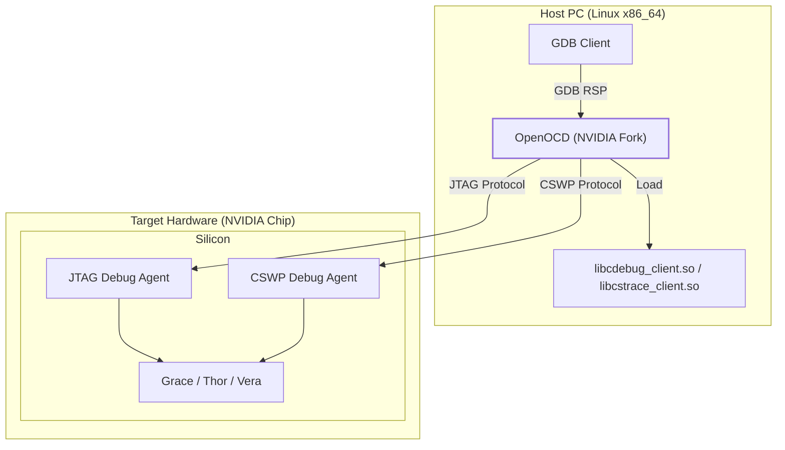
**Sources:** [README.md:9-16](), [README.md:44-46]()

### Build and Deployment
The project is supported on `x86_64` Linux hosts, specifically targeting distributions like Ubuntu 18.04+, CentOS 7+, and Rocky Linux 8+ [README.md:48-51](). While a standard Autotools build process is used, specific configurations are required to enable advanced features like CoreSight Wire Protocol (CSWP) support [README.md:25-46]().

Key build artifacts for NVIDIA-specific features include:
*   `libcdebug_client.so`: Core debug client library [README.md:45-45]().
*   `libcstrace_client.so`: Core trace client library [README.md:45-45]().

For step-by-step instructions on environment setup and compilation, see [Getting Started: Build and Installation](#1.2).

### Repository Structure Mapping
The following diagram maps the repository's logical functions to its physical branch and file structure.

**Figure 2: Codebase Organization**
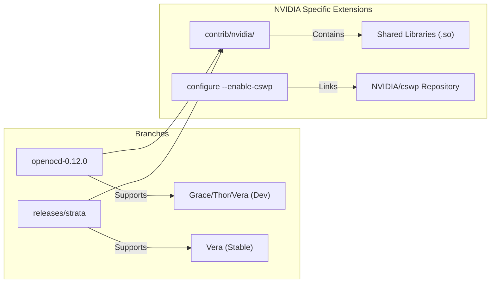
**Sources:** [README.md:11-13](), [README.md:34-46]()

### Licensing
While the work is based on the Open Source OpenOCD project, it is released under the **GPLv2 License** with specific exceptions [README.md:59-60](). Users should consult the `LICENSE.md` file in the root and the specific `LICENSES` files within each branch for full details [LICENSE.md:4-7]().

**Sources:**
- [README.md:4-16]() (Hardware support and purpose)
- [README.md:25-46]() (Build process and CSWP)
- [README.md:48-51]() (OS Requirements)
- [README.md:59-60]() (Licensing)
- [LICENSE.md:1-11]() (Derivative work statement)

---

# Page: Supported Hardware and Branch Structure

# Supported Hardware and Branch Structure

<details>
<summary>Relevant source files</summary>

The following files were used as context for generating this wiki page:

- [README.md](README.md)

</details>


This page provides a detailed breakdown of the NVIDIA hardware supported by this OpenOCD fork and the organizational structure of the Git repository. NVIDIA utilizes OpenOCD as a GDB server to translate high-level debug commands into hardware-level requests for integrated debug agents.

## Supported Hardware Platforms

NVIDIA's fork of OpenOCD is specifically modified to interface with the internal debug architecture of several NVIDIA chips. These chips utilize either standard JTAG or the CoreSight Wire Protocol (CSWP) for transport [README.md:14-16]().

### Hardware Matrix
The following table maps NVIDIA silicon to the supporting branches within this repository:

| Chip Name | Target Architecture | Primary Branch | Status |
| :--- | :--- | :--- | :--- |
| **Grace** | ARM Neoverse | `openocd-0.12.0` | Active [README.md:11-11]() |
| **Thor** | Tegra Next | `openocd-0.12.0` | Active [README.md:12-12]() |
| **Vera** | Data Center / Automotive | `releases/strata` | Stable [README.md:13-13]() |
| **Vera** | Data Center / Automotive | `openocd-0.12.0` | Development [README.md:13-13]() |

**Sources:**
- [README.md:10-13]()

---

## Branching Strategy and Infrastructure

The repository is organized to separate stable releases from ongoing development and specific platform features. 

### Branch Definitions
1.  **`openocd-0.12.0`**: This is the main development branch. It serves as the primary integration point for Grace and Thor support, as well as the active development branch for Vera [README.md:11-13]().
2.  **`releases/strata`**: This branch contains the stable production code specifically validated for Vera platforms [README.md:13-13]().

### Data Flow: GDB to Hardware
OpenOCD acts as an intermediary layer. It receives GDB Remote Serial Protocol (RSP) packets and translates them into sequences of JTAG or CSWP operations that the on-chip debug agents understand.

#### Debug Request Pipeline
The following diagram illustrates the relationship between the OpenOCD software layers and the NVIDIA hardware components.

**Figure 1: Debug Translation Architecture**
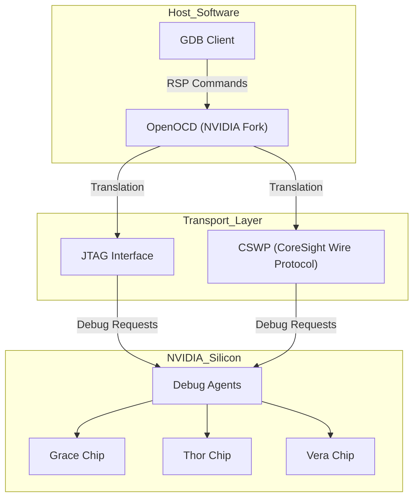

**Sources:**
- [README.md:14-16]()

---

## CSWP and External Dependencies

For modern NVIDIA chips, standard JTAG is often augmented or replaced by the CoreSight Wire Protocol (CSWP). Support for this is not built-in by default and requires linking against external NVIDIA libraries.

### Library Dependencies
When building with `--enable-cswp`, OpenOCD interacts with two critical shared objects:
*   `libcdebug_client.so`: Handles the client-side debug logic for CSWP [README.md:45-45]().
*   `libcstrace_client.so`: Manages trace data acquisition over the CSWP transport [README.md:45-45]().

These libraries must be placed in the `contrib/nvidia` directory within the installation prefix for the runtime to locate them correctly [README.md:44-46]().

**Figure 2: CSWP Integration Logic**
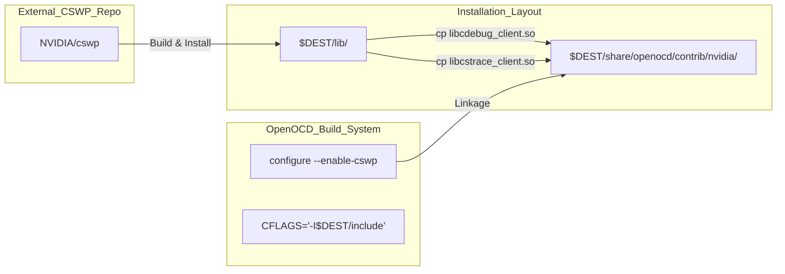

**Sources:**
- [README.md:34-46]()

---

## Host and OS Compatibility

NVIDIA's OpenOCD modifications are targeted primarily at Linux environments used in data center and automotive development.

*   **Host Architecture:** x86_64 Linux only [README.md:49-49]().
*   **Tested Distributions:** 
    *   Ubuntu 18.04+ [README.md:49-51]()
    *   CentOS 7+ [README.md:49-51]()
    *   Rocky Linux 8+ [README.md:49-51]()
    *   OpenBMC (Targeted for server management controllers) [README.md:51-51]()

**Sources:**
- [README.md:48-51]()

---

# Page: Getting Started: Build and Installation

# Getting Started: Build and Installation

<details>
<summary>Relevant source files</summary>

The following files were used as context for generating this wiki page:

- [README.md](README.md)
- [print_env.sh](print_env.sh)

</details>


This page provides a technical guide for building and installing NVIDIA's fork of OpenOCD. It covers the standard Autotools-based build process, the specialized CoreSight Wire Protocol (CSWP) integration, and the environment configuration required for successful deployment on supported Linux hosts.

## Host Requirements and Environment

Building and running NVIDIA's OpenOCD fork is strictly supported on **x86_64 Linux** hosts [README.md:49-50](). The build system relies on standard GNU Autotools and requires specific environment variables to be set for both compilation and runtime library discovery.

### Supported Operating Systems
*   **Ubuntu:** 18.04+ [README.md:49-51]()
*   **CentOS:** 7+ [README.md:49-51]()
*   **Rocky Linux:** 8+ [README.md:49-51]()
*   **OpenBMC:** Supported for execution [README.md:51-51]()

### Critical Environment Variables
The following variables are used during the build process and should be tracked for diagnostic purposes using the `print_env.sh` utility [print_env.sh:45-53]().

| Variable | Role |
| :--- | :--- |
| `DEST` | The installation prefix directory (used in `--prefix`). |
| `PATH` | Must include the path to `gcc`, `g++`, and `bootstrap` dependencies. |
| `LD_LIBRARY_PATH` | Required for locating shared objects like `libcdebug_client.so`. |
| `CFLAGS` | Used to point to CSWP headers: `-I$DEST/include`. |

**Sources:** [README.md:48-52](), [print_env.sh:45-53]()

---

## Standard Build Process

The standard build uses the `bootstrap` script to generate the configuration files, followed by a standard `configure` and `make` cycle.

### Implementation Flow: Standard Autotools
The following diagram illustrates the data flow from the source repository to the installed binaries.

**Standard Build Pipeline**
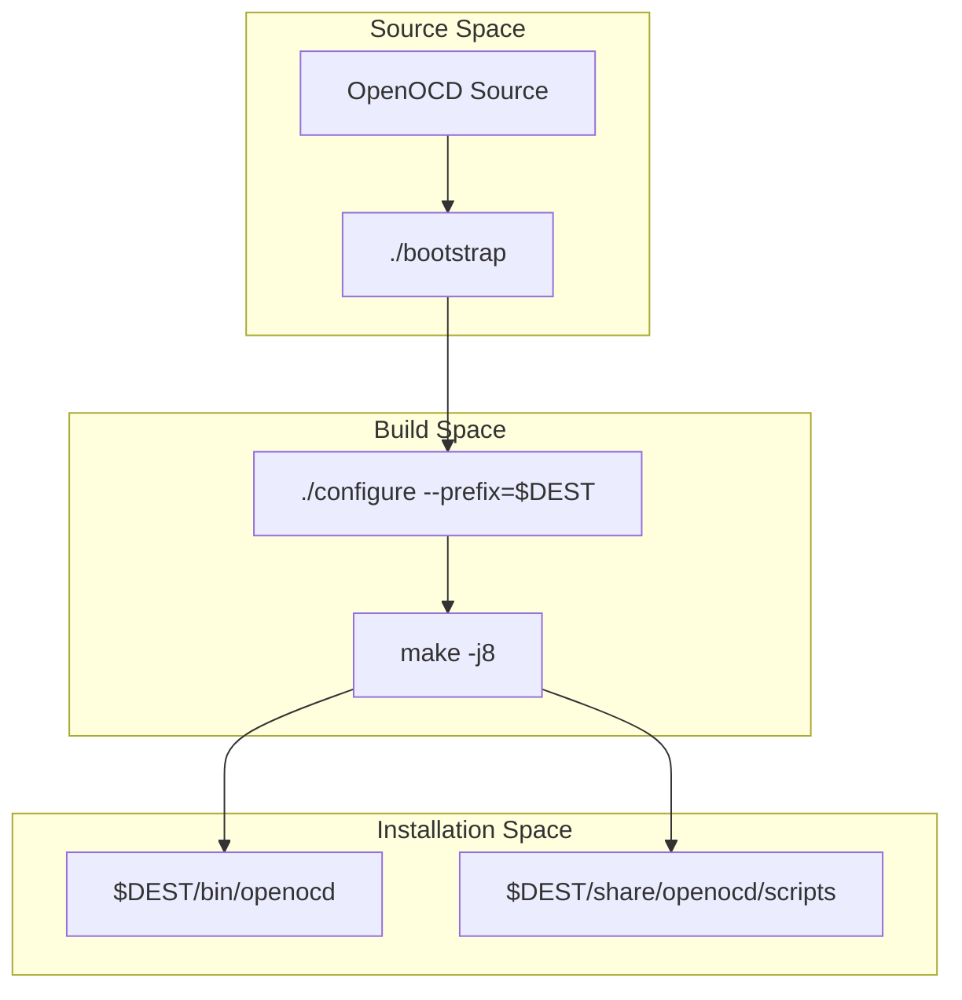

**Steps:**
1.  **Bootstrap:** Run `./bootstrap` to generate the `configure` script [README.md:28-28]().
2.  **Configure:** Initialize the build directory and set the installation prefix [README.md:29-31]().
3.  **Compile & Install:** Execute `make install` to build the binary and deploy it to the `$DEST` path [README.md:32-32]().

**Sources:** [README.md:27-33]()

---

## CSWP-Enabled Build

For hardware targeting Grace, Thor, or Vera chips via the CoreSight Wire Protocol, OpenOCD must be linked against NVIDIA's CSWP libraries. This requires a two-stage build process: first building the CSWP client libraries, then building OpenOCD with those libraries enabled.

### CSWP Integration Logic
The CSWP integration relies on `libcdebug_client.so` and `libcstrace_client.so`. These must be manually placed in a specific subdirectory within the OpenOCD installation tree to be correctly utilized by NVIDIA-specific scripts.

**CSWP Component Mapping**
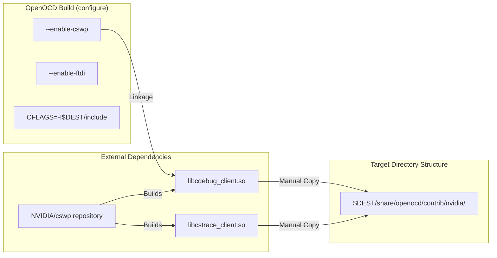

### Build Instructions
To enable CSWP support, follow these steps [README.md:34-46]():

1.  **Build CSWP:** Clone the [CSWP repository](https://github.com/NVIDIA/cswp) and install it to `$DEST` [README.md:35-36]().
2.  **Configure OpenOCD:** Run configure with the `--enable-cswp` flag and point to the CSWP include directory [README.md:42-42]().
    ```bash
    ../configure --prefix=$DEST --enable-cswp --enable-ftdi CFLAGS="-I$DEST/include"
    ```
3.  **Post-Install Library Setup:** OpenOCD expects the NVIDIA-specific libraries in the `contrib/nvidia` subdirectory [README.md:44-45]().
    ```bash
    mkdir -p $DEST/share/openocd/contrib/nvidia
    cp $DEST/lib/libcdebug_client.so $DEST/lib/libcstrace_client.so $DEST/share/openocd/contrib/nvidia/
    ```

**Sources:** [README.md:34-46]()

---

## Diagnostics and Environment Verification

The repository includes a utility script, `print_env.sh`, to help diagnose build failures or runtime issues by capturing the state of the host system.

### `print_env.sh` Functions
This script gathers the following technical metadata:
*   **Git State:** Current branch, commit hash, and recursive submodule status [print_env.sh:10-14]().
*   **Toolchain Versions:** Versions for `cmake`, `gcc`, `g++`, and `python` [print_env.sh:29-43]().
*   **OS/Hardware:** Detailed `/etc/*-release` info, kernel version (`uname -a`), and CPU architecture (`lscpu`) [print_env.sh:20-27]().
*   **Python Environment:** Lists all installed `pip` packages [print_env.sh:57-63]().

The output is formatted in HTML `<details>` tags for easy inclusion in GitHub issues [print_env.sh:66-71]().

**Sources:** [print_env.sh:1-72]()

---

# Page: Architecture and Key Concepts

# Architecture and Key Concepts

<details>
<summary>Relevant source files</summary>

The following files were used as context for generating this wiki page:

- [README.md](README.md)

</details>


This page provides a high-level overview of the system architecture for NVIDIA's fork of OpenOCD. It describes how the software functions as a bridge between standard debuggers (like GDB) and NVIDIA-specific hardware targets such as Grace, Thor, and Vera.

## System Role and GDB Server

NVIDIA's OpenOCD fork primarily functions as a **GDB Server**. It abstracts the complexities of hardware-level debug protocols, allowing developers to use standard GNU Debugger (GDB) commands to inspect and control NVIDIA chips [README.md:14-16]().

The system operates by:
1.  Listening for GDB Remote Serial Protocol (RSP) commands.
2.  Translating these commands into hardware-specific debug requests.
3.  Routing these requests through a selected transport layer (JTAG or CSWP).
4.  Interacting with on-chip debug agents built into NVIDIA silicon [README.md:14-16]().

### High-Level Component Interaction

The following diagram illustrates the flow from the user's debug client through the OpenOCD translation layers to the hardware.

**Diagram: Debug Command Flow**
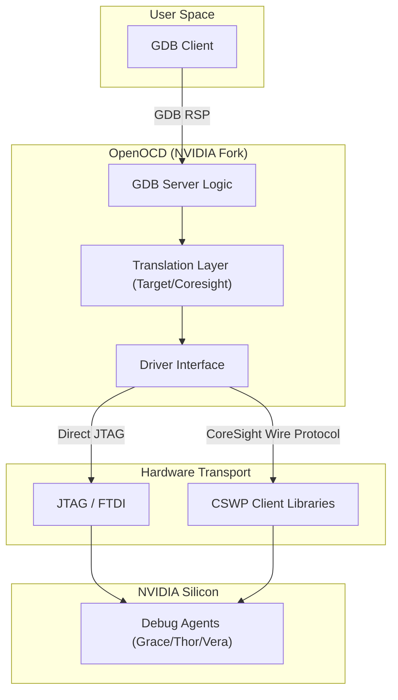
**Sources:** [README.md:9-16]()

## Debug Translation Pipeline

The translation pipeline is responsible for converting high-level debug operations (like "read memory" or "halt processor") into the specific sequences required by NVIDIA's on-chip debug architecture. Depending on the branch used (e.g., `openocd-0.12.0` for Grace/Thor or `releases/strata` for Vera), OpenOCD utilizes different target configurations to communicate with these agents [README.md:11-13]().

Key aspects of the pipeline include:
*   **Target Abstraction:** Mapping GDB register sets to hardware-specific registers.
*   **Protocol Conversion:** Converting software breakpoints into hardware watchpoints or instruction breaks.
*   **Transport Selection:** Determining whether to use traditional JTAG or the NVIDIA CoreSight Wire Protocol (CSWP).

For a detailed breakdown of how data moves through these layers, see [Debug Communication Pipeline](#2.1).

**Sources:** [README.md:11-16]()

## CSWP Integration and External Libraries

A significant feature of this fork is the integration of the **CoreSight Wire Protocol (CSWP)**. This allows for high-performance debugging and tracing over specialized NVIDIA interfaces. Unlike standard OpenOCD, which often relies solely on JTAG, this version can link against external NVIDIA libraries to handle complex wire protocols [README.md:34-46]().

### Integration Components
When built with CSWP support (`--enable-cswp`), OpenOCD interacts with external shared objects located in the `contrib/nvidia` directory:
*   `libcdebug_client.so`: Handles debug control operations [README.md:45-46]().
*   `libcstrace_client.so`: Manages trace data acquisition [README.md:45-46]().

The following diagram shows the relationship between the OpenOCD build process and these external dependencies.

**Diagram: CSWP Dependency Mapping**
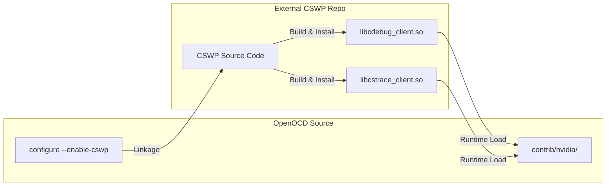

For instructions on building and linking these libraries, see [CSWP Integration and External Libraries](#2.2).

**Sources:** [README.md:34-46]()

---

# Page: Debug Communication Pipeline

# Debug Communication Pipeline

<details>
<summary>Relevant source files</summary>

The following files were used as context for generating this wiki page:

- [README.md](README.md)

</details>


The Debug Communication Pipeline in NVIDIA's fork of OpenOCD facilitates the end-to-end flow of debug information from a high-level debugger (like GDB) to the physical silicon. This pipeline transforms abstract debugging operations (such as "read memory" or "set breakpoint") into protocol-specific packets that navigate through OpenOCD's internal layers and eventually reach on-chip debug agents via JTAG or the CoreSight Wire Protocol (CSWP) [README.md:14-16]().

## Pipeline Overview

The pipeline operates as a translation stack. At the top, the GDB Server module listens for incoming Remote Serial Protocol (RSP) packets. These packets are parsed and translated into target-agnostic debug commands. These commands are then routed through a target-specific layer (e.g., for Grace, Thor, or Vera chips) which ultimately dispatches them to the hardware interface [README.md:9-16]().

### Data Flow Architecture

The following diagram illustrates the path a debug request takes from the developer's workstation to the NVIDIA hardware.

**Figure 1: End-to-End Debug Request Flow**
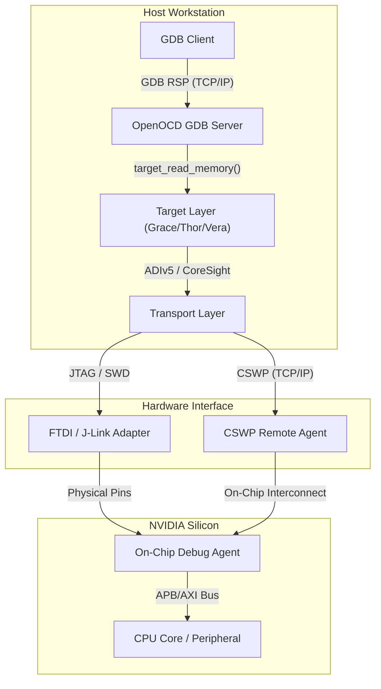
**Sources:** [README.md:9-16](), [README.md:34-46]()

## Protocol Translation Layers

### 1. GDB RSP to OpenOCD Command
The pipeline begins when a GDB client connects to OpenOCD. OpenOCD acts as a GDB server, interpreting the GDB Remote Serial Protocol (RSP) [README.md:14-15](). For example, a GDB `$m` packet (memory read) is received by the server and converted into a call to the internal OpenOCD function `target_read_memory()`.

### 2. Target-Specific Translation
NVIDIA chips like Grace, Thor, and Vera utilize specific debug architectures. Depending on the branch used (`openocd-0.12.0` or `releases/strata`), the target layer handles the specific register maps and power-up sequences required for these chips [README.md:11-13]().

### 3. Transport Selection (JTAG vs. CSWP)
OpenOCD selects the transport mechanism based on the configuration:
*   **JTAG Transport:** Standard bit-banging or high-speed USB-to-JTAG adapters (like FTDI) communicate directly with the chip's TAP controller [README.md:16]().
*   **CSWP Transport:** When `--enable-cswp` is used, the pipeline integrates with `libcdebug_client.so` [README.md:34-45](). This allows debug commands to be encapsulated in the CoreSight Wire Protocol, which can be sent over Ethernet to a remote debug agent on the target system (e.g., an OpenBMC controller) [README.md:44-51]().

## Code Entity Mapping

The following diagram maps the logical pipeline stages to specific code entities and libraries within the NVIDIA OpenOCD ecosystem.

**Figure 2: Pipeline Entity Mapping**
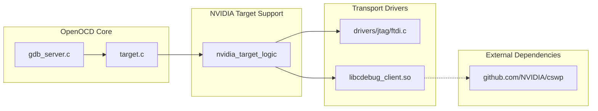
**Sources:** [README.md:11-16](), [README.md:34-46]()

## Hardware Reachability

The final stage of the pipeline involves the on-chip debug agents. These agents are hardware blocks within the NVIDIA silicon that have master access to the internal buses (like APB or AXI).

| Component | Role in Pipeline | Hardware Interface |
| :--- | :--- | :--- |
| **GDB Server** | Protocol Entry Point | TCP Port 3333 |
| **Target Layer** | NVIDIA-specific logic | Software Abstraction |
| **FTDI Driver** | Physical Transport (JTAG) | USB to JTAG Pins [README.md:42]() |
| **CSWP Client** | Remote Transport (Network) | `libcdebug_client.so` [README.md:45]() |
| **Debug Agent** | On-chip Execution | Silicon Interconnect [README.md:15]() |

### CSWP Pipeline Specifics
When utilizing the CSWP-enabled pipeline, the data flow includes an additional library hop. The OpenOCD binary links against NVIDIA's `libcdebug_client.so` and `libcstrace_client.so`, which are typically installed in `contrib/nvidia` within the OpenOCD prefix [README.md:44-46](). This allows the pipeline to bypass physical JTAG pins and use a network-based debug path, which is critical for debugging systems where physical JTAG access is restricted or unavailable [README.md:49-51]().

**Sources:**
* [README.md:9-16]() (Overview of chips and GDB server role)
* [README.md:34-46]() (CSWP build and library integration)
* [README.md:49-51]() (Host and OS requirements)

---

# Page: CSWP Integration and External Libraries

# CSWP Integration and External Libraries

<details>
<summary>Relevant source files</summary>

The following files were used as context for generating this wiki page:

- [README.md](README.md)

</details>


The CoreSight Wire Protocol (CSWP) subsystem allows OpenOCD to communicate with NVIDIA debug agents via a specialized protocol rather than traditional JTAG. This integration relies on external libraries provided by the NVIDIA CSWP project, which are loaded by OpenOCD at runtime to facilitate debug and trace operations on chips like Grace, Thor, and Vera.

## CSWP Architecture Overview

The CSWP integration functions as a transport layer between OpenOCD's core and the hardware debug agents. Instead of direct bit-banging or JTAG controller manipulation, OpenOCD interfaces with a client library that abstracts the wire protocol.

### Data Flow and Component Interaction

The following diagram illustrates how OpenOCD utilizes external CSWP libraries to bridge GDB commands to NVIDIA hardware.

**Diagram: CSWP Debug Pipeline**
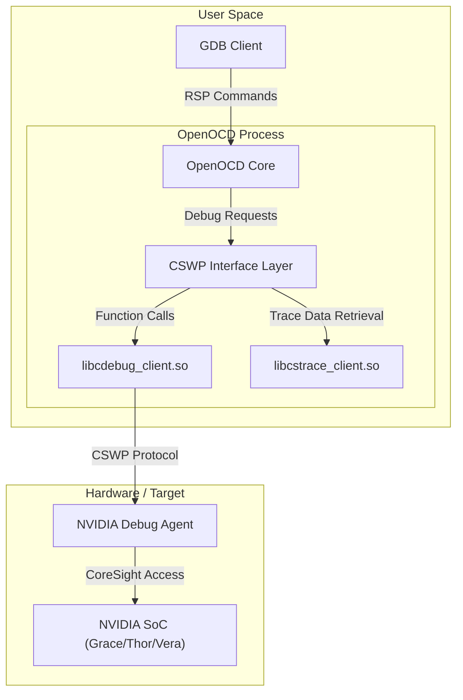
**Sources:** [README.md:8-16](), [README.md:34-46]()

## Building with CSWP Support

To enable CSWP functionality, OpenOCD must be configured with specific flags and linked against the CSWP headers. This process requires a pre-built installation of the CSWP repository.

### Build Requirements
1.  **CSWP Repository:** Must be cloned from `https://github.com/NVIDIA/cswp`.
2.  **Installation Prefix:** A shared `$DEST` directory where both CSWP and OpenOCD will reside.
3.  **Compiler Flags:** The build system must be pointed to the CSWP include directory via `CFLAGS`.

### Build Sequence
The build process follows these steps to ensure the CSWP headers are available during the OpenOCD compilation phase:

| Step | Command | Purpose |
| :--- | :--- | :--- |
| 1 | `../configure --prefix=$DEST --enable-cswp ...` | Enables CSWP feature macros in the source [README.md:42-42]() |
| 2 | `CFLAGS="-I$DEST/include"` | Provides paths to CSWP client headers [README.md:42-42]() |
| 3 | `make install` | Compiles OpenOCD and installs binaries [README.md:43-43]() |

**Sources:** [README.md:34-43]()

## External Libraries: libcdebug_client and libcstrace_client

The CSWP integration relies on two primary shared objects that act as the protocol drivers.

### libcdebug_client.so
This library is responsible for the standard debug operations. It translates OpenOCD's internal debug requests (such as memory reads/writes or register access) into CSWP packets compatible with NVIDIA debug agents [README.md:14-16]().

### libcstrace_client.so
This library handles the streaming and decoding of CoreSight trace data. It allows OpenOCD to interface with the hardware trace buffers and export trace streams for analysis [README.md:45-45]().

### Runtime Loading and Contrib Directory
OpenOCD expects these libraries to be located in a specific directory relative to its installation prefix to ensure they can be found at runtime. The standard NVIDIA deployment requires copying these files into the `contrib/nvidia` subdirectory of the OpenOCD share folder.

**Diagram: Library Distribution Path**
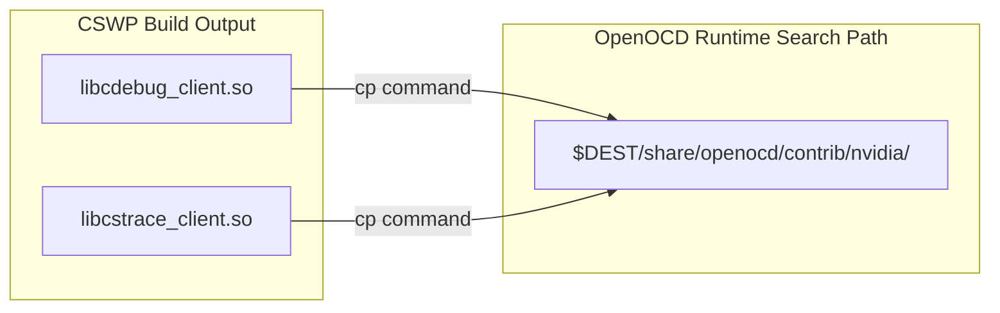
**Sources:** [README.md:44-46]()

## Implementation Details

The integration is toggled via the `--enable-cswp` configure flag. When enabled, OpenOCD incorporates logic to communicate with the CSWP backend.

### Key Integration Points
*   **Transport Selection:** Users can select CSWP as the transport method in their configuration files, which directs OpenOCD to use the CSWP client libraries instead of JTAG drivers [README.md:14-16]().
*   **Hardware Targeting:** This integration is specifically utilized for NVIDIA's Grace, Thor, and Vera chips, where the debug agents are designed to communicate over the CoreSight Wire Protocol [README.md:9-13]().

**Sources:** [README.md:9-16](), [README.md:42-42]()

---

# Page: Contributing to the Project

# Contributing to the Project

<details>
<summary>Relevant source files</summary>

The following files were used as context for generating this wiki page:

- [CLA.md](CLA.md)
- [CODE_OF_CONDUCT.md](CODE_OF_CONDUCT.md)
- [CONTRIBUTING.md](CONTRIBUTING.md)

</details>


This page provides an overview of the contribution pathways for NVIDIA's fork of OpenOCD. We welcome contributions in the form of bug reports, feature requests, documentation improvements, and code submissions. All contributors are expected to adhere to our [Contributor Covenant Code of Conduct](CODE_OF_CONDUCT.md) [CODE_OF_CONDUCT.md:1-85]().

## Contribution Overview

The following diagram illustrates the high-level workflow for contributing to the repository, from initial engagement to code integration.

### Contribution Lifecycle
```mermaid
graph TD
    "User" -- "Identifies Issue" --> "GitHub_Issues"["GitHub Issues"]
    "GitHub_Issues" -- "Bug/Feature/Doc" --> "Triage_Process"["Triage (Tegra Debug Team)"]
    "Triage_Process" -- "Approved" --> "Development"["Development / Branching"]
    "Development" -- "Pull Request" --> "PR_Workflow"["Pull Request Workflow"]
    "PR_Workflow" -- "Verify CLA" --> "CLA_Signing"["CLA.md Signing"]
    "PR_Workflow" -- "Review" --> "CODEOWNERS_Review"["CODEOWNERS Review"]
    "CODEOWNERS_Review" -- "Merge" --> "Main_Branch"["Main Branch"]

    subgraph "Natural Language Space"
    "User"
    "Triage_Process"
    end

    subgraph "Code Entity Space"
    "GitHub_Issues"
    "CLA_Signing"
    "CODEOWNERS_Review"
    end
```
**Sources:** [CONTRIBUTING.md:1-9](), [CLA.md:4-31](), [.github/CODEOWNERS:1-10]()

---

## Reporting Issues

If you encounter a bug, require a new feature, or find an error in the documentation, you should file a GitHub issue using the appropriate template. The **Tegra Debug team** is responsible for evaluating and triaging these submissions [CONTRIBUTING.md:7-9]().

When reporting bugs, it is mandatory to provide diagnostic information to assist in reproduction:
*   **Environment Details**: Run the `print_env.sh` script and include its output in your report [CONTRIBUTING.md:5-6]().
*   **Build Logs**: Provide `config.log` if the issue relates to build or configuration failures.

For a detailed breakdown of issue templates, labels, and the triage lifecycle, see **[Issue Reporting Workflow](#3.1)**.

**Sources:** [CONTRIBUTING.md:1-9](), [print_env.sh:1-20]()

---

## Submitting Code and Pull Requests

Code contributions are managed through GitHub Pull Requests (PRs). Before a PR can be merged, two primary requirements must be met:

1.  **Contribution License Agreement (CLA)**: You must agree to the terms in `CLA.md`. This agreement grants NVIDIA the necessary licenses to distribute your "Submission" (Code and documentation) [CLA.md:4-31](). You must represent that the work is original or explicitly disclose third-party materials [CLA.md:32-39]().
2.  **Technical Review**: PRs are automatically routed to specific reviewers based on the `.github/CODEOWNERS` file.

### Submission Governance
| Requirement | Entity/File | Purpose |
| :--- | :--- | :--- |
| **Licensing** | [CLA.md:1-120]() | Defines rights for Code and Submissions. |
| **Conduct** | [CODE_OF_CONDUCT.md:1-85]() | Defines standards for professional interaction. |
| **Reviewers** | [.github/CODEOWNERS:1-10]() | Automates assignment of Tegra Debug team members. |

For details on PR templates, the signing process for the CLA, and automated review routing, see **[Pull Request Process and Contribution License Agreement](#3.2)**.

**Sources:** [CLA.md:4-69](), [CODE_OF_CONDUCT.md:42-53](), [CONTRIBUTING.md:1-11]()

---

## Standards and Conduct

NVIDIA maintains a professional environment for all contributors. The **Project Maintainers** have the authority to remove or reject any contribution (comments, commits, or code) that violates the standards defined in the Code of Conduct [CODE_OF_CONDUCT.md:43-52]().

*   **Positive Behavior**: Inclusive language, respectful viewpoints, and focusing on community benefit [CODE_OF_CONDUCT.md:21-29]().
*   **Enforcement**: Unacceptable behavior can be reported to `GitHub_Conduct@nvidia.com` [CODE_OF_CONDUCT.md:63-70]().

**Sources:** [CODE_OF_CONDUCT.md:1-85]()

---

# Page: Issue Reporting Workflow

# Issue Reporting Workflow

<details>
<summary>Relevant source files</summary>

The following files were used as context for generating this wiki page:

- [.github/ISSUE_TEMPLATE/bug_report.md](.github/ISSUE_TEMPLATE/bug_report.md)
- [.github/ISSUE_TEMPLATE/documentation-request.md](.github/ISSUE_TEMPLATE/documentation-request.md)
- [.github/ISSUE_TEMPLATE/feature_request.md](.github/ISSUE_TEMPLATE/feature_request.md)
- [.github/ISSUE_TEMPLATE/submit-question.md](.github/ISSUE_TEMPLATE/submit-question.md)
- [CONTRIBUTING.md](CONTRIBUTING.md)
- [print_env.sh](print_env.sh)

</details>


The NVIDIA OpenOCD repository utilizes a structured issue reporting workflow to manage bugs, feature requests, and documentation improvements. This process ensures that the Tegra Debug team has the necessary diagnostic information to reproduce issues and schedule them for release.

## Issue Templates and Label Taxonomy

All new issues are initiated via the GitHub issue chooser `[CONTRIBUTING.md:3-4]()`. The repository defines four specific templates, each associated with a unique title prefix and a set of initial labels.

### 1. Bug Report
*   **Title Prefix:** `[BUG]` `[.github/ISSUE_TEMPLATE/bug_report.md:4-4]()`
*   **Initial Labels:** `? - Needs Triage`, `bug` `[.github/ISSUE_TEMPLATE/bug_report.md:5-5]()`
*   **Requirement:** Requires a minimal reproduction case and the output of `print_env.sh` `[.github/ISSUE_TEMPLATE/bug_report.md:13-21]()`.

### 2. Feature Request
*   **Title Prefix:** `[FEA]` `[.github/ISSUE_TEMPLATE/feature_request.md:4-4]()`
*   **Initial Labels:** `? - Needs Triage`, `feature request` `[.github/ISSUE_TEMPLATE/feature_request.md:5-5]()`
*   **Requirement:** Must describe the problem being solved and any alternative solutions considered `[.github/ISSUE_TEMPLATE/feature_request.md:10-17]()`.

### 3. Documentation Request
*   **Title Prefix:** `[DOC]` `[.github/ISSUE_TEMPLATE/documentation-request.md:4-4]()`
*   **Initial Labels:** `? - Needs Triage`, `doc` `[.github/ISSUE_TEMPLATE/documentation-request.md:5-5]()`
*   **Requirement:** Covers both incorrect documentation (requiring links and line numbers) and needed documentation (requiring a description of the missing content) `[.github/ISSUE_TEMPLATE/documentation-request.md:13-36]()`.

### 4. Submit Question
*   **Title Prefix:** `[QST]` `[.github/ISSUE_TEMPLATE/submit-question.md:4-4]()`
*   **Initial Labels:** `? - Needs Triage`, `question` `[.github/ISSUE_TEMPLATE/submit-question.md:5-5]()`

### Data Flow: From Template to Triage
The following diagram illustrates how user input is transformed into a structured GitHub issue.

**Issue Initialization Pipeline**
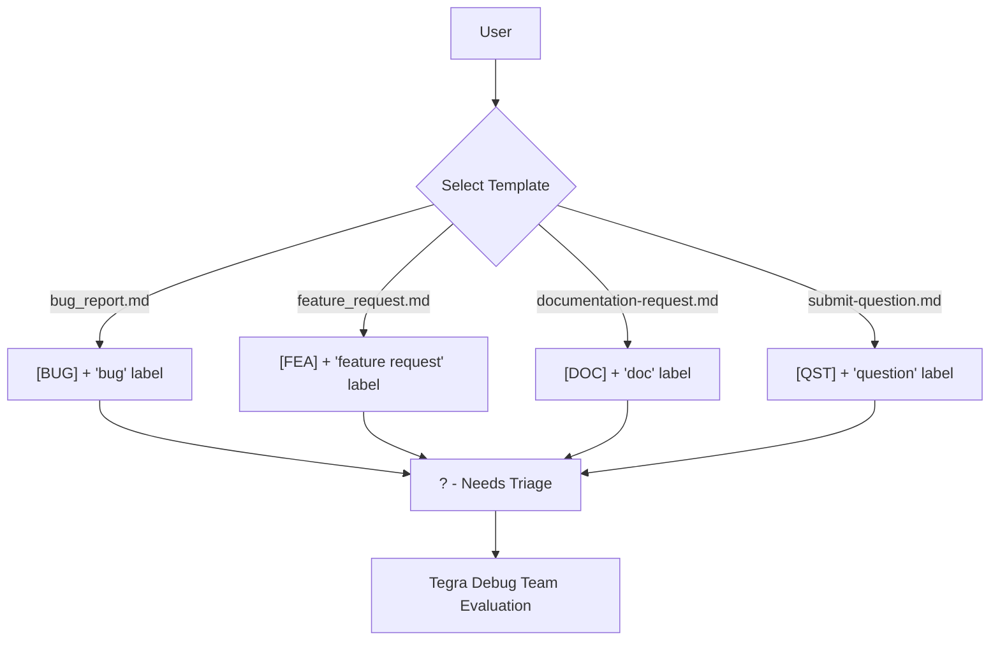
**Sources:** `[.github/ISSUE_TEMPLATE/bug_report.md:1-8]()`, `[.github/ISSUE_TEMPLATE/feature_request.md:1-8]()`, `[.github/ISSUE_TEMPLATE/documentation-request.md:1-8]()`, `[.github/ISSUE_TEMPLATE/submit-question.md:1-8]()`, `[CONTRIBUTING.md:7-9]()`

---

## Diagnostic Tools

For technical issues, particularly bugs and build failures, specific diagnostic data is required.

### print_env.sh
The `print_env.sh` script is a bash utility located in the project root `[print_env.sh:1-1]()`. It aggregates environment metadata into a format suitable for pasting directly into a GitHub issue using `<details>` and `<pre>` tags `[print_env.sh:66-71]()`.

Key data points collected by `print_env()` `[print_env.sh:9-64]()`:
*   **Git State:** Current commit (`git log`) and submodule status `[print_env.sh:10-14]()`.
*   **OS/Kernel:** Distribution info from `/etc/*-release` and `uname -a` `[print_env.sh:20-22]()`.
*   **Toolchain Versions:** `cmake`, `g++`, `gcc`, and `python` `[print_env.sh:29-42]()`.
*   **Environment Variables:** `PATH`, `LD_LIBRARY_PATH`, and `PYTHON_PATH` `[print_env.sh:47-51]()`.
*   **Python Packages:** A full list of installed `pip` packages `[print_env.sh:57-63]()`.

### Build Diagnostics
If the issue is related to the build process, users must provide:
1.  `config.log`: Generated by the Autotools `configure` script `[.github/ISSUE_TEMPLATE/bug_report.md:21-21]()`.
2.  Build logs: The stdout/stderr output from the `make` or `ninja` execution `[.github/ISSUE_TEMPLATE/bug_report.md:21-21]()`.

---

## Triage Lifecycle

The "Tegra Debug team" is responsible for the lifecycle of an issue from submission to resolution `[CONTRIBUTING.md:7-9]()`.

| State | Action |
| :--- | :--- |
| **New** | Issue is created with the `? - Needs Triage` label. |
| **Evaluation** | Team reviews the `print_env.sh` output and reproduction steps. |
| **Prioritization** | Team may move the issue to a release schedule. Users can request priority by commenting on the issue `[CONTRIBUTING.md:8-9]()`. |
| **Resolution** | The issue is linked to a Pull Request or closed as "Fixed" or "Won't Fix". |

### Relationship Between Issues and Code Entities
This diagram maps the diagnostic requirements to the system components they investigate.

**Diagnostic Mapping**
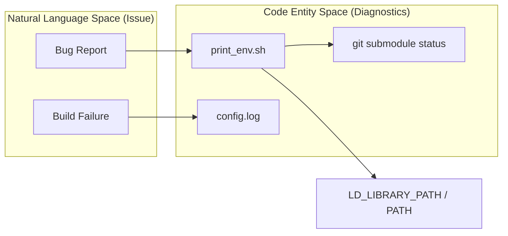
**Sources:** `[print_env.sh:9-64]()`, `[.github/ISSUE_TEMPLATE/bug_report.md:19-21]()`, `[CONTRIBUTING.md:5-6]()`

---

## Legal and Conduct Compliance
By submitting any issue (Bug, Feature, Doc, or Question), the reporter agrees to:
1.  **Code of Conduct:** Located at `CODE_OF_CONDUCT.md` `[.github/ISSUE_TEMPLATE/bug_report.md:27-27]()`.
2.  **Contributing Guidelines:** Located at `CONTRIBUTING.md` `[.github/ISSUE_TEMPLATE/bug_report.md:27-27]()`.

**Sources:**
*   `[.github/ISSUE_TEMPLATE/bug_report.md:1-28]()`
*   `[.github/ISSUE_TEMPLATE/feature_request.md:1-24]()`
*   `[.github/ISSUE_TEMPLATE/documentation-request.md:1-43]()`
*   `[.github/ISSUE_TEMPLATE/submit-question.md:1-15]()`
*   `[CONTRIBUTING.md:1-11]()`
*   `[print_env.sh:1-72]()`

---

# Page: Pull Request Process and Contribution License Agreement

# Pull Request Process and Contribution License Agreement

<details>
<summary>Relevant source files</summary>

The following files were used as context for generating this wiki page:

- [.github/CODEOWNERS](.github/CODEOWNERS)
- [.github/PULL_REQUEST_TEMPLATE.md](.github/PULL_REQUEST_TEMPLATE.md)
- [CLA.md](CLA.md)
- [OWNERS](OWNERS)

</details>


This page documents the formal procedures for contributing code to the NVIDIA OpenOCD fork. It covers the requirements for pull request (PR) construction, the legal framework of the Contribution License Agreement (CLA), and the automated review routing mechanisms defined in the repository.

## Pull Request Requirements

To maintain a clean and traceable history, all pull requests must adhere to a specific format defined in the pull request template. This ensures that every change is documented, linked to an issue, and properly attributed in the project's changelog.

### Template Components
The pull request process is governed by the template found in `.github/PULL_REQUEST_TEMPLATE.md` [1-10]().

*   **Standalone Description**: Contributors must provide a clear, independent summary of the changes [1-2]().
*   **Issue Linking**: PRs should reference any issues they resolve using the "closes #1234" syntax [3]().
*   **Changelog Integration**: The title of the pull request is significant because it is automatically included in the `CHANGELOG` [4]().
*   **Mandatory Checklist**: Before submission, contributors must confirm they have reviewed the contributing guidelines, verified test coverage, and updated documentation [6-10]().

### Pull Request Lifecycle Flow

The following diagram illustrates the flow from a contributor's local environment through the GitHub submission process.

**PR Submission and Metadata Flow**

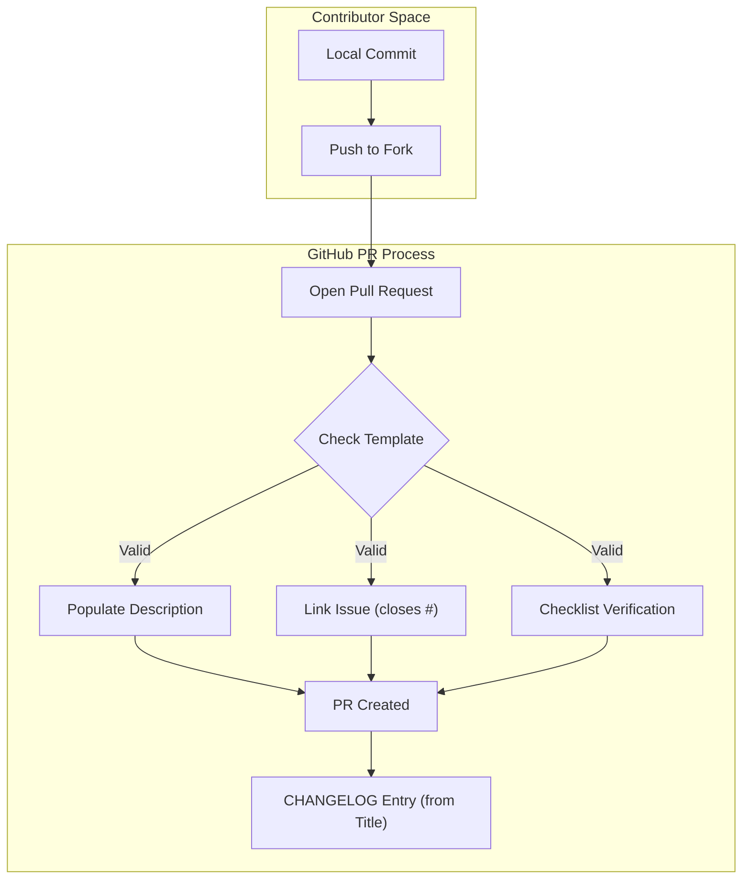

**Sources:**
*   [.github/PULL_REQUEST_TEMPLATE.md:1-10]()

## Contribution License Agreement (CLA)

All contributors must agree to the NVIDIA Contribution License Agreement (CLA) before their submissions can be accepted into any NVIDIA open source project [28-30](). This agreement establishes the legal rights and licenses necessary for NVIDIA to distribute the contributed code.

### Key Legal Provisions
The CLA covers several critical areas:
*   **Definitions**: Defines "Code", "Project", and "Submission" (which includes code, comments, and documentation) [9-26]().
*   **Originality**: The contributor represents that the submission is their original work [32-34](). If third-party materials are included, they must be explicitly identified [35-39]().
*   **Employer Rights**: If the work was performed for an employer, the contributor must secure permission before signing [41-49]().
*   **License Grants**:
    *   **Copyright**: A perpetual, worldwide, non-exclusive, royalty-free, irrevocable license to reproduce and distribute the work [54-58]().
    *   **Patent**: A similar license under the contributor's patent claims that are necessarily infringed by the submission [60-64]().

### Submission Types
The CLA provides two signing options based on the contributor's status:
1.  **Individual**: For those with sole ownership of intellectual property rights [108-116]().
2.  **Corporate/Employer**: For those making submissions in the course of their employment [118]().

**Sources:**
*   [CLA.md:1-118]()

## Review Routing and Ownership

The repository uses automated mechanisms to ensure that pull requests are routed to the appropriate maintainers for review. This is handled through two primary files: `OWNERS` and `.github/CODEOWNERS`.

### CODEOWNERS Mechanism
The GitHub `CODEOWNERS` file is used to automatically assign reviewers based on the file paths modified in a pull request.

*   **Global Ownership**: Currently, the repository defines a global owner for all files (`**`) [1]().
*   **Assigned Reviewer**: `@NVIDIA/rmachet` is designated as the primary owner for the entire codebase [1]().

### OWNERS Directory Management
The `OWNERS` file in the root directory provides a human-readable list of top-level directory owners and additional metadata.

| Role | Entity | Source |
| :--- | :--- | :--- |
| **Primary Owner** | rmachet@nvidia.com | [OWNERS:2]() |
| **Secondary Owner** | sruskamp@nvidia.com | [OWNERS:3]() |

### Code Review Assignment Flow

The following diagram bridges the "Natural Language" requirement of code review to the "Code Entity" implementation of ownership.

**Review Assignment Logic**

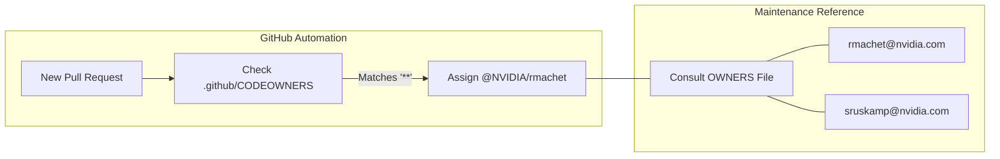

**Sources:**
*   [.github/CODEOWNERS:1-2]()
*   [OWNERS:1-8]()

---

# Page: Repository Governance and Administration

# Repository Governance and Administration

<details>
<summary>Relevant source files</summary>

The following files were used as context for generating this wiki page:

- [.github/CODEOWNERS](.github/CODEOWNERS)
- [CODE_OF_CONDUCT.md](CODE_OF_CONDUCT.md)
- [OWNERS](OWNERS)

</details>


This page provides an overview of the administrative and governing structures for the NVIDIA OpenOCD repository. It covers ownership models, automated project management, security protocols, and community standards. These mechanisms ensure that contributions are reviewed by the correct stakeholders and that the project remains a secure and professional environment for hardware debugging development.

## Ownership and Code Review Routing

Repository authority and review assignments are managed through two primary configuration files. These files define who has the final say on code changes and who is automatically notified when new pull requests are submitted.

*   **Global Ownership**: The `OWNERS` file identifies the primary maintainers responsible for the top-level directory and overall project direction [OWNERS:1-3]().
*   **GitHub Review Routing**: The `.github/CODEOWNERS` file is used by GitHub to automatically assign reviewers to pull requests. Currently, all files in the repository are routed to the primary maintainer [/.github/CODEOWNERS:1-1]().

### Governance Entity Mapping

The following diagram illustrates how administrative files translate to GitHub platform behaviors.

**Diagram: Administrative Configuration to Platform Action**
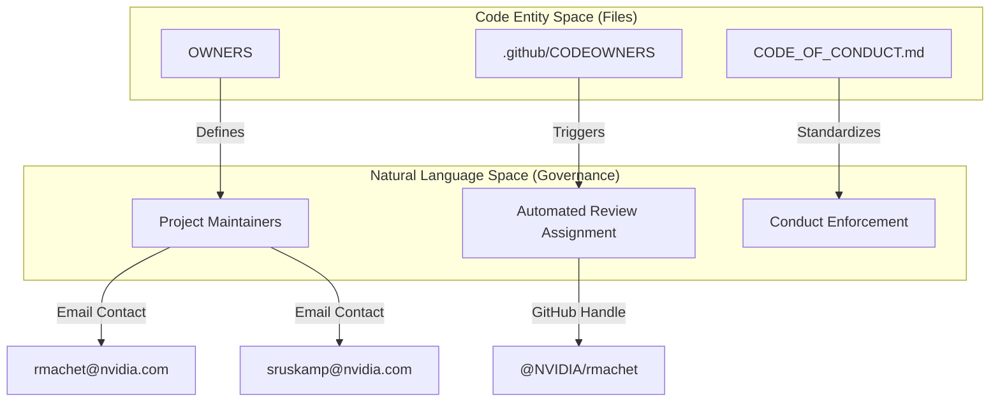
**Sources:** [OWNERS:1-3](), [/.github/CODEOWNERS:1-1](), [CODE_OF_CONDUCT.md:42-46]()

---

## Community Standards

NVIDIA follows the **Contributor Covenant Code of Conduct** (version 1.4) to foster a welcoming and harassment-free environment [CODE_OF_CONDUCT.md:11-18](). 

*   **Responsibilities**: Project maintainers are mandated to clarify standards and take corrective action against unacceptable behavior, including the right to remove or reject contributions not aligned with these standards [CODE_OF_CONDUCT.md:42-53]().
*   **Enforcement**: Instances of abusive or harassing behavior should be reported to `GitHub_Conduct@nvidia.com` [CODE_OF_CONDUCT.md:63-70]().

**Sources:** [CODE_OF_CONDUCT.md:1-81]()

---

## Security Policy

NVIDIA maintains a strict policy regarding the disclosure of security vulnerabilities. To protect users and hardware infrastructure, vulnerabilities must never be reported via public GitHub issues. Instead, they are handled through NVIDIA’s Product Security Incident Response Team (PSIRT).

For detailed information on the reporting process, required data fields, and PGP encryption requirements, see **[Security Vulnerability Reporting](#4.1)**.

---

## GitHub Automation

To manage the high volume of activity in a hardware-focused fork, this repository utilizes GitHub Actions to automate project management tasks. This ensures that every issue and pull request is tracked on the NVIDIA project boards without manual intervention.

### Project Board Workflows
The automation layer consists of two primary workflows:
1.  **Standard Automation**: Adds new issues to the project board.
2.  **Raw Automation**: Handles specific event types to ensure comprehensive coverage.

For details on the workflow implementations and the security implications of using `pull_request_target`, see **[GitHub Automation: Project Board Workflows](#4.2)**.

**Diagram: Automation Logic Flow**
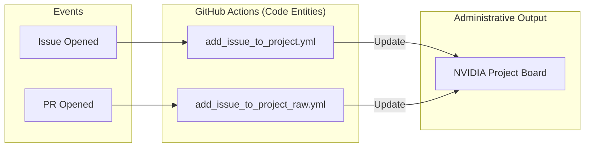
**Sources:** [Overview: Section 4.2]()

---

# Page: Security Vulnerability Reporting

# Security Vulnerability Reporting

<details>
<summary>Relevant source files</summary>

The following files were used as context for generating this wiki page:

- [SECURITY.md](SECURITY.md)

</details>


This page outlines the protocols for identifying, reporting, and resolving security vulnerabilities within the NVIDIA OpenOCD repository. NVIDIA follows a Coordinated Vulnerability Disclosure (CVD) policy to ensure that security flaws are addressed in a manner that minimizes risk to the user base and the broader ecosystem.

## Policy Overview

NVIDIA is committed to maintaining the security and trust of its software products, including source code repositories like OpenOCD [SECURITY.md:1-3](). To protect users, NVIDIA requires that all potential security vulnerabilities be reported through private, dedicated channels rather than public-facing platforms.

### Prohibition on Public Disclosure
The use of GitHub Issues or Pull Requests for reporting security vulnerabilities is strictly prohibited [SECURITY.md:5-5](). 

*   **Public Redaction:** If a security issue is inadvertently posted to a public GitHub issue or pull request, NVIDIA maintainers reserve the right to limit public discussion and hide or delete comments to prevent exploitation [SECURITY.md:5-5]().
*   **Redirection:** Reporters will be immediately redirected to the private Product Security Incident Response Team (PSIRT) channels [SECURITY.md:5-5]().

## PSIRT Intake Process

The NVIDIA Product Security Incident Response Team (PSIRT) is the centralized body responsible for receiving, investigating, and coordinating the response to security vulnerability reports [SECURITY.md:20-20]().

### Submission Channels
There are two primary methods for submitting a report to the PSIRT:

1.  **Web Submission:** Reporters can use the official [Security Vulnerability Submission Form](https://www.nvidia.com/object/submit-security-vulnerability.html) [SECURITY.md:10-10]().
2.  **Encrypted Email:** Reports can be sent directly to `psirt@nvidia.com` [SECURITY.md:11-11]().

### Secure Communication (PGP)
For email submissions, NVIDIA encourages the use of PGP encryption to protect sensitive vulnerability details and exploit code during transit [SECURITY.md:12-12]().
*   **PGP Key:** The public PGP key for NVIDIA PSIRT is available at [https://www.nvidia.com/en-us/security/pgp-key](https://www.nvidia.com/en-us/security/pgp-key) [SECURITY.md:12-12]().

## Required Report Fields

To facilitate a rapid technical assessment, every submission must include specific technical details regarding the OpenOCD environment and the nature of the flaw.

| Field | Description |
| :--- | :--- |
| **Product/Branch** | The specific branch (e.g., `openocd-0.12.0` or `releases/strata`) and version containing the flaw [SECURITY.md:14-14](). |
| **Vulnerability Type** | Classification of the bug (e.g., Buffer Overflow, Denial of Service, Remote Code Execution) [SECURITY.md:15-15](). |
| **Reproduction Steps** | Step-by-step instructions to trigger the vulnerability in the OpenOCD environment [SECURITY.md:16-16](). |
| **Proof-of-Concept** | Exploit code or scripts demonstrating the impact [SECURITY.md:17-17](). |
| **Impact Analysis** | Description of how an attacker could exploit the flaw and the potential consequences [SECURITY.md:18-18](). |

**Sources:** [SECURITY.md:13-18]()

## Vulnerability Lifecycle and Acknowledgement

NVIDIA coordinates the remediation of security issues under its official PSIRT policies.

### Data Flow: Vulnerability Intake to Resolution

The following diagram illustrates the flow of a security report from the external researcher to the internal engineering teams.

**Vulnerability Reporting Pipeline**
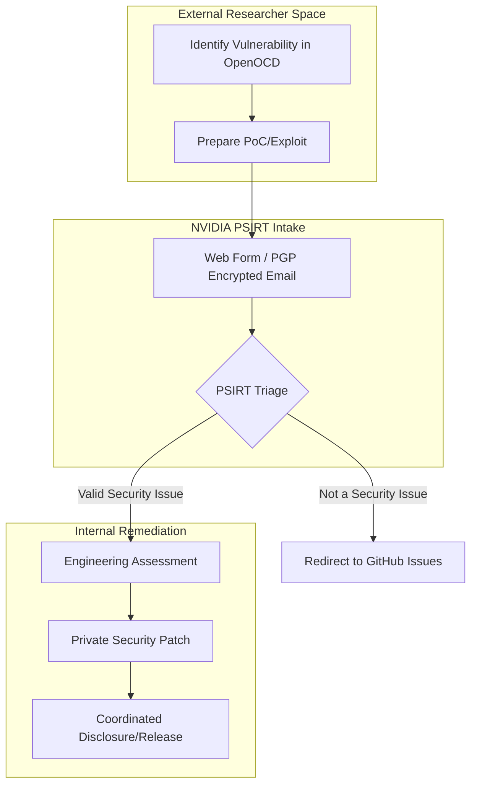
**Sources:** [SECURITY.md:5-20]()

### Acknowledgement
While NVIDIA does not currently operate a bug bounty program, the company provides public acknowledgement to researchers who report valid security issues that are subsequently addressed under the CVD policy [SECURITY.md:20-20](). Detailed policy information can be found at the [NVIDIA PSIRT Policies page](https://www.nvidia.com/en-us/security/psirt-policies) [SECURITY.md:20-20]().

## Mapping Policy to Code Entities

While `SECURITY.md` defines the policy, it governs the handling of vulnerabilities found within the technical components of the repository.

**Security Scope Mapping**
```mermaid
graph LR
    subgraph "Policy Document"
        P1["SECURITY.md"]
    end

    subgraph "Technical Attack Surface"
        T1["GDB RSP Server"]
        T2["JTAG/SWD Transports"]
        T3["CSWP Integration"]
        T4["contrib/nvidia Libraries"]
    end

    P1 -- "Governs Reports for" --> T1
    P1 -- "Governs Reports for" --> T2
    P1 -- "Governs Reports for" --> T3
    P1 -- "Governs Reports for" --> T4
```
**Sources:** [SECURITY.md:1-3](), [SECURITY.md:14-15]()

---

# Page: GitHub Automation: Project Board Workflows

# GitHub Automation: Project Board Workflows

<details>
<summary>Relevant source files</summary>

The following files were used as context for generating this wiki page:

- [.github/workflow-templates/add_issue_to_project.yml](.github/workflow-templates/add_issue_to_project.yml)
- [.github/workflow-templates/add_issue_to_project_raw.yml](.github/workflow-templates/add_issue_to_project_raw.yml)

</details>


The NVIDIA OpenOCD repository utilizes GitHub Actions to automate the management of issues and pull requests within GitHub Projects. This automation ensures that every new contribution or bug report is immediately tracked without manual intervention by maintainers. The repository provides two distinct workflow templates for this purpose, catering to different levels of complexity and customization.

## Workflow Overview

The automation is centered around two primary templates located in the `.github/workflow-templates/` directory. These templates define how the GitHub API is invoked when specific repository events occur.

| Workflow Template | Target Events | Implementation Method |
| :--- | :--- | :--- |
| `add_issue_to_project.yml` | `issues`, `pull_request_target` | Uses the `actions/add-to-project` pre-built action. |
| `add_issue_to_project_raw.yml` | `issues` | Uses raw GraphQL API calls via the `gh` CLI. |

**Sources:**
- [.github/workflow-templates/add_issue_to_project.yml:1-13]()
- [.github/workflow-templates/add_issue_to_project_raw.yml:1-5]()

## Implementation Details: Standard Automation

The standard workflow, `add_issue_to_project.yml`, is designed for simplicity. It triggers whenever an issue is opened or a pull request is targeted at the repository [.github/workflow-templates/add_issue_to_project.yml:5-12]().

### Security and Context
A critical design choice in this workflow is the use of the `pull_request_target` event rather than the standard `pull_request` event [.github/workflow-templates/add_issue_to_project.yml:10](). This allows the workflow to run in the context of the base repository, granting it access to repository secrets (like the GitHub Token) which are necessary to modify project boards, even when the pull request originates from a fork.

### Configuration Requirements
To function, the template requires two placeholders to be populated:
1.  **PROJECT_URL_LINK**: The direct URL to the GitHub Project [.github/workflow-templates/add_issue_to_project.yml:24]().
2.  **__PROJECTSECRET__**: A Personal Access Token (PAT) or GitHub App token stored as a repository secret [.github/workflow-templates/add_issue_to_project.yml:25]().

### Data Flow: Standard Action
The following diagram illustrates the interaction between the GitHub Event and the Project Board via the standard action.

**Standard Project Automation Flow**
```mermaid
graph TD
    subgraph "GitHub Event Space"
        E1["issues:opened"]
        E2["pull_request_target:opened"]
    end

    subgraph "Code Entity Space: add_issue_to_project.yml"
        Job["job: add-to-project"]
        Step["uses: actions/add-to-project@latest"]
        Secret["secrets.__PROJECTSECRET__"]
        Url["PROJECT_URL_LINK"]
    end

    subgraph "External Entities"
        Board["GitHub Project Board"]
    end

    E1 --> Job
    E2 --> Job
    Job --> Step
    Step -.->|authenticates with| Secret
    Step -.->|targets| Url
    Step -->|API Call| Board
```
**Sources:**
- [.github/workflow-templates/add_issue_to_project.yml:1-26]()

## Implementation Details: Raw GraphQL Automation

The `add_issue_to_project_raw.yml` template provides a lower-level implementation using the GitHub GraphQL API v4. This is useful for environments where external actions are restricted or where specific metadata from the project (like `PROJECT_ID`) must be retrieved dynamically [.github/workflow-templates/add_issue_to_project_raw.yml:20-27]().

### Data Retrieval and Mutation
This workflow operates in two distinct stages:
1.  **Project Data Retrieval**: It queries the GitHub API to find the internal `projectV2` node ID using the organization name and project number [.github/workflow-templates/add_issue_to_project_raw.yml:17-27]().
2.  **Item Addition**: It executes a `mutation` called `addProjectV2ItemById` to link the issue (identified by `ISSUE_ID`) to the project (identified by `PROJECT_ID`) [.github/workflow-templates/add_issue_to_project_raw.yml:36-43]().

### Technical Data Flow: GraphQL Logic
The diagram below maps the shell variables and environment keys used in the raw workflow to the GraphQL operations.

**GraphQL Execution Pipeline**
```mermaid
graph TD
    subgraph "Natural Language Space"
        Trigger["Issue Opened"]
        Fetch["Get Project Metadata"]
        Update["Add to Board"]
    end

    subgraph "Code Entity Space: add_issue_to_project_raw.yml"
        Env_Org["ORGANIZATION"]
        Env_Num["PROJECT_NUMBER"]
        GQL_Query["query: projectV2(number: $number)"]
        GQL_Mutation["mutation: addProjectV2ItemById"]
        J["jq '.data.user.projectV2.id'"]
        Env_ProjID["PROJECT_ID"]
        Env_IssueID["ISSUE_ID"]
    end

    Trigger --> Fetch
    Fetch --> Env_Org
    Fetch --> Env_Num
    Env_Org --> GQL_Query
    Env_Num --> GQL_Query
    GQL_Query --> J
    J --> Env_ProjID
    Env_ProjID --> Update
    Update --> Env_IssueID
    Env_IssueID --> GQL_Mutation
    Update --> GQL_Mutation
```

**Sources:**
- [.github/workflow-templates/add_issue_to_project_raw.yml:10-28]()
- [.github/workflow-templates/add_issue_to_project_raw.yml:30-45]()

## Authentication Requirements

Both workflows require elevated permissions to interact with GitHub Projects, as the default `GITHUB_TOKEN` provided to actions often lacks the necessary scopes for Organization-level projects.

| Requirement | Description |
| :--- | :--- |
| **Personal Access Token (PAT)** | Must have `repo` and `project` scopes [.github/workflow-templates/add_issue_to_project.yml:22-23](). |
| **Secrets Management** | Tokens must be stored in GitHub Actions Secrets (e.g., `__PROJECTSECRET__` or `YOUR_SECRET`) to prevent exposure in logs [.github/workflow-templates/add_issue_to_project_raw.yml:14, 33](). |

**Sources:**
- [.github/workflow-templates/add_issue_to_project.yml:22-25]()
- [.github/workflow-templates/add_issue_to_project_raw.yml:11-14]()

---

# Page: Glossary

# Glossary

<details>
<summary>Relevant source files</summary>

The following files were used as context for generating this wiki page:

- [.github/ISSUE_TEMPLATE/bug_report.md](.github/ISSUE_TEMPLATE/bug_report.md)
- [.github/workflow-templates/add_issue_to_project.yml](.github/workflow-templates/add_issue_to_project.yml)
- [CLA.md](CLA.md)
- [CONTRIBUTING.md](CONTRIBUTING.md)
- [OWNERS](OWNERS)
- [README.md](README.md)
- [SECURITY.md](SECURITY.md)
- [print_env.sh](print_env.sh)

</details>


This page provides definitions for codebase-specific terminology, hardware identifiers, and architectural concepts used within NVIDIA's fork of OpenOCD. It serves as a reference for engineers to understand the mapping between high-level debug concepts and their implementation in the source tree.

## Hardware and Platform Terms

NVIDIA's OpenOCD fork is tailored for specific System-on-Chip (SoC) families. These terms appear frequently in branch names, configuration files, and bug reports.

| Term | Definition | Reference |
| :--- | :--- | :--- |
| **Grace** | A high-performance NVIDIA CPU SoC. Supported primarily in the `openocd-0.12.0` branch. | [README.md:11-11]() |
| **Thor** | An NVIDIA SoC family. Supported in the `openocd-0.12.0` branch. | [README.md:12-12]() |
| **Vera** | An NVIDIA SoC family. Stable support is found in `releases/strata`, while development occurs in `openocd-0.12.0`. | [README.md:13-13]() |
| **OpenBMC** | An open-source BMC (Baseboard Management Controller) stack. NVIDIA's OpenOCD is verified to run on OpenBMC environments for remote debug. | [README.md:51-51]() |

**Sources:**
- [README.md:11-13]()
- [README.md:51-51]()

---

## Core Infrastructure and Protocols

These terms describe the communication layers and external dependencies required to bridge GDB to NVIDIA hardware.

### CSWP (CoreSight Wire Protocol)
A protocol and software subsystem used to interface with ARM CoreSight debug components. In this repository, it refers to the integration of NVIDIA's `cswp` library, which allows OpenOCD to communicate with hardware debug agents over non-JTAG transports.
*   **Implementation:** Enabled via the `--enable-cswp` flag during configuration.
*   **Key Files:** Requires `libcdebug_client.so` and `libcstrace_client.so`.

### Debug Translation Pipeline
The process by which OpenOCD acts as a GDB server, receiving GDB Remote Serial Protocol (RSP) commands and converting them into hardware-specific requests sent via JTAG or CSWP.

### Data Flow: GDB to Hardware
The following diagram illustrates how natural language debug concepts map to specific code entities and libraries in the NVIDIA OpenOCD ecosystem.

**Debug Pipeline Mapping**
```mermaid
graph TD
    subgraph "Natural Language Space"
        A["GDB Debug Session"]
        B["Hardware Debug Access"]
        C["Environment Diagnostics"]
    end

    subgraph "Code Entity Space"
        direction TB
        A --> D["GDB Server (OpenOCD Core)"]
        D --> E{{"Transport Layer"}}
        
        E -- "JTAG" --> F["Standard JTAG Driver"]
        E -- "CSWP" --> G["libcdebug_client.so"]
        
        G --> H["contrib/nvidia/"]
        
        C --> I["print_env.sh"]
    end

    style D stroke-width:2px
    style G stroke-width:2px
    style I stroke-width:2px
```

**Sources:**
- [README.md:14-16]()
- [README.md:34-46]()
- [print_env.sh:1-4]()

---

## Project Governance and Contribution Terms

Definitions related to the maintenance, security, and contribution workflow of the repository.

### CLA (Contribution License Agreement)
The legal agreement that contributors must sign to grant NVIDIA license rights to their submissions.
*   **Code Pointer:** Defined and documented in [CLA.md:2-7]().

### PSIRT (Product Security Incident Response Team)
The NVIDIA team responsible for receiving and investigating security vulnerability reports.
*   **Process:** Reports are submitted via [psirt@nvidia.com](mailto:psirt@nvidia.com) rather than GitHub issues.
*   **Reference:** [SECURITY.md:11-11]()

### Triage Workflow
The automated and manual process of categorizing incoming issues.
*   **Labels:** Issues are initially marked with `? - Needs Triage`.
*   **Automation:** GitHub Actions like `add_issue_to_project.yml` automatically move issues to the internal project board.

### Code Ownership and Review
The mechanism for routing pull requests to the appropriate maintainers.
*   **Owners:** Defined in the `OWNERS` file at the root.
*   **Reference:** [OWNERS:1-3]()

**Issue Lifecycle Mapping**
```mermaid
graph LR
    subgraph "External Input"
        ISSUE["GitHub Issue"]
        PR["Pull Request"]
    end

    subgraph "GitHub Automation (Code Entities)"
        WF1["add_issue_to_project.yml"]
        WF2["add_issue_to_project_raw.yml"]
        SECRET["secrets.__PROJECTSECRET__"]
    end

    subgraph "NVIDIA Internal"
        BOARD["GitHub Project Board"]
        TEAM["Tegra Debug Team"]
    end

    ISSUE --> WF1
    PR --> WF1
    WF1 --> SECRET
    SECRET --> BOARD
    BOARD --> TEAM
```

**Sources:**
- [CLA.md:2-7]()
- [SECURITY.md:11-20]()
- [OWNERS:1-3]()
- [.github/ISSUE_TEMPLATE/bug_report.md:5-5]()
- [.github/workflow-templates/add_issue_to_project.yml:1-25]()

---

## Diagnostic and Build Terms

| Term | Definition | Reference |
| :--- | :--- | :--- |
| **`print_env.sh`** | A utility script used to gather OS version, CPU info, compiler versions (gcc/g++), and environment variables (PATH, LD_LIBRARY_PATH) for bug reports. | [print_env.sh:9-64]() |
| **`config.log`** | The log file generated by the Autotools `configure` script. Required for diagnosing build failures. | [.github/ISSUE_TEMPLATE/bug_report.md:21-21]() |
| **`bootstrap`** | The initial script run to generate the `configure` script from `configure.ac` and `Makefile.am`. | [README.md:28-28]() |
| **`--enable-ftdi`** | A configuration flag used to enable support for FTDI-based JTAG adapters, often used alongside CSWP. | [README.md:42-42]() |

**Sources:**
- [print_env.sh:9-64]()
- [README.md:28-42]()
- [.github/ISSUE_TEMPLATE/bug_report.md:20-21]()