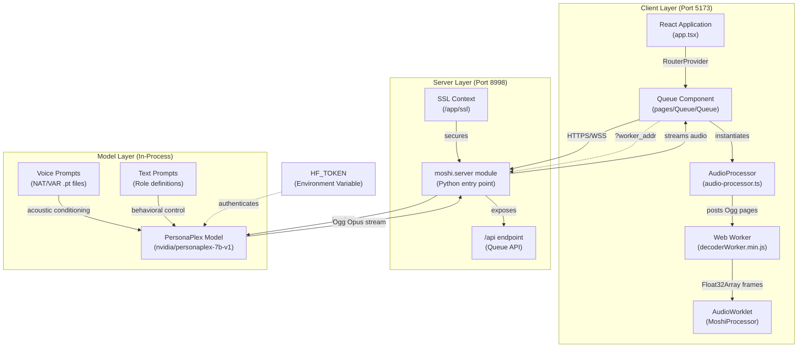
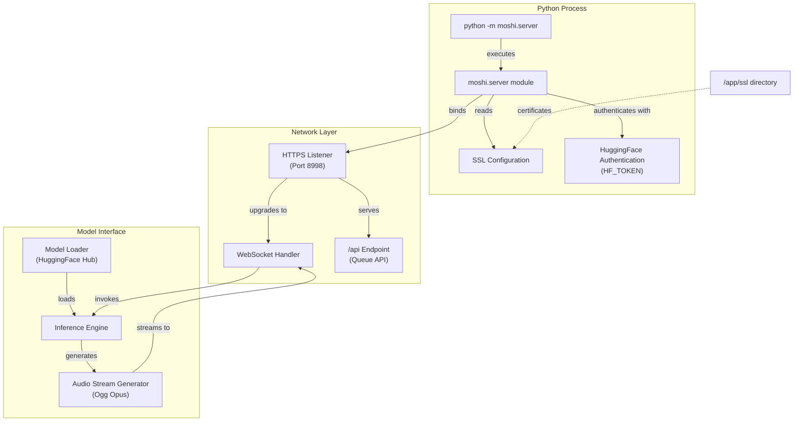
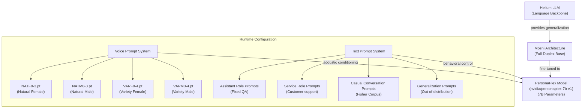
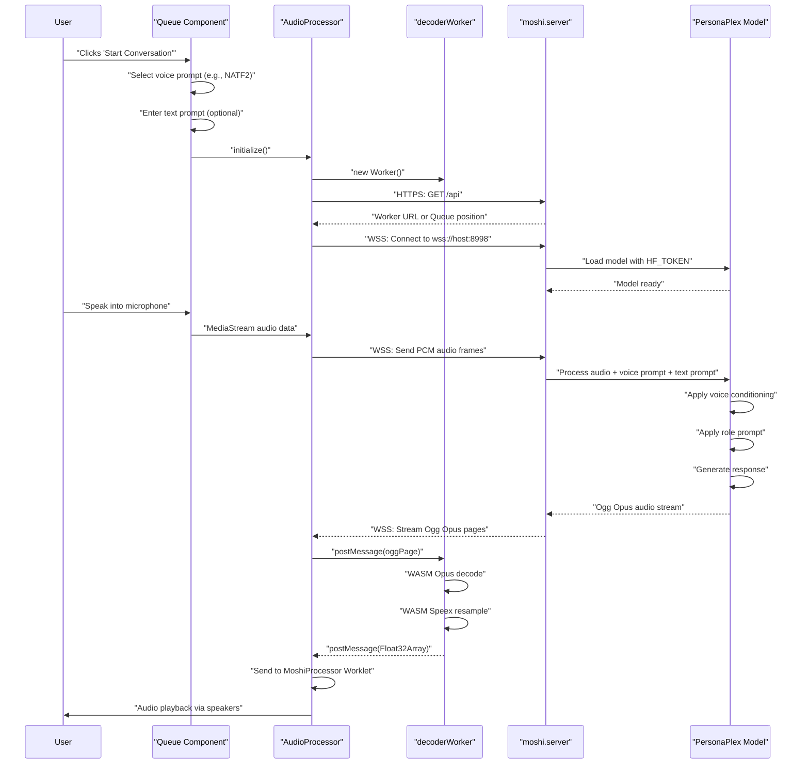
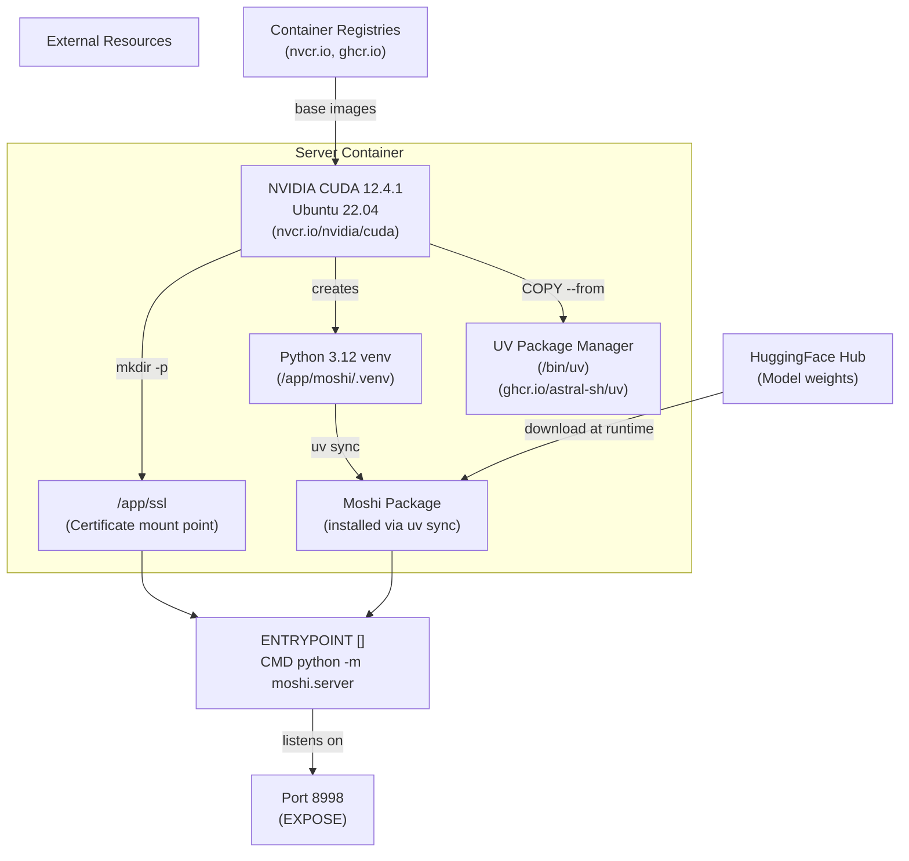
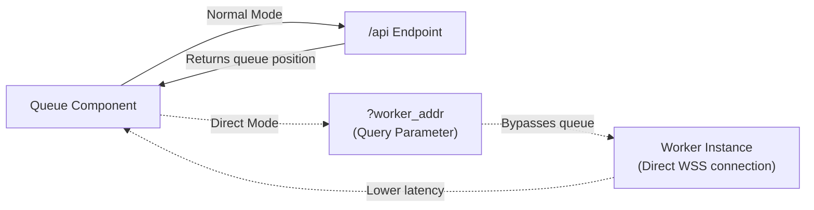

<!-- source: DeepWiki mcp.deepwiki.com · repo NVIDIA/personaplex · page 1.2 System Architecture · fetched 2026-10-26 -->

# System Architecture

<details>
<summary>Relevant source files</summary>

The following files were used as context for generating this wiki page:

- [Dockerfile](Dockerfile)
- [README.md](README.md)
- [assets/architecture_diagram.png](assets/architecture_diagram.png)
- [client/README.md](client/README.md)

</details>


## Purpose and Scope

This document describes the three-layer architecture of PersonaPlex, detailing how the client, server, and model layers interact to enable real-time, full-duplex conversational speech with persona control. This page focuses on the structural organization and communication patterns between components.

For step-by-step setup instructions, see [Quick Start](#1.1). For model-specific details including training methodology and persona control mechanisms, see [Model Architecture](#2). For deployment-specific configurations, see [Deployment and Containerization](#5).

**Sources:** README.md, Dockerfile, client/src/app.tsx

## Three-Layer Architecture Overview

PersonaPlex is organized into three distinct architectural layers, each with specific responsibilities:

| Layer | Technology Stack | Primary Responsibilities | Port/Location |
|-------|-----------------|-------------------------|---------------|
| **Client Layer** | React, TypeScript, Vite | User interface, audio capture, WebAssembly-based audio decoding, buffering | Port 5173 (HTTPS) |
| **Server Layer** | Python 3.12, Moshi server module | Request routing, SSL termination, model invocation, audio streaming | Port 8998 (HTTPS) |
| **Model Layer** | PersonaPlex (7B parameters), CUDA acceleration | Speech processing, persona application, audio generation | In-process with server |

This separation enables independent scaling, development, and testing of each layer while maintaining clean interfaces between components.

**Sources:** README.md, Dockerfile, client/src/app.tsx

## System Component Diagram



**Sources:** client/src/app.tsx:1-18, Dockerfile:1-19, README.md:1-142

## Client Layer Architecture

The client layer is a React-based single-page application that handles all user interaction and client-side audio processing.

### Client Component Structure

```mermaid
graph LR
    subgraph ReactRouter["React Router Setup"]
        BrowserRouter["createBrowserRouter"]
        RootRoute["Route: /"]
        QueuePage["Queue Component"]
        
        BrowserRouter -->|"defines"| RootRoute
        RootRoute -->|"renders"| QueuePage
    end
    
    subgraph AudioPipeline["Audio Processing Pipeline"]
        UserMic["User Microphone<br/>(MediaStream)"]
        AudioProc["AudioProcessor Class"]
        WebWorker["decoderWorker.min.js"]
        WASMDecoder["WebAssembly Opus Decoder"]
        SpeexResampler["WebAssembly Speex Resampler"]
        AudioWorklet["MoshiProcessor Worklet"]
        AudioOutput["Speaker Output<br/>(AudioContext)"]
        
        UserMic -->|"PCM capture"| AudioProc
        AudioProc -->|"postMessage"| WebWorker
        WebWorker -->|"decode"| WASMDecoder
        WASMDecoder -->|"resample"| SpeexResampler
        SpeexResampler -->|"postMessage"| AudioWorklet
        AudioWorklet -->|"buffered audio"| AudioOutput
    end
    
    QueuePage -->|"creates"| AudioProc
    QueuePage -->|"connects to"| ServerWS["Server WebSocket<br/>(wss://host:8998)"]
    ServerWS -->|"Ogg Opus pages"| AudioProc
```



The client layer implements sophisticated audio processing to achieve low-latency playback:

- **Web Worker isolation**: Audio decoding runs off the main thread in [client/public/assets/decoderWorker.min.js]()
- **WebAssembly performance**: Opus codec and Speex resampler compiled to WASM for near-native speed
- **AudioWorklet buffering**: The `MoshiProcessor` AudioWorklet manages buffer levels to prevent underruns/overruns

### Client Build Configuration

The client uses Vite as its build tool with the following key characteristics:

| Configuration File | Purpose | Key Settings |
|-------------------|---------|--------------|
| `vite.config.ts` | Build tool configuration | Dev server port 5173, HTTPS enabled |
| `tsconfig.json` | TypeScript compiler options | Strict mode, React JSX transform |
| `postcss.config.js` | CSS processing | Tailwind CSS, Autoprefixer |
| `package.json` | Dependencies and scripts | React 18, TypeScript 5, Vite 5 |

**Sources:** client/src/app.tsx:1-18, client/src/audio-processor.ts (referenced), client/public/assets/decoderWorker.min.js (referenced), README.md:39-42

## Server Layer Architecture

The server layer is a Python application that bridges the client and model layers, handling authentication, SSL termination, and model orchestration.

### Server Module Structure



### Server Operational Modes

The server supports three operational modes:

| Mode | Command | Purpose | Use Case |
|------|---------|---------|----------|
| **Development** | `python -m moshi.server --ssl "$SSL_DIR"` | Local testing with temporary SSL | Development and debugging |
| **Production** | Via Docker container | Containerized deployment | Production environments |
| **Offline** | `python -m moshi.offline` | Batch processing from WAV files | Testing, evaluation, benchmarking |

The server module is invoked as a Python module entry point at [Dockerfile:19](), using the command:
```bash
/app/moshi/.venv/bin/python -m moshi.server --ssl /app/ssl
```

**Sources:** Dockerfile:14-19, README.md:33-42

## Model Layer Architecture

The model layer consists of the PersonaPlex model and its configuration mechanisms. PersonaPlex is built on a hierarchical foundation:

### Model Hierarchy



### Model Configuration Files

The model layer uses two distinct configuration mechanisms:

**Voice Prompts** (18 pre-packaged embeddings):
- Format: PyTorch `.pt` files containing voice embeddings
- Categories: Natural (NAT) and Variety (VAR), each with female (F) and male (M) variants
- Usage: `--voice-prompt "NATF2.pt"` in offline mode
- Referenced in: [README.md:71-79]()

**Text Prompts** (role definitions):
- Format: Plain text strings defining persona behavior
- Categories: Assistant, Service, Casual, Generalization
- Usage: `--text-prompt "$(cat assets/test/prompt_service.txt)"` in offline mode
- Referenced in: [README.md:82-133]()

**Sources:** README.md:71-133, README.md:8 (Moshi architecture reference), README.md:130 (Helium reference)

## Communication Flow

The following diagram illustrates the complete request-response flow through all three layers:



### Key Communication Patterns

| Pattern | Protocol | Data Format | Purpose |
|---------|----------|-------------|---------|
| **Client → Server** | WebSocket Secure (WSS) | PCM audio frames | User speech input |
| **Server → Client** | WebSocket Secure (WSS) | Ogg Opus pages | Model-generated speech |
| **Client ↔ Web Worker** | `postMessage` API | Ogg pages, Float32Array | Off-thread audio decoding |
| **Server → Model** | In-process function calls | Tensors, embeddings | Inference requests |

**Sources:** client/src/app.tsx:1-18, README.md:36-42, README.md:44-69

## Containerized Deployment Architecture

PersonaPlex supports containerized deployment with separate containers for server and client:

### Server Container Architecture



The server container is defined in [Dockerfile:1-19]() with these key characteristics:

- **Base image**: `nvcr.io/nvidia/cuda:12.4.1-runtime-ubuntu22.04` provides GPU acceleration
- **Package manager**: UV (`ghcr.io/astral-sh/uv`) enables fast dependency resolution
- **Python environment**: Python 3.12 virtual environment at `/app/moshi/.venv`
- **SSL directory**: `/app/ssl` created for certificate mounting
- **Entry point**: Executes `python -m moshi.server --ssl /app/ssl`
- **Exposed port**: 8998 for HTTPS traffic

### Deployment File Structure

The deployment involves the following directory structure:

```
/app/
├── moshi/               # Copied from source (COPY moshi/ /app/moshi)
│   ├── .venv/          # Python virtual environment (created by uv venv)
│   │   └── bin/
│   │       └── python  # Python interpreter used by CMD
│   ├── moshi/          # Python package source
│   │   ├── __init__.py
│   │   └── server.py   # Server module entry point
│   └── pyproject.toml  # Dependencies (read by uv sync)
└── ssl/                # SSL certificate directory (mkdir -p /app/ssl)
    ├── cert.pem        # (Mounted or generated at runtime)
    └── key.pem         # (Mounted or generated at runtime)
```

**Sources:** Dockerfile:1-19, README.md:33-42

## Environment Variables

The system requires specific environment variables for proper operation:

| Variable | Layer | Purpose | Example |
|----------|-------|---------|---------|
| `HF_TOKEN` | Server | Authenticate with HuggingFace to download model weights | `hf_xxxx...` |
| `VITE_QUEUE_API_PATH` | Client | Override default queue API path | `/api` |
| `VITE_QUEUE_API_URL` | Client | Override default queue API URL | `https://host:8998` |

The `HF_TOKEN` is critical for server operation as PersonaPlex model weights are gated on HuggingFace. The token must be set before launching the server:
```bash
export HF_TOKEN=<YOUR_HUGGINGFACE_TOKEN>
```

For detailed environment variable configuration, see [Environment Variables](#7.1).

**Sources:** README.md:29-30, Dockerfile:1-19

## Direct Worker Connection

The client supports an optional direct worker connection mode, bypassing the queue system for lower-latency interactions:



When the `?worker_addr` query parameter is provided, the client establishes a direct WebSocket connection to a specific worker instance, skipping the queue API entirely. This mode is useful for:

- Development and testing with dedicated server instances
- Low-latency scenarios where queueing is not required
- Direct integration with specific worker pools

**Sources:** README.md:39-42 (indirect reference to WebUI access)

---

**Document Version:** 1.0  
**Last Updated:** Based on repository state as of provided files  
**Related Pages:** [Quick Start](#1.1), [Model Architecture](#2), [Server Deployment](#3.1), [Client Application](#4), [Deployment and Containerization](#5)

---

