# Page: Overview

# Overview

<details>
<summary>Relevant source files</summary>

The following files were used as context for generating this wiki page:

- [README.md](README.md)
- [assets/architecture_diagram.png](assets/architecture_diagram.png)

</details>


## Purpose and Scope

This document provides a high-level introduction to PersonaPlex, a real-time full-duplex conversational speech model with persona control capabilities. It covers the core concepts, architecture overview, and key components of the system. For step-by-step installation and usage instructions, see [Quick Start](#1.1). For detailed architectural information about component interactions and data flow, see [System Architecture](#1.2).

**Sources:** [README.md:1-8]()

---

## What is PersonaPlex

PersonaPlex is a speech-to-speech conversational model that enables natural, low-latency spoken interactions with controllable personas. The system supports:

| Feature | Description |
|---------|-------------|
| **Full-Duplex Communication** | Simultaneous bidirectional audio streaming without turn-taking constraints |
| **Persona Control** | Dual control mechanisms via text-based role prompts and audio-based voice conditioning |
| **Real-Time Processing** | Low-latency streaming suitable for interactive conversations |
| **Pre-packaged Voices** | 18 voice embeddings (8 natural, 10 variety) across male and female voices |
| **Training Foundation** | Hybrid training on synthetic task-oriented and real conversational data |

The model is built on the Moshi architecture and leverages the Helium LLM backbone for language understanding and generalization capabilities.

**Sources:** [README.md:1-8](), [README.md:72-79]()

---

## Repository Structure

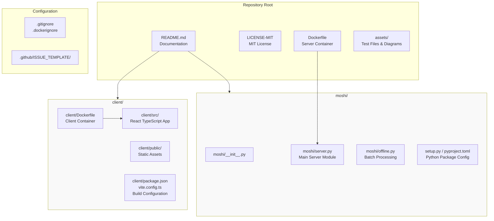

**Sources:** [README.md:1-142](), [Dockerfile:1-50](), [client/Dockerfile:1-25]()

---

## Three-Layer Architecture

PersonaPlex implements a three-layer architecture separating concerns between user interface, application logic, and model inference:

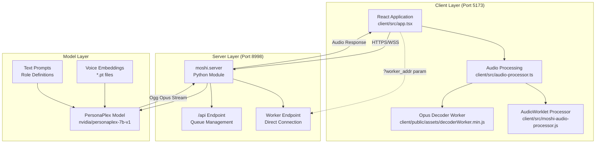

### Client Layer

The client layer provides the user interface and handles all browser-side audio processing. Key components:

- **React Application** ([client/src/app.tsx]()): Main UI built with React and TypeScript
- **Audio Processor** ([client/src/audio-processor.ts]()): Coordinates microphone input and speaker output
- **Opus Decoder** ([client/public/assets/decoderWorker.min.js]()): WebAssembly-based decoder running in Web Worker
- **Audio Worklet** ([client/src/moshi-audio-processor.js]()): Low-latency audio buffering and playback

### Server Layer

The server layer runs the Python application that manages model inference and client connections. Key modules:

- **moshi.server** ([moshi/server.py]()): Main server module handling HTTPS on port 8998
- **Queue API** (`/api` endpoint): Manages client queue and load balancing
- **Worker Endpoint**: Optional direct connection bypassing queue for lower latency

### Model Layer

The model layer contains the PersonaPlex model weights and configuration:

- **PersonaPlex Model**: 7B parameter model hosted on HuggingFace (`nvidia/personaplex-7b-v1`)
- **Voice Embeddings**: Pre-packaged `.pt` files for 18 voice presets (NAT*/VAR*)
- **Text Prompts**: String-based role definitions for persona behavior

**Sources:** [README.md:1-142](), [Dockerfile:1-50](), [client/Dockerfile:1-25]()

---

## Persona Control Mechanisms

PersonaPlex provides two orthogonal control mechanisms for persona customization:

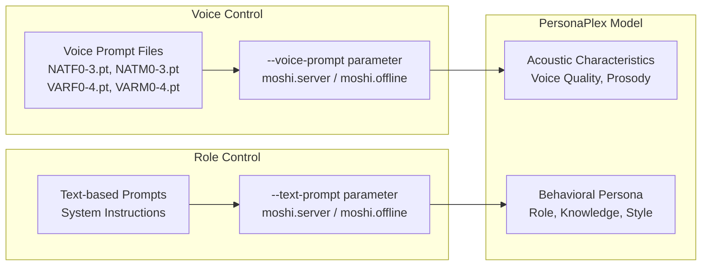

### Voice Conditioning

Voice prompts control acoustic characteristics through pre-trained embeddings:

| Category | Voices | Description |
|----------|--------|-------------|
| **Natural Female** | `NATF0`, `NATF1`, `NATF2`, `NATF3` | Conversational, natural-sounding female voices |
| **Natural Male** | `NATM0`, `NATM1`, `NATM2`, `NATM3` | Conversational, natural-sounding male voices |
| **Variety Female** | `VARF0`, `VARF1`, `VARF2`, `VARF3`, `VARF4` | More varied female voices with distinctive characteristics |
| **Variety Male** | `VARM0`, `VARM1`, `VARM2`, `VARM3`, `VARM4` | More varied male voices with distinctive characteristics |

Voice prompts are specified using the `--voice-prompt` parameter when launching the server or offline evaluation script. For detailed information about voice conditioning, see [Voice Conditioning](#2.1).

### Text-Based Role Prompts

Text prompts define the behavioral persona through natural language instructions. The model supports several prompt categories based on training data:

| Category | Example | Use Case |
|----------|---------|----------|
| **Assistant** | "You are a wise and friendly teacher..." | QA-focused assistance |
| **Service** | "You work for CitySan Services..." | Customer service scenarios |
| **Casual** | "You enjoy having a good conversation." | Open-ended dialogue |
| **Generalization** | "You are an astronaut on a Mars mission..." | Out-of-distribution scenarios |

Text prompts are provided as strings via the `--text-prompt` parameter. For detailed guidance on writing effective prompts, see [Text-based Role Prompts](#2.2).

**Sources:** [README.md:71-133]()

---

## Model Hierarchy and Foundation

PersonaPlex builds on established foundation models through a hierarchical architecture:

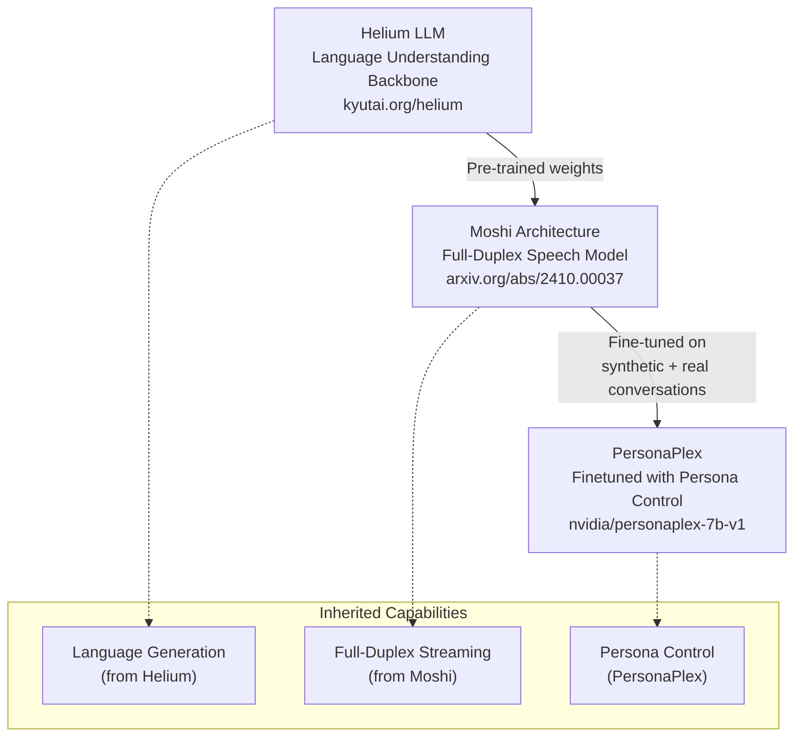

### Foundation Layers

1. **Helium LLM**: Provides broad language understanding and generation capabilities from extensive pre-training corpus
2. **Moshi Architecture**: Adds full-duplex speech-to-speech capabilities without turn-taking constraints
3. **PersonaPlex**: Introduces persona control through voice conditioning and role prompts via fine-tuning

This hierarchical approach enables PersonaPlex to:
- Generalize to out-of-distribution prompts (inherited from Helium)
- Maintain natural conversational flow with simultaneous bidirectional audio (from Moshi)
- Control both acoustic characteristics and behavioral personas (PersonaPlex contribution)

For detailed information about model architecture and training methodology, see [Model Architecture](#2) and [Training Data and Methodology](#2.3).

**Sources:** [README.md:8](), [README.md:128-133]()

---

## Training Data Sources

PersonaPlex is trained on a hybrid dataset combining synthetic and real conversational data:

| Data Source | Type | Purpose |
|-------------|------|---------|
| **Synthetic - Fixed Assistant** | Task-oriented QA | Trains fixed assistant role with consistent "wise teacher" persona |
| **Synthetic - Varying Service** | Customer service scenarios | Trains diverse service roles (waste management, restaurant, rental companies) |
| **Fisher English Corpus** | Real telephone conversations | Provides natural conversational patterns and turn-taking |
| **LLM-Labeled Fisher** | Real conversations with generated prompts | Enables open-ended casual conversation capabilities |

The training data directly maps to runtime capabilities:
- Synthetic assistant data → Assistant role prompts
- Synthetic service data → Service role prompts
- Fisher Corpus with LLM labels → Casual conversation prompts
- Helium backbone → Generalization to novel prompts

For detailed information about training methodology and data processing, see [Training Data and Methodology](#2.3).

**Sources:** [README.md:83-133]()

---

## Deployment Modes

PersonaPlex supports three primary deployment modes:

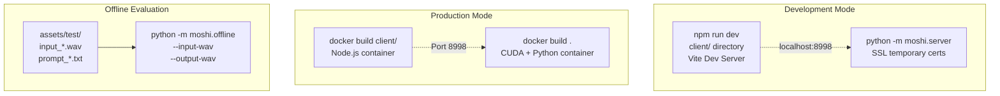

### Development Mode

Local development without containerization. Requires Python 3.12+ and Node.js 20+. See [Quick Start](#1.1) for setup instructions.

### Production Mode

Containerized deployment with Docker for reproducible environments. Requires NVIDIA GPU with CUDA support. See [Deployment and Containerization](#5) for details.

### Offline Evaluation

Batch processing mode for testing without real-time constraints. Processes WAV files and produces output audio and transcripts. See [Offline Evaluation](#3.2) for usage.

**Sources:** [README.md:16-69]()

---

## Key Technologies

PersonaPlex leverages modern technologies across the stack:

| Layer | Technology | Purpose |
|-------|------------|---------|
| **Model** | PyTorch, HuggingFace Transformers | Model inference and weight management |
| **Server** | Python 3.12, `moshi.server` module | Application server with SSL support |
| **Client Build** | Vite, TypeScript, React | Fast development and optimized production builds |
| **Client Audio** | WebAssembly (Opus/Speex), AudioWorklet | High-performance browser audio processing |
| **Packaging** | UV (Python), npm (JavaScript) | Fast dependency resolution |
| **Container** | Docker, NVIDIA CUDA runtime | Reproducible GPU-enabled deployment |

**Sources:** [README.md:1-142](), [Dockerfile:1-50](), [client/Dockerfile:1-25]()

---

## License and Access

PersonaPlex is released under dual licensing:

- **Code**: MIT License ([LICENSE-MIT]()) - permissive open source license for all source code
- **Model Weights**: NVIDIA Open Model License - requires accepting license at [nvidia/personaplex-7b-v1](https://huggingface.co/nvidia/personaplex-7b-v1)

Access to model weights requires HuggingFace authentication via the `HF_TOKEN` environment variable. For details about licensing terms, see [Licensing](#9).

**Sources:** [LICENSE-MIT:1-24](), [README.md:26-30](), [README.md:135-137]()

---

# Page: Quick Start

# Quick Start

<details>
<summary>Relevant source files</summary>

The following files were used as context for generating this wiki page:

- [README.md](README.md)

</details>


This page provides step-by-step instructions for installing and running PersonaPlex, from initial setup through launching the server and accessing the web interface. It covers prerequisite installation, HuggingFace authentication, and basic server operation.

For detailed information about deployment in production environments, see [Production Deployment](#5.3). For information about configuring personas and voices, see [Voice Conditioning](#2.1) and [Text-based Role Prompts](#2.2).

---

## Prerequisites

Before installing PersonaPlex, ensure your system meets the following requirements:

| Requirement | Description | Notes |
|------------|-------------|-------|
| Python | Version 3.12 | Required by the moshi server |
| pip | Python package installer | For installing dependencies |
| HuggingFace Account | With accepted model license | Required to download model weights |
| GPU (Optional) | NVIDIA GPU with CUDA support | Strongly recommended for real-time performance |
| Network Access | Internet connection | For downloading model weights (~7B parameters) |

**Sources**: [README.md:18-23](), [Dockerfile:11]()

---

## Installation Process

The following diagram shows the complete installation workflow and the key components that get installed:

### Installation Flow

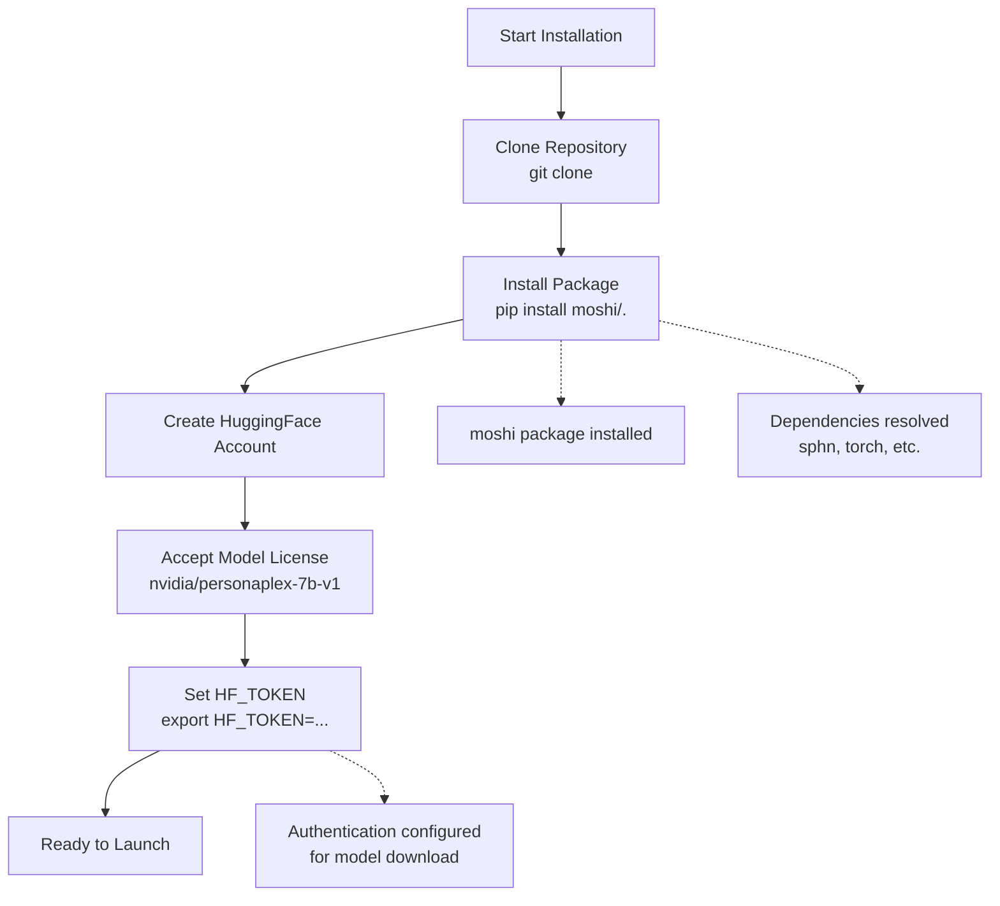

**Sources**: [README.md:18-30]()

---

## Step-by-Step Installation

### Step 1: Clone the Repository

Download the PersonaPlex repository:

```bash
git clone https://github.com/NVIDIA/personaplex.git
cd personaplex
```

### Step 2: Install the Moshi Package

Install the moshi package and its dependencies using pip:

```bash
pip install moshi/.
```

This installs the `moshi` Python package from the local `moshi/` directory. The installation includes:
- Core moshi server module
- Audio processing dependencies
- Model inference components
- WebSocket server for client communication

**Note**: For containerized installation, see [Server Container](#5.1).

**Sources**: [README.md:20-23]()

---

## HuggingFace Authentication

PersonaPlex requires authentication to download model weights from HuggingFace.

### Step 1: Accept the Model License

1. Log in to your HuggingFace account at [huggingface.co](https://huggingface.co)
2. Navigate to the PersonaPlex model page: `nvidia/personaplex-7b-v1`
3. Review and accept the NVIDIA Open Model License

### Step 2: Configure Authentication Token

Set your HuggingFace token as an environment variable:

```bash
export HF_TOKEN=<YOUR_HUGGINGFACE_TOKEN>
```

To make this persistent across sessions, add it to your shell profile (`.bashrc`, `.zshrc`, etc.):

```bash
echo 'export HF_TOKEN=<YOUR_HUGGINGFACE_TOKEN>' >> ~/.bashrc
source ~/.bashrc
```

**Sources**: [README.md:25-30]()

---

## Launching the Server

### Server Architecture and Startup

The following diagram shows the server startup process and the components that are initialized:

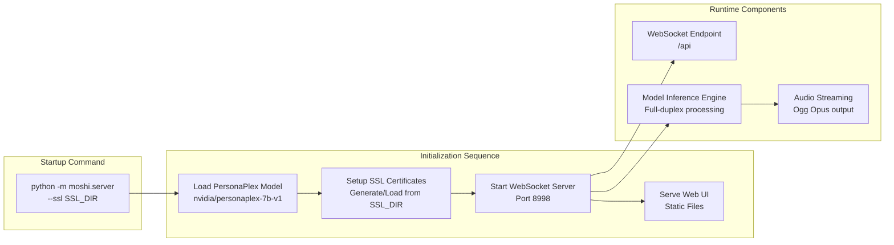

**Sources**: [README.md:32-42](), [Dockerfile:19]()

### Basic Server Launch

Launch the server with temporary SSL certificates:

```bash
SSL_DIR=$(mktemp -d); python -m moshi.server --ssl "$SSL_DIR"
```

This command:
1. Creates a temporary directory for SSL certificates
2. Launches the `moshi.server` module as a Python application
3. Generates self-signed SSL certificates in `SSL_DIR`
4. Starts the HTTPS server on port 8998
5. Downloads the PersonaPlex model weights (first run only)

**Expected Output**:
```
Access the Web UI directly at https://11.54.401.33:8998
```

**Note**: The IP address shown will match your machine's network address.

**Sources**: [README.md:34-42]()

### Server Launch Options

| Option | Description | Example |
|--------|-------------|---------|
| `--ssl` | Directory for SSL certificates | `--ssl /path/to/ssl` |
| Port | Server port (default: 8998) | Configured in server module |

For detailed server configuration options, see [Server Deployment](#3.1).

**Sources**: [README.md:34-37](), [Dockerfile:16-19]()

---

## Accessing the Web UI

### Local Access

If running on your local machine, access the web interface at:

```
https://localhost:8998
```

### Remote Access

If running on a remote server, use the URL printed by the server startup script. The server automatically detects and displays the accessible URL:

```
Access the Web UI directly at https://<SERVER_IP>:8998
```

### SSL Certificate Warning

Since the server uses self-signed SSL certificates, your browser will display a security warning. This is expected behavior for local development:

1. Click "Advanced" or equivalent in your browser
2. Click "Proceed to localhost (unsafe)" or equivalent
3. The warning will not appear on subsequent visits

For production deployment with proper SSL certificates, see [Production Deployment](#5.3).

**Sources**: [README.md:39-42]()

---

## Verification and Testing

### Quick Verification with Offline Mode

To verify the installation without launching the full server, use the offline evaluation script:

```bash
HF_TOKEN=<TOKEN> \
python -m moshi.offline \
  --voice-prompt "NATF2.pt" \
  --input-wav "assets/test/input_assistant.wav" \
  --seed 42424242 \
  --output-wav "output.wav" \
  --output-text "output.json"
```

This command:
- Processes a test audio file through the model
- Uses the NATF2 voice (Natural Female voice 2)
- Generates an output audio file and transcript
- Verifies that model loading and inference work correctly

### Verification Checklist

| Component | How to Verify | Expected Result |
|-----------|--------------|-----------------|
| Package Installation | `python -c "import moshi"` | No import errors |
| HF Authentication | Check `$HF_TOKEN` is set | Token value displayed |
| Model Download | First server launch | Model downloads successfully |
| Server Running | Access web UI at localhost:8998 | UI loads successfully |
| Audio Processing | Speak into microphone in UI | Audio response plays back |

**Sources**: [README.md:44-57]()

---

## Common Quick Start Issues

### Issue: Model Download Fails

**Symptom**: Server fails to start with authentication errors

**Solution**:
1. Verify `HF_TOKEN` is set: `echo $HF_TOKEN`
2. Confirm license accepted at huggingface.co/nvidia/personaplex-7b-v1
3. Check internet connectivity

### Issue: SSL Certificate Error Blocks Access

**Symptom**: Browser blocks access with security error

**Solution**:
1. Click "Advanced" in browser security warning
2. Select "Proceed to localhost" or equivalent
3. Alternatively, use a custom SSL directory with valid certificates

### Issue: Port 8998 Already in Use

**Symptom**: Server fails to start with "Address already in use"

**Solution**:
1. Check for existing server process: `lsof -i :8998`
2. Kill existing process or use different port
3. Modify server configuration to use alternative port

**Sources**: [README.md:25-42]()

---

## Next Steps

After successfully launching PersonaPlex, explore the following:

- **Voice Configuration**: Experiment with different voice prompts (NATF0-3, NATM0-3, VARF0-4, VARM0-4). See [Voice Conditioning](#2.1)
- **Persona Prompting**: Define custom personas for assistant, service, or casual conversation scenarios. See [Text-based Role Prompts](#2.2)
- **Production Deployment**: Deploy with Docker containers for scalable operation. See [Server Container](#5.1) and [Client Container](#5.2)
- **Offline Evaluation**: Run batch processing and testing. See [Offline Evaluation](#3.2)

**Sources**: [README.md:71-134]()

---

# Page: System Architecture

# System Architecture

<details>
<summary>Relevant source files</summary>

The following files were used as context for generating this wiki page:

- [Dockerfile](Dockerfile)
- [README.md](README.md)
- [assets/architecture_diagram.png](assets/architecture_diagram.png)
- [client/README.md](client/README.md)

</details>


## Purpose and Scope

This document describes the three-layer architecture of PersonaPlex, detailing how the client, server, and model layers interact to enable real-time, full-duplex conversational speech with persona control. This page focuses on the structural organization and communication patterns between components.

For step-by-step setup instructions, see [Quick Start](#1.1). For model-specific details including training methodology and persona control mechanisms, see [Model Architecture](#2). For deployment-specific configurations, see [Deployment and Containerization](#5).

**Sources:** README.md, Dockerfile, client/src/app.tsx

## Three-Layer Architecture Overview

PersonaPlex is organized into three distinct architectural layers, each with specific responsibilities:

| Layer | Technology Stack | Primary Responsibilities | Port/Location |
|-------|-----------------|-------------------------|---------------|
| **Client Layer** | React, TypeScript, Vite | User interface, audio capture, WebAssembly-based audio decoding, buffering | Port 5173 (HTTPS) |
| **Server Layer** | Python 3.12, Moshi server module | Request routing, SSL termination, model invocation, audio streaming | Port 8998 (HTTPS) |
| **Model Layer** | PersonaPlex (7B parameters), CUDA acceleration | Speech processing, persona application, audio generation | In-process with server |

This separation enables independent scaling, development, and testing of each layer while maintaining clean interfaces between components.

**Sources:** README.md, Dockerfile, client/src/app.tsx

## System Component Diagram

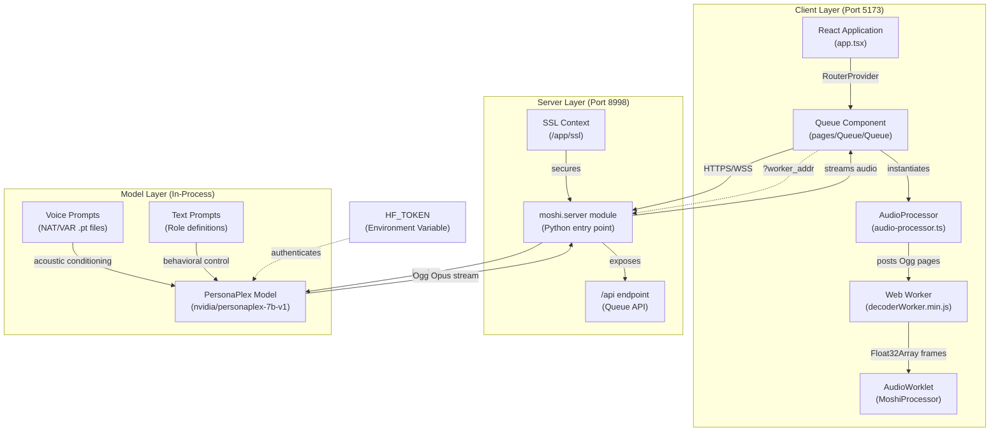

**Sources:** client/src/app.tsx:1-18, Dockerfile:1-19, README.md:1-142

## Client Layer Architecture

The client layer is a React-based single-page application that handles all user interaction and client-side audio processing.

### Client Component Structure

```mermaid
graph LR
    subgraph ReactRouter["React Router Setup"]
        BrowserRouter["createBrowserRouter"]
        RootRoute["Route: /"]
        QueuePage["Queue Component"]
        
        BrowserRouter -->|"defines"| RootRoute
        RootRoute -->|"renders"| QueuePage
    end
    
    subgraph AudioPipeline["Audio Processing Pipeline"]
        UserMic["User Microphone<br/>(MediaStream)"]
        AudioProc["AudioProcessor Class"]
        WebWorker["decoderWorker.min.js"]
        WASMDecoder["WebAssembly Opus Decoder"]
        SpeexResampler["WebAssembly Speex Resampler"]
        AudioWorklet["MoshiProcessor Worklet"]
        AudioOutput["Speaker Output<br/>(AudioContext)"]
        
        UserMic -->|"PCM capture"| AudioProc
        AudioProc -->|"postMessage"| WebWorker
        WebWorker -->|"decode"| WASMDecoder
        WASMDecoder -->|"resample"| SpeexResampler
        SpeexResampler -->|"postMessage"| AudioWorklet
        AudioWorklet -->|"buffered audio"| AudioOutput
    end
    
    QueuePage -->|"creates"| AudioProc
    QueuePage -->|"connects to"| ServerWS["Server WebSocket<br/>(wss://host:8998)"]
    ServerWS -->|"Ogg Opus pages"| AudioProc
```

The client layer implements sophisticated audio processing to achieve low-latency playback:

- **Web Worker isolation**: Audio decoding runs off the main thread in [client/public/assets/decoderWorker.min.js]()
- **WebAssembly performance**: Opus codec and Speex resampler compiled to WASM for near-native speed
- **AudioWorklet buffering**: The `MoshiProcessor` AudioWorklet manages buffer levels to prevent underruns/overruns

### Client Build Configuration

The client uses Vite as its build tool with the following key characteristics:

| Configuration File | Purpose | Key Settings |
|-------------------|---------|--------------|
| `vite.config.ts` | Build tool configuration | Dev server port 5173, HTTPS enabled |
| `tsconfig.json` | TypeScript compiler options | Strict mode, React JSX transform |
| `postcss.config.js` | CSS processing | Tailwind CSS, Autoprefixer |
| `package.json` | Dependencies and scripts | React 18, TypeScript 5, Vite 5 |

**Sources:** client/src/app.tsx:1-18, client/src/audio-processor.ts (referenced), client/public/assets/decoderWorker.min.js (referenced), README.md:39-42

## Server Layer Architecture

The server layer is a Python application that bridges the client and model layers, handling authentication, SSL termination, and model orchestration.

### Server Module Structure

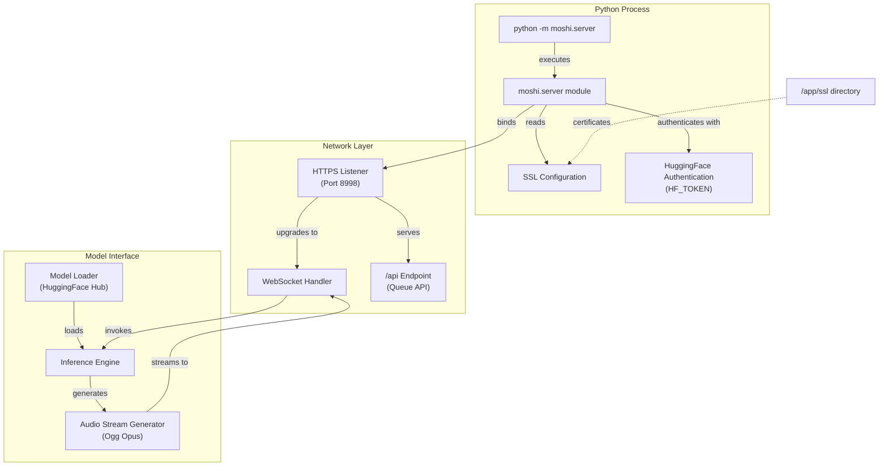

### Server Operational Modes

The server supports three operational modes:

| Mode | Command | Purpose | Use Case |
|------|---------|---------|----------|
| **Development** | `python -m moshi.server --ssl "$SSL_DIR"` | Local testing with temporary SSL | Development and debugging |
| **Production** | Via Docker container | Containerized deployment | Production environments |
| **Offline** | `python -m moshi.offline` | Batch processing from WAV files | Testing, evaluation, benchmarking |

The server module is invoked as a Python module entry point at [Dockerfile:19](), using the command:
```bash
/app/moshi/.venv/bin/python -m moshi.server --ssl /app/ssl
```

**Sources:** Dockerfile:14-19, README.md:33-42

## Model Layer Architecture

The model layer consists of the PersonaPlex model and its configuration mechanisms. PersonaPlex is built on a hierarchical foundation:

### Model Hierarchy

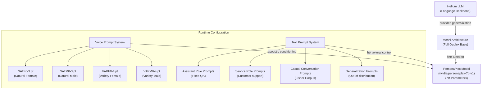

### Model Configuration Files

The model layer uses two distinct configuration mechanisms:

**Voice Prompts** (18 pre-packaged embeddings):
- Format: PyTorch `.pt` files containing voice embeddings
- Categories: Natural (NAT) and Variety (VAR), each with female (F) and male (M) variants
- Usage: `--voice-prompt "NATF2.pt"` in offline mode
- Referenced in: [README.md:71-79]()

**Text Prompts** (role definitions):
- Format: Plain text strings defining persona behavior
- Categories: Assistant, Service, Casual, Generalization
- Usage: `--text-prompt "$(cat assets/test/prompt_service.txt)"` in offline mode
- Referenced in: [README.md:82-133]()

**Sources:** README.md:71-133, README.md:8 (Moshi architecture reference), README.md:130 (Helium reference)

## Communication Flow

The following diagram illustrates the complete request-response flow through all three layers:

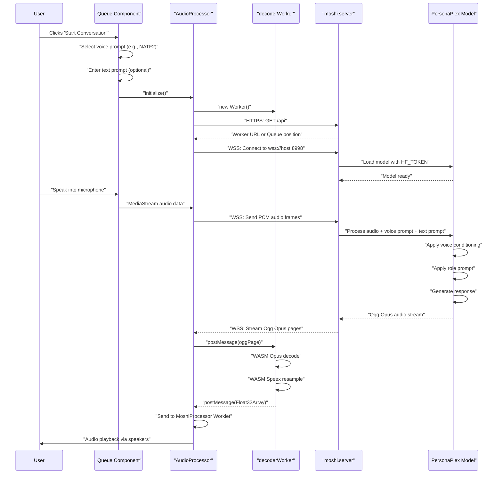

### Key Communication Patterns

| Pattern | Protocol | Data Format | Purpose |
|---------|----------|-------------|---------|
| **Client → Server** | WebSocket Secure (WSS) | PCM audio frames | User speech input |
| **Server → Client** | WebSocket Secure (WSS) | Ogg Opus pages | Model-generated speech |
| **Client ↔ Web Worker** | `postMessage` API | Ogg pages, Float32Array | Off-thread audio decoding |
| **Server → Model** | In-process function calls | Tensors, embeddings | Inference requests |

**Sources:** client/src/app.tsx:1-18, README.md:36-42, README.md:44-69

## Containerized Deployment Architecture

PersonaPlex supports containerized deployment with separate containers for server and client:

### Server Container Architecture

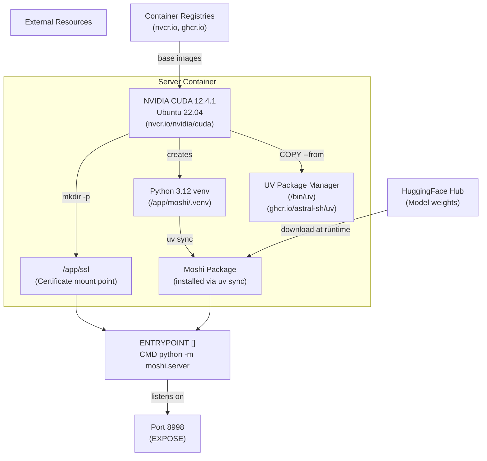

The server container is defined in [Dockerfile:1-19]() with these key characteristics:

- **Base image**: `nvcr.io/nvidia/cuda:12.4.1-runtime-ubuntu22.04` provides GPU acceleration
- **Package manager**: UV (`ghcr.io/astral-sh/uv`) enables fast dependency resolution
- **Python environment**: Python 3.12 virtual environment at `/app/moshi/.venv`
- **SSL directory**: `/app/ssl` created for certificate mounting
- **Entry point**: Executes `python -m moshi.server --ssl /app/ssl`
- **Exposed port**: 8998 for HTTPS traffic

### Deployment File Structure

The deployment involves the following directory structure:

```
/app/
├── moshi/               # Copied from source (COPY moshi/ /app/moshi)
│   ├── .venv/          # Python virtual environment (created by uv venv)
│   │   └── bin/
│   │       └── python  # Python interpreter used by CMD
│   ├── moshi/          # Python package source
│   │   ├── __init__.py
│   │   └── server.py   # Server module entry point
│   └── pyproject.toml  # Dependencies (read by uv sync)
└── ssl/                # SSL certificate directory (mkdir -p /app/ssl)
    ├── cert.pem        # (Mounted or generated at runtime)
    └── key.pem         # (Mounted or generated at runtime)
```

**Sources:** Dockerfile:1-19, README.md:33-42

## Environment Variables

The system requires specific environment variables for proper operation:

| Variable | Layer | Purpose | Example |
|----------|-------|---------|---------|
| `HF_TOKEN` | Server | Authenticate with HuggingFace to download model weights | `hf_xxxx...` |
| `VITE_QUEUE_API_PATH` | Client | Override default queue API path | `/api` |
| `VITE_QUEUE_API_URL` | Client | Override default queue API URL | `https://host:8998` |

The `HF_TOKEN` is critical for server operation as PersonaPlex model weights are gated on HuggingFace. The token must be set before launching the server:
```bash
export HF_TOKEN=<YOUR_HUGGINGFACE_TOKEN>
```

For detailed environment variable configuration, see [Environment Variables](#7.1).

**Sources:** README.md:29-30, Dockerfile:1-19

## Direct Worker Connection

The client supports an optional direct worker connection mode, bypassing the queue system for lower-latency interactions:

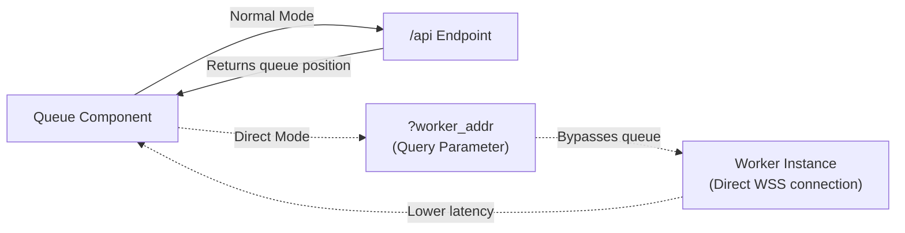

When the `?worker_addr` query parameter is provided, the client establishes a direct WebSocket connection to a specific worker instance, skipping the queue API entirely. This mode is useful for:

- Development and testing with dedicated server instances
- Low-latency scenarios where queueing is not required
- Direct integration with specific worker pools

**Sources:** README.md:39-42 (indirect reference to WebUI access)

---

**Document Version:** 1.0  
**Last Updated:** Based on repository state as of provided files  
**Related Pages:** [Quick Start](#1.1), [Model Architecture](#2), [Server Deployment](#3.1), [Client Application](#4), [Deployment and Containerization](#5)

---

# Page: Model Architecture

# Model Architecture

<details>
<summary>Relevant source files</summary>

The following files were used as context for generating this wiki page:

- [README.md](README.md)

</details>


## Purpose and Scope

This page documents the PersonaPlex model architecture, including its hierarchical foundation (Helium LLM → Moshi → PersonaPlex), the dual control mechanisms (voice and text prompts), and the training methodology that enables persona-aware conversational speech generation. 

For detailed information on voice prompt usage and acoustic control, see [Voice Conditioning](#2.1). For text-based persona definition and prompt engineering, see [Text-based Role Prompts](#2.2). For comprehensive training data sources and methodology, see [Training Data and Methodology](#2.3).

---

## Model Hierarchy

PersonaPlex is built on a three-tier architecture that inherits capabilities from underlying models while adding persona control mechanisms.

### Hierarchical Foundation

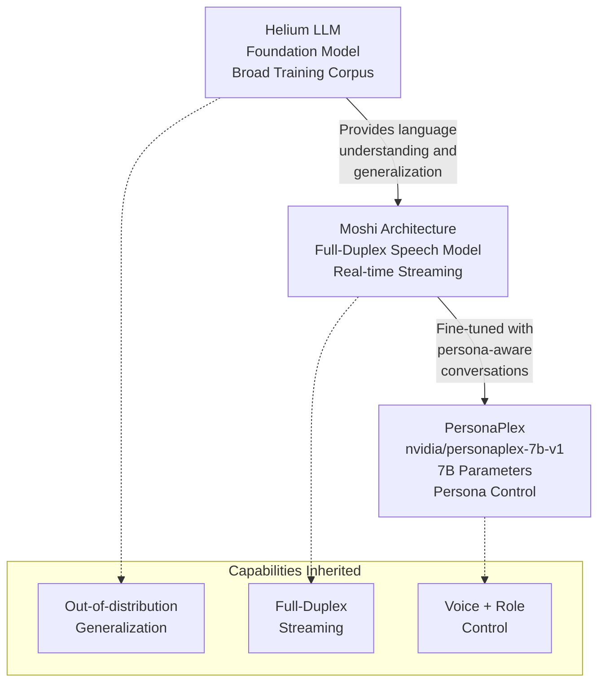

**Sources:** [README.md:8](), [README.md:129-133]()

### Model Components

| Component | Source | Role | Key Capability |
|-----------|--------|------|----------------|
| **Helium LLM** | Kyutai Foundation | Language backbone | Broad domain knowledge, out-of-distribution generalization |
| **Moshi Architecture** | Pre-trained base | Speech-to-speech framework | Full-duplex streaming, low-latency interaction |
| **PersonaPlex** | Fine-tuned model | Persona-aware layer | Voice conditioning, role-based behavior control |

**Model Identifier:** `nvidia/personaplex-7b-v1` (7 billion parameters)

**Sources:** [README.md:3](), [README.md:8](), [README.md:129-133]()

---

## Persona Control Mechanisms

PersonaPlex provides dual control over conversational behavior: acoustic characteristics via voice prompts and behavioral characteristics via text prompts.

### Control Architecture

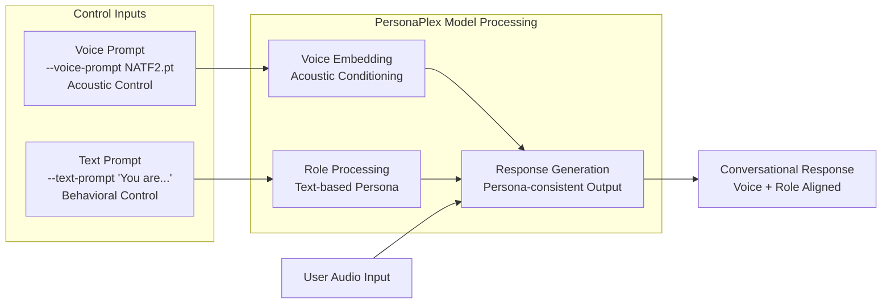

**Sources:** [README.md:52-53](), [README.md:64-65]()

### Voice Prompt System

PersonaPlex includes 18 pre-packaged voice embeddings organized into two categories:

| Category | Description | Available Voices |
|----------|-------------|------------------|
| **Natural (NAT)** | More natural, conversational voices | `NATF0`, `NATF1`, `NATF2`, `NATF3` (female)<br/>`NATM0`, `NATM1`, `NATM2`, `NATM3` (male) |
| **Variety (VAR)** | More varied, diverse acoustic characteristics | `VARF0`, `VARF1`, `VARF2`, `VARF3`, `VARF4` (female)<br/>`VARM0`, `VARM1`, `VARM2`, `VARM3`, `VARM4` (male) |

**File Format:** `.pt` files (PyTorch tensors containing voice embeddings)

**Usage Example:** `--voice-prompt "NATF2.pt"` in `moshi.offline` or `moshi.server`

**Sources:** [README.md:71-79]()

### Text-based Role Prompts

Text prompts define the behavioral persona, role, and conversational style. The model supports four primary prompt categories:

#### 1. Assistant Role
- **Training:** Fixed synthetic conversations with consistent "wise teacher" persona
- **Prompt Template:** `You are a wise and friendly teacher. Answer questions or provide advice in a clear and engaging way.`
- **Use Case:** Question-answering, educational interactions
- **Benchmark:** FullDuplexBench "User Interruption" category

**Sources:** [README.md:83-92]()

#### 2. Customer Service Roles
- **Training:** Varying synthetic conversations with company-specific scenarios
- **Prompt Structure:** Company name, agent name, specific information context
- **Example:** `You work for CitySan Services which is a waste management and your name is Ayelen Lucero. Information: Verify customer name Omar Torres...`
- **Use Case:** Service interactions, transaction support, information provision

**Sources:** [README.md:94-106]()

#### 3. Casual Conversations
- **Training:** Real conversations from Fisher English Corpus with LLM-generated labels
- **Prompt Range:** From minimal (`You enjoy having a good conversation.`) to detailed with background/context
- **Use Case:** Open-ended dialogue, natural conversation flow
- **Benchmark:** FullDuplexBench "Pause Handling", "Backchannel", "Smooth Turn Taking" categories

**Sources:** [README.md:108-125]()

#### 4. Generalization Scenarios
- **Capability Source:** Helium LLM backbone's broad training corpus
- **Characteristic:** Out-of-distribution prompts beyond training data
- **Example:** Astronaut scenario (`You enjoy having a good conversation. Have a technical discussion about fixing a reactor core on a spaceship to Mars...`)
- **Note:** Emergent behavior, not directly trained

**Sources:** [README.md:128-133]()

---

## Training Approach

PersonaPlex employs a hybrid training strategy combining synthetic and real conversational data to achieve both task-specific competence and natural dialogue capabilities.

### Training Data Pipeline

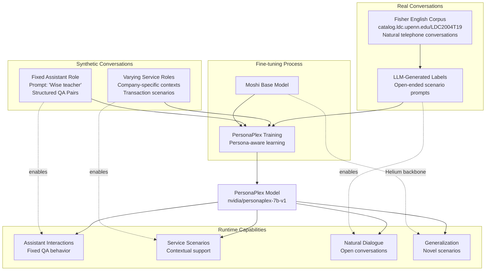

**Sources:** [README.md:8](), [README.md:83-84](), [README.md:94](), [README.md:108-109](), [README.md:129-130]()

### Training Data Categories

| Data Source | Type | Purpose | Maps to Runtime Capability |
|-------------|------|---------|---------------------------|
| **Fixed Assistant** | Synthetic | Structured question-answering with consistent "wise teacher" persona | Assistant role prompts, FullDuplexBench user interruption handling |
| **Varying Service** | Synthetic | Company-specific service scenarios with contextual information | Customer service role prompts, transaction support |
| **Fisher Corpus + LLM Labels** | Real + Synthetic labels | Natural telephone conversations annotated with open-ended prompts | Casual conversation prompts, natural turn-taking |
| **Helium Backbone** | Pre-training | Broad domain knowledge from foundation model | Generalization to novel scenarios |

**Sources:** [README.md:8](), [README.md:83-133]()

---

## Model Inference Modes

PersonaPlex supports two primary inference modes with different operational characteristics.

### Offline Evaluation Mode

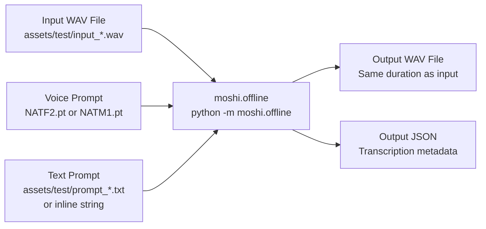

**Command Structure:**
- `--voice-prompt`: Voice embedding file (e.g., `"NATF2.pt"`)
- `--text-prompt`: Role prompt string (inline or via file with `$(cat ...)`)
- `--input-wav`: Input audio file path
- `--output-wav`: Generated response audio file
- `--output-text`: JSON metadata output
- `--seed`: Random seed for reproducibility

**Sources:** [README.md:44-69]()

### Real-time Server Mode

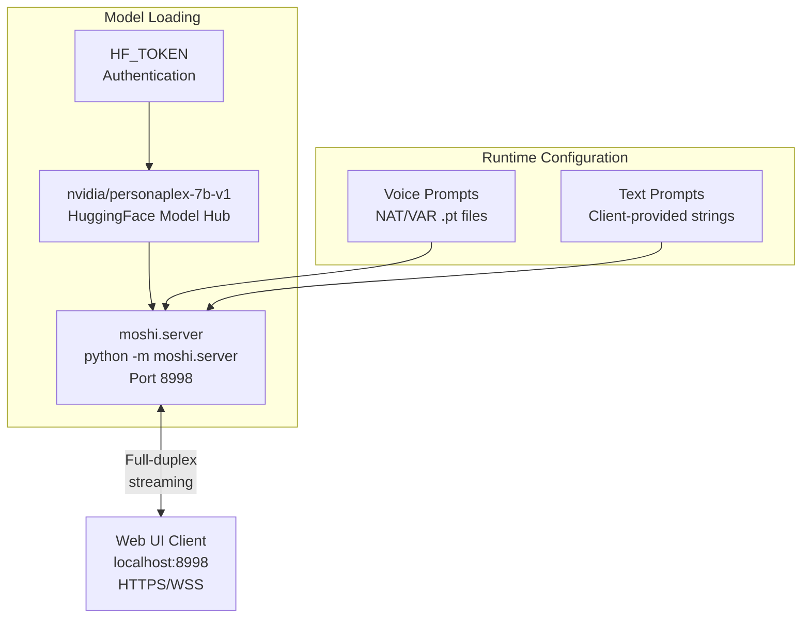

**Server Launch:** `python -m moshi.server --ssl "$SSL_DIR"`

**Model Authentication:** Requires `HF_TOKEN` environment variable and accepted license at `huggingface.co/nvidia/personaplex-7b-v1`

**Sources:** [README.md:25-42]()

---

## Integration Points

The PersonaPlex model architecture integrates with other system components through well-defined interfaces.

### Model Access Points

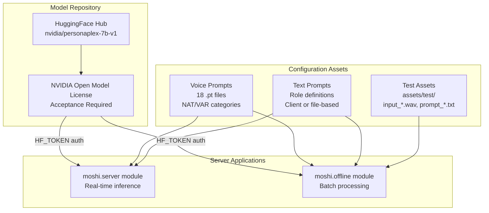

**Sources:** [README.md:25-29](), [README.md:44-69](), [README.md:71-79]()

### Configuration Parameters

| Parameter | Type | Location | Purpose |
|-----------|------|----------|---------|
| `--voice-prompt` | Command-line argument | `moshi.offline` / `moshi.server` | Specifies voice embedding file (e.g., `"NATF2.pt"`) |
| `--text-prompt` | Command-line argument | `moshi.offline` / `moshi.server` | Defines behavioral persona and role |
| `--input-wav` | Command-line argument | `moshi.offline` | Input audio file for offline processing |
| `--output-wav` | Command-line argument | `moshi.offline` | Output audio file path |
| `--output-text` | Command-line argument | `moshi.offline` | JSON metadata output path |
| `--seed` | Command-line argument | `moshi.offline` | Random seed for reproducible generation |
| `HF_TOKEN` | Environment variable | Authentication | HuggingFace API token for model access |

**Sources:** [README.md:29](), [README.md:50-68]()

---

## Model Characteristics

### Technical Specifications

| Specification | Value | Notes |
|---------------|-------|-------|
| **Model Size** | 7 billion parameters | Full precision model weights |
| **Architecture Base** | Moshi | Full-duplex speech-to-speech |
| **Foundation** | Helium LLM | Language understanding backbone |
| **Model ID** | `nvidia/personaplex-7b-v1` | HuggingFace model hub identifier |
| **License** | NVIDIA Open Model License | Separate from MIT code license |
| **Voice Prompts** | 18 pre-packaged | 8 NAT (natural) + 10 VAR (variety) |
| **Inference Latency** | Real-time capable | Full-duplex streaming support |
| **Training Data** | Synthetic + Real | Fixed assistant, varying service, Fisher Corpus |

**Sources:** [README.md:3](), [README.md:8](), [README.md:71-79](), [README.md:135-137]()

### Generalization Capabilities

PersonaPlex inherits broad generalization capabilities from the Helium LLM backbone, enabling plausible responses to out-of-distribution prompts:

- **Emergent Behavior:** Responds to scenarios not explicitly present in training data
- **Novel Context Handling:** Can adapt to unexpected conversational contexts (e.g., astronaut scenario)
- **Prompt Flexibility:** Encourages experimentation with diverse prompt formulations
- **Foundation Leverage:** Benefits from Helium's extensive pre-training corpus

**Example Out-of-Distribution Prompt:** The astronaut reactor core scenario demonstrates handling of technical, high-stakes dialogue in a space context—far from typical training scenarios.

**Sources:** [README.md:128-133]()

---

## Summary

PersonaPlex achieves persona-aware conversational speech through:

1. **Hierarchical Architecture:** Helium LLM (foundation) → Moshi (full-duplex) → PersonaPlex (persona control)
2. **Dual Control Mechanisms:** Voice prompts (acoustic) + text prompts (behavioral)
3. **Hybrid Training:** Synthetic conversations (structured tasks) + real conversations (natural dialogue)
4. **Pre-packaged Assets:** 18 voice embeddings (NAT/VAR categories), example text prompts for multiple scenarios
5. **Flexible Deployment:** Real-time server mode and offline batch processing
6. **Strong Generalization:** Helium backbone enables out-of-distribution prompt handling

For implementation details on voice conditioning mechanisms, see [Voice Conditioning](#2.1). For text prompt engineering guidance, see [Text-based Role Prompts](#2.2). For training data composition and methodology, see [Training Data and Methodology](#2.3).

**Sources:** [README.md:1-142]()

---

# Page: Voice Conditioning

# Voice Conditioning

<details>
<summary>Relevant source files</summary>

The following files were used as context for generating this wiki page:

- [README.md](README.md)

</details>


## Purpose and Scope

This document describes the voice conditioning system in PersonaPlex, which controls the acoustic characteristics of the model's generated speech through pre-packaged voice prompt embeddings stored as `.pt` files. Voice conditioning determines how the model sounds (pitch, tone, speaking style) independently of what it says. For controlling the content and behavioral persona of the model's responses, see [Text-based Role Prompts](#2.2).

**Sources:** [README.md:1-142]()

---

## Overview

Voice conditioning in PersonaPlex operates through a voice prompt system that uses pre-computed speaker embeddings to control the acoustic properties of generated speech. Unlike text prompts that define behavioral personas, voice prompts provide acoustic conditioning signals that influence prosodic features such as pitch range, speaking rate, and vocal timbre. The system provides 18 pre-packaged voice embeddings organized into two categories based on their acoustic characteristics.

```mermaid
graph TB
    subgraph VoicePromptSystem["Voice Prompt System"]
        VoicePTFiles["Voice Prompt .pt Files<br/>(PyTorch Embeddings)"]
        NATCategory["NAT Category<br/>8 Voices<br/>Natural & Conversational"]
        VARCategory["VAR Category<br/>10 Voices<br/>More Varied Characteristics"]
        
        VoicePTFiles --> NATCategory
        VoicePTFiles --> VARCategory
    end
    
    subgraph ModelProcessing["Model Processing"]
        VoiceEncoder["Voice Encoder<br/>Acoustic Conditioning"]
        PersonaPlexModel["PersonaPlex Model<br/>Speech Generation"]
        
        VoiceEncoder --> PersonaPlexModel
    end
    
    subgraph RuntimeConfiguration["Runtime Configuration"]
        OfflineScript["moshi.offline<br/>--voice-prompt parameter"]
        WebUI["Web UI<br/>Voice Selection"]
        
        OfflineScript --> VoiceEncoder
        WebUI --> VoiceEncoder
    end
    
    NATCategory -.->|"NATF0.pt, NATF1.pt, etc."| OfflineScript
    NATCategory -.->|"Voice selection"| WebUI
    VARCategory -.->|"VARF0.pt, VARM0.pt, etc."| OfflineScript
    VARCategory -.->|"Voice selection"| WebUI
    
    PersonaPlexModel --> AudioOutput["Generated Speech<br/>with Acoustic Characteristics"]
```

**Diagram: Voice Conditioning Architecture**

The voice prompt embeddings are loaded at runtime and fed into the model's voice encoder to condition the acoustic generation process. This conditioning occurs independently of the text-based role prompts, allowing orthogonal control over what the model says (text prompt) and how it sounds (voice prompt).

**Sources:** [README.md:71-79](), [README.md:46-69]()

---

## Pre-packaged Voice Categories

PersonaPlex provides 18 pre-packaged voice embeddings organized into two categories based on their acoustic characteristics:

### NAT (Natural) Voices

NAT voices are designed to sound more natural and conversational, suitable for most interaction scenarios. These voices exhibit more typical prosodic patterns and speaking characteristics.

| Voice ID | Gender | Description |
|----------|--------|-------------|
| `NATF0` | Female | Natural conversational voice |
| `NATF1` | Female | Natural conversational voice |
| `NATF2` | Female | Natural conversational voice |
| `NATF3` | Female | Natural conversational voice |
| `NATM0` | Male | Natural conversational voice |
| `NATM1` | Male | Natural conversational voice |
| `NATM2` | Male | Natural conversational voice |
| `NATM3` | Male | Natural conversational voice |

### VAR (Variety) Voices

VAR voices provide more varied acoustic characteristics, offering greater diversity in pitch range, speaking rate, and vocal quality compared to NAT voices.

| Voice ID | Gender | Description |
|----------|--------|-------------|
| `VARF0` | Female | Varied acoustic characteristics |
| `VARF1` | Female | Varied acoustic characteristics |
| `VARF2` | Female | Varied acoustic characteristics |
| `VARF3` | Female | Varied acoustic characteristics |
| `VARF4` | Female | Varied acoustic characteristics |
| `VARM0` | Male | Varied acoustic characteristics |
| `VARM1` | Male | Varied acoustic characteristics |
| `VARM2` | Male | Varied acoustic characteristics |
| `VARM3` | Male | Varied acoustic characteristics |
| `VARM4` | Male | Varied acoustic characteristics |

**Sources:** [README.md:71-79]()

---

## Voice Prompt File Format

Voice prompts are stored as PyTorch serialized tensors with the `.pt` file extension. Each file contains a pre-computed speaker embedding that encodes the acoustic characteristics of a specific voice. These embeddings are generated during model training and packaged with the model weights.

```mermaid
graph LR
    PTFile[".pt File<br/>(PyTorch Tensor)"]
    Embedding["Speaker Embedding<br/>(Fixed-dimensional vector)"]
    VoiceEncoder["Voice Encoder Module<br/>(Model Component)"]
    ConditioningSignal["Acoustic Conditioning Signal<br/>(Internal Representation)"]
    
    PTFile -->|"torch.load()"| Embedding
    Embedding -->|"Input to encoder"| VoiceEncoder
    VoiceEncoder -->|"Generates"| ConditioningSignal
    ConditioningSignal -->|"Conditions"| SpeechGeneration["Speech Generation<br/>(Decoder)"]
```

**Diagram: Voice Prompt Processing Pipeline**

The `.pt` files are loaded at runtime using PyTorch's serialization utilities and fed into the model's voice encoding mechanism. The files are distributed alongside the model weights and do not require additional preprocessing or conversion.

**Sources:** [README.md:52-68]()

---

## Using Voice Prompts

### Offline Mode

In offline evaluation mode, voice prompts are specified using the `--voice-prompt` command-line parameter. The parameter accepts the voice ID with the `.pt` extension.

**Assistant example with NAT female voice:**
```bash
python -m moshi.offline \
  --voice-prompt "NATF2.pt" \
  --input-wav "assets/test/input_assistant.wav" \
  --seed 42424242 \
  --output-wav "output.wav" \
  --output-text "output.json"
```

**Service example with NAT male voice:**
```bash
python -m moshi.offline \
  --voice-prompt "NATM1.pt" \
  --text-prompt "$(cat assets/test/prompt_service.txt)" \
  --input-wav "assets/test/input_service.wav" \
  --seed 42424242 \
  --output-wav "output.wav" \
  --output-text "output.json"
```

The `--voice-prompt` parameter is independent of the `--text-prompt` parameter, demonstrating the orthogonal control over acoustic (voice) and behavioral (role) characteristics.

**Sources:** [README.md:46-69]()

### Web UI Mode

When running the Moshi server and accessing the Web UI, voice selection is available through the interface. The exact implementation of voice selection in the Web UI depends on the client application configuration.

```mermaid
sequenceDiagram
    participant User
    participant WebUI["Web UI<br/>(React Client)"]
    participant MoshiServer["moshi.server<br/>(Python Server)"]
    participant Model["PersonaPlex Model"]
    
    User->>WebUI: "Select voice (e.g., NATF2)"
    WebUI->>MoshiServer: "Send voice prompt ID + audio input"
    MoshiServer->>MoshiServer: "Load NATF2.pt embedding"
    MoshiServer->>Model: "Apply voice conditioning"
    Model->>Model: "Generate speech with acoustic characteristics"
    Model->>MoshiServer: "Ogg Opus audio stream"
    MoshiServer->>WebUI: "Stream response"
    WebUI->>User: "Playback with selected voice"
```

**Diagram: Voice Selection Flow in Web UI**

**Sources:** [README.md:34-42]()

---

## Voice Conditioning vs Text Prompts

Voice conditioning and text-based role prompts serve distinct, orthogonal purposes in controlling PersonaPlex's behavior:

| Aspect | Voice Conditioning | Text-based Role Prompts |
|--------|-------------------|------------------------|
| **Purpose** | Controls acoustic characteristics | Controls behavioral persona and content |
| **Input Format** | `.pt` files (PyTorch embeddings) | Natural language text strings |
| **Controls** | Pitch, tone, speaking rate, timbre | What the model says, role behavior |
| **Examples** | `NATF2.pt`, `VARM1.pt` | "You are a wise teacher", "You work for CitySan Services" |
| **Parameter** | `--voice-prompt` | `--text-prompt` |
| **Independence** | Can be changed without affecting content | Can be changed without affecting voice |
| **Number of Options** | 18 pre-packaged voices | Unlimited (free-form text) |

This orthogonal design allows flexible combination of any voice with any role. For example, a customer service role can use any of the 18 voices, and the wise teacher assistant can speak with either natural or varied acoustic characteristics.

```mermaid
graph TB
    subgraph Configuration["Configuration Space"]
        VoicePrompt["Voice Prompt<br/>18 Options<br/>(NAT/VAR)"]
        TextPrompt["Text Prompt<br/>Unlimited Options<br/>(Free-form)"]
    end
    
    subgraph ModelControl["Model Control Mechanisms"]
        AcousticControl["Acoustic Conditioning<br/>Voice Encoder"]
        SemanticControl["Semantic Conditioning<br/>Text Encoder"]
    end
    
    subgraph OutputCharacteristics["Output Characteristics"]
        HowItSounds["How It Sounds<br/>(Prosody, Pitch, Timbre)"]
        WhatItSays["What It Says<br/>(Content, Behavior, Role)"]
    end
    
    VoicePrompt --> AcousticControl
    TextPrompt --> SemanticControl
    
    AcousticControl --> HowItSounds
    SemanticControl --> WhatItSays
    
    HowItSounds -.->|"Independent"| WhatItSays
    WhatItSays -.->|"Independent"| HowItSounds
```

**Diagram: Orthogonal Control through Voice and Text Prompts**

**Sources:** [README.md:46-69](), [README.md:81-133]()

---

## Technical Implementation

Voice conditioning is implemented through a voice encoder module that processes the loaded `.pt` embeddings and generates acoustic conditioning signals. These signals are injected into the model's decoder to influence the prosodic and acoustic characteristics of the generated speech.

### Command-line Parameter Handling

The `moshi.offline` module accepts the `--voice-prompt` parameter, which specifies the voice prompt file to load:

```bash
python -m moshi.offline --voice-prompt "NATF2.pt" [other parameters]
```

The parameter expects the voice ID followed by the `.pt` extension. The file is loaded from the model's voice prompt directory, which is bundled with the model weights downloaded from HuggingFace.

### Integration with Model Architecture

```mermaid
graph TB
    subgraph Input["Input Streams"]
        AudioInput["User Audio Input<br/>(Microphone)"]
        VoicePT["Voice Prompt File<br/>(NATF2.pt)"]
        TextPrompt["Text Role Prompt<br/>(Optional)"]
    end
    
    subgraph ModelComponents["PersonaPlex Model Components"]
        AudioEncoder["Audio Encoder<br/>(User speech encoding)"]
        VoiceEncoder["Voice Encoder<br/>(Acoustic conditioning)"]
        TextEncoder["Text Encoder<br/>(Role conditioning)"]
        Decoder["Speech Decoder<br/>(Generation)"]
        
        AudioEncoder --> Decoder
        VoiceEncoder --> Decoder
        TextEncoder --> Decoder
    end
    
    subgraph Output["Output Stream"]
        GeneratedSpeech["Generated Speech<br/>(Ogg Opus)"]
    end
    
    AudioInput --> AudioEncoder
    VoicePT -->|"torch.load()"| VoiceEncoder
    TextPrompt --> TextEncoder
    
    Decoder --> GeneratedSpeech
```

**Diagram: Voice Conditioning in Model Architecture**

The voice encoder processes the loaded embedding independently of the audio encoder (which processes user input) and text encoder (which processes role prompts). All three conditioning signals converge at the decoder, which generates speech that reflects the acoustic characteristics (from voice prompt), semantic content (from text prompt), and conversational context (from audio input).

### Model Hierarchy and Voice Conditioning

PersonaPlex inherits its voice conditioning capabilities from the Moshi architecture, which in turn is built on the Helium LLM backbone. The voice conditioning system is part of the fine-tuning process that adapts Moshi to support persona control while maintaining the full-duplex conversational capabilities.

**Sources:** [README.md:8](), [README.md:46-69]()

---

## Summary

Voice conditioning in PersonaPlex provides fine-grained control over acoustic characteristics through 18 pre-packaged voice embeddings organized into NAT (natural) and VAR (variety) categories. These `.pt` files are specified at runtime using the `--voice-prompt` parameter in offline mode or through voice selection in the Web UI. Voice conditioning operates independently of text-based role prompts, allowing orthogonal control over how the model sounds versus what it says. The system integrates with the model's voice encoder to generate acoustic conditioning signals that influence the prosodic features of generated speech without affecting semantic content or behavioral persona.

**Sources:** [README.md:1-142]()

---

# Page: Text-based Role Prompts

# Text-based Role Prompts

<details>
<summary>Relevant source files</summary>

The following files were used as context for generating this wiki page:

- [README.md](README.md)
- [assets/test/prompt_service.txt](assets/test/prompt_service.txt)

</details>


## Purpose and Scope

This document explains PersonaPlex's text-based role prompt system, which enables persona control by defining the conversational behavior, role, and knowledge of the AI agent. Text-based role prompts work alongside voice conditioning to provide complete persona control: voice prompts (see [Voice Conditioning](#2.1)) control acoustic characteristics, while text prompts control conversational behavior, personality, and domain knowledge.

For information about how training data maps to these prompt categories, see [Training Data and Methodology](#2.3).

**Sources:** [README.md:1-142]()

---

## Text Prompt System Architecture

Text-based role prompts are string inputs passed to the PersonaPlex model that define the conversational persona. The model processes these prompts during initialization to condition its behavior throughout the conversation.

### Integration Points

```mermaid
graph TB
    subgraph "Input Sources"
        CLI["Command Line<br/>--text-prompt flag"]
        WebUI["Web UI<br/>Prompt Selection"]
        File["Text File<br/>cat prompt.txt"]
    end
    
    subgraph "Server Processing"
        OfflineScript["moshi.offline module<br/>--text-prompt parameter"]
        ServerModule["moshi.server module<br/>Prompt processing"]
    end
    
    subgraph "Model Layer"
        PersonaPlex["PersonaPlex Model<br/>nvidia/personaplex-7b-v1"]
        MoshiBase["Moshi Architecture<br/>Text conditioning"]
        HeliumLLM["Helium LLM Backbone<br/>Language understanding"]
        
        HeliumLLM --> MoshiBase
        MoshiBase --> PersonaPlex
    end
    
    CLI --> OfflineScript
    File --> CLI
    WebUI --> ServerModule
    
    OfflineScript --> PersonaPlex
    ServerModule --> PersonaPlex
    
    PersonaPlex --> Response["Conditioned Response<br/>Speech + Behavior"]
```

**Diagram:** Text prompt flow from user input through server processing to model conditioning.

**Sources:** [README.md:44-69](), [README.md:81-133]()

### Command-Line Usage

Text prompts are specified using the `--text-prompt` parameter in the offline evaluation script:

```bash
python -m moshi.offline \
  --voice-prompt "NATM1.pt" \
  --text-prompt "$(cat assets/test/prompt_service.txt)" \
  --input-wav "assets/test/input_service.wav" \
  --output-wav "output.wav"
```

**Sources:** [README.md:60-69]()

---

## Prompt Categories

PersonaPlex supports four distinct prompt categories, each trained on specific conversation types and designed for different use cases.

### Category Overview

```mermaid
graph LR
    subgraph "Prompt Categories"
        Assistant["Assistant Role<br/>Fixed QA prompt"]
        Service["Customer Service Roles<br/>Company-specific scenarios"]
        Casual["Casual Conversations<br/>Open-ended dialogue"]
        General["Generalization<br/>Out-of-distribution"]
    end
    
    subgraph "Training Sources"
        SyntheticFixed["Synthetic Data<br/>Fixed assistant prompt"]
        SyntheticVary["Synthetic Data<br/>Varying service prompts"]
        FisherLLM["Fisher Corpus<br/>LLM-labeled prompts"]
        HeliumBase["Helium LLM<br/>Pre-training corpus"]
    end
    
    SyntheticFixed -.->|"trains"| Assistant
    SyntheticVary -.->|"trains"| Service
    FisherLLM -.->|"trains"| Casual
    HeliumBase -.->|"enables"| General
```

**Diagram:** Mapping between training data sources and prompt categories.

**Sources:** [README.md:83-133]()

---

## Assistant Role

The assistant role uses a fixed prompt designed for question-answering and educational interactions. This prompt produces behavior optimized for the "User Interruption" evaluation category in FullDuplexBench.

### Fixed Prompt Definition

```
You are a wise and friendly teacher. Answer questions or provide advice in a clear and engaging way.
```

### Characteristics

| Attribute | Value |
|-----------|-------|
| Prompt Type | Fixed, pre-defined |
| Training Data | Synthetic conversations |
| Primary Use Case | QA assistant interactions |
| FullDuplexBench Category | User Interruption |
| Conversation Style | Educational, explanatory |

### Usage Example

```bash
python -m moshi.offline \
  --voice-prompt "NATF2.pt" \
  --text-prompt "You are a wise and friendly teacher. Answer questions or provide advice in a clear and engaging way." \
  --input-wav "assets/test/input_assistant.wav" \
  --output-wav "output.wav"
```

**Sources:** [README.md:85-92](), [README.md:48-57]()

---

## Customer Service Roles

Customer service prompts support domain-specific scenarios where the model assumes a role within a company or organization. These prompts follow a structured format that includes role definition, company information, and relevant operational details.

### Prompt Structure

```mermaid
graph TB
    subgraph "Prompt Components"
        Company["Company Context<br/>'You work for [Company]'"]
        Industry["Industry Type<br/>'which is a [industry]'"]
        Name["Agent Name<br/>'your name is [Name]'"]
        Info["Operational Information<br/>'Information: [details]'"]
        
        Company --> Industry
        Industry --> Name
        Name --> Info
    end
    
    subgraph "Example: SwiftPlex Appliances"
        ExCompany["'You work for SwiftPlex Appliances'"]
        ExIndustry["'which is a appliance repair company'"]
        ExName["'your name is Farhod Toshmatov'"]
        ExInfo["'Information: The dishwasher model<br/>is out of stock...'"]
        
        ExCompany --> ExIndustry
        ExIndustry --> ExName
        ExName --> ExInfo
    end
```

**Diagram:** Service prompt structural components with concrete example.

### Service Prompt Examples

#### Waste Management Service

```
You work for CitySan Services which is a waste management and your name is Ayelen Lucero. Information: Verify customer name Omar Torres. Current schedule: every other week. Upcoming pickup: April 12th. Compost bin service available for $8/month add-on.
```

**Components:**
- **Company:** CitySan Services
- **Industry:** Waste management
- **Agent Name:** Ayelen Lucero
- **Information:** Customer verification, schedule details, service options

#### Restaurant Service

```
You work for Jerusalem Shakshuka which is a restaurant and your name is Owen Foster. Information: There are two shakshuka options: Classic (poached eggs, $9.50) and Spicy (scrambled eggs with jalapenos, $10.25). Sides include warm pita ($2.50) and Israeli salad ($3). No combo offers. Available for drive-through until 9 PM.
```

**Components:**
- **Company:** Jerusalem Shakshuka
- **Industry:** Restaurant
- **Agent Name:** Owen Foster
- **Information:** Menu items, pricing, service hours

#### Drone Rental Service

```
You work for AeroRentals Pro which is a drone rental company and your name is Tomaz Novak. Information: AeroRentals Pro has the following availability: PhoenixDrone X ($65/4 hours, $110/8 hours), and the premium SpectraDrone 9 ($95/4 hours, $160/8 hours). Deposit required: $150 for standard models, $300 for premium.
```

**Components:**
- **Company:** AeroRentals Pro
- **Industry:** Drone rental
- **Agent Name:** Tomaz Novak
- **Information:** Inventory, pricing tiers, deposit requirements

### Test Asset Example

The repository includes a service prompt test file at [assets/test/prompt_service.txt:1-1]():

```
You work for SwiftPlex Appliances which is a appliance repair company and your name is Farhod Toshmatov. Information: The dishwasher model is out of stock for replacement parts; we can use an alternative part with a 3-day delay. Labor cost remains $60 per hour.
```

This prompt is used in the service example at [README.md:59-69]() with the corresponding audio file `assets/test/input_service.wav`.

**Sources:** [README.md:94-105](), [assets/test/prompt_service.txt:1-1]()

---

## Casual Conversations

Casual conversation prompts are designed for open-ended dialogue scenarios. These prompts are based on real conversational data from the Fisher English Corpus with LLM-generated labels, enabling natural, flexible interactions.

### Base Prompt

The minimal casual conversation prompt is:

```
You enjoy having a good conversation.
```

This prompt is recommended for the following FullDuplexBench evaluation categories:
- Pause Handling
- Backchannel
- Smooth Turn Taking

### Extended Casual Prompts

Extended prompts add specific conversation topics or contexts while maintaining the casual, open-ended nature.

#### Topic-Specific Prompts

| Prompt Pattern | Example |
|----------------|---------|
| **Base + Topic** | `You enjoy having a good conversation. Have a casual discussion about eating at home versus dining out.` |
| **Base + Emotional Context** | `You enjoy having a good conversation. Have an empathetic discussion about the meaning of family amid uncertainty.` |
| **Base + Personal Details** | `You enjoy having a good conversation. Have a reflective conversation about career changes and feeling of home. You have lived in California for 21 years and consider San Francisco your home. You work as a teacher and have traveled a lot. You dislike meetings.` |
| **Base + Identity + Preferences** | `You enjoy having a good conversation. Have a casual conversation about favorite foods and cooking experiences. You are David Green, a former baker now living in Boston. You enjoy cooking diverse international dishes and appreciate many ethnic restaurants.` |

### Prompt Complexity Levels

```mermaid
graph LR
    Level1["Level 1: Base<br/>'You enjoy having<br/>a good conversation'"]
    Level2["Level 2: Base + Topic<br/>Add conversation subject"]
    Level3["Level 3: Base + Context<br/>Add personal history"]
    Level4["Level 4: Base + Identity<br/>Add name, background,<br/>preferences"]
    
    Level1 --> Level2
    Level2 --> Level3
    Level3 --> Level4
```

**Diagram:** Casual conversation prompt complexity progression.

**Sources:** [README.md:107-125]()

---

## Generalization and Out-of-Distribution Prompts

PersonaPlex inherits generalization capabilities from the underlying Helium LLM backbone, enabling plausible responses to prompts outside its training distribution. This allows creative experimentation with novel scenarios.

### Helium Backbone Integration

```mermaid
graph TB
    subgraph "Model Hierarchy"
        Helium["Helium LLM<br/>Broad pre-training corpus<br/>General knowledge"]
        Moshi["Moshi Architecture<br/>Full-duplex capabilities<br/>Speech understanding"]
        PersonaPlex["PersonaPlex Model<br/>Persona control<br/>Fine-tuned behaviors"]
        
        Helium -->|"Provides foundation"| Moshi
        Moshi -->|"Adds speech capability"| PersonaPlex
    end
    
    subgraph "Prompt Categories"
        InDist["In-Distribution Prompts<br/>Assistant, Service, Casual"]
        OutDist["Out-of-Distribution Prompts<br/>Novel scenarios"]
    end
    
    subgraph "Capability Source"
        Training["Fine-tuning Data<br/>Synthetic + Fisher Corpus"]
        PreTraining["Helium Pre-training<br/>Broad knowledge base"]
    end
    
    Training --> InDist
    PreTraining --> OutDist
    
    InDist --> PersonaPlex
    OutDist --> PersonaPlex
```

**Diagram:** Generalization capability flow from Helium backbone to out-of-distribution prompt handling.

### Astronaut Scenario Example

The Web UI features an out-of-distribution prompt demonstrating emergent capabilities:

```
You enjoy having a good conversation. Have a technical discussion about fixing a reactor core on a spaceship to Mars. You are an astronaut on a Mars mission. Your name is Alex. You are already dealing with a reactor core meltdown on a Mars mission. Several ship systems are failing, and continued instability will lead to catastrophic failure. You explain what is happening and you urgently ask for help thinking through how to stabilize the reactor.
```

### Characteristics of Generalization Prompts

| Attribute | Description |
|-----------|-------------|
| Training Coverage | Not directly trained on this scenario |
| Knowledge Source | Helium LLM pre-training corpus |
| Behavior | Plausible responses based on general knowledge |
| Purpose | Demonstrate emergent capabilities |
| Risk | May produce less reliable outputs than in-distribution prompts |

**Sources:** [README.md:129-133]()

---

## Prompt Design Guidelines

### Structural Patterns

The following table summarizes the recommended structural patterns for each prompt category:

| Category | Required Components | Optional Components | Example Length |
|----------|-------------------|-------------------|----------------|
| **Assistant** | Role description, interaction style | None (fixed prompt) | 20 words |
| **Service** | Company name, industry, agent name, information block | Specific policies, pricing, schedules | 30-50 words |
| **Casual** | Base phrase ("You enjoy having...") | Topic, context, identity, preferences | 10-80 words |
| **Generalization** | Base phrase, scenario description | Character name, urgency, technical details | 40-100 words |

### Best Practices

1. **Clarity:** Use clear, direct language without ambiguity
2. **Structure:** Follow the established patterns for each category
3. **Specificity:** Include concrete details (names, numbers, policies) for service roles
4. **Length:** Keep prompts concise while including necessary context
5. **Consistency:** Maintain similar formatting across prompts of the same category

### Command-Line Integration Pattern

```mermaid
graph LR
    TextFile["Text File<br/>prompt.txt"]
    CatCommand["cat command<br/>Shell expansion"]
    CLIParam["--text-prompt<br/>parameter"]
    OfflineModule["moshi.offline<br/>module"]
    Model["PersonaPlex Model<br/>Prompt processing"]
    
    TextFile --> CatCommand
    CatCommand --> CLIParam
    CLIParam --> OfflineModule
    OfflineModule --> Model
```

**Diagram:** Text prompt file integration pattern using shell command expansion.

The pattern `--text-prompt "$(cat assets/test/prompt_service.txt)"` allows storing prompts in separate files for reusability and version control.

**Sources:** [README.md:64](), [README.md:81-133]()

---

## Relationship to FullDuplexBench Evaluation

PersonaPlex prompts map to specific evaluation categories in the FullDuplexBench benchmark:

| Prompt Type | FullDuplexBench Category | Evaluation Focus |
|-------------|-------------------------|------------------|
| Assistant ("wise and friendly teacher") | User Interruption | How model handles being interrupted during responses |
| Casual ("You enjoy having a good conversation") | Pause Handling | How model manages conversational pauses |
| Casual ("You enjoy having a good conversation") | Backchannel | How model produces acknowledgment sounds |
| Casual ("You enjoy having a good conversation") | Smooth Turn Taking | How model transitions between speakers |

**Sources:** [README.md:92](), [README.md:126]()

---

## Summary

Text-based role prompts provide behavioral and knowledge conditioning for PersonaPlex, complementing voice prompts to enable complete persona control. The four prompt categories—assistant, service, casual, and generalization—map to specific training data sources and use cases, with structured patterns that balance flexibility and consistency. The integration with the Helium LLM backbone enables both reliable in-distribution behavior and plausible out-of-distribution responses.

For voice conditioning capabilities, see [Voice Conditioning](#2.1). For details on how training data enables these prompt categories, see [Training Data and Methodology](#2.3).

**Sources:** [README.md:1-142](), [assets/test/prompt_service.txt:1-1]()

---

# Page: Training Data and Methodology

# Training Data and Methodology

<details>
<summary>Relevant source files</summary>

The following files were used as context for generating this wiki page:

- [README.md](README.md)

</details>


## Purpose and Scope

This document details the training data sources and methodology used to create the PersonaPlex model. It covers the hybrid training approach combining synthetic and real conversations, the specific data categories and their purposes, and how the training methodology enables persona control at runtime. For information about how to use the trained model's persona control features, see [Voice Conditioning](#2.1) and [Text-based Role Prompts](#2.2). For details on the model architecture itself, see [Model Architecture](#2).

---

## Training Data Overview

PersonaPlex employs a **hybrid training approach** that combines synthetic conversations with real human conversations to achieve both task-specific competence and natural dialogue capabilities. This dual-source strategy enables the model to handle structured assistant/service scenarios while maintaining conversational naturalness.

**Training Data Composition**

| Data Source | Type | Purpose | Runtime Capability |
|------------|------|---------|-------------------|
| Synthetic - Fixed Assistant | Synthetic | QA assistant behaviors | Fixed assistant role interactions |
| Synthetic - Service Roles | Synthetic | Company-specific scenarios | Variable service role interactions |
| Fisher English Corpus | Real | Natural conversational patterns | Open-ended casual conversations |
| Fisher + LLM Labels | Real + Synthetic | Labeled natural dialogue | Contextual casual conversations |

**Sources:** README.md:8, README.md:83-125

---

## Synthetic Training Data

### Fixed Assistant Role Category

The synthetic dataset includes conversations following a **fixed assistant role** with the consistent system prompt:

```
You are a wise and friendly teacher. Answer questions or provide advice in a clear and engaging way.
```

This category trains the model to:
- Answer factual questions with authority
- Provide guidance and advice
- Maintain an educational, supportive persona
- Handle user interruptions gracefully (as evaluated in FullDuplexBench)

**Runtime Usage:** This prompt is specifically designed for the "User Interruption" evaluation category in FullDuplexBench and general QA assistant scenarios. Test assets for this category include [assets/test/input_assistant.wav]().

**Example Offline Evaluation Command:**

```bash
python -m moshi.offline \
  --voice-prompt "NATF2.pt" \
  --input-wav "assets/test/input_assistant.wav" \
  --seed 42424242 \
  --output-wav "output.wav" \
  --output-text "output.json"
```

**Sources:** README.md:85-92, README.md:48-57

### Varying Service Role Category

The synthetic dataset also includes **varying customer service role** scenarios with company-specific contexts. These scenarios train the model to:
- Represent specific businesses and services
- Access and communicate structured information (schedules, pricing, availability)
- Maintain role consistency (name, company, domain)
- Handle transactional conversations

**Service Role Template Structure:**

| Component | Example |
|-----------|---------|
| Company Context | "You work for CitySan Services which is a waste management" |
| Agent Identity | "and your name is Ayelen Lucero" |
| Structured Information | "Current schedule: every other week. Upcoming pickup: April 12th." |
| Service Details | "Compost bin service available for $8/month add-on" |

**Example Service Prompts:**

1. **Waste Management Service** [README.md:98]()
   ```
   You work for CitySan Services which is a waste management and your name is Ayelen Lucero. 
   Information: Verify customer name Omar Torres. Current schedule: every other week. 
   Upcoming pickup: April 12th. Compost bin service available for $8/month add-on.
   ```

2. **Restaurant Service** [README.md:101-102]()
   ```
   You work for Jerusalem Shakshuka which is a restaurant and your name is Owen Foster. 
   Information: There are two shakshuka options: Classic (poached eggs, $9.50) and 
   Spicy (scrambled eggs with jalapenos, $10.25). Sides include warm pita ($2.50) 
   and Israeli salad ($3). No combo offers. Available for drive-through until 9 PM.
   ```

3. **Drone Rental Service** [README.md:104-105]()
   ```
   You work for AeroRentals Pro which is a drone rental company and your name is Tomaz Novak. 
   Information: AeroRentals Pro has the following availability: PhoenixDrone X 
   ($65/4 hours, $110/8 hours), and the premium SpectraDrone 9 ($95/4 hours, $160/8 hours). 
   Deposit required: $150 for standard models, $300 for premium.
   ```

**Runtime Usage:** Test assets include [assets/test/input_service.wav]() and [assets/test/prompt_service.txt]().

**Example Offline Evaluation Command:**

```bash
python -m moshi.offline \
  --voice-prompt "NATM1.pt" \
  --text-prompt "$(cat assets/test/prompt_service.txt)" \
  --input-wav "assets/test/input_service.wav" \
  --seed 42424242 \
  --output-wav "output.wav" \
  --output-text "output.json"
```

**Sources:** README.md:94-105, README.md:59-69

---

## Real Conversation Data

### Fisher English Corpus

PersonaPlex incorporates real human conversations from the **Fisher English Corpus** (LDC2004T19), a collection of conversational telephone speech. This dataset provides:
- Natural conversational patterns and rhythms
- Authentic backchannel behaviors
- Real pause handling and turn-taking dynamics
- Spontaneous speech characteristics

**Fisher Corpus Integration:**

```mermaid
graph TB
    FisherCorpus["Fisher English Corpus<br/>(LDC2004T19)"]
    LLMLabeling["LLM Labeling Process"]
    LabeledData["LLM-Labeled Prompts"]
    TrainingDataset["PersonaPlex Training Dataset"]
    
    FisherCorpus --> LLMLabeling
    LLMLabeling --> LabeledData
    LabeledData --> TrainingDataset
    
    FisherCorpus -.->|"provides"| NaturalPatterns["Natural Speech Patterns:<br/>- Backchannels<br/>- Pause handling<br/>- Turn-taking<br/>- Spontaneous speech"]
    
    LabeledData -.->|"enables"| CasualConversations["Runtime Capability:<br/>Casual Conversations"]
```

**Sources:** README.md:109

### LLM-Labeled Prompt Generation

The Fisher Corpus conversations are enhanced with **LLM-generated descriptive prompts** that capture the conversational context and style. This labeling process creates training pairs where:
- The audio contains natural human conversation
- The text prompt describes the conversational goal or context
- The model learns to align prompt semantics with conversational behaviors

**Casual Conversation Prompt Examples:**

| Complexity Level | Example Prompt | Purpose |
|-----------------|----------------|---------|
| Minimal | "You enjoy having a good conversation." | Basic open-ended dialogue |
| Topic-Specific | "You enjoy having a good conversation. Have a casual discussion about eating at home versus dining out." | Focused conversational topic |
| Thematic | "You enjoy having a good conversation. Have an empathetic discussion about the meaning of family amid uncertainty." | Emotional/thematic depth |
| Detailed Context | "You enjoy having a good conversation. Have a reflective conversation about career changes and feeling of home. You have lived in California for 21 years and consider San Francisco your home. You work as a teacher and have traveled a lot. You dislike meetings." | Rich personal context |
| Character Background | "You enjoy having a good conversation. Have a casual conversation about favorite foods and cooking experiences. You are David Green, a former baker now living in Boston. You enjoy cooking diverse international dishes and appreciate many ethnic restaurants." | Full character definition |

**FullDuplexBench Evaluation:** The minimal prompt "You enjoy having a good conversation." is used for evaluating "Pause Handling", "Backchannel", and "Smooth Turn Taking" categories in FullDuplexBench.

**Sources:** README.md:109-126

---

## Model Hierarchy and Fine-tuning Strategy

### Training Pipeline Architecture

```mermaid
graph TB
    subgraph "Base Models"
        HeliumLLM["Helium LLM<br/>(Pre-trained Language Model)<br/>kyutai.org/blog/2025-04-30-helium"]
    end
    
    subgraph "Architecture Layer"
        MoshiArch["Moshi Architecture<br/>(Full-Duplex Streaming)<br/>arxiv.org/abs/2410.00037"]
    end
    
    subgraph "Training Data"
        SynthAsst["Synthetic Assistant Data<br/>Fixed role prompt"]
        SynthService["Synthetic Service Data<br/>Varying role prompts"]
        FisherLLM["Fisher Corpus + LLM Labels<br/>Open-ended conversations"]
    end
    
    subgraph "Fine-tuned Model"
        PersonaPlex["PersonaPlex Model<br/>nvidia/personaplex-7b-v1<br/>HuggingFace Hub"]
    end
    
    HeliumLLM -->|"provides language<br/>understanding backbone"| MoshiArch
    MoshiArch -->|"provides full-duplex<br/>streaming capability"| PersonaPlex
    
    SynthAsst -->|"trains"| PersonaPlex
    SynthService -->|"trains"| PersonaPlex
    FisherLLM -->|"trains"| PersonaPlex
    
    HeliumLLM -.->|"enables"| Generalization["Generalization Capability:<br/>Out-of-distribution prompts"]
    Generalization -.-> PersonaPlex
```

**Model Access:**

The trained PersonaPlex model is distributed via HuggingFace Hub and requires authentication:

```bash
export HF_TOKEN=<YOUR_HUGGINGFACE_TOKEN>
```

Model weights are automatically downloaded by the `moshi.server` and `moshi.offline` modules when accessed with valid credentials.

**Sources:** README.md:8, README.md:129-130, README.md:25-30

### Fine-tuning Approach

PersonaPlex employs a **fine-tuning strategy** that:

1. **Starts with Moshi weights**: Inherits full-duplex streaming capabilities and basic conversational competence
2. **Leverages Helium backbone**: Benefits from broad pre-training corpus for language understanding
3. **Adds persona control**: Learns to condition responses on text-based role prompts and audio-based voice prompts
4. **Maintains generalization**: Retains ability to handle out-of-distribution prompts due to strong foundation

**Fine-tuning Benefits:**

| Inherited from Base | Added by Fine-tuning |
|---------------------|---------------------|
| Full-duplex streaming | Text-based persona control |
| Low-latency inference | Voice conditioning |
| General language understanding | Task-specific behaviors (assistant, service) |
| Conversational competence | Natural dialogue patterns (Fisher) |
| Out-of-distribution handling | Consistent role maintenance |

**Sources:** README.md:8, README.md:129-133

---

## Training-to-Runtime Mapping

### Data Category to Runtime Capability

The training methodology directly enables specific runtime capabilities through the following mappings:

```mermaid
graph LR
    subgraph "Training Data Sources"
        TA["Synthetic Assistant<br/>Fixed Role"]
        TS["Synthetic Service<br/>Varying Roles"]
        TF["Fisher + LLM Labels<br/>Natural Conversations"]
        TH["Helium Backbone<br/>Pre-training Corpus"]
    end
    
    subgraph "Runtime Capabilities"
        RA["Assistant Role<br/>--text-prompt (implicit)<br/>assets/test/input_assistant.wav"]
        RS["Service Roles<br/>--text-prompt custom<br/>assets/test/prompt_service.txt"]
        RC["Casual Conversations<br/>--text-prompt open-ended"]
        RG["Generalization<br/>--text-prompt OOD"]
    end
    
    subgraph "Voice Control"
        VP["Voice Prompts<br/>--voice-prompt NAT*.pt/VAR*.pt<br/>18 pre-packaged voices"]
    end
    
    TA --> RA
    TS --> RS
    TF --> RC
    TH --> RG
    
    VP -.->|"applies to all"| RA
    VP -.->|"applies to all"| RS
    VP -.->|"applies to all"| RC
    VP -.->|"applies to all"| RG
```

**Command-line Interface Mapping:**

The `moshi.offline` module provides command-line arguments that directly correspond to training data categories:

| Training Category | CLI Argument | Example Value |
|------------------|--------------|---------------|
| Any (voice control) | `--voice-prompt` | `"NATF2.pt"`, `"NATM1.pt"` |
| Assistant role | `--text-prompt` | (implicit default) |
| Service roles | `--text-prompt` | `"$(cat assets/test/prompt_service.txt)"` |
| Casual conversations | `--text-prompt` | `"You enjoy having a good conversation."` |
| Generalization | `--text-prompt` | Out-of-distribution prompts |
| Audio input | `--input-wav` | `"assets/test/input_assistant.wav"` |
| Random seed | `--seed` | `42424242` |
| Audio output | `--output-wav` | `"output.wav"` |
| Transcript output | `--output-text` | `"output.json"` |

**Sources:** README.md:48-69, README.md:72-79

### Evaluation Asset Organization

Test assets are organized by training category:

```
assets/test/
├── input_assistant.wav    # Audio for assistant role evaluation
├── input_service.wav      # Audio for service role evaluation
└── prompt_service.txt     # Text prompt for service role evaluation
```

**Sources:** README.md:53, README.md:64-66

---

## Generalization Capabilities

### Out-of-Distribution Prompt Handling

Thanks to the **Helium LLM backbone**, PersonaPlex inherits generalization capabilities that enable it to respond plausibly to prompts outside its explicit training distribution. The broad pre-training corpus of Helium allows the model to:

- Understand novel scenarios not present in training data
- Maintain conversational coherence with unexpected prompts
- Generate appropriate responses for creative or hypothetical situations
- Adapt persona behaviors to new contexts

### Astronaut Scenario Example

The web UI features an **out-of-distribution example** that demonstrates generalization:

```
You enjoy having a good conversation. Have a technical discussion about fixing a 
reactor core on a spaceship to Mars. You are an astronaut on a Mars mission. Your 
name is Alex. You are already dealing with a reactor core meltdown on a Mars mission. 
Several ship systems are failing, and continued instability will lead to catastrophic 
failure. You explain what is happening and you urgently ask for help thinking through 
how to stabilize the reactor.
```

This prompt:
- Was not in the training data (space scenarios, reactor physics)
- Requires domain knowledge (technical discussion)
- Involves high-stakes urgency (system failure)
- Defines specific character context (astronaut named Alex)

The model's ability to handle this scenario emerges from:
1. **Helium's broad pre-training**: Exposure to technical and scientific content
2. **Fisher Corpus training**: Natural conversational patterns for urgent/emotional dialogue
3. **Service role training**: Ability to adopt specific professional roles
4. **Synthetic prompt training**: Understanding of complex multi-sentence prompt structures

**Sources:** README.md:129-133

---

## Training Data Summary

**Complete Training Data Pipeline:**

```mermaid
graph TB
    subgraph "Data Collection"
        SynthGen["Synthetic Conversation<br/>Generation Process"]
        FisherAcq["Fisher Corpus<br/>Acquisition (LDC2004T19)"]
    end
    
    subgraph "Data Processing"
        SynthCat["Categorization:<br/>- Assistant (fixed)<br/>- Service (varying)"]
        LLMLabelProc["LLM Labeling:<br/>Generate descriptive<br/>prompts for conversations"]
    end
    
    subgraph "Training Categories"
        CatA["Assistant Category:<br/>Fixed 'wise teacher' prompt"]
        CatS["Service Category:<br/>Company-specific prompts"]
        CatC["Casual Category:<br/>LLM-labeled open prompts"]
    end
    
    subgraph "Model Training"
        MoshiBase["Moshi Base Weights<br/>(with Helium backbone)"]
        FineTune["Fine-tuning Process"]
        PersonaPlexModel["PersonaPlex Model<br/>7B parameters"]
    end
    
    subgraph "Runtime Deployment"
        HFHub["HuggingFace Hub<br/>nvidia/personaplex-7b-v1"]
        ServerModule["moshi.server<br/>Live interaction"]
        OfflineModule["moshi.offline<br/>Batch evaluation"]
    end
    
    SynthGen --> SynthCat
    FisherAcq --> LLMLabelProc
    
    SynthCat --> CatA
    SynthCat --> CatS
    LLMLabelProc --> CatC
    
    CatA --> FineTune
    CatS --> FineTune
    CatC --> FineTune
    MoshiBase --> FineTune
    
    FineTune --> PersonaPlexModel
    PersonaPlexModel --> HFHub
    
    HFHub --> ServerModule
    HFHub --> OfflineModule
```

**Key Training Statistics:**

| Model Component | Value |
|----------------|-------|
| Parameter Count | 7 billion (7B) |
| Base Architecture | Moshi |
| Language Backbone | Helium LLM |
| Training Categories | 3 (Assistant, Service, Casual) |
| Pre-packaged Voices | 18 (8 Natural, 10 Variety) |
| Real Data Source | Fisher English Corpus (LDC2004T19) |
| Distribution | HuggingFace Hub (nvidia/personaplex-7b-v1) |

**Sources:** README.md:1-142

---

# Page: Server Application

# Server Application

<details>
<summary>Relevant source files</summary>

The following files were used as context for generating this wiki page:

- [Dockerfile](Dockerfile)
- [README.md](README.md)

</details>


The server application is a Python-based implementation that provides PersonaPlex's core inference capabilities. It operates in two primary modes: a real-time WebSocket server (`moshi.server`) for live conversational interactions, and a batch processing mode (`moshi.offline`) for offline evaluation. This document covers the high-level structure and operational modes of the server application.

For deployment instructions including SSL setup and GPU configuration, see [Server Deployment](#3.1). For detailed offline evaluation usage, see [Offline Evaluation](#3.2).

## Application Structure

The server application is a Python module named `moshi` that provides command-line entry points for different operational modes. The application is designed to run with Python 3.12 and relies on PyTorch for model inference, with optional CUDA support for GPU acceleration.

```mermaid
graph TB
    subgraph "moshi Python Module"
        ServerModule["moshi.server<br/>(WebSocket Server)"]
        OfflineModule["moshi.offline<br/>(Batch Processor)"]
        SharedCore["Shared Model Infrastructure"]
    end
    
    subgraph "External Dependencies"
        PyTorch["PyTorch<br/>(Model Runtime)"]
        OpusLib["libopus-dev<br/>(Audio Codec)"]
        HuggingFace["HuggingFace Hub<br/>(Model Weights)"]
        Accelerate["accelerate<br/>(Optional: CPU Offload)"]
    end
    
    subgraph "Runtime Modes"
        LiveMode["Live Mode<br/>Port 8998 HTTPS"]
        BatchMode["Batch Mode<br/>File I/O"]
    end
    
    ServerModule --> SharedCore
    OfflineModule --> SharedCore
    
    SharedCore --> PyTorch
    SharedCore --> OpusLib
    SharedCore --> HuggingFace
    SharedCore --> Accelerate
    
    ServerModule --> LiveMode
    OfflineModule --> BatchMode
```

**Sources:** [Dockerfile:1-26](), [README.md:29-59]()

## Operational Modes

The server application supports two distinct operational modes, each designed for specific use cases:

| Mode | Entry Point | Purpose | I/O Method | SSL Required |
|------|-------------|---------|------------|--------------|
| **Live Server** | `python -m moshi.server` | Real-time conversational interaction | WebSocket streaming | Yes |
| **Batch Processing** | `python -m moshi.offline` | Offline evaluation and testing | WAV file I/O | No |

### Live Server Mode

The live server mode runs a WebSocket server that handles real-time, full-duplex audio streaming. This is the primary mode for interactive conversations with PersonaPlex.

```mermaid
graph LR
    subgraph "Command Invocation"
        CLI["python -m moshi.server"]
        SSLArg["--ssl /app/ssl"]
        CPUOffloadArg["--cpu-offload<br/>(optional)"]
    end
    
    subgraph "Runtime Configuration"
        HFToken["HF_TOKEN<br/>(environment variable)"]
        SSLCerts["SSL Certificates<br/>(cert.pem, key.pem)"]
    end
    
    subgraph "Server Process"
        WSServer["WebSocket Server<br/>Port 8998"]
        ModelLoad["Model Loading<br/>(nvidia/personaplex-7b-v1)"]
        AudioStream["Audio Stream Handler"]
    end
    
    CLI --> SSLArg
    CLI --> CPUOffloadArg
    
    HFToken --> ModelLoad
    SSLCerts --> WSServer
    SSLArg --> SSLCerts
    
    ModelLoad --> AudioStream
    WSServer --> AudioStream
```

**Sources:** [README.md:49-64](), [Dockerfile:25]()

The server must be launched with an SSL certificate directory, as HTTPS is required for browser microphone access. The server listens on port 8998 by default.

**Basic command:**
```bash
SSL_DIR=$(mktemp -d); python -m moshi.server --ssl "$SSL_DIR"
```

**With CPU offload (for GPUs with insufficient memory):**
```bash
SSL_DIR=$(mktemp -d); python -m moshi.server --ssl "$SSL_DIR" --cpu-offload
```

**Sources:** [README.md:51-59]()

### Batch Processing Mode

The offline mode processes a single input WAV file and generates output audio and text transcriptions. This mode is used for reproducible evaluation and testing.

```mermaid
graph LR
    subgraph "Input Parameters"
        InputWav["--input-wav<br/>(user audio file)"]
        VoicePrompt["--voice-prompt<br/>(e.g., NATF2.pt)"]
        TextPrompt["--text-prompt<br/>(role description)"]
        Seed["--seed<br/>(reproducibility)"]
    end
    
    subgraph "moshi.offline Processing"
        LoadModel["Load PersonaPlex Model"]
        StreamProcess["Stream Audio Processing"]
        Inference["Generate Response"]
    end
    
    subgraph "Output Artifacts"
        OutputWav["--output-wav<br/>(generated audio)"]
        OutputText["--output-text<br/>(JSON transcription)"]
    end
    
    InputWav --> StreamProcess
    VoicePrompt --> LoadModel
    TextPrompt --> LoadModel
    Seed --> LoadModel
    
    LoadModel --> StreamProcess
    StreamProcess --> Inference
    
    Inference --> OutputWav
    Inference --> OutputText
```

**Sources:** [README.md:66-93]()

The offline mode accepts the same voice and text prompting mechanisms as the live server but operates on pre-recorded audio files. This enables deterministic testing and evaluation.

**Assistant example:**
```bash
HF_TOKEN=<TOKEN> python -m moshi.offline \
  --voice-prompt "NATF2.pt" \
  --input-wav "assets/test/input_assistant.wav" \
  --seed 42424242 \
  --output-wav "output.wav" \
  --output-text "output.json"
```

**Service example:**
```bash
HF_TOKEN=<TOKEN> python -m moshi.offline \
  --voice-prompt "NATM1.pt" \
  --text-prompt "$(cat assets/test/prompt_service.txt)" \
  --input-wav "assets/test/input_service.wav" \
  --seed 42424242 \
  --output-wav "output.wav" \
  --output-text "output.json"
```

**Sources:** [README.md:72-93]()

## Command-Line Interface

Both operational modes share common command-line arguments for model configuration:

| Argument | Required | Description | Used By |
|----------|----------|-------------|---------|
| `--ssl` | Yes (server) | Directory containing SSL certificates | `moshi.server` |
| `--cpu-offload` | No | Enable CPU offloading for large models | Both modes |
| `--voice-prompt` | No | Voice embedding file (e.g., "NATF2.pt") | Both modes |
| `--text-prompt` | No | Text-based role prompt | Both modes |
| `--input-wav` | Yes (offline) | Input audio file path | `moshi.offline` |
| `--output-wav` | Yes (offline) | Output audio file path | `moshi.offline` |
| `--output-text` | No (offline) | Output transcription JSON path | `moshi.offline` |
| `--seed` | No | Random seed for reproducibility | `moshi.offline` |

**Sources:** [README.md:51-93]()

## Authentication and Model Access

The server requires HuggingFace authentication to download PersonaPlex model weights from the `nvidia/personaplex-7b-v1` repository. This authentication is configured through the `HF_TOKEN` environment variable:

```bash
export HF_TOKEN=<YOUR_HUGGINGFACE_TOKEN>
```

Users must first accept the model license at [https://huggingface.co/nvidia/personaplex-7b-v1](https://huggingface.co/nvidia/personaplex-7b-v1) before the token will grant access.

**Sources:** [README.md:42-47]()

## Dependencies and Prerequisites

The server application requires specific system and Python dependencies:

### System Dependencies

The Opus audio codec development library must be installed before running the server:

```bash
# Ubuntu/Debian
sudo apt install libopus-dev

# Fedora/RHEL
sudo dnf install opus-devel
```

**Sources:** [README.md:20-27](), [Dockerfile:11]()

### Python Dependencies

The server is installed as a Python package:

```bash
pip install moshi/.
```

For Blackwell-based GPUs, PyTorch must be installed with CUDA 13.0 support:

```bash
pip install torch torchvision torchaudio --index-url https://download.pytorch.org/whl/cu130
```

**Sources:** [README.md:29-39]()

### Optional Dependencies

The `accelerate` package enables CPU offloading for systems with limited GPU memory:

```bash
pip install accelerate
```

This dependency is required when using the `--cpu-offload` flag in either operational mode.

**Sources:** [README.md:56-70]()

## Integration with Client

The live server mode integrates with the web client to provide the full PersonaPlex experience. The client connects to the server's WebSocket endpoint over HTTPS:

```mermaid
graph TB
    subgraph "Client Side"
        Browser["Web Browser<br/>(localhost:5173)"]
        ReactApp["React Application"]
        WSClient["WebSocket Client"]
    end
    
    subgraph "Server Side"
        WSServer["moshi.server<br/>(Port 8998)"]
        ModelInference["PersonaPlex Model"]
    end
    
    subgraph "Data Flow"
        UpstreamAudio["User Audio<br/>(Opus encoded)"]
        DownstreamAudio["AI Response<br/>(Opus encoded)"]
    end
    
    Browser --> ReactApp
    ReactApp --> WSClient
    WSClient -->|HTTPS WebSocket| WSServer
    
    WSClient --> UpstreamAudio
    UpstreamAudio --> ModelInference
    ModelInference --> DownstreamAudio
    DownstreamAudio --> WSClient
```

**Sources:** [README.md:61-64](), [Dockerfile:22]()

The server prints the access URL when launched:
```
Access the Web UI directly at https://11.54.401.33:8998
```

For details on client configuration and connection modes, see [Client Application](#4).

## Containerized Deployment

The server is designed to run in a Docker container based on NVIDIA CUDA runtime. The container setup is defined in the Dockerfile:

- **Base image:** `nvcr.io/nvidia/cuda:12.4.1-runtime-ubuntu22.04` [Dockerfile:1-4]()
- **Package manager:** `uv` for fast Python dependency installation [Dockerfile:6]()
- **Python environment:** Virtual environment at `/app/moshi/.venv` using Python 3.12 [Dockerfile:17-18]()
- **Working directory:** `/app/moshi/` [Dockerfile:14]()
- **Exposed port:** 8998 [Dockerfile:22]()
- **Default command:** `python -m moshi.server --ssl /app/ssl` [Dockerfile:25]()

For complete deployment instructions including SSL certificate generation and GPU configuration, see [Server Deployment](#3.1). For container build details, see [Server Container](#5.1).

**Sources:** [Dockerfile:1-26]()

---

# Page: Server Deployment

# Server Deployment

<details>
<summary>Relevant source files</summary>

The following files were used as context for generating this wiki page:

- [Dockerfile](Dockerfile)
- [README.md](README.md)

</details>


This document provides guidance for deploying the PersonaPlex server component (`moshi.server`) for live conversational interactions. It covers prerequisites, SSL configuration, GPU requirements, server launch options, and network setup. For Docker-based containerized deployment, see [Server Container](#5.1). For batch processing of audio files, see [Offline Evaluation](#3.2).

---

## Prerequisites

### System Dependencies

The PersonaPlex server requires the Opus audio codec development library for real-time audio encoding and decoding:

| Operating System | Installation Command |
|-----------------|---------------------|
| Ubuntu/Debian | `sudo apt install libopus-dev` |
| Fedora/RHEL | `sudo dnf install opus-devel` |

**Sources:** [README.md:20-27]()

### GPU and CUDA Requirements

The server requires NVIDIA GPU with CUDA support for optimal performance. The recommended configuration is:

- **CUDA Version:** 12.4.1 or compatible
- **GPU Memory:** Minimum 24GB VRAM for standard operation
- **Driver:** NVIDIA driver compatible with CUDA 12.4+

For systems with limited GPU memory (< 24GB VRAM), CPU offload mode is available (see [CPU Offload Mode](#cpu-offload-mode) below).

For Blackwell-based GPUs, install PyTorch with CUDA 13.0 support:
```bash
pip install torch torchvision torchaudio --index-url https://download.pytorch.org/whl/cu130
```

**Sources:** [README.md:36-39](), [Dockerfile:1-4]()

### HuggingFace Authentication

The server downloads model weights from HuggingFace on first launch. Authentication is required:

1. Log in to HuggingFace and accept the model license at https://huggingface.co/nvidia/personaplex-7b-v1
2. Generate an access token from your HuggingFace account settings
3. Set the `HF_TOKEN` environment variable:

```bash
export HF_TOKEN=<YOUR_HUGGINGFACE_TOKEN>
```

**Sources:** [README.md:42-47]()

---

## SSL Certificate Setup

### SSL Requirement

The PersonaPlex client runs in a web browser and requires HTTPS to access the microphone via the Web Audio API. The server must serve connections over SSL/TLS on port 8998.

### Temporary Certificates (Development)

For local development and testing, the server can generate temporary self-signed certificates:

```bash
SSL_DIR=$(mktemp -d)
python -m moshi.server --ssl "$SSL_DIR"
```

This creates ephemeral certificates in a temporary directory that are deleted when the shell session ends.

### Persistent Certificates (Production)

For production deployment, create a dedicated SSL directory with persistent certificates:

```bash
mkdir -p /path/to/ssl
# Generate or copy your certificate files:
# - cert.pem (certificate)
# - key.pem (private key)
python -m moshi.server --ssl /path/to/ssl
```

The server expects the following files in the SSL directory:
- `cert.pem` - SSL certificate
- `key.pem` - Private key

**Sources:** [README.md:51-54](), [Dockerfile:20-25]()

```mermaid
graph TB
    subgraph "SSL Directory Structure"
        SSLDir["/path/to/ssl/"]
        CertFile["cert.pem"]
        KeyFile["key.pem"]
    end
    
    subgraph "Server Launch"
        MoshiServer["python -m moshi.server"]
        SSLFlag["--ssl flag"]
    end
    
    subgraph "Network Layer"
        Port8998["Port 8998 HTTPS"]
        TLSLayer["SSL/TLS Layer"]
    end
    
    CertFile --> SSLDir
    KeyFile --> SSLDir
    
    SSLDir --> SSLFlag
    SSLFlag --> MoshiServer
    
    MoshiServer --> TLSLayer
    TLSLayer --> Port8998
```

**Diagram:** SSL Certificate Configuration Flow

**Sources:** [README.md:51-54](), [Dockerfile:20-25]()

---

## Server Launch Modes

### Standard GPU Mode

Launch the server with full GPU acceleration:

```bash
python -m moshi.server --ssl "$SSL_DIR"
```

This mode loads the entire PersonaPlex model (7B parameters) into GPU memory, providing optimal latency and throughput for real-time conversations.

The server will print the access URL when ready:
```
Access the Web UI directly at https://11.54.401.33:8998
```

If running locally, access the interface at `https://localhost:8998`.

**Sources:** [README.md:51-64]()

### CPU Offload Mode

For systems with insufficient GPU memory (< 24GB VRAM), use the `--cpu-offload` flag to distribute model layers across GPU and CPU:

```bash
python -m moshi.server --ssl "$SSL_DIR" --cpu-offload
```

**Requirements:**
- The `accelerate` package must be installed: `pip install accelerate`
- Sufficient system RAM (32GB+ recommended)

**Trade-offs:**
- Reduced latency compared to full GPU execution
- Enables deployment on consumer GPUs with limited VRAM
- Maintains acceptable performance for conversational interactions

**Sources:** [README.md:56-59]()

```mermaid
graph LR
    subgraph "Standard GPU Mode"
        GPU1["GPU VRAM<br/>24GB+"]
        AllLayers1["All Model Layers"]
        
        AllLayers1 --> GPU1
    end
    
    subgraph "CPU Offload Mode"
        GPU2["GPU VRAM<br/>< 24GB"]
        SystemRAM["System RAM<br/>32GB+"]
        GPULayers["GPU Layers"]
        CPULayers["Offloaded Layers"]
        
        GPULayers --> GPU2
        CPULayers --> SystemRAM
    end
    
    subgraph "Command Line"
        StandardCmd["python -m moshi.server --ssl DIR"]
        OffloadCmd["python -m moshi.server --ssl DIR --cpu-offload"]
    end
    
    StandardCmd -.->|"launches"| GPU1
    OffloadCmd -.->|"launches"| GPU2
```

**Diagram:** GPU Memory Allocation Strategies

**Sources:** [README.md:56-59]()

---

## Network Configuration

### Port and Protocol

The PersonaPlex server operates on the following network configuration:

| Configuration | Value |
|--------------|-------|
| Port | 8998 |
| Protocol | HTTPS (TLS required) |
| Transport | WebSocket for streaming audio |
| Interface | All interfaces (0.0.0.0) |

### Client Connection

The client application connects to the server using WebSocket over HTTPS. The connection can be configured in two ways:

1. **Default Connection:** Client auto-detects server at `https://localhost:8998` when running locally
2. **Custom Worker Address:** Use the `?worker_addr=` URL parameter to specify a different server endpoint

**Sources:** [README.md:61-64](), [Dockerfile:22-25]()

```mermaid
graph TB
    subgraph "Server Process"
        MoshiServerModule["moshi.server module"]
        HTTPSServer["HTTPS Server"]
        WSHandler["WebSocket Handler"]
    end
    
    subgraph "Network Stack"
        Port8998["0.0.0.0:8998"]
        TLSTermination["TLS Termination"]
    end
    
    subgraph "Client Connections"
        LocalClient["Local Client<br/>localhost:8998"]
        RemoteClient["Remote Client<br/>worker_addr param"]
    end
    
    MoshiServerModule --> HTTPSServer
    HTTPSServer --> WSHandler
    WSHandler --> TLSTermination
    TLSTermination --> Port8998
    
    Port8998 --> LocalClient
    Port8998 --> RemoteClient
```

**Diagram:** Server Network Architecture

**Sources:** [README.md:61-64](), [Dockerfile:22-25]()

---

## Memory Requirements and Optimization

### GPU Memory Profile

The PersonaPlex model has the following memory characteristics:

| Model Size | Standard GPU Memory | CPU Offload Memory |
|-----------|--------------------|--------------------|
| 7B parameters | ~24GB VRAM | ~12-16GB VRAM + 16-20GB RAM |

### Memory Optimization Strategies

**1. CPU Offload Layer Distribution**

When using `--cpu-offload`, the `accelerate` package automatically distributes model layers to balance latency and memory usage. Critical layers (early encoder/decoder layers) typically remain on GPU while later layers move to CPU.

**2. Batch Size Reduction**

The server processes one conversation stream at a time by default, optimizing memory for low-latency interaction rather than throughput.

**3. Model Precision**

The model uses mixed precision (FP16/BF16) automatically when available, reducing memory footprint without sacrificing quality.

**Sources:** [README.md:56-59]()

---

## Docker Deployment

For containerized deployment of the PersonaPlex server, including full build instructions, dependency management, and production considerations, see [Server Container](#5.1).

The Docker image handles:
- NVIDIA CUDA 12.4.1 base image
- Python 3.12 virtual environment with `uv` package manager
- System dependency installation (`libopus-dev`, `build-essential`)
- SSL directory mounting at `/app/ssl`
- Automatic entrypoint configuration

**Sources:** [Dockerfile:1-26]()

---

## Launch Configuration Reference

### Command-Line Options

The `moshi.server` module accepts the following primary options:

```bash
python -m moshi.server [OPTIONS]
```

| Option | Description | Required |
|--------|-------------|----------|
| `--ssl DIR` | Directory containing SSL certificates | Yes |
| `--cpu-offload` | Enable CPU offload for model layers | No |

### Environment Variables

| Variable | Purpose | Required |
|----------|---------|----------|
| `HF_TOKEN` | HuggingFace authentication token | Yes (first run) |

**Sources:** [README.md:49-59]()

```mermaid
graph TB
    subgraph "Launch Prerequisites"
        LibOpus["libopus-dev<br/>installed"]
        HFToken["HF_TOKEN<br/>environment variable"]
        SSLCerts["SSL certificates<br/>cert.pem + key.pem"]
    end
    
    subgraph "Launch Command"
        PythonCmd["python -m moshi.server"]
        SSLArg["--ssl /path/to/ssl"]
        OptionalOffload["--cpu-offload<br/>(optional)"]
    end
    
    subgraph "Server Runtime"
        ModelLoad["Download/Load Model<br/>from HuggingFace"]
        ServerStart["Start HTTPS Server<br/>Port 8998"]
        WSReady["WebSocket Ready<br/>for Client Connections"]
    end
    
    LibOpus --> PythonCmd
    HFToken --> ModelLoad
    SSLCerts --> SSLArg
    
    SSLArg --> PythonCmd
    OptionalOffload --> PythonCmd
    
    PythonCmd --> ModelLoad
    ModelLoad --> ServerStart
    ServerStart --> WSReady
```

**Diagram:** Server Launch Sequence

**Sources:** [README.md:49-64](), [Dockerfile:24-25]()

---

## Troubleshooting

### Common Issues

**Certificate Errors**

If the browser refuses to connect due to certificate errors with self-signed certificates:
- Click "Advanced" and accept the security exception
- For Chrome: Navigate to `chrome://flags/#allow-insecure-localhost` and enable the flag
- For Firefox: Click "Advanced" → "Accept the Risk and Continue"

**GPU Out of Memory**

If the server fails to launch with CUDA out-of-memory errors:
1. Use the `--cpu-offload` flag to distribute layers
2. Close other GPU-intensive applications
3. Consider using a GPU with more VRAM (24GB+ recommended)

**HuggingFace Authentication**

If model download fails:
1. Verify `HF_TOKEN` environment variable is set correctly
2. Ensure you've accepted the model license at https://huggingface.co/nvidia/personaplex-7b-v1
3. Check token permissions include model read access

**Port Already in Use**

If port 8998 is already occupied:
- Identify the process using: `lsof -i :8998` (Linux/macOS) or `netstat -ano | findstr :8998` (Windows)
- Terminate the conflicting process or modify the server code to use a different port

**Sources:** [README.md:42-64]()

---

# Page: Offline Evaluation

# Offline Evaluation

<details>
<summary>Relevant source files</summary>

The following files were used as context for generating this wiki page:

- [README.md](README.md)
- [assets/test/input_assistant.wav](assets/test/input_assistant.wav)
- [assets/test/input_service.wav](assets/test/input_service.wav)
- [assets/test/prompt_service.txt](assets/test/prompt_service.txt)

</details>


## Purpose and Scope

This page documents the `moshi.offline` module, which provides batch audio processing capabilities for the PersonaPlex model. Unlike the real-time server mode covered in [Server Deployment](#3.1), offline evaluation processes pre-recorded audio files to generate conversational responses, making it suitable for benchmarking, testing, and reproducible evaluation workflows.

The offline module accepts WAV audio input, applies voice conditioning and optional text-based role prompts, and generates synchronized audio and text outputs. Output duration matches input duration, enabling controlled evaluation scenarios.

For real-time interaction capabilities, see [Server Deployment](#3.1). For details on voice conditioning and text prompts, see [Voice Conditioning](#2.1) and [Text-based Role Prompts](#2.2).

---

## Module Overview

The `moshi.offline` module provides a command-line interface for batch processing audio through the PersonaPlex model. It loads the model weights from HuggingFace, applies the specified voice and text prompts, and streams the input audio file through the model to generate a conversational response.

**Key characteristics:**
- **Deterministic output**: Accepts `--seed` parameter for reproducible results
- **Synchronized duration**: Output audio matches input audio length
- **Dual control**: Supports both voice conditioning via `.pt` embeddings and text-based role prompts
- **Multi-format output**: Generates both WAV audio and JSON text transcripts
- **Memory flexibility**: Supports CPU offload for memory-constrained environments

**Sources:** [README.md:69-96]()

---

## Command-Line Interface

The `moshi.offline` module is invoked as a Python module with various command-line arguments controlling model behavior, inputs, and outputs.

### Basic Invocation Pattern

```bash
HF_TOKEN=<token> python -m moshi.offline [options]
```

### Command-Line Parameters

| Parameter | Type | Required | Description |
|-----------|------|----------|-------------|
| `--voice-prompt` | string | Yes | Voice embedding filename (e.g., `NATF2.pt`, `NATM1.pt`) |
| `--input-wav` | path | Yes | Path to input WAV file containing user speech |
| `--output-wav` | path | Yes | Path for generated response audio (WAV format) |
| `--seed` | integer | No | Random seed for reproducible generation |
| `--output-text` | path | No | Path for text transcript output (JSON format) |
| `--text-prompt` | string | No | Text-based role prompt for persona control |
| `--cpu-offload` | flag | No | Enable CPU offload for memory-constrained GPUs |

### Environment Variables

| Variable | Required | Description |
|----------|----------|-------------|
| `HF_TOKEN` | Yes | HuggingFace authentication token for model access |

**Sources:** [README.md:69-96]()

---

## Offline Evaluation Data Flow

```mermaid
graph TD
    subgraph "Input Sources"
        InputWAV["Input WAV File<br/>(--input-wav)"]
        VoicePrompt["Voice Embedding<br/>(--voice-prompt)<br/>e.g., NATF2.pt"]
        TextPrompt["Text Prompt<br/>(--text-prompt)<br/>Optional"]
        Seed["Random Seed<br/>(--seed)<br/>Optional"]
        HFToken["HF_TOKEN<br/>Environment Variable"]
    end
    
    subgraph "moshi.offline Module"
        ModelLoader["Model Loader<br/>Downloads from HuggingFace"]
        PersonaPlex["PersonaPlex Model<br/>7B Parameters"]
        AudioProcessor["Audio Stream Processor<br/>Matches input duration"]
        TextGenerator["Text Transcript Generator<br/>JSON format"]
    end
    
    subgraph "Output Artifacts"
        OutputWAV["Output WAV File<br/>(--output-wav)<br/>Same duration as input"]
        OutputJSON["Output JSON File<br/>(--output-text)<br/>Transcript + metadata"]
    end
    
    HFToken --> ModelLoader
    ModelLoader --> PersonaPlex
    
    InputWAV --> AudioProcessor
    VoicePrompt --> PersonaPlex
    TextPrompt --> PersonaPlex
    Seed --> PersonaPlex
    
    PersonaPlex --> AudioProcessor
    AudioProcessor --> OutputWAV
    
    PersonaPlex --> TextGenerator
    TextGenerator --> OutputJSON
```

**Sources:** [README.md:69-96]()

---

## Usage Examples

### Assistant Role Evaluation

The assistant role uses a fixed prompt focused on teaching and advice. This example demonstrates basic offline evaluation with voice conditioning only:

```bash
HF_TOKEN=<TOKEN> \
python -m moshi.offline \
  --voice-prompt "NATF2.pt" \
  --input-wav "assets/test/input_assistant.wav" \
  --seed 42424242 \
  --output-wav "output.wav" \
  --output-text "output.json"
```

**Configuration breakdown:**
- **Voice**: `NATF2.pt` - Natural female voice variant 2
- **Input**: `assets/test/input_assistant.wav` - Pre-recorded user queries
- **Seed**: `42424242` - Ensures reproducible output
- **Outputs**: Both audio (`output.wav`) and text (`output.json`)

The assistant role uses the implicit prompt:
```
You are a wise and friendly teacher. Answer questions or provide advice in a clear and engaging way.
```

**Sources:** [README.md:75-84]()

---

### Customer Service Role Evaluation

Customer service scenarios require explicit text prompts to define the service context and agent persona:

```bash
HF_TOKEN=<TOKEN> \
python -m moshi.offline \
  --voice-prompt "NATM1.pt" \
  --text-prompt "$(cat assets/test/prompt_service.txt)" \
  --input-wav "assets/test/input_service.wav" \
  --seed 42424242 \
  --output-wav "output.wav" \
  --output-text "output.json"
```

**Configuration breakdown:**
- **Voice**: `NATM1.pt` - Natural male voice variant 1
- **Text prompt**: Loaded from `assets/test/prompt_service.txt`
- **Input**: `assets/test/input_service.wav` - Service-related user speech
- **Seed**: `42424242` - Ensures reproducible output

The text prompt from `assets/test/prompt_service.txt` specifies:
```
You work for SwiftPlex Appliances which is a appliance repair company and your name is Farhod Toshmatov. Information: The dishwasher model is out of stock for replacement parts; we can use an alternative part with a 3-day delay. Labor cost remains $60 per hour.
```

**Sources:** [README.md:86-96](), [assets/test/prompt_service.txt:1]()

---

### Custom Scenario Example

For custom evaluation scenarios, combine any voice embedding with a custom text prompt:

```bash
HF_TOKEN=<TOKEN> \
python -m moshi.offline \
  --voice-prompt "VARF3.pt" \
  --text-prompt "You enjoy having a good conversation. Have a casual discussion about eating at home versus dining out." \
  --input-wav "my_input.wav" \
  --seed 12345 \
  --output-wav "custom_output.wav" \
  --output-text "custom_output.json"
```

**Sources:** [README.md:69-96]()

---

## Voice Selection Reference

```mermaid
graph LR
    subgraph "Natural Voices (NAT)"
        NATF0["NATF0.pt"]
        NATF1["NATF1.pt"]
        NATF2["NATF2.pt"]
        NATF3["NATF3.pt"]
        NATM0["NATM0.pt"]
        NATM1["NATM1.pt"]
        NATM2["NATM2.pt"]
        NATM3["NATM3.pt"]
    end
    
    subgraph "Variety Voices (VAR)"
        VARF0["VARF0.pt"]
        VARF1["VARF1.pt"]
        VARF2["VARF2.pt"]
        VARF3["VARF3.pt"]
        VARF4["VARF4.pt"]
        VARM0["VARM0.pt"]
        VARM1["VARM1.pt"]
        VARM2["VARM2.pt"]
        VARM3["VARM3.pt"]
        VARM4["VARM4.pt"]
    end
    
    NATF0 -.-> Female["Female<br/>More Natural<br/>Conversational"]
    NATM0 -.-> Male["Male<br/>More Natural<br/>Conversational"]
    VARF0 -.-> FemaleVar["Female<br/>More Varied<br/>Expressive"]
    VARM0 -.-> MaleVar["Male<br/>More Varied<br/>Expressive"]
```

All voice embeddings are pre-packaged with the model and referenced by filename in the `--voice-prompt` parameter. Natural (NAT) voices provide more conversational quality, while Variety (VAR) voices offer more expressive range.

**Sources:** [README.md:98-106]()

---

## Output Formats

### Audio Output (`--output-wav`)

The generated audio file is written in WAV format with the following characteristics:
- **Duration**: Matches input file duration exactly
- **Format**: Uncompressed PCM WAV
- **Content**: Model's generated response audio, synchronized with input timing
- **Sample rate**: Standard speech model sampling rate

### Text Output (`--output-text`)

When specified, the `--output-text` parameter generates a JSON file containing:
- **Transcript**: Text transcription of the model's generated speech
- **Timing information**: Alignment data for generated tokens
- **Metadata**: Model configuration and parameters used

The JSON format enables programmatic analysis and evaluation metric computation.

**Sources:** [README.md:69-96]()

---

## Hardware Considerations

### GPU Memory Requirements

The PersonaPlex 7B model requires significant GPU memory for inference. For memory-constrained environments, use the `--cpu-offload` flag:

```bash
HF_TOKEN=<TOKEN> \
python -m moshi.offline \
  --voice-prompt "NATF2.pt" \
  --input-wav "input.wav" \
  --output-wav "output.wav" \
  --cpu-offload
```

**CPU offload requires:**
- Installation of the `accelerate` package: `pip install accelerate`
- Increased inference time due to CPU-GPU data transfers
- Sufficient system RAM for offloaded model layers

### CPU-Only Evaluation

For environments without GPU access, install CPU-only PyTorch before running offline evaluation:

```bash
pip install torch torchvision torchaudio --index-url https://download.pytorch.org/whl/cpu
```

CPU-only inference provides:
- **Advantages**: No GPU required, portable across systems
- **Disadvantages**: Significantly slower inference, unsuitable for real-time use

**Sources:** [README.md:59-62](), [README.md:73]()

---

## Integration with Test Assets

The `assets/test/` directory contains reference files for validation and benchmarking:

```mermaid
graph TD
    subgraph "Test Asset Directory"
        AssetsTest["assets/test/"]
    end
    
    subgraph "Audio Test Files"
        InputAssistant["input_assistant.wav<br/>Assistant role test audio"]
        InputService["input_service.wav<br/>Service role test audio"]
    end
    
    subgraph "Prompt Test Files"
        PromptService["prompt_service.txt<br/>SwiftPlex Appliances scenario"]
    end
    
    subgraph "Offline Evaluation Commands"
        AssistantCmd["python -m moshi.offline<br/>--voice-prompt NATF2.pt<br/>--input-wav input_assistant.wav"]
        ServiceCmd["python -m moshi.offline<br/>--voice-prompt NATM1.pt<br/>--text-prompt prompt_service.txt<br/>--input-wav input_service.wav"]
    end
    
    AssetsTest --> InputAssistant
    AssetsTest --> InputService
    AssetsTest --> PromptService
    
    InputAssistant --> AssistantCmd
    InputService --> ServiceCmd
    PromptService --> ServiceCmd
```

### Available Test Assets

| File | Purpose | Usage Context |
|------|---------|---------------|
| `input_assistant.wav` | User queries for assistant role | Tests basic QA capabilities without text prompts |
| `input_service.wav` | Customer inquiries | Tests customer service scenarios with text prompts |
| `prompt_service.txt` | SwiftPlex Appliances scenario | Provides structured service role definition |

These test files enable:
- **Reproducibility**: Fixed inputs for consistent evaluation
- **Benchmarking**: Standard scenarios for performance comparison
- **Validation**: Reference cases for model behavior verification

**Sources:** [README.md:75-96](), [assets/test/prompt_service.txt:1]()

---

## Evaluation Workflow

```mermaid
sequenceDiagram
    participant User
    participant CLI as "Command Line"
    participant Offline as "moshi.offline"
    participant HF as "HuggingFace Hub"
    participant Model as "PersonaPlex Model"
    participant Output as "Output Files"
    
    User->>CLI: "Execute python -m moshi.offline"
    CLI->>Offline: "Parse arguments"
    Offline->>HF: "Authenticate with HF_TOKEN"
    HF->>Offline: "Grant access"
    Offline->>HF: "Download model weights"
    HF->>Offline: "Return weights"
    Offline->>Model: "Load PersonaPlex model"
    
    Offline->>Offline: "Load voice embedding (.pt)"
    Offline->>Offline: "Load input WAV file"
    alt Text prompt provided
        Offline->>Offline: "Parse text prompt"
    end
    alt Seed provided
        Offline->>Model: "Set random seed"
    end
    
    Offline->>Model: "Stream audio + apply prompts"
    Model->>Model: "Generate response<br/>(match input duration)"
    Model->>Offline: "Return audio stream"
    Model->>Offline: "Return text transcript"
    
    Offline->>Output: "Write output WAV file"
    alt Output text requested
        Offline->>Output: "Write output JSON file"
    end
    
    Output->>User: "Evaluation complete"
```

**Sources:** [README.md:69-96]()

---

## Best Practices

### Reproducibility

Always specify a `--seed` value for reproducible evaluation:
```bash
--seed 42424242
```

### Prompt Design

For customer service scenarios, structure text prompts with:
1. **Company and role identification**: "You work for [Company] which is a [type]"
2. **Agent name**: "your name is [Name]"
3. **Relevant information**: Specific details needed to handle inquiries

Example structure:
```
You work for [Company] which is a [business type] and your name is [Agent Name]. Information: [Specific details for this scenario].
```

### Voice Selection

- Use **NAT voices** for natural, conversational interactions
- Use **VAR voices** for more expressive or diverse speech patterns
- Match voice gender to scenario requirements when relevant

### Output Organization

Structure output files for systematic evaluation:
```
outputs/
├── assistant/
│   ├── NATF2_seed42_output.wav
│   └── NATF2_seed42_output.json
└── service/
    ├── NATM1_seed42_output.wav
    └── NATM1_seed42_output.json
```

**Sources:** [README.md:69-96]()

---

# Page: Client Application

# Client Application

<details>
<summary>Relevant source files</summary>

The following files were used as context for generating this wiki page:

- [client/README.md](client/README.md)
- [client/package.json](client/package.json)
- [client/src/app.tsx](client/src/app.tsx)

</details>


## Purpose and Scope

The Client Application is a React-based web interface that provides the user-facing layer of PersonaPlex. It runs on port 5173 and handles microphone input capture, real-time audio streaming, sophisticated audio decoding and playback, and communication with the Moshi server. This document provides an overview of the client's architecture, technology stack, and core components.

For detailed instructions on installing dependencies and configuring the development environment, see [Client Setup and Configuration](#4.1). For an in-depth explanation of the audio processing pipeline, see [Audio Processing Pipeline](#4.2). For UI component structure and routing, see [Client Routing and UI](#4.3). For build system details, see [Client Build Pipeline](#4.4).

**Sources:** [client/README.md:1-21](), [client/src/app.tsx:1-19]()

---

## Architecture Overview

The client application is structured as a modern single-page application (SPA) built with React 18 and TypeScript. It leverages browser APIs including WebRTC for audio capture, Web Workers for background processing, WebAssembly for audio decoding, and AudioWorklet for low-latency audio playback.

### High-Level Client Architecture

```mermaid
graph TB
    subgraph "Browser Environment"
        subgraph "Main Thread"
            HTML["index.html<br/>Entry Point"]
            Root["Root Component<br/>ReactDOM.createRoot"]
            Router["react-router-dom<br/>BrowserRouter"]
            Queue["Queue Component<br/>/pages/Queue/Queue"]
        end
        
        subgraph "Background Threads"
            DecoderWorker["Web Worker<br/>decoderWorker.min.js"]
            AudioWorklet["AudioWorklet<br/>MoshiProcessor"]
        end
        
        subgraph "Audio Layer"
            MediaStream["MediaStream API<br/>Microphone Input"]
            AudioContext["AudioContext<br/>Playback Output"]
            WASM["WebAssembly Modules<br/>Opus Decoder<br/>Speex Resampler"]
        end
    end
    
    subgraph "External Services"
        QueueAPI["/api Endpoint<br/>Queue Management"]
        Worker["Worker Instance<br/>Direct Connection"]
        MoshiServer["Moshi Server<br/>Port 8998"]
    end
    
    HTML --> Root
    Root --> Router
    Router --> Queue
    
    Queue --> MediaStream
    Queue --> DecoderWorker
    Queue --> QueueAPI
    Queue -.->|"?worker_addr param"| Worker
    
    DecoderWorker --> WASM
    WASM --> AudioWorklet
    AudioWorklet --> AudioContext
    
    QueueAPI --> MoshiServer
    Worker --> MoshiServer
```

**Sources:** [client/index.html:1-15](), [client/src/app.tsx:1-19](), [client/README.md:14-16]()

---

## Technology Stack

The client application uses a modern JavaScript/TypeScript ecosystem with carefully selected dependencies for performance and developer experience.

### Core Technologies

| Technology | Version | Purpose |
|------------|---------|---------|
| React | 18.3.1 | UI framework for component-based architecture |
| TypeScript | 5.2.2+ | Type-safe development with static analysis |
| Vite | 5.2.14+ | Fast development server and build tool |
| React Router DOM | 6.23.1+ | Client-side routing |
| Tailwind CSS | 3.4.3+ | Utility-first styling framework |
| DaisyUI | 4.12.2+ | Component library built on Tailwind |

**Sources:** [client/package.json:38-48]()

### Audio Processing Dependencies

| Dependency | Purpose |
|------------|---------|
| `opus-recorder` | WebRTC audio recording with Opus encoding |
| `webm-duration-fix` | Fix WebM container duration metadata |
| `ws` | WebSocket client for real-time communication |
| WebAssembly modules | Opus decoding and Speex resampling (pre-compiled) |

**Sources:** [client/package.json:39-46]()

### Development Tools

| Tool | Purpose |
|------|---------|
| ESLint | Code linting with TypeScript and React rules |
| Prettier | Code formatting with Tailwind plugin |
| PostCSS | CSS processing with Autoprefixer |
| Nodemon | Watch mode for continuous builds |

**Sources:** [client/package.json:15-34]()

---

## Entry Points and Execution Flow

### HTML Entry Point

The application starts from `index.html`, which defines a minimal HTML structure with a root div and script reference:

```mermaid
graph LR
    HTML["index.html<br/>Root Document"]
    Head["&lt;head&gt;<br/>favicon, viewport, title"]
    Body["&lt;body&gt;<br/>bg-neutral-50, text-zinc-700"]
    RootDiv["&lt;div id='root'&gt;<br/>React Mount Point"]
    AppScript["&lt;script type='module'&gt;<br/>src='/src/app.tsx'"]
    
    HTML --> Head
    HTML --> Body
    Body --> RootDiv
    Body --> AppScript
```

The HTML document [client/index.html:1-15]() sets up:
- UTF-8 character encoding
- Responsive viewport meta tag
- Favicon references (32x32 and 16x16 PNG)
- Title set to "PersonaPlex"
- Neutral background styling (`bg-neutral-50`, `text-zinc-700`)
- Root div with id `root` for React mounting
- Module script loading `src/app.tsx`

**Sources:** [client/index.html:1-15]()

### React Application Initialization

The `app.tsx` file bootstraps the React application with routing:

```mermaid
graph TB
    AppTSX["app.tsx<br/>Application Entry"]
    CreateRouter["createBrowserRouter()<br/>Route Configuration"]
    QueueRoute["Route: '/'<br/>element: Queue"]
    CreateRoot["ReactDOM.createRoot()<br/>document.getElementById('root')"]
    Render["render()<br/>RouterProvider"]
    
    AppTSX --> CreateRouter
    CreateRouter --> QueueRoute
    AppTSX --> CreateRoot
    CreateRoot --> Render
    Render --> QueueRoute
```

The initialization sequence [client/src/app.tsx:1-19]():
1. Imports `ReactDOM` from `react-dom/client`
2. Imports routing utilities from `react-router-dom`
3. Imports global styles from `./index.css`
4. Imports the `Queue` component from `./pages/Queue/Queue`
5. Creates a `BrowserRouter` configuration with a single route (`/` → `Queue`)
6. Finds the root DOM element by id
7. Creates a React root and renders the `RouterProvider` with the router

**Sources:** [client/src/app.tsx:1-19]()

---

## Connection Modes

The client supports two distinct connection modes for communicating with PersonaPlex backend services:

### Queue Mode (Default)

In queue mode, the client connects through a queue management system via the `/api` endpoint. This mode is suitable for production deployments where multiple users may need to wait for available worker resources.

**Configuration:**
- Environment variable: `VITE_QUEUE_API_PATH` (default: `/api`)
- Full URL configurable via: `VITE_QUEUE_API_URL`
- No URL parameters required

**Usage:** Simply navigate to `https://localhost:5173/` without query parameters.

### Direct Worker Connection Mode

For standalone use or development, the client can bypass the queue system and connect directly to a worker instance.

**Configuration:**
- URL parameter: `?worker_addr={WORKER_ADDR}`
- Example: `https://localhost:5173/?worker_addr=0.0.0.0:8088`

This mode [client/README.md:14-16]() allows developers to:
- Test against specific worker instances
- Bypass queue wait times during development
- Debug worker-specific issues
- Run isolated testing scenarios

```mermaid
graph LR
    subgraph "Queue Mode"
        ClientA["Client Browser"]
        API["/api Endpoint"]
        QueueSvc["Queue Service"]
        WorkerPool["Worker Pool"]
        
        ClientA -->|"VITE_QUEUE_API_PATH"| API
        API --> QueueSvc
        QueueSvc --> WorkerPool
    end
    
    subgraph "Direct Worker Mode"
        ClientB["Client Browser"]
        DirectWorker["Worker Instance<br/>0.0.0.0:8088"]
        
        ClientB -->|"?worker_addr param"| DirectWorker
    end
```

**Sources:** [client/README.md:14-16](), [client/README.md:9]()

---

## Development and Build Scripts

The client provides several npm scripts for development, building, and maintenance tasks:

### Available Scripts

| Script | Command | Purpose |
|--------|---------|---------|
| `dev` | `vite` | Start development server with hot reload |
| `build` | `tsc && vite build` | TypeScript compilation + production build |
| `build:watch` | `nodemon --watch src --ext ts,js,css,html --exec "npm run build"` | Continuous build on file changes |
| `lint` | `eslint` | Run ESLint to check code quality |
| `lint:fix` | `eslint --fix` | Run ESLint with automatic fixes |
| `prettier` | `prettier --write .` | Format all files with Prettier |
| `preview` | `vite preview` | Preview production build locally |

**Sources:** [client/package.json:6-13]()

### Development Workflow

```mermaid
graph TB
    Install["npm install<br/>Install Dependencies"]
    Cert["Generate SSL Certificates<br/>cert.pem, key.pem"]
    EnvFile["Create .env.local<br/>VITE_QUEUE_API_PATH"]
    Dev["npm run dev<br/>Start Dev Server"]
    Browser["Browser: https://localhost:5173"]
    
    Install --> Cert
    Cert --> EnvFile
    EnvFile --> Dev
    Dev --> Browser
    
    subgraph "Code Quality Checks"
        Lint["npm run lint<br/>ESLint Validation"]
        Format["npm run prettier<br/>Code Formatting"]
    end
    
    Dev -.-> Lint
    Dev -.-> Format
```

The recommended setup sequence [client/README.md:5-11]():
1. Use NVM to ensure Node.js version 20.12.2 (via `nvm use`)
2. Generate SSL certificate pair (`cert.pem`, `key.pem`)
3. Create `.env.local` with `VITE_QUEUE_API_PATH` entry
4. Run `npm install` to install dependencies
5. Run `npm run dev` to start development server
6. Access application at `https://localhost:5173`

**Sources:** [client/README.md:5-11](), [client/package.json:6-13]()

---

## Core Component Structure

The client application uses a component-based architecture with a single-route configuration:

```mermaid
graph TB
    Router["BrowserRouter<br/>react-router-dom"]
    Route["Route: '/'"]
    Queue["Queue Component<br/>/src/pages/Queue/Queue"]
    
    subgraph "Queue Component Responsibilities"
        UI["User Interface<br/>Controls & Status"]
        AudioCapture["Audio Capture<br/>Microphone Input"]
        AudioPlayback["Audio Playback<br/>Speaker Output"]
        ServerComm["Server Communication<br/>WebSocket/HTTP"]
        WorkerMgmt["Worker Management<br/>Web Workers"]
    end
    
    Router --> Route
    Route --> Queue
    Queue --> UI
    Queue --> AudioCapture
    Queue --> AudioPlayback
    Queue --> ServerComm
    Queue --> WorkerMgmt
```

The `Queue` component serves as the primary interface and orchestrates all major client-side functionality including:
- User interface for persona selection and controls
- Microphone input capture and processing
- Audio output management with Web Workers and AudioWorklet
- WebSocket communication with backend services
- State management for connection and conversation lifecycle

For detailed information about the Queue component's UI structure and routing logic, see [Client Routing and UI](#4.3).

**Sources:** [client/src/app.tsx:7-18]()

---

## SSL and Security

The client application requires SSL/TLS certificates for local development to support:
- Secure WebSocket connections (WSS protocol)
- Microphone access (requires HTTPS in modern browsers)
- Service Worker registration (if used)

### Certificate Requirements

The client expects SSL certificate files at the root of the client package:
- `cert.pem` - Public certificate
- `key.pem` - Private key

These certificates are used by the Vite development server to serve the application over HTTPS on port 5173.

For containerized deployments, the client Dockerfile includes OpenSSL commands to generate self-signed certificates automatically. See [Client Container](#5.2) for details on automated certificate generation.

**Sources:** [client/README.md:8]()

---

## License

The client application code is provided under the MIT license, as stated in [client/README.md:18-20]().

**Sources:** [client/README.md:18-20]()

---

# Page: Client Setup and Configuration

# Client Setup and Configuration

<details>
<summary>Relevant source files</summary>

The following files were used as context for generating this wiki page:

- [client/.env.local](client/.env.local)
- [client/.nvmrc](client/.nvmrc)
- [client/README.md](client/README.md)
- [client/package.json](client/package.json)

</details>


This page provides step-by-step instructions for setting up the PersonaPlex web client development environment. It covers Node.js installation, environment variable configuration, SSL certificate generation, dependency installation, and launching the development server. For information about the client's audio processing implementation, see [Audio Processing Pipeline](#4.2). For Docker-based deployment, see [Client Container](#5.2). For a comprehensive environment variable reference, see [Environment Variables](#7.1).

---

## Overview

The PersonaPlex client is a React-based web application built with Vite and TypeScript. The setup process requires Node.js, SSL certificates for HTTPS development, and proper environment variable configuration to connect to the Moshi server.

**Sources:** [client/README.md]()

---

## Prerequisites

### Node Version Management

The client requires **Node.js v20.12.2** as specified in [client/.nvmrc:1](). Using Node Version Manager (NVM) is recommended to ensure version consistency across development environments.

| Requirement | Value | Specification |
|-------------|-------|---------------|
| Node Version | v20.12.2 | [client/.nvmrc:1]() |
| Package Manager | npm | Included with Node.js |
| Recommended Tool | NVM | For version management |

**Installation Steps:**

1. Install NVM from [nvm-sh/nvm](https://github.com/nvm-sh/nvm)
2. Navigate to the client directory
3. Run `nvm use` to automatically switch to the correct Node version

If the specified version is not installed, NVM will prompt you to install it with `nvm install v20.12.2`.

**Sources:** [client/README.md:7](), [client/.nvmrc:1]()

---

## Configuration Files and Dependencies

```mermaid
graph TB
    subgraph "Configuration Files"
        nvmrc["client/.nvmrc<br/>v20.12.2"]
        envlocal["client/.env.local<br/>VITE_QUEUE_API_PATH<br/>VITE_QUEUE_API_URL"]
        packagejson["client/package.json<br/>dependencies<br/>devDependencies<br/>scripts"]
        certpem["client/cert.pem<br/>SSL public key"]
        keypem["client/key.pem<br/>SSL private key"]
    end
    
    subgraph "Setup Commands"
        nvmuse["nvm use<br/>reads .nvmrc"]
        npminstall["npm install<br/>reads package.json"]
        opensslgen["openssl req -x509<br/>generates cert.pem + key.pem"]
    end
    
    subgraph "npm Scripts"
        dev["npm run dev<br/>vite command<br/>Port 5173 HTTPS"]
        build["npm run build<br/>tsc && vite build"]
        lint["npm run lint<br/>eslint"]
        lintfix["npm run lint:fix<br/>eslint --fix"]
        prettier["npm run prettier<br/>prettier --write ."]
        preview["npm run preview<br/>vite preview"]
    end
    
    subgraph "Runtime Artifacts"
        nodemodules["node_modules/<br/>installed packages"]
        dist["dist/<br/>production build"]
        viteserver["Vite Dev Server<br/>https://localhost:5173"]
    end
    
    nvmrc --> nvmuse
    packagejson --> npminstall
    nvmuse --> npminstall
    
    npminstall --> nodemodules
    nodemodules --> dev
    nodemodules --> build
    nodemodules --> lint
    nodemodules --> lintfix
    nodemodules --> prettier
    
    envlocal --> viteserver
    certpem --> viteserver
    keypem --> viteserver
    dev --> viteserver
    
    build --> dist
    dist --> preview
```

**Sources:** [client/README.md](), [client/.nvmrc](), [client/.env.local](), [client/package.json]()
</thinking>

## Setup Workflow Diagram

```mermaid
sequenceDiagram
    participant Dev as "Developer"
    participant NVM as "NVM"
    participant FileSystem as "File System"
    participant NPM as "npm"
    participant Vite as "Vite Server"
    
    Dev->>FileSystem: Navigate to client/ directory
    Dev->>NVM: Run nvm use
    NVM->>NVM: Read .nvmrc file
    NVM->>NVM: Switch to v20.12.2
    NVM-->>Dev: Node version set
    
    Dev->>FileSystem: Create .env.local
    Dev->>FileSystem: Add VITE_QUEUE_API_PATH=/api
    Dev->>FileSystem: Add VITE_QUEUE_API_URL=https://moshi.chat
    
    Dev->>FileSystem: Generate SSL certificates
    FileSystem->>FileSystem: Create cert.pem
    FileSystem->>FileSystem: Create key.pem
    
    Dev->>NPM: Run npm install
    NPM->>NPM: Read package.json
    NPM->>NPM: Download dependencies
    NPM->>FileSystem: Write to node_modules/
    NPM-->>Dev: Installation complete
    
    Dev->>NPM: Run npm run dev
    NPM->>Vite: Execute vite command
    Vite->>FileSystem: Read .env.local
    Vite->>FileSystem: Load cert.pem & key.pem
    Vite->>Vite: Start HTTPS server on port 5173
    Vite-->>Dev: Server ready at https://localhost:5173
```

**Sources:** [client/README.md](), [client/.nvmrc](), [client/.env.local](), [client/package.json]()
</old_str>

<new_str>
## Configuration Files and Dependencies

```mermaid
graph TB
    subgraph ConfigFiles["Configuration Files"]
        nvmrc["client/.nvmrc"]
        envlocal["client/.env.local"]
        packagejson["client/package.json"]
        certpem["client/cert.pem"]
        keypem["client/key.pem"]
    end
    
    subgraph SetupCommands["Setup Commands"]
        nvmuse["nvm use"]
        npminstall["npm install"]
        opensslgen["openssl req -x509"]
    end
    
    subgraph NPMScripts["package.json scripts"]
        dev["scripts.dev: vite"]
        build["scripts.build: tsc && vite build"]
        lint["scripts.lint: eslint"]
        lintfix["scripts.lint:fix: eslint --fix"]
        prettier["scripts.prettier: prettier --write ."]
        preview["scripts.preview: vite preview"]
        buildwatch["scripts.build:watch: nodemon"]
    end
    
    subgraph RuntimeArtifacts["Runtime Artifacts"]
        nodemodules["node_modules/"]
        dist["dist/"]
        viteserver["https://localhost:5173"]
    end
    
    nvmrc -->|"v20.12.2"| nvmuse
    packagejson --> npminstall
    nvmuse --> npminstall
    opensslgen --> certpem
    opensslgen --> keypem
    
    npminstall --> nodemodules
    nodemodules --> dev
    nodemodules --> build
    
    envlocal --> dev
    certpem --> dev
    keypem --> dev
    dev --> viteserver
    
    build --> dist
    dist --> preview
```

**Sources:** [client/README.md](), [client/.nvmrc](), [client/.env.local](), [client/package.json:6-13]()

---

## Vite Environment Variable Processing

```mermaid
graph LR
    subgraph FileSystem["File System"]
        envlocal["client/.env.local"]
        tsxfiles["client/src/*.tsx"]
    end
    
    subgraph ViteProcess["Vite Build Process"]
        viteload["Vite loads .env.local"]
        vitereplace["Replaces import.meta.env"]
    end
    
    subgraph RuntimeCode["Runtime Code"]
        metaenv["import.meta.env.VITE_QUEUE_API_PATH"]
        metaurl["import.meta.env.VITE_QUEUE_API_URL"]
    end
    
    envlocal -->|"VITE_QUEUE_API_PATH=/api"| viteload
    envlocal -->|"VITE_QUEUE_API_URL=https://moshi.chat"| viteload
    viteload --> vitereplace
    tsxfiles --> vitereplace
    vitereplace --> metaenv
    vitereplace --> metaurl
```

**Sources:** [client/.env.local:1-2](), [client/README.md:9]()

---

## Environment Variables

The client uses Vite's environment variable system, which requires variables to be prefixed with `VITE_`. Configuration is stored in `.env.local` at the root of the client directory.

### Required Variables

| Variable | Purpose | Default Value | Configuration File |
|----------|---------|---------------|-------------------|
| `VITE_QUEUE_API_PATH` | API endpoint path | `/api` | [client/.env.local:1]() |
| `VITE_QUEUE_API_URL` | Server base URL | `https://moshi.chat` | [client/.env.local:2]() |

### Configuration File Setup

Create a file named `.env.local` in the `client/` directory:

```
VITE_QUEUE_API_PATH=/api
VITE_QUEUE_API_URL=https://moshi.chat
```

**Variable Usage:**

- **`VITE_QUEUE_API_PATH`**: The path component of the Queue API endpoint. The client appends this to the base URL when connecting to the server. For local development with a server running on `localhost:8998`, you may want to adjust `VITE_QUEUE_API_URL` accordingly.

- **`VITE_QUEUE_API_URL`**: The base URL of the Moshi server. In production, this points to `https://moshi.chat`. For local development, set this to your local server address (e.g., `https://localhost:8998`).

### Direct Worker Connection

The client supports bypassing the queue system for standalone use by passing the `worker_addr` query parameter:

```
https://localhost:5173/?worker_addr=0.0.0.0:8088
```

This allows direct connection to a worker instance without going through the Queue API.

**Sources:** [client/.env.local](), [client/README.md:9](), [client/README.md:14-16]()

---

## SSL Certificate Generation

The client requires SSL certificates for HTTPS development. The certificates must be named `cert.pem` (public key) and `key.pem` (private key) and placed at the root of the client directory.

### Certificate Requirements

| File | Type | Location | Purpose |
|------|------|----------|---------|
| `cert.pem` | Public certificate | `client/cert.pem` | HTTPS server certificate |
| `key.pem` | Private key | `client/key.pem` | HTTPS server private key |

### Generation Using OpenSSL

Generate a self-signed certificate pair:

```bash
openssl req -x509 -newkey rsa:4096 -keyout key.pem -out cert.pem -days 365 -nodes
```

| Parameter | Value | Purpose |
|-----------|-------|---------|
| `-x509` | - | Generate self-signed certificate |
| `-newkey` | `rsa:4096` | Create 4096-bit RSA key pair |
| `-keyout` | `key.pem` | Private key output filename |
| `-out` | `cert.pem` | Certificate output filename |
| `-days` | `365` | Certificate validity period |
| `-nodes` | - | No private key encryption |

### Certificate Placement

Place generated certificates in `client/` directory:

| File | Type | Required By |
|------|------|-------------|
| `client/cert.pem` | X.509 certificate | Vite HTTPS server |
| `client/key.pem` | RSA private key | Vite HTTPS server |

**Browser Warnings:** Self-signed certificates trigger browser security warnings. Accept the warning to proceed with local development.

**Vite Auto-loading:** The `vite` command automatically detects `cert.pem` and `key.pem` in the client root and enables HTTPS on port 5173.

**Sources:** [client/README.md:8]()

---

## Dependency Installation

The client uses npm for dependency management. All dependencies are specified in [client/package.json]().

### Installation Command

```bash
npm install
```

Reads [client/package.json]() and installs dependencies to `client/node_modules/`. Run after:
- Initial setup
- Changes to `package.json`
- Branch switches with different dependencies

### Key Dependencies

#### Production Dependencies

| Package | Version | Purpose | Reference |
|---------|---------|---------|-----------|
| `react` | ^18.3.1 | UI framework | [client/package.json:41]() |
| `react-dom` | ^18.3.1 | React renderer | [client/package.json:42]() |
| `react-router-dom` | ^6.23.1 | Client routing | [client/package.json:43]() |
| `opus-recorder` | ^8.0.5 | Audio recording | [client/package.json:40]() |
| `ws` | ^8.16.0 | WebSocket client | [client/package.json:45]() |
| `zod` | ^3.23.8 | Schema validation | [client/package.json:46]() |

#### Development Dependencies

| Package | Version | Purpose | Reference |
|---------|---------|---------|-----------|
| `vite` | ^5.2.14 | Build tool, dev server | [client/package.json:35]() |
| `typescript` | ^5.2.2 | TypeScript compiler | [client/package.json:33]() |
| `eslint` | ^8.57.0 | Code linting | [client/package.json:22]() |
| `prettier` | ^3.2.5 | Code formatting | [client/package.json:29]() |
| `tailwindcss` | ^3.4.3 | CSS framework | [client/package.json:32]() |
| `autoprefixer` | ^10.4.19 | CSS prefixing | [client/package.json:20]() |

**Sources:** [client/package.json:38-47](), [client/package.json:15-37]()

---

## Development Server

### Available npm Scripts

| Script | Command | Purpose | File Reference |
|--------|---------|---------|----------------|
| `dev` | `vite` | Start dev server on port 5173 | [client/package.json:7]() |
| `build` | `tsc && vite build` | TypeScript compile + production build | [client/package.json:8]() |
| `build:watch` | `nodemon --watch src --ext ts,js,css,html --exec "npm run build"` | Auto-rebuild on file changes | [client/package.json:9]() |
| `lint` | `eslint` | Run ESLint | [client/package.json:10]() |
| `lint:fix` | `eslint --fix` | Run ESLint with auto-fix | [client/package.json:11]() |
| `prettier` | `prettier --write .` | Format all files | [client/package.json:12]() |
| `preview` | `vite preview` | Preview production build | [client/package.json:13]() |

### Starting Development Server

```bash
npm run dev
```

Launches Vite dev server:
- **URL**: `https://localhost:5173`
- **Features**: Hot module replacement (HMR), fast rebuilds
- **SSL**: Auto-loads `cert.pem` and `key.pem`
- **Environment**: Injects variables from `.env.local`

**Sources:** [client/package.json:6-14](), [client/README.md:11]()


---

## Verification Steps

After completing the setup, verify the installation:

### 1. Check Node Version

```bash
node --version
```

Expected output: `v20.12.2`

### 2. Verify Dependencies

Confirm that `node_modules/` directory exists and is populated:

```bash
ls -la node_modules/ | wc -l
```

Should show a large number of directories (100+).

### 3. Test Development Server

1. Start the server: `npm run dev`
2. Open browser to `https://localhost:5173`
3. Accept the self-signed certificate warning
4. Verify the client UI loads

### 4. Check Environment Variables

In browser console, verify `import.meta.env` injection:

```javascript
console.log(import.meta.env.VITE_QUEUE_API_PATH)  // Expected: "/api"
console.log(import.meta.env.VITE_QUEUE_API_URL)   // Expected: "https://moshi.chat"
```

**Troubleshooting:** If `undefined`, verify:
- `.env.local` exists in `client/` directory
- Variables prefixed with `VITE_`
- Restart dev server after changing `.env.local`

### 5. Verify SSL Certificate Loading

Check the development server console output. It should indicate HTTPS is enabled and display the local network address.

**Sources:** [client/README.md](), [client/.env.local]()

---

## Troubleshooting

### Common Issues

| Issue | Possible Cause | Solution |
|-------|----------------|----------|
| `nvm: command not found` | NVM not installed | Install NVM from [nvm-sh/nvm](https://github.com/nvm-sh/nvm) |
| `EACCES` errors during `npm install` | Permission issues | Use `sudo` or fix npm permissions |
| Certificate errors | Missing cert.pem/key.pem | Generate SSL certificates with OpenSSL |
| `Cannot find module` errors | Dependencies not installed | Run `npm install` |
| Port 5173 already in use | Another process using port | Stop the other process or use a different port |
| Environment variables not loading | .env.local not created | Create `.env.local` with required variables |

### Debug Mode

The `eruda` package [client/package.json:39]() provides mobile debugging console. Enabled via code import, displays overlay for logs, network requests, and errors on mobile browsers.

**Sources:** [client/README.md](), [client/package.json]()

---

## Next Steps

After completing the client setup:

1. **Audio Processing**: Learn about the client's audio pipeline in [Audio Processing Pipeline](#4.2)
2. **UI Structure**: Understand the React component architecture in [Client Routing and UI](#4.3)
3. **Production Build**: Prepare for production deployment in [Client Build Pipeline](#4.4)
4. **Server Connection**: Ensure the Moshi server is running as described in [Server Deployment](#3.1)

**Sources:** [client/README.md]()

---

# Page: Audio Processing Pipeline

# Audio Processing Pipeline

<details>
<summary>Relevant source files</summary>

The following files were used as context for generating this wiki page:

- [client/public/assets/decoderWorker.min.js](client/public/assets/decoderWorker.min.js)
- [client/public/assets/decoderWorker.min.wasm](client/public/assets/decoderWorker.min.wasm)
- [client/src/audio-processor.ts](client/src/audio-processor.ts)

</details>


## Purpose and Scope

This document describes the client-side audio processing pipeline in PersonaPlex, which handles real-time decoding and playback of audio streams received from the server. The pipeline consists of two main components: a WebAssembly-based Opus decoder that performs audio decoding and resampling, and an AudioWorklet processor (`MoshiProcessor`) that manages buffering and playback to ensure smooth audio output despite network variability.

For information about server-side audio processing and model inference, see [Server Application](#3). For client setup and SSL configuration, see [Client Setup and Configuration](#4.1).

---

## Architecture Overview

The audio processing pipeline receives Opus-encoded audio packets from the server via WebSocket, decodes them using a WebAssembly module, and plays them through an AudioWorklet that manages buffering to prevent audio dropouts and overruns.

```mermaid
graph TB
    Server["Server<br/>(moshi.server)"]
    WebSocket["WebSocket Connection"]
    ClientApp["Client Application<br/>(Queue Component)"]
    DecoderWorkerJS["decoderWorker.min.js<br/>WebAssembly Wrapper"]
    DecoderWasm["decoderWorker.min.wasm<br/>Opus + Speex"]
    AudioWorklet["audio-processor.ts<br/>MoshiProcessor"]
    WebAudioAPI["Web Audio API<br/>Audio Output"]
    
    Server -->|"Opus-encoded packets"| WebSocket
    WebSocket -->|"Binary audio data"| ClientApp
    ClientApp -->|"decode command"| DecoderWorkerJS
    DecoderWorkerJS -->|"WASM calls"| DecoderWasm
    DecoderWasm -->|"opus_decode_float<br/>speex_resampler"| DecoderWasm
    DecoderWorkerJS -->|"PCM Float32Array"| ClientApp
    ClientApp -->|"postMessage"| AudioWorklet
    AudioWorklet -->|"process() callback"| WebAudioAPI
    WebAudioAPI -->|"Audio output"| User["User Speakers"]
    
    style AudioWorklet fill:#f9f9f9
    style DecoderWasm fill:#f9f9f9
```

**Sources:**
- [client/public/assets/decoderWorker.min.js:1-903]()
- [client/src/audio-processor.ts:1-186]()

---

## WebAssembly Decoder Module

The audio decoder is implemented as a WebAssembly module with a JavaScript wrapper that handles Opus decoding and Speex resampling. The decoder is loaded from two files: `decoderWorker.min.js` (JavaScript wrapper) and `decoderWorker.min.wasm` (compiled binary).

### Decoder Components

| Component | Purpose | Location |
|-----------|---------|----------|
| `Module` | Emscripten runtime environment | [decoderWorker.min.js:1-902]() |
| `OggOpusDecoder` | Main decoder class | [decoderWorker.min.js:89-289]() |
| `_opus_decoder_create` | Creates Opus decoder instance | [decoderWorker.min.js:816-818]() |
| `_opus_decode_float` | Decodes Opus frame to float PCM | [decoderWorker.min.js:820-822]() |
| `_speex_resampler_init` | Initializes resampler | [decoderWorker.min.js:828-830]() |
| `_speex_resampler_process_interleaved_float` | Performs resampling | [decoderWorker.min.js:837-843]() |

### Decoder Configuration

The decoder is initialized with configuration parameters that control sample rates and buffer sizes:

| Parameter | Default Value | Description |
|-----------|---------------|-------------|
| `bufferLength` | 4096 samples | Output buffer size for decoded audio |
| `decoderSampleRate` | 48000 Hz | Opus decoder native sample rate |
| `outputBufferSampleRate` | 48000 Hz | Target output sample rate |
| `resampleQuality` | 3 | Speex resampler quality (0-10 scale) |

**Sources:** [client/public/assets/decoderWorker.min.js:95-103]()

### Decoding Process

```mermaid
graph LR
    Input["Ogg Page<br/>(Binary Data)"]
    PageParse["getPageBoundaries()<br/>Parse Ogg structure"]
    OpusDecode["_opus_decode_float()<br/>Decode to 48kHz PCM"]
    SpeexResample["_speex_resampler_process_interleaved_float()<br/>Resample if needed"]
    Output["Float32Array<br/>PCM samples"]
    
    Input --> PageParse
    PageParse --> OpusDecode
    OpusDecode --> SpeexResample
    SpeexResample --> Output
```

The decoding workflow is managed by the `decode()` method:

1. **Page Boundary Detection**: [decoderWorker.min.js:177-181]() scans for Ogg page headers (magic number `0x4f676753`)
2. **Channel Configuration**: [decoderWorker.min.js:124-125]() extracts channel count from Ogg header
3. **Opus Decoding**: [decoderWorker.min.js:142-149]() calls `_opus_decode_float` to decode compressed audio
4. **Resampling**: [decoderWorker.min.js:156-162]() resamples decoded audio if output rate differs from 48kHz
5. **Output Buffering**: [decoderWorker.min.js:163-169]() accumulates decoded samples into output buffers

**Sources:** [client/public/assets/decoderWorker.min.js:118-176]()

### Memory Management

The decoder uses Emscripten heap memory for efficient data transfer between JavaScript and WebAssembly:

- `decoderBufferPointer`: Input buffer for encoded Opus packets (max 4000 bytes)
- `decoderOutputPointer`: Output buffer for decoded PCM samples
- `resampleOutputBufferPointer`: Buffer for resampled audio

Memory is allocated via `_malloc()` and freed via `_free()` [decoderWorker.min.js:845-853](). The decoder accesses memory through typed array views (`HEAPU8`, `HEAP32`, `HEAPF32`) [decoderWorker.min.js:113-115]().

**Sources:** [client/public/assets/decoderWorker.min.js:185-237]()

---

## AudioWorklet Processor (MoshiProcessor)

The `MoshiProcessor` class extends `AudioWorkletProcessor` to manage real-time audio playback with adaptive buffering. It runs on the audio rendering thread, separate from the main thread, to ensure consistent low-latency processing.

### Class Structure

```mermaid
classDiagram
    class MoshiProcessor {
        -frames: Array~Float32Array~
        -offsetInFirstBuffer: number
        -started: boolean
        -initialBufferSamples: number
        -partialBufferSamples: number
        -maxBufferSamples: number
        -totalAudioPlayed: number
        -actualAudioPlayed: number
        +constructor()
        +initState()
        +process(inputs, outputs, parameters)
        +canPlay() boolean
        +currentSamples() number
        +start()
        +resetStart()
        -timestamp() number
        -totalMaxBufferSamples() number
    }
    
    AudioWorkletProcessor <|-- MoshiProcessor
```

**Sources:** [client/src/audio-processor.ts:10-185]()

### Buffer Parameters

The processor maintains several buffer thresholds to balance latency and playback reliability:

| Parameter | Initial Value | Purpose |
|-----------|---------------|---------|
| `initialBufferSamples` | 1 × frameSize (80ms) | Minimum samples before starting playback |
| `partialBufferSamples` | 10ms | Additional wait time after reaching initial buffer |
| `maxBufferSamples` | 10ms | Maximum buffer before dropping packets |
| `partialBufferIncrement` | 5ms | Increment when underrun occurs |
| `maxBufferSamplesIncrement` | 5ms | Increment when overrun occurs |

**Sources:** [client/src/audio-processor.ts:16-30]()

### State Management

The processor maintains playback state through several variables:

- `frames`: Queue of decoded audio frames awaiting playback
- `offsetInFirstBuffer`: Current read position in the first queued frame
- `started`: Boolean indicating if initial buffer has been reached
- `remainingPartialBufferSamples`: Countdown for partial buffer delay

**Sources:** [client/src/audio-processor.ts:80-99]()

---

## Buffer Management Strategy

The audio processor implements adaptive buffering to handle network jitter while minimizing latency. The strategy involves three key behaviors: initial buffering, underrun recovery, and overrun prevention.

### Buffering State Machine

```mermaid
stateDiagram-v2
    [*] --> Buffering: frames arrive
    Buffering --> WaitingPartial: currentSamples >= initialBufferSamples
    WaitingPartial --> Playing: remainingPartialBufferSamples <= 0
    Playing --> Buffering: underrun detected
    Playing --> DropPackets: overrun detected
    DropPackets --> Playing: buffer reduced
    Playing --> [*]: stream ends
```

**Sources:** [client/src/audio-processor.ts:118-130]()

### Initial Buffering Phase

Before starting playback, the processor waits until sufficient audio has been buffered:

1. Accumulate frames until `currentSamples() >= initialBufferSamples` [audio-processor.ts:43-45]()
2. Call `start()` to set `remainingPartialBufferSamples = partialBufferSamples` [audio-processor.ts:122-126]()
3. Continue waiting while `remainingPartialBufferSamples > 0` [audio-processor.ts:129]()
4. Begin playback once partial buffer countdown completes

This two-stage buffering allows for non-frame-aligned buffer lengths while ensuring smooth playback start.

**Sources:** [client/src/audio-processor.ts:18-26](), [client/src/audio-processor.ts:43-45](), [client/src/audio-processor.ts:122-126]()

### Underrun Recovery

When the buffer empties during playback (underrun), the processor:

1. Detects underrun when `out_idx < output.length` [audio-processor.ts:168]()
2. Applies fade-out to prevent click artifacts [audio-processor.ts:175-177]()
3. Increases `partialBufferSamples` by `partialBufferIncrement` (5ms) [audio-processor.ts:170]()
4. Resets to buffering state via `resetStart()` [audio-processor.ts:174]()
5. Resumes playback once buffer refills

The incremental increase in `partialBufferSamples` (capped at 80ms) adapts to persistent network delays.

**Sources:** [client/src/audio-processor.ts:168-178]()

### Overrun Prevention

When the buffer grows too large (overrun), the processor:

1. Detects overrun when `currentSamples() >= totalMaxBufferSamples()` [audio-processor.ts:50]()
2. Drops oldest audio frames to reduce buffer to target size [audio-processor.ts:52-63]()
3. Updates `timeInStream` to track dropped samples [audio-processor.ts:58]()
4. Increases `maxBufferSamples` by `maxBufferSamplesIncrement` (5ms) [audio-processor.ts:65-66]()

This adaptive behavior prevents unbounded latency growth while accommodating burst delays.

**Sources:** [client/src/audio-processor.ts:50-68]()

---

## Audio Flow Sequence

The complete audio flow from server to speakers involves coordination between multiple components:

```mermaid
sequenceDiagram
    participant Server as moshi.server
    participant WS as WebSocket
    participant Client as Queue Component
    participant Decoder as decoderWorker.min.js
    participant Wasm as decoderWorker.min.wasm
    participant Worklet as MoshiProcessor
    participant AudioAPI as Web Audio API
    
    Server->>WS: Opus-encoded frame
    WS->>Client: Binary data event
    Client->>Decoder: postMessage({command: "decode", pages: data})
    Decoder->>Wasm: opus_decode_float()
    Wasm-->>Decoder: PCM samples (48kHz)
    Decoder->>Wasm: speex_resampler_process_interleaved_float()
    Wasm-->>Decoder: Resampled PCM
    Decoder->>Client: postMessage(Float32Array[])
    Client->>Worklet: port.postMessage({type: "frame", frame: Float32Array})
    
    Note over Worklet: Queue frame
    Note over Worklet: Check if currentSamples() >= initialBufferSamples
    
    alt Buffer ready
        Worklet->>Worklet: start()
        Note over Worklet: Wait partialBufferSamples
    end
    
    AudioAPI->>Worklet: process(inputs, outputs, parameters)
    Worklet->>Worklet: Copy samples from frames[] to output
    Worklet-->>AudioAPI: return true
    AudioAPI->>AudioAPI: Play audio through speakers
```

**Sources:**
- [client/public/assets/decoderWorker.min.js:75-88]()
- [client/src/audio-processor.ts:35-77]()
- [client/src/audio-processor.ts:132-183]()

### Message Protocol

The processor receives messages from the main thread via the `port.onmessage` handler:

| Message Type | Data Structure | Action |
|--------------|----------------|--------|
| Frame data | `{frame: Float32Array, micDuration: number}` | Queue frame, update metrics |
| Reset | `{type: "reset"}` | Call `initState()` to clear buffers |

The processor sends metrics back to the main thread:

| Metric | Description |
|--------|-------------|
| `totalAudioPlayed` | Total time the processor has been running |
| `actualAudioPlayed` | Actual time audio has been output (excludes underruns) |
| `delay` | Current buffering delay in seconds |
| `minDelay` | Minimum observed delay |
| `maxDelay` | Maximum observed delay |

**Sources:** [client/src/audio-processor.ts:35-77]()

### Process Callback

The `process()` method is called by the Web Audio API for each audio rendering quantum (typically 128 samples at 48kHz ≈ 2.67ms):

1. Check if playback can proceed via `canPlay()` [audio-processor.ts:139]()
2. If not ready, output silence and decrement `remainingPartialBufferSamples` [audio-processor.ts:139-144]()
3. If ready, copy samples from `frames[]` queue to output buffer [audio-processor.ts:150-161]()
4. Apply fade-in on first output to prevent clicks [audio-processor.ts:162-167]()
5. Handle underrun if insufficient samples available [audio-processor.ts:168-178]()
6. Update playback metrics [audio-processor.ts:179-181]()

**Sources:** [client/src/audio-processor.ts:132-183]()

---

## Performance Considerations

The audio processing pipeline is designed for low-latency performance:

- **Sample Rate**: Fixed 48kHz decoder output matches typical audio hardware
- **Frame Size**: 80ms frames (3840 samples) provide balance between latency and efficiency
- **Initial Buffer**: Starts at 80ms, adapts upward if underruns occur
- **Max Buffer**: Starts at 10ms above initial, increases if overruns occur
- **Processing Thread**: AudioWorklet runs on dedicated audio thread, isolated from main thread

The adaptive buffering parameters allow the system to handle network variability while maintaining the lowest possible latency for the given conditions.

**Sources:** [client/src/audio-processor.ts:16-30]()

---

# Page: Client Routing and UI

# Client Routing and UI

<details>
<summary>Relevant source files</summary>

The following files were used as context for generating this wiki page:

- [client/index.html](client/index.html)
- [client/src/app.tsx](client/src/app.tsx)

</details>


## Purpose and Scope

This document describes the client application's routing configuration and user interface structure. It covers the React Router setup in `app.tsx`, the HTML entry point in `index.html`, and the main Queue component that serves as the primary user interface. For details on audio processing within the UI, see [Audio Processing Pipeline](#4.2). For client setup and SSL configuration, see [Client Setup and Configuration](#4.1).

---

## Application Entry Point

The PersonaPlex client uses a standard React application structure with an HTML entry point that loads the React application via Vite's module system.

### HTML Structure

The HTML document [client/index.html:1-14]() provides the basic page structure:

| Element | Purpose |
|---------|---------|
| `<html data-theme="light">` | Sets the default theme for the application |
| `<meta charset="UTF-8">` | Ensures proper character encoding |
| `<meta name="viewport">` | Configures responsive design for mobile devices |
| Favicon links | Provides 16x16 and 32x32 PNG icons for browser tabs |
| `<title>PersonaPlex</title>` | Sets the browser tab title |
| `<div id="root">` | Mount point for the React application |
| `<script src="/src/app.tsx">` | Loads the TypeScript/React application entry point |

The page uses Tailwind CSS classes for base styling, with `bg-neutral-50` for the background and `text-zinc-700` for text color [client/index.html:2,10]().

**Sources:** [client/index.html:1-14]()

---

## Router Configuration

The routing layer is configured in `app.tsx` using React Router DOM v6. PersonaPlex uses a minimal routing structure with a single route that serves the Queue component.

```mermaid
graph TD
    HTML["index.html<br/>#root mount point"]
    ReactDOM["ReactDOM.createRoot()"]
    RouterProvider["RouterProvider"]
    BrowserRouter["createBrowserRouter()"]
    RootRoute["'/' route"]
    QueueComponent["Queue Component"]
    
    HTML --> ReactDOM
    ReactDOM --> RouterProvider
    RouterProvider --> BrowserRouter
    BrowserRouter --> RootRoute
    RootRoute --> QueueComponent
```

**Diagram: Application Initialization Flow**

### Router Setup

The router is created using `createBrowserRouter()` with a single route definition [client/src/app.tsx:9-14]():

```typescript
const router = createBrowserRouter([
  {
    path: "/",
    element: <Queue />,
  },
]);
```

This configuration maps the root path `/` directly to the Queue component, which handles all user interactions including voice selection, text prompt input, and WebSocket communication.

### React DOM Mounting

The application is mounted to the DOM using React 18's `createRoot` API [client/src/app.tsx:16-18]():

```typescript
ReactDOM.createRoot(document.getElementById("root") as HTMLElement).render(
    <RouterProvider router={router}/>
);
```

The `RouterProvider` wraps the entire application, enabling client-side routing capabilities.

**Sources:** [client/src/app.tsx:1-18]()

---

## Queue Component Architecture

The Queue component serves as the primary and only UI page in the PersonaPlex client. It handles all user interactions and orchestrates the connection to the backend server.

```mermaid
graph TB
    subgraph "URL Parameters"
        RootPath["/ (root path)"]
        WorkerParam["?worker_addr={WORKER_ADDR}"]
    end
    
    subgraph "Queue Component"
        QueueUI["Queue.tsx<br/>Main UI Component"]
        VoiceSelect["Voice Selection UI"]
        PromptInput["Text Prompt Input"]
        ConnectionLogic["Connection Logic"]
        AudioControls["Audio Controls"]
    end
    
    subgraph "Connection Modes"
        QueueAPI["Queue API Connection<br/>VITE_QUEUE_API_PATH"]
        DirectWorker["Direct Worker Connection<br/>worker_addr parameter"]
    end
    
    RootPath --> QueueUI
    WorkerParam --> QueueUI
    
    QueueUI --> VoiceSelect
    QueueUI --> PromptInput
    QueueUI --> ConnectionLogic
    QueueUI --> AudioControls
    
    ConnectionLogic --> QueueAPI
    ConnectionLogic --> DirectWorker
```

**Diagram: Queue Component Structure and Connection Modes**

### Component Responsibilities

The Queue component is responsible for:

- **Voice Selection**: Presenting available voice embeddings (NAT/VAR voices) for voice conditioning
- **Text Prompt Input**: Allowing users to enter or select persona-defining text prompts
- **Connection Management**: Establishing and maintaining WebSocket connections to the backend
- **Audio Control**: Starting/stopping audio capture and playback
- **UI State Management**: Managing connection state, errors, and user feedback

**Sources:** [client/src/app.tsx:7,12](), [client/README.md:1-21]()

---

## Direct Worker Connection

PersonaPlex supports bypassing the queue system for direct connections to worker instances. This is useful for development, testing, or standalone deployments.

### URL Parameter Syntax

To connect directly to a worker, append the `worker_addr` query parameter to the URL [client/README.md:14-16]():

```
https://localhost:5173/?worker_addr={WORKER_ADDR}
```

Where `{WORKER_ADDR}` is the host and port of the worker instance, for example:

```
https://localhost:5173/?worker_addr=0.0.0.0:8088
```

### Connection Mode Selection

```mermaid
flowchart TD
    PageLoad["Page Load<br/>(Queue Component)"]
    CheckParam{"Check URL for<br/>worker_addr param"}
    UseQueue["Connect via Queue API<br/>VITE_QUEUE_API_PATH"]
    UseDirect["Connect to Direct Worker<br/>worker_addr value"]
    
    PageLoad --> CheckParam
    CheckParam -->|"No parameter"| UseQueue
    CheckParam -->|"Parameter present"| UseDirect
    
    UseQueue --> QueueEndpoint["Queue API Endpoint<br/>e.g., /api"]
    UseDirect --> WorkerEndpoint["Worker Endpoint<br/>e.g., 0.0.0.0:8088"]
```

**Diagram: Connection Mode Decision Flow**

This dual-mode connection architecture provides flexibility:

| Mode | Use Case | Configuration |
|------|----------|---------------|
| Queue API | Production deployment with load balancing | `VITE_QUEUE_API_PATH` environment variable |
| Direct Worker | Development, testing, standalone instances | `worker_addr` URL parameter |

**Sources:** [client/README.md:14-16]()

---

## UI Styling and Theming

The client application uses a modern styling stack built on Tailwind CSS with a consistent design system.

### Styling Configuration

| Technology | Purpose | Configuration File |
|------------|---------|-------------------|
| Tailwind CSS | Utility-first CSS framework | Referenced in build pipeline |
| PostCSS | CSS processing and optimization | Part of Vite build chain |
| CSS Classes | Base styling applied directly in HTML | `bg-neutral-50`, `text-zinc-700` |

### Theme System

The HTML document specifies a light theme using the `data-theme` attribute [client/index.html:2]():

```html
<html lang="en" class="bg-neutral-50" data-theme="light">
```

This theme attribute can be read by CSS to apply theme-specific styles throughout the application.

### Color Scheme

The base color scheme uses neutral tones for a clean, professional appearance:

- **Background**: `bg-neutral-50` (light neutral gray)
- **Text**: `text-zinc-700` (darker zinc gray for readable contrast)
- **Body Background**: `bg-neutral-50` (consistent with HTML element)

**Sources:** [client/index.html:2,10](), [client/README.md:1-21]()

---

## Routing and Navigation Summary

The PersonaPlex client implements a minimal routing structure optimized for its single-page application architecture. The routing configuration can be summarized as:

```mermaid
graph LR
    subgraph "Entry Points"
        Browser["Browser Request"]
        IndexHTML["index.html"]
    end
    
    subgraph "React Router"
        AppTSX["app.tsx<br/>createBrowserRouter"]
        RouterProvider["RouterProvider<br/>React Component"]
    end
    
    subgraph "Route Definition"
        RootRoute["path: '/'"]
        QueueElement["element: Queue"]
    end
    
    subgraph "Main Component"
        Queue["Queue.tsx<br/>Main UI"]
    end
    
    Browser --> IndexHTML
    IndexHTML --> AppTSX
    AppTSX --> RouterProvider
    RouterProvider --> RootRoute
    RootRoute --> QueueElement
    QueueElement --> Queue
```

**Diagram: Complete Routing Flow from Browser to UI Component**

### Key Routing Characteristics

1. **Single Route Application**: Only one route (`/`) is defined, serving the Queue component
2. **No Complex Navigation**: No multi-page navigation or nested routes
3. **URL Parameter Support**: The Queue component interprets URL parameters for connection configuration
4. **Client-Side Rendering**: All routing handled by React Router in the browser

This simple routing architecture aligns with PersonaPlex's focused purpose as a conversational interface, where all functionality is accessible from a single page without requiring navigation between multiple views.

**Sources:** [client/src/app.tsx:1-18](), [client/index.html:1-14](), [client/README.md:14-16]()

---

# Page: Client Build Pipeline

# Client Build Pipeline

<details>
<summary>Relevant source files</summary>

The following files were used as context for generating this wiki page:

- [client/Dockerfile](client/Dockerfile)
- [client/package.json](client/package.json)
- [client/postcss.config.js](client/postcss.config.js)

</details>


## Purpose and Scope

This document details the client application's build system, which transforms TypeScript source code, React components, and CSS into optimized production bundles. The build pipeline leverages Vite as the primary build tool, TypeScript for type checking, and PostCSS for CSS processing.

For information about client setup and configuration (environment variables, SSL certificates), see [Client Setup and Configuration](#4.1). For details about code quality tools (ESLint, Prettier), see [Code Quality and Formatting](#6.1). For production deployment of built artifacts, see [Client Container](#5.2).

---

## Build System Architecture

The client build system is orchestrated through NPM scripts defined in `package.json` and uses Vite as the core bundler. The architecture separates development and production workflows, with integrated type checking and CSS processing.

```mermaid
graph TB
    subgraph "Build Inputs"
        TSSource["TypeScript Source Files<br/>(src/**/*.ts, src/**/*.tsx)"]
        CSSSource["CSS Source Files<br/>(src/**/*.css)"]
        StaticAssets["Static Assets<br/>(public/*)"]
    end
    
    subgraph "Build Tools"
        NPM["npm<br/>Package Manager"]
        TSC["tsc<br/>TypeScript Compiler"]
        Vite["vite<br/>Build Tool & Dev Server"]
        PostCSS["PostCSS<br/>CSS Processor"]
        
        NPM --> TSC
        NPM --> Vite
        Vite --> PostCSS
    end
    
    subgraph "Processing Stages"
        TypeCheck["Type Checking<br/>(tsc)"]
        Transpile["Transpilation<br/>(Vite/esbuild)"]
        CSSProcess["CSS Processing<br/>(Tailwind + Autoprefixer)"]
        Bundle["Bundling & Optimization<br/>(Rollup)"]
    end
    
    subgraph "Build Outputs"
        DevServer["Development Server<br/>(Port 5173)"]
        DistDir["Production Bundle<br/>(dist/ directory)"]
    end
    
    TSSource --> TypeCheck
    TSSource --> Transpile
    CSSSource --> CSSProcess
    StaticAssets --> Bundle
    
    TypeCheck --> Bundle
    Transpile --> Bundle
    CSSProcess --> Bundle
    
    Bundle --> DistDir
    Vite --> DevServer
    
    TSC -.-> TypeCheck
    Vite -.-> Transpile
    PostCSS -.-> CSSProcess
    Vite -.-> Bundle
```

**Sources**: [client/package.json:1-48]()

---

## NPM Scripts Reference

The build system is controlled through NPM scripts that orchestrate different build modes and tools. Each script serves a specific purpose in the development or production workflow.

| Script | Command | Purpose |
|--------|---------|---------|
| `dev` | `vite` | Starts Vite development server with HMR |
| `build` | `tsc && vite build` | Type checks then builds production bundle |
| `build:watch` | `nodemon --watch src --ext ts,js,css,html --exec "npm run build"` | Watches for changes and rebuilds continuously |
| `lint` | `eslint` | Runs ESLint code quality checks |
| `lint:fix` | `eslint --fix` | Runs ESLint and auto-fixes issues |
| `prettier` | `prettier --write .` | Formats all files using Prettier |
| `preview` | `vite preview` | Serves production build for local testing |

The `build` script at [client/package.json:8]() executes a two-stage process: first running `tsc` for type checking, then `vite build` for bundling. This ensures type errors are caught before the bundling process begins.

The `build:watch` script at [client/package.json:9]() uses `nodemon` to monitor source files (`.ts`, `.js`, `.css`, `.html`) and automatically triggers rebuilds, useful for testing production builds during development.

**Sources**: [client/package.json:6-13]()

---

## TypeScript Compilation Pipeline

TypeScript compilation is handled in two distinct ways depending on the build mode:

```mermaid
graph LR
    subgraph "Type Checking Flow"
        TSFiles["*.ts, *.tsx files"]
        TSC["tsc compiler"]
        TypeErrors["Type Errors"]
        
        TSFiles --> TSC
        TSC -.->|"if errors"| TypeErrors
    end
    
    subgraph "Transpilation Flow"
        TSSource["TypeScript Source"]
        ESBuild["esbuild<br/>(via Vite)"]
        JSOutput["JavaScript Output"]
        
        TSSource --> ESBuild
        ESBuild --> JSOutput
    end
    
    TSC -->|"if successful"| ESBuild
```

### Type Checking (tsc)

The standalone `tsc` command performs type checking without emitting output. It validates:
- Type annotations and interfaces
- Module resolution and imports
- Generic constraints
- React component prop types

Type checking must complete successfully before Vite bundling begins in production builds ([client/package.json:8]()).

### Transpilation (esbuild via Vite)

Vite uses esbuild internally for fast TypeScript transpilation during both development and production builds. esbuild:
- Strips type annotations
- Transpiles JSX/TSX to JavaScript
- Handles module resolution
- Performs minimal syntax transformations

This separation allows esbuild to focus on speed while `tsc` ensures type safety.

**Sources**: [client/package.json:8](), [client/package.json:33]()

---

## Vite Build Configuration

Vite serves as the core build tool, providing both development server capabilities and production bundling. The tool is explicitly declared as a dependency at [client/package.json:35]().

```mermaid
graph TB
    subgraph "Vite Core Functions"
        DevServer["Development Server<br/>(vite)"]
        ProdBuild["Production Build<br/>(vite build)"]
        Preview["Production Preview<br/>(vite preview)"]
    end
    
    subgraph "Vite Features"
        HMR["Hot Module Replacement"]
        ESBuild["esbuild Transpilation"]
        Rollup["Rollup Bundling"]
        CodeSplit["Code Splitting"]
        TreeShake["Tree Shaking"]
        Minify["Minification"]
    end
    
    subgraph "Vite Plugins"
        TLA["vite-plugin-top-level-await"]
    end
    
    DevServer --> HMR
    DevServer --> ESBuild
    
    ProdBuild --> Rollup
    Rollup --> CodeSplit
    Rollup --> TreeShake
    Rollup --> Minify
    
    TLA -.->|"enables"| DevServer
    TLA -.->|"enables"| ProdBuild
```

### Development Mode

When running `npm run dev` ([client/package.json:7]()), Vite:
- Starts an HTTPS development server on port 5173
- Serves source files on-demand with esbuild transpilation
- Provides instant Hot Module Replacement (HMR)
- Pre-bundles dependencies for faster reloads

### Production Mode

When running `npm run build` ([client/package.json:8]()), Vite:
- Uses Rollup for bundling (optimized for production)
- Performs tree shaking to eliminate dead code
- Minifies JavaScript and CSS
- Generates code-split bundles for optimal loading
- Outputs static assets to the `dist/` directory

### Top-Level Await Plugin

The `vite-plugin-top-level-await` dependency at [client/package.json:36]() enables ES module top-level await syntax, which is used by WebAssembly loading in the audio processing pipeline.

**Sources**: [client/package.json:7-8](), [client/package.json:13](), [client/package.json:35-36]()

---

## CSS Processing Pipeline

CSS is processed through a multi-stage pipeline that applies Tailwind utility classes, performs vendor prefixing, and optimizes output.

```mermaid
graph LR
    subgraph "CSS Input"
        SourceCSS["Source CSS<br/>(*.css files)"]
        TailwindDirectives["@tailwind directives"]
    end
    
    subgraph "PostCSS Pipeline"
        PostCSSCore["PostCSS Core"]
        TailwindPlugin["tailwindcss plugin"]
        AutoprefixerPlugin["autoprefixer plugin"]
    end
    
    subgraph "CSS Output"
        ProcessedCSS["Processed CSS"]
        VendorPrefixes["Vendor Prefixes Added"]
        UtilityClasses["Utility Classes Generated"]
    end
    
    SourceCSS --> PostCSSCore
    TailwindDirectives --> PostCSSCore
    
    PostCSSCore --> TailwindPlugin
    TailwindPlugin --> AutoprefixerPlugin
    AutoprefixerPlugin --> ProcessedCSS
    
    TailwindPlugin -.-> UtilityClasses
    AutoprefixerPlugin -.-> VendorPrefixes
    
    ProcessedCSS --> VendorPrefixes
    ProcessedCSS --> UtilityClasses
```

### PostCSS Configuration

The PostCSS pipeline is configured in [client/postcss.config.js:1-6]() with two plugins:

1. **tailwindcss** ([client/postcss.config.js:3]()): Processes `@tailwind` directives and generates utility classes based on usage in HTML/JSX files
2. **autoprefixer** ([client/postcss.config.js:4]()): Adds vendor prefixes (`-webkit-`, `-moz-`, etc.) for cross-browser compatibility

Both plugins are declared as devDependencies at [client/package.json:20]() and [client/package.json:32]().

### DaisyUI Integration

The `daisyui` library at [client/package.json:21]() extends Tailwind with pre-built component classes, providing UI components like buttons, cards, and modals without custom CSS.

### Prettier Tailwind Plugin

The `prettier-plugin-tailwindcss` at [client/package.json:31]() automatically sorts Tailwind utility classes in a consistent order during formatting, integrated via [client/.prettierrc.json:9]().

**Sources**: [client/postcss.config.js:1-6](), [client/package.json:20-21](), [client/package.json:31-32](), [client/.prettierrc.json:9]()

---

## Development Build Process

The development build process prioritizes speed and developer experience over optimization.

```mermaid
sequenceDiagram
    participant Dev as Developer
    participant NPM as npm
    participant Vite as Vite Dev Server
    participant ESBuild as esbuild
    participant Browser as Browser
    
    Dev->>NPM: npm run dev
    NPM->>Vite: Execute vite command
    Vite->>Vite: Load vite.config.ts
    Vite->>Vite: Initialize plugins
    Vite->>Vite: Start HTTPS server on :5173
    
    Vite-->>Dev: Server ready at https://localhost:5173
    
    Browser->>Vite: Request /index.html
    Vite->>Browser: Return HTML with module imports
    
    Browser->>Vite: Request /src/main.tsx
    Vite->>ESBuild: Transpile TypeScript
    ESBuild->>Vite: JavaScript output
    Vite->>Browser: Transformed module
    
    Dev->>Dev: Edit source file
    Vite->>ESBuild: Re-transpile changed file
    ESBuild->>Vite: Updated module
    Vite->>Browser: HMR update
    Browser->>Browser: Update UI without refresh
```

### Development Server Features

When running `npm run dev`:

1. **Instant Server Start**: Vite starts in milliseconds by deferring bundling
2. **On-Demand Compilation**: Files are only transpiled when requested
3. **Fast Refresh**: React Fast Refresh preserves component state during updates
4. **Source Maps**: Full source maps for debugging TypeScript in browser DevTools
5. **HTTPS Support**: Serves over HTTPS for WebRTC/WebSocket compatibility

### File Watching

The development server watches the `src/` directory for changes and triggers HMR updates. No explicit configuration is needed as Vite handles this automatically.

**Sources**: [client/package.json:7]()

---

## Production Build Process

The production build process optimizes for bundle size, load performance, and runtime efficiency.

```mermaid
sequenceDiagram
    participant Dev as Developer
    participant NPM as npm
    participant TSC as tsc
    participant Vite as Vite
    participant Rollup as Rollup
    participant FS as File System
    
    Dev->>NPM: npm run build
    NPM->>TSC: tsc (type checking)
    
    alt Type Errors Found
        TSC-->>Dev: Type errors, build fails
    else Type Check Passes
        TSC->>Vite: Proceed to bundling
        Vite->>Rollup: Initialize bundler
        
        Rollup->>Rollup: Resolve dependencies
        Rollup->>Rollup: Tree shake unused code
        Rollup->>Rollup: Code split by route
        Rollup->>Rollup: Minify JavaScript
        Rollup->>Rollup: Optimize CSS
        Rollup->>Rollup: Generate hashed filenames
        
        Rollup->>FS: Write dist/ directory
        FS-->>Dev: Build complete
    end
```

### Build Stages

The two-stage build command at [client/package.json:8]() executes:

1. **Type Checking Phase**: `tsc` validates all TypeScript files without emitting output
2. **Bundling Phase**: `vite build` creates optimized production bundles

This sequential execution ensures type safety before spending time on bundling.

### Optimization Techniques

Vite applies several optimizations during production builds:

| Optimization | Description |
|--------------|-------------|
| **Minification** | Removes whitespace, shortens variable names, removes comments |
| **Tree Shaking** | Eliminates unused exports from modules |
| **Code Splitting** | Separates code into chunks loaded on-demand |
| **Asset Hashing** | Adds content hashes to filenames for cache busting |
| **CSS Extraction** | Extracts CSS into separate files |
| **Dependency Pre-bundling** | Pre-bundles node_modules for faster loading |

### Build Output Structure

Production builds output to the `dist/` directory with structure:
- `dist/index.html` - Entry HTML file
- `dist/assets/` - JavaScript, CSS, and static assets with hashed filenames
- `dist/public/` - Public assets copied without transformation

**Sources**: [client/package.json:8]()

---

## Continuous Build Mode

The `build:watch` script at [client/package.json:9]() provides continuous production builds during development.

```mermaid
graph TB
    subgraph "File Watcher"
        Nodemon["nodemon process"]
        WatchedExts["Watched Extensions:<br/>.ts, .js, .css, .html"]
        WatchedDir["Watched Directory:<br/>src/"]
    end
    
    subgraph "Build Trigger"
        FileChange["File Change Detected"]
        ExecCommand["Execute: npm run build"]
    end
    
    subgraph "Build Execution"
        TSCCheck["tsc type check"]
        ViteBuild["vite build"]
        OutputDist["Output to dist/"]
    end
    
    Nodemon --> WatchedExts
    Nodemon --> WatchedDir
    
    WatchedExts -.-> FileChange
    WatchedDir -.-> FileChange
    
    FileChange --> ExecCommand
    ExecCommand --> TSCCheck
    TSCCheck --> ViteBuild
    ViteBuild --> OutputDist
    
    OutputDist -.->|"watch continues"| FileChange
```

This mode uses `nodemon` ([client/package.json:27]()) to watch the `src/` directory for changes to TypeScript, JavaScript, CSS, and HTML files, then triggers a full production build. This is useful for:
- Testing production build behavior during development
- Validating bundle size changes
- Ensuring production builds succeed before deployment

**Sources**: [client/package.json:9](), [client/package.json:27]()

---

## Dependency Categories

The build system distinguishes between development dependencies (build-time tools) and runtime dependencies (bundled into the application).

### Build-Time Dependencies (devDependencies)

| Category | Packages | Purpose |
|----------|----------|---------|
| **Build Tools** | `vite`, `typescript`, `vite-plugin-top-level-await` | Core build and transpilation |
| **CSS Processing** | `postcss`, `tailwindcss`, `autoprefixer`, `daisyui` | CSS transformation and utilities |
| **Code Quality** | `eslint`, `prettier`, `eslint-plugin-react`, `eslint-plugin-prettier` | Linting and formatting |
| **Type Definitions** | `@types/react`, `@types/react-dom`, `@types/ws` | TypeScript type information |
| **Watch Mode** | `nodemon` | Continuous build triggering |

These dependencies at [client/package.json:15-37]() are only needed during development and build processes.

### Runtime Dependencies (dependencies)

| Package | Purpose |
|---------|---------|
| `react`, `react-dom` | React framework and DOM renderer |
| `react-router-dom` | Client-side routing |
| `opus-recorder` | Audio encoding |
| `ws` | WebSocket client |
| `zod` | Runtime type validation |
| `webm-duration-fix` | WebM metadata correction |
| `eruda` | Mobile debugging console |

These dependencies at [client/package.json:38-47]() are bundled into the production build and shipped to the browser.

**Sources**: [client/package.json:15-47]()

---

## Build Artifact Preview

The `preview` script at [client/package.json:13]() serves the production build locally for testing:

```bash
npm run build    # Build production bundle
npm run preview  # Serve from dist/ on :4173
```

This allows testing the production build behavior (minification, code splitting, asset loading) before deploying to production environments. The preview server mimics production HTTP headers and caching behavior.

**Sources**: [client/package.json:13]()

---

# Page: Deployment and Containerization

# Deployment and Containerization

<details>
<summary>Relevant source files</summary>

The following files were used as context for generating this wiki page:

- [Dockerfile](Dockerfile)
- [client/Dockerfile](client/Dockerfile)

</details>


## Purpose and Scope

PersonaPlex uses a Docker-based deployment architecture with separate containers for the server (`moshi.server` Python module) and client (React/Vite application). This separation enables independent scaling, isolated runtime environments, and distinct resource allocation for model inference versus UI delivery.

### Container Overview

| Container | Base Image | Primary Executable | Exposed Port | Purpose |
|-----------|-----------|-------------------|--------------|---------|
| Server | `nvcr.io/nvidia/cuda:12.4.1-runtime-ubuntu22.04` | `/app/moshi/.venv/bin/python -m moshi.server` | 8998 | GPU-accelerated model inference |
| Client | `node:20` | `npm run dev` (Vite dev server) | 5173 | Web UI serving and build system |

For detailed implementation:
- Server container CUDA configuration, build process, and package management: [Server Container](#5.1)
- Client container build pipeline, SSL generation, and Node.js environment: [Client Container](#5.2)
- Production considerations, security hardening, and scaling: [Production Deployment](#5.3)

For non-containerized deployment options, see [Server Deployment](#3.1) and [Client Setup and Configuration](#4.1).

**Sources:** [Dockerfile:1-26](), [client/Dockerfile:1-22]()

---

## Container Architecture

PersonaPlex employs a two-container architecture that separates concerns between model inference and user interface delivery. This design allows independent scaling, updates, and resource allocation for each component.

### Container Comparison

| Aspect | Server Container | Client Container |
|--------|------------------|------------------|
| **Base Image** | `nvcr.io/nvidia/cuda:12.4.1-runtime-ubuntu22.04` | `node:20` |
| **Language Runtime** | Python 3.12 | Node.js 20 |
| **Package Manager** | UV (astral-sh/uv) | npm |
| **Exposed Port** | 8998 | 5173 |
| **SSL Generation** | External (mounted volume) | Internal (OpenSSL self-signed) |
| **GPU Support** | Yes (CUDA 12.4.1) | No |
| **Primary Purpose** | Model inference, audio streaming | UI serving, build system |

**Sources:** Dockerfile, client/Dockerfile

## Container Build and Runtime Architecture

### Build Dependency Flow

```mermaid
graph TB
    subgraph ExtRes["External Resources"]
        CUDARegistry["nvcr.io/nvidia/cuda:12.4.1-runtime-ubuntu22.04"]
        UVRegistry["ghcr.io/astral-sh/uv:latest"]
        NodeRegistry["node:20"]
        HuggingFace["HuggingFace Model Hub<br/>nvidia/personaplex-7b-v1"]
    end
    
    subgraph ServerBuild["Server Container Build (Dockerfile)"]
        S1["FROM ${BASE_IMAGE}:${BASE_IMAGE_TAG}"]
        S2["COPY --from=ghcr.io/astral-sh/uv:latest /uv /uvx /bin/"]
        S3["apt-get install libopus-dev"]
        S4["COPY moshi/ /app/moshi/"]
        S5["uv venv /app/moshi/.venv --python 3.12"]
        S6["uv sync"]
        S7["mkdir -p /app/ssl"]
        
        CUDARegistry --> S1
        UVRegistry --> S2
        S1 --> S2
        S2 --> S3
        S3 --> S4
        S4 --> S5
        S5 --> S6
        S6 --> S7
    end
    
    subgraph ClientBuild["Client Container Build (client/Dockerfile)"]
        C1["FROM node:20"]
        C2["COPY . /app"]
        C3["npm install"]
        C4["npm run build"]
        C5["apt-get install openssl"]
        C6["openssl req -x509 -keyout /app/key.pem -out /app/cert.pem"]
        
        NodeRegistry --> C1
        C1 --> C2
        C2 --> C3
        C3 --> C4
        C4 --> C5
        C5 --> C6
    end
    
    subgraph Runtime["Runtime Execution"]
        ServerCmd["/app/moshi/.venv/bin/python -m moshi.server --ssl /app/ssl<br/>Port: 8998"]
        ClientCmd["npm run dev<br/>Port: 5173"]
        SSLVolume["/app/ssl<br/>volume mount"]
        
        S7 --> ServerCmd
        C6 --> ClientCmd
        SSLVolume -.->|"optional"| ServerCmd
        HuggingFace -.->|"model download"| ServerCmd
    end
    
    ClientCmd -->|"HTTPS"| Browser["User Browser"]
    Browser -->|"WSS/HTTPS"| ServerCmd
```

**Sources:** [Dockerfile:1-26](), [client/Dockerfile:1-22]()

### File Structure Mapping

```mermaid
graph LR
    subgraph HostFS["Host Filesystem"]
        RootDir["/"]
        MoshiDir["moshi/"]
        ClientDir["client/"]
        DockerfileServer["Dockerfile"]
        DockerfileClient["client/Dockerfile"]
    end
    
    subgraph ServerContainer["Server Container: /app/"]
        ServerMoshi["/app/moshi/"]
        ServerVenv["/app/moshi/.venv/"]
        ServerSSL["/app/ssl/"]
        ServerPython["/app/moshi/.venv/bin/python"]
    end
    
    subgraph ClientContainer["Client Container: /app/"]
        ClientApp["/app/"]
        ClientCert["/app/cert.pem"]
        ClientKey["/app/key.pem"]
        ClientDist["/app/dist/"]
        ClientNodeModules["/app/node_modules/"]
    end
    
    MoshiDir -->|"COPY moshi/ (Dockerfile:16)"| ServerMoshi
    ServerMoshi -->|"uv venv (Dockerfile:17)"| ServerVenv
    ServerVenv -->|"uv sync (Dockerfile:18)"| ServerPython
    
    ClientDir -->|"COPY . (client/Dockerfile:5)"| ClientApp
    ClientApp -->|"npm install (client/Dockerfile:7)"| ClientNodeModules
    ClientApp -->|"npm run build (client/Dockerfile:9)"| ClientDist
    ClientApp -->|"openssl req (client/Dockerfile:15-17)"| ClientCert
    ClientApp -->|"openssl req (client/Dockerfile:15-17)"| ClientKey
```

**Sources:** [Dockerfile:14-18](), [client/Dockerfile:4-17]()

---

## Build Context and Ignored Files

Build context exclusions reduce image size and build time by preventing unnecessary files from being copied into containers.

### Server Build Context

The `.dockerignore` file specifies:
```
.cache
```

This excludes Python cache directories. The server Dockerfile copies only `moshi/` [Dockerfile:16](), containing the `moshi.server` module and its dependencies defined in `pyproject.toml`.

### Client Build Context

No dedicated `.dockerignore` exists for the client. The `COPY . /app` directive [client/Dockerfile:5]() includes all files from the `client/` directory. The Vite build process [client/Dockerfile:9]() transpiles TypeScript and bundles assets into `dist/`, excluding source files and development dependencies from the runtime bundle.

**Sources:** [Dockerfile:16](), [client/Dockerfile:5-9]()

---

## Build and Execution Flow

### Server Container Execution Sequence

```mermaid
sequenceDiagram
    participant Host as "Host Docker"
    participant Registry as "Container Registries"
    participant Build as "Build Context"
    participant UV as "UV Package Manager"
    participant Runtime as "Container Runtime"
    
    Note over Host,Runtime: Build Phase
    Host->>Registry: "Pull nvcr.io/nvidia/cuda:12.4.1-runtime-ubuntu22.04"
    Registry-->>Host: "CUDA base image"
    Host->>Registry: "Pull ghcr.io/astral-sh/uv:latest"
    Registry-->>Host: "UV binary"
    Host->>Build: "COPY --from=ghcr.io/astral-sh/uv /uv /uvx /bin/"
    Host->>Build: "apt-get install libopus-dev (Dockerfile:8-12)"
    Host->>Build: "COPY moshi/ /app/moshi/ (Dockerfile:16)"
    Build->>UV: "uv venv /app/moshi/.venv --python 3.12 (Dockerfile:17)"
    UV-->>Build: "Virtual environment created"
    Build->>UV: "uv sync (Dockerfile:18)"
    Note over UV: "Installs from pyproject.toml"
    UV-->>Build: "Dependencies installed"
    Build->>Build: "mkdir -p /app/ssl (Dockerfile:20)"
    
    Note over Host,Runtime: Runtime Phase
    Host->>Runtime: "docker run --gpus all -v ssl:/app/ssl"
    Runtime->>Runtime: "CMD /app/moshi/.venv/bin/python -m moshi.server --ssl /app/ssl"
    Note over Runtime: "EXPOSE 8998 (Dockerfile:22)"
```

**Sources:** [Dockerfile:1-26]()

### Client Container Execution Sequence

```mermaid
sequenceDiagram
    participant Host as "Host Docker"
    participant Registry as "node:20 Registry"
    participant NPM as "npm"
    participant Vite as "Vite Build"
    participant OpenSSL as "openssl"
    participant Runtime as "Container Runtime"
    
    Note over Host,Runtime: Build Phase
    Host->>Registry: "Pull node:20 (client/Dockerfile:1)"
    Registry-->>Host: "Node.js image"
    Host->>NPM: "WORKDIR /app (client/Dockerfile:3)"
    Host->>NPM: "COPY . /app (client/Dockerfile:5)"
    NPM->>NPM: "npm install (client/Dockerfile:7)"
    Note over NPM: "Installs from package.json"
    NPM-->>Host: "node_modules/ created"
    Host->>Vite: "npm run build (client/Dockerfile:9)"
    Vite-->>Host: "dist/ bundle created"
    Host->>OpenSSL: "apt-get install openssl (client/Dockerfile:12)"
    Host->>OpenSSL: "openssl req -x509 -keyout /app/key.pem -out /app/cert.pem"
    OpenSSL-->>Host: "Self-signed certificates"
    
    Note over Host,Runtime: Runtime Phase
    Host->>Runtime: "docker run -p 5173:5173"
    Runtime->>Runtime: "CMD npm run dev (client/Dockerfile:21)"
    Note over Runtime: "Vite dev server with HTTPS, EXPOSE 5173 (client/Dockerfile:19)"
```

**Sources:** [client/Dockerfile:1-22]()

---

## Runtime Configuration

### Command Specifications

| Container | Entry Point | Command | Port | Key Arguments |
|-----------|-------------|---------|------|---------------|
| Server | `ENTRYPOINT []` [Dockerfile:24]() | `/app/moshi/.venv/bin/python -m moshi.server --ssl /app/ssl` [Dockerfile:25]() | 8998 [Dockerfile:22]() | `--ssl` specifies SSL certificate directory |
| Client | Default (from `node:20`) | `npm run dev` [client/Dockerfile:21]() | 5173 [client/Dockerfile:19]() | Vite dev server with HMR |

### Server Runtime Behavior

The `ENTRYPOINT []` [Dockerfile:24]() clears the default entry point, allowing the `CMD` to execute directly. The command invokes `moshi.server` module with `--ssl /app/ssl`, expecting mounted certificates (`cert.pem`, `key.pem`). Without these certificates, the server will fail to start.

### Client Runtime Behavior

The `npm run dev` command [client/Dockerfile:21]() executes the Vite development server defined in `package.json`. This serves the React application with hot module replacement, using the self-signed certificates generated during build [client/Dockerfile:15-17]().

**Sources:** [Dockerfile:22-25](), [client/Dockerfile:19-21]()

---

## Network and SSL Configuration

### Port Mapping

| Container | Internal Port | Protocol | Service | SSL Source |
|-----------|--------------|----------|---------|------------|
| Server | 8998 [Dockerfile:22]() | HTTPS/WSS | `moshi.server` inference and streaming | External mount to `/app/ssl/` [Dockerfile:25]() |
| Client | 5173 [client/Dockerfile:19]() | HTTPS | Vite dev server | Build-time generated `/app/cert.pem`, `/app/key.pem` [client/Dockerfile:15-17]() |

### SSL Certificate Requirements

**Server Container:**
- **Directory:** `/app/ssl/` [Dockerfile:20]()
- **Required files:** `cert.pem`, `key.pem`
- **Mount strategy:** Volume mount at runtime
- **Command reference:** `--ssl /app/ssl` [Dockerfile:25]()

**Client Container:**
- **Generated files:** `/app/key.pem`, `/app/cert.pem` [client/Dockerfile:16-17]()
- **Certificate type:** Self-signed X.509, RSA 2048-bit
- **Validity:** 365 days
- **Subject:** `CN=localhost`

### Client-Server Connection

The client connects to the server using environment variables:
- `VITE_QUEUE_API_URL` - Server base URL
- `VITE_QUEUE_API_PATH` - API endpoint path

See [Environment Variables](#7.1) for configuration details.

**Sources:** [Dockerfile:20-25](), [client/Dockerfile:15-19]()

---

## Package Management

### UV Package Manager (Server)

The server uses UV, a Rust-based Python package manager with faster dependency resolution than pip.

**Binary acquisition:** Multi-stage copy from official image [Dockerfile:6]()
```dockerfile
COPY --from=ghcr.io/astral-sh/uv:latest /uv /uvx /bin/
```

**Build commands:**
- `uv venv /app/moshi/.venv --python 3.12` [Dockerfile:17]() - Creates Python 3.12 virtual environment
- `uv sync` [Dockerfile:18]() - Installs dependencies from lock file

The `uv sync` command reads `pyproject.toml` in the `moshi/` directory and installs exact versions from the lock file, ensuring reproducible builds.

### npm (Client)

The client uses npm for JavaScript package management [client/Dockerfile:7-9]():

```dockerfile
RUN npm install
RUN npm run build
```

**Process:**
1. `npm install` reads `package.json` and installs dependencies to `node_modules/`
2. `npm run build` invokes Vite, which transpiles TypeScript, bundles React components, and processes Tailwind CSS into `dist/`

**Sources:** [Dockerfile:6-18](), [client/Dockerfile:7-9]()

---

## SSL Certificate Strategies

### Server: External Mount Pattern

The server expects certificates to be provided at runtime [Dockerfile:20-25]():

```dockerfile
RUN mkdir -p /app/ssl
...
CMD ["/app/moshi/.venv/bin/python", "-m", "moshi.server", "--ssl", "/app/ssl"]
```

**Deployment pattern:**
```bash
docker run -v /path/to/certs:/app/ssl ...
```

**Benefits:**
- Supports production certificates from certificate authorities
- Enables certificate rotation without container rebuild
- Compatible with Kubernetes secrets and Docker volumes

**Required files in mount:**
- `cert.pem` - TLS certificate
- `key.pem` - Private key

### Client: Build-Time Generation

The client generates self-signed certificates during image build [client/Dockerfile:15-17]():

```dockerfile
RUN openssl req -x509 -nodes -days 365 -newkey rsa:2048 \
    -keyout /app/key.pem -out /app/cert.pem \
    -subj "/C=US/ST=State/L=City/O=Organization/CN=localhost"
```

**Output:**
- `/app/key.pem` - RSA 2048-bit private key
- `/app/cert.pem` - X.509 certificate, 365-day validity, `CN=localhost`

**Production note:** Replace with trusted certificates for production use. See [Production Deployment](#5.3) for certificate management strategies.

**Sources:** [Dockerfile:20-25](), [client/Dockerfile:15-17]()

---

## Image Layer Analysis

### Server Layer Caching Strategy

```mermaid
graph TB
    L1["FROM nvcr.io/nvidia/cuda:12.4.1-runtime-ubuntu22.04<br/>Dockerfile:4<br/>Size: ~2-3 GB<br/>Cache: Stable"]
    L2["COPY --from=ghcr.io/astral-sh/uv /uv /uvx /bin/<br/>Dockerfile:6<br/>Size: ~10-20 MB<br/>Cache: Occasional UV updates"]
    L3["apt-get install libopus-dev<br/>Dockerfile:8-12<br/>Size: ~50 MB<br/>Cache: Stable"]
    L4["COPY moshi/ /app/moshi/<br/>Dockerfile:16<br/>Size: Variable<br/>Cache: Code changes"]
    L5["uv venv /app/moshi/.venv --python 3.12<br/>Dockerfile:17<br/>Size: ~50-100 MB<br/>Cache: Python version constant"]
    L6["uv sync<br/>Dockerfile:18<br/>Size: ~500 MB - 2 GB<br/>Cache: pyproject.toml changes"]
    L7["mkdir -p /app/ssl<br/>Dockerfile:20<br/>Size: Negligible<br/>Cache: Stable"]
    
    L1 --> L2
    L2 --> L3
    L3 --> L4
    L4 --> L5
    L5 --> L6
    L6 --> L7
```

**Optimization notes:**
- CUDA base [Dockerfile:4]() is large but rarely changes
- UV binary copy [Dockerfile:6]() uses multi-stage `--from` to extract only binary
- Code copy [Dockerfile:16]() is separate from dependencies [Dockerfile:18](), allowing cache reuse when only code changes

### Client Layer Caching Strategy

```mermaid
graph TB
    L1["FROM node:20<br/>client/Dockerfile:1<br/>Size: ~1 GB<br/>Cache: Stable"]
    L2["WORKDIR /app<br/>client/Dockerfile:3<br/>Size: Negligible<br/>Cache: Stable"]
    L3["COPY . /app<br/>client/Dockerfile:5<br/>Size: Variable<br/>Cache: Any file change invalidates"]
    L4["npm install<br/>client/Dockerfile:7<br/>Size: ~200-500 MB<br/>Cache: Invalidated by L3 changes"]
    L5["npm run build<br/>client/Dockerfile:9<br/>Size: Variable<br/>Cache: Source code changes"]
    L6["apt-get install openssl<br/>client/Dockerfile:12<br/>Size: ~10-20 MB<br/>Cache: Stable"]
    L7["openssl req -x509<br/>client/Dockerfile:15-17<br/>Size: ~1 KB<br/>Cache: Unique each build"]
    
    L1 --> L2
    L2 --> L3
    L3 --> L4
    L4 --> L5
    L5 --> L6
    L6 --> L7
```

**Optimization concern:** The `COPY . /app` [client/Dockerfile:5]() includes all files before `npm install` [client/Dockerfile:7](), invalidating dependency cache on any file change. Optimal pattern would copy `package.json` first, run `npm install`, then copy source files.

**Sources:** [Dockerfile:4-20](), [client/Dockerfile:1-17]()

---

## GPU Support and CUDA Integration

The server container explicitly includes CUDA support through its base image selection:

```dockerfile
ARG BASE_IMAGE="nvcr.io/nvidia/cuda"
ARG BASE_IMAGE_TAG="12.4.1-runtime-ubuntu22.04"
```

**Key aspects:**
- **Runtime vs. Devel:** Uses `runtime` variant [Dockerfile:2](), which includes CUDA libraries for running GPU code but not compilation tools, reducing image size
- **CUDA Version:** 12.4.1 provides compatibility with modern PyTorch distributions
- **Ubuntu Base:** 22.04 LTS ensures long-term support and stability

To utilize GPU acceleration at runtime, the container must be launched with NVIDIA Container Toolkit support (`--gpus all` flag or equivalent orchestration configuration). See [Production Deployment](#5.3) for GPU runtime requirements.

**Sources:** Dockerfile:1-4

---

# Page: Server Container

# Server Container

<details>
<summary>Relevant source files</summary>

The following files were used as context for generating this wiki page:

- [.dockerignore](.dockerignore)
- [Dockerfile](Dockerfile)

</details>


## Purpose and Scope

This document provides a detailed walkthrough of the server container defined in the root-level `Dockerfile`. The server container packages the Python-based Moshi server application with GPU acceleration support, dependency management via UV, and SSL configuration. 

For information about deploying this container in production environments, see [Production Deployment](#5.3). For details about the client container, see [Client Container](#5.2). For runtime server configuration and operational details, see [Server Deployment](#3.1).

**Sources:** [Dockerfile:1-19]()

---

## Base Image Configuration

The server container uses NVIDIA's CUDA runtime image as its foundation, enabling GPU acceleration for model inference. The base image is parameterized through build arguments for flexibility:

| Build Argument | Default Value | Purpose |
|----------------|---------------|---------|
| `BASE_IMAGE` | `nvcr.io/nvidia/cuda` | NVIDIA Container Registry CUDA image |
| `BASE_IMAGE_TAG` | `12.4.1-runtime-ubuntu22.04` | CUDA 12.4.1 runtime on Ubuntu 22.04 |

The `runtime` variant is chosen over the `devel` variant because the container only needs to execute GPU-accelerated code, not compile CUDA programs. This reduces image size while retaining necessary CUDA libraries for PyTorch operations.

**Sources:** [Dockerfile:1-4]()

---

## Container Build Architecture

The following diagram illustrates the build stages and resulting filesystem structure:

```mermaid
graph TB
    subgraph "Build Arguments"
        BASE_IMAGE["BASE_IMAGE<br/>nvcr.io/nvidia/cuda"]
        BASE_IMAGE_TAG["BASE_IMAGE_TAG<br/>12.4.1-runtime-ubuntu22.04"]
    end
    
    subgraph "Base Layer"
        CUDAImage["FROM ${BASE_IMAGE}:${BASE_IMAGE_TAG}<br/>AS base"]
    end
    
    subgraph "Tool Installation"
        UVCopy["COPY --from=ghcr.io/astral-sh/uv:latest<br/>/uv /uvx → /bin/"]
    end
    
    subgraph "Application Setup"
        WorkDir["WORKDIR /app/moshi/"]
        CopySource["COPY moshi/ → /app/moshi/"]
    end
    
    subgraph "Python Environment"
        VEnvCreate["RUN uv venv /app/moshi/.venv<br/>--python 3.12"]
        UVSync["RUN uv sync"]
    end
    
    subgraph "Runtime Configuration"
        SSLDir["RUN mkdir -p /app/ssl"]
        ExposePort["EXPOSE 8998"]
        EntryPoint["ENTRYPOINT []"]
        Cmd["CMD /app/moshi/.venv/bin/python<br/>-m moshi.server<br/>--ssl /app/ssl"]
    end
    
    BASE_IMAGE --> CUDAImage
    BASE_IMAGE_TAG --> CUDAImage
    
    CUDAImage --> UVCopy
    UVCopy --> WorkDir
    WorkDir --> CopySource
    CopySource --> VEnvCreate
    VEnvCreate --> UVSync
    UVSync --> SSLDir
    SSLDir --> ExposePort
    ExposePort --> EntryPoint
    EntryPoint --> Cmd
```

**Sources:** [Dockerfile:1-19]()

---

## UV Package Manager Integration

The container uses UV, a high-performance Python package manager written in Rust, instead of pip. UV is obtained through a multi-stage copy from the official Astral SH container image:

```dockerfile
COPY --from=ghcr.io/astral-sh/uv:latest /uv /uvx /bin/
```

This instruction copies two binaries:
- `/uv` - The main UV package manager executable
- `/uvx` - UV's package runner (similar to `pipx`)

Both are placed in `/bin/`, making them available in the system PATH. This approach provides several advantages:

| Aspect | Benefit |
|--------|---------|
| **Speed** | UV resolves and installs dependencies 10-100x faster than pip |
| **Reproducibility** | Lockfile-based dependency resolution ensures consistent builds |
| **Disk Efficiency** | Shared package cache reduces duplicate downloads |
| **Image Size** | No need to install pip, setuptools, or wheel separately |

**Sources:** [Dockerfile:6]()

---

## Workspace and Source Code Setup

The container establishes a structured workspace hierarchy:

```dockerfile
WORKDIR /app/moshi/
COPY moshi/ /app/moshi/
```

The `WORKDIR` instruction sets `/app/moshi/` as the working directory for all subsequent commands and serves as the container's default directory at runtime. The source code from the host's `moshi/` directory is copied into this workspace, including:

- Python package modules (`moshi.server`, `moshi.offline`, etc.)
- `pyproject.toml` - Project metadata and dependencies
- `uv.lock` - UV lockfile for reproducible dependency versions
- Additional package resources and configuration files

**Sources:** [Dockerfile:8-10]()

---

## Python Virtual Environment Creation

The container creates an isolated Python 3.12 virtual environment using UV's `venv` command:

```dockerfile
RUN uv venv /app/moshi/.venv --python 3.12
```

This command:
1. Creates a new virtual environment at `/app/moshi/.venv`
2. Specifies Python 3.12 as the interpreter version
3. Installs a minimal Python environment without pip (UV replaces pip)

The virtual environment location (`/app/moshi/.venv`) is significant because:
- It's co-located with the source code for organizational clarity
- UV automatically detects and uses this virtual environment for subsequent operations
- The `.venv` naming convention is recognized by Python tooling

**Sources:** [Dockerfile:11]()

---

## Dependency Installation

Dependencies are installed into the virtual environment using UV's sync command:

```dockerfile
RUN uv sync
```

The `uv sync` command:
1. Reads `pyproject.toml` to determine required dependencies
2. Uses `uv.lock` to install exact versions for reproducibility
3. Installs the `moshi` package itself in editable mode
4. Resolves and caches dependencies in UV's global cache

This approach differs from traditional `pip install -e .` by providing:
- Faster installation through parallel downloads
- Lockfile-based version pinning
- Better caching across builds

**Sources:** [Dockerfile:12]()

---

## Container Filesystem Layout

The following diagram shows the resulting filesystem structure after the build completes:

```mermaid
graph TB
    subgraph "Container Filesystem"
        root["/"]
        
        subgraph "/bin/"
            uv["/bin/uv"]
            uvx["/bin/uvx"]
        end
        
        subgraph "/app/"
            app_moshi["/app/moshi/"]
            app_ssl["/app/ssl/"]
            
            subgraph "/app/moshi/"
                source["Source Code<br/>Python modules<br/>pyproject.toml<br/>uv.lock"]
                venv["/app/moshi/.venv/"]
                
                subgraph "/app/moshi/.venv/"
                    venv_bin["/app/moshi/.venv/bin/<br/>python, pip, etc."]
                    venv_lib["/app/moshi/.venv/lib/<br/>site-packages"]
                end
            end
        end
        
        root --> uv
        root --> uvx
        root --> app_moshi
        root --> app_ssl
        app_moshi --> source
        app_moshi --> venv
        venv --> venv_bin
        venv --> venv_lib
    end
```

**Sources:** [Dockerfile:6-14]()

---

## SSL Certificate Configuration

The container prepares a directory for SSL certificates:

```dockerfile
RUN mkdir -p /app/ssl
```

This directory serves as the mount point for SSL/TLS certificates required for HTTPS and WSS (WebSocket Secure) communication. The directory is created at build time but remains empty in the image. At runtime, SSL certificates should be mounted into this location using Docker volume mounts:

```bash
docker run -v /host/path/to/ssl:/app/ssl ...
```

The server application reads certificates from this directory via the `--ssl` command-line argument (see [Entry Point and Command](#entry-point-and-command) below).

**Sources:** [Dockerfile:14]()

---

## Port Exposure

The container exposes port 8998 for external communication:

```dockerfile
EXPOSE 8998
```

This port serves:
- HTTPS API requests from the web client
- WSS (WebSocket Secure) connections for real-time audio streaming
- Queue API endpoints at `/api`

The `EXPOSE` instruction documents the port but does not actually publish it. Port publishing occurs at runtime using the `-p` flag:

```bash
docker run -p 8998:8998 ...
```

**Sources:** [Dockerfile:16]()

---

## Entry Point and Command

The container's startup behavior is defined by the `ENTRYPOINT` and `CMD` instructions:

```dockerfile
ENTRYPOINT []
CMD ["/app/moshi/.venv/bin/python", "-m", "moshi.server", "--ssl", "/app/ssl"]
```

| Instruction | Value | Purpose |
|-------------|-------|---------|
| `ENTRYPOINT` | `[]` | Clears the default shell entry point |
| `CMD` | Python command array | Directly executes Python interpreter |

The `CMD` instruction launches the Moshi server module with the following components:

```mermaid
graph LR
    Interpreter["/app/moshi/.venv/bin/python"]
    ModuleFlag["-m"]
    Module["moshi.server"]
    SSLFlag["--ssl"]
    SSLPath["/app/ssl"]
    
    Interpreter --> ModuleFlag
    ModuleFlag --> Module
    Module --> SSLFlag
    SSLFlag --> SSLPath
```

**Execution Flow:**
1. `/app/moshi/.venv/bin/python` - Uses the virtual environment's Python interpreter
2. `-m moshi.server` - Executes the `moshi.server` module as a script
3. `--ssl /app/ssl` - Configures SSL certificate directory path

The empty `ENTRYPOINT` combined with a list-form `CMD` ensures the Python process runs as PID 1, allowing proper signal handling for container shutdown.

**Sources:** [Dockerfile:18-19]()

---

## Build Context and Docker Ignore

The `.dockerignore` file controls which files are excluded from the build context:

```
.cache
```

This exclusion prevents the `.cache` directory from being copied into the container image. Cache directories may contain:
- HuggingFace model cache (`.cache/huggingface/`)
- Python bytecode cache (`__pycache__/`)
- Build artifacts and temporary files

Excluding these directories:
- Reduces build context upload time
- Decreases image size
- Prevents stale cache data from being baked into the image

At runtime, cache directories should be mounted as volumes if needed for model caching across container restarts.

**Sources:** [.dockerignore:1]()

---

## Build and Run Example

The following sequence demonstrates building and running the server container:

```mermaid
sequenceDiagram
    participant User
    participant Docker
    participant Registry as "Container Registries"
    participant Container
    
    User->>Docker: docker build -t personaplex-server .
    Docker->>Registry: Pull nvcr.io/nvidia/cuda:12.4.1-runtime-ubuntu22.04
    Registry-->>Docker: Base image layers
    Docker->>Registry: Pull ghcr.io/astral-sh/uv:latest
    Registry-->>Docker: UV binaries
    Docker->>Docker: COPY moshi/ source code
    Docker->>Docker: RUN uv venv --python 3.12
    Docker->>Docker: RUN uv sync (install dependencies)
    Docker->>Docker: RUN mkdir -p /app/ssl
    Docker-->>User: Image built successfully
    
    User->>Docker: docker run -p 8998:8998<br/>-v ./ssl:/app/ssl<br/>-e HF_TOKEN=... personaplex-server
    Docker->>Container: Start container with environment
    Container->>Container: Execute CMD<br/>/app/moshi/.venv/bin/python<br/>-m moshi.server --ssl /app/ssl
    Container-->>User: Server listening on port 8998
```

**Build command:**
```bash
docker build -t personaplex-server .
```

**Run command with SSL certificates and GPU:**
```bash
docker run -p 8998:8998 \
  -v $(pwd)/ssl:/app/ssl \
  -e HF_TOKEN=your_token_here \
  --gpus all \
  personaplex-server
```

**Sources:** [Dockerfile:1-19]()

---

# Page: Client Container

# Client Container

<details>
<summary>Relevant source files</summary>

The following files were used as context for generating this wiki page:

- [client/Dockerfile](client/Dockerfile)

</details>


This document details the Docker containerization of the PersonaPlex client application, including the build process, SSL certificate generation, and runtime configuration. For information about setting up the client application locally without Docker, see [Client Setup and Configuration](#4.1). For server containerization, see [Server Container](#5.1).

---

## Purpose and Scope

The client container packages the React/TypeScript web application into a Docker image based on Node.js 20. The container handles:

- Installation of Node.js dependencies
- Production build generation via Vite
- Self-signed SSL certificate creation for HTTPS support
- Development server execution on port 5173

This containerized deployment allows the client to run independently while maintaining the HTTPS requirement for secure WebSocket connections and browser API access.

---

## Container Build Stages

The client container build follows a sequential process defined in [client/Dockerfile:1-21]().

### Build Stage Flow

```mermaid
flowchart TD
    BaseImage["node:20<br/>Base Image"]
    Workdir["Set WORKDIR to /app"]
    CopyFiles["COPY . /app<br/>Copy application files"]
    NpmInstall["RUN npm install<br/>Install dependencies"]
    NpmBuild["RUN npm run build<br/>Build production assets"]
    InstallSSL["apt-get install openssl<br/>Install OpenSSL"]
    GenCert["openssl req -x509<br/>Generate self-signed certificate"]
    Expose["EXPOSE 5173<br/>Expose HTTPS port"]
    StartCmd["CMD npm run dev<br/>Start Vite dev server"]
    
    BaseImage --> Workdir
    Workdir --> CopyFiles
    CopyFiles --> NpmInstall
    NpmInstall --> NpmBuild
    NpmBuild --> InstallSSL
    InstallSSL --> GenCert
    GenCert --> Expose
    Expose --> StartCmd
```

**Sources:** [client/Dockerfile:1-21]()

---

## Base Image Configuration

The container uses the official Node.js 20 Docker image as its base [client/Dockerfile:1](). This provides:

| Component | Version/Details |
|-----------|-----------------|
| Base Image | `node:20` |
| Working Directory | `/app` |
| Operating System | Debian-based (from node:20) |
| Package Manager | `npm` (bundled with Node.js) |

The working directory is set to `/app` [client/Dockerfile:3](), where all application files and build artifacts reside.

**Sources:** [client/Dockerfile:1-3]()

---

## Application Build Process

### File Copy and Dependency Installation

The container copies all application files into the working directory [client/Dockerfile:5]():

```
COPY . /app
```

This includes:
- Source code (`src/` directory)
- Configuration files (`package.json`, `vite.config.ts`, `tsconfig.json`)
- Public assets (`public/` directory)
- Environment configuration (`.env.local` if present)

Dependency installation occurs via npm [client/Dockerfile:7]():

```
RUN npm install
```

### Production Build

A production build is generated using Vite [client/Dockerfile:9]():

```
RUN npm run build
```

This command executes the build script defined in `package.json`, which compiles TypeScript, bundles JavaScript modules, processes CSS with Tailwind, and optimizes assets for production. The build output is placed in the `dist/` directory.

**Sources:** [client/Dockerfile:5-9]()

---

## SSL Certificate Generation

The container generates self-signed SSL certificates required for HTTPS operation.

### Certificate Generation Process

```mermaid
flowchart LR
    AptUpdate["apt-get update"]
    InstallOpenSSL["apt-get install openssl"]
    GenerateCert["openssl req -x509 -nodes"]
    KeyOut["Output: /app/key.pem"]
    CertOut["Output: /app/cert.pem"]
    
    AptUpdate --> InstallOpenSSL
    InstallOpenSSL --> GenerateCert
    GenerateCert --> KeyOut
    GenerateCert --> CertOut
```

**Sources:** [client/Dockerfile:11-17]()

### OpenSSL Installation

The container installs OpenSSL from the Debian package repository [client/Dockerfile:12]():

```
RUN apt-get update && apt-get install -y openssl
```

### Certificate Creation

A self-signed X.509 certificate is generated with the following parameters [client/Dockerfile:15-17]():

| Parameter | Value | Description |
|-----------|-------|-------------|
| `-x509` | - | Generate self-signed certificate |
| `-nodes` | - | No DES encryption for private key |
| `-days 365` | 365 | Certificate validity period |
| `-newkey rsa:2048` | RSA 2048-bit | Key algorithm and size |
| `-keyout` | `/app/key.pem` | Private key output path |
| `-out` | `/app/cert.pem` | Certificate output path |
| `-subj` | `/C=US/ST=State/L=City/O=Organization/CN=localhost` | Certificate subject |

The certificate is configured for `CN=localhost` to support local development and testing.

**Sources:** [client/Dockerfile:11-17]()

---

## Runtime Configuration

### Port Exposure

The container exposes port 5173 [client/Dockerfile:19]():

```
EXPOSE 5173
```

This port is used by the Vite development server to serve the client application over HTTPS.

### Startup Command

The container starts the Vite development server [client/Dockerfile:21]():

```
CMD ["npm", "run", "dev"]
```

This command executes the `dev` script from `package.json`, which starts Vite in development mode with hot module replacement (HMR) enabled.

**Sources:** [client/Dockerfile:19-21]()

---

## Container Runtime Environment

### Running Container Structure

```mermaid
graph TB
    Container["Client Container"]
    
    subgraph "Process Layer"
        NodeProcess["node process"]
        ViteServer["Vite Dev Server"]
        HMR["Hot Module Replacement"]
    end
    
    subgraph "File System /app"
        SourceFiles["src/<br/>TypeScript source"]
        PublicAssets["public/<br/>Static assets"]
        DistFolder["dist/<br/>Production build"]
        SSLCerts["cert.pem + key.pem<br/>SSL certificates"]
        NodeModules["node_modules/<br/>Dependencies"]
        ConfigFiles["vite.config.ts<br/>tsconfig.json<br/>package.json"]
    end
    
    subgraph "Network"
        Port5173["Port 5173 HTTPS"]
    end
    
    Container --> NodeProcess
    NodeProcess --> ViteServer
    ViteServer --> HMR
    
    ViteServer --> SourceFiles
    ViteServer --> PublicAssets
    ViteServer --> DistFolder
    ViteServer --> SSLCerts
    ViteServer --> ConfigFiles
    ViteServer --> NodeModules
    
    ViteServer --> Port5173
```

**Sources:** [client/Dockerfile:1-21]()

### Environment Variables

The container runtime can be configured with environment variables for:

- `VITE_QUEUE_API`: Queue API endpoint URL
- `VITE_WORKER_ADDR`: Direct worker address (optional)

These variables are typically defined in `.env.local` or passed at container runtime. See [Environment Variables](#7.1) for details.

**Sources:** [client/Dockerfile:1-21]()

---

## Integration with Deployment Architecture

### Container Communication

```mermaid
flowchart LR
    Browser["Web Browser"]
    ClientContainer["Client Container<br/>node:20<br/>Port 5173 HTTPS"]
    ServerContainer["Server Container<br/>Port 8998 HTTPS"]
    
    Browser -->|"HTTPS Request"| ClientContainer
    ClientContainer -->|"Serves React App"| Browser
    Browser -->|"WebSocket + Audio<br/>via loaded React app"| ServerContainer
    
    subgraph "Client Container Files"
        ViteProcess["Vite Dev Server<br/>npm run dev"]
        SSLFiles["/app/cert.pem<br/>/app/key.pem"]
        ReactApp["React Application<br/>/app/src/"]
    end
    
    ClientContainer --> ViteProcess
    ViteProcess --> SSLFiles
    ViteProcess --> ReactApp
```

**Sources:** [client/Dockerfile:1-21]()

The client container serves the web application which, once loaded in the browser, establishes WebSocket connections to the server container. The HTTPS requirement is satisfied by the self-signed certificates generated during the build process.

---

## Container Usage

### Running the Container

To build and run the client container:

```bash
# Build the image
docker build -t personaplex-client -f client/Dockerfile client/

# Run the container
docker run -p 5173:5173 personaplex-client
```

### Port Mapping

| Host Port | Container Port | Protocol | Purpose |
|-----------|----------------|----------|---------|
| 5173 | 5173 | HTTPS | Vite development server |

### Volume Mounts (Optional)

For development with live code updates, mount source directories:

```bash
docker run -p 5173:5173 \
  -v $(pwd)/client/src:/app/src \
  personaplex-client
```

**Sources:** [client/Dockerfile:1-21]()

---

## Build Optimization Considerations

The current Dockerfile creates a development-ready container. For production deployments:

1. **Multi-stage build**: Separate build and runtime stages to reduce image size
2. **Production server**: Replace `npm run dev` with `npm run preview` or a production-grade server like `serve`
3. **SSL certificates**: Use externally managed certificates instead of self-signed
4. **Build caching**: Optimize layer ordering to cache `npm install` separately from source code changes

See [Production Deployment](#5.3) for production-specific configurations.

**Sources:** [client/Dockerfile:1-21]()

---

# Page: Production Deployment

# Production Deployment

<details>
<summary>Relevant source files</summary>

The following files were used as context for generating this wiki page:

- [Dockerfile](Dockerfile)
- [README.md](README.md)
- [client/Dockerfile](client/Dockerfile)

</details>


This document provides best practices and considerations for deploying PersonaPlex to production environments. It covers security hardening, performance optimization, resource planning, and operational considerations beyond the development setup described in [Server Container](#5.1) and [Client Container](#5.2). For initial setup and configuration, see [Quick Start](#1.1).

## Purpose and Scope

Production deployment requires careful attention to security, reliability, scalability, and maintainability. This guide addresses:

- Security hardening (SSL certificates, authentication, network isolation)
- Hardware requirements and GPU resource planning
- High availability and load balancing strategies
- Monitoring, logging, and health checks
- Performance optimization and tuning
- Environment-specific configuration management
- Operational procedures and troubleshooting

---

## Production Architecture Overview

The production deployment architecture differs from development by introducing proper SSL certificate management, external load balancing, monitoring infrastructure, and secure secrets management.

```mermaid
graph TB
    subgraph "External Access"
        LB["Load Balancer<br/>(nginx/HAProxy)"]
        DNS["DNS Resolution"]
    end
    
    subgraph "Application Tier"
        subgraph "Server Instances"
            S1["moshi.server Instance 1<br/>Port 8998"]
            S2["moshi.server Instance 2<br/>Port 8998"]
            S3["moshi.server Instance N<br/>Port 8998"]
        end
        
        subgraph "Client Instances"
            C1["Vite Server Instance 1<br/>Port 5173"]
        end
    end
    
    subgraph "Infrastructure Services"
        CertManager["Certificate Manager<br/>(Let's Encrypt/cert-manager)"]
        SecretStore["Secrets Store<br/>(Vault/K8s Secrets)"]
        Monitor["Monitoring<br/>(Prometheus/Grafana)"]
        Logs["Log Aggregation<br/>(ELK/Loki)"]
    end
    
    subgraph "GPU Resources"
        GPU1["GPU Node 1<br/>(CUDA 12.4.1+)"]
        GPU2["GPU Node 2<br/>(CUDA 12.4.1+)"]
    end
    
    DNS --> LB
    LB --> S1
    LB --> S2
    LB --> S3
    LB --> C1
    
    S1 --> GPU1
    S2 --> GPU1
    S3 --> GPU2
    
    CertManager --> LB
    SecretStore -.->|"HF_TOKEN"| S1
    SecretStore -.->|"HF_TOKEN"| S2
    SecretStore -.->|"HF_TOKEN"| S3
    
    S1 --> Monitor
    S2 --> Monitor
    S3 --> Monitor
    C1 --> Monitor
    
    S1 --> Logs
    S2 --> Logs
    S3 --> Logs
    C1 --> Logs
```

**Sources:** [Dockerfile:1-26](), [client/Dockerfile:1-22](), [README.md:49-64]()

---

## Security Hardening

### SSL Certificate Management

Development uses self-signed certificates, but production requires trusted certificates from a Certificate Authority.

**Certificate Acquisition:**

| Method | Use Case | Renewal |
|--------|----------|---------|
| Let's Encrypt | Public-facing deployments | Automated (90 days) |
| Commercial CA | Enterprise environments | Manual/Automated (1+ years) |
| Internal PKI | Private networks | Organization-specific |

**Server SSL Configuration:**

The server expects SSL certificates in a dedicated directory specified via the `--ssl` flag [Dockerfile:20-25]():

```bash
# Production certificate mount
docker run -v /etc/ssl/personaplex:/app/ssl \
  nvidia/personaplex-server \
  /app/moshi/.venv/bin/python -m moshi.server --ssl /app/ssl
```

Required certificate files in the SSL directory:
- `cert.pem` - Server certificate
- `key.pem` - Private key
- `chain.pem` (optional) - Certificate chain

**Client SSL Configuration:**

The client container generates self-signed certificates by default [client/Dockerfile:14-17](). For production, mount trusted certificates:

```bash
docker run -v /etc/ssl/personaplex-client:/app/ssl \
  -e SSL_CERT_FILE=/app/ssl/cert.pem \
  -e SSL_KEY_FILE=/app/ssl/key.pem \
  personaplex-client
```

### Authentication and Secrets Management

**HuggingFace Token Security:**

The `HF_TOKEN` environment variable provides access to model weights [README.md:42-47](). In production:

1. **Never hardcode tokens** in Dockerfiles or code
2. Use secrets management systems (HashiCorp Vault, Kubernetes Secrets, AWS Secrets Manager)
3. Rotate tokens periodically
4. Use service accounts with minimal permissions

**Secrets Injection Examples:**

```bash
# Docker Secrets (Swarm/Compose)
docker service create \
  --secret hf_token \
  --env HF_TOKEN_FILE=/run/secrets/hf_token \
  nvidia/personaplex-server

# Kubernetes Secret
kubectl create secret generic personaplex-secrets \
  --from-literal=hf-token=${HF_TOKEN}
```

### Network Security

**Port Exposure:**

- Server: `8998` [Dockerfile:22]()
- Client: `5173` [client/Dockerfile:19]()

**Production Recommendations:**

```mermaid
graph LR
    subgraph "DMZ"
        ReverseProxy["Reverse Proxy<br/>(nginx/Traefik)<br/>:443"]
    end
    
    subgraph "Application Network (Isolated)"
        ClientContainer["Client Container<br/>:5173"]
        ServerContainer["moshi.server<br/>:8998"]
    end
    
    Internet["Internet"] --> ReverseProxy
    ReverseProxy --> ClientContainer
    ClientContainer --> ServerContainer
    
    ReverseProxy -.->|"Firewall Rules"| ClientContainer
    ClientContainer -.->|"Internal Network"| ServerContainer
```

- Use a reverse proxy (nginx, Traefik, HAProxy) for SSL termination
- Restrict direct access to application ports
- Implement network policies/firewalls between tiers
- Use private networks for server-to-server communication

**Sources:** [Dockerfile:22](), [client/Dockerfile:19](), [README.md:61-64]()

---

## Hardware Requirements and Resource Planning

### GPU Requirements

PersonaPlex requires NVIDIA GPUs with CUDA support. The base container uses CUDA 12.4.1 [Dockerfile:1-2]().

**Minimum Requirements:**

| Component | Specification | Notes |
|-----------|---------------|-------|
| GPU Memory | 24GB VRAM | For full model; use `--cpu-offload` for less |
| CUDA Version | 12.4.1+ | Base runtime requirement |
| Compute Capability | 7.0+ (Volta) | Recommended: 8.0+ (Ampere/Hopper) |
| GPU Count | 1 per instance | Model does not support multi-GPU |

**CPU Offload Mode:**

For GPUs with insufficient memory [README.md:56-59]():

```bash
python -m moshi.server --ssl /app/ssl --cpu-offload
```

Requires the `accelerate` package. Performance trade-off:
- **Reduced VRAM:** Can run on GPUs with <24GB VRAM
- **Increased latency:** Layer transfers between CPU/GPU add overhead
- **Higher CPU usage:** CPU handles part of inference

### Memory and CPU Requirements

| Configuration | GPU VRAM | System RAM | CPU Cores |
|---------------|----------|------------|-----------|
| Standard (GPU-only) | 24GB | 32GB | 8+ |
| CPU Offload | 12GB | 64GB | 16+ |
| Client Only | - | 4GB | 2+ |

### Scaling Considerations

**Vertical Scaling:**
- Upgrade to higher-tier GPUs (A100, H100)
- Increase system RAM for caching
- Not effective beyond single-GPU limits

**Horizontal Scaling:**
- Deploy multiple server instances behind a load balancer
- Each instance requires its own GPU
- Client can connect to load balancer endpoint
- Session affinity (sticky sessions) not required due to stateless design

```mermaid
graph TB
    subgraph "Horizontal Scaling Pattern"
        LB["Load Balancer<br/>WebSocket Support"]
        
        subgraph "Worker Pool"
            W1["Worker 1<br/>GPU 0<br/>8998"]
            W2["Worker 2<br/>GPU 1<br/>8998"]
            W3["Worker 3<br/>GPU 2<br/>8998"]
            W4["Worker 4<br/>GPU 3<br/>8998"]
        end
    end
    
    Users["Multiple Users"] --> LB
    LB --> W1
    LB --> W2
    LB --> W3
    LB --> W4
    
    W1 -.->|"CUDA Device 0"| GPU0["GPU 0"]
    W2 -.->|"CUDA Device 1"| GPU1["GPU 1"]
    W3 -.->|"CUDA Device 2"| GPU2["GPU 2"]
    W4 -.->|"CUDA Device 3"| GPU3["GPU 3"]
```

**GPU Assignment:**

```bash
# Assign specific GPU to each container
docker run --gpus device=0 -p 8998:8998 personaplex-server
docker run --gpus device=1 -p 8999:8998 personaplex-server
docker run --gpus device=2 -p 9000:8998 personaplex-server
```

**Sources:** [Dockerfile:1-2](), [README.md:56-59]()

---

## Environment Configuration

### Production Environment Variables

**Server Environment:**

| Variable | Purpose | Example | Required |
|----------|---------|---------|----------|
| `HF_TOKEN` | HuggingFace authentication | `hf_xxxxx` | Yes |
| `CUDA_VISIBLE_DEVICES` | GPU selection | `0,1,2` | No |
| `TORCH_HOME` | Model cache location | `/data/models` | No |
| `HF_HOME` | HuggingFace cache | `/data/hf_cache` | No |

**Client Environment:**

The client uses `.env.local` for configuration. For production, use environment-specific variables:

| Variable | Purpose | Default | Production Override |
|----------|---------|---------|---------------------|
| `VITE_QUEUE_API_URL` | Queue API endpoint | - | `https://api.prod.example.com` |
| `VITE_WORKER_URL` | Direct worker URL | - | `https://worker.prod.example.com` |

**Configuration Management:**

```bash
# Production server launch with env overrides
docker run \
  -e HF_TOKEN=${HF_TOKEN} \
  -e CUDA_VISIBLE_DEVICES=0 \
  -e TORCH_HOME=/data/torch_cache \
  -e HF_HOME=/data/hf_cache \
  -v /production/models:/data \
  nvidia/personaplex-server
```

### Model Cache Management

Model weights are downloaded from HuggingFace on first run. For production:

1. **Pre-populate cache** during build or initialization
2. **Use persistent volumes** to avoid re-downloading
3. **Share cache volumes** across instances to save space

```bash
# Pre-download models in init container
docker run --rm \
  -e HF_TOKEN=${HF_TOKEN} \
  -v model-cache:/root/.cache/huggingface \
  nvidia/personaplex-server \
  python -c "from transformers import AutoModel; AutoModel.from_pretrained('nvidia/personaplex-7b-v1')"

# Mount shared cache in production containers
docker run -v model-cache:/root/.cache/huggingface nvidia/personaplex-server
```

**Sources:** [README.md:42-47](), [Dockerfile:14-18]()

---

## Monitoring and Health Checks

### Application Metrics

**Key Metrics to Monitor:**

| Metric | Target | Alert Threshold |
|--------|--------|-----------------|
| GPU Utilization | 60-90% | >95% sustained |
| GPU Memory | <90% | >95% |
| Inference Latency | <200ms | >500ms |
| WebSocket Connections | - | Sudden drops |
| HTTP Response Time | <100ms | >1000ms |
| Error Rate | <0.1% | >1% |

### Health Check Implementation

**Server Health Check:**

```bash
# HTTP endpoint check (if implemented)
curl -k https://localhost:8998/health

# Alternative: WebSocket connection test
timeout 5 python -c "
import ssl
import websocket
ws = websocket.create_connection(
    'wss://localhost:8998',
    sslopt={'cert_reqs': ssl.CERT_NONE}
)
ws.close()
" && echo "healthy" || echo "unhealthy"
```

**Docker Health Check Configuration:**

```dockerfile
HEALTHCHECK --interval=30s --timeout=10s --start-period=60s --retries=3 \
  CMD python -m moshi.server --health-check || exit 1
```

### Logging Strategy

**Log Aggregation:**

```mermaid
graph LR
    subgraph "Application Containers"
        S1["Server 1<br/>stdout/stderr"]
        S2["Server 2<br/>stdout/stderr"]
        C1["Client 1<br/>stdout/stderr"]
    end
    
    subgraph "Log Pipeline"
        Collector["Log Collector<br/>(Fluentd/Filebeat)"]
        Aggregator["Aggregation<br/>(Elasticsearch/Loki)"]
        Visualization["Visualization<br/>(Kibana/Grafana)"]
    end
    
    S1 --> Collector
    S2 --> Collector
    C1 --> Collector
    
    Collector --> Aggregator
    Aggregator --> Visualization
```

**Log Levels for Production:**

- Application logs: `INFO` level
- Error tracking: Capture `ERROR` and `CRITICAL` to alerting system
- Structured logging: Use JSON format for parsing

**Sources:** [Dockerfile:1-26](), [client/Dockerfile:1-22]()

---

## Performance Optimization

### Inference Optimization

**Model Configuration:**

The server runs with default optimization settings. For production tuning:

```bash
# Adjust batch size for throughput vs latency
python -m moshi.server --ssl /app/ssl --batch-size 1

# Enable TorchScript/ONNX compilation (if supported)
python -m moshi.server --ssl /app/ssl --compile
```

### Network Optimization

**WebSocket Configuration:**

- Enable WebSocket compression for bandwidth reduction
- Configure appropriate timeout values
- Use HTTP/2 if reverse proxy supports it

**Reverse Proxy Example (nginx):**

```nginx
upstream personaplex_backend {
    least_conn;
    server 10.0.1.10:8998 max_fails=3 fail_timeout=30s;
    server 10.0.1.11:8998 max_fails=3 fail_timeout=30s;
}

server {
    listen 443 ssl http2;
    server_name personaplex.example.com;
    
    ssl_certificate /etc/ssl/cert.pem;
    ssl_certificate_key /etc/ssl/key.pem;
    
    # WebSocket support
    location / {
        proxy_pass https://personaplex_backend;
        proxy_http_version 1.1;
        proxy_set_header Upgrade $http_upgrade;
        proxy_set_header Connection "upgrade";
        proxy_set_header Host $host;
        proxy_read_timeout 3600s;
        proxy_send_timeout 3600s;
    }
}
```

### Resource Limits

**Docker Resource Constraints:**

```bash
docker run \
  --gpus device=0 \
  --memory=32g \
  --memory-swap=32g \
  --cpus=8 \
  --shm-size=8g \
  nvidia/personaplex-server
```

**Kubernetes Resource Requests/Limits:**

```yaml
resources:
  requests:
    memory: "32Gi"
    cpu: "8"
    nvidia.com/gpu: "1"
  limits:
    memory: "64Gi"
    cpu: "16"
    nvidia.com/gpu: "1"
```

**Sources:** [Dockerfile:1-26](), [README.md:49-64]()

---

## Deployment Checklist

### Pre-Deployment

**Security:**
- [ ] Production SSL certificates obtained and installed
- [ ] HuggingFace token stored in secrets manager
- [ ] Network policies/firewalls configured
- [ ] Reverse proxy configured with security headers
- [ ] Rate limiting implemented

**Infrastructure:**
- [ ] GPU resources allocated and tested
- [ ] Persistent volumes configured for model cache
- [ ] Monitoring and alerting configured
- [ ] Log aggregation pipeline established
- [ ] Backup and disaster recovery plan documented

**Configuration:**
- [ ] Environment variables validated
- [ ] Model weights pre-downloaded and cached
- [ ] Health checks configured and tested
- [ ] Resource limits tuned for workload

### Deployment Procedure

**Rolling Update Strategy:**

```mermaid
graph TB
    Start["Start Deployment"] --> Health1["Deploy New Version<br/>to Instance 1"]
    Health1 --> Check1{"Health Check<br/>Passed?"}
    Check1 -->|Yes| Health2["Deploy to<br/>Instance 2"]
    Check1 -->|No| Rollback1["Rollback<br/>Instance 1"]
    
    Health2 --> Check2{"Health Check<br/>Passed?"}
    Check2 -->|Yes| Health3["Deploy to<br/>Instance N"]
    Check2 -->|No| Rollback2["Rollback<br/>Instance 2"]
    
    Health3 --> Check3{"Health Check<br/>Passed?"}
    Check3 -->|Yes| Complete["Deployment<br/>Complete"]
    Check3 -->|No| RollbackAll["Rollback All"]
    
    Rollback1 --> End["Deployment Failed"]
    Rollback2 --> End
    RollbackAll --> End
```

**Deployment Steps:**

1. **Validate Configuration:**
   ```bash
   # Test configuration with dry-run
   docker run --rm -e HF_TOKEN=${HF_TOKEN} nvidia/personaplex-server \
     /app/moshi/.venv/bin/python -m moshi.server --dry-run
   ```

2. **Update Single Instance:**
   ```bash
   # Stop old container
   docker stop personaplex-server-1
   
   # Start new container
   docker run -d --name personaplex-server-1 \
     --gpus device=0 \
     -v /etc/ssl/personaplex:/app/ssl \
     -v model-cache:/root/.cache/huggingface \
     -e HF_TOKEN=${HF_TOKEN} \
     nvidia/personaplex-server:v1.1.0
   ```

3. **Verify Health:**
   ```bash
   # Wait for startup
   sleep 30
   
   # Verify health
   curl -k https://localhost:8998/health
   
   # Check logs
   docker logs personaplex-server-1 --tail 100
   ```

4. **Monitor Metrics:**
   - Watch GPU utilization
   - Check inference latency
   - Monitor error rates
   - Verify WebSocket connections

5. **Repeat for Remaining Instances**

### Post-Deployment

**Validation:**
- [ ] All instances healthy and serving traffic
- [ ] Metrics within expected ranges
- [ ] No error spikes in logs
- [ ] SSL certificates valid and trusted
- [ ] End-to-end user testing completed

**Monitoring:**
- [ ] Set up continuous metric monitoring
- [ ] Configure alerting thresholds
- [ ] Document on-call procedures
- [ ] Schedule regular health checks

**Sources:** [Dockerfile:1-26](), [client/Dockerfile:1-22](), [README.md:49-64]()

---

## Troubleshooting Guide

### Common Production Issues

**GPU Memory Exhaustion:**

```bash
# Symptom: CUDA out of memory errors
# Solution 1: Enable CPU offload
python -m moshi.server --ssl /app/ssl --cpu-offload

# Solution 2: Reduce concurrent connections
# Configure load balancer to limit connections per instance

# Solution 3: Monitor and restart
docker restart personaplex-server-1
```

**SSL Certificate Issues:**

```bash
# Verify certificate validity
openssl x509 -in /app/ssl/cert.pem -text -noout

# Check certificate expiration
openssl x509 -in /app/ssl/cert.pem -enddate -noout

# Validate certificate chain
openssl verify -CAfile /app/ssl/chain.pem /app/ssl/cert.pem
```

**Model Download Failures:**

```bash
# Check HuggingFace token validity
curl -H "Authorization: Bearer ${HF_TOKEN}" \
  https://huggingface.co/api/whoami

# Manually download model
docker run -it --rm \
  -e HF_TOKEN=${HF_TOKEN} \
  -v model-cache:/root/.cache/huggingface \
  nvidia/personaplex-server \
  python -c "from huggingface_hub import snapshot_download; \
             snapshot_download('nvidia/personaplex-7b-v1')"
```

**WebSocket Connection Drops:**

- Check reverse proxy timeout settings
- Verify network stability between client and server
- Review firewall rules for WebSocket traffic
- Monitor system resource usage (CPU, memory, GPU)

**Sources:** [README.md:42-47,56-59](), [Dockerfile:1-26]()

---

## High Availability Considerations

### Redundancy Strategy

```mermaid
graph TB
    subgraph "Multi-Region Deployment"
        subgraph "Region A"
            LB_A["Load Balancer A"]
            S1_A["Server Instance 1A"]
            S2_A["Server Instance 2A"]
        end
        
        subgraph "Region B"
            LB_B["Load Balancer B"]
            S1_B["Server Instance 1B"]
            S2_B["Server Instance 2B"]
        end
    end
    
    GlobalLB["Global Load Balancer<br/>(GeoDNS/Cloudflare)"]
    
    Users["Users"] --> GlobalLB
    GlobalLB --> LB_A
    GlobalLB --> LB_B
    
    LB_A --> S1_A
    LB_A --> S2_A
    LB_B --> S1_B
    LB_B --> S2_B
```

**Failure Scenarios:**

| Scenario | Impact | Mitigation |
|----------|--------|------------|
| Single instance failure | Reduced capacity | Automatic failover to healthy instances |
| GPU failure | Instance unavailable | Replace instance, reroute traffic |
| Regional outage | Partial unavailability | Route to alternate region via GeoDNS |
| Model cache corruption | Increased latency | Persistent volume backups, re-download |

### Graceful Shutdown

```bash
# Signal container for graceful shutdown
docker stop --time=60 personaplex-server-1

# Allow in-flight requests to complete
# Kubernetes: configure terminationGracePeriodSeconds: 60
```

**Sources:** [Dockerfile:1-26](), [README.md:49-64]()

---

## Summary

Production deployment of PersonaPlex requires attention to:

1. **Security:** Trusted SSL certificates, secrets management, network isolation
2. **Resources:** GPU allocation (24GB VRAM), model cache management, horizontal scaling
3. **Monitoring:** Health checks, metrics collection, log aggregation
4. **Performance:** Reverse proxy configuration, resource limits, inference optimization
5. **Reliability:** Rolling updates, redundancy, graceful degradation

For development and testing deployment, see [Server Container](#5.1) and [Client Container](#5.2). For initial setup, refer to [Quick Start](#1.1).

---

# Page: Development Workflow

# Development Workflow

<details>
<summary>Relevant source files</summary>

The following files were used as context for generating this wiki page:

- [.gitignore](.gitignore)
- [client/.eslinrc.json](client/.eslinrc.json)
- [client/.prettierrc.json](client/.prettierrc.json)

</details>


This document provides a guide for developers contributing to PersonaPlex. It covers the typical development process, including environment setup, code organization, quality assurance tools, and version control practices. For detailed information on specific topics, see [Code Quality and Formatting](#6.1), [Testing and Issue Reporting](#6.2), and [Version Control and Git Workflow](#6.3).

## Purpose and Scope

The development workflow encompasses the processes and tools used to maintain code quality and consistency across both the Python server components and TypeScript client application. This includes local development setup, code formatting standards, linting configurations, and the typical edit-test-commit cycle.

## Repository Structure

The PersonaPlex repository is organized into distinct server and client components, each with their own development environments and tooling.

**Repository Organization**

```mermaid
graph TB
    Root["/"]
    
    subgraph "Server Components"
        MoshiPkg["moshi/<br/>(Python Package)"]
        MoshiServer["moshi/server.py"]
        MoshiOffline["moshi/offline.py"]
    end
    
    subgraph "Client Components"
        ClientRoot["client/"]
        ClientSrc["client/src/"]
        ClientPublic["client/public/"]
        ClientAssets["client/public/assets/"]
    end
    
    subgraph "Configuration Files"
        Dockerfile["Dockerfile<br/>(Server)"]
        ClientDockerfile["client/Dockerfile"]
        GitIgnore[".gitignore"]
        DockerIgnore[".dockerignore"]
    end
    
    subgraph "Shared Resources"
        AssetsDir["assets/"]
        TestPrompts["assets/test/prompt_*.txt"]
        VoiceEmbeds["assets/voices/*.pt"]
    end
    
    subgraph "Development Configs"
        ESLint["client/.eslinrc.json"]
        Prettier["client/.prettierrc.json"]
        TSConfig["client/tsconfig.json"]
        ViteConfig["client/vite.config.ts"]
    end
    
    Root --> MoshiPkg
    Root --> ClientRoot
    Root --> Dockerfile
    Root --> GitIgnore
    Root --> AssetsDir
    
    ClientRoot --> ClientSrc
    ClientRoot --> ClientPublic
    ClientRoot --> ClientDockerfile
    ClientRoot --> ESLint
    ClientRoot --> Prettier
    
    ClientPublic --> ClientAssets
    AssetsDir --> TestPrompts
    AssetsDir --> VoiceEmbeds
```

**Sources:** [.gitignore:1-186](), [client/.eslinrc.json:1-24](), [client/.prettierrc.json:1-11]()

## Development Environment Overview

PersonaPlex uses different toolchains for server and client development:

| Component | Language | Package Manager | Build Tool | Key Dependencies |
|-----------|----------|-----------------|------------|------------------|
| Server | Python 3.12 | uv | N/A | PyTorch, moshi package |
| Client | TypeScript | npm | Vite | React, AudioWorklet APIs |

Both components can be developed locally or within Docker containers. For detailed setup instructions, see [Quick Start](#1.1) for server setup and [Client Setup and Configuration](#4.1) for client setup.

## Standard Development Workflow

The typical development cycle follows this pattern:

**Development Cycle**

```mermaid
flowchart LR
    Clone["git clone"]
    Setup["Environment<br/>Setup"]
    Edit["Edit Code"]
    Format["Run Prettier"]
    Lint["Run ESLint"]
    Test["Test Locally"]
    Commit["git commit"]
    Push["git push"]
    
    Clone --> Setup
    Setup --> Edit
    Edit --> Format
    Format --> Lint
    Lint --> Test
    Test --> Commit
    Commit --> Push
    Push -.->|"Next Feature"| Edit
    
    Edit -.->|"Format on Save"| Edit
    Test -.->|"Issues Found"| Edit
```

**Sources:** [client/.eslinrc.json:1-24](), [client/.prettierrc.json:1-11]()

### Client Development Workflow

For client-side development, the typical commands are:

```bash
cd client
npm install                 # Install dependencies
npm run dev                 # Start development server
npm run lint               # Run ESLint checks
npm run format             # Run Prettier formatting
npm run build              # Build production bundle
```

The development server runs on `https://localhost:5173` with hot module replacement enabled. Changes to TypeScript files trigger automatic recompilation.

**Sources:** [client/.eslinrc.json:1-24](), [client/.prettierrc.json:1-11]()

### Server Development Workflow

For server-side development:

```bash
# Install dependencies
uv venv
source .venv/bin/activate
uv pip install -e .

# Run server locally
python -m moshi.server

# Run offline evaluation
python -m moshi.offline
```

The server runs on `https://localhost:8998` by default.

## Code Quality Tools

PersonaPlex uses automated tools to maintain code quality and consistency, particularly for the TypeScript client application.

**Code Quality Pipeline**

```mermaid
graph LR
    subgraph "TypeScript Files"
        TSFiles["*.ts, *.tsx"]
    end
    
    subgraph "ESLint Pipeline"
        ESLintParser["@typescript-eslint/parser"]
        ESLintRules["ESLint Rules"]
        ReactPlugin["plugin:react/recommended"]
        TSPlugin["standard-with-typescript"]
        PrettierPlugin["plugin:prettier/recommended"]
    end
    
    subgraph "Prettier Pipeline"
        PrettierConfig[".prettierrc.json"]
        PrettierRules["Formatting Rules:<br/>- 2 space indent<br/>- 80 char line width<br/>- semicolons<br/>- double quotes"]
        TailwindPlugin["prettier-plugin-tailwindcss"]
    end
    
    subgraph "Output"
        FormattedCode["Formatted Code"]
        LintReport["Lint Report"]
    end
    
    TSFiles --> ESLintParser
    ESLintParser --> ReactPlugin
    ESLintParser --> TSPlugin
    ESLintParser --> PrettierPlugin
    ReactPlugin --> ESLintRules
    TSPlugin --> ESLintRules
    PrettierPlugin --> ESLintRules
    ESLintRules --> LintReport
    
    TSFiles --> PrettierConfig
    PrettierConfig --> PrettierRules
    PrettierRules --> TailwindPlugin
    TailwindPlugin --> FormattedCode
```

**Sources:** [client/.eslinrc.json:1-24](), [client/.prettierrc.json:1-11]()

### ESLint Configuration

The client uses ESLint with TypeScript support. Configuration is located at [client/.eslinrc.json:1-24]().

**Key ESLint Settings:**

| Setting | Value | Purpose |
|---------|-------|---------|
| `parser` | `@typescript-eslint/parser` | Parse TypeScript syntax |
| `parserOptions.ecmaVersion` | `latest` | Use latest ECMAScript features |
| `parserOptions.sourceType` | `module` | Use ES modules |
| `env.browser` | `true` | Enable browser global variables |

**Extends Configurations:**
- `plugin:react/recommended` - React-specific linting rules
- `standard-with-typescript` - TypeScript standard style guide
- `plugin:import/typescript` - Import/export validation
- `plugin:prettier/recommended` - Integrate Prettier formatting

**Custom Rules:**
- `@typescript-eslint/triple-slash-reference: off` - Allows triple-slash references needed for TypeScript declarations

**Sources:** [client/.eslinrc.json:1-24]()

### Prettier Configuration

Prettier handles automatic code formatting. Configuration is at [client/.prettierrc.json:1-11]().

**Formatting Rules:**

| Rule | Value | Effect |
|------|-------|--------|
| `singleQuote` | `false` | Use double quotes for strings |
| `semi` | `true` | Always add semicolons |
| `tabWidth` | `2` | Use 2 spaces for indentation |
| `useTabs` | `false` | Use spaces, not tabs |
| `printWidth` | `80` | Wrap lines at 80 characters |
| `trailingComma` | `all` | Add trailing commas everywhere possible |
| `arrowParens` | `avoid` | Omit parens for single-arg arrow functions |

**Plugins:**
- `prettier-plugin-tailwindcss` - Automatically sorts Tailwind CSS class names

**Sources:** [client/.prettierrc.json:1-11]()

## Version Control Practices

The repository uses Git for version control with specific ignore patterns to exclude build artifacts, dependencies, and sensitive files.

### Ignored Files and Directories

The [.gitignore:1-186]() file excludes several categories of files:

**Python Artifacts:**
- `__pycache__/` - Bytecode cache directories [.gitignore:2]()
- `*.pyc`, `*.pyo`, `*.pyd` - Compiled Python files [.gitignore:3]()
- `.venv/`, `venv/` - Virtual environments [.gitignore:125-130]()
- `*.egg-info/` - Package metadata [.gitignore:24]()

**Build Artifacts:**
- `dist/`, `build/` - Build output directories [.gitignore:13-14]()
- `.cache` - Cache directories [.gitignore:45]()
- `client/node_modules` - Client dependencies [.gitignore:179]()

**Media Files:**
- `*.wav`, `*.flac`, `*.mp3`, `*.ogg` - Audio files [.gitignore:166-175]()
- `*.safetensors` - Model weight files [.gitignore:165]()

**Security Sensitive:**
- `*.pem` - SSL certificates [.gitignore:172]()

**Important Exception:**
The `assets/` directory is explicitly included despite other ignore patterns [.gitignore:184-185](). This ensures that test prompts, voice embeddings, and test audio files are version controlled.

**Sources:** [.gitignore:1-186]()

## Testing and Development Resources

The repository includes test assets for development and validation:

**Test Resources:**
- `assets/test/*.txt` - Sample role prompt templates
- `assets/voices/*.pt` - Voice embedding files for testing voice conditioning
- Test audio files in various formats (when not ignored by patterns)

For detailed information on running tests and using test assets, see [Testing and Issue Reporting](#6.2).

## Integration with Build Systems

The development workflow integrates with the build systems for both components:

**Build Integration Points:**

```mermaid
graph TB
    subgraph "Client Build Chain"
        TSSource["TypeScript Source<br/>client/src/**/*.ts"]
        Vite["vite.config.ts"]
        TSCompiler["TypeScript Compiler<br/>tsconfig.json"]
        TailwindCSS["Tailwind CSS<br/>postcss.config.js"]
        ESLintCheck["ESLint Validation<br/>.eslinrc.json"]
        PrettierFormat["Prettier Formatting<br/>.prettierrc.json"]
        ClientDist["client/dist/"]
    end
    
    subgraph "Server Build Chain"
        PythonSource["Python Source<br/>moshi/*.py"]
        UVInstall["uv pip install"]
        ServerRuntime["moshi.server"]
    end
    
    TSSource --> PrettierFormat
    PrettierFormat --> ESLintCheck
    ESLintCheck --> TSCompiler
    TSCompiler --> TailwindCSS
    TailwindCSS --> Vite
    Vite --> ClientDist
    
    PythonSource --> UVInstall
    UVInstall --> ServerRuntime
```

**Sources:** [client/.eslinrc.json:1-24](), [client/.prettierrc.json:1-11]()

### Development vs Production Builds

| Aspect | Development | Production |
|--------|-------------|------------|
| Client Build | `npm run dev` - HMR enabled | `npm run build` - Minified bundle |
| Server | Direct Python execution | Docker container with CUDA |
| SSL Certificates | Self-signed for localhost | Trusted certificates required |
| Source Maps | Enabled | Optional |
| Type Checking | On-demand | Strict checking enforced |

For production deployment considerations, see [Production Deployment](#5.3).

## Common Development Tasks

### Adding New Client Features

1. Create or modify TypeScript files in `client/src/`
2. Run `npm run format` to apply Prettier formatting
3. Run `npm run lint` to check for ESLint violations
4. Test in development server (`npm run dev`)
5. Build production bundle (`npm run build`) to verify
6. Commit changes following version control practices

### Modifying Server Logic

1. Edit Python files in `moshi/` directory
2. Test locally with `python -m moshi.server`
3. Validate with test audio using `moshi.offline` if applicable
4. Ensure changes work in Docker environment
5. Commit changes following version control practices

### Updating Dependencies

**Client Dependencies:**
```bash
cd client
npm install <package>@<version>  # Add or update package
npm update                        # Update all dependencies
```

**Server Dependencies:**
```bash
uv pip install <package>         # Add new dependency
uv pip install -e .              # Reinstall local package
```

## Related Documentation

For more detailed information on specific aspects of the development workflow:

- **Code formatting and linting details:** See [Code Quality and Formatting](#6.1)
- **Testing procedures and bug reporting:** See [Testing and Issue Reporting](#6.2)  
- **Git workflow and version control practices:** See [Version Control and Git Workflow](#6.3)
- **Client build system configuration:** See [Client Build Pipeline](#4.4)
- **Docker-based development:** See [Deployment and Containerization](#5)

**Sources:** [.gitignore:1-186](), [client/.eslinrc.json:1-24](), [client/.prettierrc.json:1-11]()

---

# Page: Code Quality and Formatting

# Code Quality and Formatting

<details>
<summary>Relevant source files</summary>

The following files were used as context for generating this wiki page:

- [client/.eslinrc.json](client/.eslinrc.json)
- [client/.prettierignore](client/.prettierignore)
- [client/.prettierrc.json](client/.prettierrc.json)

</details>


This document describes the code quality tools and formatting standards used in the PersonaPlex client application. The client codebase uses ESLint for static code analysis and Prettier for automatic code formatting, configured to work together seamlessly.

For information about testing and issue reporting, see [Testing and Issue Reporting](#6.2). For version control practices, see [Version Control and Git Workflow](#6.3). For client build pipeline details, see [Client Build Pipeline](#4.4).

## Overview

The PersonaPlex client application enforces code quality and consistent formatting through two complementary tools:

- **ESLint**: Static analysis tool that identifies problematic patterns and enforces coding standards
- **Prettier**: Opinionated code formatter that automatically formats code to a consistent style

These tools are configured in [client/.eslintrc.json:1-24]() and [client/.prettierrc.json:1-11]() respectively, with integration between them handled through the `plugin:prettier/recommended` ESLint plugin.

**Sources:** client/.eslintrc.json, client/.prettierrc.json

## Tool Integration Architecture

```mermaid
graph TB
    SourceFiles["TypeScript/React Source Files"]
    ESLint["ESLint Parser<br/>@typescript-eslint/parser"]
    PrettierPlugin["Prettier Plugin<br/>plugin:prettier/recommended"]
    Prettier["Prettier Formatter"]
    TailwindPlugin["prettier-plugin-tailwindcss"]
    
    SourceFiles --> ESLint
    ESLint --> TypeScriptRules["TypeScript Rules<br/>standard-with-typescript"]
    ESLint --> ReactRules["React Rules<br/>plugin:react/recommended"]
    ESLint --> ImportRules["Import Rules<br/>plugin:import/typescript"]
    ESLint --> PrettierPlugin
    
    PrettierPlugin --> Prettier
    Prettier --> TailwindPlugin
    
    TypeScriptRules --> Output["Linted & Formatted Code"]
    ReactRules --> Output
    ImportRules --> Output
    TailwindPlugin --> Output
```

**Diagram**: Tool integration showing how ESLint and Prettier work together to analyze and format code, with Prettier integrated as an ESLint plugin and extended with Tailwind CSS class sorting.

**Sources:** client/.eslintrc.json, client/.prettierrc.json

## ESLint Configuration

The ESLint configuration is defined in [client/.eslintrc.json:1-24]() and provides comprehensive TypeScript and React linting.

### Environment and Parser

```mermaid
graph LR
    Browser["Browser Environment<br/>browser: true"] --> Parser["@typescript-eslint/parser"]
    ES2021["ES2021 Features<br/>es2021: true"] --> Parser
    Parser --> TSConfig["tsconfig.json<br/>Type Information"]
    Parser --> SourceType["Module System<br/>sourceType: module"]
```

**Diagram**: ESLint parser configuration showing how the TypeScript parser is configured with environment settings and project references.

**Sources:** client/.eslintrc.json

### Configuration Details

| Configuration Key | Value | Purpose |
|------------------|-------|---------|
| `env.browser` | `true` | Enables browser global variables (window, document, etc.) |
| `env.es2021` | `true` | Enables ES2021 syntax and globals |
| `parser` | `@typescript-eslint/parser` | Uses TypeScript-aware parser for type checking |
| `parserOptions.ecmaVersion` | `latest` | Supports latest ECMAScript features |
| `parserOptions.sourceType` | `module` | Uses ES module syntax |
| `parserOptions.project` | `./tsconfig.json` | Links to TypeScript configuration for type information |

**Sources:** client/.eslintrc.json:2-18

### Extended Rule Sets

The ESLint configuration extends four primary rule sets, as defined in [client/.eslintrc.json:6-11]():

```mermaid
graph TB
    ESLintConfig["ESLint Configuration"]
    
    ESLintConfig --> ReactPlugin["plugin:react/recommended"]
    ESLintConfig --> TSStandard["standard-with-typescript"]
    ESLintConfig --> ImportPlugin["plugin:import/typescript"]
    ESLintConfig --> PrettierPlugin["plugin:prettier/recommended"]
    
    ReactPlugin --> ReactRules["React-specific Rules<br/>JSX validation, hooks rules"]
    TSStandard --> TSRules["TypeScript Standard Rules<br/>Type safety, best practices"]
    ImportPlugin --> ImportRules["Import/Export Rules<br/>Module resolution, ordering"]
    PrettierPlugin --> Integration["ESLint-Prettier Integration<br/>Formatting as lint errors"]
```

**Diagram**: ESLint rule set inheritance showing the four extended configurations that combine to provide comprehensive linting.

**Sources:** client/.eslintrc.json:6-11

| Extended Configuration | Purpose |
|----------------------|---------|
| `plugin:react/recommended` | React-specific rules for JSX syntax, component patterns, and hooks usage |
| `standard-with-typescript` | TypeScript-flavored JavaScript Standard Style guide |
| `plugin:import/typescript` | Import/export statement validation with TypeScript support |
| `plugin:prettier/recommended` | Integrates Prettier formatting rules into ESLint |

**Sources:** client/.eslintrc.json:6-11

### Plugins and Custom Rules

The configuration uses two plugins as specified in [client/.eslintrc.json:19]():

- `react`: Provides React-specific linting rules
- `prettier`: Runs Prettier as an ESLint rule

One custom rule override is defined in [client/.eslintrc.json:20-22]():

| Rule | Setting | Reason |
|------|---------|--------|
| `@typescript-eslint/triple-slash-reference` | `off` | Allows triple-slash references (e.g., `/// <reference types="vite/client" />`) which are required for Vite type definitions |

**Sources:** client/.eslintrc.json:19-22

## Prettier Configuration

Prettier is configured in [client/.prettierrc.json:1-11]() with specific formatting rules and Tailwind CSS plugin integration.

### Formatting Rules

| Rule | Value | Effect |
|------|-------|--------|
| `arrowParens` | `avoid` | Omits parentheses around single arrow function parameters: `x => x` |
| `singleQuote` | `false` | Uses double quotes for strings: `"hello"` |
| `trailingComma` | `all` | Adds trailing commas wherever valid in ES5+: `{ a: 1, b: 2, }` |
| `tabWidth` | `2` | Uses 2 spaces per indentation level |
| `useTabs` | `false` | Uses spaces instead of tabs |
| `semi` | `true` | Adds semicolons at the end of statements |
| `printWidth` | `80` | Wraps lines at 80 characters |

**Sources:** client/.prettierrc.json:2-8

### Formatting Examples

Based on the configuration:

```typescript
// Arrow function parameters - arrowParens: "avoid"
const single = x => x * 2;
const multiple = (x, y) => x + y;

// Quotes - singleQuote: false
const message = "Hello world";

// Trailing commas - trailingComma: "all"
const config = {
  host: "localhost",
  port: 8998,
};

// Semicolons - semi: true
const value = 42;
console.log(value);

// Print width - printWidth: 80
const longObject = { veryLongPropertyName: "value", another: "value" };
```

**Sources:** client/.prettierrc.json:2-8

### Tailwind CSS Integration

Prettier includes the Tailwind CSS plugin as specified in [client/.prettierrc.json:9]():

```mermaid
graph LR
    PrettierCore["Prettier Core Formatter"]
    TailwindPlugin["prettier-plugin-tailwindcss"]
    ClassNames["Tailwind Class Names"]
    SortedClasses["Sorted Class Names<br/>Official Order"]
    
    PrettierCore --> TailwindPlugin
    ClassNames --> TailwindPlugin
    TailwindPlugin --> SortedClasses
```

**Diagram**: Tailwind CSS plugin integration showing how class names are automatically sorted according to Tailwind's recommended order.

**Sources:** client/.prettierrc.json:9

The `prettier-plugin-tailwindcss` plugin automatically sorts Tailwind CSS class names according to the official recommended order. For example:

```typescript
// Before formatting
<div className="pt-4 text-center bg-blue-500 hover:bg-blue-700">

// After formatting with plugin
<div className="bg-blue-500 pt-4 text-center hover:bg-blue-700">
```

**Sources:** client/.prettierrc.json:9

## File Exclusions

Prettier is configured to ignore certain files and directories via [client/.prettierignore:1]():

| Pattern | Description |
|---------|-------------|
| `dist/*` | Production build output directory is excluded from formatting |

This exclusion prevents Prettier from attempting to format bundled/minified code in the build output directory, which would be unnecessary and potentially problematic.

**Sources:** client/.prettierignore

## Code Quality Workflow

```mermaid
flowchart TD
    Developer["Developer Writes Code"]
    Save["Save File"]
    
    Save --> EditorFormat["Editor Auto-Format<br/>on Save (if configured)"]
    EditorFormat --> PreCommit["Pre-commit Hook<br/>(if configured)"]
    
    PreCommit --> ESLintCheck["ESLint Check<br/>npm run lint"]
    ESLintCheck --> PrettierCheck["Prettier Check<br/>Integrated via ESLint"]
    
    PrettierCheck --> Errors{"Errors Found?"}
    Errors -->|Yes| FixableErrors{"Auto-fixable?"}
    Errors -->|No| Commit["Code Committed"]
    
    FixableErrors -->|Yes| AutoFix["npm run lint --fix<br/>prettier --write"]
    FixableErrors -->|No| ManualFix["Developer Manual Fix"]
    
    AutoFix --> Commit
    ManualFix --> Developer
```

**Diagram**: Complete code quality workflow showing how developers interact with ESLint and Prettier during development, from file save through commit.

**Sources:** client/.eslintrc.json, client/.prettierrc.json

## Usage Commands

While not explicitly defined in the provided configuration files, typical commands for these tools in an npm-based project would be:

| Command | Purpose |
|---------|---------|
| `npm run lint` | Run ESLint to check for code quality issues |
| `npm run lint:fix` | Run ESLint with auto-fix enabled |
| `npm run format` | Run Prettier to format all files |
| `npm run format:check` | Check if files are formatted without making changes |

These commands would typically be defined in the `package.json` scripts section (see [Package Dependencies](#7.2) for full package details).

**Sources:** client/.eslintrc.json, client/.prettierrc.json

## Integration with Development Workflow

The code quality tools integrate with the development workflow in several ways:

```mermaid
graph TB
    subgraph "Development Time"
        IDE["IDE/Editor"]
        ESLintExt["ESLint Extension"]
        PrettierExt["Prettier Extension"]
    end
    
    subgraph "Build Time"
        ViteBuild["Vite Build Process"]
        TypeScriptCompile["TypeScript Compilation"]
    end
    
    subgraph "Configuration"
        ESLintRC[".eslintrc.json"]
        PrettierRC[".prettierrc.json"]
        TSConfig["tsconfig.json"]
    end
    
    IDE --> ESLintExt
    IDE --> PrettierExt
    
    ESLintExt --> ESLintRC
    PrettierExt --> PrettierRC
    
    ViteBuild --> TypeScriptCompile
    TypeScriptCompile --> TSConfig
    
    ESLintRC --> TSConfig
```

**Diagram**: Integration points showing how code quality tools connect with development environment and build process.

**Sources:** client/.eslintrc.json, client/.prettierrc.json

### TypeScript Integration

ESLint's TypeScript integration is configured through the `parserOptions.project` setting in [client/.eslintrc.json:17](), which references `./tsconfig.json`. This enables:

- Type-aware linting rules
- Import path validation
- Type checking during lint process
- Consistent type definitions across linting and compilation

**Sources:** client/.eslintrc.json:14-18

### Build Process Integration

The code quality tools complement the Vite build process (see [Client Build Pipeline](#4.4)):

1. **Development**: ESLint and Prettier provide real-time feedback during development
2. **Type Checking**: ESLint uses TypeScript parser for type-aware rules
3. **Production Build**: Code is linted and formatted before bundling
4. **Quality Gates**: Linting errors can prevent builds if configured in CI/CD

**Sources:** client/.eslintrc.json, client/.prettierrc.json

## Summary

The PersonaPlex client enforces code quality through:

1. **ESLint** configured with TypeScript, React, and Standard Style rules
2. **Prettier** configured with consistent formatting preferences and Tailwind CSS class sorting
3. **Seamless integration** between ESLint and Prettier via `plugin:prettier/recommended`
4. **Targeted exclusions** preventing formatting of build artifacts
5. **Type-aware linting** through TypeScript parser integration

This configuration ensures consistent code style and catches common issues during development, improving code quality and maintainability across the codebase.

**Sources:** client/.eslintrc.json, client/.prettierrc.json, client/.prettierignore

---

# Page: Testing and Issue Reporting

# Testing and Issue Reporting

<details>
<summary>Relevant source files</summary>

The following files were used as context for generating this wiki page:

- [.github/ISSUE_TEMPLATE/bug.yml](.github/ISSUE_TEMPLATE/bug.yml)
- [.github/ISSUE_TEMPLATE/question.yml](.github/ISSUE_TEMPLATE/question.yml)
- [assets/test/input_assistant.wav](assets/test/input_assistant.wav)
- [assets/test/input_service.wav](assets/test/input_service.wav)

</details>


This document covers testing resources, bug reporting procedures, and question submission guidelines for PersonaPlex. It explains how to use available test assets, what information to collect when encountering issues, and how to properly submit bug reports or questions through GitHub issue templates.

For information about code quality standards and linting, see [Code Quality and Formatting](#6.1). For version control practices, see [Version Control and Git Workflow](#6.3).

---

## Overview

PersonaPlex provides structured GitHub issue templates for bug reports and questions. The system includes test audio assets for validating audio processing pipelines and voice conditioning capabilities. Issue templates are designed to collect comprehensive environment and reproduction information to facilitate debugging.

**Sources:** [.github/ISSUE_TEMPLATE/bug.yml](), [.github/ISSUE_TEMPLATE/question.yml]()

---

## Test Assets

The repository includes test audio resources located in the client's static assets directory. These resources are used for validating audio processing pipelines and voice conditioning functionality.

### Available Test Resources

| Resource Type | Location | Purpose |
|--------------|----------|---------|
| Test Audio Files | `client/public/assets/` | Audio samples for testing (.wav format) |
| Voice Embeddings | Server assets | NAT/VAR voice preset files (.pt format) |
| Role Prompts | `assets/test/` | Example text prompts for persona control |

### Using Test Assets

Test audio files can be used with the offline evaluation mode to validate audio processing without requiring real-time interaction. Voice embeddings and role prompts serve as reference implementations for persona and voice control.

**Sources:** Architecture diagrams (Diagram 6), [client/README.md]()

---

## Issue Reporting Workflow

```mermaid
flowchart TB
    Start["Encounter Issue"]
    DueDiligence{"Performed<br/>Due Diligence?"}
    CheckFAQ["Check FAQ"]
    SearchIssues["Search Existing<br/>GitHub Issues"]
    SearchExternal["Google / ChatGPT"]
    
    DetermineType{"Issue Type?"}
    
    CollectBugInfo["Collect Bug Information"]
    CollectQuestionInfo["Formulate Question"]
    
    BugTemplate["Fill Bug Template<br/>.github/ISSUE_TEMPLATE/bug.yml"]
    QuestionTemplate["Fill Question Template<br/>.github/ISSUE_TEMPLATE/question.yml"]
    
    SubmitIssue["Submit GitHub Issue"]
    
    Start --> DueDiligence
    DueDiligence -->|No| CheckFAQ
    CheckFAQ --> SearchIssues
    SearchIssues --> SearchExternal
    SearchExternal --> DetermineType
    DueDiligence -->|Yes| DetermineType
    
    DetermineType -->|Bug| CollectBugInfo
    DetermineType -->|Question| CollectQuestionInfo
    
    CollectBugInfo --> BugTemplate
    CollectQuestionInfo --> QuestionTemplate
    
    BugTemplate --> SubmitIssue
    QuestionTemplate --> SubmitIssue
```

**Sources:** [.github/ISSUE_TEMPLATE/bug.yml](), [.github/ISSUE_TEMPLATE/question.yml]()

---

## Bug Report Template Structure

The bug report template located at [.github/ISSUE_TEMPLATE/bug.yml]() is a structured YAML form that automatically creates labeled issues in GitHub.

```mermaid
graph TB
    BugYML["bug.yml"]
    
    subgraph "Template Metadata"
        Name["name: Bug Report"]
        Desc["description: You found a bug"]
        Labels["labels: [bug, triage]"]
    end
    
    subgraph "Required Dropdowns"
        Backend["backend dropdown<br/>id: backend"]
        OS["os dropdown<br/>id: os"]
        Hardware["hardware dropdown<br/>id: hardware"]
    end
    
    subgraph "Text Areas"
        Description["description textarea<br/>id: description"]
        MoreInfo["more_info textarea<br/>id: more_info"]
        Environment["env textarea<br/>id: env"]
    end
    
    BugYML --> Name
    BugYML --> Desc
    BugYML --> Labels
    
    BugYML --> Backend
    BugYML --> OS
    BugYML --> Hardware
    
    BugYML --> Description
    BugYML --> MoreInfo
    BugYML --> Environment
    
    Backend --> BackendOptions["PyTorch<br/>MLX<br/>Rust<br/>Other/All"]
    OS --> OSOptions["Linux<br/>Mac OS X<br/>Windows"]
    Hardware --> HWOptions["CPU<br/>GPU with CUDA<br/>Metal with MLX"]
```

### Bug Template Fields

| Field ID | Type | Required | Purpose |
|----------|------|----------|---------|
| `backend` | dropdown | Yes | Identifies affected implementation (PyTorch/MLX/Rust) |
| `os` | dropdown | Yes | Operating system (Linux/macOS/Windows) |
| `hardware` | dropdown | Yes | Hardware configuration (CPU/GPU/Metal) |
| `description` | textarea | Yes | Detailed bug description |
| `more_info` | textarea | Yes | Additional context, logs, code snippets |
| `env` | textarea | Yes | Environment details (versions, system info) |

**Sources:** [.github/ISSUE_TEMPLATE/bug.yml:1-80]()

---

## Backend Selection

The bug template supports three backend implementations:

```mermaid
graph LR
    Backend["Backend Selection<br/>.github/ISSUE_TEMPLATE/bug.yml:5-17"]
    
    PyTorch["The PyTorch<br/>implementation"]
    MLX["The MLX<br/>implementation"]
    Rust["The Rust<br/>implementation"]
    Other["Other / All"]
    
    Backend --> PyTorch
    Backend --> MLX
    Backend --> Rust
    Backend --> Other
    
    PyTorch --> PyTorchNote["Most common for<br/>PersonaPlex server"]
    MLX --> MLXNote["Mac-specific<br/>acceleration"]
    Rust --> RustNote["Alternative<br/>implementation"]
```

**Default Selection:** PyTorch implementation (index 0)

**Sources:** [.github/ISSUE_TEMPLATE/bug.yml:5-17]()

---

## Operating System and Hardware Configuration

### Operating System Options

The template collects OS information through a dropdown menu:

| Option | Support Status | Notes |
|--------|---------------|-------|
| Linux | Supported | Primary development platform |
| Mac OS X | Supported | Compatible with MLX backend |
| Windows | Unsupported | Listed but not officially supported |

**Sources:** [.github/ISSUE_TEMPLATE/bug.yml:18-29]()

### Hardware Configuration Options

| Hardware Type | Use Case | Backend Compatibility |
|--------------|----------|----------------------|
| CPU | CPU-only inference | PyTorch (with offload) |
| GPU with CUDA | NVIDIA GPU acceleration | PyTorch |
| Metal with MLX | Apple Silicon acceleration | MLX |

**Sources:** [.github/ISSUE_TEMPLATE/bug.yml:30-41]()

---

## Environment Information Collection

The bug template includes a pre-formatted environment section that guides users to provide system-specific details.

### Required Environment Details

```mermaid
graph TB
    EnvSection["Environment Section<br/>.github/ISSUE_TEMPLATE/bug.yml:61-79"]
    
    BaseInfo["Operating system version"]
    
    PyTorchInfo["PyTorch-specific Info"]
    MLXInfo["MLX-specific Info"]
    
    EnvSection --> BaseInfo
    EnvSection --> PyTorchInfo
    EnvSection --> MLXInfo
    
    PyTorchInfo --> PyVersion["Python version"]
    PyTorchInfo --> PTVersion["PyTorch version"]
    PyTorchInfo --> CUDAVersion["CUDA version"]
    PyTorchInfo --> GPUModel["GPU model and memory"]
    
    MLXInfo --> MacModel["Mac model"]
    
    CUDAVersion --> CUDACmd["python -c 'import torch;<br/>print(torch.version.cuda)'"]
```

### PyTorch Environment Template

For PyTorch-related bugs, the template requests:

1. **Python version** - Confirms compatibility (Python 3.12 recommended)
2. **PyTorch version** - Identifies library version
3. **CUDA version** - Retrieved via: `python -c 'import torch; print(torch.version.cuda)'`
4. **GPU model and memory** - Validates hardware requirements

### MLX Environment Template

For MLX-related bugs:

1. **Mac model** - Identifies Apple Silicon variant

**Sources:** [.github/ISSUE_TEMPLATE/bug.yml:61-79]()

---

## Question Template Structure

The question template at [.github/ISSUE_TEMPLATE/question.yml]() provides a structured format for asking questions about the codebase.

```mermaid
graph TB
    QuestionYML["question.yml"]
    
    subgraph "Template Metadata"
        QName["name: Question"]
        QDesc["description: Question about<br/>Moshi/Mimi codebase"]
        QLabels["labels: [question, triage]"]
    end
    
    subgraph "Pre-submission"
        Markdown["FAQ reference<br/>markdown type"]
        DueDiligence["Due diligence checkbox<br/>id: terms"]
    end
    
    subgraph "Question Details"
        Topic["topic dropdown<br/>id: backend"]
        QuestionText["question textarea<br/>id: question"]
    end
    
    QuestionYML --> QName
    QuestionYML --> QDesc
    QuestionYML --> QLabels
    
    QuestionYML --> Markdown
    QuestionYML --> DueDiligence
    QuestionYML --> Topic
    QuestionYML --> QuestionText
    
    Markdown --> FAQLink["Links to FAQ.md"]
    DueDiligence --> Required["Required checkbox"]
    Topic --> TopicOptions["The paper<br/>PyTorch implementation<br/>Other/All"]
```

### Question Template Fields

| Field ID | Type | Required | Purpose |
|----------|------|----------|---------|
| `terms` | checkbox | Yes | Confirms due diligence performed |
| `backend` | dropdown | Yes | Question topic (Paper/PyTorch/Other) |
| `question` | textarea | Yes | The actual question |

**Sources:** [.github/ISSUE_TEMPLATE/question.yml:1-39]()

---

## Due Diligence Requirements

Before submitting a question, users must confirm they have performed due diligence:

```mermaid
flowchart LR
    Start["Question Arises"]
    
    subgraph "Due Diligence Steps"
        FAQ["Check FAQ<br/>github.com/kyutai-labs/moshi/blob/main/FAQ.md"]
        ExistingIssues["Search Existing<br/>GitHub Issues"]
        Google["Google Search"]
        ChatGPT["Ask ChatGPT"]
    end
    
    Checkbox["Check Due Diligence Box<br/>.github/ISSUE_TEMPLATE/question.yml:10-16"]
    Submit["Submit Question"]
    
    Start --> FAQ
    FAQ --> ExistingIssues
    ExistingIssues --> Google
    Google --> ChatGPT
    ChatGPT --> Checkbox
    Checkbox --> Submit
```

The template enforces this through a required checkbox at [.github/ISSUE_TEMPLATE/question.yml:10-16]():

- Label: "I have done my due diligence in trying to find the answer myself."
- Required: `true`

**Sources:** [.github/ISSUE_TEMPLATE/question.yml:10-16]()

---

## Question Topics

Questions can be categorized into three topics:

| Topic | Scope | Example Questions |
|-------|-------|-------------------|
| The paper | Research methodology, results | Training data composition, architecture choices |
| The PyTorch implementation | Code-specific questions | API usage, model initialization, inference |
| Other / All | General or multi-topic | Deployment, performance optimization |

**Note:** The template explicitly states that questions should be directly related to the codebase. Support is not provided for installing PyTorch, CUDA, Rust, or other dependencies.

**Sources:** [.github/ISSUE_TEMPLATE/question.yml:18-29]()

---

## Best Practices for Issue Submission

### Bug Reports

1. **Reproduce the Issue:** Ensure the bug is reproducible before reporting
2. **Minimize the Example:** Create a minimal reproduction case
3. **Include Logs:** Attach relevant error messages and stack traces
4. **Specify Environment:** Complete all environment fields accurately
5. **Provide Context:** Include what you expected vs. what actually happened

### Example Bug Information Checklist

```
✓ Operating system version
✓ Python version
✓ PyTorch version
✓ CUDA version (if using GPU)
✓ GPU model and memory (if using GPU)
✓ Detailed description of the bug
✓ Steps to reproduce
✓ Error logs or stack traces
✓ Expected behavior vs. actual behavior
```

### Questions

1. **Check FAQ First:** Review existing documentation at the Moshi FAQ
2. **Search Existing Issues:** Avoid duplicate questions
3. **Be Specific:** Ask about specific code or concepts
4. **Provide Context:** Explain what you've already tried
5. **Scope Appropriately:** Keep questions related to the codebase

### Example Question Structure

```
Context: I'm trying to [specific goal]
What I've tried: [attempted solutions]
Question: [specific question about code/architecture]
Code reference: [file path or function name if applicable]
```

**Sources:** [.github/ISSUE_TEMPLATE/bug.yml](), [.github/ISSUE_TEMPLATE/question.yml]()

---

## Label System

Both templates automatically apply labels to facilitate issue triage:

| Template | Automatic Labels | Purpose |
|----------|------------------|---------|
| Bug Report | `bug`, `triage` | Identifies bugs needing review |
| Question | `question`, `triage` | Identifies questions needing answer |

The `triage` label indicates the issue needs initial review and categorization by maintainers.

**Sources:** [.github/ISSUE_TEMPLATE/bug.yml:3](), [.github/ISSUE_TEMPLATE/question.yml:3]()

---

## Summary

PersonaPlex uses structured GitHub issue templates to streamline bug reporting and question submission. The bug template collects comprehensive environment information including backend type, operating system, hardware configuration, and version details. The question template enforces due diligence requirements and provides clear categorization. Both templates automatically apply labels for efficient issue triage.

When encountering issues, always verify your environment matches the supported configurations (Linux/macOS with PyTorch/MLX backends), collect relevant logs and reproduction steps, and use the appropriate template to ensure all necessary information is provided.

---

# Page: Version Control and Git Workflow

# Version Control and Git Workflow

<details>
<summary>Relevant source files</summary>

The following files were used as context for generating this wiki page:

- [.dockerignore](.dockerignore)
- [.gitignore](.gitignore)

</details>


## Purpose and Scope

This document explains the version control configuration and Git workflow for the PersonaPlex repository. It covers the `.gitignore` patterns that determine which files are tracked in version control, the `.dockerignore` configuration that affects Docker build contexts, and best practices for contributing to the codebase. 

For information about code quality tools and formatting standards, see [Code Quality and Formatting](#6.1). For deployment-related file handling, see [Deployment and Containerization](#5).

**Sources:** [.gitignore:1-186](), [.dockerignore:1-1]()

---

## Git Ignore Configuration

The repository uses a comprehensive `.gitignore` file to exclude generated files, dependencies, build artifacts, and sensitive data from version control. The configuration is organized into standard Python patterns and custom project-specific exclusions.

### Python Standard Patterns

The `.gitignore` file begins with standard Python exclusion patterns covering common artifacts from the Python ecosystem:

| Category | Patterns | Purpose | Line Reference |
|----------|----------|---------|----------------|
| **Bytecode** | `__pycache__/`, `*.py[cod]`, `*$py.class` | Compiled Python bytecode files | [.gitignore:1-4]() |
| **Native Extensions** | `*.so` | Compiled C extensions | [.gitignore:6-7]() |
| **Distribution** | `build/`, `dist/`, `*.egg-info/`, `*.egg`, `MANIFEST` | Package distribution artifacts | [.gitignore:9-27]() |
| **Installers** | `*.manifest`, `*.spec`, `pip-log.txt` | PyInstaller and pip artifacts | [.gitignore:29-37]() |
| **Testing** | `.pytest_cache/`, `.coverage`, `htmlcov/`, `*.cover` | Test execution and coverage data | [.gitignore:39-52]() |
| **Translations** | `*.mo`, `*.pot` | Compiled translation files | [.gitignore:54-56]() |
| **Frameworks** | `local_settings.py`, `db.sqlite3`, `instance/` | Django and Flask artifacts | [.gitignore:58-66]() |
| **Documentation** | `docs/_build/`, `/site` | Generated documentation | [.gitignore:71-72](), [.gitignore:139-140]() |
| **Notebooks** | `.ipynb_checkpoints` | Jupyter notebook checkpoints | [.gitignore:79-80]() |
| **Virtual Environments** | `.env`, `.venv`, `venv/`, `ENV/` | Python virtual environment directories | [.gitignore:123-130]() |
| **Type Checkers** | `.mypy_cache/`, `.pytype/`, `.pyre/` | Static analysis artifacts | [.gitignore:142-151]() |

**Sources:** [.gitignore:1-161]()

### Project-Specific Patterns

The repository includes custom ignore patterns specific to PersonaPlex's architecture and dependencies:

```mermaid
graph TB
    subgraph "Build Artifacts"
        CargoLock["Cargo.lock<br/>(Rust dependencies)"]
        PkgDir["pkg<br/>(package output)"]
        TargetDirs["target/<br/>target-trunk/<br/>(build outputs)"]
    end
    
    subgraph "Model and Media Files"
        ModelFiles["*.safetensors<br/>(model weights)"]
        AudioFiles["*.wav, *.flac<br/>*.mp3, *.ogg<br/>(audio samples)"]
    end
    
    subgraph "Runtime and Debug"
        TraceFiles["trace*.json<br/>mlx-trace.json<br/>timings.json<br/>(profiling data)"]
        ProfileFiles["*.nsys-rep<br/>(NVIDIA profiler)"]
        LogFiles["log.*<br/>(runtime logs)"]
    end
    
    subgraph "Dependencies and Secrets"
        NodeModules["client/node_modules<br/>(npm packages)"]
        SSLCerts["*.pem<br/>(SSL certificates)"]
        ConfigFiles["/moshi-demo/config.sh<br/>(local config)"]
    end
    
    subgraph "Database and Archives"
        DatabaseFiles["*.sqlite<br/>(SQLite databases)"]
        ArchiveFiles["*.tgz<br/>(compressed archives)"]
    end
    
    subgraph "Temporary Files"
        BackupFiles["*~<br/>(editor backups)"]
        TestDirs["laurent/cuda-test/check<br/>(test artifacts)"]
    end
    
    GitIgnore[".gitignore"] --> CargoLock
    GitIgnore --> ModelFiles
    GitIgnore --> AudioFiles
    GitIgnore --> TraceFiles
    GitIgnore --> NodeModules
    GitIgnore --> SSLCerts
    GitIgnore --> DatabaseFiles
    GitIgnore --> BackupFiles
```

**Project-Specific Ignore Patterns Breakdown:**

| File Type | Pattern | Reason for Exclusion | Line Reference |
|-----------|---------|---------------------|----------------|
| **Rust Artifacts** | `Cargo.lock` | Dependency lock file, regenerated | [.gitignore:163]() |
| **Editor Backups** | `*~` | Temporary backup files | [.gitignore:164]() |
| **Model Weights** | `*.safetensors` | Large binary files, downloaded from HuggingFace | [.gitignore:165]() |
| **Audio Samples** | `*.wav`, `*.flac`, `*.mp3`, `*.ogg` | Test and output audio files | [.gitignore:166](), [.gitignore:168](), [.gitignore:174-175]() |
| **Profiling Data** | `trace*.json`, `mlx-trace.json`, `timings.json` | Runtime performance traces | [.gitignore:167](), [.gitignore:180-181]() |
| **Build Output** | `pkg` | Package build artifacts | [.gitignore:169]() |
| **NVIDIA Profiles** | `*.nsys-rep` | NVIDIA Nsight Systems profiler output | [.gitignore:170]() |
| **Databases** | `*.sqlite` | Runtime database files | [.gitignore:171]() |
| **SSL Certificates** | `*.pem` | Self-signed certificates, generated locally | [.gitignore:172]() |
| **Archives** | `*.tgz` | Compressed archive files | [.gitignore:173]() |
| **Local Config** | `/moshi-demo/config.sh` | User-specific configuration | [.gitignore:176]() |
| **Log Files** | `log.*` | Application logs | [.gitignore:177]() |
| **Test Artifacts** | `laurent/cuda-test/check` | CUDA test outputs | [.gitignore:178]() |
| **Node Dependencies** | `client/node_modules` | npm package installations | [.gitignore:179]() |

**Sources:** [.gitignore:163-181]()

### Asset Exceptions

The configuration explicitly includes all files under the `assets/` directory, overriding other ignore patterns:

```
# Include everything in assets
!assets/
!assets/**
```

This ensures that pre-packaged voice prompts, test assets, and other required resources are tracked in version control despite matching other ignore patterns (such as `*.wav` for audio files).

**Sources:** [.gitignore:183-185]()

---

## Docker Ignore Configuration

The `.dockerignore` file complements `.gitignore` by excluding files from Docker build contexts. This reduces build context size and speeds up image builds.

```
.cache
```

Currently, the configuration excludes only the `.cache` directory, which may contain temporary cached data from various tools. This minimal configuration relies on `.gitignore` patterns to exclude most unnecessary files, as Docker automatically respects `.gitignore` for files not tracked in Git when building from a repository.

**Sources:** [.dockerignore:1-1]()

---

## File Classification and Git State Flow

The following diagram illustrates how different file types flow through Git states based on the ignore configuration:

```mermaid
graph LR
    subgraph "Working Directory"
        SourceCode["Source Code<br/>*.py, *.tsx, *.ts<br/>*.json, *.toml"]
        ConfigFiles["Configuration<br/>Dockerfile, .nvmrc<br/>package.json"]
        AssetFiles["Assets<br/>assets/*.wav<br/>assets/*.pt"]
        
        GeneratedCode["Generated Files<br/>__pycache__/<br/>*.pyc"]
        Dependencies["Dependencies<br/>node_modules/<br/>.venv/"]
        ModelWeights["Model Files<br/>*.safetensors"]
        RuntimeFiles["Runtime Data<br/>*.sqlite, *.log<br/>trace*.json"]
        MediaFiles["Media Output<br/>*.wav, *.mp3<br/>*.ogg"]
        Certificates["Secrets<br/>*.pem"]
    end
    
    subgraph "Git Tracking"
        StagingArea["Staging Area<br/>(git add)"]
        LocalRepo["Local Repository<br/>(git commit)"]
        RemoteRepo["Remote Repository<br/>(git push)"]
    end
    
    SourceCode -->|"tracked"| StagingArea
    ConfigFiles -->|"tracked"| StagingArea
    AssetFiles -->|"tracked (exception)"| StagingArea
    
    GeneratedCode -->|"ignored"| Ignored["Ignored by Git<br/>(.gitignore)"]
    Dependencies -->|"ignored"| Ignored
    ModelWeights -->|"ignored"| Ignored
    RuntimeFiles -->|"ignored"| Ignored
    MediaFiles -->|"ignored (except assets)"| Ignored
    Certificates -->|"ignored"| Ignored
    
    StagingArea --> LocalRepo
    LocalRepo --> RemoteRepo
```

**Sources:** [.gitignore:1-186]()

### Tracked File Categories

The following file types are tracked in version control:

1. **Source Code**: Python modules (`.py`), TypeScript/React files (`.ts`, `.tsx`), JavaScript (`.js`)
2. **Configuration Files**: `Dockerfile`, `package.json`, `.nvmrc`, `.eslintrc.json`, `.prettierrc.json`, `postcss.config.js`
3. **Documentation**: `README.md`, GitHub issue templates, documentation source files
4. **Asset Exceptions**: Files under `assets/` directory, including pre-packaged voice prompts (`.pt` files) and test audio samples (`.wav` files)

### Ignored File Categories

The following file types are explicitly excluded from version control:

1. **Build Artifacts**: Compiled bytecode, distribution packages, build directories
2. **Dependencies**: `node_modules/`, `.venv/`, virtual environment directories
3. **Generated Files**: Coverage reports, profiling traces, log files
4. **Large Binary Files**: Model weights (`.safetensors`), audio output files (`.wav`, `.mp3`, `.ogg`)
5. **Sensitive Data**: SSL certificates (`.pem`), local configuration files
6. **Runtime Data**: SQLite databases, temporary files, editor backups

**Sources:** [.gitignore:1-186]()

---

## Git Workflow Best Practices

### Repository Structure and File Handling

When working with the PersonaPlex codebase, follow these guidelines:

```mermaid
graph TB
    subgraph "Developer Workflow"
        Clone["git clone repository"]
        Setup["Install Dependencies<br/>pip install -e .<br/>npm install"]
        Download["Download Models<br/>HF_TOKEN required<br/>*.safetensors excluded"]
        GenerateCerts["Generate SSL Certs<br/>openssl commands<br/>*.pem excluded"]
        Develop["Code Changes<br/>*.py, *.tsx files<br/>tracked in Git"]
        Test["Run Tests<br/>generates *.sqlite<br/>log.* files<br/>all excluded"]
        Commit["git commit<br/>only source changes"]
    end
    
    Clone --> Setup
    Setup --> Download
    Download --> GenerateCerts
    GenerateCerts --> Develop
    Develop --> Test
    Test --> Develop
    Test --> Commit
    
    Download -.->|"not committed"| GitIgnore[".gitignore patterns"]
    GenerateCerts -.->|"not committed"| GitIgnore
    Test -.->|"artifacts ignored"| GitIgnore
```

**Sources:** [.gitignore:1-186](), README.md

### Contribution Guidelines

#### 1. Source File Modifications

When modifying tracked source files, ensure changes are committed:

- **Python Server Code**: Files under `moshi/` directory
- **Client Code**: TypeScript/React files in `client/src/`
- **Configuration**: Docker, package, and build configuration files
- **Documentation**: README updates, new issue templates

**Sources:** [.gitignore:1-186]()

#### 2. Generated File Handling

Do not commit generated files that match ignore patterns:

- **Python Bytecode**: `__pycache__/` directories and `.pyc` files are automatically regenerated
- **Node Modules**: `client/node_modules/` should be installed via `npm install`
- **Build Outputs**: `build/`, `dist/`, and `pkg/` directories are regenerated during builds
- **Virtual Environments**: `.venv/` and `venv/` directories should be created locally

**Sources:** [.gitignore:2](), [.gitignore:179](), [.gitignore:10-11](), [.gitignore:125-126]()

#### 3. Model and Media Files

Handle large binary files according to their purpose:

```mermaid
graph TB
    subgraph "Binary File Categories"
        RequiredAssets["Required Assets<br/>assets/voice_prompts/*.pt<br/>assets/test_*.wav<br/>TRACKED"]
        
        ModelWeights["Model Weights<br/>*.safetensors<br/>IGNORED"]
        
        TestOutput["Test Output<br/>output_*.wav<br/>generated *.mp3<br/>IGNORED"]
        
        UserMedia["User Media<br/>recorded audio<br/>IGNORED"]
    end
    
    subgraph "Handling"
        CommitAssets["Commit to Repository<br/>Part of source tree"]
        DownloadModels["Download from HuggingFace<br/>HF_TOKEN authentication"]
        CleanupTests["Clean up after tests<br/>Not version controlled"]
        LocalOnly["Keep locally<br/>Not shared"]
    end
    
    RequiredAssets --> CommitAssets
    ModelWeights --> DownloadModels
    TestOutput --> CleanupTests
    UserMedia --> LocalOnly
    
    ModelWeights -.->|"line 165"| GitIgnoreModel[".gitignore"]
    TestOutput -.->|"lines 166-175"| GitIgnoreMedia[".gitignore"]
    UserMedia -.->|"lines 166-175"| GitIgnoreMedia
```

- **Pre-packaged Assets**: Files under `assets/` are tracked due to explicit exception rules [.gitignore:183-185]()
- **Model Weights**: `.safetensors` files should be downloaded from HuggingFace, not committed [.gitignore:165]()
- **Audio Output**: Test and generated audio files (`.wav`, `.mp3`, `.ogg`) are excluded [.gitignore:166](), [.gitignore:168](), [.gitignore:174-175]()

**Sources:** [.gitignore:165-175](), [.gitignore:183-185]()

#### 4. Sensitive Data Protection

Never commit sensitive data:

- **SSL Certificates**: `.pem` files are excluded [.gitignore:172]()
- **API Tokens**: Use environment variables, not committed configuration files
- **Local Configuration**: Files like `/moshi-demo/config.sh` are excluded [.gitignore:176]()

For environment variable configuration, see [Environment Variables](#7.1).

**Sources:** [.gitignore:172](), [.gitignore:176]()

#### 5. Runtime and Debug Files

Development artifacts should not be committed:

| Artifact Type | Patterns | Purpose | Line Reference |
|--------------|----------|---------|----------------|
| **Log Files** | `log.*` | Application runtime logs | [.gitignore:177]() |
| **Profiling Data** | `trace*.json`, `*.nsys-rep`, `mlx-trace.json`, `timings.json` | Performance profiling traces | [.gitignore:167](), [.gitignore:170](), [.gitignore:180-181]() |
| **Database Files** | `*.sqlite` | Runtime database state | [.gitignore:171]() |
| **Test Artifacts** | `laurent/cuda-test/check` | CUDA test outputs | [.gitignore:178]() |
| **Editor Backups** | `*~` | Temporary editor files | [.gitignore:164]() |

**Sources:** [.gitignore:164](), [.gitignore:167](), [.gitignore:170-171](), [.gitignore:177-178](), [.gitignore:180-181]()

---

## Docker Build Context Optimization

When building Docker images, the `.dockerignore` file reduces build context size by excluding the `.cache` directory. Additional exclusions rely on `.gitignore` patterns for files not tracked in Git.

### Effective Exclusions During Docker Build

When running `docker build`, the following files are automatically excluded from the build context:

1. **Git-Ignored Files**: All patterns in `.gitignore` for untracked files
2. **Explicit Docker Ignores**: `.cache/` directory [.dockerignore:1]()

This dual-layer approach ensures:
- Faster build context transfer to Docker daemon
- Smaller layer sizes in resulting images
- Exclusion of sensitive data and large binary files
- Efficient incremental builds

For detailed Docker configuration, see [Server Container](#5.1) and [Client Container](#5.2).

**Sources:** [.dockerignore:1](), [.gitignore:1-186]()

---

## Common Pitfall Resolution

### Issue: Model Weights Not Found After Clone

**Problem**: After cloning the repository, the PersonaPlex model weights are missing.

**Explanation**: Model weight files (`*.safetensors`) are excluded by `.gitignore` [.gitignore:165]() because they are large binary files unsuitable for Git storage.

**Resolution**: Download models from HuggingFace using your authentication token:
```bash
export HF_TOKEN=your_token_here
# Models are automatically downloaded when server starts
```

### Issue: SSL Certificate Errors in Development

**Problem**: Local development fails with SSL errors.

**Explanation**: SSL certificate files (`*.pem`) are excluded by `.gitignore` [.gitignore:172]() to prevent committing sensitive key material.

**Resolution**: Generate self-signed certificates locally:
```bash
# Certificates are generated during Docker build
# Or manually using OpenSSL commands
```

### Issue: node_modules or .venv Committed by Mistake

**Problem**: Dependency directories appear in Git status.

**Explanation**: These directories should be excluded by `.gitignore` patterns [.gitignore:179]() for `node_modules` and [.gitignore:125-130]() for Python virtual environments.

**Resolution**: 
1. Verify `.gitignore` is present in repository root
2. Remove from Git tracking: `git rm -r --cached client/node_modules` or `git rm -r --cached .venv`
3. Commit the removal

### Issue: Audio Files Tracked Unexpectedly

**Problem**: Audio files under `assets/` are tracked, but others are not.

**Explanation**: The `.gitignore` has explicit exception rules [.gitignore:183-185]() that include everything under `assets/`, overriding the `*.wav` exclusion pattern [.gitignore:166]().

**Clarification**: This is intentional. Pre-packaged voice prompts and test assets must be in version control, while generated or user audio files should not be.

**Sources:** [.gitignore:125-130](), [.gitignore:165-166](), [.gitignore:172](), [.gitignore:179](), [.gitignore:183-185]()

---

# Page: Configuration Reference

# Configuration Reference

<details>
<summary>Relevant source files</summary>

The following files were used as context for generating this wiki page:

- [client/.env.local](client/.env.local)
- [client/package.json](client/package.json)
- [client/postcss.config.js](client/postcss.config.js)

</details>


This page provides a comprehensive reference for all configuration files and settings in PersonaPlex. Configuration is distributed across client and server components, build tools, development tooling, and deployment containers.

## Subsection Overview

This section is organized into three subsections for detailed configuration documentation:

| Subsection | Coverage | Key Files |
|------------|----------|-----------|
| **7.1 Environment Variables** | Runtime configuration, API endpoints, feature flags | [client/.env.local]() |
| **7.2 Package Dependencies** | Client and server dependencies, version constraints | [client/package.json](), [moshi/pyproject.toml]() |
| **7.3 Build and Styling Configuration** | Build tools, TypeScript, CSS processing, code quality | [client/vite.config.ts](), [client/postcss.config.js](), [client/tailwind.config.js](), [client/tsconfig.json](), [client/.eslintrc.json](), [client/.prettierrc.json]() |

This page provides an overview of the configuration system architecture and how different configuration files interact. For specific configuration values and detailed usage, consult the subsection pages.

## Configuration Files Overview

PersonaPlex uses multiple configuration files across its client and server components to control behavior, dependencies, build processes, and development tooling.

### Configuration File Structure

```mermaid
graph TB
    subgraph ClientConfigs["Client Configuration Files"]
        EnvLocal["client/.env.local"]
        PackageJSON["client/package.json"]
        PostCSS["client/postcss.config.js"]
        TailwindConfig["client/tailwind.config.js"]
        ViteConfig["client/vite.config.ts"]
        TSConfig["client/tsconfig.json"]
        ESLintConfig["client/.eslintrc.json"]
        PrettierConfig["client/.prettierrc.json"]
    end
    
    subgraph ServerConfigs["Server Configuration Files"]
        PyProject["moshi/pyproject.toml"]
    end
    
    subgraph EnvConfigs["Environment Configs"]
        NVMrc["client/.nvmrc"]
        GitIgnore[".gitignore"]
        DockerIgnore[".dockerignore"]
    end
    
    subgraph ContainerConfigs["Container Configs"]
        ServerDocker["Dockerfile"]
        ClientDocker["client/Dockerfile"]
    end
    
    PackageJSON -->|"defines dependencies for"| ViteConfig
    PackageJSON -->|"defines dependencies for"| PostCSS
    PackageJSON -->|"defines scripts for"| ViteConfig
    PostCSS -->|"processes CSS for"| ViteConfig
    TailwindConfig -->|"plugins into"| PostCSS
    TSConfig -->|"configures compilation in"| ViteConfig
    ESLintConfig -->|"validates code via"| PackageJSON
    PrettierConfig -->|"formats code via"| PackageJSON
    EnvLocal -->|"provides runtime vars to"| ViteConfig
    NVMrc -->|"specifies node version for"| PackageJSON
    
    ServerDocker -->|"builds environment for"| PyProject
    ClientDocker -->|"builds environment for"| PackageJSON
    GitIgnore -->|"excludes files from"| ServerDocker
    DockerIgnore -->|"excludes files from"| ServerDocker
```

**Sources:** [client/.env.local](), [client/package.json](), [client/postcss.config.js](), [client/vite.config.ts](), [client/tsconfig.json](), [Dockerfile](), [client/Dockerfile](), [.gitignore](), [.dockerignore](), [client/.nvmrc]()

### Configuration Categories

The configuration files are organized into functional categories:

| Category | Files | Purpose | Documented In |
|----------|-------|---------|---------------|
| **Environment** | [client/.env.local]() | Runtime environment variables for API endpoints | Section 7.1 |
| **Package Management** | [client/package.json](), [moshi/pyproject.toml]() | Dependencies, versions, and npm scripts | Section 7.2 |
| **Build System** | [client/vite.config.ts](), [client/tsconfig.json]() | TypeScript compilation and module bundling | Section 7.3 |
| **Styling** | [client/postcss.config.js](), [client/tailwind.config.js]() | CSS processing and utility class generation | Section 7.3 |
| **Code Quality** | [client/.eslintrc.json](), [client/.prettierrc.json]() | Linting rules and formatting standards | Section 7.3 |
| **Version Control** | [.gitignore](), [.dockerignore](), [client/.nvmrc]() | Source control exclusions and environment pinning | Section 6.3 |
| **Containerization** | [Dockerfile](), [client/Dockerfile]() | Container build instructions and runtime configuration | Section 5 |

**Sources:** [client/.env.local](), [client/package.json](), [client/postcss.config.js](), [client/vite.config.ts](), [client/tsconfig.json](), [Dockerfile](), [client/Dockerfile]()

## Configuration Loading Flow

This diagram shows how configuration files are loaded and processed during the `npm run dev` command execution.

```mermaid
sequenceDiagram
    participant Dev as "Developer"
    participant NVM as "client/.nvmrc"
    participant NPM as "client/package.json"
    participant Env as "client/.env.local"
    participant Vite as "vite (process)"
    participant ViteConfig as "vite.config.ts"
    participant TS as "tsconfig.json"
    participant PostCSS as "postcss.config.js"
    participant Tailwind as "tailwind.config.js"
    participant App as "Dev Server"
    
    Dev->>NVM: "nvm use"
    NVM-->>Dev: "Switch to v20.12.2"
    Dev->>NPM: "npm install"
    NPM->>NPM: "Install dependencies"
    NPM-->>Dev: "node_modules populated"
    
    Dev->>NPM: "npm run dev"
    NPM->>Vite: "Execute vite command"
    Vite->>ViteConfig: "Load vite.config.ts"
    ViteConfig-->>Vite: "Build configuration"
    Vite->>Env: "Load .env.local"
    Env-->>Vite: "VITE_QUEUE_API_PATH=/api<br/>VITE_QUEUE_API_URL=https://moshi.chat"
    Vite->>TS: "Load tsconfig.json"
    TS-->>Vite: "Compiler options, paths"
    Vite->>PostCSS: "Initialize CSS processing"
    PostCSS->>Tailwind: "Load tailwindcss plugin"
    Tailwind-->>PostCSS: "Utility class definitions"
    PostCSS-->>Vite: "CSS transformation pipeline"
    Vite->>App: "Start development server"
    App-->>Dev: "Listening on https://localhost:5173"
```

**Sources:** [client/package.json:6-7](), [client/.env.local:1-2](), [client/.nvmrc]()

## Configuration by Component

### Client Script Commands

The client [package.json]() defines npm scripts at [client/package.json:6-13]():

| Script | Command | Purpose | Config Files Used |
|--------|---------|---------|-------------------|
| `dev` | `vite` | Start Vite development server with HMR | [vite.config.ts](), [.env.local]() |
| `build` | `tsc && vite build` | Type-check with `tsc`, then build production bundle | [tsconfig.json](), [vite.config.ts]() |
| `build:watch` | `nodemon --watch src --ext ts,js,css,html --exec "npm run build"` | Continuous build on file changes | [package.json]() |
| `lint` | `eslint` | Validate code against ESLint rules | [.eslintrc.json]() |
| `lint:fix` | `eslint --fix` | Auto-fix ESLint violations | [.eslintrc.json]() |
| `prettier` | `prettier --write .` | Format all files with Prettier | [.prettierrc.json]() |
| `preview` | `vite preview` | Preview production build locally | [vite.config.ts]() |

See Section 7.2 for complete dependency documentation.

**Sources:** [client/package.json:6-13]()

### Environment Variables Overview

Environment variables are defined in [client/.env.local:1-2]() and injected at build time by Vite:

| Variable | Default Value | Accessed In Code As |
|----------|---------------|---------------------|
| `VITE_QUEUE_API_PATH` | `/api` | `import.meta.env.VITE_QUEUE_API_PATH` |
| `VITE_QUEUE_API_URL` | `https://moshi.chat` | `import.meta.env.VITE_QUEUE_API_URL` |

The `VITE_` prefix is required for Vite to expose these variables to client code. Variables without this prefix remain server-side only. See Section 7.1 for complete environment variable documentation including usage examples and HuggingFace token configuration.

**Sources:** [client/.env.local:1-2]()

### CSS Processing Pipeline

The PostCSS configuration at [client/postcss.config.js]() defines a two-stage CSS processing pipeline:

1. **Tailwind CSS Plugin** - Generates utility classes from [tailwind.config.js]()
2. **Autoprefixer Plugin** - Adds vendor prefixes for cross-browser compatibility

The plugin execution order is significant: Tailwind generates utility classes first, then Autoprefixer processes the output to add vendor-specific prefixes (e.g., `-webkit-`, `-moz-`).

See Section 7.3 for complete build and styling configuration documentation.

**Sources:** [client/postcss.config.js]()

## Configuration to Code Entity Mapping

This diagram shows how configuration files map to specific code entities and build processes in the PersonaPlex system.

```mermaid
graph TB
    subgraph ConfigFiles["Configuration Files"]
        EnvLocal["client/.env.local"]
        PackageJSON["client/package.json"]
        PostCSSConfig["client/postcss.config.js"]
        ViteConfig["client/vite.config.ts"]
        TSConfig["client/tsconfig.json"]
    end
    
    subgraph BuildProcesses["Build Processes"]
        ViteDev["vite (npm run dev)"]
        ViteBuild["vite build (npm run build)"]
        TSC["tsc (TypeScript compiler)"]
        ESLint["eslint (npm run lint)"]
        Prettier["prettier (npm run prettier)"]
    end
    
    subgraph RuntimeValues["Runtime Code Entities"]
        ImportMetaEnv["import.meta.env"]
        QUEUE_API_PATH["import.meta.env.VITE_QUEUE_API_PATH"]
        QUEUE_API_URL["import.meta.env.VITE_QUEUE_API_URL"]
    end
    
    subgraph SourceFiles["Application Source Files"]
        AppTSX["client/src/app.tsx"]
        QueueTSX["client/src/queue.tsx"]
        AudioProcessorTS["client/src/audio-processor.ts"]
    end
    
    EnvLocal -->|"loaded by"| ViteDev
    EnvLocal -->|"loaded by"| ViteBuild
    ViteDev -->|"exposes via"| ImportMetaEnv
    ViteBuild -->|"exposes via"| ImportMetaEnv
    ImportMetaEnv -->|"provides"| QUEUE_API_PATH
    ImportMetaEnv -->|"provides"| QUEUE_API_URL
    
    PackageJSON -->|"defines script"| ViteDev
    PackageJSON -->|"defines script"| ViteBuild
    PackageJSON -->|"defines script"| TSC
    PackageJSON -->|"defines script"| ESLint
    PackageJSON -->|"defines script"| Prettier
    
    ViteConfig -->|"configures"| ViteDev
    ViteConfig -->|"configures"| ViteBuild
    TSConfig -->|"configures"| TSC
    PostCSSConfig -->|"configures CSS for"| ViteDev
    PostCSSConfig -->|"configures CSS for"| ViteBuild
    
    QUEUE_API_PATH -->|"accessed in"| AppTSX
    QUEUE_API_PATH -->|"accessed in"| QueueTSX
    QUEUE_API_URL -->|"accessed in"| AppTSX
    QUEUE_API_URL -->|"accessed in"| QueueTSX
    
    TSC -->|"type-checks"| AppTSX
    TSC -->|"type-checks"| QueueTSX
    TSC -->|"type-checks"| AudioProcessorTS
```

**Sources:** [client/.env.local](), [client/package.json](), [client/postcss.config.js](), [client/vite.config.ts](), [client/tsconfig.json]()

## Configuration Requirements

### Required Configuration Files

The following configuration files must be present for PersonaPlex to function correctly:

| Configuration | Component | Required | Default Available | Notes |
|---------------|-----------|----------|-------------------|-------|
| [client/.env.local]() | Client | Yes | Yes | Defines `VITE_QUEUE_API_PATH` and `VITE_QUEUE_API_URL` |
| [client/package.json]() | Client | Yes | Yes | Defines dependencies and npm scripts |
| [client/.nvmrc]() | Client | No (recommended) | Yes | Pins Node.js to v20.12.2 |
| `HF_TOKEN` (env var) | Server | Yes | No | Required for HuggingFace model access |
| [moshi/pyproject.toml]() | Server | Yes | Yes | Defines Python package metadata |

Missing any required configuration will result in build or runtime failures. See subsection pages for detailed configuration values.

**Sources:** [client/.env.local](), [client/package.json](), [client/.nvmrc](), [moshi/pyproject.toml]()

### Development vs Production Mode

Different operational modes use different configuration behavior:

| Aspect | Development (`npm run dev`) | Production (`npm run build`) |
|--------|----------------------------|------------------------------|
| **Server Process** | Vite dev server with HMR | Static files served by web server |
| **Port** | 5173 (default) | Configured by deployment environment |
| **SSL Certificates** | Self-signed (generated locally) | Valid certificates required |
| **Source Maps** | Enabled (inline) | Configurable in [vite.config.ts]() |
| **Minification** | Disabled | Enabled by Vite |
| **Environment Variables** | Loaded from [.env.local]() | Injected at build time |
| **TypeScript Checking** | On-demand by IDE | Required before build (`tsc`) |
| **Hot Module Replacement** | Enabled | Not applicable |

For production deployment configuration, see Section 5.3.

**Sources:** [client/package.json:6-13]()

## Configuration Precedence Hierarchy

Configuration values follow a precedence order when multiple sources define the same setting:

### Precedence Order (Highest to Lowest)

1. **Command-line arguments** - Passed directly to `vite`, `eslint`, etc.
2. **Environment variables** - Defined in shell or [client/.env.local:1-2]()
3. **Tool configuration files** - [vite.config.ts](), [postcss.config.js](), etc.
4. **Package dependencies** - Defaults from packages in [package.json]()
5. **Tool built-in defaults** - Vite, TypeScript, ESLint defaults

### Precedence Examples

| Setting | CLI Override | Config File | Default |
|---------|--------------|-------------|---------|
| Vite port | `vite --port 3000` | `vite.config.ts: server.port` | 5173 |
| Node version | `node --version` | `.nvmrc` | System Node.js |
| ESLint rules | `--rule 'no-console: off'` | `.eslintrc.json` | ESLint defaults |

This hierarchy enables overriding configuration without modifying tracked files, useful for local development variations.

**Sources:** [client/.env.local](), [client/package.json](), [client/vite.config.ts]()

## Configuration File Locations

All configuration files are organized by directory scope:

```mermaid
graph TB
    Root["Repository Root"]
    
    Root --> RootConfigs["Root-level Files"]
    Root --> ClientDir["client/"]
    Root --> MoshiDir["moshi/"]
    
    RootConfigs --> Dockerfile["Dockerfile"]
    RootConfigs --> GitIgnore[".gitignore"]
    RootConfigs --> DockerIgnore[".dockerignore"]
    RootConfigs --> License["LICENSE-MIT"]
    
    ClientDir --> ClientDockerfile["Dockerfile"]
    ClientDir --> ClientEnv[".env.local"]
    ClientDir --> ClientPackage["package.json"]
    ClientDir --> ClientNVM[".nvmrc"]
    ClientDir --> ClientVite["vite.config.ts"]
    ClientDir --> ClientTS["tsconfig.json"]
    ClientDir --> ClientPostCSS["postcss.config.js"]
    ClientDir --> ClientTailwind["tailwind.config.js"]
    ClientDir --> ClientESLint[".eslintrc.json"]
    ClientDir --> ClientPrettier[".prettierrc.json"]
    
    MoshiDir --> PyProject["pyproject.toml"]
```

**Sources:** [Dockerfile](), [client/Dockerfile](), [client/.env.local](), [client/package.json](), [client/vite.config.ts](), [moshi/pyproject.toml]()

## Quick Reference Tables

### Client Dependencies by Category

The following table summarizes key client dependencies from [client/package.json:38-47]():

| Category | Key Dependencies | Versions | Usage |
|----------|-----------------|----------|-------|
| **UI Framework** | `react`, `react-dom` | ^18.3.1 | Core React rendering |
| **Routing** | `react-router-dom` | ^6.23.1 | Client-side routing in [app.tsx]() |
| **Audio** | `opus-recorder`, `webm-duration-fix` | ^8.0.5, ^1.0.4 | Audio capture and processing |
| **Communication** | `ws` | ^8.16.0 | WebSocket connections to server |
| **Validation** | `zod` | ^3.23.8 | Schema validation |
| **Build Tool** | `vite` | ^5.2.14 | Development server and bundling |
| **Styling** | `tailwindcss`, `daisyui` | ^3.4.3, ^4.12.2 | Utility CSS and UI components |
| **Type Checking** | `typescript` | ^5.2.2 | Static type checking |
| **Debugging** | `eruda` | ^3.0.1 | Mobile debugging console |

Full dependency list with version constraints documented in Section 7.2.

**Sources:** [client/package.json:38-47]()

### PostCSS Plugins Configuration

PostCSS plugins defined in [client/postcss.config.js]():

| Plugin | Purpose | Input | Output |
|--------|---------|-------|--------|
| `tailwindcss` | Generate utility classes from [tailwind.config.js]() | CSS with `@tailwind` directives | Expanded utility classes |
| `autoprefixer` | Add vendor-specific CSS prefixes | Standard CSS properties | Prefixed properties (`-webkit-`, `-moz-`, etc.) |

Plugin execution order: `tailwindcss` → `autoprefixer`. See Section 7.3 for complete build configuration.

**Sources:** [client/postcss.config.js]()

### Build Output and Cache Directories

| Directory | Contents | Tracked in Git | Excluded in Docker |
|-----------|----------|----------------|-------------------|
| `client/node_modules/` | npm package installations | No | Yes |
| `client/dist/` | Production build artifacts from `vite build` | No | No |
| `client/.vite/` | Vite development cache and metadata | No | Yes |
| `moshi/.venv/` | Python virtual environment | No | Yes |
| `moshi/.cache/` | HuggingFace model cache | No | Yes |

These directories are excluded via [.gitignore]() and [.dockerignore](). The `dist/` directory is included in Docker for production deployment. See Section 6.3 for version control details.

**Sources:** [client/package.json](), [.gitignore](), [.dockerignore]()

## Troubleshooting Configuration Issues

Common configuration problems and solutions:

| Problem | Likely Cause | Solution |
|---------|--------------|----------|
| Build fails with "Module not found" | Missing dependencies | Run `npm install` in `client/` directory |
| Environment variables undefined | Missing `.env.local` | Copy example file and set values |
| Wrong Node.js version errors | Node version mismatch | Use `nvm use` to switch to v20.12.2 |
| TypeScript errors | Outdated type definitions | Run `npm install` to update `@types/*` packages |
| CSS not applying | PostCSS misconfiguration | Verify `postcss.config.js` plugins array |
| Port 5173 already in use | Another Vite server running | Stop other processes or change port in `vite.config.ts` |

**Sources**: client/package.json, client/.env.local, client/postcss.config.js

---

# Page: Environment Variables

# Environment Variables

<details>
<summary>Relevant source files</summary>

The following files were used as context for generating this wiki page:

- [README.md](README.md)
- [client/.env.local](client/.env.local)

</details>


This document provides a comprehensive reference for all environment variables used by the PersonaPlex system, including both client-side and server-side configuration. Environment variables control API connectivity, authentication, SSL certificate paths, and deployment modes.

For client-side configuration files, see [Build and Styling Configuration](#7.3). For package dependencies, see [Package Dependencies](#7.2).

---

## Overview

PersonaPlex uses environment variables to configure two distinct subsystems:

1. **Client Application**: Vite-based environment variables prefixed with `VITE_` that control API connectivity and queue service integration
2. **Server Application**: Shell environment variables that control authentication, SSL configuration, and model deployment options

Environment variables are set differently depending on the deployment context (local development, Docker containers, or production).

**Sources:** client/.env.local, README.md

---

## Client Environment Variables

The client application uses Vite's environment variable system, which requires variables to be prefixed with `VITE_` to be exposed to the browser runtime. Client environment variables are defined in `client/.env.local`.

### VITE_QUEUE_API_PATH

**Type:** String  
**Default Value:** `/api`  
**Required:** No  
**Purpose:** Specifies the API path prefix for queue service endpoints

This variable defines the base path for queue API requests. When the client connects to a queue service, it appends this path to the queue API URL to construct the full endpoint.

**Usage Context:**
- Used when connecting through a load-balanced queue system
- Not used when connecting directly to a worker via `?worker_addr` parameter

```
VITE_QUEUE_API_PATH=/api
```

**Sources:** client/.env.local

---

### VITE_QUEUE_API_URL

**Type:** String (URL)  
**Default Value:** `https://moshi.chat`  
**Required:** No  
**Purpose:** Specifies the base URL for the queue API service

This variable defines the queue service endpoint that manages connections to PersonaPlex workers. The client uses this URL to request worker assignments and establish WebSocket connections through the queue system.

**Usage Context:**
- Enables load-balanced deployment with multiple workers
- Can be overridden by direct worker connection via `?worker_addr` URL parameter
- Production deployments typically use a centralized queue service

```
VITE_QUEUE_API_URL=https://moshi.chat
```

**Sources:** client/.env.local

---

## Server Environment Variables

The server application uses standard shell environment variables for configuration. These variables must be set in the shell environment before launching the server.

### HF_TOKEN

**Type:** String (Authentication Token)  
**Default Value:** None  
**Required:** Yes  
**Purpose:** HuggingFace authentication token for downloading model weights

This variable provides authentication credentials to access the PersonaPlex model weights hosted on HuggingFace. Users must accept the model license and generate a token from their HuggingFace account.

**Setup Instructions:**
1. Log in to HuggingFace
2. Accept the PersonaPlex model license at: `https://huggingface.co/nvidia/personaplex-7b-v1`
3. Generate a user access token from HuggingFace settings
4. Set the environment variable:

```bash
export HF_TOKEN=<YOUR_HUGGINGFACE_TOKEN>
```

**Usage Examples:**

Server launch:
```bash
HF_TOKEN=<TOKEN> python -m moshi.server --ssl "$SSL_DIR"
```

Offline evaluation:
```bash
HF_TOKEN=<TOKEN> python -m moshi.offline --voice-prompt "NATF2.pt" --input-wav "input.wav"
```

**Sources:** README.md:43-47, README.md:74-93

---

### SSL_DIR

**Type:** String (File Path)  
**Default Value:** None  
**Required:** Yes (for HTTPS operation)  
**Purpose:** Directory path containing SSL certificates for HTTPS server

This variable specifies the directory containing SSL certificate files (`cert.pem` and `key.pem`) required for HTTPS operation. The server uses these certificates to establish secure WebSocket connections with clients.

**Certificate Files Expected:**
- `cert.pem`: SSL certificate file
- `key.pem`: Private key file

**Usage Patterns:**

Temporary directory (development):
```bash
SSL_DIR=$(mktemp -d); python -m moshi.server --ssl "$SSL_DIR"
```

Permanent directory (production):
```bash
export SSL_DIR=/app/ssl
python -m moshi.server --ssl "$SSL_DIR"
```

**Notes:**
- The server generates self-signed certificates if the directory is empty
- Production deployments should use proper SSL certificates from a certificate authority
- See [Server Deployment](#3.1) for detailed SSL setup instructions

**Sources:** README.md:52-58

---

## Environment Variable Flow Architecture

The following diagram illustrates how environment variables flow through the system during initialization and runtime.

```mermaid
graph TB
    subgraph "Shell Environment"
        HF_TOKEN["HF_TOKEN<br/>(Authentication)"]
        SSL_DIR["SSL_DIR<br/>(Certificate Path)"]
    end
    
    subgraph "Client .env.local"
        VITE_QUEUE_API_PATH["VITE_QUEUE_API_PATH<br/>(/api)"]
        VITE_QUEUE_API_URL["VITE_QUEUE_API_URL<br/>(https://moshi.chat)"]
    end
    
    subgraph "Server Initialization"
        MoshiServer["moshi.server<br/>--ssl flag"]
        HFAuth["HuggingFace<br/>Model Download"]
        SSLCertLoad["SSL Certificate<br/>Loading"]
    end
    
    subgraph "Client Build Process"
        ViteBuild["Vite Build<br/>Environment Injection"]
        RuntimeConfig["Browser Runtime<br/>import.meta.env"]
    end
    
    subgraph "Runtime Usage"
        QueueConnection["Queue API<br/>Connection Logic"]
        WebSocketSecure["HTTPS/WSS<br/>WebSocket"]
        ModelLoad["Model Weight<br/>Loading"]
    end
    
    HF_TOKEN --> HFAuth
    SSL_DIR --> MoshiServer
    MoshiServer --> SSLCertLoad
    HFAuth --> ModelLoad
    SSLCertLoad --> WebSocketSecure
    
    VITE_QUEUE_API_PATH --> ViteBuild
    VITE_QUEUE_API_URL --> ViteBuild
    ViteBuild --> RuntimeConfig
    RuntimeConfig --> QueueConnection
    QueueConnection --> WebSocketSecure
    
    style HF_TOKEN fill:#f9f9f9,stroke:#333,stroke-width:2px
    style SSL_DIR fill:#f9f9f9,stroke:#333,stroke-width:2px
    style VITE_QUEUE_API_PATH fill:#f9f9f9,stroke:#333,stroke-width:2px
    style VITE_QUEUE_API_URL fill:#f9f9f9,stroke:#333,stroke-width:2px
```

**Sources:** README.md:43-58, client/.env.local

---

## Configuration Scenarios

The following diagram shows different configuration scenarios and which environment variables are required for each deployment mode.

```mermaid
graph TB
    subgraph "Scenario 1: Local Development"
        Dev1["Developer Machine"]
        Dev1Vars["HF_TOKEN=xxx<br/>SSL_DIR=$(mktemp -d)"]
        Dev1Client["Client:<br/>Default .env.local"]
        Dev1Server["moshi.server<br/>localhost:8998"]
        
        Dev1 --> Dev1Vars
        Dev1Vars --> Dev1Server
        Dev1Client --> Dev1Server
    end
    
    subgraph "Scenario 2: Direct Worker Connection"
        Dev2["Client Browser"]
        Dev2Params["URL: ?worker_addr=<IP:PORT>"]
        Dev2Worker["Worker Server<br/>HF_TOKEN + SSL_DIR"]
        
        Dev2 --> Dev2Params
        Dev2Params -.->|"Bypasses Queue API"| Dev2Worker
    end
    
    subgraph "Scenario 3: Queue-Based Deployment"
        Client3["Client Browser"]
        Client3Env["VITE_QUEUE_API_URL=https://moshi.chat<br/>VITE_QUEUE_API_PATH=/api"]
        Queue["Queue Service<br/>moshi.chat/api"]
        Worker3A["Worker A<br/>HF_TOKEN + SSL_DIR"]
        Worker3B["Worker B<br/>HF_TOKEN + SSL_DIR"]
        
        Client3 --> Client3Env
        Client3Env --> Queue
        Queue --> Worker3A
        Queue --> Worker3B
    end
    
    subgraph "Scenario 4: Docker Deployment"
        Docker["Docker Container"]
        DockerEnv["ENV HF_TOKEN<br/>VOLUME /app/ssl"]
        DockerServer["moshi.server<br/>--ssl /app/ssl"]
        
        Docker --> DockerEnv
        DockerEnv --> DockerServer
    end
    
    style Dev1Vars fill:#f9f9f9,stroke:#333,stroke-width:2px
    style Client3Env fill:#f9f9f9,stroke:#333,stroke-width:2px
    style DockerEnv fill:#f9f9f9,stroke:#333,stroke-width:2px
    style Dev2Worker fill:#f9f9f9,stroke:#333,stroke-width:2px
```

**Sources:** README.md:52-65, client/.env.local, client/README.md

---

## Environment Variable Summary Table

| Variable | Component | Type | Required | Default | Purpose |
|----------|-----------|------|----------|---------|---------|
| `VITE_QUEUE_API_PATH` | Client | String | No | `/api` | Queue API path prefix |
| `VITE_QUEUE_API_URL` | Client | URL | No | `https://moshi.chat` | Queue service base URL |
| `HF_TOKEN` | Server | Token | Yes | None | HuggingFace authentication |
| `SSL_DIR` | Server | Path | Yes* | None | SSL certificate directory |

\* Required for HTTPS operation; the server can generate self-signed certificates if the directory exists but is empty.

**Sources:** README.md, client/.env.local

---

## Setting Environment Variables

### Development (Local)

For local development, environment variables are set in different ways depending on the component:

**Client Variables:**
Edit `client/.env.local`:
```bash
VITE_QUEUE_API_PATH=/api
VITE_QUEUE_API_URL=https://moshi.chat
```

**Server Variables:**
Set in shell before launching server:
```bash
export HF_TOKEN=<YOUR_TOKEN>
SSL_DIR=$(mktemp -d); python -m moshi.server --ssl "$SSL_DIR"
```

**Sources:** client/.env.local, README.md:52-58

---

### Docker Deployment

Docker containers handle environment variables through Dockerfile `ENV` directives and runtime `-e` flags.

**Server Container:**
```bash
docker run -e HF_TOKEN=<TOKEN> -v /path/to/ssl:/app/ssl personaplex-server
```

**Client Container:**
Environment variables are baked into the build through `client/.env.local` during the Docker build process.

See [Server Container](#5.1) and [Client Container](#5.2) for detailed Docker deployment instructions.

**Sources:** Dockerfile, client/Dockerfile

---

### Production Deployment

Production deployments should follow these best practices:

1. **HF_TOKEN**: Store in secure secrets management (e.g., Kubernetes Secrets, AWS Secrets Manager)
2. **SSL_DIR**: Mount persistent volume with valid CA-signed certificates
3. **VITE_QUEUE_API_URL**: Point to production queue service endpoint
4. **VITE_QUEUE_API_PATH**: Maintain consistent API path across deployments

See [Production Deployment](#5.3) for comprehensive production guidance.

**Sources:** README.md

---

## Relationship to Other Configuration

Environment variables work in conjunction with other configuration mechanisms:

| Configuration Type | Scope | Reference |
|-------------------|-------|-----------|
| Environment Variables | Runtime behavior, API endpoints, authentication | This page (#7.1) |
| Package Dependencies | Build-time dependencies, libraries | [Package Dependencies](#7.2) |
| Build Configuration | Compilation settings, bundling | [Build and Styling Configuration](#7.3) |
| Command-line Arguments | Server options (e.g., `--cpu-offload`) | [Server Deployment](#3.1) |

**Sources:** README.md, client/package.json

---

## Troubleshooting

### Common Issues

**HF_TOKEN not set:**
```
Error: HuggingFace authentication failed
```
Solution: Ensure `HF_TOKEN` is exported before running server commands.

**SSL_DIR invalid:**
```
Error: Cannot find SSL certificates in directory
```
Solution: Verify directory exists and contains `cert.pem` and `key.pem`, or let server generate self-signed certificates.

**VITE_ variables not available:**
- Vite only exposes variables prefixed with `VITE_` to the browser
- Ensure `.env.local` file exists in `client/` directory
- Restart Vite dev server after modifying `.env.local`

**Queue API connection fails:**
- Verify `VITE_QUEUE_API_URL` is accessible from client browser
- Check that `VITE_QUEUE_API_PATH` matches queue service configuration
- Consider using direct worker connection via `?worker_addr` parameter

**Sources:** client/README.md, README.md

---

# Page: Package Dependencies

# Package Dependencies

<details>
<summary>Relevant source files</summary>

The following files were used as context for generating this wiki page:

- [client/package-lock.json](client/package-lock.json)
- [client/package.json](client/package.json)

</details>


## Overview

This document catalogs the npm dependencies used by the PersonaPlex client application, their purposes, and version constraints. The client application relies on 8 runtime dependencies and 17 development dependencies to provide full-duplex audio communication, React-based UI, and a modern build pipeline.

For environment variable configuration, see [Environment Variables](#7.1). For build tool and styling configuration details, see [Build and Styling Configuration](#7.3). For Python server dependencies, refer to the Dockerfile and server documentation.

**Sources:** [client/package.json:1-48]()

---

## Runtime Dependencies

Runtime dependencies are bundled with the application and required for production execution. The PersonaPlex client uses a minimal set of runtime dependencies focused on audio processing, UI rendering, and WebSocket communication.

### Core Application Dependencies

| Package | Version | Purpose |
|---------|---------|---------|
| `react` | ^18.3.1 | Core React library for building the user interface |
| `react-dom` | ^18.3.1 | React renderer for DOM manipulation |
| `react-router-dom` | ^6.23.1 | Client-side routing for navigation between Queue and worker connection |
| `zod` | ^3.23.8 | Runtime type validation and schema parsing |

### Audio Processing Dependencies

| Package | Version | Purpose |
|---------|---------|---------|
| `opus-recorder` | ^8.0.5 | WebAssembly-based Opus audio encoding/decoding for microphone capture |
| `webm-duration-fix` | ^1.0.4 | Fixes duration metadata in WebM audio streams |

### Communication Dependencies

| Package | Version | Purpose |
|---------|---------|---------|
| `ws` | ^8.16.0 | WebSocket client for real-time bidirectional communication with Moshi server |

### Development/Debugging Dependencies

| Package | Version | Purpose |
|---------|---------|---------|
| `eruda` | ^3.0.1 | Mobile browser developer console for debugging on mobile devices |

**Sources:** [client/package.json:38-47]()

---

## Development Dependencies

Development dependencies are used during the build process, code quality checks, and local development but are not included in production builds.

### Build Tools

| Package | Version | Purpose |
|---------|---------|---------|
| `vite` | ^5.2.14 | Fast build tool and development server with HMR |
| `typescript` | ^5.2.2 | TypeScript compiler for type checking and compilation |
| `vite-plugin-top-level-await` | ^1.4.1 | Vite plugin enabling top-level await for WebAssembly module loading |
| `nodemon` | ^3.1.11 | File watcher for automatic rebuilds during development |

### Type Definitions

| Package | Version | Purpose |
|---------|---------|---------|
| `@types/react` | ^18.3.1 | TypeScript type definitions for React |
| `@types/react-dom` | ^18.3.0 | TypeScript type definitions for ReactDOM |
| `@types/ws` | ^8.5.10 | TypeScript type definitions for WebSocket library |

### Code Quality Tools

| Package | Version | Purpose |
|---------|---------|---------|
| `eslint` | ^8.57.0 | JavaScript/TypeScript linter for code quality |
| `@eslint/js` | ^9.3.0 | ESLint JavaScript configuration |
| `typescript-eslint` | ^7.9.0 | ESLint plugin for TypeScript-specific rules |
| `eslint-plugin-react` | ^7.34.1 | ESLint rules for React best practices |
| `eslint-plugin-prettier` | ^5.1.3 | ESLint plugin integrating Prettier formatting |
| `eslint-config-prettier` | ^9.1.0 | Disables ESLint rules that conflict with Prettier |
| `prettier` | ^3.2.5 | Code formatter for consistent style |
| `prettier-eslint` | ^16.3.0 | Integrates Prettier with ESLint |
| `prettier-plugin-tailwindcss` | ^0.5.14 | Prettier plugin for sorting Tailwind CSS classes |
| `globals` | ^15.2.0 | Global variable definitions for ESLint |

### Styling Tools

| Package | Version | Purpose |
|---------|---------|---------|
| `tailwindcss` | ^3.4.3 | Utility-first CSS framework |
| `daisyui` | ^4.12.2 | Tailwind CSS component library |
| `postcss` | ^8.4.38 | CSS transformation tool |
| `autoprefixer` | ^10.4.19 | PostCSS plugin for vendor prefixes |

**Sources:** [client/package.json:15-37]()

---

## Dependency Architecture

The following diagram illustrates how runtime dependencies map to specific client application files and classes.

```mermaid
graph TB
    subgraph "UI_Layer"
        App["client/src/app.tsx<br/>main() function"]
        Queue["client/src/routes/Queue.tsx<br/>Queue component"]
        Router["react-router-dom<br/>createBrowserRouter()"]
        
        React["react + react-dom<br/>createElement/createRoot"]
        DaisyUI["daisyui + tailwindcss<br/>CSS utilities"]
        
        React --> App
        React --> Queue
        Router --> App
        DaisyUI --> Queue
    end
    
    subgraph "Audio_Processing"
        AudioProc["client/src/audio-processor.ts<br/>MoshiProcessor class"]
        Recorder["opus-recorder package<br/>Recorder class"]
        Worklet["AudioWorkletNode"]
        
        OpusRec["opus-recorder<br/>encoderWorker.min.js"]
        WebMFix["webm-duration-fix<br/>fixWebmDuration()"]
        
        OpusRec --> Recorder
        WebMFix --> AudioProc
        Recorder --> AudioProc
        Worklet --> AudioProc
    end
    
    subgraph "Communication"
        WSClient["client/src/routes/Queue.tsx<br/>WebSocket instance"]
        Protocol["Message handlers"]
        
        WS["ws package<br/>WebSocket class"]
        Zod["zod package<br/>z.object() schemas"]
        
        WS --> WSClient
        Zod --> Protocol
        WSClient --> Queue
    end
    
    subgraph "Debug_Tools"
        InitEruda["client/src/app.tsx<br/>eruda.init()"]
        ErudaPkg["eruda package"]
        
        ErudaPkg --> InitEruda
    end
    
    App --> AudioProc
    Queue --> AudioProc
    Queue --> WSClient
```

**Sources:** [client/package.json:38-47](), [client/src/app.tsx](), [client/src/audio-processor.ts](), [client/src/routes/Queue.tsx]()

---

## Build Pipeline Dependencies

The following diagram shows which development dependencies are invoked at each stage of the build pipeline and which config files control them.

```mermaid
graph LR
    subgraph "Source_Files"
        TS["client/src/**/*.ts<br/>client/src/**/*.tsx"]
        CSS["client/src/index.css<br/>tailwind directives"]
    end
    
    subgraph "Type_Checking"
        TSC["typescript package<br/>tsc command"]
        TSTypes["@types/react<br/>@types/react-dom<br/>@types/ws"]
        TSConfig["client/tsconfig.json"]
        
        TSC --> TS
        TSTypes --> TSC
        TSConfig -.-> TSC
    end
    
    subgraph "Linting"
        ESLint["eslint package<br/>eslint-plugin-react<br/>typescript-eslint"]
        ESLintConfig["client/eslint.config.js"]
        Globals["globals package"]
        
        ESLint --> TS
        Globals --> ESLint
        ESLintConfig -.-> ESLint
    end
    
    subgraph "Formatting"
        Prettier["prettier<br/>prettier-plugin-tailwindcss"]
        PrettierConfig["client/.prettierrc"]
        
        Prettier --> TS
        Prettier --> CSS
        PrettierConfig -.-> Prettier
    end
    
    subgraph "CSS_Processing"
        PostCSS["postcss package"]
        Tailwind["tailwindcss package"]
        DaisyUI["daisyui package"]
        Autoprefixer["autoprefixer package"]
        TailwindConfig["client/tailwind.config.js"]
        PostCSSConfig["client/postcss.config.js"]
        
        Tailwind --> PostCSS
        DaisyUI --> Tailwind
        Autoprefixer --> PostCSS
        CSS --> PostCSS
        TailwindConfig -.-> Tailwind
        PostCSSConfig -.-> PostCSS
    end
    
    subgraph "Bundling"
        Vite["vite package<br/>vite-plugin-top-level-await"]
        ViteConfig["client/vite.config.ts"]
        
        TS --> Vite
        PostCSS --> Vite
        ViteConfig -.-> Vite
    end
    
    subgraph "Output"
        Bundle["client/dist/index.html<br/>client/dist/assets/*.js<br/>client/dist/assets/*.css"]
        
        Vite --> Bundle
    end
    
    subgraph "Development"
        Nodemon["nodemon package"]
        NodemonConfig["nodemon.json or<br/>npm script flags"]
        
        Nodemon --> Vite
        NodemonConfig -.-> Nodemon
    end
```

**Sources:** [client/package.json:6-13](), [client/package.json:15-37](), [client/vite.config.ts](), [client/tsconfig.json](), [client/postcss.config.js](), [client/tailwind.config.js]()

---

## Version Constraints and Compatibility

### Semantic Versioning

All dependencies use caret (`^`) version constraints, allowing minor and patch updates but preventing breaking changes:

- `^18.3.1` allows versions `>=18.3.1 <19.0.0`
- `^8.16.0` allows versions `>=8.16.0 <9.0.0`

This approach balances security updates with stability.

### Critical Version Requirements

| Dependency | Minimum Version | Reason |
|------------|----------------|--------|
| `react` | 18.3.1 | Requires React 18 concurrent features for performance |
| `typescript` | 5.2.2 | Uses TypeScript 5.2+ features for type safety |
| `vite` | 5.2.14 | Requires Vite 5 for ESM and build optimization |
| `node` | 20.12.2 | Specified in `.nvmrc`, required for build tools |

### Peer Dependencies

Several packages have implicit peer dependencies managed by the lock file:

- `eslint-plugin-react` requires `eslint ^7.0.0 || ^8.0.0`
- `eslint-plugin-prettier` requires both `eslint` and `prettier`
- `tailwindcss` requires `postcss ^8.0.0`
- `autoprefixer` requires `postcss ^8.1.0`

These relationships are automatically resolved during `npm install`.

**Sources:** [client/package.json:1-48](), [client/.nvmrc]()

---

## Dependency Installation

### Installation Commands

```bash
# Install all dependencies
npm install

# Install only production dependencies
npm install --production

# Update dependencies within constraint ranges
npm update

# Audit for security vulnerabilities
npm audit
```

### Lock File

The [client/package-lock.json:1-10000+]() file locks exact versions of all dependencies and transitive dependencies, ensuring reproducible builds across environments. This file should be committed to version control.

### Platform-Specific Dependencies

Several development dependencies include platform-specific binaries:

- `@esbuild/*` packages (lines 57-447 in lock file) - Platform-specific ESBuild binaries
- `@swc/*` packages (lines 1055-1287 in lock file) - Platform-specific SWC compiler binaries  
- `@rollup/*` packages (lines 698-1047 in lock file) - Platform-specific Rollup binaries

These are marked as `optional: true` and automatically selected based on the host platform.

**Sources:** [client/package-lock.json:1-10000+]()

---

## Key Dependency Patterns

### WebAssembly Audio Processing

The `opus-recorder` package provides critical audio encoding functionality:

```mermaid
graph LR
    Input["navigator.mediaDevices<br/>getUserMedia()"]
    RecorderClass["opus-recorder package<br/>Recorder class"]
    MoshiRecorder["client/src/audio-processor.ts<br/>MoshiRecorder.init()"]
    EncoderWorker["encoderWorker.min.js<br/>from opus-recorder"]
    OpusWASM["libopus WebAssembly<br/>codec binary"]
    DecoderWorker["client/public/assets/<br/>decoderWorker.min.js"]
    Output["Opus-encoded<br/>audio chunks"]
    
    Input --> RecorderClass
    RecorderClass --> MoshiRecorder
    RecorderClass --> EncoderWorker
    EncoderWorker --> OpusWASM
    DecoderWorker --> OpusWASM
    OpusWASM --> Output
```

This dependency must be version 8.0.5+ for compatibility with the WebAssembly-based audio pipeline. The `MoshiRecorder` class wraps the `opus-recorder` Recorder and integrates it with `AudioWorkletNode`.

**Sources:** [client/package.json:40](), [client/public/assets/decoderWorker.min.js](), [client/src/audio-processor.ts]()

### React Ecosystem

The React dependencies form a cohesive ecosystem with runtime and development packages:

```mermaid
graph TB
    React["react ^18.3.1<br/>createElement/useState/useEffect"]
    ReactDOM["react-dom ^18.3.1<br/>createRoot()"]
    ReactRouter["react-router-dom ^6.23.1<br/>createBrowserRouter/RouterProvider"]
    TypesReact["@types/react ^18.3.1<br/>FC/ReactNode types"]
    TypesReactDOM["@types/react-dom ^18.3.0<br/>Root type"]
    ESLintReact["eslint-plugin-react ^7.34.1<br/>react-hooks rules"]
    
    AppTSX["client/src/app.tsx<br/>imports React"]
    QueueTSX["client/src/routes/Queue.tsx<br/>Queue: FC component"]
    
    React --> ReactDOM
    React --> ReactRouter
    React --> AppTSX
    React --> QueueTSX
    ReactRouter --> AppTSX
    
    React -.->|"provides types for"| TypesReact
    ReactDOM -.->|"provides types for"| TypesReactDOM
    React -.->|"enforces rules for"| ESLintReact
```

All React-related packages must maintain compatible versions (React 18.x family). The `FC` type from `@types/react` is used throughout component definitions.

**Sources:** [client/package.json:17-18](), [client/package.json:22](), [client/package.json:25](), [client/package.json:41-43](), [client/src/app.tsx](), [client/src/routes/Queue.tsx]()

### Build Tool Chain

The build process relies on a tightly integrated tool chain:

- `vite` (^5.2.14) - Build tool and dev server
- `typescript` (^5.2.2) - Type system
- `vite-plugin-top-level-await` (^1.4.1) - WebAssembly support
- `postcss` (^8.4.38) - CSS processing
- `tailwindcss` (^3.4.3) - Styling framework

These tools are coordinated through [client/vite.config.ts](), [client/tsconfig.json](), and [client/postcss.config.js]().

**Sources:** [client/package.json:28](), [client/package.json:32-36](), [client/package.json:40]()

---

## NPM Scripts

The `package.json` defines several scripts that utilize these dependencies:

| Script | Command | Dependencies Used |
|--------|---------|-------------------|
| `dev` | `vite` | `vite` |
| `build` | `tsc && vite build` | `typescript`, `vite` |
| `build:watch` | `nodemon --watch src --ext ts,js,css,html --exec "npm run build"` | `nodemon`, `typescript`, `vite` |
| `lint` | `eslint` | `eslint`, `typescript-eslint`, `eslint-plugin-react` |
| `lint:fix` | `eslint --fix` | Same as `lint` |
| `prettier` | `prettier --write .` | `prettier`, `prettier-plugin-tailwindcss` |
| `preview` | `vite preview` | `vite` |

**Sources:** [client/package.json:6-13]()

---

## Transitive Dependencies

While the application directly depends on 25 packages, the complete dependency tree includes hundreds of transitive dependencies. Notable transitive dependencies include:

- **ESBuild** (via Vite) - Fast JavaScript bundler
- **Rollup** (via Vite) - Module bundler for production builds
- **SWC** (via various tools) - Fast TypeScript/JavaScript compiler
- **PostCSS plugins** (via Tailwind) - CSS transformation plugins

The full dependency tree with exact versions is locked in [client/package-lock.json:1-10000+]().

**Sources:** [client/package-lock.json:1-10000+]()

---

## Dependency Updates and Maintenance

### Update Strategy

Dependencies should be updated regularly to receive security patches and bug fixes. The caret (`^`) version constraints allow automatic minor and patch updates.

```bash
# Check for outdated dependencies
npm outdated

# Update to latest within constraints
npm update

# Audit for security issues
npm audit

# Fix security issues automatically
npm audit fix
```

### Breaking Change Considerations

Major version updates require manual intervention and testing:

- **React 18 → 19**: Would require code migration for concurrent features
- **Vite 5 → 6**: May require configuration updates
- **TypeScript 5 → 6**: May introduce stricter type checking

**Sources:** [client/package.json:1-48]()

---

## Summary

The PersonaPlex client maintains a lean dependency footprint with 8 runtime dependencies focused on core functionality (React, audio processing, WebSocket communication) and 17 development dependencies for building, testing, and code quality. The locked dependency tree ensures reproducible builds while allowing automatic security updates through semantic versioning constraints.

**Sources:** [client/package.json:1-48](), [client/package-lock.json:1-10000+]()

---

# Page: Build and Styling Configuration

# Build and Styling Configuration

<details>
<summary>Relevant source files</summary>

The following files were used as context for generating this wiki page:

- [client/.eslinrc.json](client/.eslinrc.json)
- [client/.prettierrc.json](client/.prettierrc.json)
- [client/postcss.config.js](client/postcss.config.js)

</details>


This document details the build system and styling configuration for the PersonaPlex web client. It covers the Vite build tool configuration, the PostCSS processing pipeline with Tailwind CSS, and the Prettier code formatting setup with Tailwind integration. For information about using these tools during development, see [Code Quality and Formatting](#6.1). For details on the TypeScript compilation and production bundling process, see [Client Build Pipeline](#4.4).

## Overview

The client build and styling system consists of three integrated subsystems:

| Subsystem | Configuration File | Primary Tools |
|-----------|-------------------|---------------|
| Build System | `vite.config.ts` | Vite 5.2.14 |
| Styling Pipeline | `postcss.config.js` | PostCSS 8.4.38, Tailwind CSS 3.4.3, Autoprefixer 10.4.19 |
| Code Formatting | `.prettierrc.json` | Prettier 3.2.5, prettier-plugin-tailwindcss 0.5.14 |

**Sources**: [client/package.json:1-48](), [client/postcss.config.js:1-7](), [client/.prettierrc.json:1-11]()

## Build System Configuration

### Vite Configuration

The PersonaPlex client uses Vite as its build tool. Vite is configured through `vite.config.ts` (not shown in provided files but referenced in package.json). The build process is defined by two primary npm scripts:

| Script | Command | Purpose |
|--------|---------|---------|
| `dev` | `vite` | Starts development server with hot module replacement |
| `build` | `tsc && vite build` | Type-checks TypeScript then bundles for production |
| `build:watch` | `nodemon --watch src --ext ts,js,css,html --exec "npm run build"` | Watches for changes and rebuilds automatically |

The build pipeline executes in sequence: TypeScript compiler (`tsc`) validates types, then Vite bundles the application with optimizations for production deployment.

```mermaid
graph LR
    subgraph "Development Mode"
        DevCmd["npm run dev"]
        ViteDev["vite"]
        HMR["Hot Module Replacement"]
        DevServer["Dev Server :5173"]
        
        DevCmd --> ViteDev
        ViteDev --> HMR
        HMR --> DevServer
    end
    
    subgraph "Production Build"
        BuildCmd["npm run build"]
        TSC["tsc"]
        ViteBuild["vite build"]
        DistDir["dist/"]
        
        BuildCmd --> TSC
        TSC --> ViteBuild
        ViteBuild --> DistDir
    end
    
    subgraph "Watch Mode"
        WatchCmd["npm run build:watch"]
        Nodemon["nodemon"]
        WatchPaths["src/**/*.{ts,js,css,html}"]
        
        WatchCmd --> Nodemon
        Nodemon --> WatchPaths
        WatchPaths -.->|triggers| BuildCmd
    end
```

**Diagram**: Build script execution flow showing development, production, and watch modes with actual npm script names

**Sources**: [client/package.json:6-13]()

### Vite Plugin Configuration

The client includes the `vite-plugin-top-level-await` plugin to enable top-level await syntax in ES modules. This is essential for the WebAssembly audio processing initialization in the client application.

| Plugin | Version | Purpose |
|--------|---------|---------|
| `vite-plugin-top-level-await` | 1.4.1 | Enables top-level await for WebAssembly initialization |

**Sources**: [client/package.json:36]()

## Styling System Configuration

### PostCSS Pipeline

The styling system uses PostCSS as a processing pipeline. The configuration in `postcss.config.js` defines two plugins that transform CSS:

```mermaid
graph LR
    CSSInput["CSS Input<br/>(Tailwind directives)"]
    PostCSS["postcss"]
    TailwindPlugin["tailwindcss plugin"]
    AutoprefixerPlugin["autoprefixer plugin"]
    CSSOutput["CSS Output<br/>(Browser-compatible)"]
    
    CSSInput --> PostCSS
    PostCSS --> TailwindPlugin
    TailwindPlugin --> AutoprefixerPlugin
    AutoprefixerPlugin --> CSSOutput
    
    TailwindConfig["tailwind.config.js"]
    BrowsersList[".browserslistrc<br/>(implicit)"]
    
    TailwindConfig -.->|"configures"| TailwindPlugin
    BrowsersList -.->|"configures"| AutoprefixerPlugin
```

**Diagram**: PostCSS processing pipeline showing plugin execution order and configuration inputs

The pipeline executes in a fixed order defined in [client/postcss.config.js:2-4]():

1. **tailwindcss**: Processes Tailwind directives (`@tailwind`, `@apply`, etc.) and generates utility classes
2. **autoprefixer**: Adds vendor prefixes for cross-browser compatibility

**Sources**: [client/postcss.config.js:1-7](), [client/package.json:20,28,32]()

### Tailwind CSS Configuration

The client uses Tailwind CSS 3.4.3 for utility-first styling. The framework is enhanced with DaisyUI 4.12.2, which provides pre-built component classes built on top of Tailwind utilities.

| Package | Version | Role |
|---------|---------|------|
| `tailwindcss` | 3.4.3 | Core utility framework |
| `daisyui` | 4.12.2 | Component library extension |

Configuration is managed through `tailwind.config.js` (not provided in files but referenced by the PostCSS plugin).

**Sources**: [client/package.json:21,32]()

### Autoprefixer Integration

Autoprefixer 10.4.19 automatically adds vendor prefixes to CSS properties based on browser compatibility targets. It processes the output from Tailwind, ensuring styles work across different browser engines without manual prefixing.

**Sources**: [client/package.json:20](), [client/postcss.config.js:4]()

## Code Formatting Configuration

### Prettier Settings

Prettier is configured via `.prettierrc.json` with settings optimized for consistency and integration with Tailwind CSS:

| Setting | Value | Purpose |
|---------|-------|---------|
| `arrowParens` | `"avoid"` | Omit parentheses around single arrow function parameters |
| `singleQuote` | `false` | Use double quotes for strings |
| `trailingComma` | `"all"` | Add trailing commas wherever valid in ES5+ |
| `tabWidth` | `2` | Use 2 spaces per indentation level |
| `useTabs` | `false` | Use spaces instead of tabs |
| `semi` | `true` | Add semicolons at statement ends |
| `printWidth` | `80` | Wrap lines at 80 characters |

**Sources**: [client/.prettierrc.json:2-9]()

### Prettier-Tailwind Plugin Integration

The configuration includes `prettier-plugin-tailwindcss` which automatically sorts Tailwind CSS class names according to the official recommended order. This ensures consistent class ordering across the codebase.

```mermaid
graph TB
    subgraph "Prettier Execution Flow"
        PrettierCmd["prettier --write ."]
        CorePrettier["Prettier Core"]
        TailwindPlugin["prettier-plugin-tailwindcss"]
        
        PrettierCmd --> CorePrettier
        CorePrettier --> TailwindPlugin
    end
    
    subgraph "Plugin Actions"
        DetectClasses["Detect Tailwind Classes"]
        SortClasses["Sort by Official Order"]
        RewriteFile["Rewrite File"]
        
        TailwindPlugin --> DetectClasses
        DetectClasses --> SortClasses
        SortClasses --> RewriteFile
    end
    
    subgraph "Example Transformation"
        Before["className='p-4 text-sm bg-blue-500'"]
        After["className='bg-blue-500 p-4 text-sm'"]
        
        Before -.->|"reorders"| After
    end
    
    PrettierConfig[".prettierrc.json"]
    PrettierConfig -.->|"configures"| CorePrettier
```

**Diagram**: Prettier execution flow with Tailwind plugin showing how class names are automatically reordered

The plugin is declared in the `plugins` array at [client/.prettierrc.json:9]():

```json
"plugins": ["prettier-plugin-tailwindcss"]
```

This integration ensures that Tailwind classes are consistently ordered following the official style guide, improving code readability and reducing diff noise in version control.

**Sources**: [client/.prettierrc.json:9](), [client/package.json:29,31]()

### npm Scripts for Formatting

The package.json defines two scripts for running Prettier:

| Script | Command | Use Case |
|--------|---------|----------|
| `prettier` | `prettier --write .` | Format all files in the project |
| `lint` | `eslint` | Check code quality (includes Prettier via eslint-plugin-prettier) |
| `lint:fix` | `eslint --fix` | Fix code quality issues automatically |

The `lint` and `lint:fix` scripts integrate Prettier through `eslint-plugin-prettier` and `eslint-config-prettier`, allowing unified code quality and formatting checks. See [Code Quality and Formatting](#6.1) for usage details.

**Sources**: [client/package.json:10-12](), [client/package.json:23-24]()

## Integration Architecture

The following diagram shows how the build, styling, and formatting systems integrate during development and production builds:

```mermaid
graph TB
    subgraph "Source Files"
        TSFiles[".tsx / .ts files"]
        CSSFiles[".css files"]
    end
    
    subgraph "Development Mode - npm run dev"
        ViteDevServer["vite dev server"]
        PostCSSProc["PostCSS Processor"]
        TailwindGen["Tailwind Generator"]
        AutoprefixAdd["Autoprefixer"]
        HotReload["Hot Module Replacement"]
        
        TSFiles --> ViteDevServer
        CSSFiles --> ViteDevServer
        ViteDevServer --> PostCSSProc
        PostCSSProc --> TailwindGen
        TailwindGen --> AutoprefixAdd
        AutoprefixAdd --> HotReload
    end
    
    subgraph "Pre-commit / Manual Formatting"
        PrettierRun["prettier --write ."]
        PrettierCore["Prettier Core"]
        TailwindSort["prettier-plugin-tailwindcss"]
        FormattedFiles["Formatted Source Files"]
        
        TSFiles -.->|"optional"| PrettierRun
        CSSFiles -.->|"optional"| PrettierRun
        PrettierRun --> PrettierCore
        PrettierCore --> TailwindSort
        TailwindSort --> FormattedFiles
    end
    
    subgraph "Production Build - npm run build"
        TSCompiler["tsc"]
        ViteBundler["vite build"]
        OptimizedCSS["Optimized CSS<br/>(purged + minified)"]
        OptimizedJS["Optimized JS<br/>(bundled + minified)"]
        DistFolder["dist/"]
        
        TSFiles --> TSCompiler
        TSCompiler --> ViteBundler
        CSSFiles --> ViteBundler
        ViteBundler --> PostCSSProc
        ViteBundler --> OptimizedJS
        PostCSSProc --> OptimizedCSS
        OptimizedJS --> DistFolder
        OptimizedCSS --> DistFolder
    end
    
    PrettierConfig[".prettierrc.json"]
    PostCSSConfig["postcss.config.js"]
    
    PrettierConfig -.->|"configures"| PrettierCore
    PostCSSConfig -.->|"configures"| PostCSSProc
```

**Diagram**: Complete integration architecture showing how configuration files control the development, formatting, and build processes

### Configuration File Relationships

| Configuration File | Consumed By | Purpose |
|-------------------|-------------|---------|
| `.prettierrc.json` | `prettier` CLI, `eslint-plugin-prettier` | Define code formatting rules |
| `postcss.config.js` | Vite (via internal PostCSS integration) | Define CSS transformation pipeline |
| `tailwind.config.js` | `tailwindcss` PostCSS plugin | Configure Tailwind utility generation |
| `vite.config.ts` | `vite` CLI | Configure build and dev server |

**Sources**: [client/.prettierrc.json:1-11](), [client/postcss.config.js:1-7](), [client/package.json:1-48]()

## Build Output Optimization

During production builds (`npm run build`), the integrated pipeline performs several optimizations:

1. **TypeScript Compilation**: `tsc` validates types and generates type declarations
2. **CSS Purging**: Tailwind removes unused utility classes based on template scanning
3. **CSS Minification**: PostCSS minifies the final CSS output
4. **JavaScript Bundling**: Vite bundles modules with tree-shaking and code splitting
5. **Asset Optimization**: Images and fonts are optimized and fingerprinted

The output is placed in the `dist/` directory, ready for deployment in production environments.

**Sources**: [client/package.json:8]()

---

# Page: Licensing

# Licensing

<details>
<summary>Relevant source files</summary>

The following files were used as context for generating this wiki page:

- [LICENSE-MIT](LICENSE-MIT)
- [client/LICENSE](client/LICENSE)

</details>


This document details the licensing terms that govern the use, modification, and distribution of the PersonaPlex codebase. Both the server and client components are released under permissive open-source licenses.

---

## License Overview

PersonaPlex is distributed under the **MIT License**, one of the most permissive open-source licenses available. The MIT License applies to both the server application (Python-based) and the client application (TypeScript/React-based).

The repository contains two license files with identical terms:
- [LICENSE-MIT:1-24]() - Root-level license covering the overall project
- [client/LICENSE:1-24]() - Client-specific license file

Both files contain the standard MIT License text without modifications.

**Sources:** LICENSE-MIT, client/LICENSE

---

## License Structure

The following diagram illustrates how the license files are organized within the repository:

```mermaid
graph TB
    Root["Repository Root<br/>https://github.com/NVIDIA/personaplex"]
    
    ServerCode["Server Code<br/>moshi.server<br/>Python Application"]
    ClientCode["Client Code<br/>React/TypeScript<br/>Web Application"]
    
    RootLicense["LICENSE-MIT<br/>Project-wide License"]
    ClientLicense["client/LICENSE<br/>Client-specific License"]
    
    Root --> RootLicense
    Root --> ServerCode
    Root --> ClientCode
    
    ServerCode --> RootLicense
    ClientCode --> ClientLicense
    
    RootLicense -.->|"Identical Terms"| ClientLicense
```

**Sources:** LICENSE-MIT, client/LICENSE

---

## License Terms

The MIT License grants the following permissions without restriction:

| Permission | Description |
|------------|-------------|
| **Use** | Run the software for any purpose, commercial or non-commercial |
| **Copy** | Make unlimited copies of the software |
| **Modify** | Change the source code to suit your needs |
| **Merge** | Combine with other software |
| **Publish** | Make the software publicly available |
| **Distribute** | Share copies with others |
| **Sublicense** | Grant the same rights to others under different terms |
| **Sell** | Distribute copies for commercial purposes |

**Sources:** LICENSE-MIT:1-9

---

## License Conditions

The MIT License imposes only two conditions on users:

### Copyright Notice Requirement

All copies or substantial portions of the software must include the copyright notice and permission notice from the license file:

- Copyright notice: As specified by NVIDIA or the original copyright holders
- Permission notice: The full text from [LICENSE-MIT:1-24]()

This requirement applies to:
- Source code distributions
- Binary distributions
- Modified versions
- Derivative works

### As-Is Warranty Disclaimer

The software is provided "AS IS" without any warranty of any kind, express or implied. This includes but is not limited to:

- **Merchantability**: No guarantee the software is fit for sale
- **Fitness for a particular purpose**: No guarantee it will work for your specific use case
- **Non-infringement**: No guarantee it doesn't violate third-party rights

**Sources:** LICENSE-MIT:11-23

---

## Liability Limitations

The license explicitly limits liability for the authors and copyright holders:

```mermaid
graph LR
    Actions["Actions of Contract<br/>Tort<br/>or Otherwise"]
    
    Claims["Claims<br/>Damages<br/>Liability"]
    
    Scenarios["Arising from:<br/>- Using the Software<br/>- Modifying the Software<br/>- Dealing in the Software"]
    
    Limitation["NO LIABILITY<br/>for Authors or<br/>Copyright Holders"]
    
    Actions --> Claims
    Scenarios --> Claims
    Claims --> Limitation
```

The authors and copyright holders shall **not be liable** for any claim, damages, or other liability arising from the software's use, regardless of whether the claim is based on contract, tort, or any other legal theory.

**Sources:** LICENSE-MIT:18-23

---

## Component-Specific Licensing

### Server Application

The server application (Python code in the root directory and subdirectories) is covered by [LICENSE-MIT:1-24](). This includes:

- `moshi/` module and all submodules
- Python scripts and utilities
- Configuration files
- Server-side assets (voice embeddings, role prompts)

### Client Application

The client application (TypeScript/React code in the `client/` directory) has its own license file at [client/LICENSE:1-24]() with identical terms. This includes:

- React components in `client/src/`
- TypeScript files
- Build configuration
- Client-side assets (WebAssembly decoders, audio worklets)

The duplication of license files ensures that the client can be distributed independently if needed while maintaining the same licensing terms.

**Sources:** LICENSE-MIT, client/LICENSE

---

## License Scope Diagram

```mermaid
graph TB
    subgraph "MIT License Coverage"
        ServerFiles["Server Files<br/>Python modules<br/>Configuration<br/>Documentation"]
        ClientFiles["Client Files<br/>TypeScript/React code<br/>Build configs<br/>Static assets"]
        
        SharedAssets["Shared Resources<br/>Voice embeddings (.pt)<br/>Role prompts (.txt)<br/>Test audio (.wav)"]
        
        Documentation["Documentation<br/>README files<br/>Dockerfiles"]
    end
    
    subgraph "Not Covered"
        HFModels["HuggingFace Models<br/>External model weights<br/>Subject to separate terms"]
        
        Dependencies["Third-party Dependencies<br/>Python packages<br/>npm packages<br/>Each has own license"]
    end
    
    MITLicense["MIT License<br/>LICENSE-MIT<br/>client/LICENSE"]
    
    MITLicense --> ServerFiles
    MITLicense --> ClientFiles
    MITLicense --> SharedAssets
    MITLicense --> Documentation
```

**Sources:** LICENSE-MIT, client/LICENSE

---

## Third-Party Dependencies

While PersonaPlex itself is MIT licensed, it depends on various third-party packages, each with their own licenses:

### Server Dependencies

The server uses Python packages managed via `uv` package manager. These dependencies have their own licenses (not documented in this repository). Common dependency licenses may include:
- Apache 2.0
- BSD variants
- MIT
- Other permissive licenses

### Client Dependencies

The client uses npm packages documented in `client/package.json`. Each package has its own license specified in its package metadata. See [7.2](#7.2) for the complete list of client dependencies.

### External Models

The PersonaPlex system uses model weights from HuggingFace (Moshi and Helium models). These models are subject to their own licensing terms as specified on the HuggingFace model hub and are **not** covered by the PersonaPlex MIT License.

**Sources:** LICENSE-MIT, client/LICENSE

---

## Usage Guidelines

Based on the MIT License terms, you may:

### Permitted Uses

✓ Use PersonaPlex in commercial products or services  
✓ Modify the source code for your specific needs  
✓ Distribute modified or unmodified versions  
✓ Combine PersonaPlex with proprietary software  
✓ Sublicense under different terms (while maintaining original notice)  
✓ Use in closed-source applications  

### Requirements

⚠ Include the copyright and permission notice in all copies  
⚠ Retain the license text when distributing  
⚠ Acknowledge that the software is provided "as is"  

### Prohibited/Not Granted

✗ Hold authors liable for damages or issues  
✗ Use authors' names for endorsement without permission  
✗ Expect warranty or support  

**Sources:** LICENSE-MIT:1-24

---

## Comparison with Other Licenses

The MIT License is one of the most permissive open-source licenses:

| License | Permissiveness | Key Difference from MIT |
|---------|----------------|------------------------|
| **MIT** | Very High | Minimal restrictions |
| Apache 2.0 | High | Requires patent grant, contributor attribution |
| BSD 3-Clause | Very High | Includes non-endorsement clause |
| GPL 3.0 | Moderate | Requires derivative works to be open-source (copyleft) |
| LGPL 3.0 | Moderate-High | Copyleft for library modifications only |
| Proprietary | None | No rights granted without explicit permission |

PersonaPlex's choice of MIT License maximizes flexibility for both open-source and commercial use cases.

**Sources:** LICENSE-MIT

---

## License Compliance Checklist

When using PersonaPlex in your project, ensure you:

- [ ] Include a copy of [LICENSE-MIT:1-24]() in your distribution
- [ ] If using client code separately, include [client/LICENSE:1-24]()
- [ ] Maintain the copyright notice and permission text
- [ ] Document PersonaPlex as a dependency with its license
- [ ] Review licenses of third-party dependencies separately
- [ ] Check HuggingFace model licenses if using external model weights
- [ ] Do not represent the work as having warranty or support unless you provide it
- [ ] Do not hold NVIDIA or contributors liable for issues

**Sources:** LICENSE-MIT, client/LICENSE

---

## Summary

PersonaPlex uses the MIT License for both server and client components, granting users broad permissions to use, modify, and distribute the software with minimal restrictions. The only requirements are attribution (including the license notice) and accepting the "as is" warranty disclaimer. This permissive licensing makes PersonaPlex suitable for both commercial and non-commercial applications.

For questions about licensing or specific use cases, refer to the license text in [LICENSE-MIT:1-24]() or contact the project maintainers through the GitHub repository.

**Sources:** LICENSE-MIT, client/LICENSE