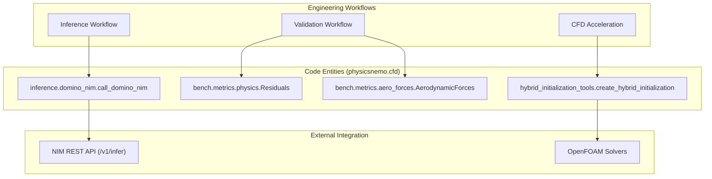
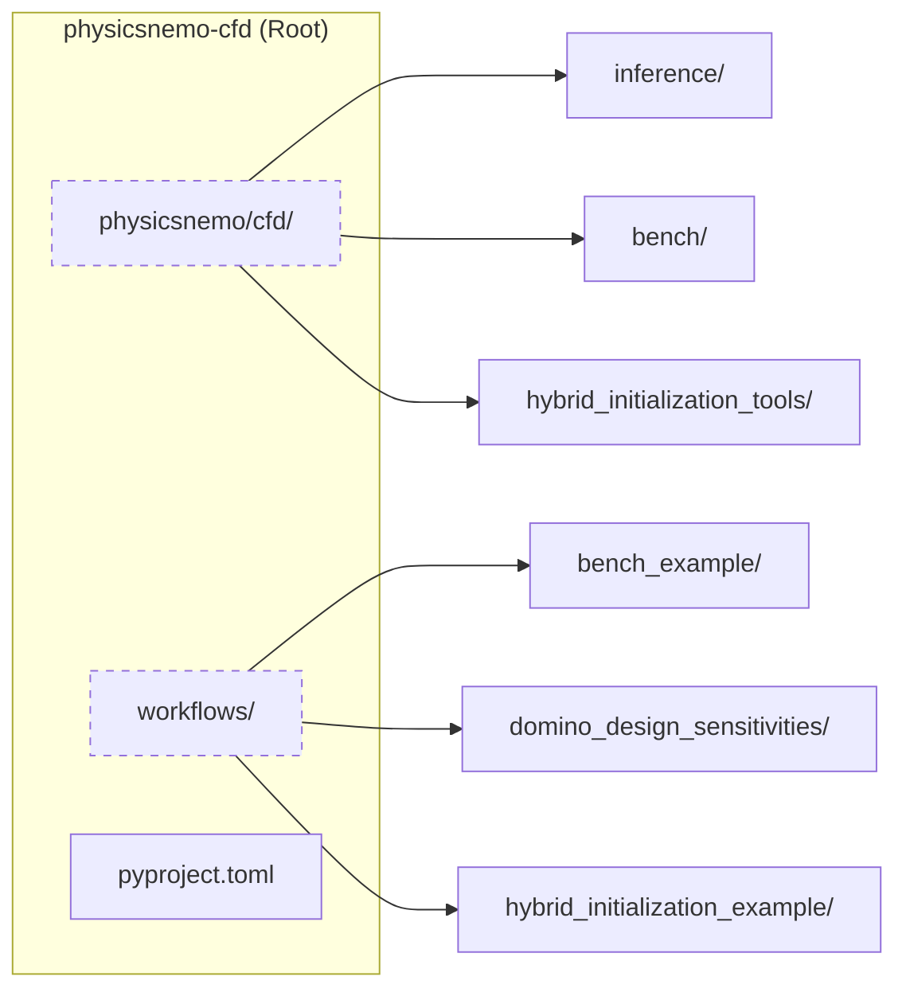

<!-- source: DeepWiki mcp.deepwiki.com · repo NVIDIA/physicsnemo-cfd · page 1 Overview · fetched 2026-10-26 -->

# Overview

Relevant source files

The following files were used as context for generating this wiki page:

- [CHANGELOG.md](CHANGELOG.md)
- [README.md](README.md)
- [physicsnemo/cfd/__init__.py](physicsnemo/cfd/__init__.py)
- [pyproject.toml](pyproject.toml)
- [workflows/bench_example/notebooks/img/design_scatter_plot.png](workflows/bench_example/notebooks/img/design_scatter_plot.png)
- [workflows/bench_example/notebooks/img/design_trend_plot.png](workflows/bench_example/notebooks/img/design_trend_plot.png)

The **PhysicsNeMo-CFD** library is a specialized extension of the [NVIDIA PhysicsNeMo framework](https://github.com/NVIDIA/physicsnemo) designed to bridge the gap between high-fidelity AI/ML surrogate models and industrial Computational Fluid Dynamics (CFD) engineering workflows [README.md:16-20](). It provides a collection of modular tools for model inference, validation against traditional CFD solvers, and techniques to accelerate numerical convergence using ML-derived initial conditions [README.md:22-29]().

## Core Pillars

The library is organized around three primary functional pillars:

1.  **NIM Inference**: A Python interface for interacting with NVIDIA Inference Microservices (NIM), specifically the **DoMINO** (Deep Learning for Multiphysics Solutions) model for automotive aerodynamics [README.md:31-36]().
2.  **Benchmarking**: A comprehensive suite of engineering metrics (pointwise errors, aerodynamic forces, PDE residuals) to validate ML model accuracy against ground-truth CFD data [README.md:37-44]().
3.  **Hybrid Initialization**: Workflows that combine ML predictions with potential flow solutions to provide high-quality starting points for CFD solvers, significantly reducing time-to-convergence [README.md:45-49]().

### System Architecture: Bridge to Code Entities

The following diagram illustrates how high-level system components map to specific code entities and modules within the repository.

**System Mapping Diagram**

Sources: [README.md:31-49](), [physicsnemo/cfd/inference/domino_nim.py:107-118]()

## Package Installation and Configuration

PhysicsNeMo-CFD is a Python package targeting version `3.10` or higher [pyproject.toml:12-14](). It can be installed in two primary modes:

*   **Standard Mode**: Includes core dependencies like `numpy`, `scipy`, `pyvista`, and `numba` for CPU-based analysis [pyproject.toml:14-26]().
*   **GPU-Accelerated Mode**: Adds support for `cupy`, `cuml`, and `warp-lang` to enable high-performance metric computation and geometry processing [pyproject.toml:35-39]().

The project uses a **Hydra-based configuration system** to manage parameters across different workflows, ensuring consistency between inference, benchmarking, and hybrid initialization tasks.

For details on environment setup and dependency groups, see **[Installation and Configuration](#1.1)**.

Sources: [pyproject.toml:5-42](), [README.md:51-80]()

## Repository Structure

The repository is split into two main areas:
1.  `physicsnemo/cfd/`: The core library containing reusable modules for metrics, NIM communication, and data structures [pyproject.toml:47-49]().
2.  `workflows/`: Reference implementations and Jupyter notebooks demonstrating end-to-end use cases such as the `bench_example` and `hybrid_initialization_example` [README.md:120-123]().

**Repository Organization**

Sources: [pyproject.toml:44-49](), [README.md:120-123](), [CHANGELOG.md:31-37]()

For a detailed breakdown of the directory layout and instructions on how to contribute to the codebase, see **[Repository Structure and Contributing](#1.2)**.

## Project Status
PhysicsNeMo-CFD is currently an **experimental (v0)** library [README.md:82-84](). While the project is active and provides stable utilities for demonstrating workflows, users should expect breaking changes as the API evolves to support new Physics-ML research and architectures [CHANGELOG.md:1-37]().

Sources: [README.md:4-10](), [README.md:82-87](), [physicsnemo/cfd/__init__.py:17]()

---

