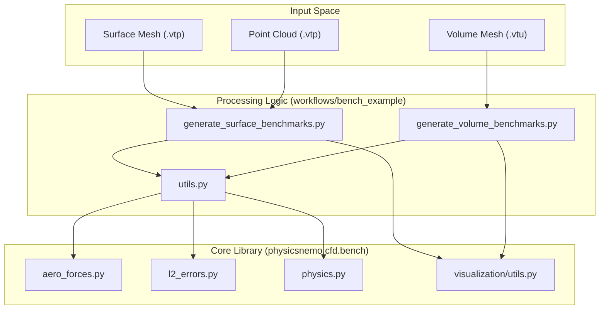
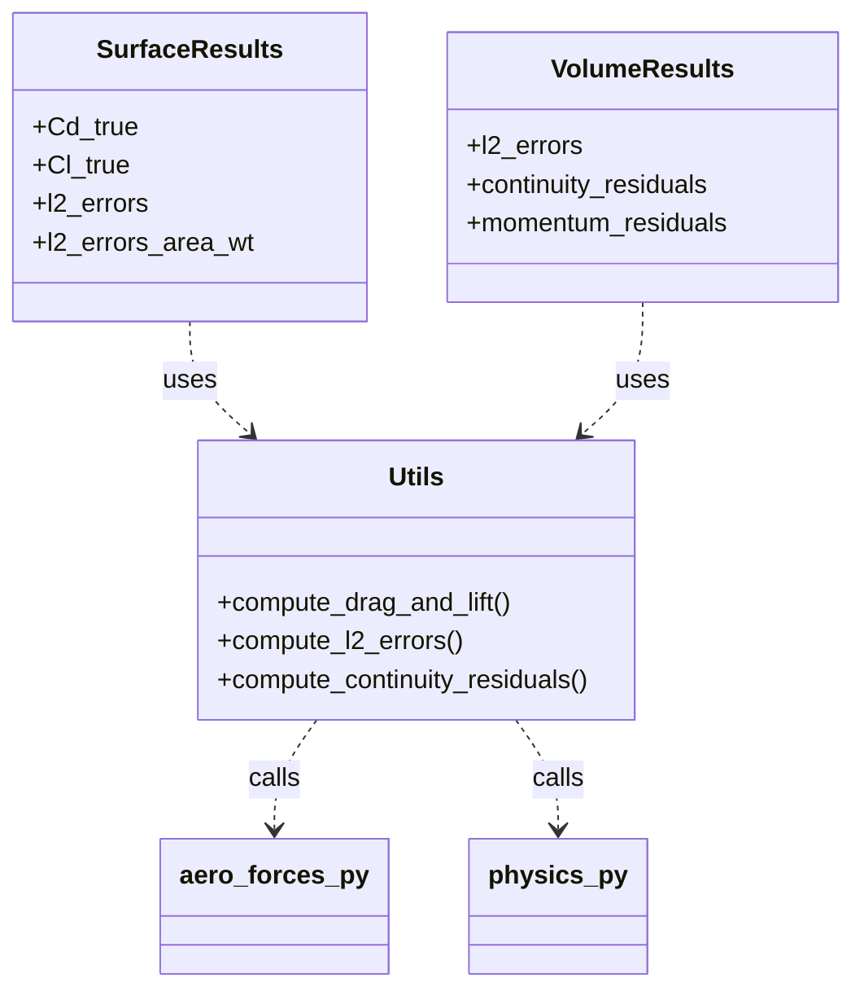

<!-- source: DeepWiki mcp.deepwiki.com · repo NVIDIA/physicsnemo-cfd · page 3.1 Benchmarking Workflow (bench_example) · fetched 2026-10-26 -->

# Benchmarking Workflow (bench_example)

Relevant source files

The following files were used as context for generating this wiki page:

- [workflows/bench_example/README.md](workflows/bench_example/README.md)
- [workflows/bench_example/drivaer_ml_files/README.md](workflows/bench_example/drivaer_ml_files/README.md)
- [workflows/bench_example/generate_pcs_from_stl.py](workflows/bench_example/generate_pcs_from_stl.py)
- [workflows/bench_example/generate_surface_benchmarks.py](workflows/bench_example/generate_surface_benchmarks.py)
- [workflows/bench_example/generate_volume_benchmarks.py](workflows/bench_example/generate_volume_benchmarks.py)
- [workflows/bench_example/utils.py](workflows/bench_example/utils.py)

The benchmarking workflow provides an end-to-end pipeline for evaluating AI surrogate models against Computational Fluid Dynamics (CFD) ground truth. It supports the analysis of both surface fields (critical for aerodynamic coefficients like $C_d$ and $C_l$) and volumetric flow fields (essential for wake and vortex analysis) [workflows/bench_example/README.md:1-11]().

## Workflow Overview

The workflow bridges the gap between raw AI model predictions and engineering metrics. It assumes that model predictions have been post-processed into standard VTK formats (`.vtp` for surfaces, `.vtu` for volumes) where predicted fields (e.g., `pPred`) are stored alongside ground truth fields (e.g., `pMean`) [workflows/bench_example/README.md:22-32]().

### Core Execution Components

The workflow is centered around two primary execution scripts that handle data processing, metric computation, and visualization:

| Script | Purpose | Key Outputs |
| :--- | :--- | :--- |
| `generate_surface_benchmarks.py` | Evaluates surface predictions on meshes or point clouds. | L2 errors, Drag ($C_d$)/Lift ($C_l$) regression, centerline plots. |
| `generate_volume_benchmarks.py` | Evaluates volumetric flow fields. | Volumetric L2 errors, wake profiles, continuity/momentum residuals. |

### System Data Flow

The following diagram illustrates how the benchmarking scripts interact with the `physicsnemo.cfd.bench` library and the filesystem.

**Benchmarking Data Flow**

Sources: [workflows/bench_example/generate_surface_benchmarks.py:30-45](), [workflows/bench_example/generate_volume_benchmarks.py:35-44](), [workflows/bench_example/utils.py:25-41]()

## Dataset and Point Cloud Generation

### DrivAerML Dataset
The workflow is designed to work with the **DrivAerML** dataset, consisting of 484 usable car geometries [workflows/bench_example/drivaer_ml_files/README.md:3-4](). The repository proposes a specific 90/10 train-validation split. To ensure robustness, the validation set is curated by sorting the dataset by drag force and selecting the top 10%, bottom 10%, and a random 80% of the remaining samples [workflows/bench_example/drivaer_ml_files/README.md:9-14]().

### Point Cloud Generation
For real-time inference where mesh generation is too slow, the workflow supports point cloud evaluation.
- `generate_pcs_from_stl.py` uses the `physicsnemo.sym` library to sample boundary points directly from STL files [workflows/bench_example/generate_pcs_from_stl.py:28-35]().
- `interpolate_mesh_to_pc` in `utils.py` allows mapping ground truth simulation results from a mesh onto these point clouds for direct comparison [workflows/bench_example/utils.py:143-145]().

Sources: [workflows/bench_example/drivaer_ml_files/README.md:1-22](), [workflows/bench_example/generate_pcs_from_stl.py:1-52](), [workflows/bench_example/utils.py:31-33]()

## Interpreting Benchmark Outputs

The scripts aggregate results into CSV files and visual plots located in the specified `--output-dir` [workflows/bench_example/generate_surface_benchmarks.py:68-72]().

### Surface Metrics
- **L2 Errors**: Standard and area-weighted L2 errors for pressure and Wall Shear Stress (WSS) [workflows/bench_example/utils.py:104-127]().
- **Aerodynamic Coefficients**: Comparison of $C_d$ and $C_l$ (total, pressure, and friction components) [workflows/bench_example/utils.py:77-101]().
- **Trend Plots**: `plot_design_trend` and `plot_design_scatter` visualize how well the model captures performance variations across different geometries [workflows/bench_example/generate_surface_benchmarks.py:30-35]().

### Volume Metrics
- **Wake Analysis**: Slices and profiles at specific locations (e.g., `wake_x_4`, `wake_x_5`) to evaluate flow separation and recovery [workflows/bench_example/generate_volume_benchmarks.py:129-132]().
- **Physics Residuals**: If enabled, the workflow computes continuity and momentum residuals using `compute_continuity_residuals` and `compute_momentum_residuals` to check the physical consistency of the AI predictions [workflows/bench_example/utils.py:34-37](), [workflows/bench_example/generate_volume_benchmarks.py:92-102]().

**Metric Association Diagram**

Sources: [workflows/bench_example/utils.py:51-202](), [workflows/bench_example/generate_volume_benchmarks.py:147-182]()

## Detailed Guides
The following child pages provide interactive environments and specialized benchmarking scenarios:

*   **[Benchmarking Notebooks](#3.1.1)**: Detailed walkthrough of `surface_benchmarking.ipynb` and `volume_benchmarking.ipynb`. Explains how to use the interactive `benchmarking_in_absence_of_gt.ipynb` for cases where CFD data is unavailable.

---

