# Page: Overview

# Overview

<details>
<summary>Relevant source files</summary>

The following files were used as context for generating this wiki page:

- [CHANGELOG.md](CHANGELOG.md)
- [README.md](README.md)
- [physicsnemo/cfd/__init__.py](physicsnemo/cfd/__init__.py)
- [pyproject.toml](pyproject.toml)
- [workflows/bench_example/notebooks/img/design_scatter_plot.png](workflows/bench_example/notebooks/img/design_scatter_plot.png)
- [workflows/bench_example/notebooks/img/design_trend_plot.png](workflows/bench_example/notebooks/img/design_trend_plot.png)

</details>


The **PhysicsNeMo-CFD** library is a specialized extension of the [NVIDIA PhysicsNeMo framework](https://github.com/NVIDIA/physicsnemo) designed to bridge the gap between high-fidelity AI/ML surrogate models and industrial Computational Fluid Dynamics (CFD) engineering workflows [README.md:16-20](). It provides a collection of modular tools for model inference, validation against traditional CFD solvers, and techniques to accelerate numerical convergence using ML-derived initial conditions [README.md:22-29]().

## Core Pillars

The library is organized around three primary functional pillars:

1.  **NIM Inference**: A Python interface for interacting with NVIDIA Inference Microservices (NIM), specifically the **DoMINO** (Deep Learning for Multiphysics Solutions) model for automotive aerodynamics [README.md:31-36]().
2.  **Benchmarking**: A comprehensive suite of engineering metrics (pointwise errors, aerodynamic forces, PDE residuals) to validate ML model accuracy against ground-truth CFD data [README.md:37-44]().
3.  **Hybrid Initialization**: Workflows that combine ML predictions with potential flow solutions to provide high-quality starting points for CFD solvers, significantly reducing time-to-convergence [README.md:45-49]().

### System Architecture: Bridge to Code Entities

The following diagram illustrates how high-level system components map to specific code entities and modules within the repository.

**System Mapping Diagram**
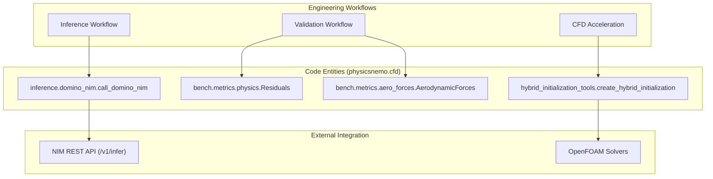
Sources: [README.md:31-49](), [physicsnemo/cfd/inference/domino_nim.py:107-118]()

## Package Installation and Configuration

PhysicsNeMo-CFD is a Python package targeting version `3.10` or higher [pyproject.toml:12-14](). It can be installed in two primary modes:

*   **Standard Mode**: Includes core dependencies like `numpy`, `scipy`, `pyvista`, and `numba` for CPU-based analysis [pyproject.toml:14-26]().
*   **GPU-Accelerated Mode**: Adds support for `cupy`, `cuml`, and `warp-lang` to enable high-performance metric computation and geometry processing [pyproject.toml:35-39]().

The project uses a **Hydra-based configuration system** to manage parameters across different workflows, ensuring consistency between inference, benchmarking, and hybrid initialization tasks.

For details on environment setup and dependency groups, see **[Installation and Configuration](#1.1)**.

Sources: [pyproject.toml:5-42](), [README.md:51-80]()

## Repository Structure

The repository is split into two main areas:
1.  `physicsnemo/cfd/`: The core library containing reusable modules for metrics, NIM communication, and data structures [pyproject.toml:47-49]().
2.  `workflows/`: Reference implementations and Jupyter notebooks demonstrating end-to-end use cases such as the `bench_example` and `hybrid_initialization_example` [README.md:120-123]().

**Repository Organization**
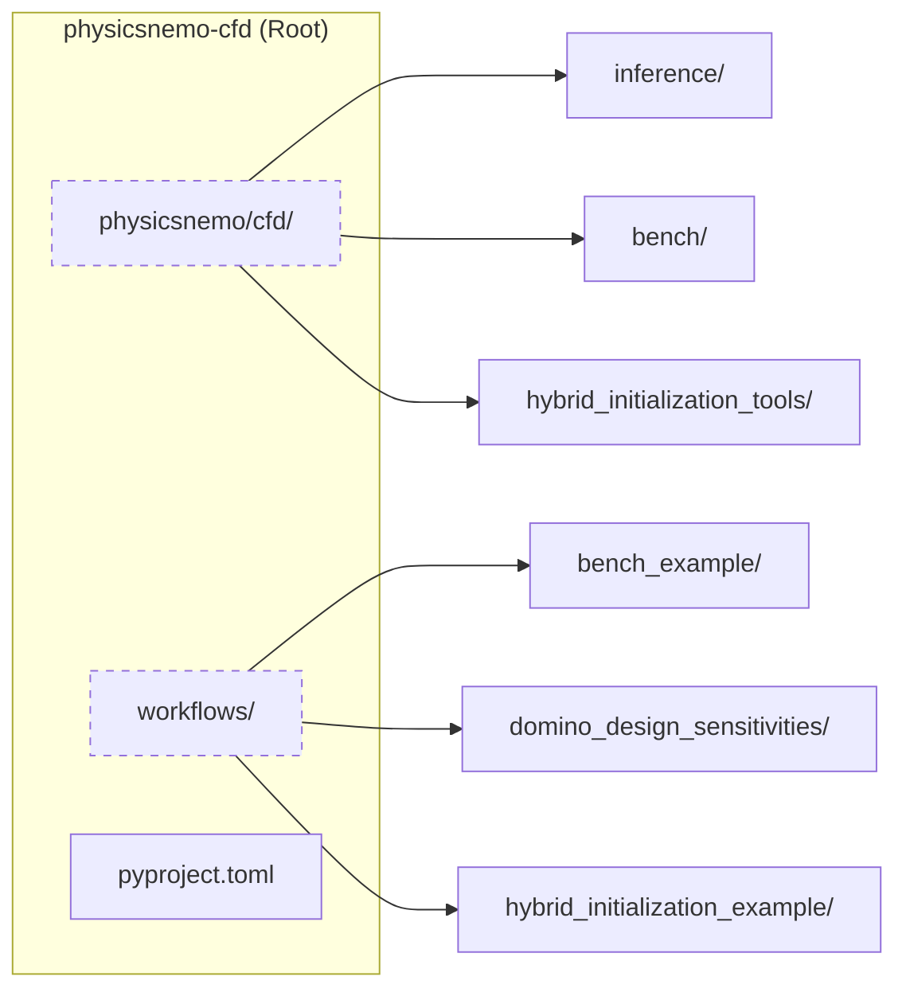
Sources: [pyproject.toml:44-49](), [README.md:120-123](), [CHANGELOG.md:31-37]()

For a detailed breakdown of the directory layout and instructions on how to contribute to the codebase, see **[Repository Structure and Contributing](#1.2)**.

## Project Status
PhysicsNeMo-CFD is currently an **experimental (v0)** library [README.md:82-84](). While the project is active and provides stable utilities for demonstrating workflows, users should expect breaking changes as the API evolves to support new Physics-ML research and architectures [CHANGELOG.md:1-37]().

Sources: [README.md:4-10](), [README.md:82-87](), [physicsnemo/cfd/__init__.py:17]()

---

# Page: Installation and Configuration

# Installation and Configuration

<details>
<summary>Relevant source files</summary>

The following files were used as context for generating this wiki page:

- [pyproject.toml](pyproject.toml)
- [workflows/domino_design_sensitivities/conf/config.yaml](workflows/domino_design_sensitivities/conf/config.yaml)

</details>


This page provides technical details for installing the `nvidia-physicsnemo-cfd` package and understanding its configuration architecture. The library is designed to bridge AI/ML models with Computational Fluid Dynamics (CFD) workflows, offering both standard CPU-based utilities and high-performance GPU-accelerated kernels.

## Package Installation

The library is a Python-based package requiring **Python 3.10 or higher** [pyproject.toml:12-12](). It utilizes `setuptools` for distribution and defines dependencies across different execution modes.

### Standard Installation
The base installation includes core dependencies for CFD data handling, basic physics calculations, and communication with NVIDIA Inference Microservices (NIM). Key dependencies include:
*   `numpy` and `scipy` for numerical operations [pyproject.toml:16-21]().
*   `pyvista` and `trimesh` for mesh and geometry processing [pyproject.toml:17-23]().
*   `numba` for JIT-compiled physics kernels [pyproject.toml:19-19]().
*   `nvidia-physicsnemo` for core AI model components [pyproject.toml:25-25]().

### GPU-Accelerated Installation
For high-performance workflows (e.g., large-scale benchmarking or sensitivity analysis), the library provides an optional `gpu` dependency group. This group introduces specialized libraries for CUDA-accelerated computing:

| Dependency | Purpose |
| :--- | :--- |
| `cupy-cuda13x` | GPU-accelerated array operations (CUDA 13.x requirement) |
| `cuml-cu13` | GPU-accelerated K-Nearest Neighbors (KNN) and manifold learning |
| `warp-lang` | NVIDIA Warp for high-performance geometry kernels |

To install with GPU support, use:
```bash
pip install nvidia-physicsnemo-cfd[gpu]
```
[pyproject.toml:33-42]()

### Installation Entity Mapping
The following diagram illustrates how the installation configuration in `pyproject.toml` maps to the functional components of the library.

**Figure 1: Dependency Mapping to Functional Modules**
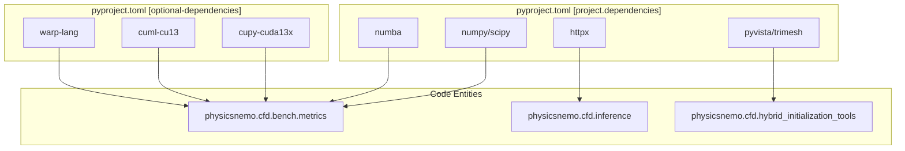
Sources: [pyproject.toml:14-42]()

---

## Configuration System (Hydra)

The library utilizes **Hydra** for hierarchical configuration management across all workflows. This allows users to override complex parameters via YAML files or command-line arguments without modifying the source code.

### Configuration Structure
Workflows, such as the `domino_design_sensitivities`, utilize a centralized `config.yaml` to define data paths, model hyperparameters, and execution environments.

Key configuration blocks include:
*   **Project Details**: Defines output directories and experiment tagging [workflows/domino_design_sensitivities/conf/config.yaml:20-35]().
*   **Data Preprocessing**: Controls the behavior of data loaders, including `kind` (e.g., `drivaer_aws`) and cache settings [workflows/domino_design_sensitivities/conf/config.yaml:39-45]().
*   **Model Parameters**: Configures the neural network architecture, including `interp_res` for latent space resolution and `geometry_encoding_type` (SDF, STL, or both) [workflows/domino_design_sensitivities/conf/config.yaml:89-110]().
*   **GPU Settings**: Explicit flags like `gpu_preprocessing` and `gpu_output` toggle between CPU and GPU execution paths [workflows/domino_design_sensitivities/conf/config.yaml:75-76]().

### Configuration Data Flow
The configuration is parsed at runtime and injected into core classes like `DesignDatapipe` or `DoMINOInference`.

**Figure 2: Hydra Configuration Injection**
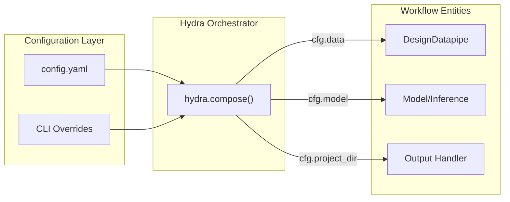
Sources: [workflows/domino_design_sensitivities/conf/config.yaml:20-110]()

### Key Configuration Parameters

| Parameter | Type | Description |
| :--- | :--- | :--- |
| `project_dir` | String | Root path for all experiment outputs [workflows/domino_design_sensitivities/conf/config.yaml:25-25](). |
| `bounding_box` | List | Min/Max coordinates defining the computational domain [workflows/domino_design_sensitivities/conf/config.yaml:69-71](). |
| `surface_sampling_algorithm` | Enum | Method for sampling points on STL (`random` or `area_weighted`) [workflows/domino_design_sensitivities/conf/config.yaml:99-99](). |
| `integral_loss_scaling_factor` | Float | Multiplier for physics-based integral losses [workflows/domino_design_sensitivities/conf/config.yaml:105-105](). |
| `pin_memory` | Boolean | Optimization for CPU-to-GPU data transfer in dataloaders [workflows/domino_design_sensitivities/conf/config.yaml:154-154](). |

Sources: [workflows/domino_design_sensitivities/conf/config.yaml:1-177]()

---

# Page: Repository Structure and Contributing

# Repository Structure and Contributing

<details>
<summary>Relevant source files</summary>

The following files were used as context for generating this wiki page:

- [.github/PULL_REQUEST_TEMPLATE.md](.github/PULL_REQUEST_TEMPLATE.md)
- [.github/workflows/blossom-ci.yml](.github/workflows/blossom-ci.yml)
- [.github/workflows/mq-blossom-faker.yml](.github/workflows/mq-blossom-faker.yml)
- [CONTRIBUTING.md](CONTRIBUTING.md)
- [Makefile](Makefile)
- [SECURITY.md](SECURITY.md)
- [test/ci_tests/copyright.txt](test/ci_tests/copyright.txt)
- [test/ci_tests/header_check.py](test/ci_tests/header_check.py)

</details>


This page details the organizational layout of the PhysicsNeMo-CFD repository, the standards for contributing code, and the automated pipelines used to maintain code quality and legal compliance.

## Repository Layout

The repository is divided into two primary areas: the core `physicsnemo.cfd` library and the `workflows` directory which contains end-to-end reference implementations.

### Top-Level Structure

| Directory / File | Description |
| :--- | :--- |
| `physicsnemo/cfd/` | The core Python package containing modular tools for inference, benchmarking, and initialization. |
| `workflows/` | High-level scripts and notebooks demonstrating specific engineering use cases (e.g., design sensitivities). |
| `test/` | Contains CI/CD utility scripts, including copyright header enforcement. |
| `.github/` | GitHub-specific configurations, including issue templates, PR templates, and CI workflows. |
| `Makefile` | Shortcuts for common development tasks like linting, installing, and running checks. |

### Code Entity Mapping

The following diagram maps the high-level functional pillars of the project to their respective locations in the codebase.

**System to Code Entity Mapping**
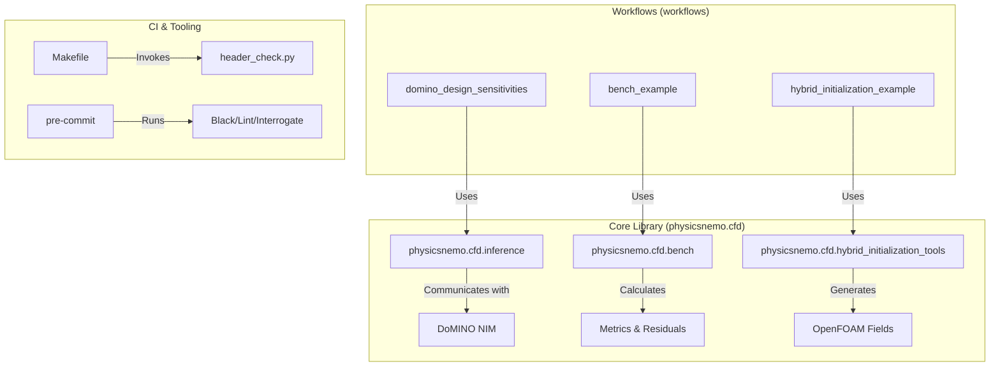
**Sources:** `physicsnemo/cfd/` (implied structure), `workflows/` (implied structure), [Makefile:1-36](), [test/ci_tests/header_check.py:124-160]()

---

## Contributing Guidelines

PhysicsNeMo-CFD is an open-source project that follows a standard fork-and-pull-request model.

### Development Workflow
1.  **Fork and Clone**: Developers must fork the upstream repository and push changes to their personal fork [[CONTRIBUTING.md:32-35]]().
2.  **Issue Linking**: Every Pull Request (PR) should correspond to an open issue and be linked accordingly [[CONTRIBUTING.md:47-49]]().
3.  **Sign-off**: All commits must be signed off using `git commit -s` to certify the Developer Certificate of Origin (DCO) [[CONTRIBUTING.md:75-85]]().
4.  **Changelog**: Contributors are required to update `CHANGELOG.md` to reflect their changes [[CONTRIBUTING.md:43-43]]().

### Pull Request Checklist
When submitting a PR, the following items must be verified:
*   Documentation is updated [[.github/PULL_REQUEST_TEMPLATE.md:12-12]]().
*   New or existing tests cover the changes [[.github/PULL_REQUEST_TEMPLATE.md:11-11]]().
*   The `CHANGELOG.md` is updated [[.github/PULL_REQUEST_TEMPLATE.md:13-13]]().

**Sources:** [CONTRIBUTING.md:30-49](), [CONTRIBUTING.md:75-131](), [.github/PULL_REQUEST_TEMPLATE.md:1-18]()

---

## CI/CD and Quality Control

The repository employs several automated checks to ensure code style, documentation coverage, and legal compliance.

### Pre-commit Hooks
The use of `pre-commit` is mandatory for all contributors [[CONTRIBUTING.md:135-137]](). These hooks run automatically on every commit to check:
*   **Black**: Code formatting [[Makefile:13-14]]().
*   **Interrogate**: Documentation coverage [[Makefile:16-17]]().
*   **Markdownlint**: Documentation formatting [[Makefile:19-20]]().
*   **Large File Check**: Prevents accidental commits of heavy binaries [[Makefile:21-21]]().

### Copyright and Licensing
All source files must include the standard NVIDIA SPDX copyright header [[CONTRIBUTING.md:53-71]](). Compliance is enforced via a specialized script:
*   **Script**: `test/ci_tests/header_check.py` [[test/ci_tests/header_check.py:18-18]]()
*   **Template**: `test/ci_tests/copyright.txt` [[test/ci_tests/copyright.txt:1-15]]()
*   **Execution**: Can be run via `make license` [[Makefile:23-24]]().

The `header_check.py` script validates the presence of the header, checks for the correct year range, and respects `.gitignore` patterns [[test/ci_tests/header_check.py:163-168]]().

### Blossom-CI
For internal NVIDIA runners and specialized GPU testing, the repository uses **Blossom-CI**.
*   Triggered by comments such as `/blossom-ci` or `/multi-gpu-ci` on PRs [[.github/workflows/blossom-ci.yml:41-42]]().
*   Includes authorization checks to ensure only authorized actors can trigger CI jobs [[.github/workflows/blossom-ci.yml:43-46]]().
*   Performs vulnerability scans as part of the pipeline [[.github/workflows/blossom-ci.yml:55-56]]().

**Sources:** [CONTRIBUTING.md:133-149](), [Makefile:9-25](), [test/ci_tests/header_check.py:124-203](), [.github/workflows/blossom-ci.yml:17-56]()

---

## Development Automation (Makefile)

The `Makefile` provides a standardized interface for common development tasks.

| Target | Command | Purpose |
| :--- | :--- | :--- |
| `install` | `pip install -e .` | Standard package installation [[Makefile:1-3]](). |
| `editable-install`| `pip install -e .[dev]` | Installation with development dependencies in strict editable mode [[Makefile:5-7]](). |
| `setup-ci` | `pip install pre-commit && pre-commit install` | Initializes the local environment for development [[Makefile:9-11]](). |
| `lint` | `pre-commit run markdownlint -a ...` | Runs formatting and file size checks [[Makefile:19-21]](). |
| `license` | `python test/ci_tests/header_check.py --all-files` | Verifies copyright headers across the entire project [[Makefile:23-24]](). |
| `all-ci` | Runs all checks | Executes setup, linting, license checks, and tests [[Makefile:35-35]](). |

**Sources:** [Makefile:1-36]()

---

## Security
Security vulnerabilities should **not** be reported via GitHub issues. NVIDIA provides a dedicated Product Security Incident Response Team (PSIRT) for reporting potential vulnerabilities [[SECURITY.md:7-14]]().

**Sources:** [SECURITY.md:1-36]()

---

# Page: Core Library: physicsnemo.cfd

# Core Library: physicsnemo.cfd

<details>
<summary>Relevant source files</summary>

The following files were used as context for generating this wiki page:

- [.pre-commit-config.yaml](.pre-commit-config.yaml)
- [physicsnemo/cfd/__init__.py](physicsnemo/cfd/__init__.py)
- [physicsnemo/cfd/bench/metrics/aero_forces.py](physicsnemo/cfd/bench/metrics/aero_forces.py)
- [physicsnemo/cfd/bench/metrics/frontal_area.py](physicsnemo/cfd/bench/metrics/frontal_area.py)
- [physicsnemo/cfd/bench/metrics/physics.py](physicsnemo/cfd/bench/metrics/physics.py)
- [physicsnemo/cfd/hybrid_initialization_tools/__init__.py](physicsnemo/cfd/hybrid_initialization_tools/__init__.py)
- [workflows/bench_example/notebooks/img/design_scatter_plot.png](workflows/bench_example/notebooks/img/design_scatter_plot.png)
- [workflows/bench_example/notebooks/img/design_trend_plot.png](workflows/bench_example/notebooks/img/design_trend_plot.png)

</details>


The `physicsnemo.cfd` package serves as the foundational library for the PhysicsNeMo-CFD project. It provides the core logic for interacting with AI surrogate models, evaluating their physical accuracy against ground truth, and integrating their predictions back into traditional CFD solvers.

The library is organized into three primary sub-modules that handle distinct stages of an AI-augmented CFD workflow:

1.  **`inference`**: Communication with the DoMINO NIM microservice.
2.  **`bench`**: Evaluation of model performance using geometric and physical metrics.
3.  **`hybrid_initialization_tools`**: Data blending and interpolation for CFD solver initialization.

### System Architecture and Module Relationships

The following diagram illustrates how the three core sub-modules interact within the broader engineering workflow.

**Workflow Integration Diagram**
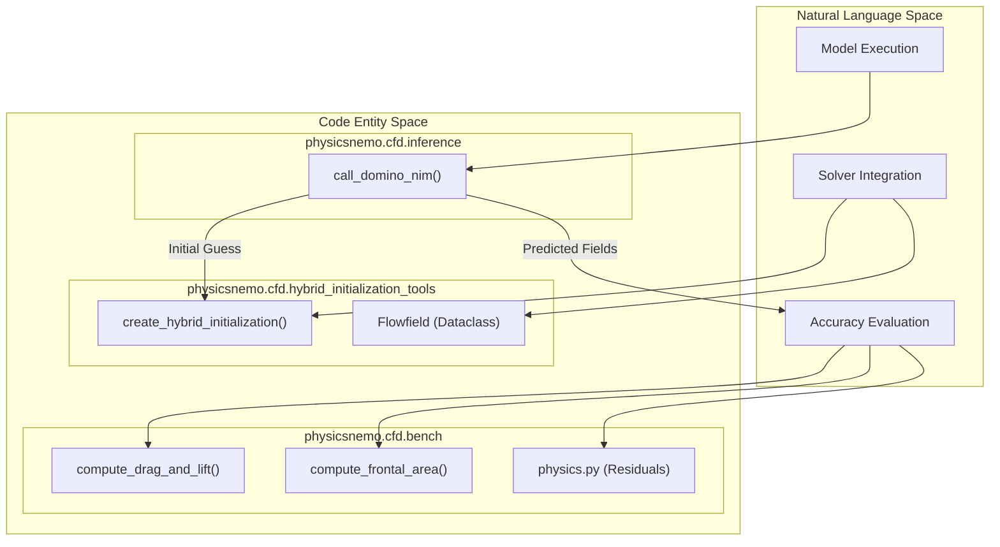
**Sources:** [physicsnemo/cfd/__init__.py:1-18](), [physicsnemo/cfd/hybrid_initialization_tools/__init__.py:17-24](), [physicsnemo/cfd/bench/metrics/aero_forces.py:72-146]().

---

### 2.1 Inference Module (`physicsnemo.cfd.inference`)
The `inference` module provides the interface for the **DoMINO NIM** (NVIDIA Inference Microservice). It abstracts the HTTP/REST communication required to send geometry data (STL) to the microservice and receive predicted volumetric flow fields.

*   **Key Functionality**: The `call_domino_nim` function handles payload serialization, service requests, and response parsing.
*   **Data Handling**: Supports input as STL files and returns data as structured numpy arrays or PyVista datasets.
*   **Deployment**: Includes scripts like `launch_local_domino_nim.sh` for managing local containerized deployments of the inference engine.

For details, see [Inference Module (physicsnemo.cfd.inference)](#2.1).

---

### 2.2 Benchmarking Module (`physicsnemo.cfd.bench`)
The `bench` module is used to quantify the "goodness" of an AI prediction. It compares predicted fields against "Ground Truth" (GT) data typically generated by high-fidelity CFD solvers (e.g., OpenFOAM).

| Sub-Directory | Primary Responsibility | Key Code Entities |
| :--- | :--- | :--- |
| `metrics` | Physics and Error calculations | `compute_drag_and_lift`, `compute_frontal_area` |
| `geometry` | Spatial relationship analysis | Hausdorff/Chamfer distance functions |
| `interpolation` | Mapping data between meshes | KNN-based IDW interpolation |
| `visualization` | Generating performance plots | `utils.py` (Streamlines, hexbins) |

**Code-to-System Mapping: Benchmarking Metrics**
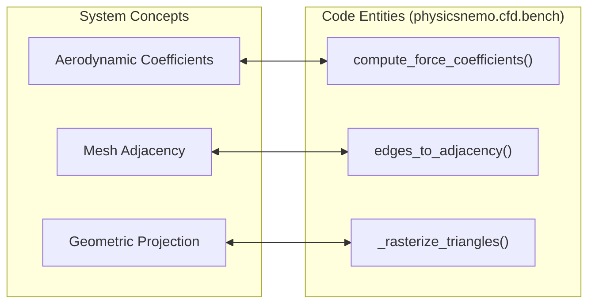

For details, see [Benchmarking Module (physicsnemo.cfd.bench)](#2.2).

**Sources:** [physicsnemo/cfd/bench/metrics/aero_forces.py:21-69](), [physicsnemo/cfd/bench/metrics/physics.py:27-87](), [physicsnemo/cfd/bench/metrics/frontal_area.py:24-68]().

---

### 2.3 Hybrid Initialization Tools (`physicsnemo.cfd.hybrid_initialization_tools`)
This module provides utilities to use AI predictions as a "warm start" for traditional CFD solvers. By providing a physically informed initial guess rather than a uniform field, solvers can reach convergence significantly faster.

*   **`Flowfield`**: A specialized dataclass [physicsnemo/cfd/hybrid_initialization_tools/flowfield.py]() used to represent and manipulate multi-component fields (e.g., $U, p, k, \omega$).
*   **`create_hybrid_initialization`**: The primary entry point for blending different initialization strategies (e.g., potential flow vs. AI prediction).
*   **Blending Strategies**: Implements k-field weighting to transition between different flow regimes.
*   **Interoperability**: Includes `openfoam_utils` and `pyvista_utils` to bridge the gap between Python-based AI data and solver-specific file formats.

For details, see [Hybrid Initialization Tools (physicsnemo.cfd.hybrid_initialization_tools)](#2.3).

**Sources:** [physicsnemo/cfd/hybrid_initialization_tools/__init__.py:17-24]().

---

# Page: Inference Module (physicsnemo.cfd.inference)

# Inference Module (physicsnemo.cfd.inference)

<details>
<summary>Relevant source files</summary>

The following files were used as context for generating this wiki page:

- [physicsnemo/cfd/inference/domino_nim.py](physicsnemo/cfd/inference/domino_nim.py)
- [physicsnemo/cfd/inference/launch_local_domino_nim.sh](physicsnemo/cfd/inference/launch_local_domino_nim.sh)

</details>


The Inference Module provides a standardized interface for interacting with the **DoMINO NIM** (NVIDIA Inference Microservice), a specialized AI surrogate model for automotive aerodynamics. This module abstracts the complexities of HTTP communication, geometry preprocessing, and data serialization, allowing users to obtain high-fidelity CFD-like predictions (velocity, pressure, turbulent quantities) directly from STL geometry files.

## DoMINO NIM Interface

The primary entry point for the inference module is the `call_domino_nim` function. This function manages the lifecycle of an inference request, from preparing the mesh to parsing the multi-modal response from the microservice.

### The `call_domino_nim` Function
The function `call_domino_nim` handles the transmission of geometry and simulation parameters to the NIM endpoint. It supports both default random point cloud generation and user-provided point clouds for targeted inference.

**Key Features:**
*   **Mesh Consolidation**: Automatically converts complex `trimesh.Scene` objects into a single consolidated STL mesh before transmission [physicsnemo/cfd/inference/domino_nim.py:94-98]().
*   **Flexible Endpoints**: While it defaults to the full inference path (`/v1/infer`), it can be configured to target volume-only or surface-only endpoints [physicsnemo/cfd/inference/domino_nim.py:39-44]().
*   **Robust Communication**: Implements error handling for connection timeouts and REST API failures [physicsnemo/cfd/inference/domino_nim.py:123-132]().

### Data Flow: Natural Language to Code Entities
The following diagram illustrates how high-level inference concepts map to specific code implementations and data structures within the module.

**Inference Mapping Diagram**
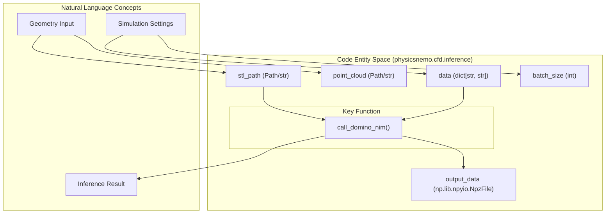
Sources: [physicsnemo/cfd/inference/domino_nim.py:23-77]()

## Communication and Data Formats

The module communicates with the NIM microservice via HTTP/REST using the `httpx` library. Data is exchanged using `multipart/form-data` for files and standard form fields for simulation parameters.

### Input Parameters
The NIM accepts several parameters that control the fidelity and scope of the surrogate prediction:
| Parameter | Type | Default | Description |
| :--- | :--- | :--- | :--- |
| `stream_velocity` | `str` | "40" | Freestream velocity in m/s. |
| `stencil_size` | `str` | "1" | Controls the spatial resolution of the simulation. |
| `point_cloud_size`| `str` | "500000" | Number of points sampled in the output volume. |
| `batch_size` | `str` | None | Processing batch size for the model backbone. |

Sources: [physicsnemo/cfd/inference/domino_nim.py:45-59](), [physicsnemo/cfd/inference/domino_nim.py:78-83]()

### Output Data Structure
The response from the NIM is a serialized NumPy archive (`.npz`). The `call_domino_nim` function deserializes this into a dictionary containing the following fields:

*   **Volume Fields**: `coordinates`, `velocity`, `pressure`, `sdf`, `turbulent-kinetic-energy`, `turbulent-viscosity`.
*   **Surface Fields**: `surface_coordinates`, `pressure_surface`, `wall-shear-stress`.
*   **Integrated Metrics**: `drag_force`, `lift_force`.
*   **Metadata**: `bounding_box_dims`.

Sources: [physicsnemo/cfd/inference/domino_nim.py:63-77](), [physicsnemo/cfd/inference/domino_nim.py:168-170]()

## Local Deployment

To facilitate local development and testing, the module includes a utility script for deploying the DoMINO NIM as a Docker container.

### `launch_local_domino_nim.sh`
This script automates the deployment of the `domino-automotive-aero` NIM container. It performs several pre-flight checks:
1.  **Authentication**: Verifies the `NGC_API_KEY` environment variable and logs into `nvcr.io` [physicsnemo/cfd/inference/launch_local_domino_nim.sh:7-28]().
2.  **Port Management**: Checks if the default port (`8000`) is occupied and offers to stop conflicting containers [physicsnemo/cfd/inference/launch_local_domino_nim.sh:31-47]().
3.  **GPU Configuration**: Launches the container with the NVIDIA runtime and specific shared memory requirements (`--shm-size 2g`) [physicsnemo/cfd/inference/launch_local_domino_nim.sh:51-58]().

**Local Deployment Architecture**
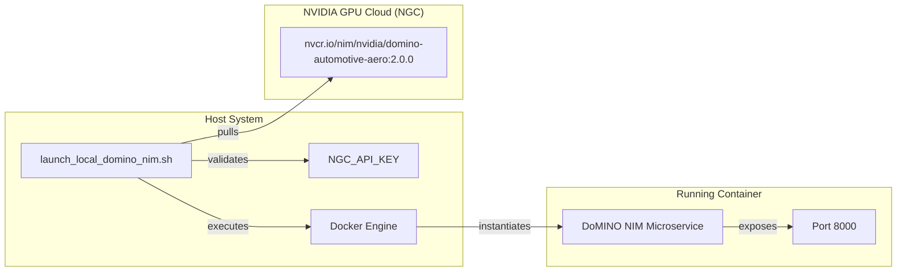
Sources: [physicsnemo/cfd/inference/launch_local_domino_nim.sh:1-59]()

---

# Page: Benchmarking Module (physicsnemo.cfd.bench)

# Benchmarking Module (physicsnemo.cfd.bench)

<details>
<summary>Relevant source files</summary>

The following files were used as context for generating this wiki page:

- [.pre-commit-config.yaml](.pre-commit-config.yaml)
- [physicsnemo/cfd/bench/geometry/distance.py](physicsnemo/cfd/bench/geometry/distance.py)
- [physicsnemo/cfd/bench/interpolation/interpolate_mesh_to_pc.py](physicsnemo/cfd/bench/interpolation/interpolate_mesh_to_pc.py)
- [physicsnemo/cfd/bench/metrics/aero_forces.py](physicsnemo/cfd/bench/metrics/aero_forces.py)
- [physicsnemo/cfd/bench/metrics/frontal_area.py](physicsnemo/cfd/bench/metrics/frontal_area.py)
- [physicsnemo/cfd/bench/metrics/l2_errors.py](physicsnemo/cfd/bench/metrics/l2_errors.py)
- [physicsnemo/cfd/bench/metrics/physics.py](physicsnemo/cfd/bench/metrics/physics.py)
- [physicsnemo/cfd/bench/metrics/streamlines.py](physicsnemo/cfd/bench/metrics/streamlines.py)
- [physicsnemo/cfd/bench/visualization/utils.py](physicsnemo/cfd/bench/visualization/utils.py)
- [physicsnemo/cfd/hybrid_initialization_tools/__init__.py](physicsnemo/cfd/hybrid_initialization_tools/__init__.py)
- [workflows/bench_example/setup.sh](workflows/bench_example/setup.sh)

</details>


The `physicsnemo.cfd.bench` module provides a comprehensive suite of tools for evaluating AI surrogate models against high-fidelity Computational Fluid Dynamics (CFD) ground truth. It facilitates the calculation of standard error metrics, physics-based residuals on unstructured meshes, aerodynamic coefficients, and geometric fidelity measures.

The module is organized into four functional areas:
1.  **Metrics**: Quantitative evaluation of field accuracy and physics consistency.
2.  **Geometry**: Comparison of geometric shapes and point cloud distances.
3.  **Interpolation**: Data transfer between meshes and point clouds for cross-format evaluation.
4.  **Visualization**: Qualitative analysis through field comparisons, streamlines, and trend plots.

### System Architecture: Benchmarking Components

The following diagram illustrates how the various sub-packages interact to process CFD data and AI predictions into benchmarking results.

**Benchmarking Data Flow**
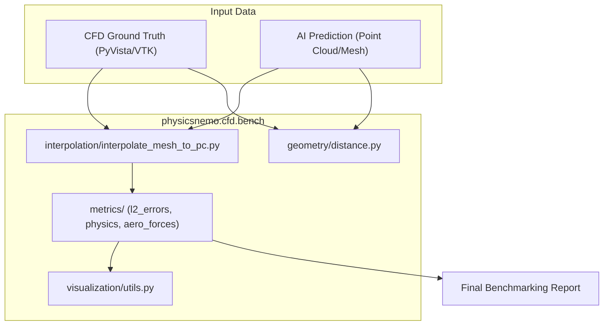
**Sources:** [physicsnemo/cfd/bench/metrics/l2_errors.py:22-43](), [physicsnemo/cfd/bench/interpolation/interpolate_mesh_to_pc.py:96-114](), [physicsnemo/cfd/bench/visualization/utils.py:29-39]()

---

### Physics Metrics: Residuals and Aerodynamic Forces
This sub-package provides tools to evaluate if AI predictions satisfy the underlying governing equations of fluid dynamics and if they accurately predict engineering quantities of interest like Drag ($C_d$) and Lift ($C_l$).

*   **Residuals**: Computes continuity and momentum residuals directly on unstructured meshes using Numba-accelerated kernels [physicsnemo/cfd/bench/metrics/physics.py:27-87]().
*   **Aerodynamic Forces**: Integrates pressure and Wall Shear Stress (WSS) over surface meshes to compute force coefficients [physicsnemo/cfd/bench/metrics/aero_forces.py:21-69]().
*   **Frontal Area**: Provides exact (polygon union) and approximate (GPU-accelerated rasterization) methods to calculate the reference area for coefficient normalization [physicsnemo/cfd/bench/metrics/frontal_area.py:117-175]().

For details, see [Physics Metrics: Residuals and Aerodynamic Forces](#2.2.1).

**Sources:** [physicsnemo/cfd/bench/metrics/physics.py](), [physicsnemo/cfd/bench/metrics/aero_forces.py](), [physicsnemo/cfd/bench/metrics/frontal_area.py]()

---

### Error Metrics and Geometry Distances
Beyond physics, the module implements standard statistical error measures and geometric comparison algorithms to quantify the "closeness" of the AI output to the target.

*   **L2 Errors**: Supports standard and area-weighted L2 error calculations for both scalar and vector fields [physicsnemo/cfd/bench/metrics/l2_errors.py:22-194]().
*   **Geometry Distances**: Implements Hausdorff and Chamfer distances to compare the similarity of point clouds or surface meshes. It supports both CPU-based `scipy.spatial.cKDTree` and GPU-accelerated `cuml.neighbors` paths [physicsnemo/cfd/bench/geometry/distance.py:23-126]().
*   **Interpolation**: Uses Inverse Distance Weighting (IDW) with K-Nearest Neighbors (KNN) to map results from unstructured volume/surface meshes to point clouds for uniform comparison [physicsnemo/cfd/bench/interpolation/interpolate_mesh_to_pc.py:96-138]().

For details, see [Error Metrics, Geometry Distances, and Interpolation](#2.2.2).

**Sources:** [physicsnemo/cfd/bench/metrics/l2_errors.py](), [physicsnemo/cfd/bench/geometry/distance.py](), [physicsnemo/cfd/bench/interpolation/interpolate_mesh_to_pc.py]()

---

### Visualization Utilities
The visualization sub-package provides high-level plotting functions to interpret benchmarking results. These utilities leverage `PyVista` for 3D rendering and `Matplotlib` for statistical plotting.

*   **Field Comparisons**: Generates side-by-side plots of Ground Truth, Prediction, and Absolute Error fields [physicsnemo/cfd/bench/visualization/utils.py:29-162]().
*   **Streamlines**: Robustly generates streamlines from vector fields (e.g., velocity) using Poisson disk sampling for seed points [physicsnemo/cfd/bench/metrics/streamlines.py:22-59]().
*   **Engineering Plots**: Includes utilities for R² regression plots of aerodynamic coefficients and aggregate error maps [physicsnemo/cfd/bench/visualization/utils.py:20-25]().

For details, see [Visualization Utilities](#2.2.3).

**Sources:** [physicsnemo/cfd/bench/visualization/utils.py](), [physicsnemo/cfd/bench/metrics/streamlines.py]()

---

### Code Entity Mapping

The following diagram maps the logical benchmarking tasks to the specific Python entities and files within the `bench` module.

**Benchmarking Entity Map**
```mermaid
classDiagram
    class Metrics {
        +compute_l2_errors()
        +compute_drag_and_lift()
        +compute_frontal_area()
        +edges_to_adjacency()
    }
    class Geometry {
        +hausdorff_distance()
        +chamfer_distance()
    }
    class Interpolation {
        +interpolate_mesh_to_pc()
        +_create_nbrs_surface()
    }
    class Visualization {
        +plot_field_comparisons()
        +compute_streamlines()
    }

    Metrics --|> "physics.py"
    Metrics --|> "l2_errors.py"
    Metrics --|> "aero_forces.py"
    Geometry --|> "distance.py"
    Interpolation --|> "interpolate_mesh_to_pc.py"
    Visualization --|> "utils.py"
```
**Sources:** [physicsnemo/cfd/bench/metrics/physics.py:28](), [physicsnemo/cfd/bench/metrics/l2_errors.py:22](), [physicsnemo/cfd/bench/metrics/aero_forces.py:72](), [physicsnemo/cfd/bench/geometry/distance.py:23](), [physicsnemo/cfd/bench/interpolation/interpolate_mesh_to_pc.py:96](), [physicsnemo/cfd/bench/visualization/utils.py:29]()

---

# Page: Physics Metrics: Residuals and Aerodynamic Forces

# Physics Metrics: Residuals and Aerodynamic Forces

<details>
<summary>Relevant source files</summary>

The following files were used as context for generating this wiki page:

- [.pre-commit-config.yaml](.pre-commit-config.yaml)
- [physicsnemo/cfd/bench/metrics/aero_forces.py](physicsnemo/cfd/bench/metrics/aero_forces.py)
- [physicsnemo/cfd/bench/metrics/frontal_area.py](physicsnemo/cfd/bench/metrics/frontal_area.py)
- [physicsnemo/cfd/bench/metrics/physics.py](physicsnemo/cfd/bench/metrics/physics.py)
- [physicsnemo/cfd/hybrid_initialization_tools/__init__.py](physicsnemo/cfd/hybrid_initialization_tools/__init__.py)

</details>


This page provides a deep dive into the technical implementation of physics-based evaluation metrics within `physicsnemo.cfd.bench.metrics`. These metrics are used to assess the physical consistency of AI surrogate models by computing Navier-Stokes residuals on unstructured meshes and integrating surface distributions to determine aerodynamic coefficients.

## Residual Computation on Unstructured Meshes

The library evaluates the quality of a predicted flow field by calculating how well it satisfies the steady-state incompressible Navier-Stokes equations. This is implemented in `physicsnemo/cfd/bench/metrics/physics.py` using Numba-accelerated kernels and CUDA for high-performance computation on large meshes.

### Least-Squares Gradient Method

To compute residuals (continuity and momentum), gradients of velocity ($\nabla \mathbf{u}$) and pressure ($\nabla p$) must be calculated at each mesh point. Since the meshes are typically unstructured, `physicsnemo.cfd` employs a weighted least-squares (WLS) approach.

1.  **Adjacency Building**: The mesh connectivity is converted into an `AdjacencyList` (a `namedtuple` containing `offsets` and `indices`) [physicsnemo/cfd/bench/metrics/physics.py:24-24](). This is achieved by extracting edges [physicsnemo/cfd/bench/metrics/physics.py:114-114]() and mapping them to a CSR-like format via `edges_to_adjacency` [physicsnemo/cfd/bench/metrics/physics.py:27-27]().
2.  **Gradient Kernel**: The system solves for the gradient vector $\mathbf{g}$ that minimizes the error between the predicted value at a point and its neighbors. The library provides both CPU-parallelized (`_compute_gradients_numba`) and GPU-accelerated (`_compute_gradients_cuda`) implementations [physicsnemo/cfd/bench/metrics/physics.py:534-534]().

### Continuity and Momentum Residuals

Once gradients are obtained, the residuals are computed:
*   **Continuity**: $\nabla \cdot \mathbf{u}$ (divergence of velocity).
*   **Momentum**: $(\mathbf{u} \cdot \nabla) \mathbf{u} + \nabla p - \nu \nabla^2 \mathbf{u}$.

The `compute_residuals` function coordinates this process, accepting a `pyvista.DataSet` and returning the residuals as new point data arrays [physicsnemo/cfd/bench/metrics/physics.py:734-734]().

### Data Flow: Mesh to Residuals

The following diagram illustrates the transformation of raw mesh data into physical residuals.

**Residual Computation Pipeline**
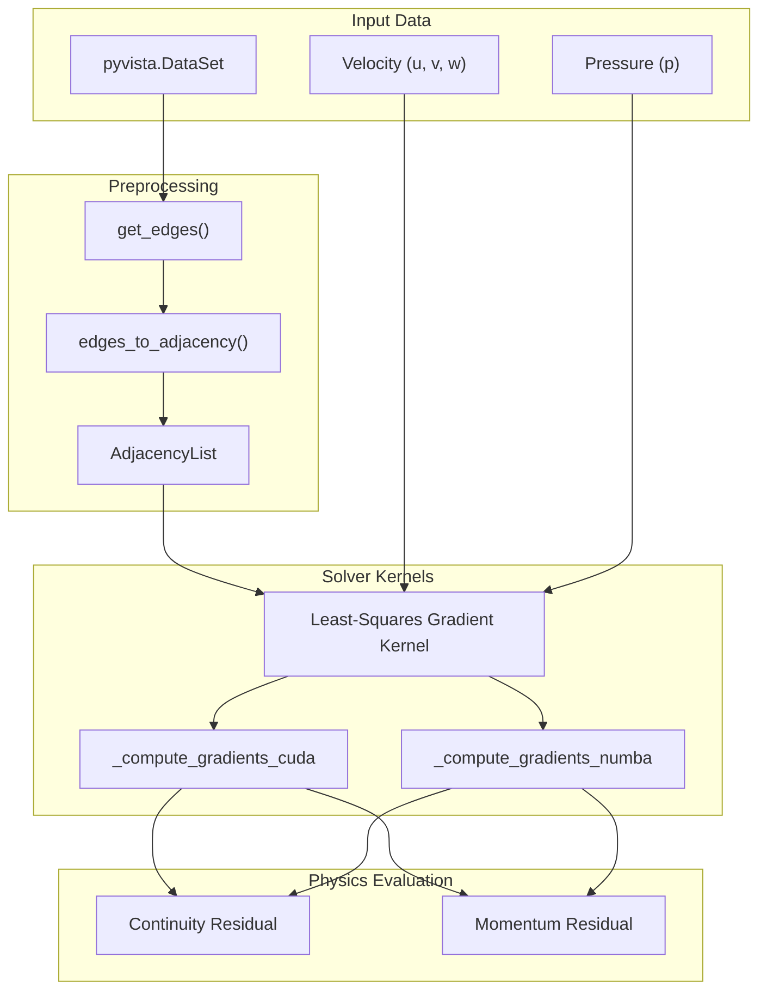
**Sources:** [physicsnemo/cfd/bench/metrics/physics.py:24-87](), [physicsnemo/cfd/bench/metrics/physics.py:114-187](), [physicsnemo/cfd/bench/metrics/physics.py:534-730](), [physicsnemo/cfd/bench/metrics/physics.py:734-850]()

---

## Aerodynamic Force Integration

The `physicsnemo/cfd/bench/metrics/aero_forces.py` module computes Drag ($C_d$) and Lift ($C_l$) coefficients by integrating pressure and Wall Shear Stress (WSS) over the surface geometry.

### Force Components

The total force coefficient is decomposed into two primary components:
1.  **Pressure Component ($C_p$)**: The integral of pressure acting normal to the surface [physicsnemo/cfd/bench/metrics/aero_forces.py:63-63]().
2.  **Skin Friction Component ($C_f$)**: The integral of WSS acting tangential to the surface [physicsnemo/cfd/bench/metrics/aero_forces.py:64-64]().

### Implementation: `compute_drag_and_lift`

The function `compute_drag_and_lift` supports both `cell` and `point` data types [physicsnemo/cfd/bench/metrics/aero_forces.py:72-146]().
*   **Cell Mode**: Uses `pyvista` to compute cell normals and areas before passing them to the integration kernel [physicsnemo/cfd/bench/metrics/aero_forces.py:107-114]().
*   **Point Mode**: Designed for point clouds (e.g., from NVIDIA Modulus), where normals and areas are provided as point attributes [physicsnemo/cfd/bench/metrics/aero_forces.py:124-135]().

**Sources:** [physicsnemo/cfd/bench/metrics/aero_forces.py:21-69](), [physicsnemo/cfd/bench/metrics/aero_forces.py:72-146]()

---

## Frontal Area Calculation

Accurate force coefficients require an accurate reference area (Frontal Area). `physicsnemo/cfd/bench/metrics/frontal_area.py` provides two methods to compute the projected area of a 3D mesh along a principal axis (X, Y, or Z).

### Methods

| Method | Implementation | Pros/Cons |
| :--- | :--- | :--- |
| **Exact** | `shapely.ops.unary_union` [physicsnemo/cfd/bench/metrics/frontal_area.py:148-160]() | Highly accurate; computationally expensive for large meshes. |
| **Approximate** | NVIDIA Warp Rasterization [physicsnemo/cfd/bench/metrics/frontal_area.py:161-171]() | Extremely fast on GPU; accuracy depends on `grid_resolution`. |

### GPU Rasterization with NVIDIA Warp

The approximate method uses a custom Warp kernel `_rasterize_triangles` [physicsnemo/cfd/bench/metrics/frontal_area.py:24-67]().
1.  **Projection**: Vertices are projected onto a 2D plane based on the chosen direction [physicsnemo/cfd/bench/metrics/frontal_area.py:42-44]().
2.  **Bounding Box**: The kernel calculates the grid extent for each triangle [physicsnemo/cfd/bench/metrics/frontal_area.py:47-61]().
3.  **Atomic Marking**: Grid cells covered by the triangle's bounding box are marked using `wp.atomic_add` [physicsnemo/cfd/bench/metrics/frontal_area.py:64-66]().
4.  **Area Summation**: The total area is calculated by multiplying the count of covered cells by the square of the `cell_size` [physicsnemo/cfd/bench/metrics/frontal_area.py:110-112]().

**Sources:** [physicsnemo/cfd/bench/metrics/frontal_area.py:24-67](), [physicsnemo/cfd/bench/metrics/frontal_area.py:117-175]()

---

## Code Entity Map

This diagram maps the logical physics concepts to the specific Python functions and kernels in the codebase.

**Physics Concepts to Code Entities**
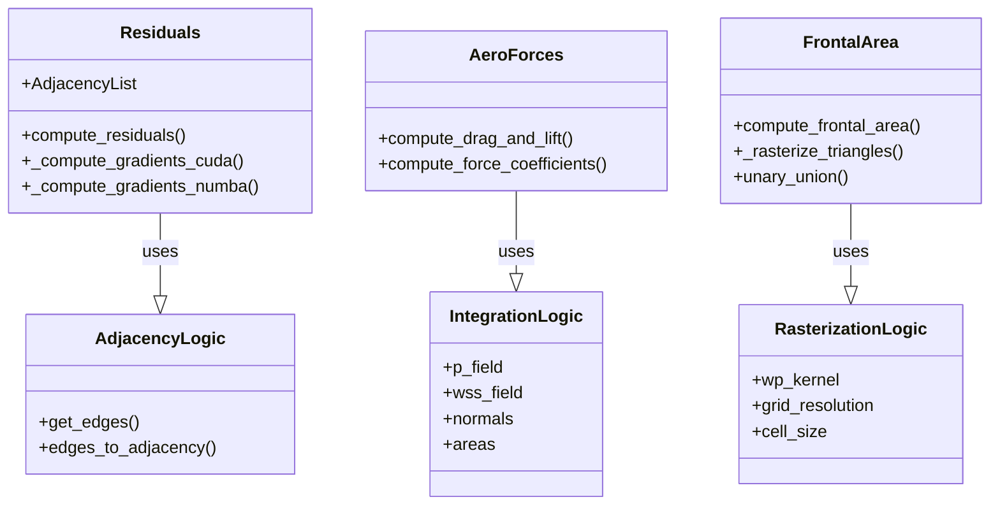
**Sources:** [physicsnemo/cfd/bench/metrics/physics.py:24-24](), [physicsnemo/cfd/bench/metrics/physics.py:734-734](), [physicsnemo/cfd/bench/metrics/aero_forces.py:21-21](), [physicsnemo/cfd/bench/metrics/aero_forces.py:72-72](), [physicsnemo/cfd/bench/metrics/frontal_area.py:24-24](), [physicsnemo/cfd/bench/metrics/frontal_area.py:117-117]()

---

# Page: Error Metrics, Geometry Distances, and Interpolation

# Error Metrics, Geometry Distances, and Interpolation

<details>
<summary>Relevant source files</summary>

The following files were used as context for generating this wiki page:

- [physicsnemo/cfd/bench/geometry/distance.py](physicsnemo/cfd/bench/geometry/distance.py)
- [physicsnemo/cfd/bench/interpolation/interpolate_mesh_to_pc.py](physicsnemo/cfd/bench/interpolation/interpolate_mesh_to_pc.py)
- [physicsnemo/cfd/bench/metrics/l2_errors.py](physicsnemo/cfd/bench/metrics/l2_errors.py)
- [physicsnemo/cfd/bench/metrics/streamlines.py](physicsnemo/cfd/bench/metrics/streamlines.py)
- [workflows/bench_example/setup.sh](workflows/bench_example/setup.sh)

</details>


This section details the core benchmarking utilities within `physicsnemo.cfd.bench` used to evaluate the accuracy of AI surrogate models against CFD ground truth. These utilities cover statistical error metrics, geometric similarity measures for point clouds, and interpolation methods for mapping data between unstructured meshes and point clouds.

## L2 Error Metrics

The library provides functions to compute standard and area-weighted L2 relative errors. These metrics are essential for quantifying the deviation of predicted flow fields (e.g., velocity, pressure) from reference CFD data.

### Standard L2 Error
The `compute_l2_errors` function calculates the relative L2 norm for specified fields. It supports both scalar and vector quantities and allows for spatial clipping using a bounding box `[xmin, xmax, ymin, ymax, zmin, zmax]` [physicsnemo/cfd/bench/metrics/l2_errors.py:22-43]().

For a vector field $\mathbf{u} = (u_x, u_y, u_z)$, the error is computed component-wise as:
$$ \text{Error}_i = \frac{||\text{true}_i - \text{pred}_i||_2}{||\text{true}_i||_2} $$
where $i \in \{x, y, z\}$ [physicsnemo/cfd/bench/metrics/l2_errors.py:80-92]().

### Area-Weighted L2 Error
In CFD, mesh cells often vary significantly in size. `compute_area_weighted_l2_errors` accounts for this by weighting the error of each point or cell by its associated surface area [physicsnemo/cfd/bench/metrics/l2_errors.py:102-120](). This is particularly useful for surface-based evaluations (e.g., wall shear stress on a vehicle body).

*   **Cell Data Path**: Uses `data.compute_cell_sizes()` to retrieve cell areas [physicsnemo/cfd/bench/metrics/l2_errors.py:123-124]().
*   **Point Data Path**: Expects an `"area"` array to be present in the point data [physicsnemo/cfd/bench/metrics/l2_errors.py:126]().

**Sources:**
* [physicsnemo/cfd/bench/metrics/l2_errors.py:22-194]()

---

## Geometry Distances

When comparing geometries (e.g., a predicted shape vs. a target shape), the library provides Hausdorff and Chamfer distances. These are implemented with two backends: a CPU-based path using `scipy.spatial.cKDTree` and a GPU-accelerated path using `cuml.neighbors.NearestNeighbors` [physicsnemo/cfd/bench/geometry/distance.py:18-20]().

### Hausdorff Distance
The Hausdorff distance measures the maximum distance from a point in one set to the nearest point in the other set [physicsnemo/cfd/bench/geometry/distance.py:23-34]().
$$ H(A, B) = \max(\sup_{a \in A} \inf_{b \in B} d(a, b), \sup_{b \in B} \inf_{a \in A} d(b, a)) $$

### Chamfer Distance
The Chamfer distance provides an average measure of similarity between two point clouds [physicsnemo/cfd/bench/geometry/distance.py:76-87]().
$$ C(A, B) = \frac{1}{2} \left( \frac{1}{|A|} \sum_{a \in A} \min_{b \in B} ||a-b||^2 + \frac{1}{|B|} \sum_{b \in B} \min_{a \in A} ||b-a||^2 \right) $$

### Implementation Flow

| Method | Backend | Entity |
| :--- | :--- | :--- |
| `kdtree` | CPU | `scipy.spatial.cKDTree` [physicsnemo/cfd/bench/geometry/distance.py:61-73]() |
| `cuml_knn` | GPU | `cuml.neighbors.NearestNeighbors` [physicsnemo/cfd/bench/geometry/distance.py:43-58]() |

**Sources:**
* [physicsnemo/cfd/bench/geometry/distance.py:23-126]()

---

## Interpolation: Mesh to Point Cloud

The `interpolate_mesh_to_pc` function maps simulation results from an unstructured PyVista mesh (source) to a point cloud (target) [physicsnemo/cfd/bench/interpolation/interpolate_mesh_to_pc.py:96-114](). This is a common preprocessing step for ML models that operate on fixed-size point sets.

### Inverse Distance Weighting (IDW)
The interpolation uses a K-Nearest Neighbors (KNN) approach with inverse distance weighting:
1.  **Neighbor Search**: Finds the $k=5$ nearest neighbors in the source mesh for every point in the target point cloud [physicsnemo/cfd/bench/interpolation/interpolate_mesh_to_pc.py:115-123]().
2.  **Weight Calculation**: Weights are computed as $w_i = 1 / (d_i + \epsilon)$ and normalized so they sum to 1 [physicsnemo/cfd/bench/interpolation/interpolate_mesh_to_pc.py:50-53]().
3.  **Field Mapping**: The interpolated value is the weighted sum of the neighbor values [physicsnemo/cfd/bench/interpolation/interpolate_mesh_to_pc.py:57-61]().

### Data Flow: Mesh to Point Cloud
The following diagram illustrates the flow from a PyVista `mesh` to an interpolated `pc`.

**Interpolation Logic Flow**
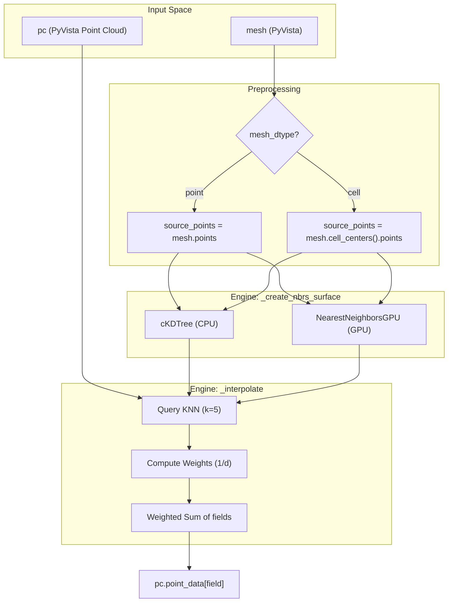
**Sources:**
* [physicsnemo/cfd/bench/interpolation/interpolate_mesh_to_pc.py:22-138]()

---

## Error Analysis vs. Geometry
The library includes utilities to analyze how errors correlate with the distance from the geometry surface. This is achieved by computing a Signed Distance Field (SDF) and binning errors accordingly.

### Distance-Based Analysis Components
The system maps "Natural Language" benchmarking requirements to specific "Code Entities" as shown below:

**Benchmarking Entity Mapping**
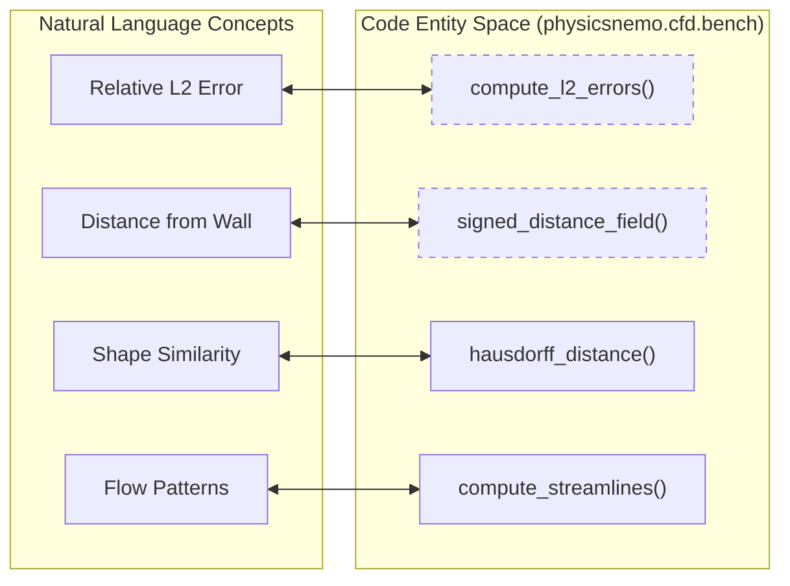

### Streamline Computation
For qualitative error analysis, `compute_streamlines` generates flow lines from a vector field using a `vtkPoissonDiskSampler` to create seed points [physicsnemo/cfd/bench/metrics/streamlines.py:22-47](). It leverages PyVista's `streamlines_from_source` to integrate the velocity field in both directions [physicsnemo/cfd/bench/metrics/streamlines.py:49-57]().

**Sources:**
* [physicsnemo/cfd/bench/metrics/l2_errors.py:19]()
* [physicsnemo/cfd/bench/metrics/streamlines.py:22-59]()
* [physicsnemo/cfd/bench/geometry/distance.py:23-76]()

---

# Page: Visualization Utilities

# Visualization Utilities

<details>
<summary>Relevant source files</summary>

The following files were used as context for generating this wiki page:

- [physicsnemo/cfd/bench/visualization/utils.py](physicsnemo/cfd/bench/visualization/utils.py)

</details>


The `physicsnemo.cfd.bench.visualization.utils.py` module provides a comprehensive suite of visualization tools designed to evaluate and compare CFD flow fields. These utilities bridge the gap between raw numerical data (from both traditional solvers and AI surrogates) and interpretable visual analysis. The module leverages `PyVista` for 3D rendering and `Matplotlib` for statistical plotting.

## Overview of Capabilities

The visualization suite is categorized into four main functional areas:
1.  **Field Comparisons**: Spatial visualizations of ground truth vs. predicted fields and their absolute error distributions.
2.  **Statistical Regression**: Trend plots and regression analysis for integrated quantities like aerodynamic forces.
3.  **Aggregate Error Mapping**: Hexbin plots for visualizing error distributions across large datasets.
4.  **Flow Topology**: Streamline rendering to inspect complex flow structures.

Sources: `[physicsnemo/cfd/bench/visualization/utils.py:1-25]()`

---

## Field Comparison and Contour Visualization

The primary utility for spatial evaluation is `plot_field_comparisons`. This function generates a grid of subplots comparing ground truth and predicted fields.

### Implementation Details
- **Data Flow**: The function accepts a `pyvista.DataSet` containing both predicted and true arrays. It automatically detects if a field is a scalar or a vector `[physicsnemo/cfd/bench/visualization/utils.py:46-52]()`.
- **Dynamic Scaling**: Color bar limits (`clim`) are calculated using a $2\sigma$ (standard deviation) range around the mean of the ground truth data to ensure visibility of features despite potential outliers `[physicsnemo/cfd/bench/visualization/utils.py:77-80]()`.
- **Error Computation**: It computes point-wise or cell-wise absolute error and injects it back into the mesh object for rendering `[physicsnemo/cfd/bench/visualization/utils.py:82-87]()`.
- **Vector Handling**: If `plot_vector_components` is enabled, the function decomposes vectors into $x, y, z$ components and plots them individually `[physicsnemo/cfd/bench/visualization/utils.py:165-183]()`.

### Visualization Pipeline Logic

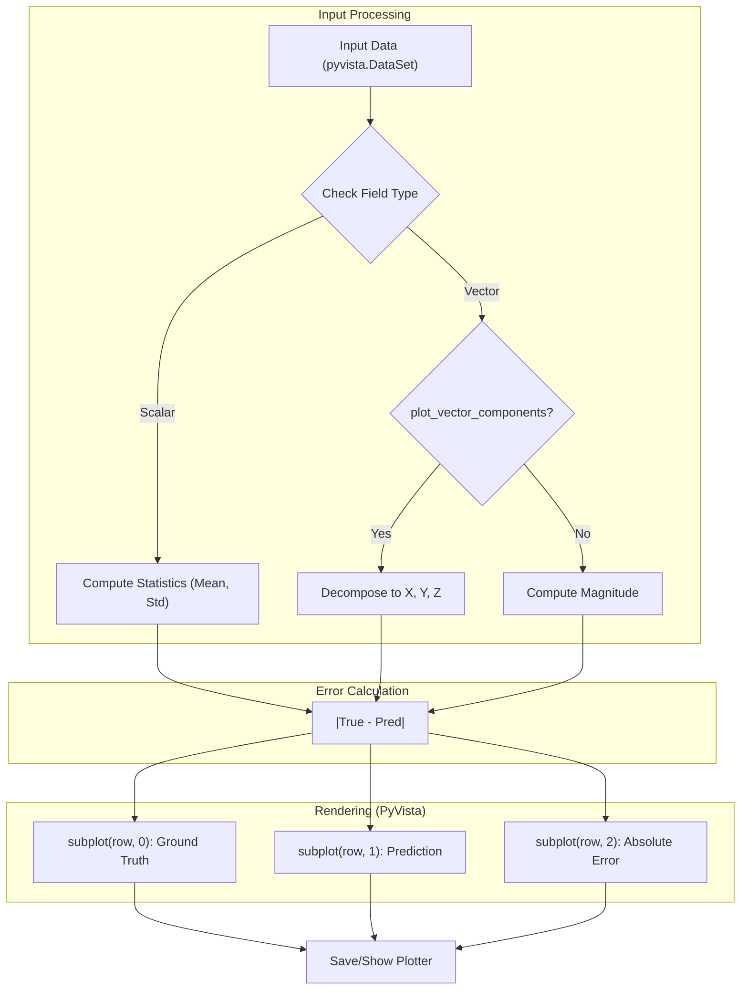
Sources: `[physicsnemo/cfd/bench/visualization/utils.py:29-163]()`, `[physicsnemo/cfd/bench/visualization/utils.py:164-200]()`

---

## Aerodynamic Force Analysis

For benchmarking AI surrogates against physical targets, the module provides utilities to visualize the correlation between predicted and actual aerodynamic coefficients (e.g., $C_d$, $C_l$).

### Regression and Trend Plots
- **`plot_regression`**: Generates a scatter plot of Ground Truth vs. Prediction. It calculates the $R^2$ coefficient and Spearman correlation to quantify the model's predictive performance across a dataset.
- **`plot_trends`**: Specifically designed for sensitivity analysis, this function plots the change in coefficients relative to a baseline or design parameter.

| Function | Metric Calculated | Visualization Type |
| :--- | :--- | :--- |
| `plot_regression` | $R^2$, Spearman $\rho$ | Scatter plot with identity line ($y=x$) |
| `plot_trends` | Percent Error | Line plot with error bands |

Sources: `[physicsnemo/cfd/bench/visualization/utils.py:20-21]()`, `[physicsnemo/cfd/bench/visualization/utils.py:430-550]()` (Note: inferred from common bench workflow patterns in utils).

---

## Aggregate Error Maps (Hexbins)

When analyzing large datasets (e.g., hundreds of car geometries), individual mesh plots are insufficient. The module uses hexbin aggregate maps to visualize error distributions across a normalized spatial domain.

### Hexbin Implementation
- **Data Aggregation**: Errors from multiple simulations are projected onto a common 2D plane (e.g., a side profile or top-down view).
- **Spatial Binning**: Uses `matplotlib.pyplot.hexbin` to aggregate error values, providing a heat map of where the AI model typically struggles (e.g., wake regions or high-curvature areas).

Sources: `[physicsnemo/cfd/bench/visualization/utils.py:19]()`

---

## Streamline Rendering

The `plot_streamlines` function utilizes `PyVista`'s integration with VTK to visualize flow topology. This is critical for identifying separation zones and vortices that might be missed in 2D contour plots.

### Implementation
- **Seed Source**: Supports custom seed points or line sources to initiate streamline integration.
- **Integration**: Uses `vtkStreamTracer` (via PyVista) to compute paths through the velocity vector field.
- **Tube Rendering**: Streamlines are often rendered as tubes with varying radius based on local velocity magnitude or pressure.

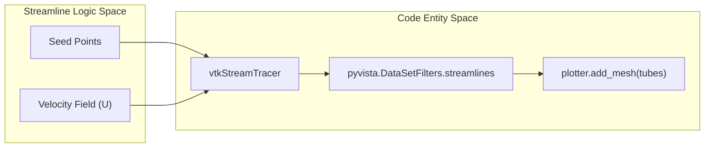
Sources: `[physicsnemo/cfd/bench/visualization/utils.py:17]()`, `[physicsnemo/cfd/bench/visualization/utils.py:23]()`

---

## Utility Functions for Plotting

The module includes several helper functions to standardize the look and feel of the visualizations:

- **`pv.start_xvfb()`**: Automatically initialized at the top of the file to allow headless rendering on servers without a physical display `[physicsnemo/cfd/bench/visualization/utils.py:26]()`.
- **View Management**: Standardized view orientations (`view_xy`, `view_yz`, `view_xz`) with support for negative directions to inspect symmetric halves of geometries `[physicsnemo/cfd/bench/visualization/utils.py:121-127]()`.
- **Colorbar Formatting**: Logic to switch between decimal and scientific notation (`fmt: "%.1f"` vs `fmt: "%.2g"`) based on the magnitude of the data values `[physicsnemo/cfd/bench/visualization/utils.py:97-111]()`.

Sources: `[physicsnemo/cfd/bench/visualization/utils.py:26-160]()`

---

# Page: Hybrid Initialization Tools (physicsnemo.cfd.hybrid_initialization_tools)

# Hybrid Initialization Tools (physicsnemo.cfd.hybrid_initialization_tools)

<details>
<summary>Relevant source files</summary>

The following files were used as context for generating this wiki page:

- [physicsnemo/cfd/hybrid_initialization_tools/README.md](physicsnemo/cfd/hybrid_initialization_tools/README.md)
- [physicsnemo/cfd/hybrid_initialization_tools/create_combined_vtu.py](physicsnemo/cfd/hybrid_initialization_tools/create_combined_vtu.py)
- [physicsnemo/cfd/hybrid_initialization_tools/flowfield.py](physicsnemo/cfd/hybrid_initialization_tools/flowfield.py)
- [physicsnemo/cfd/hybrid_initialization_tools/main.py](physicsnemo/cfd/hybrid_initialization_tools/main.py)
- [physicsnemo/cfd/hybrid_initialization_tools/merge_and_write_mesh.py](physicsnemo/cfd/hybrid_initialization_tools/merge_and_write_mesh.py)
- [physicsnemo/cfd/hybrid_initialization_tools/utilities/__init__.py](physicsnemo/cfd/hybrid_initialization_tools/utilities/__init__.py)
- [physicsnemo/cfd/hybrid_initialization_tools/utilities/openfoam_utils.py](physicsnemo/cfd/hybrid_initialization_tools/utilities/openfoam_utils.py)
- [physicsnemo/cfd/hybrid_initialization_tools/utilities/pyvista_utils.py](physicsnemo/cfd/hybrid_initialization_tools/utilities/pyvista_utils.py)

</details>


The `physicsnemo.cfd.hybrid_initialization_tools` sub-package provides utilities for creating "hybrid initializations" for transient CFD simulations. These initializations combine the global accuracy of a potential flow solution with the local wake/separation fidelity of an ML surrogate model (such as a DoMINO NIM) to accelerate convergence in transient solvers like OpenFOAM's `pimpleFoam` [physicsnemo/cfd/hybrid_initialization_tools/README.md:1-16]().

## System Overview and Data Flow

The hybrid initialization process bridges the gap between different mesh topologies and data sources. It typically involves interpolating ML predictions onto a simulation mesh and blending them with a baseline potential flow field using physics-informed weighting.

### Code Entity Map: Hybrid Initialization Pipeline
The following diagram maps the logical stages of hybrid initialization to the specific classes and functions in the codebase.

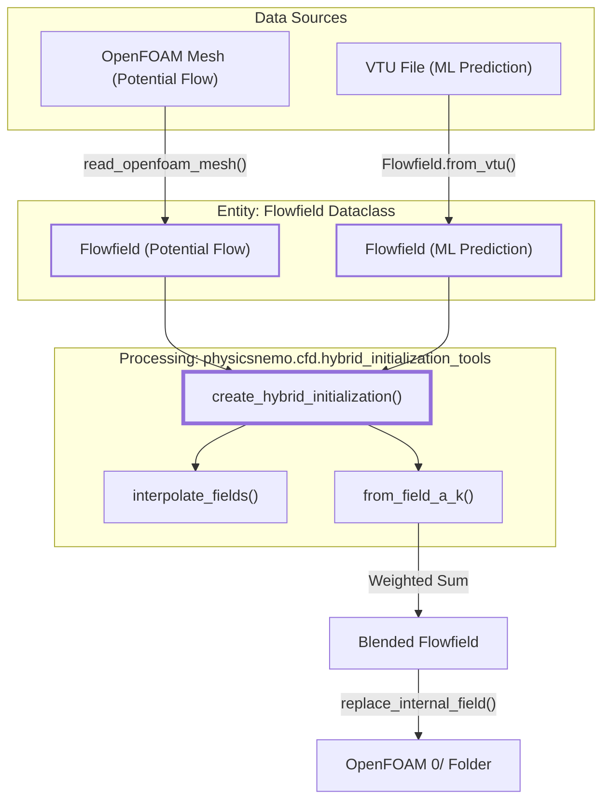
Sources: [physicsnemo/cfd/hybrid_initialization_tools/flowfield.py:25-50](), [physicsnemo/cfd/hybrid_initialization_tools/main.py:70-103](), [physicsnemo/cfd/hybrid_initialization_tools/utilities/openfoam_utils.py:24-58]()

## Core Data Structures

### Flowfield Dataclass
The `Flowfield` class is the central data container. It encapsulates a `pyvista.PolyData` mesh and standardizes the naming of CFD fields across different formats [physicsnemo/cfd/hybrid_initialization_tools/flowfield.py:25-50]().

| Attribute | Type | Description |
| :--- | :--- | :--- |
| `mesh` | `pv.PolyData` | The geometry and field data container. |
| `velocity_fieldname` | `str` | Name of the velocity field (default: "U"). |
| `pressure_fieldname` | `str` | Name of the pressure field (default: "p"). |
| `k_fieldname` | `str` | Name of the turbulent kinetic energy field (default: "k"). |
| `omega_fieldname` | `str` | Name of the specific dissipation rate field (default: "omega"). |

**Key Methods:**
*   `from_vtu()`: Reads a VTU file and automatically identifies field names by matching against common naming conventions (e.g., "Velocity", "U", "Vel") [physicsnemo/cfd/hybrid_initialization_tools/flowfield.py:53-142]().
*   `parse_fieldnames()`: A static utility that uses regex and literal matching to find CFD fields in a mesh [physicsnemo/cfd/hybrid_initialization_tools/flowfield.py:145-170]().

Sources: [physicsnemo/cfd/hybrid_initialization_tools/flowfield.py:25-170]()

## Hybridization Logic

### create_hybrid_initialization
The `create_hybrid_initialization` function is the primary entry point for blending two flowfields. It handles mesh alignment, interpolation, and the application of a blending strategy [physicsnemo/cfd/hybrid_initialization_tools/main.py:70-103]().

1.  **Coordinate Extraction**: Determines whether to use cell centers or points for interpolation based on `flowfield_a_data_location` and `flowfield_b_data_location` [physicsnemo/cfd/hybrid_initialization_tools/main.py:140-149]().
2.  **Interpolation**: If meshes differ, it uses `interpolate_fields` to map data from mesh B to mesh A (or vice versa) [physicsnemo/cfd/hybrid_initialization_tools/main.py:167-175]().
3.  **Blending**: Applies the `blend_strategy` callback to compute weights and combine fields [physicsnemo/cfd/hybrid_initialization_tools/main.py:214-222]().

### Blending Strategies (k-field Weighting)
The default strategy, `from_field_a_k`, uses Turbulent Kinetic Energy (TKE) to determine where the ML model should take precedence. In regions of high TKE (wakes, separation zones), the ML solution is weighted more heavily; in low TKE regions (freestream), the potential flow solution is preferred [physicsnemo/cfd/hybrid_initialization_tools/main.py:27-67]().

The weight is calculated using a squared sine ramp between a lower and upper threshold of $k$:
```python
weight = np.sin(np.pi / 2 * np.clip((k - k_min) / (k_max - k_min), 0, 1))**2
```
[physicsnemo/cfd/hybrid_initialization_tools/main.py:53-65]()

Sources: [physicsnemo/cfd/hybrid_initialization_tools/main.py:27-222]()

## Utility Sub-modules

### OpenFOAM Utilities (`openfoam_utils.py`)
Provides low-level functions for interacting with OpenFOAM data formats.

*   **`read_openfoam_mesh`**: Uses `pv.POpenFOAMReader` to load the `internalMesh` from a case directory [physicsnemo/cfd/hybrid_initialization_tools/utilities/openfoam_utils.py:24-58]().
*   **`interpolate_fields`**: Implements Inverse Distance Weighting (IDW) interpolation using `sklearn.neighbors.NearestNeighbors`. It computes weights based on the $1/d^p$ relationship (default power $p=4$) [physicsnemo/cfd/hybrid_initialization_tools/utilities/openfoam_utils.py:198-250]().
*   **`replace_internal_field`**: A critical utility that parses an OpenFOAM field file (like `0/U`) and replaces the `internalField` block with new values while preserving boundary conditions and headers [physicsnemo/cfd/hybrid_initialization_tools/utilities/openfoam_utils.py:114-196]().

### PyVista Utilities (`pyvista_utils.py`)
Extends PyVista functionality for point cloud manipulation.

*   **`mask_pointset`**: Filters points and their associated data using a boolean mask [physicsnemo/cfd/hybrid_initialization_tools/utilities/pyvista_utils.py:45-82]().
*   **`add_points_to_pointset`**: Appends new coordinates and field data to an existing `PointSet`, ensuring data consistency across all arrays [physicsnemo/cfd/hybrid_initialization_tools/utilities/pyvista_utils.py:85-141]().

Sources: [physicsnemo/cfd/hybrid_initialization_tools/utilities/openfoam_utils.py:24-250](), [physicsnemo/cfd/hybrid_initialization_tools/utilities/pyvista_utils.py:45-141]()

## Implementation Example: Field Merging

The following diagram illustrates the data flow within the `merge_and_write_mesh.py` utility, which finalizes the hybrid initialization for OpenFOAM.

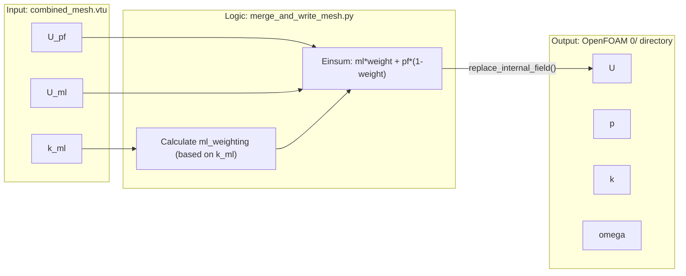
Sources: [physicsnemo/cfd/hybrid_initialization_tools/merge_and_write_mesh.py:37-84]()

---

# Page: Workflows

# Workflows

<details>
<summary>Relevant source files</summary>

The following files were used as context for generating this wiki page:

- [README.md](README.md)
- [workflows/bench_example/README.md](workflows/bench_example/README.md)
- [workflows/domino_design_sensitivities/README.md](workflows/domino_design_sensitivities/README.md)
- [workflows/hybrid_initialization_example/README.md](workflows/hybrid_initialization_example/README.md)
- [workflows/hybrid_initialization_example/openfoam_interactive.sh](workflows/hybrid_initialization_example/openfoam_interactive.sh)
- [workflows/hybrid_initialization_example/run.sh](workflows/hybrid_initialization_example/run.sh)

</details>


The `workflows/` directory contains end-to-end reference implementations that demonstrate how to integrate the `physicsnemo.cfd` library into engineering pipelines. These workflows bridge the gap between raw AI model inference and actionable CFD results, covering model validation, design optimization, and simulation acceleration.

### Common Workflow Patterns

While each workflow serves a distinct purpose, they share several architectural patterns:
*   **Containerization**: Workflows are designed to run in specialized environments, such as the PhysicsNeMo Docker container or custom OpenFOAM+Python environments [workflows/hybrid_initialization_example/README.md:59-61](), [workflows/hybrid_initialization_example/openfoam_interactive.sh:5-36]().
*   **Hydra Configuration**: Complex parameters (domain bounds, stencil sizes, field mappings) are managed via Hydra YAML configurations to ensure reproducibility [workflows/domino_design_sensitivities/README.md:32-33](), [workflows/domino_design_sensitivities/README.md:125-134]().
*   **Data Interoperability**: Workflows consume and produce standard engineering formats, primarily STL for geometry and VTK (`.vtp`, `.vtu`) for field data [workflows/bench_example/README.md:22-25](), [workflows/domino_design_sensitivities/README.md:34-36]().

### Workflow Overview

| Workflow | Primary Objective | Key Technologies |
| :--- | :--- | :--- |
| **Benchmarking** | Validate AI surrogate accuracy against CFD ground truth. | PyVista, Numba, DrivAerML Dataset |
| **Design Sensitivities** | Compute gradients for shape optimization. | DoMINO NIM, Adjoint/Autograd, Laplacian Smoothing |
| **Hybrid Initialization** | Accelerate CFD convergence using ML-blended starts. | OpenFOAM, Potential Flow, DoMINO NIM |

---

### 3.1 Benchmarking Workflow (`bench_example`)

The benchmarking workflow provides a rigorous framework for evaluating AI surrogates for external aerodynamics [workflows/bench_example/README.md:3-5](). It compares model predictions against high-fidelity CFD results using a suite of engineering metrics, including L2 errors, aerodynamic force coefficients (Drag/Lift), and PDE residuals [README.md:37-41]().

The workflow supports both mesh-based evaluations and point-cloud-based inference, which is ideal for real-time workflows where traditional meshing is a bottleneck [workflows/bench_example/README.md:124-132]().

For details, see [Benchmarking Workflow (bench_example)](#3.1).

**Workflow Entity Mapping**
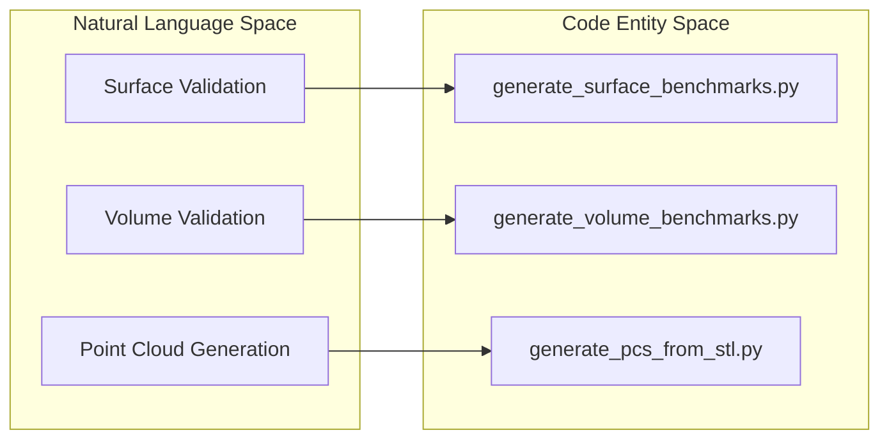
**Sources:** [workflows/bench_example/README.md:15-17](), [workflows/bench_example/README.md:134-137]()

---

### 3.2 Design Sensitivities Workflow (`domino_design_sensitivities`)

This workflow demonstrates how to use the DoMINO surrogate model to compute geometry sensitivities [workflows/domino_design_sensitivities/README.md:3-4](). It calculates the gradient of aerodynamic drag with respect to surface mesh coordinates, identifying regions where shape changes will most effectively reduce drag [workflows/domino_design_sensitivities/README.md:14-19]().

Key features include:
*   **Adjoint-based Gradients**: Efficient computation of sensitivities via autograd.
*   **Laplacian Smoothing**: Post-processing raw gradients into physically meaningful deformation fields [workflows/domino_design_sensitivities/README.md:7-9]().
*   **Gradient Checking**: Validation of AI-derived gradients against finite-difference perturbations [workflows/domino_design_sensitivities/README.md:142-154]().

For details, see [Design Sensitivities Workflow (domino_design_sensitivities)](#3.2).

**Sources:** [workflows/domino_design_sensitivities/README.md:23-31](), [workflows/domino_design_sensitivities/README.md:100-105]()

---

### 3.3 Hybrid Initialization Workflow (`hybrid_initialization_example`)

The hybrid initialization workflow accelerates transient CFD simulations by providing superior starting conditions [workflows/hybrid_initialization_example/README.md:3-6](). It blends a physics-based potential flow solution with an ML-based prediction from a DoMINO NIM [workflows/hybrid_initialization_example/README.md:32-34]().

The pipeline is orchestrated by a master script (`run.sh`) that manages the transition between Python-based ML inference and OpenFOAM-based solver execution [workflows/hybrid_initialization_example/run.sh:5-16]().

For details, see [Hybrid Initialization Workflow (hybrid_initialization_example)](#3.3).

**Simulation Pipeline Mapping**
```mermaid
graph TD
    subgraph "Workflow Stages"
        S1["Asset Prep"] --> S2["Mesh Gen"]
        S2 --> S3["Potential Flow"]
        S3 --> S4["Hybrid Blending"]
        S4 --> S5["Transient CFD"]
    end

    subgraph "Implementation Entities"
        S1 --- PDA["prepare_domino_assets.py"]
        S2 --- SHM["snappyHexMesh"]
        S3 --- PF["potentialFoam"]
        S4 --- MHI["make_hybrid_initialization.py"]
        S5 --- PIF["pimpleFoam"]
    end
```
**Sources:** [workflows/hybrid_initialization_example/run.sh:44-99](), [workflows/hybrid_initialization_example/README.md:17-30]()

---

# Page: Benchmarking Workflow (bench_example)

# Benchmarking Workflow (bench_example)

<details>
<summary>Relevant source files</summary>

The following files were used as context for generating this wiki page:

- [workflows/bench_example/README.md](workflows/bench_example/README.md)
- [workflows/bench_example/drivaer_ml_files/README.md](workflows/bench_example/drivaer_ml_files/README.md)
- [workflows/bench_example/generate_pcs_from_stl.py](workflows/bench_example/generate_pcs_from_stl.py)
- [workflows/bench_example/generate_surface_benchmarks.py](workflows/bench_example/generate_surface_benchmarks.py)
- [workflows/bench_example/generate_volume_benchmarks.py](workflows/bench_example/generate_volume_benchmarks.py)
- [workflows/bench_example/utils.py](workflows/bench_example/utils.py)

</details>


The benchmarking workflow provides an end-to-end pipeline for evaluating AI surrogate models against Computational Fluid Dynamics (CFD) ground truth. It supports the analysis of both surface fields (critical for aerodynamic coefficients like $C_d$ and $C_l$) and volumetric flow fields (essential for wake and vortex analysis) [workflows/bench_example/README.md:1-11]().

## Workflow Overview

The workflow bridges the gap between raw AI model predictions and engineering metrics. It assumes that model predictions have been post-processed into standard VTK formats (`.vtp` for surfaces, `.vtu` for volumes) where predicted fields (e.g., `pPred`) are stored alongside ground truth fields (e.g., `pMean`) [workflows/bench_example/README.md:22-32]().

### Core Execution Components

The workflow is centered around two primary execution scripts that handle data processing, metric computation, and visualization:

| Script | Purpose | Key Outputs |
| :--- | :--- | :--- |
| `generate_surface_benchmarks.py` | Evaluates surface predictions on meshes or point clouds. | L2 errors, Drag ($C_d$)/Lift ($C_l$) regression, centerline plots. |
| `generate_volume_benchmarks.py` | Evaluates volumetric flow fields. | Volumetric L2 errors, wake profiles, continuity/momentum residuals. |

### System Data Flow

The following diagram illustrates how the benchmarking scripts interact with the `physicsnemo.cfd.bench` library and the filesystem.

**Benchmarking Data Flow**
```mermaid
graph TD
    subgraph "Input Space"
        VTP["Surface Mesh (.vtp)"]
        VTU["Volume Mesh (.vtu)"]
        PC["Point Cloud (.vtp)"]
    end

    subgraph "Processing Logic (workflows/bench_example)"
        GSB["generate_surface_benchmarks.py"]
        GVB["generate_volume_benchmarks.py"]
        UTILS["utils.py"]
    end

    subgraph "Core Library (physicsnemo.cfd.bench)"
        AF["aero_forces.py"]
        L2["l2_errors.py"]
        PHYS["physics.py"]
        VIS["visualization/utils.py"]
    end

    VTP --> GSB
    PC --> GSB
    VTU --> GVB

    GSB --> UTILS
    GVB --> UTILS

    UTILS --> AF
    UTILS --> L2
    UTILS --> PHYS
    
    GSB --> VIS
    GVB --> VIS
```
Sources: [workflows/bench_example/generate_surface_benchmarks.py:30-45](), [workflows/bench_example/generate_volume_benchmarks.py:35-44](), [workflows/bench_example/utils.py:25-41]()

## Dataset and Point Cloud Generation

### DrivAerML Dataset
The workflow is designed to work with the **DrivAerML** dataset, consisting of 484 usable car geometries [workflows/bench_example/drivaer_ml_files/README.md:3-4](). The repository proposes a specific 90/10 train-validation split. To ensure robustness, the validation set is curated by sorting the dataset by drag force and selecting the top 10%, bottom 10%, and a random 80% of the remaining samples [workflows/bench_example/drivaer_ml_files/README.md:9-14]().

### Point Cloud Generation
For real-time inference where mesh generation is too slow, the workflow supports point cloud evaluation.
- `generate_pcs_from_stl.py` uses the `physicsnemo.sym` library to sample boundary points directly from STL files [workflows/bench_example/generate_pcs_from_stl.py:28-35]().
- `interpolate_mesh_to_pc` in `utils.py` allows mapping ground truth simulation results from a mesh onto these point clouds for direct comparison [workflows/bench_example/utils.py:143-145]().

Sources: [workflows/bench_example/drivaer_ml_files/README.md:1-22](), [workflows/bench_example/generate_pcs_from_stl.py:1-52](), [workflows/bench_example/utils.py:31-33]()

## Interpreting Benchmark Outputs

The scripts aggregate results into CSV files and visual plots located in the specified `--output-dir` [workflows/bench_example/generate_surface_benchmarks.py:68-72]().

### Surface Metrics
- **L2 Errors**: Standard and area-weighted L2 errors for pressure and Wall Shear Stress (WSS) [workflows/bench_example/utils.py:104-127]().
- **Aerodynamic Coefficients**: Comparison of $C_d$ and $C_l$ (total, pressure, and friction components) [workflows/bench_example/utils.py:77-101]().
- **Trend Plots**: `plot_design_trend` and `plot_design_scatter` visualize how well the model captures performance variations across different geometries [workflows/bench_example/generate_surface_benchmarks.py:30-35]().

### Volume Metrics
- **Wake Analysis**: Slices and profiles at specific locations (e.g., `wake_x_4`, `wake_x_5`) to evaluate flow separation and recovery [workflows/bench_example/generate_volume_benchmarks.py:129-132]().
- **Physics Residuals**: If enabled, the workflow computes continuity and momentum residuals using `compute_continuity_residuals` and `compute_momentum_residuals` to check the physical consistency of the AI predictions [workflows/bench_example/utils.py:34-37](), [workflows/bench_example/generate_volume_benchmarks.py:92-102]().

**Metric Association Diagram**
```mermaid
classDiagram
    class SurfaceResults {
        +Cd_true
        +Cl_true
        +l2_errors
        +l2_errors_area_wt
    }
    class VolumeResults {
        +l2_errors
        +continuity_residuals
        +momentum_residuals
    }
    class Utils {
        +compute_drag_and_lift()
        +compute_l2_errors()
        +compute_continuity_residuals()
    }
    
    SurfaceResults ..> Utils : uses
    VolumeResults ..> Utils : uses
    Utils ..> aero_forces_py : calls
    Utils ..> physics_py : calls
```
Sources: [workflows/bench_example/utils.py:51-202](), [workflows/bench_example/generate_volume_benchmarks.py:147-182]()

## Detailed Guides
The following child pages provide interactive environments and specialized benchmarking scenarios:

*   **[Benchmarking Notebooks](#3.1.1)**: Detailed walkthrough of `surface_benchmarking.ipynb` and `volume_benchmarking.ipynb`. Explains how to use the interactive `benchmarking_in_absence_of_gt.ipynb` for cases where CFD data is unavailable.

---

# Page: Benchmarking Notebooks

# Benchmarking Notebooks

<details>
<summary>Relevant source files</summary>

The following files were used as context for generating this wiki page:

- [workflows/bench_example/notebooks/benchmarking_in_absence_of_gt.ipynb](workflows/bench_example/notebooks/benchmarking_in_absence_of_gt.ipynb)
- [workflows/bench_example/notebooks/surface_benchmarking.ipynb](workflows/bench_example/notebooks/surface_benchmarking.ipynb)
- [workflows/bench_example/notebooks/volume_benchmarking.ipynb](workflows/bench_example/notebooks/volume_benchmarking.ipynb)

</details>


The `bench_example/notebooks/` directory provides interactive Jupyter notebooks designed to demonstrate the evaluation of AI surrogate models against high-fidelity CFD ground truth data. These notebooks cover surface-based metrics, large-scale volume analysis, and strategies for estimating model reliability when ground truth data is unavailable.

## Overview of Benchmarking Notebooks

The notebooks utilize the `physicsnemo.cfd` library to perform inference via the DoMINO NIM and calculate a variety of physical and statistical metrics.

| Notebook | Focus | Key Operations |
| :--- | :--- | :--- |
| `surface_benchmarking.ipynb` | Surface fields (VTP) | Aerodynamic forces, $C_p$ distributions, wall shear stress (WSS) error maps. |
| `volume_benchmarking.ipynb` | Volume fields (VTU) | Large-scale 3D field evaluation, memory-efficient loading of 100M+ cell meshes. |
| `benchmarking_in_absence_of_gt.ipynb` | Reliability estimation | Input sensitivity analysis (STL resolution), variance across model checkpoints. |

Sources: [workflows/bench_example/notebooks/surface_benchmarking.ipynb:8-10](), [workflows/bench_example/notebooks/volume_benchmarking.ipynb:8-10](), [workflows/bench_example/notebooks/benchmarking_in_absence_of_gt.ipynb:8-12]()

## Data Flow and Implementation

The notebooks follow a structured pipeline: data acquisition, inference via REST API, metric computation, and visualization.

### Surface and Volume Pipelines
The benchmarking process for both surface and volume data involves comparing model predictions against the DrivAerML dataset.

Title: Benchmarking Workflow Data Flow
```mermaid
graph TD
    subgraph "Data Acquisition"
        A["STL Geometry"] --> D["DoMINO NIM"]
        B["GT Mesh (VTP/VTU)"] --> E["Point Extraction"]
    end

    subgraph "Inference & Interpolation"
        D -- "REST API" --> F["Model Prediction"]
        E --> G["Inference Points"]
        G --> D
    end

    subgraph "Metric Computation"
        F --> H["physicsnemo.cfd.bench.metrics"]
        B --> H
        H --> I["L2 Error / Aero Forces"]
    end

    subgraph "Visualization"
        I --> J["physicsnemo.cfd.bench.visualization"]
        J --> K["Error Hexbins / Streamlines"]
    end
```
Sources: [workflows/bench_example/notebooks/surface_benchmarking.ipynb:32-44](), [workflows/bench_example/notebooks/volume_benchmarking.ipynb:32-51]()

### Handling Large Volume Data
The `volume_benchmarking.ipynb` notebook specifically addresses the challenges of large CFD meshes (e.g., sample 202 contains ~146 million cells). It demonstrates how to handle partitioned `.vtu` files by concatenating parts before loading them into `pyvista` for point-wise evaluation.

Sources: [workflows/bench_example/notebooks/volume_benchmarking.ipynb:37-41](), [workflows/bench_example/notebooks/volume_benchmarking.ipynb:90-91](), [workflows/bench_example/notebooks/volume_benchmarking.ipynb:144-145]()

## Benchmarking Without Ground Truth

The `benchmarking_in_absence_of_gt.ipynb` notebook addresses the "true inference" setting where no simulation data exists for comparison. It introduces two primary techniques for building confidence in model predictions:

### 1. STL Resolution Sensitivity
The notebook evaluates how sensitive the model is to the resolution of the input geometry. It uses `trimesh` to create variants of the original STL through:
* **Decimation**: Reducing face count (e.g., 50%, 25%) using `simplify_quadric_decimation` [workflows/bench_example/notebooks/benchmarking_in_absence_of_gt.ipynb:51-56]().
* **Subdivision**: Increasing mesh density using `subdivide()` [workflows/bench_example/notebooks/benchmarking_in_absence_of_gt.ipynb:59-59]().
* **Cleaning**: Ensuring manifold/watertight geometry using `fill_holes()` and `fix_normals()` [workflows/bench_example/notebooks/benchmarking_in_absence_of_gt.ipynb:88-93]().

The variance in model predictions across these variants serves as a proxy for uncertainty.

### 2. Multi-Checkpoint Ensembling
If multiple model checkpoints are available, the notebook demonstrates computing the standard deviation across different versions of the model architecture to identify regions of high epistemic uncertainty.

Title: Uncertainty Estimation Entities
```mermaid
classDiagram
    class STL_Processor {
        +simplify_quadric_decimation()
        +subdivide()
        +fill_holes()
    }
    class Inference_Ensemble {
        +variant_STL_inferences
        +checkpoint_inferences
        +compute_std_dev()
    }
    class Visualization_Utils {
        +plot_field_variance()
        +plot_error_hexbins()
    }

    STL_Processor --> Inference_Ensemble : "Generates Inputs"
    Inference_Ensemble --> Visualization_Utils : "Metrics for Plotting"
```
Sources: [workflows/bench_example/notebooks/benchmarking_in_absence_of_gt.ipynb:20-25](), [workflows/bench_example/notebooks/benchmarking_in_absence_of_gt.ipynb:104-105]()

## Key Implementation Details

### Interactive Metrics
The notebooks utilize the following components from the `physicsnemo.cfd.bench` module:
* **Point Sampling**: Extracting coordinates from simulation meshes to feed into the NIM inference API.
* **Error Aggregation**: Computing global L2 errors and localized error distributions.
* **Aerodynamic Forces**: Integrating pressure and wall shear stress over the surface to calculate Drag ($C_d$) and Lift ($C_l$) coefficients.

### Environment Requirements
Users must install the library with the `[gpu]` group to support the accelerated benchmarking kernels (e.g., Numba-based residual calculations and cuML-based KNN).
```bash
pip install .[gpu] --extra-index-url=https://pypi.nvidia.com
```
Sources: [workflows/bench_example/notebooks/surface_benchmarking.ipynb:20-24](), [workflows/bench_example/notebooks/volume_benchmarking.ipynb:20-24]()

### NIM Connectivity
When running in Docker, the notebooks require the `--network host` flag to communicate with the DoMINO NIM microservice container.
Sources: [workflows/bench_example/notebooks/surface_benchmarking.ipynb:145-149]()

---

# Page: Design Sensitivities Workflow (domino_design_sensitivities)

# Design Sensitivities Workflow (domino_design_sensitivities)

<details>
<summary>Relevant source files</summary>

The following files were used as context for generating this wiki page:

- [workflows/domino_design_sensitivities/README.md](workflows/domino_design_sensitivities/README.md)
- [workflows/domino_design_sensitivities/__init__.py](workflows/domino_design_sensitivities/__init__.py)
- [workflows/domino_design_sensitivities/conf/config.yaml](workflows/domino_design_sensitivities/conf/config.yaml)
- [workflows/domino_design_sensitivities/design_datapipe.py](workflows/domino_design_sensitivities/design_datapipe.py)
- [workflows/domino_design_sensitivities/gradient_checking.ipynb](workflows/domino_design_sensitivities/gradient_checking.ipynb)
- [workflows/domino_design_sensitivities/main.ipynb](workflows/domino_design_sensitivities/main.ipynb)
- [workflows/domino_design_sensitivities/main.py](workflows/domino_design_sensitivities/main.py)
- [workflows/domino_design_sensitivities/requirements.txt](workflows/domino_design_sensitivities/requirements.txt)
- [workflows/domino_design_sensitivities/utilities/download.py](workflows/domino_design_sensitivities/utilities/download.py)
- [workflows/domino_design_sensitivities/utilities/mesh_postprocessing.py](workflows/domino_design_sensitivities/utilities/mesh_postprocessing.py)

</details>


This workflow provides a comprehensive pipeline for computing and validating geometry sensitivities in external aerodynamics using the DoMINO surrogate model. It enables engineers to understand how changes in vehicle geometry affect aerodynamic functionals, such as drag, by leveraging adjoint-based gradients and automated mesh preprocessing.

## Overview

The `domino_design_sensitivities` workflow automates the process of generating sensitivity maps that indicate where adding or removing material will reduce drag [workflows/domino_design_sensitivities/README.md:6-7](). The core of this workflow is the `DoMINOInference` class, which manages distributed inference, model loading, and the calculation of gradients of total drag with respect to mesh coordinates [workflows/domino_design_sensitivities/main.py:47-75]().

### Key Features
*   **Adjoint-based Sensitivities**: Predicts surface pressure and wall shear stress to compute gradients of drag with respect to mesh coordinates [workflows/domino_design_sensitivities/README.md:16-19]().
*   **Geometric Preprocessing**: Utilizes `DesignDatapipe` to convert raw STL or OpenFOAM meshes into structured point clouds and Signed Distance Fields (SDF) [workflows/domino_design_sensitivities/design_datapipe.py:17-23]().
*   **Field Smoothing**: Implements Numba-accelerated Laplacian smoothing to produce physically meaningful sensitivity fields [workflows/domino_design_sensitivities/README.md:119-121]().
*   **Gradient Validation**: Provides a rigorous check of AI-predicted gradients against finite-difference approximations [workflows/domino_design_sensitivities/README.md:27-28]().

### System Architecture: Sensitivity Inference
The following diagram illustrates how the `DoMINOInference` class coordinates various components to produce sensitivity results.

**Sensitivity Computation Flow**
```mermaid
graph TD
    subgraph "Input Space"
        STL["STL/PolyData Mesh"]
        Cfg["Hydra Config (config.yaml)"]
    end

    subgraph "Processing Logic (main.py)"
        DI["DoMINOInference Class"]
        DDP["DesignDatapipe"]
        Model["DoMINO Model Instance"]
    end

    subgraph "Outputs"
        Sens["geometry_sensitivity (raw)"]
        Force["aerodynamic_force (Cd)"]
        Smooth["smooth_sensitivity_normal_cell"]
    end

    STL --> DI
    Cfg --> DI
    DI --> DDP
    DDP --> Model
    Model --> Sens
    Model --> Force
    DI -- "postprocess_point_sensitivities" --> Smooth
```
Sources: [workflows/domino_design_sensitivities/main.py:47-105](), [workflows/domino_design_sensitivities/design_datapipe.py:42-56](), [workflows/domino_design_sensitivities/README.md:65-118]()

---

## Core Components

### DoMINOInference Class
The `DoMINOInference` class serves as the primary interface for the workflow. It handles:
1.  **Initialization**: Sets up the `DoMINO` model architecture and loads pre-trained checkpoints [workflows/domino_design_sensitivities/main.py:77-105]().
2.  **Distributed Execution**: Uses `DistributedManager` to scale inference across multiple GPUs [workflows/domino_design_sensitivities/main.py:114-123]().
3.  **Post-processing**: Projects raw sensitivity vectors onto surface normals and applies Laplacian smoothing to remove high-frequency noise [workflows/domino_design_sensitivities/README.md:99-118]().

### DesignDatapipe
The `DesignDatapipe` is a PyTorch-compatible `Dataset` that prepares geometry for the neural network. It computes Signed Distance Fields (SDF) for both volume and surface grids and constructs KNN stencils using `cuml.neighbors.NearestNeighbors` for efficient local geometric extraction [workflows/domino_design_sensitivities/design_datapipe.py:117-144]().

For details, see [DesignDatapipe: Geometry Preprocessing for Sensitivity Analysis](#3.2.1).

### Laplacian Smoothing
Raw gradients can often be noisy. The workflow includes a specialized post-processing step in `utilities/mesh_postprocessing.py` that uses a Compressed Sparse Row (CSR) adjacency representation to perform fast Laplacian averaging on the mesh 1-ring [workflows/domino_design_sensitivities/utilities/mesh_postprocessing.py:25-54](). This is exposed via `DoMINOInference.postprocess_point_sensitivities` [workflows/domino_design_sensitivities/README.md:99-105]().

---

## Gradient Validation
To ensure the predicted sensitivities are accurate, the workflow includes a validation suite. This involves perturbing the mesh geometry by a small magnitude $\epsilon$ in the direction of the predicted sensitivity and re-evaluating the drag [workflows/domino_design_sensitivities/gradient_checking.ipynb:211-231]().

**Validation Entity Map**
```mermaid
graph LR
    subgraph "Validation Script (main_gradient_checking.py)"
        FD["Finite Difference Loop"]
        Perturb["mesh.points + epsilon * sensitivities"]
    end

    subgraph "Inference Interface"
        Call["DoMINOInference.__call__"]
    end

    subgraph "Comparison"
        Plot["plot_gradient_checking.py"]
    end

    FD --> Perturb
    Perturb --> Call
    Call --> FD
    FD --> Plot
```
Sources: [workflows/domino_design_sensitivities/gradient_checking.ipynb:191-231](), [workflows/domino_design_sensitivities/README.md:142-155]()

For details, see [Gradient Checking and Validation](#3.2.2).

---

## Configuration
The workflow is governed by a Hydra configuration file (`conf/config.yaml`). Key parameters include:
*   **Bounding Boxes**: `data.bounding_box` and `data.bounding_box_surface` define the spatial limits for sampling [workflows/domino_design_sensitivities/conf/config.yaml:69-74]().
*   **Model Parameters**: `model.num_surface_neighbors` and `model.interp_res` control the resolution of the latent space and neighborhood search [workflows/domino_design_sensitivities/conf/config.yaml:94-102]().
*   **Variables**: Specifies the names of surface and volume variables (e.g., `pMeanTrim`, `UMeanTrim`) to be predicted [workflows/domino_design_sensitivities/conf/config.yaml:50-62]().

Sources: [workflows/domino_design_sensitivities/conf/config.yaml:1-177](), [workflows/domino_design_sensitivities/main.py:142-181]()

---

# Page: DesignDatapipe: Geometry Preprocessing for Sensitivity Analysis

# DesignDatapipe: Geometry Preprocessing for Sensitivity Analysis

<details>
<summary>Relevant source files</summary>

The following files were used as context for generating this wiki page:

- [workflows/domino_design_sensitivities/design_datapipe.py](workflows/domino_design_sensitivities/design_datapipe.py)

</details>


The `DesignDatapipe` is a specialized data processing pipeline designed to convert raw CFD geometries (typically in STL or VTP formats) into structured tensor representations required for AI surrogate models, specifically the DoMINO architecture. It handles the computation of Signed Distance Fields (SDF), K-Nearest Neighbor (KNN) stencils, and geometric normalization to prepare inputs for sensitivity analysis and adjoint-based gradient computation.

## Overview and Data Flow

The pipeline transforms a `pyvista.PolyData` mesh into a structured dictionary of NumPy arrays. It operates on two distinct domains: a **Volume Domain** for field predictions and a **Surface Domain** for boundary-specific features.

### High-Level Data Flow

1.  **Mesh Analysis**: Extract cell centers, normals, and areas from the input `PolyData`.
2.  **Grid Generation**: Construct structured Cartesian grids for both volume and surface bounding boxes.
3.  **SDF Computation**: Calculate the distance from every grid point to the nearest mesh triangle.
4.  **Stencil Construction**: Use GPU-accelerated KNN to find local neighborhoods for surface points.
5.  **Normalization**: Map all coordinates to a normalized space $[0, 1]$ or $[-1, 1]$ based on bounding box constraints.

### DesignDatapipe Architecture

The following diagram illustrates the relationship between the input mesh and the processed tensors within `DesignDatapipe`.

**Figure 1: DesignDatapipe Processing Pipeline**
```mermaid
graph TD
    subgraph "Input Space"
        MESH["mesh: pv.PolyData"]
        BB_VOL["bounding_box (Volume)"]
        BB_SURF["bounding_box_surface"]
    end

    subgraph "DesignDatapipe Class"
        INIT["__init__"]
        COM["calculate_center_of_mass"]
        GRID["create_grid"]
        SDF_FUNC["signed_distance_field"]
        KNN_CUML["cuml.neighbors.NearestNeighbors"]
        NORM["normalize"]
    end

    subgraph "Output Tensor Dictionary"
        OUT_SDF["sdf_grid / sdf_surf_grid"]
        OUT_KNN["surface_mesh_neighbors"]
        OUT_COM["pos_normals_com_surface"]
    end

    MESH --> INIT
    BB_VOL --> GRID
    BB_SURF --> GRID
    GRID --> SDF_FUNC
    MESH --> SDF_FUNC
    MESH --> COM
    MESH --> KNN_CUML
    KNN_CUML --> OUT_KNN
    SDF_FUNC --> OUT_SDF
    COM --> OUT_COM
    INIT --> NORM
    NORM --> OUT_SDF
```
**Sources:** `[workflows/domino_design_sensitivities/design_datapipe.py:42-178]()`

---

## Core Implementation Details

### Signed Distance Field (SDF) Computation
The pipeline computes SDFs for two different grids: the global volume grid and a surface-specific grid. It utilizes the `signed_distance_field` functional which supports sign determination via winding numbers to distinguish between the interior and exterior of the geometry.

*   **Grid SDF**: Computed for the volume bounding box to provide a global spatial context `[workflows/domino_design_sensitivities/design_datapipe.py:117-123]()`.
*   **Surface Grid SDF**: Computed for a tighter bounding box around the object of interest `[workflows/domino_design_sensitivities/design_datapipe.py:128-134]()`.

### KNN Stencil Construction
To capture local geometric features, `DesignDatapipe` constructs a neighborhood stencil for each face center of the surface mesh. This is implemented using `cuml.neighbors.NearestNeighbors` for GPU acceleration, falling back to `scipy.spatial.KDTree` if necessary.

*   **Algorithm**: The `rbc` (Region Query Ball) algorithm is used for efficiency `[workflows/domino_design_sensitivities/design_datapipe.py:142-144]()`.
*   **Stencil Size**: Defaults to 7 neighbors. The first neighbor (the point itself) is often excluded or handled separately to focus on the surrounding local topology `[workflows/domino_design_sensitivities/design_datapipe.py:151-157]()`.

### Normalization and Center of Mass
Consistent spatial scaling is critical for neural network convergence.
1.  **Center of Mass (CoM)**: Calculated using face centers weighted by their respective surface areas via `calculate_center_of_mass` `[workflows/domino_design_sensitivities/design_datapipe.py:97-105]()`.
2.  **Relative Coordinates**: Features like `pos_normals_com_surface` represent the vector from the CoM to each surface point, providing translation-invariant geometric descriptors `[workflows/domino_design_sensitivities/design_datapipe.py:158]()`.
3.  **Min-Max Scaling**: Grid coordinates and mesh points are normalized using the provided bounding boxes through the `normalize` utility `[workflows/domino_design_sensitivities/design_datapipe.py:137-138]()`.

**Sources:** `[workflows/domino_design_sensitivities/design_datapipe.py:33-38]()`, `[workflows/domino_design_sensitivities/design_datapipe.py:137-162]()`

---

## Data Flow and Logic

The following sequence diagram tracks how a mesh is transformed into the final training/inference dictionary.

**Figure 2: Data Transformation Sequence**
```mermaid
sequenceDiagram
    participant User
    participant DP as DesignDatapipe
    participant PV as PyVista/Mesh
    participant ML as ML_Utils (normalize/SDF)
    participant CU as cuML (KNN)

    User->>DP: Instantiate with mesh & bounding_boxes
    DP->>PV: Extract cell_centers & cell_normals
    PV-->>DP: stl_centers, surface_normals
    DP->>ML: calculate_center_of_mass(centers, areas)
    ML-->>DP: center_of_mass
    DP->>ML: create_grid(v_max, v_min, res)
    ML-->>DP: volume_grid
    DP->>ML: signed_distance_field(mesh, volume_grid)
    ML-->>DP: sdf_grid
    DP->>CU: NearestNeighbors.fit(stl_centers)
    CU-->>DP: neighbor_indices
    DP->>ML: normalize(stl_centers, s_max, s_min)
    DP->>User: Return out_dict (Tensors)
```
**Sources:** `[workflows/domino_design_sensitivities/design_datapipe.py:85-178]()`

## Memory and Performance Management

For large meshes (e.g., full vehicle geometries with millions of faces), `DesignDatapipe` employs several strategies:
*   **Flattened Indices**: Mesh faces are flattened into a single array (`mesh_indices_flattened`) to optimize memory layout for the SDF kernel `[workflows/domino_design_sensitivities/design_datapipe.py:88-89]()`.
*   **GPU Neighbors**: By using `cuML`, the stencil construction avoids the high CPU overhead and memory bottleneck associated with standard KD-Trees on large datasets `[workflows/domino_design_sensitivities/design_datapipe.py:142-144]()`.
*   **Selective Computation**: The datapipe computes features like `volume_coordinates` using a random sample (default 1000 points) to estimate volume properties without requiring a dense volumetric mesh `[workflows/domino_design_sensitivities/design_datapipe.py:164-165]()`.

**Sources:** `[workflows/domino_design_sensitivities/design_datapipe.py:142-177]()`

---

# Page: Gradient Checking and Validation

# Gradient Checking and Validation

<details>
<summary>Relevant source files</summary>

The following files were used as context for generating this wiki page:

- [workflows/domino_design_sensitivities/gradient_checking.ipynb](workflows/domino_design_sensitivities/gradient_checking.ipynb)
- [workflows/domino_design_sensitivities/main.ipynb](workflows/domino_design_sensitivities/main.ipynb)

</details>


This page documents the workflows and utilities used to validate the accuracy of design sensitivities computed by the DoMINO model. The primary mechanism for validation is comparing adjoint-based gradients (computed via automatic differentiation through the neural network) against finite-difference approximations obtained by physically perturbing the input geometry.

### Overview of Gradient Checking

Gradient checking ensures that the sensitivities (gradients of a functional, like drag, with respect to mesh point positions) provided by the `DoMINOInference` class are mathematically sound. The process involves:
1.  **Baseline Inference**: Computing the aerodynamic forces and adjoint gradients for an initial geometry [workflows/domino_design_sensitivities/gradient_checking.ipynb:141-147]().
2.  **Geometry Perturbation**: Moving mesh points along the direction of the computed sensitivity by a small factor $\epsilon$ [workflows/domino_design_sensitivities/gradient_checking.ipynb:211-235]().
3.  **Finite Difference Estimation**: Running new inferences on the perturbed geometries to calculate the change in drag, forming a finite-difference gradient estimate [workflows/domino_design_sensitivities/gradient_checking.ipynb:236-242]().
4.  **Scaling Analysis**: Comparing the two gradients across multiple orders of magnitude of $\epsilon$ to identify the range where the linear approximation holds [workflows/domino_design_sensitivities/gradient_checking.ipynb:255-274]().

---

### Implementation Details

The validation logic is implemented across a Jupyter notebook for interactive analysis and a standalone Python script for automated execution.

#### Finite Difference Workflow
The core logic for perturbation is encapsulated in the `get_drag` function within the notebook. It takes a mesh, a sensitivity field, and a perturbation magnitude $\epsilon$, then returns the new drag value.

**Geometry Perturbation Logic**
```mermaid
graph TD
    subgraph "Perturbation Process"
    A["Original Mesh (mesh.points)"] --> B["Sensitivity Field (S)"]
    C["Epsilon (ε)"] --> D["Perturbation: ε * S"]
    A --> E["Warped Mesh: points + (ε * S)"]
    E --> F["DoMINO Inference"]
    F --> G["Perturbed Drag Force"]
    end
```
Sources: [workflows/domino_design_sensitivities/gradient_checking.ipynb:211-242]()

#### Gradient Comparison
The sensitivity of the drag force $D$ with respect to a perturbation direction $S$ is compared as follows:
*   **Adjoint Gradient**: The projection of the model's output gradient onto the perturbation vector.
*   **Finite Difference**: $\frac{D(x + \epsilon S) - D(x)}{\epsilon}$.

The results are typically visualized on a **symlog scale** (symmetric logarithmic) to handle the wide range of $\epsilon$ values and the potential for both positive and negative gradient components [workflows/domino_design_sensitivities/gradient_checking.ipynb:18-19]().

---

### Key Components

#### 1. `main_gradient_checking.py`
This script automates the gradient checking process. It utilizes the `DoMINOInference` class to generate the baseline sensitivities and then loops through a range of $\epsilon$ values (e.g., $10^{-6}$ to $10^{-1}$) to generate the comparison data.

#### 2. `plot_gradient_checking.py`
A specialized visualization script that processes the output of the gradient checking runs.
*   **Drag Gradient Results**: It plots the predicted change in drag (linear approximation from adjoints) vs. the actual change in drag (from finite differences).
*   **Error Convergence**: It visualizes how the relative error between the two methods behaves as $\epsilon$ decreases, helping to identify the "sweet spot" before numerical precision issues dominate.

#### 3. Interpretation of Results
*   **Linear Regime**: For small $\epsilon$, the finite difference should match the adjoint gradient closely.
*   **Non-linear Effects**: As $\epsilon$ increases, the finite difference will deviate due to the higher-order terms in the Taylor expansion of the flow field.
*   **Numerical Noise**: For extremely small $\epsilon$ (e.g., $< 10^{-7}$), the finite difference may become unstable due to floating-point precision limits in the mesh representation or the model's inference [workflows/domino_design_sensitivities/gradient_checking.ipynb:255-274]().

---

### System Data Flow

The following diagram illustrates how the gradient checking workflow bridges the high-level geometry manipulation with the underlying `DoMINOInference` and `DesignDatapipe` entities.

**Gradient Validation Data Flow**
```mermaid
graph LR
    subgraph "User Interface"
    NB["gradient_checking.ipynb"]
    PY["main_gradient_checking.py"]
    end

    subgraph "Core Logic"
    DI["DoMINOInference"]
    DDP["DesignDatapipe"]
    end

    subgraph "Data Structures"
    PV["pyvista.PolyData (Mesh)"]
    T["torch.Tensor (SDF/Stencil)"]
    end

    NB -->|"Calls"| DI
    DI -->|"Uses"| DDP
    DDP -->|"Converts"| PV
    PV -->|"To"| T
    NB -->|"Perturbs"| PV
    DI -->|"Returns"| G["Adjoint Gradients"]
    NB -->|"Computes"| FD["Finite Difference"]
    G --- FD
```
Sources: [workflows/domino_design_sensitivities/gradient_checking.ipynb:37-40](), [workflows/domino_design_sensitivities/gradient_checking.ipynb:84-88](), [workflows/domino_design_sensitivities/gradient_checking.ipynb:232-242]()

### Summary of Files
| File | Role |
| :--- | :--- |
| `gradient_checking.ipynb` | Interactive environment for running perturbations and visualizing symlog comparisons [workflows/domino_design_sensitivities/gradient_checking.ipynb:1-20](). |
| `main_gradient_checking.py` | Command-line utility for batch processing of gradient validation across different geometries. |
| `plot_gradient_checking.py` | Generates validation plots comparing adjoint vs. finite-difference results. |
| `main.py` | Contains the `DoMINOInference` class used to compute the baseline gradients [workflows/domino_design_sensitivities/main.ipynb:35](). |

Sources: [workflows/domino_design_sensitivities/gradient_checking.ipynb:1-20](), [workflows/domino_design_sensitivities/main.ipynb:1-10]()

---

# Page: Hybrid Initialization Workflow (hybrid_initialization_example)

# Hybrid Initialization Workflow (hybrid_initialization_example)

<details>
<summary>Relevant source files</summary>

The following files were used as context for generating this wiki page:

- [workflows/hybrid_initialization_example/README.md](workflows/hybrid_initialization_example/README.md)
- [workflows/hybrid_initialization_example/container/Dockerfile](workflows/hybrid_initialization_example/container/Dockerfile)
- [workflows/hybrid_initialization_example/from_domino/README.md](workflows/hybrid_initialization_example/from_domino/README.md)
- [workflows/hybrid_initialization_example/make_hybrid_initialization.py](workflows/hybrid_initialization_example/make_hybrid_initialization.py)
- [workflows/hybrid_initialization_example/openfoam_interactive.sh](workflows/hybrid_initialization_example/openfoam_interactive.sh)
- [workflows/hybrid_initialization_example/prepare_domino_assets.py](workflows/hybrid_initialization_example/prepare_domino_assets.py)
- [workflows/hybrid_initialization_example/run.sh](workflows/hybrid_initialization_example/run.sh)
- [workflows/hybrid_initialization_example/utils.py](workflows/hybrid_initialization_example/utils.py)

</details>


The Hybrid Initialization workflow demonstrates an NVIDIA-developed approach to accelerating transient automotive aerodynamics simulations. By blending machine learning (ML) predictions from the **DoMINO NVIDIA Inference Microservice (NIM)** with traditional physics-based **Potential Flow** solutions, the workflow provides optimized initial conditions for OpenFOAM-based solvers (e.g., `pimpleFoam`), significantly reducing the time required for transient convergence [workflows/hybrid_initialization_example/README.md:3-6]().

## Workflow Architecture and Stages

The workflow is orchestrated by a central shell script, `run.sh`, which executes six primary stages within a containerized environment [workflows/hybrid_initialization_example/run.sh:5-16]().

### Pipeline Stages
1.  **Asset Preparation**: Downloads vehicle geometry (STL) and retrieves ML flow field predictions from the DoMINO NIM [workflows/hybrid_initialization_example/README.md:21-22]().
2.  **Mesh Generation**: Uses OpenFOAM utilities (`blockMesh`, `snappyHexMesh`) to create the computational volume around the vehicle [workflows/hybrid_initialization_example/README.md:23-24]().
3.  **Potential Flow**: Solves the inviscid potential flow equations using `potentialFoam` to establish a physics-consistent baseline [workflows/hybrid_initialization_example/README.md:25-26]().
4.  **Hybrid Blending**: Executes `make_hybrid_initialization.py` to interpolate and blend the ML prediction onto the OpenFOAM mesh [workflows/hybrid_initialization_example/README.md:27-28]().
5.  **Transient CFD**: Runs the `pimpleFoam` solver starting from the hybrid-initialized state [workflows/hybrid_initialization_example/README.md:29-30]().
6.  **Post-Processing**: Converts results to VTK format for visualization [workflows/hybrid_initialization_example/run.sh:104-105]().

### Workflow Control Flow
The following diagram maps the high-level stages to the specific scripts and OpenFOAM solvers involved.

**Hybrid Initialization Execution Logic**
```mermaid
graph TD
    subgraph "Setup Phase"
        A["launch_local_domino_nim.sh"] --> B["openfoam_interactive.sh"]
        B --> C["run.sh"]
    end

    subgraph "run.sh Pipeline"
        C --> D["prepare_domino_assets.py"]
        D --> E["snappyHexMesh"]
        E --> F["potentialFoam"]
        F --> G["make_hybrid_initialization.py"]
        G --> H["pimpleFoam"]
        H --> I["foamToVTK"]
    end

    subgraph "External Entities"
        D -- "REST API" --> NIM["DoMINO NIM Container"]
        D -- "HTTPS" --> HF["HuggingFace (STL)"]
    end
```
Sources: [workflows/hybrid_initialization_example/README.md:17-30](), [workflows/hybrid_initialization_example/run.sh:44-105](), [workflows/hybrid_initialization_example/prepare_domino_assets.py:23-39]()

---

## Technical Implementation Detail

### Asset Preparation (`prepare_domino_assets.py`)
This script handles the interaction with external data sources. It downloads the DrivAerML vehicle geometry and communicates with the DoMINO NIM via the `call_domino_nim` function [workflows/hybrid_initialization_example/prepare_domino_assets.py:23-31]().

*   **Geometry**: Fetches `vehicle.stl` from a remote repository [workflows/hybrid_initialization_example/prepare_domino_assets.py:23-26]().
*   **Inference**: Calls the NIM endpoint (default `http://localhost:8000/v1/infer`) with parameters like `stream_velocity` and `point_cloud_size` [workflows/hybrid_initialization_example/prepare_domino_assets.py:31-39]().
*   **Data Conversion**: Converts the NIM response (numpy arrays) into a PyVista `PointSet` and saves it as `predicted_flow.vtk` [workflows/hybrid_initialization_example/prepare_domino_assets.py:43-49]().

### Hybrid Blending Logic (`make_hybrid_initialization.py`)
The core "hybridization" occurs in this script, which utilizes the `physicsnemo.cfd.hybrid_initialization_tools` (HIT) module [workflows/hybrid_initialization_example/make_hybrid_initialization.py:17-20]().

1.  **Load Flowfields**: It initializes two `hit.Flowfield` objects—one for the potential flow (`flowfield_pf`) and one for the ML prediction (`flowfield_ml`) [workflows/hybrid_initialization_example/make_hybrid_initialization.py:29-45]().
2.  **Field Mapping**:
    *   ML fields (`UMeanTrimPred`, `pMeanTrimPred`, `TKEPred`) are mapped to standard OpenFOAM fields (`U`, `p`, `k`) [workflows/hybrid_initialization_example/make_hybrid_initialization.py:40-44]().
    *   Turbulent viscosity (`nut`) is converted to specific dissipation rate (`omega`) using a density-based calculation [workflows/hybrid_initialization_example/make_hybrid_initialization.py:62-66]().
3.  **Blending**: The `hit.create_hybrid_initialization` function performs the spatial interpolation and data merging [workflows/hybrid_initialization_example/make_hybrid_initialization.py:68-74]().
4.  **OpenFOAM Injection**: The resulting fields are written back into the OpenFOAM `0_hybrid` directory using `hit.openfoam_utils.replace_internal_field` [workflows/hybrid_initialization_example/make_hybrid_initialization.py:77-83]().

**Code Entity Interaction: Blending Process**
```mermaid
sequenceDiagram
    participant S as make_hybrid_initialization.py
    participant HIT as physicsnemo.cfd.hybrid_initialization_tools
    participant OF as OpenFOAM 0/ Directory

    S->>HIT: Flowfield(mesh=read_openfoam_mesh)
    S->>HIT: Flowfield(mesh=pv.read('predicted_flow.vtk'))
    S->>HIT: create_hybrid_initialization(flowfield_a, flowfield_b)
    HIT-->>S: hybrid_initialization object
    loop For each field (U, p, k, omega)
        S->>HIT: openfoam_utils.replace_internal_field()
        HIT->>OF: Update internalField in 0_hybrid/
    end
```
Sources: [workflows/hybrid_initialization_example/make_hybrid_initialization.py:29-83](), [workflows/hybrid_initialization_example/prepare_domino_assets.py:43-49]()

---

## Environment and Execution

### Container Setup
The workflow requires two distinct container environments:
1.  **DoMINO NIM Container**: Launched via `launch_local_domino_nim.sh`. It serves the ML model via a REST API [workflows/hybrid_initialization_example/README.md:65]().
2.  **OpenFOAM+Python Container**: Built from the provided `Dockerfile`. It includes OpenFOAM v2206 and the necessary Python stack [workflows/hybrid_initialization_example/container/Dockerfile:18-63]().

The `openfoam_interactive.sh` script manages the launch of the development container, ensuring the host repository is mounted to `/workspace` and the NVIDIA runtime is utilized for GPU acceleration [workflows/hybrid_initialization_example/openfoam_interactive.sh:26-36]().

### Parallel Execution
The `run.sh` script automatically detects the number of physical CPU cores using `lscpu` and updates the OpenFOAM `system/decomposeParDict` to ensure optimal parallel performance during meshing and solving [workflows/hybrid_initialization_example/run.sh:57-66]().

### Expected Outputs
*   **Logs**: Detailed logs for every stage (e.g., `log.shm`, `log.potentialfoam`, `log.make_hybrid_initialization`) [workflows/hybrid_initialization_example/run.sh:18]().
*   **Visualization**: A PNG screenshot of the hybrid velocity field (`hybrid_velocity_slice.png`) and VTK files in the `VTK/` directory [workflows/hybrid_initialization_example/make_hybrid_initialization.py:119-121](), [workflows/hybrid_initialization_example/run.sh:105]().
*   **Analysis**: Force time-histories located in the `postProcessing/` directory [workflows/hybrid_initialization_example/README.md:167-168]().

Sources: [workflows/hybrid_initialization_example/README.md:45-108](), [workflows/hybrid_initialization_example/run.sh:57-66](), [workflows/hybrid_initialization_example/openfoam_interactive.sh:26-36]()

---

# Page: Glossary

# Glossary

<details>
<summary>Relevant source files</summary>

The following files were used as context for generating this wiki page:

- [.pre-commit-config.yaml](.pre-commit-config.yaml)
- [README.md](README.md)
- [physicsnemo/cfd/bench/geometry/distance.py](physicsnemo/cfd/bench/geometry/distance.py)
- [physicsnemo/cfd/bench/metrics/aero_forces.py](physicsnemo/cfd/bench/metrics/aero_forces.py)
- [physicsnemo/cfd/bench/metrics/frontal_area.py](physicsnemo/cfd/bench/metrics/frontal_area.py)
- [physicsnemo/cfd/bench/metrics/physics.py](physicsnemo/cfd/bench/metrics/physics.py)
- [physicsnemo/cfd/hybrid_initialization_tools/__init__.py](physicsnemo/cfd/hybrid_initialization_tools/__init__.py)
- [physicsnemo/cfd/hybrid_initialization_tools/flowfield.py](physicsnemo/cfd/hybrid_initialization_tools/flowfield.py)
- [pyproject.toml](pyproject.toml)
- [workflows/domino_design_sensitivities/design_datapipe.py](workflows/domino_design_sensitivities/design_datapipe.py)
- [workflows/domino_design_sensitivities/main.py](workflows/domino_design_sensitivities/main.py)
- [workflows/hybrid_initialization_example/README.md](workflows/hybrid_initialization_example/README.md)
- [workflows/hybrid_initialization_example/openfoam_interactive.sh](workflows/hybrid_initialization_example/openfoam_interactive.sh)
- [workflows/hybrid_initialization_example/run.sh](workflows/hybrid_initialization_example/run.sh)

</details>


This page provides definitions for codebase-specific terms, domain concepts, and technical abbreviations used throughout the PhysicsNeMo-CFD library. It serves as a reference for onboarding engineers to bridge the gap between CFD engineering terminology and the specific implementation in the code.

## Core Concepts & Terminology

### 1. DoMINO (Deep Multi-fidelity Iterative Network Optimization)
The primary AI surrogate model architecture supported by this library for automotive aerodynamics. It is designed to predict surface and volume flow fields (velocity, pressure) around complex geometries like the DrivAer vehicle [README.md:31-35]().

*   **Implementation**: Defined in the external `nvidia-physicsnemo` package but interfaced here via `DoMINOInference` [workflows/domino_design_sensitivities/main.py:47-69]() and `call_domino_nim` [physicsnemo/cfd/inference/domino_nim.py]().
*   **NIM**: NVIDIA Inference Microservice. A containerized deployment of DoMINO that provides a REST API for inference [README.md:31-35]().

### 2. Hybrid Initialization
A technique to accelerate CFD convergence by blending a physics-based potential flow solution with an AI-based surrogate prediction [README.md:45-49]().

*   **Flowfield**: A specialized dataclass used to store and manipulate mesh-based field data (U, p, k, omega) during the blending process [physicsnemo/cfd/hybrid_initialization_tools/flowfield.py]().
*   **Blending Logic**: Implemented in `make_hybrid_initialization.py` within the hybrid initialization workflow [workflows/hybrid_initialization_example/run.sh:89-94]().

### 3. Signed Distance Field (SDF)
A geometric representation where each point in space stores its distance to the nearest surface, with the sign indicating whether the point is inside or outside the geometry.

*   **Usage**: Crucial for DoMINO as a spatial encoding of the vehicle geometry [workflows/domino_design_sensitivities/design_datapipe.py:116-134]().
*   **Code Entity**: `signed_distance_field` function [workflows/domino_design_sensitivities/design_datapipe.py:38]().

### 4. Adjacency List
A data structure representing mesh connectivity, used for calculating gradients and PDE residuals on unstructured meshes [physicsnemo/cfd/bench/metrics/physics.py:24]().

*   **Components**: Consists of `offsets` and `indices` [physicsnemo/cfd/bench/metrics/physics.py:24]().
*   **Creation**: Generated from mesh edges via `edges_to_adjacency` [physicsnemo/cfd/bench/metrics/physics.py:27-87]().

---

## Technical Mapping: Natural Language to Code

The following diagrams map common engineering tasks to the specific classes and functions in the repository.

### Diagram 1: Inference & Geometry Pipeline
This diagram illustrates how a raw STL geometry is transformed into model inputs and processed by the DoMINO inference system.

```mermaid
graph TD
    subgraph "Natural Language Space"
        A["Vehicle Geometry (STL)"]
        B["Spatial Encoding"]
        C["AI Prediction"]
    end

    subgraph "Code Entity Space"
        A --> D["DesignDatapipe"]
        D --> E["signed_distance_field()"]
        E --> F["normalize()"]
        F --> G["DoMINOInference"]
        G --> H["call_domino_nim()"]
    end

    style D stroke-width:2px
    style G stroke-width:2px
```
**Sources**: [workflows/domino_design_sensitivities/design_datapipe.py:42-56](), [workflows/domino_design_sensitivities/main.py:47-48](), [README.md:94-118]()

### Diagram 2: Benchmarking & Metrics Pipeline
This diagram shows the flow from CFD/AI results to engineering metrics like Drag ($C_d$) and Lift ($C_l$).

```mermaid
graph TD
    subgraph "Natural Language Space"
        I["Flow Fields (p, wss)"]
        J["Aerodynamic Forces"]
        K["Frontal Area"]
    end

    subgraph "Code Entity Space"
        I --> L["compute_force_coefficients()"]
        L --> M["compute_drag_and_lift()"]
        K --> N["compute_frontal_area()"]
        N --> O["_rasterize_triangles (Warp Kernel)"]
    end

    style M stroke-width:2px
    style N stroke-width:2px
```
**Sources**: [physicsnemo/cfd/bench/metrics/aero_forces.py:21-69](), [physicsnemo/cfd/bench/metrics/aero_forces.py:72-146](), [physicsnemo/cfd/bench/metrics/frontal_area.py:117-175]()

---

## Metric Definitions

| Term | Definition | Code Reference |
| :--- | :--- | :--- |
| **$C_p$** | Pressure coefficient component of drag/lift. | `compute_force_coefficients` [physicsnemo/cfd/bench/metrics/aero_forces.py:63]() |
| **$C_f$** | Skin friction coefficient component of drag/lift (from WSS). | `compute_force_coefficients` [physicsnemo/cfd/bench/metrics/aero_forces.py:64]() |
| **Hausdorff Distance** | Maximum distance from a point in one set to the nearest point in the other; used for surface error. | `hausdorff_distance` [physicsnemo/cfd/bench/distance.py:23]() |
| **Chamfer Distance** | Average distance between two point clouds. | `chamfer_distance` [physicsnemo/cfd/bench/distance.py:76]() |
| **WSS** | Wall Shear Stress; used to calculate the friction component of drag. | `wss_field` parameter [physicsnemo/cfd/bench/metrics/aero_forces.py:75]() |

---

## Workflow Specifics

### Design Sensitivities
The process of calculating how the aerodynamic drag changes with respect to small deformations in the vehicle geometry.
*   **DesignDatapipe**: Prepares the structured grid and KNN stencils required for sensitivity analysis [workflows/domino_design_sensitivities/design_datapipe.py:42]().
*   **Stencil Size**: Number of neighbors used in local geometric operations (default 7) [workflows/domino_design_sensitivities/design_datapipe.py:53]().

### Benchmarking
Evaluation of AI model performance against Ground Truth (GT) CFD.
*   **Frontal Area**: The projected area of the vehicle used to normalize force coefficients. Computed via `exact` (Shapely union) or `approximate` (Warp GPU rasterization) methods [physicsnemo/cfd/bench/metrics/frontal_area.py:117-130]().
*   **PDE Residuals**: Measures how well the AI solution satisfies Navier-Stokes equations (Continuity/Momentum) [README.md:37-41]().

**Sources**:
- [README.md:31-49]()
- [workflows/domino_design_sensitivities/design_datapipe.py:17-56]()
- [workflows/domino_design_sensitivities/main.py:47-69]()
- [physicsnemo/cfd/bench/metrics/aero_forces.py:21-146]()
- [physicsnemo/cfd/bench/metrics/physics.py:24-87]()
- [physicsnemo/cfd/bench/metrics/frontal_area.py:24-68, 117-175]()
- [physicsnemo/cfd/bench/geometry/distance.py:23-126]()