# Page: Home

# Home

<details>
<summary>Relevant source files</summary>

The following files were used as context for generating this wiki page:

- [README.md](README.md)
- [debian/changelog](debian/changelog)
- [pyxis.spec](pyxis.spec)

</details>


This document provides an overview of Pyxis, a SPANK plugin for the Slurm Workload Manager that enables unprivileged users to execute containerized workloads through standard Slurm commands. This page covers the plugin's purpose, capabilities, system context, and architectural components.

For detailed build and installation instructions, see [Getting Started](#2). For architectural deep-dives, see [Architecture](#3).

## What is Pyxis

Pyxis is a SPANK (Slurm Plug-in Architecture for Node and job (K)control) plugin that extends Slurm's `srun`, `sbatch`, and `salloc` commands with container execution capabilities. It acts as a bridge between Slurm's job scheduling infrastructure and the Enroot container runtime, allowing users to run their HPC workloads inside containers without requiring privileged access.

The plugin integrates into Slurm's daemon processes (`slurmd` and `slurmstepd`) and intercepts job execution lifecycle events to transparently wrap user tasks in container environments.

**Sources:** [README.md:1-6](), [pyxis.spec:16-28]()

## System Context

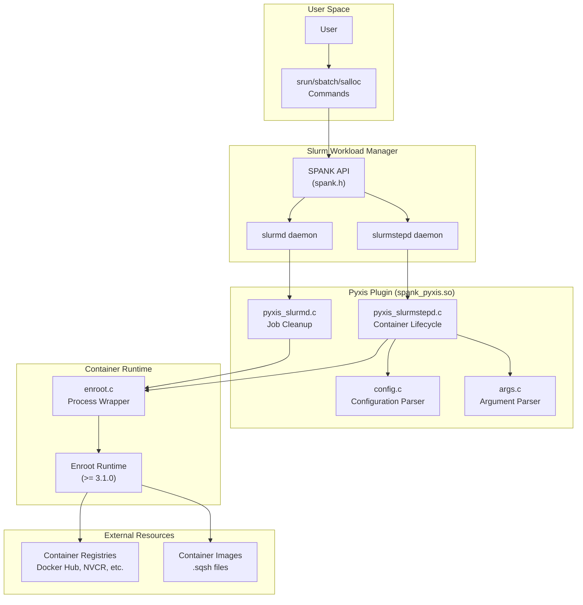

**Figure 1: Pyxis System Context**

This diagram shows how Pyxis sits between Slurm's workload management infrastructure and the Enroot container runtime. Users interact with standard Slurm commands, which load the plugin through the SPANK API. The plugin components handle container lifecycle management and cleanup, delegating container operations to Enroot.

**Sources:** [README.md:1-19](), [pyxis.spec:14-22]()

## Key Features

Pyxis provides the following capabilities for containerized HPC workloads:

| Feature | Description |
|---------|-------------|
| **Unprivileged Execution** | Users run containers without root privileges or elevated permissions |
| **Native Slurm Integration** | Container options added directly to `srun`, `sbatch`, and `salloc` commands |
| **Fast Image Distribution** | Layer-based caching with sharing across users for efficient image downloads |
| **Multi-Node MPI Support** | Full support for distributed MPI jobs via PMI2 and PMIx |
| **Writable Containers** | Users can install packages and modify container filesystems |
| **Shared Filesystem Support** | Works seamlessly with network filesystems (NFS, Lustre, GPFS) |
| **No UID/GID Management** | No cluster-wide subordinate user/group ID configuration required |
| **Multiple Registries** | Supports Docker Hub, NVIDIA NGC Registry, Google Container Registry, GitLab, and others |

**Sources:** [README.md:8-16]()

## Command-Line Interface

Pyxis extends Slurm commands with container-specific arguments prefixed with `--container-*`:

| Argument | Purpose |
|----------|---------|
| `--container-image` | Specify container image URI or local squashfs path |
| `--container-mounts` | Bind mount host paths into container |
| `--container-workdir` | Set working directory inside container |
| `--container-name` | Name container for persistence across jobs |
| `--container-save` | Export container state to squashfs file |
| `--container-mount-home` | Mount user home directory (or `--no-container-mount-home`) |
| `--container-remap-root` | Remap user to root inside container (or `--no-container-remap-root`) |
| `--container-entrypoint` | Execute image entrypoint script (or `--no-container-entrypoint`) |
| `--container-writable` | Make container filesystem writable (or `--container-readonly`) |
| `--container-env` | Override specific environment variables from host |

**Sources:** [README.md:47-106]()

## Core Components

The following table maps high-level subsystems to their implementing source files:

| Component | Source File | Primary Responsibility | Related Pages |
|-----------|-------------|------------------------|---------------|
| **Container Lifecycle Manager** | `pyxis_slurmstepd.c` | Orchestrates container creation, execution, and teardown within job steps | [#4](#4) |
| **Configuration System** | `config.c`, `config.h` | Parses plugin configuration from `plugstack.conf` | [#5](#5) |
| **Argument Parser** | `args.c`, `args.h` | Registers and parses container-related command-line options | [#6](#6) |
| **Enroot Integration** | `enroot.c` | Wraps Enroot command execution with process management | [#7](#7) |
| **Job Cleanup Handler** | `pyxis_slurmd.c` | Removes job-scoped containers in epilog phase | [#9](#9) |
| **Utility Functions** | `common.c`, `common.h` | Provides shared memory management, string operations, logging | [#13](#13) |
| **Build System** | `Makefile` | Compiles plugin, creates packages, manages installation | [#10](#10), [#11](#11) |
| **Image Import Scripts** | `caching_importer.sh`, `simple_importer.sh` | External importers for container image caching strategies | [#8](#8) |

**Sources:** Architecture Diagrams, [pyxis.spec:1-35]()

## Component Interaction Map

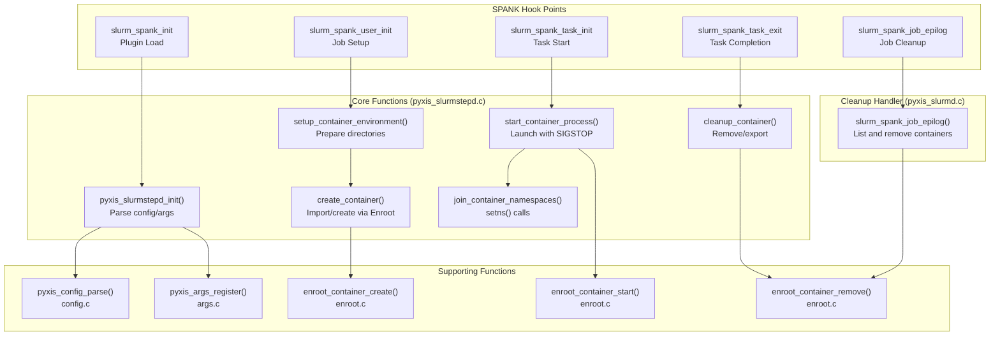

**Figure 2: SPANK Hook Points to Code Functions**

This diagram maps Slurm's SPANK lifecycle hooks to the actual functions in Pyxis that implement container management. The `pyxis_slurmstepd.c` file handles the main execution path, while `pyxis_slurmd.c` handles post-job cleanup. Configuration and argument parsing occur during initialization, and Enroot integration functions are called at appropriate lifecycle stages.

**Sources:** Architecture Diagram 2, [pyxis.spec:1-129]()

## Plugin Architecture

Pyxis consists of two main SPANK plugin components compiled into a single shared library (`spank_pyxis.so`):

1. **`pyxis_slurmstepd` Component**: Loaded by the `slurmstepd` daemon, this component handles the complete container lifecycle within job steps. It intercepts task initialization, creates/starts containers, joins container namespaces, and performs cleanup on task exit.

2. **`pyxis_slurmd` Component**: Loaded by the `slurmd` daemon, this component runs during job epilog to clean up any remaining job-scoped containers that were not removed during normal task exit.

Both components share common infrastructure for configuration parsing, argument handling, and Enroot process management.

**Sources:** Architecture Diagram 1, [Makefile]() (referenced in diagrams)

## Version History

Pyxis has been actively developed since 2019. The current version is 0.21.0, released in October 2025. Major releases include:

| Version | Release Date | Notes |
|---------|--------------|-------|
| 0.21.0 | Oct 2025 | Latest release |
| 0.20.0 | Jul 2024 | Recent stable |
| 0.19.0 | Apr 2024 | |
| 0.18.0 | Mar 2024 | |
| 0.17.0 | Jan 2024 | |
| 0.16.1 | Sep 2023 | Patch release |
| 0.16.0 | Aug 2023 | |
| 0.15.0 | Mar 2023 | |
| 0.1.0 | Jul 2019 | Initial release |

The plugin requires Enroot version 3.1.0 or higher and must be compiled against the specific Slurm version deployed on the cluster (since Slurm 21.08).

**Sources:** [debian/changelog:1-144](), [pyxis.spec:58-128](), [README.md:19-21]()

## Dependencies

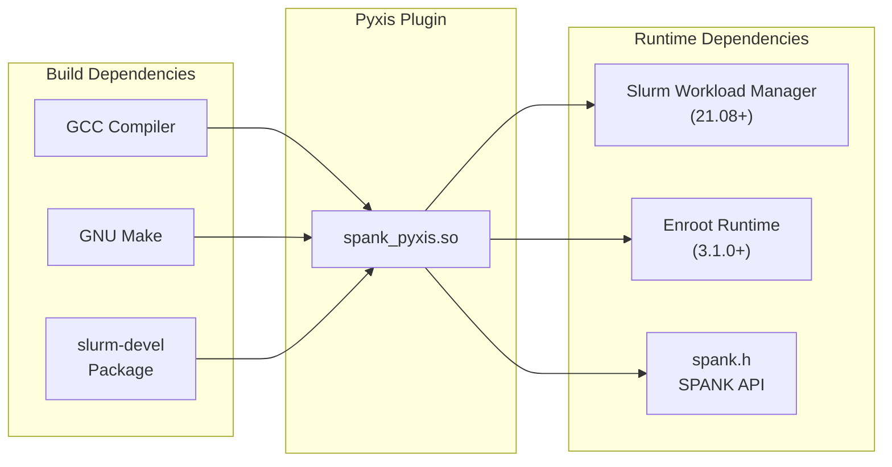

**Figure 3: Build and Runtime Dependencies**

**Sources:** [README.md:19-21](), [pyxis.spec:14-22]()

## Installation Overview

Pyxis can be installed through three methods:

1. **Direct Installation**: Compile with `make` and install with `make install`, then create a symlink in `/etc/slurm/plugstack.conf.d/` to enable the plugin.

2. **Debian Package**: Build a `.deb` package with `make deb` and install with `dpkg`. The package (`nvslurm-plugin-pyxis`) includes dependency management.

3. **RPM Package**: Build an `.rpm` package with `make rpm` and install with `rpm`. The package name includes the Slurm version suffix (e.g., `nvslurm-plugin-pyxis-0.21.0-1.sl2308`).

All installation methods place the plugin in the system's Slurm library directory and provide a configuration file in `/usr/share/pyxis/` or `/usr/local/share/pyxis/`.

For detailed installation steps, see [Getting Started](#2). For packaging details, see [Packaging & Distribution](#11).

**Sources:** [README.md:23-45](), [pyxis.spec:1-55]()

## Usage Pattern

A typical Pyxis workflow:

```bash
# Run a single-node containerized task
srun --container-image=ubuntu:20.04 hostname

# Multi-node MPI job with GPU containers
srun -N 4 -n 32 --container-image=nvcr.io#nvidia/pytorch:21.12-py3 \
     --container-mounts=/data:/mnt \
     --container-writable \
     python train.py

# Batch job with named container
sbatch --container-image=centos:8 --container-name=myapp job_script.sh
```

The plugin handles image import, container creation, namespace joining, and cleanup transparently. Users interact only with standard Slurm commands enhanced with container-specific options.

For comprehensive usage examples, see [README.md:108-140]() and the Usage documentation (referenced in [README.md:141-145]()).

**Sources:** [README.md:47-140]()

## Repository Structure

The Pyxis codebase is organized as follows:

| Directory/File | Purpose |
|----------------|---------|
| `*.c`, `*.h` | Core plugin source files |
| `Makefile` | Build system and packaging targets |
| `pyxis.conf` | Default plugin configuration file |
| `pyxis.spec` | RPM package specification |
| `debian/` | Debian package build files |
| `tests/` | BATS integration test suite |
| `*.sh` | Container image import scripts |
| `README.md` | Quick start documentation |
| `LICENSE` | Apache License 2.0 |
| `CONTRIBUTING.md` | Contribution guidelines |

**Sources:** [README.md:1-168](), [pyxis.spec:30-34]()

## Next Steps

- **Build and Install**: See [Getting Started](#2) for compilation and installation instructions
- **Architecture Details**: See [Architecture](#3) for in-depth component descriptions
- **Container Lifecycle**: See [Container Lifecycle Manager](#4) for details on container orchestration
- **Configuration**: See [Configuration System](#5) for plugin configuration options
- **Testing**: See [Testing Infrastructure](#12) for running integration tests

**Sources:** [README.md:141-162]()

---

# Page: Getting Started

# Getting Started

<details>
<summary>Relevant source files</summary>

The following files were used as context for generating this wiki page:

- [Makefile](Makefile)
- [README.md](README.md)
- [pyxis.spec](pyxis.spec)

</details>


This page provides instructions for building, installing, and using Pyxis. It covers compilation from source, package installation via deb or rpm, plugin configuration, and basic usage examples.

For detailed architectural information about how Pyxis integrates with Slurm, see [Architecture](#3). For advanced usage patterns and configuration options, see the wiki pages on [Configuration System](#5) and [Argument Parsing](#6).

## Prerequisites

### Required Components

Pyxis requires the following components to be installed:

| Component | Minimum Version | Purpose |
|-----------|----------------|---------|
| `enroot` or `enroot-hardened` | 3.1.0 | Container runtime that Pyxis wraps |
| `slurm-devel` | Match cluster version | Build-time headers for SPANK API |
| `make` | Any | Build system |
| `gcc` | Any | C compiler |

**Important**: Since Slurm 21.08, Pyxis must be compiled against the exact Slurm release deployed on the cluster. The SPANK plugin API performs version compatibility checks at load time. Compiling against `spank.h` from a different Slurm release will cause the error `Incompatible plugin version`.

Sources: [README.md:19-21](), [pyxis.spec:14]()

### Slurm Version Compatibility

The build system automatically detects the installed Slurm version and encodes it in the package name. For example, compiling against Slurm 23.11 produces packages with `sl2311` in the release string.

Sources: [pyxis.spec:1-7]()

## Building from Source

### Build Process Overview

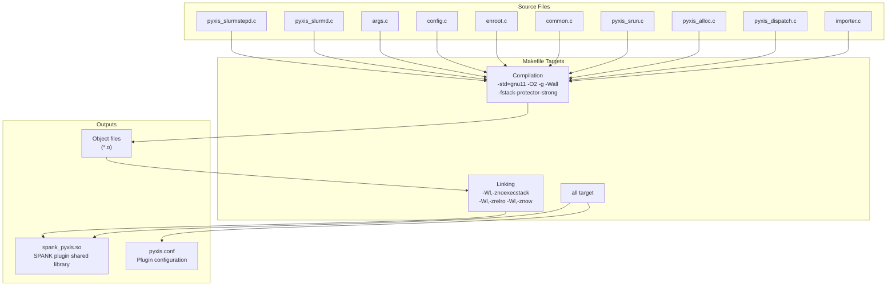

**Build Process Flow**: The Makefile compiles all C source files to object files with security hardening flags, then links them into a single shared library using a linker script. The plugin is stripped to reduce size.

Sources: [Makefile:20-32]()

### Compilation Steps

The build process uses security-hardened compilation flags defined in the Makefile:

```console
$ make
```

This invokes the default `all` target which:

1. **Compiles C sources** - Each `.c` file is compiled to a `.o` object file with flags:
   - `-std=gnu11` - GNU C11 standard
   - `-O2 -g` - Optimization level 2 with debug symbols
   - `-Wall -Wunused-variable` - Enable warnings
   - `-fstack-protector-strong` - Stack protection
   - `-fpic` - Position independent code (required for shared libraries)
   - `-D_FORTIFY_SOURCE=2` - Runtime buffer overflow detection
   - `-DPYXIS_VERSION="x.y.z"` - Embedded version string

2. **Links shared library** - Object files are linked using `spank_pyxis.lds` linker script with hardening:
   - `-Wl,-znoexecstack` - Non-executable stack
   - `-Wl,-zrelro` - Read-only relocations
   - `-Wl,-znow` - Immediate binding

3. **Strips symbols** - Debug symbols are removed from the final binary to reduce size

Sources: [Makefile:16-32]()

### Build Targets

| Target | Command | Output | Purpose |
|--------|---------|--------|---------|
| `all` | `make` | `spank_pyxis.so` | Build the plugin (default) |
| `install` | `make install` | Installed files | Build and install to `prefix` |
| `clean` | `make clean` | - | Remove build artifacts |
| `orig` | `make orig` | `.tar.xz` archive | Create Debian source tarball |
| `deb` | `make deb` | `.deb` package | Build Debian package |
| `rpm` | `make rpm` | `.rpm` package | Build RPM package |

Sources: [Makefile:14-58]()

### Version Configuration

The plugin version is controlled by the `PYXIS_VER` variable:

```console
$ make PYXIS_VER=0.21.0
```

The version is embedded in the binary via the `-DPYXIS_VERSION` preprocessor define and affects package naming.

Sources: [Makefile:9-16]()

## Installation Methods

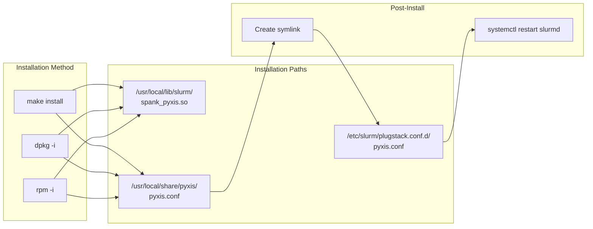

**Installation Flow**: All installation methods place the plugin in the Slurm plugin directory and the configuration template in a shared data directory. A symlink enables Slurm to discover the plugin via `plugstack.conf.d`.

Sources: [Makefile:34-42](), [README.md:23-45]()

### Via make install

Direct installation using the Makefile:

```console
$ sudo make install
```

This installs to the following default locations (configurable via `prefix`, `libdir`, `datadir`):

| Variable | Default | Installed Path |
|----------|---------|----------------|
| `prefix` | `/usr/local` | Base installation directory |
| `libdir` | `$(prefix)/lib` | `/usr/local/lib/slurm/spank_pyxis.so` |
| `datadir` | `$(prefix)/share` | `/usr/local/share/pyxis/pyxis.conf` |

The installed `pyxis.conf` file contains a single line referencing the plugin:

```
required /usr/local/lib/slurm/spank_pyxis.so
```

To customize installation paths:

```console
$ sudo make install prefix=/opt/pyxis
```

Sources: [Makefile:1-38]()

### Via Debian Package

Build and install a `.deb` package:

```console
$ make orig      # Create source tarball
$ make deb       # Build package using debuild
$ sudo dpkg -i ../nvslurm-plugin-pyxis_*_amd64.deb
```

The `orig` target creates a source tarball named `nvslurm-plugin-pyxis_$(PYXIS_VER).orig.tar.xz` in the parent directory. The `deb` target uses `debuild -us -uc -G -i -tc` to build an unsigned package.

Default Debian installation paths:
- Plugin: `/usr/lib/slurm/spank_pyxis.so`
- Config: `/usr/share/pyxis/pyxis.conf`

Sources: [Makefile:47-51](), [README.md:30-37]()

### Via RPM Package

Build and install an `.rpm` package:

```console
$ make rpm       # Build package using rpmbuild
$ sudo rpm -i rpm/RPMS/x86_64/nvslurm-plugin-pyxis-*.x86_64.rpm
```

The RPM build process:

1. Creates a source tarball in `rpm/SOURCES/`
2. Runs `rpmbuild` with the spec file [pyxis.spec]()
3. Generates package named `nvslurm-plugin-pyxis-$(PYXIS_VER)-1.sl####.rpm` where `sl####` encodes the Slurm version

The RPM package automatically declares runtime dependencies:
- `enroot >= 3.1.0` or `enroot-hardened >= 3.1.0`
- Dynamic dependency on `libslurm.so` (Slurm libraries)

Default RPM installation paths:
- Plugin: `/usr/lib64/slurm/spank_pyxis.so` (on 64-bit systems)
- Config: `/usr/share/pyxis/pyxis.conf`

Sources: [Makefile:53-57](), [pyxis.spec:1-54](), [README.md:39-45]()

## Plugin Configuration

### Enabling the Plugin in Slurm

After installation, create a symlink to enable the plugin:

```console
$ sudo ln -s /usr/local/share/pyxis/pyxis.conf /etc/slurm/plugstack.conf.d/pyxis.conf
```

Or for package installations:

```console
$ sudo ln -s /usr/share/pyxis/pyxis.conf /etc/slurm/plugstack.conf.d/pyxis.conf
```

The `plugstack.conf.d` directory is a standard Slurm mechanism for plugin discovery. Each file in this directory is concatenated to form the effective `plugstack.conf`.

Sources: [README.md:26-27](), [README.md:35-36](), [README.md:43-44]()

### Restarting Slurm

After configuring the plugin, restart the Slurm daemon:

```console
$ sudo systemctl restart slurmd
```

This causes `slurmd` to reload the SPANK plugin configuration and load Pyxis. The plugin will be available in all subsequently launched `slurmstepd` processes.

**Note**: Only `slurmd` needs to be restarted. The plugin is loaded by `slurmstepd` (spawned by `slurmd`) and does not require restarting `slurmctld` or `slurmdbd`.

Sources: [README.md:27](), [README.md:36](), [README.md:44]()

## Basic Usage

### Command-Line Interface

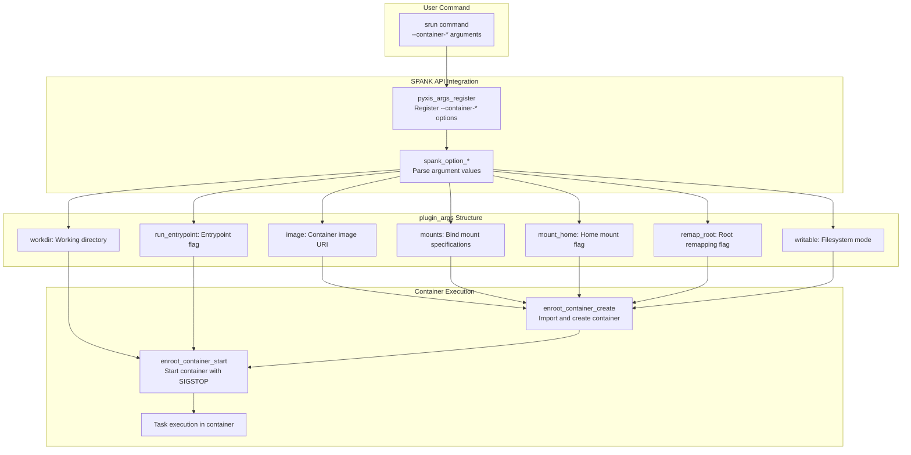

**Argument Processing Flow**: SPANK options registered by `pyxis_args_register` are parsed when the user invokes `srun`. Values populate the `plugin_args` structure which drives container creation and execution through the enroot wrapper functions.

Sources: [README.md:48-106]()

### Simple Container Execution

Run a command inside a container:

```console
$ srun --container-image=centos grep PRETTY /etc/os-release
pyxis: importing docker image: centos
PRETTY_NAME="CentOS Linux 8"
```

This command:
1. Imports the `centos` image from Docker Hub (default registry)
2. Creates a container with the imported image
3. Executes `grep PRETTY /etc/os-release` inside the container

The prefix `pyxis:` indicates messages from the plugin during container import.

Sources: [README.md:117-118]()

### Comparing Host vs Container Environment

Without container (runs on host):

```console
$ srun grep PRETTY /etc/os-release
PRETTY_NAME="Ubuntu 20.04.2 LTS"
```

With container (runs in CentOS container):

```console
$ srun --container-image=centos grep PRETTY /etc/os-release
PRETTY_NAME="CentOS Linux 8"
```

This demonstrates that the task filesystem is isolated to the container.

Sources: [README.md:112-118]()

### Bind Mounting Host Files

Mount host files into the container using `--container-mounts`:

```console
$ srun --container-image=centos \
       --container-mounts=/etc/os-release:/host/os-release \
       grep PRETTY /host/os-release
PRETTY_NAME="Ubuntu 20.04.2 LTS"
```

The syntax is `SRC:DST[:FLAGS]` where:
- `SRC` - Source path on the host
- `DST` - Destination path in the container
- `FLAGS` - Optional mount flags (e.g., `ro+rprivate`)

Multiple mounts are comma-separated: `SRC1:DST1,SRC2:DST2`

Sources: [README.md:120-122](), [README.md:59-61]()

### Using Registry-Specific Images

Specify full image URIs with registry prefixes:

```console
$ srun --container-image=nvcr.io#nvidia/pytorch:21.12-py3 python -c 'import torch'
pyxis: importing docker image: nvcr.io#nvidia/pytorch:21.12-py3
```

The `#` character separates the registry from the image name in enroot URI format. Supported registries include:
- Docker Hub (default): `ubuntu:20.04`
- NVIDIA GPU Cloud: `nvcr.io#nvidia/pytorch:21.12-py3`
- Google Container Registry: `gcr.io#project/image:tag`
- GitLab Container Registry: `registry.gitlab.com#group/project:tag`

Sources: [README.md:128-137](), [README.md:53-57]()

### Batch Job Usage

Pyxis works with `sbatch` by specifying container options in the script header:

```bash
#!/bin/bash
#SBATCH --container-image nvcr.io\#nvidia/pytorch:21.12-py3

python -c 'import torch ; print(torch.__version__)'
```

**Important**: The `#` character must be escaped as `\#` in sbatch scripts because `#` starts a comment.

Submit the batch job:

```console
$ sbatch --wait -o slurm.out job.sh
$ cat slurm.out
pyxis: importing docker image: nvcr.io#nvidia/pytorch:21.12-py3
1.11.0a0+b6df043
```

Sources: [README.md:125-139]()

## Verification

### Checking Plugin Load Status

Verify the plugin loaded successfully by examining `slurmd` logs:

```console
$ sudo journalctl -u slurmd -n 50 | grep pyxis
slurmd: spank: pyxis: version 0.21.0
```

A successful load message indicates the plugin initialized correctly.

### Testing Container Execution

Run a simple test to verify container functionality:

```console
$ srun --container-image=alpine cat /etc/os-release
pyxis: importing docker image: alpine
NAME="Alpine Linux"
ID=alpine
VERSION_ID=3.18.0
PRETTY_NAME="Alpine Linux v3.18"
```

If this succeeds, Pyxis is properly integrated with Slurm and Enroot.

### Common Issues

| Issue | Cause | Solution |
|-------|-------|----------|
| `Incompatible plugin version` | Slurm version mismatch | Recompile against cluster Slurm version |
| `enroot: not found` | Enroot not installed | Install enroot >= 3.1.0 |
| `pyxis: error` during import | Network/registry issue | Check network connectivity and credentials |
| No `--container-*` options | Plugin not loaded | Verify symlink and restart `slurmd` |

Sources: [README.md:21-22]()

## Next Steps

After successful installation and verification:

- See [Configuration System](#5) for advanced plugin configuration options
- See [Argument Parsing](#6) for detailed information on all `--container-*` arguments
- See [Image Import Strategies](#8) for optimizing image import performance
- See [Container Lifecycle Manager](#4) for understanding container execution internals

Sources: [README.md:141-145]()

---

# Page: Architecture

# Architecture

<details>
<summary>Relevant source files</summary>

The following files were used as context for generating this wiki page:

- [args.c](args.c)
- [config.c](config.c)
- [enroot.c](enroot.c)
- [pyxis_slurmd.c](pyxis_slurmd.c)
- [pyxis_slurmstepd.c](pyxis_slurmstepd.c)

</details>


This document provides a high-level architectural overview of Pyxis, describing how the major components interact with Slurm and with each other to provide container execution capabilities. For details on specific components, see [Component Overview](#3.2) and [SPANK Plugin Integration](#3.1).

## System Overview

Pyxis is implemented as a Slurm SPANK (Simple Plugin Architecture for Node job control) plugin that intercepts job execution to provide containerized environments. The plugin consists of two main execution contexts:

1. **slurmstepd context** - Runs within the `slurmstepd` daemon process on compute nodes, managing container lifecycle for job tasks
2. **slurmd context** - Runs within the `slurmd` daemon for post-job cleanup operations

The plugin delegates actual container operations to the Enroot container runtime, acting as a bridge between Slurm's job management and Enroot's container capabilities.

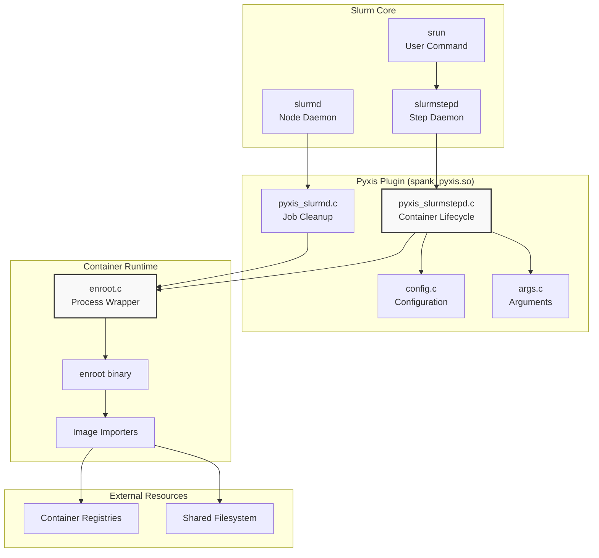

**Sources:** [pyxis_slurmstepd.c:1-50](), [pyxis_slurmd.c:1-20](), [enroot.c:1-17]()

## Architectural Layers

Pyxis is organized into distinct functional layers that separate concerns and enable maintainability:

| Layer | Components | Responsibilities |
|-------|------------|------------------|
| **Integration Layer** | [pyxis_slurmstepd.c](), [pyxis_slurmd.c]() | SPANK hook implementations, lifecycle orchestration, Slurm API interactions |
| **Configuration Layer** | [config.c](), [args.c]() | Plugin configuration parsing, command-line argument processing, environment variable handling |
| **Container Abstraction Layer** | [enroot.c]() | Process management for enroot commands, I/O redirection, UID/GID handling |
| **Utility Layer** | [common.c](), [common.h]() | Shared utility functions, memory management, string operations, file I/O |
| **External Integration** | [importer.c](), [caching_importer.sh](), [simple_importer.sh]() | Container image import strategies, registry interactions |

This layered architecture allows the plugin to adapt to changes in either Slurm or Enroot with minimal impact on other components.

**Sources:** [pyxis_slurmstepd.c:27-35](), [config.c:1-99](), [args.c:1-42](), [enroot.c:1-177]()

## Plugin Lifecycle and Hook Points

The plugin implements several SPANK hooks that Slurm invokes at specific points in the job lifecycle. The following diagram shows the hook execution order and the primary responsibilities of each:

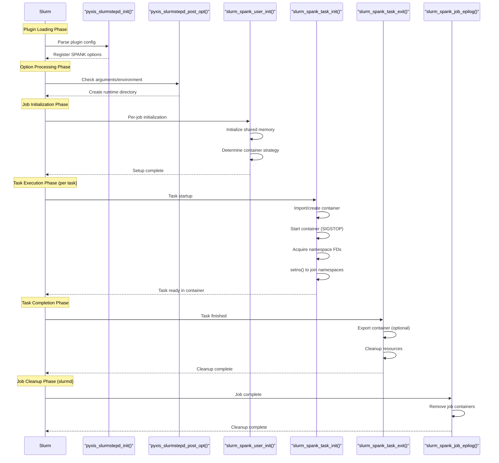

**Sources:** [pyxis_slurmstepd.c:116-133](), [pyxis_slurmstepd.c:265-286](), [pyxis_slurmstepd.c:1036-1184](), [pyxis_slurmstepd.c:1308-1407](), [pyxis_slurmstepd.c:1409-1508](), [pyxis_slurmd.c:127-176]()

## Core Data Structures

The plugin maintains state through several key data structures that coordinate between different lifecycle phases:

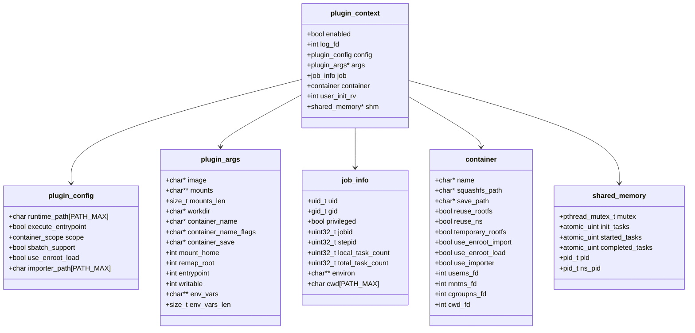

### Structure Responsibilities

| Structure | Defined In | Purpose |
|-----------|-----------|---------|
| `plugin_context` | [pyxis_slurmstepd.c:74-83]() | Global state container for the entire plugin; single static instance shared across all hooks |
| `plugin_config` | [config.h]() | System-level configuration parsed from plugstack.conf; initialized once at plugin load |
| `plugin_args` | [args.h](), [args.c:13-28]() | User-provided arguments from command-line or environment variables; registered as SPANK options |
| `job_info` | [pyxis_slurmstepd.c:53-63]() | Job metadata retrieved from Slurm via SPANK API; includes UID, GID, job IDs, and environment |
| `container` | [pyxis_slurmstepd.c:37-51]() | Container-specific state including name, paths, flags, and namespace file descriptors |
| `shared_memory` | [pyxis_slurmstepd.c:65-72]() | Shared state between multiple tasks in the same job; coordinates single container creation |

**Sources:** [pyxis_slurmstepd.c:37-83](), [pyxis_slurmstepd.c:90-109](), [config.h](), [args.h](), [args.c:13-28]()

## Component Interaction Patterns

### Container Creation Strategy

The plugin determines the appropriate container creation strategy based on user input and configuration. This decision tree is implemented in `slurm_spank_user_init()`:

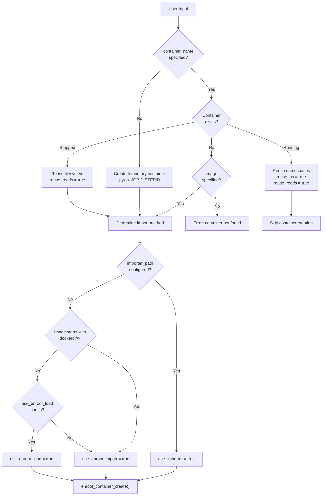

**Sources:** [pyxis_slurmstepd.c:1128-1155]()

### Multi-Task Synchronization

When a job has multiple tasks on a single node, only one task should create and start the container, while all tasks join the same container namespaces. This is coordinated through shared memory:

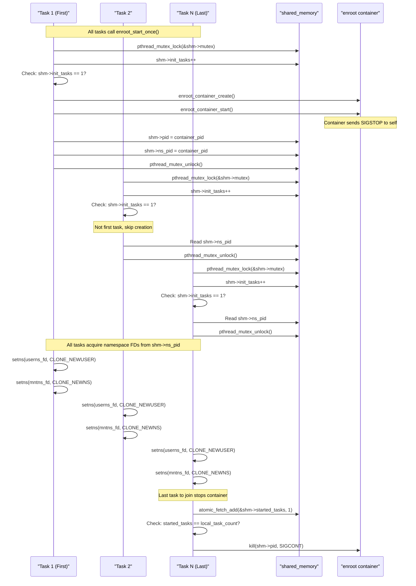

**Sources:** [pyxis_slurmstepd.c:1249-1285](), [pyxis_slurmstepd.c:1287-1306](), [pyxis_slurmstepd.c:972-1012](), [pyxis_slurmstepd.c:1324-1407]()

## Enroot Integration Architecture

The plugin communicates with Enroot through process execution wrappers. The `enroot.c` module provides a clean abstraction for invoking enroot commands with appropriate credentials and I/O handling:

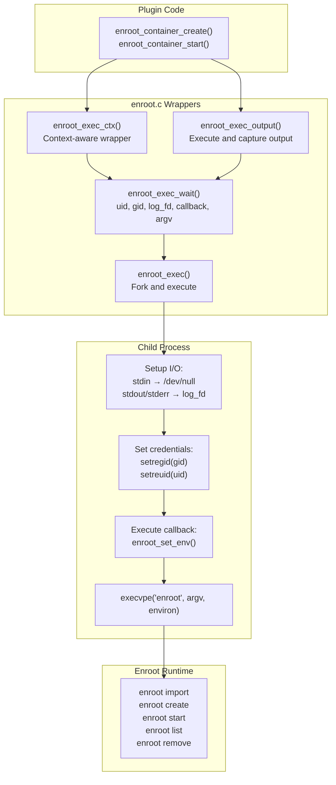

### Key Wrapper Functions

| Function | Purpose | Usage Pattern |
|----------|---------|---------------|
| `enroot_exec_ctx()` | Fork and execute enroot command using plugin context | Called from [pyxis_slurmstepd.c:436-439]() with context UID/GID |
| `enroot_exec_wait_ctx()` | Execute and wait for completion | Used for `enroot import`, `enroot create`, `enroot start` |
| `enroot_exec_output_ctx()` | Execute and capture stdout | Used for `enroot list` to query container state |
| `enroot_set_env()` | Callback to prepare environment before exec | Clears unwanted variables, sets ENROOT_* configuration |

**Sources:** [enroot.c:18-176](), [pyxis_slurmstepd.c:436-455](), [pyxis_slurmstepd.c:389-434]()

## Configuration Flow

Configuration data flows from multiple sources and is resolved with specific precedence rules:

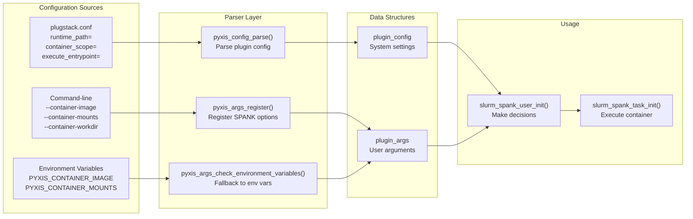

**Precedence Rules:**
1. Command-line arguments override environment variables (enforced in [args.c:166-237]())
2. User-provided settings (`plugin_args`) override system defaults (`plugin_config`)
3. For tri-state options (`mount_home`, `remap_root`, `entrypoint`, `writable`), value `-1` means "use enroot default"

**Sources:** [config.c:23-98](), [args.c:42-151](), [args.c:166-237](), [args.c:615-628](), [pyxis_slurmstepd.c:116-133](), [pyxis_slurmstepd.c:265-286]()

## Namespace Acquisition Pattern

The plugin joins container namespaces using a synchronized startup mechanism. This is one of the most critical architectural patterns in the system:

```mermaid
sequenceDiagram
    participant Plugin as "slurm_spank_task_init()"
    participant Container as "Container Process"
    participant Kernel as "/proc/{pid}/ns/*"
    
    Note over Plugin,Container: Container started with special command
    Plugin->>Container: enroot start ... "sh -c 'kill -STOP $$; exit 0'"
    Container->>Container: Shell starts in namespaces
    Container->>Container: Sends SIGSTOP to self
    Note over Container: Process stopped but still alive
    
    Plugin->>Plugin: waitpid(pid, &status, WUNTRACED)
    Note over Plugin: Wait returns when child stops
    
    Plugin->>Plugin: Check WIFSTOPPED(status)
    
    Plugin->>Kernel: open("/proc/{pid}/ns/user", O_RDONLY)
    Kernel-->>Plugin: userns_fd
    
    Plugin->>Kernel: open("/proc/{pid}/ns/mnt", O_RDONLY)
    Kernel-->>Plugin: mntns_fd
    
    Plugin->>Kernel: open("/proc/{pid}/ns/cgroup", O_RDONLY)
    Kernel-->>Plugin: cgroupns_fd
    
    Plugin->>Kernel: open("/proc/{pid}/cwd", O_RDONLY)
    Kernel-->>Plugin: cwd_fd
    
    Note over Plugin: All namespace FDs acquired
    
    Plugin->>Plugin: Store FDs in container structure
    
    Note over Plugin: Join the namespaces
    Plugin->>Kernel: setns(userns_fd, CLONE_NEWUSER)
    Plugin->>Kernel: setns(cgroupns_fd, CLONE_NEWCGROUP)
    Plugin->>Kernel: setns(mntns_fd, CLONE_NEWNS)
    Plugin->>Kernel: fchdir(cwd_fd)
    
    Note over Plugin: Last task sends SIGCONT
    Plugin->>Container: kill(pid, SIGCONT)
    Container->>Container: Resume and exit
```

This pattern allows the plugin to:
1. Ensure the container has completed `unshare()` and `pivot_root()` 
2. Acquire file descriptors to all required namespaces while they're stable
3. Join those namespaces from the plugin's process context (which becomes the task process)
4. Resume the container process to allow it to exit cleanly

**Sources:** [pyxis_slurmstepd.c:893-954](), [pyxis_slurmstepd.c:740-799](), [pyxis_slurmstepd.c:1332-1391](), [pyxis_slurmstepd.c:956-970]()

## Job Cleanup Architecture

After job completion, the `slurm_spank_job_epilog()` hook in the slurmd context removes any temporary containers. The cleanup behavior depends on the `container_scope` configuration:

| Scope | Container Name Pattern | Cleanup Behavior |
|-------|------------------------|------------------|
| `SCOPE_GLOBAL` | `pyxis_JOBID.STEPID` | Per-step containers removed after step completion |
| `SCOPE_JOB` | `pyxis_JOBID_...` | All job containers removed in epilog |

The cleanup process identifies containers by parsing output from `enroot list` and matching the name pattern:

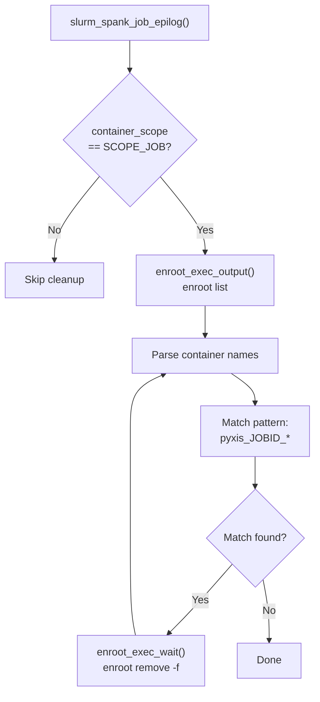

**Sources:** [pyxis_slurmd.c:127-176](), [pyxis_slurmd.c:52-93](), [config.h]()

---

# Page: SPANK Plugin Integration

# SPANK Plugin Integration

<details>
<summary>Relevant source files</summary>

The following files were used as context for generating this wiki page:

- [README.md](README.md)
- [pyxis_slurmd.c](pyxis_slurmd.c)
- [pyxis_slurmstepd.c](pyxis_slurmstepd.c)

</details>


## Purpose and Scope

This document describes how Pyxis integrates with Slurm's SPANK (Slurm Plug-in Architecture for Node jobs) framework. It covers the plugin registration process, SPANK hook functions, lifecycle phases, and the interaction between Slurm daemons and the Pyxis plugin. 

For details on the major components and their interactions, see [Component Overview](#3.2). For the core container lifecycle orchestration, see [Container Lifecycle Manager](#4).

---

## SPANK Framework Overview

SPANK is Slurm's plugin architecture that allows external code to be invoked at specific points during job execution. Pyxis leverages SPANK to inject containerization functionality into the standard Slurm job workflow without modifying Slurm itself.

### Plugin Components

Pyxis consists of two main SPANK plugin components that are loaded by different Slurm daemons:

| Component | Daemon | Purpose | Primary File |
|-----------|--------|---------|--------------|
| Slurmstepd Plugin | `slurmstepd` | Handles container lifecycle during job execution | `pyxis_slurmstepd.c` |
| Slurmd Plugin | `slurmd` | Performs post-job cleanup of containers | `pyxis_slurmd.c` |

Both components are compiled into a single shared library (`spank_pyxis.so`) that is loaded by Slurm based on configuration in `/etc/slurm/plugstack.conf` or `/etc/slurm/plugstack.conf.d/`.

**Sources:** [pyxis_slurmstepd.c:1-1546](), [pyxis_slurmd.c:1-182](), [README.md:3-4]()

---

## Plugin Registration and Loading

### Plugstack Configuration

Pyxis is registered with Slurm through the plugstack configuration mechanism. The plugin is typically loaded via a configuration file that symlinks to the installed plugin configuration:

```
/etc/slurm/plugstack.conf.d/pyxis.conf → /usr/share/pyxis/pyxis.conf
```

The plugin configuration file specifies:
- Plugin path: Location of `spank_pyxis.so`
- Plugin options: Runtime configuration parameters (see [Configuration System](#5))

### Plugin Loading Flow

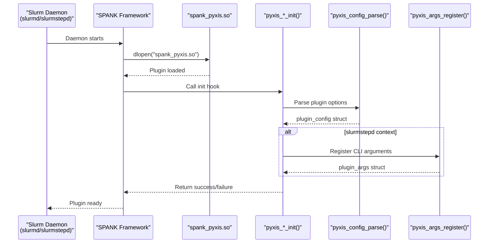

**Sources:** [README.md:23-45](), [pyxis_slurmstepd.c:116-133](), [pyxis_slurmd.c:20-50]()

---

## SPANK Hook Functions

Pyxis implements several SPANK hook functions that are invoked at specific points in the job lifecycle. Each hook serves a distinct purpose in the containerization workflow.

### Slurmstepd Hooks

These hooks run in the `slurmstepd` daemon context, which manages the execution of job steps.

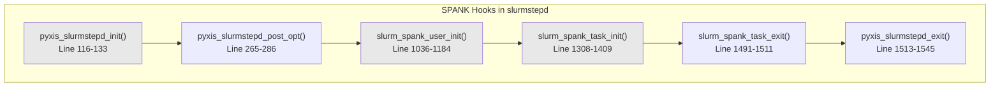

| Hook Function | Invocation Context | Primary Responsibilities |
|---------------|-------------------|--------------------------|
| `pyxis_slurmstepd_init()` | Plugin load time | Parse configuration, register arguments |
| `pyxis_slurmstepd_post_opt()` | After CLI parsing | Check environment variables, create runtime directories |
| `slurm_spank_user_init()` | Before tasks start, once per node | Initialize shared memory, determine container strategy |
| `slurm_spank_task_init()` | Before each task executes | Create/start container, join namespaces |
| `slurm_spank_task_exit()` | After each task completes | Export container (if configured), cleanup |
| `pyxis_slurmstepd_exit()` | Plugin unload time | Free resources, destroy shared memory |

**Sources:** [pyxis_slurmstepd.c:116-133](), [pyxis_slurmstepd.c:265-286](), [pyxis_slurmstepd.c:1036-1184](), [pyxis_slurmstepd.c:1308-1409](), [pyxis_slurmstepd.c:1491-1511](), [pyxis_slurmstepd.c:1513-1545]()

### Slurmd Hooks

These hooks run in the `slurmd` daemon context, which manages the compute node.

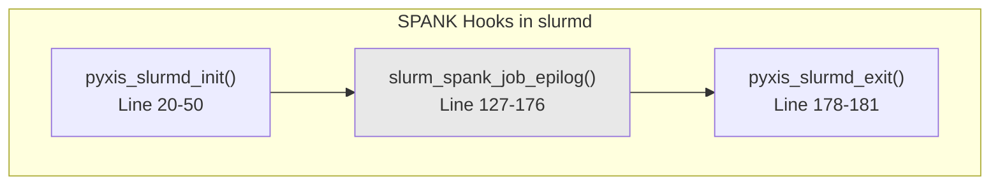

| Hook Function | Invocation Context | Primary Responsibilities |
|---------------|-------------------|--------------------------|
| `pyxis_slurmd_init()` | Slurmd startup | Create runtime directory |
| `slurm_spank_job_epilog()` | After job completes | Remove job-scoped containers |
| `pyxis_slurmd_exit()` | Slurmd shutdown | Cleanup (currently no-op) |

**Sources:** [pyxis_slurmd.c:20-50](), [pyxis_slurmd.c:127-176](), [pyxis_slurmd.c:178-181]()

---

## Plugin Context Management

### Context Structure

The plugin maintains state through a global `plugin_context` structure that persists across hook invocations within the same process.

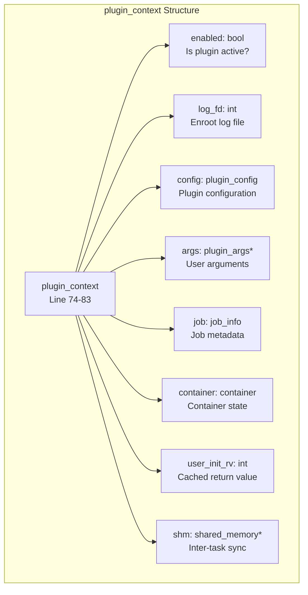

The context is initialized as a static global variable [pyxis_slurmstepd.c:90-109]() and populated progressively through the hook lifecycle.

### Key Substructures

#### job_info Structure

Stores job metadata obtained from SPANK API [pyxis_slurmstepd.c:53-63]():

- `uid` / `gid`: User and group identifiers
- `privileged`: Whether superuser mode is enabled
- `jobid` / `stepid`: Job and step identifiers
- `local_task_count` / `total_task_count`: Task counts for synchronization
- `environ`: Job environment variables
- `cwd`: Current working directory

#### container Structure

Tracks container state [pyxis_slurmstepd.c:37-51]():

- `name`: Container name (e.g., `pyxis_12345_12345.0`)
- `squashfs_path`: Path to container image file
- `save_path`: Export destination (if specified)
- `reuse_rootfs` / `reuse_ns`: Flags for container reuse
- `temporary_rootfs`: Whether to delete container on exit
- `use_enroot_import` / `use_enroot_load` / `use_importer`: Import strategy flags
- `userns_fd` / `mntns_fd` / `cgroupns_fd` / `cwd_fd`: Namespace file descriptors

#### shared_memory Structure

Provides inter-task synchronization [pyxis_slurmstepd.c:65-72]():

- `mutex`: Process-shared mutex for thread-safe access
- `init_tasks` / `started_tasks` / `completed_tasks`: Atomic counters
- `pid`: Container process PID
- `ns_pid`: Namespace owner process PID

**Sources:** [pyxis_slurmstepd.c:37-109]()

---

## Hook Lifecycle Flow

### Complete Execution Sequence

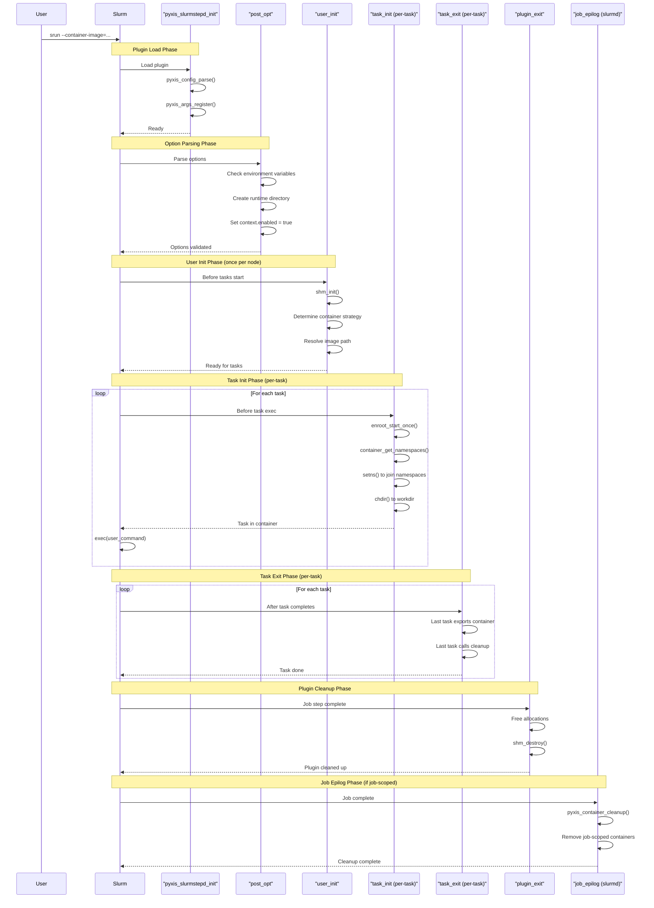

**Sources:** [pyxis_slurmstepd.c:116-1545](), [pyxis_slurmd.c:127-176]()

---

## Initialization Phase Details

### Plugin Initialization

The `pyxis_slurmstepd_init()` function [pyxis_slurmstepd.c:116-133]() is called when the plugin is first loaded. It performs two critical tasks:

1. **Configuration Parsing**: Calls `pyxis_config_parse()` to parse plugin options from the plugstack configuration file
2. **Argument Registration**: Calls `pyxis_args_register()` to register container-related CLI options with SPANK

```c
// Simplified flow from pyxis_slurmstepd_init
ret = pyxis_config_parse(&context.config, ac, av);
context.args = pyxis_args_register(sp);
```

### Post-Option Processing

The `pyxis_slurmstepd_post_opt()` function [pyxis_slurmstepd.c:265-286]() runs after Slurm has parsed all command-line options:

1. **Environment Variable Fallback**: Checks for `PYXIS_CONTAINER_*` environment variables as defaults
2. **Plugin Enablement Check**: Determines if containerization is requested via `pyxis_args_enabled()`
3. **Job Info Retrieval**: Fetches job metadata through `job_get_info()`
4. **Runtime Directory Creation**: Creates per-user runtime directory via `enroot_create_user_runtime_dir()`

**Sources:** [pyxis_slurmstepd.c:116-133](), [pyxis_slurmstepd.c:265-286](), [pyxis_slurmstepd.c:135-194](), [pyxis_slurmstepd.c:238-263]()

---

## User Initialization Phase

### Shared Memory Setup

The `slurm_spank_user_init()` function [pyxis_slurmstepd.c:1036-1184]() runs once per node before any tasks start. A critical operation is establishing shared memory for inter-task coordination:

```c
// Shared memory initialization
context.shm = shm_init();  // Line 1049
```

The shared memory is created with [pyxis_slurmstepd.c:972-1012]():
- Process-shared mutex with `PTHREAD_PROCESS_SHARED` attribute
- Robust mutex handling with `PTHREAD_MUTEX_ROBUST` for crash recovery
- Atomic counters for task synchronization

### Container Strategy Determination

The function determines whether to create a new container or reuse an existing one:

| Scenario | Condition | Action |
|----------|-----------|--------|
| Reuse namespaces | Existing container running (`pid > 0`) | Set `reuse_ns = true`, use existing namespaces |
| Reuse rootfs | Container exists but not running (`pid == 0`) | Set `reuse_rootfs = true`, start in existing filesystem |
| Create new | No existing container (`pid < 0`) | Import image and create new container |

This logic is implemented in [pyxis_slurmstepd.c:1078-1126]().

### Image Resolution

Based on the `--container-image` argument, the function determines how to obtain the container image:

```mermaid
graph TD
    IMAGE["context.args->image"]
    
    CHECK_REUSE{Reusing<br/>rootfs?}
    CHECK_PATH{Starts with<br/>'./' or '/'?}
    CHECK_IMPORTER{Importer<br/>configured?}
    CHECK_DOCKERD{Starts with<br/>'dockerd://'?}
    
    LOCAL["Local squashfs file<br/>Direct path"]
    IMPORTER["Use external importer<br/>use_importer = true"]
    LOAD["Use enroot load<br/>use_enroot_load = true"]
    IMPORT["Use enroot import<br/>use_enroot_import = true"]
    
    IMAGE --> CHECK_REUSE
    CHECK_REUSE -->|No| CHECK_PATH
    CHECK_REUSE -->|Yes| DONE["Skip image resolution"]
    
    CHECK_PATH -->|Yes| LOCAL
    CHECK_PATH -->|No| CHECK_IMPORTER
    
    CHECK_IMPORTER -->|Yes| IMPORTER
    CHECK_IMPORTER -->|No| CHECK_DOCKERD
    
    CHECK_DOCKERD -->|Yes| IMPORT
    CHECK_DOCKERD -->|No| LOAD
```

This logic is implemented in [pyxis_slurmstepd.c:1128-1155]().

### Error Handling Workaround

Due to a Slurm limitation (see bug #7573), errors from `user_init()` are not properly propagated to `srun`. Pyxis works around this by:

1. Caching the return value in `context.user_init_rv` [pyxis_slurmstepd.c:1180]()
2. Always returning success from `user_init()` [pyxis_slurmstepd.c:1183]()
3. Checking the cached value in `task_init()` [pyxis_slurmstepd.c:1316-1317]()

**Sources:** [pyxis_slurmstepd.c:1036-1184](), [pyxis_slurmstepd.c:972-1012](), [pyxis_slurmstepd.c:1078-1155]()

---

## Task Initialization Phase

### Per-Task Execution

The `slurm_spank_task_init()` function [pyxis_slurmstepd.c:1308-1409]() runs for each task in the job. This is where the task joins the container namespaces.

### Container Creation Synchronization

Multiple tasks coordinate container creation through shared memory with `enroot_start_once()` [pyxis_slurmstepd.c:1249-1285]():

```c
// Synchronization logic (simplified)
pthread_mutex_lock(&shm->mutex);
shm->init_tasks += 1;

if (shm->init_tasks == 1) {
    // First task creates/starts container
    if (!container->reuse_rootfs)
        enroot_container_create();
    shm->pid = enroot_container_start();
    
    if (!container->reuse_ns)
        shm->ns_pid = shm->pid;
}
pthread_mutex_unlock(&shm->mutex);
```

Only the first task performs the expensive container creation and start operations. Other tasks wait for the mutex to be released and then use the PIDs stored in shared memory.

### Namespace Joining

After the container is started, each task:

1. **Acquires namespace file descriptors** via `container_get_namespaces()` [pyxis_slurmstepd.c:740-781]()
   - User namespace: `/proc/<pid>/ns/user`
   - Mount namespace: `/proc/<pid>/ns/mnt`
   - Cgroup namespace: `/proc/<pid>/ns/cgroup` (if available)

2. **Imports container environment** via `spank_import_container_env()` [pyxis_slurmstepd.c:590-641]()

3. **Joins namespaces** using `setns()` system calls [pyxis_slurmstepd.c:1357-1376]()
   - User namespace (unless privileged)
   - Cgroup namespace (if available)
   - Mount namespace

4. **Changes directory** to container working directory [pyxis_slurmstepd.c:1379-1391]()

5. **Sets seccomp filter** for unprivileged users [pyxis_slurmstepd.c:1393-1399]()

### Container Stop Synchronization

After all tasks have joined the container, the last task to start stops the helper container process with `enroot_stop_once()` [pyxis_slurmstepd.c:1287-1306]():

```c
// Last task stops container helper
if (atomic_fetch_add(&shm->started_tasks, 1) == context.job.local_task_count - 1) {
    enroot_container_stop(shm->pid);  // Send SIGCONT
}
```

**Sources:** [pyxis_slurmstepd.c:1308-1409](), [pyxis_slurmstepd.c:1249-1306](), [pyxis_slurmstepd.c:740-781](), [pyxis_slurmstepd.c:590-641]()

---

## Task Exit and Cleanup

### Task Exit Hook

The `slurm_spank_task_exit()` function [pyxis_slurmstepd.c:1491-1511]() runs after each task completes. The last task to exit performs cleanup operations:

1. **Container Export** (if configured) via `enroot_export()` [pyxis_slurmstepd.c:1440-1458]()
   - Exports container filesystem to a squashfs file
   - Only runs if `--container-save` was specified

2. **Container Cleanup** via `enroot_cleanup()` [pyxis_slurmstepd.c:1460-1489]()
   - Removes temporary squashfs files
   - Releases importer resources
   - Removes temporary containers

The synchronization uses atomic counters:

```c
// Last task to exit performs cleanup
if (atomic_fetch_add(&shm->completed_tasks, 1) == context.job.local_task_count - 1) {
    enroot_export();
    enroot_cleanup();
}
```

### Plugin Exit Hook

The `pyxis_slurmstepd_exit()` function [pyxis_slurmstepd.c:1513-1545]() runs once when the job step completes:

1. Frees all allocated memory
2. Closes file descriptors
3. Destroys shared memory via `shm_destroy()` [pyxis_slurmstepd.c:1014-1034]()
4. Frees argument structures via `pyxis_args_free()`

**Sources:** [pyxis_slurmstepd.c:1491-1511](), [pyxis_slurmstepd.c:1440-1489](), [pyxis_slurmstepd.c:1513-1545](), [pyxis_slurmstepd.c:1014-1034]()

---

## Job Epilog Cleanup

### Slurmd Job Epilog

The `slurm_spank_job_epilog()` function [pyxis_slurmd.c:127-176]() runs in the `slurmd` daemon after a job completes. This hook is only active when `container_scope` is set to `SCOPE_JOB`.

### Container Removal Logic

The epilog performs cleanup via `pyxis_container_cleanup()` [pyxis_slurmd.c:52-93]():

1. Lists all containers with `enroot list`
2. Identifies containers belonging to the job using pattern matching: `pyxis_<jobid>_*`
3. Removes each matching container with `enroot remove -f`

This ensures job-scoped containers are cleaned up even if the job step cleanup failed or was interrupted.

### Environment Fixup

The epilog process has an unusual environment, which is corrected by `job_epilog_fixup()` [pyxis_slurmd.c:100-125]():

- Opens `/dev/null` for stdin (which is closed)
- Sets a minimal `PATH` environment variable
- Clears `HOME` to avoid user-specific behavior

**Sources:** [pyxis_slurmd.c:52-176](), [pyxis_slurmd.c:100-125]()

---

## SPANK Item Retrieval

Both plugin components extensively use the SPANK API to retrieve job information. Key SPANK items accessed:

| SPANK Item | Type | Purpose | Hook Usage |
|------------|------|---------|------------|
| `S_JOB_UID` | `uid_t` | User ID for container ownership | user_init, job_epilog |
| `S_JOB_GID` | `gid_t` | Group ID for container ownership | user_init, job_epilog |
| `S_JOB_ID` | `uint32_t` | Job identifier for container naming | user_init, job_epilog |
| `S_JOB_STEPID` | `uint32_t` | Step identifier for container naming | user_init |
| `S_JOB_LOCAL_TASK_COUNT` | `uint32_t` | Number of tasks on node (for sync) | user_init |
| `S_JOB_TOTAL_TASK_COUNT` | `uint32_t` | Total tasks in job (for output control) | user_init |
| `S_JOB_ENV` | `char**` | Job environment variables | user_init, task_init |
| `S_JOB_ARGV` | `char**` | Job arguments (for sbatch script) | user_init |

These items are retrieved using `spank_get_item()` [pyxis_slurmstepd.c:141-175]() and `spank_getenv()` [pyxis_slurmstepd.c:178-188]().

**Sources:** [pyxis_slurmstepd.c:135-235](), [pyxis_slurmd.c:151-167]()

---

## Summary

Pyxis integrates with Slurm through a carefully orchestrated series of SPANK hooks that span multiple daemon contexts:

1. **Initialization hooks** parse configuration and register options
2. **User init hook** sets up shared memory and determines container strategy
3. **Task init hooks** synchronize container creation and join namespaces
4. **Task exit hooks** handle container export and cleanup
5. **Job epilog hook** removes job-scoped containers

The plugin uses shared memory for inter-task synchronization, ensuring that only one task performs expensive operations like container creation. File descriptors to container namespaces allow all tasks to efficiently join the same container environment, enabling multi-process and multi-node containerized jobs.

**Sources:** [pyxis_slurmstepd.c:1-1546](), [pyxis_slurmd.c:1-182]()

---

# Page: Component Overview

# Component Overview

<details>
<summary>Relevant source files</summary>

The following files were used as context for generating this wiki page:

- [args.c](args.c)
- [config.c](config.c)
- [enroot.c](enroot.c)
- [pyxis_slurmd.c](pyxis_slurmd.c)
- [pyxis_slurmstepd.c](pyxis_slurmstepd.c)

</details>


This page provides an overview of the major components in the Pyxis SPANK plugin and how they interact with each other. For details about how these components integrate with Slurm's SPANK framework, see [SPANK Plugin Integration](#3.1). For in-depth coverage of the container lifecycle, see [Container Lifecycle Manager](#4).

## Purpose and Scope

Pyxis consists of five primary source components that work together to provide containerized job execution in Slurm:

1. **pyxis_slurmstepd.c** - Container lifecycle orchestration during job execution
2. **args.c** - Command-line argument and environment variable processing
3. **config.c** - Plugin configuration parsing
4. **enroot.c** - Process execution wrapper for Enroot commands
5. **pyxis_slurmd.c** - Post-job container cleanup

## Component Architecture

```mermaid
graph TB
    subgraph "SPANK Integration Points"
        INIT["pyxis_slurmstepd_init()"]
        POST_OPT["pyxis_slurmstepd_post_opt()"]
        USER_INIT["slurm_spank_user_init()"]
        TASK_INIT["slurm_spank_task_init()"]
        TASK_EXIT["slurm_spank_task_exit()"]
        EPILOG["slurm_spank_job_epilog()"]
    end
    
    subgraph "Core Components"
        STEPD["pyxis_slurmstepd.c<br/>Container Lifecycle Manager"]
        ARGS["args.c<br/>Argument Parser"]
        CONFIG["config.c<br/>Configuration Parser"]
        ENROOT["enroot.c<br/>Enroot Wrapper"]
        SLURMD["pyxis_slurmd.c<br/>Cleanup Handler"]
    end
    
    subgraph "Data Structures"
        PLUGIN_CTX["struct plugin_context"]
        PLUGIN_ARGS["struct plugin_args"]
        PLUGIN_CFG["struct plugin_config"]
        CONTAINER["struct container"]
        JOB_INFO["struct job_info"]
        SHARED_MEM["struct shared_memory"]
    end
    
    subgraph "External Runtime"
        ENROOT_BIN["enroot binary"]
    end
    
    INIT --> CONFIG
    INIT --> ARGS
    CONFIG --> PLUGIN_CFG
    ARGS --> PLUGIN_ARGS
    
    POST_OPT --> ARGS
    POST_OPT --> STEPD
    
    USER_INIT --> STEPD
    TASK_INIT --> STEPD
    TASK_EXIT --> STEPD
    
    STEPD --> PLUGIN_CTX
    STEPD --> ENROOT
    
    PLUGIN_CTX --> PLUGIN_ARGS
    PLUGIN_CTX --> PLUGIN_CFG
    PLUGIN_CTX --> CONTAINER
    PLUGIN_CTX --> JOB_INFO
    PLUGIN_CTX --> SHARED_MEM
    
    ENROOT --> ENROOT_BIN
    
    EPILOG --> SLURMD
    SLURMD --> CONFIG
    SLURMD --> ENROOT
```

**Sources:** [pyxis_slurmstepd.c:1-150](), [args.c:1-50](), [config.c:1-30](), [enroot.c:1-30](), [pyxis_slurmd.c:1-50]()

## Core Data Structures

The plugin maintains state through several key data structures:

| Structure | File | Purpose |
|-----------|------|---------|
| `struct plugin_context` | pyxis_slurmstepd.c:74-83 | Global plugin state, aggregates all other structures |
| `struct plugin_config` | config.h | Plugin configuration options from plugstack.conf |
| `struct plugin_args` | args.c:13-28 | Parsed command-line arguments and environment variables |
| `struct container` | pyxis_slurmstepd.c:37-51 | Container metadata and namespace file descriptors |
| `struct job_info` | pyxis_slurmstepd.c:53-63 | Job context (UID, GID, job ID, environment) |
| `struct shared_memory` | pyxis_slurmstepd.c:65-72 | Inter-task synchronization via shared memory |

**Sources:** [pyxis_slurmstepd.c:37-83](), [args.c:13-28](), [config.h]()

## Component: pyxis_slurmstepd

The primary component, responsible for the entire container lifecycle during job execution.

### Key Functions

| Function | Line | SPANK Hook | Purpose |
|----------|------|------------|---------|
| `pyxis_slurmstepd_init()` | 116 | `slurm_spank_init` | Parse configuration, register arguments |
| `pyxis_slurmstepd_post_opt()` | 265 | `slurm_spank_init_post_opt` | Check environment variables, create runtime directory |
| `slurm_spank_user_init()` | 1036 | `slurm_spank_user_init` | Per-job initialization, determine container strategy |
| `slurm_spank_task_init()` | 1308 | `slurm_spank_task_init` | Create/start container, join namespaces |
| `slurm_spank_task_exit()` | 1410 | `slurm_spank_task_exit` | Export container, cleanup resources |

### Container Management Functions

```mermaid
graph LR
    subgraph "Container Creation"
        CREATE["enroot_container_create()"]
        GET["enroot_container_get()"]
    end
    
    subgraph "Container Execution"
        START["enroot_container_start()"]
        STOP["enroot_container_stop()"]
        START_ONCE["enroot_start_once()"]
        STOP_ONCE["enroot_stop_once()"]
    end
    
    subgraph "Namespace Operations"
        GET_NS["container_get_namespaces()"]
        GET_CWD["container_get_cwd()"]
    end
    
    subgraph "Synchronization"
        SHM_INIT["shm_init()"]
        SHM_DESTROY["shm_destroy()"]
    end
    
    START_ONCE --> GET
    START_ONCE --> CREATE
    START_ONCE --> START
    START_ONCE --> SHM_INIT
    
    STOP_ONCE --> STOP
    STOP_ONCE --> SHM_DESTROY
    
    GET_NS --> START
    GET_CWD --> START
```

**Sources:** [pyxis_slurmstepd.c:116-1600](), [pyxis_slurmstepd.c:643-954](), [pyxis_slurmstepd.c:972-1034]()

## Component: args

Handles parsing and validation of command-line arguments and environment variables.

### Argument Registration

The component defines an array of SPANK options:

| Option | Type | Description |
|--------|------|-------------|
| `--container-image` | Required arg | Container image URI or squashfs path |
| `--container-mounts` | Required arg | Bind mounts (format: SRC:DST:FLAGS) |
| `--container-workdir` | Required arg | Working directory inside container |
| `--container-name` | Required arg | Named container for reuse |
| `--container-save` | Required arg | Export container to squashfs |
| `--container-mount-home` | Flag | Mount user home directory |
| `--container-remap-root` | Flag | Remap to root inside container |
| `--container-entrypoint` | Flag | Execute container entrypoint |
| `--container-writable` | Flag | Make container filesystem writable |
| `--container-env` | Required arg | Environment variables to preserve |

### Argument Processing Flow

```mermaid
sequenceDiagram
    participant SPANK as "SPANK API"
    participant REGISTER as "pyxis_args_register()"
    participant PARSE as "spank_option_*() callbacks"
    participant ENV as "pyxis_args_check_environment_variables()"
    participant VALIDATE as "pyxis_args_enabled()"
    participant ARGS as "struct plugin_args"
    
    SPANK->>REGISTER: Register options
    REGISTER->>SPANK: Register each spank_opts[] entry
    
    SPANK->>PARSE: Parse CLI arguments
    PARSE->>ARGS: Store values
    
    SPANK->>ENV: Check environment variables
    ENV->>ARGS: Fill unset values from env
    
    SPANK->>VALIDATE: Check if plugin enabled
    VALIDATE->>ARGS: Verify image or container_name set
```

### Key Functions

| Function | Line | Purpose |
|----------|------|---------|
| `pyxis_args_register()` | 615 | Register SPANK options with Slurm |
| `pyxis_args_check_environment_variables()` | 166 | Check environment variables for defaults |
| `pyxis_args_enabled()` | 630 | Validate plugin should be activated |
| `spank_option_image()` | 239 | Parse `--container-image` |
| `spank_option_mount()` | 371 | Parse `--container-mounts` |
| `add_mount()` | 263 | Add mount entry with validation |

**Sources:** [args.c:1-667](), [args.c:42-151](), [args.c:166-237]()

## Component: config

Parses plugin configuration from plugstack.conf.

### Configuration Options

| Option | Type | Default | Description |
|--------|------|---------|-------------|
| `runtime_path` | string | `/run/pyxis` | Directory for temporary squashfs files |
| `execute_entrypoint` | bool | `false` | Execute container entrypoint by default |
| `container_scope` | enum | `global` | Container naming scope (`job` or `global`) |
| `sbatch_support` | bool | `true` | Enable sbatch script mounting |
| `use_enroot_load` | bool | `false` | Use `enroot load` instead of `enroot import` |
| `importer` | string | (empty) | External importer script path |

### Parsing Logic

```mermaid
graph TB
    START["pyxis_config_parse()"]
    DEFAULTS["Initialize defaults"]
    LOOP["Loop over av[] arguments"]
    
    RUNTIME["runtime_path="]
    ENTRYPOINT["execute_entrypoint="]
    SCOPE["container_scope="]
    SBATCH["sbatch_support="]
    LOAD["use_enroot_load="]
    IMPORTER["importer="]
    
    PARSE_BOOL["parse_bool()"]
    VALIDATE["Validate values"]
    
    START --> DEFAULTS
    DEFAULTS --> LOOP
    LOOP --> RUNTIME
    LOOP --> ENTRYPOINT
    LOOP --> SCOPE
    LOOP --> SBATCH
    LOOP --> LOAD
    LOOP --> IMPORTER
    
    ENTRYPOINT --> PARSE_BOOL
    SBATCH --> PARSE_BOOL
    LOAD --> PARSE_BOOL
    
    PARSE_BOOL --> VALIDATE
    RUNTIME --> VALIDATE
    SCOPE --> VALIDATE
    IMPORTER --> VALIDATE
```

**Sources:** [config.c:23-98](), [config.c:12-21]()

## Component: enroot

Provides process execution wrappers for invoking Enroot commands.

### Execution Functions

| Function | Line | Purpose |
|----------|------|---------|
| `enroot_exec()` | 18 | Fork and execute enroot command |
| `enroot_exec_wait()` | 122 | Execute enroot and wait for completion |
| `enroot_exec_output()` | 139 | Execute enroot and capture output to FILE* |

### Process Execution Flow

```mermaid
sequenceDiagram
    participant CALLER as "Caller"
    participant EXEC as "enroot_exec()"
    participant FORK as "fork()"
    participant CHILD as "Child Process"
    participant ENROOT as "enroot binary"
    
    CALLER->>EXEC: argv[], uid, gid, log_fd, callback
    EXEC->>FORK: fork()
    FORK-->>EXEC: pid
    
    Note over CHILD: Child process
    CHILD->>CHILD: Open /dev/null
    CHILD->>CHILD: dup2() stdin to /dev/null
    CHILD->>CHILD: dup2() stdout/stderr to log_fd
    CHILD->>CHILD: Set oom_score_adj to 0
    CHILD->>CHILD: setregid(gid, gid)
    CHILD->>CHILD: setreuid(uid, uid)
    CHILD->>CHILD: callback() if provided
    CHILD->>ENROOT: execvpe("enroot", argv, environ)
    
    EXEC-->>CALLER: Return pid
```

### Key Features

- **UID/GID switching**: Executes enroot with job user credentials via `setreuid()`/`setregid()` [enroot.c:73-79]()
- **I/O redirection**: Redirects stdout/stderr to log file or /dev/null [enroot.c:49-61]()
- **Environment setup**: Calls optional callback to set environment before exec [enroot.c:81-85]()
- **OOM score adjustment**: Sets `oom_score_adj` to prevent OOM killer immunity [enroot.c:67-71]()

**Sources:** [enroot.c:18-176]()

## Component: pyxis_slurmd

Handles post-job cleanup in the Slurmd daemon context.

### Key Functions

| Function | Line | SPANK Hook | Purpose |
|----------|------|------------|---------|
| `pyxis_slurmd_init()` | 20 | `slurm_spank_slurmd_init` | Create runtime directory |
| `slurm_spank_job_epilog()` | 127 | `slurm_spank_job_epilog` | Cleanup job containers |
| `pyxis_container_cleanup()` | 52 | (internal) | Remove containers for job |

### Cleanup Logic

```mermaid
graph TB
    EPILOG["slurm_spank_job_epilog()"]
    CONFIG["Parse config"]
    CHECK_SCOPE{"container_scope<br/>== SCOPE_JOB?"}
    FIXUP["job_epilog_fixup()"]
    GET_INFO["Get uid, gid, jobid"]
    CLEANUP["pyxis_container_cleanup()"]
    LIST["enroot list"]
    MATCH{"Container name<br/>matches pyxis_JOBID_*?"}
    REMOVE["enroot remove -f"]
    
    EPILOG --> CONFIG
    CONFIG --> CHECK_SCOPE
    CHECK_SCOPE -->|No| RETURN[Return]
    CHECK_SCOPE -->|Yes| FIXUP
    FIXUP --> GET_INFO
    GET_INFO --> CLEANUP
    CLEANUP --> LIST
    LIST --> MATCH
    MATCH -->|Yes| REMOVE
    MATCH -->|No| LIST
    REMOVE --> LIST
```

### Container Name Matching

The cleanup logic removes containers matching the pattern:
- Named containers: `pyxis_JOBID_*` (with any suffix)
- Temporary containers: `pyxis_JOBID_STEPID`

This is controlled by the `container_scope` configuration option. When set to `SCOPE_JOB`, containers are automatically removed after job completion.

**Sources:** [pyxis_slurmd.c:20-176](), [pyxis_slurmd.c:52-93](), [pyxis_slurmd.c:127-176]()

## Component Interaction During Job Execution

```mermaid
sequenceDiagram
    participant SLURM as "Slurm"
    participant STEPD as "pyxis_slurmstepd.c"
    participant ARGS as "args.c"
    participant CONFIG as "config.c"
    participant ENROOT as "enroot.c"
    participant SLURMD as "pyxis_slurmd.c"
    
    Note over SLURM,CONFIG: Initialization Phase
    SLURM->>STEPD: slurm_spank_init()
    STEPD->>CONFIG: pyxis_config_parse()
    CONFIG-->>STEPD: struct plugin_config
    STEPD->>ARGS: pyxis_args_register()
    ARGS-->>STEPD: struct plugin_args*
    
    Note over SLURM,ARGS: Argument Processing
    SLURM->>STEPD: slurm_spank_init_post_opt()
    STEPD->>ARGS: pyxis_args_check_environment_variables()
    STEPD->>ARGS: pyxis_args_enabled()
    ARGS-->>STEPD: enabled=true
    
    Note over SLURM,ENROOT: Container Creation
    SLURM->>STEPD: slurm_spank_user_init()
    STEPD->>STEPD: Initialize shared_memory
    STEPD->>STEPD: Determine container strategy
    
    SLURM->>STEPD: slurm_spank_task_init()
    STEPD->>STEPD: enroot_start_once()
    STEPD->>ENROOT: enroot_exec() - enroot create
    ENROOT-->>STEPD: success
    STEPD->>ENROOT: enroot_exec() - enroot start
    ENROOT-->>STEPD: pid
    STEPD->>STEPD: container_get_namespaces()
    STEPD->>STEPD: setns() - join namespaces
    
    Note over SLURM,SLURMD: Cleanup Phase
    SLURM->>STEPD: slurm_spank_task_exit()
    STEPD->>ENROOT: enroot_exec_wait() - enroot remove
    
    SLURM->>SLURMD: slurm_spank_job_epilog()
    SLURMD->>CONFIG: pyxis_config_parse()
    SLURMD->>ENROOT: enroot_exec_output() - enroot list
    SLURMD->>ENROOT: enroot_exec_wait() - enroot remove -f
```

**Sources:** [pyxis_slurmstepd.c:116-1600](), [args.c:615-655](), [config.c:23-98](), [enroot.c:18-176](), [pyxis_slurmd.c:127-176]()

## Component Responsibilities Summary

| Component | Primary Responsibility | Complexity | Dependencies |
|-----------|----------------------|------------|--------------|
| pyxis_slurmstepd.c | Container lifecycle orchestration | High | args, config, enroot |
| args.c | Argument parsing and validation | Medium | config (for structs) |
| config.c | Configuration parsing | Low | None |
| enroot.c | Process execution wrapper | Low | None |
| pyxis_slurmd.c | Post-job cleanup | Low | config, enroot |

The architecture follows a clear separation of concerns:

- **Configuration** (config.c) provides system-level settings
- **Arguments** (args.c) provides user-level options
- **Lifecycle** (pyxis_slurmstepd.c) orchestrates container operations using both configuration and arguments
- **Execution** (enroot.c) provides low-level process management
- **Cleanup** (pyxis_slurmd.c) ensures resources are released after job completion

This modular design allows each component to be tested and maintained independently while working together through well-defined interfaces.

**Sources:** [pyxis_slurmstepd.c:1-100](), [args.c:1-50](), [config.c:1-30](), [enroot.c:1-30](), [pyxis_slurmd.c:1-50]()

---

# Page: Container Lifecycle Manager

# Container Lifecycle Manager

<details>
<summary>Relevant source files</summary>

The following files were used as context for generating this wiki page:

- [pyxis_slurmstepd.c](pyxis_slurmstepd.c)

</details>


## Purpose and Scope

The Container Lifecycle Manager is the core orchestration component of Pyxis, implemented in `pyxis_slurmstepd.c`. This module manages the complete lifecycle of containerized job execution within Slurm's `slurmstepd` daemon, from initial configuration parsing through container creation, namespace management, task execution, and final cleanup.

This page provides an architectural overview of the lifecycle manager and its coordination mechanisms. For specific implementation details, see:
- [Initialization & Setup](#4.1) - configuration parsing and runtime directory setup
- [Container Creation](#4.2) - image import and container creation strategies
- [Namespace Management](#4.3) - Linux namespace acquisition and multi-task coordination
- [Environment & Execution](#4.4) - environment variable handling and task execution
- [Cleanup & Teardown](#4.5) - container export and resource cleanup

For information about the configuration system used by this module, see [Configuration System](#5). For argument parsing, see [Argument Parsing](#6).

**Sources:** [pyxis_slurmstepd.c:1-1546]()

## Core Architecture

The Container Lifecycle Manager operates as a SPANK plugin within Slurm's `slurmstepd` daemon. It maintains a global `plugin_context` structure that tracks the state of container operations across multiple SPANK hook invocations.

### Key Data Structures

The lifecycle manager uses four primary data structures to manage container state:

| Structure | Purpose | Key Fields | Scope |
|-----------|---------|------------|-------|
| `plugin_context` | Global plugin state | `config`, `args`, `job`, `container`, `shm` | Per-job-step, singleton |
| `plugin_config` | Plugin configuration | `runtime_path`, `container_scope`, `importer_path` | Parsed at init |
| `plugin_args` | User arguments | `image`, `mounts`, `workdir`, `entrypoint` | From CLI/env vars |
| `job_info` | Job metadata | `uid`, `gid`, `jobid`, `stepid`, `task_count` | From SPANK API |
| `container` | Container state | `name`, `squashfs_path`, namespace FDs, flags | Runtime state |
| `shared_memory` | Multi-task sync | `mutex`, `init_tasks`, `started_tasks`, `pid` | Shared across tasks |

**Sources:** [pyxis_slurmstepd.c:37-109]()

### Plugin Context Structure

```mermaid
graph TB
    subgraph "plugin_context (singleton)"
        ENABLED["enabled: bool"]
        CONFIG["config: plugin_config"]
        ARGS["args: plugin_args*"]
        JOB["job: job_info"]
        CONTAINER["container: struct container"]
        SHM["shm: shared_memory*"]
        LOG_FD["log_fd: int"]
    end
    
    subgraph "plugin_config"
        RUNTIME_PATH["runtime_path: char[]"]
        SCOPE["container_scope: enum"]
        IMPORTER["importer_path: char[]"]
        ENROOT_LOAD["use_enroot_load: bool"]
    end
    
    subgraph "plugin_args"
        IMAGE["image: char*"]
        MOUNTS["mounts: char**"]
        WORKDIR["workdir: char*"]
        CONTAINER_NAME["container_name: char*"]
    end
    
    subgraph "job_info"
        UID["uid: uid_t"]
        GID["gid: gid_t"]
        JOBID["jobid: uint32_t"]
        STEPID["stepid: uint32_t"]
        TASK_COUNT["local_task_count: uint32_t"]
    end
    
    subgraph "container"
        CTR_NAME["name: char*"]
        SQFS_PATH["squashfs_path: char*"]
        USERNS_FD["userns_fd: int"]
        MNTNS_FD["mntns_fd: int"]
        REUSE_FLAGS["reuse_rootfs, reuse_ns: bool"]
    end
    
    CONFIG --> ENABLED
    ARGS --> ENABLED
    JOB --> ENABLED
    CONTAINER --> ENABLED
    SHM --> ENABLED
    LOG_FD --> ENABLED
```

**Sources:** [pyxis_slurmstepd.c:74-109]()

## SPANK Hook Functions

The lifecycle manager implements six SPANK hook functions that are invoked by Slurm at specific points in the job lifecycle:

| Hook Function | When Called | Primary Responsibilities |
|---------------|-------------|--------------------------|
| `pyxis_slurmstepd_init()` | Plugin load | Parse configuration, register arguments |
| `pyxis_slurmstepd_post_opt()` | After CLI parsing | Check environment variables, create runtime directories |
| `slurm_spank_user_init()` | Before task init | Set up shared memory, determine container strategy, handle batch scripts |
| `slurm_spank_task_init()` | Per-task init | Create/start container, acquire namespaces, join namespaces |
| `slurm_spank_task_exit()` | Per-task exit | Export container (last task), cleanup temporary containers |
| `pyxis_slurmstepd_exit()` | Plugin unload | Free resources, destroy shared memory |

**Sources:** [pyxis_slurmstepd.c:116-133](), [pyxis_slurmstepd.c:265-286](), [pyxis_slurmstepd.c:1036-1184](), [pyxis_slurmstepd.c:1308-1409](), [pyxis_slurmstepd.c:1491-1511](), [pyxis_slurmstepd.c:1513-1545]()

### SPANK Hook Invocation Flow

```mermaid
sequenceDiagram
    participant Slurm as "slurmstepd daemon"
    participant Init as "pyxis_slurmstepd_init"
    participant PostOpt as "pyxis_slurmstepd_post_opt"
    participant UserInit as "slurm_spank_user_init"
    participant TaskInit as "slurm_spank_task_init (per-task)"
    participant TaskExit as "slurm_spank_task_exit (per-task)"
    participant Exit as "pyxis_slurmstepd_exit"
    
    Slurm->>Init: Plugin load
    Init->>Init: "pyxis_config_parse()"
    Init->>Init: "pyxis_args_register()"
    Init-->>Slurm: Return 0
    
    Slurm->>PostOpt: After argument parsing
    PostOpt->>PostOpt: "pyxis_args_check_environment_variables()"
    PostOpt->>PostOpt: "job_get_info()"
    PostOpt->>PostOpt: "enroot_create_user_runtime_dir()"
    PostOpt-->>Slurm: Return 0
    
    Slurm->>UserInit: Before tasks spawn (once)
    UserInit->>UserInit: "shm_init()"
    UserInit->>UserInit: "Determine container strategy"
    UserInit->>UserInit: "Setup container name"
    UserInit-->>Slurm: Return 0
    
    loop For each task
        Slurm->>TaskInit: Task initialization
        TaskInit->>TaskInit: "enroot_start_once()"
        TaskInit->>TaskInit: "container_get_namespaces()"
        TaskInit->>TaskInit: "setns() calls"
        TaskInit->>TaskInit: "chdir()"
        TaskInit-->>Slurm: Return 0
        
        Note over Slurm,TaskInit: Task executes in container
        
        Slurm->>TaskExit: Task completion
        TaskExit->>TaskExit: "enroot_export() (last task)"
        TaskExit->>TaskExit: "enroot_cleanup() (last task)"
        TaskExit-->>Slurm: Return 0
    end
    
    Slurm->>Exit: Plugin unload
    Exit->>Exit: "Free all resources"
    Exit->>Exit: "shm_destroy()"
    Exit->>Exit: "pyxis_args_free()"
    Exit-->>Slurm: Return 0
```

**Sources:** [pyxis_slurmstepd.c:116-133](), [pyxis_slurmstepd.c:265-286](), [pyxis_slurmstepd.c:1036-1184](), [pyxis_slurmstepd.c:1308-1409](), [pyxis_slurmstepd.c:1491-1511](), [pyxis_slurmstepd.c:1513-1545]()

## Container Lifecycle Phases

The container lifecycle consists of five distinct phases, each handled by specific functions within the lifecycle manager:

### Lifecycle Phase Diagram

```mermaid
stateDiagram-v2
    [*] --> Configuration: "pyxis_slurmstepd_init()"
    Configuration --> RuntimeSetup: "pyxis_slurmstepd_post_opt()"
    RuntimeSetup --> StrategyDetermination: "slurm_spank_user_init()"
    
    state StrategyDetermination {
        [*] --> CheckContainerName
        CheckContainerName --> ReuseNamespaces: "container exists, running"
        CheckContainerName --> ReuseFilesystem: "container exists, stopped"
        CheckContainerName --> CreateNew: "container doesn't exist"
        CheckContainerName --> CreateNew: "no --container-name"
        
        ReuseNamespaces --> [*]: "reuse_ns = true"
        ReuseFilesystem --> [*]: "reuse_rootfs = true"
        CreateNew --> ImageResolution
        ImageResolution --> [*]: "Set import strategy"
    }
    
    StrategyDetermination --> ContainerCreation: "slurm_spank_task_init() (first task)"
    
    state ContainerCreation {
        [*] --> ImportImage: "if !reuse_rootfs"
        ImportImage --> CreateFilesystem: "enroot_container_create()"
        CreateFilesystem --> StartContainer
        [*] --> StartContainer: "if reuse_rootfs"
        StartContainer --> AcquireNamespaces: "enroot_container_start()"
        AcquireNamespaces --> [*]: "container_get_namespaces()"
    }
    
    ContainerCreation --> NamespaceJoining: "slurm_spank_task_init() (all tasks)"
    
    state NamespaceJoining {
        [*] --> JoinUserNS: "setns(userns_fd)"
        JoinUserNS --> JoinCgroupNS: "setns(cgroupns_fd)"
        JoinCgroupNS --> JoinMountNS: "setns(mntns_fd)"
        JoinMountNS --> ChangeDir: "chdir(workdir or cwd_fd)"
        ChangeDir --> SetSeccomp: "seccomp_set_filter()"
        SetSeccomp --> [*]
    }
    
    NamespaceJoining --> TaskExecution: "All tasks joined"
    TaskExecution --> Cleanup: "slurm_spank_task_exit() (last task)"
    
    state Cleanup {
        [*] --> Export: "if container_save != NULL"
        Export --> RemoveContainer: "if temporary_rootfs"
        [*] --> RemoveContainer: "if no export"
        RemoveContainer --> [*]: "enroot_cleanup()"
    }
    
    Cleanup --> [*]: "pyxis_slurmstepd_exit()"
```

**Sources:** [pyxis_slurmstepd.c:116-1545]()

## Multi-Task Coordination

When a Slurm job spawns multiple tasks on a single node, all tasks must share the same container. The lifecycle manager uses POSIX shared memory with a mutex to coordinate container creation and ensure only one task creates/starts the container.

### Shared Memory Structure

The `shared_memory` structure provides process-shared synchronization:

```c
struct shared_memory {
    pthread_mutex_t mutex;        // Process-shared, robust mutex
    atomic_uint init_tasks;       // Count of tasks in initialization
    atomic_uint started_tasks;    // Count of tasks that joined namespaces
    atomic_uint completed_tasks;  // Count of tasks that exited
    pid_t pid;                    // Container process PID
    pid_t ns_pid;                 // PID to get namespaces from
};
```

**Sources:** [pyxis_slurmstepd.c:65-72]()

### Multi-Task Synchronization Flow

```mermaid
sequenceDiagram
    participant T1 as "Task 1"
    participant T2 as "Task 2"
    participant TN as "Task N"
    participant SHM as "shared_memory"
    participant Container as "Container Process"
    
    Note over T1,TN: "slurm_spank_task_init() called for each task"
    
    T1->>SHM: "pthread_mutex_lock(&shm->mutex)"
    T1->>SHM: "shm->init_tasks += 1 (now 1)"
    
    rect rgb(240, 240, 240)
        Note over T1: "First task creates container"
        T1->>T1: "enroot_container_create()"
        T1->>Container: "enroot_container_start()"
        Container-->>Container: "kill -STOP $$"
        T1->>T1: "waitpid(pid, WUNTRACED)"
        T1->>SHM: "shm->pid = container_pid"
        T1->>SHM: "shm->ns_pid = container_pid"
        T1->>Container: "container_get_namespaces()"
    end
    
    T1->>SHM: "pthread_mutex_unlock(&shm->mutex)"
    
    T2->>SHM: "pthread_mutex_lock(&shm->mutex)"
    T2->>SHM: "shm->init_tasks += 1 (now 2)"
    T2->>T2: "Skip creation, use shm->ns_pid"
    T2->>SHM: "pthread_mutex_unlock(&shm->mutex)"
    
    TN->>SHM: "pthread_mutex_lock(&shm->mutex)"
    TN->>SHM: "shm->init_tasks += 1 (now N)"
    TN->>TN: "Skip creation, use shm->ns_pid"
    TN->>SHM: "pthread_mutex_unlock(&shm->mutex)"
    
    par All tasks join namespaces
        T1->>T1: "setns(userns_fd, mntns_fd, cgroupns_fd)"
        T2->>T2: "setns(userns_fd, mntns_fd, cgroupns_fd)"
        TN->>TN: "setns(userns_fd, mntns_fd, cgroupns_fd)"
    end
    
    T1->>SHM: "atomic_fetch_add(&shm->started_tasks, 1)"
    T2->>SHM: "atomic_fetch_add(&shm->started_tasks, 1)"
    TN->>SHM: "atomic_fetch_add(&shm->started_tasks, 1) == N-1"
    
    rect rgb(240, 240, 240)
        Note over TN: "Last task to start resumes container"
        TN->>Container: "kill(pid, SIGCONT)"
        TN->>SHM: "shm->pid = -1"
    end
    
    Note over T1,TN: "Tasks execute in container..."
    
    Note over T1,TN: "slurm_spank_task_exit() called for each task"
    
    T1->>SHM: "atomic_fetch_add(&shm->completed_tasks, 1)"
    T2->>SHM: "atomic_fetch_add(&shm->completed_tasks, 1)"
    TN->>SHM: "atomic_fetch_add(&shm->completed_tasks, 1) == N-1"
    
    rect rgb(240, 240, 240)
        Note over TN: "Last task to exit does cleanup"
        TN->>TN: "enroot_export()"
        TN->>TN: "enroot_cleanup()"
    end
```

**Sources:** [pyxis_slurmstepd.c:972-1012](), [pyxis_slurmstepd.c:1249-1285](), [pyxis_slurmstepd.c:1287-1306](), [pyxis_slurmstepd.c:1499-1508]()

### Coordination Functions

| Function | Purpose | Critical Section |
|----------|---------|------------------|
| `shm_init()` | Create shared memory mapping | Initialize process-shared mutex with `PTHREAD_PROCESS_SHARED` and `PTHREAD_MUTEX_ROBUST` |
| `enroot_start_once()` | Ensure single container creation | Mutex-protected, first task creates/starts, others wait and reuse |
| `enroot_stop_once()` | Resume container after all tasks ready | Atomic counter, last task sends `SIGCONT` |
| `enroot_export()` / `enroot_cleanup()` | Single cleanup execution | Atomic counter in `slurm_spank_task_exit()`, last task performs cleanup |
| `shm_destroy()` | Clean up shared memory | Destroy mutex and unmap memory |

**Sources:** [pyxis_slurmstepd.c:972-1012](), [pyxis_slurmstepd.c:1249-1306](), [pyxis_slurmstepd.c:1440-1489](), [pyxis_slurmstepd.c:1014-1034]()

## Container Strategy Selection

The lifecycle manager supports three container strategies, determined in `slurm_spank_user_init()`:

### Strategy Decision Tree

```mermaid
graph TB
    Start["slurm_spank_user_init()"]
    Start --> CheckName{"--container-name<br/>specified?"}
    
    CheckName -->|"Yes"| GetContainer["enroot_container_get(name, &pid)"]
    CheckName -->|"No"| AutoName["Generate name:<br/>pyxis_jobid.stepid"]
    
    GetContainer --> CheckPID{"Container<br/>status?"}
    CheckPID -->|"pid > 0 (running)"| CheckFlags1{"container_name_flags<br/>= 'exec'?"}
    CheckPID -->|"pid == 0 (stopped)"| CheckFlags2{"container_name_flags<br/>= 'no_exec'?"}
    CheckPID -->|"pid < 0 (not exist)"| CheckFlags3{"Has --container-image?"}
    
    CheckFlags1 -->|"Yes or not set"| ReuseNS["Strategy: REUSE_NS<br/>reuse_ns = true<br/>reuse_rootfs = true<br/>shm->ns_pid = pid"]
    CheckFlags1 -->|"No (error)"| Error1["Error: exec flag<br/>but not running"]
    
    CheckFlags2 -->|"Yes"| ReuseFS["Strategy: REUSE_FS<br/>reuse_rootfs = true<br/>temporary_rootfs = false"]
    CheckFlags2 -->|"No"| ReuseFS
    
    CheckFlags3 -->|"Yes"| CreateNamed["Strategy: CREATE<br/>temporary_rootfs = false<br/>Proceed to image import"]
    CheckFlags3 -->|"No"| Error2["Error: container<br/>doesn't exist,<br/>no image"]
    
    AutoName --> CreateTemp["Strategy: CREATE<br/>temporary_rootfs = true<br/>Proceed to image import"]
    
    ReuseNS --> SkipImport["Skip image import<br/>Skip container creation<br/>Skip container start"]
    ReuseFS --> SkipCreate["Skip image import<br/>Skip container creation"]
    CreateNamed --> ImagePath["Determine image<br/>import path"]
    CreateTemp --> ImagePath
    
    ImagePath --> CheckImagePath{"Image path<br/>starts with<br/>'./' or '/'?"}
    CheckImagePath -->|"Yes"| LocalPath["Use local squashfs:<br/>squashfs_path = image"]
    CheckImagePath -->|"No"| CheckImporter{"Importer<br/>configured?"}
    
    CheckImporter -->|"Yes"| UseImporter["use_importer = true"]
    CheckImporter -->|"No"| CheckDockerd{"Image starts<br/>with 'dockerd://'?"}
    
    CheckDockerd -->|"Yes"| UseImport["use_enroot_import = true"]
    CheckDockerd -->|"No"| CheckLoadConfig{"config.use_enroot_load<br/>= true?"}
    
    CheckLoadConfig -->|"Yes"| UseLoad["use_enroot_load = true"]
    CheckLoadConfig -->|"No"| UseImport
    
    LocalPath --> Done["Ready for task_init"]
    UseImporter --> Done
    UseLoad --> Done
    UseImport --> Done
    SkipImport --> Done
    SkipCreate --> Done
```

**Sources:** [pyxis_slurmstepd.c:1078-1167]()

## Integration with Other Components

The Container Lifecycle Manager coordinates with multiple other Pyxis components:

### Component Dependencies

```mermaid
graph LR
    subgraph "pyxis_slurmstepd.c (117.69)"
        LIFECYCLE["Container Lifecycle Manager"]
        SPANK_HOOKS["SPANK Hook Functions"]
        SHM["Shared Memory<br/>Coordination"]
        NS_MGMT["Namespace<br/>Management"]
    end
    
    subgraph "config.c (17.50)"
        CONFIG_PARSE["pyxis_config_parse()"]
        PLUGIN_CONFIG["plugin_config structure"]
    end
    
    subgraph "args.c (25.62)"
        ARGS_REGISTER["pyxis_args_register()"]
        ARGS_CHECK_ENV["pyxis_args_check_environment_variables()"]
        ARGS_ENABLED["pyxis_args_enabled()"]
        PLUGIN_ARGS["plugin_args structure"]
    end
    
    subgraph "enroot.c (12.58)"
        ENROOT_EXEC["enroot_exec()"]
        ENROOT_EXEC_WAIT["enroot_exec_wait()"]
        ENROOT_EXEC_OUTPUT["enroot_exec_output()"]
    end
    
    subgraph "importer.c/h"
        IMPORTER_GET["importer_exec_get()"]
        IMPORTER_RELEASE["importer_exec_release()"]
    end
    
    subgraph "common.c (8.53)"
        XASPRINTF["xasprintf()"]
        GET_LINE["get_line_from_file()"]
        MEMFD_CREATE["pyxis_memfd_create()"]
        ARRAY_CONTAINS["array_contains()"]
    end
    
    subgraph "Slurm SPANK API"
        SPANK_GET_ITEM["spank_get_item()"]
        SPANK_GETENV["spank_getenv()"]
        SPANK_SETENV["spank_setenv()"]
    end
    
    SPANK_HOOKS --> CONFIG_PARSE
    CONFIG_PARSE --> PLUGIN_CONFIG
    PLUGIN_CONFIG --> LIFECYCLE
    
    SPANK_HOOKS --> ARGS_REGISTER
    SPANK_HOOKS --> ARGS_CHECK_ENV
    SPANK_HOOKS --> ARGS_ENABLED
    ARGS_REGISTER --> PLUGIN_ARGS
    ARGS_CHECK_ENV --> PLUGIN_ARGS
    ARGS_ENABLED --> PLUGIN_ARGS
    PLUGIN_ARGS --> LIFECYCLE
    
    LIFECYCLE --> ENROOT_EXEC
    LIFECYCLE --> ENROOT_EXEC_WAIT
    LIFECYCLE --> ENROOT_EXEC_OUTPUT
    
    LIFECYCLE --> IMPORTER_GET
    LIFECYCLE --> IMPORTER_RELEASE
    
    LIFECYCLE --> XASPRINTF
    LIFECYCLE --> GET_LINE
    LIFECYCLE --> MEMFD_CREATE
    LIFECYCLE --> ARRAY_CONTAINS
    
    SPANK_HOOKS --> SPANK_GET_ITEM
    SPANK_HOOKS --> SPANK_GETENV
    SPANK_HOOKS --> SPANK_SETENV
```

**Sources:** [pyxis_slurmstepd.c:28-35]()

### Key Integration Points

| Component | Functions Used | Purpose |
|-----------|----------------|---------|
| **config.c** | `pyxis_config_parse()` | Parse plugin configuration from plugstack.conf |
| **args.c** | `pyxis_args_register()`, `pyxis_args_check_environment_variables()`, `pyxis_args_enabled()` | Register CLI options, check environment fallbacks, validate arguments |
| **enroot.c** | `enroot_exec()`, `enroot_exec_wait()`, `enroot_exec_output()` | Execute enroot commands with proper UID/GID and I/O handling |
| **importer.c** | `importer_exec_get()`, `importer_exec_release()` | Use external importer for image caching |
| **common.c** | `xasprintf()`, `get_line_from_file()`, `pyxis_memfd_create()`, `array_contains()` | Utility functions for string formatting, file I/O, logging |
| **SPANK API** | `spank_get_item()`, `spank_getenv()`, `spank_setenv()` | Query job information, manage environment variables |

**Sources:** [pyxis_slurmstepd.c:116-133](), [pyxis_slurmstepd.c:265-286](), [pyxis_slurmstepd.c:436-449](), [pyxis_slurmstepd.c:692-698](), [pyxis_slurmstepd.c:1469-1476]()

## Container Process Synchronization

The lifecycle manager uses a sophisticated synchronization technique to acquire container namespace file descriptors. The container is started with a shell command that stops itself using `SIGSTOP`, allowing the plugin to acquire namespace handles before the container continues execution.

### SIGSTOP Synchronization Mechanism

```mermaid
sequenceDiagram
    participant Plugin as "pyxis_slurmstepd"
    participant Fork as "fork()"
    participant Enroot as "enroot start"
    participant Shell as "sh -c 'kill -STOP $$'"
    participant Kernel as "Linux Kernel"
    
    Plugin->>Fork: "enroot_exec_ctx()"
    Fork->>Enroot: "exec enroot start ... sh -c 'kill -STOP $$; exit 0'"
    Enroot->>Enroot: "unshare() namespaces"
    Enroot->>Enroot: "pivot_root()"
    Enroot->>Shell: "exec sh -c ..."
    Shell->>Shell: "kill -STOP $$"
    Shell->>Kernel: "SIGSTOP to self"
    
    Note over Shell,Kernel: "Container process stopped"
    
    Plugin->>Plugin: "waitpid(pid, &status, WUNTRACED)"
    Plugin->>Plugin: "Check WIFSTOPPED(status)"
    
    rect rgb(240, 240, 240)
        Note over Plugin: "Container is stopped,<br/>namespaces are stable"
        Plugin->>Plugin: "open(/proc/pid/ns/user)"
        Plugin->>Plugin: "open(/proc/pid/ns/mnt)"
        Plugin->>Plugin: "open(/proc/pid/ns/cgroup)"
        Plugin->>Plugin: "open(/proc/pid/cwd)"
    end
    
    Plugin->>Plugin: "Store FDs in context.container"
    
    Note over Plugin: "Wait for all tasks<br/>to acquire FDs..."
    
    Plugin->>Shell: "kill(pid, SIGCONT)"
    Shell->>Shell: "Resume execution"
    Shell->>Shell: "exit 0"
```

**Sources:** [pyxis_slurmstepd.c:893-954](), [pyxis_slurmstepd.c:909-942](), [pyxis_slurmstepd.c:956-970]()

### Container Start Implementation

The `enroot_container_start()` function creates a temporary configuration file and starts the container with the synchronization shell command:

**Key Steps:**
1. Create temporary enroot configuration with mounts and hooks via `enroot_create_start_config()`
2. Start container: `enroot start --conf <file> <name> sh -c "kill -STOP $$ ; exit 0"`
3. Wait for container to stop with `waitpid(pid, &status, WUNTRACED)`
4. Verify `WIFSTOPPED(status)` is true
5. Acquire namespace file descriptors via `container_get_namespaces()`
6. Return container PID to caller

**Sources:** [pyxis_slurmstepd.c:893-954](), [pyxis_slurmstepd.c:801-891](), [pyxis_slurmstepd.c:740-781]()

## Environment Management

The lifecycle manager carefully manages environment variables to ensure proper isolation between Slurm's environment and the container's environment, while selectively importing required variables.

### Environment Variable Flow

```mermaid
graph TB
    subgraph "Slurm Job Environment"
        SLURM_ENV["Job environment<br/>(S_JOB_ENV from SPANK)"]
    end
    
    subgraph "Environment Filtering"
        CLEAR["slurm_clear_env()<br/>Clear slurmstepd env"]
        DENY["enroot_deny_env[]<br/>Blocked variables"]
        IMPORT["enroot_import_job_env()<br/>Import allowed vars"]
    end
    
    subgraph "Enroot Process Environment"
        ENROOT_ENV["Enroot command environment"]
        PYXIS_VARS["PYXIS_* variables"]
        ENROOT_CONFIG["ENROOT_* config"]
        ENROOT_OPTS["ENROOT_* options"]
    end
    
    subgraph "Container Process"
        CONTAINER_ENV["/proc/PID/environ"]
    end
    
    subgraph "Task Environment (SPANK)"
        TASK_ENV["Task environment<br/>after spank_import_container_env()"]
        CONTAINER_DENY["container_deny_env[]<br/>(LANG, LC_ALL, etc)"]
    end
    
    SLURM_ENV --> CLEAR
    CLEAR --> IMPORT
    SLURM_ENV --> DENY
    DENY -.blocks.-> IMPORT
    
    IMPORT --> ENROOT_ENV
    PYXIS_VARS --> ENROOT_ENV
    ENROOT_CONFIG --> ENROOT_ENV
    ENROOT_OPTS --> ENROOT_ENV
    
    ENROOT_ENV --> CONTAINER_ENV
    
    CONTAINER_ENV --> TASK_ENV
    CONTAINER_DENY -.removes.-> TASK_ENV
```

**Sources:** [pyxis_slurmstepd.c:300-434](), [pyxis_slurmstepd.c:590-641]()

### Denied Environment Variables

Two lists control environment variable filtering:

**Denied from Enroot** (`enroot_deny_env[]`):
- `PATH`, `LD_LIBRARY_PATH`, `LD_PRELOAD` - prevent host contamination
- `SLURM_PROCID`, `SLURM_LOCALID`, `SLURM_TASK_PID` - task-specific, set later
- `PMIX_RANK`, `PMI_FD` - PMI coordination, set later
- `ENROOT_*` - all enroot configuration variables

**Denied from Container** (`container_deny_env[]`):
- `LANG`, `LANGUAGE`, `LC_ALL` - locale variables (unless in `--container-env`)

**Sources:** [pyxis_slurmstepd.c:334-359](), [pyxis_slurmstepd.c:583-588]()

## Error Handling and Robustness

The lifecycle manager implements several robustness features:

### Mutex Robustness

The shared memory mutex uses `PTHREAD_MUTEX_ROBUST`, allowing recovery if a task crashes while holding the lock:

```c
// In shm_init()
pthread_mutexattr_setrobust(&mutex_attr, PTHREAD_MUTEX_ROBUST);

// In enroot_start_once()
if (pthread_mutex_lock(&shm->mutex) == EOWNERDEAD) {
    pthread_mutex_consistent(&shm->mutex);
    shm->pid = -1;
    shm->ns_pid = -1;
    goto fail;  // Treat as failure, retry
}
```

**Sources:** [pyxis_slurmstepd.c:992-994](), [pyxis_slurmstepd.c:1254-1259]()

### User Init Error Propagation

Due to a Slurm limitation ([bug #7573](https://bugs.schedmd.com/show_bug.cgi?id=7573)), errors from `slurm_spank_user_init()` are not propagated to `srun`. The lifecycle manager works around this by storing the error code and returning it in `slurm_spank_task_init()`:

**Sources:** [pyxis_slurmstepd.c:1171-1183](), [pyxis_slurmstepd.c:1316-1317]()

### Partial Initialization Cleanup

If container startup fails partway through, the lifecycle manager tracks what resources were allocated and cleans them up appropriately:

| Resource | Cleanup Function | When Cleaned |
|----------|------------------|--------------|
| Temporary squashfs | `unlink()` in `enroot_cleanup()` | If `use_enroot_import` is true |
| Importer resources | `importer_exec_release()` | If `use_importer` is true |
| Container filesystem | `enroot remove -f` | If `temporary_rootfs` is true |
| Shared memory | `shm_destroy()` | In `pyxis_slurmstepd_exit()` |
| Namespace FDs | `xclose()` | In `pyxis_slurmstepd_exit()` |

**Sources:** [pyxis_slurmstepd.c:1460-1489](), [pyxis_slurmstepd.c:1513-1545]()

---

# Page: Initialization & Setup

# Initialization & Setup

<details>
<summary>Relevant source files</summary>

The following files were used as context for generating this wiki page:

- [args.c](args.c)
- [config.c](config.c)
- [pyxis_slurmstepd.c](pyxis_slurmstepd.c)

</details>


This page describes the initialization and setup phases of the Pyxis container lifecycle manager. It covers plugin initialization through SPANK hooks, configuration parsing, command-line argument registration and validation, runtime directory creation, and shared memory setup for multi-task coordination. For details on how containers are created after initialization, see [Container Creation](#4.2). For the overall architecture, see [Architecture](#3).

## Initialization Phases

Pyxis initialization occurs through several SPANK hook functions that are called by Slurm at specific points in the job lifecycle. The initialization follows a three-phase approach:

### Phase 1: Plugin Init (`pyxis_slurmstepd_init`)

The first initialization phase occurs when the `slurmstepd` daemon loads the plugin. This is the earliest opportunity for setup.

```mermaid
sequenceDiagram
    participant Slurm as "slurmstepd daemon"
    participant Init as "pyxis_slurmstepd_init"
    participant ConfigParser as "pyxis_config_parse"
    participant ArgsRegister as "pyxis_args_register"
    
    Slurm->>Init: "Load plugin"
    Init->>ConfigParser: "Parse plugstack.conf options"
    ConfigParser-->>Init: "plugin_config structure"
    Init->>ArgsRegister: "Register SPANK options"
    ArgsRegister-->>Init: "plugin_args pointer"
    Init-->>Slurm: "Return 0 (success)"
```

**Sources:** [pyxis_slurmstepd.c:116-133](), [config.c:23-98](), [args.c:615-628]()

The `pyxis_slurmstepd_init` function performs two critical tasks:

| Task | Function Called | Result |
|------|----------------|---------|
| Parse plugin configuration | `pyxis_config_parse()` | Populates `context.config` with runtime_path, execute_entrypoint, container_scope, etc. |
| Register command-line options | `pyxis_args_register()` | Registers all `--container-*` options with SPANK and returns pointer to `pyxis_args` |

### Phase 2: Post-Option Processing (`pyxis_slurmstepd_post_opt`)

After Slurm has processed command-line arguments, this hook checks environment variables for default values and performs initial validation.

```mermaid
graph TB
    PostOpt["pyxis_slurmstepd_post_opt"]
    CheckEnv["pyxis_args_check_environment_variables"]
    Enabled["pyxis_args_enabled"]
    JobInfo["job_get_info"]
    RuntimeDir["enroot_create_user_runtime_dir"]
    
    PostOpt-->CheckEnv
    CheckEnv-->Enabled
    Enabled-->|"enabled=true"|JobInfo
    JobInfo-->RuntimeDir
    RuntimeDir-->|"context.enabled=true"|Done["Return success"]
    Enabled-->|"not enabled"|Skip["Return early"]
    
    CheckEnv-.->EnvVars["PYXIS_CONTAINER_IMAGE<br/>PYXIS_CONTAINER_MOUNTS<br/>PYXIS_CONTAINER_WORKDIR<br/>..."]
```

**Sources:** [pyxis_slurmstepd.c:265-286](), [args.c:166-237](), [args.c:630-655]()

This phase performs:

1. **Environment Variable Fallback**: If a `--container-*` option was not provided on the command line, check for corresponding `PYXIS_CONTAINER_*` environment variables [args.c:166-237]()
2. **Validation**: Ensure at least `--container-image` or `--container-name` is set [args.c:630-655]()
3. **Job Information Retrieval**: Extract job UID, GID, job ID, step ID, task counts using SPANK API [pyxis_slurmstepd.c:135-194]()
4. **Runtime Directory Creation**: Create `/run/pyxis/<uid>` directory (as root) with appropriate ownership [pyxis_slurmstepd.c:238-263]()

### Phase 3: User Init (`slurm_spank_user_init`)

The final initialization phase occurs just before tasks are spawned. This is where container strategy is determined and shared memory is initialized.

```mermaid
sequenceDiagram
    participant Slurm as "SPANK API"
    participant UserInit as "slurm_spank_user_init"
    participant ShmInit as "shm_init"
    participant ContainerLogic as "Container Strategy Logic"
    
    Slurm->>UserInit: "Called once per step"
    UserInit->>ShmInit: "Initialize shared memory"
    ShmInit-->>UserInit: "shm pointer"
    UserInit->>UserInit: "job_get_env (full environment)"
    UserInit->>ContainerLogic: "Determine container strategy"
    
    alt container_name provided
        ContainerLogic->>ContainerLogic: "Check if container exists"
        ContainerLogic->>ContainerLogic: "Set reuse_ns/reuse_rootfs flags"
    else no container_name
        ContainerLogic->>ContainerLogic: "Generate temporary name"
        ContainerLogic->>ContainerLogic: "Set temporary_rootfs flag"
    end
    
    ContainerLogic->>ContainerLogic: "Determine import strategy"
    
    Note over ContainerLogic: "use_importer, use_enroot_load,<br/>or use_enroot_import"
    
    UserInit-->>Slurm: "Return 0 (postpone errors)"
```

**Sources:** [pyxis_slurmstepd.c:1036-1184]()

## Configuration Parsing

Configuration is parsed from the `plugstack.conf` file and stored in the `plugin_config` structure.

### Configuration Options

```mermaid
graph LR
    PlugstackConf["plugstack.conf<br/>spank_pyxis.so options"]
    ConfigParse["pyxis_config_parse"]
    ConfigStruct["plugin_config"]
    
    PlugstackConf-->|"runtime_path=..."|ConfigParse
    PlugstackConf-->|"execute_entrypoint=..."|ConfigParse
    PlugstackConf-->|"container_scope=..."|ConfigParse
    PlugstackConf-->|"sbatch_support=..."|ConfigParse
    PlugstackConf-->|"use_enroot_load=..."|ConfigParse
    PlugstackConf-->|"importer=..."|ConfigParse
    
    ConfigParse-->ConfigStruct
    
    ConfigStruct-->RuntimePath["runtime_path: /run/pyxis"]
    ConfigStruct-->ExecEntrypoint["execute_entrypoint: false"]
    ConfigStruct-->Scope["container_scope: SCOPE_GLOBAL"]
    ConfigStruct-->Sbatch["sbatch_support: true"]
    ConfigStruct-->UseLoad["use_enroot_load: false"]
    ConfigStruct-->Importer["importer_path: ''"]
```

**Sources:** [config.c:23-98](), [config.h]()

The `pyxis_config_parse` function processes configuration options:

| Option | Type | Default | Description |
|--------|------|---------|-------------|
| `runtime_path` | string | `/run/pyxis` | Base directory for temporary squashfs files |
| `execute_entrypoint` | bool | `false` | Whether to execute container entrypoint by default |
| `container_scope` | enum | `SCOPE_GLOBAL` | Container naming scope: `global` or `job` |
| `sbatch_support` | bool | `true` | Enable sbatch script mounting |
| `use_enroot_load` | bool | `false` | Use `enroot load` instead of `enroot import + create` |
| `importer` | string | `""` | Path to external importer script |

The parser uses a simple string-prefix matching approach [config.c:42-95]():
- Each option is checked with `strncmp()`
- Boolean options are parsed with `parse_bool()` [config.c:12-21]()
- String options are copied with bounds checking

## Argument Registration and Validation

The argument system provides user-facing `--container-*` options and validates their usage.

### Argument Registration Flow

```mermaid
graph TB
    Register["pyxis_args_register"]
    SpankOpts["spank_opts[] array"]
    SpankAPI["spank_option_register"]
    Callbacks["spank_option_* callbacks"]
    PyxisArgs["pyxis_args structure"]
    
    Register-->SpankOpts
    SpankOpts-->|"For each option"|SpankAPI
    SpankAPI-->Callbacks
    Callbacks-->|"Populate"|PyxisArgs
    
    SpankOpts-.->Image["--container-image<br/>spank_option_image"]
    SpankOpts-.->Mounts["--container-mounts<br/>spank_option_mount"]
    SpankOpts-.->Workdir["--container-workdir<br/>spank_option_workdir"]
    SpankOpts-.->Name["--container-name<br/>spank_option_container_name"]
    SpankOpts-.->Save["--container-save<br/>spank_option_container_save"]
    SpankOpts-.->MountHome["--[no-]container-mount-home<br/>spank_option_container_mount_home"]
    SpankOpts-.->RemapRoot["--[no-]container-remap-root<br/>spank_option_container_remap_root"]
    SpankOpts-.->Entrypoint["--[no-]container-entrypoint<br/>spank_option_container_entrypoint"]
    SpankOpts-.->Writable["--container-writable/readonly<br/>spank_option_container_writable"]
    SpankOpts-.->Env["--container-env<br/>spank_option_container_env"]
```

**Sources:** [args.c:615-628](), [args.c:42-151]()

### Argument Data Structure

The `plugin_args` structure [args.c:13-28]() stores parsed arguments:

```mermaid
graph TB
    subgraph "plugin_args structure"
        Image["image: char*"]
        Mounts["mounts: char**<br/>mounts_len: int"]
        Workdir["workdir: char*"]
        ContainerName["container_name: char*<br/>container_name_flags: char*"]
        Save["container_save: char*"]
        MountHome["mount_home: int (-1/0/1)"]
        RemapRoot["remap_root: int (-1/0/1)"]
        Entrypoint["entrypoint: int (-1/0/1)"]
        EntrypointLog["entrypoint_log: int (-1/0/1)"]
        Writable["writable: int (-1/0/1)"]
        EnvVars["env_vars: char**<br/>env_vars_len: int"]
    end
    
    Note["Tri-state values:<br/>-1 = unset<br/>0 = false<br/>1 = true"]
    
    MountHome-.->Note
    RemapRoot-.->Note
    Entrypoint-.->Note
    EntrypointLog-.->Note
    Writable-.->Note
```

**Sources:** [args.c:13-28](), [args.h]()

### Environment Variable Fallback

If command-line options are not provided, Pyxis checks for environment variables:

| CLI Option | Environment Variable |
|-----------|---------------------|
| `--container-image` | `PYXIS_CONTAINER_IMAGE` |
| `--container-mounts` | `PYXIS_CONTAINER_MOUNTS` |
| `--container-workdir` | `PYXIS_CONTAINER_WORKDIR` |
| `--container-name` | `PYXIS_CONTAINER_NAME` |
| `--container-save` | `PYXIS_CONTAINER_SAVE` |
| `--container-mount-home` | `PYXIS_CONTAINER_MOUNT_HOME` |
| `--container-remap-root` | `PYXIS_CONTAINER_REMAP_ROOT` |
| `--container-entrypoint` | `PYXIS_CONTAINER_ENTRYPOINT` |
| `--container-writable` | `PYXIS_CONTAINER_WRITABLE` / `PYXIS_CONTAINER_READONLY` |
| `--container-env` | `PYXIS_CONTAINER_ENV` |

This fallback mechanism is implemented in `pyxis_args_check_environment_variables()` [args.c:166-237]().

### Validation Logic

The `pyxis_args_enabled()` function [args.c:630-655]() validates that at least one of `--container-image` or `--container-name` is set. If neither is provided, all other container options are ignored and the plugin returns early.

## Context Structure Initialization

The plugin maintains a global `context` structure that holds all state for the current job step.

### Context Structure Layout

```mermaid
graph TB
    subgraph "struct plugin_context"
        Enabled["enabled: bool"]
        LogFd["log_fd: int"]
        Config["config: plugin_config"]
        Args["args: plugin_args*"]
        Job["job: job_info"]
        Container["container: container"]
        UserInitRv["user_init_rv: int"]
        Shm["shm: shared_memory*"]
    end
    
    subgraph "struct job_info"
        Uid["uid: uid_t"]
        Gid["gid: gid_t"]
        Privileged["privileged: bool"]
        JobId["jobid: uint32_t"]
        StepId["stepid: uint32_t"]
        LocalTasks["local_task_count: uint32_t"]
        TotalTasks["total_task_count: uint32_t"]
        Environ["environ: char**"]
        Cwd["cwd: char[PATH_MAX]"]
    end
    
    subgraph "struct container"
        Name["name: char*"]
        SquashfsPath["squashfs_path: char*"]
        SavePath["save_path: char*"]
        ReuseRootfs["reuse_rootfs: bool"]
        ReuseNs["reuse_ns: bool"]
        TempRootfs["temporary_rootfs: bool"]
        UseEnrootImport["use_enroot_import: bool"]
        UseEnrootLoad["use_enroot_load: bool"]
        UseImporter["use_importer: bool"]
        UsernsFd["userns_fd: int"]
        MntnsFd["mntns_fd: int"]
        CgroupnsFd["cgroupns_fd: int"]
        CwdFd["cwd_fd: int"]
    end
    
    Job-->Context
    Container-->Context
```

**Sources:** [pyxis_slurmstepd.c:74-83](), [pyxis_slurmstepd.c:37-51](), [pyxis_slurmstepd.c:53-63]()

The global context is statically initialized with default values [pyxis_slurmstepd.c:90-109]():
- `enabled = false` - Set to true in `post_opt` if arguments are valid
- `log_fd = -1` - Will hold file descriptor for enroot log output
- File descriptors initialized to -1
- Boolean flags initialized to false

### Job Information Extraction

Job details are extracted from the SPANK API in `job_get_info()` [pyxis_slurmstepd.c:135-194]():

```mermaid
sequenceDiagram
    participant Fn as "job_get_info"
    participant SPANK as "SPANK API"
    participant JobInfo as "job_info struct"
    
    Fn->>SPANK: "spank_get_item(S_JOB_UID)"
    SPANK-->>Fn: "job->uid"
    Fn->>SPANK: "spank_get_item(S_JOB_GID)"
    SPANK-->>Fn: "job->gid"
    Fn->>SPANK: "spank_get_item(S_JOB_ID)"
    SPANK-->>Fn: "job->jobid"
    Fn->>SPANK: "spank_get_item(S_JOB_STEPID)"
    SPANK-->>Fn: "job->stepid"
    Fn->>SPANK: "spank_get_item(S_JOB_LOCAL_TASK_COUNT)"
    SPANK-->>Fn: "job->local_task_count"
    Fn->>SPANK: "spank_get_item(S_JOB_TOTAL_TASK_COUNT)"
    SPANK-->>Fn: "job->total_task_count"
    Fn->>SPANK: "spank_getenv('PWD')"
    SPANK-->>Fn: "job->cwd"
    Fn->>SPANK: "spank_getenv('ENROOT_ALLOW_SUPERUSER')"
    SPANK-->>Fn: "job->privileged flag"
    
    Fn->>JobInfo: "Populate fields"
```

**Sources:** [pyxis_slurmstepd.c:135-194]()

## Runtime Directory Setup

Pyxis creates a per-user runtime directory to store temporary squashfs files during container import.

### Directory Creation Process

```mermaid
graph TB
    CreateDir["enroot_create_user_runtime_dir"]
    CheckConfig["Read config.runtime_path"]
    BuildPath["Build path: runtime_path/uid"]
    Mkdir["mkdir(path, 0700)"]
    CheckExist{"EEXIST?"}
    Chown["chown(path, uid, gid)"]
    Done["Return success"]
    Fail["Return error"]
    
    CreateDir-->CheckConfig
    CheckConfig-->BuildPath
    BuildPath-->Mkdir
    Mkdir-->CheckExist
    CheckExist-->|"Yes"|Done
    CheckExist-->|"No"|CheckError{"Error?"}
    CheckError-->|"Yes"|Fail
    CheckError-->|"No"|Chown
    Chown-->ChownCheck{"Success?"}
    ChownCheck-->|"Yes"|Done
    ChownCheck-->|"No"|Rmdir["rmdir(path)"]
    Rmdir-->Fail
```

**Sources:** [pyxis_slurmstepd.c:238-263]()

The directory creation is performed as root (since `slurmstepd` runs as root) [pyxis_slurmstepd.c:238-263]():

1. **Path Construction**: `/run/pyxis/<uid>` where `<uid>` is the job user's UID
2. **mkdir**: Create with mode `0700` (user-only access)
3. **Idempotency**: If directory already exists (`EEXIST`), continue successfully
4. **Ownership**: `chown()` the directory to the job user's UID/GID
5. **Cleanup on Error**: If `chown()` fails, remove the directory

## Shared Memory Initialization

Shared memory enables coordination between multiple tasks in a job step.

### Shared Memory Structure

```mermaid
graph TB
    subgraph "struct shared_memory"
        Mutex["mutex: pthread_mutex_t<br/>(PTHREAD_PROCESS_SHARED)"]
        InitTasks["init_tasks: atomic_uint"]
        StartedTasks["started_tasks: atomic_uint"]
        CompletedTasks["completed_tasks: atomic_uint"]
        Pid["pid: pid_t<br/>(container process)"]
        NsPid["ns_pid: pid_t<br/>(namespace source)"]
    end
    
    Purpose["Purpose:<br/>- Coordinate first task creating container<br/>- Track which tasks have started<br/>- Determine last task for cleanup"]
    
    Mutex-.->Purpose
```

**Sources:** [pyxis_slurmstepd.c:65-72](), [pyxis_slurmstepd.c:972-1012]()

### Initialization Sequence

```mermaid
sequenceDiagram
    participant UserInit as "slurm_spank_user_init"
    participant ShmInit as "shm_init"
    participant Mmap as "mmap"
    participant PthreadMutex as "pthread_mutex_*"
    
    UserInit->>ShmInit: "Initialize shared memory"
    ShmInit->>Mmap: "mmap(MAP_SHARED | MAP_ANONYMOUS)"
    Mmap-->>ShmInit: "shm pointer"
    
    ShmInit->>PthreadMutex: "pthread_mutexattr_init"
    ShmInit->>PthreadMutex: "pthread_mutexattr_setpshared(PTHREAD_PROCESS_SHARED)"
    ShmInit->>PthreadMutex: "pthread_mutexattr_setrobust(PTHREAD_MUTEX_ROBUST)"
    ShmInit->>PthreadMutex: "pthread_mutex_init(&shm->mutex, &attr)"
    
    ShmInit->>ShmInit: "Initialize atomic counters to 0"
    ShmInit->>ShmInit: "Set pid = -1, ns_pid = -1"
    
    ShmInit-->>UserInit: "Return shm pointer"
    UserInit->>UserInit: "context.shm = shm"
```

**Sources:** [pyxis_slurmstepd.c:972-1012]()

The shared memory initialization [pyxis_slurmstepd.c:972-1012]():

1. **Anonymous mmap**: Creates shared memory region with `MAP_SHARED | MAP_ANONYMOUS`
2. **Mutex Setup**: Configures pthread mutex for inter-process synchronization:
   - `PTHREAD_PROCESS_SHARED`: Allows mutex to be shared across processes (tasks)
   - `PTHREAD_MUTEX_ROBUST`: Handles case where a task holding the mutex crashes
3. **Atomic Counters**: Initialize to 0 for tracking task progress
4. **PID Fields**: Initialize to -1 (invalid PID) to indicate no container process yet

### Shared Memory Usage Patterns

The shared memory is used in subsequent phases:

| Phase | Counter/Field Used | Purpose |
|-------|-------------------|---------|
| Container Creation | `init_tasks` | First task to increment creates container |
| Namespace Acquisition | `ns_pid` | All tasks read this to join same namespaces |
| Container Stop | `started_tasks` | Last task stops the container process |
| Cleanup | `completed_tasks` | Last task performs export and cleanup |

For details on how shared memory coordinates container creation, see [Container Creation](#4.2). For namespace coordination, see [Namespace Management](#4.3).

## Container Strategy Determination

During `slurm_spank_user_init`, Pyxis determines the container strategy based on the provided arguments.

### Container Name and Scope

```mermaid
graph TB
    CheckName{"container_name<br/>provided?"}
    CheckScope{"container_scope"}
    NameJob["Name: pyxis_jobid_name"]
    NameGlobal["Name: pyxis_name"]
    NoNameScope{"container_scope"}
    NoNameJob["Name: pyxis_jobid_jobid.stepid"]
    NoNameGlobal["Name: pyxis_jobid.stepid"]
    
    CheckName-->|"Yes"|CheckScope
    CheckScope-->|"SCOPE_JOB"|NameJob
    CheckScope-->|"SCOPE_GLOBAL"|NameGlobal
    CheckName-->|"No"|NoNameScope
    NoNameScope-->|"SCOPE_JOB"|NoNameJob
    NoNameScope-->|"SCOPE_GLOBAL"|NoNameGlobal
    
    NameJob-->SetPersistent["temporary_rootfs = false<br/>(persist after job)"]
    NameGlobal-->SetPersistent
    NoNameJob-->SetTemp["temporary_rootfs = true<br/>(cleanup after job)"]
    NoNameGlobal-->SetTemp
```

**Sources:** [pyxis_slurmstepd.c:1078-1126]()

The container naming logic [pyxis_slurmstepd.c:1078-1126]():
- **Named containers**: Persist after the job completes and can be reused across jobs
- **Unnamed containers**: Automatically cleaned up when the job step exits
- **Scope**: Affects whether job ID is included in the generated name

### Reuse Detection

If a container name is provided, Pyxis checks if it already exists using `enroot_container_get()`:

```mermaid
graph TB
    GetContainer["enroot_container_get(name, &pid)"]
    CheckPid{"PID value?"}
    PidNegative["pid == -1<br/>(doesn't exist)"]
    PidZero["pid == 0<br/>(exists, not running)"]
    PidPositive["pid > 0<br/>(exists, running)"]
    
    GetContainer-->CheckPid
    CheckPid-->PidNegative
    CheckPid-->PidZero
    CheckPid-->PidPositive
    
    PidNegative-->CheckImage{"image set?"}
    CheckImage-->|"Yes"|CreateNew["reuse_rootfs=false<br/>reuse_ns=false<br/>(create from image)"]
    CheckImage-->|"No"|Error["Error: container doesn't<br/>exist and no image"]
    
    PidZero-->ReuseFs["reuse_rootfs=true<br/>reuse_ns=false<br/>(reuse filesystem,<br/>new namespaces)"]
    
    PidPositive-->ReuseNs["reuse_rootfs=true<br/>reuse_ns=true<br/>ns_pid=pid<br/>(attach to running)"]
```

**Sources:** [pyxis_slurmstepd.c:1086-1116]()

### Import Strategy Selection

If the container doesn't already exist, Pyxis determines how to import the image:

```mermaid
graph TB
    CheckPath{"Image starts<br/>with ./ or /?"}
    CheckPath-->|"Yes"|LocalPath["squashfs_path = image<br/>(local squashfs file)"]
    CheckPath-->|"No"|CheckImporter{"importer<br/>configured?"}
    
    CheckImporter-->|"Yes"|UseImporter["use_importer = true"]
    CheckImporter-->|"No"|CheckDockerD{"Image starts with<br/>dockerd://?"}
    
    CheckDockerD-->|"Yes"|UseImport["use_enroot_import = true<br/>use_enroot_load = false"]
    CheckDockerD-->|"No"|CheckLoadConfig{"use_enroot_load<br/>configured?"}
    
    CheckLoadConfig-->|"Yes"|UseLoad["use_enroot_load = true"]
    CheckLoadConfig-->|"No"|UseImport
    
    UseImport-->SetSquashPath["Set squashfs_path:<br/>runtime_path/uid/jobid.stepid.squashfs"]
```

**Sources:** [pyxis_slurmstepd.c:1128-1155]()

The import strategy determines:
- **Local path** (`./` or `/`): Use squashfs file directly, no import needed
- **External importer**: Use configured importer script (see [Image Import Strategies](#8))
- **dockerd:// prefix**: Force use of `enroot import` (imports from local Docker daemon)
- **use_enroot_load**: Use `enroot load` which handles import and create in one step
- **Default**: Use `enroot import` followed by `enroot create` (requires temporary squashfs file)

## Summary

The initialization and setup phase prepares all state necessary for container operations:

1. **Plugin Init**: Parse configuration, register arguments
2. **Post-Option**: Validate arguments, extract job info, create runtime directory
3. **User Init**: Initialize shared memory, determine container strategy

The resulting `plugin_context` structure contains:
- Configuration from `plugstack.conf`
- Parsed command-line arguments
- Job metadata (UID, GID, job/step IDs, task counts)
- Container strategy flags (reuse, import method)
- Shared memory for inter-task coordination

This state is then used in subsequent phases to create the container, join namespaces, and execute tasks. See [Container Creation](#4.2) for the next phase.

---

# Page: Container Creation

# Container Creation

<details>
<summary>Relevant source files</summary>

The following files were used as context for generating this wiki page:

- [enroot.c](enroot.c)
- [importers/caching_importer.sh](importers/caching_importer.sh)
- [importers/simple_importer.sh](importers/simple_importer.sh)
- [pyxis_slurmstepd.c](pyxis_slurmstepd.c)

</details>


## Purpose and Scope

This page documents the container creation process in Pyxis, which transforms a container image reference into a running container that tasks can join. This includes image resolution, import strategies, the enroot container creation workflow, and multi-task synchronization mechanisms.

For information about the initialization phase that precedes container creation, see [Initialization & Setup](#4.1). For information about joining container namespaces after creation, see [Namespace Management](#4.3).

## Overview

Container creation in Pyxis is a multi-phase process that occurs during the `slurm_spank_user_init` and `slurm_spank_task_init` hooks. The process determines the image source, imports or locates the image, creates the container filesystem, and starts a container process. When multiple tasks run on the same node, only the first task performs the actual creation, while subsequent tasks synchronize via shared memory.

Sources: [pyxis_slurmstepd.c:1036-1184](), [pyxis_slurmstepd.c:643-738]()

## Image Resolution

The first step in container creation is determining how to obtain the container image. Pyxis supports multiple image sources and resolution strategies.

### Image Source Detection

During `slurm_spank_user_init`, after determining the container name, Pyxis examines the `--container-image` argument to classify the image source:

```mermaid
graph TB
    ImageArg["context.args->image"]
    CheckReuse{"container.reuse_rootfs?"}
    CheckPath{"Starts with<br/>./ or / ?"}
    LocalPath["Local SquashFS<br/>context.container.squashfs_path<br/>= strdup(image)"]
    CheckImporter{"config.importer_path<br/>configured?"}
    UseImporter["use_importer = true"]
    CheckDockerD{"Starts with<br/>dockerd:// ?"}
    UseEnrootLoad["use_enroot_load = true"]
    UseEnrootImport["use_enroot_import = true<br/>Generate temp squashfs path"]
    SkipResolution["Skip resolution<br/>(reuse existing)"]
    
    ImageArg --> CheckReuse
    CheckReuse -->|Yes| SkipResolution
    CheckReuse -->|No| CheckPath
    CheckPath -->|Yes| LocalPath
    CheckPath -->|No| CheckImporter
    CheckImporter -->|Yes| UseImporter
    CheckImporter -->|No| CheckDockerD
    CheckDockerD -->|Yes| UseEnrootImport
    CheckDockerD -->|No| UseEnrootLoad
```

**Image Source Types:**

| Image Pattern | Strategy | Description |
|--------------|----------|-------------|
| `./image.sqsh` or `/path/to/image.sqsh` | Direct path | Use local SquashFS file directly |
| `ubuntu:20.04` (with importer configured) | External importer | Delegate to custom import script |
| `ubuntu:20.04` (no importer) | Enroot load | Use `enroot load` (creates container in one step) |
| `dockerd://ubuntu:20.04` (no importer) | Enroot import | Use `enroot import` + `enroot create` |

Sources: [pyxis_slurmstepd.c:1128-1155]()

### Strategy Selection Logic

```mermaid
graph LR
    subgraph "slurm_spank_user_init"
        A["context.container.reuse_rootfs"]
        B["strspn(image, './')"]
        C["config.importer_path[0]"]
        D["use_enroot_load setting"]
        E["dockerd:// prefix check"]
    end
    
    subgraph "Strategy Flags"
        F["use_importer"]
        G["use_enroot_load"]
        H["use_enroot_import"]
        I["squashfs_path"]
    end
    
    A -->|false| B
    B -->|>0| I
    B -->|0| C
    C -->|!=0| F
    C -->|==0| D
    D -->|true & not dockerd| G
    D -->|false or dockerd| H
    H --> I
```

The strategy flags are set in the `container` structure and determine which code path will execute in `enroot_container_create()`.

Sources: [pyxis_slurmstepd.c:1128-1155]()

## Import Strategies

### Direct SquashFS Path

When the image argument is a local file path (starts with `./` or `/`), Pyxis uses it directly without any import operation:

```c
// pyxis_slurmstepd.c:1129-1136
if (strspn(context.args->image, "./") > 0) {
    /* Assume `image` is a path to a squashfs file. */
    if (strnlen(context.args->image, PATH_MAX) >= PATH_MAX)
        goto fail;

    context.container.squashfs_path = strdup(context.args->image);
    if (context.container.squashfs_path == NULL)
        goto fail;
}
```

This path is then passed to `enroot create` to build the container filesystem.

Sources: [pyxis_slurmstepd.c:1129-1136]()

### Enroot Load

When `use_enroot_load` is true, Pyxis uses enroot's native load functionality, which combines import and create into a single operation:

```c
// pyxis_slurmstepd.c:673-680
if (context.container.use_enroot_load) {
    ret = enroot_exec_wait_ctx((char *const[]){ "enroot", "load", 
                                "--name", context.container.name, 
                                enroot_uri, NULL });
    if (ret < 0) {
        slurm_error("pyxis: failed to import docker image");
        enroot_print_log_ctx(true);
        goto fail;
    }
    slurm_spank_log("pyxis: imported docker image: %s", context.args->image);
}
```

This strategy is enabled when:
- `config.use_enroot_load` is true
- The image URI does not have the `dockerd://` prefix

Sources: [pyxis_slurmstepd.c:673-680](), [pyxis_slurmstepd.c:1143-1145]()

### Enroot Import + Create

When `use_enroot_import` is true, Pyxis performs a two-step process:

1. **Import**: Downloads and converts the image to a SquashFS file
2. **Create**: Creates a container filesystem from the SquashFS file

```c
// pyxis_slurmstepd.c:682-689
if (context.container.use_enroot_import) {
    ret = enroot_exec_wait_ctx((char *const[]){ "enroot", "import", 
                                "--output", context.container.squashfs_path, 
                                enroot_uri, NULL });
    if (ret < 0) {
        slurm_error("pyxis: failed to import docker image");
        enroot_print_log_ctx(true);
        goto fail;
    }
    slurm_spank_log("pyxis: imported docker image: %s", context.args->image);
}
```

The temporary SquashFS file is created at:
```
{runtime_path}/{uid}/{jobid}.{stepid}.squashfs
```

This temporary file is automatically deleted after the container is created.

Sources: [pyxis_slurmstepd.c:682-710](), [pyxis_slurmstepd.c:1147-1152]()

### External Importers

When `config.importer_path` is configured, Pyxis delegates image import to an external script. Two reference importers are provided:

#### Caching Importer

The caching importer implements digest-based deduplication to avoid re-downloading the same image across multiple jobs:

```bash
# importers/caching_importer.sh:23-49
readonly digest=$(enroot digest "${image_uri}")
readonly squashfs_path="${cache_dir}/${digest}.sqsh"

if [ ! -e "${squashfs_path}" ]; then
    enroot import --output "${squashfs_temp_path}" "${image_uri}@${digest}"
    setfattr -n user.image_uri -v "${image_uri}" "${squashfs_temp_path}"
    mv -n "${squashfs_temp_path}" "${squashfs_path}"
fi

echo "${squashfs_path}"
```

**Cache Structure:**
```
/tmp/pyxis-cache-{UID}/
├── {digest1}.sqsh (with user.image_uri xattr)
├── {digest2}.sqsh (with user.image_uri xattr)
└── {jobid}.{stepid}.sqsh (temp file during import)
```

Sources: [importers/caching_importer.sh:1-65]()

#### Simple Importer

The simple importer performs a fresh import for each job without caching:

```bash
# importers/simple_importer.sh:21-24
enroot import --output "${squashfs_path}" "${image_uri}" >&2
echo "${squashfs_path}"
```

This creates ephemeral SquashFS files that are deleted by the importer's `release` command.

Sources: [importers/simple_importer.sh:1-40]()

#### Importer Integration

Pyxis invokes the importer via `importer_exec_get()` which:
1. Forks a child process
2. Sets UID/GID to the job's user
3. Executes the importer with environment variables
4. Reads the squashfs path from stdout

```c
// pyxis_slurmstepd.c:690-698
if (context.container.use_importer) {
    ret = importer_exec_get(context.config.importer_path, 
                           context.job.uid, context.job.gid,
                           enroot_set_env, enroot_uri, 
                           &context.container.squashfs_path);
    if (ret < 0) {
        slurm_error("pyxis: failed to import docker image with importer: %s", 
                   context.config.importer_path);
        goto fail;
    }
    slurm_spank_log("pyxis: imported docker image: %s", context.args->image);
}
```

Sources: [pyxis_slurmstepd.c:690-698]()

## Container Creation Workflow

### The enroot_container_create Function

The main container creation logic is in `enroot_container_create()`, which coordinates the import and creation steps:

```mermaid
graph TB
    Start["enroot_container_create()"]
    CheckImportNeeded{"use_enroot_import ||<br/>use_enroot_load ||<br/>use_importer?"}
    PrepareURI["Prepare enroot_uri<br/>(add docker:// prefix if needed)"]
    LogImport["Log import message<br/>(if single task or batch)"]
    StartTiming["clock_gettime(start_time)"]
    
    CheckLoad{"use_enroot_load?"}
    EnrootLoad["enroot load --name {name} {uri}"]
    
    CheckImport{"use_enroot_import?"}
    EnrootImport["enroot import --output {sqsh} {uri}"]
    
    CheckImporter{"use_importer?"}
    ImporterGet["importer_exec_get(...)"]
    
    CheckSquashFS{"squashfs_path != NULL?"}
    EnrootCreate["enroot create --name {name} {sqsh}"]
    
    EndTiming["clock_gettime(end_time)<br/>Log completion time"]
    Cleanup["Cleanup temp files"]
    Return["Return 0 (success)"]
    
    Start --> CheckImportNeeded
    CheckImportNeeded -->|Yes| PrepareURI
    CheckImportNeeded -->|No| Return
    PrepareURI --> LogImport
    LogImport --> StartTiming
    StartTiming --> CheckLoad
    
    CheckLoad -->|Yes| EnrootLoad
    CheckLoad -->|No| CheckImport
    EnrootLoad --> EndTiming
    
    CheckImport -->|Yes| EnrootImport
    CheckImport -->|No| CheckImporter
    EnrootImport --> CheckSquashFS
    
    CheckImporter -->|Yes| ImporterGet
    ImporterGet --> CheckSquashFS
    
    CheckSquashFS -->|Yes| EnrootCreate
    CheckSquashFS -->|No| EndTiming
    EnrootCreate --> EndTiming
    
    EndTiming --> Cleanup
    Cleanup --> Return
```

Sources: [pyxis_slurmstepd.c:643-738]()

### URI Preparation

Before invoking enroot, Pyxis ensures the image URI has the proper format:

```c
// pyxis_slurmstepd.c:651-661
if (strncmp("docker://", context.args->image, sizeof("docker://") - 1) == 0 ||
    strncmp("dockerd://", context.args->image, sizeof("dockerd://") - 1) == 0) {
    enroot_uri = strdup(context.args->image);
    if (enroot_uri == NULL)
        goto fail;
} else {
    /* Assume `image` is an enroot URI for a docker image. */
    ret = xasprintf(&enroot_uri, "docker://%s", context.args->image);
    if (ret < 0)
        goto fail;
}
```

This allows users to specify images as `ubuntu:20.04` which gets converted to `docker://ubuntu:20.04`.

Sources: [pyxis_slurmstepd.c:651-661]()

### Enroot Command Execution

All enroot commands are executed via wrapper functions that handle UID/GID switching and environment setup:

| Function | Purpose | Returns |
|----------|---------|---------|
| `enroot_exec_wait_ctx()` | Execute and wait for completion | Exit status |
| `enroot_exec_ctx()` | Execute without waiting | PID |
| `enroot_exec_output_ctx()` | Execute and capture output | FILE* |

These wrappers call `enroot_exec()` which:
1. Forks a child process
2. Redirects stdin to `/dev/null`
3. Redirects stdout/stderr to a log file or `/dev/null`
4. Sets UID/GID to the job user
5. Calls the environment setup callback (`enroot_set_env()`)
6. Executes the enroot command

Sources: [enroot.c:18-93](), [pyxis_slurmstepd.c:436-449]()

## Multi-Task Synchronization

When multiple tasks run on the same compute node, only one should create the container. The others must wait for creation to complete before proceeding.

### Shared Memory Structure

Pyxis uses POSIX shared memory with atomic operations to coordinate tasks:

```c
// pyxis_slurmstepd.c:65-72
struct shared_memory {
    pthread_mutex_t mutex;
    atomic_uint init_tasks;
    atomic_uint started_tasks;
    atomic_uint completed_tasks;
    pid_t pid;
    pid_t ns_pid;
};
```

| Field | Purpose |
|-------|---------|
| `mutex` | Process-shared mutex for critical sections |
| `init_tasks` | Counter of tasks that have entered initialization |
| `started_tasks` | Counter of tasks that have joined the container |
| `completed_tasks` | Counter of tasks that have exited |
| `pid` | PID of the container process (stopped with SIGSTOP) |
| `ns_pid` | PID whose namespaces should be joined |

The shared memory is allocated during `slurm_spank_user_init()` using `mmap()` with `MAP_SHARED | MAP_ANONYMOUS`:

```c
// pyxis_slurmstepd.c:972-1012
static struct shared_memory *shm_init(void)
{
    struct shared_memory *shm = NULL;
    pthread_mutexattr_t mutex_attr;
    
    shm = mmap(0, sizeof(*shm), PROT_READ | PROT_WRITE, 
               MAP_SHARED | MAP_ANONYMOUS, -1, 0);
    if (shm == MAP_FAILED) {
        shm = NULL;
        goto fail;
    }
    
    pthread_mutexattr_init(&mutex_attr);
    pthread_mutexattr_setpshared(&mutex_attr, PTHREAD_PROCESS_SHARED);
    pthread_mutexattr_setrobust(&mutex_attr, PTHREAD_MUTEX_ROBUST);
    pthread_mutex_init(&shm->mutex, &mutex_attr);
    
    // Initialize counters...
}
```

Sources: [pyxis_slurmstepd.c:65-72](), [pyxis_slurmstepd.c:972-1012]()

### The enroot_start_once Function

Container creation is synchronized via `enroot_start_once()`, which is called from `slurm_spank_task_init()`:

```mermaid
sequenceDiagram
    participant T1 as "Task 0"
    participant T2 as "Task 1"
    participant T3 as "Task 2"
    participant SHM as "Shared Memory"
    participant Container as "Container Process"
    
    Note over T1,T3: All tasks call enroot_start_once()
    
    T1->>SHM: pthread_mutex_lock(&shm->mutex)
    T1->>SHM: shm->init_tasks = 1
    Note over T1: First task (init_tasks == 1)
    
    T1->>Container: enroot_container_create()
    Note over Container: Import & create filesystem
    
    T1->>Container: enroot_container_start()
    Note over Container: Start with SIGSTOP
    Container-->>T1: PID (stopped)
    
    T1->>SHM: shm->pid = container_pid
    T1->>SHM: shm->ns_pid = container_pid
    T1->>SHM: pthread_mutex_unlock(&shm->mutex)
    
    T2->>SHM: pthread_mutex_lock(&shm->mutex)
    T2->>SHM: shm->init_tasks = 2
    Note over T2: Not first task (init_tasks != 1)
    Note over T2: shm->pid and shm->ns_pid already set
    T2->>SHM: pthread_mutex_unlock(&shm->mutex)
    
    T3->>SHM: pthread_mutex_lock(&shm->mutex)
    T3->>SHM: shm->init_tasks = 3
    Note over T3: Not first task
    T3->>SHM: pthread_mutex_unlock(&shm->mutex)
    
    Note over T1,T3: All tasks proceed to join namespaces
```

Sources: [pyxis_slurmstepd.c:1249-1285]()

### First Task Responsibilities

```c
// pyxis_slurmstepd.c:1249-1285
static int enroot_start_once(struct container *container, struct shared_memory *shm)
{
    int ret;
    int rv = -1;
    
    if (pthread_mutex_lock(&shm->mutex) == EOWNERDEAD) {
        pthread_mutex_consistent(&shm->mutex);
        shm->pid = -1;
        shm->ns_pid = -1;
        goto fail;
    }
    
    shm->init_tasks += 1;
    
    /* The first task will create and/or start the enroot container */
    if (shm->init_tasks == 1) {
        if (!container->reuse_rootfs) {
            ret = enroot_container_create();
            if (ret < 0)
                goto fail;
        }
        shm->pid = enroot_container_start();
        
        if (!container->reuse_ns)
            shm->ns_pid = shm->pid;
    }
    
    if (shm->pid < 0 || shm->ns_pid < 0)
        goto fail;
    
    rv = 0;
    
fail:
    pthread_mutex_unlock(&shm->mutex);
    return (rv);
}
```

The first task (when `init_tasks == 1`):
1. Creates the container filesystem (if not reusing)
2. Starts the container process
3. Stores the PIDs in shared memory

Subsequent tasks skip the creation/start steps and proceed directly to namespace joining.

Sources: [pyxis_slurmstepd.c:1249-1285]()

### Robust Mutex Handling

The shared memory mutex is configured with `PTHREAD_MUTEX_ROBUST`, allowing recovery if a task crashes while holding the lock:

```c
// pyxis_slurmstepd.c:1254-1259
if (pthread_mutex_lock(&shm->mutex) == EOWNERDEAD) {
    pthread_mutex_consistent(&shm->mutex);
    shm->pid = -1;
    shm->ns_pid = -1;
    goto fail;
}
```

If `EOWNERDEAD` is returned, the mutex owner died without releasing the lock. The code marks the shared state as invalid and fails gracefully.

Sources: [pyxis_slurmstepd.c:1254-1259](), [pyxis_slurmstepd.c:992-993]()

## Container Start Process

After the container filesystem is created, it must be started. This is handled by `enroot_container_start()`, which uses a synchronization technique involving SIGSTOP.

### Start Configuration

Before starting, Pyxis generates a temporary enroot configuration script with custom mounts, hooks, and environment variables:

```c
// pyxis_slurmstepd.c:801-891
static int enroot_create_start_config(char (*path)[PATH_MAX])
{
    int ret;
    int fd = -1;
    FILE *f = NULL;
    char template[] = "/tmp/.enroot_config_XXXXXX";
    
    fd = mkstemp(template);
    if (fd < 0)
        goto fail;
    
    f = fdopen(fd, "a+");
    if (f == NULL)
        goto fail;
    
    // Write mounts() function
    if (context.args->mounts_len > 0) {
        fprintf(f, "mounts() {\n");
        for (int i = 0; i < context.args->mounts_len; ++i) {
            fprintf(f, "\techo \"%s\"\n", context.args->mounts[i]);
        }
        fprintf(f, "}\n");
    }
    
    // Write hooks() function if not executing entrypoint
    // Write environ() function for preserved variables
}
```

This configuration is passed to `enroot start --conf`.

Sources: [pyxis_slurmstepd.c:801-891]()

### SIGSTOP Synchronization

The container is started in a stopped state to allow namespace acquisition:

```c
// pyxis_slurmstepd.c:893-954
static pid_t enroot_container_start(void)
{
    // ... create config ...
    
    pid = enroot_exec_ctx((char *const[]){ "enroot", "start", "--conf", conf_file, 
                          context.container.name, "sh", "-c",
                          "kill -STOP $$ ; exit 0", NULL });
    if (pid < 0) {
        slurm_error("pyxis: failed to start container");
        goto fail;
    }
    
    /* Wait for the child to terminate or stop itself (with WUNTRACED). */
    ret = waitpid(pid, &status, WUNTRACED);
    if (ret < 0) {
        slurm_error("pyxis: container start error: %s", strerror(errno));
        goto fail;
    }
    
    if (!WIFSTOPPED(status)) {
        slurm_error("pyxis: container exited too soon");
        goto fail;
    }
    
    return pid;
}
```

**Why SIGSTOP?**

The container process calls `kill -STOP $$` from inside the container, which:
1. Stops the process after namespaces are set up
2. Allows Pyxis to open namespace file descriptors (`/proc/{pid}/ns/*`)
3. Ensures namespaces remain valid while all tasks join
4. Gets resumed with SIGCONT after the last task joins

This technique requires a shell inside the container but could be replaced with a small static binary.

Sources: [pyxis_slurmstepd.c:893-954]()

### Container Stop

After all tasks have joined the container namespaces, the last task resumes the container process:

```c
// pyxis_slurmstepd.c:1287-1306
static int enroot_stop_once(struct container *container, struct shared_memory *shm)
{
    int ret;
    int rv = -1;
    
    /* Last task to start can stop the container process. */
    if (atomic_fetch_add(&shm->started_tasks, 1) == context.job.local_task_count - 1) {
        ret = enroot_container_stop(shm->pid);
        if (ret < 0)
            goto fail;
        
        shm->pid = -1;
        shm->ns_pid = -1;
    }
    
    rv = 0;
    
fail:
    return (rv);
}
```

The `enroot_container_stop()` function simply sends SIGCONT to the container process, allowing it to exit naturally.

Sources: [pyxis_slurmstepd.c:1287-1306](), [pyxis_slurmstepd.c:956-970]()

## Performance Timing

Pyxis measures and logs the time taken for container creation:

```c
// pyxis_slurmstepd.c:671-714
clock_gettime(CLOCK_MONOTONIC, &start_time);

// ... import and create operations ...

clock_gettime(CLOCK_MONOTONIC, &end_time);
slurm_info("pyxis: completed container setup in %.0f ms", 
           timespec_diff_ms(&start_time, &end_time));
```

This timing includes:
- Image download (if needed)
- SquashFS conversion
- Container filesystem creation

For verbose output or single-task jobs, Pyxis also logs when the import begins, providing visibility into long-running operations.

Sources: [pyxis_slurmstepd.c:671-714](), [pyxis_slurmstepd.c:85-88]()

## Data Structure Summary

The container creation process modifies and depends on these key structures:

### plugin_context.container

```c
// pyxis_slurmstepd.c:37-51
struct container {
    char *name;                  // Container name (e.g., "pyxis_12345_12345.0")
    char *squashfs_path;         // Path to squashfs file
    char *save_path;             // Export destination (if --container-save used)
    bool reuse_rootfs;           // Reuse existing container filesystem
    bool reuse_ns;               // Attach to running container namespaces
    bool temporary_rootfs;       // Delete container filesystem on exit
    bool use_enroot_import;      // Use enroot import strategy
    bool use_enroot_load;        // Use enroot load strategy
    bool use_importer;           // Use external importer
    int userns_fd;               // User namespace file descriptor
    int mntns_fd;                // Mount namespace file descriptor
    int cgroupns_fd;             // Cgroup namespace file descriptor
    int cwd_fd;                  // Container working directory fd
};
```

### plugin_context.shm

```c
// pyxis_slurmstepd.c:65-72
struct shared_memory {
    pthread_mutex_t mutex;       // Process-shared mutex
    atomic_uint init_tasks;      // Tasks that entered initialization
    atomic_uint started_tasks;   // Tasks that joined namespaces
    atomic_uint completed_tasks; // Tasks that exited
    pid_t pid;                   // Container process PID (SIGSTOP'd)
    pid_t ns_pid;                // PID for namespace acquisition
};
```

Sources: [pyxis_slurmstepd.c:37-51](), [pyxis_slurmstepd.c:65-72]()

## Error Handling

Container creation includes several error handling mechanisms:

1. **Import/Create Failures**: All enroot commands check return codes and print logs on failure
2. **Temporary File Cleanup**: SquashFS temp files are deleted even if creation fails
3. **Importer Release**: External importers have their `release` command called in cleanup
4. **Shared Memory Recovery**: Robust mutex allows detection of crashed tasks

Example cleanup for enroot_import:

```c
// pyxis_slurmstepd.c:720-726
if (context.container.use_enroot_import && context.container.squashfs_path != NULL) {
    ret = unlink(context.container.squashfs_path);
    if (ret < 0)
        slurm_info("pyxis: could not remove squashfs %s: %s", 
                   context.container.squashfs_path, strerror(errno));
    free(context.container.squashfs_path);
    context.container.squashfs_path = NULL;
}
```

Sources: [pyxis_slurmstepd.c:720-735]()

---

# Page: Namespace Management

# Namespace Management

<details>
<summary>Relevant source files</summary>

The following files were used as context for generating this wiki page:

- [pyxis_slurmstepd.c](pyxis_slurmstepd.c)
- [tests/concurrency.bats](tests/concurrency.bats)
- [tests/exec.bats](tests/exec.bats)
- [tests/remap_root.bats](tests/remap_root.bats)
- [tests/workdir.bats](tests/workdir.bats)

</details>


## Purpose and Scope

This page covers Linux namespace handling in Pyxis, specifically how container namespaces are acquired and joined to execute Slurm tasks inside containers. The namespace management system enables multiple tasks within a Slurm job to share the same container environment by coordinating namespace access through file descriptors and synchronization primitives.

For information about the overall container lifecycle, see [Container Lifecycle Manager](#4). For details on container creation and import strategies, see [Container Creation](#4.2). For environment setup within containers, see [Environment & Execution](#4.4).

## Overview

Namespace management in Pyxis handles three Linux namespace types to isolate container processes:

| Namespace Type | Purpose | Required |
|---------------|---------|----------|
| User namespace (`userns_fd`) | UID/GID remapping | Yes (unless privileged) |
| Mount namespace (`mntns_fd`) | Filesystem isolation | Yes |
| Cgroup namespace (`cgroupns_fd`) | Cgroup hierarchy isolation | Optional (kernel >= 4.6) |

The system uses a two-phase approach: (1) acquiring namespace file descriptors from a running container process, and (2) joining those namespaces using `setns(2)` system calls. This allows all tasks in a job to enter the same container environment.

**Sources**: [pyxis_slurmstepd.c:37-51](), [pyxis_slurmstepd.c:740-781](), [pyxis_slurmstepd.c:1357-1376]()

## Container Namespace Storage

```mermaid
classDiagram
    class container {
        +char* name
        +char* squashfs_path
        +bool reuse_ns
        +int userns_fd
        +int mntns_fd
        +int cgroupns_fd
        +int cwd_fd
    }
    
    class shared_memory {
        +pthread_mutex_t mutex
        +atomic_uint init_tasks
        +atomic_uint started_tasks
        +pid_t pid
        +pid_t ns_pid
    }
    
    class plugin_context {
        +struct container container
        +struct shared_memory* shm
        +struct job_info job
    }
    
    plugin_context --> container : "stores namespace FDs"
    plugin_context --> shared_memory : "coordinates tasks"
    shared_memory --> container : "provides ns_pid for FD acquisition"
```

The `container` structure stores file descriptors for each namespace type. These file descriptors reference `/proc/[pid]/ns/*` entries for the container process, allowing tasks to join namespaces even after the original process state changes.

**Sources**: [pyxis_slurmstepd.c:37-51](), [pyxis_slurmstepd.c:65-72](), [pyxis_slurmstepd.c:74-83]()

## Namespace Acquisition Process

### Container Start with SIGSTOP Synchronization

Pyxis uses a synchronization technique where the container process stops itself before namespace acquisition:

```mermaid
sequenceDiagram
    participant Task1 as "First Task"
    participant Enroot as "enroot start"
    participant Container as "Container Process"
    participant ProcFS as "/proc/[pid]/ns/*"
    participant Task2 as "Other Tasks"
    
    Task1->>Enroot: enroot start ... sh -c "kill -STOP $$"
    Enroot->>Container: unshare(), pivot_root(), exec sh
    Container->>Container: kill -STOP $$ (self)
    Note over Container: Process stopped<br/>WIFSTOPPED(status)
    
    Task1->>Container: waitpid(pid, WUNTRACED)
    Task1->>ProcFS: open(/proc/pid/ns/user)
    ProcFS-->>Task1: userns_fd
    Task1->>ProcFS: open(/proc/pid/ns/mnt)
    ProcFS-->>Task1: mntns_fd
    Task1->>ProcFS: open(/proc/pid/ns/cgroup)
    ProcFS-->>Task1: cgroupns_fd
    
    Task2->>Task1: Wait via shared memory
    Task1->>Task2: Signal FDs acquired
    
    Task1->>Container: kill(pid, SIGCONT)
    Note over Container: Process continues<br/>exits normally
```

This synchronization ensures namespaces are stable during acquisition. The container process must reach a quiescent state after `unshare(2)` and `pivot_root(2)` but before task initialization.

**Sources**: [pyxis_slurmstepd.c:893-954](), [pyxis_slurmstepd.c:909-925](), [pyxis_slurmstepd.c:926-953]()

### Opening Namespace File Descriptors

The `container_get_namespaces()` function opens file descriptors to namespace entries:

```mermaid
flowchart TD
    Start["container_get_namespaces(pid, container)"]
    OpenUser["open(/proc/[pid]/ns/user, O_RDONLY)"]
    CheckUser{"userns_fd >= 0?"}
    OpenMount["open(/proc/[pid]/ns/mnt, O_RDONLY)"]
    CheckMount{"mntns_fd >= 0?"}
    OpenCgroup["open(/proc/[pid]/ns/cgroup, O_RDONLY)"]
    CheckCgroup{"cgroupns_fd >= 0<br/>or ENOENT?"}
    Success["return 0"]
    Fail["return -1"]
    
    Start --> OpenUser
    OpenUser --> CheckUser
    CheckUser -->|"Yes"| OpenMount
    CheckUser -->|"No"| Fail
    OpenMount --> CheckMount
    CheckMount -->|"Yes"| OpenCgroup
    CheckMount -->|"No"| Fail
    OpenCgroup --> CheckCgroup
    CheckCgroup -->|"Yes"| Success
    CheckCgroup -->|"No (other error)"| Fail
```

The function opens namespace file descriptors in sequence, failing immediately if user or mount namespaces cannot be accessed. Cgroup namespace is optional (returns success on `ENOENT` for older kernels).

All file descriptors use `O_CLOEXEC` to prevent inheritance across `exec()` calls within the container.

**Sources**: [pyxis_slurmstepd.c:740-781]()

## Joining Namespaces with setns()

Once namespace file descriptors are acquired, tasks join the container namespaces in `slurm_spank_task_init()`:

### Namespace Join Sequence

```mermaid
flowchart TD
    Start["slurm_spank_task_init()"]
    GetNS["container_get_namespaces(ns_pid)"]
    CheckPriv{"privileged job?"}
    SetnsUser["setns(userns_fd, CLONE_NEWUSER)"]
    CheckCgroup{"cgroupns_fd >= 0?"}
    SetnsCgroup["setns(cgroupns_fd, CLONE_NEWCGROUP)"]
    SetnsMount["setns(mntns_fd, CLONE_NEWNS)"]
    Chdir["chdir() to workdir or cwd_fd"]
    SetSeccomp["seccomp_set_filter()"]
    Success["Task runs in container"]
    
    Start --> GetNS
    GetNS --> CheckPriv
    CheckPriv -->|"No"| SetnsUser
    CheckPriv -->|"Yes"| CheckCgroup
    SetnsUser --> CheckCgroup
    CheckCgroup -->|"Yes"| SetnsCgroup
    CheckCgroup -->|"No"| SetnsMount
    SetnsCgroup --> SetnsMount
    SetnsMount --> Chdir
    Chdir --> SetSeccomp
    SetSeccomp --> Success
```

The join order is critical:
1. **User namespace** first (if not privileged) - enables subsequent namespace operations
2. **Cgroup namespace** (if available) - isolates cgroup view
3. **Mount namespace** last - provides container filesystem view

After joining namespaces, the task changes directory to either the specified `workdir` or the container's current working directory, then applies seccomp filters for security.

**Sources**: [pyxis_slurmstepd.c:1357-1402]()

### Code Implementation

| Operation | Code Location | Error Handling |
|-----------|--------------|----------------|
| User namespace join | [pyxis_slurmstepd.c:1357-1361]() | Fatal error, task fails |
| Cgroup namespace join | [pyxis_slurmstepd.c:1364-1370]() | Fatal error if fd valid |
| Mount namespace join | [pyxis_slurmstepd.c:1372-1376]() | Fatal error, task fails |
| Working directory | [pyxis_slurmstepd.c:1379-1391]() | Fatal error if invalid path |
| Seccomp filter | [pyxis_slurmstepd.c:1393-1398]() | Fatal error if privileged |

All `setns()` failures result in task termination with error messages logged through Slurm's logging infrastructure.

**Sources**: [pyxis_slurmstepd.c:1357-1402]()

## Multi-Task Coordination

### Shared Memory Synchronization

Multiple tasks in a Slurm job must coordinate to share a single container. Pyxis uses process-shared memory with mutexes:

```mermaid
stateDiagram-v2
    [*] --> SharedMemoryInit: shm_init()
    SharedMemoryInit --> Task1Enters: First task acquires mutex
    Task1Enters --> CreateContainer: init_tasks == 1
    CreateContainer --> StartContainer: enroot_container_start()
    StartContainer --> AcquireNS: Store pid/ns_pid in shm
    AcquireNS --> ReleaseTask1: Release mutex
    
    ReleaseTask1 --> Task2Enters: Second task acquires mutex
    Task2Enters --> CheckPID: init_tasks++
    CheckPID --> ReleaseTask2: pid > 0, continue
    
    ReleaseTask2 --> TaskNEnters: N tasks enter
    TaskNEnters --> AllJoined: All tasks call setns()
    
    AllJoined --> LastTaskStops: last_task == local_task_count
    LastTaskStops --> SignalCont: kill(pid, SIGCONT)
    SignalCont --> [*]
```

The synchronization protocol:
1. **Initialization**: First task creates/starts container, stores `pid` and `ns_pid` in shared memory
2. **Entry coordination**: Each subsequent task increments `init_tasks` counter, reads `ns_pid` for namespace acquisition
3. **Exit coordination**: Last task (when `started_tasks == local_task_count - 1`) sends `SIGCONT` to resume container process

**Sources**: [pyxis_slurmstepd.c:972-1012](), [pyxis_slurmstepd.c:1249-1285](), [pyxis_slurmstepd.c:1287-1306]()

### Shared Memory Structure

```mermaid
classDiagram
    class shared_memory {
        +pthread_mutex_t mutex
        +atomic_uint init_tasks
        +atomic_uint started_tasks
        +atomic_uint completed_tasks
        +pid_t pid
        +pid_t ns_pid
    }
    
    note for shared_memory "MAP_SHARED | MAP_ANONYMOUS<br/>Process-shared mutex with<br/>PTHREAD_MUTEX_ROBUST"
```

| Field | Purpose | Type |
|-------|---------|------|
| `mutex` | Protects container creation/start | `pthread_mutex_t` (process-shared, robust) |
| `init_tasks` | Count of tasks that have initialized | `atomic_uint` |
| `started_tasks` | Count of tasks that have started | `atomic_uint` |
| `completed_tasks` | Count of tasks that have completed | `atomic_uint` |
| `pid` | Container process PID (for SIGCONT) | `pid_t` |
| `ns_pid` | Process PID to acquire namespaces from | `pid_t` |

The mutex uses `PTHREAD_MUTEX_ROBUST` to handle task crashes - if a task dies while holding the mutex, subsequent tasks can recover using `pthread_mutex_consistent()`.

**Sources**: [pyxis_slurmstepd.c:65-72](), [pyxis_slurmstepd.c:972-1012](), [pyxis_slurmstepd.c:1254-1259]()

## Namespace Reuse

### Reusing Existing Container Namespaces

When attaching to a running container (via `--container-name` with `exec` flag), Pyxis reuses existing namespaces without creating a new container:

```mermaid
flowchart TD
    Start["User specifies --container-name"]
    GetContainer["enroot_container_get(name, &pid)"]
    CheckPID{"pid > 0?"}
    ReuseNS["Set reuse_ns = true<br/>Set ns_pid = pid"]
    SkipCreate["Skip enroot_container_create()"]
    SkipStart["Skip enroot_container_start()"]
    GetNS["container_get_namespaces(pid)"]
    SetnsAll["setns() to join namespaces"]
    Execute["Task executes in container"]
    
    Start --> GetContainer
    GetContainer --> CheckPID
    CheckPID -->|"Yes (running)"| ReuseNS
    CheckPID -->|"No"| SkipCreate
    ReuseNS --> GetNS
    SkipCreate --> SkipStart
    SkipStart --> GetNS
    GetNS --> SetnsAll
    SetnsAll --> Execute
```

The `reuse_ns` flag determines whether the first task should start a new container or use an existing one:

| Scenario | `reuse_ns` | `reuse_rootfs` | Behavior |
|----------|-----------|---------------|----------|
| New container | `false` | `false` | Create and start container |
| Reuse filesystem | `false` | `true` | Start container with existing rootfs |
| Attach to running | `true` | `true` | Join existing container's namespaces |

**Sources**: [pyxis_slurmstepd.c:1103-1107](), [pyxis_slurmstepd.c:1272-1273](), [pyxis_slurmstepd.c:1157-1160]()

### Attachment Restrictions

When attaching to running containers (`reuse_ns == true`), certain operations are restricted:

```c
if (context.container.reuse_ns && context.args->mounts_len > 0) {
    slurm_spank_log("pyxis: ignoring --container-mounts when attaching to a running container");
    remove_all_mounts();
}
```

Mount specifications (`--container-mounts`) are ignored because the mount namespace is already established. This prevents conflicts with the existing namespace configuration.

**Sources**: [pyxis_slurmstepd.c:1157-1160](), [tests/exec.bats:56-63]()

## Working Directory Handling

After joining the mount namespace, tasks must set their working directory within the container filesystem:

### Directory Change Logic

```mermaid
flowchart TD
    JoinedMountNS["Joined mount namespace"]
    CheckWorkdir{"args->workdir != NULL?"}
    ChdirWorkdir["chdir(args->workdir)"]
    ChdirCwd["fchdir(container.cwd_fd)"]
    Success["Task has correct PWD"]
    Error["Error: directory not found"]
    
    JoinedMountNS --> CheckWorkdir
    CheckWorkdir -->|"Yes"| ChdirWorkdir
    CheckWorkdir -->|"No"| ChdirCwd
    ChdirWorkdir -->|"Success"| Success
    ChdirWorkdir -->|"Fail"| Error
    ChdirCwd -->|"Success"| Success
    ChdirCwd -->|"Fail"| Error
```

The `cwd_fd` is acquired by opening `/proc/[pid]/cwd` for the container process. This file descriptor remains valid even after joining namespaces, allowing the task to change to the container's original working directory.

**Sources**: [pyxis_slurmstepd.c:783-799](), [pyxis_slurmstepd.c:1379-1391]()

## Namespace Management Functions

### Core Function Reference

| Function | Location | Purpose |
|----------|----------|---------|
| `container_get_namespaces()` | [pyxis_slurmstepd.c:740-781]() | Opens namespace FDs from /proc/[pid]/ns/* |
| `container_get_cwd()` | [pyxis_slurmstepd.c:783-799]() | Opens FD to container's working directory |
| `enroot_container_start()` | [pyxis_slurmstepd.c:893-954]() | Starts container with SIGSTOP synchronization |
| `enroot_container_stop()` | [pyxis_slurmstepd.c:956-970]() | Sends SIGCONT to resume container |
| `enroot_start_once()` | [pyxis_slurmstepd.c:1249-1285]() | First-task-only container start |
| `enroot_stop_once()` | [pyxis_slurmstepd.c:1287-1306]() | Last-task-only container stop |
| `shm_init()` | [pyxis_slurmstepd.c:972-1012]() | Creates process-shared memory |
| `shm_destroy()` | [pyxis_slurmstepd.c:1014-1034]() | Destroys shared memory mapping |

### Namespace Join in Task Context

The complete sequence in `slurm_spank_task_init()`:

1. Acquire namespace FDs via `container_get_namespaces()` (lines 1332-1336)
2. Join user namespace with `setns(userns_fd, CLONE_NEWUSER)` (lines 1357-1361)
3. Join cgroup namespace with `setns(cgroupns_fd, CLONE_NEWCGROUP)` (lines 1364-1370)
4. Join mount namespace with `setns(mntns_fd, CLONE_NEWNS)` (lines 1372-1376)
5. Change directory with `chdir()` or `fchdir()` (lines 1379-1391)
6. Apply seccomp filter with `seccomp_set_filter()` (lines 1393-1398)

**Sources**: [pyxis_slurmstepd.c:1308-1402]()

## Test Coverage

### Namespace-Related Tests

The test suite verifies namespace management functionality:

| Test File | Test Case | Verification |
|-----------|-----------|--------------|
| `exec.bats` | "attach to running container" | Namespace reuse with `reuse_ns` flag [tests/exec.bats:25-31]() |
| `exec.bats` | "attach to running unnamed container" | Attaching by auto-generated name [tests/exec.bats:33-46]() |
| `exec.bats` | "--container-name no_exec flag" | Force new namespaces for running container [tests/exec.bats:72-78]() |
| `remap_root.bats` | "--container-remap-root uid map" | User namespace UID mapping verification [tests/remap_root.bats:5-14]() |
| `remap_root.bats` | "seccomp" tests | Seccomp filter applied after namespace join [tests/remap_root.bats:27-33]() |
| `concurrency.bats` | "concurrent container creation" | Shared memory coordination [tests/concurrency.bats:13-24]() |
| `workdir.bats` | All tests | Working directory after mount namespace join [tests/workdir.bats:1-28]() |

### Example: Namespace Reuse Test

```bash
# From tests/exec.bats:25-31
run_srun --container-name=exec-test --container-remap-root \
  bash -c "mount -t tmpfs none /mymnt && sleep 30s" &

sleep 5s
run_srun --overlap --container-name=exec-test findmnt /mymnt
```

This test verifies that a second job can attach to a running container's mount namespace and observe filesystem changes made by the first job.

**Sources**: [tests/exec.bats:1-79](), [tests/remap_root.bats:1-50](), [tests/concurrency.bats:1-44](), [tests/workdir.bats:1-28]()

---

# Page: Environment & Execution

# Environment & Execution

<details>
<summary>Relevant source files</summary>

The following files were used as context for generating this wiki page:

- [args.c](args.c)
- [pyxis_slurmstepd.c](pyxis_slurmstepd.c)
- [tests/entrypoint.bats](tests/entrypoint.bats)
- [tests/env.bats](tests/env.bats)

</details>


## Purpose and Scope

This page describes how Pyxis manages the execution environment within containers during the task initialization phase. It covers environment variable filtering and propagation, container entrypoint execution, working directory setup, and the final namespace joining operations that enable task execution within the container. For information about container creation and namespace acquisition, see [Container Creation](#4.2) and [Namespace Management](#4.3).

## Environment Variable Management

Pyxis implements a sophisticated environment variable management system that filters variables between Slurm, enroot, and the container. The system operates in three distinct phases: clearing the inherited slurmstepd environment, setting up the environment for enroot commands, and importing the container's environment back into the Slurm job context.

```mermaid
graph TB
    subgraph "Phase 1: Environment Preparation"
        SLURMD_ENV["slurmstepd Environment<br/>(inherited from daemon)"]
        CLEAR["slurm_clear_env()"]
        SAVED_PATH["Saved PATH variable"]
    end
    
    subgraph "Phase 2: Enroot Environment Setup"
        JOB_ENV["Job Environment<br/>(from S_JOB_ENV)"]
        DENY_LIST["enroot_deny_env[]<br/>Blocked variables"]
        IMPORT["enroot_import_job_env()"]
        PYXIS_ENV["Pyxis-specific variables<br/>ENROOT_*, PYXIS_*"]
        FINAL_ENV["Final Environment<br/>for enroot commands"]
    end
    
    subgraph "Phase 3: Container Environment Import"
        CONTAINER_PID["Container Process<br/>/proc/PID/environ"]
        READ_ENV["read_proc_environ()"]
        CONTAINER_DENY["container_deny_env[]<br/>LANG, LANGUAGE, LC_ALL"]
        SPANK_IMPORT["spank_import_container_env()"]
        JOB_FINAL["Job Environment<br/>(S_JOB_ENV updated)"]
    end
    
    SLURMD_ENV --> CLEAR
    CLEAR --> SAVED_PATH
    SAVED_PATH --> IMPORT
    
    JOB_ENV --> IMPORT
    DENY_LIST -.filters.-> IMPORT
    IMPORT --> PYXIS_ENV
    PYXIS_ENV --> FINAL_ENV
    
    CONTAINER_PID --> READ_ENV
    READ_ENV --> SPANK_IMPORT
    CONTAINER_DENY -.filters.-> SPANK_IMPORT
    SPANK_IMPORT --> JOB_FINAL
```

**Sources:** [pyxis_slurmstepd.c:300-434](), [pyxis_slurmstepd.c:524-641]()

### Slurm Environment Clearing

The `slurm_clear_env()` function removes all environment variables inherited from the slurmstepd daemon process, preserving only the `PATH` variable. This prevents environment pollution from the Slurm daemon from affecting container execution.

**Key Implementation Details:**

| Function | Purpose | Location |
|----------|---------|----------|
| `slurm_clear_env()` | Clear all environment except PATH | [pyxis_slurmstepd.c:301-328]() |
| `clearenv()` | System call to clear environment | [pyxis_slurmstepd.c:315]() |

Sources: [pyxis_slurmstepd.c:301-328]()

### Environment Variable Filtering

Pyxis maintains a blocklist of environment variables that should not be passed from the Slurm job to enroot commands. These variables could interfere with enroot's operation or contain task-specific information that shouldn't be visible during container setup.

**Blocked Variables:**

```mermaid
graph LR
    subgraph "Enroot Deny List"
        PATH["PATH"]
        LD["LD_LIBRARY_PATH<br/>LD_PRELOAD"]
        SLURM["SLURM_PROCID<br/>SLURM_LOCALID<br/>SLURM_TASK_PID"]
        PMI["PMIX_RANK<br/>PMI_FD"]
        ENROOT["ENROOT_*<br/>configuration variables"]
    end
    
    JOB_VAR["Job Environment Variable"]
    FILTER{"In deny list?"}
    SKIP["Skip (return 0)"]
    IMPORT["Import via putenv()"]
    
    JOB_VAR --> FILTER
    FILTER -->|Yes| SKIP
    FILTER -->|No| IMPORT
```

**Blocked Variable Categories:**

| Category | Variables | Reason |
|----------|-----------|--------|
| Library paths | `PATH`, `LD_LIBRARY_PATH`, `LD_PRELOAD` | Prevent host library conflicts |
| Slurm task IDs | `SLURM_PROCID`, `SLURM_LOCALID`, `SLURM_TASK_PID` | Task-specific, not valid during setup |
| PMI variables | `PMIX_RANK`, `PMI_FD` | MPI-specific, task context only |
| Enroot config | `ENROOT_LIBRARY_PATH`, `ENROOT_RUNTIME_PATH`, etc. | Prevent user override of system config |

Sources: [pyxis_slurmstepd.c:333-373]()

### Enroot Environment Setup

The `enroot_set_env()` function prepares the environment for executing enroot commands. It translates Pyxis arguments into enroot environment variables and sets Pyxis-specific variables.

**Environment Variable Mapping:**

| Pyxis Argument | Enroot Variable | Values |
|----------------|-----------------|--------|
| `--container-mount-home` | `ENROOT_MOUNT_HOME` | `y`, `n`, or unset |
| `--container-remap-root` | `ENROOT_REMAP_ROOT` | `y`, `n`, or unset |
| `--container-writable` | `ENROOT_ROOTFS_WRITABLE` | `y`, `n`, or unset |
| N/A | `PYXIS_RUNTIME_PATH` | Plugin runtime path |
| N/A | `PYXIS_VERSION` | Plugin version string |

The function uses tri-state logic (`-1`, `0`, `1`) to distinguish between "user set to false", "user set to true", and "user didn't set, use enroot default".

Sources: [pyxis_slurmstepd.c:389-434](), [args.c:21-26]()

### Container Environment Import

After the container starts, Pyxis reads the container's environment from `/proc/PID/environ` and imports it back into the Slurm job context. This allows the job to inherit environment variables set by the container image's entrypoint.

```mermaid
sequenceDiagram
    participant SPANK as "slurm_spank_task_init"
    participant READ as "read_proc_environ()"
    participant PROCFS as "/proc/PID/environ"
    participant FILTER as "Environment Filter"
    participant IMPORT as "spank_import_container_env()"
    participant JOB as "Job Environment"
    
    SPANK->>READ: read_proc_environ(pid, &buf, &size)
    READ->>PROCFS: open(), read()
    PROCFS-->>READ: null-delimited data
    READ-->>SPANK: Buffer with environment
    
    SPANK->>FILTER: Check container_deny_env[]
    FILTER->>JOB: spank_unsetenv(LANG, LC_ALL, etc.)
    
    loop For each variable in buffer
        SPANK->>IMPORT: Parse key=value
        IMPORT->>FILTER: Check --container-env list
        FILTER-->>IMPORT: Set overwrite flag
        IMPORT->>JOB: spank_setenv(key, value, overwrite)
    end
```

**Container Environment Filtering:**

The system removes locale-related environment variables (`LANG`, `LANGUAGE`, `LC_ALL`) from the job environment before importing the container environment. This prevents locale issues when the container doesn't have the host's locale installed. Users can override this behavior using `--container-env`.

Sources: [pyxis_slurmstepd.c:524-641](), [pyxis_slurmstepd.c:583-588]()

### PyTorch Environment Setup

Pyxis includes special handling for PyTorch distributed training. When `PYTORCH_VERSION` is detected in the environment, Pyxis remaps Slurm variables to PyTorch-expected names.

**PyTorch Variable Remapping:**

```mermaid
graph LR
    subgraph "PyTorch Detection"
        CHECK["pytorch_setup_needed()"]
        ENV_VAR["PYTORCH_VERSION present?"]
    end
    
    subgraph "Variable Remapping"
        SLURM_PROCID["SLURM_PROCID"] --> RANK["RANK"]
        SLURM_LOCALID["SLURM_LOCALID"] --> LOCAL_RANK["LOCAL_RANK"]
    end
    
    CHECK --> ENV_VAR
    ENV_VAR -->|Yes| SLURM_PROCID
    ENV_VAR -->|Yes| SLURM_LOCALID
```

| Slurm Variable | PyTorch Variable | Purpose |
|----------------|------------------|---------|
| `SLURM_PROCID` | `RANK` | Global process rank |
| `SLURM_LOCALID` | `LOCAL_RANK` | Local (node) process rank |

Sources: [pyxis_slurmstepd.c:1206-1247](), [tests/entrypoint.bats:22-31]()

### Container-Env Option

The `--container-env` option allows users to specify environment variables that should override container defaults and be set before the entrypoint runs.

**Processing Flow:**

```mermaid
graph TB
    CLI["--container-env=VAR1,VAR2"]
    PARSE["spank_option_container_env()"]
    ARRAY["plugin_args.env_vars[]"]
    CHECK1["During import:<br/>Check if VAR in list"]
    DECISION{"In --container-env?"}
    PRESERVE["overwrite=0<br/>(preserve container value)"]
    REPLACE["overwrite=1<br/>(use container value)"]
    
    CLI --> PARSE
    PARSE --> ARRAY
    ARRAY --> CHECK1
    CHECK1 --> DECISION
    DECISION -->|Yes| PRESERVE
    DECISION -->|No| REPLACE
```

Sources: [args.c:577-613](), [pyxis_slurmstepd.c:602-626](), [tests/env.bats:58-82]()

## Container Entrypoint Handling

Container images often define an entrypoint script that sets up the runtime environment. Pyxis provides control over whether this entrypoint is executed and how its output is handled.

### Entrypoint Execution Decision

The `pyxis_execute_entrypoint()` function determines whether to execute the container's entrypoint based on command-line arguments and plugin configuration.

**Decision Logic:**

```mermaid
graph TD
    START["pyxis_execute_entrypoint()"]
    ARG_CHECK{"args->entrypoint"}
    CONFIG_CHECK{"config.execute_entrypoint"}
    EXECUTE["Return true<br/>(execute entrypoint)"]
    SKIP["Return false<br/>(skip entrypoint)"]
    
    START --> ARG_CHECK
    ARG_CHECK -->|"== 1 (--container-entrypoint)"| EXECUTE
    ARG_CHECK -->|"== 0 (--no-container-entrypoint)"| SKIP
    ARG_CHECK -->|"== -1 (not set)"| CONFIG_CHECK
    CONFIG_CHECK -->|"true"| EXECUTE
    CONFIG_CHECK -->|"false"| SKIP
```

**Configuration Hierarchy:**

| Priority | Source | Values |
|----------|--------|--------|
| 1 (highest) | `--container-entrypoint` | Explicit enable |
| 2 | `--no-container-entrypoint` | Explicit disable |
| 3 (lowest) | `execute_entrypoint` config | Plugin default |

Sources: [pyxis_slurmstepd.c:111-114]()

### Entrypoint Configuration Script

When starting the container, Pyxis generates a temporary bash configuration script that enroot sources. This script controls mount points, entrypoint execution, and environment variable handling.

**Configuration Script Structure:**

```mermaid
graph TB
    subgraph "enroot_create_start_config()"
        MKSTEMP["mkstemp(/tmp/.enroot_config_XXXXXX)"]
        MOUNTS["mounts() function"]
        HOOKS["hooks() function"]
        ENVIRON["environ() function"]
        SCRIPT["Temporary config file"]
    end
    
    subgraph "Script Contents"
        M1["Mount entries from<br/>--container-mounts"]
        H1["Entrypoint bypass:<br/>exec in /etc/rc.local"]
        E1["Environment preservation<br/>from --container-env"]
    end
    
    MKSTEMP --> SCRIPT
    MOUNTS --> M1
    HOOKS --> H1
    ENVIRON --> E1
    
    M1 --> SCRIPT
    H1 --> SCRIPT
    E1 --> SCRIPT
```

**Script Generation:**

1. **Mount Configuration:** Writes a `mounts()` function that echoes each mount entry from `--container-mounts`
2. **Entrypoint Bypass:** If entrypoint is disabled, writes a `hooks()` function that creates `/etc/rc.local` with `exec "$@"` to bypass the entrypoint
3. **Environment Preservation:** Writes an `environ()` function that exports variables specified in `--container-env`

**Example Generated Script:**

```bash
mounts() {
    echo "/data /data x-create=auto,rbind,ro+rprivate"
    echo "/scratch /scratch x-create=auto,rbind"
}

hooks() {
    # Only generated if --no-container-entrypoint
    echo 'exec "$@"' > ${ENROOT_ROOTFS}/etc/rc.local
}

environ() {
    [ -n "${CUDA_VERSION-}" ] && echo "CUDA_VERSION=${CUDA_VERSION}" || :
}
```

Sources: [pyxis_slurmstepd.c:801-891]()

### Entrypoint Execution Flow

```mermaid
sequenceDiagram
    participant TASK as "slurm_spank_task_init"
    participant START as "enroot_container_start()"
    participant CONFIG as "enroot_create_start_config()"
    participant ENROOT as "enroot start"
    participant CONTAINER as "Container Shell"
    participant RC as "/etc/rc"
    
    TASK->>START: Start container
    START->>CONFIG: Generate config script
    CONFIG-->>START: /tmp/.enroot_config_XXXXXX
    
    START->>ENROOT: enroot start --conf CONFIG
    ENROOT->>CONTAINER: sh -c "kill -STOP $$; exit 0"
    
    Note over CONTAINER: Process stops itself
    
    CONTAINER->>CONTAINER: SIGSTOP
    
    Note over RC: Entrypoint handling
    
    alt Execute entrypoint
        RC->>RC: Source /etc/rc.entrypoint
        RC->>RC: Run image entrypoint
    else Skip entrypoint
        RC->>RC: Source /etc/rc.local
        RC->>RC: exec "$@"
    end
```

Sources: [pyxis_slurmstepd.c:893-954]()

### Entrypoint Logging

The `--container-entrypoint-log` option controls whether entrypoint output is displayed. By default, entrypoint output is suppressed unless explicitly requested.

**Logging Control Flow:**

```mermaid
graph TD
    START_CONTAINER["enroot_container_start()"]
    CHECK_EXEC{"pyxis_execute_entrypoint()"}
    CHECK_LOG{"args->entrypoint_log == 1"}
    PRINT_LOG["enroot_print_log_ctx(false)"]
    SUPPRESS["Output suppressed"]
    
    START_CONTAINER --> CHECK_EXEC
    CHECK_EXEC -->|"true"| CHECK_LOG
    CHECK_EXEC -->|"false"| SUPPRESS
    CHECK_LOG -->|"true"| PRINT_LOG
    CHECK_LOG -->|"false"| SUPPRESS
```

The entrypoint output is captured in an in-memory log file (via `memfd_create`) and conditionally printed after container start.

Sources: [pyxis_slurmstepd.c:948-949](), [tests/entrypoint.bats:51-61]()

## Working Directory Setup

Pyxis sets the task's working directory within the container namespace using either a user-specified path or the container's default working directory.

### Working Directory Resolution

```mermaid
graph TD
    TASK_INIT["slurm_spank_task_init()"]
    NS_JOIN["Join container namespaces"]
    CHECK_WD{"args->workdir != NULL?"}
    USER_WD["chdir(args->workdir)"]
    CONTAINER_WD["fchdir(container.cwd_fd)"]
    ERROR["Error: couldn't chdir"]
    SUCCESS["Working directory set"]
    
    TASK_INIT --> NS_JOIN
    NS_JOIN --> CHECK_WD
    CHECK_WD -->|"Yes (--container-workdir)"| USER_WD
    CHECK_WD -->|"No"| CONTAINER_WD
    USER_WD -->|"Success"| SUCCESS
    USER_WD -->|"Failure"| ERROR
    CONTAINER_WD -->|"Success"| SUCCESS
    CONTAINER_WD -->|"Failure"| ERROR
```

**Working Directory Sources:**

| Priority | Source | Acquired In | Used In |
|----------|--------|-------------|---------|
| 1 | `--container-workdir` | Argument parsing | [pyxis_slurmstepd.c:1379-1384]() |
| 2 | Container's cwd | `container_get_cwd()` | [pyxis_slurmstepd.c:1386-1391]() |

### Container Working Directory Acquisition

The `container_get_cwd()` function opens a file descriptor to the container process's current working directory via `/proc/PID/cwd`. This file descriptor remains valid even after the container process exits, allowing the task to change into this directory later.

**Implementation:**

```c
// Simplified from pyxis_slurmstepd.c:783-799
static int container_get_cwd(pid_t pid, struct container *container)
{
    char path[PATH_MAX];
    snprintf(path, sizeof(path), "/proc/%d/cwd", pid);
    
    container->cwd_fd = open(path, O_RDONLY | O_CLOEXEC);
    if (container->cwd_fd < 0) {
        slurm_error("pyxis: couldn't open cwd fd: %s", strerror(errno));
        return (-1);
    }
    return (0);
}
```

The file descriptor is opened with `O_RDONLY` (since it's a directory) and `O_CLOEXEC` to prevent inheritance by child processes.

Sources: [pyxis_slurmstepd.c:783-799](), [pyxis_slurmstepd.c:1338-1342]()

## Task Execution Phase

The final phase of container setup occurs in `slurm_spank_task_init()`, where each task joins the container's namespaces and prepares for execution. This is the last SPANK hook before the task command is executed.

### Task Initialization Sequence

```mermaid
sequenceDiagram
    participant SLURM as "Slurm"
    participant TASK_INIT as "slurm_spank_task_init()"
    participant ENV_RELOAD as "job_get_env()"
    participant START_ONCE as "enroot_start_once()"
    participant GET_NS as "container_get_namespaces()"
    participant IMPORT_ENV as "spank_import_container_env()"
    participant PYTORCH as "pytorch_setup()"
    participant SETNS as "setns() calls"
    participant CHDIR as "chdir/fchdir"
    participant SECCOMP as "seccomp_set_filter()"
    participant STOP_ONCE as "enroot_stop_once()"
    
    SLURM->>TASK_INIT: Initialize task N
    TASK_INIT->>ENV_RELOAD: Reload job environment
    Note over ENV_RELOAD: Gets PMIx variables
    
    TASK_INIT->>START_ONCE: Ensure container started
    Note over START_ONCE: First task creates/starts<br/>Other tasks wait
    
    TASK_INIT->>GET_NS: Acquire namespace FDs
    TASK_INIT->>IMPORT_ENV: Read container environment
    TASK_INIT->>PYTORCH: Setup PyTorch variables
    
    TASK_INIT->>SETNS: Join user namespace
    TASK_INIT->>SETNS: Join cgroup namespace
    TASK_INIT->>SETNS: Join mount namespace
    
    TASK_INIT->>CHDIR: Set working directory
    TASK_INIT->>SECCOMP: Install seccomp filter
    
    TASK_INIT->>STOP_ONCE: Allow container to continue
    Note over STOP_ONCE: Last task sends SIGCONT
    
    TASK_INIT-->>SLURM: Ready for execution
```

Sources: [pyxis_slurmstepd.c:1308-1409]()

### Namespace Joining

Each task must join the container's namespaces to execute within the containerized environment. The order of namespace joins is important for security and functionality.

**Namespace Join Order:**

```mermaid
graph TB
    subgraph "Namespace Joining Sequence"
        START["Task in host namespace"]
        
        USERNS["setns(userns_fd, CLONE_NEWUSER)<br/>Join user namespace"]
        CGROUPNS["setns(cgroupns_fd, CLONE_NEWCGROUP)<br/>Join cgroup namespace"]
        MNTNS["setns(mntns_fd, CLONE_NEWNS)<br/>Join mount namespace"]
        
        CHDIR["chdir/fchdir<br/>Set working directory"]
        SECCOMP["seccomp_set_filter()<br/>Install syscall filter"]
        
        READY["Task in container namespace"]
    end
    
    START --> USERNS
    USERNS --> CGROUPNS
    CGROUPNS --> MNTNS
    MNTNS --> CHDIR
    CHDIR --> SECCOMP
    SECCOMP --> READY
    
    PRIV{"job.privileged?"}
    START --> PRIV
    PRIV -->|"false"| USERNS
    PRIV -->|"true"| CGROUPNS
    
    CGROUP_FD{"cgroupns_fd >= 0?"}
    CGROUPNS --> CGROUP_FD
    CGROUP_FD -->|"true"| MNTNS
    CGROUP_FD -->|"false (not supported)"| MNTNS
```

**Namespace Details:**

| Namespace | System Call | Skipped When | Purpose |
|-----------|-------------|--------------|---------|
| User | `setns(userns_fd, CLONE_NEWUSER)` | `job.privileged == true` | UID/GID remapping |
| Cgroup | `setns(cgroupns_fd, CLONE_NEWCGROUP)` | `cgroupns_fd < 0` | Cgroup isolation |
| Mount | `setns(mntns_fd, CLONE_NEWNS)` | Never | Container filesystem |

**Privileged Execution:**

When `ENROOT_ALLOW_SUPERUSER` is set and the job runs as root, Pyxis skips joining the user namespace, allowing true root execution within the container. This is primarily used for debugging and is not recommended for production.

Sources: [pyxis_slurmstepd.c:1356-1376](), [pyxis_slurmstepd.c:182-188]()

### Seccomp Filter Installation

For non-privileged jobs, Pyxis installs a seccomp filter to block dangerous system calls that could escape the container or interfere with Slurm's operation.

```mermaid
graph LR
    CHECK{"job.privileged?"}
    INSTALL["seccomp_set_filter()"]
    SKIP["Skip seccomp"]
    EXEC["Execute task"]
    
    CHECK -->|"false"| INSTALL
    CHECK -->|"true"| SKIP
    INSTALL --> EXEC
    SKIP --> EXEC
```

The seccomp filter prevents system calls that could:
- Create new namespaces
- Modify mount points
- Change UID/GID mappings
- Interfere with cgroup management

Sources: [pyxis_slurmstepd.c:1393-1399]()

### Task Synchronization

The final step in task initialization is coordinating with other tasks to ensure the container process can continue execution.

```mermaid
graph TD
    TASK["Task N completes namespace join"]
    ATOMIC["atomic_fetch_add(&started_tasks, 1)"]
    CHECK{"started_tasks ==<br/>local_task_count - 1?"}
    WAIT["Wait for other tasks"]
    SIGCONT["kill(container_pid, SIGCONT)"]
    CLEANUP["Clean up container PID"]
    CONTINUE["Task continues execution"]
    
    TASK --> ATOMIC
    ATOMIC --> CHECK
    CHECK -->|"No (not last task)"| WAIT
    CHECK -->|"Yes (last task)"| SIGCONT
    SIGCONT --> CLEANUP
    WAIT --> CONTINUE
    CLEANUP --> CONTINUE
```

The last task to complete namespace joining sends `SIGCONT` to the container process (which is still stopped from the `kill -STOP $$` in the entrypoint), allowing it to exit cleanly. At this point, all tasks have acquired references to the container's namespaces, so the container process is no longer needed.

Sources: [pyxis_slurmstepd.c:1287-1306](), [pyxis_slurmstepd.c:1401-1403]()

### Task Execution Summary

**Key Data Structures:**

```c
// From pyxis_slurmstepd.c:37-51
struct container {
    char *name;
    char *squashfs_path;
    char *save_path;
    bool reuse_rootfs;
    bool reuse_ns;
    bool temporary_rootfs;
    // Import strategy flags
    bool use_enroot_import;
    bool use_enroot_load;
    bool use_importer;
    // Namespace file descriptors
    int userns_fd;
    int mntns_fd;
    int cgroupns_fd;
    int cwd_fd;
};
```

**Task Initialization Checklist:**

| Step | Function | Purpose | Error Handling |
|------|----------|---------|----------------|
| 1 | `job_get_env()` | Reload environment with PMIx vars | Fail task init |
| 2 | `enroot_start_once()` | Start container (first task) | Fail task init |
| 3 | `container_get_namespaces()` | Open namespace FDs | Fail task init |
| 4 | `container_get_cwd()` | Get container working dir | Fail task init |
| 5 | `spank_import_container_env()` | Import container environment | Fail task init |
| 6 | `pytorch_setup()` | Setup PyTorch variables (if needed) | Fail task init |
| 7 | `setns()` calls | Join namespaces | Fail task init |
| 8 | `chdir()`/`fchdir()` | Set working directory | Fail task init |
| 9 | `seccomp_set_filter()` | Install syscall filter | Fail task init |
| 10 | `enroot_stop_once()` | Release container process | Continue anyway |

Sources: [pyxis_slurmstepd.c:1308-1409](), [pyxis_slurmstepd.c:37-51]()

---

# Page: Cleanup & Teardown

# Cleanup & Teardown

<details>
<summary>Relevant source files</summary>

The following files were used as context for generating this wiki page:

- [pyxis_slurmd.c](pyxis_slurmd.c)
- [pyxis_slurmstepd.c](pyxis_slurmstepd.c)

</details>


This page documents the cleanup and teardown mechanisms in Pyxis, focusing on how resources are released after container execution completes. This includes task-level cleanup, container export operations, temporary resource removal, and job-scoped cleanup.

For information about container creation and initialization, see [Container Creation](#4.2). For namespace setup, see [Namespace Management](#4.3).

## Overview

Pyxis implements a multi-phase cleanup strategy to ensure proper resource release after containerized job execution. Cleanup operations are coordinated across multiple tasks using atomic counters in shared memory, with the last task to exit responsible for performing export and cleanup operations. Additional cleanup occurs during the plugin exit phase and, for job-scoped containers, during the Slurm job epilog.

### Cleanup Phases

| Phase | Hook | Responsibility | Scope |
|-------|------|----------------|-------|
| Task Exit | `slurm_spank_task_exit` | Container export, temporary cleanup | Last local task |
| Plugin Exit | `pyxis_slurmstepd_exit` | Memory/FD cleanup, shared memory destruction | Per step |
| Job Epilog | `slurm_spank_job_epilog` | Remove job-scoped containers | Per job (slurmd) |

Sources: [pyxis_slurmstepd.c:1491-1511](), [pyxis_slurmstepd.c:1513-1545](), [pyxis_slurmd.c:127-176]()

## Task Exit and Last-Task Coordination

### Cleanup Coordination Flow

```mermaid
sequenceDiagram
    participant T1 as "Task 1"
    participant T2 as "Task 2"
    participant TN as "Task N"
    participant SHM as "shared_memory"
    participant Export as "enroot_export()"
    participant Cleanup as "enroot_cleanup()"
    
    Note over T1,TN: All tasks execute in container
    
    T1->>SHM: atomic_fetch_add(&completed_tasks, 1)
    Note over T1: completed_tasks = 1
    
    T2->>SHM: atomic_fetch_add(&completed_tasks, 1)
    Note over T2: completed_tasks = 2
    
    TN->>SHM: atomic_fetch_add(&completed_tasks, 1)
    Note over TN: completed_tasks = N (last task)
    
    TN->>TN: Check if last task
    Note over TN: completed_tasks == local_task_count
    
    TN->>Export: Export container if configured
    Export->>Export: enroot_container_export()
    
    TN->>Cleanup: Clean up temporary resources
    Cleanup->>Cleanup: Remove squashfs, call importer release
    Cleanup->>Cleanup: Remove temporary container filesystem
```

Sources: [pyxis_slurmstepd.c:1491-1511]()

### Task Exit Implementation

The `slurm_spank_task_exit()` hook is called when each task exits. The last task to complete is responsible for export and cleanup operations:

```c
int slurm_spank_task_exit(spank_t sp, int ac, char **av)
```

**Last Task Detection:**
- Uses `atomic_fetch_add(&context.shm->completed_tasks, 1)` to atomically increment the completion counter
- Compares the returned value (pre-increment) with `context.job.local_task_count - 1`
- If equal, this task is the last to exit and performs cleanup

**Operations Performed by Last Task:**
1. Container export via `enroot_export()` if configured
2. Temporary resource cleanup via `enroot_cleanup()`

Sources: [pyxis_slurmstepd.c:1491-1511]()

## Container Export

Container export saves the modified container filesystem to a specified location, preserving any changes made during job execution. This feature is optional and controlled by the `--container-save` argument.

### Export Decision Logic

```mermaid
graph TB
    TaskExit["slurm_spank_task_exit()"]
    LastTask{"Is last task?<br/>completed_tasks == <br/>local_task_count - 1"}
    CallExport["enroot_export()"]
    SavePath{"save_path != NULL?"}
    FullyStarted{"started_tasks == <br/>local_task_count?"}
    Export["enroot_container_export()"]
    Skip["Skip export"]
    
    TaskExit --> LastTask
    LastTask -->|Yes| CallExport
    LastTask -->|No| Skip
    
    CallExport --> SavePath
    SavePath -->|No| Skip
    SavePath -->|Yes| FullyStarted
    FullyStarted -->|No| Skip
    FullyStarted -->|Yes| Export
    
    style Export fill:#f9f9f9
    style Skip fill:#f9f9f9
```

Sources: [pyxis_slurmstepd.c:1440-1458](), [pyxis_slurmstepd.c:1411-1438]()

### Export Path Resolution

The export path can be specified as either absolute or relative to the job's working directory:

| Path Type | Example | Resolution |
|-----------|---------|------------|
| Absolute | `/scratch/export.sqsh` | Used as-is |
| Relative | `output.sqsh` | Resolved to `${job.cwd}/output.sqsh` |

**Implementation Details:**
- If `save_path[0] == '/'`, path is absolute
- Otherwise, path is resolved relative to `context.job.cwd`
- Job working directory must be set for relative paths

Sources: [pyxis_slurmstepd.c:1416-1429]()

### Export Command

The actual export is performed by executing the enroot export command:

```
enroot export -f -o <path> <container_name>
```

**Flags:**
- `-f`: Force overwrite of existing file
- `-o`: Output path for exported container

Sources: [pyxis_slurmstepd.c:1431-1435]()

## Temporary Resource Cleanup

The `enroot_cleanup()` function removes temporary resources created during container setup and execution.

### Cleanup Operations

```mermaid
graph TB
    Start["enroot_cleanup()"]
    ImportCheck{"use_enroot_import &&<br/>squashfs_path != NULL"}
    UnlinkSquash["unlink(squashfs_path)"]
    ImporterCheck{"use_importer"}
    ImporterRelease["importer_exec_release()"]
    TempCheck{"temporary_rootfs"}
    RemoveFS["enroot remove -f <container_name>"]
    Done["Return status"]
    
    Start --> ImportCheck
    ImportCheck -->|Yes| UnlinkSquash
    ImportCheck -->|No| ImporterCheck
    UnlinkSquash --> ImporterCheck
    
    ImporterCheck -->|Yes| ImporterRelease
    ImporterCheck -->|No| TempCheck
    ImporterRelease --> TempCheck
    
    TempCheck -->|Yes| RemoveFS
    TempCheck -->|No| Done
    RemoveFS --> Done
    
    style RemoveFS fill:#f9f9f9
    style UnlinkSquash fill:#f9f9f9
    style ImporterRelease fill:#f9f9f9
```

Sources: [pyxis_slurmstepd.c:1460-1489]()

### Cleanup Categories

**1. Temporary Squashfs Files**

When using `enroot import`, a temporary squashfs file is created in the runtime directory:

```
${runtime_path}/${uid}/${jobid}.${stepid}.squashfs
```

This file is removed during cleanup if `container.use_enroot_import` is true and the file still exists.

**2. Importer Resources**

When using an external importer (see [Image Import Strategies](#8)), the importer's `release` operation is called to clean up any cached or temporary resources:

```
${importer_path} release <uri>
```

**3. Temporary Container Filesystems**

Containers created for step-scoped execution (`temporary_rootfs = true`) are removed using:

```
enroot remove -f <container_name>
```

This removes the container filesystem but not any saved exports.

Sources: [pyxis_slurmstepd.c:1466-1486]()

## Plugin Exit Cleanup

The `pyxis_slurmstepd_exit()` hook is called when the slurmstepd process exits, after all tasks have completed. This phase performs final cleanup of plugin-allocated resources.

### Resource Cleanup Categories

```mermaid
graph TB
    Exit["pyxis_slurmstepd_exit()"]
    
    Memory["Free Memory<br/>container.name<br/>container.squashfs_path<br/>container.save_path<br/>job.environ"]
    
    FDs["Close File Descriptors<br/>userns_fd, mntns_fd<br/>cgroupns_fd, cwd_fd<br/>log_fd"]
    
    SHM["Destroy Shared Memory<br/>shm_destroy()"]
    
    Args["Free Arguments<br/>pyxis_args_free()"]
    
    Zero["Zero Context<br/>memset(&context, 0)"]
    
    Exit --> Memory
    Exit --> FDs
    Exit --> SHM
    Exit --> Args
    Memory --> Zero
    FDs --> Zero
    SHM --> Zero
    Args --> Zero
    
    style Memory fill:#f9f9f9
    style FDs fill:#f9f9f9
    style SHM fill:#f9f9f9
    style Args fill:#f9f9f9
```

Sources: [pyxis_slurmstepd.c:1513-1545]()

### Memory Cleanup

All dynamically allocated memory in the plugin context is freed:

| Field | Description |
|-------|-------------|
| `context.container.name` | Container name string |
| `context.container.squashfs_path` | Path to squashfs file |
| `context.container.save_path` | Export destination path |
| `context.job.environ` | Job environment array |

Each element of `job.environ` is freed individually before freeing the array itself.

Sources: [pyxis_slurmstepd.c:1518-1526]()

### File Descriptor Cleanup

All open file descriptors are closed using the `xclose()` helper macro:

| File Descriptor | Purpose |
|-----------------|---------|
| `userns_fd` | User namespace reference |
| `mntns_fd` | Mount namespace reference |
| `cgroupns_fd` | Cgroup namespace reference |
| `cwd_fd` | Container working directory reference |
| `log_fd` | Enroot command output log |

The `xclose()` macro safely closes the file descriptor and sets it to -1.

Sources: [pyxis_slurmstepd.c:1528-1532]()

### Argument Cleanup

The `pyxis_args_free()` function releases all memory allocated for parsed command-line arguments, including:
- Image URI
- Mount specifications
- Environment variable lists
- Container name and flags

For details on argument structure, see [Argument Parsing](#6).

Sources: [pyxis_slurmstepd.c:1540]()

## Shared Memory Teardown

Shared memory is used to coordinate container creation and cleanup across multiple tasks. The `shm_destroy()` function performs cleanup of the shared memory region.

### Shared Memory Structure

```c
struct shared_memory {
    pthread_mutex_t mutex;
    atomic_uint init_tasks;
    atomic_uint started_tasks;
    atomic_uint completed_tasks;
    pid_t pid;
    pid_t ns_pid;
};
```

Sources: [pyxis_slurmstepd.c:65-72]()

### Destruction Process

```mermaid
graph TB
    Destroy["shm_destroy(shm)"]
    NullCheck{"shm == NULL?"}
    Lock["pthread_mutex_lock(&shm->mutex)"]
    OwnerDead{"Lock returns<br/>EOWNERDEAD?"}
    Consistent["pthread_mutex_consistent(&shm->mutex)"]
    Unlock["pthread_mutex_unlock(&shm->mutex)"]
    MutexDestroy["pthread_mutex_destroy(&shm->mutex)"]
    Munmap["munmap(shm, sizeof(*shm))"]
    Return["Return status"]
    ReturnOK["Return 0"]
    
    Destroy --> NullCheck
    NullCheck -->|Yes| ReturnOK
    NullCheck -->|No| Lock
    Lock --> OwnerDead
    OwnerDead -->|Yes| Consistent
    OwnerDead -->|No| Unlock
    Consistent --> Unlock
    Unlock --> MutexDestroy
    MutexDestroy --> Munmap
    Munmap --> Return
    
    style Consistent fill:#f9f9f9
    style MutexDestroy fill:#f9f9f9
    style Munmap fill:#f9f9f9
```

Sources: [pyxis_slurmstepd.c:1014-1034]()

### Robust Mutex Handling

The shared memory mutex is configured with `PTHREAD_MUTEX_ROBUST`, which allows detection and recovery from cases where a process holding the mutex terminates abnormally:

1. **Lock Acquisition:** Attempt to lock the mutex
2. **Owner Dead Check:** If lock returns `EOWNERDEAD`, the previous owner died while holding the lock
3. **Make Consistent:** Call `pthread_mutex_consistent()` to mark the mutex as consistent
4. **Unlock:** Release the mutex
5. **Destroy:** Destroy the mutex
6. **Unmap:** Unmap the shared memory region

Sources: [pyxis_slurmstepd.c:1021-1023]()

## Job Epilog Cleanup

For job-scoped containers (configured with `container_scope = job`), additional cleanup is performed by the `pyxis_slurmd` plugin in the Slurm job epilog phase.

### Job Epilog Flow

```mermaid
sequenceDiagram
    participant Slurmd as "slurmd"
    participant Epilog as "slurm_spank_job_epilog()"
    participant Config as "Plugin Config"
    participant Fixup as "job_epilog_fixup()"
    participant Cleanup as "pyxis_container_cleanup()"
    participant Enroot as "enroot"
    
    Slurmd->>Epilog: Job completion
    Epilog->>Config: Parse configuration
    Epilog->>Epilog: Check container_scope
    
    alt container_scope != SCOPE_JOB
        Epilog->>Slurmd: Return (skip cleanup)
    else container_scope == SCOPE_JOB
        Epilog->>Fixup: Fix process state
        Note over Fixup: Open stdin, set PATH, unset HOME
        
        Epilog->>Epilog: Get job UID, GID, ID
        Epilog->>Cleanup: pyxis_container_cleanup(uid, gid, jobid)
        
        Cleanup->>Enroot: enroot list
        Enroot-->>Cleanup: Container list
        
        loop For each pyxis container
            Cleanup->>Cleanup: Check if matches job ID
            Cleanup->>Enroot: enroot remove -f <name>
        end
        
        Cleanup-->>Epilog: Status
        Epilog->>Slurmd: Return status
    end
```

Sources: [pyxis_slurmd.c:127-176](), [pyxis_slurmd.c:52-93]()

### Container Identification Pattern

The cleanup function identifies pyxis containers for a specific job using the naming pattern:

```
pyxis_<jobid>_<suffix>
```

Where:
- `<jobid>` is the numeric Slurm job ID
- `<suffix>` can be:
  - Empty (anonymous step containers): `pyxis_<jobid>_<jobid>.<stepid>`
  - Named containers: `pyxis_<jobid>_<user_name>`

The pattern matching uses `sscanf()` to extract the job ID:

```c
if (sscanf(name, "pyxis_%u_%*s%n", &id, &n) == 1) {
    if (strlen(name) != n || id != jobid)
        continue;
    // Remove container
}
```

Sources: [pyxis_slurmd.c:70-72]()

### Epilog Process State Fixup

The SPANK epilog process has an unusual initial state that requires correction:

| Issue | Fix |
|-------|-----|
| Empty environment | Set `PATH=/usr/local/bin:/usr/bin:/bin` |
| File descriptor 0 closed | Open `/dev/null` as stdin |
| HOME variable may be set | Unset `HOME` |

These fixes ensure that enroot commands can execute correctly in the epilog context.

Sources: [pyxis_slurmd.c:100-125]()

### Container Removal

Each identified container is removed forcefully:

```
enroot remove -f <container_name>
```

The `-f` flag forces removal even if the container is in use or has issues. Any failures are logged but do not prevent cleanup of other containers.

Sources: [pyxis_slurmd.c:75-80]()

## Cleanup Failure Handling

Throughout the cleanup phases, errors are handled with appropriate logging but generally do not prevent subsequent cleanup operations from proceeding.

### Error Handling Strategy

| Operation | Error Handling |
|-----------|----------------|
| Container export | Log error, continue to cleanup |
| Squashfs removal | Log if unlink fails, continue |
| Importer release | Log failure, continue |
| Container removal | Log failure, return error status |
| Shared memory destroy | Log error, return error status |

This approach ensures that even if one cleanup operation fails, other resources are still released.

Sources: [pyxis_slurmstepd.c:1502-1505](), [pyxis_slurmstepd.c:1471-1475](), [pyxis_slurmstepd.c:1483-1484]()

## Summary

The Pyxis cleanup and teardown process ensures proper resource release through multiple coordinated phases:

1. **Task Exit:** Last task exports container and removes temporary resources
2. **Plugin Exit:** Memory, file descriptors, and shared memory are freed
3. **Job Epilog:** Job-scoped containers are removed from the node

This multi-phase approach handles both normal and abnormal termination scenarios, with robust mutex handling and careful error management to ensure resources are released even when failures occur.

---

# Page: Configuration System

# Configuration System

<details>
<summary>Relevant source files</summary>

The following files were used as context for generating this wiki page:

- [config.c](config.c)
- [config.h](config.h)

</details>


## Purpose and Scope

The Configuration System manages plugin-level settings for Pyxis that control runtime behavior, container lifecycle management, and integration with Enroot. Configuration is specified by administrators in Slurm's plugstack configuration file and parsed during plugin initialization.

This page covers the parsing, validation, and storage of plugin configuration options. For user-facing command-line arguments (e.g., `--container-image`), see [Argument Parsing](#6). For how configuration influences container lifecycle behavior, see [Container Lifecycle Manager](#4).

**Sources:** [config.h:1-29](), [config.c:1-98]()

## Configuration Architecture

The configuration system provides a clean separation between administrator-controlled plugin settings and user-controlled job parameters. Configuration is parsed once at plugin load time and remains constant throughout the plugin's lifetime.

### Configuration Flow Diagram

```mermaid
graph TB
    PlugstackFile["Slurm plugstack.conf.d/pyxis.conf"]
    SPANKLoad["SPANK Plugin Load"]
    ParseFunc["pyxis_config_parse()"]
    ConfigStruct["struct plugin_config"]
    Components["Plugin Components"]
    
    PlugstackFile -->|"key=value pairs"| SPANKLoad
    SPANKLoad -->|"ac, av parameters"| ParseFunc
    ParseFunc -->|"validates & stores"| ConfigStruct
    ConfigStruct -->|"referenced by"| Components
    
    subgraph "Plugin Components"
        Slurmstepd["pyxis_slurmstepd.c"]
        Slurmd["pyxis_slurmd.c"]
        Enroot["enroot.c"]
    end
```

**Sources:** [config.c:23-98](), Diagram 5 from high-level architecture

## Data Structures

### plugin_config Structure

The `plugin_config` structure holds all parsed configuration values. It is defined in [config.h:16-23]() and serves as the central storage for plugin-wide settings.

```mermaid
classDiagram
    class plugin_config {
        +char runtime_path[PATH_MAX]
        +bool execute_entrypoint
        +enum container_scope container_scope
        +bool sbatch_support
        +bool use_enroot_load
        +char importer_path[PATH_MAX]
    }
    
    class container_scope {
        <<enumeration>>
        SCOPE_JOB
        SCOPE_GLOBAL
    }
    
    plugin_config --> container_scope
```

**Sources:** [config.h:16-23](), [config.h:11-14]()

### Container Scope Enumeration

The `container_scope` enum [config.h:11-14]() defines the lifecycle scope for containers:

| Value | Description |
|-------|-------------|
| `SCOPE_JOB` | Containers are tied to the job lifecycle and removed after job completion |
| `SCOPE_GLOBAL` | Containers persist beyond job completion and must be manually managed |

**Sources:** [config.h:11-14]()

## Configuration Options

### Supported Options Table

| Option | Type | Default | Description |
|--------|------|---------|-------------|
| `runtime_path` | string | `/run/pyxis` | Directory for runtime files (FIFOs, namespace FDs, shared memory) |
| `execute_entrypoint` | boolean | `false` | Whether to execute container entrypoint by default |
| `container_scope` | enum | `global` | Container lifecycle scope: `job` or `global` |
| `sbatch_support` | boolean | `true` | Enable container support for batch jobs via `sbatch` |
| `use_enroot_load` | boolean | `false` | Use `enroot load` for tar archives instead of `enroot import` |
| `importer` | string | (empty) | Path to external importer script for container images |

**Sources:** [config.c:35-40](), [config.c:42-95]()

### Option Details

#### runtime_path

Specifies the base directory where Pyxis creates runtime files during container execution. The directory must be writable by the Slurm daemons.

- **Default:** `/run/pyxis` [config.c:35]()
- **Format:** Absolute path
- **Validation:** Path length must not exceed `PATH_MAX` [config.c:46-49]()
- **Usage:** Job-specific subdirectories are created as `{runtime_path}/{jobid}.{stepid}`

The default uses `/run/pyxis` rather than `/run/user/<uid>` because Slurm may not integrate with PAM/logind [config.c:31-34]().

#### execute_entrypoint

Controls whether the container's entrypoint is executed by default for all jobs.

- **Default:** `false` [config.c:36]()
- **Format:** Boolean (`true`, `false`, `yes`, `no`, `y`, `n`, `1`, `0`)
- **Override:** Users can override with `--container-entrypoint` or `--no-container-entrypoint`

#### container_scope

Determines container lifecycle management and cleanup behavior.

- **Default:** `SCOPE_GLOBAL` [config.c:37]()
- **Valid Values:**
  - `job`: Containers are cleaned up by `pyxis_slurmd.c` during job epilog
  - `global`: Containers persist and require manual cleanup
- **Parsing:** [config.c:58-67]()

#### sbatch_support

Enables or disables container support for batch jobs submitted via `sbatch`.

- **Default:** `true` [config.c:38]()
- **Format:** Boolean
- **Purpose:** Allows administrators to restrict container usage to interactive jobs only

#### use_enroot_load

Controls the method used for importing tar-based container images.

- **Default:** `false` [config.c:39]()
- **Format:** Boolean
- **Behavior:**
  - `false`: Use `enroot import` with dockerd:// prefix
  - `true`: Use `enroot load` for tar archives
- **Parsing:** [config.c:76-83]()

#### importer

Path to an external importer script that handles container image import.

- **Default:** (empty string) [config.c:40]()
- **Format:** Absolute path to executable script
- **Validation:** Path length must not exceed `PATH_MAX` [config.c:87-90]()
- **Usage:** When set, delegates image import to the specified script instead of using Enroot directly
- **Examples:** `caching_importer.sh`, `simple_importer.sh` (see [Image Import Strategies](#8))

**Sources:** [config.c:42-95]()

## Parsing Implementation

### Main Parsing Function

The `pyxis_config_parse()` function [config.c:23-98]() performs configuration parsing:

```mermaid
graph TB
    Start["pyxis_config_parse(config, ac, av)"]
    Init["memset(config, 0)"]
    SetDefaults["Set default values"]
    Loop["for i = 0 to ac"]
    ParseOpt["Parse option av[i]"]
    ValidateOpt["Validate option value"]
    StoreOpt["Store in config struct"]
    Error["Return -1"]
    Success["Return 0"]
    
    Start --> Init
    Init --> SetDefaults
    SetDefaults --> Loop
    Loop --> ParseOpt
    ParseOpt --> ValidateOpt
    ValidateOpt -->|"invalid"| Error
    ValidateOpt -->|"valid"| StoreOpt
    StoreOpt --> Loop
    Loop -->|"all processed"| Success
    ParseOpt -->|"unknown option"| Error
```

**Sources:** [config.c:23-98]()

### Function Signature and Parameters

```c
int pyxis_config_parse(struct plugin_config *config, int ac, char **av)
```

- **Parameters:**
  - `config`: Output parameter, receives parsed configuration
  - `ac`: Argument count from Slurm plugstack configuration
  - `av`: Argument vector containing `key=value` strings
- **Returns:** `0` on success, `-1` on error
- **Location:** [config.c:23]()

### Parsing Algorithm

1. **Initialization** [config.c:28](): Zero the config structure with `memset()`
2. **Default Assignment** [config.c:35-40](): Set default values for all fields
3. **Option Loop** [config.c:42](): Iterate through argument vector
4. **Key Matching** [config.c:43-91](): Match option prefixes using `strncmp()`
5. **Value Extraction** [config.c:44,51,59,69,77,85](): Extract value after `=` separator
6. **Validation** [config.c:46-49,52-56,60-67,70-74,78-83,86-90](): Validate value format and range
7. **Storage** [config.c:45,57,61,63,74,83,86](): Store validated value in config structure
8. **Error Handling** [config.c:47,54,65,72,80,88,92](): Log errors via `slurm_error()` and return `-1`

**Sources:** [config.c:23-98]()

## Boolean Parsing

### parse_bool Function

The `parse_bool()` utility function [config.c:12-21]() converts string representations to boolean values.

| Accepted Values | Result |
|-----------------|--------|
| `1`, `true`, `yes`, `y` | Returns `true` |
| `0`, `false`, `no`, `n` | Returns `false` |
| Any other value | Returns `-1` (error) |

**Implementation:** Uses `strcmp()` for exact string matching [config.c:14-18]().

**Sources:** [config.c:12-21]()

## Configuration to Code Entity Mapping

```mermaid
graph LR
    subgraph "Configuration File"
        CF["plugstack.conf.d/pyxis.conf"]
    end
    
    subgraph "Parsing"
        Parse["pyxis_config_parse()"]
    end
    
    subgraph "Storage"
        Struct["struct plugin_config"]
    end
    
    subgraph "Consumers"
        Init["pyxis_slurmstepd_init()"]
        UserInit["slurm_spank_user_init()"]
        TaskInit["slurm_spank_task_init()"]
        Epilog["slurm_spank_job_epilog()"]
        EnrootCreate["enroot_container_create()"]
    end
    
    CF -->|"argv"| Parse
    Parse -->|"populates"| Struct
    Struct -->|"runtime_path"| Init
    Struct -->|"execute_entrypoint"| TaskInit
    Struct -->|"container_scope"| Epilog
    Struct -->|"use_enroot_load"| EnrootCreate
    Struct -->|"importer_path"| EnrootCreate
    Struct -->|"sbatch_support"| Init
    Struct -->|"all fields"| UserInit
```

**Sources:** [config.c:23-98](), [config.h:16-23]()

## Error Handling

### Validation Errors

The parser performs several types of validation:

1. **Path Length Validation** [config.c:46-49,87-90]()
   - Ensures paths fit within `PATH_MAX`
   - Uses `snprintf()` return value checking
   - Error message: `"path too long: %s"`

2. **Boolean Validation** [config.c:52-56,70-74,78-83]()
   - Delegates to `parse_bool()` function
   - Checks for `-1` return (invalid boolean)
   - Error message: `"invalid value: %s"`

3. **Enum Validation** [config.c:60-67]()
   - Validates `container_scope` against known values
   - Accepts only `"job"` or `"global"`
   - Error message: `"invalid value: %s"`

4. **Unknown Option Detection** [config.c:92-94]()
   - Catches unrecognized configuration keys
   - Error message: `"unknown configuration option: %s"`

All errors are logged via `slurm_error()` and cause the parser to return `-1`, which typically prevents plugin loading.

**Sources:** [config.c:46-94]()

## Example Configuration

A typical Slurm plugstack configuration file might contain:

```
required /usr/local/lib/slurm/spank_pyxis.so runtime_path=/var/run/pyxis container_scope=job execute_entrypoint=true importer=/usr/local/bin/caching_importer.sh
```

This configuration is parsed as:
- `runtime_path=/var/run/pyxis` → `config->runtime_path = "/var/run/pyxis"`
- `container_scope=job` → `config->container_scope = SCOPE_JOB`
- `execute_entrypoint=true` → `config->execute_entrypoint = true`
- `importer=/usr/local/bin/caching_importer.sh` → `config->importer_path = "/usr/local/bin/caching_importer.sh"`

**Sources:** [config.c:23-98]()

## Integration Points

The `plugin_config` structure is accessed by multiple plugin components:

| Component | Configuration Fields Used | Purpose |
|-----------|---------------------------|---------|
| `pyxis_slurmstepd.c` | `runtime_path`, `execute_entrypoint`, `container_scope`, `sbatch_support`, `use_enroot_load`, `importer_path` | Container creation, execution, and lifecycle management |
| `pyxis_slurmd.c` | `container_scope`, `runtime_path` | Job epilog cleanup decisions |
| `enroot.c` | `use_enroot_load`, `importer_path` | Container image import strategy selection |

**Sources:** [config.h:16-23](), Diagram 1 and 5 from high-level architecture

---

# Page: Argument Parsing

# Argument Parsing

<details>
<summary>Relevant source files</summary>

The following files were used as context for generating this wiki page:

- [args.c](args.c)
- [args.h](args.h)
- [tests/invalid_args.bats](tests/invalid_args.bats)

</details>


This document describes the argument parsing system implemented in [args.c]() and [args.h](). The argument parser is responsible for registering SPANK options with Slurm, parsing command-line arguments provided by users via `srun` or `sbatch`, and handling environment variable fallbacks. The parsed arguments are stored in a `struct plugin_args` structure that is consumed by the container lifecycle manager.

For information about how these parsed arguments are used to create containers, see [Container Lifecycle Manager](#4). For information about plugin-level configuration (as opposed to user-level arguments), see [Configuration System](#5).

## Overview

The argument parsing system provides a two-phase approach to configuration:

1. **Command-line arguments**: User-specified options via `--container-*` flags
2. **Environment variables**: Fallback values via `PYXIS_CONTAINER_*` variables

Command-line arguments always take precedence over environment variables. The parser performs validation to ensure arguments are well-formed and mutually compatible before they are used by the container lifecycle manager.

Sources: [args.c:1-668](), [args.h:1-42]()

## Data Structures

### plugin_args Structure

The `struct plugin_args` structure holds all parsed user arguments that control container behavior:

| Field | Type | Description |
|-------|------|-------------|
| `image` | `char*` | Container image URI or path to squashfs file |
| `mounts` | `char**` | Array of mount specifications |
| `mounts_len` | `size_t` | Number of mount entries |
| `workdir` | `char*` | Working directory inside container |
| `container_name` | `char*` | Named container identifier |
| `container_name_flags` | `char*` | Behavior flags for named containers |
| `container_save` | `char*` | Path to save container state |
| `mount_home` | `int` | Mount home directory flag (-1=unset, 0=no, 1=yes) |
| `remap_root` | `int` | Remap to root flag (-1=unset, 0=no, 1=yes) |
| `entrypoint` | `int` | Execute entrypoint flag (-1=unset, 0=no, 1=yes) |
| `entrypoint_log` | `int` | Log entrypoint output flag (-1=unset, 0=no, 1=yes) |
| `writable` | `int` | Writable filesystem flag (-1=unset, 0=no, 1=yes) |
| `env_vars` | `char**` | Array of environment variable names to preserve |
| `env_vars_len` | `size_t` | Number of environment variables |

The static instance `pyxis_args` is initialized at [args.c:13-28]() and accessed throughout the argument parsing process.

Sources: [args.h:13-28](), [args.c:13-28]()

### spank_option Array

The `spank_opts[]` array at [args.c:42-151]() defines all available SPANK options with their metadata:

```mermaid
graph TD
    subgraph "SPANK Option Registration"
        OPTS["spank_opts[] array"]
        
        IMG["--container-image<br/>spank_option_image()"]
        MNT["--container-mounts<br/>spank_option_mount()"]
        WRK["--container-workdir<br/>spank_option_workdir()"]
        NAME["--container-name<br/>spank_option_container_name()"]
        SAVE["--container-save<br/>spank_option_container_save()"]
        
        HOME["--[no-]container-mount-home<br/>spank_option_container_mount_home()"]
        REMAP["--[no-]container-remap-root<br/>spank_option_container_remap_root()"]
        ENTRY["--[no-]container-entrypoint<br/>spank_option_container_entrypoint()"]
        ENTLOG["--container-entrypoint-log<br/>spank_option_container_entrypoint_log()"]
        WRIT["--container-writable/--container-readonly<br/>spank_option_container_writable()"]
        ENV["--container-env<br/>spank_option_container_env()"]
        
        OPTS --> IMG
        OPTS --> MNT
        OPTS --> WRK
        OPTS --> NAME
        OPTS --> SAVE
        OPTS --> HOME
        OPTS --> REMAP
        OPTS --> ENTRY
        OPTS --> ENTLOG
        OPTS --> WRIT
        OPTS --> ENV
    end
    
    subgraph "Argument Storage"
        ARGS["pyxis_args structure"]
    end
    
    IMG --> ARGS
    MNT --> ARGS
    WRK --> ARGS
    NAME --> ARGS
    SAVE --> ARGS
    HOME --> ARGS
    REMAP --> ARGS
    ENTRY --> ARGS
    ENTLOG --> ARGS
    WRIT --> ARGS
    ENV --> ARGS
```

Sources: [args.c:42-151](), [args.c:30-40]()

## Argument Registration and Parsing Flow

### Registration Phase

The `pyxis_args_register()` function is called during plugin initialization to register all SPANK options:

```mermaid
sequenceDiagram
    participant Plugin as pyxis_slurmstepd.c
    participant Register as pyxis_args_register()
    participant SPANK as spank_option_register()
    participant Array as spank_opts[]
    
    Plugin->>Register: Call during init
    Register->>Array: Iterate over options
    loop For each option
        Register->>SPANK: Register option
        SPANK-->>Register: ESPANK_SUCCESS or error
    end
    Register-->>Plugin: Return &pyxis_args
```

The registration process:
1. Iterates through `spank_opts[]` array
2. Calls `spank_option_register()` for each option
3. Returns pointer to `pyxis_args` structure on success
4. Returns NULL on registration failure

Sources: [args.c:615-628]()

### Parsing Phase

When a user provides arguments, Slurm invokes the registered callback functions:

```mermaid
graph TB
    subgraph "User Input"
        CLI["srun --container-image=ubuntu:20.04<br/>--container-mounts=/data:/mnt"]
    end
    
    subgraph "SPANK Framework"
        PARSE["Slurm SPANK Parser"]
    end
    
    subgraph "Callback Functions"
        CB_IMG["spank_option_image()"]
        CB_MNT["spank_option_mount()"]
    end
    
    subgraph "Validation"
        VAL_DUP["Check for duplicate args"]
        VAL_FMT["Validate format"]
        VAL_MEM["Allocate memory"]
    end
    
    subgraph "Storage"
        STORAGE["pyxis_args structure"]
    end
    
    CLI --> PARSE
    PARSE --> CB_IMG
    PARSE --> CB_MNT
    
    CB_IMG --> VAL_DUP
    VAL_DUP --> VAL_FMT
    VAL_FMT --> VAL_MEM
    VAL_MEM --> STORAGE
    
    CB_MNT --> VAL_FMT
```

Each callback function follows a consistent pattern:
1. Check for empty/NULL arguments
2. Detect duplicate specifications
3. Validate argument format
4. Allocate memory and store value

Sources: [args.c:239-261](), [args.c:371-402]()

## Environment Variable Fallback

The `pyxis_args_check_environment_variables()` function provides fallback values from environment variables when command-line arguments are not provided:

```mermaid
graph LR
    subgraph "Environment Variables"
        ENV_IMG["PYXIS_CONTAINER_IMAGE"]
        ENV_MNT["PYXIS_CONTAINER_MOUNTS"]
        ENV_WRK["PYXIS_CONTAINER_WORKDIR"]
        ENV_NAME["PYXIS_CONTAINER_NAME"]
        ENV_SAVE["PYXIS_CONTAINER_SAVE"]
        ENV_HOME["PYXIS_CONTAINER_MOUNT_HOME"]
        ENV_REMAP["PYXIS_CONTAINER_REMAP_ROOT"]
        ENV_ENTRY["PYXIS_CONTAINER_ENTRYPOINT"]
        ENV_ENTLOG["PYXIS_CONTAINER_ENTRYPOINT_LOG"]
        ENV_WRIT["PYXIS_CONTAINER_WRITABLE"]
        ENV_ENVS["PYXIS_CONTAINER_ENV"]
    end
    
    subgraph "Fallback Logic"
        CHECK["pyxis_args_check_environment_variables()"]
    end
    
    subgraph "pyxis_args Structure"
        ARGS["Only set if CLI arg not provided"]
    end
    
    ENV_IMG --> CHECK
    ENV_MNT --> CHECK
    ENV_WRK --> CHECK
    ENV_NAME --> CHECK
    ENV_SAVE --> CHECK
    ENV_HOME --> CHECK
    ENV_REMAP --> CHECK
    ENV_ENTRY --> CHECK
    ENV_ENTLOG --> CHECK
    ENV_WRIT --> CHECK
    ENV_ENVS --> CHECK
    
    CHECK --> ARGS
```

The fallback mechanism:
1. Checks if command-line argument was already provided
2. Reads environment variable using `get_env_var()`
3. Only sets value if CLI argument is unset
4. Uses same validation logic as CLI arguments

For example, [args.c:172-174]() checks `PYXIS_CONTAINER_IMAGE`:
```c
env_val = get_env_var(sp, "PYXIS_CONTAINER_IMAGE", buf, sizeof(buf));
if (env_val != NULL && pyxis_args.image == NULL)
    spank_option_image(0, env_val, 0);
```

The `get_env_var()` helper at [args.c:153-164]() uses different methods depending on context:
- **Remote context**: Uses `spank_getenv()` to read from Slurm's environment
- **Local context**: Uses standard `getenv()`

Sources: [args.c:166-237](), [args.c:153-164]()

## Argument Validation

### Mutual Exclusion Detection

Several arguments have negative forms that are mutually exclusive with their positive counterparts:

| Positive Flag | Negative Flag | Validation Function |
|---------------|---------------|---------------------|
| `--container-mount-home` | `--no-container-mount-home` | `spank_option_container_mount_home()` |
| `--container-remap-root` | `--no-container-remap-root` | `spank_option_container_remap_root()` |
| `--container-entrypoint` | `--no-container-entrypoint` | `spank_option_container_entrypoint()` |
| `--container-writable` | `--container-readonly` | `spank_option_container_writable()` |

Each validation function checks if both forms were specified, as shown at [args.c:524-527]():
```c
if (pyxis_args.mount_home != -1 && pyxis_args.mount_home != val) {
    slurm_error("pyxis: both --container-mount-home and --no-container-mount-home were specified");
    return (-1);
}
```

Sources: [args.c:522-532](), [args.c:534-544](), [args.c:546-556](), [args.c:565-575]()

### Completeness Validation

The `pyxis_args_enabled()` function validates that required arguments are present:

```mermaid
graph TD
    CHECK["pyxis_args_enabled()"]
    
    IMG_OR_NAME{"image != NULL<br/>OR<br/>container_name != NULL?"}
    
    WARN_MOUNTS["Warn: ignoring --container-mounts"]
    WARN_WORKDIR["Warn: ignoring --container-workdir"]
    WARN_SAVE["Warn: ignoring --container-save"]
    WARN_HOME["Warn: ignoring --[no-]container-mount-home"]
    WARN_REMAP["Warn: ignoring --[no-]container-remap-root"]
    WARN_ENTRY["Warn: ignoring --[no-]container-entrypoint"]
    WARN_ENTLOG["Warn: ignoring --container-entrypoint-log"]
    WARN_WRIT["Warn: ignoring --container-writable/readonly"]
    
    RET_FALSE["return false"]
    RET_TRUE["return true"]
    
    CHECK --> IMG_OR_NAME
    IMG_OR_NAME -->|No| WARN_MOUNTS
    IMG_OR_NAME -->|Yes| RET_TRUE
    
    WARN_MOUNTS --> WARN_WORKDIR
    WARN_WORKDIR --> WARN_SAVE
    WARN_SAVE --> WARN_HOME
    WARN_HOME --> WARN_REMAP
    WARN_REMAP --> WARN_ENTRY
    WARN_ENTRY --> WARN_ENTLOG
    WARN_ENTLOG --> WARN_WRIT
    WARN_WRIT --> RET_FALSE
```

The function requires either `--container-image` or `--container-name` to be specified. If neither is present, it logs warnings for any other container-related arguments and returns `false` to indicate containerization is disabled.

Sources: [args.c:630-655]()

## Mount Specification Parsing

The mount parsing system handles complex mount specifications with the format `SRC:DST:FLAGS`.

### Mount Syntax

Mount specifications support several patterns:

| Source Type | Example | Default Flags |
|-------------|---------|---------------|
| Relative path | `./data:/mnt` | `x-create=auto,rbind` |
| Absolute path | `/data:/mnt` | `x-create=auto,rbind` |
| `tmpfs` | `tmpfs:/tmp` | `x-create=dir` |
| `umount` | `umount:/tmp` | `x-detach` |

Flags are separated by `+` in the user input (e.g., `ro+rprivate`) and converted to `,` for enroot compatibility.

### Mount Parsing Flow

```mermaid
graph TD
    INPUT["--container-mounts=/data:/mnt:ro+rprivate,tmpfs:/tmp"]
    
    SPLIT_COMMA["Split by comma"]
    MOUNT1["/data:/mnt:ro+rprivate"]
    MOUNT2["tmpfs:/tmp"]
    
    PARSE_OPT["parse_mount_option()"]
    
    SPLIT_COLON["Split by colon"]
    SRC["Source: /data"]
    DST["Destination: /mnt"]
    FLAGS["Flags: ro+rprivate"]
    
    CONVERT["Convert + to ,<br/>ro,rprivate"]
    
    ADD_MOUNT["add_mount()"]
    
    VALIDATE_SRC["Validate source type"]
    VALIDATE_DST["Validate destination"]
    DEFAULT_FLAGS["Add default flags"]
    
    ARRAY["Store in pyxis_args.mounts[]"]
    
    INPUT --> SPLIT_COMMA
    SPLIT_COMMA --> MOUNT1
    SPLIT_COMMA --> MOUNT2
    
    MOUNT1 --> PARSE_OPT
    MOUNT2 --> PARSE_OPT
    
    PARSE_OPT --> SPLIT_COLON
    SPLIT_COLON --> SRC
    SPLIT_COLON --> DST
    SPLIT_COLON --> FLAGS
    
    FLAGS --> CONVERT
    CONVERT --> ADD_MOUNT
    SRC --> ADD_MOUNT
    DST --> ADD_MOUNT
    
    ADD_MOUNT --> VALIDATE_SRC
    VALIDATE_SRC --> VALIDATE_DST
    VALIDATE_DST --> DEFAULT_FLAGS
    DEFAULT_FLAGS --> ARRAY
```

The parsing process:
1. `spank_option_mount()` at [args.c:371-402]() splits by comma
2. `parse_mount_option()` at [args.c:314-369]() splits each entry by colon
3. Flags are converted from `+` to `,` at [args.c:353-355]()
4. `add_mount()` at [args.c:263-307]() validates and stores the entry

Source validation at [args.c:270-281]():
- Relative/absolute paths: Use `x-create=auto,rbind`
- `tmpfs`: Use `x-create=dir`
- `umount`: Use `x-detach`
- Others: Reject with error

Destination validation at [args.c:283-286]() ensures the target is a relative or absolute path.

Sources: [args.c:263-307](), [args.c:314-369](), [args.c:371-402]()

## Container Name Parsing

The `--container-name` argument supports optional behavior flags separated by colon: `NAME:FLAG`.

### Container Name Flags

| Flag | Behavior |
|------|----------|
| `auto` | Default: Create if doesn't exist, exec if exists |
| `create` | Always create new container, fail if exists |
| `exec` | Only use existing container, fail if doesn't exist |
| `no_exec` | Create but don't execute in container |

### Parsing Logic

The `spank_option_container_name()` function at [args.c:428-491]() parses the container name:

```mermaid
graph TD
    INPUT["--container-name=mycontainer:exec"]
    
    SPLIT["strsep() by colon"]
    NAME["name = 'mycontainer'"]
    FLAG["flags = 'exec'"]
    
    CHECK_NAME{"name empty?"}
    CHECK_FLAG{"flags specified?"}
    
    DEFAULT["flags = 'auto'"]
    VALIDATE{"Valid flag?"}
    
    STORE_NAME["Store container_name"]
    STORE_FLAGS["Store container_name_flags"]
    
    ERROR["Return error"]
    SUCCESS["Return success"]
    
    INPUT --> SPLIT
    SPLIT --> NAME
    SPLIT --> FLAG
    
    NAME --> CHECK_NAME
    CHECK_NAME -->|Yes| ERROR
    CHECK_NAME -->|No| CHECK_FLAG
    
    FLAG --> CHECK_FLAG
    CHECK_FLAG -->|No| DEFAULT
    CHECK_FLAG -->|Yes| VALIDATE
    
    VALIDATE -->|Invalid| ERROR
    VALIDATE -->|Valid| STORE_NAME
    DEFAULT --> STORE_NAME
    
    STORE_NAME --> STORE_FLAGS
    STORE_FLAGS --> SUCCESS
```

The function:
1. Splits input by colon at [args.c:455]()
2. Validates name is non-empty at [args.c:457-460]()
3. Defaults flags to "auto" at [args.c:462-463]()
4. Validates flag value at [args.c:465-469]()
5. Stores both name and flags separately

Sources: [args.c:428-491]()

## Environment Variable Preservation

The `--container-env` argument specifies environment variables to preserve from the host and set before the container entrypoint runs:

```mermaid
graph LR
    INPUT["--container-env=VAR1,VAR2,VAR3"]
    
    SPLIT["Split by comma"]
    
    VAR1["VAR1"]
    VAR2["VAR2"]
    VAR3["VAR3"]
    
    VALIDATE["Validate non-empty"]
    
    ARRAY["array_add_unique()"]
    
    STORAGE["pyxis_args.env_vars[]"]
    
    INPUT --> SPLIT
    SPLIT --> VAR1
    SPLIT --> VAR2
    SPLIT --> VAR3
    
    VAR1 --> VALIDATE
    VAR2 --> VALIDATE
    VAR3 --> VALIDATE
    
    VALIDATE --> ARRAY
    ARRAY --> STORAGE
```

The `spank_option_container_env()` function at [args.c:577-613]():
1. Splits input by comma
2. Validates each variable name is non-empty
3. Adds to `pyxis_args.env_vars[]` using `array_add_unique()`

The `array_add_unique()` function ensures no duplicate variable names are stored.

Sources: [args.c:577-613]()

## Memory Management

The `pyxis_args_free()` function releases all dynamically allocated memory:

```mermaid
graph TD
    FREE["pyxis_args_free()"]
    
    FREE_IMAGE["free(image)"]
    FREE_MOUNTS["remove_all_mounts()"]
    FREE_WORKDIR["free(workdir)"]
    FREE_NAME["free(container_name)"]
    FREE_FLAGS["free(container_name_flags)"]
    FREE_SAVE["free(container_save)"]
    FREE_ENVS["array_free(env_vars)"]
    
    FREE --> FREE_IMAGE
    FREE --> FREE_MOUNTS
    FREE --> FREE_WORKDIR
    FREE --> FREE_NAME
    FREE --> FREE_FLAGS
    FREE --> FREE_SAVE
    FREE --> FREE_ENVS
```

The cleanup functions:
- `pyxis_args_free()` at [args.c:657-666]() frees all allocated memory
- `remove_all_mounts()` at [args.c:309-312]() uses `array_free()` for mount array
- `array_free()` frees both the array elements and the array itself

Sources: [args.c:657-666](), [args.c:309-312]()

## Integration Points

### Plugin Initialization

The argument parser is initialized early in the plugin lifecycle:

```mermaid
sequenceDiagram
    participant Init as pyxis_slurmstepd_init
    participant Register as pyxis_args_register
    participant Check as pyxis_args_check_environment_variables
    participant Validate as pyxis_args_enabled
    
    Init->>Register: Register SPANK options
    Register-->>Init: Return &pyxis_args
    
    Note over Init: Slurm parses CLI args<br/>and calls option callbacks
    
    Init->>Check: Check environment variables
    Check-->>Init: Fallback values set
    
    Init->>Validate: Validate arguments
    Validate-->>Init: true/false
```

The sequence:
1. `pyxis_args_register()` called during SPANK initialization
2. Slurm parses command-line arguments
3. `pyxis_args_check_environment_variables()` fills in missing values
4. `pyxis_args_enabled()` validates completeness

### Container Lifecycle Usage

The parsed arguments drive container creation in the lifecycle manager:

| Argument Field | Used By | Purpose |
|----------------|---------|---------|
| `image` | Container creation | Specifies image to import/load |
| `mounts` | Enroot start | Bind mounts passed to enroot |
| `workdir` | Enroot start | Working directory in container |
| `container_name` | Container creation | Named container identifier |
| `container_save` | Container export | Path to save container state |
| `mount_home` | Enroot start | Home directory mount flag |
| `remap_root` | Enroot start | UID remapping flag |
| `entrypoint` | Environment setup | Execute entrypoint script |
| `writable` | Enroot start | Filesystem writability |
| `env_vars` | Environment setup | Variables to preserve from host |

Sources: Referenced throughout container lifecycle manager (see [Container Lifecycle Manager](#4))

## Validation Tests

The [tests/invalid_args.bats]() file provides comprehensive validation testing:

| Test Category | Examples |
|---------------|----------|
| Empty arguments | `--container-image=` |
| Invalid paths | `--container-image=./`, `/dev/urandom` |
| Invalid names | Empty names, paths as names, very long names |
| Invalid mounts | Empty mount specs, malformed mount syntax |
| Mutual exclusion | Both `--container-writable` and `--container-readonly` |
| Missing dependencies | `--container-name` without `--container-image` |
| Invalid formats | Trailing commas in `--container-env` |

Each test verifies that the parser correctly rejects invalid input and returns a non-zero exit code.

Sources: [tests/invalid_args.bats:1-91]()

## Error Handling

All parsing functions follow consistent error handling patterns:

1. **Argument validation**: Check for NULL or empty arguments
2. **Duplicate detection**: Verify argument not already set (unless identical)
3. **Format validation**: Ensure argument follows expected syntax
4. **Memory allocation**: Check all `strdup()` and allocation calls
5. **Error reporting**: Use `slurm_error()` with descriptive messages
6. **Return values**: Return -1 on error, 0 on success

Example from [args.c:241-244]():
```c
if (optarg == NULL || *optarg == '\0') {
    slurm_error("pyxis: --container-image: argument required");
    return (-1);
}
```

Sources: Throughout [args.c]()

---

# Page: Enroot Integration

# Enroot Integration

<details>
<summary>Relevant source files</summary>

The following files were used as context for generating this wiki page:

- [enroot.c](enroot.c)
- [pyxis_slurmstepd.c](pyxis_slurmstepd.c)

</details>


This document describes how Pyxis integrates with the Enroot container runtime. Enroot is the underlying technology that Pyxis uses to create and manage container filesystems and namespaces. This page covers the process execution wrappers, environment management, and container operation interfaces that form the integration layer between Pyxis and Enroot.

For information about container lifecycle orchestration and namespace management, see [Container Lifecycle Manager](#4). For image import mechanisms, see [Image Import Strategies](#8).

## Purpose and Scope

The Enroot integration layer provides a set of process execution primitives that allow Pyxis to invoke Enroot commands with proper:
- User ID and Group ID context switching
- Standard I/O redirection and logging
- Environment variable management
- Error handling and status reporting

The integration is implemented across two primary modules: `enroot.c` provides low-level process execution wrappers, while `pyxis_slurmstepd.c` provides context-aware wrappers that use job-specific configuration.

## Process Execution Model

### Core Execution Functions

The integration layer provides three fundamental execution patterns for running Enroot commands:

```mermaid
graph TB
    subgraph "enroot.c - Core Execution Layer"
        enroot_exec["enroot_exec()<br/>Forks and executes"]
        enroot_exec_wait["enroot_exec_wait()<br/>Synchronous execution"]
        enroot_exec_output["enroot_exec_output()<br/>Capture output"]
    end
    
    subgraph "pyxis_slurmstepd.c - Context Wrappers"
        enroot_exec_ctx["enroot_exec_ctx()<br/>Job context + fork"]
        enroot_exec_wait_ctx["enroot_exec_wait_ctx()<br/>Job context + wait"]
        enroot_exec_output_ctx["enroot_exec_output_ctx()<br/>Job context + capture"]
    end
    
    subgraph "Process Lifecycle"
        fork["fork()"]
        setuid["setreuid/setregid"]
        exec["execvpe('enroot')"]
        wait["waitpid()"]
    end
    
    enroot_exec --> fork
    fork --> setuid
    setuid --> exec
    
    enroot_exec_wait --> enroot_exec
    enroot_exec_wait --> wait
    
    enroot_exec_output --> enroot_exec_wait
    
    enroot_exec_ctx --> enroot_exec
    enroot_exec_wait_ctx --> enroot_exec_wait
    enroot_exec_output_ctx --> enroot_exec_output
    
    style enroot_exec fill:#f9f9f9,stroke:#333
    style enroot_exec_wait fill:#f9f9f9,stroke:#333
    style enroot_exec_output fill:#f9f9f9,stroke:#333
```

**Figure 1: Process Execution Functions and Call Hierarchy**

Sources: [enroot.c:18-176](), [pyxis_slurmstepd.c:436-449]()

| Function | Purpose | Return Value | Blocking |
|----------|---------|--------------|----------|
| `enroot_exec()` | Fork and execute enroot command | PID of child process | No |
| `enroot_exec_wait()` | Execute and wait for completion | 0 on success, -1 on error | Yes |
| `enroot_exec_output()` | Execute and capture stdout/stderr | FILE* to output | Yes |

Sources: [enroot.c:18-176]()

### Fork and Execution Sequence

```mermaid
sequenceDiagram
    participant Caller as "Pyxis Code"
    participant enroot_exec as "enroot_exec()"
    participant Child as "Child Process"
    participant Enroot as "enroot binary"
    
    Caller->>enroot_exec: argv[], uid, gid, log_fd
    enroot_exec->>enroot_exec: fork()
    
    Note over Child: Child Process Setup
    Child->>Child: open("/dev/null")
    Child->>Child: dup2(null_fd, STDIN)
    Child->>Child: dup2(log_fd, STDOUT)
    Child->>Child: dup2(log_fd, STDERR)
    Child->>Child: set oom_score_adj = 0
    Child->>Child: setregid(gid, gid)
    Child->>Child: setreuid(uid, uid)
    Child->>Child: callback() [optional]
    Child->>Enroot: execvpe("enroot", argv, environ)
    
    enroot_exec-->>Caller: return child_pid
```

**Figure 2: Process Fork and Execution Flow**

Sources: [enroot.c:18-93]()

The `enroot_exec()` function performs the following steps in the child process:

1. **I/O Redirection** [enroot.c:41-61](): Redirects stdin to `/dev/null` and stdout/stderr to either a log file descriptor or `/dev/null`
2. **OOM Score Adjustment** [enroot.c:67-71](): Sets `oom_score_adj` to 0 to allow OOM killing (inherited value is often -1000 from slurmstepd)
3. **Credential Switching** [enroot.c:73-79](): Changes to the target user and group using `setregid()` and `setreuid()`
4. **Environment Setup** [enroot.c:81-85](): Optionally invokes a callback function to configure environment
5. **Execution** [enroot.c:87](): Executes the enroot binary via `execvpe()`

Sources: [enroot.c:40-90]()

## Environment Variable Management

### Environment Configuration Pipeline

Enroot requires a carefully controlled environment to operate correctly within the Slurm job context. The integration layer implements a multi-stage environment management system:

```mermaid
graph TB
    subgraph "Stage 1: Clear Environment"
        slurm_clear_env["slurm_clear_env()<br/>Clear all except PATH"]
    end
    
    subgraph "Stage 2: Import Job Environment"
        enroot_import_job_env["enroot_import_job_env()<br/>Selective import"]
        deny_list["enroot_deny_env[]<br/>Blocked variables"]
        try_import_env["try_import_env()<br/>Check against deny list"]
    end
    
    subgraph "Stage 3: Set Enroot Variables"
        set_pyxis_vars["PYXIS_RUNTIME_PATH<br/>PYXIS_VERSION"]
        set_enroot_vars["ENROOT_MOUNT_HOME<br/>ENROOT_REMAP_ROOT<br/>ENROOT_ROOTFS_WRITABLE"]
    end
    
    slurm_clear_env --> enroot_import_job_env
    enroot_import_job_env --> deny_list
    deny_list --> try_import_env
    enroot_import_job_env --> set_pyxis_vars
    set_pyxis_vars --> set_enroot_vars
    
    style slurm_clear_env fill:#f9f9f9,stroke:#333
    style enroot_import_job_env fill:#f9f9f9,stroke:#333
```

**Figure 3: Environment Variable Configuration Pipeline**

Sources: [pyxis_slurmstepd.c:300-434]()

### Environment Variable Deny List

The following environment variables are explicitly blocked from being passed from the Slurm job to Enroot to prevent conflicts or security issues:

| Variable Category | Variables | Reason for Blocking |
|-------------------|-----------|---------------------|
| System Paths | `PATH`, `LD_LIBRARY_PATH`, `LD_PRELOAD` | Container should use its own paths |
| Slurm Task IDs | `SLURM_PROCID`, `SLURM_LOCALID`, `SLURM_TASK_PID` | Task-specific, set by Slurm |
| MPI/PMI | `PMIX_RANK`, `PMI_FD` | Process-specific communication |
| Enroot Config | `ENROOT_LIBRARY_PATH`, `ENROOT_SYSCONF_PATH`, etc. | Controlled by Pyxis |

Sources: [pyxis_slurmstepd.c:334-360]()

### Context-Aware Environment Setup

The `enroot_set_env()` function [pyxis_slurmstepd.c:389-434]() serves as the callback for process execution, configuring the environment based on job arguments:

```mermaid
graph LR
    clear["Clear Environment<br/>(save PATH)"]
    import["Import Job Vars<br/>(with deny list)"]
    mount_home{"--container-mount-home?"}
    remap_root{"--container-remap-root?"}
    writable{"--container-writable?"}
    pyxis_vars["Set PYXIS_* vars"]
    
    clear --> import
    import --> mount_home
    mount_home -->|0| set_home_n["ENROOT_MOUNT_HOME=n"]
    mount_home -->|1| set_home_y["ENROOT_MOUNT_HOME=y"]
    mount_home -->|-1| use_default["Use enroot default"]
    
    set_home_n --> remap_root
    set_home_y --> remap_root
    use_default --> remap_root
    
    remap_root -->|0| set_remap_n["ENROOT_REMAP_ROOT=n"]
    remap_root -->|1| set_remap_y["ENROOT_REMAP_ROOT=y"]
    remap_root -->|-1| use_default2["Use enroot default"]
    
    set_remap_n --> writable
    set_remap_y --> writable
    use_default2 --> writable
    
    writable -->|0| set_write_n["ENROOT_ROOTFS_WRITABLE=n"]
    writable -->|1| set_write_y["ENROOT_ROOTFS_WRITABLE=y"]
    writable -->|-1| use_default3["Use enroot default"]
    
    set_write_n --> pyxis_vars
    set_write_y --> pyxis_vars
    use_default3 --> pyxis_vars
```

**Figure 4: Environment Configuration Decision Tree**

Sources: [pyxis_slurmstepd.c:389-434]()

## Container Operations

### Operation Interface Functions

Pyxis uses the Enroot integration layer to perform the following container operations:

```mermaid
graph TB
    subgraph "Query Operations"
        enroot_container_get["enroot_container_get()<br/>Check container state"]
        list_cmd["'enroot list -f'"]
    end
    
    subgraph "Container Lifecycle"
        enroot_container_create["enroot_container_create()<br/>Import and create"]
        enroot_container_start["enroot_container_start()<br/>Start with SIGSTOP"]
        enroot_container_stop["enroot_container_stop()<br/>Send SIGCONT"]
    end
    
    subgraph "Image Operations"
        import_cmd["'enroot import'"]
        load_cmd["'enroot load'"]
        create_cmd["'enroot create'"]
    end
    
    subgraph "Cleanup Operations"
        enroot_container_export["enroot_container_export()<br/>Export to file"]
        enroot_cleanup["enroot_cleanup()<br/>Remove container"]
        export_cmd["'enroot export'"]
        remove_cmd["'enroot remove -f'"]
    end
    
    enroot_container_get --> list_cmd
    
    enroot_container_create --> import_cmd
    enroot_container_create --> load_cmd
    enroot_container_create --> create_cmd
    
    enroot_container_start --> start_cmd["'enroot start --conf ... sh -c kill -STOP $$'"]
    
    enroot_container_stop --> sigcont["kill(pid, SIGCONT)"]
    
    enroot_container_export --> export_cmd
    enroot_cleanup --> remove_cmd
    
    style enroot_container_get fill:#f9f9f9,stroke:#333
    style enroot_container_create fill:#f9f9f9,stroke:#333
    style enroot_container_start fill:#f9f9f9,stroke:#333
    style enroot_container_stop fill:#f9f9f9,stroke:#333
```

**Figure 5: Container Operation Functions and Enroot Commands**

Sources: [pyxis_slurmstepd.c:463-522](), [pyxis_slurmstepd.c:643-738](), [pyxis_slurmstepd.c:893-954](), [pyxis_slurmstepd.c:956-970](), [pyxis_slurmstepd.c:1411-1438](), [pyxis_slurmstepd.c:1460-1489]()

### Container State Query

The `enroot_container_get()` function [pyxis_slurmstepd.c:463-522]() queries the state of a named container by parsing the output of `enroot list -f`:

1. Executes `enroot list -f` using `enroot_exec_output_ctx()`
2. Skips the header line
3. Parses each line for container name and PID
4. Returns status via output parameter:
   - `*pid == -1`: Container does not exist
   - `*pid == 0`: Container exists but is not running
   - `*pid > 0`: Container exists and is running

Sources: [pyxis_slurmstepd.c:463-522]()

### Container Creation

The `enroot_container_create()` function [pyxis_slurmstepd.c:643-738]() handles three import strategies:

| Strategy | Condition | Commands Used |
|----------|-----------|---------------|
| `use_enroot_load` | No importer configured, not `dockerd://` prefix | `enroot load --name <name> <uri>` |
| `use_enroot_import` | No importer configured, `dockerd://` prefix | `enroot import -o <path> <uri>` + `enroot create --name <name> <path>` |
| `use_importer` | Importer path configured | External importer + `enroot create --name <name> <path>` |

The function also measures and logs the time taken for container setup using `clock_gettime(CLOCK_MONOTONIC)`.

Sources: [pyxis_slurmstepd.c:643-738]()

### Container Start with Synchronization

The `enroot_container_start()` function [pyxis_slurmstepd.c:893-954]() implements a sophisticated synchronization mechanism:

```mermaid
sequenceDiagram
    participant Pyxis as "Pyxis Plugin"
    participant EnrootCmd as "enroot start"
    participant Container as "Container Shell"
    
    Pyxis->>Pyxis: enroot_create_start_config()
    Note over Pyxis: Create temp config with<br/>mounts, entrypoint, env
    
    Pyxis->>EnrootCmd: enroot start --conf <file> <name><br/>sh -c 'kill -STOP $$'
    EnrootCmd->>EnrootCmd: unshare() namespaces
    EnrootCmd->>EnrootCmd: pivot_root()
    EnrootCmd->>Container: Execute shell
    Container->>Container: kill -STOP $$
    Note over Container: Process stops itself<br/>(SIGSTOP)
    
    Pyxis->>Pyxis: waitpid(pid, WUNTRACED)
    Note over Pyxis: Wait for stopped state
    
    Pyxis->>Pyxis: container_get_namespaces()
    Note over Pyxis: Open /proc/<pid>/ns/*<br/>while container is stopped
    
    Note over Container: Container remains stopped<br/>Plugin acquires namespace FDs
```

**Figure 6: Container Start and Synchronization Protocol**

Sources: [pyxis_slurmstepd.c:893-954]()

The SIGSTOP synchronization technique allows Pyxis to:
1. Wait for the container to complete namespace setup (unshare, pivot_root)
2. Acquire file descriptors to the container's namespaces while it's stopped
3. Later use these FDs with `setns()` to join the namespaces from other tasks

Sources: [pyxis_slurmstepd.c:909-942]()

### Start Configuration Generation

The `enroot_create_start_config()` function [pyxis_slurmstepd.c:801-891]() generates a temporary Bash configuration script that Enroot sources during container start. The script can define:

| Hook Function | Purpose | When Generated |
|---------------|---------|----------------|
| `mounts()` | Prints mount specifications | If `--container-mounts` specified |
| `hooks()` | Overrides entrypoint with `exec "$@"` | If `--no-container-entrypoint` used |
| `environ()` | Preserves selected environment variables | If `--container-env` specified |

Sources: [pyxis_slurmstepd.c:801-891]()

## I/O Handling and Logging

### In-Memory Log Files

Pyxis uses `memfd_create()` to create in-memory files for capturing Enroot output:

```mermaid
graph LR
    enroot_new_log["enroot_new_log()"]
    memfd_create["pyxis_memfd_create()<br/>MFD_CLOEXEC"]
    log_fd["log_fd<br/>In-memory file"]
    dup2["dup2(log_fd, STDOUT/STDERR)"]
    memfd_print_log["memfd_print_log()<br/>Dump to slurm logs"]
    
    enroot_new_log --> memfd_create
    memfd_create --> log_fd
    log_fd --> dup2
    log_fd --> memfd_print_log
    
    style enroot_new_log fill:#f9f9f9,stroke:#333
    style memfd_print_log fill:#f9f9f9,stroke:#333
```

**Figure 7: In-Memory Logging System**

Sources: [pyxis_slurmstepd.c:288-298](), [pyxis_slurmstepd.c:451-455]()

The `enroot_new_log()` function [pyxis_slurmstepd.c:288-298]() creates a new memory-backed file descriptor that is passed to `enroot_exec()`. This avoids writing temporary files to disk and provides efficient log capture.

After execution, `enroot_print_log_ctx()` [pyxis_slurmstepd.c:451-455]() can dump the log contents to Slurm's logging system, either as errors or informational messages depending on the exit status.

Sources: [pyxis_slurmstepd.c:288-298](), [pyxis_slurmstepd.c:451-455]()

### Output Capture

The `enroot_exec_output()` function [enroot.c:139-176]() provides a mechanism to capture and parse Enroot command output:

1. Creates an in-memory log file using `pyxis_memfd_create()`
2. Executes the command with `enroot_exec_wait()`, redirecting output to the log
3. Rewinds the log file with `lseek()`
4. Returns a `FILE*` opened on the log file descriptor for parsing

This is used by `enroot_container_get()` to parse the output of `enroot list -f`.

Sources: [enroot.c:139-176](), [pyxis_slurmstepd.c:476-520]()

## Context-Aware Wrapper Functions

The context-aware wrappers in `pyxis_slurmstepd.c` provide convenient interfaces that automatically use the current job context:

```mermaid
graph TB
    subgraph "Context-Aware Wrappers"
        enroot_exec_ctx["enroot_exec_ctx(argv)"]
        enroot_exec_wait_ctx["enroot_exec_wait_ctx(argv)"]
        enroot_exec_output_ctx["enroot_exec_output_ctx(argv)"]
        enroot_print_log_ctx["enroot_print_log_ctx(error)"]
    end
    
    subgraph "Job Context (context structure)"
        job_uid["context.job.uid"]
        job_gid["context.job.gid"]
        log_fd["context.log_fd"]
    end
    
    subgraph "Core Functions"
        enroot_exec["enroot_exec()"]
        enroot_exec_wait["enroot_exec_wait()"]
        enroot_exec_output["enroot_exec_output()"]
        memfd_print_log["memfd_print_log()"]
    end
    
    enroot_exec_ctx --> job_uid
    enroot_exec_ctx --> job_gid
    enroot_exec_ctx --> log_fd
    enroot_exec_ctx --> enroot_new_log
    enroot_exec_ctx --> enroot_set_env
    enroot_exec_ctx --> enroot_exec
    
    enroot_exec_wait_ctx --> job_uid
    enroot_exec_wait_ctx --> job_gid
    enroot_exec_wait_ctx --> enroot_new_log
    enroot_exec_wait_ctx --> enroot_set_env
    enroot_exec_wait_ctx --> enroot_exec_wait
    
    enroot_exec_output_ctx --> job_uid
    enroot_exec_output_ctx --> job_gid
    enroot_exec_output_ctx --> enroot_set_env
    enroot_exec_output_ctx --> enroot_exec_output
    
    enroot_print_log_ctx --> log_fd
    enroot_print_log_ctx --> memfd_print_log
    
    style enroot_exec_ctx fill:#f9f9f9,stroke:#333
    style enroot_exec_wait_ctx fill:#f9f9f9,stroke:#333
    style enroot_exec_output_ctx fill:#f9f9f9,stroke:#333
    style enroot_print_log_ctx fill:#f9f9f9,stroke:#333
```

**Figure 8: Context-Aware Wrapper Functions**

Sources: [pyxis_slurmstepd.c:436-455]()

These wrappers eliminate the need to repeatedly pass job-specific parameters:

| Wrapper Function | Automatically Provides | Base Function |
|------------------|------------------------|---------------|
| `enroot_exec_ctx()` | `uid`, `gid`, new log fd, `enroot_set_env` | `enroot_exec()` |
| `enroot_exec_wait_ctx()` | `uid`, `gid`, new log fd, `enroot_set_env` | `enroot_exec_wait()` |
| `enroot_exec_output_ctx()` | `uid`, `gid`, `enroot_set_env` | `enroot_exec_output()` |
| `enroot_print_log_ctx()` | Current `log_fd` | `memfd_print_log()` |

Sources: [pyxis_slurmstepd.c:436-455]()

## Error Handling

The integration layer implements consistent error handling across all operations:

### Child Process Errors

The `child_wait()` helper function [enroot.c:95-120]() handles child process termination:

- **Signal Termination**: If the child is terminated by a signal, logs error with signal number
- **Non-Zero Exit**: If the child exits with non-zero status, logs error with exit code
- **Wait Errors**: If `waitpid()` fails (except EINTR which is retried), logs error

Sources: [enroot.c:95-120]()

### Log Printing on Error

The `enroot_print_log_ctx()` function [pyxis_slurmstepd.c:451-455]() is called after enroot operations to print diagnostic information:

```c
enroot_print_log_ctx(true);  // Print as error
enroot_print_log_ctx(false); // Print as info
```

This is used throughout the container lifecycle to provide visibility into Enroot failures.

Sources: [pyxis_slurmstepd.c:451-455](), [pyxis_slurmstepd.c:677](), [pyxis_slurmstepd.c:686](), [pyxis_slurmstepd.c:707](), [pyxis_slurmstepd.c:947-949]()

## Integration with Container Lifecycle

The Enroot integration functions are used throughout the container lifecycle:

| Lifecycle Phase | Enroot Operations | Functions Used |
|-----------------|-------------------|----------------|
| **User Init** | Query existing containers | `enroot_container_get()` → `enroot_exec_output_ctx()` |
| **Task Init** | Create container (if needed) | `enroot_container_create()` → `enroot_exec_wait_ctx()` |
| **Task Init** | Start container | `enroot_container_start()` → `enroot_exec_ctx()` |
| **Task Init** | Stop container process | `enroot_container_stop()` → `kill(SIGCONT)` |
| **Task Exit** | Export container | `enroot_container_export()` → `enroot_exec_wait_ctx()` |
| **Task Exit** | Remove container | `enroot_cleanup()` → `enroot_exec_wait_ctx()` |

Sources: [pyxis_slurmstepd.c:1036-1184](), [pyxis_slurmstepd.c:1308-1409](), [pyxis_slurmstepd.c:1491-1511]()

For detailed information about the overall container lifecycle, see [Container Lifecycle Manager](#4). For cleanup operations in the job epilog, see [Container Cleanup](#9).

---

# Page: Image Import Strategies

# Image Import Strategies

<details>
<summary>Relevant source files</summary>

The following files were used as context for generating this wiki page:

- [importers/caching_importer.sh](importers/caching_importer.sh)
- [importers/simple_importer.sh](importers/simple_importer.sh)
- [pyxis_slurmstepd.c](pyxis_slurmstepd.c)
- [tests/docker_image.bats](tests/docker_image.bats)
- [tests/mount_home.bats](tests/mount_home.bats)
- [tests/path.bats](tests/path.bats)

</details>


This document describes the mechanisms by which Pyxis imports container images for use with Enroot. It covers the different import strategies available, how they are selected, and the image URI formats supported.

For information about the overall container lifecycle, see [Container Lifecycle Manager](#4). For configuration options that control import behavior, see [Configuration System](#5).

## Overview

Pyxis supports multiple strategies for obtaining container images, each with different performance characteristics and use cases. The selection of strategy depends on the image URI format, plugin configuration, and whether an external importer script is configured.

The four primary strategies are:

| Strategy | Description | Use Case | Performance |
|----------|-------------|----------|-------------|
| **Direct Local Path** | Use an existing squashfs file | Pre-built images on shared storage | Instant (no download) |
| **External Importer** | Custom script with optional caching | Shared cache across jobs | Fast (if cached) |
| **Enroot Import** | Enroot downloads and converts image | Simple setup, per-job import | Moderate |
| **Enroot Load** | Enroot manages persistent rootfs | Reusable container filesystems | Moderate (first use) |

Sources: [pyxis_slurmstepd.c:643-738](), [importers/caching_importer.sh](), [importers/simple_importer.sh]()

## Image URI Formats

Pyxis accepts several URI formats for specifying container images. The format determines which import strategy will be used.

### Supported URI Formats

```mermaid
graph LR
    URI["Image URI Input"]
    
    LOCAL["Local Path<br/>(./path or /path)"]
    DOCKER_EXPLICIT["Explicit Docker URI<br/>(docker://registry/image:tag)"]
    DOCKERD["Docker Daemon<br/>(dockerd://image:tag)"]
    IMPLICIT["Implicit Docker<br/>(registry/image:tag)"]
    
    DIRECT["Direct Local Path Strategy"]
    IMPORTER["External Importer or<br/>Enroot Import/Load"]
    
    URI -->|"Starts with . or /"| LOCAL
    URI -->|"Starts with docker://"| DOCKER_EXPLICIT
    URI -->|"Starts with dockerd://"| DOCKERD
    URI -->|"No prefix"| IMPLICIT
    
    LOCAL --> DIRECT
    DOCKER_EXPLICIT --> IMPORTER
    DOCKERD --> IMPORTER
    IMPLICIT -->|"Assumes docker://"| IMPORTER
    
    style URI fill:#f9f9f9
    style DIRECT fill:#e8f4f8
    style IMPORTER fill:#e8f4f8
```

**URI Format Detection Logic:**
- Lines [pyxis_slurmstepd.c:1129-1136](): Checks if image starts with `./` or `/`
- Lines [pyxis_slurmstepd.c:651-661](): Prepends `docker://` if not already prefixed

**Registry Examples from Tests:**
- Docker Hub: `ubuntu:20.04` (implicit docker:)
- NVCR: `nvcr.io#nvidia/pytorch:20.02-py3` (# replaces )
- GCR: `gcr.io#deeplearning-platform-release/tf-cpu.2-9`
- GitLab: `registry.gitlab.com#nvidia/kubernetes/device-plugin/...`
- Explicit: `docker://nvidia/cuda:11.8.0-base-ubuntu20.04`
- Docker daemon: `dockerd://nvidia/cuda:11.8.0-base-ubuntu22.04`

Sources: [pyxis_slurmstepd.c:1128-1154](), [pyxis_slurmstepd.c:650-662](), [tests/docker_image.bats:5-96]()

## Strategy Selection Logic

The selection of import strategy follows a decision tree based on configuration and image URI format.

```mermaid
graph TB
    START["--container-image specified"]
    
    CHECK_PATH{"Image starts with<br/>'./' or '/'?"}
    PATH_YES["Use Direct Local Path"]
    PATH_NO["Image is URI"]
    
    CHECK_REUSE{"Reusing existing<br/>container rootfs?"}
    REUSE_YES["Skip import<br/>(reuse_rootfs=true)"]
    REUSE_NO["Need to import"]
    
    CHECK_IMPORTER{"External importer<br/>configured?<br/>(importer_path)"}
    IMPORTER_YES["use_importer = true"]
    IMPORTER_NO["Check enroot options"]
    
    CHECK_DOCKERD{"Image uses<br/>dockerd://?"}
    DOCKERD_YES["use_enroot_import = true"]
    DOCKERD_NO["Check config"]
    
    CHECK_LOAD{"use_enroot_load<br/>config option?"}
    LOAD_YES["use_enroot_load = true"]
    LOAD_NO["use_enroot_import = true"]
    
    START --> CHECK_PATH
    CHECK_PATH -->|Yes| PATH_YES
    CHECK_PATH -->|No| PATH_NO
    
    PATH_NO --> CHECK_REUSE
    CHECK_REUSE -->|Yes| REUSE_YES
    CHECK_REUSE -->|No| REUSE_NO
    
    REUSE_NO --> CHECK_IMPORTER
    CHECK_IMPORTER -->|Yes| IMPORTER_YES
    CHECK_IMPORTER -->|No| IMPORTER_NO
    
    IMPORTER_NO --> CHECK_DOCKERD
    CHECK_DOCKERD -->|Yes| DOCKERD_YES
    CHECK_DOCKERD -->|No| DOCKERD_NO
    
    DOCKERD_NO --> CHECK_LOAD
    CHECK_LOAD -->|Yes| LOAD_YES
    CHECK_LOAD -->|No| LOAD_NO
    
    style START fill:#f9f9f9
    style PATH_YES fill:#d4edda
    style IMPORTER_YES fill:#d4edda
    style DOCKERD_YES fill:#d4edda
    style LOAD_YES fill:#d4edda
    style LOAD_NO fill:#d4edda
    style REUSE_YES fill:#fff3cd
```

**Key Decision Points:**
1. **Local path check** [pyxis_slurmstepd.c:1129](): `strspn(context.args->image, "./") > 0`
2. **Importer path check** [pyxis_slurmstepd.c:1139](): `context.config.importer_path[0] != '\0'`
3. **dockerd:// check** [pyxis_slurmstepd.c:1144](): `strncmp("dockerd://", context.args->image, ...)`
4. **use_enroot_load check** [pyxis_slurmstepd.c:1143](): `context.config.use_enroot_load`

Sources: [pyxis_slurmstepd.c:1128-1154](), [pyxis_slurmstepd.c:37-51]()

## Direct Local Path Strategy

When the image parameter is a local filesystem path (starting with `./` or `/`), Pyxis uses the file directly as a squashfs image without any import operation.

### Implementation

The `container.squashfs_path` is set directly to the provided path without modification:

```
User provides: --container-image=./my-image.sqsh
Result: container.squashfs_path = "./my-image.sqsh"
```

**Code Path:**
1. Check at [pyxis_slurmstepd.c:1129](): Path detection
2. Assignment at [pyxis_slurmstepd.c:1134-1135](): Direct copy of path
3. Usage at [pyxis_slurmstepd.c:704](): `enroot create --name ... squashfs_path`

### Characteristics

- **No download or conversion** required
- **Assumes pre-built squashfs** format compatible with Enroot
- **Path length validation**: Maximum `PATH_MAX` (typically 4096 bytes)
- **User responsibility** to ensure file exists and is accessible
- **Typical use case**: Pre-built images on shared NFS/Lustre storage

Sources: [pyxis_slurmstepd.c:1129-1136](), [pyxis_slurmstepd.c:701-710]()

## External Importer Strategy

External importers are shell scripts that Pyxis invokes to obtain squashfs images. They provide flexibility for implementing custom caching, access control, or image transformation logic.

### Importer Interface

External importers must implement a specific command-line interface:

| Command | Arguments | Purpose | Output |
|---------|-----------|---------|--------|
| `get` | `URI` | Download/locate image | Path to squashfs file on stdout |
| `release` | (none) | Cleanup after job | None |

The importer is invoked with the user's UID/GID and a clean environment populated from the job.

### Caching Importer

The caching importer (`caching_importer.sh`) provides digest-based deduplication across jobs.

```mermaid
graph TB
    START["Importer invoked:<br/>get docker://ubuntu:20.04"]
    
    DIGEST["Execute: enroot digest<br/>Get image digest"]
    CHECK{"Squashfs with digest<br/>exists in cache?"}
    
    CACHE_HIT["Return cached path:<br/>/tmp/pyxis-cache-UID/digest.sqsh"]
    
    DOWNLOAD["Execute: enroot import<br/>with digest-pinned URI"]
    XATTR["Save URI as xattr:<br/>user.image_uri"]
    ATOMIC["Atomic rename:<br/>temp -> digest.sqsh"]
    
    RETURN["Output squashfs path"]
    
    START --> DIGEST
    DIGEST --> CHECK
    CHECK -->|"Yes"| CACHE_HIT
    CHECK -->|"No"| DOWNLOAD
    
    DOWNLOAD --> XATTR
    XATTR --> ATOMIC
    
    CACHE_HIT --> RETURN
    ATOMIC --> RETURN
    
    style CACHE_HIT fill:#d4edda
    style DOWNLOAD fill:#fff3cd
```

**Key Implementation Details:**

1. **Cache Directory** [caching_importer.sh:7](): `/tmp/pyxis-cache-${SLURM_JOB_UID}`
   - Per-user isolation
   - Persists across jobs
   - User must manage cleanup

2. **Digest Calculation** [caching_importer.sh:24](): 
   ```bash
   digest=$(enroot digest "${image_uri}")
   ```
   - Queries registry for content digest
   - Ensures immutable reference

3. **Atomic Creation** [caching_importer.sh:45]():
   ```bash
   mv -n "${squashfs_temp_path}" "${squashfs_path}"
   ```
   - `-n` flag prevents overwriting
   - Handles concurrent access safely

4. **Extended Attributes** [caching_importer.sh:41-43]():
   - Stores original URI for reference
   - Optional feature (requires `setfattr`)

5. **Compression** [caching_importer.sh:11]():
   - Uses zstd level 3 for persistent images
   - Reduces storage footprint

Sources: [importers/caching_importer.sh:1-65]()

### Simple Importer

The simple importer (`simple_importer.sh`) imports images per-job without caching.

**Characteristics:**
- **Per-job import**: Downloads image for each job step
- **Automatic cleanup**: Removes squashfs in release phase
- **Path format** [simple_importer.sh:8](): `${PYXIS_RUNTIME_PATH}/${UID}/${JOBID}.${STEPID}.squashfs`
- **No compression**: Uses Enroot defaults for faster creation
- **Use case**: When storage is not a constraint or images are rarely reused

**Implementation:**
```bash
# Get phase
enroot import --output "${squashfs_path}" "${image_uri}" >&2
echo "${squashfs_path}"

# Release phase  
rm -f "${squashfs_path}"
```

Sources: [importers/simple_importer.sh:1-40]()

### Importer Execution

Pyxis invokes external importers through the `importer_exec_get()` and `importer_exec_release()` functions defined in [importer.c]().

**Execution Context:**
- Runs with job user's UID/GID
- Inherits environment from `enroot_set_env()`
- stderr redirected to Slurm logs
- stdout captured for squashfs path

**Code Flow:**
1. **Get** [pyxis_slurmstepd.c:692-698](): Import phase
   ```c
   ret = importer_exec_get(context.config.importer_path, 
                           context.job.uid, context.job.gid,
                           enroot_set_env, enroot_uri, 
                           &context.container.squashfs_path);
   ```

2. **Release** [pyxis_slurmstepd.c:728-733](): Cleanup phase
   ```c
   ret = importer_exec_release(context.config.importer_path,
                               context.job.uid, context.job.gid,
                               enroot_set_env);
   ```

Sources: [pyxis_slurmstepd.c:690-735](), [importer.c]()

## Enroot Import Strategy

The enroot import strategy uses Enroot's `import` command to download and convert container images into squashfs files.

### Implementation

```mermaid
graph LR
    START["enroot_container_create()"]
    
    IMPORT["Execute:<br/>enroot import --output<br/>RUNTIME_PATH/UID/JOBID.STEPID.squashfs<br/>docker://image:tag"]
    
    CREATE["Execute:<br/>enroot create --name<br/>pyxis_JOBID_STEPID<br/>squashfs_path"]
    
    CLEANUP["Delete temporary<br/>squashfs file"]
    
    START --> IMPORT
    IMPORT --> CREATE
    CREATE --> CLEANUP
    
    style IMPORT fill:#fff3cd
    style CREATE fill:#e8f4f8
    style CLEANUP fill:#f8d7da
```

**Execution Details:**

1. **Squashfs Path** [pyxis_slurmstepd.c:1148-1151]():
   ```c
   xasprintf(&context.container.squashfs_path, 
             "%s/%u/%u.%u.squashfs",
             context.config.runtime_path, 
             context.job.uid, 
             context.job.jobid, 
             context.job.stepid);
   ```

2. **Import Command** [pyxis_slurmstepd.c:683-689]():
   ```c
   enroot_exec_wait_ctx((char *const[]){ 
       "enroot", "import", 
       "--output", context.container.squashfs_path, 
       enroot_uri, 
       NULL 
   });
   ```

3. **Create Command** [pyxis_slurmstepd.c:704]():
   ```c
   enroot_exec_wait_ctx((char *const[]){ 
       "enroot", "create", 
       "--name", context.container.name, 
       context.container.squashfs_path, 
       NULL 
   });
   ```

4. **Cleanup** [pyxis_slurmstepd.c:720-726]():
   - Squashfs file deleted after container creation
   - Temporary file removed if import fails

### Characteristics

- **Per-job import**: Each job step downloads independently
- **No persistent cache**: Squashfs is ephemeral
- **Two-stage process**: Import then create
- **Faster creation**: No compression on temporary squashfs (Enroot defaults)
- **Higher network usage**: Downloads image every time
- **Automatic cleanup**: Squashfs removed after container creation

### When Used

Set automatically when:
- No external importer configured: `importer_path[0] == '\0'`
- Not using enroot load: `use_enroot_load == false`
- Image is not `dockerd://` URI

Sources: [pyxis_slurmstepd.c:682-726](), [pyxis_slurmstepd.c:1143-1152]()

## Enroot Load Strategy

The enroot load strategy uses Enroot's `load` command to download images and manage persistent container rootfs directories.

### Implementation

```mermaid
graph LR
    START["enroot_container_create()"]
    
    LOAD["Execute:<br/>enroot load --name<br/>pyxis_JOBID_STEPID<br/>docker://image:tag"]
    
    ROOTFS["Enroot creates:<br/>~/.local/share/enroot/<br/>pyxis_JOBID_STEPID"]
    
    START --> LOAD
    LOAD --> ROOTFS
    
    style LOAD fill:#d4edda
    style ROOTFS fill:#e8f4f8
```

**Execution:**

1. **Load Command** [pyxis_slurmstepd.c:674-680]():
   ```c
   enroot_exec_wait_ctx((char *const[]){ 
       "enroot", "load", 
       "--name", context.container.name, 
       enroot_uri, 
       NULL 
   });
   ```

2. **Container Name**: Same format as other strategies
   - Per-step: `pyxis_JOBID.STEPID`
   - Per-job: `pyxis_JOBID_JOBID.STEPID`

### Characteristics

- **Persistent rootfs**: Stored in `~/.local/share/enroot/`
- **Single operation**: No separate create step needed
- **Enroot-managed cache**: Enroot handles deduplication internally
- **No squashfs intermediate**: Direct rootfs directory
- **Reusable**: Can be started multiple times
- **Must be cleaned up**: Not automatically removed (see [Container Cleanup](#9))

### When Used

Enabled when:
- Configuration option: `use_enroot_load = true`
- Image is not `dockerd://` URI [pyxis_slurmstepd.c:1143-1144]()
- No external importer configured

**dockerd:// Exception**: Always uses import strategy even if `use_enroot_load` is true, because `enroot load` doesn't support local Docker daemon access.

Sources: [pyxis_slurmstepd.c:673-681](), [pyxis_slurmstepd.c:1143-1145]()

## Import Execution Flow

The complete import and container creation flow showing synchronization between multiple tasks.

```mermaid
sequenceDiagram
    participant Task1 as "Task 1<br/>(First Task)"
    participant SHM as "Shared Memory<br/>(pthread_mutex)"
    participant Task2 as "Task 2-N<br/>(Other Tasks)"
    participant Importer as "Import Mechanism<br/>(External/Enroot)"
    participant Enroot as "enroot commands"
    
    Note over Task1,Task2: slurm_spank_user_init()
    Task1->>SHM: pthread_mutex_lock()
    Task2->>SHM: pthread_mutex_lock() [blocked]
    
    Note over Task1: Determine strategy:<br/>use_importer, use_enroot_load,<br/>or use_enroot_import
    
    Note over Task1,Enroot: slurm_spank_task_init()
    Task1->>SHM: shm->init_tasks += 1 (=1)
    Task1->>Task1: First task condition met
    
    alt use_importer
        Task1->>Importer: importer_exec_get(uri)
        Importer->>Importer: Check cache
        Importer->>Enroot: enroot digest
        Importer->>Enroot: enroot import (if needed)
        Importer-->>Task1: return squashfs_path
        Task1->>Enroot: enroot create --name
    else use_enroot_import
        Task1->>Enroot: enroot import --output temp.sqsh
        Task1->>Enroot: enroot create --name temp.sqsh
        Task1->>Task1: unlink(temp.sqsh)
    else use_enroot_load
        Task1->>Enroot: enroot load --name
    end
    
    Task1->>Enroot: enroot start [SIGSTOP]
    Enroot-->>Task1: Container PID
    Task1->>SHM: shm->pid = container_pid
    Task1->>SHM: shm->ns_pid = container_pid
    Task1->>SHM: pthread_mutex_unlock()
    
    Task2->>SHM: pthread_mutex_lock() [unblocked]
    Task2->>SHM: shm->init_tasks += 1 (=2+)
    Task2->>Task2: Not first task, skip creation
    Task2->>Task2: Use shm->ns_pid for namespaces
    Task2->>SHM: pthread_mutex_unlock()
    
    Note over Task1,Task2: All tasks join container namespaces
    Task1->>Task1: container_get_namespaces()
    Task2->>Task2: container_get_namespaces()
    
    Note over Task1,Task2: Last task continues container
    Task1->>SHM: started_tasks += 1
    Task2->>SHM: started_tasks += 1
    Task2->>Enroot: kill(pid, SIGCONT) [last task]
    
    Note over Task1,Task2: Tasks execute inside container
```

**Key Synchronization Points:**

1. **Shared Memory Initialization** [pyxis_slurmstepd.c:972-1012]():
   - Process-shared pthread mutex
   - Atomic counters for coordination
   - PIDs for container and namespace processes

2. **First Task Import** [pyxis_slurmstepd.c:1249-1285]():
   ```c
   shm->init_tasks += 1;
   if (shm->init_tasks == 1) {
       // Only first task imports
       if (!container->reuse_rootfs)
           enroot_container_create();
       shm->pid = enroot_container_start();
   }
   ```

3. **Wait for Import** [pyxis_slurmstepd.c:1276-1277]():
   - Other tasks wait on mutex
   - All tasks use same `shm->ns_pid` for namespaces

4. **Container Stop** [pyxis_slurmstepd.c:1287-1306]():
   - Last task to start sends SIGCONT
   - Prevents container from exiting during setup

### Performance Characteristics

| Strategy | First Use | Subsequent Use | Storage | Network |
|----------|-----------|----------------|---------|---------|
| **Direct Path** | Instant | Instant | External | None |
| **Caching Importer** | Minutes | Instant | Cache directory | First use only |
| **Simple Importer** | Minutes | Minutes | Temporary | Every use |
| **Enroot Import** | Minutes | Minutes | Temporary | Every use |
| **Enroot Load** | Minutes | Fast | Persistent rootfs | First use only |

**Import Time Factors:**
- Image size (typically 500MB-5GB)
- Registry bandwidth
- Compression level
- Number of layers

**Synchronization Overhead:**
- Single import per node regardless of task count
- Test at [tests/docker_image.bats:76-81](): Verifies only one import attempt

Sources: [pyxis_slurmstepd.c:972-1012](), [pyxis_slurmstepd.c:1249-1285](), [pyxis_slurmstepd.c:643-738]()

## Environment and Configuration

### Environment Variables

Import operations inherit select environment variables from the job:

**Enroot-specific variables** [pyxis_slurmstepd.c:334-360]():
- Denied: `ENROOT_LIBRARY_PATH`, `ENROOT_RUNTIME_PATH`, etc.
- Reason: Plugin controls these paths

**Import-relevant variables**:
- `ENROOT_SQUASH_OPTIONS`: Compression settings (used by caching importer)
- `PYXIS_RUNTIME_PATH`: Runtime directory (available to importers)
- `PYXIS_VERSION`: Plugin version (available to importers)

### Configuration Options

| Option | Type | Purpose | Default |
|--------|------|---------|---------|
| `importer_path` | string | Path to external importer script | (none) |
| `use_enroot_load` | boolean | Prefer enroot load over import | false |
| `runtime_path` | string | Directory for temporary files | `/run/pyxis` |

**Configuration Parsing** [config.c:pyxis_config_parse]():
- Read from plugin configuration file
- Override via `plugstack.conf` options

### Importer Selection Priority

1. **Highest**: External importer (if configured)
2. **Medium**: Enroot load (if `use_enroot_load=true` and not dockerd:)
3. **Lowest**: Enroot import (default fallback)

Sources: [pyxis_slurmstepd.c:389-434](), [pyxis_slurmstepd.c:1139-1153](), [config.c]()

## Error Handling

### Import Failures

When image import fails, Pyxis reports errors through Slurm's logging:

**Detection** [pyxis_slurmstepd.c:675-688]():
```c
ret = enroot_exec_wait_ctx(...);
if (ret < 0) {
    slurm_error("pyxis: failed to import docker image");
    enroot_print_log_ctx(true);
    goto fail;
}
```

**Error Log Output** [pyxis_slurmstepd.c:451-455]():
- Prints enroot command output
- Includes stderr from import process
- Visible in job output and slurmstepd logs

### Common Failure Modes

| Error | Cause | Solution |
|-------|-------|----------|
| "failed to import docker image" | Network, registry, or auth issue | Check registry access, credentials |
| "couldn't get list of containers" | Enroot failure | Verify enroot installation |
| "container exited too soon" | Image has no shell | Use `--no-container-entrypoint` |
| Digest retrieval failure | Invalid image reference | Check image name and tag |
| Cache write failure | Disk full or permissions | Check cache directory space/permissions |

### Atomic Operations

**Caching Importer** [caching_importer.sh:45]():
- Uses `mv -n` for atomic cache writes
- Prevents corruption from concurrent jobs
- First writer wins, others reuse

**Cleanup Safety**:
- Release always called after get [pyxis_slurmstepd.c:728-733]()
- Idempotent: Safe to call multiple times
- Temporary files removed even on failure

Sources: [pyxis_slurmstepd.c:673-738](), [pyxis_slurmstepd.c:1324-1329](), [importers/caching_importer.sh:45]()

## Testing

The test suite validates all import strategies across multiple registries and image formats.

### Registry Coverage

**Test File: tests/docker_image.bats**

| Registry | Test Cases | Lines |
|----------|------------|-------|
| Docker Hub | ubuntu, centos (multiple versions) | [5-49]() |
| nvcr.io | NVIDIA containers (PyTorch, device plugin) | [51-74]() |
| gcr.io | TensorFlow images | [61-64]() |
| gitlab.com | GitLab registry images | [66-69]() |

**Format Tests:**
- Explicit `docker://` prefix [tests/docker_image.bats:83-85]()
- Local Docker daemon `dockerd://` [tests/docker_image.bats:87-92]()
- Zstd-compressed layers [tests/docker_image.bats:94-96]()

### Import Behavior Tests

**Single Import Verification** [tests/docker_image.bats:76-81]():
```bash
run_srun_unchecked --ntasks=2 --container-image=thisimagedoesntexist true
attempts=$(grep -c 'failed to import docker image' <<< "${output}")
[ "${attempts}" -eq 1 ]
```
Validates that multiple tasks trigger only one import attempt.

### Local Path Tests

**mount_home.bats** and **path.bats**:
- Test pre-existing container filesystems
- Verify path resolution inside containers
- Exercise direct local path strategy

Sources: [tests/docker_image.bats:1-97](), [tests/mount_home.bats:1-20](), [tests/path.bats:1-21]()

---

# Page: Container Cleanup

# Container Cleanup

<details>
<summary>Relevant source files</summary>

The following files were used as context for generating this wiki page:

- [pyxis_slurmd.c](pyxis_slurmd.c)

</details>


## Purpose and Scope

This document describes the container cleanup functionality implemented in `pyxis_slurmd.c`, which handles the removal of job-scoped containers after job completion. This component runs in the Slurm daemon (slurmd) context during the job epilog phase and is responsible for identifying and removing all containers associated with a completed job.

This cleanup process is distinct from the task-level cleanup performed during container execution (see [Container Lifecycle Manager](#4) for task-level cleanup). The job epilog cleanup operates at the job level and only activates when `container_scope=job` is configured.

## Overview

The cleanup subsystem executes during Slurm's job epilog phase to remove any containers that were created with job-level scope. The system uses a naming convention to identify containers belonging to specific jobs and invokes Enroot commands to remove them. This ensures that container resources are properly released after job completion, preventing accumulation of stale containers on compute nodes.

**Sources:** [pyxis_slurmd.c:1-182]()

## Component Architecture

The following diagram illustrates the structure and relationships of the cleanup subsystem components:

```mermaid
graph TB
    subgraph "SPANK Framework"
        SLURMD["slurmd daemon"]
        JOB_EPILOG["Job Epilog Phase"]
    end
    
    subgraph "pyxis_slurmd.c"
        INIT["pyxis_slurmd_init()<br/>Initialization"]
        EPILOG_HOOK["slurm_spank_job_epilog()<br/>Main Cleanup Hook"]
        FIXUP["job_epilog_fixup()<br/>Process State Fixup"]
        CLEANUP["pyxis_container_cleanup()<br/>Container Removal Logic"]
        EXIT["pyxis_slurmd_exit()<br/>Exit Handler"]
    end
    
    subgraph "Dependencies"
        CONFIG["config.h<br/>Configuration Parser"]
        ENROOT_WRAPPER["enroot.c<br/>Enroot Command Wrapper"]
        COMMON["common.h<br/>Utility Functions"]
    end
    
    subgraph "External"
        ENROOT["Enroot Runtime<br/>enroot list<br/>enroot remove"]
        CONTAINERS["Container Storage<br/>pyxis_JOBID_*"]
    end
    
    SLURMD --> INIT
    JOB_EPILOG --> EPILOG_HOOK
    
    INIT --> CONFIG
    EPILOG_HOOK --> CONFIG
    EPILOG_HOOK --> FIXUP
    EPILOG_HOOK --> CLEANUP
    
    CLEANUP --> ENROOT_WRAPPER
    ENROOT_WRAPPER --> ENROOT
    ENROOT --> CONTAINERS
    
    FIXUP --> COMMON
    CLEANUP --> COMMON
```

**Sources:** [pyxis_slurmd.c:20-181]()

## Initialization

The `pyxis_slurmd_init()` function initializes the slurmd plugin component during daemon startup. This function performs minimal setup tasks:

| Task | Description | Error Handling |
|------|-------------|----------------|
| Configuration Parsing | Parses plugin configuration via `pyxis_config_parse()` | Returns -1 on failure |
| Runtime Directory Creation | Creates the runtime path directory with mode 0755 | Ignores EEXIST errors |
| Version Logging | Logs the Pyxis version via `slurm_info()` | N/A |

The initialization temporarily modifies the umask to 0 to ensure proper directory permissions regardless of the inherited umask value, then restores the original umask.

```mermaid
sequenceDiagram
    participant SLURMD as "slurmd daemon"
    participant INIT as "pyxis_slurmd_init()"
    participant CONFIG as "pyxis_config_parse()"
    participant FS as "Filesystem"
    
    SLURMD->>INIT: "Plugin load"
    INIT->>INIT: "Log version"
    INIT->>CONFIG: "Parse configuration"
    CONFIG-->>INIT: "plugin_config"
    INIT->>INIT: "umask(0)"
    INIT->>FS: "mkdir(runtime_path, 0755)"
    Note over INIT,FS: "Ignore EEXIST"
    INIT->>INIT: "umask(original)"
    INIT-->>SLURMD: "0 on success"
```

**Sources:** [pyxis_slurmd.c:20-50]()

## Job Epilog Cleanup Process

The `slurm_spank_job_epilog()` function implements the main cleanup hook invoked by SPANK after job completion. This hook is only executed on compute nodes where the job ran.

### Execution Flow

The following diagram shows the complete cleanup execution flow:

```mermaid
flowchart TD
    START["slurm_spank_job_epilog()"]
    PARSE["Parse Configuration<br/>pyxis_config_parse()"]
    CHECK_SCOPE{"container_scope<br/>== SCOPE_JOB?"}
    FIXUP["job_epilog_fixup()<br/>Fix Process State"]
    GET_UID["spank_get_item(S_JOB_UID)"]
    GET_GID["spank_get_item(S_JOB_GID)"]
    GET_JOBID["spank_get_item(S_JOB_ID)"]
    CLEANUP["pyxis_container_cleanup()<br/>uid, gid, jobid"]
    SUCCESS["Return 0"]
    ERROR["Return -1"]
    
    START --> PARSE
    PARSE -->|"Success"| CHECK_SCOPE
    PARSE -->|"Failure"| ERROR
    CHECK_SCOPE -->|"No"| SUCCESS
    CHECK_SCOPE -->|"Yes"| FIXUP
    FIXUP -->|"Success"| GET_UID
    FIXUP -->|"Failure"| ERROR
    GET_UID --> GET_GID
    GET_GID --> GET_JOBID
    GET_JOBID --> CLEANUP
    CLEANUP -->|"Success"| SUCCESS
    CLEANUP -->|"Failure"| ERROR
```

**Sources:** [pyxis_slurmd.c:127-176]()

### Configuration Check

The cleanup process first checks if `container_scope` is set to `SCOPE_JOB`. If not, the function returns immediately without performing any cleanup, as job-scoped cleanup is only necessary when containers are created with job scope.

**Sources:** [pyxis_slurmd.c:142-143]()

### Process State Fixup

The `job_epilog_fixup()` function addresses quirks in the SPANK epilog process environment:

| Issue | Fix Applied |
|-------|-------------|
| Empty environment | Sets `PATH=/usr/local/bin:/usr/bin:/bin` |
| Missing HOME variable | Unsets `HOME` if present |
| Closed stdin (fd 0) | Opens `/dev/null` and duplicates to STDIN_FILENO |

These fixups ensure that subsequent operations (particularly Enroot command execution) have a functional environment.

**Sources:** [pyxis_slurmd.c:100-125]()

## Container Cleanup Logic

The `pyxis_container_cleanup()` function implements the core cleanup logic. This function lists all containers owned by the job user and removes those matching the job's naming pattern.

### Container Identification Algorithm

```mermaid
flowchart TD
    START["pyxis_container_cleanup(uid, gid, jobid)"]
    EXEC["enroot_exec_output()<br/>enroot list"]
    READ["Read container name<br/>get_line_from_file()"]
    EOF{"End of<br/>output?"}
    PARSE["sscanf(name, 'pyxis_%u_%*s', &id)"]
    MATCH{"Parse success &<br/>id == jobid &<br/>name length matches?"}
    REMOVE["enroot_exec_wait()<br/>enroot remove -f"]
    FREE["free(name)"]
    SUCCESS["Return 0"]
    ERROR["Return -1"]
    
    START --> EXEC
    EXEC -->|"Success"| READ
    EXEC -->|"Failure"| ERROR
    READ --> EOF
    EOF -->|"No"| PARSE
    EOF -->|"Yes"| SUCCESS
    PARSE --> MATCH
    MATCH -->|"Yes"| REMOVE
    MATCH -->|"No"| FREE
    REMOVE -->|"Success"| FREE
    REMOVE -->|"Failure"| ERROR
    FREE --> READ
```

**Sources:** [pyxis_slurmd.c:52-93]()

### Container Name Pattern

Containers are identified using the following pattern matching logic:

```
Pattern: pyxis_<jobid>_<suffix>
```

The `sscanf()` call at [pyxis_slurmd.c:70]() parses this pattern:
- `%u` captures the numeric job ID
- `%*s` skips the suffix (which may be empty for unnamed containers or contain a user-specified name)
- `%n` captures the number of characters parsed

The validation ensures:
1. The pattern matches (sscanf returns 1)
2. The parsed job ID matches the current job ID
3. The entire string was consumed (parsed length equals string length)

This prevents false positives from container names that merely contain the pattern as a substring.

**Sources:** [pyxis_slurmd.c:68-72]()

### Removal Process

For each matched container, the cleanup function:

1. Logs the removal with `slurm_verbose()`
2. Invokes `enroot remove -f` via `enroot_exec_wait()`
3. The `-f` flag forces removal even if the container is in an inconsistent state
4. Checks the return code and logs errors if removal fails

The function continues attempting to remove subsequent containers even if one removal fails, but returns an error status if any removal fails.

**Sources:** [pyxis_slurmd.c:74-80]()

## Integration with Enroot

The cleanup process relies on two Enroot commands executed through the wrapper functions:

| Function | Command | Purpose | Return Type |
|----------|---------|---------|-------------|
| `enroot_exec_output()` | `enroot list` | List all containers owned by uid | `FILE*` for output stream |
| `enroot_exec_wait()` | `enroot remove -f <name>` | Force remove a container | `int` exit status |

Both functions execute Enroot with the job user's UID and GID, ensuring proper permissions for accessing user-owned containers.

**Sources:** [pyxis_slurmd.c:61-62](), [pyxis_slurmd.c:75-76]()

## Sequence Diagram: Complete Cleanup Flow

```mermaid
sequenceDiagram
    participant SLURM as "Slurm Job Epilog"
    participant HOOK as "slurm_spank_job_epilog()"
    participant FIXUP as "job_epilog_fixup()"
    participant CLEANUP as "pyxis_container_cleanup()"
    participant ENROOT as "Enroot Wrapper"
    participant RUNTIME as "Enroot Runtime"
    
    SLURM->>HOOK: "Job completed"
    HOOK->>HOOK: "Parse configuration"
    HOOK->>HOOK: "Check container_scope"
    
    alt container_scope == SCOPE_JOB
        HOOK->>FIXUP: "Fix process state"
        FIXUP->>FIXUP: "Open /dev/null -> stdin"
        FIXUP->>FIXUP: "Set PATH environment"
        FIXUP->>FIXUP: "Unset HOME"
        FIXUP-->>HOOK: "Success"
        
        HOOK->>HOOK: "Get job UID/GID/ID from SPANK"
        HOOK->>CLEANUP: "pyxis_container_cleanup(uid, gid, jobid)"
        
        CLEANUP->>ENROOT: "enroot_exec_output('enroot list')"
        ENROOT->>RUNTIME: "Execute as user"
        RUNTIME-->>ENROOT: "Container list"
        ENROOT-->>CLEANUP: "FILE* output stream"
        
        loop For each container name
            CLEANUP->>CLEANUP: "get_line_from_file()"
            CLEANUP->>CLEANUP: "sscanf('pyxis_%u_%*s')"
            
            alt Container matches job
                CLEANUP->>CLEANUP: "Log removal"
                CLEANUP->>ENROOT: "enroot_exec_wait('enroot remove -f')"
                ENROOT->>RUNTIME: "Execute as user"
                RUNTIME-->>ENROOT: "Exit status"
                ENROOT-->>CLEANUP: "Return code"
            end
            
            CLEANUP->>CLEANUP: "free(name)"
        end
        
        CLEANUP-->>HOOK: "Cleanup status"
        HOOK-->>SLURM: "0 on success"
    else container_scope != SCOPE_JOB
        HOOK-->>SLURM: "0 (no-op)"
    end
```

**Sources:** [pyxis_slurmd.c:127-176](), [pyxis_slurmd.c:52-93](), [pyxis_slurmd.c:100-125]()

## Error Handling

The cleanup subsystem implements defensive error handling:

| Error Condition | Handling Strategy | Impact |
|-----------------|-------------------|--------|
| Configuration parse failure | Log error, return -1 | Job epilog fails |
| Runtime directory creation failure | Log error, return -1 (except EEXIST) | Initialization fails |
| Process fixup failure | Log error, return -1 | Cleanup skipped |
| SPANK item retrieval failure | Log error with spank_strerror(), return -1 | Cleanup skipped |
| Enroot list failure | Log error, return -1 | No containers removed |
| Individual container removal failure | Log error, continue with others, return -1 | Partial cleanup |

The system is designed to be conservative: any error during cleanup results in a non-zero return code, but the cleanup process attempts to remove as many containers as possible even when individual removals fail.

**Sources:** [pyxis_slurmd.c:30-33](), [pyxis_slurmd.c:40-42](), [pyxis_slurmd.c:64-65](), [pyxis_slurmd.c:77-79](), [pyxis_slurmd.c:146-167]()

## Exit Handler

The `pyxis_slurmd_exit()` function is a placeholder exit handler that currently performs no operations. It exists to satisfy the SPANK plugin API requirements.

**Sources:** [pyxis_slurmd.c:178-181]()

## Key Data Structures

The cleanup subsystem interacts with the following key structures:

| Structure | Defined In | Used For |
|-----------|------------|----------|
| `plugin_config` | config.h | Configuration settings including `container_scope` |
| `spank_t` | slurm/spank.h | SPANK context for retrieving job information |
| `uid_t`, `gid_t` | Standard C | User/group identifiers for Enroot execution |
| `uint32_t` | Standard C | Job ID for container identification |

**Sources:** [pyxis_slurmd.c:14-18](), [pyxis_slurmd.c:129-133]()

## Relationship to Other Components

The cleanup subsystem complements other Pyxis components:

- **Container Lifecycle Manager** ([pyxis_slurmstepd.c](#4)): Handles in-task cleanup; slurmd cleanup occurs after all tasks complete
- **Configuration System** ([config.c](#5)): Provides the `container_scope` setting that determines if cleanup runs
- **Enroot Integration** ([enroot.c](#7)): Provides command execution wrappers used for listing and removing containers

The separation between slurmstepd and slurmd cleanup ensures proper resource management at both the task level and job level.

---

# Page: Build System

# Build System

<details>
<summary>Relevant source files</summary>

The following files were used as context for generating this wiki page:

- [Makefile](Makefile)

</details>


## Purpose and Scope

This document describes the build system for Pyxis, which compiles the C source files into the SPANK plugin shared library (`spank_pyxis.so`). The build system is implemented in [Makefile:1-60]() and provides targets for compilation, installation, cleanup, and package generation.

For package creation and distribution mechanisms, see [Packaging & Distribution](#11). For the source code organization being compiled, see [Component Overview](#3.2).

## Overview

The build system follows a traditional GNU Make approach, compiling individual C source files into object files with automatic dependency tracking, then linking them into a single shared library suitable for loading by Slurm's SPANK framework.

**Build System Flow**

```mermaid
graph TB
    subgraph "Configuration"
        VARS["Build Variables<br/>prefix, libdir, datadir<br/>PYXIS_VER"]
        FLAGS["Compiler Flags<br/>CPPFLAGS, CFLAGS<br/>LDFLAGS"]
    end
    
    subgraph "Source Files"
        COMMON["common.c"]
        ARGS["args.c"]
        STEPD["pyxis_slurmstepd.c"]
        SLURMD["pyxis_slurmd.c"]
        SRUN["pyxis_srun.c"]
        ALLOC["pyxis_alloc.c"]
        DISPATCH["pyxis_dispatch.c"]
        CONFIG["config.c"]
        ENROOT["enroot.c"]
        IMPORTER["importer.c"]
    end
    
    subgraph "Compilation"
        CC["gcc Compiler"]
        OBJS["Object Files<br/>.o files"]
        DEPS["Dependency Files<br/>.d files"]
    end
    
    subgraph "Linking"
        LINKER["Linker"]
        LDSCRIPT["spank_pyxis.lds<br/>Linker Script"]
        PLUGIN["spank_pyxis.so"]
        STRIP["strip --strip-unneeded"]
    end
    
    subgraph "Output"
        FINAL["spank_pyxis.so<br/>SPANK Plugin"]
        CONF["pyxis.conf<br/>Plugin Config"]
    end
    
    VARS --> CC
    FLAGS --> CC
    
    COMMON --> CC
    ARGS --> CC
    STEPD --> CC
    SLURMD --> CC
    SRUN --> CC
    ALLOC --> CC
    DISPATCH --> CC
    CONFIG --> CC
    ENROOT --> CC
    IMPORTER --> CC
    
    CC --> OBJS
    CC --> DEPS
    
    OBJS --> LINKER
    LDSCRIPT --> LINKER
    FLAGS --> LINKER
    
    LINKER --> PLUGIN
    PLUGIN --> STRIP
    STRIP --> FINAL
    
    VARS --> CONF
```

Sources: [Makefile:1-60]()

## Build Configuration Variables

The build system uses standard GNU Make variables for installation path configuration:

| Variable | Default Value | Purpose |
|----------|---------------|---------|
| `prefix` | `/usr/local` | Installation prefix |
| `libdir` | `$(prefix)/lib` | Library installation directory |
| `datarootdir` | `$(prefix)/share` | Data root directory |
| `datadir` | `$(datarootdir)` | Data installation directory |
| `PYXIS_VER` | `0.21.0` | Plugin version string |
| `DESTDIR` | (empty) | Destination directory prefix for staged installs |

The derived installation paths are:
- `PLUGINDIR`: `$(DESTDIR)/$(libdir)/slurm` - Where `spank_pyxis.so` is installed [Makefile:6]()
- `CONFDIR`: `$(DESTDIR)/$(datadir)/pyxis` - Where `pyxis.conf` is installed [Makefile:7]()

Sources: [Makefile:1-7]()

## Build Artifacts

**Primary Outputs**

```mermaid
graph LR
    subgraph "Build Artifacts"
        PLUGIN["spank_pyxis.so<br/>Shared Library"]
        CONF["pyxis.conf<br/>Plugin Config"]
    end
    
    subgraph "Intermediate Files"
        OBJS["common.o<br/>args.o<br/>pyxis_slurmstepd.o<br/>pyxis_slurmd.o<br/>pyxis_srun.o<br/>pyxis_alloc.o<br/>pyxis_dispatch.o<br/>config.o<br/>enroot.o<br/>importer.o"]
        DEPS[".d dependency files"]
    end
    
    OBJS --> PLUGIN
    DEPS -.."automatic inclusion"..-> PLUGIN
```

The plugin name and configuration file are defined as constants [Makefile:11-12]():
- `PLUGIN := spank_pyxis.so`
- `CONF := pyxis.conf`

Sources: [Makefile:11-12]()

## Compilation Flags and Security

The build system applies multiple layers of security hardening and optimization flags:

**Preprocessor Flags (CPPFLAGS)**

[Makefile:16]() defines:
```makefile
CPPFLAGS := -D_GNU_SOURCE -D_FORTIFY_SOURCE=2 -DPYXIS_VERSION=\"$(PYXIS_VER)\" $(CPPFLAGS)
```

| Flag | Purpose |
|------|---------|
| `-D_GNU_SOURCE` | Enable GNU extensions for POSIX APIs |
| `-D_FORTIFY_SOURCE=2` | Enable buffer overflow detection in libc functions |
| `-DPYXIS_VERSION=\"$(PYXIS_VER)\"` | Embed version string in compiled binary |

**Compiler Flags (CFLAGS)**

[Makefile:17]() defines:
```makefile
CFLAGS := -std=gnu11 -O2 -g -Wall -Wunused-variable -fstack-protector-strong -fpic $(CFLAGS)
```

| Flag | Purpose |
|------|---------|
| `-std=gnu11` | Use GNU C11 standard |
| `-O2` | Optimization level 2 |
| `-g` | Include debugging symbols |
| `-Wall` | Enable all standard warnings |
| `-Wunused-variable` | Warn about unused variables |
| `-fstack-protector-strong` | Stack buffer overflow protection |
| `-fpic` | Position-independent code for shared library |

**Linker Flags (LDFLAGS)**

[Makefile:18]() defines:
```makefile
LDFLAGS := -Wl,-znoexecstack -Wl,-zrelro -Wl,-znow $(LDFLAGS)
```

| Flag | Purpose |
|------|---------|
| `-Wl,-znoexecstack` | Mark stack as non-executable |
| `-Wl,-zrelro` | Mark relocation sections as read-only after loading |
| `-Wl,-znow` | Resolve all symbols at load time (full RELRO) |

These flags implement defense-in-depth security measures including stack protection, immediate binding, and non-executable memory regions.

Sources: [Makefile:16-18]()

## Source File Organization

**Source Files to Object Files Mapping**

```mermaid
graph LR
    subgraph "Core Components"
        COMMON_C["common.c"]
        ARGS_C["args.c"]
        CONFIG_C["config.c"]
        ENROOT_C["enroot.c"]
        IMPORTER_C["importer.c"]
    end
    
    subgraph "Plugin Modules"
        STEPD_C["pyxis_slurmstepd.c"]
        SLURMD_C["pyxis_slurmd.c"]
        SRUN_C["pyxis_srun.c"]
        ALLOC_C["pyxis_alloc.c"]
        DISPATCH_C["pyxis_dispatch.c"]
    end
    
    subgraph "Object Files"
        COMMON_O["common.o"]
        ARGS_O["args.o"]
        CONFIG_O["config.o"]
        ENROOT_O["enroot.o"]
        IMPORTER_O["importer.o"]
        STEPD_O["pyxis_slurmstepd.o"]
        SLURMD_O["pyxis_slurmd.o"]
        SRUN_O["pyxis_srun.o"]
        ALLOC_O["pyxis_alloc.o"]
        DISPATCH_O["pyxis_dispatch.o"]
    end
    
    COMMON_C --> COMMON_O
    ARGS_C --> ARGS_O
    CONFIG_C --> CONFIG_O
    ENROOT_C --> ENROOT_O
    IMPORTER_C --> IMPORTER_O
    STEPD_C --> STEPD_O
    SLURMD_C --> SLURMD_O
    SRUN_C --> SRUN_O
    ALLOC_C --> ALLOC_O
    DISPATCH_C --> DISPATCH_O
```

The complete list of source files is defined [Makefile:20]():
```makefile
C_SRCS := common.c args.c pyxis_slurmstepd.c pyxis_slurmd.c pyxis_srun.c pyxis_alloc.c pyxis_dispatch.c config.c enroot.c importer.c
```

Object files are derived using Make pattern substitution [Makefile:21]():
```makefile
C_OBJS := $(C_SRCS:.c=.o)
```

Sources: [Makefile:20-21]()

## Build Targets

**Target Dependency Graph**

```mermaid
graph TD
    ALL["all"]
    INSTALL["install"]
    UNINSTALL["uninstall"]
    CLEAN["clean"]
    ORIG["orig"]
    DEB["deb"]
    RPM["rpm"]
    
    PLUGIN["spank_pyxis.so"]
    OBJS["C Object Files"]
    
    ALL --> PLUGIN
    PLUGIN --> OBJS
    
    INSTALL --> ALL
    
    ORIG --> CLEAN
    DEB --> CLEAN
    RPM --> CLEAN
    
    style ALL fill:#fff,stroke:#333
    style PLUGIN fill:#fff,stroke:#333
    style OBJS fill:#fff,stroke:#333
```

All targets are declared phony [Makefile:14]():
```makefile
.PHONY: all install uninstall clean deb rpm
```

| Target | Purpose |
|--------|---------|
| `all` | Default target - builds `spank_pyxis.so` [Makefile:25]() |
| `install` | Install plugin and configuration [Makefile:34-38]() |
| `uninstall` | Remove installed files [Makefile:40-42]() |
| `clean` | Remove build artifacts [Makefile:44-45]() |
| `orig` | Create source tarball for Debian packaging [Makefile:47-48]() |
| `deb` | Build Debian package [Makefile:50-51]() |
| `rpm` | Build RPM package [Makefile:53-57]() |

Sources: [Makefile:14](), [Makefile:25](), [Makefile:34-57]()

## Compilation Process

### Object File Generation

Each C source file is compiled to an object file with automatic dependency generation [Makefile:27-28]():

```makefile
$(C_OBJS): %.o: %.c
	$(CC) $(CFLAGS) $(CPPFLAGS) -MMD -MF $*.d -c $<
```

The compilation command:
- Uses pattern rule `%.o: %.c` to match any `.c` file
- Passes `$(CFLAGS)` and `$(CPPFLAGS)` to the compiler
- Generates dependency file with `-MMD -MF $*.d`
- Produces object file with `-c $<`

### Automatic Dependency Tracking

Dependency files are automatically included to track header dependencies [Makefile:23](), [Makefile:59]():

```makefile
DEPS := $(C_OBJS:%.o=%.d)
...
-include $(DEPS)
```

The `-include` directive (note the leading dash) prevents Make from failing if `.d` files don't exist yet. These `.d` files contain make rules showing which header files each `.c` file depends on, enabling automatic recompilation when headers change.

Sources: [Makefile:23](), [Makefile:27-28](), [Makefile:59]()

## Plugin Linking

**Linking Process**

```mermaid
graph LR
    subgraph "Inputs"
        OBJS["common.o<br/>args.o<br/>pyxis_slurmstepd.o<br/>pyxis_slurmd.o<br/>pyxis_srun.o<br/>pyxis_alloc.o<br/>pyxis_dispatch.o<br/>config.o<br/>enroot.o<br/>importer.o"]
        LDSCRIPT["spank_pyxis.lds<br/>Linker Script"]
        LDFLAGS_VAR["LDFLAGS<br/>Security Flags"]
    end
    
    subgraph "Link Step"
        LINK["gcc -shared"]
    end
    
    subgraph "Post-Process"
        STRIP["strip --strip-unneeded<br/>-R .comment"]
    end
    
    subgraph "Output"
        PLUGIN["spank_pyxis.so"]
    end
    
    OBJS --> LINK
    LDSCRIPT --> LINK
    LDFLAGS_VAR --> LINK
    
    LINK --> STRIP
    STRIP --> PLUGIN
```

The plugin is linked and stripped [Makefile:30-32]():

```makefile
$(PLUGIN): $(C_OBJS)
	$(CC) -shared $(LDFLAGS) -o $@ spank_pyxis.lds $^
	strip --strip-unneeded -R .comment $@
```

**Linking Steps:**

1. **Link Phase**: Creates shared library with:
   - `-shared`: Produce shared object suitable for dynamic linking
   - `$(LDFLAGS)`: Security hardening flags (see above)
   - `spank_pyxis.lds`: Linker script controlling symbol visibility
   - `$^`: All object files (prerequisite list)

2. **Strip Phase**: Reduces binary size by:
   - `--strip-unneeded`: Remove symbols not needed for relocation
   - `-R .comment`: Remove comment section

The linker script (`spank_pyxis.lds`) controls which symbols are exported from the plugin, typically limiting visibility to only the SPANK hook functions that Slurm needs to call.

Sources: [Makefile:30-32]()

## Installation Process

**Installation Path Structure**

```mermaid
graph TB
    subgraph "Installation Paths"
        DESTDIR["DESTDIR/<br/>Staging Directory"]
        
        LIBDIR["libdir/slurm/<br/>Plugin Directory"]
        DATADIR["datadir/pyxis/<br/>Config Directory"]
        
        PLUGIN_INST["spank_pyxis.so<br/>mode 644"]
        CONF_INST["pyxis.conf<br/>mode 644<br/>Generated File"]
    end
    
    DESTDIR --> LIBDIR
    DESTDIR --> DATADIR
    
    LIBDIR --> PLUGIN_INST
    DATADIR --> CONF_INST
```

The `install` target [Makefile:34-38]() performs three operations:

```makefile
install: all
	install -d -m 755 $(PLUGINDIR)
	install -m 644 $(PLUGIN) $(PLUGINDIR)
	install -d -m 755 $(CONFDIR)
	echo 'required $(libdir)/slurm/$(PLUGIN)' | install -m 644 /dev/stdin $(CONFDIR)/$(CONF)
```

**Installation Steps:**

| Step | Command | Purpose |
|------|---------|---------|
| 1 | `install -d -m 755 $(PLUGINDIR)` | Create plugin directory with 755 permissions |
| 2 | `install -m 644 $(PLUGIN) $(PLUGINDIR)` | Install `spank_pyxis.so` with 644 permissions |
| 3 | `install -d -m 755 $(CONFDIR)` | Create config directory with 755 permissions |
| 4 | `echo ... \| install -m 644 /dev/stdin $(CONFDIR)/$(CONF)` | Generate and install `pyxis.conf` with 644 permissions |

The configuration file is generated dynamically during installation rather than being a source file. It contains a single line that tells Slurm to load the plugin:
```
required /usr/local/lib/slurm/spank_pyxis.so
```

The `$(libdir)` variable (not `$(PLUGINDIR)`) is used in the generated config to reference the absolute installation path.

Sources: [Makefile:34-38]()

## Uninstallation

The `uninstall` target removes installed files [Makefile:40-42]():

```makefile
uninstall:
	$(RM) $(PLUGINDIR)/$(PLUGIN)
	$(RM) $(CONFDIR)/$(CONF)
```

This removes:
- `$(PLUGINDIR)/spank_pyxis.so` - The plugin shared library
- `$(CONFDIR)/pyxis.conf` - The generated configuration file

Note: Directories are not removed, only the files themselves.

Sources: [Makefile:40-42]()

## Clean Target

The `clean` target removes all build artifacts [Makefile:44-45]():

```makefile
clean:
	rm -rf $(C_OBJS) $(DEPS) $(PLUGIN)
```

This removes:
- `$(C_OBJS)`: All `.o` object files (10 files)
- `$(DEPS)`: All `.d` dependency files (10 files)
- `$(PLUGIN)`: The `spank_pyxis.so` shared library

The clean target is typically invoked before packaging operations to ensure a fresh build.

Sources: [Makefile:44-45]()

## Package Generation

### Source Tarball Generation

**orig Target for Debian**

The `orig` target creates a source tarball for Debian packaging [Makefile:47-48]():

```makefile
orig: clean
	tar -caf ../nvslurm-plugin-pyxis_$(PYXIS_VER).orig.tar.xz --owner=root --group=root --exclude=.git .
```

**Tarball Creation Process:**

```mermaid
graph LR
    CLEAN["make clean"]
    SOURCE["Source Tree"]
    TAR["tar -caf"]
    OUTPUT["../nvslurm-plugin-pyxis_VERSION.orig.tar.xz"]
    
    CLEAN --> SOURCE
    SOURCE --> TAR
    TAR --> OUTPUT
    
    EXCLUDE[".git directory<br/>excluded"]
    EXCLUDE -.-> TAR
```

Properties:
- Creates `nvslurm-plugin-pyxis_$(PYXIS_VER).orig.tar.xz` in parent directory
- Sets ownership to `root:root` for reproducibility
- Excludes `.git` directory to reduce size
- Uses auto-compression detection (`-a` flag) for `.tar.xz` format
- Cleans build artifacts first

Sources: [Makefile:47-48]()

### Debian Package Build

The `deb` target builds a Debian package [Makefile:50-51]():

```makefile
deb: clean
	debuild -us -uc -G -i -tc
```

**debuild Flags:**

| Flag | Purpose |
|------|---------|
| `-us` | Do not sign source package |
| `-uc` | Do not sign `.changes` file |
| `-G` | Use pristine-tar delta |
| `-i` | Ignore VCS directories |
| `-tc` | Clean source tree after build |

The `debuild` command is a wrapper around `dpkg-buildpackage` that builds the Debian package according to files in the `debian/` directory. See [Packaging & Distribution](#11) for details on Debian package structure.

Sources: [Makefile:50-51]()

### RPM Package Build

**RPM Build Process**

```mermaid
graph TB
    subgraph "Preparation"
        CLEAN_RPM["make clean"]
        MKDIR["mkdir -p rpm/SOURCES"]
    end
    
    subgraph "Source Archive"
        TAR_RPM["tar with transform"]
        ARCHIVE["rpm/SOURCES/<br/>nvslurm-plugin-pyxis-VERSION.tar.xz"]
    end
    
    subgraph "RPM Build"
        RPMBUILD["rpmbuild -ba"]
        SPEC["pyxis.spec"]
        TOPDIR["rpm/ directory"]
    end
    
    subgraph "Cleanup"
        RM_DIRS["Remove BUILDROOT/<br/>BUILD/<br/>SOURCES/"]
    end
    
    subgraph "Outputs"
        SRPM["rpm/SRPMS/<br/>nvslurm-plugin-pyxis.src.rpm"]
        RPM_PKG["rpm/RPMS/<br/>nvslurm-plugin-pyxis.rpm"]
    end
    
    CLEAN_RPM --> MKDIR
    MKDIR --> TAR_RPM
    TAR_RPM --> ARCHIVE
    
    ARCHIVE --> RPMBUILD
    SPEC --> RPMBUILD
    TOPDIR --> RPMBUILD
    
    RPMBUILD --> SRPM
    RPMBUILD --> RPM_PKG
    
    RPM_PKG --> RM_DIRS
    SRPM --> RM_DIRS
```

The `rpm` target builds an RPM package [Makefile:53-57]():

```makefile
rpm: clean
	mkdir -p rpm/SOURCES
	tar -caf rpm/SOURCES/nvslurm-plugin-pyxis-$(PYXIS_VER).tar.xz --transform='s,^.,nvslurm-plugin-pyxis-$(PYXIS_VER),' --exclude=rpm --exclude=.git .
	rpmbuild --clean -ba -D"_topdir $(CURDIR)/rpm" -D"PYXIS_VER $(PYXIS_VER)" pyxis.spec
	$(RM) -r $(addprefix rpm/, BUILDROOT BUILD SOURCES)
```

**RPM Build Steps:**

1. **Clean**: Remove existing build artifacts
2. **Create SOURCES directory**: Prepare RPM build structure
3. **Create source tarball**:
   - Archive to `rpm/SOURCES/nvslurm-plugin-pyxis-$(PYXIS_VER).tar.xz`
   - Use `--transform` to add version prefix to paths
   - Exclude `rpm/` and `.git/` directories
4. **Build RPM**:
   - `-ba`: Build both binary and source RPM
   - `--clean`: Clean build tree after successful build
   - `-D"_topdir $(CURDIR)/rpm"`: Use local `rpm/` directory as build root
   - `-D"PYXIS_VER $(PYXIS_VER)"`: Pass version to spec file
   - Uses `pyxis.spec` as spec file
5. **Cleanup**: Remove temporary build directories, keeping final packages

The resulting packages are placed in:
- `rpm/SRPMS/` - Source RPM
- `rpm/RPMS/` - Binary RPM (architecture-dependent subdirectory)

Sources: [Makefile:53-57]()

## Build System Summary

**Complete Build Flow**

```mermaid
graph TB
    subgraph "Configuration"
        CONFIG_VARS["Build Variables<br/>prefix, libdir, PYXIS_VER"]
        COMPILER_FLAGS["Compiler Flags<br/>Security Hardening"]
    end
    
    subgraph "Source Compilation"
        SOURCES["10 C Source Files"]
        COMPILE["gcc with<br/>-MMD -fpic"]
        OBJECTS["10 Object Files"]
        DEPS_FILES["10 Dependency Files"]
    end
    
    subgraph "Linking"
        LINK["gcc -shared"]
        LDSCRIPT["spank_pyxis.lds"]
        SO_RAW["spank_pyxis.so<br/>unstripped"]
        STRIP_STEP["strip --strip-unneeded"]
        SO_FINAL["spank_pyxis.so<br/>final"]
    end
    
    subgraph "Installation"
        INSTALL_DIRS["Create Directories"]
        INSTALL_PLUGIN["Install Plugin<br/>644 permissions"]
        GEN_CONF["Generate pyxis.conf"]
    end
    
    subgraph "Packaging"
        DEB_FLOW["debuild<br/>Debian Package"]
        RPM_FLOW["rpmbuild<br/>RPM Package"]
    end
    
    CONFIG_VARS --> COMPILE
    COMPILER_FLAGS --> COMPILE
    
    SOURCES --> COMPILE
    COMPILE --> OBJECTS
    COMPILE --> DEPS_FILES
    
    OBJECTS --> LINK
    LDSCRIPT --> LINK
    COMPILER_FLAGS --> LINK
    
    LINK --> SO_RAW
    SO_RAW --> STRIP_STEP
    STRIP_STEP --> SO_FINAL
    
    SO_FINAL --> INSTALL_DIRS
    INSTALL_DIRS --> INSTALL_PLUGIN
    INSTALL_DIRS --> GEN_CONF
    
    SO_FINAL --> DEB_FLOW
    SO_FINAL --> RPM_FLOW
```

The build system provides a complete toolchain for:
1. **Compilation**: C source to object files with security hardening
2. **Linking**: Object files to shared library with controlled symbol visibility
3. **Installation**: Deployment to system directories with appropriate permissions
4. **Packaging**: Creation of distribution packages (Debian and RPM)
5. **Dependency Management**: Automatic header dependency tracking

All build operations support standard Make variables (`prefix`, `DESTDIR`, etc.) for flexible installation paths, enabling both system-wide and user-local installations as well as staged packaging builds.

Sources: [Makefile:1-60]()

---

# Page: Packaging & Distribution

# Packaging & Distribution

<details>
<summary>Relevant source files</summary>

The following files were used as context for generating this wiki page:

- [Makefile](Makefile)
- [debian/changelog](debian/changelog)
- [pyxis.spec](pyxis.spec)

</details>


This document describes the packaging and distribution mechanisms for Pyxis, covering how the compiled plugin is packaged into distributable formats for Debian-based and RPM-based Linux distributions. It includes package build processes, metadata, dependencies, versioning, and installation layouts.

For information about the build system that creates the plugin binaries, see [Build System](#10). For details on plugin configuration after installation, see [Configuration System](#5).

## Package Formats

Pyxis supports two primary package formats to accommodate different Linux distributions:

- **Debian packages (.deb)** - for Ubuntu, Debian, and derivatives
- **RPM packages (.rpm)** - for RHEL, CentOS, SUSE, and derivatives

Both package types are generated from the same source code and contain identical plugin functionality. The package name for both formats is `nvslurm-plugin-pyxis`.

Sources: [Makefile:1-60](), [pyxis.spec:5](), [debian/changelog:1-145]()

## Package Metadata

### Package Identification

| Property | Value |
|----------|-------|
| Package Name | `nvslurm-plugin-pyxis` |
| Current Version | `0.21.0` |
| License | Apache License 2.0 |
| Vendor | NVIDIA CORPORATION |
| Maintainer | NVIDIA CORPORATION <cudatools@nvidia.com> |
| Source Repository | https://github.com/NVIDIA/pyxis/ |

The version is centrally defined in the `PYXIS_VER` variable in the Makefile and propagates to both package formats during the build process.

Sources: [Makefile:9](), [pyxis.spec:5-12](), [debian/changelog:1-5]()

### Dependencies

#### Build-Time Dependencies

Both package formats require the following tools and libraries to build:

- `make` - GNU Make build system
- `gcc` - GNU C Compiler
- `slurm-devel` - Slurm development headers and libraries

Sources: [pyxis.spec:14]()

#### Runtime Dependencies

The RPM package explicitly declares runtime dependencies with version constraints:

```
Requires: (enroot >= 3.1.0 or enroot-hardened >= 3.1.0)
```

The dependency on `libslurm.so` is automatically generated through a custom `find-requires` script that analyzes the compiled plugin binary. This ensures the package is compatible with the installed Slurm version.

**Slurm Version Tagging**: The RPM release field includes a dynamic Slurm version tag (e.g., `1.sl2310` for Slurm 23.10) to indicate which Slurm version the package was built against. This is computed using:

```
%global slurm_version  %(rpm -q slurm-devel --qf "%{VERSION}" | awk -F. '{print "sl"$1$2}' 2>/dev/null)
```

Sources: [pyxis.spec:1](), [pyxis.spec:14-22](), [pyxis.spec:38-46]()

## Build Process

### Debian Package Build

```mermaid
graph TB
    SRC["Source Code<br/>(all .c files)"]
    MAKEFILE["Makefile"]
    DEBUILD["debuild command"]
    ORIG["orig tarball<br/>nvslurm-plugin-pyxis_VERSION.orig.tar.xz"]
    BUILD_DIR["debian/build directory"]
    BINARY["spank_pyxis.so"]
    CONF["pyxis.conf"]
    DEB["nvslurm-plugin-pyxis_VERSION.deb"]
    
    SRC --> MAKEFILE
    MAKEFILE -->|"make orig"| ORIG
    ORIG --> DEBUILD
    DEBUILD --> BUILD_DIR
    BUILD_DIR --> BINARY
    BUILD_DIR --> CONF
    BINARY --> DEB
    CONF --> DEB
    
    DEBUILD -.excludes.- GIT[".git directory"]
    ORIG -.excludes.- GIT
```

**Debian Package Build Process**

The `make deb` target invokes the Debian build chain:

1. **Clean**: Remove any existing build artifacts
2. **Create Source Tarball**: Execute `make orig` to create the original source tarball with proper ownership and excluding version control files
3. **Build Package**: Run `debuild -us -uc -G -i -tc` which:
   - `-us -uc`: Skip GPG signing (for unsigned builds)
   - `-G`: Clean source tree using git-clean
   - `-i`: Ignore VCS files
   - `-tc`: Clean after successful build

The `orig` target creates a properly formatted Debian source tarball:

```bash
tar -caf ../nvslurm-plugin-pyxis_$(PYXIS_VER).orig.tar.xz \
    --owner=root --group=root --exclude=.git .
```

Sources: [Makefile:47-51]()

### RPM Package Build

```mermaid
graph TB
    SRC["Source Code<br/>(all .c files)"]
    MAKEFILE["Makefile"]
    SPEC["pyxis.spec"]
    TAR["Source Tarball<br/>rpm/SOURCES/"]
    RPMBUILD["rpmbuild"]
    BUILD["rpm/BUILD/<br/>Compilation"]
    BUILDROOT["rpm/BUILDROOT/<br/>Staging"]
    BINARY["spank_pyxis.so"]
    CONF["pyxis.conf"]
    RPM["nvslurm-plugin-pyxis-VERSION.rpm"]
    
    SRC --> MAKEFILE
    SPEC --> RPMBUILD
    MAKEFILE -->|"make rpm"| TAR
    TAR --> RPMBUILD
    RPMBUILD --> BUILD
    BUILD --> BINARY
    BUILD --> CONF
    BINARY --> BUILDROOT
    CONF --> BUILDROOT
    BUILDROOT --> RPM
    
    RPMBUILD -.cleans.- TEMP["BUILD, BUILDROOT, SOURCES dirs"]
```

**RPM Package Build Process**

The `make rpm` target orchestrates the RPM build:

1. **Clean**: Remove existing build artifacts
2. **Create RPM Directory Structure**: Create `rpm/SOURCES` directory
3. **Create Source Tarball**: Package source with path transformation:
   ```bash
   tar -caf rpm/SOURCES/nvslurm-plugin-pyxis-$(PYXIS_VER).tar.xz \
       --transform='s,^.,nvslurm-plugin-pyxis-$(PYXIS_VER),' \
       --exclude=rpm --exclude=.git .
   ```
4. **Build RPM**: Execute `rpmbuild` with custom top directory:
   ```bash
   rpmbuild --clean -ba -D"_topdir $(CURDIR)/rpm" \
       -D"PYXIS_VER $(PYXIS_VER)" pyxis.spec
   ```
5. **Cleanup**: Remove temporary build directories

The spec file defines three main build phases:

- **%prep**: Creates a dummy libslurm_dummy.c file and custom find-requires script for automatic dependency detection
- **%build**: Compiles the plugin and dummy binary to establish libslurm.so dependency
- **%install**: Installs files using `make install` into the buildroot

Sources: [Makefile:53-57](), [pyxis.spec:36-54]()

## Installation Layout

### Directory Structure

```mermaid
graph TB
    ROOT["/"]
    USR["/usr"]
    LOCAL["/usr/local"]
    
    ROOT --> USR
    USR --> LOCAL
    
    LOCAL --> LIB_LOCAL["/usr/local/lib"]
    LOCAL --> SHARE_LOCAL["/usr/local/share"]
    USR --> LIB_USR["/usr/lib"]
    USR --> SHARE_USR["/usr/share"]
    
    LIB_LOCAL --> SLURM_LOCAL["slurm/"]
    LIB_USR --> SLURM_USR["slurm/"]
    
    SLURM_LOCAL --> PLUGIN_LOCAL["spank_pyxis.so<br/>(mode: 644)"]
    SLURM_USR --> PLUGIN_USR["spank_pyxis.so<br/>(mode: 644)"]
    
    SHARE_LOCAL --> PYXIS_LOCAL["pyxis/"]
    SHARE_USR --> PYXIS_USR["pyxis/"]
    
    PYXIS_LOCAL --> CONF_LOCAL["pyxis.conf<br/>(mode: 644)"]
    PYXIS_USR --> CONF_CONF["pyxis.conf<br/>(mode: 644)"]
    
    style PLUGIN_LOCAL fill:#f9f9f9
    style PLUGIN_USR fill:#f9f9f9
    style CONF_LOCAL fill:#f9f9f9
    style CONF_CONF fill:#f9f9f9
```

**Standard Installation Paths**

The Makefile defines the default installation prefix as `/usr/local`, but packages typically override this to install under `/usr`:

| Component | Default Path | Package Path | Purpose |
|-----------|--------------|--------------|---------|
| Plugin Binary | `/usr/local/lib/slurm/spank_pyxis.so` | `/usr/lib/slurm/spank_pyxis.so` | SPANK plugin shared library |
| Configuration | `/usr/local/share/pyxis/pyxis.conf` | `/usr/share/pyxis/pyxis.conf` | Plugin loading directive |

The installation process creates directories with mode 755 and installs files with mode 644:

```bash
install -d -m 755 $(PLUGINDIR)
install -m 644 $(PLUGIN) $(PLUGINDIR)
install -d -m 755 $(CONFDIR)
echo 'required $(libdir)/slurm/$(PLUGIN)' | install -m 644 /dev/stdin $(CONFDIR)/$(CONF)
```

The configuration file contains a single line directing Slurm to load the plugin:

```
required /usr/local/lib/slurm/spank_pyxis.so
```

Sources: [Makefile:1-7](), [Makefile:34-38](), [pyxis.spec:33-34]()

### Path Customization

The installation paths can be customized through Makefile variables:

| Variable | Default | Description |
|----------|---------|-------------|
| `prefix` | `/usr/local` | Base installation prefix |
| `libdir` | `$(prefix)/lib` | Library directory |
| `datarootdir` | `$(prefix)/share` | Shared data root directory |
| `datadir` | `$(datarootdir)` | Shared data directory |

For example, to install under `/opt`:

```bash
make install prefix=/opt
```

The `DESTDIR` variable is also supported for staged installations during package builds:

```bash
make install DESTDIR=/tmp/buildroot prefix=/usr
```

Sources: [Makefile:1-7]()

## Slurm Integration

### Plugin Loading Mechanism

After installation, the plugin must be registered with Slurm through its SPANK plugin infrastructure. The typical integration approach uses the `plugstack.conf.d` directory pattern:

```mermaid
graph LR
    CONF_FILE["pyxis.conf<br/>/usr/share/pyxis/"]
    PLUGSTACK_DIR["/etc/slurm/plugstack.conf.d/"]
    SYMLINK["pyxis.conf symlink"]
    SLURM["Slurm daemon"]
    PLUGIN["spank_pyxis.so"]
    
    CONF_FILE -.symlink.-> SYMLINK
    SYMLINK --> PLUGSTACK_DIR
    PLUGSTACK_DIR --> SLURM
    SLURM -->|loads| PLUGIN
```

**Plugin Loading Sequence**

1. Administrator creates a symlink from the installed configuration to Slurm's plugin directory:
   ```bash
   ln -s /usr/share/pyxis/pyxis.conf /etc/slurm/plugstack.conf.d/pyxis.conf
   ```

2. Slurm reads all configuration files in `plugstack.conf.d/` during daemon startup

3. The configuration line `required /usr/lib/slurm/spank_pyxis.so` instructs Slurm to load the plugin

4. The `required` keyword means Slurm will fail to start if the plugin cannot be loaded

The configuration file can also include plugin-specific options after the plugin path. See [Configuration System](#5) for details on available configuration options.

Sources: [Makefile:38]()

## Package Contents

### File Listing

Both Debian and RPM packages install the same core files:

| File | Installation Path | Description |
|------|-------------------|-------------|
| `spank_pyxis.so` | `$(libdir)/slurm/` | Compiled SPANK plugin (shared library) |
| `pyxis.conf` | `$(datadir)/pyxis/` | Plugin loading configuration |
| `LICENSE` | Package documentation | Apache 2.0 license text (RPM only) |
| `README.md` | Package documentation | User documentation (RPM only) |

The RPM package explicitly declares these files in the `%files` section:

```spec
%files
%license LICENSE
%doc README.md
%{_libdir}/slurm/*
%{_datadir}/pyxis/pyxis.conf
```

The wildcard `%{_libdir}/slurm/*` ensures all files in the plugin directory are included, though typically only `spank_pyxis.so` is present.

Sources: [pyxis.spec:30-34]()

## Version History

Pyxis has evolved through 21 major releases since its initial 0.1.0 release in July 2019. The version history is maintained in both the Debian changelog and RPM spec file:

| Version | Release Date | Notable Milestone |
|---------|--------------|-------------------|
| 0.1.0 | July 25, 2019 | Initial release |
| 0.5.0 | March 12, 2020 | Early adoption phase |
| 0.10.0 | May 10, 2021 | Double-digit milestone |
| 0.15.0 | March 6, 2023 | Maturity phase |
| 0.20.0 | July 31, 2024 | Recent stable release |
| 0.21.0 | October 2, 2025 | Current release |

The changelog follows the Debian changelog format with entries including:

- Package name and version
- Distribution target (UNRELEASED)
- Change description
- Maintainer and timestamp

Example entry format:

```
nvslurm-plugin-pyxis (0.21.0-1) UNRELEASED; urgency=medium

  * Release v0.21.0

 -- NVIDIA CORPORATION <cudatools@nvidia.com>  Thu, 02 Oct 2025 00:05:05 +0000
```

Sources: [debian/changelog:1-145](), [pyxis.spec:57-129]()

## Build System Integration

### Build Artifacts and Workflow

```mermaid
graph LR
    DEV["Developer"]
    MAKEFILE["Makefile"]
    COMPILE["Compile Phase<br/>(make all)"]
    PLUGIN["spank_pyxis.so"]
    
    DEV -->|"make deb"| DEB_FLOW["Debian Build Flow"]
    DEV -->|"make rpm"| RPM_FLOW["RPM Build Flow"]
    DEV -->|"make install"| INSTALL["Direct Installation"]
    
    DEB_FLOW --> ORIG["Create orig tarball"]
    ORIG --> DEBUILD["debuild"]
    DEBUILD --> DEB["nvslurm-plugin-pyxis.deb"]
    
    RPM_FLOW --> TAR["Create source tarball"]
    TAR --> RPMBUILD["rpmbuild"]
    RPMBUILD --> RPM["nvslurm-plugin-pyxis.rpm"]
    
    INSTALL --> COMPILE
    COMPILE --> PLUGIN
    PLUGIN --> SYS_INSTALL["System Directories"]
```

**Build Target Summary**

The Makefile provides several targets for different distribution workflows:

| Target | Command | Purpose |
|--------|---------|---------|
| `all` | `make` or `make all` | Compile plugin binary only |
| `install` | `make install` | Install directly to system (developers) |
| `orig` | `make orig` | Create Debian source tarball |
| `deb` | `make deb` | Build Debian package |
| `rpm` | `make rpm` | Build RPM package |
| `clean` | `make clean` | Remove build artifacts |
| `uninstall` | `make uninstall` | Remove installed files |

The build process ensures proper file stripping and security hardening:

```makefile
$(PLUGIN): $(C_OBJS)
	$(CC) -shared $(LDFLAGS) -o $@ spank_pyxis.lds $^
	strip --strip-unneeded -R .comment $@
```

The `strip` command removes unnecessary symbols and debug information from the shared library, reducing its size for distribution.

Sources: [Makefile:14-59]()

## Distribution and Deployment

Pyxis packages are designed to be distributed through standard Linux package repositories. Administrators can install the package using their distribution's package manager:

**Debian/Ubuntu:**
```bash
dpkg -i nvslurm-plugin-pyxis_0.21.0-1.deb
apt-get install -f  # Install dependencies
```

**RHEL/CentOS:**
```bash
rpm -i nvslurm-plugin-pyxis-0.21.0-1.sl2310.el8.x86_64.rpm
yum install nvslurm-plugin-pyxis  # If in repository
```

After installation, administrators must:

1. Create a symlink to enable the plugin (as described in the Slurm Integration section)
2. Restart Slurm daemons to load the plugin
3. Verify plugin availability by checking `srun --help` for container-related options

Sources: [Makefile:1-60](), [pyxis.spec:1-129](), [debian/changelog:1-145]()

---

# Page: Testing Infrastructure

# Testing Infrastructure

<details>
<summary>Relevant source files</summary>

The following files were used as context for generating this wiki page:

- [tests/docker_image.bats](tests/docker_image.bats)
- [tests/entrypoint.bats](tests/entrypoint.bats)
- [tests/env.bats](tests/env.bats)
- [tests/exec.bats](tests/exec.bats)
- [tests/mount_home.bats](tests/mount_home.bats)
- [tests/path.bats](tests/path.bats)

</details>


## Purpose and Scope

This document describes the testing infrastructure used in Pyxis to validate container execution, image import, and feature integration with Slurm. The test suite is implemented using the BATS (Bash Automated Testing System) framework and covers functional validation of the plugin's core capabilities.

For detailed information about specific test categories, see:
- [Container Image Tests](#12.1) - Registry import and image format validation
- [Feature Tests](#12.2) - Entrypoint, environment, and execution tests
- [Validation & Error Tests](#12.3) - Argument validation and error handling

## Testing Framework Architecture

The Pyxis test infrastructure uses BATS as its primary testing framework, providing a bash-based approach to integration testing. Each test spawns actual Slurm jobs using `srun` and validates container behavior through command execution and output verification.

```mermaid
graph TB
    subgraph "Test Suite Organization"
        COMMON["tests/common<br/>Shared Test Helpers"]
        DOCKER["tests/docker_image.bats<br/>Image Import Tests"]
        EXEC["tests/exec.bats<br/>Container Execution Tests"]
        ENTRY["tests/entrypoint.bats<br/>Entrypoint Tests"]
        ENV["tests/env.bats<br/>Environment Tests"]
        MOUNT["tests/mount_home.bats<br/>Home Mount Tests"]
        PATH["tests/path.bats<br/>PATH Resolution Tests"]
    end
    
    subgraph "BATS Framework"
        BATS["BATS Test Runner"]
        SETUP["setup()<br/>Pre-test Initialization"]
        TEARDOWN["teardown()<br/>Post-test Cleanup"]
        TEST["@test Directives"]
    end
    
    subgraph "Test Utilities"
        RUN_SRUN["run_srun()<br/>Execute srun with container"]
        RUN_UNCHECKED["run_srun_unchecked()<br/>Allow non-zero exit"]
        RUN_ENROOT["run_enroot()<br/>Direct enroot commands"]
        CLEANUP["enroot_cleanup()<br/>Container cleanup"]
        LOGF["logf()<br/>Test logging"]
    end
    
    subgraph "External Systems"
        SLURM["Slurm Cluster<br/>srun, slurmstepd"]
        PYXIS["Pyxis Plugin<br/>spank_pyxis.so"]
        ENROOT["Enroot Runtime"]
        REGISTRIES["Container Registries<br/>Docker Hub, NVCR, GCR"]
    end
    
    BATS --> TEST
    TEST --> DOCKER
    TEST --> EXEC
    TEST --> ENTRY
    TEST --> ENV
    TEST --> MOUNT
    TEST --> PATH
    
    COMMON --> DOCKER
    COMMON --> EXEC
    COMMON --> ENTRY
    COMMON --> ENV
    COMMON --> MOUNT
    COMMON --> PATH
    
    COMMON --> RUN_SRUN
    COMMON --> RUN_UNCHECKED
    COMMON --> RUN_ENROOT
    COMMON --> CLEANUP
    COMMON --> LOGF
    
    DOCKER --> SETUP
    EXEC --> SETUP
    ENTRY --> SETUP
    
    DOCKER --> TEARDOWN
    EXEC --> TEARDOWN
    ENTRY --> TEARDOWN
    
    RUN_SRUN --> SLURM
    RUN_ENROOT --> ENROOT
    SLURM --> PYXIS
    PYXIS --> ENROOT
    ENROOT --> REGISTRIES
```

**Test Framework Architecture Diagram**

Sources: [tests/docker_image.bats:1-4](), [tests/exec.bats:1-4](), [tests/entrypoint.bats:1-4](), [tests/env.bats:1-4]()

## Test File Organization

The test suite is organized by functional area, with each BATS file focusing on a specific aspect of Pyxis functionality:

| Test File | Purpose | Key Tests |
|-----------|---------|-----------|
| `docker_image.bats` | Container image import from various registries | Docker Hub, NVCR, GCR, GitLab registry support |
| `exec.bats` | Container execution and attachment | Named containers, enroot exec, overlap execution |
| `entrypoint.bats` | Container entrypoint execution | Docker ENTRYPOINT, manual execution, environment passing |
| `env.bats` | Environment variable handling | Variable passthrough, special cases, container overrides |
| `mount_home.bats` | Home directory mounting | Mount/no-mount with remap-root combinations |
| `path.bats` | PATH resolution for container binaries | Slurm binary resolution inside containers |

Sources: [tests/docker_image.bats:1-97](), [tests/exec.bats:1-79](), [tests/entrypoint.bats:1-62](), [tests/env.bats:1-88](), [tests/mount_home.bats:1-20](), [tests/path.bats:1-21]()

## BATS Test Framework

BATS (Bash Automated Testing System) provides a TAP-compliant (Test Anything Protocol) testing framework for bash scripts. Each test file follows a standard structure:

```mermaid
sequenceDiagram
    participant Runner as BATS Runner
    participant File as Test File
    participant Setup as setup()
    participant Test as @test Block
    participant Helper as Test Helpers
    participant Teardown as teardown()
    
    Runner->>File: Load test file
    File->>File: load ./common
    
    loop For each @test
        Runner->>Setup: Execute setup()
        Setup->>Helper: enroot_cleanup()
        
        Runner->>Test: Execute test
        Test->>Helper: run_srun()
        Helper->>Helper: Execute srun command
        Helper-->>Test: Capture output
        Test->>Test: Validate output
        
        Runner->>Teardown: Execute teardown()
        Teardown->>Helper: enroot_cleanup()
    end
    
    Runner->>Runner: Report results
```

**BATS Test Execution Flow**

### Test Structure

Each BATS test file begins with a shebang and loads the common helpers:

```
#!/usr/bin/env bats

load ./common
```

Individual tests are declared using the `@test` directive followed by a description string:

```
@test "Docker Hub ubuntu:20.04" {
    run_srun --container-image=ubuntu:20.04 grep 'Ubuntu 20.04' /etc/os-release
}
```

Sources: [tests/docker_image.bats:1-7]()

### Setup and Teardown Hooks

Tests can define `setup()` and `teardown()` functions for pre-test and post-test operations:

```bash
function setup() {
    enroot_cleanup exec-test || true
}

function teardown() {
    enroot_cleanup exec-test || true
}
```

These hooks are commonly used to clean up leftover containers from previous test runs or failed tests.

Sources: [tests/exec.bats:5-11](), [tests/entrypoint.bats:5-11]()

## Common Test Helpers

The `tests/common` file provides shared utility functions used across all test files. While the file itself was not included in the provided sources, its functions are extensively used throughout the test suite.

### Core Helper Functions

```mermaid
graph TB
    subgraph "Test Helper Functions"
        RUN_SRUN["run_srun<br/>Execute srun with assertions"]
        RUN_UNCHECKED["run_srun_unchecked<br/>Execute without exit code check"]
        RUN_ENROOT["run_enroot<br/>Execute enroot commands"]
        CLEANUP["enroot_cleanup<br/>Remove test containers"]
        LOGF["logf<br/>Formatted logging"]
    end
    
    subgraph "BATS Variables"
        OUTPUT["output<br/>Command output"]
        STATUS["status<br/>Exit code"]
        LINES["lines<br/>Output array"]
    end
    
    subgraph "Slurm Integration"
        SRUN["srun command"]
        JOBID["SLURM_JOB_ID"]
        STEPID["SLURM_STEP_ID"]
    end
    
    subgraph "Enroot Integration"
        ENROOT_CMD["enroot list/exec/remove"]
        CONTAINER_NAME["Container naming"]
    end
    
    RUN_SRUN --> SRUN
    RUN_SRUN --> OUTPUT
    RUN_SRUN --> STATUS
    RUN_SRUN --> LINES
    
    RUN_UNCHECKED --> SRUN
    RUN_UNCHECKED --> STATUS
    
    RUN_ENROOT --> ENROOT_CMD
    CLEANUP --> ENROOT_CMD
    
    SRUN --> JOBID
    SRUN --> STEPID
    ENROOT_CMD --> CONTAINER_NAME
    
    LOGF --> OUTPUT
```

**Test Helper Function Architecture**

### run_srun Function

The `run_srun()` function is the primary helper for executing Slurm jobs with Pyxis containers. It wraps the `srun` command and captures output in BATS-compatible variables:

```bash
run_srun --container-image=ubuntu:18.04 grep 'Ubuntu 18.04' /etc/os-release
```

After execution, test assertions can check:
- `${status}` - Exit code (implicitly 0 for `run_srun`)
- `${output}` - Full command output
- `${lines[@]}` - Output split into array
- `${lines[-1]}` - Last line of output

Sources: [tests/docker_image.bats:6](), [tests/exec.bats:14]()

### run_srun_unchecked Function

For testing error conditions, `run_srun_unchecked()` allows non-zero exit codes without failing the test:

```bash
run_srun_unchecked --ntasks=2 --container-image=thisimagedoesntexist true
[ "${status}" -ne 0 ]
```

This is essential for testing argument validation and error handling paths.

Sources: [tests/docker_image.bats:77-78](), [tests/exec.bats:68-69]()

### enroot_cleanup Function

The `enroot_cleanup()` helper removes named containers from enroot's storage:

```bash
enroot_cleanup exec-test || true
```

The `|| true` pattern ensures cleanup failures don't cause test failures, which is important when containers may not exist.

Sources: [tests/exec.bats:6](), [tests/entrypoint.bats:6]()

## Test Patterns and Conventions

### Output Validation Pattern

Tests commonly use the `lines` array to validate specific output lines:

```bash
run_srun --container-image=nvcr.io#nvidia/pytorch:20.02-py3 sh -c 'echo $PYTORCH_VERSION'
[ "${lines[-1]}" == "1.5.0a0+3bbb36e" ]
```

Sources: [tests/docker_image.bats:52-53]()

### Grep Validation Pattern

For partial output matching, tests use grep with captured output:

```bash
run_srun --container-image=ubuntu:18.04 grep 'Ubuntu 18.04' /etc/os-release
```

Or post-execution grep:

```bash
grep -q "== CUDA ==" <<< "${output}"
```

Sources: [tests/docker_image.bats:10](), [tests/entrypoint.bats:60]()

### Multi-Task Testing Pattern

Tests can spawn background jobs and verify behavior with overlapping steps:

```bash
run_srun --container-name=exec-test --container-remap-root bash -c "mount -t tmpfs none /mymnt && sleep 30s" &

sleep 5s
run_srun --overlap --container-name=exec-test findmnt /mymnt
```

Sources: [tests/exec.bats:27-30]()

### Container Reuse Pattern

Named containers enable test scenarios with container persistence:

```bash
# Create container
run_srun --container-image=ubuntu:18.04 --container-name=exec-test true

# Execute in existing container
run_srun --container-name=exec-test sleep 30s &
```

Sources: [tests/exec.bats:14-15]()

### Skip Pattern for Optional Features

Tests use BATS skip when prerequisites are missing:

```bash
if ! which docker; then
    skip "docker not installed"
fi
```

Sources: [tests/docker_image.bats:88-90]()

### Environment Variable Testing Pattern

Tests validate environment variable handling through various mechanisms:

```bash
export FOO=bar
run_srun --container-image=ubuntu:18.04 sh -c 'echo $FOO'
[ "${lines[-1]}" == "bar" ]
```

Sources: [tests/env.bats:6-8]()

## Test Execution Workflow

```mermaid
graph LR
    subgraph "Developer Workflow"
        DEV["Developer"]
        WRITE["Write/Modify Code"]
        RUN_LOCAL["Run BATS Tests"]
    end
    
    subgraph "Test Execution"
        BATS_RUN["bats tests/*.bats"]
        LOAD_COMMON["Load common helpers"]
        EXEC_SETUP["Execute setup()"]
        EXEC_TEST["Execute @test"]
        CHECK_OUTPUT["Validate output"]
        EXEC_TEARDOWN["Execute teardown()"]
        REPORT["Generate TAP report"]
    end
    
    subgraph "Infrastructure Requirements"
        SLURM_RUNNING["Slurm cluster running"]
        PLUGIN_INSTALLED["spank_pyxis.so installed"]
        ENROOT_AVAILABLE["Enroot available"]
        NETWORK["Network access to registries"]
    end
    
    DEV --> WRITE
    WRITE --> RUN_LOCAL
    RUN_LOCAL --> BATS_RUN
    
    BATS_RUN --> LOAD_COMMON
    LOAD_COMMON --> EXEC_SETUP
    EXEC_SETUP --> EXEC_TEST
    EXEC_TEST --> CHECK_OUTPUT
    CHECK_OUTPUT --> EXEC_TEARDOWN
    EXEC_TEARDOWN --> REPORT
    
    BATS_RUN -.requires.-> SLURM_RUNNING
    BATS_RUN -.requires.-> PLUGIN_INSTALLED
    BATS_RUN -.requires.-> ENROOT_AVAILABLE
    EXEC_TEST -.requires.-> NETWORK
```

**Test Execution Workflow**

### Running Tests

Tests are executed using the BATS command-line tool:

```bash
# Run all tests
bats tests/*.bats

# Run specific test file
bats tests/docker_image.bats

# Run specific test
bats tests/docker_image.bats -f "Docker Hub ubuntu:20.04"
```

### Test Requirements

The test infrastructure requires:
1. A functional Slurm cluster with compute nodes
2. Pyxis plugin installed and configured
3. Enroot container runtime installed
4. Network access to container registries (Docker Hub, NVCR, GCR, GitLab)
5. Sufficient storage for container images

### Output Format

BATS produces TAP (Test Anything Protocol) output:

```
1..5
ok 1 Docker Hub ubuntu:20.04
ok 2 Docker Hub ubuntu:18.04
not ok 3 Docker Hub ubuntu:16.04
# (output from failed test)
ok 4 nvcr.io PyTorch 20.02
ok 5 gcr.io TensorFlow 2.9
```

## Test Coverage Areas

The test suite validates the following functional areas:

| Area | Coverage |
|------|----------|
| **Image Import** | Docker Hub, NVCR, GCR, GitLab registries; various image formats; zstd layers |
| **Container Execution** | Named containers, unnamed containers, attachment, overlap execution |
| **Entrypoints** | Docker ENTRYPOINT execution, manual execution, logging control |
| **Environment Variables** | Passthrough, special cases ($HOME, $TERM, $LANG), container overrides |
| **Mounts** | Home directory mounting with/without root remapping |
| **PATH Resolution** | Slurm binary resolution inside container filesystem |
| **Error Handling** | Invalid arguments, missing images, container state errors |

Sources: [tests/docker_image.bats:1-97](), [tests/exec.bats:1-79](), [tests/entrypoint.bats:1-62](), [tests/env.bats:1-88]()

## Integration with Slurm Job Lifecycle

```mermaid
sequenceDiagram
    participant Test as BATS Test
    participant Helper as run_srun Helper
    participant Srun as srun Command
    participant Plugin as Pyxis Plugin
    participant Enroot as Enroot Runtime
    participant Container as Container
    
    Test->>Helper: run_srun --container-image=...
    Helper->>Srun: Execute srun with arguments
    Srun->>Plugin: Load spank_pyxis.so
    Plugin->>Plugin: Parse arguments
    Plugin->>Enroot: Import/create container
    Enroot->>Container: Start container
    Plugin->>Container: Execute command via setns()
    Container->>Container: Execute test command
    Container-->>Plugin: Command output
    Plugin-->>Srun: Job completion
    Srun-->>Helper: Exit code + output
    Helper-->>Test: Populate ${output}, ${status}, ${lines}
    Test->>Test: Assert output/status
```

**Test Integration with Slurm Lifecycle**

Each test triggers the full Pyxis plugin lifecycle:
1. Argument parsing ([args.c](#6))
2. Configuration loading ([config.c](#5))
3. Container creation ([pyxis_slurmstepd.c](#4))
4. Enroot integration ([enroot.c](#7))
5. Namespace management ([namespace handling](#4.3))
6. Cleanup ([pyxis_slurmd.c](#9))

This integration testing approach validates the complete end-to-end behavior rather than isolated unit functionality.

Sources: [tests/docker_image.bats:6](), [tests/exec.bats:14]()

---

# Page: Container Image Tests

# Container Image Tests

<details>
<summary>Relevant source files</summary>

The following files were used as context for generating this wiki page:

- [tests/docker_image.bats](tests/docker_image.bats)
- [tests/mount_home.bats](tests/mount_home.bats)
- [tests/path.bats](tests/path.bats)

</details>


## Purpose and Scope

This page documents the container image import test suite in Pyxis, specifically the tests that verify the plugin can successfully import container images from various container registries and handle different image formats. These tests exercise the image import functionality described in [Image Import Strategies](#8) and validate that the plugin correctly interfaces with the Enroot runtime for image acquisition.

For tests of specific Pyxis features like entrypoints and environment variables, see [Feature Tests](#12.2). For tests of argument validation and error handling, see [Validation & Error Tests](#12.3).

Sources: [tests/docker_image.bats:1-97]()

## Test Suite Overview

The container image tests are implemented in the BATS (Bash Automated Testing System) framework and located in [tests/docker_image.bats](). The test suite validates image import from multiple sources:

- **Docker Hub**: Public registry with Ubuntu and CentOS base images
- **NVIDIA Container Registry (NVCR)**: GPU-accelerated framework images
- **Google Container Registry (GCR)**: Google Cloud Platform machine learning images
- **GitLab Container Registry**: Third-party container registries
- **Special formats**: Images with zstd-compressed layers and specific compression formats

Each test follows a common pattern: invoke `srun` with `--container-image` pointing to a specific image URI, then verify the container environment by examining files or environment variables inside the running container.

Sources: [tests/docker_image.bats:1-97]()

## Test Architecture

```mermaid
graph TB
    subgraph "Test Framework"
        BATS["BATS Test Runner"]
        COMMON["common helper functions<br/>run_srun, run_srun_unchecked"]
        DOCKER_TESTS["docker_image.bats<br/>Image Import Tests"]
    end
    
    subgraph "Pyxis Plugin Under Test"
        ARGS["args.c<br/>Argument Parser"]
        STEPD["pyxis_slurmstepd.c<br/>Container Lifecycle"]
        ENROOT_WRAP["enroot.c<br/>Process Wrapper"]
    end
    
    subgraph "Import Mechanisms"
        CACHING["caching_importer.sh"]
        SIMPLE["simple_importer.sh"]
        ENROOT_IMPORT["enroot import"]
        ENROOT_LOAD["enroot load"]
    end
    
    subgraph "Container Registries"
        DOCKERHUB["Docker Hub<br/>docker.io"]
        NVCR["NVIDIA Registry<br/>nvcr.io"]
        GCR["Google Registry<br/>gcr.io"]
        GITLAB["GitLab Registry<br/>registry.gitlab.com"]
        DOCKERD["Local Docker Daemon<br/>dockerd://"]
    end
    
    BATS --> COMMON
    COMMON --> DOCKER_TESTS
    DOCKER_TESTS --> ARGS
    ARGS --> STEPD
    STEPD --> ENROOT_WRAP
    
    ENROOT_WRAP --> CACHING
    ENROOT_WRAP --> SIMPLE
    ENROOT_WRAP --> ENROOT_IMPORT
    ENROOT_WRAP --> ENROOT_LOAD
    
    CACHING --> DOCKERHUB
    CACHING --> NVCR
    CACHING --> GCR
    CACHING --> GITLAB
    SIMPLE --> DOCKERHUB
    ENROOT_IMPORT --> DOCKERHUB
    ENROOT_LOAD --> DOCKERD
```

**Test Architecture Diagram**: Shows how BATS tests interact with Pyxis components to exercise image import from various registries.

Sources: [tests/docker_image.bats:1-97]()

## Docker Hub Image Tests

Docker Hub is the default container registry and tests the implicit `docker.io` prefix handling. The test suite validates both Ubuntu and CentOS distributions across multiple major versions.

### Ubuntu Distribution Tests

| Test Name | Image URI | Verification Command | Expected Output |
|-----------|-----------|---------------------|-----------------|
| Docker Hub ubuntu:12.04 | `ubuntu:12.04` | `grep 'Ubuntu precise' /etc/os-release` | Match found |
| Docker Hub ubuntu:14.04 | `ubuntu:14.04` | `grep 'Ubuntu 14.04' /etc/os-release` | Match found |
| Docker Hub ubuntu:16.04 | `ubuntu:16.04` | `grep 'Ubuntu 16.04' /etc/os-release` | Match found |
| Docker Hub ubuntu:18.04 | `ubuntu:18.04` | `grep 'Ubuntu 18.04' /etc/os-release` | Match found |
| Docker Hub ubuntu:20.04 | `ubuntu:20.04` | `grep 'Ubuntu 20.04' /etc/os-release` | Match found |
| Docker Hub ubuntu:22.04 | `ubuntu:22.04` | `grep 'Ubuntu 22.04' /etc/os-release` | Match found |
| Docker Hub ubuntu:24.04 | `ubuntu:24.04` | `grep 'Ubuntu 24.04' /etc/os-release` | Match found |

The Ubuntu 24.04 test includes an additional verification for Enroot compatibility with newer Ubuntu releases:

```bash
run_srun --container-image=ubuntu:24.04 --container-remap-root bash -c \
    'apt-get update && DEBIAN_FRONTEND=noninteractive apt-get install -y --no-install-recommends tzdata'
```

This test validates the fix for [enroot commit f0552fb](https://github.com/NVIDIA/enroot/commit/f0552fb7ce3798d02e8838db2f9402aa2094b348), ensuring package installation works correctly with root remapping on recent Ubuntu versions.

Sources: [tests/docker_image.bats:5-33]()

### CentOS Distribution Tests

| Test Name | Image URI | Verification Command | Expected Output |
|-----------|-----------|---------------------|-----------------|
| Docker Hub centos:5 | `centos:5` | `grep 'CentOS release 5.11 (Final)' /etc/redhat-release` | Match found |
| Docker Hub centos:6 | `centos:6` | `grep 'CentOS release 6.10 (Final)' /etc/redhat-release` | Match found |
| Docker Hub centos:7 | `centos:7` | `grep 'CentOS Linux release 7.' /etc/redhat-release` | Match found |
| Docker Hub centos:8 | `centos:8` | `grep 'CentOS Linux release 8.' /etc/redhat-release` | Match found |

Sources: [tests/docker_image.bats:35-49]()

## NVIDIA Container Registry Tests

NVIDIA Container Registry (NVCR) requires special URI syntax using the `#` separator instead of `/` due to Slurm's command-line parsing constraints. Tests validate framework images that contain environment variables indicating the installed framework version.

```mermaid
graph LR
    subgraph "Test Cases"
        TEST_2002["PyTorch 20.02 Test"]
        TEST_2204["PyTorch 22.04 Test"]
        TEST_PLUGIN["Device Plugin Test"]
    end
    
    subgraph "Image URIs"
        IMG_2002["nvcr.io#nvidia/pytorch:20.02-py3"]
        IMG_2204["nvcr.io#nvidia/pytorch:22.04-py3"]
        IMG_PLUGIN["nvcr.io#nvidia/k8s-device-plugin:v0.11.0"]
    end
    
    subgraph "Verification Methods"
        ENV_VAR["Check $PYTORCH_VERSION<br/>environment variable"]
        MD5SUM["MD5 checksum<br/>of binary file"]
    end
    
    TEST_2002 --> IMG_2002
    TEST_2204 --> IMG_2204
    TEST_PLUGIN --> IMG_PLUGIN
    
    IMG_2002 --> ENV_VAR
    IMG_2204 --> ENV_VAR
    IMG_PLUGIN --> MD5SUM
```

**NVCR Test Structure**: Shows the different verification methods for NVCR images.

### PyTorch Version Tests

The PyTorch tests verify that container images from NVCR correctly set framework version environment variables:

```bash
# PyTorch 20.02
run_srun --container-image=nvcr.io#nvidia/pytorch:20.02-py3 sh -c 'echo $PYTORCH_VERSION'
[ "${lines[-1]}" == "1.5.0a0+3bbb36e" ]

# PyTorch 22.04
run_srun --container-image=nvcr.io#nvidia/pytorch:22.04-py3 sh -c 'echo $PYTORCH_VERSION'
[ "${lines[-1]}" == "1.12.0a0+bd13bc6" ]
```

These tests validate:
1. The `nvcr.io#` URI syntax is correctly parsed by `pyxis_args_parse_container_image()`
2. The image is successfully imported via the configured importer mechanism
3. Container environment variables are preserved during execution
4. The expected PyTorch version is installed

Sources: [tests/docker_image.bats:51-59]()

### NVIDIA Device Plugin Test

The device plugin test verifies binary integrity using MD5 checksums:

```bash
run_srun --container-image=nvcr.io#nvidia/k8s-device-plugin:v0.11.0 \
    md5sum /usr/bin/nvidia-device-plugin
[ "${lines[-1]}" == "78d5dfab092f182246d7e1aff420b770  /usr/bin/nvidia-device-plugin" ]
```

This validates that the complete binary file is correctly extracted from the container image without corruption.

Sources: [tests/docker_image.bats:71-74]()

## Google Container Registry Tests

Google Container Registry (GCR) tests validate images from Google Cloud Platform's machine learning repository. The test uses the `gcr.io#` URI syntax and includes a TensorFlow image:

```bash
run_srun --no-container-mount-home \
    --container-image=gcr.io#deeplearning-platform-release/tf-cpu.2-9 \
    /entrypoint.sh python -c 'import tensorflow; print(tensorflow.__version__)'
[[ "${lines[-1]}" == 2.9.* ]]
```

Key aspects tested:
- **Registry syntax**: The `gcr.io#` prefix is correctly parsed
- **Home mount disabled**: `--no-container-mount-home` prevents home directory mounting
- **Custom entrypoint**: The image's `/entrypoint.sh` is explicitly invoked
- **Python environment**: TensorFlow import validates the Python environment is correctly set up
- **Version pattern matching**: The test uses bash pattern matching to verify TensorFlow 2.9.x versions

Sources: [tests/docker_image.bats:61-64]()

## GitLab Container Registry Tests

GitLab's container registry uses a different URL structure with subdomain paths. The test validates images from NVIDIA's GitLab repository:

```bash
run_srun --container-image=registry.gitlab.com#nvidia/kubernetes/device-plugin/k8s-device-plugin:1.0.0-beta4 \
    md5sum /usr/bin/nvidia-device-plugin
[ "${lines[-1]}" == "7d9c8e3e005c4bd2161def017f10f719  /usr/bin/nvidia-device-plugin" ]
```

This test exercises the most complex URI format:
- **Registry**: `registry.gitlab.com`
- **Organization**: `nvidia/kubernetes/device-plugin`
- **Image name**: `k8s-device-plugin`
- **Tag**: `1.0.0-beta4`

The full URI path is parsed by the argument processing system and correctly passed to the Enroot import mechanism.

Sources: [tests/docker_image.bats:66-69]()

## Import Method Tests

Pyxis supports multiple import methods that specify how container images are acquired. Tests validate explicit import method syntax.

### Explicit docker:// Import

The `docker://` prefix forces the use of Enroot's Docker import method, bypassing any configured external importers:

```bash
run_srun --container-image docker://nvidia/cuda:11.8.0-base-ubuntu20.04 \
    grep 'Ubuntu 20.04' /etc/os-release
```

This syntax maps to the `enroot_import()` function in [enroot.c](), which executes:
```
enroot import docker://nvidia/cuda:11.8.0-base-ubuntu20.04
```

Sources: [tests/docker_image.bats:83-85]()

### dockerd:// Import from Local Daemon

The `dockerd://` prefix imports from a local Docker daemon instead of a registry:

```bash
if ! which docker; then
    skip "docker not installed"
fi
run_srun --container-image dockerd://nvidia/cuda:11.8.0-base-ubuntu22.04 \
    grep 'Ubuntu 22.04' /etc/os-release
```

This test:
1. Checks if the `docker` command is available using `which`
2. Skips the test if Docker is not installed
3. Uses the `dockerd://` prefix to pull from the local Docker daemon
4. Validates the imported container contains the expected Ubuntu version

The `dockerd://` method is useful for importing images that have been pre-pulled to local Docker storage, avoiding registry network access.

Sources: [tests/docker_image.bats:87-92]()

## Special Format Tests

### zstd Compressed Layers

Modern container registries may serve images with zstd-compressed layers instead of traditional gzip compression. The test validates Enroot's handling of these newer compression formats:

```bash
run_srun --container-image=rapidsai/devcontainers@sha256:24127712aa9025dc0cc4c784a74f7c20633a0751ce49b0122ca8d80210c65345 \
    grep 'Ubuntu 24.04' /etc/os-release
```

This test uses several important features:
- **SHA256 digest**: The `@sha256:` syntax pins to a specific image digest
- **zstd layers**: The `rapidsai/devcontainers` image uses zstd compression
- **Compatibility verification**: Ensures Enroot correctly decompresses and extracts zstd layers

Sources: [tests/docker_image.bats:94-96]()

## Import Synchronization Tests

The multi-task synchronization test validates that image import is attempted only once, even when multiple tasks request the same non-existent image:

```bash
run_srun_unchecked --ntasks=2 --container-image=thisimagedoesntexist true
[ "${status}" -ne 0 ]
attempts=$(grep -c 'failed to import docker image' <<< "${output}")
[ "${attempts}" -eq 1 ]
```

```mermaid
sequenceDiagram
    participant T1 as "Task 1"
    participant T2 as "Task 2"
    participant SM as "Shared Memory"
    participant IMPORT as "Import Process"
    
    T1->>SM: Acquire mutex
    T2->>SM: Wait for mutex
    T1->>IMPORT: Attempt import
    IMPORT-->>T1: Failure (image doesn't exist)
    T1->>SM: Set error status
    T1->>SM: Release mutex
    SM->>T2: Grant mutex
    T2->>SM: Check status
    SM-->>T2: Error already set
    T2->>T2: Skip import attempt
    
    Note over T1,T2: Only one import attempt occurs
```

**Import Synchronization Flow**: Demonstrates how the shared memory coordination prevents redundant import attempts.

This test validates the synchronization mechanism implemented in `pyxis_slurmstepd.c` where:
1. Task 0 (or the first task to acquire the lock) attempts the import
2. The import fails because the image doesn't exist
3. The error status is written to shared memory
4. Other tasks read the error status and skip their own import attempts
5. Only one "failed to import docker image" error message appears in the output

Sources: [tests/docker_image.bats:76-81]()

## Test Execution Patterns

### Helper Function: run_srun

Tests use the `run_srun` helper function defined in [tests/common.bats](), which wraps `srun` invocation with standard arguments:

```bash
run_srun --container-image=ubuntu:20.04 grep 'Ubuntu 20.04' /etc/os-release
```

The helper function:
- Executes `srun` with the specified container arguments
- Captures stdout and stderr
- Validates the exit status is 0 (success)
- Makes output available in the `${lines[@]}` array

### Helper Function: run_srun_unchecked

For tests that expect failure, `run_srun_unchecked` allows non-zero exit codes:

```bash
run_srun_unchecked --ntasks=2 --container-image=thisimagedoesntexist true
[ "${status}" -ne 0 ]
```

This helper is used when:
- Testing error conditions
- Validating error message output
- Checking that failures are handled correctly

## Test Coverage Summary

```mermaid
graph TB
    subgraph "Registries Tested"
        DOCKER_HUB["Docker Hub<br/>9 Ubuntu versions<br/>4 CentOS versions"]
        NVCR_IO["nvcr.io<br/>3 images<br/>PyTorch, Device Plugin"]
        GCR_IO["gcr.io<br/>1 image<br/>TensorFlow"]
        GITLAB_REG["GitLab<br/>1 image<br/>Device Plugin"]
    end
    
    subgraph "Import Methods"
        IMPLICIT["Implicit default<br/>registry.io/image:tag"]
        DOCKER_PREFIX["docker://<br/>Explicit Docker import"]
        DOCKERD_PREFIX["dockerd://<br/>Local daemon import"]
    end
    
    subgraph "Special Features"
        ZSTD["zstd compression<br/>Modern layer format"]
        SYNC["Multi-task sync<br/>Single import attempt"]
        DIGEST["SHA256 digest<br/>Content addressing"]
    end
    
    subgraph "Distribution Coverage"
        UBUNTU["Ubuntu 12.04-24.04"]
        CENTOS["CentOS 5-8"]
        DEBIAN["Debian-based<br/>various images"]
    end
```

**Test Coverage Overview**: Summary of registries, methods, and features tested by the image test suite.

## Registry URI Syntax Reference

| Registry | Prefix Syntax | Example |
|----------|---------------|---------|
| Docker Hub | `image:tag` or `docker://image:tag` | `ubuntu:20.04` |
| NVIDIA Registry | `nvcr.io#namespace/image:tag` | `nvcr.io#nvidia/pytorch:22.04-py3` |
| Google Cloud Registry | `gcr.io#project/image:tag` | `gcr.io#deeplearning-platform-release/tf-cpu.2-9` |
| GitLab Registry | `registry.gitlab.com#org/repo/image:tag` | `registry.gitlab.com#nvidia/kubernetes/device-plugin/k8s-device-plugin:1.0.0-beta4` |
| Local Docker Daemon | `dockerd://image:tag` | `dockerd://nvidia/cuda:11.8.0-base-ubuntu22.04` |
| Content Digest | `image@sha256:digest` | `rapidsai/devcontainers@sha256:241277...` |

The `#` separator is used instead of `/` for non-Docker Hub registries because Slurm's command-line parser has special handling for `/` characters in option values. The `pyxis_args_parse_container_image()` function in [args.c]() converts `#` back to `/` before passing the URI to Enroot.

Sources: [tests/docker_image.bats:5-96]()

---

# Page: Feature Tests

# Feature Tests

<details>
<summary>Relevant source files</summary>

The following files were used as context for generating this wiki page:

- [tests/concurrency.bats](tests/concurrency.bats)
- [tests/entrypoint.bats](tests/entrypoint.bats)
- [tests/env.bats](tests/env.bats)
- [tests/exec.bats](tests/exec.bats)
- [tests/remap_root.bats](tests/remap_root.bats)
- [tests/workdir.bats](tests/workdir.bats)

</details>


## Purpose and Scope

This document describes the feature tests for Pyxis, which validate specific plugin capabilities through end-to-end testing. These tests use the BATS (Bash Automated Testing System) framework to verify that container execution, attachment, entrypoints, environment variables, UID remapping, working directories, and concurrent operations function correctly.

For information about container image import testing, see [Container Image Tests](#12.1). For argument validation and error handling tests, see [Validation & Error Tests](#12.3). For an overview of the test framework structure, see [Testing Infrastructure](#12).

## Test Suite Organization

The feature tests are distributed across multiple BATS test files, each focusing on a specific area of functionality:

| Test File | Lines of Code | Primary Focus | Key Test Scenarios |
|-----------|---------------|---------------|-------------------|
| `tests/exec.bats` | 79 | Container execution and attachment | `enroot exec`, attaching to running containers, unnamed containers, directory changes |
| `tests/entrypoint.bats` | 62 | Container entrypoint handling | Entrypoint execution, disabling entrypoints, environment variable interaction, logging |
| `tests/remap_root.bats` | 50 | UID/GID remapping | Root remapping, UID maps, seccomp profiles, package installation |
| `tests/env.bats` | 88 | Environment variables | Variable passthrough, special variables (`$TERM`, `$HOME`, `$LANG`), `--container-env`, NVIDIA GPU variables |
| `tests/workdir.bats` | 28 | Working directory | `--container-workdir`, container image workdir, path validation |
| `tests/concurrency.bats` | 44 | Concurrent operations | Concurrent container creation, concurrent container reuse |

Sources: [tests/exec.bats](), [tests/entrypoint.bats](), [tests/remap_root.bats](), [tests/env.bats](), [tests/workdir.bats](), [tests/concurrency.bats]()

## Feature Test Architecture

```mermaid
graph TB
    subgraph "Test Files"
        EXEC["exec.bats<br/>Container Execution & Attachment"]
        ENTRY["entrypoint.bats<br/>Entrypoint Handling"]
        REMAP["remap_root.bats<br/>UID Remapping"]
        ENV["env.bats<br/>Environment Variables"]
        WORKDIR["workdir.bats<br/>Working Directory"]
        CONCUR["concurrency.bats<br/>Concurrent Operations"]
    end
    
    subgraph "Test Helpers"
        COMMON["common.bats<br/>run_srun, run_enroot, enroot_cleanup"]
    end
    
    subgraph "Pyxis SPANK Plugin"
        ARGS["args.c<br/>--container-image<br/>--container-name<br/>--container-mounts<br/>--container-remap-root<br/>--container-entrypoint<br/>--container-env<br/>--container-workdir"]
        STEPD["pyxis_slurmstepd.c<br/>Container lifecycle"]
        ENROOT_WRAP["enroot.c<br/>enroot_exec*"]
    end
    
    subgraph "Container Operations"
        CREATE["Container Creation"]
        ATTACH["Container Attachment"]
        EXEC_OP["Container Execution"]
        NS["Namespace Management"]
    end
    
    EXEC --> COMMON
    ENTRY --> COMMON
    REMAP --> COMMON
    ENV --> COMMON
    WORKDIR --> COMMON
    CONCUR --> COMMON
    
    COMMON --> ARGS
    ARGS --> STEPD
    STEPD --> ENROOT_WRAP
    
    STEPD --> CREATE
    STEPD --> ATTACH
    STEPD --> EXEC_OP
    STEPD --> NS
    
    EXEC -.tests.-> ATTACH
    EXEC -.tests.-> EXEC_OP
    ENTRY -.tests.-> CREATE
    REMAP -.tests.-> NS
    ENV -.tests.-> CREATE
    WORKDIR -.tests.-> CREATE
    CONCUR -.tests.-> CREATE
```

Sources: [tests/exec.bats:1-79](), [tests/entrypoint.bats:1-62](), [tests/remap_root.bats:1-50](), [tests/env.bats:1-88](), [tests/workdir.bats:1-28](), [tests/concurrency.bats:1-44]()

## Container Execution Tests

The `exec.bats` file validates container execution and attachment capabilities, particularly the ability to execute commands in running containers and attach to them from multiple tasks.

### Test: enroot exec

This test verifies that Pyxis can execute commands inside a running container using `enroot exec`:

**Test Flow:**
1. Create a named container with `--container-name=exec-test`
2. Start a long-running container in the background
3. Use `enroot list` to find the container PID
4. Execute a command inside the container using `enroot exec`

Sources: [tests/exec.bats:13-23]()

### Test: attach to running container

This test validates attaching to a running container from a separate `srun` invocation:

**Test Steps:**
1. Create a container and mount a tmpfs filesystem at `/mymnt`
2. Run a long-running command in the background
3. Use `--overlap --container-name=exec-test` to attach from another task
4. Verify the mount point is visible in the attached task

Sources: [tests/exec.bats:25-31]()

### Test: attach to running unnamed container

This test verifies that unnamed containers (automatically named `jobid.stepid`) can be attached to:

**Test Logic:**
1. Determine the job ID and step ID from environment variables
2. Calculate the next step's container name as `${job_id}.$((step_id + 1))`
3. Attach to that container using the calculated name

Sources: [tests/exec.bats:33-46]()

### Test: attach after directory change

Validates that attaching to a container after the original task changed directories starts in the root directory:

**Expected Behavior:**
- Original task changes to `/var`
- Attached task starts in `/` (root directory)

Sources: [tests/exec.bats:48-54]()

### Test: attach with --container-mounts

Tests that `--container-mounts` is ignored when attaching to an existing container:

**Validation:**
- Attempts to use `--container-mounts` when attaching
- Verifies the mount does not exist
- Confirms a warning message is logged: "ignoring --container-mounts"

Sources: [tests/exec.bats:56-63]()

### Container Name Flags

Two tests validate the `:exec` and `:no_exec` flags on container names:

| Flag | Behavior | Test |
|------|----------|------|
| `:exec` | Execute in container via `enroot exec` | Must fail if container is not running |
| `:no_exec` | Start new container, don't join existing | Must not see mounts from running container |

Sources: [tests/exec.bats:65-78]()

## Container Execution Test Flow

```mermaid
sequenceDiagram
    participant Test as "exec.bats Test"
    participant SrunA as "srun (Task A)"
    participant SrunB as "srun (Task B, --overlap)"
    participant Plugin as "pyxis_slurmstepd.c"
    participant Enroot as "enroot"
    participant Container as "Container"
    
    Test->>SrunA: --container-image=ubuntu:18.04<br/>--container-name=exec-test
    SrunA->>Plugin: slurm_spank_task_init
    Plugin->>Enroot: enroot_container_create
    Enroot->>Container: Create & start container
    
    SrunA->>Container: sleep 30s &
    Note over Container: Long-running process
    
    Test->>Test: sleep 5s (wait for startup)
    Test->>Enroot: enroot list -f
    Enroot-->>Test: Container PID
    
    Test->>SrunB: --overlap<br/>--container-name=exec-test<br/>findmnt /mymnt
    SrunB->>Plugin: slurm_spank_task_init<br/>(attach mode)
    Plugin->>Plugin: Check container exists
    Plugin->>Container: Join namespaces (setns)
    SrunB->>Container: Execute command
    Container-->>SrunB: Command output
    SrunB-->>Test: Verify output
```

Sources: [tests/exec.bats:25-31](), [tests/exec.bats:48-54]()

## Entrypoint Tests

The `entrypoint.bats` file validates container entrypoint handling, including execution, disabling, environment variable interaction, and logging.

### Test: docker:dind entrypoint

Validates that the Docker-in-Docker entrypoint sets environment variables:

**Test Cases:**
- With `--container-entrypoint`: Verifies `$DOCKER_HOST` is set
- With `--no-container-entrypoint`: Verifies `$DOCKER_HOST` is empty

Sources: [tests/entrypoint.bats:13-20]()

### Test: manual execution of entrypoint

Tests manual entrypoint execution with the nginx image:

**Test Flow:**
1. Run nginx without entrypoint: IPv6 configuration not applied
2. Run nginx with manual entrypoint invocation: IPv6 configuration applied
3. Verify configuration changes by examining `/etc/nginx/conf.d/default.conf`

Sources: [tests/entrypoint.bats:22-31]()

### Test: entrypoint and container-env interaction

Validates how `--container-env` affects entrypoint behavior:

**Test Scenario (docker:dind-rootless):**
- Entrypoint checks `$DOCKER_TLS_VERIFY` to determine `$DOCKER_HOST`
- Without `--container-env`: `$DOCKER_HOST` is `tcp://docker:2375`
- With `--container-env=DOCKER_TLS_VERIFY`: `$DOCKER_HOST` is `tcp://docker:2376`

Sources: [tests/entrypoint.bats:33-49]()

### Test: entrypoint logging

Tests the `--container-entrypoint-log` flag:

**Expected Behavior:**
- Without flag: CUDA entrypoint output is suppressed
- With `--container-entrypoint-log`: CUDA entrypoint output is visible ("== CUDA ==")

Sources: [tests/entrypoint.bats:51-61]()

## UID Remapping Tests

The `remap_root.bats` file validates the `--container-remap-root` functionality, which maps the user's UID to root (UID 0) inside the container.

### UID Mapping Validation

Tests verify the UID mapping structure created by user namespaces:

| Flag | Inside Container UID | uid_map Structure |
|------|---------------------|-------------------|
| `--container-remap-root` | 0 | `0 <host_uid> 1` |
| `--no-container-remap-root` | `<host_uid>` | `<host_uid> <host_uid> 1` |

The tests parse `/proc/self/uid_map` to validate the mapping.

Sources: [tests/remap_root.bats:5-25]()

### Seccomp Profile Tests

Both remapping modes apply seccomp filters (mode 2):

**Test Method:**
- Read `/proc/self/status` and check for `Seccomp: 2`
- This applies to both `--container-remap-root` and `--no-container-remap-root`

Sources: [tests/remap_root.bats:27-33]()

### Package Installation Tests

Validates that package managers work correctly with UID remapping:

**Ubuntu/Debian (apt-get):**
- Install `file` package
- Install `emacs-nox` package

**AlmaLinux (yum):**
- Install `file` package
- Install `emacs-nox` package

These tests ensure that file ownership, permissions, and capabilities work correctly with remapped UIDs.

Sources: [tests/remap_root.bats:35-49]()

## UID Remapping Architecture

```mermaid
graph TB
    subgraph "Host Process"
        HOST_UID["Host UID: 1000"]
        SRUN["srun --container-remap-root"]
    end
    
    subgraph "Plugin Logic (pyxis_slurmstepd.c)"
        PARSE["Parse --container-remap-root"]
        ENROOT_ARGS["Build enroot arguments"]
        USERNS["User namespace creation"]
    end
    
    subgraph "Container Process"
        CONT_UID["Container UID: 0"]
        UIDMAP["/proc/self/uid_map<br/>0 1000 1"]
        APT["apt-get install<br/>(requires root)"]
        YUM["yum install<br/>(requires root)"]
    end
    
    subgraph "Test Validation"
        TEST_ID["Test: id -u"]
        TEST_MAP["Test: cat /proc/self/uid_map"]
        TEST_INSTALL["Test: package installation"]
    end
    
    HOST_UID --> SRUN
    SRUN --> PARSE
    PARSE --> ENROOT_ARGS
    ENROOT_ARGS --> USERNS
    
    USERNS --> CONT_UID
    USERNS --> UIDMAP
    
    CONT_UID --> APT
    CONT_UID --> YUM
    
    TEST_ID -.validates.-> CONT_UID
    TEST_MAP -.validates.-> UIDMAP
    TEST_INSTALL -.validates.-> APT
    TEST_INSTALL -.validates.-> YUM
```

Sources: [tests/remap_root.bats:5-49]()

## Environment Variable Tests

The `env.bats` file validates environment variable passthrough and special handling for specific variables.

### Basic Environment Variable Passthrough

Tests that environment variables from the host are passed into the container:

**Test:**
- Set `FOO=bar` on host
- Verify `$FOO` is `bar` inside container

Sources: [tests/env.bats:5-9]()

### Special Variable Handling

Pyxis handles certain environment variables specially:

| Variable | Special Behavior | Test Case |
|----------|-----------------|-----------|
| `$TERM` | Always passed through | Set to `dumb`, verify in container |
| `$HOME` | Affects mount point when using `--container-mount-home` | Set to `/tmp`, verify mount source |
| `$LANG` | Passed by default for locale support | Set to `en_US.UTF-8`, verify no locale errors |

Sources: [tests/env.bats:11-24]()

### NVIDIA GPU Environment Variables

Tests validate GPU visibility control through environment variables:

**`$NVIDIA_VISIBLE_DEVICES` Test:**
- Without variable: All GPUs visible
- With `NVIDIA_VISIBLE_DEVICES=0`: Only GPU 0 visible
- With `NVIDIA_VISIBLE_DEVICES=all`: All GPUs visible

**`$NVIDIA_DRIVER_CAPABILITIES` Test:**
- Sets `utility,compute` capabilities
- Verifies CUDA libraries are available via `ldconfig`

Sources: [tests/env.bats:26-56]()

### --container-env Override Behavior

Tests the `--container-env` flag's ability to override container-provided variables:

**Test Scenario (CUDA container):**
1. Without `--container-env`: Container's `$CUDA_VERSION` (11.8.0) is preserved
2. With `--container-env CUDA_VERSION`: Host's `$CUDA_VERSION` (12.0.0) overrides
3. Multiple variables can be specified: `--container-env CUDA_VERSION,LD_LIBRARY_PATH`

**Special Case:**
- If the host variable is unset, the container's value is not overridden
- This allows selective override without requiring all variables to be set

Sources: [tests/env.bats:58-82]()

### --container-env Forcing Passthrough

Tests that `--container-env` forces passthrough even for special variables:

**Test Case (`$LANG`):**
- Normally, `$LANG` is passed through for locale support
- With `--no-container-mount-home` and `--container-env LANG`, locale files may be missing
- Test verifies perl warns about missing locale

Sources: [tests/env.bats:84-87]()

## Environment Variable Processing Flow

```mermaid
graph TB
    subgraph "Host Environment"
        HOST_ENV["Host Variables<br/>FOO=bar<br/>CUDA_VERSION=12.0.0<br/>TERM=dumb"]
    end
    
    subgraph "Container Image"
        IMG_ENV["Image Variables<br/>CUDA_VERSION=11.8.0<br/>PATH=/usr/local/bin"]
    end
    
    subgraph "Argument Parser (args.c)"
        PARSE_ENV["Parse --container-env"]
        ENV_LIST["Build override list"]
    end
    
    subgraph "Container Lifecycle (pyxis_slurmstepd.c)"
        MERGE["Merge environments"]
        SPECIAL["Apply special handling<br/>TERM, HOME, LANG"]
        OVERRIDE["Apply --container-env overrides"]
    end
    
    subgraph "Container Process"
        FINAL_ENV["Final Environment<br/>FOO=bar (host)<br/>CUDA_VERSION=12.0.0 (override)<br/>TERM=dumb (special)<br/>PATH=/usr/local/bin (image)"]
    end
    
    subgraph "Test Validation"
        TEST_PASS["Test: passthrough"]
        TEST_SPEC["Test: special variables"]
        TEST_OVER["Test: overrides"]
        TEST_GPU["Test: NVIDIA variables"]
    end
    
    HOST_ENV --> MERGE
    IMG_ENV --> MERGE
    
    PARSE_ENV --> ENV_LIST
    ENV_LIST --> OVERRIDE
    
    MERGE --> SPECIAL
    SPECIAL --> OVERRIDE
    OVERRIDE --> FINAL_ENV
    
    TEST_PASS -.validates.-> MERGE
    TEST_SPEC -.validates.-> SPECIAL
    TEST_OVER -.validates.-> OVERRIDE
    TEST_GPU -.validates.-> SPECIAL
```

Sources: [tests/env.bats:5-87]()

## Working Directory Tests

The `workdir.bats` file validates the `--container-workdir` flag and container image workdir handling.

### Test Cases

| Test | Command | Expected Result |
|------|---------|----------------|
| Absolute target | `--container-workdir=/usr/local/bin` | `pwd` returns `/usr/local/bin` |
| Path escape attempt | `--container-workdir=../` | `pwd` returns `/` (root) |
| Non-existent directory | `--container-workdir=/pyxis` | Error: "No such file or directory" |
| Container image workdir | No flag with PyTorch image | `pwd` returns `/workspace` (image default) |

Sources: [tests/workdir.bats:5-27]()

### Working Directory Resolution

The plugin resolves the working directory in the following order:
1. `--container-workdir` (highest priority)
2. Container image's `WORKDIR` directive
3. `/` (root directory, default fallback)

Sources: [tests/workdir.bats:23-27]()

## Concurrency Tests

The `concurrency.bats` file validates that multiple containers can be created and used concurrently without conflicts.

### Test: concurrent container creation

Validates that multiple named containers can be created simultaneously:

**Test Flow:**
1. Launch 5 containers concurrently (indices 0-4)
2. Each uses `--container-name=concurrent-test-$i`
3. Wait for all to complete
4. Verify all exit successfully

Sources: [tests/concurrency.bats:13-24]()

### Test: concurrent container reuse

Tests concurrent attachment to existing containers, addressing a specific enroot issue:

**Test Flow:**
1. Pre-create 5 named containers
2. Launch 50 tasks that randomly attach to one of the 5 containers
3. Use `:no_exec` flag to prevent `enroot exec` mode
4. Random sleep between launches to vary timing
5. Verify all tasks complete successfully

This test addresses [enroot issue #126](https://github.com/NVIDIA/enroot/issues/126) related to concurrent container operations.

Sources: [tests/concurrency.bats:26-43]()

## Feature Coverage Matrix

```mermaid
graph TB
    subgraph "Command-Line Arguments"
        ARG_IMG["--container-image"]
        ARG_NAME["--container-name"]
        ARG_MOUNT["--container-mounts"]
        ARG_REMAP["--container-remap-root"]
        ARG_ENTRY["--container-entrypoint"]
        ARG_ENV["--container-env"]
        ARG_WORK["--container-workdir"]
    end
    
    subgraph "Feature Tests"
        TEST_EXEC["exec.bats<br/>Execution & Attachment"]
        TEST_ENTRY["entrypoint.bats<br/>Entrypoint Handling"]
        TEST_REMAP["remap_root.bats<br/>UID Mapping"]
        TEST_ENV["env.bats<br/>Environment Variables"]
        TEST_WORK["workdir.bats<br/>Working Directory"]
        TEST_CONC["concurrency.bats<br/>Concurrent Operations"]
    end
    
    subgraph "Plugin Implementation"
        IMPL_ARGS["args.c<br/>pyxis_args_*"]
        IMPL_STEPD["pyxis_slurmstepd.c<br/>Container lifecycle"]
        IMPL_ENROOT["enroot.c<br/>enroot_container_*"]
    end
    
    ARG_IMG --> TEST_EXEC
    ARG_IMG --> TEST_ENTRY
    ARG_IMG --> TEST_REMAP
    ARG_IMG --> TEST_ENV
    ARG_IMG --> TEST_WORK
    ARG_IMG --> TEST_CONC
    
    ARG_NAME --> TEST_EXEC
    ARG_NAME --> TEST_CONC
    
    ARG_MOUNT --> TEST_EXEC
    
    ARG_REMAP --> TEST_REMAP
    
    ARG_ENTRY --> TEST_ENTRY
    
    ARG_ENV --> TEST_ENV
    ARG_ENV --> TEST_ENTRY
    
    ARG_WORK --> TEST_WORK
    
    TEST_EXEC --> IMPL_ARGS
    TEST_ENTRY --> IMPL_ARGS
    TEST_REMAP --> IMPL_ARGS
    TEST_ENV --> IMPL_ARGS
    TEST_WORK --> IMPL_ARGS
    TEST_CONC --> IMPL_ARGS
    
    IMPL_ARGS --> IMPL_STEPD
    IMPL_STEPD --> IMPL_ENROOT
```

Sources: [tests/exec.bats](), [tests/entrypoint.bats](), [tests/remap_root.bats](), [tests/env.bats](), [tests/workdir.bats](), [tests/concurrency.bats]()

## Test Helper Functions

All feature tests use common helper functions from `tests/common.bats`:

| Function | Purpose |
|----------|---------|
| `run_srun` | Execute `srun` with standard error checking |
| `run_srun_unchecked` | Execute `srun` without automatic error checking |
| `run_enroot` | Execute `enroot` commands |
| `enroot_cleanup` | Clean up named containers in setup/teardown |

These helpers provide consistent error handling, output capture, and container cleanup across all tests.

Sources: [tests/exec.bats:3](), [tests/entrypoint.bats:3](), [tests/remap_root.bats:3](), [tests/env.bats:3](), [tests/workdir.bats:3](), [tests/concurrency.bats:3]()

## Test Execution Patterns

### Setup and Teardown

Most test files use BATS `setup()` and `teardown()` functions for container cleanup:

```
function setup() {
    enroot_cleanup <container-name> || true
}

function teardown() {
    enroot_cleanup <container-name> || true
}
```

This ensures containers are removed before and after tests, preventing interference between test cases.

Sources: [tests/exec.bats:5-11](), [tests/entrypoint.bats:5-11](), [tests/concurrency.bats:5-11]()

### Background Process Tests

Several tests use background processes with `sleep` commands:

**Pattern:**
1. Start long-running container in background with `&`
2. Use `sleep` to wait for container startup
3. Execute test operations
4. Background process is automatically cleaned up

This pattern is used extensively in `exec.bats` and `concurrency.bats` to test attachment and concurrent operations.

Sources: [tests/exec.bats:15-31](), [tests/concurrency.bats:16-23]()

### Conditional Test Skipping

Tests use the `skip` function to skip tests when prerequisites are not met:

**Examples:**
- Skip GPU tests if `nvidia-smi` is not available
- Skip entrypoint tests if enroot disables entrypoints via `/etc/enroot/entrypoint`
- Skip multi-GPU tests if fewer than 2 GPUs are available

Sources: [tests/env.bats:27-45](), [tests/entrypoint.bats:14-16]()

---

# Page: Validation & Error Tests

# Validation & Error Tests

<details>
<summary>Relevant source files</summary>

The following files were used as context for generating this wiki page:

- [tests/invalid_args.bats](tests/invalid_args.bats)

</details>


## Purpose and Scope

This document describes the validation and error handling test suite for Pyxis. These tests verify that the argument parser correctly rejects invalid inputs, malformed arguments, and mutually exclusive option combinations. The test suite ensures that users receive appropriate error messages when providing incorrect command-line arguments, preventing undefined behavior or silent failures.

For information about testing valid container image imports, see page [12.1](#12.1). For testing container features and functionality, see page [12.2](#12.2). For details on the argument parsing implementation being tested, see page [6](#6).

## Test Framework Structure

The validation tests are implemented using the BATS (Bash Automated Testing System) framework. All tests are located in [tests/invalid_args.bats:1-91]() and follow a consistent pattern of invoking `srun` with invalid arguments and verifying that the command fails with a non-zero exit status.

### Test Helper Integration

```mermaid
graph TB
    subgraph "Test File Structure"
        BATS["invalid_args.bats<br/>Test Suite"]
        COMMON["common (helpers)"]
    end
    
    subgraph "Helper Functions"
        RUN_SRUN["run_srun_unchecked()"]
        STATUS["status variable"]
    end
    
    subgraph "Tested Components"
        ARGS_PARSER["args.c<br/>pyxis_args_*"]
        STEPD["pyxis_slurmstepd.c<br/>Validation Logic"]
    end
    
    subgraph "Expected Behavior"
        FAILURE["Non-zero Exit Status"]
        ERROR_MSG["Error Message Output"]
    end
    
    BATS -->|"load ./common"| COMMON
    COMMON --> RUN_SRUN
    
    RUN_SRUN -->|"srun with invalid args"| ARGS_PARSER
    ARGS_PARSER --> STEPD
    
    STEPD --> FAILURE
    STEPD --> ERROR_MSG
    
    RUN_SRUN --> STATUS
    STATUS -->|"[ $status -ne 0 ]"| FAILURE
```

**Sources:** [tests/invalid_args.bats:1-8]()

The test suite loads common test helpers [tests/invalid_args.bats:3]() and uses `run_srun_unchecked()` to invoke `srun` with invalid arguments. Each test verifies that the exit status is non-zero, indicating that the validation logic correctly detected and rejected the invalid input.

## Test Categories

### Container Image Validation

Container image validation ensures that the `--container-image` argument receives valid input in the correct format.

| Test Case | Argument | Expected Behavior | Line Reference |
|-----------|----------|-------------------|----------------|
| Empty argument | `--container-image=` | Reject - missing value | [5-8]() |
| Excessively long image name | `--container-image=<2048 byte random string>` | Reject - exceeds size limit | [10-14]() |
| Relative directory path | `--container-image=./` | Reject - invalid path format | [16-19]() |
| Invalid file path | `--container-image=/dev/urandom` | Reject - not a container image | [21-24]() |

**Sources:** [tests/invalid_args.bats:5-24]()

The image validation tests cover multiple failure modes:
- Empty values [tests/invalid_args.bats:5-8]()
- Buffer overflow attempts using excessively long strings [tests/invalid_args.bats:10-14]()
- Invalid path formats that don't resolve to squashfs files [tests/invalid_args.bats:16-24]()

### Container Name Validation

Container name validation enforces constraints on the `--container-name` argument.

```mermaid
graph LR
    subgraph "Container Name Tests"
        TEST1["Test: no container-image"]
        TEST2["Test: path-like name"]
        TEST3["Test: reserved suffix"]
        TEST4["Test: excessive length"]
    end
    
    subgraph "Validation Rules"
        RULE1["Requires --container-image"]
        RULE2["No path separators"]
        RULE3["No reserved suffixes<br/>:attach, :exec"]
        RULE4["Length limit"]
    end
    
    subgraph "Implementation"
        CHECK_IMAGE["args.c validation"]
        CHECK_FORMAT["Name format check"]
        CHECK_RESERVED["Reserved name check"]
        CHECK_LEN["Length validation"]
    end
    
    TEST1 --> RULE1 --> CHECK_IMAGE
    TEST2 --> RULE2 --> CHECK_FORMAT
    TEST3 --> RULE3 --> CHECK_RESERVED
    TEST4 --> RULE4 --> CHECK_LEN
```

**Sources:** [tests/invalid_args.bats:26-44]()

| Test Case | Argument | Validation Rule | Line Reference |
|-----------|----------|-----------------|----------------|
| Name without image | `--container-name=args-test` (no image) | Must provide `--container-image` | [26-29]() |
| Path-like name | `--container-name=/tmp/foo` | No path separators allowed | [31-34]() |
| Reserved suffix | `--container-name=:attach` | Reserved for internal use | [36-39]() |
| Excessive length | `--container-name=<300 'a' characters>` | Exceeds maximum length | [41-44]() |

**Sources:** [tests/invalid_args.bats:26-44]()

The test at [tests/invalid_args.bats:26-29]() verifies that `--container-name` cannot be used independently, as it requires an associated container image. Tests at [tests/invalid_args.bats:31-39]() ensure that container names don't conflict with path syntax or reserved suffixes used internally by Pyxis. The length test [tests/invalid_args.bats:41-44]() prevents buffer overflows in container name handling.

### Mount Point Validation

Mount validation tests verify that `--container-mounts` receives properly formatted mount specifications.

| Test Case | Argument | Reason for Rejection | Line Reference |
|-----------|----------|---------------------|----------------|
| Empty mounts | `--container-mounts=` | Missing mount specification | [46-49]() |
| Single colon | `--container-mounts=:` | Invalid mount format | [51-54]() |
| Source without destination | `--container-mounts=/tmp:` | Incomplete mount specification | [56-59]() |

**Sources:** [tests/invalid_args.bats:46-59]()

Mount specifications must follow the format `source:destination[:options]`. The tests verify that:
- Empty mount specifications are rejected [tests/invalid_args.bats:46-49]()
- Both source and destination paths must be provided [tests/invalid_args.bats:51-59]()
- The parser doesn't silently accept malformed mount strings

### Working Directory Validation

The working directory test ensures that `--container-workdir` receives a non-empty value:

```mermaid
graph LR
    TEST["Test: empty workdir<br/>--container-workdir="]
    VALIDATE["Validation Check"]
    REJECT["Reject with<br/>non-zero status"]
    
    TEST --> VALIDATE
    VALIDATE --> REJECT
```

**Sources:** [tests/invalid_args.bats:61-64]()

The test at [tests/invalid_args.bats:61-64]() verifies that an empty working directory argument is rejected. This prevents undefined behavior when setting the container's current working directory.

### Mutually Exclusive Arguments

Some arguments are mutually exclusive and cannot be used together.

```mermaid
graph TB
    subgraph "User Input"
        READONLY["--container-readonly"]
        WRITABLE["--container-writable"]
    end
    
    subgraph "Validation Logic"
        MUTEX["Mutex Check<br/>args.c"]
    end
    
    subgraph "Container Modes"
        RO["Read-only Filesystem"]
        RW["Read-write Filesystem"]
    end
    
    READONLY -.-> RO
    WRITABLE -.-> RW
    
    READONLY --> MUTEX
    WRITABLE --> MUTEX
    
    MUTEX -->|"Both specified"| REJECT["Reject Conflicting<br/>Options"]
    
    RO -.conflict.-> RW
```

**Sources:** [tests/invalid_args.bats:66-69]()

The test at [tests/invalid_args.bats:66-69]() verifies that `--container-readonly` and `--container-writable` cannot be specified simultaneously, as they define contradictory container filesystem modes.

### Environment Variable Validation

Environment variable tests ensure that `--container-env` receives properly formatted variable specifications.

| Test Case | Argument | Validation Rule | Line Reference |
|-----------|----------|-----------------|----------------|
| Empty value | `--container-env=` | Must specify at least one variable | [71-74]() |
| Trailing comma | `--container-env FOO,` | Invalid list termination | [76-79]() |

**Sources:** [tests/invalid_args.bats:71-79]()

Environment variable lists must be properly formatted comma-separated values. The tests verify:
- Empty environment specifications are rejected [tests/invalid_args.bats:71-74]()
- Trailing commas are not accepted [tests/invalid_args.bats:76-79]()

### Container Save Validation

The container save validation tests ensure that `--container-save` receives a valid file path, not a directory.

```mermaid
graph TB
    subgraph "Invalid Save Tests"
        TEST1["Test: /tmp/ directory"]
        TEST2["Test: / root directory"]
        TEST3["Test: ./ current directory"]
    end
    
    subgraph "Validation"
        CHECK["Path Type Check"]
        DIR_DETECT["Directory Detection"]
    end
    
    subgraph "Required"
        FILE["Must be file path<br/>not directory"]
    end
    
    TEST1 --> CHECK
    TEST2 --> CHECK
    TEST3 --> CHECK
    
    CHECK --> DIR_DETECT
    DIR_DETECT -->|"is directory"| REJECT["Reject"]
    
    FILE -.requires.-> DIR_DETECT
```

**Sources:** [tests/invalid_args.bats:81-90]()

The tests at [tests/invalid_args.bats:81-90]() verify that directory paths are rejected for `--container-save`. The argument must specify a file path where the container image will be exported, not a directory. Three variations are tested:
- Absolute directory path with trailing slash [tests/invalid_args.bats:82-83]()
- Root directory [tests/invalid_args.bats:85-86]()
- Relative current directory [tests/invalid_args.bats:88-89]()

## Test Execution Pattern

All tests follow a consistent execution and verification pattern:

```mermaid
sequenceDiagram
    participant Test as "BATS Test"
    participant Helper as "run_srun_unchecked()"
    participant Srun as "srun command"
    participant Pyxis as "Pyxis Plugin"
    participant Validation as "Argument Validator"
    
    Test->>Helper: run_srun_unchecked [invalid-args]
    Helper->>Srun: Execute with arguments
    Srun->>Pyxis: Load plugin
    Pyxis->>Validation: Parse arguments
    Validation->>Validation: Detect invalid input
    Validation-->>Pyxis: Return error
    Pyxis-->>Srun: Fail initialization
    Srun-->>Helper: Exit with status != 0
    Helper-->>Test: Return status
    Test->>Test: Assert [ $status -ne 0 ]
```

**Sources:** [tests/invalid_args.bats:6-7,12-13,17-18,22-23,27-28,32-33,37-38,42-43,47-48,52-53,57-58,62-63,67-68,72-73,77-78,82-86,88-89]()

Each test:
1. Calls `run_srun_unchecked()` with specific invalid arguments
2. Captures the exit status in the `status` variable
3. Asserts that `status` is non-zero using `[ "${status}" -ne 0 ]`

This pattern ensures consistent error detection across all validation scenarios.

## Error Detection Strategy

The validation tests employ multiple error detection strategies:

| Strategy | Description | Example Tests |
|----------|-------------|---------------|
| **Empty Value Detection** | Reject arguments with missing required values | Image, mounts, workdir, env [tests/invalid_args.bats:5-8,46-49,61-64,71-74]() |
| **Format Validation** | Verify argument values match expected patterns | Mounts format [tests/invalid_args.bats:51-59]() |
| **Length Constraints** | Enforce maximum length limits | Image name, container name [tests/invalid_args.bats:10-14,41-44]() |
| **Path Validation** | Verify file/directory path validity | Image paths, save paths [tests/invalid_args.bats:16-24,81-90]() |
| **Mutual Exclusion** | Detect conflicting option combinations | Readonly/writable [tests/invalid_args.bats:66-69]() |
| **Dependency Checking** | Verify required argument combinations | Container name requires image [tests/invalid_args.bats:26-29]() |
| **Reserved Value Detection** | Reject reserved or special values | Reserved container name suffixes [tests/invalid_args.bats:36-39]() |

**Sources:** [tests/invalid_args.bats:1-91]()

### Validation Flow

```mermaid
graph TD
    INPUT["User Arguments"]
    
    subgraph "Validation Layers"
        EMPTY["Empty Value Check"]
        FORMAT["Format Validation"]
        LENGTH["Length Validation"]
        PATH["Path Validation"]
        MUTEX["Mutual Exclusion"]
        DEPEND["Dependency Check"]
        RESERVED["Reserved Value Check"]
    end
    
    ACCEPT["Accept Arguments"]
    REJECT["Reject with Error"]
    
    INPUT --> EMPTY
    EMPTY -->|"has value"| FORMAT
    EMPTY -->|"empty"| REJECT
    
    FORMAT -->|"valid format"| LENGTH
    FORMAT -->|"invalid"| REJECT
    
    LENGTH -->|"within limits"| PATH
    LENGTH -->|"exceeds limit"| REJECT
    
    PATH -->|"valid path"| MUTEX
    PATH -->|"invalid"| REJECT
    
    MUTEX -->|"no conflicts"| DEPEND
    MUTEX -->|"conflict"| REJECT
    
    DEPEND -->|"dependencies met"| RESERVED
    DEPEND -->|"missing dependency"| REJECT
    
    RESERVED -->|"not reserved"| ACCEPT
    RESERVED -->|"reserved"| REJECT
```

**Sources:** [tests/invalid_args.bats:1-91]()

The validation logic in the argument parser (see page [6](#6)) implements these checks in the order shown. Each validation layer acts as a gatekeeper, rejecting invalid input before it reaches the container lifecycle management code (see page [4](#4)).

## Coverage Summary

The invalid argument test suite provides comprehensive coverage of error cases:

- **10 distinct validation categories** tested
- **15 specific test cases** covering common user errors
- **3 data types validated**: strings, paths, and lists
- **2 relationship checks**: mutual exclusion and dependencies

This test coverage ensures that users receive clear error messages for invalid inputs rather than experiencing silent failures or undefined behavior during container execution.

**Sources:** [tests/invalid_args.bats:1-91]()

---

# Page: Utility Functions

# Utility Functions

<details>
<summary>Relevant source files</summary>

The following files were used as context for generating this wiki page:

- [common.c](common.c)
- [common.h](common.h)

</details>


## Purpose and Scope

This page documents the common utility functions and helper routines defined in [common.c]() and [common.h](). These utilities provide shared functionality used throughout the Pyxis plugin codebase, including memory management, string operations, array manipulation, file I/O, and system call wrappers. 

For information about plugin-specific data structures that use these utilities, see [Data Structures](#14). For configuration and argument parsing logic that depends on these functions, see [Configuration System](#5) and [Argument Parsing](#6).

**Sources:** [common.h:1-80](), [common.c:1-169]()

---

## Overview of Utility Categories

The utility library is organized into several functional categories that provide foundational services to all Pyxis components.

### Utility Function Categories

```mermaid
graph TB
    subgraph "common.h / common.c"
        MEMORY["Memory Management<br/>xasprintf"]
        STRING["String Operations<br/>join_strings<br/>get_line_from_file"]
        ARRAY["Array Management<br/>array_contains<br/>array_add_unique<br/>array_free"]
        FILEIO["File I/O & Logging<br/>memfd_print_log"]
        SYSCALL["System Call Wrappers<br/>pyxis_memfd_create"]
        RESOURCE["Resource Management<br/>xclose (inline)"]
        MACROS["Macros & Constants<br/>ARRAY_SIZE<br/>SLURM_BATCH_SCRIPT<br/>MFD_CLOEXEC<br/>CLONE_NEWCGROUP"]
    end
    
    subgraph "Consumers"
        STEPD["pyxis_slurmstepd.c"]
        SLURMD["pyxis_slurmd.c"]
        CONFIG["config.c"]
        ARGS["args.c"]
        ENROOT["enroot.c"]
    end
    
    MEMORY --> STEPD
    MEMORY --> CONFIG
    MEMORY --> ARGS
    MEMORY --> ENROOT
    
    STRING --> STEPD
    STRING --> CONFIG
    STRING --> ENROOT
    
    ARRAY --> ARGS
    ARRAY --> CONFIG
    
    FILEIO --> STEPD
    FILEIO --> ENROOT
    
    SYSCALL --> STEPD
    
    RESOURCE --> STEPD
    RESOURCE --> SLURMD
    RESOURCE --> ENROOT
    
    MACROS --> STEPD
    MACROS --> CONFIG
```

**Sources:** [common.h:1-80](), [common.c:1-169]()

---

## Memory Management

### xasprintf - Safe Formatted String Allocation

The `xasprintf` function is a wrapper around the standard `vasprintf` that provides safer error handling by ensuring the output pointer is always set to a valid state.

**Function Signature:**
```c
int xasprintf(char **strp, const char *fmt, ...);
```

**Implementation Details:**

| Aspect | Description |
|--------|-------------|
| **Purpose** | Allocate and format a string with variadic arguments |
| **Return Value** | Number of characters written (excluding null terminator), or -1 on error |
| **Error Handling** | On failure, sets `*strp` to `NULL` (standard `asprintf` leaves it undefined) |
| **Memory Management** | Caller must free the allocated string |
| **Location** | [common.c:16-37]() |

The key safety improvement is shown in the error handling logic at [common.c:28-34](), which explicitly sets `*strp = NULL` on failure, preventing undefined behavior.

**Sources:** [common.c:16-37]()

---

## String Operations

### get_line_from_file - Line Reading with Newline Trimming

Reads a single line from a file pointer, automatically handling memory allocation and trimming trailing newlines.

**Function Signature:**
```c
char *get_line_from_file(FILE *fp);
```

**Behavior:**

| Aspect | Details |
|--------|---------|
| **Memory Allocation** | Uses `getline()` for automatic buffer sizing |
| **Newline Handling** | Automatically removes trailing `\n` character |
| **Error Handling** | Returns `NULL` on EOF or error, frees buffer on failure |
| **Return Value** | Allocated string (caller must free), or `NULL` |
| **Location** | [common.c:39-53]() |

The implementation at [common.c:44-47]() handles allocation failure by freeing the line buffer before returning `NULL`. The newline trimming logic is at [common.c:49-51]().

**Sources:** [common.c:39-53]()

### join_strings - Array Concatenation with Separator

Joins an array of strings into a single allocated string, inserting a separator between elements.

**Function Signature:**
```c
char *join_strings(char *const strings[], const char *sep);
```

**Implementation Strategy:**

```mermaid
graph LR
    INPUT["strings[] array"] --> COUNT["Count elements<br/>Calculate total length"]
    COUNT --> ALLOC["Allocate result buffer"]
    ALLOC --> CONCAT["Concatenate with separator"]
    CONCAT --> OUTPUT["Return allocated string"]
    
    INPUT2["NULL-terminated array"] -.validates.-> COUNT
    SEP["separator string"] -.inserts between.-> CONCAT
```

**Algorithm Details:**

1. **Size Calculation** [common.c:63-66](): Iterates through the array to count elements and calculate total length including separators
2. **Memory Allocation** [common.c:68-71](): Allocates buffer of size `sum(strlen(strings)) + strlen(sep) * (count - 1) + 1`
3. **Concatenation** [common.c:73-77](): Iterates through array, inserting separator before each element except the first

**Sources:** [common.c:55-79]()

---

## Array Management

The array management utilities provide dynamic array operations with automatic memory management and uniqueness constraints.

### Array Management Function Overview

```mermaid
graph TB
    ARRAY["Dynamic char** array"]
    
    CHECK["array_contains<br/>Check for existing entry"]
    ADD["array_add_unique<br/>Add if not present"]
    FREE["array_free<br/>Deallocate all"]
    
    ARRAY --> CHECK
    CHECK --> ADD
    ADD --> |"realloc, strdup"| ARRAY
    ARRAY --> FREE
    FREE --> |"free each element"| NULL["NULL array"]
    
    CHECK -.returns bool.-> RESULT1["true/false"]
    ADD -.returns int.-> RESULT2["0 success, -1 error"]
```

**Sources:** [common.c:81-134]()

### array_contains - Membership Test

Tests whether an array contains a specific string entry.

| Property | Value |
|----------|-------|
| **Signature** | `bool array_contains(char **array, size_t len, const char *entry)` |
| **Search Method** | Linear search using `strcmp` |
| **Return Value** | `true` if found, `false` otherwise |
| **Location** | [common.c:81-91]() |

**Sources:** [common.c:81-91]()

### array_add_unique - Conditional Insertion

Adds an entry to a dynamic array only if it doesn't already exist, automatically managing reallocation.

**Function Signature:**
```c
int array_add_unique(char ***array, size_t *len, const char *entry);
```

**Operation Flow:**

1. **Uniqueness Check** [common.c:99-102](): Calls `array_contains()` to avoid duplicates
2. **String Duplication** [common.c:104-106](): Creates a copy of the entry using `strdup`
3. **Array Expansion** [common.c:108-112](): Uses `realloc` to expand the array by one element
4. **Entry Assignment** [common.c:114-116](): Stores the duplicated string and increments length

**Error Handling:**
- Returns `0` on success (including when entry already exists)
- Returns `-1` on memory allocation failure
- Performs cleanup on failure path [common.c:120-123]()

**Sources:** [common.c:93-124]()

### array_free - Complete Deallocation

Frees all memory associated with a dynamic array of strings.

| Property | Value |
|----------|-------|
| **Signature** | `void array_free(char ***array, size_t *len)` |
| **Behavior** | Frees each string element, then the array itself |
| **State Reset** | Sets array pointer to `NULL` and length to `0` |
| **Location** | [common.c:126-134]() |

The implementation at [common.c:128-129]() iterates through the array to free each individual string before freeing the array pointer itself at [common.c:130]().

**Sources:** [common.c:126-134]()

---

## File I/O and Logging

### memfd_print_log - In-Memory Log Output

Prints the contents of an in-memory file descriptor (created via `memfd_create`) to the Slurm logging system.

**Function Signature:**
```c
void memfd_print_log(int *log_fd, bool error, const char *tag);
```

**Parameters:**

| Parameter | Type | Purpose |
|-----------|------|---------|
| `log_fd` | `int *` | Pointer to file descriptor (set to -1 after processing) |
| `error` | `bool` | If `true`, use `slurm_error()`; if `false`, use `slurm_spank_log()` |
| `tag` | `const char *` | Descriptive tag for the log output |

**Processing Flow:**

```mermaid
graph TB
    START["memfd_print_log called"] --> REWIND["lseek to start<br/>(line 142)"]
    REWIND --> FDOPEN["fdopen as FILE*<br/>(line 148)"]
    FDOPEN --> RESET["Set *log_fd = -1<br/>(line 154)"]
    RESET --> HEADER["Print header with tag<br/>(line 156-157)"]
    HEADER --> LOOP["Read lines with<br/>get_line_from_file"]
    LOOP --> |"has line"| PRINT["Print to Slurm log<br/>(line 159-162)"]
    PRINT --> FREE["free(line)"]
    FREE --> LOOP
    LOOP --> |"EOF"| CLOSE["fclose(fp)<br/>(line 166)"]
    
    REWIND -.error.-> ERROR1["Log error, return"]
    FDOPEN -.error.-> ERROR2["Log error, return"]
```

**Key Implementation Details:**

1. **Seek to Start** [common.c:142-146](): Rewinds the file descriptor to read from the beginning
2. **Stream Conversion** [common.c:148-152](): Converts the file descriptor to a `FILE*` for line-based reading
3. **FD Ownership Transfer** [common.c:154](): Sets `*log_fd = -1` to transfer ownership to `fclose()`
4. **Line-by-Line Output** [common.c:158-164](): Reads each line and outputs to appropriate Slurm logging function

**Sources:** [common.c:136-168]()

---

## System Call Wrappers

### pyxis_memfd_create - Anonymous File Creation

Wrapper around the `memfd_create` system call for creating anonymous file descriptors in memory.

**Function Signature:**
```c
static inline int pyxis_memfd_create(const char *name, unsigned int flags);
```

**Implementation:**

The function is defined as an inline wrapper at [common.h:62-65]():

```c
static inline int pyxis_memfd_create(const char *name, unsigned int flags)
{
    return syscall(__NR_memfd_create, name, flags);
}
```

**Compatibility Notes:**

- System call number is defined at [common.h:29-33]() for x86_64 architecture
- `MFD_CLOEXEC` flag is defined at [common.h:25-27]() if not available from system headers
- Used for creating in-memory log files for enroot command output

**Sources:** [common.h:25-27](), [common.h:29-33](), [common.h:62-65]()

---

## Resource Management

### xclose - Safe File Descriptor Closure

An inline utility function that safely closes a file descriptor, skipping invalid descriptors.

**Function Signature:**
```c
static inline void xclose(int fd);
```

**Implementation:**

Defined at [common.h:11-16]():

```c
static inline void xclose(int fd)
{
    if (fd < 0)
        return;
    close(fd);
}
```

**Safety Features:**

| Feature | Benefit |
|---------|---------|
| **Negative FD Check** | Prevents errors from closing invalid descriptors |
| **Idempotent** | Safe to call multiple times or with uninitialized values |
| **Inline** | Zero overhead for this simple check |
| **Pattern** | Allows setting `fd = -1` after closing for safe re-closing |

**Sources:** [common.h:11-16]()

---

## Macros and Constants

### Macro Definitions

The utility header provides several important macros used throughout the codebase:

| Macro | Definition | Purpose | Location |
|-------|------------|---------|----------|
| `ARRAY_SIZE(x)` | `sizeof(x) / sizeof(*x)` | Calculate array element count at compile time | [common.h:9]() |
| `SLURM_BATCH_SCRIPT` | `0xfffffffb` | Slurm constant for batch script identification | [common.h:21-23]() |
| `MFD_CLOEXEC` | `0x0001U` | Flag for `memfd_create` (close-on-exec) | [common.h:25-27]() |
| `__NR_memfd_create` | `319` (x86_64) | System call number for memfd_create | [common.h:29-33]() |
| `CLONE_NEWCGROUP` | `0x02000000` | Linux namespace flag for cgroup namespace | [common.h:35-37]() |

**Sources:** [common.h:9](), [common.h:21-23](), [common.h:25-27](), [common.h:29-33](), [common.h:35-37]()

### Atomic Operations Compatibility

The header provides compatibility shims for C11 atomic operations when not available:

```mermaid
graph TB
    CHECK_STDC["Check __STDC_NO_ATOMICS__<br/>(lines 39-50)"]
    
    CHECK_STDC --> |"not defined"| USE_STDATOMIC["#include &lt;stdatomic.h&gt;<br/>(line 53)"]
    CHECK_STDC --> |"defined"| FALLBACK["Define atomic_uint<br/>as unsigned int<br/>(line 55)"]
    
    USE_STDATOMIC --> NATIVE["Use native atomic operations"]
    FALLBACK --> BUILTIN["Use __atomic_fetch_add<br/>GCC builtin (line 58)"]
    
    CHECK_HAS_INCLUDE["__has_include check"] -.detects.-> CHECK_STDC
    CHECK_GCC_VERSION["GCC version &lt; 4.9 check"] -.detects.-> CHECK_STDC
```

**Compatibility Logic:**

1. **Feature Detection** [common.h:40-50](): Checks for `<stdatomic.h>` availability using `__has_include` or GCC version
2. **Fallback Definition** [common.h:55](): Defines `atomic_uint` as plain `unsigned int` if atomics unavailable
3. **Atomic Add Operation** [common.h:57-59](): Defines `atomic_fetch_add` using GCC's `__atomic_fetch_add` builtin

**Usage:** These atomics are used in shared memory synchronization for multi-task container creation (see [Container Creation](#4.2)).

**Sources:** [common.h:39-60]()

---

## Usage Patterns Across Components

The following diagram shows how different Pyxis components depend on specific utility functions:

### Component-to-Utility Mapping

```mermaid
graph LR
    subgraph "Utilities"
        xasprintf["xasprintf"]
        get_line["get_line_from_file"]
        join_str["join_strings"]
        arr_contains["array_contains"]
        arr_add["array_add_unique"]
        arr_free["array_free"]
        memfd_print["memfd_print_log"]
        memfd_create["pyxis_memfd_create"]
        xclose_fn["xclose"]
    end
    
    subgraph "Components"
        pyxis_slurmstepd["pyxis_slurmstepd.c"]
        pyxis_slurmd["pyxis_slurmd.c"]
        config["config.c"]
        args["args.c"]
        enroot["enroot.c"]
    end
    
    pyxis_slurmstepd --> xasprintf
    pyxis_slurmstepd --> get_line
    pyxis_slurmstepd --> join_str
    pyxis_slurmstepd --> memfd_create
    pyxis_slurmstepd --> xclose_fn
    
    enroot --> xasprintf
    enroot --> memfd_print
    enroot --> xclose_fn
    
    config --> xasprintf
    config --> get_line
    config --> arr_add
    config --> arr_free
    
    args --> xasprintf
    args --> arr_add
    args --> arr_free
    
    pyxis_slurmd --> xasprintf
    pyxis_slurmd --> xclose_fn
```

**Sources:** [common.h:1-80](), [common.c:1-169]()

---

## Function Reference Summary

### Complete Function API

| Function | Return Type | Primary Use Case | Error Handling |
|----------|-------------|------------------|----------------|
| `xasprintf` | `int` | Formatted string allocation | Returns -1, sets *strp = NULL |
| `get_line_from_file` | `char *` | Read single line from file | Returns NULL, frees buffer |
| `join_strings` | `char *` | Concatenate string array | Returns NULL on allocation failure |
| `array_contains` | `bool` | Check array membership | Always succeeds (returns bool) |
| `array_add_unique` | `int` | Add unique entry to array | Returns -1 on allocation failure |
| `array_free` | `void` | Deallocate string array | N/A (always succeeds) |
| `memfd_print_log` | `void` | Print in-memory log | Logs errors internally, doesn't fail |
| `pyxis_memfd_create` | `int` | Create anonymous file | Returns -1 on syscall failure |
| `xclose` | `void` | Safe FD closure | Skips invalid FDs, always succeeds |

**Sources:** [common.h:11-77](), [common.c:16-168]()

---

# Page: Data Structures

# Data Structures

<details>
<summary>Relevant source files</summary>

The following files were used as context for generating this wiki page:

- [args.h](args.h)
- [common.h](common.h)
- [config.h](config.h)
- [pyxis_slurmstepd.c](pyxis_slurmstepd.c)

</details>


## Purpose and Scope

This page documents the key data structures used throughout the Pyxis SPANK plugin. These structures manage configuration, job metadata, container state, inter-task synchronization, and user-provided arguments. 

For information about how these structures are populated and used during plugin execution, see [Container Lifecycle Manager](#4). For details on configuration parsing, see [Configuration System](#5). For argument handling, see [Argument Parsing](#6).

---

## Overview

The Pyxis plugin organizes its state around six primary data structures that work together to manage containerized job execution within Slurm:

```mermaid
graph TB
    subgraph "Global Plugin State"
        CONTEXT["plugin_context<br/>(singleton)"]
    end
    
    subgraph "Configuration & Arguments"
        CONFIG["plugin_config<br/>(system settings)"]
        ARGS["plugin_args<br/>(user options)"]
    end
    
    subgraph "Job Metadata"
        JOB["job_info<br/>(Slurm job data)"]
    end
    
    subgraph "Container State"
        CONTAINER["container<br/>(runtime info)"]
    end
    
    subgraph "Multi-Task Coordination"
        SHM["shared_memory<br/>(process shared)"]
    end
    
    CONTEXT --> CONFIG
    CONTEXT --> ARGS
    CONTEXT --> JOB
    CONTEXT --> CONTAINER
    CONTEXT --> SHM
    
    CONFIG -.parsed in.-> INIT["pyxis_slurmstepd_init"]
    ARGS -.parsed in.-> INIT
    JOB -.populated in.-> USER_INIT["slurm_spank_user_init"]
    CONTAINER -.populated in.-> USER_INIT
    SHM -.allocated in.-> USER_INIT
```

**Sources:** [pyxis_slurmstepd.c:74-83](), [config.h:16-23](), [args.h:13-28]()

---

## Primary Data Structures

### plugin_context

The central singleton structure that aggregates all plugin state. A single global instance named `context` exists throughout the plugin's lifetime.

```mermaid
classDiagram
    class plugin_context {
        +bool enabled
        +int log_fd
        +plugin_config config
        +plugin_args* args
        +job_info job
        +container container
        +int user_init_rv
        +shared_memory* shm
    }
    
    class plugin_config {
        +char runtime_path[PATH_MAX]
        +bool execute_entrypoint
        +enum container_scope
        +bool sbatch_support
        +bool use_enroot_load
        +char importer_path[PATH_MAX]
    }
    
    class plugin_args {
        +char* image
        +char** mounts
        +size_t mounts_len
        +char* workdir
        +char* container_name
        +char* container_name_flags
        +char* container_save
        +int mount_home
        +int remap_root
        +int entrypoint
        +int entrypoint_log
        +int writable
        +char** env_vars
        +size_t env_vars_len
    }
    
    class job_info {
        +uid_t uid
        +gid_t gid
        +bool privileged
        +uint32_t jobid
        +uint32_t stepid
        +uint32_t local_task_count
        +uint32_t total_task_count
        +char** environ
        +char cwd[PATH_MAX]
    }
    
    class container {
        +char* name
        +char* squashfs_path
        +char* save_path
        +bool reuse_rootfs
        +bool reuse_ns
        +bool temporary_rootfs
        +bool use_enroot_import
        +bool use_enroot_load
        +bool use_importer
        +int userns_fd
        +int mntns_fd
        +int cgroupns_fd
        +int cwd_fd
    }
    
    class shared_memory {
        +pthread_mutex_t mutex
        +atomic_uint init_tasks
        +atomic_uint started_tasks
        +atomic_uint completed_tasks
        +pid_t pid
        +pid_t ns_pid
    }
    
    plugin_context --> plugin_config
    plugin_context --> plugin_args
    plugin_context --> job_info
    plugin_context --> container
    plugin_context --> shared_memory
```

**Sources:** [pyxis_slurmstepd.c:74-83](), [pyxis_slurmstepd.c:90-109]()

| Field | Type | Purpose |
|-------|------|---------|
| `enabled` | `bool` | Whether the plugin is active for this job |
| `log_fd` | `int` | File descriptor for in-memory enroot log (memfd) |
| `config` | `struct plugin_config` | System-level configuration settings |
| `args` | `struct plugin_args*` | Pointer to user-provided arguments |
| `job` | `struct job_info` | Metadata about the Slurm job |
| `container` | `struct container` | Container runtime state |
| `user_init_rv` | `int` | Return value from user_init, deferred for proper error reporting |
| `shm` | `struct shared_memory*` | Pointer to shared memory for multi-task coordination |

The global instance is initialized with default values at [pyxis_slurmstepd.c:90-109]() and persists until `pyxis_slurmstepd_exit()` cleans it up at [pyxis_slurmstepd.c:1513-1545]().

---

### plugin_config

System-level configuration parsed from the SPANK plugin configuration file (`plugstack.conf`).

**Structure Definition:** [config.h:16-23]()

| Field | Type | Default | Purpose |
|-------|------|---------|---------|
| `runtime_path` | `char[PATH_MAX]` | - | Directory for temporary container files (e.g., `/run/pyxis`) |
| `execute_entrypoint` | `bool` | `false` | Whether to execute container entrypoint by default |
| `container_scope` | `enum container_scope` | `SCOPE_GLOBAL` | Whether containers are job-scoped or globally scoped |
| `sbatch_support` | `bool` | - | Enable sbatch script mounting (deprecated) |
| `use_enroot_load` | `bool` | `false` | Use `enroot load` instead of `import` + `create` |
| `importer_path` | `char[PATH_MAX]` | empty | Path to external importer script (e.g., caching_importer.sh) |

**Container Scope Enumeration:** [config.h:11-14]()

```c
enum container_scope {
    SCOPE_JOB,      // Container name includes jobid (pyxis_<jobid>_*)
    SCOPE_GLOBAL,   // Container name without jobid (pyxis_*)
};
```

Configuration is parsed during plugin initialization at [pyxis_slurmstepd.c:116-133]() via `pyxis_config_parse()`.

**Sources:** [config.h:11-23](), [pyxis_slurmstepd.c:120-124]()

---

### plugin_args

User-facing options provided via command-line arguments (e.g., `srun --container-image=...`) or environment variables.

**Structure Definition:** [args.h:13-28]()

| Field | Type | Purpose |
|-------|------|---------|
| `image` | `char*` | Container image URI or path to squashfs file |
| `mounts` | `char**` | Array of mount specifications |
| `mounts_len` | `size_t` | Number of mount entries |
| `workdir` | `char*` | Working directory inside container |
| `container_name` | `char*` | Named container for reuse across jobs |
| `container_name_flags` | `char*` | Flags: "create", "exec", or "no_exec" |
| `container_save` | `char*` | Path to export container to after job completes |
| `mount_home` | `int` | -1=unset, 0=no, 1=yes - mount home directory |
| `remap_root` | `int` | -1=unset, 0=no, 1=yes - remap root user |
| `entrypoint` | `int` | -1=unset, 0=no, 1=yes - execute entrypoint |
| `entrypoint_log` | `int` | -1=unset, 0=no, 1=yes - print entrypoint log |
| `writable` | `int` | -1=unset, 0=no, 1=yes - writable rootfs |
| `env_vars` | `char**` | Array of environment variables to preserve |
| `env_vars_len` | `size_t` | Number of environment variables |

**Tri-State Fields:** The `int` fields use -1 (unset), 0 (explicitly no), 1 (explicitly yes) to allow user overrides while falling back to enroot configuration when unset.

Arguments are registered with SPANK at [pyxis_slurmstepd.c:126-130]() and checked for environment variable fallbacks at [pyxis_slurmstepd.c:265-286]().

**Sources:** [args.h:13-28](), [pyxis_slurmstepd.c:126-130]()

---

### job_info

Metadata about the Slurm job, retrieved via the SPANK API.

**Structure Definition:** [pyxis_slurmstepd.c:53-63]()

| Field | Type | Retrieved From | Purpose |
|-------|------|----------------|---------|
| `uid` | `uid_t` | `S_JOB_UID` | User ID running the job |
| `gid` | `gid_t` | `S_JOB_GID` | Group ID running the job |
| `privileged` | `bool` | `ENROOT_ALLOW_SUPERUSER` env | Whether running as privileged root |
| `jobid` | `uint32_t` | `S_JOB_ID` | Slurm job ID |
| `stepid` | `uint32_t` | `S_JOB_STEPID` | Slurm step ID |
| `local_task_count` | `uint32_t` | `S_JOB_LOCAL_TASK_COUNT` | Tasks on this node |
| `total_task_count` | `uint32_t` | `S_JOB_TOTAL_TASK_COUNT` | Total tasks across all nodes |
| `environ` | `char**` | `S_JOB_ENV` | Job environment variables (copied) |
| `cwd` | `char[PATH_MAX]` | `PWD` env | Job's current working directory |

The structure is populated by `job_get_info()` at [pyxis_slurmstepd.c:135-194]() and `job_get_env()` at [pyxis_slurmstepd.c:196-235](). The environment array is deep-copied to avoid issues with SPANK API pointer lifetime.

**Sources:** [pyxis_slurmstepd.c:53-63](), [pyxis_slurmstepd.c:135-235]()

---

### container

Runtime state for the container, including paths, flags, and namespace file descriptors.

**Structure Definition:** [pyxis_slurmstepd.c:37-51]()

```mermaid
graph LR
    subgraph "Container Name Determination"
        NAMED["container_name<br/>user-specified"]
        TEMP["temporary name<br/>jobid.stepid"]
    end
    
    subgraph "Image Source"
        URI["docker:// URI<br/>requires import"]
        SQSH["squashfs path<br/>./path or /path"]
    end
    
    subgraph "Import Strategy Flags"
        IMPORTER["use_importer<br/>external script"]
        LOAD["use_enroot_load<br/>enroot load"]
        IMPORT["use_enroot_import<br/>enroot import"]
    end
    
    subgraph "Reuse Flags"
        REUSE_NS["reuse_ns<br/>attach to running"]
        REUSE_FS["reuse_rootfs<br/>existing filesystem"]
        TEMP_FS["temporary_rootfs<br/>cleanup on exit"]
    end
    
    subgraph "Linux Namespaces"
        USERNS["userns_fd"]
        MNTNS["mntns_fd"]
        CGROUPNS["cgroupns_fd"]
        CWD["cwd_fd"]
    end
    
    NAMED -.or.-> TEMP
    URI -.requires.-> IMPORTER
    URI -.requires.-> LOAD
    URI -.requires.-> IMPORT
    SQSH -.direct use.-> REUSE_FS
```

**Sources:** [pyxis_slurmstepd.c:37-51]()

| Field | Type | Purpose |
|-------|------|---------|
| `name` | `char*` | Container name (e.g., "pyxis_12345_mycontainer") |
| `squashfs_path` | `char*` | Path to squashfs image file |
| `save_path` | `char*` | Destination path for container export |
| `reuse_rootfs` | `bool` | Use existing container filesystem |
| `reuse_ns` | `bool` | Attach to running container's namespaces |
| `temporary_rootfs` | `bool` | Remove filesystem on job completion |
| `use_enroot_import` | `bool` | Import image via `enroot import` |
| `use_enroot_load` | `bool` | Import image via `enroot load` |
| `use_importer` | `bool` | Use external importer script |
| `userns_fd` | `int` | File descriptor for user namespace |
| `mntns_fd` | `int` | File descriptor for mount namespace |
| `cgroupns_fd` | `int` | File descriptor for cgroup namespace (-1 if unsupported) |
| `cwd_fd` | `int` | File descriptor for container's working directory |

The container name is constructed at [pyxis_slurmstepd.c:1078-1126]() based on `container_scope` and whether a user-specified name was provided. Namespace file descriptors are acquired at [pyxis_slurmstepd.c:740-781]() by opening `/proc/<pid>/ns/*` files.

**Sources:** [pyxis_slurmstepd.c:37-51](), [pyxis_slurmstepd.c:1078-1126](), [pyxis_slurmstepd.c:740-781]()

---

### shared_memory

Process-shared memory structure for coordinating multiple tasks within a job step. Uses POSIX shared memory (`mmap` with `MAP_SHARED`) and atomic operations for synchronization.

**Structure Definition:** [pyxis_slurmstepd.c:65-72]()

```mermaid
stateDiagram-v2
    [*] --> Allocated: shm_init()
    Allocated --> FirstTaskCreates: init_tasks = 1
    FirstTaskCreates --> ContainerRunning: pid > 0
    ContainerRunning --> TasksJoin: other tasks
    TasksJoin --> LastTaskStops: started_tasks == local_task_count
    LastTaskStops --> TasksExecute: SIGCONT sent
    TasksExecute --> FirstExit: task completes
    FirstExit --> LastTaskCleanup: completed_tasks == local_task_count - 1
    LastTaskCleanup --> Destroyed: shm_destroy()
    Destroyed --> [*]
```

**Sources:** [pyxis_slurmstepd.c:65-72]()

| Field | Type | Purpose |
|-------|------|---------|
| `mutex` | `pthread_mutex_t` | Process-shared mutex with robust attribute |
| `init_tasks` | `atomic_uint` | Counter for tasks entering `slurm_spank_task_init` |
| `started_tasks` | `atomic_uint` | Counter for tasks that acquired namespaces |
| `completed_tasks` | `atomic_uint` | Counter for tasks that finished execution |
| `pid` | `pid_t` | PID of the enroot container process |
| `ns_pid` | `pid_t` | PID to use for acquiring namespace FDs (may differ from `pid` for reuse) |

**Lifecycle:**

1. **Allocation** at [pyxis_slurmstepd.c:972-1012]() via `shm_init()` in `slurm_spank_user_init`
2. **First Task** acquires mutex, creates container, starts it with SIGSTOP at [pyxis_slurmstepd.c:1249-1285]()
3. **Subsequent Tasks** wait on mutex, read `pid` and `ns_pid` from shared memory
4. **Last Task to Start** sends SIGCONT to resume container at [pyxis_slurmstepd.c:1287-1306]()
5. **Last Task to Exit** performs export and cleanup at [pyxis_slurmstepd.c:1491-1511]()
6. **Destruction** at [pyxis_slurmstepd.c:1014-1034]() via `shm_destroy()` in plugin exit

The mutex uses `PTHREAD_MUTEX_ROBUST` to handle cases where a task dies while holding the lock.

**Sources:** [pyxis_slurmstepd.c:65-72](), [pyxis_slurmstepd.c:972-1012](), [pyxis_slurmstepd.c:1014-1034]()

---

## Data Structure Relationships

### Initialization Flow

```mermaid
sequenceDiagram
    participant PluginInit as pyxis_slurmstepd_init
    participant PostOpt as pyxis_slurmstepd_post_opt
    participant UserInit as slurm_spank_user_init
    participant TaskInit as slurm_spank_task_init
    
    Note over PluginInit: SPANK init context
    PluginInit->>PluginInit: Parse plugin_config
    PluginInit->>PluginInit: Register plugin_args
    
    Note over PostOpt: SPANK post_opt context
    PostOpt->>PostOpt: Check environment variables
    PostOpt->>PostOpt: Populate job_info (uid, gid, jobid, etc)
    PostOpt->>PostOpt: context.enabled = true
    
    Note over UserInit: SPANK user_init context (privileged)
    UserInit->>UserInit: Allocate shared_memory (shm_init)
    UserInit->>UserInit: Copy job environment to job_info.environ
    UserInit->>UserInit: Determine container.name
    UserInit->>UserInit: Set container import strategy flags
    
    Note over TaskInit: SPANK task_init context (per-task)
    TaskInit->>TaskInit: First task: create/start container
    TaskInit->>TaskInit: All tasks: acquire namespace FDs
    TaskInit->>TaskInit: Last task: send SIGCONT
```

**Sources:** [pyxis_slurmstepd.c:116-133](), [pyxis_slurmstepd.c:265-286](), [pyxis_slurmstepd.c:1036-1184](), [pyxis_slurmstepd.c:1308-1409]()

### Memory Ownership

| Structure | Allocation | Ownership | Deallocation |
|-----------|------------|-----------|--------------|
| `plugin_context` | Static global | Plugin lifetime | Automatic (static) |
| `plugin_config` | Embedded in context | Plugin lifetime | Automatic (embedded) |
| `plugin_args` | Heap (in args.c) | Plugin lifetime | `pyxis_args_free()` at [pyxis_slurmstepd.c:1540]() |
| `job_info.environ` | Heap (deep copy) | Plugin lifetime | Loop at [pyxis_slurmstepd.c:1522-1526]() |
| `container.name` | Heap | Plugin lifetime | `free()` at [pyxis_slurmstepd.c:1518]() |
| `container.squashfs_path` | Heap | Plugin lifetime | `free()` at [pyxis_slurmstepd.c:1519]() |
| `container.save_path` | Heap | Plugin lifetime | `free()` at [pyxis_slurmstepd.c:1520]() |
| `shared_memory` | `mmap()` shared | User init to exit | `munmap()` at [pyxis_slurmstepd.c:1534-1538]() |

**File Descriptors:**

All file descriptors in the `container` structure are closed at [pyxis_slurmstepd.c:1528-1532]() using the `xclose()` helper defined at [common.h:11-16]().

**Sources:** [pyxis_slurmstepd.c:1513-1545](), [common.h:11-16]()

---

## Structure Usage Patterns

### Container Strategy Determination

The container creation strategy is determined in `slurm_spank_user_init` based on several factors:

```mermaid
graph TD
    START["slurm_spank_user_init"]
    
    CHECK_NAME{"container_name<br/>specified?"}
    CHECK_EXISTING["Query enroot list"]
    
    PID_CHECK{"Container<br/>state?"}
    REUSE_NS["reuse_ns = true<br/>reuse_rootfs = true"]
    REUSE_FS["reuse_rootfs = true"]
    NEW_FS["reuse_rootfs = false"]
    
    CHECK_IMAGE{"image<br/>specified?"}
    ERROR["Error: no image"]
    
    DETERMINE_IMPORT{"Import<br/>strategy"}
    IMPORTER["use_importer = true"]
    LOAD["use_enroot_load = true"]
    IMPORT["use_enroot_import = true"]
    
    TASK_INIT["slurm_spank_task_init"]
    
    START --> CHECK_NAME
    CHECK_NAME -->|yes| CHECK_EXISTING
    CHECK_NAME -->|no| NEW_FS
    
    CHECK_EXISTING --> PID_CHECK
    PID_CHECK -->|"pid > 0 (running)"| REUSE_NS
    PID_CHECK -->|"pid == 0 (stopped)"| REUSE_FS
    PID_CHECK -->|"pid == -1 (not found)"| CHECK_IMAGE
    
    CHECK_IMAGE -->|yes| NEW_FS
    CHECK_IMAGE -->|no| ERROR
    
    REUSE_NS --> TASK_INIT
    REUSE_FS --> TASK_INIT
    
    NEW_FS --> DETERMINE_IMPORT
    DETERMINE_IMPORT -->|"importer_path set"| IMPORTER
    DETERMINE_IMPORT -->|"use_enroot_load config"| LOAD
    DETERMINE_IMPORT -->|"default"| IMPORT
    
    IMPORTER --> TASK_INIT
    LOAD --> TASK_INIT
    IMPORT --> TASK_INIT
```

**Sources:** [pyxis_slurmstepd.c:1036-1184]()

### Namespace Acquisition

Namespace file descriptors are critical for joining the container's isolated environment:

```c
// Example of namespace FD usage pattern
container_get_namespaces(shm->ns_pid, &context.container);  // Open /proc/<pid>/ns/*
// ...
setns(context.container.userns_fd, CLONE_NEWUSER);          // Join user namespace
setns(context.container.cgroupns_fd, CLONE_NEWCGROUP);      // Join cgroup namespace
setns(context.container.mntns_fd, CLONE_NEWNS);             // Join mount namespace
```

File descriptors remain open until plugin exit, allowing `setns()` calls even after the original container process terminates. This is implemented at [pyxis_slurmstepd.c:1332-1376]() in `slurm_spank_task_init`.

**Sources:** [pyxis_slurmstepd.c:740-781](), [pyxis_slurmstepd.c:1332-1376]()

---

## Advanced Topics

### Atomic Synchronization

The `shared_memory` structure uses C11 atomic operations for lock-free counters:

```c
// atomic_uint fields from shared_memory
atomic_uint init_tasks;      // Incremented under mutex
atomic_uint started_tasks;   // Lock-free increment
atomic_uint completed_tasks; // Lock-free increment

// Usage pattern
if (atomic_fetch_add(&shm->started_tasks, 1) == context.job.local_task_count - 1) {
    // Last task to start
    enroot_container_stop(shm->pid);
}
```

This pattern is used at [pyxis_slurmstepd.c:1293]() for stopping the container and at [pyxis_slurmstepd.c:1500]() for cleanup. The atomic operations are defined in [common.h:39-60]() with fallback for older compilers.

**Sources:** [pyxis_slurmstepd.c:65-72](), [pyxis_slurmstepd.c:1287-1306](), [common.h:39-60]()

### Tri-State Argument Pattern

Several fields in `plugin_args` use a tri-state integer pattern:

| Value | Meaning | Behavior |
|-------|---------|----------|
| `-1` | Unset | Fall back to enroot configuration or plugin default |
| `0` | Explicitly disabled | Override enroot configuration with "no" |
| `1` | Explicitly enabled | Override enroot configuration with "yes" |

Example implementation at [pyxis_slurmstepd.c:407-415]() for `remap_root`:

```c
if (context.args->remap_root == 0) {
    setenv("ENROOT_REMAP_ROOT", "n", 1);
} else if (context.args->remap_root == 1) {
    setenv("ENROOT_REMAP_ROOT", "y", 1);
} else {
    // Don't set ENROOT_REMAP_ROOT; use enroot's default
}
```

This pattern allows user overrides while respecting system-level enroot configuration when the user doesn't specify a preference.

**Sources:** [args.h:13-28](), [pyxis_slurmstepd.c:389-434]()

---

## Summary Table

| Structure | Location | Primary Purpose | Lifetime |
|-----------|----------|-----------------|----------|
| `plugin_context` | [pyxis_slurmstepd.c:74-83]() | Global plugin state aggregator | Plugin load to unload |
| `plugin_config` | [config.h:16-23]() | System configuration from plugstack.conf | Plugin load to unload |
| `plugin_args` | [args.h:13-28]() | User command-line arguments | Plugin init to exit |
| `job_info` | [pyxis_slurmstepd.c:53-63]() | Slurm job metadata | Post-opt to exit |
| `container` | [pyxis_slurmstepd.c:37-51]() | Container runtime state | User init to exit |
| `shared_memory` | [pyxis_slurmstepd.c:65-72]() | Inter-task synchronization | User init to exit |

**Sources:** [pyxis_slurmstepd.c:37-83](), [config.h:16-23](), [args.h:13-28]()

---

# Page: Development & CI

# Development & CI

<details>
<summary>Relevant source files</summary>

The following files were used as context for generating this wiki page:

- [.github/workflows/coverity.yml](.github/workflows/coverity.yml)
- [Makefile](Makefile)

</details>


This document describes the development workflow, continuous integration infrastructure, and contribution process for the Pyxis SPANK plugin. It covers setting up a development environment, building the plugin locally, the automated CI/CD pipeline with Coverity Scan, and best practices for contributing code.

For details about the build system itself (compilation flags, dependency management, installation targets), see [Build System](#10). For package creation and distribution, see [Packaging & Distribution](#11).

## Development Environment

### Prerequisites

The Pyxis plugin requires the following development dependencies for building from source:

| Dependency | Purpose | Installation |
|------------|---------|--------------|
| `gcc` | C compiler with C11 support | `apt-get install build-essential` |
| `make` | Build automation | Included in `build-essential` |
| `slurm-devel` / `libslurm-dev` | Slurm SPANK headers | `apt-get install libslurm-dev` (Debian)<br/>`yum install slurm-devel` (RPM) |
| `debuild` (optional) | Debian package building | `apt-get install devscripts` |
| `rpmbuild` (optional) | RPM package building | `yum install rpm-build` |

The compiler must support GNU11 standard as specified in [Makefile:17]().

### Build Configuration

The Makefile supports several configuration variables that can be overridden:

```makefile
prefix      ?= /usr/local
libdir      ?= $(prefix)/lib
datarootdir ?= $(prefix)/share
datadir     ?= $(datarootdir)
```

These control installation paths for the plugin binary and configuration files [Makefile:1-4]().

**Sources:** [Makefile:1-18]()

## Build Targets

### Development Workflow Diagram

```mermaid
graph TB
    subgraph "Developer Environment"
        SRC["Source Code<br/>*.c, *.h files"]
        MAKE_CMD["make command"]
        MAKE_TEST["make test<br/>(if available)"]
    end
    
    subgraph "Build Process"
        COMPILE["Compilation<br/>gcc with flags"]
        LINK["Linking<br/>spank_pyxis.lds"]
        STRIP["Strip symbols"]
    end
    
    subgraph "Build Artifacts"
        OBJ["Object files<br/>*.o"]
        DEPS["Dependency files<br/>*.d"]
        PLUGIN["spank_pyxis.so"]
    end
    
    subgraph "Local Testing"
        INSTALL["make install<br/>DESTDIR=/tmp/test"]
        TEST_ENV["Test Slurm environment"]
        VALIDATE["Manual validation"]
    end
    
    subgraph "Packaging"
        DEB["make deb<br/>debuild"]
        RPM["make rpm<br/>rpmbuild"]
        ORIG["make orig<br/>source tarball"]
    end
    
    SRC --> MAKE_CMD
    MAKE_CMD --> COMPILE
    COMPILE --> OBJ
    OBJ --> LINK
    LINK --> PLUGIN
    COMPILE --> DEPS
    PLUGIN --> STRIP
    
    STRIP --> INSTALL
    INSTALL --> TEST_ENV
    TEST_ENV --> VALIDATE
    
    STRIP --> DEB
    STRIP --> RPM
    STRIP --> ORIG
```

**Sources:** [Makefile:14-59]()

### Core Build Targets

The Makefile defines several key targets for development:

| Target | Command | Purpose | Output |
|--------|---------|---------|--------|
| `all` | `make` | Build plugin | `spank_pyxis.so` |
| `install` | `make install` | Install to system | Plugin in `$(PLUGINDIR)`, config in `$(CONFDIR)` |
| `uninstall` | `make uninstall` | Remove from system | Removes installed files |
| `clean` | `make clean` | Remove build artifacts | Cleans `.o`, `.d`, `.so` files |
| `deb` | `make deb` | Build Debian package | `.deb` package |
| `rpm` | `make rpm` | Build RPM package | `.rpm` package |
| `orig` | `make orig` | Create source tarball | `nvslurm-plugin-pyxis_$(PYXIS_VER).orig.tar.xz` |

The `all` target is the default [Makefile:25]().

### Compilation Process

The build system compiles source files with security hardening flags:

```makefile
CPPFLAGS := -D_GNU_SOURCE -D_FORTIFY_SOURCE=2 -DPYXIS_VERSION=\"$(PYXIS_VER)\" $(CPPFLAGS)
CFLAGS := -std=gnu11 -O2 -g -Wall -Wunused-variable -fstack-protector-strong -fpic $(CFLAGS)
LDFLAGS := -Wl,-znoexecstack -Wl,-zrelro -Wl,-znow $(LDFLAGS)
```

[Makefile:16-18]()

Key flags:
- `-D_FORTIFY_SOURCE=2`: Buffer overflow protection
- `-fstack-protector-strong`: Stack canary protection
- `-Wl,-znoexecstack`: Non-executable stack
- `-Wl,-zrelro -Wl,-znow`: Full RELRO for GOT hardening

Source files are compiled to object files with automatic dependency generation [Makefile:27-28]():

```makefile
$(C_OBJS): %.o: %.c
	$(CC) $(CFLAGS) $(CPPFLAGS) -MMD -MF $*.d -c $<
```

The `-MMD -MF` flags generate `.d` dependency files for automatic header dependency tracking [Makefile:23,59]().

**Sources:** [Makefile:16-31]()

### Source Files and Object Files

The build compiles the following source files [Makefile:20]():

```
C_SRCS := common.c args.c pyxis_slurmstepd.c pyxis_slurmd.c pyxis_srun.c pyxis_alloc.c pyxis_dispatch.c config.c enroot.c importer.c
```

These are compiled to corresponding object files and linked using the linker script `spank_pyxis.lds` [Makefile:30-32]():

```makefile
$(PLUGIN): $(C_OBJS)
	$(CC) -shared $(LDFLAGS) -o $@ spank_pyxis.lds $^
	strip --strip-unneeded -R .comment $@
```

The `strip` command removes debugging symbols and comments to reduce binary size.

**Sources:** [Makefile:20-32]()

## Continuous Integration

### CI Architecture

```mermaid
graph LR
    subgraph "GitHub Repository"
        MAIN["main branch"]
        PUSH["git push"]
    end
    
    subgraph "GitHub Actions"
        TRIGGER["Workflow trigger<br/>on push to main"]
        CHECKOUT["actions/checkout@v3"]
        DEPS["Install dependencies"]
    end
    
    subgraph "Coverity Scan"
        DOWNLOAD["Download<br/>cov-analysis-linux64"]
        COV_BUILD["cov-build --dir cov-int make"]
        TAR["tar czf pyxis.tgz"]
        UPLOAD["Upload to<br/>scan.coverity.com"]
    end
    
    subgraph "Coverity Analysis"
        ANALYZE["Static analysis"]
        DEFECTS["Defect detection"]
        REPORT["Results dashboard"]
    end
    
    PUSH --> TRIGGER
    TRIGGER --> CHECKOUT
    CHECKOUT --> DEPS
    DEPS --> DOWNLOAD
    DOWNLOAD --> COV_BUILD
    COV_BUILD --> TAR
    TAR --> UPLOAD
    UPLOAD --> ANALYZE
    ANALYZE --> DEFECTS
    DEFECTS --> REPORT
```

**Sources:** [.github/workflows/coverity.yml:1-44]()

### Coverity Scan Workflow

The project uses Coverity Scan for automated static analysis on every push to the `main` branch. The workflow is defined in [.github/workflows/coverity.yml:1-44]().

#### Workflow Configuration

The CI pipeline is triggered on pushes to the main branch [.github/workflows/coverity.yml:3-5]():

```yaml
on:
  push:
    branches: [ main ]
```

It runs on Ubuntu with read-only content permissions [.github/workflows/coverity.yml:7-12]().

#### Workflow Steps

```mermaid
graph TB
    subgraph "Step 1: Environment Setup"
        S1_CHECKOUT["actions/checkout@v3<br/>Clone repository"]
        S1_DEPS["apt-get install<br/>build-essential, libslurm-dev, perl"]
    end
    
    subgraph "Step 2: Coverity Download"
        S2_TOKEN["COVERITY_TOKEN secret"]
        S2_CURL["curl scan.coverity.com/download/linux64"]
        S2_EXTRACT["tar xz -C cov-analysis-linux64"]
    end
    
    subgraph "Step 3: Coverity Build"
        S3_PATH["Add cov-analysis-linux64/bin to PATH"]
        S3_BUILD["cov-build --dir cov-int make"]
        S3_TAR["tar czf pyxis.tgz cov-int"]
    end
    
    subgraph "Step 4: Coverity Upload"
        S4_TOKEN["COVERITY_TOKEN secret"]
        S4_FORM["curl --form file=@pyxis.tgz"]
        S4_SUBMIT["Submit to scan.coverity.com"]
    end
    
    S1_CHECKOUT --> S1_DEPS
    S1_DEPS --> S2_TOKEN
    S2_TOKEN --> S2_CURL
    S2_CURL --> S2_EXTRACT
    S2_EXTRACT --> S3_PATH
    S3_PATH --> S3_BUILD
    S3_BUILD --> S3_TAR
    S3_TAR --> S4_TOKEN
    S4_TOKEN --> S4_FORM
    S4_FORM --> S4_SUBMIT
```

**Sources:** [.github/workflows/coverity.yml:14-43]()

#### Step 1: Dependencies

The workflow installs required build dependencies [.github/workflows/coverity.yml:17-20]():

```yaml
- name: Dependencies
  run: |
    sudo apt-get update
    sudo apt-get install -y build-essential lsb-release curl ca-certificates libslurm-dev perl
```

This includes:
- `build-essential`: GCC, make, and other build tools
- `libslurm-dev`: Slurm development headers and libraries
- `curl`, `ca-certificates`: For downloading Coverity tools
- `perl`: Required by Coverity analysis tools

#### Step 2: Coverity Download

The Coverity analysis tools are downloaded from the Coverity Scan service [.github/workflows/coverity.yml:22-27]():

```yaml
- name: Coverity download
  env:
    COVERITY_TOKEN: ${{ secrets.COVERITY_TOKEN }}
  run: |
    mkdir -p cov-analysis-linux64
    curl --proto '=https' -fSsL https://scan.coverity.com/download/linux64 --data "token=${COVERITY_TOKEN}&project=NVIDIA%2Fpyxis" | tar xz --strip 1 -C cov-analysis-linux64
```

The `COVERITY_TOKEN` is stored as a GitHub secret for authentication. The downloaded tools are extracted to `cov-analysis-linux64/`.

#### Step 3: Coverity Build

The build is performed using Coverity's instrumentation wrapper [.github/workflows/coverity.yml:29-33]():

```yaml
- name: Coverity build
  run: |
    export PATH="./cov-analysis-linux64/bin:${PATH}"
    cov-build --dir cov-int make
    tar czf pyxis.tgz cov-int
```

The `cov-build` tool:
1. Intercepts compiler invocations during `make`
2. Captures build information in the `cov-int` directory
3. Records compilation units, preprocessor output, and compiler flags

The results are packaged into `pyxis.tgz` for upload.

#### Step 4: Coverity Upload

The build results are submitted to Coverity Scan for analysis [.github/workflows/coverity.yml:35-43]():

```yaml
- name: Coverity upload
  env:
    COVERITY_TOKEN: ${{ secrets.COVERITY_TOKEN }}
  run: |
    curl --form "token=${COVERITY_TOKEN}" \
         --form email=fabecassis@nvidia.com \
         --form file=@pyxis.tgz \
         --form description="Container plugin for Slurm Workload Manager" \
         https://scan.coverity.com/builds?project=NVIDIA%2Fpyxis
```

The upload includes:
- Authentication token
- Contact email for notifications
- Build archive (`pyxis.tgz`)
- Project description

**Sources:** [.github/workflows/coverity.yml:14-43]()

### Static Analysis Coverage

Coverity Scan analyzes the codebase for:

| Analysis Type | Coverage |
|---------------|----------|
| Memory safety | Buffer overflows, null pointer dereferences, use-after-free |
| Resource management | File descriptor leaks, memory leaks |
| Concurrency | Race conditions, deadlocks |
| API usage | Incorrect API usage, error handling |
| Security | Security vulnerabilities, injection attacks |

The analysis runs on every push to `main`, providing continuous feedback on code quality.

**Sources:** [.github/workflows/coverity.yml:1-44]()

## Development Workflow

### Local Development Cycle

```mermaid
graph TB
    START["Start development"]
    EDIT["Edit source files<br/>*.c, *.h"]
    BUILD["make clean && make"]
    
    BUILD_OK{"Build<br/>successful?"}
    FIX_BUILD["Fix compilation errors"]
    
    INSTALL["make install DESTDIR=/tmp/test"]
    CONFIGURE["Configure test Slurm<br/>plugstack.conf"]
    TEST["Run functional tests<br/>BATS test suite"]
    
    TEST_OK{"Tests<br/>pass?"}
    FIX_TEST["Debug and fix issues"]
    
    COMMIT["git commit"]
    PUSH["git push"]
    CI["Coverity Scan CI"]
    
    CI_OK{"CI<br/>pass?"}
    FIX_CI["Address static analysis issues"]
    
    DONE["Complete"]
    
    START --> EDIT
    EDIT --> BUILD
    BUILD --> BUILD_OK
    BUILD_OK -->|No| FIX_BUILD
    FIX_BUILD --> BUILD
    BUILD_OK -->|Yes| INSTALL
    
    INSTALL --> CONFIGURE
    CONFIGURE --> TEST
    TEST --> TEST_OK
    TEST_OK -->|No| FIX_TEST
    FIX_TEST --> EDIT
    TEST_OK -->|Yes| COMMIT
    
    COMMIT --> PUSH
    PUSH --> CI
    CI --> CI_OK
    CI_OK -->|No| FIX_CI
    FIX_CI --> EDIT
    CI_OK -->|Yes| DONE
```

**Sources:** [Makefile:14-59](), [.github/workflows/coverity.yml:1-44]()

### Building Locally

To build the plugin during development:

```bash
# Clean previous builds
make clean

# Build plugin
make

# Verify output
ls -lh spank_pyxis.so
```

For testing installation without affecting the system:

```bash
# Install to temporary directory
make install DESTDIR=/tmp/pyxis-test prefix=/usr

# Verify installation
ls -lh /tmp/pyxis-test/usr/lib/slurm/spank_pyxis.so
cat /tmp/pyxis-test/usr/share/pyxis/pyxis.conf
```

The `DESTDIR` variable redirects installation to a test directory [Makefile:34-38]().

### Testing Changes

After building, test the plugin in a Slurm environment:

1. Install the plugin to the Slurm plugin directory
2. Update `/etc/slurm/plugstack.conf` or `/etc/slurm/plugstack.conf.d/pyxis.conf`
3. Restart Slurm daemons (`slurmd`, `slurmstepd`)
4. Run BATS test suite (see [Testing Infrastructure](#12))

### Iterative Development

For rapid iteration:

```bash
# Incremental build (only recompiles changed files)
make

# Full rebuild
make clean && make

# Build and install in one command
make && sudo make install

# Build and create package for testing
make deb  # or make rpm
```

The Makefile's automatic dependency tracking [Makefile:59]() ensures that changes to header files trigger recompilation of dependent source files.

**Sources:** [Makefile:14-59]()

## Contribution Guidelines

### Code Quality Standards

All contributions must adhere to:

1. **Compilation**: Code must compile cleanly with `-Wall -Wunused-variable` [Makefile:17]()
2. **Security**: Follow hardening best practices (stack protection, FORTIFY_SOURCE)
3. **Style**: Follow existing code style and conventions
4. **Testing**: Include or update tests for new features
5. **Static Analysis**: Pass Coverity Scan without introducing new defects

### Pre-commit Checklist

Before committing code:

- [ ] Code compiles without warnings: `make clean && make`
- [ ] Plugin loads correctly in Slurm
- [ ] Functional tests pass (see [Testing Infrastructure](#12))
- [ ] Memory leaks checked (if applicable)
- [ ] Documentation updated (README, comments)
- [ ] Commit message describes the change clearly

### Submitting Changes

1. **Create a branch**: Work on a feature or bugfix branch
2. **Make changes**: Edit source files and test locally
3. **Commit**: Use descriptive commit messages
4. **Push**: Push to your fork or branch
5. **CI validation**: Ensure Coverity Scan passes
6. **Pull request**: Submit PR with description of changes

### CI Failure Handling

If Coverity Scan detects issues:

1. Review the Coverity Scan dashboard for specific defects
2. Address each defect:
   - Fix the issue in code
   - Add justification comment if false positive
   - Suppress with annotation if necessary
3. Push fix and verify CI passes
4. Document any suppressed warnings

**Sources:** [.github/workflows/coverity.yml:1-44](), [Makefile:16-18]()

## Version Management

The Pyxis version is controlled by the `PYXIS_VER` variable [Makefile:9]():

```makefile
PYXIS_VER ?= 0.21.0
```

This version is:
- Compiled into the plugin as `PYXIS_VERSION` macro [Makefile:16]()
- Used in package names for `.deb` and `.rpm` files [Makefile:48,55]()
- Included in source tarballs [Makefile:48]()

To release a new version:

1. Update `PYXIS_VER` in Makefile
2. Update `debian/changelog` with new version and changes
3. Update `pyxis.spec` version field
4. Build packages: `make deb` and `make rpm`
5. Tag the release in git
6. Push changes and tag

**Sources:** [Makefile:9,16,48,55]()

## Build System Architecture Reference

For detailed information about the build system, see:
- [Build System](#10) - Makefile structure, compilation flags, linker scripts
- [Packaging & Distribution](#11) - Debian and RPM package creation

For testing the built plugin, see:
- [Testing Infrastructure](#12) - BATS test framework and test suites

**Sources:** [Makefile:1-59](), [.github/workflows/coverity.yml:1-44]()