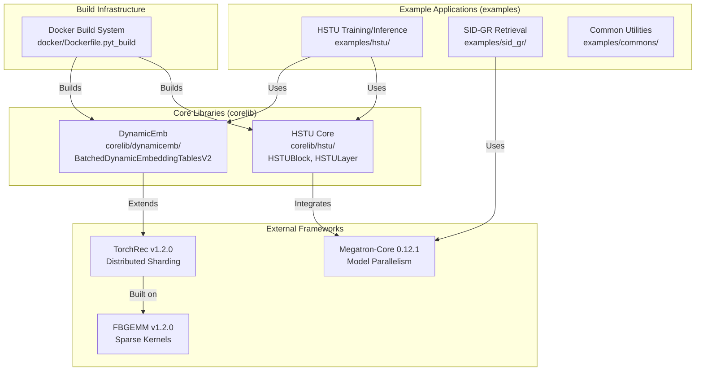
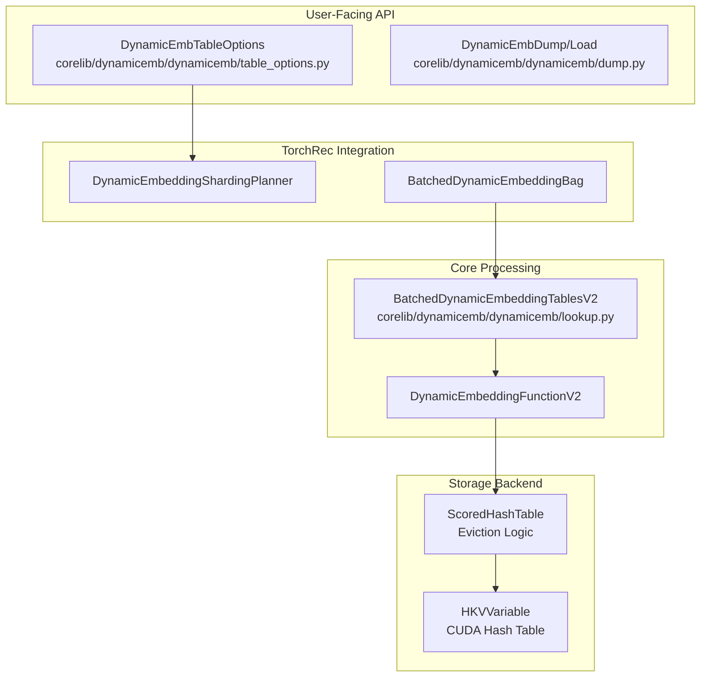

<!-- source: DeepWiki mcp.deepwiki.com · repo NVIDIA/recsys-examples · page 1 Overview · fetched 2026-10-26 -->

# Overview

<details>
<summary>Relevant source files</summary>

The following files were used as context for generating this wiki page:

- [.gitignore](.gitignore)
- [README.md](README.md)
- [corelib/dynamicemb/README.md](corelib/dynamicemb/README.md)
- [corelib/dynamicemb/version.txt](corelib/dynamicemb/version.txt)
- [docker/Dockerfile.pyt_build](docker/Dockerfile.pyt_build)
- [examples/commons/utils/stringify.py](examples/commons/utils/stringify.py)
- [examples/hstu/README.md](examples/hstu/README.md)
- [examples/hstu/figs/parallelism.png](examples/hstu/figs/parallelism.png)
- [examples/hstu/figs/ranking_model_structure.png](examples/hstu/figs/ranking_model_structure.png)
- [examples/hstu/inference/benchmark/hstu_inference_l20_batch1.png](examples/hstu/inference/benchmark/hstu_inference_l20_batch1.png)
- [examples/hstu/inference/benchmark/hstu_inference_l20_batch8.png](examples/hstu/inference/benchmark/hstu_inference_l20_batch8.png)
- [examples/hstu/ops/fused_hstu_op.py](examples/hstu/ops/fused_hstu_op.py)
- [examples/hstu/training/README.md](examples/hstu/training/README.md)

</details>


## Purpose and Scope

This document provides a high-level introduction to the **NVIDIA RecSys Examples** repository, a collection of optimized components and example implementations for large-scale recommendation systems. The repository focuses on three core innovations: **DynamicEmb** for GPU-accelerated dynamic embedding management, **HSTU** (Hierarchical Sequential Transduction Unit) for attention-based sequence processing, and **SID-GR** (Semantic ID Generative Recommender) for generative retrieval. [README.md:4-10]().

The repository demonstrates how to build production-scale recommendation systems by extending established frameworks (**TorchRec** and **Megatron-Core**) with novel capabilities for handling sparse features and sequential user behavior. [README.md:7-10]().

- For environment setup and running examples, see **Getting Started**.
- For DynamicEmb internals and APIs, see **Dynamic Embeddings (DynamicEmb)**.
- For HSTU models and training, see **HSTU System**.
- For generative retrieval, see **Semantic ID Generative Recommender (SID-GR)**.

**Sources:** [README.md:1-28](), [examples/hstu/README.md:1-43]()

---

## Repository Architecture

The repository follows a **two-tier architecture** separating foundational libraries from application examples:

### System Integration Map

**Diagram: Repository Structure and Framework Integration**

### Component Tiers

| Component | Location | Purpose |
|-----------|----------|---------|
| **DynamicEmb** | [corelib/dynamicemb/]() | GPU-accelerated dynamic embedding tables with zero-collision hashing, eviction, and admission control. [README.md:10]() |
| **HSTU** | [corelib/hstu/]() | Hierarchical Sequential Transduction Units optimized for generative recommenders. [README.md:7-8]() |
| **SID-GR** | [examples/sid_gr/]() | Semantic-ID based retrieval model utilizing a GPT-style decoder backbone. [README.md:9]() |

**Sources:** [README.md:3-10](), [docker/Dockerfile.pyt_build:58-67]()

---

## DynamicEmb System

**DynamicEmb** provides model-parallel dynamic embedding tables that manage features with unbounded cardinality (e.g., user/item IDs). Unlike static tables, DynamicEmb creates entries on-demand and applies eviction policies. [corelib/dynamicemb/README.md:3-5]().

### Core Architecture and Data Flow

**Diagram: DynamicEmb Component Architecture**

### Key Features
- **Dynamic Capacity**: Embeddings are created on-demand, aligning capacity to `DEMB_TABLE_ALIGN_SIZE` (= 16). [corelib/dynamicemb/README.md:95]().
- **Eviction Policies**: Supports `LRU` (Least Recently Used) and `LFU` (Least Frequently Used). [README.md:34](), [corelib/dynamicemb/README.md:53]().
- **Admission Control**: Prevents rare or noisy IDs from consuming memory. [README.md:27]().
- **Optimizers**: Supports `EXACT_SGD`, `ADAM`, `EXACT_ADAGRAD`, and `EXACT_ROWWISE_ADAGRAD`. [corelib/dynamicemb/README.md:34]().

**Sources:** [corelib/dynamicemb/README.md:1-103](), [README.md:10-27]()

---

## HSTU System

**HSTU** (Hierarchical Sequential Transduction Unit) reformulates recommendation as a generative modeling problem, handling high-cardinality, non-stationary data streams. [examples/hstu/README.md:4]().

### Model Architecture
The HSTU block modifies traditional attention mechanisms to handle large vocabularies effectively. It supports:
- **Preprocessing**: Interleaving item and action embeddings with contextual tokens and position encoding. [examples/hstu/README.md:28]().
- **Postprocessing**: Candidate filtering and prediction head selection. [examples/hstu/README.md:30]().

### Optimization Stack
- **Fused Operators**: `FusedHSTULayerFunction` combines LayerNorm, Linear UVQK, SiLU, and Attention for improved performance. [examples/hstu/ops/fused_hstu_op.py:41-53]().
- **Jagged Tensor Handling**: Optimized CUDA operators for variable-length sequences to minimize device-to-host syncs. [README.md:18]().
- **Parallelism**: Integrated with **Megatron-Core** for Data, Tensor, Sequence, and Pipeline parallelism. [examples/hstu/training/README.md:6-8]().

### Inference Stack
The inference implementation includes:
- **Paged KV Cache**: Optimized C++ implementation for efficient memory management. [README.md:20]().
- **CUDA Graphs**: Reduces CPU overhead during model execution. [README.md:8]().
- **Triton Server**: Support for serving HSTU models via Triton Inference Server. [README.md:24]().

**Sources:** [examples/hstu/README.md:1-34](), [examples/hstu/ops/fused_hstu_op.py:41-91](), [README.md:14-25]()

---

## Technology Stack and Build System

The repository leverages a multi-stage Docker build system to manage complex dependencies. [docker/Dockerfile.pyt_build:1-73]().

| Layer | Component | Version Requirement |
|-------|-----------|---------------------|
| **Base** | PyTorch | 2.6.0 (CUDA 12.6) [docker/Dockerfile.pyt_build:1]() |
| **Dense Parallelism**| Megatron-Core | 0.12.1 [docker/Dockerfile.pyt_build:24]() |
| **Sparse Framework** | TorchRec | v1.2.0 [docker/Dockerfile.pyt_build:37]() |
| **Sparse Kernels** | FBGEMM | v1.2.0 [docker/Dockerfile.pyt_build:30]() |
| **RecSys Core** | DynamicEmb | 0.1.0 [corelib/dynamicemb/version.txt:1]() |

### Build Instructions
Users can build the environment using the provided Dockerfile:
```bash
# Clone with submodules for HSTU attention kernels
git clone --recursive https://github.com/NVIDIA/recsys-examples.git
docker build -f docker/Dockerfile -t recsys-examples:latest .
```
**Sources:** [examples/hstu/training/README.md:13-24](), [docker/Dockerfile.pyt_build:1-73]()

---

