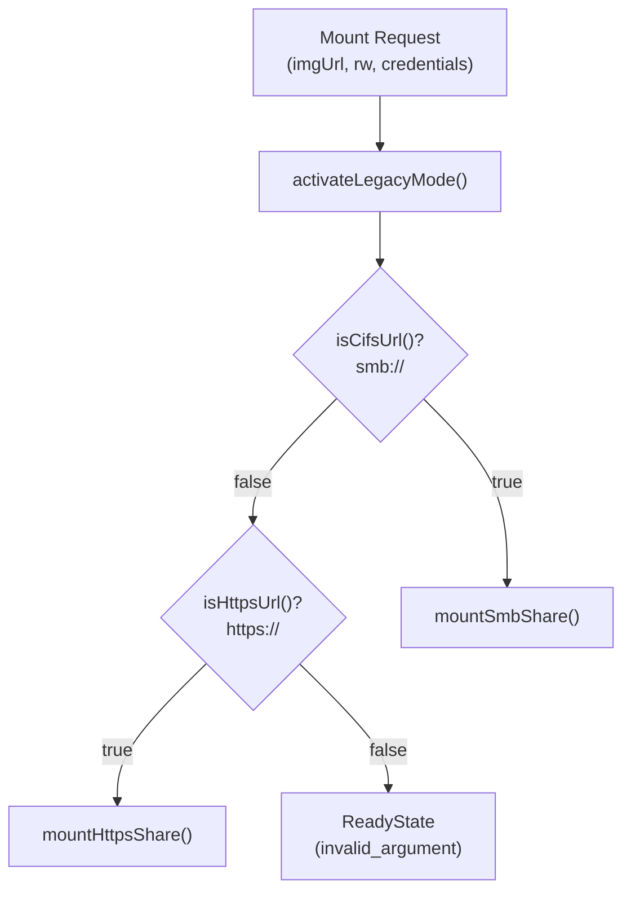
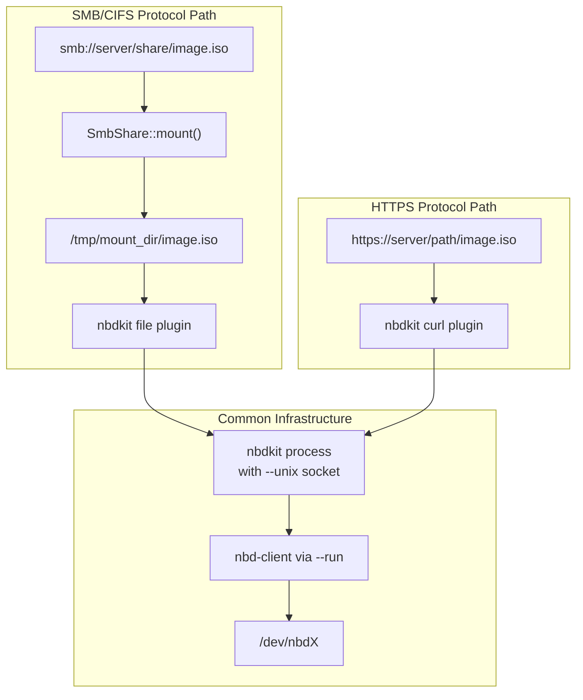
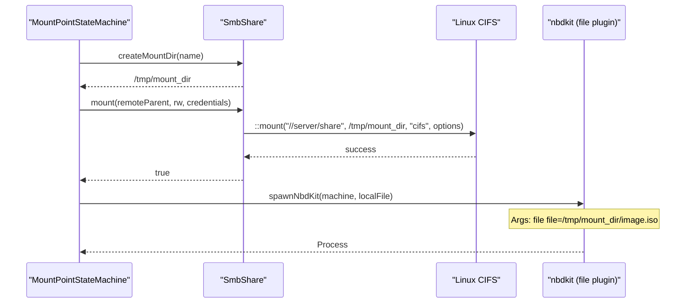
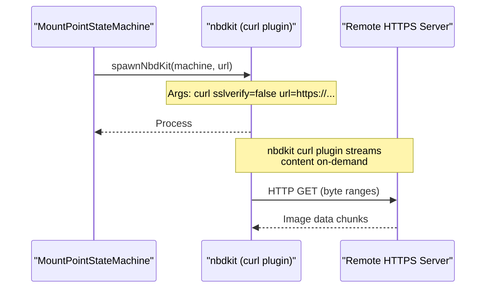
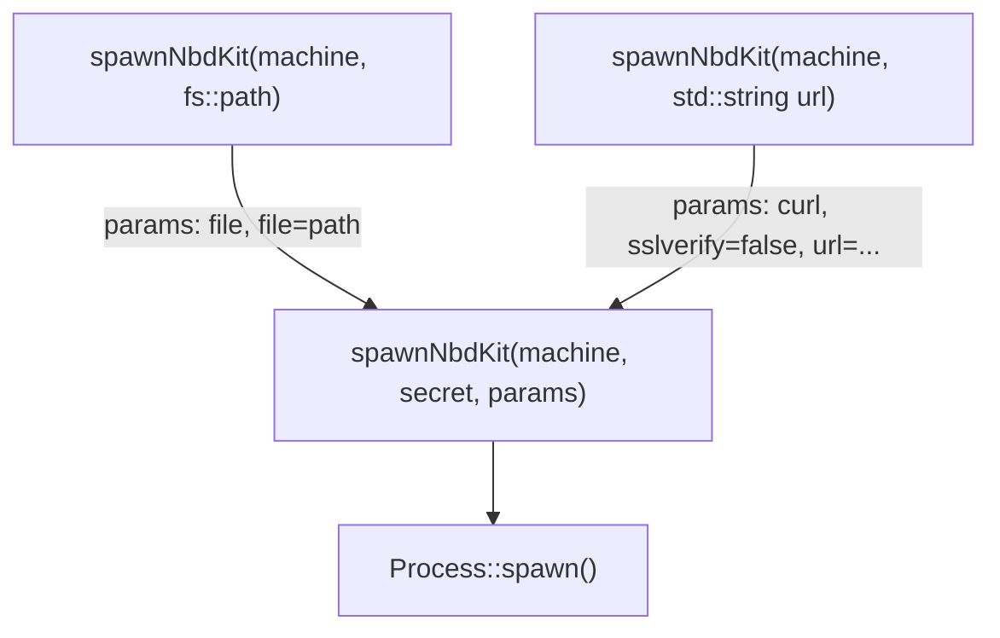
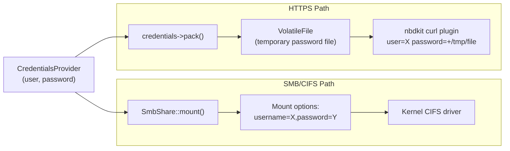
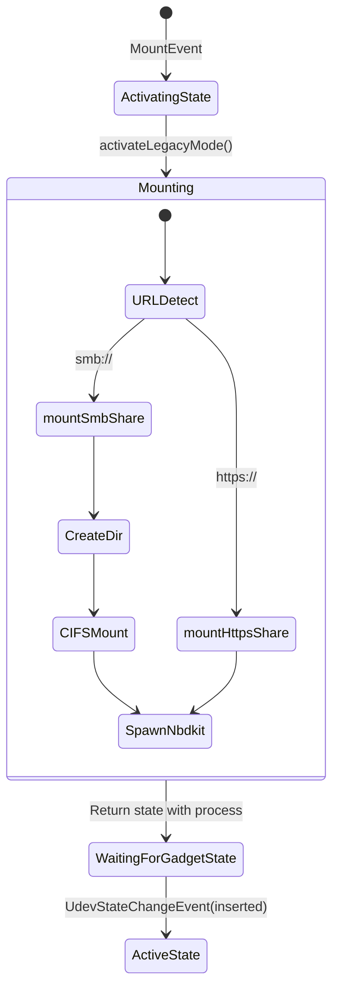
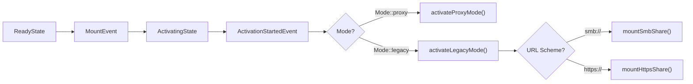

<!-- source: DeepWiki mcp.deepwiki.com · repo NVIDIA/remote-media · page 3.3 Protocol Handlers · fetched 2026-10-26 -->

# Protocol Handlers

<details>
<summary>Relevant source files</summary>

The following files were used as context for generating this wiki page:

- [src/smb.hpp](src/smb.hpp)
- [src/state_machine.hpp](src/state_machine.hpp)

</details>


## Purpose and Scope

Protocol Handlers are responsible for enabling virtual media access to remote image sources through different network protocols. This subsystem implements support for two primary protocols: **SMB/CIFS** for network file shares and **HTTPS** for web-based image downloads. Protocol handlers are only active in legacy mode (Mode 1) and are invoked during the mount activation process.

This page provides an architectural overview of the protocol handling subsystem. For detailed implementation specifics, see:
- SMB/CIFS Share Mounting: [3.3.1](#3.3.1)
- HTTPS Image Support: [3.3.2](#3.3.2)

For information about credential security mechanisms, see [Security](#5) and [Credential Management](#5.1).

**Sources:** [src/state_machine.hpp:645-908]()

---

## Protocol Detection and Routing

The system determines which protocol handler to invoke by examining the URL scheme provided in the mount request. URL validation and routing occurs in the `ActivationStartedEvent::activateLegacyMode()` method.

### URL Scheme Detection



**Diagram: URL Scheme Detection Flow**

| Method | URL Scheme | Line Reference |
|--------|-----------|----------------|
| `isCifsUrl()` | `smb://` | [src/state_machine.hpp:879-881]() |
| `isHttpsUrl()` | `https://` | [src/state_machine.hpp:868-871]() |
| `checkUrl()` | Generic checker | [src/state_machine.hpp:838-842]() |

The detection functions use simple prefix matching to identify the protocol:

```cpp
bool isCifsUrl(const std::string& imageUrl)
{
    return checkUrl("smb://", imageUrl);
}

bool isHttpsUrl(const std::string& imageUrl)
{
    return checkUrl("https://", imageUrl);
}
```

**Sources:** [src/state_machine.hpp:838-888](), [src/state_machine.hpp:645-663]()

---

## Protocol Architecture Overview

The two protocols employ fundamentally different strategies for presenting remote images to the NBD (Network Block Device) subsystem:



**Diagram: Protocol Handler Architecture**

### Key Architectural Differences

| Aspect | SMB/CIFS | HTTPS |
|--------|----------|-------|
| **Local Mounting** | Required | Not required |
| **nbdkit Plugin** | `file` | `curl` |
| **Filesystem Access** | Via kernel CIFS mount | Direct HTTP streaming |
| **Credential Handling** | Kernel mount options | nbdkit curl plugin |
| **Cleanup Required** | Unmount + remove directory | None |

**Sources:** [src/state_machine.hpp:665-720](), [src/smb.hpp:13-101]()

---

## SMB/CIFS Protocol Handler

### Overview

The SMB/CIFS handler implements a two-stage approach:
1. **Stage 1:** Mount the remote SMB share to a local temporary directory using kernel CIFS support
2. **Stage 2:** Serve the mounted file via nbdkit's `file` plugin

This approach leverages the Linux kernel's mature CIFS implementation for authentication, encryption, and protocol negotiation.

### High-Level Flow



**Diagram: SMB/CIFS Mount Sequence**

### Code Entry Points

The `mountSmbShare()` method in `ActivationStartedEvent` orchestrates the SMB mounting process:

1. **Create Mount Directory** - [src/state_machine.hpp:667-672]()
2. **Parse Image Path** - [src/state_machine.hpp:675-681]()
3. **Execute CIFS Mount** - [src/state_machine.hpp:683-689]()
4. **Spawn nbdkit** - [src/state_machine.hpp:691-697]()
5. **Store Mount Directory** - [src/state_machine.hpp:699-702]()

### SmbShare Class

The `SmbShare` class encapsulates CIFS mounting operations:

| Method | Purpose | Line Reference |
|--------|---------|----------------|
| `mount()` | Execute CIFS mount with credentials | [src/smb.hpp:19-58]() |
| `createMountDir()` | Create temporary directory | [src/smb.hpp:60-78]() |
| `unmount()` | Clean up mount and directory | [src/smb.hpp:80-97]() |

**Sources:** [src/state_machine.hpp:665-704](), [src/smb.hpp:1-101]()

---

## HTTPS Protocol Handler

### Overview

The HTTPS handler uses nbdkit's `curl` plugin to stream content directly from remote HTTP(S) servers without requiring intermediate local storage. This provides a simpler architecture with fewer moving parts.

### High-Level Flow



**Diagram: HTTPS Streaming Sequence**

### Code Entry Points

The `mountHttpsShare()` method is notably simpler than its SMB counterpart:

```cpp
State mountHttpsShare(const ActivatingState& state)
{
    auto& machine = state.machine;
    
    auto process = spawnNbdKit(machine, machine.target->imgUrl);
    if (!process)
    {
        return ReadyState(state, std::errc::invalid_argument,
                          "Failed to mount HTTPS share");
    }
    
    auto newState = WaitingForGadgetState(state);
    newState.process = process;
    return newState;
}
```

The HTTPS handler delegates all protocol handling to nbdkit's curl plugin, which manages:
- HTTP request/response handling
- SSL/TLS negotiation (with `sslverify=false`)
- Credential authentication (if provided)
- Byte-range request optimization

**Sources:** [src/state_machine.hpp:706-720](), [src/state_machine.hpp:806-836]()

---

## nbdkit Process Spawning

Both protocol handlers converge on the `spawnNbdKit()` function, which has three overloads to support different invocation patterns.

### spawnNbdKit Overloads



**Diagram: spawnNbdKit Function Overload Structure**

### Generic spawnNbdKit Implementation

The generic overload [src/state_machine.hpp:722-794]() performs common setup:

| Step | Action | Lines |
|------|--------|-------|
| 1 | Create `Process` object | 728-736 |
| 2 | Remove stale Unix socket | 738-751 |
| 3 | Build nbdkit argument list | 753-778 |
| 4 | Add read-only flag if needed | 772-775 |
| 5 | Insert protocol-specific params | 777-778 |
| 6 | Spawn process with callback | 780-791 |

### Common nbdkit Arguments

All nbdkit invocations share these common arguments:

```cpp
std::vector<std::string> args = {
    "--unix", machine.config.unixSocket,  // Listen on Unix socket
    "--run", nbd_client,                   // Run nbd-client after ready
    // Optional: "--verbose" if VM_VERBOSE_NBDKIT_LOGS
};

if (!machine.target->rw)
{
    args.push_back("--readonly");
}
```

The `--run` option is particularly important—it tells nbdkit to execute `nbd-client` automatically once the NBD server is ready, creating an atomic connection to the NBD device.

**Sources:** [src/state_machine.hpp:722-836]()

---

## Protocol-Specific Parameters

### File Plugin Parameters (SMB/CIFS)

```cpp
static std::shared_ptr<Process>
    spawnNbdKit(MountPointStateMachine& machine, const fs::path& file)
{
    return spawnNbdKit(machine, {},
                       {
                           "file",                    // Plugin name
                           "file=" + file.string()    // Local path
                       });
}
```

**Source:** [src/state_machine.hpp:796-804]()

### Curl Plugin Parameters (HTTPS)

```cpp
std::vector<std::string> params = {
    "curl",                      // Plugin name
    "sslverify=false",           // Disable SSL verification
    "url=" + url                 // Remote URL
};

if (machine.target->credentials)
{
    // Pack password into secure temporary file
    utils::CredentialsProvider::SecureBuffer buff = 
        machine.target->credentials->pack(/*...*);
    secret = std::make_unique<utils::VolatileFile>(std::move(buff));
    
    params.push_back("user=" + machine.target->credentials->user());
    params.push_back("password=+" + secret->path());  // "+" means read from file
}
```

**Source:** [src/state_machine.hpp:806-836]()

---

## Credential Flow Through Protocol Handlers

Both protocol handlers support authenticated access, but handle credentials differently based on their architecture.



**Diagram: Credential Handling Paths**

### SMB/CIFS Credential Handling

Credentials are passed directly as CIFS mount options:
- Combined into mount option string [src/smb.hpp:37-42]()
- Passed to kernel via `::mount()` syscall [src/smb.hpp:44-45]()
- Securely cleaned from memory [src/smb.hpp:47-48]()

### HTTPS Credential Handling

Credentials are written to a temporary file for nbdkit:
- Password packed into `SecureBuffer` [src/state_machine.hpp:820-826]()
- Written to `VolatileFile` [src/state_machine.hpp:829]()
- File path passed to nbdkit with `password=+` prefix [src/state_machine.hpp:832]()
- File automatically purged on destruction [documented in 5.2](#5.2)

**Sources:** [src/smb.hpp:19-58](), [src/state_machine.hpp:817-833]()

---

## Error Handling and State Transitions

Protocol handlers must properly transition the state machine on both success and failure paths.

### Success Path



**Diagram: Protocol Handler Success State Flow**

### Failure Paths

All protocol handler failures return `ReadyState` with an error:

| Failure Condition | Error Code | Handler |
|------------------|------------|---------|
| Invalid URL scheme | `std::errc::invalid_argument` | [src/state_machine.hpp:661-662]() |
| Mount directory creation failed | `std::errc::io_error` | [src/state_machine.hpp:670-672]() |
| CIFS mount failed | `std::errc::invalid_argument` | [src/state_machine.hpp:687-689]() |
| nbdkit spawn failed (SMB) | `std::errc::operation_canceled` | [src/state_machine.hpp:694-696]() |
| nbdkit spawn failed (HTTPS) | `std::errc::invalid_argument` | [src/state_machine.hpp:713-715]() |

**Sources:** [src/state_machine.hpp:645-720]()

---

## Cleanup and Resource Management

### SMB/CIFS Cleanup

SMB mounts require explicit cleanup when transitioning back to `ReadyState`:

```cpp
virtual void onEnter()
{
    if (machine.target)
    {
        if (machine.target->mountDir)
        {
            SmbShare::unmount(*machine.target->mountDir);
        }
        machine.target.reset();
    }
}
```

The `ReadyState::onEnter()` method [src/state_machine.hpp:96-108]() ensures:
1. Kernel CIFS mount is unmounted via `::umount()`
2. Temporary mount directory is removed via `fs::remove_all()`
3. Target information is cleared

### HTTPS Cleanup

HTTPS mounts require no special cleanup since they don't create any persistent filesystem state. The nbdkit process termination is handled by the `Process` class automatically.

**Sources:** [src/state_machine.hpp:96-108](), [src/smb.hpp:80-97]()

---

## Integration with MountPointStateMachine

Protocol handlers are tightly integrated with the state machine lifecycle, invoked exclusively during the `ActivatingState` when an `ActivationStartedEvent` is processed.



**Diagram: Protocol Handler Invocation Context**

The protocol handlers are only active in legacy mode, distinguishing this service from proxy mode which uses a completely different activation path (nbd-client connecting to an external NBD server).

**Sources:** [src/state_machine.hpp:606-663]()

---

## Summary

Protocol Handlers provide the abstraction layer between remote image sources and the local NBD device infrastructure. The subsystem's key characteristics are:

1. **Dual Protocol Support**: SMB/CIFS for enterprise file shares and HTTPS for web-based images
2. **Architecture Diversity**: Two-stage mounting for SMB (local mount + file plugin) vs. direct streaming for HTTPS (curl plugin)
3. **nbdkit Integration**: All protocols converge on nbdkit as the NBD server implementation
4. **Secure Credential Handling**: Protocol-specific approaches for passing sensitive authentication data
5. **State Machine Integration**: Tight coupling with `MountPointStateMachine` lifecycle management

For implementation details of each protocol, see the child pages [3.3.1](#3.3.1) (SMB/CIFS) and [3.3.2](#3.3.2) (HTTPS).

**Sources:** [src/state_machine.hpp:1-1090](), [src/smb.hpp:1-101]()

---

