# Page: Overview

# Overview

<details>
<summary>Relevant source files</summary>

The following files were used as context for generating this wiki page:

- [README.md](README.md)
- [src/main.cpp](src/main.cpp)
- [src/state_machine.hpp](src/state_machine.hpp)
- [src/system.hpp](src/system.hpp)

</details>


This document provides an overview of the **remote-media** repository, an OpenBMC Virtual Media service that enables remote storage resources to be presented as local USB mass storage devices to a host system. For detailed information about specific components, see the corresponding pages in sections 3 (Core Components), 4 (Operational Modes), and 5 (Security).

## Purpose and Scope

The remote-media service allows a Baseboard Management Controller (BMC) to mount remote disk images (from CIFS/SMB shares or HTTPS URLs) and present them to a managed host system as USB mass storage devices. This functionality is commonly used for:

- Remote OS installation via ISO images
- System recovery and diagnostics
- Firmware updates delivered through virtual media
- Testing and validation workflows

The service integrates with the OpenBMC D-Bus infrastructure and exposes Redfish-compatible VirtualMedia interfaces.

**Sources:** [README.md:1-93](), [src/main.cpp:1-96](), [src/state_machine.hpp:1-1089]()

## What the Service Does

At a high level, the remote-media service performs the following workflow:

1. **Receives mount requests** via D-Bus interfaces (`VirtualMedia.Legacy` or `VirtualMedia.Proxy`)
2. **Establishes access** to remote storage (mounting SMB shares or connecting to HTTPS endpoints)
3. **Creates NBD devices** using either `nbdkit` (legacy mode) or `nbd-client` (proxy mode)
4. **Configures USB gadgets** in the Linux kernel to expose NBD devices as USB mass storage
5. **Monitors device lifecycle** through udev events and process management
6. **Cleans up resources** on unmount, ensuring secure credential disposal

**Sources:** [src/state_machine.hpp:520-908](), [src/system.hpp:183-354]()

## Key Technologies

The service integrates several Linux subsystems and technologies:

| Technology | Purpose | Key Files |
|------------|---------|-----------|
| **NBD (Network Block Device)** | Presents remote block devices as local `/dev/nbdX` devices | [src/system.hpp:55-181]() |
| **USB Gadget** | Configures BMC USB ports to present mass storage to host | [src/system.hpp:498-626]() |
| **nbdkit** | Serves files/URLs as NBD devices (legacy mode) | [src/state_machine.hpp:722-836]() |
| **nbd-client** | Connects to remote NBD servers (proxy mode) | [src/state_machine.hpp:619-643]() |
| **udev** | Monitors NBD device insertion/removal events | [src/system.hpp:191-354]() |
| **D-Bus** | Exposes management interfaces to clients | [src/state_machine.hpp:210-518]() |

**Sources:** [src/system.hpp:1-656](), [src/state_machine.hpp:1-1089]()

## System Architecture

The following diagram shows the primary code entities and their relationships:

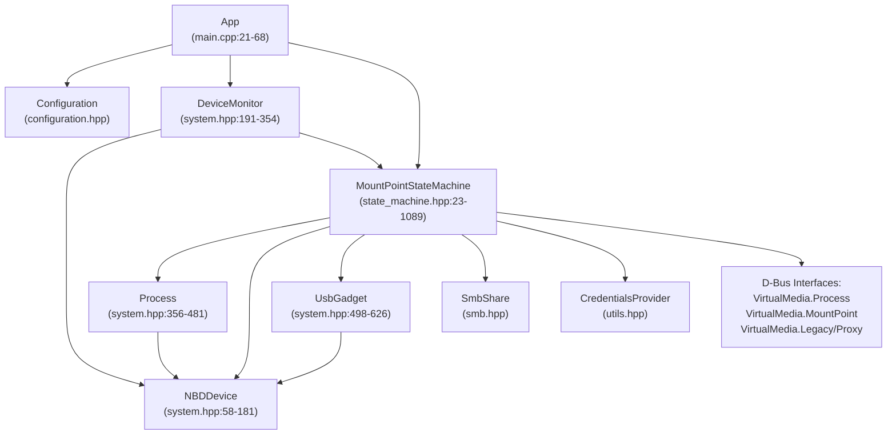

### Component Descriptions

- **`App`**: Application orchestrator that creates `MountPointStateMachine` instances for each configured mount point and manages the D-Bus service lifecycle
- **`MountPointStateMachine`**: State machine managing the complete lifecycle of a virtual media device (ready → activating → active → unmounting)
- **`DeviceMonitor`**: Watches for udev events on NBD devices and notifies state machines of insertion/removal
- **`Process`**: Manages child processes (`nbdkit` or `nbd-client`) with asynchronous output capture and graceful termination
- **`NBDDevice`**: Represents `/dev/nbdX` devices with operations like `isReady()` and `disconnect()`
- **`UsbGadget`**: Configures `/sys/kernel/config/usb_gadget` to present NBD devices as USB mass storage
- **`SmbShare`**: Handles CIFS/SMB mounting with credential management
- **`CredentialsProvider`**: Securely stores and manages authentication credentials with automatic cleanup

**Sources:** [src/main.cpp:21-68](), [src/state_machine.hpp:23-1089](), [src/system.hpp:58-626]()

## State Machine Lifecycle

The `MountPointStateMachine` progresses through the following states:

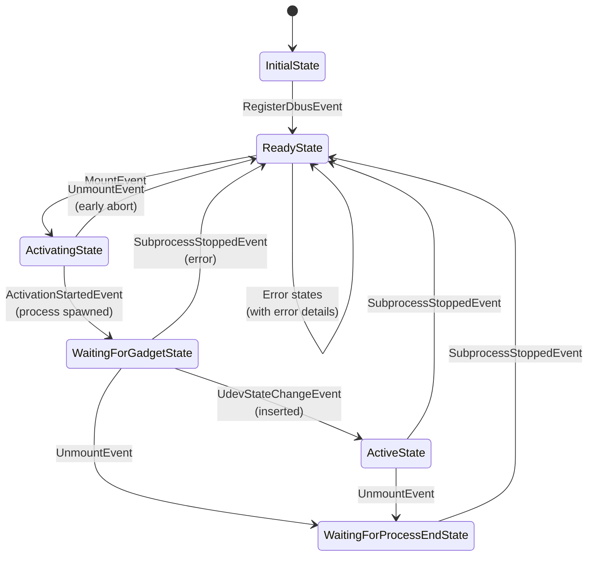

### State Definitions

| State | Description | Source |
|-------|-------------|--------|
| `InitialState` | Initial state before D-Bus registration | [src/state_machine.hpp:75-81]() |
| `ReadyState` | Idle state, ready to accept mount requests | [src/state_machine.hpp:83-111]() |
| `ActivatingState` | Processing mount request, spawning processes | [src/state_machine.hpp:113-126]() |
| `WaitingForGadgetState` | Waiting for NBD device to appear in udev | [src/state_machine.hpp:128-135]() |
| `ActiveState` | Device mounted and presented to host | [src/state_machine.hpp:137-145]() |
| `WaitingForProcessEndState` | Waiting for process termination during unmount | [src/state_machine.hpp:147-160]() |

**Sources:** [src/state_machine.hpp:75-164]()

## Mount Operation Flow

The following sequence diagram shows a typical legacy mode mount operation:

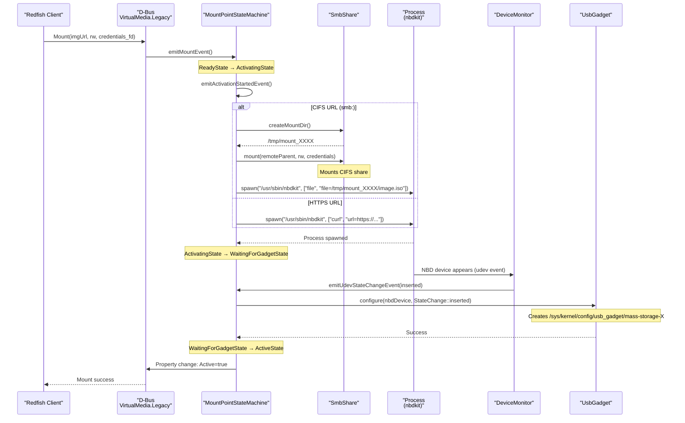

**Sources:** [src/state_machine.hpp:520-908](), [src/system.hpp:191-354](), [src/system.hpp:498-626]()

## Operational Modes

The service supports two distinct operational modes configured per mount point:

### Mode Comparison

| Aspect | Legacy Mode (Mode 1) | Proxy Mode (Mode 0) |
|--------|---------------------|---------------------|
| **Trigger** | Redfish API calls with image URL | Browser-initiated via bmcweb WebSocket |
| **Process** | `nbdkit` (file or curl plugin) | `nbd-client` |
| **Image Sources** | CIFS/SMB shares, HTTPS URLs | External NBD server via bmcweb |
| **Mount Method** | `Mount(imgUrl, rw, credentials_fd)` | `Mount()` (parameterless) |
| **D-Bus Interface** | `VirtualMedia.Legacy` | `VirtualMedia.Proxy` |
| **Credentials** | Passed via Unix file descriptor | Pre-configured or browser session |

**Sources:** [src/state_machine.hpp:352-513](), [src/state_machine.hpp:612-643](), [src/state_machine.hpp:645-836]()

## Core Components Quick Reference

### Process Management

The `Process` class ([src/system.hpp:356-481]()) manages child processes:

- **`spawn(args, onExit)`**: Spawns process with asynchronous stdout/stderr capture
- **`stop()`**: Gracefully terminates process (NBD disconnect → wait → force terminate)
- **Exit callback**: Invoked when process terminates with exit code and device readiness status

### NBD Device Operations

The `NBDDevice` class ([src/system.hpp:58-181]()) encapsulates NBD device operations:

- **Enumeration**: `nbd0` through `nbd10` represented as enum values
- **`isReady()`**: Checks if device is available for use (attempts exclusive open)
- **`disconnect()`**: Issues `NBD_DISCONNECT` and `NBD_CLEAR_SOCK` ioctls
- **`to_path()`**: Returns `/dev/nbdX` path for the device

### Device Monitoring

The `DeviceMonitor` class ([src/system.hpp:191-354]()) tracks NBD device state changes:

- Uses `libudev` to monitor kernel block device events
- Filters for `"block"` subsystem and `"disk"` device type
- Tracks `StateChange` enum: `unknown`, `inserted`, `removed`
- Invokes callbacks when monitored devices change state
- Runs in Boost.Asio coroutine for async event handling

### USB Gadget Configuration

The `UsbGadget::configure()` function ([src/system.hpp:501-625]()) sets up USB mass storage:

1. Creates `/sys/kernel/config/usb_gadget/mass-storage-{name}` directory structure
2. Sets USB descriptors (vendor ID `0x1d6b`, product ID `0x0104`)
3. Configures mass storage function with LUN pointing to NBD device
4. Binds to available USB port (searches `/sys/bus/platform/devices/1e6a0000.usb-vhub`)
5. Cleanup involves removing symlinks and directories in reverse order

**Sources:** [src/system.hpp:356-626]()

## D-Bus Service Structure

The service registers under `xyz.openbmc_project.VirtualMedia` with the following interface hierarchy:

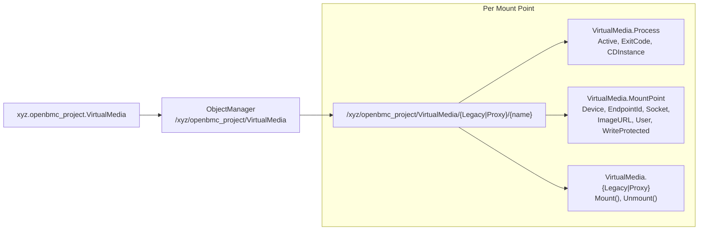

Each `MountPointStateMachine` instance registers three interfaces:

1. **`VirtualMedia.Process`** ([src/state_machine.hpp:254-289]()): Runtime status
   - `Active` (bool): Read-only, true when in `ActiveState`
   - `ExitCode` (int32): Last process exit code
   - `CDInstance` (int32): CD-ROM instance identifier

2. **`VirtualMedia.MountPoint`** ([src/state_machine.hpp:291-351]()): Configuration and state
   - `Device` (string): NBD device path (e.g., `/dev/nbd0`)
   - `EndpointId` (string): Mount point identifier
   - `Socket` (string): Unix socket path for nbdkit
   - `ImageURL` (string): Currently mounted image URL (empty when inactive)
   - `User` (string): Authentication user (constant "USER")
   - `WriteProtected` (bool): Read-only vs read-write mode

3. **`VirtualMedia.Legacy`** or **`VirtualMedia.Proxy`** ([src/state_machine.hpp:353-513]()): Mount/unmount methods
   - Legacy: `Mount(imgUrl, rw, credentials_fd)` - accepts image URL and credentials
   - Proxy: `Mount()` - parameterless, relies on pre-configured endpoint
   - Both: `Unmount()` - initiates unmount sequence

**Sources:** [src/state_machine.hpp:210-518](), [src/main.cpp:38-47]()

## Configuration Overview

The service is configured via `/etc/virtual-media.json` (see [Configuration](#2.2) for details):

```json
{
  "InactivityTimeout": 1800,
  "MountPoints": {
    "Slot_0": {
      "EndpointId": "Slot_0",
      "Mode": 1,
      "NBDDevice": 0,
      "UnixSocket": "/tmp/nbd0.sock",
      "Timeout": 30,
      "BlockSize": 512
    }
  }
}
```

The `Configuration` class parses this file and provides `MountPoint` structures to the `App` constructor, which creates corresponding `MountPointStateMachine` instances.

**Sources:** [src/main.cpp:72-74](), [src/main.cpp:43-48]()

## Security Highlights

The service implements defense-in-depth for credential handling:

- **Unix file descriptors**: Credentials passed via `unix_fd` D-Bus type, not in-band strings
- **`CredentialsProvider`**: Stores credentials in secure buffers with custom deleters
- **`secureCleanup()`**: Uses `explicit_bzero()` to zero memory before deallocation
- **`VolatileFile`**: Temporary files purged with asterisks before deletion
- **Process isolation**: Child processes spawned with restricted arguments

For detailed security architecture, see [Security](#5).

**Sources:** [src/state_machine.hpp:448-484](), [src/state_machine.hpp:817-833]()

---

This overview provides the foundation for understanding the remote-media service. For detailed information about specific aspects, refer to the subsequent sections of this documentation.

---

# Page: Key Concepts

# Key Concepts

<details>
<summary>Relevant source files</summary>

The following files were used as context for generating this wiki page:

- [src/configuration.hpp](src/configuration.hpp)
- [src/state_machine.hpp](src/state_machine.hpp)
- [virtual-media.json](virtual-media.json)

</details>


## Purpose and Scope

This page defines the fundamental concepts required to understand the remote-media virtual media service. It covers the core technologies (Virtual Media, NBD, USB Gadget), architectural patterns (mount points, state machines), and operational modes that form the foundation of the system.

For detailed architecture diagrams showing component interactions, see [Architecture Overview](#1.2). For configuration details, see [Configuration](#2.2). For state machine implementation details, see [MountPointStateMachine](#3.1).

---

## Virtual Media

**Virtual Media** is a technology that allows a remote system (BMC) to present storage devices to a host computer over a management interface. The host sees these devices as if they were physically connected USB storage devices, even though the actual storage is located elsewhere.

In the remote-media service, virtual media enables:
- Mounting remote ISO images or disk images to a host system
- Providing installation media for OS deployment
- Troubleshooting and recovery operations
- Remote system maintenance without physical access

The service acts as a bridge between remote storage sources (CIFS shares, HTTPS URLs) and the host's USB bus, making remote content appear as local USB mass storage devices.

**Sources:** [src/state_machine.hpp:1-1090](), [src/configuration.hpp:1-235]()

---

## Network Block Device (NBD)

**Network Block Device (NBD)** is a Linux kernel module that allows a block device on one machine to be accessed over the network from another machine. In this service, NBD serves as the core transport mechanism between the image source and the USB gadget presentation.

### NBD Architecture in remote-media

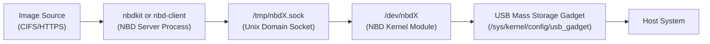

### NBDDevice Class

The `NBDDevice` class [src/system.hpp]() encapsulates NBD device management:

| Method | Purpose | File Reference |
|--------|---------|----------------|
| Constructor | Creates device from string like "nbd0", "nbd1", etc. | [src/system.hpp]() |
| `to_path()` | Returns full device path `/dev/nbdX` | [src/system.hpp]() |
| `to_string()` | Returns device name `nbdX` | [src/system.hpp]() |
| `isReady()` | Checks if device is available for use | [src/system.hpp]() |
| `disconnect()` | Disconnects NBD device using ioctl | [src/system.hpp]() |

### NBD Device Assignment

The configuration file defines which NBD device each mount point uses:

```json
"Slot_0": {
    "NBDDevice": "nbd0",
    "UnixSocket": "/tmp/nbd0.sock"
}
```

Each `MountPointStateMachine` instance is assigned a specific NBD device (`nbd0`-`nbd10`) via the `Configuration::MountPoint::nbdDevice` field [src/configuration.hpp:32]().

**Sources:** [src/configuration.hpp:104-127](), [virtual-media.json:1-29]()

---

## USB Gadget

**USB Gadget** is a Linux kernel framework that allows a device to act as a USB peripheral. In this service, the BMC uses USB Gadget to present itself as a USB mass storage device to the host computer.

### USB Gadget Configuration Path

The USB gadget is configured through the Linux ConfigFS filesystem at `/sys/kernel/config/usb_gadget/`. The service creates a mass storage gadget that exposes the NBD block device to the host.

### Key USB Gadget Operations

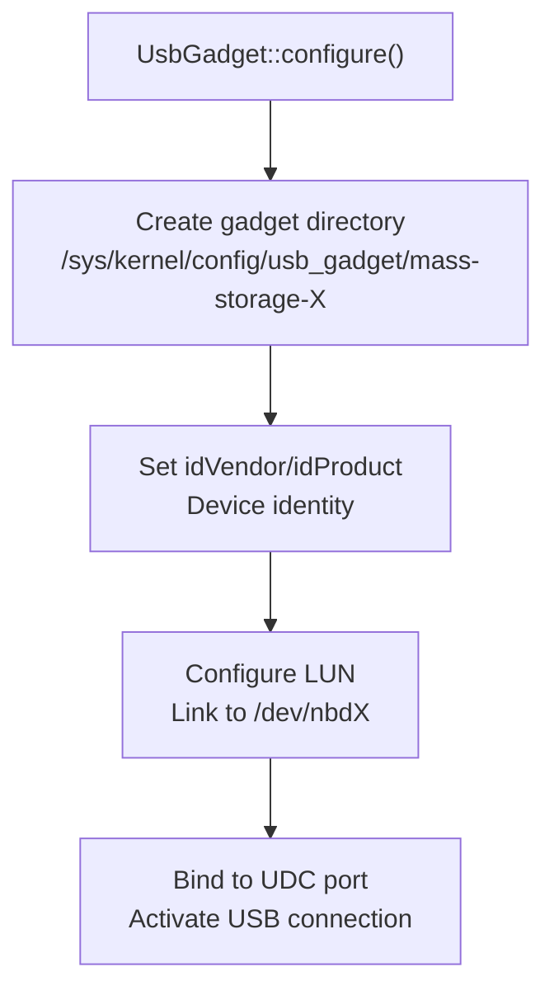

The `UsbGadget::configure()` function [src/system.hpp]() performs these operations based on the `StateChange` event (`inserted` or `removed`).

### USB Gadget Integration

When an NBD device becomes ready, the state machine calls:
```cpp
int32_t ret = UsbGadget::configure(
    state.machine.name,              // Mount point name
    state.machine.config.nbdDevice,  // NBD device to expose
    devState,                        // inserted/removed
    state.machine.target->rw         // read-write flag
);
```
[src/state_machine.hpp:919-922]()

**Sources:** [src/state_machine.hpp:915-937](), [src/system.hpp]()

---

## Mount Points

A **Mount Point** represents a configurable virtual media slot that can present storage to the host. Each mount point is an independent instance with its own configuration and state machine.

### MountPoint Configuration Structure

The `Configuration::MountPoint` struct [src/configuration.hpp:30-45]() defines:

| Field | Type | Purpose |
|-------|------|---------|
| `nbdDevice` | `NBDDevice` | Assigned NBD device (e.g., `nbd0`) |
| `unixSocket` | `std::string` | Unix socket path for NBD communication |
| `endPointId` | `std::string` | Identifier for the endpoint |
| `timeout` | `std::optional<int>` | Operation timeout in seconds |
| `blocksize` | `std::optional<int>` | Block size for I/O operations |
| `mode` | `Mode` | Operational mode (proxy or legacy) |

### Mount Point Naming

Configuration defines named mount points:

```json
{
    "MountPoints": {
        "Slot_0": { "Mode": 0, "NBDDevice": "nbd0" },
        "USB1": { "Mode": 1, "NBDDevice": "nbd2" },
        "USB2": { "Mode": 1, "NBDDevice": "nbd3" }
    }
}
```
[virtual-media.json:3-27]()

Each named mount point (e.g., `"Slot_0"`) gets its own `MountPointStateMachine` instance [src/state_machine.hpp:987-995]().

### D-Bus Object Paths

Mount points are exposed via D-Bus at paths determined by their mode:
- **Proxy mode**: `/xyz/openbmc_project/VirtualMedia/Proxy/{name}`
- **Legacy mode**: `/xyz/openbmc_project/VirtualMedia/Legacy/{name}`

[src/state_machine.hpp:1075-1088]()

**Sources:** [src/configuration.hpp:30-45](), [virtual-media.json:1-29](), [src/state_machine.hpp:987-995]()

---

## Operational Modes

The service supports two distinct operational modes, each optimized for different use cases and controlled by the `Configuration::Mode` enum [src/configuration.hpp:17-28]().

### Mode Comparison

```mermaid
graph TB
    subgraph "Mode 0: Proxy"
        ProxyInit["Browser-initiated<br/>JavaScript/HTML5"]
        ProxyTransport["Secure WebSockets<br/>to bmcweb HTTPS"]
        ProxyProcess["nbd-client<br/>connects to external NBD"]
        ProxyMount["Mount() - no parameters<br/>pre-configured"]
    end
    
    subgraph "Mode 1: Legacy"
        LegacyInit["Redfish API-initiated<br/>VirtualMedia schemas"]
        LegacyTransport["Direct image fetch<br/>CIFS/HTTPS"]
        LegacyProcess["nbdkit<br/>file or curl plugin"]
        LegacyMount["Mount(url, rw, credentials)<br/>runtime configuration"]
    end
    
    ProxyInit --> ProxyTransport
    ProxyTransport --> ProxyProcess
    ProxyProcess --> ProxyMount
    
    LegacyInit --> LegacyTransport
    LegacyTransport --> LegacyProcess
    LegacyProcess --> LegacyMount
```

### Mode Enumeration

```cpp
enum class Mode
{
    // Proxy mode - works directly from browser and uses JavaScript/HTML5
    // to communicate over Secure WebSockets directly to HTTPS endpoint
    // hosted by bmcweb on BMC
    proxy = 0,

    // Legacy mode - is initiated from browser using Redfish defined
    // VirtualMedia schemas, then BMC process connects to external
    // CIFS/HTTPS image pointed during initialization.
    legacy = 1,
};
```
[src/configuration.hpp:17-28]()

### Proxy Mode (Mode 0)

**Characteristics:**
- Browser-initiated via JavaScript/HTML5 client
- Uses `nbd-client` process to connect to external NBD server
- Communication via Secure WebSockets to bmcweb HTTPS endpoint
- Parameterless `Mount()` method—configuration is pre-set
- Activated in `activateProxyMode()` [src/state_machine.hpp:619-643]()

**Process Spawning:**
```cpp
auto process = std::make_shared<Process>(
    state.machine.ioc.get(), state.machine.name,
    "/usr/sbin/nbd-client", state.machine.config.nbdDevice);
```
[src/state_machine.hpp:621-623]()

### Legacy Mode (Mode 1)

**Characteristics:**
- Redfish API-initiated using VirtualMedia schemas
- Uses `nbdkit` process with file or curl plugins
- Supports CIFS (`smb://`) and HTTPS (`https://`) image URLs
- `Mount(imgUrl, rw, credentials)` method with runtime parameters
- Credential handling via Unix file descriptors
- Activated in `activateLegacyMode()` [src/state_machine.hpp:645-663]()

**Mount Interface:**
```cpp
iface->register_method(
    "Mount", [&machine = state.machine, this, handleMount](
                 boost::asio::yield_context yield,
                 std::string imgUrl, bool rw, optional_fd fd) {
        // Handle mount with credentials...
    });
```
[src/state_machine.hpp:439-498]()

### URL Scheme Detection

Legacy mode determines the activation path by URL scheme:

| URL Scheme | Detection Function | Activation Function | NBDKit Plugin |
|------------|-------------------|---------------------|---------------|
| `smb://` | `isCifsUrl()` [src/state_machine.hpp:879-882]() | `mountSmbShare()` [src/state_machine.hpp:665-704]() | `file` |
| `https://` | `isHttpsUrl()` [src/state_machine.hpp:868-871]() | `mountHttpsShare()` [src/state_machine.hpp:706-720]() | `curl` |

**Sources:** [src/configuration.hpp:17-28](), [src/state_machine.hpp:612-720](), [src/state_machine.hpp:434-513]()

---

## State Machine Lifecycle

The `MountPointStateMachine` [src/state_machine.hpp:23-1089]() manages the complete lifecycle of a virtual media device through a hierarchical state pattern.

### State Hierarchy

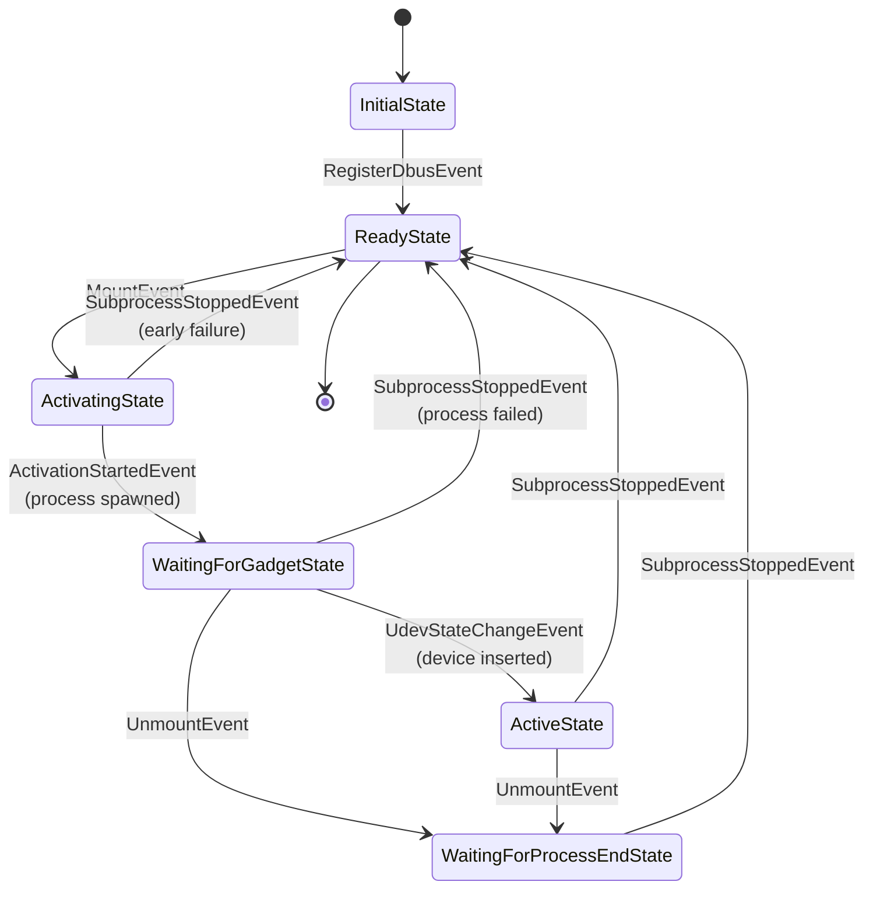

### State Definitions

| State Class | File Reference | Purpose |
|-------------|----------------|---------|
| `InitialState` | [src/state_machine.hpp:75-81]() | Initial state before D-Bus registration |
| `ReadyState` | [src/state_machine.hpp:83-111]() | Ready to accept mount requests; cleans up previous mounts |
| `ActivatingState` | [src/state_machine.hpp:113-126]() | Processing mount request; spawning processes |
| `WaitingForGadgetState` | [src/state_machine.hpp:128-135]() | Waiting for NBD device to appear and USB gadget configuration |
| `ActiveState` | [src/state_machine.hpp:137-145]() | Virtual media active and presented to host |
| `WaitingForProcessEndState` | [src/state_machine.hpp:147-160]() | Waiting for subprocess cleanup after unmount |

### State Variant Type

All states are stored in a `std::variant`:
```cpp
using State = std::variant<InitialState, ReadyState, ActivatingState,
                           WaitingForGadgetState, ActiveState,
                           WaitingForProcessEndState>;
```
[src/state_machine.hpp:162-164]()

### Event Processing

Events drive state transitions through the visitor pattern:

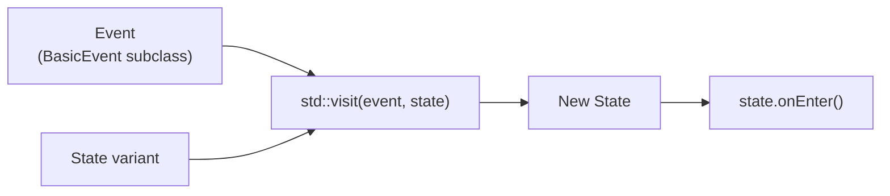

The `emitEvent()` method [src/state_machine.hpp:1010-1020]() orchestrates:
1. Log current state and event
2. Visit event with current state (`std::visit(event, state)`)
3. Call `onEnter()` on new state for initialization

### Event Types

| Event Class | File Reference | Trigger |
|-------------|----------------|---------|
| `RegisterDbusEvent` | [src/state_machine.hpp:210-518]() | Initial D-Bus interface registration |
| `MountEvent` | [src/state_machine.hpp:520-534]() | Mount operation requested |
| `UnmountEvent` | [src/state_machine.hpp:536-575]() | Unmount operation requested |
| `SubprocessStoppedEvent` | [src/state_machine.hpp:577-604]() | nbdkit or nbd-client process terminated |
| `ActivationStartedEvent` | [src/state_machine.hpp:606-908]() | Begin activation (spawn processes) |
| `UdevStateChangeEvent` | [src/state_machine.hpp:910-961]() | NBD device inserted or removed |

### State Transition Example: Mount Flow

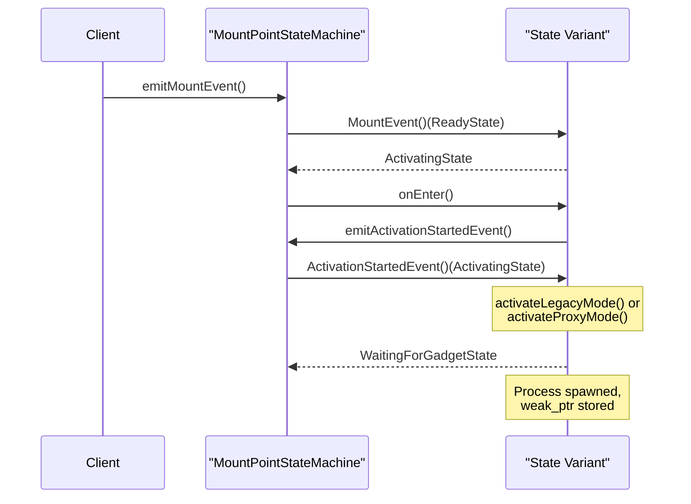

### State Machine Construction

Each mount point gets its own state machine instance:
```cpp
MountPointStateMachine(boost::asio::io_context& ioc,
                       DeviceMonitor& devMonitor, 
                       const std::string& name,
                       const Configuration::MountPoint& config,
                       std::shared_ptr<sdbusplus::asio::connection>& bus) :
    ioc{ioc}, name{name}, config{config}, 
    state{InitialState(*this)}, exitCode{-1}, bus(bus)
{
    devMonitor.addDevice(config.nbdDevice);
}
```
[src/state_machine.hpp:987-995]()

**Sources:** [src/state_machine.hpp:23-1089](), [src/state_machine.hpp:162-164](), [src/state_machine.hpp:1010-1020]()

---

## Key Relationships

The following diagram illustrates how these concepts integrate:

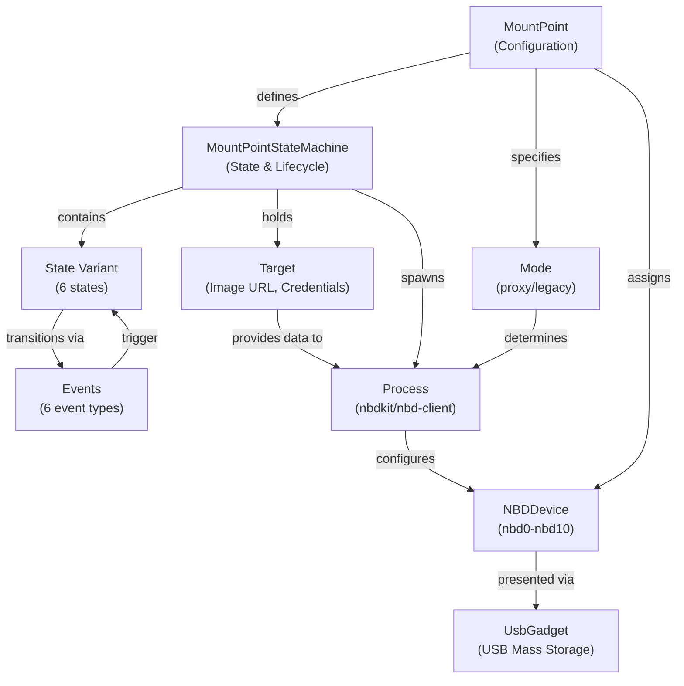

Each `MountPoint` configuration instantiates a `MountPointStateMachine` that manages a `State` variant through `Events`. The `Mode` determines which `Process` type to spawn (nbdkit or nbd-client), which configures an `NBDDevice` that is ultimately presented to the host via `UsbGadget`.

**Sources:** [src/state_machine.hpp:1-1090](), [src/configuration.hpp:30-45](), [virtual-media.json:1-29]()

---

# Page: Architecture Overview

# Architecture Overview

<details>
<summary>Relevant source files</summary>

The following files were used as context for generating this wiki page:

- [CMakeLists.txt](CMakeLists.txt)
- [src/main.cpp](src/main.cpp)
- [src/state_machine.hpp](src/state_machine.hpp)
- [src/system.hpp](src/system.hpp)

</details>


## Purpose and Scope

This page presents the high-level architecture of the remote-media service, showing how the major subsystems interact to provide virtual media functionality. The focus is on structural relationships between components and their roles in the system, rather than detailed implementation specifics.

For information about building and configuring the service, see [Building and Installation](#2.1) and [Configuration](#2.2). For detailed component behavior and state transitions, see [Core Components](#3).

---

## System Component Hierarchy

The remote-media service is organized into distinct architectural layers, each with specific responsibilities:

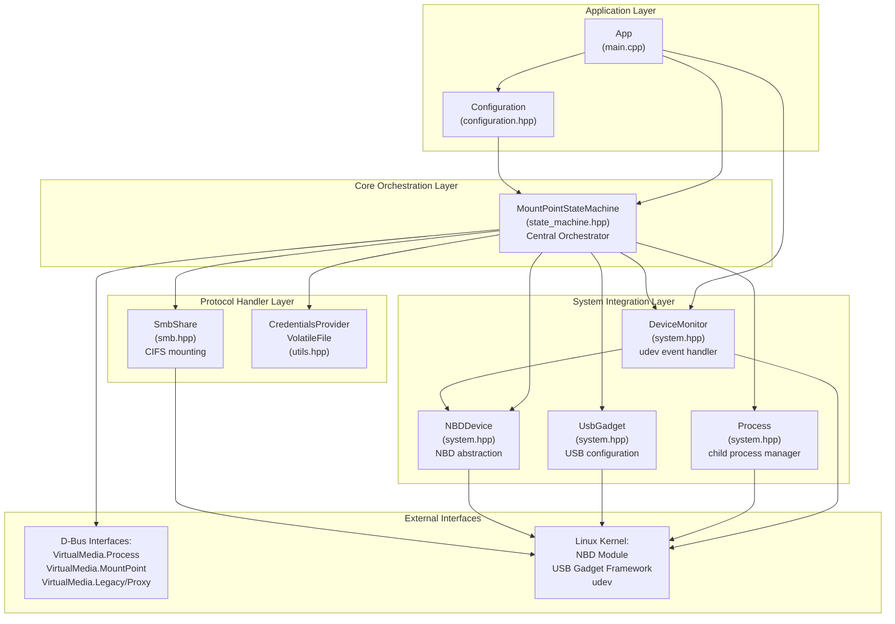

**Figure 1: Component Hierarchy**

The architecture follows a strict layering principle where:
- The **Application Layer** initializes the system and manages multiple mount point instances
- The **Core Orchestration Layer** contains the state machine that coordinates all operations
- The **System Integration Layer** provides abstractions over Linux kernel subsystems
- The **Protocol Handler Layer** implements specific image source protocols
- The **External Interfaces** expose D-Bus APIs and interact with kernel subsystems

Sources: [src/main.cpp:21-68](), [src/state_machine.hpp:23-1089](), [src/system.hpp:58-626]()

---

## Core Component Relationships

The following diagram shows the actual C++ classes and their relationships in code entity space:

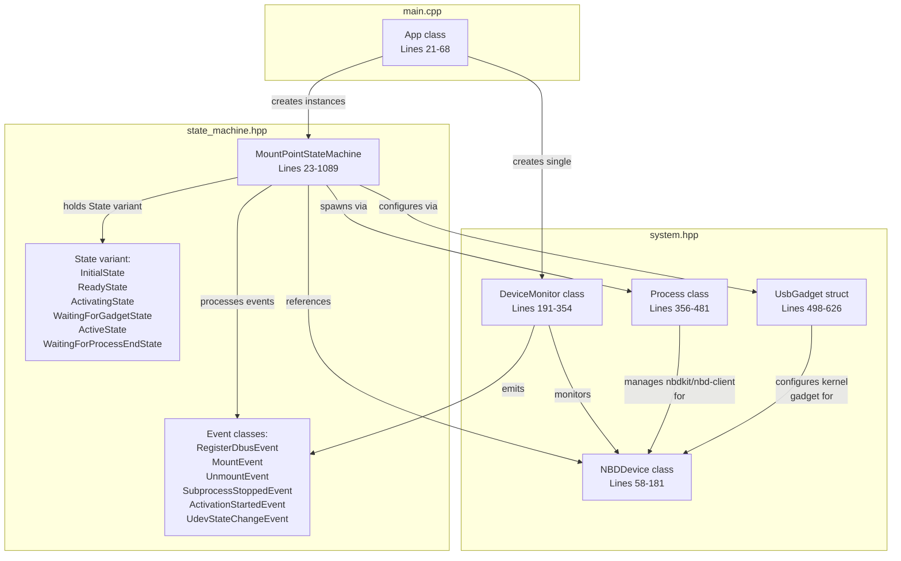

**Figure 2: Class Relationships**

Key class interactions:
- **`App`** creates one `MountPointStateMachine` instance per mount point defined in configuration
- **`MountPointStateMachine`** is the central orchestrator, holding a `State` variant and processing `Event` objects
- **`DeviceMonitor`** watches `NBDDevice` instances via udev and generates `UdevStateChangeEvent` objects
- **`Process`** spawns and manages nbdkit or nbd-client child processes
- **`UsbGadget`** writes to `/sys/kernel/config/usb_gadget` to configure USB mass storage

Sources: [src/main.cpp:21-68](), [src/state_machine.hpp:23-1089](), [src/system.hpp:58-626]()

---

## State Machine Architecture

The `MountPointStateMachine` class implements the core lifecycle management:

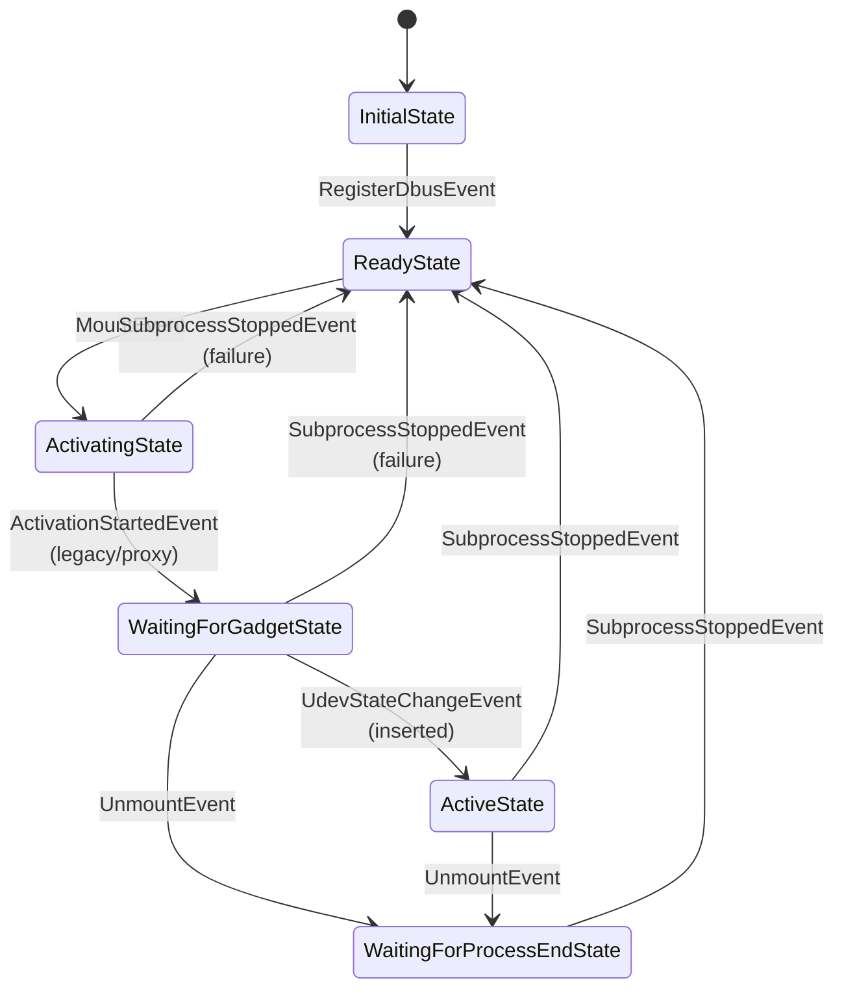

**Figure 3: MountPointStateMachine State Transitions**

Each state is a C++ class derived from `BasicState`:
- **`InitialState`** (lines 75-81): Startup state before D-Bus registration
- **`ReadyState`** (lines 83-111): Idle state, ready to accept mount requests
- **`ActivatingState`** (lines 113-126): Processing mount request, spawning subprocess
- **`WaitingForGadgetState`** (lines 128-135): Waiting for NBD device insertion event
- **`ActiveState`** (lines 137-145): Device mounted and USB gadget configured
- **`WaitingForProcessEndState`** (lines 147-160): Waiting for subprocess cleanup after unmount

Sources: [src/state_machine.hpp:75-164]()

---

## Technology Stack Layers

The service depends on multiple technology layers:

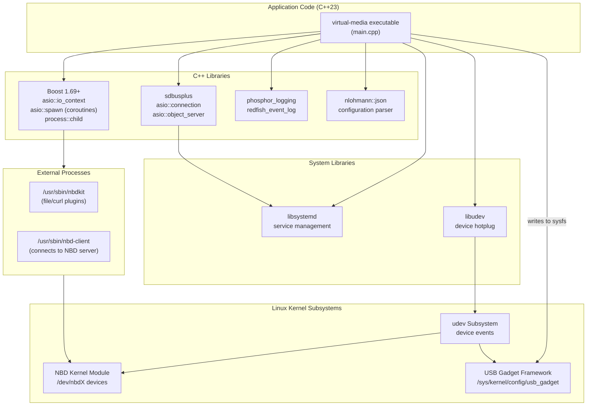

**Figure 4: Technology Stack**

| Layer | Components | Purpose |
|-------|------------|---------|
| **Application** | `virtual-media` (C++23) | Main service logic |
| **C++ Libraries** | Boost, sdbusplus, phosphor_logging, nlohmann::json | Async I/O, D-Bus bindings, logging, JSON parsing |
| **System Libraries** | libsystemd, libudev | Service integration, device monitoring |
| **Kernel Subsystems** | NBD module, USB Gadget, udev | Block device serving, USB device emulation, hotplug |
| **External Processes** | nbdkit, nbd-client | Image serving and NBD client connection |

Compiler and build options defined in [CMakeLists.txt:8-14]():
- C++23 standard required
- `-fno-rtti`: No runtime type information
- `-Wall`: All warnings enabled
- `-Os -flto`: Optimized for size with link-time optimization (release builds)

Sources: [CMakeLists.txt:1-87](), [src/main.cpp:1-19]()

---

## Dual Operational Modes

The service supports two distinct operational modes, configured per mount point:

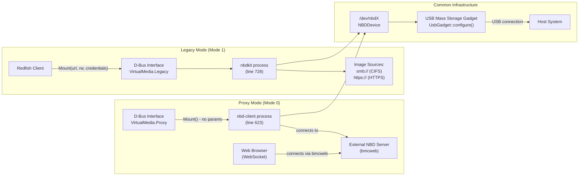

**Figure 5: Operational Modes**

**Proxy Mode** (`Configuration::Mode::proxy`):
- Mount point defined in [src/state_machine.hpp:619-642]()
- Uses `/usr/sbin/nbd-client` to connect to external NBD server
- Activated via `ActivationStartedEvent::activateProxyMode()` at line 619
- No credentials or URL needed (pre-configured via `EndpointId` and `UnixSocket`)

**Legacy Mode** (`Configuration::Mode::legacy`):
- Mount point defined in [src/state_machine.hpp:645-720]()
- Uses `/usr/sbin/nbdkit` with `file` or `curl` plugin
- Activated via `ActivationStartedEvent::activateLegacyMode()` at line 645
- Supports CIFS (`smb://`) and HTTPS (`https://`) URLs
- Credential handling via Unix file descriptors (lines 448-484)

Sources: [src/state_machine.hpp:612-720]()

---

## Process and Device Management

The service manages child processes and monitors NBD devices:

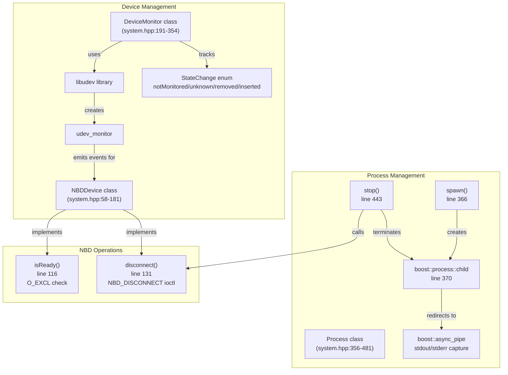

**Figure 6: Process and Device Management**

**Process Management** (`Process` class):
- Spawns nbdkit or nbd-client as child processes
- Captures stdout/stderr via boost::asio::async_pipe
- Implements graceful termination with timeout (20 iterations × 100ms)
- Calls `NBDDevice::disconnect()` before terminating processes

**Device Monitoring** (`DeviceMonitor` class):
- Initializes udev monitor with `"block"` subsystem and `"disk"` devtype filter (lines 211-212)
- Runs async event loop via `boost::asio::spawn` (line 237)
- Detects NBD device insertion/removal by checking `size` sysattr (lines 284-323)
- Notifies callbacks with `NBDDevice` and `StateChange` parameters

**NBD Device Operations** (`NBDDevice` class):
- Enumerates nbd0 through nbd10 (lines 63-75)
- `isReady()`: Opens device with `O_EXCL` flag to check availability (lines 116-129)
- `disconnect()`: Issues `NBD_DISCONNECT` and `NBD_CLEAR_SOCK` ioctls (lines 131-154)

Sources: [src/system.hpp:58-481]()

---

## USB Gadget Configuration

The service configures USB mass storage gadgets via sysfs:

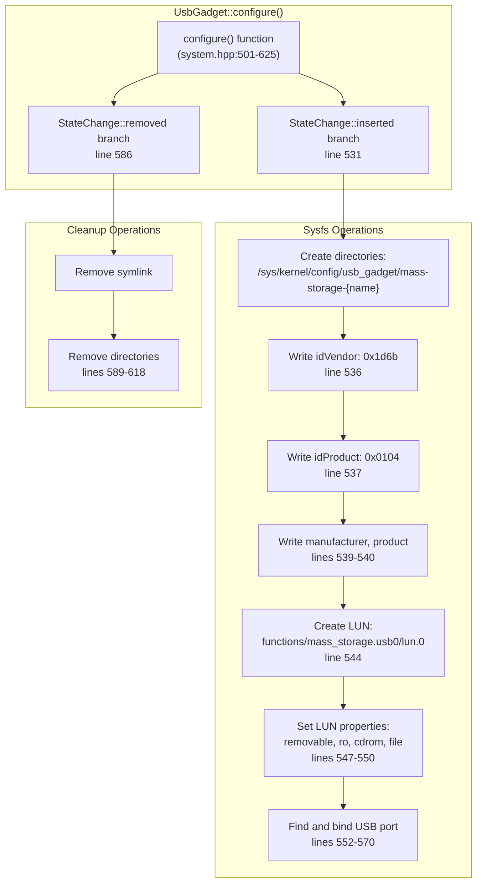

**Figure 7: USB Gadget Configuration Flow**

The `UsbGadget::configure()` function manipulates the Linux USB Gadget configfs:

**Insertion Path** (when NBD device becomes available):
1. Creates gadget directory: `/sys/kernel/config/usb_gadget/mass-storage-{name}`
2. Configures USB descriptors (vendor 0x1d6b, product 0x0104)
3. Sets strings (manufacturer: "OpenBMC", product: "Virtual Media Device")
4. Creates mass storage function with LUN 0
5. Sets LUN properties: `removable=1`, `ro` based on read-write flag, `cdrom=0`
6. Writes NBD device path to `lun.0/file`
7. Searches `/sys/bus/platform/devices/1e6a0000.usb-vhub` for available USB port
8. Binds gadget to port by writing port ID to `UDC` file

**Removal Path** (when unmounting):
1. Executes system commands to remove symlinks and directories
2. Follows strict order: mass_storage.usb0 link, function dir, config strings, config dir, strings dir, gadget dir

Sources: [src/system.hpp:498-626]()

---

## D-Bus Interface Structure

Each `MountPointStateMachine` instance exposes three D-Bus interfaces:

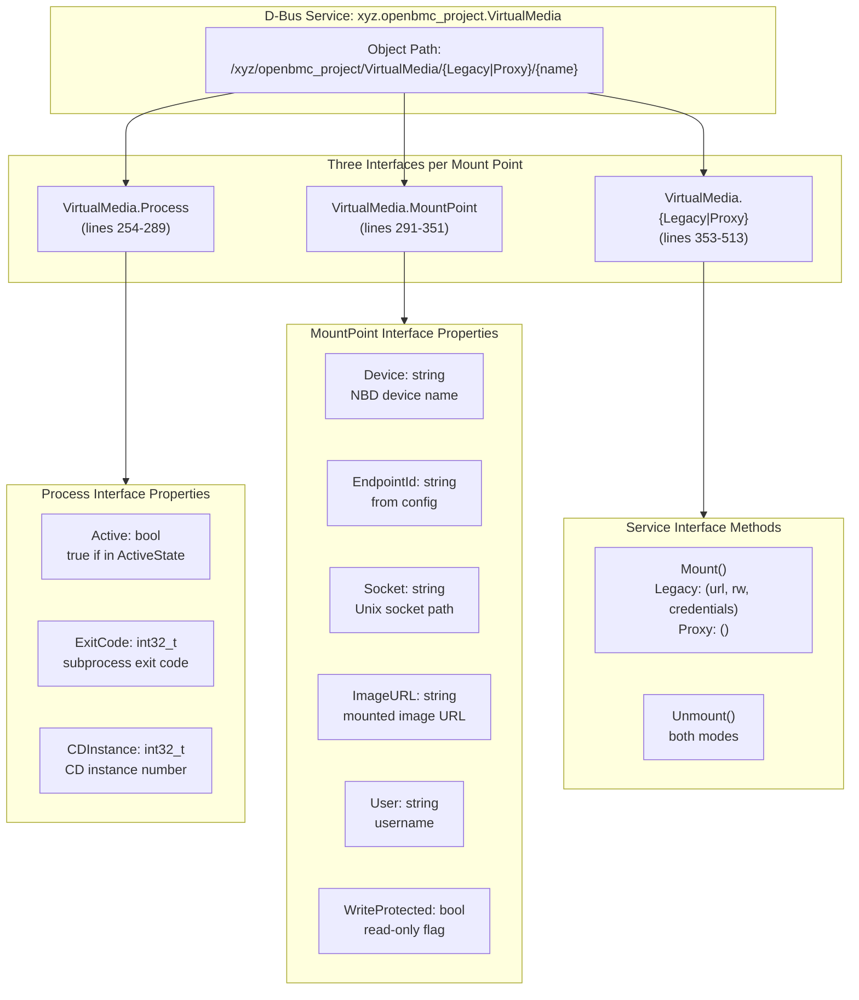

**Figure 8: D-Bus Interface Structure**

Interface registration occurs in `RegisterDbusEvent::operator()(const InitialState&)`:
- **`VirtualMedia.Process`** (lines 254-289): Runtime status properties
  - `Active`: Returns `true` if current state is `ActiveState`
  - `ExitCode`: Returns last subprocess exit code
  - `CDInstance`: Configurable CD instance number

- **`VirtualMedia.MountPoint`** (lines 291-351): Configuration and state properties
  - `Device`, `EndpointId`, `Socket`: Static configuration values
  - `ImageURL`, `User`: Dynamic values populated when in `ActiveState`
  - `WriteProtected`: Reflects read-only flag of mounted image

- **`VirtualMedia.Legacy`** or **`VirtualMedia.Proxy`** (lines 353-513): Service methods
  - Legacy mode: `Mount(string imgUrl, bool rw, variant<int, unix_fd> fd)`
    - Reads credentials from Unix file descriptor if provided (lines 448-484)
  - Proxy mode: `Mount()` with no parameters
    - Uses pre-configured `EndpointId` and `UnixSocket`
  - Both: `Unmount()` method (lines 363-392)

Sources: [src/state_machine.hpp:210-518]()

---

## Summary

The remote-media architecture is characterized by:

1. **Centralized State Management**: `MountPointStateMachine` coordinates all mount operations through a well-defined state machine pattern

2. **Clean Abstraction Layers**: System integration components (`DeviceMonitor`, `Process`, `NBDDevice`, `UsbGadget`) provide clean interfaces to Linux kernel subsystems

3. **Dual-Mode Operation**: Support for both legacy Redfish workflows (CIFS/HTTPS) and modern proxy mode (WebSocket NBD)

4. **Asynchronous Design**: Extensive use of Boost.Asio coroutines for non-blocking I/O and event handling

5. **D-Bus Integration**: Full OpenBMC integration via sdbusplus with comprehensive property and method exposure

For detailed information about state transitions and event processing, see [MountPointStateMachine](#3.1). For protocol-specific details, see [Protocol Handlers](#3.3) and [Operational Modes](#4).

Sources: [src/state_machine.hpp:1-1089](), [src/system.hpp:1-656](), [src/main.cpp:1-96]()

---

# Page: Getting Started

# Getting Started

<details>
<summary>Relevant source files</summary>

The following files were used as context for generating this wiki page:

- [CMakeLists.txt](CMakeLists.txt)
- [README.md](README.md)
- [xyz.openbmc_project.VirtualMedia.service](xyz.openbmc_project.VirtualMedia.service)

</details>


This page provides practical guidance for building, configuring, and deploying the virtual-media service on an OpenBMC system. It covers the complete workflow from satisfying build dependencies through initial service startup and verification.

For architectural background and system concepts, see [Overview](#1). For detailed API documentation and D-Bus interface specifications, see [API Reference](#6). For development practices and debugging tools, see [Development](#7).

The following subsections provide detailed instructions:
- [Building and Installation](#2.1) - CMake build process and dependency resolution
- [Configuration](#2.2) - JSON configuration file structure and mount point definitions
- [Running the Service](#2.3) - systemd service management and operational verification

## Prerequisites and System Requirements

The virtual-media service requires a Linux system with specific kernel features and user-space libraries. The following table summarizes the core requirements:

| Component | Requirement | Purpose |
|-----------|------------|---------|
| Compiler | C++23 compliant (GCC 11+ or Clang 13+) | Modern C++ features and coroutines |
| CMake | Version 3.5 or higher | Build system orchestration |
| Linux Kernel | NBD module and USB Gadget support | Block device and USB presentation |
| systemd | libsystemd development files | Service management and D-Bus integration |
| Boost | Version 1.69+ | Asynchronous I/O and coroutines |
| sdbusplus | OpenBMC library | D-Bus C++ bindings |
| udev | libudev development files | Device event monitoring |
| phosphor_logging | OpenBMC library | Logging infrastructure |

**Sources:** [CMakeLists.txt:1-66]()

## Build and Deployment Workflow

The following diagram illustrates the complete workflow from source code to a running service, mapping each step to specific files and build artifacts:

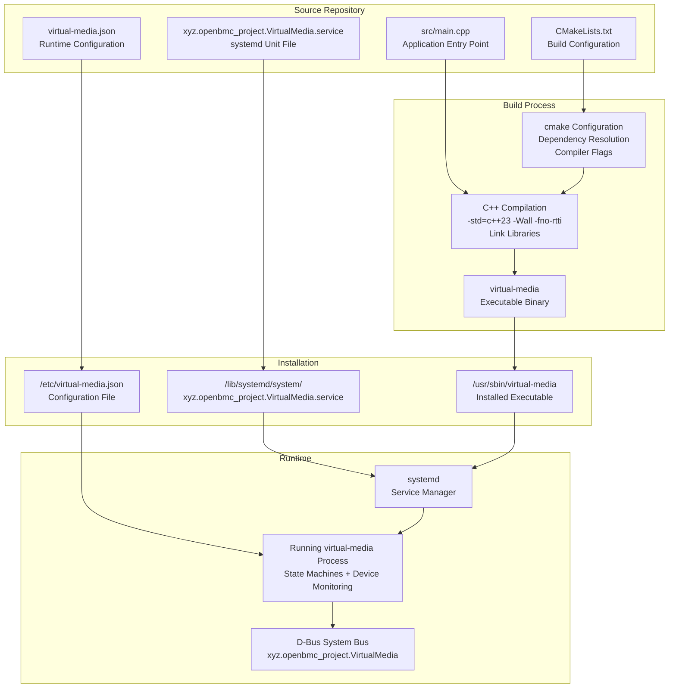

**Sources:** [CMakeLists.txt:1-87](), [xyz.openbmc_project.VirtualMedia.service:1-12]()

## Quick Start Summary

This section provides a condensed overview of the build and deployment process. Detailed instructions for each step are provided in the subsections.

### 1. Install Dependencies

Ensure all required development libraries are installed on your build system. The exact package names vary by distribution:

```bash
# Example for Debian/Ubuntu-based systems
apt-get install libsystemd-dev libudev-dev libboost-dev \
                libsdbusplus-dev phosphor-logging-dev cmake g++

# Example for Yocto/OpenBMC builds
# Dependencies are typically satisfied by the layer configuration
```

**Sources:** [CMakeLists.txt:22-42]()

### 2. Configure Build

Create a build directory and run CMake with appropriate options:

```bash
mkdir build && cd build
cmake .. \
  -DCMAKE_BUILD_TYPE=Release \
  -DVM_VERBOSE_NBDKIT_LOGS=OFF \
  -DVM_USE_VALGRIND=OFF
```

Available build options:
- `VM_VERBOSE_NBDKIT_LOGS`: Enable detailed nbdkit logging (default: OFF)
- `VM_USE_VALGRIND`: Build with valgrind instrumentation (default: OFF)
- `YOCTO_DEPENDENCIES`: Use Yocto dependency system (default: OFF)

**Sources:** [CMakeLists.txt:16-20](), [CMakeLists.txt:68-76]()

### 3. Build and Install

Compile the source and install binaries and configuration files:

```bash
make -j$(nproc)
sudo make install
```

This installs:
- Binary: `/usr/sbin/virtual-media` [CMakeLists.txt:66]()
- Configuration: `/etc/virtual-media.json` [CMakeLists.txt:78-81]()
- systemd Unit: `/lib/systemd/system/xyz.openbmc_project.VirtualMedia.service` [CMakeLists.txt:85-86]()

**Sources:** [CMakeLists.txt:66](), [CMakeLists.txt:78-86]()

### 4. Configure Mount Points

Edit `/etc/virtual-media.json` to define your mount points. The configuration specifies operational modes, NBD device assignments, and timeout parameters. See [Configuration](#2.2) for detailed schema documentation.

### 5. Enable and Start Service

Use systemd to manage the service lifecycle:

```bash
# Reload systemd to recognize the new service
sudo systemctl daemon-reload

# Enable service to start on boot
sudo systemctl enable xyz.openbmc_project.VirtualMedia.service

# Start the service immediately
sudo systemctl start xyz.openbmc_project.VirtualMedia.service

# Verify service is running
sudo systemctl status xyz.openbmc_project.VirtualMedia.service
```

**Sources:** [xyz.openbmc_project.VirtualMedia.service:1-12]()

### 6. Verify Operation

Confirm the service is operational and D-Bus interfaces are registered:

```bash
# Check service status and logs
journalctl -u xyz.openbmc_project.VirtualMedia.service -f

# Verify D-Bus object registration
busctl tree xyz.openbmc_project.VirtualMedia

# List available mount points
busctl introspect xyz.openbmc_project.VirtualMedia \
  /xyz/openbmc_project/VirtualMedia/Slot_0
```

See [Running the Service](#2.3) for detailed operational procedures and troubleshooting.

**Sources:** [xyz.openbmc_project.VirtualMedia.service:1-12]()

## Dependency Resolution Detail

The following diagram maps CMake dependency declarations to their purposes and required components:

```mermaid
graph TB
    subgraph "CMake Configuration"
        PkgConfig["PkgConfig<br/>REQUIRED"]
        FindSystemD["pkg_check_modules<br/>libsystemd REQUIRED"]
        FindUdev["find_package<br/>udev REQUIRED"]
        FindBoost["find_package<br/>Boost 1.69+ REQUIRED"]
    end
    
    subgraph "System Libraries"
        LibSystemD["libsystemd<br/>D-Bus + Service Management"]
        LibUdev["libudev<br/>Device Event Monitoring"]
        BoostLibs["Boost Libraries"]
    end
    
    subgraph "Boost Components"
        BoostAsio["boost::asio<br/>Async I/O + Event Loop"]
        BoostCoroutine["boost::coroutine<br/>Stackful Coroutines"]
        BoostContext["boost::context<br/>Context Switching"]
        BoostProcess["boost::process<br/>Child Process Mgmt"]
    end
    
    subgraph "OpenBMC Libraries"
        SDBusPlus["sdbusplus<br/>D-Bus C++ Bindings"]
        PhosphorLog["phosphor_logging<br/>Logging Framework"]
    end
    
    subgraph "Linked Binary"
        VirtualMedia["virtual-media<br/>Executable"]
    end
    
    PkgConfig --> FindSystemD
    PkgConfig --> FindUdev
    FindSystemD --> LibSystemD
    FindUdev --> LibUdev
    FindBoost --> BoostLibs
    
    BoostLibs --> BoostAsio
    BoostLibs --> BoostCoroutine
    BoostLibs --> BoostContext
    BoostLibs --> BoostProcess
    
    LibSystemD --> VirtualMedia
    LibUdev --> VirtualMedia
    BoostCoroutine --> VirtualMedia
    BoostContext --> VirtualMedia
    SDBusPlus --> VirtualMedia
    PhosphorLog --> VirtualMedia
```

**Sources:** [CMakeLists.txt:22-42](), [CMakeLists.txt:59-66]()

## Compiler Flags and Definitions

The build system applies specific compiler flags and preprocessor definitions that affect binary behavior:

| Flag/Definition | Purpose | Configuration |
|----------------|---------|---------------|
| `-std=c++23` | Enable C++23 standard features | [CMakeLists.txt:8-9]() |
| `-Wall` | Enable all compiler warnings | [CMakeLists.txt:12]() |
| `-fno-rtti` | Disable runtime type information | [CMakeLists.txt:12]() |
| `-Os -flto` | Optimize for size with LTO (Release) | [CMakeLists.txt:13]() |
| `BOOST_ASIO_DISABLE_THREADS` | Single-threaded Boost.Asio | [CMakeLists.txt:51]() |
| `BOOST_NO_RTTI` | Disable RTTI in Boost | [CMakeLists.txt:49]() |
| `BOOST_COROUTINES_NO_DEPRECATION_WARNING` | Suppress coroutine warnings | [CMakeLists.txt:45]() |
| `VM_VERBOSE_NBDKIT_LOGS` | Enable detailed nbdkit output | [CMakeLists.txt:73-74]() |
| `BOOST_USE_VALGRIND` | Valgrind instrumentation | [CMakeLists.txt:71-72]() |

**Sources:** [CMakeLists.txt:8-14](), [CMakeLists.txt:44-51](), [CMakeLists.txt:68-76]()

## Service Integration Architecture

The following diagram shows how the installed service integrates with systemd and the D-Bus system:

```mermaid
graph TB
    subgraph "systemd Service Manager"
        ServiceUnit["xyz.openbmc_project.VirtualMedia.service<br/>Type=simple<br/>Restart=always<br/>After=dbus.service"]
        MultiUserTarget["multi-user.target<br/>System Target"]
    end
    
    subgraph "D-Bus System Bus"
        DBusService["dbus.service<br/>Message Bus"]
        BusName["xyz.openbmc_project.VirtualMedia<br/>Well-Known Bus Name"]
    end
    
    subgraph "Virtual Media Process"
        Executable["/usr/sbin/virtual-media<br/>Main Application"]
        ConfigFile["/etc/virtual-media.json<br/>Mount Point Configuration"]
        MainLoop["boost::asio::io_context<br/>Event Loop"]
    end
    
    subgraph "Exposed Interfaces"
        ObjMgr["ObjectManager<br/>/xyz/openbmc_project/VirtualMedia"]
        MP1["MountPoint Objects<br/>Slot_0, USB1, USB2"]
        Interfaces["VirtualMedia.Process<br/>VirtualMedia.MountPoint<br/>VirtualMedia.Legacy/Proxy"]
    end
    
    MultiUserTarget --> ServiceUnit
    ServiceUnit -->|"After="| DBusService
    ServiceUnit -->|"ExecStart="| Executable
    
    Executable --> ConfigFile
    Executable --> MainLoop
    Executable --> BusName
    
    BusName --> ObjMgr
    ObjMgr --> MP1
    MP1 --> Interfaces
    
    DBusService --> BusName
```

**Sources:** [xyz.openbmc_project.VirtualMedia.service:1-12](), [CMakeLists.txt:66](), [CMakeLists.txt:78-86]()

## Configuration File Location

The `virtual-media.json` configuration file location is determined during the CMake installation phase. By default, it installs to the system configuration directory:

```cmake
if(CMAKE_INSTALL_SYSCONFDIR)
  install(FILES ${PROJECT_SOURCE_DIR}/virtual-media.json DESTINATION
                ${CMAKE_INSTALL_SYSCONFDIR})
endif()
```

Typical installation paths:
- `/etc/virtual-media.json` (standard Linux systems)
- `/usr/local/etc/virtual-media.json` (custom prefix installations)
- Configured via `CMAKE_INSTALL_SYSCONFDIR` during CMake configuration

**Sources:** [CMakeLists.txt:78-81]()

## Build System Artifacts

The build process generates the following key artifacts:

```mermaid
graph LR
    subgraph "Build Directory"
        CompileDB["compile_commands.json<br/>Clang Tooling Support"]
        ObjFiles["Object Files<br/>*.o Intermediate Build"]
        Binary["virtual-media<br/>Executable Binary"]
    end
    
    subgraph "Installation Targets"
        SBin["/usr/sbin/virtual-media<br/>Installed Binary"]
        SysConfig["/etc/virtual-media.json<br/>Configuration"]
        SystemdUnit["/lib/systemd/system/<br/>xyz.openbmc_project.VirtualMedia.service"]
    end
    
    ObjFiles --> Binary
    Binary --> SBin
    
    style CompileDB fill:#f9f9f9
    style Binary fill:#f9f9f9
```

The `compile_commands.json` file is generated by setting `CMAKE_EXPORT_COMPILE_COMMANDS ON` [CMakeLists.txt:7]() and enables integration with language servers and static analysis tools.

**Sources:** [CMakeLists.txt:7](), [CMakeLists.txt:57](), [CMakeLists.txt:66](), [CMakeLists.txt:78-86]()

## Next Steps

After completing the basic setup described on this page:

1. **Review Configuration** - Examine [Configuration](#2.2) to understand mount point definitions, operational modes, and timeout parameters
2. **Start the Service** - Follow [Running the Service](#2.3) for systemd management, log monitoring, and operational verification
3. **Understand Architecture** - Read [Core Components](#3) to learn about the MountPointStateMachine, DeviceMonitor, and system integration layer
4. **Explore Operational Modes** - Study [Operational Modes](#4) to understand the differences between Legacy Mode and Proxy Mode
5. **Review Security** - See [Security](#5) for credential management and secure file handling practices

**Sources:** [CMakeLists.txt:1-87](), [xyz.openbmc_project.VirtualMedia.service:1-12]()

---

# Page: Building and Installation

# Building and Installation

<details>
<summary>Relevant source files</summary>

The following files were used as context for generating this wiki page:

- [CMakeLists.txt](CMakeLists.txt)
- [cmake/Findudev.cmake](cmake/Findudev.cmake)
- [xyz.openbmc_project.VirtualMedia.service](xyz.openbmc_project.VirtualMedia.service)

</details>


This document covers the build process, dependency requirements, compiler configuration, and installation procedures for the virtual-media service. For runtime configuration of the service, see [Configuration](#2.2). For information on starting and managing the service after installation, see [Running the Service](#2.3). For detailed CMake internals and advanced build system topics, see [Build System Details](#7.1).

---

## Prerequisites

The virtual-media service is designed for OpenBMC environments and requires specific system libraries and a modern C++ toolchain.

### System Requirements

- **Operating System**: Linux-based system with kernel support for:
  - NBD (Network Block Device) kernel module
  - USB Gadget framework via configfs
  - udev device manager
- **CMake**: Version 3.5 or higher
- **Compiler**: C++23-compliant compiler (GCC 11+ or Clang 14+)

### Required Build Dependencies

The following table lists all required dependencies that must be present at build time:

| Dependency | Minimum Version | Purpose | CMake Detection |
|------------|----------------|---------|-----------------|
| **systemd** | N/A | Service management and libsystemd | `pkg_check_modules(SYSTEMD libsystemd REQUIRED)` |
| **libudev** | N/A | Device hotplug event monitoring | Custom `find_package(udev REQUIRED)` |
| **Boost** | 1.69 | Asynchronous I/O, coroutines, process management | `find_package(Boost)` |
| **sdbusplus** | N/A | D-Bus C++ bindings for OpenBMC | Linked as `-lsdbusplus` |
| **phosphor_logging** | N/A | OpenBMC logging framework | Linked as `-lphosphor_logging` |

The build system uses `pkg-config` to locate most dependencies. Boost is located using CMake's `find_package` mechanism, and udev uses a custom CMake module.

**Sources:** [CMakeLists.txt:22-42]()

### Required Runtime Dependencies

The following external executables must be available in the system PATH at runtime:

| Executable | Purpose | Mode |
|-----------|---------|------|
| `nbdkit` | NBD server for serving image files (CIFS/HTTPS) | Legacy Mode (Mode 1) |
| `nbd-client` | NBD client for connecting to external NBD servers | Proxy Mode (Mode 0) |
| `mount.cifs` | CIFS/SMB filesystem mounting | Legacy Mode with CIFS URLs |

These are not checked at build time but must be installed for the service to function properly.

**Sources:** Referenced from architecture documentation and state machine implementation

---

## Compiler Requirements

The virtual-media service requires **C++23** language features and is built with specific compiler flags to optimize for embedded systems.

### Language Standard

```cmake
set(CMAKE_CXX_STANDARD 23)
set(CMAKE_CXX_STANDARD_REQUIRED ON)
```

The C++23 requirement enables use of:
- Concepts and ranges
- Coroutine improvements
- Standard library enhancements

**Sources:** [CMakeLists.txt:8-9]()

### Compiler Flags

The build system applies the following flags to all compilation units:

#### Common Flags
- **`-Wall`**: Enable all common compiler warnings
- **`-fno-rtti`**: Disable C++ runtime type information (reduces binary size)

#### Release Build Flags
- **`-Os`**: Optimize for size
- **`-flto`**: Enable link-time optimization

#### Debug Build Flags
- **`-O0`**: Disable optimizations for easier debugging

These flags are set in [CMakeLists.txt:12-14]().

### Boost Configuration

The build system disables several Boost features to reduce binary size and improve compatibility with the embedded environment:

```cmake
add_definitions(-DBOOST_NO_RTTI)
add_definitions(-DBOOST_NO_TYPEID)
add_definitions(-DBOOST_ASIO_DISABLE_THREADS)
add_definitions(-DBOOST_COROUTINES_NO_DEPRECATION_WARNING)
```

These definitions are critical for the service's single-threaded asynchronous architecture and RTTI-free design.

**Sources:** [CMakeLists.txt:44-51]()

---

## Build Options

The build system provides several CMake options to customize the build for different environments and debugging scenarios.

### Available Options

| Option | Type | Default | Description |
|--------|------|---------|-------------|
| `YOCTO_DEPENDENCIES` | BOOL | OFF | Use Yocto/OpenEmbedded dependency resolution |
| `VM_USE_VALGRIND` | BOOL | OFF | Enable Valgrind compatibility (adds `-DBOOST_USE_VALGRIND`) |
| `VM_VERBOSE_NBDKIT_LOGS` | BOOL | OFF | Include detailed nbdkit process output in logs |
| `CUSTOM_DBUS_PATH` | STRING | (unset) | Override default D-Bus object path |
| `BOOST_VERSION` | STRING | (unset) | Force specific Boost version |

### Option Details

#### `VM_USE_VALGRIND`
When enabled, adds the `BOOST_USE_VALGRIND` preprocessor definition to work around Boost.Coroutine issues when running under Valgrind. This is useful for memory leak detection during development.

```cmake
target_compile_definitions(virtual-media
                           PRIVATE
                           $<$<BOOL:${VM_USE_VALGRIND}>:
                           -DBOOST_USE_VALGRIND>)
```

#### `VM_VERBOSE_NBDKIT_LOGS`
Enables verbose logging from nbdkit subprocess output. Without this option, nbdkit logs are filtered to reduce noise. This is useful for debugging image serving issues.

#### `BOOST_VERSION`
Allows pinning to an exact Boost version. This is particularly important when using Valgrind, as you may need a Boost build compiled with Valgrind support:

```cmake
if(${BOOST_VERSION})
  find_package(Boost ${BOOST_VERSION} EXACT)
else()
  find_package(Boost 1.69 REQUIRED)
endif()
```

**Sources:** [CMakeLists.txt:16-20, 34-39, 69-76]()

---

## Building from Source

### Build Process Overview

The following diagram illustrates the CMake build and installation flow:

```mermaid
graph TD
    CMakeLists["CMakeLists.txt"]
    FindUdev["cmake/Findudev.cmake"]
    PkgConfig["pkg-config"]
    
    CMakeLists --> ConfigurePhase["Configure Phase"]
    FindUdev --> ConfigurePhase
    PkgConfig --> ConfigurePhase
    
    ConfigurePhase --> CheckDeps["Check Dependencies"]
    CheckDeps --> SystemD["libsystemd"]
    CheckDeps --> Udev["libudev"]
    CheckDeps --> Boost["Boost 1.69+"]
    CheckDeps --> SDBus["sdbusplus"]
    CheckDeps --> Phosphor["phosphor_logging"]
    
    SystemD --> BuildPhase["Build Phase"]
    Udev --> BuildPhase
    Boost --> BuildPhase
    SDBus --> BuildPhase
    Phosphor --> BuildPhase
    
    BuildPhase --> CompileSrc["Compile src/main.cpp"]
    BuildPhase --> LinkLibs["Link Libraries"]
    
    LinkLibs --> Binary["virtual-media executable"]
    
    Binary --> InstallPhase["Install Phase"]
    InstallPhase --> BinInstall["/usr/sbin/virtual-media"]
    InstallPhase --> ConfInstall["${CMAKE_INSTALL_SYSCONFDIR}/virtual-media.json"]
    InstallPhase --> ServiceInstall["${SYSTEMD_SYSTEM_UNIT_DIR}/xyz.openbmc_project.VirtualMedia.service"]
```

**Diagram: CMake Build Flow**

**Sources:** [CMakeLists.txt:1-87]()

### Step-by-Step Build Instructions

#### 1. Clone the Repository

```bash
git clone https://github.com/NVIDIA/remote-media.git
cd remote-media
```

#### 2. Create Build Directory

```bash
mkdir build
cd build
```

#### 3. Configure with CMake

Basic configuration:
```bash
cmake ..
```

Configuration with options:
```bash
cmake .. \
  -DCMAKE_BUILD_TYPE=Release \
  -DVM_VERBOSE_NBDKIT_LOGS=ON \
  -DCMAKE_INSTALL_PREFIX=/usr
```

Configuration for Valgrind debugging:
```bash
cmake .. \
  -DCMAKE_BUILD_TYPE=Debug \
  -DVM_USE_VALGRIND=ON \
  -DBOOST_VERSION=1.74.0
```

#### 4. Build

```bash
make -j$(nproc)
```

This compiles the `virtual-media` executable and links it against all required libraries.

#### 5. Install

```bash
sudo make install
```

This installs:
- Binary to `/usr/sbin/virtual-media` (or `${CMAKE_INSTALL_PREFIX}/sbin`)
- Configuration to system config directory
- Systemd service unit file

**Sources:** [CMakeLists.txt:54-86]()

---

## Installation Paths

The build system installs files to standard locations that can be customized via CMake variables.

### Installation Targets

The following diagram shows the relationship between CMake targets and installation paths:

```mermaid
graph LR
    Target["virtual-media target"]
    Config["virtual-media.json"]
    Service["xyz.openbmc_project.VirtualMedia.service"]
    
    Target -->|install| BinPath["/usr/sbin/virtual-media"]
    Config -->|install| ConfPath["${CMAKE_INSTALL_SYSCONFDIR}/virtual-media.json"]
    Service -->|install| UnitPath["${SYSTEMD_SYSTEM_UNIT_DIR}/xyz.openbmc_project.VirtualMedia.service"]
    
    BinPath --> Runtime["Runtime Execution"]
    ConfPath --> Runtime
    UnitPath --> SystemdMgr["systemd Service Manager"]
    SystemdMgr --> Runtime
```

**Diagram: Installation Targets and Paths**

**Sources:** [CMakeLists.txt:66, 78-86]()

### Path Details

| File | CMake Variable | Default Path | Description |
|------|---------------|--------------|-------------|
| `virtual-media` | `CMAKE_INSTALL_PREFIX` | `/usr/sbin` | Main executable |
| `virtual-media.json` | `CMAKE_INSTALL_SYSCONFDIR` | `/etc` | Configuration file (see [Configuration](#2.2)) |
| `xyz.openbmc_project.VirtualMedia.service` | `SYSTEMD_SYSTEM_UNIT_DIR` | `/lib/systemd/system` or `/usr/lib/systemd/system` | Systemd unit file |

The systemd unit directory is automatically detected using `pkg-config`:

```cmake
if (NOT DEFINED SYSTEMD_SYSTEM_UNIT_DIR)
    pkg_get_variable(SYSTEMD_SYSTEM_UNIT_DIR systemd systemdsystemunitdir)
endif()
```

**Sources:** [CMakeLists.txt:78-86]()

---

## Linked Libraries

The virtual-media executable is linked against the following libraries at build time:

### Library Linkage Table

| Library | Link Flag | Purpose | Source |
|---------|-----------|---------|--------|
| **systemd** | `systemd` | D-Bus integration, service management | pkg-config |
| **sdbusplus** | `-lsdbusplus` | D-Bus C++ wrapper | OpenBMC project |
| **udev** | `-ludev` | Device monitoring | System library |
| **boost_coroutine** | `-lboost_coroutine` | Coroutine support for async operations | Boost |
| **boost_context** | `-lboost_context` | Low-level context switching | Boost |
| **phosphor_logging** | `-lphosphor_logging` | OpenBMC logging | OpenBMC project |

The linkage commands are specified in [CMakeLists.txt:60-65]():

```cmake
target_link_libraries(virtual-media systemd)
target_link_libraries(virtual-media -lsdbusplus)
target_link_libraries(virtual-media -ludev)
target_link_libraries(virtual-media -lboost_coroutine)
target_link_libraries(virtual-media -lboost_context)
target_link_libraries(virtual-media -lphosphor_logging)
```

**Sources:** [CMakeLists.txt:60-65]()

---

## Verification

After installation, verify that all components are correctly installed:

### Verify Binary Installation

```bash
which virtual-media
# Expected: /usr/sbin/virtual-media

virtual-media --version  # If supported
```

### Verify Configuration File

```bash
ls -l /etc/virtual-media.json
# Should exist and be readable
```

### Verify Systemd Service Unit

```bash
systemctl cat xyz.openbmc_project.VirtualMedia.service
# Should display the service unit file
```

### Check Service Dependencies

The service unit file defines dependencies that must be satisfied:

```ini
[Unit]
Description=Virtual Media Service
After=dbus.service

[Service]
ExecStart=/usr/sbin/virtual-media
Restart=always
Type=simple

[Install]
WantedBy=multi-user.target
```

The service requires `dbus.service` to be running before it starts, ensuring D-Bus is available for interface registration.

**Sources:** [xyz.openbmc_project.VirtualMedia.service:1-12]()

### Test Build Dependencies

To verify all dependencies are correctly resolved, you can perform a clean build:

```bash
rm -rf build
mkdir build
cd build
cmake .. 2>&1 | grep -E "(FOUND|REQUIRED)"
```

This will show which dependencies were found or are missing.

**Sources:** [CMakeLists.txt:22-65]()

---

## Troubleshooting Build Issues

### Common Build Errors

#### Missing systemd

```
CMake Error: pkg_check_modules(SYSTEMD libsystemd REQUIRED) failed
```

**Solution**: Install systemd development package:
- Debian/Ubuntu: `sudo apt install libsystemd-dev`
- Fedora/RHEL: `sudo dnf install systemd-devel`

#### Missing udev

```
CMake Error: Could not find udev
```

**Solution**: Install udev development package:
- Debian/Ubuntu: `sudo apt install libudev-dev`
- Fedora/RHEL: `sudo dnf install libudev-devel`

#### Boost Version Too Old

```
CMake Error: Could not find Boost (missing: ...) (Required is at least version "1.69")
```

**Solution**: Install Boost 1.69 or higher, or use `BOOST_VERSION` to point to a specific installation:
```bash
cmake .. -DBOOST_VERSION=1.74.0 -DBoost_ROOT=/path/to/boost
```

#### C++23 Not Supported

```
error: invalid value 'c++23' in '-std=c++23'
```

**Solution**: Upgrade compiler to GCC 11+ or Clang 14+, or modify [CMakeLists.txt:8]() to use C++20 if your codebase supports it.

#### Missing sdbusplus

```
/usr/bin/ld: cannot find -lsdbusplus
```

**Solution**: This is an OpenBMC-specific library. You need to build and install sdbusplus from the OpenBMC project, or use a Yocto/OpenEmbedded environment with the appropriate layers.

**Sources:** [CMakeLists.txt:16-65]()

---

## Build System Architecture

The following diagram illustrates how the CMake build system components interact:

```mermaid
graph TB
    subgraph "CMake Entry Point"
        MainCMake["CMakeLists.txt"]
    end
    
    subgraph "Custom Modules"
        FindUdev["cmake/Findudev.cmake"]
    end
    
    subgraph "Dependency Detection"
        PkgConfigSystemD["pkg_check_modules(SYSTEMD)"]
        FindBoost["find_package(Boost)"]
        FindUdevCall["find_package(udev)"]
    end
    
    subgraph "Compiler Configuration"
        CXXStandard["CMAKE_CXX_STANDARD=23"]
        CXXFlags["CMAKE_CXX_FLAGS"]
        CompileDefs["target_compile_definitions"]
    end
    
    subgraph "Target Definition"
        AddExecutable["add_executable(virtual-media)"]
        LinkLibs["target_link_libraries"]
    end
    
    subgraph "Installation Rules"
        InstallBin["install(TARGETS virtual-media)"]
        InstallConf["install(FILES virtual-media.json)"]
        InstallService["install(FILES xyz...service)"]
    end
    
    MainCMake --> FindUdev
    MainCMake --> PkgConfigSystemD
    MainCMake --> FindBoost
    MainCMake --> FindUdevCall
    
    FindUdev --> FindUdevCall
    
    MainCMake --> CXXStandard
    MainCMake --> CXXFlags
    MainCMake --> CompileDefs
    
    PkgConfigSystemD --> AddExecutable
    FindBoost --> AddExecutable
    FindUdevCall --> AddExecutable
    
    AddExecutable --> LinkLibs
    CXXStandard --> AddExecutable
    CXXFlags --> AddExecutable
    CompileDefs --> AddExecutable
    
    LinkLibs --> InstallBin
    MainCMake --> InstallConf
    MainCMake --> InstallService
```

**Diagram: CMake Build System Architecture**

This diagram shows:
- Entry point at `CMakeLists.txt`
- Custom module `Findudev.cmake` for udev detection
- Three parallel dependency detection mechanisms (pkg-config for systemd, find_package for Boost, custom for udev)
- Compiler configuration applied to the target
- Target definition linking all dependencies
- Installation rules for binary, configuration, and service files

**Sources:** [CMakeLists.txt:1-87](), [cmake/Findudev.cmake:1-78]()

---

## Summary

To build and install the virtual-media service:

1. **Ensure prerequisites**: CMake 3.5+, C++23 compiler, all required dependencies
2. **Configure**: `cmake .. [options]`
3. **Build**: `make -j$(nproc)`
4. **Install**: `sudo make install`
5. **Verify**: Check installed binary, configuration, and service unit

For runtime dependencies (`nbdkit`, `nbd-client`, `mount.cifs`), ensure these are installed in the system PATH before starting the service.

For configuration after installation, proceed to [Configuration](#2.2). To start and manage the service, see [Running the Service](#2.3).

**Sources:** [CMakeLists.txt:1-87](), [xyz.openbmc_project.VirtualMedia.service:1-12](), [cmake/Findudev.cmake:1-78]()

---

# Page: Configuration

# Configuration

<details>
<summary>Relevant source files</summary>

The following files were used as context for generating this wiki page:

- [src/configuration.hpp](src/configuration.hpp)
- [virtual-media.json](virtual-media.json)

</details>


This document describes the configuration system for the virtual media service, including the JSON configuration file structure, field definitions, validation rules, and how configuration is loaded at runtime. Configuration defines mount points, operational modes, NBD device assignments, and timeout parameters.

For information about operational modes themselves (proxy vs legacy), see [Operational Modes](#4). For build-time configuration options, see [Building and Installation](#2.1).

---

## Configuration File Location and Format

The virtual media service is configured through a JSON file named `virtual-media.json`, typically located in `/usr/share/virtual-media/` or the directory specified at build time. The configuration file is loaded once at service startup by the `Configuration` class.

The configuration uses a structured JSON format with two main sections:
- **Top-level settings**: Global parameters affecting all mount points
- **MountPoints**: Named virtual media devices with individual settings

**Sources:** [virtual-media.json:1-29](), [src/configuration.hpp:63-66]()

---

## Configuration Schema

### JSON Structure Overview

```mermaid
graph TB
    Root["Configuration Root<br/>(JSON Object)"]
    IT["InactivityTimeout<br/>(integer)"]
    MP["MountPoints<br/>(JSON Object)"]
    
    MP1["Mount Point 1<br/>(e.g., 'Slot_0')"]
    MP2["Mount Point 2<br/>(e.g., 'USB1')"]
    MP3["Mount Point N<br/>(e.g., 'USB2')"]
    
    Fields1["EndpointId (string)<br/>Mode (0|1)<br/>NBDDevice (string)<br/>UnixSocket (string)<br/>Timeout (integer)<br/>BlockSize (integer)"]
    
    Root --> IT
    Root --> MP
    MP --> MP1
    MP --> MP2
    MP --> MP3
    MP1 --> Fields1
    MP2 --> Fields1
    MP3 --> Fields1
    
    style Root fill:#f9f9f9
    style MP fill:#e8e8e8
```

**Diagram: Configuration JSON hierarchy showing top-level fields and nested mount point structure**

**Sources:** [virtual-media.json:1-29](), [src/configuration.hpp:95-233]()

---

## Top-Level Configuration Fields

### InactivityTimeout

| Field | Type | Required | Description |
|-------|------|----------|-------------|
| `InactivityTimeout` | integer | No | Global timeout in seconds for mount point inactivity (currently not enforced in code) |

**Example:**
```json
{
    "InactivityTimeout": 1800
}
```

The `InactivityTimeout` field appears in the configuration file but is not currently used by the `Configuration` class parsing logic. It may be reserved for future functionality.

**Sources:** [virtual-media.json:2]()

---

## MountPoints Configuration

The `MountPoints` object contains named mount point definitions. Each key is the mount point name (e.g., `"Slot_0"`, `"USB1"`), and the value is an object containing that mount point's configuration.

### Mount Point Names

Mount point names are arbitrary strings used to:
- Identify the mount point in D-Bus object paths (`/xyz/openbmc_project/VirtualMedia/<name>`)
- Reference specific mount points through the `Configuration::getMountPoint()` method
- Organize virtual media devices logically (e.g., by physical slot or USB port)

**Sources:** [src/configuration.hpp:47-58](), [src/configuration.hpp:228]()

---

## Mount Point Field Definitions

Each mount point must specify the following fields:

### Required Fields

| Field | Type | Valid Values | Description |
|-------|------|--------------|-------------|
| `NBDDevice` | string | `"nbd0"` through `"nbd10"` | Network Block Device to use for this mount point |
| `UnixSocket` | string | Valid file path | Unix domain socket path for NBD communication |
| `Mode` | integer | `0` (proxy), `1` (legacy) | Operational mode determining mount behavior |

### Optional Fields

| Field | Type | Default | Description |
|-------|------|---------|-------------|
| `EndpointId` | string | `""` | Identifier for the endpoint (used in D-Bus properties) |
| `Timeout` | integer | (none) | Timeout in seconds for NBD operations |
| `BlockSize` | integer | (none) | Block size in bytes for NBD device |

**Sources:** [src/configuration.hpp:30-45](), [src/configuration.hpp:105-227]()

---

## Field Details

### NBDDevice

The `NBDDevice` field specifies which Network Block Device (`/dev/nbdX`) to use for this mount point. Valid values are `"nbd0"` through `"nbd10"`.

The configuration parser creates an `NBDDevice` object from the string and validates it:

```cpp
mp.nbdDevice = NBDDevice(value->c_str());
if (!mp.nbdDevice) {
    LogMsg(Logger::Error, "NBDDevice unrecognized.");
    continue;
}
```

If the NBDDevice is invalid, the entire mount point is skipped.

**Sources:** [src/configuration.hpp:105-126](), [virtual-media.json:7,15,23]()

---

### UnixSocket

The `UnixSocket` field specifies the path to a Unix domain socket used for communication between the virtual media service and NBD processes (`nbdkit` or `nbd-client`).

Typical values follow the pattern `/tmp/nbdX.sock` where `X` matches the NBD device number. This socket is used for:
- Inter-process communication with `nbdkit` (legacy mode)
- Inter-process communication with `nbd-client` (proxy mode)

**Sources:** [src/configuration.hpp:128-144](), [virtual-media.json:8,16,24]()

---

### Mode

The `Mode` field determines the operational mode for this mount point:

| Value | Mode | Description |
|-------|------|-------------|
| `0` | Proxy | Browser-initiated, uses `nbd-client` to connect to external NBD server via WebSocket |
| `1` | Legacy | Redfish-initiated, uses `nbdkit` to serve CIFS/HTTPS images |

The mode is parsed and stored as a `Configuration::Mode` enum:

```cpp
if (*value == 0) {
    mp.mode = Configuration::Mode::proxy;
} else if (*value == 1) {
    mp.mode = Configuration::Mode::legacy;
} else {
    LogMsg(Logger::Error, "Incorrect Mode, skip this mount point");
    continue;
}
```

**Sources:** [src/configuration.hpp:17-28](), [src/configuration.hpp:193-227](), [virtual-media.json:6,14,22]()

---

### EndpointId

The `EndpointId` field is an optional identifier string that can be used to associate the mount point with a specific endpoint or physical location. It is exposed via D-Bus properties but not currently used by the internal logic.

If not set or invalid, the mount point configuration is skipped.

**Sources:** [src/configuration.hpp:145-161](), [virtual-media.json:5,13,21]()

---

### Timeout

The `Timeout` field specifies a timeout value in seconds for NBD operations. This value is stored as `std::optional<int>` and may be used by NBD-related processes.

If not specified, the field remains unset (empty optional).

**Sources:** [src/configuration.hpp:162-176](), [virtual-media.json:9,17,25]()

---

### BlockSize

The `BlockSize` field specifies the block size in bytes for the NBD device. Common values are `512` or `4096`.

This value is stored as `std::optional<int>` and may be passed to NBD processes during configuration.

**Sources:** [src/configuration.hpp:177-192](), [virtual-media.json:10,18,26]()

---

## Configuration Loading and Validation

### Configuration Class Architecture

```mermaid
graph TB
    subgraph "Configuration Class"
        ConfigClass["Configuration"]
        LoadConfig["loadConfiguration()<br/>(private)"]
        SetupVars["setupVariables()<br/>(private)"]
        GetMP["getMountPoint()<br/>(public)"]
        ValidFlag["valid (bool)"]
        MountPointsMap["mountPoints<br/>(flat_map&lt;string, MountPoint&gt;)"]
    end
    
    subgraph "MountPoint Struct"
        MPStruct["MountPoint"]
        NBDDeviceField["nbdDevice (NBDDevice)"]
        UnixSocketField["unixSocket (string)"]
        EndPointIdField["endPointId (string)"]
        TimeoutField["timeout (optional&lt;int&gt;)"]
        BlocksizeField["blocksize (optional&lt;int&gt;)"]
        ModeField["mode (Mode enum)"]
        ToArgsMethod["toArgs() (static)"]
    end
    
    JSONFile["virtual-media.json"]
    nlohmann["nlohmann::json"]
    NBDDeviceClass["NBDDevice class"]
    
    JSONFile -->|"Read"| LoadConfig
    LoadConfig -->|"Parse"| nlohmann
    nlohmann -->|"Extract"| SetupVars
    SetupVars -->|"Populate"| MountPointsMap
    SetupVars -->|"Set"| ValidFlag
    
    ConfigClass --> LoadConfig
    ConfigClass --> SetupVars
    ConfigClass --> GetMP
    ConfigClass --> ValidFlag
    ConfigClass --> MountPointsMap
    
    MountPointsMap --> MPStruct
    
    MPStruct --> NBDDeviceField
    MPStruct --> UnixSocketField
    MPStruct --> EndPointIdField
    MPStruct --> TimeoutField
    MPStruct --> BlocksizeField
    MPStruct --> ModeField
    MPStruct --> ToArgsMethod
    
    NBDDeviceField --> NBDDeviceClass
```

**Diagram: Configuration class structure showing loading process and MountPoint data structure**

**Sources:** [src/configuration.hpp:14-234]()

---

### Loading Process

The configuration loading process follows these steps:

1. **File Reading**: The `Configuration` constructor calls `loadConfiguration()` with the file path
2. **JSON Parsing**: Uses `nlohmann::json::parse()` to parse the JSON file
3. **Variable Setup**: Calls `setupVariables()` to extract and validate fields
4. **Mount Point Creation**: Iterates through the `MountPoints` object, creating `MountPoint` structs
5. **Validation**: Each field is validated; invalid mount points are skipped with error logs
6. **Storage**: Valid mount points are stored in the `mountPoints` flat_map

The `valid` flag is set to `true` if configuration loads successfully, `false` otherwise.

**Sources:** [src/configuration.hpp:63-93]()

---

### Validation Rules

Mount point validation enforces the following rules:

| Rule | Validation Logic | Action on Failure |
|------|------------------|-------------------|
| NBDDevice must exist | Checks JSON contains `"NBDDevice"` field | Skip mount point |
| NBDDevice must be valid | Creates `NBDDevice` object and checks validity | Skip mount point |
| UnixSocket must exist | Checks JSON contains `"UnixSocket"` field | Skip mount point |
| UnixSocket must be string | Uses `get_ptr<const std::string*>()` | Skip mount point |
| EndpointId must be string if present | Uses `get_ptr<const std::string*>()` | Skip mount point |
| Mode must exist | Checks JSON contains `"Mode"` field | Skip mount point |
| Mode must be 0 or 1 | Checks value is exactly 0 or 1 | Skip mount point |
| Timeout must be integer if present | Uses `get_ptr<const uint64_t*>()` | Log info, use default |
| BlockSize must be integer if present | Uses `get_ptr<const uint64_t*>()` | Log info, use default |

**Sources:** [src/configuration.hpp:95-233]()

---

### Error Handling

The configuration parser logs errors and warnings using the `LogMsg` utility:

| Severity | Condition | Message |
|----------|-----------|---------|
| Critical | Cannot open config file | `"Could not open configuration file"` |
| Critical | JSON parse error | `"Error parsing JSON file"` |
| Error | Invalid NBDDevice | `"NBDDevice unrecognized."` |
| Error | Missing NBDDevice | `"NBDDevice required, not set"` |
| Error | Missing UnixSocket | `"UnixSocket required, not set"` |
| Error | Invalid Mode value | `"Incorrect Mode, skip this mount point"` |
| Error | Missing Mode | `"Mode not set, skip this mount point"` |
| Info | Missing EndpointId | `"EndpointId required, not set"` |
| Info | Missing Timeout | `"Timeout not set, use default"` |
| Info | Missing BlockSize | `"BlockSize not set, use default"` |

**Sources:** [src/configuration.hpp:74-90](), [src/configuration.hpp:116-226]()

---

## Example Configurations

### Example 1: Mixed Mode Configuration

This is the default configuration with one proxy mode mount point and two legacy mode mount points:

```json
{
    "InactivityTimeout": 1800,
    "MountPoints": {
        "Slot_0": {
            "EndpointId": "",
            "Mode": 0,
            "NBDDevice": "nbd0",
            "UnixSocket": "/tmp/nbd0.sock",
            "Timeout": 30,
            "BlockSize": 512
        },
        "USB1": {
            "EndpointId": "",
            "Mode": 1,
            "NBDDevice": "nbd2",
            "UnixSocket": "/tmp/nbd2.sock",
            "Timeout": 30,
            "BlockSize": 512
        },
        "USB2": {
            "EndpointId": "",
            "Mode": 1,
            "NBDDevice": "nbd3",
            "UnixSocket": "/tmp/nbd3.sock",
            "Timeout": 30,
            "BlockSize": 512
        }
    }
}
```

**Sources:** [virtual-media.json:1-29]()

---

### Example 2: Proxy-Only Configuration

Configuration with only proxy mode mount points for browser-based virtual media:

```json
{
    "InactivityTimeout": 3600,
    "MountPoints": {
        "CD1": {
            "EndpointId": "cd1_endpoint",
            "Mode": 0,
            "NBDDevice": "nbd0",
            "UnixSocket": "/tmp/nbd0.sock",
            "Timeout": 60,
            "BlockSize": 2048
        },
        "CD2": {
            "EndpointId": "cd2_endpoint",
            "Mode": 0,
            "NBDDevice": "nbd1",
            "UnixSocket": "/tmp/nbd1.sock",
            "Timeout": 60,
            "BlockSize": 2048
        }
    }
}
```

---

### Example 3: Legacy-Only Configuration

Configuration with only legacy mode mount points for Redfish-based virtual media:

```json
{
    "InactivityTimeout": 1800,
    "MountPoints": {
        "VirtualCD": {
            "EndpointId": "cd_device",
            "Mode": 1,
            "NBDDevice": "nbd5",
            "UnixSocket": "/tmp/nbd5.sock",
            "Timeout": 45,
            "BlockSize": 512
        },
        "VirtualUSB": {
            "EndpointId": "usb_device",
            "Mode": 1,
            "NBDDevice": "nbd6",
            "UnixSocket": "/tmp/nbd6.sock",
            "Timeout": 45,
            "BlockSize": 512
        }
    }
}
```

---

## Configuration Access at Runtime

### Retrieving Mount Point Configuration

The `Configuration` class provides the `getMountPoint()` method to retrieve mount point configuration by name:

```cpp
const MountPoint* getMountPoint(const std::string& name) const
```

This method:
- Returns a pointer to the `MountPoint` struct if found
- Returns `nullptr` if the mount point name doesn't exist
- Provides read-only access to configuration data

**Usage Example:**
```cpp
Configuration config("/path/to/virtual-media.json");
const Configuration::MountPoint* mp = config.getMountPoint("USB1");
if (mp) {
    // Use mp->nbdDevice, mp->mode, etc.
}
```

**Sources:** [src/configuration.hpp:47-58]()

---

### MountPoint::toArgs() Method

The `MountPoint` struct provides a static helper method to generate command-line arguments for `nbd-client`:

```cpp
static std::vector<std::string> toArgs(const MountPoint& mp)
```

This method constructs argument vectors used when spawning NBD client processes in proxy mode. The generated arguments include:
- `-t 30`: Timeout of 30 seconds
- `-u <unix_socket>`: Unix socket path
- `<nbd_device_path>`: Path to NBD device (e.g., `/dev/nbd0`)
- `-n`: No fork (stay in foreground)
- `-L`: Enable logging

**Sources:** [src/configuration.hpp:39-44]()

---

## Configuration and System Initialization

```mermaid
sequenceDiagram
    participant Main as "main()"
    participant Config as "Configuration"
    participant JSON as "nlohmann::json"
    participant MountPointsSM as "MountPointStateMachine(s)"
    
    Main->>Config: "Configuration(file_path)"
    activate Config
    Config->>Config: "loadConfiguration()"
    Config->>JSON: "parse(configFile)"
    JSON-->>Config: "json object"
    Config->>Config: "setupVariables(json)"
    
    loop "For each MountPoint"
        Config->>Config: "Validate NBDDevice"
        Config->>Config: "Validate UnixSocket"
        Config->>Config: "Validate Mode"
        Config->>Config: "Parse optional fields"
        Config->>Config: "mountPoints[name] = MountPoint"
    end
    
    Config->>Config: "valid = true"
    Config-->>Main: "Configuration object"
    deactivate Config
    
    Main->>Main: "Check config.valid"
    
    loop "For each mount point in config"
        Main->>MountPointsSM: "Create MountPointStateMachine(mp_config)"
        MountPointsSM->>MountPointsSM: "Initialize with config"
    end
    
    Note over Main,MountPointsSM: "Service ready to handle mount requests"
```

**Diagram: Configuration loading and initialization sequence during service startup**

**Sources:** [src/configuration.hpp:63-93](), [src/configuration.hpp:95-233]()

---

## Configuration Best Practices

### NBD Device Assignment

- Use unique NBD device numbers for each mount point
- Start from `nbd0` and increment sequentially
- Avoid gaps in numbering for clarity
- Reserve `nbd0-nbd3` for commonly-used mount points

### Unix Socket Paths

- Use `/tmp/` directory for socket files
- Follow naming pattern `/tmp/nbdX.sock` matching NBD device
- Ensure socket paths don't conflict with other services
- Clean up socket files on service restart

### Mode Selection

- Use **proxy mode (0)** for:
  - Browser-based virtual media workflows
  - WebSocket-connected NBD servers
  - Direct user interaction scenarios

- Use **legacy mode (1)** for:
  - Redfish API-based management
  - CIFS/SMB share mounting
  - HTTPS image URLs
  - Enterprise management tool integration

### Timeout and BlockSize Values

- **Timeout**: Set to 30-60 seconds for most scenarios
  - Increase for slow network connections
  - Decrease for local/fast connections

- **BlockSize**: Common values are 512 or 2048 bytes
  - 512: Compatible with most ISO images
  - 2048: Standard for CD/DVD images
  - 4096: May improve performance for large files

**Sources:** [virtual-media.json:1-29]()

---

## Configuration Validation on Startup

When the service starts, configuration validation occurs in the constructor. A failed configuration load results in `valid = false`, which should be checked by the application:

```cpp
Configuration config(configPath);
if (!config.valid) {
    // Handle configuration error - service cannot start
    return EXIT_FAILURE;
}
```

Invalid mount points are skipped individually, allowing the service to start with partial configuration if some mount points are valid.

**Sources:** [src/configuration.hpp:60](), [src/configuration.hpp:65]()

---

# Page: Running the Service

# Running the Service

<details>
<summary>Relevant source files</summary>

The following files were used as context for generating this wiki page:

- [src/configuration.hpp](src/configuration.hpp)
- [src/main.cpp](src/main.cpp)
- [xyz.openbmc_project.VirtualMedia.service](xyz.openbmc_project.VirtualMedia.service)

</details>


## Purpose and Scope

This document explains how to run the virtual-media service on an OpenBMC system. It covers systemd service management, service dependencies, startup/shutdown procedures, runtime monitoring, and basic troubleshooting steps. For configuration details, see [Configuration](#2.2). For build and installation instructions, see [Building and Installation](#2.1).

## Service Overview

The virtual-media service is managed by systemd through the `xyz.openbmc_project.VirtualMedia.service` unit file. The service binary is installed at `/usr/sbin/virtual-media` and loads its configuration from `/etc/virtual-media.json` at startup.

### Service Definition

| Property | Value | Description |
|----------|-------|-------------|
| **Unit Name** | `xyz.openbmc_project.VirtualMedia.service` | Systemd service unit |
| **Binary Path** | `/usr/sbin/virtual-media` | Service executable location |
| **Configuration** | `/etc/virtual-media.json` | JSON configuration file |
| **D-Bus Name** | `xyz.openbmc_project.VirtualMedia` | Well-known bus name |
| **Restart Policy** | `always` | Automatic restart on failure |
| **Service Type** | `simple` | No forking daemon |

Sources: [xyz.openbmc_project.VirtualMedia.service:1-12]()

### Service Lifecycle

```mermaid
sequenceDiagram
    participant systemd
    participant virtual-media as "/usr/sbin/virtual-media"
    participant Config as "Configuration"
    participant DBus as "D-Bus System Bus"
    participant App
    participant MPSM as "MountPointStateMachine(s)"
    participant DevMon as "DeviceMonitor"
    
    systemd->>systemd: "Wait for dbus.service"
    systemd->>virtual-media: "ExecStart"
    virtual-media->>Config: "Load /etc/virtual-media.json"
    
    alt "Configuration Invalid"
        Config-->>virtual-media: "Return -1"
        virtual-media->>systemd: "Exit code -1"
        systemd->>systemd: "Restart (Restart=always)"
    end
    
    Config-->>virtual-media: "Configuration valid"
    virtual-media->>virtual-media: "Create io_context"
    virtual-media->>virtual-media: "Setup signal handlers (SIGINT, SIGTERM)"
    virtual-media->>DBus: "Connect to system bus"
    virtual-media->>App: "Construct App"
    App->>DBus: "Request name: xyz.openbmc_project.VirtualMedia"
    App->>App: "Create ObjectManager at /xyz/openbmc_project/VirtualMedia"
    
    loop "For each MountPoint in config"
        App->>MPSM: "Create MountPointStateMachine"
        MPSM->>DBus: "Register D-Bus interfaces"
    end
    
    App->>DevMon: "Start DeviceMonitor"
    DevMon->>DevMon: "Monitor udev events"
    
    App->>virtual-media: "Start io_context.run()"
    
    Note over virtual-media: "Service Running"
    
    alt "SIGINT or SIGTERM received"
        virtual-media->>virtual-media: "Signal handler invoked"
        virtual-media->>virtual-media: "io_context.stop()"
        virtual-media->>systemd: "Exit code 0"
    end
```

**Figure 1: Service Startup and Initialization Sequence**

This diagram shows the complete startup sequence from systemd invocation through D-Bus registration and event loop initialization.

Sources: [src/main.cpp:70-95](), [xyz.openbmc_project.VirtualMedia.service:1-12]()

## Service Dependencies

### Required Services

The virtual-media service declares a dependency on `dbus.service` through the `After=` directive. This ensures the D-Bus system bus is available before the service starts.

```mermaid
graph TB
    subgraph "Boot Sequence"
        DBusSvc["dbus.service<br/>(System Bus)"]
        VMSvc["xyz.openbmc_project.VirtualMedia.service"]
        MultiUser["multi-user.target"]
    end
    
    DBusSvc -->|"After="| VMSvc
    VMSvc -->|"WantedBy="| MultiUser
    
    style DBusSvc fill:#f9f9f9
    style VMSvc fill:#f9f9f9
    style MultiUser fill:#f9f9f9
```

**Figure 2: Systemd Service Dependencies**

Sources: [xyz.openbmc_project.VirtualMedia.service:3]()

### Runtime Dependencies

| Dependency | Purpose | Failure Mode |
|------------|---------|--------------|
| **D-Bus System Bus** | All D-Bus communication | Service cannot start; exits with error |
| **Configuration File** | `/etc/virtual-media.json` | Service exits with code -1 if missing or invalid |
| **nbdkit** | Legacy mode image serving | Mount operations fail at runtime |
| **nbd-client** | Proxy mode NBD client | Mount operations fail at runtime |
| **Kernel NBD Module** | Block device abstraction | Device operations fail |
| **USB Gadget ConfigFS** | USB mass storage presentation | Gadget configuration fails |

Sources: [src/main.cpp:72-74](), [src/configuration.hpp:69-93]()

## Starting the Service

### Manual Start

To start the service manually:

```bash
systemctl start xyz.openbmc_project.VirtualMedia.service
```

The service will:
1. Load configuration from `/etc/virtual-media.json`
2. Connect to the D-Bus system bus
3. Request the well-known name `xyz.openbmc_project.VirtualMedia`
4. Create `MountPointStateMachine` instances for each configured mount point
5. Start monitoring udev events via `DeviceMonitor`
6. Enter the `boost::asio::io_context` event loop

Sources: [src/main.cpp:70-95]()

### Enable at Boot

To enable the service to start automatically at boot:

```bash
systemctl enable xyz.openbmc_project.VirtualMedia.service
```

This creates a symlink in `multi-user.target.wants/` directory, ensuring the service starts during multi-user system initialization.

Sources: [xyz.openbmc_project.VirtualMedia.service:10-11]()

### Verification

Verify the service started successfully:

```bash
# Check service status
systemctl status xyz.openbmc_project.VirtualMedia.service

# Check D-Bus name ownership
busctl list | grep xyz.openbmc_project.VirtualMedia

# Check object paths
busctl tree xyz.openbmc_project.VirtualMedia
```

Expected output includes the service showing as `active (running)` and the D-Bus tree showing mount point objects under `/xyz/openbmc_project/VirtualMedia/`.

## Stopping the Service

### Graceful Shutdown

To stop the service gracefully:

```bash
systemctl stop xyz.openbmc_project.VirtualMedia.service
```

The service handles termination through signal handlers registered for `SIGINT` and `SIGTERM`. When a signal is received:

1. The signal handler invokes `io_context.stop()` [src/main.cpp:79]()
2. The event loop exits cleanly
3. All `MountPointStateMachine` instances are destroyed, triggering unmount operations
4. D-Bus connections are closed
5. The process exits with code 0

Sources: [src/main.cpp:77-79]()

### Restart Policy

The service is configured with `Restart=always`, meaning systemd will automatically restart it if it exits for any reason (except when explicitly stopped via `systemctl stop`). This ensures high availability for the virtual media functionality.

Sources: [xyz.openbmc_project.VirtualMedia.service:7]()

## Monitoring the Service

### Service Status

Check the overall service health:

```bash
systemctl status xyz.openbmc_project.VirtualMedia.service
```

Key status indicators:

| Indicator | Meaning |
|-----------|---------|
| `active (running)` | Service is operational |
| `activating (start)` | Service is starting up |
| `inactive (dead)` | Service is stopped |
| `failed` | Service exited with error |

### D-Bus Interface Inspection

```mermaid
graph TB
    subgraph "D-Bus Introspection"
        BusCtl["busctl command"]
        ServiceName["xyz.openbmc_project.VirtualMedia"]
    end
    
    subgraph "Object Hierarchy"
        Root["/xyz/openbmc_project/VirtualMedia"]
        MountPoints["Mount Point Objects<br/>(e.g., Slot_0, USB1, USB2)"]
    end
    
    subgraph "Interfaces per Mount Point"
        Process["xyz.openbmc_project.VirtualMedia.Process<br/>Properties: Active, ExitCode, CDInstance"]
        MountPt["xyz.openbmc_project.VirtualMedia.MountPoint<br/>Properties: Device, EndpointId, Socket<br/>ImageURL, User, WriteProtected"]
        Service["xyz.openbmc_project.VirtualMedia.Legacy or<br/>xyz.openbmc_project.VirtualMedia.Proxy<br/>Methods: Mount(), Unmount()"]
    end
    
    BusCtl -->|"tree"| ServiceName
    ServiceName --> Root
    Root --> MountPoints
    MountPoints --> Process
    MountPoints --> MountPt
    MountPoints --> Service
    
    style BusCtl fill:#f9f9f9
    style Process fill:#f9f9f9
    style MountPt fill:#f9f9f9
    style Service fill:#f9f9f9
```

**Figure 3: D-Bus Interface Monitoring Structure**

Sources: [src/main.cpp:39-47]()

Monitor D-Bus interfaces:

```bash
# List all interfaces for a mount point
busctl introspect xyz.openbmc_project.VirtualMedia \
  /xyz/openbmc_project/VirtualMedia/Slot_0

# Monitor D-Bus signals
dbus-monitor --system \
  "type='signal',sender='xyz.openbmc_project.VirtualMedia'"

# Check mount point active status
busctl get-property xyz.openbmc_project.VirtualMedia \
  /xyz/openbmc_project/VirtualMedia/Slot_0 \
  xyz.openbmc_project.VirtualMedia.Process Active
```

### System Logs

View service logs using journalctl:

```bash
# Follow service logs in real-time
journalctl -u xyz.openbmc_project.VirtualMedia.service -f

# View recent logs with timestamps
journalctl -u xyz.openbmc_project.VirtualMedia.service -n 100 --no-pager

# Filter by log priority
journalctl -u xyz.openbmc_project.VirtualMedia.service -p err
```

The service uses the `Logger` class with phosphor_logging integration for structured logging. Log messages include component identifiers and error details.

### Runtime Process Monitoring

Monitor spawned child processes:

```bash
# Find the main process PID
systemctl show -p MainPID xyz.openbmc_project.VirtualMedia.service

# List child processes (nbdkit, nbd-client)
pstree -p $(systemctl show -p MainPID \
  xyz.openbmc_project.VirtualMedia.service | cut -d= -f2)

# Check for nbdkit processes
ps aux | grep nbdkit

# Check for nbd-client processes
ps aux | grep nbd-client
```

### Device Status

Monitor NBD devices and USB gadgets:

```bash
# List NBD devices
ls -l /dev/nbd*

# Check NBD device usage
lsblk | grep nbd

# Check USB gadget configuration
ls -l /sys/kernel/config/usb_gadget/

# Monitor udev events
udevadm monitor --subsystem-match=block
```

## Basic Troubleshooting

### Service Fails to Start

**Symptom**: Service exits immediately after start

**Diagnostic Steps**:

1. **Check configuration validity**:
   ```bash
   cat /etc/virtual-media.json
   python3 -m json.tool /etc/virtual-media.json
   ```
   The service exits with code -1 if configuration is invalid or missing [src/main.cpp:73-74]().

2. **Verify D-Bus connectivity**:
   ```bash
   busctl list | grep dbus
   ```
   The service requires D-Bus system bus access [src/main.cpp:89]().

3. **Check service logs**:
   ```bash
   journalctl -u xyz.openbmc_project.VirtualMedia.service -n 50
   ```
   Look for `Logger::Critical` messages about configuration or D-Bus errors.

Sources: [src/configuration.hpp:69-93](), [src/main.cpp:70-74]()

### Configuration Load Failures

| Error Message | Cause | Resolution |
|---------------|-------|------------|
| "Could not open configuration file" | File missing or no read permission | Create `/etc/virtual-media.json` with proper permissions |
| "Error parsing JSON file" | Invalid JSON syntax | Validate JSON using `json.tool` or `jq` |
| "NBDDevice unrecognized" | Invalid device path | Use valid NBD device (nbd0-nbd10) |
| "Mode not set" | Missing Mode field | Add Mode: 0 (proxy) or 1 (legacy) |

Sources: [src/configuration.hpp:74-93]()

### D-Bus Name Conflicts

**Symptom**: Service starts but D-Bus operations fail

**Diagnostic**:
```bash
# Check if name is already claimed
busctl list | grep xyz.openbmc_project.VirtualMedia

# Kill any conflicting process
systemctl stop xyz.openbmc_project.VirtualMedia.service
```

The service attempts to claim the well-known D-Bus name `xyz.openbmc_project.VirtualMedia` [src/main.cpp:39](). If another process owns this name, operations will fail.

Sources: [src/main.cpp:39]()

### Mount Operations Fail

**Symptom**: Mount requests return errors or timeout

**Diagnostic Steps**:

1. **Check external process availability**:
   ```bash
   which nbdkit
   which nbd-client
   ```

2. **Verify NBD kernel module**:
   ```bash
   lsmod | grep nbd
   modprobe nbd max_part=8
   ```

3. **Check USB gadget support**:
   ```bash
   ls /sys/kernel/config/usb_gadget
   mount | grep configfs
   ```

4. **Review process exit codes**:
   ```bash
   busctl get-property xyz.openbmc_project.VirtualMedia \
     /xyz/openbmc_project/VirtualMedia/Slot_0 \
     xyz.openbmc_project.VirtualMedia.Process ExitCode
   ```

### Resource Exhaustion

**Symptom**: Service runs but new mounts fail

**Diagnostic**:

```bash
# Check available NBD devices
cat /sys/module/nbd/parameters/nbds_max

# List in-use NBD devices
ls -l /sys/block/nbd*/pid

# Check file descriptor limits
cat /proc/$(pgrep virtual-media)/limits | grep "open files"

# Monitor memory usage
systemctl status xyz.openbmc_project.VirtualMedia.service | grep Memory
```

The service creates one `MountPointStateMachine` per configured mount point [src/main.cpp:43-48](). Each active mount consumes an NBD device, file descriptors for Unix sockets, and spawns at least one child process.

Sources: [src/main.cpp:43-56]()

### Restart Loop

**Symptom**: Service continuously restarts

**Diagnostic**:
```bash
# Check restart count
systemctl show xyz.openbmc_project.VirtualMedia.service | grep NRestarts

# View restart timestamps
journalctl -u xyz.openbmc_project.VirtualMedia.service | grep "Started\|Stopped"

# Disable auto-restart temporarily
systemctl stop xyz.openbmc_project.VirtualMedia.service
```

Common causes:
- Invalid configuration causing immediate exit [src/configuration.hpp:69-93]()
- Missing runtime dependencies (nbdkit, nbd-client)
- Permissions issues with `/sys/kernel/config/usb_gadget`
- D-Bus connection failures

The `Restart=always` policy ensures the service attempts recovery, but repeated failures indicate a persistent configuration or environment issue [xyz.openbmc_project.VirtualMedia.service:7]().

Sources: [xyz.openbmc_project.VirtualMedia.service:7](), [src/main.cpp:70-95]()

## Service Runtime Architecture

```mermaid
graph TB
    subgraph "Service Process /usr/sbin/virtual-media"
        Main["main()<br/>Entry Point"]
        IOContext["boost::asio::io_context<br/>Event Loop"]
        App["App<br/>Application Orchestrator"]
        Config["Configuration<br/>(from /etc/virtual-media.json)"]
    end
    
    subgraph "Core Components"
        MPSM1["MountPointStateMachine<br/>(Slot_0)"]
        MPSM2["MountPointStateMachine<br/>(USB1)"]
        DevMon["DeviceMonitor<br/>(udev integration)"]
    end
    
    subgraph "External Interfaces"
        DBusConn["sdbusplus::asio::connection<br/>D-Bus System Bus"]
        ObjServer["sdbusplus::asio::object_server<br/>Interface Registration"]
        ObjMgr["sdbusplus::server::manager::manager<br/>/xyz/openbmc_project/VirtualMedia"]
    end
    
    subgraph "Child Processes"
        NBDKit["nbdkit<br/>(spawned on demand)"]
        NBDClient["nbd-client<br/>(spawned on demand)"]
    end
    
    subgraph "Kernel Resources"
        NBD["/dev/nbdX<br/>NBD Devices"]
        USB["/sys/kernel/config/usb_gadget<br/>USB Gadgets"]
        Udev["udev<br/>Device Events"]
    end
    
    Main --> Config
    Main --> IOContext
    Main --> App
    App --> DBusConn
    DBusConn --> ObjServer
    DBusConn --> ObjMgr
    App --> MPSM1
    App --> MPSM2
    App --> DevMon
    
    MPSM1 --> ObjServer
    MPSM2 --> ObjServer
    MPSM1 -.->|"spawn"| NBDKit
    MPSM2 -.->|"spawn"| NBDClient
    
    DevMon --> Udev
    NBDKit --> NBD
    NBDClient --> NBD
    MPSM1 --> USB
    MPSM2 --> USB
    NBD --> Udev
    
    style IOContext fill:#f9f9f9
    style App fill:#f9f9f9
    style DBusConn fill:#f9f9f9
```

**Figure 4: Runtime Architecture and Component Relationships**

This diagram shows the complete runtime architecture including the main service process, core components instantiated at startup, D-Bus integration, on-demand child processes, and kernel resource usage.

Sources: [src/main.cpp:21-95]()

---

# Page: Core Components

# Core Components

<details>
<summary>Relevant source files</summary>

The following files were used as context for generating this wiki page:

- [src/state_machine.hpp](src/state_machine.hpp)
- [src/system.hpp](src/system.hpp)

</details>


This page provides an architectural overview of the core components that implement the virtual media functionality in the remote-media service. It describes the major classes and subsystems responsible for managing the lifecycle of virtual media devices, integrating with Linux kernel subsystems, and handling different image source protocols.

For configuration details, see [Configuration](#2.2). For operational mode specifics, see [Operational Modes](#4). For detailed API documentation, see [D-Bus Service Interface](#6.1).

## Component Architecture

The remote-media service is organized into three primary layers of core components:

1. **Virtual Media Core** - The `MountPointStateMachine` class that orchestrates the entire virtual media lifecycle
2. **System Integration Layer** - Classes that interface with Linux kernel subsystems (NBD, USB Gadget, udev)
3. **Protocol Handlers** - Components that handle CIFS/SMB and HTTPS image sources

The following diagram shows how these components are organized and their relationships:

```mermaid
graph TB
    subgraph "Virtual Media Core"
        MPSM["MountPointStateMachine<br/>(state_machine.hpp)"]
        States["State Machine States:<br/>InitialState, ReadyState<br/>ActivatingState, WaitingForGadgetState<br/>ActiveState, WaitingForProcessEndState"]
        Events["Event Types:<br/>RegisterDbusEvent, MountEvent<br/>UnmountEvent, ActivationStartedEvent<br/>SubprocessStoppedEvent, UdevStateChangeEvent"]
    end
    
    subgraph "System Integration Layer"
        NBD["NBDDevice<br/>(system.hpp:58-181)"]
        DevMon["DeviceMonitor<br/>(system.hpp:191-354)"]
        Proc["Process<br/>(system.hpp:356-481)"]
        USB["UsbGadget<br/>(system.hpp:498-626)"]
        UdevG["UdevGadget<br/>(system.hpp:628-655)"]
    end
    
    subgraph "Protocol Handlers"
        SMB["SmbShare<br/>(smb.hpp)"]
        HTTP["HTTPS via nbdkit curl plugin<br/>(state_machine.hpp:806-836)"]
    end
    
    MPSM --> States
    MPSM --> Events
    MPSM --> NBD
    MPSM --> DevMon
    MPSM --> Proc
    MPSM --> USB
    MPSM --> SMB
    MPSM --> HTTP
    
    DevMon --> NBD
    Proc --> NBD
    USB --> NBD
```

**Sources:** [src/state_machine.hpp:1-1090](), [src/system.hpp:1-656]()

## Core Component Responsibilities

The following table summarizes the primary responsibilities of each core component:

| Component | Primary Responsibility | Key Operations | File Location |
|-----------|----------------------|----------------|---------------|
| `MountPointStateMachine` | Orchestrate virtual media lifecycle through state machine pattern | State transitions, event handling, D-Bus interface registration | [src/state_machine.hpp:23-1089]() |
| `NBDDevice` | Represent and manage NBD device instances | Device enumeration (nbd0-nbd10), readiness checking, disconnect operations | [src/system.hpp:58-181]() |
| `DeviceMonitor` | Monitor udev events for NBD device state changes | Initialize udev monitoring, filter block/disk devices, invoke callbacks on state changes | [src/system.hpp:191-354]() |
| `Process` | Spawn and manage child processes | Launch nbdkit/nbd-client, capture output asynchronously, graceful termination | [src/system.hpp:356-481]() |
| `UsbGadget` | Configure USB mass storage gadget | Create gadget directories, set vendor/product IDs, bind NBD devices to LUNs | [src/system.hpp:498-626]() |
| `UdevGadget` | Apply udev workarounds and tuning | Force udev change events, set max_sectors_kb | [src/system.hpp:628-655]() |
| `SmbShare` | Handle CIFS/SMB mounting | Create mount directories, mount shares with NTLM authentication, unmount | [src/smb.hpp]() |

**Sources:** [src/state_machine.hpp:23-1089](), [src/system.hpp:58-656]()

## Component Interaction Flow

The following sequence diagram illustrates how core components collaborate during a typical mount operation:

```mermaid
sequenceDiagram
    participant App as "Application"
    participant MPSM as "MountPointStateMachine"
    participant SMB as "SmbShare"
    participant Proc as "Process"
    participant NBD as "NBDDevice"
    participant DevMon as "DeviceMonitor"
    participant USB as "UsbGadget"
    
    App->>MPSM: "emitMountEvent()"
    Note over MPSM: "State: ReadyState → ActivatingState"
    
    MPSM->>MPSM: "emitActivationStartedEvent()"
    Note over MPSM: "activateLegacyMode() or activateProxyMode()"
    
    alt "CIFS Mount (Legacy Mode)"
        MPSM->>SMB: "createMountDir(name)"
        SMB-->>MPSM: "mountDir path"
        MPSM->>SMB: "mount(remoteParent, rw, credentials)"
        MPSM->>Proc: "spawn(nbdkit file plugin)"
    else "HTTPS Mount (Legacy Mode)"
        MPSM->>Proc: "spawn(nbdkit curl plugin)"
    else "Proxy Mode"
        MPSM->>Proc: "spawn(nbd-client)"
    end
    
    Proc-->>MPSM: "Process started"
    Note over MPSM: "State: ActivatingState → WaitingForGadgetState"
    
    Proc->>NBD: "Configure /dev/nbdX"
    NBD->>DevMon: "udev change event"
    DevMon->>MPSM: "emitUdevStateChangeEvent(inserted)"
    
    MPSM->>USB: "configure(name, nbdDevice, inserted)"
    USB->>USB: "Create /sys/kernel/config/usb_gadget/..."
    USB-->>MPSM: "Configuration complete"
    
    Note over MPSM: "State: WaitingForGadgetState → ActiveState"
```

**Sources:** [src/state_machine.hpp:520-908](), [src/system.hpp:191-481]()

## State Machine Core

The `MountPointStateMachine` class [src/state_machine.hpp:23-1089]() is the architectural centerpiece that coordinates all other components. It implements a variant-based state machine pattern with the following characteristics:

### State Representation

States are represented using `std::variant`:

```cpp
using State = std::variant<InitialState, ReadyState, ActivatingState,
                           WaitingForGadgetState, ActiveState,
                           WaitingForProcessEndState>;
```

Each state inherits from `BasicState` [src/state_machine.hpp:37-73]() and can override the `onEnter()` method for entry actions.

**Sources:** [src/state_machine.hpp:162-164](), [src/state_machine.hpp:37-73]()

### Event Processing

Events inherit from `BasicEvent` [src/state_machine.hpp:166-208]() and implement the visitor pattern to handle state-specific transitions:

```cpp
struct MountEvent : public BasicEvent
State operator()(const ReadyState& state)
State operator()(const AnyState& state)
```

The `emitEvent()` method [src/state_machine.hpp:1010-1020]() dispatches events using `std::visit`, ensuring type-safe state transitions.

**Sources:** [src/state_machine.hpp:166-208](), [src/state_machine.hpp:520-961]()

For detailed documentation of states and events, see [State Transitions](#3.1.1) and [Event Handling](#3.1.2).

## System Integration Layer Components

### NBDDevice Class

The `NBDDevice` class [src/system.hpp:58-181]() provides a type-safe abstraction for Network Block Device instances:

- **Enumeration**: Supports nbd0 through nbd10 [src/system.hpp:61-76]()
- **Path Conversion**: `to_path()` returns `/dev/nbdX` filesystem path [src/system.hpp:165-173]()
- **Readiness Check**: `isReady()` attempts exclusive open to verify device availability [src/system.hpp:116-129]()
- **Disconnect**: `disconnect()` issues `NBD_DISCONNECT` and `NBD_CLEAR_SOCK` ioctl commands [src/system.hpp:131-154]()

**Sources:** [src/system.hpp:58-181]()

### DeviceMonitor Class

The `DeviceMonitor` class [src/system.hpp:191-354]() provides asynchronous udev-based device monitoring:

```mermaid
graph LR
    Init["DeviceMonitor Constructor<br/>(system.hpp:194-226)"] --> Setup["Initialize libudev<br/>Create monitor<br/>Filter: subsystem=block, devtype=disk"]
    Setup --> Loop["run() with callback<br/>(system.hpp:235-327)"]
    Loop --> Wait["async_wait on udev fd"]
    Wait --> Receive["udev_monitor_receive_device()"]
    Receive --> Parse["Parse action, sysname, size"]
    Parse --> Check["Check if device is monitored"]
    Check --> Callback["Invoke callback(NBDDevice, StateChange)"]
    Callback --> Wait
```

Key methods:
- `addDevice(NBDDevice)` - Register a device for monitoring [src/system.hpp:329-334]()
- `run(callback)` - Start async monitoring loop using `boost::asio::spawn` [src/system.hpp:235-327]()
- `getState(NBDDevice)` - Query current device state [src/system.hpp:336-344]()

**Sources:** [src/system.hpp:191-354]()

For more details, see [DeviceMonitor](#3.2.2).

### Process Class

The `Process` class [src/system.hpp:356-481]() manages child process lifecycle using `boost::process`:

**Key Features:**
- **Async Output Capture**: Reads stdout/stderr using `boost::asio::async_pipe` [src/system.hpp:362]()
- **Spawn with Coroutines**: `spawn(args, onExit)` launches process and reads output in coroutine [src/system.hpp:365-441]()
- **Graceful Termination**: `stop()` disconnects NBD device, waits 2 seconds, then terminates [src/system.hpp:443-467]()
- **Exit Code Handling**: Captures and reports exit codes to caller [src/system.hpp:435-438]()

**Sources:** [src/system.hpp:356-481]()

See [Process Management](#3.2.3) for implementation details.

### UsbGadget and UdevGadget

The `UsbGadget` class [src/system.hpp:498-626]() configures USB mass storage gadgets via ConfigFS:

**Configuration Steps:**
1. Create `/sys/kernel/config/usb_gadget/mass-storage-{name}` directory structure
2. Set USB descriptors: vendor ID (0x1d6b), product ID (0x0104) [src/system.hpp:536-537]()
3. Configure LUN parameters: removable, read-only/read-write, backing file [src/system.hpp:547-550]()
4. Bind to available USB device controller port [src/system.hpp:552-571]()

**Cleanup**: Removes gadget directory structure in reverse order [src/system.hpp:589-618]()

The `UdevGadget` class [src/system.hpp:628-655]() applies workarounds for kernel compatibility issues and performance tuning.

**Sources:** [src/system.hpp:498-655]()

For complete documentation, see [UsbGadget Configuration](#3.2.4).

## Protocol Handler Components

### CIFS/SMB Support

The `SmbShare` class handles mounting CIFS/SMB shares. The mount operation is initiated in `mountSmbShare()` [src/state_machine.hpp:665-704]():

**Mount Process:**
1. Create temporary mount directory via `SmbShare::createMountDir()` [src/state_machine.hpp:667]()
2. Parse remote path from image URL [src/state_machine.hpp:675-681]()
3. Mount share with NTLM authentication [src/state_machine.hpp:683-689]()
4. Spawn nbdkit with file plugin pointing to mounted image [src/state_machine.hpp:691-697]()

**Authentication**: Credentials are passed via `CredentialsProvider` and securely stored in temporary files.

**Sources:** [src/state_machine.hpp:665-704]()

See [SMB/CIFS Share Mounting](#3.3.1) for complete details.

### HTTPS Support

HTTPS image sources are handled via nbdkit's curl plugin in `mountHttpsShare()` [src/state_machine.hpp:706-720]() and `spawnNbdKit()` [src/state_machine.hpp:806-836]():

**Key Parameters:**
- Plugin: `curl` [src/state_machine.hpp:812]()
- SSL verification: disabled (`sslverify=false`) [src/state_machine.hpp:812]()
- URL: `url={imageUrl}` [src/state_machine.hpp:814]()
- Authentication: Optional `user` and `password` parameters [src/state_machine.hpp:817-833]()

**Sources:** [src/state_machine.hpp:706-836]()

See [HTTPS Image Support](#3.3.2) for more information.

## D-Bus Interface Registration

Each `MountPointStateMachine` instance registers three D-Bus interfaces during initialization via `RegisterDbusEvent` [src/state_machine.hpp:210-518]():

```mermaid
graph TB
    RegisterEvent["RegisterDbusEvent operator()<br/>(state_machine.hpp:220-231)"]
    
    RegisterEvent --> Process["addProcessInterface()<br/>(state_machine.hpp:254-289)"]
    RegisterEvent --> MountPoint["addMountPointInterface()<br/>(state_machine.hpp:291-351)"]
    RegisterEvent --> Service["addServiceInterface()<br/>(state_machine.hpp:353-513)"]
    
    Process --> ProcessIface["xyz.openbmc_project.VirtualMedia.Process<br/>Properties: Active, ExitCode, CDInstance"]
    MountPoint --> MountIface["xyz.openbmc_project.VirtualMedia.MountPoint<br/>Properties: Device, EndpointId, Socket,<br/>ImageURL, User, WriteProtected"]
    Service --> ServiceIface["xyz.openbmc_project.VirtualMedia.Legacy/Proxy<br/>Methods: Mount(), Unmount()"]
```

**Interface Paths:**
- Proxy mode: `/xyz/openbmc_project/VirtualMedia/Proxy/{name}` [src/state_machine.hpp:1075-1082]()
- Legacy mode: `/xyz/openbmc_project/VirtualMedia/Legacy/{name}` [src/state_machine.hpp:1076-1086]()

**Sources:** [src/state_machine.hpp:210-518](), [src/state_machine.hpp:1075-1088]()

For complete API documentation, see [D-Bus Interfaces Exposed](#3.1.3).

## Component Dependencies

The following diagram shows the compile-time dependencies between core components:

```mermaid
graph TD
    StateMachine["state_machine.hpp"]
    System["system.hpp"]
    SMB["smb.hpp"]
    Utils["utils.hpp"]
    Config["configuration.hpp"]
    Logger["logger.hpp"]
    
    StateMachine --> Config
    StateMachine --> Logger
    StateMachine --> SMB
    StateMachine --> System
    StateMachine --> Utils
    
    System --> Logger
    SMB --> Logger
    SMB --> Utils
    SMB --> System
    
    Config --> System
```

**Key Dependencies:**
- `MountPointStateMachine` requires all other core components
- `System` components are self-contained with minimal dependencies
- `SmbShare` depends on `Utils` for credential handling

**Sources:** [src/state_machine.hpp:1-7](), [src/system.hpp:1-21]()

---

The subsequent pages provide detailed documentation for each component category:
- [MountPointStateMachine](#3.1) - Complete state machine documentation
- [System Integration Layer](#3.2) - NBD, udev, process, and USB gadget details
- [Protocol Handlers](#3.3) - CIFS/SMB and HTTPS implementation

---

# Page: MountPointStateMachine

# MountPointStateMachine

<details>
<summary>Relevant source files</summary>

The following files were used as context for generating this wiki page:

- [src/main.cpp](src/main.cpp)
- [src/state_machine.hpp](src/state_machine.hpp)

</details>


## Purpose and Scope

The `MountPointStateMachine` is the central orchestration component of the virtual media service. It manages the complete lifecycle of a single virtual media mount point, from initial configuration through mounting, activation, and unmounting. This page documents the state machine's internal architecture, state transitions, event processing, and D-Bus interface registration.

For information about the specific state transitions and their conditions, see [State Transitions](#3.1.1). For details on event types and processing logic, see [Event Handling](#3.1.2). For D-Bus interface specifications, see [D-Bus Interfaces Exposed](#3.1.3).

**Sources:** [src/state_machine.hpp:23-1089]()

## Overview

The `MountPointStateMachine` struct is defined at [src/state_machine.hpp:23-1089]() and implements a hierarchical state machine pattern using `std::variant` to manage virtual media mount point states. Each mount point configured in the system has its own independent `MountPointStateMachine` instance, created and managed by the `App` class in [src/main.cpp:43-48]().

### Core Responsibilities

| Responsibility | Description |
|----------------|-------------|
| **State Management** | Maintains current state and transitions between states based on events |
| **Process Lifecycle** | Spawns and monitors nbdkit/nbd-client processes |
| **D-Bus Integration** | Registers and maintains three D-Bus interfaces per mount point |
| **Device Coordination** | Coordinates NBD device configuration with USB gadget setup |
| **Error Handling** | Manages error conditions and transitions to appropriate error states |
| **Resource Cleanup** | Ensures proper cleanup of mounts, processes, and USB gadgets |

**Sources:** [src/state_machine.hpp:987-995](), [src/main.cpp:43-48]()

## Class Structure

```mermaid
classDiagram
    class MountPointStateMachine {
        +io_context& ioc
        +string name
        +Configuration::MountPoint config
        +optional~Target~ target
        +State state
        +int exitCode
        +connection& bus
        +emitEvent(BasicEvent)
        +emitMountEvent()
        +emitUnmountEvent()
        +emitUdevStateChangeEvent()
        +removeUsbGadget()
        +stopProcess()
    }
    
    class BasicState {
        +MountPointStateMachine& machine
        +const char* stateName
        +onEnter()
    }
    
    class State {
        <<variant>>
        InitialState
        ReadyState
        ActivatingState
        WaitingForGadgetState
        ActiveState
        WaitingForProcessEndState
    }
    
    class BasicEvent {
        +const char* eventName
        +operator()(State)
        +transitionError()
    }
    
    class Target {
        +string imgUrl
        +bool rw
        +optional~path~ mountDir
        +unique_ptr~CredentialsProvider~ credentials
    }
    
    MountPointStateMachine *-- State
    MountPointStateMachine *-- Target
    State o-- BasicState
    BasicState --> MountPointStateMachine
    
    InitialState --|> BasicState
    ReadyState --|> BasicState
    ActivatingState --|> BasicState
    WaitingForGadgetState --|> BasicState
    ActiveState --|> BasicState
    WaitingForProcessEndState --|> BasicState
    
    RegisterDbusEvent --|> BasicEvent
    MountEvent --|> BasicEvent
    UnmountEvent --|> BasicEvent
    SubprocessStoppedEvent --|> BasicEvent
    ActivationStartedEvent --|> BasicEvent
    UdevStateChangeEvent --|> BasicEvent
```

**Diagram: MountPointStateMachine Class Hierarchy**

The state machine uses a variant-based design where `State` is a `std::variant` [src/state_machine.hpp:162-164]() containing all possible state types. All states inherit from `BasicState` [src/state_machine.hpp:37-73](), which provides a reference back to the parent machine and basic logging functionality. Events are implemented as visitor functors inheriting from `BasicEvent` [src/state_machine.hpp:166-208]() that operate on the current state and return the next state.

**Sources:** [src/state_machine.hpp:23-73](), [src/state_machine.hpp:162-164](), [src/state_machine.hpp:1060-1066]()

## State Machine Architecture

### State Definitions

The state machine uses six distinct states to represent the lifecycle of a mount point:

| State | Definition | Purpose |
|-------|-----------|---------|
| `InitialState` | [src/state_machine.hpp:75-81]() | Startup state before D-Bus registration |
| `ReadyState` | [src/state_machine.hpp:83-111]() | Idle state, ready to accept mount requests; may contain error information |
| `ActivatingState` | [src/state_machine.hpp:113-126]() | Processing a mount request, spawning processes |
| `WaitingForGadgetState` | [src/state_machine.hpp:128-135]() | Process running, waiting for NBD device and USB gadget configuration |
| `ActiveState` | [src/state_machine.hpp:137-145]() | Fully operational, USB gadget configured and presented to host |
| `WaitingForProcessEndState` | [src/state_machine.hpp:147-160]() | Unmounting in progress, waiting for process termination |

```mermaid
stateDiagram-v2
    [*] --> InitialState
    InitialState --> ReadyState: RegisterDbusEvent
    
    ReadyState --> ActivatingState: MountEvent
    
    ActivatingState --> ReadyState: Error / SubprocessStoppedEvent
    ActivatingState --> WaitingForGadgetState: Process spawned successfully
    ActivatingState --> ReadyState: UnmountEvent
    
    WaitingForGadgetState --> ActiveState: UdevStateChangeEvent(inserted)
    WaitingForGadgetState --> ReadyState: Error / UdevStateChangeEvent(other)
    WaitingForGadgetState --> WaitingForProcessEndState: UnmountEvent
    WaitingForGadgetState --> ReadyState: SubprocessStoppedEvent
    
    ActiveState --> WaitingForProcessEndState: UnmountEvent
    ActiveState --> ReadyState: SubprocessStoppedEvent
    
    WaitingForProcessEndState --> ReadyState: SubprocessStoppedEvent
    WaitingForProcessEndState --> WaitingForProcessEndState: UnmountEvent(no-op)
    
    ReadyState --> ReadyState: UnmountEvent(no-op)
```

**Diagram: State Machine State Transitions**

Each state class stores different information:
- `WaitingForGadgetState` and `ActiveState` maintain a `std::weak_ptr<Process>` to the running nbdkit/nbd-client process [src/state_machine.hpp:134](), [src/state_machine.hpp:144]()
- `ReadyState` may contain an `std::optional<Error>` with error information from failed operations [src/state_machine.hpp:110]()
- `WaitingForProcessEndState` carries forward the process pointer from its predecessor state [src/state_machine.hpp:159]()

**Sources:** [src/state_machine.hpp:75-160](), [src/state_machine.hpp:162-164]()

### State Entry Actions

States implement the `onEnter()` virtual method to perform actions when entering that state:

**ReadyState::onEnter()** [src/state_machine.hpp:96-108]()
- Cleans up SMB mounts from previous operations
- Resets the `target` member to clear mount configuration

**ActivatingState::onEnter()** [src/state_machine.hpp:119-125]()
- Resets `exitCode` to -1
- Emits `ActivationStartedEvent` to begin the activation process

**Sources:** [src/state_machine.hpp:69](), [src/state_machine.hpp:96-125]()

## Event Processing System

### Event Architecture

Events are implemented as visitor structs that inherit from `BasicEvent` [src/state_machine.hpp:166-208]() and override the `operator()` for specific states. The base class provides default implementations that log critical errors for unexpected state/event combinations [src/state_machine.hpp:177-206]().

```mermaid
graph TB
    subgraph "Event Emission"
        Client["Client Code"]
        Emit["emitEvent(BasicEvent&&)"]
    end
    
    subgraph "Event Processing"
        Visit["std::visit(event, state)"]
        Match["Event::operator()(CurrentState)"]
        Return["Return new State"]
    end
    
    subgraph "State Transition"
        Assign["state = new_state"]
        OnEnter["new_state.onEnter()"]
    end
    
    Client --> Emit
    Emit --> Visit
    Visit --> Match
    Match --> Return
    Return --> Assign
    Assign --> OnEnter
```

**Diagram: Event Processing Flow**

The core event processing logic is in `emitEvent()` [src/state_machine.hpp:1010-1020]():
1. Logs the current state and incoming event
2. Uses `std::visit` to dispatch the event to the current state
3. Assigns the returned state to `this->state`
4. Calls `onEnter()` on the new state

**Sources:** [src/state_machine.hpp:1010-1020](), [src/state_machine.hpp:166-208]()

### Event Types and Behavior

| Event | Purpose | Primary States Handled |
|-------|---------|----------------------|
| `RegisterDbusEvent` | Initial D-Bus interface registration | `InitialState` → `ReadyState` |
| `MountEvent` | Initiate mount operation | `ReadyState` → `ActivatingState` |
| `UnmountEvent` | Initiate unmount operation | Multiple states → cleanup path |
| `SubprocessStoppedEvent` | Handle process termination | Multiple states → `ReadyState` |
| `ActivationStartedEvent` | Begin activation after mount request | `ActivatingState` → spawn processes |
| `UdevStateChangeEvent` | Handle NBD device insertion/removal | `WaitingForGadgetState` → `ActiveState` |

**RegisterDbusEvent** [src/state_machine.hpp:210-518]()
- Registers three D-Bus interfaces: `Process`, `MountPoint`, and `Legacy`/`Proxy`
- Determines interface type based on `config.mode` [src/state_machine.hpp:222-223]()
- Applies udev workaround and sets max sectors [src/state_machine.hpp:227-229]()

**MountEvent** [src/state_machine.hpp:520-534]()
- Only valid from `ReadyState`
- Throws `InvalidStateError` if called from other states [src/state_machine.hpp:532]()
- Transitions to `ActivatingState`

**UnmountEvent** [src/state_machine.hpp:536-575]()
- Handles multiple states with different cleanup paths:
  - From `ActivatingState`: immediate return to `ReadyState` [src/state_machine.hpp:540-543]()
  - From `WaitingForGadgetState`: stops process, transitions to `WaitingForProcessEndState` [src/state_machine.hpp:544-548]()
  - From `ActiveState`: removes USB gadget, stops process, sends `RESOURCE_DELETED` event [src/state_machine.hpp:549-562]()
  - From `ReadyState` or `WaitingForProcessEndState`: no-op, returns current state [src/state_machine.hpp:563-574]()

**SubprocessStoppedEvent** [src/state_machine.hpp:577-604]()
- Handles process termination from any state where a process might be running
- Removes USB gadget if in `ActiveState` [src/state_machine.hpp:591-598]()
- Always transitions to `ReadyState` with appropriate error information

**ActivationStartedEvent** [src/state_machine.hpp:606-908]()
- The most complex event, containing the core mounting logic
- Dispatches to proxy or legacy mode based on configuration [src/state_machine.hpp:612-617]()
- For proxy mode: spawns `nbd-client` process [src/state_machine.hpp:619-643]()
- For legacy mode: determines CIFS vs HTTPS and calls appropriate mount handler [src/state_machine.hpp:645-663]()

**UdevStateChangeEvent** [src/state_machine.hpp:910-961]()
- Receives `StateChange` (inserted/removed) from `DeviceMonitor`
- Only processes events for the configured NBD device [src/state_machine.hpp:1050-1052]()
- On device insertion from `WaitingForGadgetState`: configures USB gadget and sends `RESOURCE_CREATED` [src/state_machine.hpp:917-932]()

**Sources:** [src/state_machine.hpp:210-961](), [src/state_machine.hpp:1010-1058]()

## D-Bus Interface Registration

The `RegisterDbusEvent` creates three D-Bus interfaces per mount point during initialization [src/state_machine.hpp:224-226]():

### Interface Structure

```mermaid
graph LR
    subgraph "D-Bus Object Path"
        Path["/xyz/openbmc_project/VirtualMedia/\n{Mode}/{MountPointName}"]
    end
    
    subgraph "Interfaces"
        Process["xyz.openbmc_project.\nVirtualMedia.Process"]
        MountPoint["xyz.openbmc_project.\nVirtualMedia.MountPoint"]
        Service["xyz.openbmc_project.\nVirtualMedia.{Legacy|Proxy}"]
    end
    
    Path --> Process
    Path --> MountPoint
    Path --> Service
    
    Process --> Active["Active (bool)"]
    Process --> ExitCode["ExitCode (int32)"]
    Process --> CDInstance["CDInstance (int32)"]
    
    MountPoint --> Device["Device (string)"]
    MountPoint --> EndpointId["EndpointId (string)"]
    MountPoint --> Socket["Socket (string)"]
    MountPoint --> ImageURL["ImageURL (string)"]
    MountPoint --> User["User (string)"]
    MountPoint --> WriteProtected["WriteProtected (bool)"]
    
    Service --> Mount["Mount()"]
    Service --> Unmount["Unmount()"]
```

**Diagram: D-Bus Interface Hierarchy**

### Process Interface

Registered in `addProcessInterface()` [src/state_machine.hpp:254-289]():

| Property | Type | Description | Implementation |
|----------|------|-------------|----------------|
| `Active` | `bool` | Whether mount point is active | Returns true if in `ActiveState` [src/state_machine.hpp:263-274]() |
| `ExitCode` | `int32_t` | Exit code of last process | Returns `machine.exitCode` [src/state_machine.hpp:275-280]() |
| `CDInstance` | `int32_t` | CD-ROM instance number | Read/write property [src/state_machine.hpp:281-287]() |

**Sources:** [src/state_machine.hpp:254-289]()

### MountPoint Interface

Registered in `addMountPointInterface()` [src/state_machine.hpp:291-351]():

| Property | Type | Description | Implementation |
|----------|------|-------------|----------------|
| `Device` | `string` | NBD device path (read-only) | `config.nbdDevice.to_string()` [src/state_machine.hpp:298-299]() |
| `EndpointId` | `string` | Endpoint identifier (read-only) | `config.endPointId` [src/state_machine.hpp:300-301]() |
| `Socket` | `string` | Unix socket path (read-only) | `config.unixSocket` [src/state_machine.hpp:302]() |
| `ImageURL` | `string` | Current image URL | Returns `target->imgUrl` if active, else empty [src/state_machine.hpp:304-319]() |
| `User` | `string` | Username for mount | Returns `USER` if active, else empty [src/state_machine.hpp:320-335]() |
| `WriteProtected` | `bool` | Write protection status | Returns `!target->rw` [src/state_machine.hpp:336-348]() |

**Sources:** [src/state_machine.hpp:291-351]()

### Service Interface (Legacy/Proxy)

Registered in `addServiceInterface()` [src/state_machine.hpp:353-513](). The interface name depends on operational mode:
- Legacy mode: `xyz.openbmc_project.VirtualMedia.Legacy`
- Proxy mode: `xyz.openbmc_project.VirtualMedia.Proxy`

**Mount Method**

Legacy mode signature [src/state_machine.hpp:439-498]():
```cpp
bool Mount(string imgUrl, bool rw, variant<int, unix_fd> fd)
```
- Accepts image URL, read/write flag, and optional credentials via Unix file descriptor
- Reads credentials from the file descriptor [src/state_machine.hpp:453-484]()
- Stores credentials in `CredentialsProvider` for secure handling [src/state_machine.hpp:478-480]()
- Waits for mount completion or error [src/state_machine.hpp:486-497]()

Proxy mode signature [src/state_machine.hpp:502-510]():
```cpp
bool Mount()
```
- Parameterless, relies on pre-configured endpoint from configuration
- Uses same internal `handleMount` logic [src/state_machine.hpp:508]()

**Unmount Method** [src/state_machine.hpp:363-392]()
```cpp
bool Unmount()
```
- Emits `UnmountEvent` and waits up to 12 seconds for completion [src/state_machine.hpp:378-390]()
- Returns true when state reaches `ReadyState`

**Sources:** [src/state_machine.hpp:353-513]()

## Operational Mode Handling

The state machine supports two operational modes determined by `config.mode`:

### Proxy Mode Activation

Handled in `activateProxyMode()` [src/state_machine.hpp:619-643]():

```mermaid
sequenceDiagram
    participant Event as ActivationStartedEvent
    participant Process as Process
    participant NBDClient as nbd-client
    
    Event->>Process: Create Process instance
    Event->>Process: spawn(config.toArgs())
    Process->>NBDClient: Execute /usr/sbin/nbd-client
    NBDClient-->>Process: Process running
    Process-->>Event: Success
    Event->>Event: Return WaitingForGadgetState
```

**Diagram: Proxy Mode Activation Sequence**

Steps:
1. Creates `Process` for `/usr/sbin/nbd-client` [src/state_machine.hpp:621-623]()
2. Converts configuration to arguments using `Configuration::MountPoint::toArgs()` [src/state_machine.hpp:630]()
3. Spawns process with callback that emits `SubprocessStoppedEvent` on termination [src/state_machine.hpp:629-635]()
4. Returns `WaitingForGadgetState` with process pointer [src/state_machine.hpp:640-642]()

**Sources:** [src/state_machine.hpp:619-643]()

### Legacy Mode Activation

Handled in `activateLegacyMode()` [src/state_machine.hpp:645-663](), which dispatches based on URL scheme:

**CIFS URL Handling** [src/state_machine.hpp:665-704]()

```mermaid
graph TD
    Start["activateLegacyMode()"] --> CheckURL{"URL Scheme?"}
    CheckURL -->|"smb://"| CreateMount["SmbShare::createMountDir()"]
    CreateMount --> Mount["smb.mount(credentials)"]
    Mount --> Spawn["spawnNbdKit(localFile)"]
    Spawn --> Return["Return WaitingForGadgetState"]
    
    CheckURL -->|"https://"| SpawnHTTPS["spawnNbdKit(url)"]
    SpawnHTTPS --> Return
```

**Diagram: Legacy Mode URL Dispatch**

CIFS mounting steps:
1. Creates temporary mount directory [src/state_machine.hpp:667-672]()
2. Parses remote path and local filename [src/state_machine.hpp:675-681]()
3. Mounts SMB share with credentials [src/state_machine.hpp:683-689]()
4. Spawns nbdkit with `file` plugin pointing to mounted file [src/state_machine.hpp:691-697]()
5. Stores mount directory in `target->mountDir` for cleanup [src/state_machine.hpp:701]()

**HTTPS URL Handling** [src/state_machine.hpp:706-720]()
- Directly spawns nbdkit with `curl` plugin [src/state_machine.hpp:710]()
- Passes URL and optional credentials [src/state_machine.hpp:806-836]()

**Sources:** [src/state_machine.hpp:645-720](), [src/state_machine.hpp:722-836]()

### NBDKit Process Spawning

Three overloaded `spawnNbdKit()` functions handle different scenarios:

**Base Implementation** [src/state_machine.hpp:722-794]()
- Creates Unix socket path for nbdkit [src/state_machine.hpp:759-761]()
- Removes pre-existing socket if present [src/state_machine.hpp:739-751]()
- Constructs `--run` argument to execute nbd-client after nbdkit starts [src/state_machine.hpp:753-765]()
- Adds `--readonly` flag if needed [src/state_machine.hpp:772-775]()
- Spawns process with callback [src/state_machine.hpp:780-786]()

**File Plugin Variant** [src/state_machine.hpp:796-804]()
- Used for CIFS-mounted files
- Passes `file` plugin with `file=` parameter [src/state_machine.hpp:799-803]()

**CURL Plugin Variant** [src/state_machine.hpp:806-836]()
- Used for HTTPS URLs
- Creates `VolatileFile` for password if credentials exist [src/state_machine.hpp:817-832]()
- Passes `curl` plugin with `url=`, `user=`, and `password=+` parameters [src/state_machine.hpp:810-833]()

**Sources:** [src/state_machine.hpp:722-836]()

## Component Integration

### Target Structure

The `Target` struct [src/state_machine.hpp:1060-1066]() encapsulates mount operation parameters:

| Member | Type | Purpose |
|--------|------|---------|
| `imgUrl` | `std::string` | Image URL (smb:// or https:) |
| `rw` | `bool` | Read-write flag (true = writable, false = read-only) |
| `mountDir` | `std::optional<fs::path>` | Temporary mount directory for CIFS shares |
| `credentials` | `std::unique_ptr<CredentialsProvider>` | Secure credential storage |

The `target` member is set during mount requests [src/state_machine.hpp:446]() and reset on transition to `ReadyState` [src/state_machine.hpp:106]().

**Sources:** [src/state_machine.hpp:1060-1066](), [src/state_machine.hpp:1072]()

### Integration with System Components

```mermaid
graph TB
    MPSM["MountPointStateMachine"]
    
    subgraph "Process Management"
        Process["Process"]
        NBDKit["/usr/sbin/nbdkit"]
        NBDClient["/usr/sbin/nbd-client"]
    end
    
    subgraph "Device Management"
        DevMon["DeviceMonitor"]
        NBDDev["NBDDevice"]
        Gadget["UsbGadget"]
    end
    
    subgraph "Protocol Handlers"
        Smb["SmbShare"]
        Creds["CredentialsProvider"]
        VolFile["VolatileFile"]
    end
    
    MPSM -->|"spawn()"| Process
    Process -->|"execute"| NBDKit
    Process -->|"execute"| NBDClient
    
    MPSM -->|"emitUdevStateChangeEvent()"| DevMon
    DevMon -->|"callback with StateChange"| MPSM
    MPSM -->|"configure()"| Gadget
    MPSM -->|"check ready"| NBDDev
    
    MPSM -->|"mount()"| Smb
    MPSM -->|"create"| Creds
    MPSM -->|"create for password"| VolFile
```

**Diagram: MountPointStateMachine Component Dependencies**

**DeviceMonitor Integration** [src/state_machine.hpp:994](), [src/state_machine.hpp:1048-1058]()
- NBD device is registered with `DeviceMonitor` during construction
- Receives udev events via `emitUdevStateChangeEvent()` callback
- Only processes events matching its configured NBD device [src/state_machine.hpp:1050-1052]()

**Process Management** [src/state_machine.hpp:621-636](), [src/state_machine.hpp:728-791]()
- Creates `Process` instances for nbdkit and nbd-client
- Stores weak pointer in state for cleanup [src/state_machine.hpp:134](), [src/state_machine.hpp:144]()
- Stops process via `stopProcess()` helper [src/state_machine.hpp:977-985]()

**USB Gadget Configuration** [src/state_machine.hpp:919-922](), [src/state_machine.hpp:964-976]()
- Calls `UsbGadget::configure()` on device insertion event
- Removes gadget via `removeUsbGadget()` during unmount [src/state_machine.hpp:551](), [src/state_machine.hpp:593]()

**SMB Share Handling** [src/state_machine.hpp:667-689]()
- Uses `SmbShare::createMountDir()` to create temporary directories
- Mounts shares with credentials via `SmbShare::mount()`
- Unmounts in `ReadyState::onEnter()` [src/state_machine.hpp:101-104]()

**Sources:** [src/state_machine.hpp:987-995](), [src/state_machine.hpp:1048-1058](), [src/state_machine.hpp:964-985]()

## Error Handling

Errors are propagated through the `ReadyState` with embedded error information [src/state_machine.hpp:87-94]():

```cpp
ReadyState(const BasicState& state, const std::errc& ec,
           const std::string& message)
```

This constructor creates a `ReadyState` containing an `Error` struct [src/state_machine.hpp:31-35]() with:
- `std::errc code`: Standard error code
- `std::string message`: Human-readable error description

Error conditions that transition to error `ReadyState`:
- Failed mount directory creation [src/state_machine.hpp:669-672]()
- Failed CIFS mount [src/state_machine.hpp:685-689]()
- Failed nbdkit spawn [src/state_machine.hpp:692-697]()
- Failed nbd-client spawn [src/state_machine.hpp:626-628]()
- Premature process termination [src/state_machine.hpp:586-590]()
- Failed USB gadget configuration [src/state_machine.hpp:931-932]()
- Failed USB gadget removal [src/state_machine.hpp:553-555](), [src/state_machine.hpp:593-597]()

The D-Bus Mount method checks for errors and throws `SdBusError` with the error code [src/state_machine.hpp:413-418]().

**Sources:** [src/state_machine.hpp:31-35](), [src/state_machine.hpp:83-111](), [src/state_machine.hpp:411-418]()

## Construction and Initialization

The `MountPointStateMachine` constructor [src/state_machine.hpp:987-995]() requires:
- `boost::asio::io_context&`: For async operations and timers
- `DeviceMonitor&`: To register NBD device for monitoring
- `const std::string& name`: Mount point name (e.g., "Slot_0", "USB1")
- `const Configuration::MountPoint& config`: Configuration parameters
- `std::shared_ptr<sdbusplus::asio::connection>& bus`: D-Bus connection

Initialization sequence in `App::App()` [src/main.cpp:43-48]():
1. Create `MountPointStateMachine` for each configured mount point
2. Call `emitRegisterDBusEvent()` to transition from `InitialState` to `ReadyState`
3. Register with `DeviceMonitor` callback [src/main.cpp:50-55]()

The machine starts in `InitialState` [src/state_machine.hpp:992]() and transitions to `ReadyState` after successful D-Bus registration [src/state_machine.hpp:230]().

**Sources:** [src/state_machine.hpp:987-995](), [src/main.cpp:43-55]()

---

# Page: State Transitions

# State Transitions

<details>
<summary>Relevant source files</summary>

The following files were used as context for generating this wiki page:

- [src/state_machine.hpp](src/state_machine.hpp)

</details>


## Purpose and Scope

This page documents the state definitions and state transitions within the `MountPointStateMachine` class. It describes the six states that manage the virtual media lifecycle, the conditions that trigger transitions between states, and the actions performed upon entering each state.

For information about event types and event processing logic, see [Event Handling](#3.1.2). For details about the D-Bus interfaces registered by the state machine, see [D-Bus Interfaces Exposed](#3.1.3).

## State Machine Overview

The `MountPointStateMachine` implements a finite state machine using `std::variant` to represent the current state. The state machine progresses through well-defined states during mount and unmount operations, ensuring proper resource management and error handling.

**State Definition**: [src/state_machine.hpp:162-164]()

```cpp
using State = std::variant<InitialState, ReadyState, ActivatingState,
                           WaitingForGadgetState, ActiveState,
                           WaitingForProcessEndState>;
```

**Sources**: [src/state_machine.hpp:162-164]()

## State Definitions

The state machine defines six distinct states, each inheriting from `BasicState`:

| State | Purpose | Data Members | Line Reference |
|-------|---------|--------------|----------------|
| `InitialState` | Transient initial state before D-Bus registration | None | [src/state_machine.hpp:75-81]() |
| `ReadyState` | Idle state, ready to accept mount requests | `std::optional<Error> error` | [src/state_machine.hpp:83-111]() |
| `ActivatingState` | Transient state during mount activation | None | [src/state_machine.hpp:113-126]() |
| `WaitingForGadgetState` | Waiting for NBD device insertion event | `std::weak_ptr<Process> process` | [src/state_machine.hpp:128-135]() |
| `ActiveState` | Virtual media is mounted and active | `std::weak_ptr<Process> process` | [src/state_machine.hpp:137-145]() |
| `WaitingForProcessEndState` | Waiting for subprocess cleanup | `std::weak_ptr<Process> process` | [src/state_machine.hpp:147-160]() |

**Sources**: [src/state_machine.hpp:75-164]()

## Complete State Transition Diagram

```mermaid
stateDiagram-v2
    [*] --> InitialState
    
    InitialState --> ReadyState: RegisterDbusEvent
    
    ReadyState --> ActivatingState: MountEvent
    ReadyState --> ReadyState: UnmountEvent (no-op)
    
    ActivatingState --> ReadyState: SubprocessStoppedEvent
    ActivatingState --> ReadyState: UnmountEvent
    ActivatingState --> WaitingForGadgetState: ActivationStartedEvent
    
    WaitingForGadgetState --> ActiveState: UdevStateChangeEvent (inserted)
    WaitingForGadgetState --> ReadyState: UdevStateChangeEvent (error)
    WaitingForGadgetState --> ReadyState: SubprocessStoppedEvent
    WaitingForGadgetState --> WaitingForProcessEndState: UnmountEvent
    
    ActiveState --> WaitingForProcessEndState: UnmountEvent
    ActiveState --> ReadyState: SubprocessStoppedEvent
    
    WaitingForProcessEndState --> ReadyState: SubprocessStoppedEvent
    WaitingForProcessEndState --> WaitingForProcessEndState: UnmountEvent (no-op)
    
    ReadyState --> [*]
```

**Sources**: [src/state_machine.hpp:75-164](), [src/state_machine.hpp:210-961]()

## State Details

### InitialState

**Purpose**: Transient state that exists only until D-Bus interfaces are registered.

**Entry Actions**: None (`onEnter` not overridden)

**Transitions Out**:
- `RegisterDbusEvent` → `ReadyState`: Occurs during application initialization after D-Bus interfaces are registered [src/state_machine.hpp:220-231]()

**Data Members**: None beyond `BasicState`

**Sources**: [src/state_machine.hpp:75-81](), [src/state_machine.hpp:220-231]()

### ReadyState

**Purpose**: Idle state indicating the mount point is available for new mount operations. May contain error information from a previous failed operation.

**Entry Actions**: [src/state_machine.hpp:96-108]()
- Cleanup SMB mount directory if it exists
- Reset the `target` member to clear previous mount information

**Transitions Out**:
- `MountEvent` → `ActivatingState`: User-initiated mount request [src/state_machine.hpp:524-527]()
- `UnmountEvent` → `ReadyState`: No-op when already ready [src/state_machine.hpp:569-574]()

**Data Members**:
- `std::optional<Error> error`: Contains error code and message if the previous operation failed [src/state_machine.hpp:110]()

**Error Structure**: [src/state_machine.hpp:31-35]()
```cpp
struct Error
{
    std::errc code;
    std::string message;
};
```

**Sources**: [src/state_machine.hpp:83-111](), [src/state_machine.hpp:524-527]()

### ActivatingState

**Purpose**: Transient state during which the system spawns processes (nbdkit or nbd-client) and prepares resources for mounting.

**Entry Actions**: [src/state_machine.hpp:119-125]()
- Reset `exitCode` to -1
- Emit `ActivationStartedEvent` to trigger activation logic

**Transitions Out**:
- `ActivationStartedEvent` → `WaitingForGadgetState`: Process spawned successfully [src/state_machine.hpp:610-643]() (proxy mode) or [src/state_machine.hpp:645-720]() (legacy mode)
- `ActivationStartedEvent` → `ReadyState`: Process spawn failed [src/state_machine.hpp:625-628](), [src/state_machine.hpp:636-639]()
- `UnmountEvent` → `ReadyState`: Mount cancelled before process started [src/state_machine.hpp:540-543]()
- `SubprocessStoppedEvent` → `ReadyState`: Process ended unexpectedly [src/state_machine.hpp:581-584]()

**Data Members**: None beyond `BasicState`

**Sources**: [src/state_machine.hpp:113-126](), [src/state_machine.hpp:610-720]()

### WaitingForGadgetState

**Purpose**: State after a process (nbdkit or nbd-client) has been spawned, waiting for udev to detect the NBD device insertion so the USB gadget can be configured.

**Entry Actions**: None (`onEnter` not overridden)

**Transitions Out**:
- `UdevStateChangeEvent(inserted)` → `ActiveState`: NBD device detected and USB gadget configured successfully [src/state_machine.hpp:915-930]()
- `UdevStateChangeEvent(inserted)` → `ReadyState`: USB gadget configuration failed [src/state_machine.hpp:931-933]()
- `UdevStateChangeEvent(removed)` → `ReadyState`: Unexpected device removal [src/state_machine.hpp:934-937]()
- `UnmountEvent` → `WaitingForProcessEndState`: User-initiated unmount before activation complete [src/state_machine.hpp:544-548]()
- `SubprocessStoppedEvent` → `ReadyState`: Process ended before device appeared [src/state_machine.hpp:585-590]()

**Data Members**:
- `std::weak_ptr<Process> process`: Reference to the spawned nbdkit or nbd-client process [src/state_machine.hpp:134]()

**Sources**: [src/state_machine.hpp:128-135](), [src/state_machine.hpp:915-937]()

### ActiveState

**Purpose**: Normal operating state where the virtual media device is fully mounted, the USB gadget is configured, and the host can access the device.

**Entry Actions**: None (`onEnter` not overridden)

**Transitions Out**:
- `UnmountEvent` → `WaitingForProcessEndState`: User-initiated unmount [src/state_machine.hpp:549-562]()
  - Removes USB gadget configuration
  - Stops the process
  - Emits D-Bus `RESOURCE_DELETED` event
- `UnmountEvent` → `ReadyState`: If USB gadget removal fails [src/state_machine.hpp:552-555]()
- `SubprocessStoppedEvent` → `ReadyState`: Process ended unexpectedly (e.g., crash, remote disconnect) [src/state_machine.hpp:591-599]()
- `SubprocessStoppedEvent` → `ReadyState`: If USB gadget removal fails [src/state_machine.hpp:593-597]()

**Data Members**:
- `std::weak_ptr<Process> process`: Reference to the running nbdkit or nbd-client process [src/state_machine.hpp:144]()

**Sources**: [src/state_machine.hpp:137-145](), [src/state_machine.hpp:549-599]()

### WaitingForProcessEndState

**Purpose**: State during unmount where the USB gadget has been removed and the system is waiting for the nbdkit or nbd-client process to terminate cleanly.

**Entry Actions**: None (`onEnter` not overridden)

**Transitions Out**:
- `SubprocessStoppedEvent` → `ReadyState`: Process terminated [src/state_machine.hpp:600-603]()
- `UnmountEvent` → `WaitingForProcessEndState`: No-op if already waiting for cleanup [src/state_machine.hpp:563-568]()

**Data Members**:
- `std::weak_ptr<Process> process`: Reference to the process being terminated [src/state_machine.hpp:159]()

**Sources**: [src/state_machine.hpp:147-160](), [src/state_machine.hpp:600-603]()

## Transition Trigger Summary

```mermaid
graph TD
    subgraph "User Actions"
        MountCall["D-Bus Mount() call"]
        UnmountCall["D-Bus Unmount() call"]
    end
    
    subgraph "System Events"
        ProcessStart["Process spawn complete"]
        ProcessExit["Process exit"]
        UdevInsert["Udev device inserted"]
        UdevRemove["Udev device removed"]
        DbusReg["D-Bus registration"]
    end
    
    subgraph "Events"
        RegisterDbusEvent["RegisterDbusEvent"]
        MountEvent["MountEvent"]
        UnmountEvent["UnmountEvent"]
        ActivationStartedEvent["ActivationStartedEvent"]
        SubprocessStoppedEvent["SubprocessStoppedEvent"]
        UdevStateChangeEvent["UdevStateChangeEvent"]
    end
    
    DbusReg --> RegisterDbusEvent
    MountCall --> MountEvent
    UnmountCall --> UnmountEvent
    ProcessStart --> ActivationStartedEvent
    ProcessExit --> SubprocessStoppedEvent
    UdevInsert --> UdevStateChangeEvent
    UdevRemove --> UdevStateChangeEvent
```

**Sources**: [src/state_machine.hpp:210-961]()

## State Transition Conditions

### Initialization Flow

| From State | Event | Condition | To State | Code Reference |
|------------|-------|-----------|----------|----------------|
| `InitialState` | `RegisterDbusEvent` | Always | `ReadyState` | [src/state_machine.hpp:220-231]() |

### Mount Flow (Happy Path)

| From State | Event | Condition | To State | Code Reference |
|------------|-------|-----------|----------|----------------|
| `ReadyState` | `MountEvent` | Slot is empty | `ActivatingState` | [src/state_machine.hpp:524-527]() |
| `ActivatingState` | `ActivationStartedEvent` | Process spawned | `WaitingForGadgetState` | [src/state_machine.hpp:640-642](), [src/state_machine.hpp:699-703]() |
| `WaitingForGadgetState` | `UdevStateChangeEvent` | `devState == inserted` | `ActiveState` | [src/state_machine.hpp:917-930]() |

### Unmount Flow (Happy Path)

| From State | Event | Condition | To State | Code Reference |
|------------|-------|-----------|----------|----------------|
| `ActiveState` | `UnmountEvent` | USB gadget removed | `WaitingForProcessEndState` | [src/state_machine.hpp:549-562]() |
| `WaitingForProcessEndState` | `SubprocessStoppedEvent` | Process exited | `ReadyState` | [src/state_machine.hpp:600-603]() |

### Error and Edge Cases

| From State | Event | Condition | To State | Error Type | Code Reference |
|------------|-------|-----------|----------|------------|----------------|
| `ReadyState` | `MountEvent` | Slot not empty | Exception | `InvalidStateError` | [src/state_machine.hpp:530-533]() |
| `ActivatingState` | `ActivationStartedEvent` | Process spawn failed | `ReadyState` | `operation_canceled` | [src/state_machine.hpp:625-628]() |
| `WaitingForGadgetState` | `UdevStateChangeEvent` | Gadget config failed | `ReadyState` | `device_or_resource_busy` | [src/state_machine.hpp:931-933]() |
| `WaitingForGadgetState` | `SubprocessStoppedEvent` | Process crashed | `ReadyState` | `io_error` | [src/state_machine.hpp:585-590]() |
| `ActiveState` | `SubprocessStoppedEvent` | Process crashed | `ReadyState` | None or gadget error | [src/state_machine.hpp:591-599]() |
| `ActivatingState` | `UnmountEvent` | Mount cancelled early | `ReadyState` | None | [src/state_machine.hpp:540-543]() |
| `WaitingForGadgetState` | `UnmountEvent` | Unmount before active | `WaitingForProcessEndState` | None | [src/state_machine.hpp:544-548]() |

**Sources**: [src/state_machine.hpp:520-961]()

## State Entry Actions

Each state may define an `onEnter()` method that executes when transitioning into that state. The base class provides a virtual method that states can override:

```cpp
virtual void onEnter(){};  // Default no-op
```

**Implementation Details**:

| State | Has Entry Action | Actions Performed |
|-------|------------------|-------------------|
| `InitialState` | No | Uses default no-op |
| `ReadyState` | Yes | Unmounts SMB share, resets target [src/state_machine.hpp:96-108]() |
| `ActivatingState` | Yes | Resets exitCode to -1, emits ActivationStartedEvent [src/state_machine.hpp:119-125]() |
| `WaitingForGadgetState` | No | Uses default no-op |
| `ActiveState` | No | Uses default no-op |
| `WaitingForProcessEndState` | No | Uses default no-op |

**Entry Action Invocation**: [src/state_machine.hpp:1019]()

After any state transition, the `onEnter()` method is automatically called using `std::visit`:

```cpp
std::visit([](BasicState& state) { state.onEnter(); }, state);
```

**Sources**: [src/state_machine.hpp:69](), [src/state_machine.hpp:96-125](), [src/state_machine.hpp:1019]()

## Operational Mode Differences

The `ActivationStartedEvent` handles both proxy and legacy modes differently during the `ActivatingState` → `WaitingForGadgetState` transition:

### Proxy Mode

```mermaid
graph LR
    ActivatingState["ActivatingState"]
    Check{{"mode == proxy?"}}
    Proxy["activateProxyMode()"]
    SpawnClient["Spawn nbd-client"]
    WaitingGadget["WaitingForGadgetState"]
    
    ActivatingState --> Check
    Check -->|Yes| Proxy
    Proxy --> SpawnClient
    SpawnClient --> WaitingGadget
```

**Process**: Spawns `/usr/sbin/nbd-client` to connect to a pre-configured NBD server [src/state_machine.hpp:619-643]()

### Legacy Mode

```mermaid
graph LR
    ActivatingState["ActivatingState"]
    Check{{"mode == legacy?"}}
    Legacy["activateLegacyMode()"]
    URLCheck{{"URL type?"}}
    MountCIFS["mountSmbShare()"]
    MountHTTPS["mountHttpsShare()"]
    SpawnNbdkit["Spawn nbdkit"]
    WaitingGadget["WaitingForGadgetState"]
    
    ActivatingState --> Check
    Check -->|Yes| Legacy
    Legacy --> URLCheck
    URLCheck -->|"smb://"| MountCIFS
    URLCheck -->|"https://"| MountHTTPS
    MountCIFS --> SpawnNbdkit
    MountHTTPS --> SpawnNbdkit
    SpawnNbdkit --> WaitingGadget
```

**Process**: Spawns `/usr/sbin/nbdkit` with appropriate plugin (file or curl) based on URL type [src/state_machine.hpp:645-720]()

**Sources**: [src/state_machine.hpp:610-720]()

## State Machine Invariants

The following invariants are maintained throughout state transitions:

1. **Process Lifetime**: A `Process` reference exists only in `WaitingForGadgetState`, `ActiveState`, and `WaitingForProcessEndState`
2. **Target Validity**: The `target` member is set only between `MountEvent` and return to `ReadyState`
3. **Single Active Mount**: Only one mount operation can be active per `MountPointStateMachine` instance
4. **Error Propagation**: Errors are stored in `ReadyState` for later retrieval via D-Bus properties
5. **Exit Code**: The `exitCode` is reset to -1 on mount attempt and updated when process exits

**Sources**: [src/state_machine.hpp:1060-1074]()

---

# Page: Event Handling

# Event Handling

<details>
<summary>Relevant source files</summary>

The following files were used as context for generating this wiki page:

- [src/state_machine.hpp](src/state_machine.hpp)
- [src/system.hpp](src/system.hpp)

</details>


This page documents the event-driven architecture of the `MountPointStateMachine`, which processes external triggers and internal callbacks to manage virtual media lifecycle. Events represent discrete actions or notifications (mount requests, device changes, process exits) that cause state transitions.

For information about the states themselves and transition logic, see [State Transitions](#3.1.1). For the D-Bus interfaces that generate some of these events, see [D-Bus Interfaces Exposed](#3.1.3).

## Overview

The `MountPointStateMachine` operates as an event-driven finite state machine. All state changes are triggered by events, which are implemented as visitor pattern objects that operate on the current state. Each event type defines behavior for each possible state, either transitioning to a new state or remaining in the current state.

The event handling system provides:
- **Type-safe event processing** using `std::variant` and visitor pattern
- **State-specific behavior** where each event implements actions per state
- **Asynchronous event emission** from multiple sources (D-Bus, processes, udev)
- **Invalid transition detection** with logging for debugging

**Sources:** [src/state_machine.hpp:23-1089]()

## Event Type Hierarchy

All events inherit from `BasicEvent`, which provides default handlers for each state that log critical errors when unexpected transitions occur. Concrete event types override these handlers to implement state-specific logic.

```mermaid
classDiagram
    class BasicEvent {
        +eventName: const char*
        +operator()(InitialState) State
        +operator()(ReadyState) State
        +operator()(ActivatingState) State
        +operator()(WaitingForGadgetState) State
        +operator()(ActiveState) State
        +operator()(WaitingForProcessEndState) State
        #transitionError(eventName, state)
    }
    
    class RegisterDbusEvent {
        +bus: shared_ptr~connection~
        +objServer: shared_ptr~object_server~
        +operator()(InitialState) State
        -addMountPointInterface(state)
        -addProcessInterface(state)
        -addServiceInterface(state, isLegacy)
    }
    
    class MountEvent {
        +operator()(ReadyState) State
    }
    
    class UnmountEvent {
        +operator()(ActivatingState) State
        +operator()(WaitingForGadgetState) State
        +operator()(ActiveState) State
        +operator()(WaitingForProcessEndState) State
        +operator()(ReadyState) State
    }
    
    class SubprocessStoppedEvent {
        +operator()(ActivatingState) State
        +operator()(WaitingForGadgetState) State
        +operator()(ActiveState) State
        +operator()(WaitingForProcessEndState) State
    }
    
    class ActivationStartedEvent {
        +operator()(ActivatingState) State
        -activateProxyMode(state) State
        -activateLegacyMode(state) State
        -mountSmbShare(state) State
        -mountHttpsShare(state) State
        -spawnNbdKit(machine, params) Process
    }
    
    class UdevStateChangeEvent {
        +devState: StateChange
        +operator()(WaitingForGadgetState) State
        +operator()(ReadyState) State
    }
    
    BasicEvent <|-- RegisterDbusEvent
    BasicEvent <|-- MountEvent
    BasicEvent <|-- UnmountEvent
    BasicEvent <|-- SubprocessStoppedEvent
    BasicEvent <|-- ActivationStartedEvent
    BasicEvent <|-- UdevStateChangeEvent
```

**Sources:** [src/state_machine.hpp:166-961]()

## Event Types and Purposes

### RegisterDbusEvent

Initializes D-Bus interfaces for the mount point during startup. This is the first event processed by the state machine and transitions from `InitialState` to `ReadyState`.

| Property | Value |
|----------|-------|
| Trigger | Application startup via `emitRegisterDBusEvent()` |
| Valid From States | `InitialState` only |
| Transitions To | `ReadyState` |
| Key Actions | Register Process, MountPoint, and Legacy/Proxy D-Bus interfaces |

**Sources:** [src/state_machine.hpp:210-518]()

### MountEvent

Initiates virtual media mounting. Generated when D-Bus `Mount()` method is called by external clients (Redfish).

| Property | Value |
|----------|-------|
| Trigger | D-Bus `Mount()` method invocation |
| Valid From States | `ReadyState` |
| Transitions To | `ActivatingState` |
| Key Actions | Validates slot is empty, sets target configuration |
| Error Handling | Throws `InvalidStateError` if not in `ReadyState` |

**Sources:** [src/state_machine.hpp:520-534]()

### UnmountEvent

Initiates virtual media unmounting. Can be called from multiple states and handles cleanup appropriately for each.

| Property | Value |
|----------|-------|
| Trigger | D-Bus `Unmount()` method invocation |
| Valid From States | `ActivatingState`, `WaitingForGadgetState`, `ActiveState`, `WaitingForProcessEndState`, `ReadyState` |
| Transitions To | `ReadyState` or `WaitingForProcessEndState` |
| Key Actions | Stop process, remove USB gadget, emit RESOURCE_DELETED event |

**Valid Unmount Transitions:**

| From State | Action Taken | Next State |
|------------|--------------|------------|
| `ActivatingState` | Cancel activation | `ReadyState` |
| `WaitingForGadgetState` | Stop process, wait for exit | `WaitingForProcessEndState` |
| `ActiveState` | Remove USB gadget, stop process | `WaitingForProcessEndState` |
| `WaitingForProcessEndState` | No-op (already waiting) | `WaitingForProcessEndState` |
| `ReadyState` | No-op (nothing to unmount) | `ReadyState` |

**Sources:** [src/state_machine.hpp:536-575]()

### SubprocessStoppedEvent

Handles termination of nbdkit or nbd-client processes, either due to unmount or unexpected failure.

| Property | Value |
|----------|-------|
| Trigger | Process exit callback in `Process::spawn()` |
| Valid From States | `ActivatingState`, `WaitingForGadgetState`, `ActiveState`, `WaitingForProcessEndState` |
| Transitions To | `ReadyState` |
| Key Actions | Remove USB gadget if needed, store exit code, perform cleanup |

**Sources:** [src/state_machine.hpp:577-604]()

### ActivationStartedEvent

Performs actual mounting operations after `MountEvent` transitions to `ActivatingState`. This event handles the operational mode branching (proxy vs. legacy) and protocol-specific logic (CIFS vs. HTTPS).

| Property | Value |
|----------|-------|
| Trigger | `onEnter()` callback from `ActivatingState` |
| Valid From States | `ActivatingState` |
| Transitions To | `WaitingForGadgetState` or `ReadyState` (on error) |
| Key Actions | Spawn nbdkit/nbd-client, mount CIFS shares, configure credentials |

**Mode-Specific Behavior:**

```mermaid
graph TD
    AS["ActivationStartedEvent<br/>operator()(ActivatingState)"]
    Mode{"config.mode"}
    Proxy["activateProxyMode()"]
    Legacy["activateLegacyMode()"]
    URL{"URL Type"}
    CIFS["mountSmbShare()"]
    HTTPS["mountHttpsShare()"]
    
    SpawnClient["Spawn nbd-client<br/>/usr/sbin/nbd-client"]
    SpawnNbdKit["spawnNbdKit()"]
    MountShare["SmbShare::mount()"]
    
    AS --> Mode
    Mode -->|"Mode::proxy"| Proxy
    Mode -->|"Mode::legacy"| Legacy
    
    Proxy --> SpawnClient
    SpawnClient --> WFG1["WaitingForGadgetState"]
    
    Legacy --> URL
    URL -->|"smb://"| CIFS
    URL -->|"https://"| HTTPS
    
    CIFS --> MountShare
    MountShare --> SpawnNbdKit
    HTTPS --> SpawnNbdKit
    SpawnNbdKit --> WFG2["WaitingForGadgetState"]
```

**Sources:** [src/state_machine.hpp:606-908]()

### UdevStateChangeEvent

Processes device insertion and removal notifications from the `DeviceMonitor`. This event completes the activation sequence when the NBD device becomes available.

| Property | Value |
|----------|-------|
| Trigger | `DeviceMonitor` callback via `emitUdevStateChangeEvent()` |
| Valid From States | `WaitingForGadgetState`, `ReadyState` |
| Transitions To | `ActiveState` (on insertion) or `ReadyState` (on error) |
| Key Actions | Configure USB gadget, emit RESOURCE_CREATED event |

**Sources:** [src/state_machine.hpp:910-961]()

## Event Processing Mechanism

Events are processed through the `emitEvent()` method, which applies the visitor pattern to execute state-specific logic:

```mermaid
sequenceDiagram
    participant Caller as "Event Source"
    participant MPSM as "MountPointStateMachine"
    participant Event as "Event Object"
    participant State as "Current State"
    participant NewState as "New State"
    
    Caller->>MPSM: emitEvent(BasicEvent&&)
    MPSM->>State: Get current stateName
    MPSM->>MPSM: Log event reception
    MPSM->>Event: std::visit(event, state)
    Event->>State: operator()(CurrentState)
    State->>Event: Compute new state
    Event-->>MPSM: Return new State
    MPSM->>MPSM: state = new State
    MPSM->>NewState: onEnter()
    NewState->>NewState: Execute entry actions
```

**Core Implementation:**

The `emitEvent()` method ([src/state_machine.hpp:1010-1020]()):

1. **Logs the event**: Records event name and current state name
2. **Applies visitor pattern**: `std::visit(event, state)` calls the appropriate `operator()` on the event
3. **Updates state**: Assigns returned state to `state` member
4. **Triggers entry action**: Calls `onEnter()` on the new state

**Sources:** [src/state_machine.hpp:1010-1020]()

## Event Sources and Emission

Events originate from multiple asynchronous sources throughout the system:

```mermaid
graph TB
    subgraph "External Sources"
        DBus["D-Bus Method Calls<br/>xyz.openbmc_project.VirtualMedia.*"]
        Udev["udev Events<br/>NBD device changes"]
    end
    
    subgraph "Internal Sources"
        Process["Process Callbacks<br/>nbdkit/nbd-client exit"]
        StateEntry["State onEnter()<br/>Automatic transitions"]
        AppInit["Application Init<br/>main.cpp startup"]
    end
    
    subgraph "Event Emission Methods"
        EMR["emitRegisterDBusEvent(objServer)"]
        EMM["emitMountEvent()"]
        EMU["emitUnmountEvent()"]
        EMA["emitActivationStartedEvent()"]
        EMS["emitSubprocessStoppedEvent()"]
        EMUS["emitUdevStateChangeEvent(dev, state)"]
    end
    
    subgraph "MountPointStateMachine"
        EE["emitEvent(BasicEvent&&)"]
        SM["State Machine<br/>std::variant&lt;States...&gt;"]
    end
    
    DBus -->|"Mount()"| EMM
    DBus -->|"Unmount()"| EMU
    AppInit --> EMR
    
    Process -->|"onExit callback"| EMS
    StateEntry -->|"ActivatingState::onEnter()"| EMA
    
    Udev -->|"DeviceMonitor::run(callback)"| EMUS
    
    EMR --> EE
    EMM --> EE
    EMU --> EE
    EMA --> EE
    EMS --> EE
    EMUS --> EE
    
    EE --> SM
```

### D-Bus Event Sources

D-Bus method invocations generate `MountEvent` and `UnmountEvent`:

- **Mount Method** ([src/state_machine.hpp:439-498]()): Parses image URL, credentials, read-write flag, then calls `machine.emitMountEvent()`
- **Unmount Method** ([src/state_machine.hpp:363-392]()): Directly calls `machine.emitUnmountEvent()`

Both methods use asynchronous waiting loops to poll for state transitions to complete before returning to the caller.

### Process Event Sources

The `Process` class generates `SubprocessStoppedEvent` when nbdkit or nbd-client terminates:

```mermaid
sequenceDiagram
    participant Process as "Process::spawn()"
    participant Child as "boost::process::child"
    participant Callback as "onExit Callback"
    participant MPSM as "MountPointStateMachine"
    
    Process->>Child: Start nbdkit/nbd-client
    Child->>Child: Execute until exit
    Child->>Callback: Process terminated
    Callback->>MPSM: exitCode = child.exit_code()
    Callback->>MPSM: emitSubprocessStoppedEvent()
```

**Sources:** [src/state_machine.hpp:629-639, 780-786](), [src/system.hpp:356-441]()

### Udev Event Sources

The `DeviceMonitor` watches for NBD device state changes and generates `UdevStateChangeEvent`:

| Udev Action | Size Value | State Change | Event Generated |
|-------------|------------|--------------|-----------------|
| "change" | > 0 | `inserted` | `UdevStateChangeEvent(inserted)` |
| "change" | == 0 | `removed` | `UdevStateChangeEvent(removed)` |

The monitor runs in a coroutine that continuously polls udev and invokes callbacks:

```cpp
// DeviceMonitor::run() at src/system.hpp:236-327
callback(nbdDevice, StateChange::inserted);  // Calls emitUdevStateChangeEvent()
```

**Sources:** [src/system.hpp:191-354]()

### State Entry Event Sources

Some states automatically emit events upon entry:

- **ActivatingState::onEnter()** ([src/state_machine.hpp:119-125]()): Calls `machine.emitActivationStartedEvent()`
- This pattern enables automatic progression through the state machine without external triggers

## State-Specific Event Handling

Each event defines behavior for every state. The table below shows which transitions are valid:

| Event | InitialState | ReadyState | ActivatingState | WaitingForGadgetState | ActiveState | WaitingForProcessEndState |
|-------|--------------|------------|-----------------|------------------------|-------------|---------------------------|
| **RegisterDbusEvent** | → ReadyState | ❌ Error | ❌ Error | ❌ Error | ❌ Error | ❌ Error |
| **MountEvent** | ❌ Error | → ActivatingState | ❌ Error | ❌ Error | ❌ Error | ❌ Error |
| **UnmountEvent** | ❌ Error | → ReadyState (noop) | → ReadyState | → WaitingForProcessEndState | → WaitingForProcessEndState | → WaitingForProcessEndState (noop) |
| **SubprocessStoppedEvent** | ❌ Error | ❌ Error | → ReadyState | → ReadyState (error) | → ReadyState | → ReadyState |
| **ActivationStartedEvent** | ❌ Error | ❌ Error | → WaitingForGadgetState or ReadyState (error) | ❌ Error | ❌ Error | ❌ Error |
| **UdevStateChangeEvent** | ❌ Error | → ReadyState (noop if removed) | ❌ Error | → ActiveState (if inserted) or ReadyState (error) | ❌ Error | ❌ Error |

**Legend:**
- → Indicates valid transition
- ❌ Logs critical error via `transitionError()`
- (noop) Event is valid but performs no state change
- (error) Transition occurs but with error information stored

### Error Handling in Events

Invalid transitions are detected by the `BasicEvent::transitionError()` method:

```cpp
// src/state_machine.hpp:171-176
inline void transitionError(const char* en, const BasicState& state)
{
    LogMsg(Logger::Critical, state.machine.name, " Unexpected event ",
           eventName, " received in ", state.stateName,
           "state. Review and correct state transisions.");
}
```

When an event is received in an unexpected state, this logs a critical error but does not crash. The state machine remains in its current state, making the system resilient to programming errors or race conditions.

**Sources:** [src/state_machine.hpp:166-961]()

## Event Emission Helper Methods

The `MountPointStateMachine` provides convenience methods for emitting each event type:

| Method | Event Type | Parameters | Typical Caller |
|--------|------------|------------|----------------|
| `emitRegisterDBusEvent()` | `RegisterDbusEvent` | `objServer` | `main.cpp` during startup |
| `emitMountEvent()` | `MountEvent` | None | D-Bus Mount() method |
| `emitUnmountEvent()` | `UnmountEvent` | None | D-Bus Unmount() method |
| `emitActivationStartedEvent()` | `ActivationStartedEvent` | None | `ActivatingState::onEnter()` |
| `emitSubprocessStoppedEvent()` | `SubprocessStoppedEvent` | None | Process exit callback |
| `emitUdevStateChangeEvent()` | `UdevStateChangeEvent` | `dev`, `devState` | `DeviceMonitor` callback |

**Device-Specific Filtering:**

The `emitUdevStateChangeEvent()` method filters events by NBD device:

```cpp
// src/state_machine.hpp:1048-1058
void emitUdevStateChangeEvent(const NBDDevice& dev, StateChange devState)
{
    if (config.nbdDevice == dev)
    {
        emitEvent(UdevStateChangeEvent(devState));
    }
    else
    {
        LogMsg(Logger::Debug, name, " Ignoring request.");
    }
}
```

This ensures each `MountPointStateMachine` only reacts to events for its configured NBD device.

**Sources:** [src/state_machine.hpp:1022-1058]()

## Event Flow Example: Complete Mount Operation

The following diagram shows event flow for a typical legacy mode mount operation:

```mermaid
sequenceDiagram
    participant Client as "Redfish Client"
    participant DBus as "D-Bus Mount()"
    participant MPSM as "MountPointStateMachine"
    participant Process as "nbdkit Process"
    participant Monitor as "DeviceMonitor"
    
    Note over MPSM: State: ReadyState
    
    Client->>DBus: Mount(imgUrl, rw, credentials)
    DBus->>MPSM: emitMountEvent()
    activate MPSM
    MPSM->>MPSM: MountEvent::operator()(ReadyState)
    Note over MPSM: State: ReadyState → ActivatingState
    MPSM->>MPSM: ActivatingState::onEnter()
    MPSM->>MPSM: emitActivationStartedEvent()
    MPSM->>MPSM: ActivationStartedEvent::operator()(ActivatingState)
    Note over MPSM: Mounting CIFS share...
    MPSM->>Process: spawnNbdKit(file=/mount/image.iso)
    Process-->>MPSM: Process started
    Note over MPSM: State: ActivatingState → WaitingForGadgetState
    deactivate MPSM
    
    Process->>Monitor: NBD device size > 0
    Monitor->>MPSM: emitUdevStateChangeEvent(dev, inserted)
    activate MPSM
    MPSM->>MPSM: UdevStateChangeEvent::operator()(WaitingForGadgetState)
    MPSM->>MPSM: UsbGadget::configure(inserted)
    Note over MPSM: State: WaitingForGadgetState → ActiveState
    deactivate MPSM
    
    DBus-->>Client: Mount success (polling detected ActiveState)
    
    Note over MPSM: Later: Unmount requested
    
    Client->>DBus: Unmount()
    DBus->>MPSM: emitUnmountEvent()
    activate MPSM
    MPSM->>MPSM: UnmountEvent::operator()(ActiveState)
    MPSM->>MPSM: removeUsbGadget()
    MPSM->>Process: stop()
    Note over MPSM: State: ActiveState → WaitingForProcessEndState
    deactivate MPSM
    
    Process->>MPSM: onExit callback
    activate MPSM
    MPSM->>MPSM: emitSubprocessStoppedEvent()
    MPSM->>MPSM: SubprocessStoppedEvent::operator()(WaitingForProcessEndState)
    Note over MPSM: State: WaitingForProcessEndState → ReadyState
    deactivate MPSM
    
    DBus-->>Client: Unmount success
```

**Sources:** [src/state_machine.hpp:520-961]()

## Exception Handling

Events can throw `InvalidStateError` to signal invalid operations to D-Bus callers:

```cpp
// src/state_machine.hpp:25-29
struct InvalidStateError : std::runtime_error
{
    InvalidStateError(const char* what) : std::runtime_error(what)
    {}
};
```

This exception is caught by D-Bus method handlers and converted to D-Bus error responses:

```cpp
// src/state_machine.hpp:372-375
catch (InvalidStateError& e)
{
    throw sdbusplus::exception::SdBusError(EPERM, e.what());
    return false;
}
```

This provides clear error feedback to clients attempting invalid operations (e.g., mounting when already active).

**Sources:** [src/state_machine.hpp:25-29, 368-376, 397-405]()

---

# Page: D-Bus Interfaces Exposed

# D-Bus Interfaces Exposed

<details>
<summary>Relevant source files</summary>

The following files were used as context for generating this wiki page:

- [src/main.cpp](src/main.cpp)
- [src/state_machine.hpp](src/state_machine.hpp)

</details>


## Purpose and Scope

This page documents the three D-Bus interfaces exposed by each `MountPointStateMachine` instance to enable external control and monitoring of virtual media devices. Each configured mount point publishes three interfaces on the system D-Bus: `VirtualMedia.Process` (runtime status), `VirtualMedia.MountPoint` (configuration and state), and either `VirtualMedia.Legacy` or `VirtualMedia.Proxy` (mount/unmount operations).

For information about the state machine lifecycle and event handling, see [State Transitions](#3.1.1) and [Event Handling](#3.1.2). For details about the overall state machine architecture, see [MountPointStateMachine](#3.1). For complete D-Bus API usage examples, see [D-Bus Service Interface](#6.1).

---

## D-Bus Service Architecture

The virtual media service registers with D-Bus under the service name `xyz.openbmc_project.VirtualMedia` and creates a separate object path for each configured mount point. The object path varies based on the operational mode:

- **Legacy Mode**: `/xyz/openbmc_project/VirtualMedia/Legacy/{MountPointName}`
- **Proxy Mode**: `/xyz/openbmc_project/VirtualMedia/Proxy/{MountPointName}`

Each object exposes three interfaces, with the service interface (`Legacy` or `Proxy`) determined by the configuration mode.

```mermaid
graph TB
    subgraph "D-Bus Service: xyz.openbmc_project.VirtualMedia"
        ObjMgr["ObjectManager<br/>/xyz/openbmc_project/VirtualMedia"]
    end
    
    subgraph "Legacy Mode Example"
        LegacyPath["/xyz/openbmc_project/VirtualMedia/Legacy/Slot_0"]
        LegacyProcess["Interface:<br/>VirtualMedia.Process"]
        LegacyMount["Interface:<br/>VirtualMedia.MountPoint"]
        LegacyService["Interface:<br/>VirtualMedia.Legacy"]
        
        LegacyPath --> LegacyProcess
        LegacyPath --> LegacyMount
        LegacyPath --> LegacyService
    end
    
    subgraph "Proxy Mode Example"
        ProxyPath["/xyz/openbmc_project/VirtualMedia/Proxy/USB1"]
        ProxyProcess["Interface:<br/>VirtualMedia.Process"]
        ProxyMount["Interface:<br/>VirtualMedia.MountPoint"]
        ProxyService["Interface:<br/>VirtualMedia.Proxy"]
        
        ProxyPath --> ProxyProcess
        ProxyPath --> ProxyMount
        ProxyPath --> ProxyService
    end
    
    ObjMgr -.-> LegacyPath
    ObjMgr -.-> ProxyPath
```

**Sources**: [src/main.cpp:39-48](), [src/state_machine.hpp:1075-1088]()

---

## Interface Registration Flow

All three D-Bus interfaces are registered during the `RegisterDbusEvent`, which transitions the state machine from `InitialState` to `ReadyState`. The registration process follows this sequence:

```mermaid
sequenceDiagram
    participant App as App::App
    participant MPSM as MountPointStateMachine
    participant RegEvent as RegisterDbusEvent
    participant ObjServer as sdbusplus::object_server
    
    App->>MPSM: emitRegisterDBusEvent(objServer)
    MPSM->>RegEvent: operator()(InitialState)
    
    Note over RegEvent: State: InitialState
    
    RegEvent->>RegEvent: addMountPointInterface()
    RegEvent->>ObjServer: add_interface(..., "VirtualMedia.MountPoint")
    ObjServer-->>RegEvent: interface object
    RegEvent->>RegEvent: register Device, EndpointId, Socket properties
    RegEvent->>RegEvent: register ImageURL, User, WriteProtected properties
    
    RegEvent->>RegEvent: addProcessInterface()
    RegEvent->>ObjServer: add_interface(..., "VirtualMedia.Process")
    ObjServer-->>RegEvent: interface object
    RegEvent->>RegEvent: register Active, ExitCode, CDInstance properties
    
    RegEvent->>RegEvent: addServiceInterface(isLegacy)
    alt Legacy Mode
        RegEvent->>ObjServer: add_interface(..., "VirtualMedia.Legacy")
        RegEvent->>RegEvent: register Mount(imgUrl, rw, fd)
    else Proxy Mode
        RegEvent->>ObjServer: add_interface(..., "VirtualMedia.Proxy")
        RegEvent->>RegEvent: register Mount()
    end
    RegEvent->>RegEvent: register Unmount()
    
    RegEvent->>MPSM: return ReadyState
    
    Note over MPSM: State: ReadyState<br/>Interfaces available on D-Bus
```

**Sources**: [src/state_machine.hpp:210-231](), [src/state_machine.hpp:254-513]()

---

## VirtualMedia.Process Interface

The `Process` interface provides runtime status information about the subprocess (nbdkit or nbd-client) associated with the mount point.

### Interface Name
`xyz.openbmc_project.VirtualMedia.Process`

### Properties

| Property | Type | Access | Description |
|----------|------|--------|-------------|
| `Active` | `bool` | Read-only | `true` when the state machine is in `ActiveState`, `false` otherwise. Indicates whether the virtual media is currently mounted and operational. |
| `ExitCode` | `int32_t` | Read-only | Exit code of the last subprocess execution. Returns `machine.exitCode` which is initialized to `-1` and updated when the subprocess terminates. |
| `CDInstance` | `int32_t` | Read-write | Reserved for future use. Currently allows reading and writing but has no functional impact on the system. |

### Property Behavior

The `Active` property is dynamically computed based on the current state:

```mermaid
graph LR
    StateCheck{"std::get_if<ActiveState>(&machine.state)"}
    StateCheck -->|"Match"| True["return true"]
    StateCheck -->|"No Match"| False["return false"]
```

The `ExitCode` property reflects the last recorded exit code from the subprocess, which is set in the process completion callback and reset to `-1` when entering `ActivatingState`.

### Implementation Details

- **Registration**: [src/state_machine.hpp:254-289]()
- **Active getter**: [src/state_machine.hpp:265-274]()
- **ExitCode getter**: [src/state_machine.hpp:275-280]()
- **ExitCode reset**: [src/state_machine.hpp:119-125]()
- **ExitCode update**: [src/state_machine.hpp:632-635](), [src/state_machine.hpp:783-785]()

**Sources**: [src/state_machine.hpp:254-289]()

---

## VirtualMedia.MountPoint Interface

The `MountPoint` interface exposes configuration and state information about the virtual media device.

### Interface Name
`xyz.openbmc_project.VirtualMedia.MountPoint`

### Properties

| Property | Type | Access | Description |
|----------|------|--------|-------------|
| `Device` | `string` | Read-only | NBD device path (e.g., `/dev/nbd0`). Set from `config.nbdDevice.to_string()` during initialization. |
| `EndpointId` | `string` | Read-only | Mount point identifier from configuration. Used for correlation with Redfish resources. |
| `Socket` | `string` | Read-only | Unix domain socket path for nbdkit (e.g., `/tmp/nbd0.sock`). Set from `config.unixSocket`. |
| `ImageURL` | `string` | Read-only (dynamic) | URL of the currently mounted image. Returns `machine.target->imgUrl` when in `ActiveState`, empty string otherwise. |
| `User` | `string` | Read-only (dynamic) | Username used for authentication. Returns constant `USER` when in `ActiveState`, empty string otherwise. |
| `WriteProtected` | `bool` | Read-only (dynamic) | Write protection status. Returns `true` if `!machine.target->rw`, `false` if writable. Only valid when `target` is set. |

### Dynamic Property Behavior

Three properties (`ImageURL`, `User`, `WriteProtected`) are state-dependent and return meaningful values only when virtual media is active:

```mermaid
graph TB
    GetProperty["Property Getter Called"]
    CheckState{"std::get_if<ActiveState>(&machine.state)"}
    CheckTarget{"machine.target valid?"}
    
    GetProperty --> CheckState
    CheckState -->|"In ActiveState"| CheckTarget
    CheckState -->|"Other State"| EmptyValue["Return empty/default"]
    
    CheckTarget -->|"Yes"| GetValue["Return actual value:<br/>- ImageURL: target->imgUrl<br/>- User: USER constant<br/>- WriteProtected: !target->rw"]
    CheckTarget -->|"No"| EmptyValue
```

### Implementation Details

- **Registration**: [src/state_machine.hpp:291-351]()
- **Static properties**: [src/state_machine.hpp:298-302]()
- **ImageURL getter**: [src/state_machine.hpp:310-319]()
- **User getter**: [src/state_machine.hpp:326-335]()
- **WriteProtected getter**: [src/state_machine.hpp:339-348]()

**Sources**: [src/state_machine.hpp:291-351]()

---

## VirtualMedia.Legacy Interface

The `Legacy` interface is exposed when the mount point is configured with `mode = 1` (legacy mode). It supports traditional virtual media operations with CIFS shares and HTTPS URLs, accepting credentials via Unix file descriptors.

### Interface Name
`xyz.openbmc_project.VirtualMedia.Legacy`

### Methods

#### Mount

Mounts a virtual media image from a CIFS share or HTTPS URL.

**Signature**:
```
Mount(s imgUrl, b rw, v fd) → b
```

**Parameters**:
- `imgUrl` (`string`): Image URL. Must start with `smb://` for CIFS or `https://` for HTTPS.
- `rw` (`bool`): Mount mode. `true` for read-write, `false` for read-only.
- `fd` (`variant<int, unix_fd>`): Optional credentials. If `unix_fd`, reads credentials from the file descriptor.

**Return Value**:
- `bool`: `true` if mount succeeded, `false` otherwise. Throws `SdBusError` on failure.

**Credential Format**:

When credentials are provided via `unix_fd`, they must be formatted as two NULL-terminated strings:
1. Username (NULL-terminated)
2. Password (NULL-terminated)

The implementation validates exactly 2 NULL delimiters before parsing.

**Error Handling**:
- Throws `SdBusError(EPERM)` if called when not in `ReadyState`
- Throws `SdBusError(EINVAL)` if credential format is invalid
- Throws `SdBusError` with appropriate error code on mount failure

#### Unmount

Unmounts the currently mounted virtual media.

**Signature**:
```
Unmount() → b
```

**Return Value**:
- `bool`: `true` when unmount completes successfully.

**Error Handling**:
- Throws `SdBusError(EPERM)` if called in an invalid state

### Implementation Details

The `Mount` method implementation includes sophisticated credential handling:

```mermaid
graph TB
    MountCall["Mount(imgUrl, rw, fd)"]
    SetTarget["machine.target = {imgUrl, rw}"]
    CheckFD{"std::holds_alternative<unix_fd>(fd)?"}
    
    MountCall --> SetTarget
    SetTarget --> CheckFD
    
    CheckFD -->|"Yes"| OpenPipe["Open pipe: dup(fd.fd)"]
    CheckFD -->|"No"| EmitMount["handleMount(yield, machine)"]
    
    OpenPipe --> ReadPipe["async_read_some(buf, yield)"]
    ReadPipe --> ValidateNulls{"Count NULL delimiters == 2?"}
    
    ValidateNulls -->|"No"| ThrowError["throw SdBusError(EINVAL, 'Malformed extra data')"]
    ValidateNulls -->|"Yes"| ParseCreds["Parse user and password strings"]
    
    ParseCreds --> CreateProvider["machine.target->credentials =<br/>CredentialsProvider(user, pass)"]
    CreateProvider --> SecureCleanup["utils::secureCleanup(buf)"]
    SecureCleanup --> EmitMount
    
    EmitMount --> HandleMount["handleMount logic:<br/>- emitMountEvent()<br/>- Wait for ActiveState/ReadyState<br/>- Return success/failure"]
    HandleMount --> ResetCreds["machine.target->credentials.reset()"]
```

- **Mount registration**: [src/state_machine.hpp:439-498]()
- **Unmount registration**: [src/state_machine.hpp:363-392]()
- **Credential reading**: [src/state_machine.hpp:448-484]()
- **Credential cleanup**: [src/state_machine.hpp:489-497]()

**Sources**: [src/state_machine.hpp:353-513](), [src/state_machine.hpp:434-499]()

---

## VirtualMedia.Proxy Interface

The `Proxy` interface is exposed when the mount point is configured with `mode = 0` (proxy mode). It supports browser-initiated virtual media via WebSocket connections to an external NBD server.

### Interface Name
`xyz.openbmc_project.VirtualMedia.Proxy`

### Methods

#### Mount

Mounts a virtual media device using pre-configured connection parameters.

**Signature**:
```
Mount() → b
```

**Parameters**: None. All connection parameters (Unix socket path, NBD device) are read from the mount point configuration.

**Return Value**:
- `bool`: `true` if mount succeeded, `false` otherwise. Throws `SdBusError` on failure.

**Behavior**:

Unlike the Legacy interface, the Proxy `Mount` method is parameterless because the nbd-client connects to a Unix socket that is managed externally (typically by bmcweb). The connection parameters are pre-configured in the `virtual-media.json` configuration file.

#### Unmount

Unmounts the currently mounted virtual media.

**Signature**:
```
Unmount() → b
```

**Return Value**:
- `bool`: `true` when unmount completes successfully.

**Error Handling**:
- Throws `SdBusError(EPERM)` if called in an invalid state

### Proxy Mode Differences

```mermaid
graph LR
    subgraph "Legacy Mount Flow"
        L1["Mount(imgUrl, rw, fd)"]
        L2["Parse credentials"]
        L3["Set machine.target"]
        L4["emitMountEvent()"]
        L1 --> L2 --> L3 --> L4
    end
    
    subgraph "Proxy Mount Flow"
        P1["Mount()"]
        P2["Use config parameters"]
        P3["emitMountEvent()"]
        P1 --> P2 --> P3
    end
```

Key differences:
- No parameters required for Proxy `Mount`
- No credential handling (managed by external server)
- Connection details from configuration, not runtime parameters
- `machine.target` is not set (no URL or credentials)

### Implementation Details

- **Mount registration**: [src/state_machine.hpp:502-510]()
- **Unmount registration**: [src/state_machine.hpp:363-392]() (shared with Legacy)
- **handleMount common logic**: [src/state_machine.hpp:395-431]()

**Sources**: [src/state_machine.hpp:500-513](), [src/state_machine.hpp:395-431]()

---

## Common Method Behavior

Both `Legacy` and `Proxy` interfaces share the same `Unmount` implementation and use a common `handleMount` function that manages the asynchronous mount operation.

### Asynchronous Operation Pattern

All mount and unmount operations use a polling pattern with `boost::asio::yield_context` to wait for state transitions:

```mermaid
sequenceDiagram
    participant Client as D-Bus Client
    participant Method as Mount/Unmount Method
    participant Machine as MountPointStateMachine
    participant Timer as boost::asio::steady_timer
    
    Client->>Method: Call Mount() or Unmount()
    Method->>Machine: emitMountEvent() or emitUnmountEvent()
    
    Note over Method: Start polling loop (120 iterations)
    
    loop Every 100ms
        Method->>Machine: Check state
        alt Target State Reached
            Machine-->>Method: ActiveState or ReadyState
            Method-->>Client: Return true/false
        else Still Transitioning
            Machine-->>Method: Other state
            Method->>Timer: expires_after(100ms)
            Timer->>Method: async_wait(yield)
        end
    end
    
    Note over Method: Timeout after 12 seconds
    Method-->>Client: Return false (timeout)
```

### Timeout Configuration

- **Polling interval**: 100 milliseconds
- **Maximum iterations**: 120
- **Total timeout**: 12 seconds (120 × 100ms)

If the state machine does not reach the target state within 12 seconds, the method returns `false` without throwing an exception.

**Sources**: [src/state_machine.hpp:363-392](), [src/state_machine.hpp:395-431]()

---

## Object Path Construction

The object path for each mount point is constructed using the mode and mount point name:

```cpp
// From state_machine.hpp:1078-1088
std::string getObjectPath() const
{
    if (config.mode == Configuration::Mode::proxy)
    {
        return proxyObjectPath;  // "/xyz/openbmc_project/VirtualMedia/Proxy/"
    }
    else
    {
        return legacyObjectPath; // "/xyz/openbmc_project/VirtualMedia/Legacy/"
    }
}
```

Full object path: `getObjectPath() + machine.name`

Examples:
- Legacy mode, mount point "Slot_0": `/xyz/openbmc_project/VirtualMedia/Legacy/Slot_0`
- Proxy mode, mount point "USB1": `/xyz/openbmc_project/VirtualMedia/Proxy/USB1`

**Sources**: [src/state_machine.hpp:1075-1088](), [src/state_machine.hpp:243-252]()

---

## Interface Lifecycle

All three interfaces remain registered on D-Bus for the entire lifetime of the `MountPointStateMachine`. They are registered once during the `InitialState` → `ReadyState` transition and never unregistered, even when the mount point cycles through mount/unmount operations.

The interfaces are created and initialized in this order:

1. **MountPoint interface**: Configuration properties set immediately
2. **Process interface**: Initial values (Active=false, ExitCode=0)
3. **Service interface**: Legacy or Proxy based on configuration mode

**Sources**: [src/state_machine.hpp:220-230](), [src/main.cpp:43-48]()

---

# Page: System Integration Layer

# System Integration Layer

<details>
<summary>Relevant source files</summary>

The following files were used as context for generating this wiki page:

- [src/system.hpp](src/system.hpp)

</details>


## Purpose and Scope

The System Integration Layer provides the low-level abstractions and interfaces between the virtual media application and Linux kernel subsystems. These components handle the direct interactions with NBD (Network Block Device) kernel modules, udev device events, USB Gadget framework, and child process management. This layer encapsulates platform-specific operations and exposes clean interfaces to higher-level components like the MountPointStateMachine (see [3.1](#3.1)).

This page provides an architectural overview of the system integration components. For detailed documentation of individual components, see:
- [NBDDevice Management](#3.2.1) - NBD device enumeration and control
- [DeviceMonitor](#3.2.2) - Udev-based device event monitoring
- [Process Management](#3.2.3) - Child process lifecycle management
- [UsbGadget Configuration](#3.2.4) - USB mass storage gadget setup

For protocol-level handlers (SMB, HTTPS), see [Protocol Handlers](#3.3). For credential and file security mechanisms, see [Security](#5).

## Component Architecture

The System Integration Layer consists of four primary classes defined in [src/system.hpp]():

| Class | Lines | Purpose | Key Dependencies |
|-------|-------|---------|------------------|
| `NBDDevice` | [src/system.hpp:58-181]() | Enum-like class representing /dev/nbdX devices with control operations | Linux ioctl syscalls, NBD kernel module |
| `DeviceMonitor` | [src/system.hpp:191-354]() | Monitors udev events for NBD device state changes (inserted/removed) | libudev, boost::asio::posix::stream_descriptor |
| `Process` | [src/system.hpp:356-481]() | Spawns and manages nbdkit/nbd-client child processes with async I/O | boost::process, boost::asio coroutines |
| `UsbGadget` | [src/system.hpp:498-626]() | Configures USB mass storage gadgets via configfs | Linux USB Gadget configfs interface |

### System Integration Architecture

```mermaid
graph TB
    subgraph "MountPointStateMachine (Higher Layer)"
        MPSM["MountPointStateMachine"]
    end
    
    subgraph "System Integration Layer"
        NBDDevice["NBDDevice<br/>(enum: nbd0-nbd10)<br/>isReady(), disconnect()"]
        DevMon["DeviceMonitor<br/>run(callback)<br/>addDevice()"]
        Process["Process<br/>spawn(args, onExit)<br/>stop()"]
        UsbGadget["UsbGadget<br/>configure(name, nbd, change)"]
    end
    
    subgraph "Linux Kernel Subsystems"
        KernelNBD["/dev/nbdX devices<br/>NBD kernel module"]
        Udev["udev subsystem<br/>device hotplug events"]
        ConfigFS["/sys/kernel/config/usb_gadget<br/>USB Gadget configfs"]
        ProcFS["/proc filesystem<br/>process management"]
    end
    
    subgraph "External Processes"
        NBDKit["nbdkit process"]
        NBDClient["nbd-client process"]
    end
    
    MPSM -->|"1. Register device"| DevMon
    MPSM -->|"2. Spawn process"| Process
    MPSM -->|"3. Configure gadget"| UsbGadget
    MPSM -->|"4. Check/control"| NBDDevice
    
    Process -->|"spawn & monitor"| NBDKit
    Process -->|"spawn & monitor"| NBDClient
    
    NBDKit -->|"configure"| KernelNBD
    NBDClient -->|"connect to"| KernelNBD
    
    NBDDevice -->|"ioctl(NBD_DISCONNECT)"| KernelNBD
    NBDDevice -->|"open(O_EXCL)"| KernelNBD
    
    DevMon -->|"udev_monitor_receive_device"| Udev
    Udev -->|"device change events"| KernelNBD
    
    UsbGadget -->|"create directories & files"| ConfigFS
    
    Process -->|"boost::process::child"| ProcFS
    
    DevMon -.->|"callback(nbdDevice, StateChange)"| MPSM
    Process -.->|"onExit(exitCode, isReady)"| MPSM
```

**Sources:** [src/system.hpp:1-656]()

### Component Interaction Flow

The following diagram illustrates a typical activation sequence showing how these components coordinate during a mount operation:

```mermaid
sequenceDiagram
    participant MPSM as MountPointStateMachine
    participant DM as DeviceMonitor
    participant NBD as NBDDevice
    participant Proc as Process
    participant USB as UsbGadget
    participant Kernel as Linux Kernel
    
    Note over MPSM: State: Activating
    
    MPSM->>DM: addDevice(nbd0)
    Note over DM: Register nbd0 for monitoring<br/>devices[nbd0] = StateChange::unknown
    
    MPSM->>NBD: nbd0.isReady()
    NBD->>Kernel: open("/dev/nbd0", O_EXCL)
    Kernel-->>NBD: fd or error
    NBD-->>MPSM: true/false
    
    MPSM->>Proc: spawn(args, onExit)
    Proc->>Kernel: boost::process::child(nbdkit/nbd-client)
    Note over Proc: Start async console reading<br/>boost::asio::async_read_until
    
    Kernel->>DM: udev event: "change" for nbd0
    Note over DM: size > 0 detected
    DM->>DM: devices[nbd0] = StateChange::inserted
    DM->>MPSM: callback(nbd0, StateChange::inserted)
    
    Note over MPSM: State: WaitingForGadget → Active
    
    MPSM->>USB: configure("USB1", nbd0, StateChange::inserted)
    USB->>Kernel: create /sys/kernel/config/usb_gadget/mass-storage-USB1
    USB->>Kernel: echo nbd0.to_path() > lun.0/file
    USB->>Kernel: echo portId > UDC
    USB-->>MPSM: 0 (success)
    
    Note over MPSM: Virtual media active
    
    Note over MPSM: Later: Unmount initiated
    
    MPSM->>Proc: stop()
    Proc->>NBD: nbd0.disconnect()
    NBD->>Kernel: ioctl(fd, NBD_DISCONNECT)
    NBD->>Kernel: ioctl(fd, NBD_CLEAR_SOCK)
    Proc->>Kernel: child.terminate()
    
    Kernel->>DM: udev event: "change" for nbd0
    Note over DM: size == 0 detected
    DM->>DM: devices[nbd0] = StateChange::removed
    DM->>MPSM: callback(nbd0, StateChange::removed)
    
    MPSM->>USB: configure("USB1", nbd0, StateChange::removed)
    USB->>Kernel: rmdir usb_gadget directories
    USB-->>MPSM: 0 (success)
```

**Sources:** [src/system.hpp:116-154]() (NBDDevice::isReady and disconnect), [src/system.hpp:234-327]() (DeviceMonitor::run), [src/system.hpp:365-441]() (Process::spawn), [src/system.hpp:501-625]() (UsbGadget::configure)

## Class Responsibilities

### NBDDevice Class

The `NBDDevice` class [src/system.hpp:58-181]() provides a type-safe enumeration of NBD devices (nbd0-nbd10) with associated control operations:

**Key Members:**
- `enum Value` - Device identifiers (nbd0=0 through nbd10=10, unknown=0xFF)
- `bool isReady()` - Tests if device is available by attempting exclusive open [src/system.hpp:116-129]()
- `void disconnect()` - Issues NBD_DISCONNECT and NBD_CLEAR_SOCK ioctl commands [src/system.hpp:131-154]()
- `std::string to_string()` - Returns device name (e.g., "nbd0") [src/system.hpp:156-163]()
- `fs::path to_path()` - Returns full device path (e.g., "/dev/nbd0") [src/system.hpp:165-173]()

**Design Note:** This is an enum-style class rather than `enum class` to avoid cumbersome naming like `NBDDevice::Device::nbd0`. The constructor accepts device names for parsing from udev events [src/system.hpp:80-92]().

**Sources:** [src/system.hpp:58-181]()

### DeviceMonitor Class

The `DeviceMonitor` class [src/system.hpp:191-354]() implements an asynchronous udev event loop that monitors NBD device state changes:

**Initialization Sequence:**
1. Creates udev context with `udev_new()` [src/system.hpp:196]()
2. Creates udev monitor for kernel events [src/system.hpp:203-204]()
3. Filters for "block"/"disk" subsystem devices [src/system.hpp:211-212]()
4. Wraps monitor fd in `boost::asio::posix::stream_descriptor` [src/system.hpp:225]()

**Event Processing:**
- Runs in boost::asio coroutine spawned by `run()` method [src/system.hpp:237-238]()
- Waits for readable events on monitor descriptor [src/system.hpp:242-244]()
- Filters for "change" actions and NBD devices [src/system.hpp:259-276]()
- Determines state by reading "size" sysattr: size > 0 = inserted, size == 0 = removed [src/system.hpp:284-323]()
- Invokes callback for registered devices only [src/system.hpp:278-282]()

**State Tracking:** Maintains `boost::container::flat_map<NBDDevice, StateChange>` to track current state and avoid duplicate events [src/system.hpp:353]().

**Sources:** [src/system.hpp:191-354]()

### Process Class

The `Process` class [src/system.hpp:356-481]() manages child process lifecycle with asynchronous output capture:

**Construction:** Requires `boost::asio::io_context`, process name, application path, and associated NBDDevice [src/system.hpp:359-363]().

**spawn() Method** [src/system.hpp:366-441]():
- Creates `boost::process::v1::child` with redirected stdout/stderr to async pipe [src/system.hpp:370-373]()
- Spawns coroutine for continuous console output reading [src/system.hpp:382-439]()
- Uses `boost::asio::async_read_until` with line buffering [src/system.hpp:392-393]()
- Logs all output with process name prefix [src/system.hpp:398-399]()
- On process exit, waits up to 2 seconds for graceful termination before calling `terminate()` [src/system.hpp:419-431]()
- Invokes exit callback with exit code and device ready status [src/system.hpp:438]()

**stop() Method** [src/system.hpp:443-467]():
- Disconnects NBD device via ioctl [src/system.hpp:448]()
- Waits up to 2 seconds for process to exit naturally [src/system.hpp:452-459]()
- Forces termination if still running [src/system.hpp:460-465]()

**Sources:** [src/system.hpp:356-481]()

### UsbGadget Struct

The `UsbGadget` struct [src/system.hpp:498-626]() provides static methods for USB mass storage gadget configuration via Linux configfs:

**configure() Method** [src/system.hpp:501-625]() handles both insertion and removal:

**Insertion Flow (StateChange::inserted):**
1. Creates `/sys/kernel/config/usb_gadget/mass-storage-{name}` directory [src/system.hpp:535]()
2. Sets USB descriptors: idVendor=0x1d6b, idProduct=0x0104 [src/system.hpp:536-537]()
3. Creates strings directory with manufacturer and product strings [src/system.hpp:538-540]()
4. Creates configuration strings [src/system.hpp:541-542]()
5. Creates mass storage function with LUN 0 [src/system.hpp:543-544]()
6. Creates symbolic link to function [src/system.hpp:545-546]()
7. Configures LUN as removable, read-only/read-write, non-CDROM [src/system.hpp:547-549]()
8. Sets backing file to NBD device path [src/system.hpp:550]()
9. Searches for available USB port in `/sys/bus/platform/devices/1e6a0000.usb-vhub` [src/system.hpp:552-571]()
10. Binds gadget to UDC (USB Device Controller) by writing port ID [src/system.hpp:566]()

**Removal Flow (StateChange::removed):**
- Removes symlink, directories in reverse order using system() calls [src/system.hpp:589-618]()

**Platform-Specific:** The USB vhub path indicates this is targeting AST2600 BMC hardware [src/system.hpp:553]().

**Sources:** [src/system.hpp:498-626]()

## Helper Components

### FsHelper Base Class

The `FsHelper` class [src/system.hpp:483-496]() provides a protected utility method for writing to sysfs/configfs files:

- `echoToFile()` - Opens file in append mode, writes content with newline, flushes [src/system.hpp:486-494]()
- Used by `UsbGadget` and `UdevGadget` for kernel interface manipulation

**Sources:** [src/system.hpp:483-496]()

### UdevGadget Workarounds

The `UdevGadget` class [src/system.hpp:628-655]() contains platform-specific workarounds:

- `forceUdevChange()` - Writes "change" to `/sys/block/nbdX/uevent` to trigger udev events [src/system.hpp:638-645]()
- `setMaxSectorsKb()` - Sets max_sectors_kb=128 for nbd0-3 [src/system.hpp:647-654]()

These address kernel compatibility issues between versions 5.10.67 and 5.14.11 (see comment at [src/system.hpp:631-637]()).

**Sources:** [src/system.hpp:628-655]()

## Kernel Integration Points

### Ioctl Commands

NBD device control uses ioctl commands defined at [src/system.hpp:55-56]():

| Constant | Value | Purpose |
|----------|-------|---------|
| `NBD_DISCONNECT` | `_IO(0xab, 8)` | Disconnect NBD device from server |
| `NBD_CLEAR_SOCK` | `_IO(0xab, 4)` | Clear socket association |

These are standard Linux NBD kernel module ioctls used by `NBDDevice::disconnect()`.

**Sources:** [src/system.hpp:55-56](), [src/system.hpp:145-152]()

### Udev RAII Wrappers

The `udev` namespace [src/system.hpp:23-53]() defines custom deleters for libudev resource management:

- `udevDeleter` - Calls `udev_unref()` [src/system.hpp:30-36]()
- `monitorDeleter` - Calls `udev_monitor_unref()` [src/system.hpp:38-44]()
- `deviceDeleter` - Calls `udev_device_unref()` [src/system.hpp:46-52]()

These enable RAII with `std::unique_ptr` for automatic cleanup, ensuring no resource leaks.

**Sources:** [src/system.hpp:23-53]()

### StateChange Enumeration

Device state transitions are represented by the `StateChange` enum [src/system.hpp:183-189]():

| Value | Meaning |
|-------|---------|
| `notMonitored` | Device not registered with DeviceMonitor |
| `unknown` | Device registered but state not yet determined |
| `removed` | Device size == 0, not connected |
| `inserted` | Device size > 0, connected to server |

**Sources:** [src/system.hpp:183-189]()

## Integration with MountPointStateMachine

The System Integration Layer components are instantiated and used by the `MountPointStateMachine` (see [3.1](#3.1)) in the following pattern:

1. **Initialization Phase:** State machine registers its NBDDevice with shared DeviceMonitor instance
2. **Activation Phase:** State machine spawns Process with nbdkit/nbd-client, transitions to WaitingForGadgetState
3. **Device Detection:** DeviceMonitor detects inserted state via udev, invokes callback to state machine
4. **Gadget Configuration:** State machine calls UsbGadget::configure() to present device to host
5. **Deactivation Phase:** State machine calls Process::stop(), which disconnects NBD and terminates child process
6. **Cleanup Detection:** DeviceMonitor detects removed state, state machine removes USB gadget

This layered architecture separates concerns: the state machine handles business logic and lifecycle, while the system integration layer encapsulates platform-specific kernel interactions.

**Sources:** [src/system.hpp]() (all components)

---

# Page: NBDDevice Management

# NBDDevice Management

<details>
<summary>Relevant source files</summary>

The following files were used as context for generating this wiki page:

- [src/configuration.hpp](src/configuration.hpp)
- [src/system.hpp](src/system.hpp)

</details>


## Purpose and Scope

This document covers the `NBDDevice` class, which provides an abstraction layer for managing Linux Network Block Device (NBD) kernel modules (`/dev/nbd0` through `/dev/nbd10`). The `NBDDevice` class handles device enumeration, state checking, disconnection operations via ioctl commands, and path conversions.

For information about monitoring NBD device insertion and removal events, see [DeviceMonitor](#3.2.2). For details on how NBD devices are configured as USB mass storage gadgets, see [UsbGadget Configuration](#3.2.4).

**Sources:** [src/system.hpp:58-181]()

## Overview

The `NBDDevice` class serves as a type-safe wrapper around Linux NBD device identifiers, providing methods to interact with the kernel's NBD subsystem. It is a fundamental component used throughout the system integration layer for device management, process control, and USB gadget configuration.

### Class Design

```mermaid
classDiagram
    class NBDDevice {
        -Value value
        -static vector~string~ nameMatching
        +NBDDevice()
        +NBDDevice(Value v)
        +NBDDevice(const char* nbdName)
        +bool isReady() const
        +void disconnect() const
        +string to_string() const
        +fs::path to_path() const
        +bool operator==(NBDDevice&)
        +bool operator&lt;(NBDDevice&)
        +explicit operator bool()
    }
    
    class Value {
        <<enumeration>>
        nbd0 = 0
        nbd1 = 1
        nbd2 = 2
        nbd3 = 3
        nbd4 = 4
        nbd5 = 5
        nbd6 = 6
        nbd7 = 7
        nbd8 = 8
        nbd9 = 9
        nbd10 = 10
        unknown = 0xFF
    }
    
    NBDDevice *-- Value
```

The class uses an internal `Value` enumeration to represent NBD device indices (0-10) plus an `unknown` state. The enumeration is intentionally not a `enum class` to avoid verbose naming like `NBDDevice::Device::nbd0`.

**Sources:** [src/system.hpp:58-181]()

## Device Enumeration

The `NBDDevice` class supports devices `nbd0` through `nbd10`, providing a fixed pool of 11 NBD devices for the virtual media service.

### Device Naming and Conversion

```mermaid
graph LR
    subgraph "Construction Methods"
        A["NBDDevice(Value)"]
        B["NBDDevice(const char*)"]
    end
    
    subgraph "Internal Storage"
        C["Value value<br/>(0-10 or 0xFF)"]
        D["nameMatching<br/>vector"]
    end
    
    subgraph "Output Conversions"
        E["to_string()<br/>returns 'nbdX'"]
        F["to_path()<br/>returns '/dev/nbdX'"]
    end
    
    A --> C
    B --> D
    D --> C
    C --> E
    C --> F
    
    D -.->|"['nbd0', 'nbd1',<br/>..., 'nbd10']"| D
```

The `nameMatching` static vector maps integer indices to device name strings. Construction from a C-string (`const char* nbdName`) searches this vector to find the corresponding `Value` enumeration.

**Sources:** [src/system.hpp:78-92](), [src/system.hpp:178-180]()

### Construction Examples

| Constructor | Input | Resulting Value |
|-------------|-------|-----------------|
| `NBDDevice()` | None | `unknown` |
| `NBDDevice(NBDDevice::nbd0)` | Enum value | `nbd0` |
| `NBDDevice("nbd5")` | String literal | `nbd5` |
| `NBDDevice("invalid")` | Invalid string | `unknown` |
| `NBDDevice(nullptr)` | Null pointer | `unknown` |

**Sources:** [src/system.hpp:78-92]()

## Device State Checking

The `isReady()` method determines if an NBD device is available for use by attempting to open it with the `O_EXCL` flag.

### isReady() Implementation

```mermaid
sequenceDiagram
    participant Caller
    participant NBDDevice
    participant Kernel as "Linux Kernel"
    
    Caller->>NBDDevice: isReady()
    
    alt value == unknown
        NBDDevice-->>Caller: return false
    else
        NBDDevice->>NBDDevice: to_path()
        NBDDevice->>Kernel: open(path, O_EXCL)
        
        alt fd < 0 (already in use)
            Kernel-->>NBDDevice: error
            NBDDevice->>NBDDevice: return false
        else fd >= 0 (available)
            Kernel-->>NBDDevice: file descriptor
            NBDDevice->>Kernel: close(fd)
            NBDDevice-->>Caller: return true
        end
    end
```

The `O_EXCL` flag ensures that the device is not currently in use. If the open succeeds, the device is available; if it fails, the device is either in use or inaccessible.

**Sources:** [src/system.hpp:116-129]()

### Usage Pattern

The `isReady()` method is called in two primary scenarios:

1. **Process Exit Handling**: After a child process (nbdkit or nbd-client) terminates, the system checks if the NBD device is still ready to determine the health of the termination. [src/system.hpp:438]()

2. **Pre-activation Validation**: Before starting mount operations, the system verifies that the assigned NBD device is available.

**Sources:** [src/system.hpp:116-129](), [src/system.hpp:438]()

## Device Disconnect Operations

The `disconnect()` method forcibly disconnects an NBD device using kernel ioctl commands, terminating any active NBD connection.

### Disconnect Implementation Flow

```mermaid
flowchart TD
    Start["disconnect() called"] --> CheckUnknown{"value == unknown?"}
    CheckUnknown -->|Yes| Return["return (no-op)"]
    CheckUnknown -->|No| Open["open(to_path(), O_RDWR)"]
    
    Open --> CheckFD{"fd < 0?"}
    CheckFD -->|Yes| LogError["LogMsg(Error,<br/>'Couldn't open device')"]
    LogError --> Return
    
    CheckFD -->|No| IoctlDisconnect["ioctl(fd, NBD_DISCONNECT)"]
    IoctlDisconnect --> CheckDisc{"success?"}
    CheckDisc -->|No| LogDebugDisc["LogMsg(Debug,<br/>'Ioctl failed')"]
    
    CheckDisc -->|Yes| IoctlClear["ioctl(fd, NBD_CLEAR_SOCK)"]
    LogDebugDisc --> IoctlClear
    
    IoctlClear --> CheckClear{"success?"}
    CheckClear -->|No| LogDebugClear["LogMsg(Debug,<br/>'Ioctl failed')"]
    
    CheckClear -->|Yes| Close["close(fd)"]
    LogDebugClear --> Close
    Close --> Return
```

### ioctl Commands

The disconnect operation uses two kernel ioctl commands defined at the top of [src/system.hpp:55-56]():

| Command | Value | Purpose |
|---------|-------|---------|
| `NBD_DISCONNECT` | `_IO(0xab, 8)` | Terminates the NBD connection and clears the block device |
| `NBD_CLEAR_SOCK` | `_IO(0xab, 4)` | Clears the socket associated with the NBD device |

These are standard Linux NBD kernel API commands. The `_IO()` macro constructs ioctl request codes following Linux conventions.

**Sources:** [src/system.hpp:55-56](), [src/system.hpp:131-154]()

### Error Handling

The `disconnect()` method uses debug-level logging for ioctl failures rather than error-level, because disconnect operations are often called during cleanup when the device may already be disconnected. The method prioritizes best-effort cleanup over strict error enforcement.

**Sources:** [src/system.hpp:145-152]()

## Path Conversion Methods

The `NBDDevice` class provides two methods for converting device identifiers to usable formats:

### to_string() Method

Returns the device name as a string (e.g., `"nbd0"`, `"nbd5"`). Returns empty string if `value == unknown`.

```cpp
std::string deviceName = nbdDevice.to_string();  // "nbd3"
```

**Sources:** [src/system.hpp:156-163]()

### to_path() Method

Returns the full device path as a `std::filesystem::path` (e.g., `/dev/nbd0`). Returns empty path if `value == unknown`.

```cpp
fs::path devicePath = nbdDevice.to_path();  // "/dev/nbd3"
```

The implementation constructs the path by joining `"/dev"` with the device name from `nameMatching`:

```
/dev/nbd0
/dev/nbd1
...
/dev/nbd10
```

**Sources:** [src/system.hpp:165-173]()

## Integration with System Components

The `NBDDevice` class integrates with multiple components across the system integration layer:

```mermaid
graph TB
    subgraph "Configuration Layer"
        Config["Configuration::MountPoint<br/>- NBDDevice nbdDevice<br/>- string unixSocket<br/>- string endPointId"]
    end
    
    subgraph "NBDDevice Class"
        NBDDevice["NBDDevice<br/>- isReady()<br/>- disconnect()<br/>- to_path()<br/>- to_string()"]
    end
    
    subgraph "System Integration"
        DevMon["DeviceMonitor<br/>- addDevice(NBDDevice)<br/>- getState(NBDDevice)<br/>- flat_map&lt;NBDDevice, StateChange&gt;"]
        Process["Process<br/>- NBDDevice& dev<br/>- stop() calls dev.disconnect()"]
        UsbGadget["UsbGadget::configure()<br/>- configure(name, NBDDevice, StateChange)<br/>- configure(name, fs::path, StateChange)"]
    end
    
    Config -->|"stores"| NBDDevice
    NBDDevice -->|"tracked by"| DevMon
    NBDDevice -->|"referenced by"| Process
    NBDDevice -->|"configured as gadget"| UsbGadget
```

### Configuration Binding

Each mount point in the configuration is bound to a specific `NBDDevice`:

```json
{
  "MountPoints": {
    "Slot_0": {
      "NBDDevice": "nbd0",
      "UnixSocket": "/tmp/nbd0.sock",
      ...
    }
  }
}
```

The configuration parser constructs `NBDDevice` instances from string names. [src/configuration.hpp:105-127]()

**Sources:** [src/configuration.hpp:105-127](), [src/system.hpp:58-181]()

### DeviceMonitor Integration

The `DeviceMonitor` class uses `NBDDevice` as keys in its internal `flat_map` to track device states:

```cpp
boost::container::flat_map<NBDDevice, StateChange> devices;
```

The class provides:
- `addDevice(const NBDDevice&)`: Registers a device for monitoring [src/system.hpp:329-334]()
- `getState(const NBDDevice&)`: Queries current device state [src/system.hpp:336-344]()

The comparison operators (`operator==`, `operator<`) make `NBDDevice` usable as a map key.

**Sources:** [src/system.hpp:329-344](), [src/system.hpp:353]()

### Process Management Integration

The `Process` class holds a const reference to an `NBDDevice`:

```cpp
Process(boost::asio::io_context& ioc, const std::string& name,
        const std::string& app, const NBDDevice& dev)
```

When stopping a process, it calls `dev.disconnect()` to forcibly terminate the NBD connection before attempting graceful process termination. [src/system.hpp:443-467]()

**Sources:** [src/system.hpp:356-481]()

### UsbGadget Integration

The `UsbGadget::configure()` method has two overloads:

1. `configure(name, NBDDevice, StateChange, rw)`: Accepts an `NBDDevice` and converts it to a path [src/system.hpp:501-505]()
2. `configure(name, fs::path, StateChange, rw)`: Accepts a path directly [src/system.hpp:507-625]()

The NBD device path is written to the USB gadget's LUN file descriptor:
```cpp
echoToFile(funcMassStorageDir / "lun.0/file", path);
```

**Sources:** [src/system.hpp:501-550]()

## Device State Lifecycle

```mermaid
stateDiagram-v2
    [*] --> Unknown: Device created
    Unknown --> Available: isReady() returns true
    Available --> InUse: NBD connection established
    InUse --> Available: disconnect() called
    InUse --> Available: Process terminated
    Available --> [*]
    
    note right of InUse
        Device opened by nbdkit
        or nbd-client process
    end note
    
    note right of Available
        Device exists but
        no active connection
    end note
```

The `NBDDevice` class itself does not maintain state; it provides methods for querying and manipulating kernel-level NBD device state. The actual device lifecycle is managed by:

1. **Kernel NBD module**: Maintains connection state
2. **DeviceMonitor**: Tracks insertion/removal events via udev
3. **MountPointStateMachine**: Orchestrates overall lifecycle

**Sources:** [src/system.hpp:58-181]()

## Operator Overloads

The `NBDDevice` class provides several operator overloads to support comparison and boolean conversion:

| Operator | Purpose | Use Case |
|----------|---------|----------|
| `operator==` | Equality comparison | Map lookups, validation |
| `operator!=` | Inequality comparison | Conditional logic |
| `operator<` | Less-than comparison | Sorting, ordered containers |
| `explicit operator bool` | Boolean conversion | Validity checking |

The boolean operator returns `true` if `value != unknown`, enabling idiomatic checks:

```cpp
NBDDevice dev("nbd0");
if (dev) {
    // Device is valid
}
```

**Sources:** [src/system.hpp:99-114]()

---

# Page: DeviceMonitor

# DeviceMonitor

<details>
<summary>Relevant source files</summary>

The following files were used as context for generating this wiki page:

- [src/main.cpp](src/main.cpp)
- [src/system.hpp](src/system.hpp)

</details>


## Purpose and Scope

The `DeviceMonitor` class provides asynchronous monitoring of NBD (Network Block Device) state changes by integrating Linux's udev event system with Boost.Asio. It detects when NBD devices are inserted (become active with non-zero size) or removed (size becomes zero), enabling the virtual media service to respond to device lifecycle events.

For information about how `DeviceMonitor` integrates with the overall mount lifecycle, see [MountPointStateMachine](#3.1). For NBD device abstraction and management, see [NBDDevice Management](#3.2.1).

**Sources:** [src/system.hpp:191-354]()

---

## Class Overview

The `DeviceMonitor` class (defined in [src/system.hpp:191-354]()) is responsible for:

- Initializing and configuring libudev to monitor kernel device events
- Filtering events for block devices (specifically NBD devices)
- Tracking the state of registered NBD devices
- Executing a callback when monitored devices change state between inserted and removed
- Integrating with the Boost.Asio event loop for asynchronous operation

**Key Dependencies:**
- `libudev` for kernel device event monitoring
- `boost::asio::io_context` for asynchronous I/O
- `boost::asio::posix::stream_descriptor` for integrating udev file descriptor with Asio
- `boost::container::flat_map` for efficient device state storage

**Sources:** [src/system.hpp:191-354]()

---

## Architecture

### Component Relationships

```mermaid
graph TB
    subgraph "Application Layer"
        App["App"]
        MPSM["MountPointStateMachine"]
    end
    
    subgraph "DeviceMonitor Class"
        DM["DeviceMonitor"]
        RunMethod["run()"]
        AddDevice["addDevice()"]
        GetState["getState()"]
        DeviceMap["devices: flat_map<NBDDevice, StateChange>"]
    end
    
    subgraph "Udev Integration"
        UdevPtr["udev: unique_ptr<udev>"]
        MonitorPtr["monitor: unique_ptr<udev_monitor>"]
        MonitorSD["monitorSd: stream_descriptor"]
    end
    
    subgraph "Linux Kernel"
        UdevKernel["Udev Subsystem"]
        NBDKernel["NBD Kernel Module"]
    end
    
    App -->|"constructs with ioc"| DM
    App -->|"calls run() with callback"| RunMethod
    MPSM -->|"receives callbacks"| RunMethod
    
    DM -->|"contains"| UdevPtr
    DM -->|"contains"| MonitorPtr
    DM -->|"contains"| MonitorSD
    DM -->|"contains"| DeviceMap
    
    RunMethod -->|"async_wait on"| MonitorSD
    RunMethod -->|"udev_monitor_receive_device"| MonitorPtr
    RunMethod -->|"invokes when state changes"| MPSM
    
    AddDevice -->|"inserts into"| DeviceMap
    GetState -->|"queries"| DeviceMap
    
    MonitorPtr -->|"receives events from"| UdevKernel
    UdevKernel -->|"device change events"| NBDKernel
    MonitorSD -->|"wraps FD from"| MonitorPtr
```

**Diagram: DeviceMonitor Architecture**

This diagram shows how `DeviceMonitor` bridges the kernel udev subsystem with the application's asynchronous event loop. The class encapsulates udev resources using RAII wrappers and provides a callback-based interface to notify state machines of device changes.

**Sources:** [src/system.hpp:191-354](), [src/main.cpp:26-56]()

---

## Initialization and Setup

### Constructor

The `DeviceMonitor` constructor ([src/system.hpp:194-226]()) performs the following initialization sequence:

```mermaid
sequenceDiagram
    participant Client
    participant DeviceMonitor
    participant udev_new
    participant udev_monitor_new
    participant udev_monitor_filter
    participant stream_descriptor

    Client->>DeviceMonitor: DeviceMonitor(ioc)
    DeviceMonitor->>udev_new: udev_new()
    udev_new-->>DeviceMonitor: udev*
    
    DeviceMonitor->>udev_monitor_new: udev_monitor_new_from_netlink("kernel")
    udev_monitor_new-->>DeviceMonitor: udev_monitor*
    
    DeviceMonitor->>udev_monitor_filter: udev_monitor_filter_add_match_subsystem_devtype("block", "disk")
    udev_monitor_filter-->>DeviceMonitor: success
    
    DeviceMonitor->>udev_monitor_filter: udev_monitor_enable_receiving()
    udev_monitor_filter-->>DeviceMonitor: success
    
    DeviceMonitor->>stream_descriptor: assign(udev_monitor_get_fd())
    stream_descriptor-->>DeviceMonitor: ready for async_wait
    
    DeviceMonitor-->>Client: DeviceMonitor instance
```

**Diagram: DeviceMonitor Initialization Sequence**

**Sources:** [src/system.hpp:194-226]()

### RAII Resource Management

The class uses custom deleters defined in the `udev` namespace ([src/system.hpp:30-53]()) to ensure proper cleanup:

| Resource Type | Custom Deleter | Cleanup Function |
|--------------|----------------|------------------|
| `udev*` | `udevDeleter` | `udev_unref()` |
| `udev_monitor*` | `monitorDeleter` | `udev_monitor_unref()` |
| `udev_device*` | `deviceDeleter` | `udev_device_unref()` |

These deleters are used with `std::unique_ptr` to provide automatic resource management:

```
std::unique_ptr<udev::udev, udev::udevDeleter> udev;
std::unique_ptr<udev::udev_monitor, udev::monitorDeleter> monitor;
```

**Sources:** [src/system.hpp:30-53](), [src/system.hpp:350-351]()

---

## Monitoring Loop

### Asynchronous Event Processing

The `run()` method ([src/system.hpp:234-327]()) implements the core monitoring functionality using Boost.Asio coroutines:

```mermaid
flowchart TD
    Start["run(callback) called"] --> Spawn["spawn coroutine"]
    Spawn --> Wait["async_wait on monitorSd"]
    Wait --> Receive["udev_monitor_receive_device()"]
    Receive --> CheckAction{"action == 'change'?"}
    CheckAction -->|No| Wait
    CheckAction -->|Yes| GetSysname["udev_device_get_sysname()"]
    GetSysname --> CreateNBD["NBDDevice(sysname)"]
    CreateNBD --> ValidNBD{"nbdDevice valid?"}
    ValidNBD -->|No| Wait
    ValidNBD -->|Yes| FindMonitored{"device in devices map?"}
    FindMonitored -->|No| Wait
    FindMonitored -->|Yes| GetSize["udev_device_get_sysattr_value('size')"]
    GetSize --> ParseSize["parse size as uint64_t"]
    ParseSize --> CheckSize{"size > 0?"}
    CheckSize -->|Yes| CheckInserted{"state != inserted?"}
    CheckInserted -->|Yes| SetInserted["state = inserted"]
    SetInserted --> CallbackInserted["callback(device, inserted)"]
    CallbackInserted --> Wait
    CheckSize -->|No| CheckRemoved{"state != removed?"}
    CheckRemoved -->|Yes| SetRemoved["state = removed"]
    SetRemoved --> CallbackRemoved["callback(device, removed)"]
    CallbackRemoved --> Wait
    CheckInserted -->|No| Wait
    CheckRemoved -->|No| Wait
```

**Diagram: DeviceMonitor Event Loop Logic**

**Sources:** [src/system.hpp:234-327]()

### Event Filtering and Processing

The monitoring loop applies multiple filters:

1. **Subsystem Filter** ([src/system.hpp:211-212]()): Only "block" subsystem, "disk" device type
2. **Action Filter** ([src/system.hpp:259-262]()): Only "change" actions are processed
3. **Device Name Filter** ([src/system.hpp:272-276]()): Only valid NBD devices (nbd0-nbd10)
4. **Monitoring Filter** ([src/system.hpp:278-282]()): Only devices added via `addDevice()`

**Event Processing Steps:**

| Step | Code Reference | Purpose |
|------|----------------|---------|
| Get action | [src/system.hpp:251-258]() | Retrieve action type (add/remove/change) |
| Get sysname | [src/system.hpp:264-270]() | Extract device name (e.g., "nbd0") |
| Convert to NBDDevice | [src/system.hpp:272]() | Create NBDDevice wrapper |
| Check monitoring | [src/system.hpp:278-282]() | Verify device is in monitoring map |
| Get size attribute | [src/system.hpp:284-291]() | Read device size from sysfs |
| Parse size | [src/system.hpp:293-305]() | Convert string to uint64_t |
| Determine state | [src/system.hpp:306-323]() | size > 0 = inserted, size == 0 = removed |

**Sources:** [src/system.hpp:234-327]()

---

## State Management

### StateChange Enumeration

The `StateChange` enum ([src/system.hpp:183-189]()) defines four possible states:

```cpp
enum class StateChange
{
    notMonitored,  // Device not added to monitoring
    unknown,       // Initial state, no event received yet
    removed,       // Device size is 0
    inserted       // Device size > 0
};
```

**Sources:** [src/system.hpp:183-189]()

### State Transitions

```mermaid
stateDiagram-v2
    [*] --> notMonitored: Device not added
    notMonitored --> unknown: addDevice() called
    unknown --> inserted: size > 0 event received
    unknown --> removed: size == 0 event received
    inserted --> removed: size becomes 0
    removed --> inserted: size becomes > 0
    inserted --> [*]: Device removed from monitoring
    removed --> [*]: Device removed from monitoring
```

**Diagram: StateChange State Machine**

**Sources:** [src/system.hpp:183-189](), [src/system.hpp:306-323]()

### Device State Tracking

The `devices` member ([src/system.hpp:353]()) maintains device state:

```
boost::container::flat_map<NBDDevice, StateChange> devices;
```

**Key Methods:**

| Method | Signature | Purpose |
|--------|-----------|---------|
| `addDevice()` | `void addDevice(const NBDDevice&)` | Register device for monitoring, initialize to `unknown` state |
| `getState()` | `StateChange getState(const NBDDevice&)` | Query current state, returns `notMonitored` if not registered |

**Sources:** [src/system.hpp:329-344](), [src/system.hpp:353]()

---

## Integration with Application

### Usage Pattern in App Class

The `App` class ([src/main.cpp:21-68]()) demonstrates the standard usage pattern:

1. **Construct DeviceMonitor** with io_context ([src/main.cpp:27]())
2. **Start monitoring** with callback ([src/main.cpp:50-55]())
3. **Callback dispatches** to all MountPointStateMachine instances

```mermaid
sequenceDiagram
    participant App
    participant DeviceMonitor
    participant MPSM1 as "MPSM (Slot_0)"
    participant MPSM2 as "MPSM (USB1)"
    participant UdevKernel as "Udev Kernel"

    App->>DeviceMonitor: DeviceMonitor(ioc)
    App->>DeviceMonitor: run(callback)
    
    Note over DeviceMonitor: Async loop starts
    
    UdevKernel->>DeviceMonitor: NBD device change event
    DeviceMonitor->>DeviceMonitor: Process event, determine state
    
    alt State changed
        DeviceMonitor->>App: callback(device, state)
        App->>MPSM1: emitUdevStateChangeEvent(device, state)
        App->>MPSM2: emitUdevStateChangeEvent(device, state)
    end
```

**Diagram: DeviceMonitor Integration Flow**

**Sources:** [src/main.cpp:21-68]()

### Callback Function Signature

The `run()` method accepts a templated callback ([src/system.hpp:234-235]()):

```cpp
template <typename DeviceChangeStateCb>
void run(DeviceChangeStateCb callback)
```

The callback must accept:
- `const NBDDevice& device` - The device that changed state
- `StateChange change` - The new state (inserted or removed)

**Example callback implementation** ([src/main.cpp:50-55]()):

```cpp
devMonitor.run([this](const NBDDevice& device, StateChange change) {
    for (auto& [name, entry] : mpsm)
    {
        entry->emitUdevStateChangeEvent(device, change);
    }
});
```

**Sources:** [src/system.hpp:234-235](), [src/main.cpp:50-55]()

---

## Error Handling

### Constructor Exceptions

The constructor throws `std::system_error` in the following cases:

| Failure Point | Error Code | Message |
|--------------|------------|---------|
| `udev_new()` fails | `EFAULT` | "Unable to create uDev handler." |
| `udev_monitor_new_from_netlink()` fails | `EFAULT` | "Unable to create uDev Monitor handler." |
| `udev_monitor_filter_add_match_subsystem_devtype()` fails | `EFAULT` | "Could not apply filters." |
| `udev_monitor_enable_receiving()` fails | `EFAULT` | "Enable receiving failed." |

**Sources:** [src/system.hpp:196-224]()

### Runtime Error Handling

The monitoring loop handles errors gracefully:

| Error Condition | Handling | Code Reference |
|----------------|----------|----------------|
| NULL action | Log error, continue | [src/system.hpp:253-258]() |
| NULL sysname | Log error, continue | [src/system.hpp:265-270]() |
| NULL size attribute | Log error, continue | [src/system.hpp:287-291]() |
| Size parse exception | Log error, continue | [src/system.hpp:298-305]() |
| Invalid NBD device | Silently skip | [src/system.hpp:273-276]() |
| Non-monitored device | Silently skip | [src/system.hpp:279-282]() |

**Sources:** [src/system.hpp:234-327]()

---

## Implementation Details

### Boost.Asio Integration

The `monitorSd` member ([src/system.hpp:348]()) bridges udev's file descriptor with Boost.Asio:

```cpp
boost::asio::posix::stream_descriptor monitorSd;
```

**Initialization** ([src/system.hpp:225]()):
```cpp
monitorSd.assign(udev_monitor_get_fd(monitor.get()));
```

**Async waiting** ([src/system.hpp:242-244]()):
```cpp
monitorSd.async_wait(
    boost::asio::posix::stream_descriptor::wait_read,
    yield[ec]);
```

This integration enables the udev monitoring to participate in the application's async event loop without blocking.

**Sources:** [src/system.hpp:225](), [src/system.hpp:242-244](), [src/system.hpp:348]()

### Size Attribute Interpretation

The monitoring logic determines device state by reading the `size` sysfs attribute ([src/system.hpp:284-323]()):

| Size Value | Interpretation | State |
|-----------|----------------|-------|
| > 0 | NBD device has active connection | `StateChange::inserted` |
| == 0 | NBD device is disconnected | `StateChange::removed` |
| NULL/unparseable | Error, skip event | No state change |

The size represents the number of 512-byte sectors in the block device. When an NBD device is connected (by nbdkit or nbd-client), the kernel populates this attribute. When disconnected (via `NBD_DISCONNECT` ioctl), it becomes zero.

**Sources:** [src/system.hpp:284-323]()

### Thread Safety Considerations

The `DeviceMonitor` class is **not thread-safe** by design:
- All operations must occur within the same `io_context` strand
- The coroutine spawned by `run()` executes on the io_context thread
- Device state map is only accessed from the coroutine
- No explicit locking is needed due to single-threaded execution model

The callback is invoked synchronously from within the coroutine, so callback implementations must not perform blocking operations.

**Sources:** [src/system.hpp:191-354]()

---

## Relationship to Other Components

### NBDDevice Class

`DeviceMonitor` works closely with `NBDDevice` ([src/system.hpp:58-181]()):

- Uses `NBDDevice(const char*)` constructor to convert sysname strings
- Relies on `NBDDevice::operator bool()` to validate device names
- Uses `NBDDevice` as key in the devices map via `operator<`
- Passes `NBDDevice` instances to callbacks

**Sources:** [src/system.hpp:58-181](), [src/system.hpp:272-276]()

### MountPointStateMachine

`MountPointStateMachine` ([src/state_machine.hpp]()) receives device state changes:

- Each state machine calls `devMonitor.addDevice()` to register its NBD device
- State machines receive `UdevStateChangeEvent` via the callback
- Events trigger state transitions (e.g., `WaitingForGadgetState` → `ActiveState`)

For detailed state machine interactions, see [MountPointStateMachine](#3.1) and [Event Handling](#3.1.2).

**Sources:** [src/main.cpp:50-55]()

---

## Summary

The `DeviceMonitor` class provides a clean, asynchronous interface for monitoring NBD device lifecycle events by:

- Encapsulating libudev configuration and resource management
- Integrating with Boost.Asio's event loop via `stream_descriptor`
- Filtering events to only NBD devices registered for monitoring
- Tracking device state based on sysfs size attribute
- Providing a callback mechanism for state change notifications

This design enables the virtual media service to respond to kernel-level device changes without polling, supporting efficient and responsive mount/unmount operations.

**Sources:** [src/system.hpp:191-354](), [src/main.cpp:21-68]()

---

# Page: Process Management

# Process Management

<details>
<summary>Relevant source files</summary>

The following files were used as context for generating this wiki page:

- [src/state_machine.hpp](src/state_machine.hpp)
- [src/system.hpp](src/system.hpp)

</details>


## Purpose and Scope

This document describes the process management subsystem within the remote-media virtual media service. It covers the `Process` class, which is responsible for spawning and managing external child processes (`nbdkit` and `nbd-client`), monitoring their output, and handling graceful and forced termination. This component provides the runtime execution infrastructure that enables virtual media operations.

For information about how processes are integrated into the overall virtual media lifecycle, see [MountPointStateMachine](#3.1). For details on device monitoring that complements process management, see [DeviceMonitor](#3.2.2).

**Sources:** [src/system.hpp:356-481]()

---

## Overview

The virtual media service relies on two external processes to implement its functionality:

| Process | Mode | Purpose | Managed By |
|---------|------|---------|------------|
| `nbdkit` | Legacy | Serves image files or HTTPS URLs as NBD block devices | `Process` class |
| `nbd-client` | Proxy | Connects to external NBD server via Unix socket | `Process` class |

The `Process` class provides a unified interface for spawning, monitoring, and terminating these processes asynchronously using Boost.Asio and Boost.Process. Each process is associated with an `NBDDevice` and operates within the application's `io_context` event loop.

```mermaid
graph TB
    subgraph "MountPointStateMachine"
        SM["State Machine"]
    end
    
    subgraph "Process Management Layer"
        Process["Process Class<br/>(shared_ptr)"]
        ChildProc["boost::process::v1::child"]
        AsyncPipe["boost::process::v1::async_pipe"]
    end
    
    subgraph "External Processes"
        NBDKit["/usr/sbin/nbdkit"]
        NBDClient["/usr/sbin/nbd-client"]
    end
    
    subgraph "Kernel Layer"
        NBDDev["NBD Device<br/>/dev/nbdX"]
    end
    
    SM -->|"spawn()<br/>WaitingForGadgetState"| Process
    SM -->|"stop()<br/>UnmountEvent"| Process
    
    Process -->|"Create & Monitor"| ChildProc
    Process -->|"Async Read"| AsyncPipe
    
    ChildProc -->|"Spawns"| NBDKit
    ChildProc -->|"Spawns"| NBDClient
    
    NBDKit -->|"Configures"| NBDDev
    NBDClient -->|"Connects"| NBDDev
    
    AsyncPipe -->|"std_out & std_err"| NBDKit
    AsyncPipe -->|"std_out & std_err"| NBDClient
```

**Sources:** [src/system.hpp:356-481](), [src/state_machine.hpp:620-643](), [src/state_machine.hpp:665-720]()

---

## Process Class Architecture

### Class Structure

The `Process` class is defined in [src/system.hpp:356-481]() and uses `std::enable_shared_from_this` to manage its lifetime safely in asynchronous operations.

```mermaid
classDiagram
    class Process {
        -boost::asio::io_context& ioc
        -boost::process::v1::child child
        -boost::process::v1::async_pipe pipe
        -string name
        -string app
        -const NBDDevice& dev
        +Process(ioc, name, app, dev)
        +bool spawn(args, ExitCb)
        +void stop()
        +string application()
    }
    
    class enable_shared_from_this {
        <<interface>>
        +shared_ptr~Process~ shared_from_this()
    }
    
    class child {
        <<boost::process>>
        +running() bool
        +exit_code() int
        +terminate()
        +wait()
    }
    
    class async_pipe {
        <<boost::process>>
    }
    
    class NBDDevice {
        +to_path() path
        +disconnect()
        +isReady() bool
    }
    
    Process --|> enable_shared_from_this
    Process *-- child
    Process *-- async_pipe
    Process --> NBDDevice
```

**Key Members:**

| Member | Type | Purpose |
|--------|------|---------|
| `ioc` | `boost::asio::io_context&` | Event loop for asynchronous operations |
| `child` | `boost::process::v1::child` | Boost.Process child process handle |
| `pipe` | `boost::process::v1::async_pipe` | Asynchronous pipe for stdout/stderr |
| `name` | `std::string` | Mount point name for logging |
| `app` | `std::string` | Path to executable (`/usr/sbin/nbdkit` or `/usr/sbin/nbd-client`) |
| `dev` | `const NBDDevice&` | Associated NBD device |

**Sources:** [src/system.hpp:356-363]()

---

## Process Spawning

### spawn() Method

The `spawn()` method is a template function that accepts command-line arguments and an exit callback. It is defined in [src/system.hpp:365-441]().

```mermaid
sequenceDiagram
    participant SM as "State Machine"
    participant Proc as "Process::spawn()"
    participant Child as "boost::process::child"
    participant Pipe as "async_pipe"
    participant IOC as "io_context"
    
    SM->>Proc: spawn(args, exitCallback)
    Proc->>Child: Create process with args
    Proc->>Pipe: Redirect stdout & stderr
    
    alt Process Creation Failed
        Child-->>Proc: error_code
        Proc-->>SM: return false
    else Process Created Successfully
        Child-->>Proc: Process running
        Proc->>IOC: boost::asio::spawn(coroutine)
        Note over IOC: Async read loop starts
        Proc-->>SM: return true
    end
    
    loop Console Output Loop
        IOC->>Pipe: async_read_until('\n')
        Pipe-->>IOC: Line of output
        IOC->>IOC: LogMsg(Debug, line)
    end
    
    Note over IOC: Process terminates
    IOC->>Child: Wait for process
    Child-->>IOC: exit_code
    IOC->>SM: exitCallback(exit_code, isReady)
```

**Arguments Construction:**

For `nbdkit` (legacy mode):
```
Arguments: [
    "--unix", "/tmp/nbd-socket",
    "--run", "/usr/sbin/nbd-client ...",
    "file", "file=/path/to/image.iso"  // or "curl", "url=https://..."
]
```

For `nbd-client` (proxy mode):
```
Arguments: [
    "unix:path=/tmp/nbd-socket",
    "/dev/nbdX",
    "-name", "mount_point_name"
]
```

**Sources:** [src/system.hpp:365-441](), [src/state_machine.hpp:722-836]()

### Output Monitoring

The spawned coroutine continuously reads from the pipe using `async_read_until()` in [src/system.hpp:382-414]():

1. **Async Read Loop**: Reads lines terminated by `\n`
2. **Line Parsing**: Splits multi-line output and logs each line separately
3. **Termination Detection**: Loop breaks when pipe closes (process exits)
4. **Graceful Wait**: Waits up to 2 seconds (20 × 100ms) for process to exit naturally

```mermaid
stateDiagram-v2
    [*] --> Reading
    Reading --> Parsing: Line received
    Parsing --> Logging: Split by '\n'
    Logging --> Reading: Continue
    Reading --> ProcessDead: Pipe closed
    ProcessDead --> WaitLoop: Enter wait loop
    WaitLoop --> CheckRunning: Wait 100ms
    CheckRunning --> WaitLoop: Still running (waitCnt > 0)
    CheckRunning --> Terminate: Force kill (waitCnt == 0)
    CheckRunning --> ExitCallback: Process exited
    Terminate --> Wait: child.terminate()
    Wait --> ExitCallback: child.wait()
    ExitCallback --> [*]
```

**Sources:** [src/system.hpp:382-439]()

---

## Process Termination

### stop() Method

The `stop()` method provides graceful termination with fallback to forced termination. It is defined in [src/system.hpp:443-467]().

**Termination Sequence:**

```mermaid
sequenceDiagram
    participant Caller as "Caller (UnmountEvent)"
    participant Stop as "Process::stop()"
    participant NBD as "NBDDevice"
    participant Timer as "steady_timer"
    participant Child as "child process"
    
    Caller->>Stop: stop()
    Stop->>Stop: spawn coroutine
    
    Note over Stop,NBD: Step 1: Graceful Disconnect
    Stop->>NBD: disconnect()
    Note over NBD: ioctl(NBD_DISCONNECT)<br/>ioctl(NBD_CLEAR_SOCK)
    
    Note over Stop,Timer: Step 2: Wait for Graceful Exit
    loop Wait up to 2 seconds
        Stop->>Timer: expires_after(100ms)
        Timer-->>Stop: timeout
        Stop->>Child: running()?
        Child-->>Stop: true/false
    end
    
    alt Process Still Running
        Note over Stop,Child: Step 3: Forced Termination
        Stop->>Child: terminate()
        Note over Child: SIGTERM sent
    else Process Exited
        Stop->>Caller: Done (gracefully)
    end
```

**Key Operations:**

1. **NBD Disconnect**: Calls `dev.disconnect()` which issues `ioctl(NBD_DISCONNECT)` and `ioctl(NBD_CLEAR_SOCK)` [src/system.hpp:131-154]()
2. **Graceful Wait**: Polls `child.running()` with 100ms intervals for up to 2 seconds (waitCnt = 20)
3. **Forced Termination**: If still running after timeout, calls `child.terminate()` to send SIGTERM

**Sources:** [src/system.hpp:443-467](), [src/system.hpp:131-154]()

---

## Process Types and Usage

### nbdkit Process (Legacy Mode)

Created in `spawnNbdKit()` helper functions in [src/state_machine.hpp:722-836]().

**File Plugin** (for CIFS shares):
```
/usr/sbin/nbdkit --unix /tmp/nbdSocket --run "/usr/sbin/nbd-client ..." file file=/tmp/mount_dir/image.iso
```

**Curl Plugin** (for HTTPS URLs):
```
/usr/sbin/nbdkit --unix /tmp/nbdSocket --run "/usr/sbin/nbd-client ..." curl sslverify=false url=https://server/image.iso user=username password=+/tmp/secret.txt
```

**Key Features:**
- Uses Unix domain sockets for IPC
- Supports `--readonly` flag based on write protection setting
- Optional `--verbose` flag when `VM_VERBOSE_NBDKIT_LOGS` is enabled
- Credential file cleanup via `VolatileFile` captured in exit callback lambda

**Sources:** [src/state_machine.hpp:722-836]()

### nbd-client Process (Proxy Mode)

Created in `activateProxyMode()` in [src/state_machine.hpp:619-643]().

**Command Line:**
```
/usr/sbin/nbd-client unix:path=/tmp/nbdSocket /dev/nbdX -name mount_point_name
```

Arguments are constructed by `Configuration::MountPoint::toArgs()` which includes:
- Unix socket path
- NBD device path
- Mount point name
- Additional configuration parameters (timeout, block size)

**Sources:** [src/state_machine.hpp:619-643]()

---

## Integration with State Machine

### Process Creation Points

Processes are created at specific state transitions:

```mermaid
stateDiagram-v2
    direction LR
    
    Ready --> Activating: MountEvent
    Activating --> WaitingForGadget: ActivationStartedEvent
    
    state WaitingForGadget {
        [*] --> CreateProcess
        CreateProcess --> StoreWeakPtr: process = make_shared
        StoreWeakPtr --> [*]: newState.process = process
    }
    
    WaitingForGadget --> Active: UdevStateChangeEvent(inserted)
    Active --> WaitingForProcessEnd: UnmountEvent
    
    state WaitingForProcessEnd {
        [*] --> StopProcess
        StopProcess --> WaitForExit: process->stop()
        WaitForExit --> [*]
    }
    
    WaitingForProcessEnd --> Ready: SubprocessStoppedEvent
```

**State-Specific Process Handling:**

| State | Process Field | Purpose |
|-------|---------------|---------|
| `WaitingForGadgetState` | `std::weak_ptr<Process> process` | Holds process during device configuration |
| `ActiveState` | `std::weak_ptr<Process> process` | Holds process during active operation |
| `WaitingForProcessEndState` | `std::weak_ptr<Process> process` | Holds process during termination |

**Sources:** [src/state_machine.hpp:128-160]()

### Process Lifecycle in State Machine

**Creation:**
```cpp
auto process = std::make_shared<Process>(
    state.machine.ioc.get(), state.machine.name,
    "/usr/sbin/nbdkit", state.machine.config.nbdDevice);

if (!process->spawn(args, [&machine](int exitCode, bool isReady) {
    machine.exitCode = exitCode;
    machine.emitSubprocessStoppedEvent();
})) {
    return ReadyState(state, std::errc::operation_canceled,
                      "Failed to spawn process");
}

auto newState = WaitingForGadgetState(state);
newState.process = process;  // Store weak_ptr
return newState;
```

**Termination:**
```cpp
void stopProcess(std::weak_ptr<Process> process) {
    if (auto ptr = process.lock()) {
        ptr->stop();
        return;
    }
    LogMsg(Logger::Info, name, " No process to stop");
}
```

**Sources:** [src/state_machine.hpp:620-643](), [src/state_machine.hpp:977-985]()

---

## Exit Code Handling

### Exit Callback Mechanism

The exit callback is invoked when the process terminates, either naturally or forcefully. It receives two parameters:

| Parameter | Type | Description |
|-----------|------|-------------|
| `exitCode` | `int` | Process exit code from `child.exit_code()` |
| `isReady` | `bool` | Result of `dev.isReady()` check |

**Exit Code Storage:**

The exit code is stored in `MountPointStateMachine::exitCode` and exposed via the D-Bus `VirtualMedia.Process` interface:

```cpp
processIface->register_property(
    "ExitCode", int32_t(0),
    [](const int32_t& req, int32_t& property) { return 0; },
    [&machine = state.machine](const int32_t& property) {
        return machine.exitCode;
    });
```

**Sources:** [src/state_machine.hpp:275-280](), [src/state_machine.hpp:781-786](), [src/system.hpp:438]()

### SubprocessStoppedEvent Processing

When the exit callback is invoked, it emits a `SubprocessStoppedEvent` which triggers state transitions:

```mermaid
graph TD
    ExitCB["Exit Callback<br/>exitCode, isReady"] -->|"emitSubprocessStoppedEvent()"| Event["SubprocessStoppedEvent"]
    
    Event --> |"State: ActivatingState"| RS1["ReadyState<br/>(cleanup)"]
    Event --> |"State: WaitingForGadgetState"| RS2["ReadyState<br/>std::errc::io_error<br/>'Process ended prematurely'"]
    Event --> |"State: ActiveState"| Gadget["removeUsbGadget()"]
    Event --> |"State: WaitingForProcessEndState"| RS4["ReadyState<br/>(normal termination)"]
    
    Gadget -->|Success| RS3["ReadyState"]
    Gadget -->|Failure| RS5["ReadyState<br/>std::errc::device_or_resource_busy<br/>'Unable to unmount gadget'"]
```

**Sources:** [src/state_machine.hpp:577-604]()

---

## Error Handling and Edge Cases

### Process Creation Failures

If `boost::process::child` creation fails:
1. `spawn()` logs error and returns `false`
2. State machine transitions to `ReadyState` with `std::errc::operation_canceled`
3. Error message stored: "Failed to spawn process" or "Failed to allocate process"

**Sources:** [src/state_machine.hpp:625-638](), [src/state_machine.hpp:691-697]()

### Premature Process Termination

If the process exits while in `WaitingForGadgetState`:
1. `SubprocessStoppedEvent` is received
2. Cleanup: `stopProcess()` called (no-op if already stopped)
3. Transition to `ReadyState` with `std::errc::io_error` and message "Process ended prematurely"

**Sources:** [src/state_machine.hpp:585-590]()

### Timeout During Termination

If the process doesn't terminate within 2 seconds during `stop()`:
1. `child.terminate()` is called to send SIGTERM
2. `child.wait()` blocks until process exits
3. Exit code is still collected and reported

**Sources:** [src/system.hpp:428-431](), [src/system.hpp:460-465]()

---

## Process Monitoring Flow

```mermaid
sequenceDiagram
    participant App as "Application"
    participant SM as "MountPointStateMachine"
    participant Proc as "Process"
    participant Async as "Async Coroutine"
    participant Child as "Child Process"
    participant DBus as "D-Bus Interface"
    
    App->>SM: emitMountEvent()
    SM->>SM: State: Ready → Activating
    SM->>SM: emitActivationStartedEvent()
    SM->>Proc: spawn(args, exitCallback)
    
    Proc->>Child: Launch /usr/sbin/nbdkit
    Proc->>Async: boost::asio::spawn(read loop)
    Proc-->>SM: true (success)
    
    SM->>SM: State: Activating → WaitingForGadget
    Note over SM: process stored as weak_ptr
    
    loop Output Monitoring
        Async->>Child: async_read_until('\n')
        Child-->>Async: stdout/stderr line
        Async->>Async: LogMsg(Debug, line)
    end
    
    alt Normal Operation
        Note over Child: NBD device configured
        Note over SM: State: WaitingForGadget → Active
        Note over Child: Process continues running
    else User Unmount
        App->>SM: emitUnmountEvent()
        SM->>Proc: stop()
        Proc->>Child: NBD disconnect + terminate
    else Process Crash
        Child->>Child: Exits unexpectedly
    end
    
    Child-->>Async: EOF (pipe closed)
    Async->>Child: Wait for exit
    Child-->>Async: exit_code
    Async->>SM: exitCallback(exit_code, isReady)
    SM->>SM: exitCode = exit_code
    SM->>SM: emitSubprocessStoppedEvent()
    SM->>SM: State: → Ready
    SM->>DBus: Update ExitCode property
```

**Sources:** [src/system.hpp:365-441](), [src/state_machine.hpp:577-604](), [src/state_machine.hpp:275-280]()

---

## Summary

The `Process` class provides robust, asynchronous process management with the following key characteristics:

| Feature | Implementation |
|---------|----------------|
| **Async I/O** | Boost.Asio coroutines with `async_read_until` |
| **Output Capture** | All stdout/stderr logged in real-time |
| **Graceful Termination** | NBD disconnect + 2-second wait before SIGTERM |
| **Lifetime Management** | `shared_ptr` with `weak_ptr` references in states |
| **Exit Code Reporting** | Exposed via D-Bus `VirtualMedia.Process.ExitCode` |
| **Error Recovery** | State machine handles premature termination |

The process management subsystem integrates tightly with the state machine to ensure reliable spawning, monitoring, and cleanup of external processes that implement the virtual media functionality.

**Sources:** [src/system.hpp:356-481](), [src/state_machine.hpp:113-160](), [src/state_machine.hpp:577-604]()

---

# Page: UsbGadget Configuration

# UsbGadget Configuration

<details>
<summary>Relevant source files</summary>

The following files were used as context for generating this wiki page:

- [src/state_machine.hpp](src/state_machine.hpp)
- [src/system.hpp](src/system.hpp)

</details>


## Purpose and Scope

This document describes the USB mass storage gadget configuration subsystem, which creates and manages Linux USB gadget devices to present NBD block devices as USB mass storage to a host system. The `UsbGadget` class handles the creation of `/sys/kernel/config/usb_gadget` directory structures, configuration of vendor/product identifiers, LUN (Logical Unit Number) setup, and port binding operations.

For information about NBD device management, see [NBDDevice Management](#3.2.1). For details on how the state machine orchestrates gadget configuration during mount operations, see [MountPointStateMachine](#3.1).

**Sources:** [src/system.hpp:498-626]()

---

## Architecture Overview

The USB Gadget subsystem operates through the Linux USB Gadget ConfigFS interface, which exposes USB device configuration as a filesystem hierarchy under `/sys/kernel/config/usb_gadget`. The `UsbGadget` class manipulates this filesystem to create virtual USB mass storage devices.

### Component Structure

```mermaid
graph TB
    subgraph "Application Layer"
        MPSM["MountPointStateMachine"]
        UdevEvent["UdevStateChangeEvent"]
    end
    
    subgraph "UsbGadget Class (system.hpp:498-626)"
        Configure["UsbGadget::configure()"]
    end
    
    subgraph "UdevGadget Utilities (system.hpp:628-655)"
        ForceChange["forceUdevChange()"]
        SetMaxSectors["setMaxSectorsKb()"]
    end
    
    subgraph "Linux Kernel USB Gadget ConfigFS"
        GadgetRoot["/sys/kernel/config/usb_gadget/"]
        GadgetDir["mass-storage-{name}/"]
        Functions["functions/mass_storage.usb0/"]
        Configs["configs/c.1/"]
        UDC["UDC file (bind to port)"]
    end
    
    subgraph "USB Hardware"
        VHub["/sys/bus/platform/devices/1e6a0000.usb-vhub"]
        Ports["USB Port gadget.X directories"]
    end
    
    MPSM --> UdevEvent
    UdevEvent --> Configure
    MPSM --> ForceChange
    MPSM --> SetMaxSectors
    
    Configure --> GadgetRoot
    GadgetRoot --> GadgetDir
    GadgetDir --> Functions
    GadgetDir --> Configs
    GadgetDir --> UDC
    
    Configure --> VHub
    VHub --> Ports
    Ports --> UDC
    
    ForceChange --> UdevEvent
    SetMaxSectors --> UdevEvent
```

**Sources:** [src/system.hpp:498-656](), [src/state_machine.hpp:910-937]()

---

## USB Gadget ConfigFS Directory Structure

The `UsbGadget::configure()` function creates a hierarchical directory structure under `/sys/kernel/config/usb_gadget`. The exact paths are constructed based on the mount point name.

### Directory Hierarchy

```mermaid
graph TB
    Root["/sys/kernel/config/usb_gadget/"]
    GadgetDir["mass-storage-{name}/"]
    
    IdVendor["idVendor (0x1d6b)"]
    IdProduct["idProduct (0x0104)"]
    
    StringsDir["strings/0x409/"]
    Manufacturer["manufacturer (OpenBMC)"]
    Product["product (Virtual Media Device)"]
    
    Functions["functions/"]
    MassStorage["mass_storage.usb0/"]
    Lun["lun.0/"]
    Removable["removable (1)"]
    ReadOnly["ro (0 or 1)"]
    Cdrom["cdrom (0)"]
    File["file (NBD device path)"]
    
    Configs["configs/"]
    Config1["c.1/"]
    ConfigStrings["strings/0x409/"]
    Configuration["configuration (config 1)"]
    MassStorageLink["mass_storage.usb0 (symlink)"]
    
    UDCFile["UDC (port binding)"]
    
    Root --> GadgetDir
    GadgetDir --> IdVendor
    GadgetDir --> IdProduct
    GadgetDir --> StringsDir
    GadgetDir --> Functions
    GadgetDir --> Configs
    GadgetDir --> UDCFile
    
    StringsDir --> Manufacturer
    StringsDir --> Product
    
    Functions --> MassStorage
    MassStorage --> Lun
    Lun --> Removable
    Lun --> ReadOnly
    Lun --> Cdrom
    Lun --> File
    
    Configs --> Config1
    Config1 --> ConfigStrings
    Config1 --> MassStorageLink
    ConfigStrings --> Configuration
    
    MassStorageLink -.symlink.-> MassStorage
```

**Sources:** [src/system.hpp:521-550]()

---

## Configuration Operations

### Insertion Flow

When a virtual media device becomes active, the system configures a USB gadget through the following sequence:

```mermaid
sequenceDiagram
    participant SM as MountPointStateMachine
    participant UdevEvt as UdevStateChangeEvent
    participant UsbGadget as UsbGadget::configure()
    participant ConfigFS as /sys/kernel/config
    participant VHub as usb-vhub Platform Device
    
    SM->>UdevEvt: emitUdevStateChangeEvent(inserted)
    UdevEvt->>UsbGadget: configure(name, nbdDevice, inserted, rw)
    
    Note over UsbGadget: gadgetDir = /sys/kernel/config/<br/>usb_gadget/mass-storage-{name}
    
    UsbGadget->>ConfigFS: fs::create_directories(gadgetDir)
    UsbGadget->>ConfigFS: echo "0x1d6b" > idVendor
    UsbGadget->>ConfigFS: echo "0x0104" > idProduct
    UsbGadget->>ConfigFS: create strings/0x409/
    UsbGadget->>ConfigFS: echo "OpenBMC" > manufacturer
    UsbGadget->>ConfigFS: echo "Virtual Media Device" > product
    
    UsbGadget->>ConfigFS: create configs/c.1/strings/0x409/
    UsbGadget->>ConfigFS: echo "config 1" > configuration
    
    UsbGadget->>ConfigFS: create functions/mass_storage.usb0/
    UsbGadget->>ConfigFS: create functions/mass_storage.usb0/lun.0/
    UsbGadget->>ConfigFS: symlink to configs/c.1/mass_storage.usb0
    
    UsbGadget->>ConfigFS: echo "1" > lun.0/removable
    UsbGadget->>ConfigFS: echo "0" or "1" > lun.0/ro
    UsbGadget->>ConfigFS: echo "0" > lun.0/cdrom
    UsbGadget->>ConfigFS: echo "/dev/nbdX" > lun.0/file
    
    UsbGadget->>VHub: Iterate /sys/bus/platform/devices/<br/>1e6a0000.usb-vhub
    VHub-->>UsbGadget: Find active gadget.X port
    UsbGadget->>ConfigFS: echo portId > UDC
    
    Note over ConfigFS: USB gadget bound to port,<br/>visible to host system
    
    UsbGadget-->>UdevEvt: Return 0 (success)
    UdevEvt-->>SM: Transition to ActiveState
```

**Sources:** [src/system.hpp:531-571](), [src/state_machine.hpp:915-932]()

### Key Configuration Parameters

| File Path | Value | Purpose |
|-----------|-------|---------|
| `idVendor` | `0x1d6b` | USB vendor ID (Linux Foundation) |
| `idProduct` | `0x0104` | USB product ID (Multifunction Composite Gadget) |
| `strings/0x409/manufacturer` | `OpenBMC` | Manufacturer string (US English) |
| `strings/0x409/product` | `Virtual Media Device ({name})` | Product description with mount point name |
| `configs/c.1/strings/0x409/configuration` | `config 1` | Configuration description |
| `lun.0/removable` | `1` | Mark as removable media |
| `lun.0/ro` | `0` (RW) or `1` (RO) | Write protection flag |
| `lun.0/cdrom` | `0` | Not a CD-ROM device |
| `lun.0/file` | `/dev/nbdX` | Block device to expose |
| `UDC` | Port ID (e.g., `1e6a0000.usb-vhub:pX`) | Bind gadget to USB port |

**Sources:** [src/system.hpp:536-550]()

---

## USB Port Detection and Binding

The USB gadget must be bound to an available USB port on the platform. The configuration logic searches for an active port in the USB virtual hub.

### Port Detection Algorithm

```mermaid
flowchart TD
    Start["Start Port Detection"]
    IterateVHub["Iterate /sys/bus/platform/devices/<br/>1e6a0000.usb-vhub/*"]
    CheckIsDir{"Is directory<br/>(not symlink)?"}
    IteratePort["Iterate port directory"]
    CheckGadgetDir{"Directory name matches<br/>gadget.[0-9] regex?"}
    CheckSuspended{"suspended file<br/>exists?"}
    UsePort["Extract portId<br/>echo portId > UDC"]
    Success["Return 0"]
    Continue["Continue search"]
    Fail["gadget cleanup, return -1"]
    
    Start --> IterateVHub
    IterateVHub --> CheckIsDir
    CheckIsDir -->|No| Continue
    CheckIsDir -->|Yes| IteratePort
    IteratePort --> CheckGadgetDir
    CheckGadgetDir -->|No| Continue
    CheckGadgetDir -->|Yes| CheckSuspended
    CheckSuspended -->|Exists| Continue
    CheckSuspended -->|Not exists| UsePort
    UsePort --> Success
    Continue -->|More entries| CheckIsDir
    Continue -->|No entries| Fail
```

The algorithm searches for a non-suspended gadget directory (matching pattern `gadget.[0-9]`) within the USB hub platform device directory structure. When found, it extracts the port ID from the parent directory name and writes it to the `UDC` file to bind the gadget.

**Sources:** [src/system.hpp:552-571]()

---

## Cleanup and Removal Operations

When unmounting virtual media, the USB gadget must be cleanly removed to release system resources and notify the host.

### Removal Sequence

The cleanup process executes in strict order using shell commands to remove the ConfigFS hierarchy:

```mermaid
sequenceDiagram
    participant SM as MountPointStateMachine
    participant Unmount as UnmountEvent/SubprocessStoppedEvent
    participant UsbGadget as UsbGadget::configure(removed)
    participant Shell as system() calls
    participant ConfigFS as /sys/kernel/config
    
    SM->>Unmount: emitUnmountEvent() or<br/>emitSubprocessStoppedEvent()
    Unmount->>UsbGadget: configure(name, nbdDevice, removed)
    
    Note over UsbGadget: gadgetPath = /sys/kernel/config/<br/>usb_gadget/mass-storage-{name}
    
    UsbGadget->>Shell: rm configs/c.1/mass_storage.usb0
    Shell->>ConfigFS: Remove symlink
    
    UsbGadget->>Shell: rmdir functions/mass_storage.usb0
    Shell->>ConfigFS: Remove function directory
    
    UsbGadget->>Shell: rmdir configs/c.1/strings/0x409
    Shell->>ConfigFS: Remove config strings
    
    UsbGadget->>Shell: rmdir configs/c.1
    Shell->>ConfigFS: Remove config directory
    
    UsbGadget->>Shell: rmdir strings/0x409
    Shell->>ConfigFS: Remove gadget strings
    
    UsbGadget->>Shell: rmdir gadgetPath
    Shell->>ConfigFS: Remove gadget root
    
    alt All removals successful
        UsbGadget-->>Unmount: Return 0
        Unmount-->>SM: Transition to ReadyState
    else Any removal failed
        UsbGadget-->>Unmount: Return -1
        Unmount-->>SM: Transition to ReadyState<br/>with error
    end
```

**Sources:** [src/system.hpp:589-624](), [src/state_machine.hpp:551-561](), [src/state_machine.hpp:591-598]()

### Cleanup Command Sequence

The removal commands are executed in a specific order to satisfy ConfigFS dependency requirements:

| Step | Command | Purpose |
|------|---------|---------|
| 1 | `rm {gadgetPath}/configs/c.1/mass_storage.usb0` | Remove function symlink from configuration |
| 2 | `rmdir {gadgetPath}/functions/mass_storage.usb0` | Remove mass storage function directory |
| 3 | `rmdir {gadgetPath}/configs/c.1/strings/0x409` | Remove configuration strings |
| 4 | `rmdir {gadgetPath}/configs/c.1` | Remove configuration directory |
| 5 | `rmdir {gadgetPath}/strings/0x409` | Remove gadget strings |
| 6 | `rmdir {gadgetPath}` | Remove gadget root directory |

**Sources:** [src/system.hpp:589-618]()

---

## State Machine Integration

The `UsbGadget` configuration is tightly integrated with the `MountPointStateMachine` lifecycle.

### Integration Points

```mermaid
stateDiagram-v2
    [*] --> InitialState
    InitialState --> ReadyState: RegisterDbusEvent<br/>UdevGadget::forceUdevChange()<br/>UdevGadget::setMaxSectorsKb()
    
    ReadyState --> ActivatingState: MountEvent
    ActivatingState --> WaitingForGadgetState: Process spawned<br/>(nbdkit or nbd-client)
    
    WaitingForGadgetState --> ActiveState: UdevStateChangeEvent(inserted)<br/>UsbGadget::configure(inserted)
    
    ActiveState --> WaitingForProcessEndState: UnmountEvent<br/>UsbGadget::configure(removed)
    
    ActiveState --> ReadyState: SubprocessStoppedEvent<br/>UsbGadget::configure(removed)
    
    WaitingForProcessEndState --> ReadyState: SubprocessStoppedEvent
    
    note right of ReadyState: UdevGadget initialization<br/>on service startup
    note right of ActiveState: USB gadget active,<br/>visible to host
```

### Key Function Calls

| State Transition | Function | Line Reference |
|------------------|----------|----------------|
| InitialState → ReadyState | `UdevGadget::forceUdevChange()` | [src/state_machine.hpp:228]() |
| InitialState → ReadyState | `UdevGadget::setMaxSectorsKb()` | [src/state_machine.hpp:229]() |
| WaitingForGadgetState → ActiveState | `UsbGadget::configure(inserted)` | [src/state_machine.hpp:919-922]() |
| ActiveState → ReadyState/WaitingForProcessEndState | `UsbGadget::configure(removed)` | [src/state_machine.hpp:966-968]() |

**Sources:** [src/state_machine.hpp:210-240](), [src/state_machine.hpp:910-937](), [src/state_machine.hpp:964-976]()

---

## Initialization Workarounds

The `UdevGadget` class provides two initialization workarounds to address kernel-related issues.

### Force Udev Change Events

The `forceUdevChange()` function triggers udev change events for NBD devices during service initialization:

**Purpose:** Workaround for HSD18020136609 - prevents disconnection on first mount event after reboot. This issue is related to kernel changes between versions 5.10.67 and 5.14.11.

**Implementation:**
```
Writes "change" to /sys/block/nbd[0-3]/uevent
```

**Sources:** [src/system.hpp:631-645]()

### Max Sectors Configuration

The `setMaxSectorsKb()` function sets the maximum transfer size for NBD devices:

**Purpose:** Configures the kernel block layer to use 128KB maximum sector size for optimal performance.

**Implementation:**
```
Writes "128" to /sys/block/nbd[0-3]/queue/max_sectors_kb
```

**Sources:** [src/system.hpp:647-654]()

### Initialization Timing

Both functions are called during the `RegisterDbusEvent` transition from `InitialState` to `ReadyState`, before any mount operations occur:

```mermaid
sequenceDiagram
    participant Main as main()
    participant MPSM as MountPointStateMachine
    participant RegEvent as RegisterDbusEvent
    participant UdevGadget
    
    Main->>MPSM: Create state machine
    Note over MPSM: State = InitialState
    
    Main->>MPSM: emitRegisterDBusEvent()
    MPSM->>RegEvent: operator()(InitialState)
    
    RegEvent->>RegEvent: addMountPointInterface()
    RegEvent->>RegEvent: addProcessInterface()
    RegEvent->>RegEvent: addServiceInterface()
    
    RegEvent->>UdevGadget: forceUdevChange()
    Note over UdevGadget: Trigger change events<br/>for nbd[0-3]
    
    RegEvent->>UdevGadget: setMaxSectorsKb()
    Note over UdevGadget: Set max_sectors_kb=128<br/>for nbd[0-3]
    
    RegEvent-->>MPSM: Return ReadyState
    Note over MPSM: State = ReadyState<br/>Ready for mount operations
```

**Sources:** [src/state_machine.hpp:220-230]()

---

## Error Handling

The `UsbGadget::configure()` function handles errors through exception catching and return codes.

### Error Scenarios

| Error Type | Detection | Handling | Return Value |
|------------|-----------|----------|--------------|
| Filesystem error | `fs::filesystem_error` exception | Log error, proceed to cleanup | `-1` |
| File I/O error | `std::ofstream::failure` exception | Log error, proceed to cleanup | `-1` |
| Unknown state | `change == StateChange::unknown` | Log critical error, early return | `-1` |
| Cleanup failure | `system()` returns non-zero | Log error, continue remaining cleanup | `-1` |

### Exception Handling Flow

```mermaid
flowchart TD
    Start["configure() called"]
    CheckState{"change ==<br/>StateChange::unknown?"}
    LogCritical["LogMsg Critical<br/>Return -1"]
    CreateDirs["Create directory structure<br/>Write configuration files"]
    FindPort["Find and bind to USB port"]
    TryCatch{"Exception<br/>thrown?"}
    CatchFS["Catch fs::filesystem_error<br/>Log error"]
    CatchIO["Catch std::ofstream::failure<br/>Log error"]
    Cleanup["Execute cleanup commands"]
    CleanupCheck{"All cleanup<br/>successful?"}
    Success["Return 0"]
    Failure["Return -1"]
    
    Start --> CheckState
    CheckState -->|Yes| LogCritical
    CheckState -->|No| TryCatch
    TryCatch -->|No exception| CreateDirs
    CreateDirs --> FindPort
    FindPort --> Success
    
    TryCatch -->|filesystem_error| CatchFS
    TryCatch -->|ofstream::failure| CatchIO
    CatchFS --> Cleanup
    CatchIO --> Cleanup
    
    Cleanup --> CleanupCheck
    CleanupCheck -->|Yes| Success
    CleanupCheck -->|No| Failure
```

**Sources:** [src/system.hpp:512-624]()

---

## FsHelper Base Class

The `UsbGadget` and `UdevGadget` classes inherit from the `FsHelper` utility class, which provides filesystem manipulation helpers.

### echoToFile() Method

The `echoToFile()` static method writes content to a file and ensures proper flushing:

**Signature:**
```cpp
static bool echoToFile(const fs::path& fname, const std::string& content)
```

**Behavior:**
- Opens file in append mode with exception-enabled error handling
- Writes content followed by newline (ensures flush)
- Closes file
- Logs the operation at Debug level
- Returns `true` on success

**Exception Safety:** Throws `std::ofstream::failbit` or `std::ofstream::badbit` on errors, which are caught by callers.

**Sources:** [src/system.hpp:483-496]()

---

## Usage Examples from State Machine

### Gadget Configuration on Device Insertion

When the `DeviceMonitor` detects an NBD device becoming available (size > 0), the state machine receives a `UdevStateChangeEvent(inserted)`:

```cpp
// From src/state_machine.hpp:915-932
State operator()(const WaitingForGadgetState& state)
{
    if (devState == StateChange::inserted)
    {
        int32_t ret = UsbGadget::configure(
            state.machine.name,           // Mount point name (e.g., "Slot_0")
            state.machine.config.nbdDevice, // NBD device (e.g., nbd0)
            devState,                     // StateChange::inserted
            state.machine.target ? state.machine.target->rw : false); // Read-write flag
        
        if (ret == 0)
        {
            // Send D-Bus event notification
            sendEvent(state.machine.bus, MESSAGE_TYPE::RESOURCE_CREATED, ...);
            return ActiveState(state);
        }
        return ReadyState(state, std::errc::device_or_resource_busy,
                         "Unable to configure gadget");
    }
    // ... error handling
}
```

**Sources:** [src/state_machine.hpp:915-936]()

### Gadget Removal on Unmount

When the state machine processes an unmount request in `ActiveState`, it calls `removeUsbGadget()`:

```cpp
// From src/state_machine.hpp:964-976
bool removeUsbGadget(const BasicState& state)
{
    int32_t ret = UsbGadget::configure(
        state.machine.name,
        state.machine.config.nbdDevice,
        StateChange::removed);  // Trigger cleanup
    
    if (ret != 0)
    {
        LogMsg(Logger::Critical, name, " Some serious failure happen!");
        return false;
    }
    return true;
}
```

**Sources:** [src/state_machine.hpp:964-976](), [src/state_machine.hpp:551-555](), [src/state_machine.hpp:593-596]()

---

# Page: Protocol Handlers

# Protocol Handlers

<details>
<summary>Relevant source files</summary>

The following files were used as context for generating this wiki page:

- [src/smb.hpp](src/smb.hpp)
- [src/state_machine.hpp](src/state_machine.hpp)

</details>


## Purpose and Scope

Protocol Handlers are responsible for enabling virtual media access to remote image sources through different network protocols. This subsystem implements support for two primary protocols: **SMB/CIFS** for network file shares and **HTTPS** for web-based image downloads. Protocol handlers are only active in legacy mode (Mode 1) and are invoked during the mount activation process.

This page provides an architectural overview of the protocol handling subsystem. For detailed implementation specifics, see:
- SMB/CIFS Share Mounting: [3.3.1](#3.3.1)
- HTTPS Image Support: [3.3.2](#3.3.2)

For information about credential security mechanisms, see [Security](#5) and [Credential Management](#5.1).

**Sources:** [src/state_machine.hpp:645-908]()

---

## Protocol Detection and Routing

The system determines which protocol handler to invoke by examining the URL scheme provided in the mount request. URL validation and routing occurs in the `ActivationStartedEvent::activateLegacyMode()` method.

### URL Scheme Detection

```mermaid
flowchart TD
    Mount["Mount Request<br/>(imgUrl, rw, credentials)"]
    Detect["activateLegacyMode()"]
    CheckCIFS{"isCifsUrl()?<br/>smb://"}
    CheckHTTPS{"isHttpsUrl()?<br/>https://"}
    MountSMB["mountSmbShare()"]
    MountHTTPS["mountHttpsShare()"]
    Error["ReadyState<br/>(invalid_argument)"]
    
    Mount --> Detect
    Detect --> CheckCIFS
    CheckCIFS -->|"true"| MountSMB
    CheckCIFS -->|"false"| CheckHTTPS
    CheckHTTPS -->|"true"| MountHTTPS
    CheckHTTPS -->|"false"| Error
```

**Diagram: URL Scheme Detection Flow**

| Method | URL Scheme | Line Reference |
|--------|-----------|----------------|
| `isCifsUrl()` | `smb://` | [src/state_machine.hpp:879-881]() |
| `isHttpsUrl()` | `https://` | [src/state_machine.hpp:868-871]() |
| `checkUrl()` | Generic checker | [src/state_machine.hpp:838-842]() |

The detection functions use simple prefix matching to identify the protocol:

```cpp
bool isCifsUrl(const std::string& imageUrl)
{
    return checkUrl("smb://", imageUrl);
}

bool isHttpsUrl(const std::string& imageUrl)
{
    return checkUrl("https://", imageUrl);
}
```

**Sources:** [src/state_machine.hpp:838-888](), [src/state_machine.hpp:645-663]()

---

## Protocol Architecture Overview

The two protocols employ fundamentally different strategies for presenting remote images to the NBD (Network Block Device) subsystem:

```mermaid
graph TB
    subgraph "SMB/CIFS Protocol Path"
        SMB_URL["smb://server/share/image.iso"]
        SmbShare["SmbShare::mount()"]
        LocalMount["/tmp/mount_dir/image.iso"]
        NBDKit_File["nbdkit file plugin"]
    end
    
    subgraph "HTTPS Protocol Path"
        HTTPS_URL["https://server/path/image.iso"]
        NBDKit_Curl["nbdkit curl plugin"]
    end
    
    subgraph "Common Infrastructure"
        NBDKit_Process["nbdkit process<br/>with --unix socket"]
        NBDClient["nbd-client via --run"]
        NBDDevice["/dev/nbdX"]
    end
    
    SMB_URL --> SmbShare
    SmbShare --> LocalMount
    LocalMount --> NBDKit_File
    
    HTTPS_URL --> NBDKit_Curl
    
    NBDKit_File --> NBDKit_Process
    NBDKit_Curl --> NBDKit_Process
    
    NBDKit_Process --> NBDClient
    NBDClient --> NBDDevice
```

**Diagram: Protocol Handler Architecture**

### Key Architectural Differences

| Aspect | SMB/CIFS | HTTPS |
|--------|----------|-------|
| **Local Mounting** | Required | Not required |
| **nbdkit Plugin** | `file` | `curl` |
| **Filesystem Access** | Via kernel CIFS mount | Direct HTTP streaming |
| **Credential Handling** | Kernel mount options | nbdkit curl plugin |
| **Cleanup Required** | Unmount + remove directory | None |

**Sources:** [src/state_machine.hpp:665-720](), [src/smb.hpp:13-101]()

---

## SMB/CIFS Protocol Handler

### Overview

The SMB/CIFS handler implements a two-stage approach:
1. **Stage 1:** Mount the remote SMB share to a local temporary directory using kernel CIFS support
2. **Stage 2:** Serve the mounted file via nbdkit's `file` plugin

This approach leverages the Linux kernel's mature CIFS implementation for authentication, encryption, and protocol negotiation.

### High-Level Flow

```mermaid
sequenceDiagram
    participant SM as "MountPointStateMachine"
    participant SMB as "SmbShare"
    participant Kernel as "Linux CIFS"
    participant NBD as "nbdkit (file plugin)"
    
    SM->>SMB: createMountDir(name)
    SMB-->>SM: /tmp/mount_dir
    
    SM->>SMB: mount(remoteParent, rw, credentials)
    SMB->>Kernel: ::mount("//server/share", /tmp/mount_dir, "cifs", options)
    Kernel-->>SMB: success
    SMB-->>SM: true
    
    SM->>NBD: spawnNbdKit(machine, localFile)
    Note over NBD: Args: file file=/tmp/mount_dir/image.iso
    NBD-->>SM: Process
```

**Diagram: SMB/CIFS Mount Sequence**

### Code Entry Points

The `mountSmbShare()` method in `ActivationStartedEvent` orchestrates the SMB mounting process:

1. **Create Mount Directory** - [src/state_machine.hpp:667-672]()
2. **Parse Image Path** - [src/state_machine.hpp:675-681]()
3. **Execute CIFS Mount** - [src/state_machine.hpp:683-689]()
4. **Spawn nbdkit** - [src/state_machine.hpp:691-697]()
5. **Store Mount Directory** - [src/state_machine.hpp:699-702]()

### SmbShare Class

The `SmbShare` class encapsulates CIFS mounting operations:

| Method | Purpose | Line Reference |
|--------|---------|----------------|
| `mount()` | Execute CIFS mount with credentials | [src/smb.hpp:19-58]() |
| `createMountDir()` | Create temporary directory | [src/smb.hpp:60-78]() |
| `unmount()` | Clean up mount and directory | [src/smb.hpp:80-97]() |

**Sources:** [src/state_machine.hpp:665-704](), [src/smb.hpp:1-101]()

---

## HTTPS Protocol Handler

### Overview

The HTTPS handler uses nbdkit's `curl` plugin to stream content directly from remote HTTP(S) servers without requiring intermediate local storage. This provides a simpler architecture with fewer moving parts.

### High-Level Flow

```mermaid
sequenceDiagram
    participant SM as "MountPointStateMachine"
    participant NBD as "nbdkit (curl plugin)"
    participant HTTP as "Remote HTTPS Server"
    
    SM->>NBD: spawnNbdKit(machine, url)
    Note over NBD: Args: curl sslverify=false url=https://...
    NBD-->>SM: Process
    
    Note over NBD,HTTP: nbdkit curl plugin streams<br/>content on-demand
    NBD->>HTTP: HTTP GET (byte ranges)
    HTTP-->>NBD: Image data chunks
```

**Diagram: HTTPS Streaming Sequence**

### Code Entry Points

The `mountHttpsShare()` method is notably simpler than its SMB counterpart:

```cpp
State mountHttpsShare(const ActivatingState& state)
{
    auto& machine = state.machine;
    
    auto process = spawnNbdKit(machine, machine.target->imgUrl);
    if (!process)
    {
        return ReadyState(state, std::errc::invalid_argument,
                          "Failed to mount HTTPS share");
    }
    
    auto newState = WaitingForGadgetState(state);
    newState.process = process;
    return newState;
}
```

The HTTPS handler delegates all protocol handling to nbdkit's curl plugin, which manages:
- HTTP request/response handling
- SSL/TLS negotiation (with `sslverify=false`)
- Credential authentication (if provided)
- Byte-range request optimization

**Sources:** [src/state_machine.hpp:706-720](), [src/state_machine.hpp:806-836]()

---

## nbdkit Process Spawning

Both protocol handlers converge on the `spawnNbdKit()` function, which has three overloads to support different invocation patterns.

### spawnNbdKit Overloads

```mermaid
graph TB
    Generic["spawnNbdKit(machine, secret, params)"]
    File["spawnNbdKit(machine, fs::path)"]
    URL["spawnNbdKit(machine, std::string url)"]
    
    File -->|"params: file, file=path"| Generic
    URL -->|"params: curl, sslverify=false, url=..."| Generic
    
    Generic --> Process["Process::spawn()"]
```

**Diagram: spawnNbdKit Function Overload Structure**

### Generic spawnNbdKit Implementation

The generic overload [src/state_machine.hpp:722-794]() performs common setup:

| Step | Action | Lines |
|------|--------|-------|
| 1 | Create `Process` object | 728-736 |
| 2 | Remove stale Unix socket | 738-751 |
| 3 | Build nbdkit argument list | 753-778 |
| 4 | Add read-only flag if needed | 772-775 |
| 5 | Insert protocol-specific params | 777-778 |
| 6 | Spawn process with callback | 780-791 |

### Common nbdkit Arguments

All nbdkit invocations share these common arguments:

```cpp
std::vector<std::string> args = {
    "--unix", machine.config.unixSocket,  // Listen on Unix socket
    "--run", nbd_client,                   // Run nbd-client after ready
    // Optional: "--verbose" if VM_VERBOSE_NBDKIT_LOGS
};

if (!machine.target->rw)
{
    args.push_back("--readonly");
}
```

The `--run` option is particularly important—it tells nbdkit to execute `nbd-client` automatically once the NBD server is ready, creating an atomic connection to the NBD device.

**Sources:** [src/state_machine.hpp:722-836]()

---

## Protocol-Specific Parameters

### File Plugin Parameters (SMB/CIFS)

```cpp
static std::shared_ptr<Process>
    spawnNbdKit(MountPointStateMachine& machine, const fs::path& file)
{
    return spawnNbdKit(machine, {},
                       {
                           "file",                    // Plugin name
                           "file=" + file.string()    // Local path
                       });
}
```

**Source:** [src/state_machine.hpp:796-804]()

### Curl Plugin Parameters (HTTPS)

```cpp
std::vector<std::string> params = {
    "curl",                      // Plugin name
    "sslverify=false",           // Disable SSL verification
    "url=" + url                 // Remote URL
};

if (machine.target->credentials)
{
    // Pack password into secure temporary file
    utils::CredentialsProvider::SecureBuffer buff = 
        machine.target->credentials->pack(/*...*);
    secret = std::make_unique<utils::VolatileFile>(std::move(buff));
    
    params.push_back("user=" + machine.target->credentials->user());
    params.push_back("password=+" + secret->path());  // "+" means read from file
}
```

**Source:** [src/state_machine.hpp:806-836]()

---

## Credential Flow Through Protocol Handlers

Both protocol handlers support authenticated access, but handle credentials differently based on their architecture.

```mermaid
flowchart LR
    Creds["CredentialsProvider<br/>(user, password)"]
    
    subgraph SMB["SMB/CIFS Path"]
        SMB_Mount["SmbShare::mount()"]
        SMB_Opts["Mount options:<br/>username=X,password=Y"]
        Kernel["Kernel CIFS driver"]
    end
    
    subgraph HTTPS["HTTPS Path"]
        Pack["credentials->pack()"]
        VolFile["VolatileFile<br/>(temporary password file)"]
        NBDKit_Curl["nbdkit curl plugin<br/>user=X password=+/tmp/file"]
    end
    
    Creds --> SMB_Mount
    SMB_Mount --> SMB_Opts
    SMB_Opts --> Kernel
    
    Creds --> Pack
    Pack --> VolFile
    VolFile --> NBDKit_Curl
```

**Diagram: Credential Handling Paths**

### SMB/CIFS Credential Handling

Credentials are passed directly as CIFS mount options:
- Combined into mount option string [src/smb.hpp:37-42]()
- Passed to kernel via `::mount()` syscall [src/smb.hpp:44-45]()
- Securely cleaned from memory [src/smb.hpp:47-48]()

### HTTPS Credential Handling

Credentials are written to a temporary file for nbdkit:
- Password packed into `SecureBuffer` [src/state_machine.hpp:820-826]()
- Written to `VolatileFile` [src/state_machine.hpp:829]()
- File path passed to nbdkit with `password=+` prefix [src/state_machine.hpp:832]()
- File automatically purged on destruction [documented in 5.2](#5.2)

**Sources:** [src/smb.hpp:19-58](), [src/state_machine.hpp:817-833]()

---

## Error Handling and State Transitions

Protocol handlers must properly transition the state machine on both success and failure paths.

### Success Path

```mermaid
stateDiagram-v2
    [*] --> ActivatingState: MountEvent
    ActivatingState --> Mounting: activateLegacyMode()
    
    state Mounting {
        [*] --> URLDetect
        URLDetect --> mountSmbShare: smb://
        URLDetect --> mountHttpsShare: https://
        
        mountSmbShare --> CreateDir
        CreateDir --> CIFSMount
        CIFSMount --> SpawnNbdkit
        
        mountHttpsShare --> SpawnNbdkit
    }
    
    Mounting --> WaitingForGadgetState: Return state with process
    WaitingForGadgetState --> ActiveState: UdevStateChangeEvent(inserted)
```

**Diagram: Protocol Handler Success State Flow**

### Failure Paths

All protocol handler failures return `ReadyState` with an error:

| Failure Condition | Error Code | Handler |
|------------------|------------|---------|
| Invalid URL scheme | `std::errc::invalid_argument` | [src/state_machine.hpp:661-662]() |
| Mount directory creation failed | `std::errc::io_error` | [src/state_machine.hpp:670-672]() |
| CIFS mount failed | `std::errc::invalid_argument` | [src/state_machine.hpp:687-689]() |
| nbdkit spawn failed (SMB) | `std::errc::operation_canceled` | [src/state_machine.hpp:694-696]() |
| nbdkit spawn failed (HTTPS) | `std::errc::invalid_argument` | [src/state_machine.hpp:713-715]() |

**Sources:** [src/state_machine.hpp:645-720]()

---

## Cleanup and Resource Management

### SMB/CIFS Cleanup

SMB mounts require explicit cleanup when transitioning back to `ReadyState`:

```cpp
virtual void onEnter()
{
    if (machine.target)
    {
        if (machine.target->mountDir)
        {
            SmbShare::unmount(*machine.target->mountDir);
        }
        machine.target.reset();
    }
}
```

The `ReadyState::onEnter()` method [src/state_machine.hpp:96-108]() ensures:
1. Kernel CIFS mount is unmounted via `::umount()`
2. Temporary mount directory is removed via `fs::remove_all()`
3. Target information is cleared

### HTTPS Cleanup

HTTPS mounts require no special cleanup since they don't create any persistent filesystem state. The nbdkit process termination is handled by the `Process` class automatically.

**Sources:** [src/state_machine.hpp:96-108](), [src/smb.hpp:80-97]()

---

## Integration with MountPointStateMachine

Protocol handlers are tightly integrated with the state machine lifecycle, invoked exclusively during the `ActivatingState` when an `ActivationStartedEvent` is processed.

```mermaid
graph LR
    Ready["ReadyState"]
    Mount["MountEvent"]
    Activating["ActivatingState"]
    Activation["ActivationStartedEvent"]
    Mode{"Mode?"}
    Proxy["activateProxyMode()"]
    Legacy["activateLegacyMode()"]
    ProtoRoute{"URL Scheme?"}
    SMB["mountSmbShare()"]
    HTTPS["mountHttpsShare()"]
    
    Ready --> Mount
    Mount --> Activating
    Activating --> Activation
    Activation --> Mode
    Mode -->|"Mode::proxy"| Proxy
    Mode -->|"Mode::legacy"| Legacy
    Legacy --> ProtoRoute
    ProtoRoute -->|"smb://"| SMB
    ProtoRoute -->|"https://"| HTTPS
```

**Diagram: Protocol Handler Invocation Context**

The protocol handlers are only active in legacy mode, distinguishing this service from proxy mode which uses a completely different activation path (nbd-client connecting to an external NBD server).

**Sources:** [src/state_machine.hpp:606-663]()

---

## Summary

Protocol Handlers provide the abstraction layer between remote image sources and the local NBD device infrastructure. The subsystem's key characteristics are:

1. **Dual Protocol Support**: SMB/CIFS for enterprise file shares and HTTPS for web-based images
2. **Architecture Diversity**: Two-stage mounting for SMB (local mount + file plugin) vs. direct streaming for HTTPS (curl plugin)
3. **nbdkit Integration**: All protocols converge on nbdkit as the NBD server implementation
4. **Secure Credential Handling**: Protocol-specific approaches for passing sensitive authentication data
5. **State Machine Integration**: Tight coupling with `MountPointStateMachine` lifecycle management

For implementation details of each protocol, see the child pages [3.3.1](#3.3.1) (SMB/CIFS) and [3.3.2](#3.3.2) (HTTPS).

**Sources:** [src/state_machine.hpp:1-1090](), [src/smb.hpp:1-101]()

---

# Page: SMB/CIFS Share Mounting

# SMB/CIFS Share Mounting

<details>
<summary>Relevant source files</summary>

The following files were used as context for generating this wiki page:

- [src/smb.hpp](src/smb.hpp)
- [src/state_machine.hpp](src/state_machine.hpp)
- [src/utils.hpp](src/utils.hpp)

</details>


## Purpose and Scope

This document details the SMB/CIFS share mounting implementation in the virtual media service. The `SmbShare` class provides functionality to mount remote CIFS/SMB network shares as local filesystem paths, which can then be served via nbdkit as virtual media devices. This page focuses specifically on the CIFS mounting mechanism. For HTTPS-based image sources, see [HTTPS Image Support](#3.3.2). For the overall state machine orchestration, see [MountPointStateMachine](#3.1).

The SMB/CIFS mounting capability enables the virtual media service to present ISO images or other disk images stored on Windows file shares or Samba servers to the host system as USB mass storage devices.

## The SmbShare Class

The `SmbShare` class encapsulates all SMB/CIFS mounting operations. It is defined in [src/smb.hpp:13-101]() and provides three primary operations:

```mermaid
classDiagram
    class SmbShare {
        -string mountDir
        +SmbShare(mountDir: fs::path)
        +mount(remote: fs::path, rw: bool, credentials: CredentialsProvider*) bool
        +createMountDir(name: fs::path)$ optional~fs::path~
        +unmount(mountDir: fs::path)$ void
    }
    
    class CredentialsProvider {
        +user() string
        +password() string
    }
    
    SmbShare --> CredentialsProvider : uses
    
    note for SmbShare "Static methods for directory lifecycle\nInstance methods for mounting"
```

**Sources:** [src/smb.hpp:13-101]()

### Key Methods

| Method | Type | Purpose |
|--------|------|---------|
| `createMountDir()` | Static | Creates temporary directory in `/tmp` for mounting |
| `mount()` | Instance | Performs CIFS mount with authentication |
| `unmount()` | Static | Unmounts share and removes directory |

## Mount Process

The SMB/CIFS mounting process involves several coordinated steps orchestrated by the `MountPointStateMachine`.

```mermaid
sequenceDiagram
    participant SM as ActivationStartedEvent
    participant SS as SmbShare
    participant FS as Filesystem
    participant Kernel as Linux Kernel
    participant CP as CredentialsProvider
    
    SM->>SS: createMountDir(name)
    SS->>FS: fs::temp_directory_path()
    SS->>FS: fs::create_directory()
    FS-->>SS: /tmp/mount_dir
    SS-->>SM: optional<fs::path>
    
    SM->>SM: Parse imgUrl to get remote path
    SM->>SS: SmbShare(mountDir)
    SM->>SS: mount(remote, rw, credentials)
    
    alt With Credentials
        SS->>CP: user()
        SS->>CP: password()
        CP-->>SS: username, password
    else Guest Access
        SS->>SS: Set guest credentials
    end
    
    SS->>SS: Build mount options
    SS->>Kernel: ::mount(remote, mountDir, "cifs", options)
    Kernel-->>SS: 0 (success)
    
    SS->>SS: secureCleanup(options)
    SS->>SS: secureCleanup(credentialsOpt)
    SS-->>SM: true
    
    SM->>SM: spawn nbdkit with localFile
```

**Sources:** [src/state_machine.hpp:665-704](), [src/smb.hpp:19-58]()

### Creating Mount Directory

The `createMountDir()` static method creates a temporary mount point:

```mermaid
flowchart TD
    A["createMountDir(name)"] --> B["destPath = /tmp/name"]
    B --> C{Directory exists?}
    C -->|Yes| D["unmount(destPath)"]
    C -->|No| E["fs::create_directory(destPath)"]
    D --> E
    E --> F{Success?}
    F -->|Yes| G["return optional<fs::path>"]
    F -->|No| H["Log error"]
    H --> I["return empty optional"]
```

**Sources:** [src/smb.hpp:60-78]()

The mount directory is created under the system's temporary directory (typically `/tmp`) with the mount point name as a subdirectory. If a directory already exists, the method attempts to unmount it first to ensure a clean state.

### Mounting the Share

The `mount()` method performs the actual CIFS mount operation at [src/smb.hpp:19-58](). The process involves:

1. **Building mount options** - Construct the CIFS mount option string
2. **Handling credentials** - Add authentication parameters (guest or user/password)
3. **Invoking system mount** - Call `::mount()` system call
4. **Secure cleanup** - Zero out credential strings from memory

### CIFS Mount Options

The service uses specific CIFS mount options to ensure secure and reliable connections:

```mermaid
graph LR
    A["CIFS Mount Options"] --> B["sec=ntlmsspi"]
    A --> C["seal"]
    A --> D["vers=3.0"]
    A --> E["cache=none"]
    A --> F["ro/rw"]
    A --> G["Credentials"]
    
    B --> B1["NTLM authentication<br/>with extended security"]
    C --> C1["Enable SMB encryption"]
    D --> D1["Force SMB 3.0 protocol"]
    E --> E1["Disable client-side caching"]
    F --> F1["Read-only or read-write"]
    G --> G1["username + password<br/>or guest"]
```

**Sources:** [src/smb.hpp:24-42]()

The complete option string constructed at [src/smb.hpp:24-42]() is:

```
sec=ntlmsspi,seal,vers=3.0,cache=none,{ro|rw},{credentials}
```

| Option | Purpose |
|--------|---------|
| `sec=ntlmsspi` | Use NTLM authentication with extended security (SPNEGO) |
| `seal` | Enable SMB encryption for data transfer |
| `vers=3.0` | Force SMB protocol version 3.0 |
| `cache=none` | Disable client-side caching to ensure data consistency |
| `ro` or `rw` | Mount as read-only or read-write |
| Credentials | Either `guest,username=OpenBmc` or `username=X,password=Y` |

## Credential Handling

Credential security is critical in the SMB mounting process. The system implements multiple layers of protection:

```mermaid
flowchart TD
    A["D-Bus Mount Call"] --> B["Unix FD with credentials"]
    B --> C["Read into buffer"]
    C --> D["Parse user and password"]
    D --> E["CredentialsProvider"]
    E --> F["SmbShare::mount()"]
    F --> G["Build options string"]
    G --> H["::mount() system call"]
    H --> I["secureCleanup(options)"]
    I --> J["secureCleanup(credentialsOpt)"]
    J --> K["CredentialsProvider destroyed"]
    K --> L["explicit_bzero on buffers"]
    
    style I fill:#f9f9f9
    style J fill:#f9f9f9
    style L fill:#f9f9f9
```

**Sources:** [src/state_machine.hpp:448-484](), [src/smb.hpp:29-48](), [src/utils.hpp:19-57]()

### Credential Flow

1. **Reception** - Credentials arrive via Unix file descriptor from D-Bus [src/state_machine.hpp:453-455]()
2. **Parsing** - User and password are extracted from NULL-delimited buffer [src/state_machine.hpp:473-475]()
3. **Encapsulation** - Wrapped in `CredentialsProvider` [src/state_machine.hpp:478-480]()
4. **Usage** - Passed to `SmbShare::mount()` [src/smb.hpp:36-39]()
5. **Cleanup** - All credential strings are zeroed with `explicit_bzero` [src/smb.hpp:47-48]()

### Guest vs Authenticated Mounting

The mount method supports two authentication modes:

```mermaid
graph TD
    A["mount(remote, rw, credentials)"] --> B{credentials present?}
    B -->|No| C["Guest Mode"]
    B -->|Yes| D["Authenticated Mode"]
    
    C --> C1["credentialsOpt =<br/>guest,username=OpenBmc"]
    D --> D1["credentialsOpt =<br/>username=X,password=Y"]
    
    C1 --> E["Build full options string"]
    D1 --> E
    
    E --> F["::mount() call"]
    F --> G["secureCleanup()"]
```

**Sources:** [src/smb.hpp:30-42]()

Guest mounting is used when no credentials are provided [src/smb.hpp:32-33](), while authenticated mounting uses the username and password from the `CredentialsProvider` [src/smb.hpp:37-39]().

## State Machine Integration

The `SmbShare` class is utilized by the `MountPointStateMachine` during the activation process when a CIFS URL is detected.

```mermaid
flowchart LR
    A["ReadyState"] --> B["MountEvent"]
    B --> C["ActivatingState"]
    C --> D["ActivationStartedEvent"]
    D --> E{URL Type?}
    E -->|"smb://"| F["mountSmbShare()"]
    E -->|"https://"| G["mountHttpsShare()"]
    
    F --> H["createMountDir()"]
    H --> I["SmbShare::mount()"]
    I --> J["spawnNbdKit(localFile)"]
    J --> K["WaitingForGadgetState"]
    
    style F fill:#f9f9f9
    style H fill:#f9f9f9
    style I fill:#f9f9f9
```

**Sources:** [src/state_machine.hpp:645-704]()

### URL Parsing and Path Construction

The state machine parses the SMB URL to extract the necessary components:

```mermaid
graph TD
    A["imgUrl: smb://server/share/path/image.iso"] --> B["getImagePath()"]
    B --> C["remote: /share/path/image.iso"]
    C --> D["remoteParent: /share/path"]
    C --> E["filename: image.iso"]
    D --> F["mount(remoteParent)"]
    E --> G["localFile: /tmp/mount_dir/image.iso"]
    F --> H["Mounted at /tmp/mount_dir"]
    H --> G
    G --> I["nbdkit file file=/tmp/mount_dir/image.iso"]
```

**Sources:** [src/state_machine.hpp:675-681](), [src/state_machine.hpp:890-907]()

The URL parsing at [src/state_machine.hpp:879-888]() identifies CIFS URLs by the `smb://` scheme prefix. The path is then split into:
- **remoteParent**: The directory to mount (e.g., `/share/path`)
- **filename**: The image file within the mounted share (e.g., `image.iso`)
- **localFile**: The local path after mounting (e.g., `/tmp/mount_dir/image.iso`)

### Mount Sequence in mountSmbShare

The `mountSmbShare()` method at [src/state_machine.hpp:665-704]() orchestrates the entire mount workflow:

1. **Create mount directory** using `SmbShare::createMountDir()` [src/state_machine.hpp:667-672]()
2. **Parse URL** to extract remote path and filename [src/state_machine.hpp:675-681]()
3. **Mount the share** at remoteParent with credentials [src/state_machine.hpp:683-689]()
4. **Spawn nbdkit** to serve the local file [src/state_machine.hpp:691-697]()
5. **Store mount directory** in target for later cleanup [src/state_machine.hpp:701]()

If any step fails, the method performs appropriate cleanup (e.g., removing the mount directory) and returns to `ReadyState` with an error code.

## Unmount Process

The unmount operation reverses the mount process and ensures complete cleanup.

```mermaid
sequenceDiagram
    participant SM as StateMachine
    participant SS as SmbShare
    participant Kernel as Linux Kernel
    participant FS as Filesystem
    
    SM->>SM: ReadyState::onEnter()
    SM->>SM: Check target->mountDir
    
    alt mountDir exists
        SM->>SS: unmount(mountDir)
        SS->>Kernel: ::umount(mountDir)
        Kernel-->>SS: result
        
        alt umount failed
            SS->>SS: Log error
        end
        
        SS->>FS: fs::remove_all(mountDir)
        
        alt remove failed
            SS->>SS: Log error
        end
        
        SS-->>SM: void
        SM->>SM: target.reset()
    end
```

**Sources:** [src/state_machine.hpp:96-108](), [src/smb.hpp:80-97]()

### Unmount Steps

The unmount process at [src/smb.hpp:80-97]() performs two operations:

1. **System unmount** - Calls `::umount()` to detach the CIFS mount [src/smb.hpp:85-90]()
2. **Directory removal** - Removes the mount directory and all contents [src/smb.hpp:92-96]()

Both operations log errors if they fail but do not throw exceptions, ensuring that cleanup attempts continue even if one step fails.

### Automatic Cleanup

The state machine automatically triggers unmount when transitioning to `ReadyState` at [src/state_machine.hpp:96-108](). This ensures that:
- Mount points are not left orphaned after unmount operations
- Resources are cleaned up when processes fail
- Mount directories are reusable for subsequent mount operations

## Error Handling

The SMB mounting implementation includes error handling at multiple levels:

| Error Condition | Handling | Location |
|----------------|----------|----------|
| Mount directory creation fails | Return empty optional | [src/smb.hpp:70-77]() |
| Mount system call fails | Return false, log errno | [src/smb.hpp:50-55]() |
| Unmount fails | Log error, continue cleanup | [src/smb.hpp:85-90]() |
| Directory removal fails | Log error, continue cleanup | [src/smb.hpp:92-96]() |
| Malformed credentials | Throw SdBusError | [src/state_machine.hpp:467-470]() |
| Mount failed in state machine | Transition to ReadyState with error | [src/state_machine.hpp:686-689]() |

The error handling strategy is:
- **Creation failures** return empty optionals or false to indicate failure
- **Cleanup failures** are logged but don't propagate errors (best-effort cleanup)
- **State machine errors** transition to `ReadyState` with appropriate error codes and messages

**Sources:** [src/smb.hpp:13-101](), [src/state_machine.hpp:665-704]()

---

# Page: HTTPS Image Support

# HTTPS Image Support

<details>
<summary>Relevant source files</summary>

The following files were used as context for generating this wiki page:

- [src/state_machine.hpp](src/state_machine.hpp)
- [src/system.hpp](src/system.hpp)

</details>


## Purpose and Scope

This page documents how the virtual media service handles HTTPS image URLs in Legacy Mode (Mode 1). When a client mounts an image from an HTTPS URL, the system uses nbdkit's curl plugin to fetch and serve the remote image as a local NBD device, which is then presented as a USB mass storage gadget to the host system.

For information about CIFS/SMB share mounting, see [SMB/CIFS Share Mounting](#3.3.1). For the overall mount operation workflow, see [MountPointStateMachine](#3.1). For authentication and credential handling details, see [Credential Management](#5.1).

## Overview

HTTPS image support enables the virtual media service to mount disk images hosted on web servers without requiring a local copy. The system streams data directly from the HTTPS endpoint through nbdkit's curl plugin, providing on-demand access to remote images. This contrasts with CIFS mounting, which requires mounting a network share to the local filesystem before serving the image file.

**Key characteristics:**
- No intermediate mount point required
- Direct streaming from HTTPS endpoint
- Optional HTTP Basic authentication support
- SSL/TLS support with certificate verification disabled by default
- Automatic cleanup of credential files

Sources: [src/state_machine.hpp:645-720]()

## HTTPS URL Detection and Routing

When the `MountPointStateMachine` receives a mount request in Legacy Mode, it examines the provided URL to determine the protocol handler.

```mermaid
flowchart TD
    MountEvent["MountEvent received"]
    ActivatingState["State: ActivatingState"]
    activateLegacy["activateLegacyMode()"]
    checkCifs{"isCifsUrl()?"}
    checkHttps{"isHttpsUrl()?"}
    mountSmb["mountSmbShare()"]
    mountHttps["mountHttpsShare()"]
    error["ReadyState with error:<br/>URL not recognized"]
    
    MountEvent --> ActivatingState
    ActivatingState --> activateLegacy
    activateLegacy --> checkCifs
    checkCifs -->|"starts with 'smb://'"| mountSmb
    checkCifs -->|no| checkHttps
    checkHttps -->|"starts with 'https://'"| mountHttps
    checkHttps -->|no| error
    
    mountSmb --> WaitingForGadgetState
    mountHttps --> WaitingForGadgetState
```

**URL validation functions:**

| Function | Location | Purpose |
|----------|----------|---------|
| `isHttpsUrl()` | [src/state_machine.hpp:868-871]() | Checks if URL starts with `"https://"` |
| `checkUrl()` | [src/state_machine.hpp:838-842]() | Helper for scheme comparison |
| `getImagePathFromHttpsUrl()` | [src/state_machine.hpp:873-877]() | Extracts path component from HTTPS URL |

The routing logic is implemented in `ActivationStartedEvent::activateLegacyMode()`:

```
[src/state_machine.hpp:645-663]()
```

Sources: [src/state_machine.hpp:645-663](), [src/state_machine.hpp:838-877]()

## HTTPS Mount Operation Flow

The complete sequence from HTTPS URL to active virtual media device follows this flow:

```mermaid
sequenceDiagram
    participant State as ActivatingState
    participant mountHttps as mountHttpsShare()
    participant spawnNbdKit as spawnNbdKit(url)
    participant Process as Process class
    participant nbdkit as nbdkit process
    participant NBD as NBD Device
    participant Udev as DeviceMonitor
    participant USB as UsbGadget
    
    State->>mountHttps: machine.target->imgUrl
    Note over mountHttps: Validate HTTPS URL
    
    mountHttps->>spawnNbdKit: imgUrl string
    Note over spawnNbdKit: Build curl plugin args
    
    alt Credentials provided
        spawnNbdKit->>spawnNbdKit: credentials->pack()
        spawnNbdKit->>spawnNbdKit: Create VolatileFile
        Note over spawnNbdKit: Store password securely
    end
    
    spawnNbdKit->>Process: spawn(args)
    Process->>nbdkit: Execute /usr/sbin/nbdkit
    Note over nbdkit: curl plugin loads<br/>url=https://...
    
    nbdkit->>NBD: Configure /dev/nbdX
    NBD->>Udev: Device inserted event
    Udev->>State: UdevStateChangeEvent
    
    State->>USB: configure(nbdX, inserted)
    USB-->>State: Gadget configured
    Note over State: Transition to ActiveState
```

The implementation is divided into two `spawnNbdKit()` overloads:

1. **For local files** (used by CIFS): `spawnNbdKit(machine, fs::path)` at [src/state_machine.hpp:796-804]()
2. **For URLs** (used by HTTPS): `spawnNbdKit(machine, std::string)` at [src/state_machine.hpp:806-836]()

Sources: [src/state_machine.hpp:706-720](), [src/state_machine.hpp:806-836]()

## nbdkit curl Plugin Configuration

The `spawnNbdKit()` function constructs command-line arguments for nbdkit to use the curl plugin. The resulting command structure is:

```
/usr/sbin/nbdkit 
  --unix /tmp/nbd0.sock
  --run "nbd-client -unix /tmp/nbd0.sock /dev/nbd0"
  [--readonly]
  curl
  sslverify=false
  url=https://example.com/image.iso
  [user=USERNAME]
  [password=+/tmp/volatile_XXXXX]
```

### Command-Line Argument Construction

```mermaid
graph TB
    start["spawnNbdKit(machine, url)"]
    
    baseArgs["Base arguments:<br/>--unix socket_path<br/>--run nbd-client command"]
    
    rwCheck{"machine.target->rw?"}
    readonly["Add: --readonly"]
    
    curlArgs["Curl plugin args:<br/>curl<br/>sslverify=false<br/>url=URL"]
    
    credCheck{"credentials<br/>exist?"}
    packCreds["credentials->pack()<br/>with FormatterFunc"]
    createFile["Create VolatileFile<br/>with password"]
    addAuth["Add:<br/>user=USERNAME<br/>password=+FILE_PATH"]
    
    spawn["process->spawn(args)"]
    
    start --> baseArgs
    baseArgs --> rwCheck
    rwCheck -->|false| readonly
    rwCheck -->|true| curlArgs
    readonly --> curlArgs
    
    curlArgs --> credCheck
    credCheck -->|yes| packCreds
    credCheck -->|no| spawn
    
    packCreds --> createFile
    createFile --> addAuth
    addAuth --> spawn
```

**Key parameters:**

| Parameter | Value | Purpose | Source Line |
|-----------|-------|---------|-------------|
| `--unix` | `machine.config.unixSocket` | Unix domain socket for IPC | [src/state_machine.hpp:760-761]() |
| `--run` | `nbd-client ...` command | Auto-connect client after ready | [src/state_machine.hpp:764-765]() |
| `--readonly` | (flag) | Mount as read-only if `!rw` | [src/state_machine.hpp:772-775]() |
| `curl` | (plugin name) | Use curl plugin | [src/state_machine.hpp:811]() |
| `sslverify=false` | (option) | Disable SSL certificate verification | [src/state_machine.hpp:812]() |
| `url=` | HTTPS URL | Source image location | [src/state_machine.hpp:814]() |
| `user=` | Username | HTTP Basic auth username | [src/state_machine.hpp:831]() |
| `password=+` | File path | Read password from file | [src/state_machine.hpp:832]() |

Sources: [src/state_machine.hpp:758-778](), [src/state_machine.hpp:810-835]()

## Authentication Support

HTTPS URLs can include HTTP Basic authentication credentials. When provided, the credentials are securely handled through a multi-layer approach.

### Credential Flow

```mermaid
flowchart LR
    dbus["D-Bus Mount call<br/>with unix_fd"]
    read["Read credentials<br/>from pipe"]
    provider["CredentialsProvider<br/>secure storage"]
    formatter["FormatterFunc<br/>password extraction"]
    buffer["SecureBuffer<br/>with custom Deleter"]
    volatile["VolatileFile<br/>temporary file"]
    nbdkit["nbdkit curl plugin<br/>password=+path"]
    cleanup["Automatic cleanup:<br/>explicit_bzero"]
    
    dbus --> read
    read --> provider
    provider --> formatter
    formatter --> buffer
    buffer --> volatile
    volatile --> nbdkit
    buffer --> cleanup
    volatile --> cleanup
```

### Implementation Details

When credentials are present in `machine.target->credentials`, the password is extracted and written to a temporary file:

**Step 1: Pack credentials into SecureBuffer**
```
[src/state_machine.hpp:820-826]()
```

The `FormatterFunc` lambda copies only the password into the buffer, as nbdkit's curl plugin handles username separately.

**Step 2: Create VolatileFile**
```
[src/state_machine.hpp:829]()
```

`VolatileFile` creates a temporary file with restrictive permissions and writes the password to it. The file path is then used with nbdkit's `password=+` syntax.

**Step 3: Pass to nbdkit**
```
[src/state_machine.hpp:831-832]()
```

The `+` prefix in `password=+` tells nbdkit to read the password from the specified file path.

**Step 4: Automatic cleanup**

The `VolatileFile` is captured by the process exit callback and automatically cleaned when the process ends:

```
[src/state_machine.hpp:781-786]()
```

The `SecureBuffer` uses a custom deleter that calls `secureCleanup()` with `explicit_bzero()` to prevent password recovery from memory dumps. See [Memory Protection](#5.3) for details.

Sources: [src/state_machine.hpp:817-833](), [src/state_machine.hpp:781-786]()

## Comparison: HTTPS vs CIFS

The table below highlights the key differences between the two mounting methods in Legacy Mode:

| Aspect | HTTPS Mounting | CIFS Mounting |
|--------|----------------|---------------|
| **Mount point** | None required | Created via `SmbShare::createMountDir()` |
| **File system mounting** | No | Yes, via `mount.cifs` |
| **nbdkit plugin** | `curl` | `file` |
| **nbdkit argument** | `url=https://...` | `file=/tmp/mount_XXX/image.iso` |
| **Intermediate storage** | None | Mounted network share |
| **URL format** | `https://server/path/image.iso` | `smb://server/share/path/image.iso` |
| **Path extraction** | Not needed | `getImagePath()` extracts file path |
| **Function entry point** | `mountHttpsShare()` [line 706]() | `mountSmbShare()` [line 665]() |
| **Cleanup requirements** | Close nbdkit only | Unmount share + close nbdkit |
| **State on success** | `WaitingForGadgetState` | `WaitingForGadgetState` |

Both methods converge at the `WaitingForGadgetState`, where the system waits for the NBD device to be detected by udev before configuring the USB gadget. The fundamental difference is that HTTPS streams data directly through nbdkit's curl plugin, while CIFS requires mounting the remote share to access the image file locally.

Sources: [src/state_machine.hpp:665-704](), [src/state_machine.hpp:706-720]()

## Process Lifecycle

Once nbdkit is spawned with the curl plugin, the `Process` class manages its lifecycle:

```mermaid
stateDiagram-v2
    [*] --> Spawning: spawn(args, onExit)
    Spawning --> Running: boost::process::child created
    Running --> OutputReading: async_read_until('\n')
    OutputReading --> OutputReading: Log output lines
    OutputReading --> Terminating: Exit detected
    Terminating --> GracefulWait: Wait 20 x 100ms
    GracefulWait --> Terminated: Process exits
    GracefulWait --> ForceTerminate: Timeout
    ForceTerminate --> Terminated: child.terminate()
    Terminated --> Callback: onExit(exitCode, isReady)
    Callback --> [*]
    
    Running --> StopRequested: stop() called
    StopRequested --> Disconnect: dev.disconnect()
    Disconnect --> GracefulWait
```

The `Process` class provides:

- **Asynchronous output reading**: Lines from stdout/stderr are logged in real-time [src/system.hpp:382-414]()
- **Graceful termination**: 2-second grace period before forced kill [src/system.hpp:419-431]()
- **Exit code capture**: Exit status reported via callback [src/system.hpp:436-438]()
- **NBD disconnect on stop**: Ensures clean shutdown [src/system.hpp:448]()

When nbdkit exits (either normally or due to errors), the exit callback invokes `machine.emitSubprocessStoppedEvent()`, triggering the state machine to clean up and return to `ReadyState`.

Sources: [src/system.hpp:356-481](), [src/state_machine.hpp:781-786]()

## Error Handling

HTTPS mounting can fail at several points:

| Failure Point | Error Code | Error Message | Handling |
|---------------|------------|---------------|----------|
| URL not recognized | `std::errc::invalid_argument` | "URL not recognized" | Return to `ReadyState` [line 661]() |
| nbdkit spawn failure | `std::errc::operation_canceled` | "Failed to mount HTTPS share" | Return to `ReadyState` [line 713]() |
| Process creation failure | `std::errc::operation_canceled` | "Failed to allocate process" | Return to `ReadyState` [line 626-628]() |
| nbdkit exits prematurely | `std::errc::io_error` | "Process ended prematurely" | `SubprocessStoppedEvent` [line 586-590]() |
| Gadget config failure | `std::errc::device_or_resource_busy` | "Unable to configure gadget" | Return to `ReadyState` [line 931-932]() |

All error states transition back to `ReadyState` with an `error` field populated, which is exposed to D-Bus clients via the mount operation's return value. The mount D-Bus method waits for either `ActiveState` (success) or `ReadyState` with error (failure) before returning to the caller.

Sources: [src/state_machine.hpp:645-663](), [src/state_machine.hpp:706-720](), [src/state_machine.hpp:395-431]()

## Socket and NBD Device Management

The nbdkit process uses Unix domain sockets for IPC with nbd-client:

1. **Socket cleanup**: Before spawning nbdkit, any pre-existing socket is removed [src/state_machine.hpp:738-751]()
2. **Socket path**: Configured in `machine.config.unixSocket`, typically `/tmp/nbdX.sock`
3. **NBD device assignment**: Specified in `machine.config.nbdDevice` (e.g., `/dev/nbd0`)
4. **Auto-connection**: The `--run` parameter causes nbdkit to automatically invoke nbd-client once ready

This architecture keeps network communication local to the BMC, as the socket is not exposed externally. The nbd-client connects to nbdkit via the socket, which then communicates with the kernel NBD module to configure `/dev/nbdX`.

Sources: [src/state_machine.hpp:738-765](), [src/state_machine.hpp:753-756]()

## Verbose Logging

The build option `VM_VERBOSE_NBDKIT_LOGS` adds the `--verbose` flag to nbdkit invocations:

```
[src/state_machine.hpp:767-769]()
```

When enabled, nbdkit produces extensive debug output covering curl operations, HTTP transactions, and NBD protocol details. This is useful for diagnosing connection issues but generates substantial log volume.

Sources: [src/state_machine.hpp:767-769]()

---

# Page: Operational Modes

# Operational Modes

<details>
<summary>Relevant source files</summary>

The following files were used as context for generating this wiki page:

- [src/configuration.hpp](src/configuration.hpp)
- [src/state_machine.hpp](src/state_machine.hpp)

</details>


## Purpose and Scope

This document describes the two operational modes supported by the remote-media virtual media service: **Legacy Mode** and **Proxy Mode**. Each mode defines how virtual media images are sourced, how mount operations are initiated, and which underlying tools (nbdkit vs nbd-client) are used to serve block devices.

For information about the state machine that manages lifecycle transitions in both modes, see [MountPointStateMachine](#3.1). For details on D-Bus API interfaces exposed in each mode, see [D-Bus Interfaces Exposed](#3.1.3). For configuration of mount points in different modes, see [Configuration](#2.2).

## Mode Overview

The virtual media service supports two distinct operational modes, each designed for different use cases and client environments. The mode is configured per mount point in the `virtual-media.json` configuration file and determines the D-Bus interface exposed, the process spawned, and the image source capabilities.

| Aspect | Legacy Mode (Mode 1) | Proxy Mode (Mode 0) |
|--------|---------------------|---------------------|
| **Configuration Value** | `"Mode": 1` | `"Mode": 0` |
| **D-Bus Interface** | `xyz.openbmc_project.VirtualMedia.Legacy` | `xyz.openbmc_project.VirtualMedia.Proxy` |
| **Initiation Method** | Redfish API calls from management tools | JavaScript/HTML5 from web browser |
| **Mount Method Signature** | `Mount(string imgUrl, bool rw, variant<int,unix_fd> fd)` | `Mount()` (no parameters) |
| **Image Sources** | CIFS shares (`smb://`), HTTPS URLs (`https://`) | External NBD server via WebSocket |
| **Process Spawned** | `/usr/sbin/nbdkit` | `/usr/sbin/nbd-client` |
| **Credential Handling** | Unix file descriptor with username/password | Pre-configured via WebSocket connection |
| **Plugin Architecture** | nbdkit file plugin (CIFS), curl plugin (HTTPS) | Direct nbd-client connection |
| **Typical Use Case** | Enterprise management, scripted automation | Browser-based virtual media, HTML5 console |

**Sources:** [src/configuration.hpp:17-28](), [src/state_machine.hpp:222-227](), [src/state_machine.hpp:353-513]()

---

### Mode Selection in State Machine

```mermaid
graph TB
    subgraph "ActivationStartedEvent Handler"
        Entry["ActivationStartedEvent::operator()<br/>(ActivatingState)"]
        ModeCheck{"config.mode ==<br/>Configuration::Mode::proxy"}
        ProxyPath["activateProxyMode()"]
        LegacyPath["activateLegacyMode()"]
    end
    
    subgraph "Proxy Mode Path"
        SpawnClient["spawn nbd-client<br/>/usr/sbin/nbd-client"]
        ClientArgs["toArgs(config)<br/>unix socket, nbd device"]
        ProxyWait["WaitingForGadgetState<br/>(with process ref)"]
    end
    
    subgraph "Legacy Mode Path"
        URLCheck{"Image URL type?"}
        CIFSBranch["isCifsUrl()<br/>mountSmbShare()"]
        HTTPSBranch["isHttpsUrl()<br/>mountHttpsShare()"]
        SpawnNbdkit["spawnNbdKit()<br/>/usr/sbin/nbdkit"]
        LegacyWait["WaitingForGadgetState<br/>(with process ref)"]
    end
    
    Entry --> ModeCheck
    ModeCheck -->|"Mode::proxy"| ProxyPath
    ModeCheck -->|"Mode::legacy"| LegacyPath
    
    ProxyPath --> SpawnClient
    SpawnClient --> ClientArgs
    ClientArgs --> ProxyWait
    
    LegacyPath --> URLCheck
    URLCheck -->|"smb://"| CIFSBranch
    URLCheck -->|"https://"| HTTPSBranch
    CIFSBranch --> SpawnNbdkit
    HTTPSBranch --> SpawnNbdkit
    SpawnNbdkit --> LegacyWait
```

**Diagram: Mode Selection Flow in ActivationStartedEvent**

The `ActivationStartedEvent` handler in the state machine checks the configured mode and routes to the appropriate activation path. This decision point determines which process is spawned and how the image source is accessed.

**Sources:** [src/state_machine.hpp:606-720](), [src/state_machine.hpp:612-617]()

---

## 4.1 Legacy Mode

Legacy Mode (Mode 1) provides traditional virtual media mounting capabilities compatible with standard Redfish VirtualMedia schemas. This mode is designed for integration with enterprise management tools and supports two image source protocols: CIFS/SMB shares and HTTPS URLs.

### Configuration

A mount point configured for Legacy Mode in `virtual-media.json`:

```json
{
  "MountPoints": {
    "Slot_0": {
      "EndpointId": "Slot_0",
      "Mode": 1,
      "NBDDevice": "nbd0",
      "UnixSocket": "/tmp/nbd0.sock",
      "Timeout": 30,
      "BlockSize": 512
    }
  }
}
```

**Sources:** [src/configuration.hpp:193-227]()

### D-Bus Interface: VirtualMedia.Legacy

The Legacy mode exposes the `xyz.openbmc_project.VirtualMedia.Legacy` interface with the following method:

```
Mount(string imageUrl, bool readWrite, variant<int,unix_fd> credentials) -> bool
```

**Parameters:**
- `imageUrl`: Full URL to the image (`smb://server/share/path/image.iso` or `https://server/path/image.iso`)
- `readWrite`: `false` for read-only mount (default), `true` for read-write access
- `credentials`: Optional Unix file descriptor containing username and password separated by NULL bytes

**Sources:** [src/state_machine.hpp:434-498]()

---

### CIFS/SMB Share Mounting

When a CIFS URL is provided (prefix `smb://`), the Legacy Mode performs the following sequence:

```mermaid
sequenceDiagram
    participant Client as "Redfish Client"
    participant DBus as "D-Bus Interface"
    participant SM as "MountPointStateMachine"
    participant Mount as "mountSmbShare()"
    participant SmbShare as "SmbShare"
    participant FS as "Filesystem"
    participant NBDKit as "nbdkit Process"
    
    Client->>DBus: Mount("smb://server/share/image.iso", false, fd)
    DBus->>SM: emitMountEvent()
    SM->>SM: transition to ActivatingState
    SM->>SM: emitActivationStartedEvent()
    SM->>Mount: activateLegacyMode()
    Mount->>Mount: isCifsUrl() returns true
    Mount->>SmbShare: createMountDir(name)
    SmbShare->>FS: create /tmp/mount_XXXX
    SmbShare-->>Mount: mountDir path
    Mount->>Mount: getImagePath(url)<br/>extract remote path
    Mount->>SmbShare: mount(remoteParent, rw, credentials)
    Note over SmbShare: Executes mount.cifs with<br/>sec=ntlmsspi, seal, vers=3.0
    SmbShare->>FS: mount to /tmp/mount_XXXX
    Mount->>Mount: construct localFile path
    Mount->>NBDKit: spawnNbdKit(machine, localFile)
    Note over NBDKit: nbdkit file file=/tmp/mount_XXXX/image.iso
    NBDKit-->>Mount: process shared_ptr
    Mount->>SM: WaitingForGadgetState(process)
```

**Diagram: CIFS Mount Sequence in Legacy Mode**

**Key Operations:**

1. **URL Validation**: The URL is checked with `isCifsUrl()` which verifies the `smb://` prefix ([src/state_machine.hpp:879-881]())

2. **Mount Directory Creation**: `SmbShare::createMountDir()` creates a temporary directory `/tmp/mount_<name>` with restrictive permissions ([src/state_machine.hpp:667]())

3. **Path Extraction**: `getImagePath()` parses the URL to extract the remote parent directory and image filename ([src/state_machine.hpp:675-681]())

4. **CIFS Mounting**: `SmbShare::mount()` executes the mount operation with NTLM authentication (`sec=ntlmsspi`), encryption (`seal`), and SMB protocol version 3.0 ([src/state_machine.hpp:683-689]())

5. **nbdkit Spawning**: The `spawnNbdKit()` function starts nbdkit with the file plugin, pointing to the locally mounted image file ([src/state_machine.hpp:691-703]())

**Sources:** [src/state_machine.hpp:665-704](), [src/state_machine.hpp:796-804]()

---

### HTTPS URL Mounting

When an HTTPS URL is provided (prefix `https://`), the Legacy Mode uses nbdkit's curl plugin to stream the remote image:

```mermaid
graph LR
    subgraph "mountHttpsShare Flow"
        Entry["mountHttpsShare()<br/>ActivatingState"]
        Check["isHttpsUrl()<br/>validate URL"]
        Spawn["spawnNbdKit(machine, url)"]
        Plugin["nbdkit curl plugin<br/>configuration"]
    end
    
    subgraph "nbdkit Arguments"
        PluginName["plugin: curl"]
        SSLVerify["sslverify=false"]
        URLParam["url=https://..."]
        CredCheck{"credentials<br/>present?"}
        UserParam["user=username"]
        PassParam["password=+/tmp/secret"]
        SecretFile["VolatileFile<br/>password storage"]
    end
    
    subgraph "Process Spawning"
        NBDKit["nbdkit Process<br/>--unix socket<br/>--run nbd-client"]
        State["WaitingForGadgetState"]
    end
    
    Entry --> Check
    Check --> Spawn
    Spawn --> Plugin
    Plugin --> PluginName
    PluginName --> SSLVerify
    SSLVerify --> URLParam
    URLParam --> CredCheck
    CredCheck -->|Yes| UserParam
    UserParam --> PassParam
    PassParam --> SecretFile
    CredCheck -->|No| NBDKit
    SecretFile --> NBDKit
    NBDKit --> State
```

**Diagram: HTTPS Mount Flow with Credential Handling**

**Key Operations:**

1. **URL Validation**: `isHttpsUrl()` verifies the `https://` prefix ([src/state_machine.hpp:868-871]())

2. **nbdkit curl Plugin**: The curl plugin is configured with `sslverify=false` to allow self-signed certificates and the image URL ([src/state_machine.hpp:810-814]())

3. **Credential Handling**: If credentials are provided, they are packed into a `VolatileFile` using `CredentialsProvider::pack()` and passed to nbdkit via the `password=+` syntax ([src/state_machine.hpp:817-832]())

4. **nbdkit Configuration**: The spawned process includes the `--unix` socket path and `--run` directive to execute nbd-client once the NBD server is ready ([src/state_machine.hpp:758-765]())

**Sources:** [src/state_machine.hpp:706-720](), [src/state_machine.hpp:806-836]()

---

### nbdkit Process Architecture

In Legacy Mode, `nbdkit` serves as the NBD server that translates block device requests into filesystem or HTTP operations:

```mermaid
graph TB
    subgraph "nbdkit Spawning Function"
        SpawnEntry["spawnNbdKit(machine, secret, params)"]
        ProcessAlloc["Process allocation<br/>std::make_shared"]
        SocketClean["Remove pre-existing<br/>unix socket"]
        ArgsSetup["Build argument vector"]
    end
    
    subgraph "Common Arguments"
        Unix["--unix<br/>config.unixSocket"]
        Run["--run<br/>nbd-client command"]
        Verbose["--verbose<br/>(if VM_VERBOSE_NBDKIT_LOGS)"]
        ReadOnly["--readonly<br/>(if !target->rw)"]
    end
    
    subgraph "Plugin-Specific Arguments"
        FilePlugin["file plugin<br/>file=/path/to/image"]
        CurlPlugin["curl plugin<br/>url=https://...<br/>user=...<br/>password=+..."]
    end
    
    subgraph "Process Lifecycle"
        Spawn["process->spawn(args, callback)"]
        Callback["Callback on exit<br/>set exitCode<br/>emitSubprocessStoppedEvent()"]
        WaitState["WaitingForGadgetState<br/>(process weak_ptr)"]
    end
    
    SpawnEntry --> ProcessAlloc
    ProcessAlloc --> SocketClean
    SocketClean --> ArgsSetup
    ArgsSetup --> Unix
    ArgsSetup --> Run
    ArgsSetup --> Verbose
    ArgsSetup --> ReadOnly
    
    ArgsSetup --> FilePlugin
    ArgsSetup --> CurlPlugin
    
    Unix --> Spawn
    Run --> Spawn
    Verbose --> Spawn
    ReadOnly --> Spawn
    FilePlugin --> Spawn
    CurlPlugin --> Spawn
    
    Spawn --> Callback
    Callback --> WaitState
```

**Diagram: nbdkit Process Spawning and Configuration**

The `spawnNbdKit()` function has three overloaded variants:
1. `spawnNbdKit(machine, secret, params)` - Generic version with custom parameters ([src/state_machine.hpp:722-794]())
2. `spawnNbdKit(machine, file)` - File plugin variant for CIFS ([src/state_machine.hpp:796-804]())
3. `spawnNbdKit(machine, url)` - Curl plugin variant for HTTPS ([src/state_machine.hpp:806-836]())

**Common Configuration:**
- **Unix Socket**: `--unix /tmp/nbdX.sock` for inter-process communication
- **Run Directive**: `--run /usr/sbin/nbd-client -t 30 -u /tmp/nbdX.sock /dev/nbdX -n -L`
- **Read-Only**: `--readonly` flag if `target->rw` is false
- **Verbose Logging**: Optional `--verbose` flag controlled by `VM_VERBOSE_NBDKIT_LOGS` build option

**Sources:** [src/state_machine.hpp:722-836]()

---

## 4.2 Proxy Mode

Proxy Mode (Mode 0) enables browser-based virtual media operations using JavaScript/HTML5 and WebSocket communication. This mode is designed for modern web consoles where the browser directly initiates the mount operation and streams data through bmcweb's HTTPS endpoint.

### Configuration

A mount point configured for Proxy Mode in `virtual-media.json`:

```json
{
  "MountPoints": {
    "USB1": {
      "EndpointId": "USB1",
      "Mode": 0,
      "NBDDevice": "nbd1",
      "UnixSocket": "/tmp/nbd1.sock",
      "Timeout": 30,
      "BlockSize": 512
    }
  }
}
```

**Sources:** [src/configuration.hpp:193-227]()

### D-Bus Interface: VirtualMedia.Proxy

The Proxy mode exposes the `xyz.openbmc_project.VirtualMedia.Proxy` interface with the following method:

```
Mount() -> bool
```

**Parameters:** None. All connection parameters (NBD server endpoint, credentials) are pre-configured through the WebSocket connection established by bmcweb.

The parameterless `Mount()` method signals the state machine to activate the pre-configured proxy connection. The actual NBD server endpoint and authentication are managed externally by bmcweb's WebSocket handler.

**Sources:** [src/state_machine.hpp:500-510]()

---

### Proxy Mode Architecture

```mermaid
graph TB
    subgraph "Browser Client"
        HTML5["HTML5 Application<br/>JavaScript Virtual Media"]
        WSClient["WebSocket Client<br/>Secure WebSocket Protocol"]
    end
    
    subgraph "BMC Web Server (bmcweb)"
        HTTPS["HTTPS Endpoint<br/>TLS Encrypted"]
        WSHandler["WebSocket Handler<br/>NBD Protocol Bridge"]
        NBDServer["External NBD Server<br/>Serving Image Data"]
    end
    
    subgraph "Virtual Media Service"
        DBusProxy["D-Bus Interface<br/>VirtualMedia.Proxy"]
        ProxyActivate["activateProxyMode()"]
        NBDClient["nbd-client Process<br/>/usr/sbin/nbd-client"]
        UnixSock["Unix Socket<br/>/tmp/nbdX.sock"]
    end
    
    subgraph "Kernel"
        NBDDev["/dev/nbdX<br/>NBD Device"]
        USBGadget["USB Mass Storage Gadget"]
    end
    
    subgraph "Host System"
        Host["Host Computer<br/>Sees USB Device"]
    end
    
    HTML5 --> WSClient
    WSClient -->|"wss://"| HTTPS
    HTTPS --> WSHandler
    WSHandler --> NBDServer
    
    DBusProxy --> ProxyActivate
    ProxyActivate --> NBDClient
    NBDClient --> UnixSock
    UnixSock --> NBDServer
    NBDServer --> NBDDev
    NBDDev --> USBGadget
    USBGadget --> Host
```

**Diagram: Proxy Mode Communication Architecture**

In Proxy Mode, the data flow is:
1. Browser establishes WebSocket connection to bmcweb
2. bmcweb acts as an NBD server, translating WebSocket messages to NBD protocol
3. Virtual media service calls `Mount()` on D-Bus, which is parameterless
4. `nbd-client` process is spawned, connecting to the Unix socket
5. nbd-client communicates with the external NBD server (bmcweb) via the Unix socket
6. The NBD device is configured and presented as USB gadget to the host

**Sources:** [src/state_machine.hpp:619-643](), [src/configuration.hpp:17-22]()

---

### nbd-client Process Spawning

```mermaid
sequenceDiagram
    participant SM as "MountPointStateMachine"
    participant Activate as "activateProxyMode()"
    participant ProcessClass as "Process Class"
    participant NBDClient as "nbd-client Binary"
    participant Socket as "Unix Socket<br/>/tmp/nbdX.sock"
    
    SM->>Activate: ActivationStartedEvent
    Activate->>ProcessClass: std::make_shared<Process>(ioc, name, "/usr/sbin/nbd-client", nbdDevice)
    Note over Activate: Process allocation
    Activate->>Activate: Configuration::MountPoint::toArgs(config)
    Note over Activate: Build arguments:<br/>-t 30 -u /tmp/nbdX.sock /dev/nbdX -n -L
    Activate->>ProcessClass: spawn(args, callback)
    ProcessClass->>NBDClient: execvp("/usr/sbin/nbd-client", argv)
    NBDClient->>Socket: Connect to Unix socket
    Note over NBDClient: Waits for NBD server<br/>(bmcweb WebSocket handler)
    Socket-->>NBDClient: Connection established
    NBDClient->>NBDClient: Configure /dev/nbdX
    Note over Activate: Process running
    Activate-->>SM: WaitingForGadgetState<br/>(process weak_ptr)
```

**Diagram: nbd-client Process Spawning Sequence**

**Key Operations:**

1. **Process Allocation**: A `Process` object is created with the executable path `/usr/sbin/nbd-client` and the associated NBD device ([src/state_machine.hpp:621-623]())

2. **Argument Construction**: `Configuration::MountPoint::toArgs()` builds the command-line arguments for nbd-client ([src/state_machine.hpp:630](), [src/configuration.hpp:39-44]())
   - `-t 30`: 30-second timeout
   - `-u /tmp/nbdX.sock`: Unix socket path for connection
   - `/dev/nbdX`: Target NBD device
   - `-n`: No fork (run in foreground)
   - `-L`: Log to syslog

3. **Process Spawning**: The `Process::spawn()` method executes the nbd-client with a callback that handles process termination ([src/state_machine.hpp:629-639]())

4. **State Transition**: The state machine transitions to `WaitingForGadgetState` with a weak reference to the process ([src/state_machine.hpp:640-642]())

**Sources:** [src/state_machine.hpp:619-643](), [src/configuration.hpp:39-44]()

---

### Proxy Mode vs Legacy Mode Process Comparison

| Aspect | Proxy Mode (nbd-client) | Legacy Mode (nbdkit) |
|--------|-------------------------|----------------------|
| **Executable** | `/usr/sbin/nbd-client` | `/usr/sbin/nbdkit` |
| **Role** | NBD client (consumes NBD protocol) | NBD server (provides NBD protocol) |
| **Connection** | Connects to external NBD server via Unix socket | Creates NBD server on Unix socket, runs nbd-client via `--run` |
| **Arguments** | `-t 30 -u /tmp/nbdX.sock /dev/nbdX -n -L` | `--unix /tmp/nbdX.sock --run "nbd-client ..." [plugin] [params]` |
| **Plugin Support** | No plugins (simple client) | File plugin (CIFS), curl plugin (HTTPS) |
| **Image Source** | External (bmcweb WebSocket) | Local filesystem or HTTP streaming |
| **Credential Handling** | Pre-configured in WebSocket connection | Unix file descriptor to virtual media service |
| **Process Lifetime** | Runs until unmount or failure | Runs until unmount or failure |

**Sources:** [src/state_machine.hpp:619-643](), [src/state_machine.hpp:722-836]()

---

### Mode-Specific Event Handling

Both modes share the same state machine states but differ in their activation paths. After process spawning, the event handling is identical:

```mermaid
stateDiagram-v2
    [*] --> ReadyState
    ReadyState --> ActivatingState : MountEvent
    
    ActivatingState --> WaitingForGadgetState : ActivationStartedEvent<br/>(spawn process)
    
    note right of ActivatingState
        Mode determines which process:
        - Proxy: spawn nbd-client
        - Legacy: spawn nbdkit
    end note
    
    WaitingForGadgetState --> ActiveState : UdevStateChangeEvent<br/>(device inserted)
    
    ActiveState --> WaitingForProcessEndState : UnmountEvent<br/>(remove gadget, stop process)
    
    WaitingForGadgetState --> WaitingForProcessEndState : UnmountEvent<br/>(stop process)
    
    WaitingForGadgetState --> ReadyState : SubprocessStoppedEvent<br/>(process ended prematurely)
    
    ActiveState --> ReadyState : SubprocessStoppedEvent<br/>(remove gadget)
    
    WaitingForProcessEndState --> ReadyState : SubprocessStoppedEvent<br/>(cleanup complete)
```

**Diagram: Unified State Transitions for Both Modes**

After the mode-specific process is spawned, both modes follow the same state transition logic:
- **WaitingForGadgetState**: Waiting for the NBD device to appear and be configured as USB gadget
- **ActiveState**: Virtual media is active and presented to host
- **WaitingForProcessEndState**: Process is being terminated, waiting for cleanup
- **ReadyState**: Idle state, ready for next mount operation

**Sources:** [src/state_machine.hpp:162-164](), [src/state_machine.hpp:520-604](), [src/state_machine.hpp:910-961]()

---

# Page: Legacy Mode

# Legacy Mode

<details>
<summary>Relevant source files</summary>

The following files were used as context for generating this wiki page:

- [src/configuration.hpp](src/configuration.hpp)
- [src/smb.hpp](src/smb.hpp)
- [src/state_machine.hpp](src/state_machine.hpp)
- [src/utils.hpp](src/utils.hpp)

</details>


Legacy Mode is an operational mode of the virtual media service that enables traditional enterprise management tools to mount remote storage images via Redfish VirtualMedia APIs. It supports CIFS/SMB shares and HTTPS URLs as image sources, using nbdkit to serve the remote image as a local NBD device that is then presented to the host system as a USB mass storage gadget.

For information about the alternative browser-based approach, see [Proxy Mode](#4.2). For details on the state machine that orchestrates both modes, see [MountPointStateMachine](#3.1). For credential security mechanisms, see [Security](#5).

## Overview

Legacy Mode (Mode 1) is configured per mount point in the `virtual-media.json` configuration file and provides backward compatibility with traditional out-of-band management workflows. Unlike Proxy Mode, which uses nbd-client to connect to an external NBD server, Legacy Mode uses nbdkit as a server to expose remote images through either the file plugin (for CIFS mounts) or the curl plugin (for HTTPS URLs).

**Sources:** [src/configuration.hpp:17-28](), [src/state_machine.hpp:645-663]()

## Configuration

A mount point is configured for Legacy Mode by setting `"Mode": 1` in the configuration:

```json
{
  "MountPoints": {
    "Slot_0": {
      "EndpointId": "Slot_0",
      "Mode": 1,
      "NBDDevice": "/dev/nbd0",
      "UnixSocket": "/tmp/nbd0.sock",
      "Timeout": 30,
      "BlockSize": 512
    }
  }
}
```

The `Configuration::Mode::legacy` enum value (1) distinguishes it from `Configuration::Mode::proxy` (0).

**Sources:** [src/configuration.hpp:17-28](), [src/configuration.hpp:193-221]()

## Activation Flow

The following diagram illustrates the complete activation flow when a mount request is received:

```mermaid
flowchart TD
    MountEvent["MountEvent<br/>emitMountEvent()"]
    ReadyState["ReadyState"]
    ActivatingState["ActivatingState<br/>exitCode = -1"]
    ActivationStartedEvent["ActivationStartedEvent<br/>emitActivationStartedEvent()"]
    
    CheckMode{"config.mode ==<br/>Mode::legacy?"}
    ActivateLegacy["activateLegacyMode()"]
    
    CheckUrl{"URL Scheme<br/>Detection"}
    IsCifs["isCifsUrl()<br/>checks 'smb://'"]
    IsHttps["isHttpsUrl()<br/>checks 'https://'"]
    
    MountSmb["mountSmbShare()"]
    MountHttps["mountHttpsShare()"]
    
    CreateDir["SmbShare::createMountDir()"]
    MountShare["smb.mount()"]
    SpawnFile["spawnNbdKit()<br/>file plugin"]
    
    SpawnCurl["spawnNbdKit()<br/>curl plugin"]
    
    WaitingForGadgetState["WaitingForGadgetState<br/>process stored"]
    
    MountEvent --> ReadyState
    ReadyState --> ActivatingState
    ActivatingState --> ActivationStartedEvent
    ActivationStartedEvent --> CheckMode
    CheckMode -->|Yes| ActivateLegacy
    
    ActivateLegacy --> CheckUrl
    CheckUrl --> IsCifs
    CheckUrl --> IsHttps
    
    IsCifs -->|smb://| MountSmb
    IsHttps -->|https://| MountHttps
    
    MountSmb --> CreateDir
    CreateDir --> MountShare
    MountShare --> SpawnFile
    
    MountHttps --> SpawnCurl
    
    SpawnFile --> WaitingForGadgetState
    SpawnCurl --> WaitingForGadgetState
```

**Sources:** [src/state_machine.hpp:606-663](), [src/state_machine.hpp:520-527]()

## Protocol Handling

### URL Detection

Legacy Mode supports two URL schemes, detected using string prefix matching:

| Protocol | URL Prefix | Detection Function | Handler Function |
|----------|-----------|-------------------|------------------|
| CIFS/SMB | `smb://` | `isCifsUrl()` | `mountSmbShare()` |
| HTTPS | `https://` | `isHttpsUrl()` | `mountHttpsShare()` |

The detection logic uses a common `checkUrl()` helper function:

```mermaid
flowchart LR
    Input["imageUrl<br/>(std::string)"]
    CheckUrl["checkUrl()<br/>urlScheme.compare(imageUrl.substr())"]
    IsCifs["isCifsUrl()<br/>checkUrl('smb://', url)"]
    IsHttps["isHttpsUrl()<br/>checkUrl('https://', url)"]
    
    Result{"Match?"}
    MountSmb["mountSmbShare()"]
    MountHttps["mountHttpsShare()"]
    Error["ReadyState<br/>std::errc::invalid_argument"]
    
    Input --> IsCifs
    Input --> IsHttps
    IsCifs --> CheckUrl
    IsHttps --> CheckUrl
    CheckUrl --> Result
    
    Result -->|smb:// match| MountSmb
    Result -->|https:// match| MountHttps
    Result -->|No match| Error
```

**Sources:** [src/state_machine.hpp:838-907]()

### CIFS/SMB Share Mounting

CIFS mounting is a multi-step process handled by the `mountSmbShare()` function and `SmbShare` class:

```mermaid
sequenceDiagram
    participant MPSM as MountPointStateMachine
    participant ASE as ActivationStartedEvent
    participant SMB as SmbShare
    participant FS as Filesystem
    participant NBD as nbdkit Process
    
    MPSM->>ASE: activateLegacyMode()
    ASE->>ASE: getImagePath(imgUrl)
    Note over ASE: Extract /share/path/image.iso<br/>from smb://server/share/path/image.iso
    
    ASE->>SMB: createMountDir(name)
    SMB->>FS: fs::temp_directory_path() / name
    SMB->>FS: fs::create_directory()
    SMB-->>ASE: /tmp/mount_dir
    
    ASE->>SMB: mount(remoteParent, rw, credentials)
    Note over SMB: ::mount(remote, mountDir,<br/>"cifs", 0, options)
    Note over SMB: options: sec=ntlmsspi,seal,<br/>vers=3.0,cache=none,ro/rw
    SMB->>SMB: secureCleanup(options)
    SMB-->>ASE: success
    
    ASE->>ASE: spawnNbdKit(machine, localFile)
    Note over ASE: localFile = /tmp/mount_dir/image.iso
    ASE->>NBD: spawn nbdkit file file=/tmp/mount_dir/image.iso
    NBD-->>ASE: process handle
    
    ASE->>MPSM: WaitingForGadgetState
    Note over MPSM: target->mountDir = /tmp/mount_dir
```

The `SmbShare::mount()` function constructs mount options with security parameters:

| Parameter | Value | Purpose |
|-----------|-------|---------|
| `sec` | `ntlmsspi` | NTLM authentication with signing and sealing |
| `seal` | enabled | Encrypt all SMB traffic |
| `vers` | `3.0` | Force SMBv3 protocol |
| `cache` | `none` | Disable client-side caching |
| `rw`/`ro` | based on `rw` flag | Read-write or read-only access |

If credentials are provided, they are added as `username=USER,password=PASS`. Without credentials, the mount uses `guest,username=OpenBmc`.

**Sources:** [src/state_machine.hpp:665-704](), [src/smb.hpp:19-58](), [src/smb.hpp:60-78]()

### HTTPS Image Support

HTTPS URLs bypass filesystem mounting and directly spawn nbdkit with the curl plugin:

```mermaid
flowchart TD
    MountHttps["mountHttpsShare()"]
    CheckCred{"target->credentials<br/>exists?"}
    
    PackPass["credentials->pack()<br/>FormatterFunc"]
    CreateVolatile["VolatileFile(buff)<br/>temporary file"]
    
    BuildParams["Build params vector"]
    ParamsCurl["params: 'curl'"]
    ParamsSSL["params: 'sslverify=false'"]
    ParamsURL["params: 'url=' + url"]
    ParamsUser["params: 'user=' + user"]
    ParamsPass["params: 'password=+' + file.path()"]
    
    SpawnNbdKit["spawnNbdKit(machine,<br/>std::move(secret), params)"]
    
    ProcessSpawn["Process::spawn()"]
    
    WaitingState["WaitingForGadgetState"]
    
    MountHttps --> CheckCred
    CheckCred -->|Yes| PackPass
    PackPass --> CreateVolatile
    CreateVolatile --> BuildParams
    
    CheckCred -->|No| BuildParams
    BuildParams --> ParamsCurl
    ParamsCurl --> ParamsSSL
    ParamsSSL --> ParamsURL
    ParamsURL --> CheckCred
    
    CheckCred -->|Has creds| ParamsUser
    ParamsUser --> ParamsPass
    ParamsPass --> SpawnNbdKit
    ParamsURL --> SpawnNbdKit
    
    SpawnNbdKit --> ProcessSpawn
    ProcessSpawn --> WaitingState
```

The curl plugin is configured with `sslverify=false` to accept self-signed certificates. When credentials are present, the password is written to a `VolatileFile` and passed to nbdkit using the `password=+file` syntax, where the `+` prefix instructs nbdkit to read the password from the file.

**Sources:** [src/state_machine.hpp:706-720](), [src/state_machine.hpp:806-836]()

## nbdkit Process Management

### Process Spawning

The `spawnNbdKit()` function creates and configures an nbdkit server process:

```mermaid
flowchart TB
    Start["spawnNbdKit(machine, secret, params)"]
    
    CreateProc["std::make_shared&lt;Process&gt;(<br/>ioc, name, '/usr/sbin/nbdkit', nbdDevice)"]
    
    CheckSocket{"fs::exists(<br/>unixSocket)?"}
    RemoveSocket["fs::remove(unixSocket)"]
    
    BuildArgs["Build args vector"]
    ArgUnix["--unix unixSocket"]
    ArgRun["--run nbd_client"]
    ArgVerbose["--verbose<br/>(if VM_VERBOSE_NBDKIT_LOGS)"]
    ArgRO["--readonly<br/>(if !target->rw)"]
    ArgPlugin["Insert plugin params"]
    
    Spawn["process->spawn(args, callback)"]
    Callback["Lambda captures secret<br/>calls emitSubprocessStoppedEvent()"]
    
    Return["return process"]
    
    Start --> CreateProc
    CreateProc --> CheckSocket
    CheckSocket -->|Yes| RemoveSocket
    CheckSocket -->|No| BuildArgs
    RemoveSocket --> BuildArgs
    
    BuildArgs --> ArgUnix
    ArgUnix --> ArgRun
    ArgRun --> ArgVerbose
    ArgVerbose --> ArgRO
    ArgRO --> ArgPlugin
    ArgPlugin --> Spawn
    Spawn --> Callback
    Callback --> Return
```

Key command-line arguments:

- `--unix /tmp/nbdX.sock`: Listen on Unix domain socket
- `--run "/usr/sbin/nbd-client ..."`: Execute nbd-client after starting server
- `--readonly`: Prevent writes if requested
- Plugin-specific args:
  - `file file=/path/to/image.iso` for CIFS
  - `curl sslverify=false url=https://...` for HTTPS

**Sources:** [src/state_machine.hpp:722-794](), [src/state_machine.hpp:796-804](), [src/state_machine.hpp:806-836]()

### Process Lifecycle

The nbdkit process is managed through the `Process` class and monitored via callbacks:

```mermaid
stateDiagram-v2
    [*] --> Created: std::make_shared&lt;Process&gt;()
    Created --> Spawned: spawn(args, callback)
    Spawned --> Running: NBD socket created
    Running --> Stopping: stop() called
    Running --> Terminated: Process exits
    Stopping --> Terminated: SIGTERM/SIGKILL
    Terminated --> [*]: exitCode captured
    
    note right of Spawned
        Callback: [&machine, secret]
        - Captures VolatileFile lifetime
        - Calls emitSubprocessStoppedEvent()
    end note
```

The callback lambda captures the `secret` (VolatileFile) by value, ensuring it remains alive for the process lifetime but is automatically destroyed when the process ends.

**Sources:** [src/state_machine.hpp:781-791](), [src/state_machine.hpp:577-604]()

## D-Bus Interface

Legacy Mode mount points expose the `xyz.openbmc_project.VirtualMedia.Legacy` interface with a `Mount()` method that accepts credentials via Unix file descriptor:

```mermaid
flowchart TB
    Client["Redfish Client"]
    DBusCall["D-Bus Method Call:<br/>xyz.openbmc_project.VirtualMedia.Legacy.Mount"]
    
    Params["Parameters:<br/>std::string imgUrl<br/>bool rw<br/>std::variant&lt;int, unix_fd&gt; fd"]
    
    CheckFD{"std::holds_alternative<br/>&lt;unix_fd&gt;(fd)?"}
    
    ReadPipe["boost::asio::posix::stream_descriptor<br/>secretPipe(ioc, dup(fd.fd))"]
    AsyncRead["secretPipe.async_read_some(buf, yield)"]
    ValidateNulls["Validate 2 NULL delimiters"]
    ParseCreds["Parse user and password<br/>from NULL-delimited buffer"]
    CreateProvider["CredentialsProvider(<br/>std::move(user), std::move(pass))"]
    Cleanup["secureCleanup(buf)"]
    
    SetTarget["machine.target = {imgUrl, rw, credentials}"]
    EmitMount["emitMountEvent()"]
    WaitLoop["Wait for ActiveState or ReadyState"]
    
    Client --> DBusCall
    DBusCall --> Params
    Params --> CheckFD
    
    CheckFD -->|Yes| ReadPipe
    ReadPipe --> AsyncRead
    AsyncRead --> ValidateNulls
    ValidateNulls --> ParseCreds
    ParseCreds --> CreateProvider
    CreateProvider --> Cleanup
    Cleanup --> SetTarget
    
    CheckFD -->|No| SetTarget
    SetTarget --> EmitMount
    EmitMount --> WaitLoop
```

The credential passing mechanism uses a Unix file descriptor to securely transfer sensitive data between processes without exposing it via command-line arguments or environment variables.

**Sources:** [src/state_machine.hpp:434-498](), [src/state_machine.hpp:353-393]()

## Credential Security

Legacy Mode implements defense-in-depth for credential handling:

| Security Layer | Implementation | Purpose |
|----------------|---------------|---------|
| File Descriptor Transfer | `sdbusplus::message::unix_fd` | Avoid command-line exposure |
| Secure Buffer | `CredentialsProvider::SecureBuffer` | Custom deleter with explicit_bzero |
| Volatile Files | `VolatileFile` class | Restricted permissions, purged on destruction |
| Memory Cleanup | `secureCleanup()` | explicit_bzero after use |
| RAII Pattern | Unique pointers with custom deleters | Automatic cleanup on exception |

### Credential Flow

```mermaid
sequenceDiagram
    participant Client as D-Bus Client
    participant MPSM as MountPointStateMachine
    participant Pipe as stream_descriptor
    participant CP as CredentialsProvider
    participant VF as VolatileFile
    participant NBD as nbdkit
    
    Client->>MPSM: Mount(imgUrl, rw, unix_fd)
    MPSM->>Pipe: dup(fd), async_read_some()
    Pipe-->>MPSM: buffer with user\0pass\0
    
    MPSM->>MPSM: Validate NULL count = 2
    MPSM->>CP: CredentialsProvider(user, pass)
    MPSM->>MPSM: secureCleanup(buf)
    
    MPSM->>CP: pack(FormatterFunc)
    CP->>CP: Create SecureBuffer
    CP-->>MPSM: unique_ptr with custom Deleter
    
    MPSM->>VF: VolatileFile(SecureBuffer)
    VF->>VF: Write to /tmp/tmpXXXX
    VF->>VF: fs::permissions(owner_read|owner_write)
    
    MPSM->>NBD: spawn nbdkit curl password=+/tmp/tmpXXXX
    
    Note over MPSM,NBD: Process runs with VolatileFile captured
    
    NBD->>NBD: Process exits
    VF->>VF: Destructor: fill file with '*'
    VF->>VF: fs::remove()
    CP->>CP: Deleter: secureCleanup(buffer)
    CP->>CP: explicit_bzero()
```

**Sources:** [src/state_machine.hpp:448-484](), [src/utils.hpp:26-57](), [src/utils.hpp:59-110](), [src/utils.hpp:172-226]()

## Error Handling

The state machine transitions to `ReadyState` with error information when operations fail:

| Failure Point | Error Code | Message |
|--------------|-----------|---------|
| URL not recognized | `std::errc::invalid_argument` | "URL not recognized" |
| Mount directory creation failed | `std::errc::io_error` | "Failed to create mount directory" |
| CIFS mount failed | `std::errc::invalid_argument` | "Failed to mount CIFS share" |
| nbdkit spawn failed | `std::errc::operation_canceled` | "Unable to setup NbdKit" / "Failed to mount HTTPS share" |
| Process allocation failed | `std::errc::operation_canceled` | "Failed to allocate process" |

Errors are logged and exposed via the D-Bus `VirtualMedia.MountPoint` interface properties, allowing clients to retrieve detailed failure information.

**Sources:** [src/state_machine.hpp:661-663](), [src/state_machine.hpp:670-672](), [src/state_machine.hpp:686-689](), [src/state_machine.hpp:691-697](), [src/state_machine.hpp:711-715]()

## Cleanup Procedure

Unmounting in Legacy Mode follows this sequence:

1. **USB Gadget Removal**: `UsbGadget::configure(name, device, StateChange::removed)`
2. **Process Termination**: `stopProcess(process)` sends SIGTERM, waits, then SIGKILL if needed
3. **Event Emission**: D-Bus signal `RESOURCE_DELETED` emitted
4. **SMB Unmount** (if applicable): `SmbShare::unmount(mountDir)` calls `::umount()` and `fs::remove_all()`
5. **State Transition**: Move to `ReadyState`

The `ReadyState::onEnter()` method ensures cleanup of any remaining mounted shares:

```cpp
if (machine.target->mountDir)
{
    SmbShare::unmount(*machine.target->mountDir);
}
machine.target.reset();
```

**Sources:** [src/state_machine.hpp:549-562](), [src/state_machine.hpp:96-108](), [src/smb.hpp:80-97]()

## Integration with State Machine

Legacy Mode integrates into the state machine at these key points:

| Event | Handler | State Transition |
|-------|---------|------------------|
| `RegisterDbusEvent` | `addServiceInterface(state, true)` | `InitialState` → `ReadyState` |
| `MountEvent` | From `ReadyState` only | `ReadyState` → `ActivatingState` |
| `ActivationStartedEvent` | `activateLegacyMode()` | `ActivatingState` → `WaitingForGadgetState` |
| `UdevStateChangeEvent` (inserted) | `UsbGadget::configure()` | `WaitingForGadgetState` → `ActiveState` |
| `UnmountEvent` | `removeUsbGadget()`, `stopProcess()` | `ActiveState` → `WaitingForProcessEndState` |
| `SubprocessStoppedEvent` | Cleanup | `WaitingForProcessEndState` → `ReadyState` |

**Sources:** [src/state_machine.hpp:210-241](), [src/state_machine.hpp:520-534](), [src/state_machine.hpp:606-617](), [src/state_machine.hpp:910-937](), [src/state_machine.hpp:536-575](), [src/state_machine.hpp:577-604]()

---

# Page: Proxy Mode

# Proxy Mode

<details>
<summary>Relevant source files</summary>

The following files were used as context for generating this wiki page:

- [src/configuration.hpp](src/configuration.hpp)
- [src/state_machine.hpp](src/state_machine.hpp)
- [src/system.hpp](src/system.hpp)

</details>


## Purpose and Scope

This document describes the **Proxy Mode** (Mode 0) operational mode of the virtual media service. Proxy Mode enables browser-initiated virtual media mounting through JavaScript/HTML5 applications that communicate via Secure WebSockets to an HTTPS endpoint hosted by bmcweb on the BMC. This mode uses the `nbd-client` process to connect to an external NBD server rather than serving images directly from CIFS shares or HTTPS URLs.

For information about the alternative operational mode that serves images from CIFS/HTTPS sources, see [Legacy Mode](#4.1). For general information about the state machine that orchestrates both modes, see [MountPointStateMachine](#3.1).

---

## Overview

Proxy Mode is designed for modern web-based virtual media workflows where a browser-based application (typically running in bmcweb) establishes a WebSocket connection to stream block device data. Unlike Legacy Mode, which retrieves images from remote storage locations, Proxy Mode acts as a client that connects to an NBD server endpoint that is already serving the image data.

**Key Characteristics:**
- **Mode identifier:** `0` in configuration
- **Process used:** `/usr/sbin/nbd-client`
- **Initiation:** Browser-based, through JavaScript/HTML5
- **D-Bus interface:** `xyz.openbmc_project.VirtualMedia.Proxy`
- **Mount method signature:** Parameterless `Mount()` - configuration is pre-defined
- **Communication:** Secure WebSockets to bmcweb HTTPS endpoint

**Sources:** [src/configuration.hpp:17-28](), [src/state_machine.hpp:612-643]()

---

## Configuration

Proxy Mode mount points are defined in the `virtual-media.json` configuration file with `"Mode": 0`.

### Configuration Schema

| Field | Type | Required | Description |
|-------|------|----------|-------------|
| `Mode` | integer | Yes | Must be `0` for proxy mode |
| `NBDDevice` | string | Yes | NBD device to use (e.g., `"nbd0"`) |
| `UnixSocket` | string | Yes | Unix domain socket path for IPC (e.g., `"/tmp/nbd0.sock"`) |
| `EndpointId` | string | Yes | Identifier for the endpoint (e.g., `"USB1"`) |
| `Timeout` | integer | Optional | Connection timeout in seconds |
| `BlockSize` | integer | Optional | Block size for NBD operations |

### Example Configuration

```json
{
  "MountPoints": {
    "USB1": {
      "Mode": 0,
      "NBDDevice": "nbd1",
      "UnixSocket": "/tmp/nbd1.sock",
      "EndpointId": "USB1",
      "Timeout": 30,
      "BlockSize": 512
    }
  }
}
```

The configuration is loaded and validated during application startup by the `Configuration` class.

**Sources:** [src/configuration.hpp:17-28](), [src/configuration.hpp:193-221]()

---

## D-Bus Interface

Each proxy mode mount point exposes three D-Bus interfaces under the path `/xyz/openbmc_project/VirtualMedia/Proxy/{EndpointId}`.

### Interface: xyz.openbmc_project.VirtualMedia.Proxy

This interface provides the mount/unmount operations specific to proxy mode.

#### Methods

| Method | Parameters | Returns | Description |
|--------|------------|---------|-------------|
| `Mount` | None | `boolean` | Initiates proxy mode activation. Returns `true` on success, `false` on failure. Configuration (socket path, NBD device) is read from pre-defined settings. |
| `Unmount` | None | `boolean` | Stops the nbd-client process and removes the USB gadget. Returns `true` on success. |

The key difference from Legacy Mode is that `Mount()` takes **no parameters**. All configuration (Unix socket path, NBD device, timeouts) is pre-configured in the mount point configuration.

**Sources:** [src/state_machine.hpp:500-513](), [src/state_machine.hpp:353-393]()

### Interface: xyz.openbmc_project.VirtualMedia.MountPoint

Provides runtime status and configuration information.

#### Properties

| Property | Type | Access | Description |
|----------|------|--------|-------------|
| `Device` | string | Read-only | NBD device path (e.g., `"/dev/nbd1"`) |
| `EndpointId` | string | Read-only | Endpoint identifier from configuration |
| `Socket` | string | Read-only | Unix socket path for NBD communication |
| `ImageURL` | string | Read-only | Always empty in proxy mode (not applicable) |
| `User` | string | Read-only | Always empty in proxy mode (no authentication) |
| `WriteProtected` | boolean | Read-only | Write protection status |

**Sources:** [src/state_machine.hpp:291-351]()

### Interface: xyz.openbmc_project.VirtualMedia.Process

Provides process lifecycle information.

#### Properties

| Property | Type | Access | Description |
|----------|------|--------|-------------|
| `Active` | boolean | Read-only | `true` if in `ActiveState`, `false` otherwise |
| `ExitCode` | integer | Read-only | Exit code of the nbd-client process (or `-1` if not yet terminated) |
| `CDInstance` | integer | Read/Write | CD instance number (unused in proxy mode) |

**Sources:** [src/state_machine.hpp:254-289]()

---

## Activation Flow

### Title: Proxy Mode Mount Operation Sequence

```mermaid
sequenceDiagram
    participant Browser as "Web Browser<br/>(JavaScript/HTML5)"
    participant WebSocket as "bmcweb WebSocket<br/>NBD Server"
    participant DBus as "D-Bus Interface<br/>VirtualMedia.Proxy"
    participant MPSM as "MountPointStateMachine"
    participant Process as "Process Manager"
    participant NBDClient as "nbd-client<br/>(/usr/sbin/nbd-client)"
    participant NBDDev as "NBD Device<br/>(/dev/nbdX)"
    participant Udev as "DeviceMonitor<br/>(udev)"
    participant USB as "UsbGadget"
    participant Host as "Host System"

    Note over Browser,WebSocket: 1. WebSocket Connection Established

    Browser->>DBus: Mount() D-Bus call
    DBus->>MPSM: emitMountEvent()
    Note over MPSM: State: ReadyState → ActivatingState

    MPSM->>MPSM: emitActivationStartedEvent()
    Note over MPSM: activateProxyMode()

    MPSM->>Process: Create Process object
    MPSM->>Process: spawn(["-t", "30", "-u", socket, device, "-n", "-L"])
    Process->>NBDClient: fork/exec nbd-client
    
    Note over NBDClient: Connects to Unix socket<br/>configured by bmcweb

    NBDClient-->>WebSocket: NBD protocol handshake<br/>via Unix socket
    WebSocket-->>Browser: Block device ready
    
    NBDClient->>NBDDev: Configure /dev/nbdX
    Note over MPSM: State: ActivatingState → WaitingForGadgetState

    NBDDev->>Udev: Device "change" event (size > 0)
    Udev->>MPSM: emitUdevStateChangeEvent(inserted)

    MPSM->>USB: UsbGadget::configure(nbdDevice, inserted)
    USB->>USB: Create /sys/kernel/config/usb_gadget/
    Note over MPSM: State: WaitingForGadgetState → ActiveState

    MPSM->>DBus: Emit RESOURCE_CREATED event
    DBus-->>Browser: Mount operation complete

    Host->>USB: Enumerate USB mass storage device
    Host->>NBDDev: Read/Write I/O operations
    NBDDev->>NBDClient: Forward block requests
    NBDClient->>WebSocket: Forward to NBD server
    WebSocket->>Browser: Stream data over WebSocket
```

**Sources:** [src/state_machine.hpp:619-643](), [src/state_machine.hpp:910-937]()

---

## State Machine Integration

### Proxy Mode State Transitions

Proxy mode follows the standard state machine flow with specific behavior in the `ActivatingState`:

```mermaid
stateDiagram-v2
    [*] --> InitialState
    InitialState --> ReadyState: RegisterDbusEvent
    ReadyState --> ActivatingState: MountEvent
    
    ActivatingState --> WaitingForGadgetState: activateProxyMode()<br/>spawn nbd-client
    ActivatingState --> ReadyState: Error (allocation/spawn failure)
    
    WaitingForGadgetState --> ActiveState: UdevStateChangeEvent(inserted)<br/>UsbGadget configured
    WaitingForGadgetState --> ReadyState: SubprocessStoppedEvent<br/>(premature exit)
    WaitingForGadgetState --> WaitingForProcessEndState: UnmountEvent
    
    ActiveState --> WaitingForProcessEndState: UnmountEvent<br/>or SubprocessStoppedEvent
    
    WaitingForProcessEndState --> ReadyState: Process terminated
    
    ReadyState --> [*]
```

**Sources:** [src/state_machine.hpp:619-643](), [src/state_machine.hpp:75-160]()

### activateProxyMode Function

The `activateProxyMode` function is called when the state machine receives an `ActivationStartedEvent` in the `ActivatingState` with mode set to `proxy`.

**Function:** `ActivationStartedEvent::activateProxyMode`

**Location:** [src/state_machine.hpp:619-643]()

**Process:**
1. Creates a `Process` object for `/usr/sbin/nbd-client`
2. Converts mount point configuration to command-line arguments via `Configuration::MountPoint::toArgs()`
3. Spawns the nbd-client process with arguments: `-t 30 -u {unixSocket} {nbdDevice} -n -L`
4. Registers exit callback that calls `emitSubprocessStoppedEvent()`
5. Transitions to `WaitingForGadgetState` with process reference
6. Returns `ReadyState` with error on any failure

**Argument Breakdown:**
- `-t 30`: Timeout of 30 seconds
- `-u {unixSocket}`: Connect to Unix domain socket (e.g., `/tmp/nbd1.sock`)
- `{nbdDevice}`: NBD device path (e.g., `/dev/nbd1`)
- `-n`: No fork (run in foreground)
- `-L`: Enable LFS (large file support)

**Sources:** [src/state_machine.hpp:619-643](), [src/configuration.hpp:39-44]()

---

## Process Management

### nbd-client Process

The `nbd-client` process is the core component in proxy mode, acting as an NBD protocol client that connects to the NBD server endpoint.

**Executable:** `/usr/sbin/nbd-client`

**Spawning:** [src/state_machine.hpp:621-639]()

The `Process` class manages the nbd-client subprocess lifecycle:

```mermaid
graph TB
    Create["Process::Process()<br/>(ioc, name, app, dev)"]
    Spawn["Process::spawn()<br/>(args, onExit callback)"]
    Monitor["Async Output Reader<br/>(boost::asio::spawn)"]
    Running["child.running()"]
    Stop["Process::stop()"]
    Disconnect["dev.disconnect()<br/>(NBD_DISCONNECT ioctl)"]
    Terminate["child.terminate()"]
    Wait["child.wait()"]
    Callback["onExit(exitCode, isReady)"]

    Create --> Spawn
    Spawn --> Monitor
    Monitor --> Running
    Running --> |"Unmount or Error"| Stop
    Stop --> Disconnect
    Disconnect --> |"Wait 2 seconds"| Terminate
    Terminate --> Wait
    Wait --> Callback
    Callback --> |"emitSubprocessStoppedEvent()"| StateMachine["State Machine Transition"]
```

**Sources:** [src/system.hpp:356-481](), [src/state_machine.hpp:621-639]()

### Process Lifecycle Details

#### Spawning
[src/system.hpp:365-441]()

The `Process::spawn()` method:
1. Spawns the nbd-client process using Boost.Process
2. Redirects stdout and stderr to an async pipe for logging
3. Creates an async coroutine to read output line-by-line
4. Waits for process termination and invokes the exit callback

#### Output Monitoring
[src/system.hpp:382-439]()

A Boost.Asio coroutine continuously reads from the process output pipe:
- Reads until newline character
- Logs each line at Debug level with mount point name prefix
- Continues until pipe closes (process exits)
- Waits up to 2 seconds for graceful termination

#### Termination
[src/system.hpp:443-467]()

The `Process::stop()` method:
1. Calls `dev.disconnect()` to send `NBD_DISCONNECT` ioctl to the NBD device
2. Waits up to 2 seconds for process to exit naturally
3. Calls `child.terminate()` if still running
4. Executes asynchronously using `boost::asio::spawn` with `boost::asio::detached`

**Sources:** [src/system.hpp:356-481]()

---

## NBD Device Management

### Device Monitoring

The `DeviceMonitor` class tracks NBD device state changes through udev events.

**Title: NBD Device State Detection Flow**

```mermaid
graph LR
    udev["udev Kernel Events"]
    monitor["udev_monitor<br/>(block/disk subsystem)"]
    async["Async Event Loop<br/>(boost::asio::spawn)"]
    filter["Filter 'change' events"]
    checkSize["Check size attribute"]
    stateTrack["Update device state<br/>(StateChange enum)"]
    callback["DeviceMonitor callback"]
    stateMachine["MountPointStateMachine<br/>emitUdevStateChangeEvent()"]

    udev --> monitor
    monitor --> async
    async --> filter
    filter --> checkSize
    checkSize --> |"size > 0"| stateTrack
    checkSize --> |"size == 0"| stateTrack
    stateTrack --> callback
    callback --> stateMachine
```

**Key Logic:** [src/system.hpp:306-323]()
- `size > 0` and current state != `inserted` → transition to `StateChange::inserted`
- `size == 0` and current state != `removed` → transition to `StateChange::removed`

The state machine only acts on `inserted` events in `WaitingForGadgetState`, configuring the USB gadget to expose the NBD device to the host.

**Sources:** [src/system.hpp:191-354](), [src/state_machine.hpp:910-937]()

---

## USB Gadget Configuration

When the NBD device becomes available (size > 0), the state machine configures the USB mass storage gadget.

**Function:** `UsbGadget::configure()`

**Location:** [src/system.hpp:501-625]()

**Configuration Steps:**
1. Create gadget directory: `/sys/kernel/config/usb_gadget/mass-storage-{name}`
2. Set USB vendor/product IDs (0x1d6b/0x0104)
3. Create strings directory and set manufacturer/product strings
4. Create mass storage function: `functions/mass_storage.usb0`
5. Configure LUN properties:
   - `lun.0/removable = 1`
   - `lun.0/ro = 0 or 1` (based on write protection)
   - `lun.0/cdrom = 0`
   - `lun.0/file = {nbdDevice.to_path()}`
6. Bind to available USB port in `/sys/bus/platform/devices/1e6a0000.usb-vhub`

After successful configuration, the state machine transitions from `WaitingForGadgetState` to `ActiveState`.

**Sources:** [src/system.hpp:498-626](), [src/state_machine.hpp:915-932]()

---

## Comparison with Legacy Mode

| Aspect | Proxy Mode | Legacy Mode |
|--------|-----------|-------------|
| **Mode ID** | `0` | `1` |
| **Process** | `nbd-client` | `nbdkit` |
| **Initiation** | Browser (JavaScript/HTML5) | Redfish API |
| **Image Source** | External NBD server (via WebSocket) | CIFS share or HTTPS URL |
| **D-Bus Interface** | `VirtualMedia.Proxy` | `VirtualMedia.Legacy` |
| **Mount() Parameters** | None (pre-configured) | `imgUrl`, `rw`, `credentials` |
| **Credentials** | Not used | Supported via Unix file descriptor |
| **Communication** | Unix socket to bmcweb NBD server | Direct network access (SMB/HTTPS) |
| **Configuration** | Socket path, NBD device | SMB mount options, HTTP headers |
| **Primary Use Case** | Browser-initiated VM media | Enterprise management tools |

**Sources:** [src/state_machine.hpp:619-643](), [src/state_machine.hpp:645-720](), [src/configuration.hpp:17-28]()

---

## Error Handling

### Common Failure Scenarios

**Process Allocation Failure**
- **State transition:** `ActivatingState` → `ReadyState(operation_canceled, "Failed to allocate process")`
- **Location:** [src/state_machine.hpp:625-628]()

**Process Spawn Failure**
- **State transition:** `ActivatingState` → `ReadyState(operation_canceled, "Failed to spawn process")`
- **Location:** [src/state_machine.hpp:636-639]()

**Premature Process Exit**
- **Trigger:** `SubprocessStoppedEvent` in `WaitingForGadgetState`
- **State transition:** `WaitingForGadgetState` → `ReadyState(io_error, "Process ended prematurely")`
- **Location:** [src/state_machine.hpp:585-590]()

**USB Gadget Configuration Failure**
- **Trigger:** `UdevStateChangeEvent(inserted)` with configure failure
- **State transition:** `WaitingForGadgetState` → `ReadyState(device_or_resource_busy, "Unable to configure gadget")`
- **Location:** [src/state_machine.hpp:930-932]()

**Sources:** [src/state_machine.hpp:577-603](), [src/state_machine.hpp:910-937]()

---

## Code Integration Points

### Key Classes and Functions

**Configuration Loading:**
- `Configuration::Mode::proxy` enumeration: [src/configuration.hpp:22]()
- Mode validation: [src/configuration.hpp:193-227]()

**State Machine:**
- Mode check: [src/state_machine.hpp:612]()
- `activateProxyMode()` function: [src/state_machine.hpp:619-643]()
- D-Bus interface registration (proxy): [src/state_machine.hpp:353-513]()

**Process Management:**
- `Process` class: [src/system.hpp:356-481]()
- Process spawning: [src/system.hpp:365-441]()
- Process termination: [src/system.hpp:443-467]()

**Device Management:**
- `NBDDevice` class: [src/system.hpp:58-181]()
- `DeviceMonitor` class: [src/system.hpp:191-354]()
- `UsbGadget::configure()`: [src/system.hpp:498-626]()

**Command-Line Arguments:**
- `Configuration::MountPoint::toArgs()`: [src/configuration.hpp:39-44]()

**Sources:** Referenced inline above

---

# Page: Security

# Security

<details>
<summary>Relevant source files</summary>

The following files were used as context for generating this wiki page:

- [src/smb.hpp](src/smb.hpp)
- [src/state_machine.hpp](src/state_machine.hpp)
- [src/utils.hpp](src/utils.hpp)

</details>


## Purpose and Scope

This document describes the comprehensive security architecture implemented in the remote-media service for handling sensitive data, particularly authentication credentials. The security model employs defense-in-depth strategies across credential transmission, memory management, and file system operations to prevent credential leakage through memory dumps, swap files, or file system artifacts.

For information about the mount point lifecycle and state management, see [Core Components](#3). For details about operational modes and how credentials are used during mounting, see [Operational Modes](#4).

## Security Architecture Overview

The virtual media service implements multiple layers of security controls to protect sensitive credentials throughout their lifecycle:

```mermaid
graph TB
    subgraph "Credential Transmission"
        DBus["D-Bus Mount Method"]
        FD["Unix File Descriptor<br/>(unix_fd)"]
        Pipe["Stream Descriptor<br/>boost::asio::posix::stream_descriptor"]
    end
    
    subgraph "Secure Storage"
        Creds["Credentials Class<br/>src/utils.hpp:26-57"]
        Provider["CredentialsProvider Class<br/>src/utils.hpp:59-110"]
        SecBuf["SecureBuffer<br/>unique_ptr with custom Deleter"]
    end
    
    subgraph "Secure Usage"
        VolFile["VolatileFile Class<br/>src/utils.hpp:172-226"]
        SmbMount["SmbShare::mount<br/>src/smb.hpp:19-58"]
        NBDKit["nbdkit curl plugin<br/>password file"]
    end
    
    subgraph "Memory Protection"
        Cleanup["secureCleanup Function<br/>src/utils.hpp:20-24"]
        Bzero["explicit_bzero<br/>stdlib"]
        Deleter["Custom Deleter<br/>src/utils.hpp:63-73"]
    end
    
    DBus -->|"Pass FD"| FD
    FD -->|"async_read_some"| Pipe
    Pipe -->|"Extract credentials"| Creds
    Creds -->|"Wrap in"| Provider
    Provider -->|"pack() creates"| SecBuf
    
    Provider -->|"Direct use"| SmbMount
    Provider -->|"Create temp file"| VolFile
    VolFile -->|"Pass path"| NBDKit
    
    SecBuf -->|"Destructor invokes"| Deleter
    Deleter -->|"Calls"| Cleanup
    Cleanup -->|"Uses"| Bzero
    
    Creds -->|"Destructor calls"| Cleanup
    SmbMount -->|"After mount, calls"| Cleanup
    VolFile -->|"Destructor purges"| Cleanup
```

**Sources:** [src/utils.hpp:1-227](), [src/smb.hpp:1-102](), [src/state_machine.hpp:436-498]()

The security architecture operates on the following principles:

| Security Layer | Implementation | Purpose |
|---------------|----------------|---------|
| **Input Validation** | Credential buffer size limits, NULL delimiter counting | Prevent buffer overflows and malformed data |
| **Secure Transmission** | Unix file descriptors via D-Bus | Avoid credential exposure in D-Bus message logs |
| **Memory Protection** | `explicit_bzero`, custom deleters, RAII | Prevent recovery from memory dumps or swap |
| **Filesystem Security** | Restrictive permissions (0600), content purging | Prevent unauthorized file access and forensic recovery |
| **Process Isolation** | Unix domain sockets for IPC | Avoid network-based attacks on local services |

## Credential Management

### Credential Reception via Unix File Descriptors

Credentials are transmitted from D-Bus clients using Unix file descriptors rather than embedding them in D-Bus method call parameters. This prevents credentials from appearing in D-Bus message logs or introspection tools.

The credential reception flow is implemented in the `RegisterDbusEvent::addServiceInterface` method:

```mermaid
sequenceDiagram
    participant Client as "D-Bus Client"
    participant Method as "Legacy Mount Method<br/>state_machine.hpp:439-498"
    participant Pipe as "stream_descriptor"
    participant Buffer as "char array[1024]"
    participant Provider as "CredentialsProvider"
    
    Client->>Method: Mount(imgUrl, rw, unix_fd)
    Note over Method: Extract FD: std::get<unix_fd>(fd).fd
    Method->>Pipe: Create from dup(fd)
    Method->>Pipe: async_read_some(buf, yield)
    Pipe-->>Buffer: Copy credentials
    
    Note over Method: Validate NULL count == 2
    Method->>Method: Extract user string
    Method->>Method: Extract password string
    Method->>Provider: Create(std::move(user), std::move(pass))
    Method->>Buffer: secureCleanup(buf)
    
    Note over Provider: Credentials now secured
```

**Sources:** [src/state_machine.hpp:436-498]()

The implementation performs the following security operations:

1. **File Descriptor Duplication** ([state_machine.hpp:453-455]()):
   ```cpp
   boost::asio::posix::stream_descriptor secretPipe(
       machine.ioc.get(),
       dup(std::get<unix_fd>(fd).fd));
   ```
   The FD is duplicated to ensure proper ownership and lifecycle management.

2. **Fixed-Size Buffer** ([state_machine.hpp:456]()):
   ```cpp
   std::array<char, utils::secretLimit> buf;
   ```
   The buffer size is limited to `utils::secretLimit` (1024 bytes) defined in [src/utils.hpp:17]().

3. **Delimiter Validation** ([state_machine.hpp:464-470]()):
   ```cpp
   auto nullCount = std::count(buf.begin(), buf.begin() + size, '\0');
   if (nullCount != 2)
   {
       throw sdbusplus::exception::SdBusError(EINVAL, "Malformed extra data");
   }
   ```
   Ensures exactly two NULL delimiters separate username, password, and buffer end.

4. **Immediate Cleanup** ([state_machine.hpp:483]()):
   ```cpp
   utils::secureCleanup(buf);
   ```
   The buffer is zeroed immediately after credential extraction.

### Credentials and CredentialsProvider Classes

The credential storage is implemented through two related classes:

```mermaid
classDiagram
    class Credentials {
        -string userBuf
        -string passBuf
        +Credentials(string&& user, string&& password)
        +~Credentials()
        +user() string&
        +password() string&
    }
    
    class CredentialsProvider {
        -Credentials credentials
        +CredentialsProvider(string&& user, string&& password)
        +user() string&
        +password() string&
        +pack(FormatterFunc) SecureBuffer
    }
    
    class Deleter~T~ {
        +operator()(T* buff)
    }
    
    class SecureBuffer {
        <<typedef>>
        unique_ptr~Buffer, Deleter~Buffer~~
    }
    
    CredentialsProvider *-- Credentials
    CredentialsProvider ..> SecureBuffer : creates
    SecureBuffer o-- Deleter : uses
    
    note for Credentials "Calls secureCleanup in destructor"
    note for Deleter "Calls secureCleanup on buffer"
```

**Sources:** [src/utils.hpp:26-110]()

#### Credentials Class

The `Credentials` class ([utils.hpp:26-57]()) provides basic credential storage with automatic cleanup:

| Member | Type | Purpose |
|--------|------|---------|
| `userBuf` | `std::string` | Stores username |
| `passBuf` | `std::string` | Stores password |
| Destructor | - | Calls `secureCleanup()` on both buffers |

The destructor ([utils.hpp:34-38]()) ensures credentials are zeroed:
```cpp
~Credentials()
{
    secureCleanup(userBuf);
    secureCleanup(passBuf);
}
```

Copy and assignment operations are explicitly deleted ([utils.hpp:51-53]()) to prevent accidental duplication.

#### CredentialsProvider Class

The `CredentialsProvider` class ([utils.hpp:59-110]()) wraps `Credentials` and provides additional functionality for packing credentials into secure buffers.

**Key Methods:**

- `user()` ([utils.hpp:87-91]()): Returns username reference and updates global `USER` variable
- `password()` ([utils.hpp:93-96]()): Returns password reference
- `pack(FormatterFunc)` ([utils.hpp:98-106]()): Creates a `SecureBuffer` with custom formatting

The `pack` method enables flexible credential formatting for different use cases (e.g., nbdkit password files):

```cpp
SecureBuffer pack(const FormatterFunc formatter)
{
    SecureBuffer packed{new Buffer{}};
    if (formatter)
    {
        formatter(credentials.user(), credentials.password(), *packed);
    }
    return packed;
}
```

**Usage Example in HTTPS Mounting** ([state_machine.hpp:817-833]()):
```cpp
utils::CredentialsProvider::SecureBuffer buff =
    machine.target->credentials->pack(
        [](const std::string& user, const std::string& pass,
           std::vector<char>& buff) {
            std::copy(pass.begin(), pass.end(),
                      std::back_inserter(buff));
        });

secret = std::make_unique<utils::VolatileFile>(std::move(buff));
params.push_back("user=" + machine.target->credentials->user());
params.push_back("password=+" + secret->path());
```

#### Custom Deleter

The `Deleter` template ([utils.hpp:63-73]()) ensures automatic memory cleanup:

```cpp
template <typename T>
struct Deleter
{
    void operator()(T* buff) const
    {
        if (buff)
        {
            secureCleanup(*buff);
            delete buff;
        }
    }
};
```

This deleter is used in the `SecureBuffer` typedef ([utils.hpp:76]()):
```cpp
using SecureBuffer = std::unique_ptr<Buffer, Deleter<Buffer>>;
```

When the `unique_ptr` is destroyed, the deleter automatically zeros the buffer contents before freeing memory.

**Sources:** [src/utils.hpp:26-110]()

### Credential Usage in Mount Operations

Credentials flow through different paths depending on the mount type:

```mermaid
graph TB
    Provider["CredentialsProvider<br/>machine.target->credentials"]
    
    subgraph "SMB Mount Path"
        SmbMount["SmbShare::mount"]
        MountCall["::mount syscall"]
        Options["Mount options string"]
    end
    
    subgraph "HTTPS Mount Path"
        Pack["pack() with formatter"]
        SecBuf["SecureBuffer"]
        VolFile["VolatileFile"]
        NBDKit["nbdkit curl plugin"]
    end
    
    subgraph "Cleanup"
        SmbCleanup["secureCleanup(options)"]
        Reset["credentials.reset()"]
    end
    
    Provider -->|"Direct access"| SmbMount
    SmbMount -->|"Build"| Options
    Options -->|"username=,password="| MountCall
    MountCall -->|"Complete"| SmbCleanup
    
    Provider -->|"Call"| Pack
    Pack -->|"Returns"| SecBuf
    SecBuf -->|"std::move"| VolFile
    VolFile -->|"Pass path"| NBDKit
    NBDKit -->|"Read password from file"| NBDKit
    
    SmbCleanup --> Reset
    VolFile --> Reset
```

**Sources:** [src/smb.hpp:19-58](), [src/state_machine.hpp:665-720](), [src/state_machine.hpp:806-836]()

#### SMB Mount Credential Handling

The `SmbShare::mount` method ([smb.hpp:19-58]()) uses credentials directly in mount options:

1. **Build Credential Options** ([smb.hpp:29-40]()):
   ```cpp
   std::string credentialsOpt;
   if (!credentials)
   {
       credentialsOpt = "guest,username=OpenBmc";
   }
   else
   {
       credentialsOpt = "username=" + credentials->user() +
                        ",password=" + credentials->password();
   }
   ```

2. **Combine with Mount Options** ([smb.hpp:42]()):
   ```cpp
   options += "," + credentialsOpt;
   ```

3. **Perform Mount** ([smb.hpp:44-45]()):
   ```cpp
   auto ec = ::mount(remote.c_str(), mountDir.c_str(), "cifs", 0,
                     options.c_str());
   ```

4. **Immediate Cleanup** ([smb.hpp:47-48]()):
   ```cpp
   utils::secureCleanup(options);
   utils::secureCleanup(credentialsOpt);
   ```

Both the full options string and the credentials portion are zeroed immediately after the mount syscall completes.

#### HTTPS Mount Credential Handling

For HTTPS mounts, credentials are passed to nbdkit via a temporary file ([state_machine.hpp:806-836]()):

1. **Pack Password into Buffer**:
   ```cpp
   utils::CredentialsProvider::SecureBuffer buff =
       machine.target->credentials->pack(
           [](const std::string& user, const std::string& pass,
              std::vector<char>& buff) {
               std::copy(pass.begin(), pass.end(),
                         std::back_inserter(buff));
           });
   ```

2. **Create Volatile File**:
   ```cpp
   secret = std::make_unique<utils::VolatileFile>(std::move(buff));
   ```

3. **Pass to nbdkit**:
   ```cpp
   params.push_back("user=" + machine.target->credentials->user());
   params.push_back("password=+" + secret->path());
   ```

The `VolatileFile` is held as a lambda capture in the process callback ([state_machine.hpp:781-786]()), ensuring it remains alive until the process completes.

**Sources:** [src/smb.hpp:19-58](), [src/state_machine.hpp:665-720](), [src/state_machine.hpp:806-836]()

## Secure File Handling

### VolatileFile Class

The `VolatileFile` class ([utils.hpp:172-226]()) creates temporary files with secure content handling and guaranteed cleanup:

```mermaid
stateDiagram-v2
    [*] --> Construction
    Construction --> FileCreation : VolatileFile(Buffer&&)
    FileCreation --> PermissionSet : create()
    PermissionSet --> ContentWrite : fs::permissions(owner_read|owner_write)
    ContentWrite --> InUse : Write buffer contents
    
    InUse --> Destruction : Object destroyed
    Destruction --> ContentPurge : Overwrite with '*'
    ContentPurge --> FileRemoval : fs::remove()
    FileRemoval --> [*]
    
    note right of PermissionSet
        Restrict to 0600
        Owner read/write only
    end note
    
    note right of ContentPurge
        Write '*' characters
        to overwrite sensitive data
    end note
```

**Sources:** [src/utils.hpp:172-226]()

#### File Creation and Permissions

The constructor ([utils.hpp:177-183]()) performs secure file initialization:

```cpp
VolatileFile(Buffer&& contents) :
    filePath(fs::temp_directory_path() / std::tmpnam(nullptr)),
    size(contents->size())
{
    auto data = std::move(contents);
    create(filePath, data);
}
```

The `create` method ([utils.hpp:210-222]()) sets restrictive permissions:

```cpp
static void create(const std::string& filePath, const Buffer& data)
{
    // Create file
    std::ofstream file(filePath);

    // Limit permissions to owner only
    fs::permissions(filePath,
                    fs::perms::owner_read | fs::perms::owner_write,
                    fs::perm_options::replace);

    // Write contents
    file.write(data->data(), data->size());
}
```

The permissions are set to `0600` (owner read/write only) before any content is written, preventing other users from accessing the file.

#### Content Purging on Destruction

The destructor ([utils.hpp:185-202]()) implements secure file deletion by overwriting contents:

```cpp
~VolatileFile()
{
    // Purge file contents
    std::array<char, secretLimit> buf;
    buf.fill('*');
    std::ofstream file(filePath);
    std::size_t bytesWritten = 0, bytesToWrite = 0;

    while (bytesWritten < size)
    {
        bytesToWrite = std::min(secretLimit, (size - bytesWritten));
        file.write(buf.data(), bytesToWrite);
        bytesWritten += bytesToWrite;
    }

    // Remove leftover file
    fs::remove(filePath);
}
```

This prevents forensic recovery of file contents from the filesystem. The file is overwritten with asterisks before deletion.

**Sources:** [src/utils.hpp:172-226]()

### NamedPipe Class

The `NamedPipe` class ([utils.hpp:113-170]()) provides secure inter-process communication via Unix domain sockets:

```mermaid
classDiagram
    class NamedPipe~Buffer~ {
        -string name
        -boost::process::v1::async_pipe impl
        -Buffer buffer
        +NamedPipe(io_context&, string, Buffer&&)
        +~NamedPipe()
        +fd() unix_fd
        +file() string&
        +async_write(WriteHandler)
    }
    
    class boost_async_pipe {
        <<external>>
    }
    
    NamedPipe --> boost_async_pipe : wraps
    
    note for NamedPipe "Automatically removes pipe file<br/>on destruction via unlink()"
```

**Sources:** [src/utils.hpp:113-170]()

#### Lifecycle Management

The constructor ([utils.hpp:119-124]()) creates the named pipe:
```cpp
NamedPipe(boost::asio::io_context& io, const std::string name,
          Buffer&& buffer) :
    name(name),
    impl(io, name), buffer{std::move(buffer)}
{
}
```

The destructor ([utils.hpp:126-131]()) ensures cleanup:
```cpp
~NamedPipe()
{
    // Named pipe needs to be explicitly removed
    impl.close();
    ::unlink(name.c_str());
}
```

This RAII pattern guarantees that the named pipe file is removed from the filesystem even if exceptions occur.

#### Asynchronous Write Operations

The `async_write` method ([utils.hpp:143-147]()) supports asynchronous operations:
```cpp
template <typename WriteHandler>
void async_write(WriteHandler&& handler)
{
    impl.async_write_some(data(), std::forward<WriteHandler>(handler));
}
```

The `data()` method is specialized for pointer and non-pointer buffer types ([utils.hpp:149-165]()).

**Sources:** [src/utils.hpp:113-170]()

### Temporary Mount Directories

The `SmbShare::createMountDir` method ([smb.hpp:60-78]()) creates temporary mount directories with automatic cleanup:

```cpp
static std::optional<fs::path> createMountDir(const fs::path& name)
{
    auto destPath = fs::temp_directory_path() / name;
    std::error_code ec;

    if (fs::exists(destPath))
    {
        unmount(destPath);
    }

    if (fs::create_directory(destPath, ec))
    {
        return destPath;
    }

    LogMsg(Logger::Error, ec,
           " : Unable to create mount directory: ", destPath);
    return {};
}
```

The directory inherits the system's default temporary directory permissions. The directory path uses the mount point name to enable identification and cleanup.

The `unmount` method ([smb.hpp:80-97]()) ensures complete cleanup:
```cpp
static void unmount(const fs::path& mountDir)
{
    int result;
    std::error_code ec;

    result = ::umount(mountDir.string().c_str());
    if (result)
    {
        LogMsg(Logger::Error, result, " : Unable to unmout directory ",
               mountDir);
    }

    if (!fs::remove_all(mountDir, ec))
    {
        LogMsg(Logger::Error, ec, " : Unable to remove mount directory ",
               mountDir);
    }
}
```

**Sources:** [src/smb.hpp:60-97]()

## Memory Protection

### secureCleanup Function

The `secureCleanup` function template ([utils.hpp:20-24]()) provides cryptographic-grade memory zeroing:

```cpp
template <typename T>
static void secureCleanup(T& value)
{
    auto raw = const_cast<typename T::value_type*>(&value[0]);
    explicit_bzero(raw, value.size() * sizeof(*raw));
}
```

This function uses `explicit_bzero` from the C standard library, which guarantees that the compiler will not optimize away the memory clearing operation. This is critical for security because standard `memset` calls can be removed by optimizing compilers if the memory is never read again.

### Memory Protection Flow

The complete memory protection strategy is illustrated below:

```mermaid
graph TB
    subgraph "Credential Acquisition"
        Receive["Receive via FD<br/>state_machine.hpp:453-460"]
        Buffer["Stack buffer<br/>char array[1024]"]
        Extract["Extract credentials"]
    end
    
    subgraph "Secure Storage"
        CredObj["Credentials object<br/>utils.hpp:26-57"]
        ProvObj["CredentialsProvider<br/>utils.hpp:59-110"]
        SecBuf["SecureBuffer<br/>unique_ptr with Deleter"]
    end
    
    subgraph "Usage Points"
        SmbOpts["SMB mount options"]
        VolFileObj["VolatileFile object"]
        NBDKitProc["nbdkit process"]
    end
    
    subgraph "Cleanup Points"
        BufClean["secureCleanup(buffer)<br/>explicit_bzero"]
        CredDtor["~Credentials()<br/>explicit_bzero"]
        DeleterCall["Deleter::operator()<br/>explicit_bzero"]
        OptsClean["secureCleanup(options)<br/>explicit_bzero"]
        VolDtor["~VolatileFile()<br/>Overwrite + remove"]
        Reset["credentials.reset()"]
    end
    
    Receive --> Buffer
    Buffer --> Extract
    Extract --> CredObj
    CredObj --> ProvObj
    Extract --> BufClean
    
    ProvObj -->|"Direct use"| SmbOpts
    ProvObj -->|"pack()"| SecBuf
    SecBuf --> VolFileObj
    
    SmbOpts --> NBDKitProc
    VolFileObj --> NBDKitProc
    
    SmbOpts --> OptsClean
    VolFileObj --> VolDtor
    ProvObj --> Reset
    Reset --> CredDtor
    SecBuf --> DeleterCall
    
    style BufClean fill:#f9f9f9
    style CredDtor fill:#f9f9f9
    style DeleterCall fill:#f9f9f9
    style OptsClean fill:#f9f9f9
    style VolDtor fill:#f9f9f9
```

**Sources:** [src/utils.hpp:20-24](), [src/utils.hpp:26-110](), [src/state_machine.hpp:436-498](), [src/smb.hpp:19-58]()

### Cleanup Invocation Points

Memory cleanup occurs at multiple strategic points:

| Location | Trigger | Method | Data Cleaned |
|----------|---------|--------|--------------|
| [state_machine.hpp:483]() | After credential extraction | `secureCleanup(buf)` | Stack buffer containing credentials |
| [smb.hpp:47-48]() | After mount syscall | `secureCleanup(options)` | Mount options string with password |
| [smb.hpp:48]() | After mount syscall | `secureCleanup(credentialsOpt)` | Credential options substring |
| [utils.hpp:36-37]() | Credentials destructor | `secureCleanup(userBuf/passBuf)` | Username and password strings |
| [utils.hpp:69]() | SecureBuffer deletion | `secureCleanup(*buff)` | Packed credential buffer |
| [state_machine.hpp:489]() | After mount completion | `credentials.reset()` | Entire CredentialsProvider |
| [state_machine.hpp:494]() | On mount error | `credentials.reset()` | Entire CredentialsProvider |

### RAII Pattern for Automatic Cleanup

The system employs RAII (Resource Acquisition Is Initialization) throughout to ensure cleanup occurs even when exceptions are thrown:

1. **Credentials Class** ([utils.hpp:26-57]()): Destructor automatically zeroes buffers
2. **CredentialsProvider** ([utils.hpp:59-110]()): Wraps Credentials, cleanup propagates
3. **SecureBuffer** ([utils.hpp:76]()): Custom deleter invoked on `unique_ptr` destruction
4. **VolatileFile** ([utils.hpp:172-226]()): Destructor purges file contents then removes file
5. **NamedPipe** ([utils.hpp:113-170]()): Destructor removes pipe file from filesystem

### Defense Against Recovery Attacks

The multi-layered cleanup strategy defends against several attack vectors:

| Attack Vector | Defense | Implementation |
|--------------|---------|----------------|
| **Memory dump** | `explicit_bzero` zeroing | [utils.hpp:23]() |
| **Swap file** | Immediate cleanup after use | [state_machine.hpp:483](), [smb.hpp:47-48]() |
| **Core dump** | RAII ensures cleanup even on crashes | All destructors |
| **Filesystem forensics** | Overwrite before deletion | [utils.hpp:188-198]() |
| **Process memory** | Multiple cleanup points | Various locations |
| **String temporaries** | Move semantics, immediate cleanup | [utils.hpp:29-32](), [smb.hpp:38-39]() |

The combination of `explicit_bzero`, RAII, file content purging, and restrictive permissions provides comprehensive protection against both active attacks and forensic recovery attempts.

**Sources:** [src/utils.hpp:20-24](), [src/utils.hpp:26-227](), [src/smb.hpp:19-58](), [src/state_machine.hpp:436-498]()

---

# Page: Credential Management

# Credential Management

<details>
<summary>Relevant source files</summary>

The following files were used as context for generating this wiki page:

- [src/state_machine.hpp](src/state_machine.hpp)
- [src/utils.hpp](src/utils.hpp)

</details>


## Purpose and Scope

This page documents the secure credential handling mechanisms used throughout the virtual media service. The system provides defense-in-depth protection for sensitive authentication data (usernames and passwords) through secure storage, automatic memory cleanup, and temporary file management with restricted permissions.

This page covers the core credential classes (`Credentials`, `CredentialsProvider`) and secure file handling (`VolatileFile`). For broader memory protection strategies and secure cleanup functions, see [Memory Protection](#5.3). For complete secure file handling including Unix domain sockets, see [Secure File Handling](#5.2).

## Credential Classes

### Class Hierarchy

The credential management system consists of two main classes that work together to provide secure credential storage and flexible formatting:

```mermaid
classDiagram
    class Credentials {
        -string userBuf
        -string passBuf
        +Credentials(string user, string password)
        +~Credentials()
        +user() string
        +password() string
    }
    
    class CredentialsProvider {
        -Credentials credentials
        +CredentialsProvider(string user, string password)
        +user() string
        +password() string
        +pack(FormatterFunc) SecureBuffer
    }
    
    class SecureBuffer {
        <<unique_ptr>>
        +Buffer* data
        +Deleter~Buffer~ deleter
    }
    
    class Deleter~Buffer~ {
        +operator()(Buffer* buff)
    }
    
    CredentialsProvider o-- Credentials : contains
    CredentialsProvider ..> SecureBuffer : creates
    SecureBuffer --> Deleter~Buffer~ : uses
    Deleter~Buffer~ ..> secureCleanup : calls
```

**Sources:** [src/utils.hpp:26-110]()

### Credentials Class

The `Credentials` class provides basic secure storage for username and password pairs. It ensures that credential strings are automatically zeroed when the object is destroyed.

| Feature | Implementation |
|---------|----------------|
| Storage | Two private `std::string` members: `userBuf` and `passBuf` |
| Construction | Move semantics only - prevents accidental copies |
| Destruction | Automatic cleanup via `secureCleanup()` on both buffers |
| Access | Read-only via `user()` and `password()` methods |
| Copy Prevention | Deleted copy constructor and assignment operator |

**Key Implementation Details:**

- **Constructor:** [src/utils.hpp:29-32]() accepts credentials via move semantics, taking ownership of the strings
- **Destructor:** [src/utils.hpp:34-38]() calls `secureCleanup()` on both `userBuf` and `passBuf` to zero memory
- **Copy Prevention:** [src/utils.hpp:51-53]() explicitly deletes copy operations to prevent credential duplication

**Sources:** [src/utils.hpp:26-57]()

### CredentialsProvider Class

The `CredentialsProvider` class extends credential handling with a flexible packing mechanism that allows credentials to be formatted for different external tools (e.g., nbdkit, mount.cifs).

```mermaid
graph TD
    CP["CredentialsProvider"]
    C["Credentials<br/>(private member)"]
    FF["FormatterFunc<br/>(function pointer)"]
    SB["SecureBuffer<br/>(unique_ptr with custom Deleter)"]
    
    CP -->|"contains"| C
    CP -->|"pack(formatter)"| FF
    FF -->|"formats into"| SB
    SB -->|"automatic cleanup"| Deleter["Deleter&lt;Buffer&gt;::operator()"]
    Deleter -->|"calls"| SC["secureCleanup(buffer)"]
```

**Sources:** [src/utils.hpp:59-110]()

#### SecureBuffer Type

The `SecureBuffer` type ensures automatic secure cleanup of credential data:

```cpp
using Buffer = std::vector<char>;
using SecureBuffer = std::unique_ptr<Buffer, Deleter<Buffer>>;
```

**Type Definition:** [src/utils.hpp:75-76]()

**Custom Deleter Implementation:**

The `Deleter` template [src/utils.hpp:62-73]() provides automatic secure cleanup:

```mermaid
sequenceDiagram
    participant UPtr as unique_ptr
    participant Del as Deleter<Buffer>
    participant SC as secureCleanup
    participant Mem as Memory
    
    Note over UPtr: SecureBuffer goes out of scope
    UPtr->>Del: operator()(Buffer* buff)
    alt buff != nullptr
        Del->>SC: secureCleanup(*buff)
        SC->>Mem: explicit_bzero(data, size)
        Note over Mem: Memory zeroed
        Del->>Mem: delete buff
    end
```

**Sources:** [src/utils.hpp:62-76]()

#### FormatterFunc Mechanism

The `FormatterFunc` type [src/utils.hpp:79-80]() enables flexible credential formatting:

```cpp
using FormatterFunc = void(const std::string& username,
                           const std::string& password, Buffer& dest);
```

This allows callers to specify how credentials should be packed for different use cases:

| Use Case | Formatter Behavior | Implementation |
|----------|-------------------|----------------|
| nbdkit password file | Copy only password to buffer | [src/state_machine.hpp:822-826]() |
| SMB mount credentials | Custom formatting (username:password format) | Used via `CredentialsProvider` |

**Example Usage Pattern:**

[src/state_machine.hpp:820-826]() demonstrates packing credentials for nbdkit:

```cpp
utils::CredentialsProvider::SecureBuffer buff =
    machine.target->credentials->pack(
        [](const std::string& user, const std::string& pass,
           std::vector<char>& buff) {
            std::copy(pass.begin(), pass.end(),
                      std::back_inserter(buff));
        });
```

**Sources:** [src/utils.hpp:79-80](), [src/utils.hpp:98-106](), [src/state_machine.hpp:820-826]()

## Credential Flow

### Receiving Credentials from D-Bus

Credentials are received through the D-Bus `Mount()` method using Unix file descriptors for secure inter-process transfer:

```mermaid
sequenceDiagram
    participant Client as D-Bus Client
    participant DBus as D-Bus Interface
    participant Mount as Mount Method Handler
    participant FD as Unix File Descriptor
    participant Pipe as stream_descriptor
    participant CP as CredentialsProvider
    participant Buf as Temporary Buffer
    
    Client->>DBus: Mount(imgUrl, rw, unix_fd)
    DBus->>Mount: Invoke with fd parameter
    
    Note over Mount: Check if fd provided
    Mount->>FD: dup(fd.fd)
    FD->>Pipe: Create stream_descriptor
    
    Mount->>Buf: Allocate buffer[secretLimit]
    Mount->>Pipe: async_read_some(buffer)
    Pipe-->>Mount: size bytes read
    
    Note over Mount: Validate format (2 NULL delimiters)
    
    Mount->>Mount: Extract user (first string)
    Mount->>Mount: Extract pass (second string)
    
    Mount->>CP: Create CredentialsProvider(user, pass)
    Mount->>Buf: secureCleanup(buf)
    
    Note over Buf: Buffer zeroed
```

**Sources:** [src/state_machine.hpp:436-498]()

#### Credential Reception Details

The credential reception process [src/state_machine.hpp:448-484]() follows this secure pattern:

1. **File Descriptor Handling** [src/state_machine.hpp:448-455]():
   - Check if `unix_fd` variant holds a file descriptor
   - Duplicate the file descriptor using `dup()` for safe handling
   - Create a `boost::asio::posix::stream_descriptor` for async reading

2. **Buffer Allocation** [src/state_machine.hpp:456]():
   - Allocate a fixed-size buffer of `utils::secretLimit` (1024 bytes)
   - Defined at [src/utils.hpp:17]()

3. **Data Reading** [src/state_machine.hpp:459-460]():
   - Perform asynchronous read into buffer
   - Capture exact number of bytes read

4. **Format Validation** [src/state_machine.hpp:462-470]():
   - Count NULL delimiters to ensure correct format
   - Must have exactly 2 NULL characters (username\0password\0)
   - Throw `SdBusError` with `EINVAL` if validation fails

5. **String Extraction** [src/state_machine.hpp:473-475]():
   - Extract username from buffer start
   - Extract password after first NULL delimiter

6. **Secure Storage** [src/state_machine.hpp:478-480]():
   - Create `CredentialsProvider` with moved strings
   - Store in `machine.target->credentials`

7. **Cleanup** [src/state_machine.hpp:483]():
   - Call `secureCleanup()` on temporary buffer
   - Ensures credentials cannot be recovered from memory

**Sources:** [src/state_machine.hpp:448-484]()

### Using Credentials in Authentication

Credentials flow through the state machine to be used in two primary scenarios:

```mermaid
graph TB
    subgraph "Credential Source"
        Target["machine.target->credentials<br/>(unique_ptr&lt;CredentialsProvider&gt;)"]
    end
    
    subgraph "HTTPS Authentication"
        NBDKit1["spawnNbdKit(url)"]
        Pack["credentials->pack(formatter)"]
        VF1["VolatileFile(SecureBuffer)"]
        Param1["nbdkit curl plugin<br/>user=... password=+/path"]
    end
    
    subgraph "SMB/CIFS Authentication"
        NBDKit2["spawnNbdKit(localFile)"]
        Mount["smb.mount(path, rw, credentials)"]
        MountCIFS["mount.cifs with credentials"]
    end
    
    Target -->|"HTTPS URL"| NBDKit1
    NBDKit1 --> Pack
    Pack --> VF1
    VF1 --> Param1
    
    Target -->|"SMB URL"| Mount
    Mount --> MountCIFS
    Target -->|"after mount"| NBDKit2
```

**Sources:** [src/state_machine.hpp:645-720]()

#### HTTPS Authentication with nbdkit

For HTTPS image sources, credentials are formatted into a temporary file and passed to nbdkit's curl plugin:

**Implementation:** [src/state_machine.hpp:806-836]()

| Step | Action | Code Reference |
|------|--------|----------------|
| 1. Check credentials | Verify `machine.target->credentials` is set | [src/state_machine.hpp:817]() |
| 2. Pack password | Call `pack()` with lambda extracting password only | [src/state_machine.hpp:820-826]() |
| 3. Create temp file | Construct `VolatileFile` with packed buffer | [src/state_machine.hpp:829]() |
| 4. Build parameters | Add `user=` and `password=+/path` arguments | [src/state_machine.hpp:831-832]() |
| 5. Spawn nbdkit | Pass parameters to nbdkit curl plugin | [src/state_machine.hpp:835]() |

**Password File Format:**

The nbdkit curl plugin expects passwords in a file specified with the `+` prefix [src/state_machine.hpp:832](). The formatter lambda [src/state_machine.hpp:822-826]() copies only the password (not username) into the buffer:

```cpp
[](const std::string& user, const std::string& pass,
   std::vector<char>& buff) {
    std::copy(pass.begin(), pass.end(),
              std::back_inserter(buff));
}
```

**Sources:** [src/state_machine.hpp:806-836]()

#### SMB/CIFS Authentication

For SMB/CIFS shares, credentials are passed directly to the `SmbShare::mount()` method:

**Implementation:** [src/state_machine.hpp:665-704]()

The credentials flow from the state machine to the SMB mounting:

```mermaid
sequenceDiagram
    participant SM as MountPointStateMachine
    participant Smb as SmbShare
    participant Mount as mount.cifs
    participant FS as Filesystem
    
    SM->>Smb: mount(remoteParent, rw, credentials)
    Note over Smb: credentials is unique_ptr&lt;CredentialsProvider&gt;
    
    Smb->>Smb: Extract user() and password()
    Smb->>Mount: Execute with sec=ntlmsspi
    Mount->>FS: Mount remote share
    FS-->>Mount: Success/Failure
    Mount-->>Smb: Return status
    Smb-->>SM: Mount result
    
    Note over SM: Credentials remain in<br/>machine.target->credentials<br/>until mount completes
```

**Credential Lifecycle:**

- **Created:** [src/state_machine.hpp:478-480]() when received from D-Bus
- **Used:** [src/state_machine.hpp:684]() passed to `smb.mount()`
- **Cleared:** [src/state_machine.hpp:489, 494]() after mount operation completes (success or failure)

**Sources:** [src/state_machine.hpp:665-704](), [src/state_machine.hpp:684]()

## Memory Protection Mechanisms

### secureCleanup Function

The `secureCleanup()` template function [src/utils.hpp:19-24]() is the foundation of memory protection:

```mermaid
graph LR
    Template["secureCleanup&lt;T&gt;(value)"]
    Cast["const_cast to mutable pointer"]
    Bzero["explicit_bzero(ptr, size)"]
    Memory["Zeroed Memory"]
    
    Template --> Cast
    Cast --> Bzero
    Bzero --> Memory
    
    style Bzero fill:#f9f9f9
```

**Implementation Details:**

```cpp
template <typename T>
static void secureCleanup(T& value)
{
    auto raw = const_cast<typename T::value_type*>(&value[0]);
    explicit_bzero(raw, value.size() * sizeof(*raw));
}
```

| Aspect | Implementation | Purpose |
|--------|----------------|---------|
| Template parameter | `T` must be a container type | Works with `std::string`, `std::vector<char>`, etc. |
| const_cast | Obtain mutable pointer to data | Required for `explicit_bzero` |
| explicit_bzero | POSIX function that zeros memory | Cannot be optimized away by compiler |
| Size calculation | `value.size() * sizeof(*raw)` | Zeros entire memory region |

**Why explicit_bzero?**

Unlike `memset()` or manual zeroing, `explicit_bzero()` guarantees the memory is cleared even if the compiler determines the zeroing is "dead code" during optimization. This is critical for security-sensitive data.

**Sources:** [src/utils.hpp:19-24]()

### Usage Points for secureCleanup

The function is called at multiple strategic points throughout the credential lifecycle:

```mermaid
graph TB
    subgraph "Automatic Cleanup"
        CD["Credentials Destructor<br/>Line 34-38"]
        DD["Deleter&lt;Buffer&gt;::operator()<br/>Line 62-73"]
    end
    
    subgraph "Explicit Cleanup"
        DC["D-Bus Mount Handler<br/>Line 483"]
        VFD["VolatileFile Destructor<br/>Line 185-202"]
    end
    
    CD -->|"userBuf"| SC1["secureCleanup(userBuf)"]
    CD -->|"passBuf"| SC2["secureCleanup(passBuf)"]
    
    DD -->|"buffer"| SC3["secureCleanup(*buff)"]
    
    DC -->|"temporary buffer"| SC4["secureCleanup(buf)"]
    
    VFD -.->|"after purging"| Note["File contents purged with ***<br/>then removed from filesystem"]
```

**Call Sites:**

1. **Credentials Destructor** [src/utils.hpp:36-37](): Automatic cleanup when `Credentials` object is destroyed
2. **SecureBuffer Deleter** [src/utils.hpp:69](): Automatic cleanup when `unique_ptr` is destroyed
3. **D-Bus Mount Handler** [src/state_machine.hpp:483](): Explicit cleanup of temporary read buffer
4. **VolatileFile** [src/utils.hpp:172-227](): Complement to file purging (though not directly called, the secure pattern is similar)

**Sources:** [src/utils.hpp:36-37](), [src/utils.hpp:69](), [src/state_machine.hpp:483]()

## RAII Pattern for Automatic Cleanup

The credential management system employs Resource Acquisition Is Initialization (RAII) throughout to ensure credentials are always cleaned up:

```mermaid
graph TD
    subgraph "RAII Guarantees"
        CP_CREATE["CredentialsProvider Created"]
        CP_SCOPE["Stored in<br/>machine.target->credentials<br/>(unique_ptr)"]
        CP_RESET["unique_ptr.reset() or<br/>target.reset()"]
        CP_DESTROY["~CredentialsProvider()"]
        CRED_DESTROY["~Credentials()"]
        CLEANUP["secureCleanup() on<br/>userBuf and passBuf"]
    end
    
    subgraph "Exception Safety"
        EXCEPTION["Exception Thrown"]
        CATCH["Catch Block"]
        RESET_EX["credentials.reset()"]
    end
    
    CP_CREATE --> CP_SCOPE
    CP_SCOPE --> CP_RESET
    CP_RESET --> CP_DESTROY
    CP_DESTROY --> CRED_DESTROY
    CRED_DESTROY --> CLEANUP
    
    CP_SCOPE -.->|"exception"| EXCEPTION
    EXCEPTION --> CATCH
    CATCH --> RESET_EX
    RESET_EX --> CP_DESTROY
```

**Sources:** [src/utils.hpp:29-38](), [src/state_machine.hpp:486-497]()

### Exception Safety

The credential cleanup is exception-safe at multiple levels:

**D-Bus Mount Handler** [src/state_machine.hpp:486-497]():

```cpp
try
{
    auto ret = handleMount(yield, machine);
    machine.target->credentials.reset();  // Normal path
    return ret;
}
catch (...)
{
    machine.target->credentials.reset();  // Exception path
    throw;
    return false;
}
```

This ensures credentials are always cleared whether the mount succeeds or fails.

**Automatic RAII Cleanup:**

Even if the explicit `reset()` is somehow missed, the credentials will be cleaned when:

1. `machine.target` is reset (e.g., [src/state_machine.hpp:106]())
2. The `MountPointStateMachine` is destroyed
3. The program terminates

**Sources:** [src/state_machine.hpp:486-497](), [src/state_machine.hpp:96-107]()

## Integration with VolatileFile

While `VolatileFile` is covered in detail in [Secure File Handling](#5.2), its relationship to credential management warrants brief mention here:

```mermaid
graph LR
    CP["CredentialsProvider"]
    Pack["pack(formatter)"]
    SB["SecureBuffer"]
    VF["VolatileFile"]
    TempFile["Temporary File<br/>(owner-only permissions)"]
    NBDKit["nbdkit process"]
    Purge["Purge with ***<br/>before deletion"]
    
    CP -->|"credentials"| Pack
    Pack -->|"formatted"| SB
    SB -->|"std::move"| VF
    VF -->|"writes to"| TempFile
    TempFile -->|"read by"| NBDKit
    VF -->|"destructor"| Purge
```

**Key Integration Points:**

1. **Creation** [src/state_machine.hpp:829](): `VolatileFile` is constructed with the `SecureBuffer` returned by `pack()`
2. **Ownership Transfer**: The `SecureBuffer` is moved into `VolatileFile`, which takes ownership
3. **File Lifetime**: The `VolatileFile` keeps the credential file alive while nbdkit runs
4. **Automatic Cleanup**: When `VolatileFile` is destroyed, the file is purged and deleted

**Sources:** [src/state_machine.hpp:829](), [src/utils.hpp:172-227]()

## Security Properties Summary

The credential management system provides multiple layers of defense:

| Security Property | Implementation | Coverage |
|-------------------|----------------|----------|
| **No Plain-text Storage** | Credentials only in `Credentials` class members | [src/utils.hpp:29-57]() |
| **Move-only Semantics** | Deleted copy constructors | [src/utils.hpp:51-53]() |
| **Memory Zeroing** | `explicit_bzero` via `secureCleanup()` | [src/utils.hpp:19-24]() |
| **RAII Cleanup** | Automatic destructors + `unique_ptr` | Throughout |
| **Exception Safety** | try-catch with cleanup in both paths | [src/state_machine.hpp:486-497]() |
| **Temporary File Purging** | `VolatileFile` overwrites with `***` | [src/utils.hpp:186-199]() |
| **Restricted Permissions** | Owner-only read/write on temp files | [src/utils.hpp:216-218]() |
| **IPC Security** | Unix file descriptors (not network) | [src/state_machine.hpp:448-455]() |

**Defense-in-Depth Rationale:**

This multi-layered approach ensures that even if one protection mechanism fails (e.g., optimizer removing a manual memset, or an exception interrupting cleanup), other mechanisms provide backup protection. The result is that credentials cannot be recovered from:

- Memory dumps (zeroed by `explicit_bzero`)
- Swap files (zeroed before page-out)
- Filesystem artifacts (purged before deletion)
- Process listings (passed via file descriptors, not command-line arguments)

**Sources:** [src/utils.hpp:1-227](), [src/state_machine.hpp:436-836]()

---

# Page: Secure File Handling

# Secure File Handling

<details>
<summary>Relevant source files</summary>

The following files were used as context for generating this wiki page:

- [src/state_machine.hpp](src/state_machine.hpp)
- [src/utils.hpp](src/utils.hpp)

</details>


## Purpose and Scope

This document describes the secure file handling mechanisms implemented in the remote-media service to protect sensitive data written to the filesystem. The system uses specialized classes to manage temporary files, named pipes, and Unix domain sockets with automatic cleanup and content purging capabilities.

For credential management and secure in-memory storage, see [5.1](#5.1). For memory protection mechanisms like `explicit_bzero`, see [5.3](#5.3).

## Overview

The secure file handling subsystem provides two primary classes:

| Class | Purpose | Key Security Features |
|-------|---------|---------------------|
| `VolatileFile` | Temporary file for sensitive data | Restricted permissions (owner-only), content overwritten with asterisks before deletion |
| `NamedPipe` | Unix pipe wrapper for IPC | Automatic cleanup, explicit unlink on destruction |

Additionally, the system uses Unix domain sockets (rather than network sockets) for inter-process communication to limit exposure.

**Sources:** [src/utils.hpp:172-226](), [src/utils.hpp:113-170]()

## VolatileFile Class

### Design and Implementation

The `VolatileFile` class creates temporary files with automatic content purging upon destruction. This ensures that sensitive data (such as passwords passed to nbdkit) cannot be recovered from the filesystem after the file is deleted.

```mermaid
classDiagram
    class VolatileFile {
        -string filePath
        -size_t size
        +VolatileFile(SecureBuffer&& contents)
        +~VolatileFile()
        +path() string
        -create(filePath, data) void
    }
    
    class CredentialsProvider {
        +pack(FormatterFunc) SecureBuffer
    }
    
    class SecureBuffer {
        <<unique_ptr>>
        +Deleter~Buffer~
    }
    
    VolatileFile ..> SecureBuffer : uses
    CredentialsProvider ..> SecureBuffer : produces
    
    note for VolatileFile "Creates temp file in /tmp\nOwner-only permissions\nOverwrites with '*' before delete"
```

**Diagram: VolatileFile Class Structure and Relationships**

**Sources:** [src/utils.hpp:172-226]()

### File Creation Process

When a `VolatileFile` is constructed, it performs the following steps:

1. **Generate temporary path**: Uses `fs::temp_directory_path() / std::tmpnam(nullptr)` to create a unique file path [src/utils.hpp:178]()
2. **Create file**: Opens file with `std::ofstream` [src/utils.hpp:213]()
3. **Restrict permissions**: Sets permissions to `owner_read | owner_write` using `fs::perm_options::replace` [src/utils.hpp:216-218]()
4. **Write contents**: Writes the `SecureBuffer` data to the file [src/utils.hpp:221]()

This ensures the file is never world-readable or accessible to other users.

**Sources:** [src/utils.hpp:177-182](), [src/utils.hpp:210-222]()

### Content Purging on Destruction

```mermaid
sequenceDiagram
    participant Client as "Client Code"
    participant VF as "VolatileFile"
    participant FS as "Filesystem"
    participant Buf as "Purge Buffer"
    
    Client->>VF: ~VolatileFile()
    activate VF
    
    VF->>Buf: Create array, fill with '*'
    Note over Buf: array<char, secretLimit><br/>filled with asterisks
    
    VF->>FS: Open file for writing
    
    loop While bytes written < size
        VF->>VF: Calculate bytes to write
        Note over VF: min(secretLimit, remaining)
        VF->>FS: Write asterisks
    end
    
    Note over FS: Original content overwritten<br/>with asterisks
    
    VF->>FS: fs::remove(filePath)
    Note over FS: File deleted from filesystem
    
    deactivate VF
```

**Diagram: VolatileFile Destruction and Content Purging Sequence**

The destructor performs multi-pass overwriting:

1. **Create asterisk buffer**: Fills a `secretLimit`-sized array (1024 bytes) with `'*'` characters [src/utils.hpp:188-189]()
2. **Open file for overwrite**: Reopens the file in write mode [src/utils.hpp:190]()
3. **Write asterisks in chunks**: Writes `secretLimit` bytes at a time until the entire original file size is overwritten [src/utils.hpp:193-198]()
4. **Remove file**: Calls `fs::remove()` to delete the file [src/utils.hpp:201]()

This prevents recovery of sensitive data through filesystem forensics or undelete utilities.

**Sources:** [src/utils.hpp:185-202]()

### Usage in State Machine

The `VolatileFile` is used when passing passwords to nbdkit's curl plugin for HTTPS authentication:

```mermaid
graph TB
    subgraph "MountPointStateMachine::spawnNbdKit"
        A["Credentials Available?"]
        B["CredentialsProvider::pack()"]
        C["Create VolatileFile"]
        D["Build nbdkit args"]
        E["Pass to Process::spawn()"]
        F["Lambda captures VolatileFile"]
    end
    
    A -->|Yes| B
    B --> C
    C --> D
    D --> E
    E --> F
    
    A -->|No| D
    
    subgraph "Process Lifecycle"
        G["nbdkit reads password file"]
        H["Process exits"]
        I["Lambda destroyed"]
        J["VolatileFile destructor"]
    end
    
    F --> G
    G --> H
    H --> I
    I --> J
    
    note1["SecureBuffer with password<br/>formatted by pack()"]
    note2["password=+/tmp/tmpXXX<br/>parameter added"]
    note3["VolatileFile kept alive<br/>via lambda capture"]
    note4["File purged with asterisks<br/>then deleted"]
    
    B -.-> note1
    D -.-> note2
    F -.-> note3
    J -.-> note4
```

**Diagram: VolatileFile Integration with nbdkit Spawning**

The `spawnNbdKit` function uses `VolatileFile` to securely pass passwords:

1. **Pack credentials**: `credentials->pack()` creates a `SecureBuffer` containing just the password [src/state_machine.hpp:820-826]()
2. **Create VolatileFile**: Wraps the buffer in a `VolatileFile` instance [src/state_machine.hpp:829]()
3. **Add parameter**: Passes file path to nbdkit as `password=+/path/to/file` [src/state_machine.hpp:832]()
4. **Capture in lambda**: The `VolatileFile` is moved into the process completion callback [src/state_machine.hpp:781]()
5. **Automatic cleanup**: When the process ends and the lambda is destroyed, the `VolatileFile` destructor runs [src/state_machine.hpp:785]()

This ensures the password file exists only while nbdkit needs it, and is securely purged immediately after.

**Sources:** [src/state_machine.hpp:809-836](), [src/state_machine.hpp:780-794]()

## NamedPipe Class

### Purpose and Design

The `NamedPipe` class wraps `boost::process::v1::async_pipe` to ensure proper cleanup of Unix named pipes. It supports asynchronous write operations and guarantees that the named pipe is removed from the filesystem upon destruction.

```mermaid
classDiagram
    class NamedPipe~Buffer~ {
        -string name
        -async_pipe impl
        -Buffer buffer
        +NamedPipe(io_context, name, Buffer&&)
        +~NamedPipe()
        +fd() unix_fd
        +file() string
        +async_write(WriteHandler)
        -data() const_buffer
    }
    
    class boost_async_pipe {
        <<boost::process>>
        +async_write_some()
        +close()
        +native_sink()
    }
    
    class unix_fd {
        <<sdbusplus::message>>
        +int fd
    }
    
    NamedPipe *-- boost_async_pipe : wraps
    NamedPipe ..> unix_fd : returns
    
    note for NamedPipe "Template on Buffer type\nSupports pointer and value buffers\nExplicit unlink in destructor"
```

**Diagram: NamedPipe Class Structure**

**Sources:** [src/utils.hpp:113-170]()

### Lifecycle Management

The `NamedPipe` class manages three critical aspects:

| Aspect | Implementation | Line Reference |
|--------|----------------|----------------|
| **Creation** | Constructs `boost::process::v1::async_pipe` with named path | [src/utils.hpp:119-123]() |
| **File Descriptor** | Exposes `native_sink()` wrapped in `unix_fd` | [src/utils.hpp:133-136]() |
| **Cleanup** | Closes pipe and explicitly unlinks the named pipe file | [src/utils.hpp:126-131]() |

The destructor ensures the named pipe is removed from the filesystem:

```cpp
~NamedPipe()
{
    impl.close();           // Close the pipe
    ::unlink(name.c_str()); // Remove from filesystem
}
```

This prevents leftover named pipe files from accumulating in the filesystem.

**Sources:** [src/utils.hpp:126-131]()

### Template Specialization for Buffer Types

The `NamedPipe` class is templated on the buffer type and provides specialized `data()` methods for both pointer and value types:

1. **Pointer types** (e.g., `std::unique_ptr<Buffer>`): Dereferences the buffer before creating `boost::asio::const_buffer` [src/utils.hpp:151-157]()
2. **Value types** (e.g., `std::vector<char>`): Uses the buffer directly [src/utils.hpp:159-165]()

This allows `NamedPipe` to work with both `SecureBuffer` (which is a `unique_ptr`) and raw buffer types.

**Sources:** [src/utils.hpp:150-165]()

## Unix Socket Usage for IPC

### Socket-Based Communication

The system uses Unix domain sockets (rather than network sockets) for inter-process communication between the virtual-media service and nbdkit. This approach limits exposure and prevents network-based attacks.

```mermaid
graph LR
    subgraph "MountPointStateMachine"
        SM["State Machine"]
        CFG["config.unixSocket<br/>/tmp/nbdX.sock"]
    end
    
    subgraph "nbdkit Process"
        NK["nbdkit Server"]
        UNIX["--unix socket"]
    end
    
    subgraph "nbd-client Process"
        NC["nbd-client"]
        CONN["Connect to socket"]
    end
    
    subgraph "Filesystem"
        SOCK["/tmp/nbdX.sock<br/>Unix Domain Socket"]
    end
    
    SM --> CFG
    CFG --> NK
    NK --> UNIX
    UNIX --> SOCK
    NC --> CONN
    CONN --> SOCK
    
    note1["Configuration specifies<br/>Unix socket path"]
    note2["nbdkit listens on<br/>Unix domain socket"]
    note3["nbd-client connects<br/>via Unix socket"]
    
    CFG -.-> note1
    UNIX -.-> note2
    CONN -.-> note3
```

**Diagram: Unix Socket IPC Between Components**

### Socket Cleanup and Configuration

Before spawning nbdkit, the state machine checks for and removes any pre-existing socket file:

1. **Check existence**: Uses `fs::exists(config.unixSocket)` to detect stale sockets [src/state_machine.hpp:739]()
2. **Remove if exists**: Calls `fs::remove()` to clean up [src/state_machine.hpp:744]()
3. **Log errors**: Reports if removal fails [src/state_machine.hpp:746-749]()

The socket path is specified in the configuration file (e.g., `/tmp/nbd0.sock`) and passed to nbdkit via the `--unix` argument [src/state_machine.hpp:760-761]().

**Sources:** [src/state_machine.hpp:739-751](), [src/state_machine.hpp:758-761]()

### nbdkit Invocation with Unix Socket

```mermaid
sequenceDiagram
    participant SM as "State Machine"
    participant FS as "Filesystem"
    participant NK as "nbdkit"
    participant NC as "nbd-client"
    participant NBD as "NBD Device"
    
    SM->>FS: Check if socket exists
    alt Socket exists
        SM->>FS: fs::remove(socket)
    end
    
    SM->>NK: spawn with --unix /tmp/nbdX.sock
    NK->>FS: Create Unix socket
    NK->>NK: Listen on socket
    
    SM->>NK: Pass --run "nbd-client ..."
    NK->>NC: Spawn nbd-client
    NC->>FS: Connect to /tmp/nbdX.sock
    NC->>NK: NBD protocol handshake
    NK->>NC: Serve image
    NC->>NBD: Configure /dev/nbdX
    
    Note over NK,NC: Communication via<br/>Unix domain socket
```

**Diagram: nbdkit Unix Socket Setup and Connection Sequence**

The `--unix` parameter tells nbdkit to create a Unix domain socket at the specified path. The `--run` parameter then invokes nbd-client, which connects to that socket to configure the NBD device.

**Sources:** [src/state_machine.hpp:758-765]()

## Security Properties Summary

The secure file handling subsystem provides the following security guarantees:

| Property | Implementation | Files |
|----------|----------------|-------|
| **Restricted Permissions** | Files created with `owner_read \| owner_write` only | [src/utils.hpp:216-218]() |
| **Content Purging** | Overwrites with asterisks before deletion | [src/utils.hpp:188-198]() |
| **Automatic Cleanup** | RAII pattern ensures cleanup on destruction | [src/utils.hpp:126-131](), [src/utils.hpp:185-202]() |
| **IPC Isolation** | Unix sockets instead of network sockets | [src/state_machine.hpp:760-761]() |
| **No Credential Files** | Credentials purged from memory and disk | [src/state_machine.hpp:809-836]() |
| **Socket Cleanup** | Removes stale sockets before spawning processes | [src/state_machine.hpp:739-751]() |

### Defense-in-Depth Strategy

The implementation follows a defense-in-depth approach:

1. **Memory**: Credentials use `secureCleanup()` with `explicit_bzero` (see [5.3](#5.3))
2. **Filesystem**: Temporary files use restricted permissions and content purging
3. **IPC**: Unix sockets limit attack surface to local system
4. **Lifecycle**: RAII ensures cleanup even if exceptions occur

This layered approach ensures that sensitive data cannot be recovered through memory dumps, filesystem forensics, or network sniffing.

**Sources:** [src/utils.hpp:172-226](), [src/state_machine.hpp:809-836]()

## Integration Example

The following table shows how the secure file handling components work together in a typical HTTPS mount operation:

| Step | Component | Action | Security Benefit |
|------|-----------|--------|------------------|
| 1 | `CredentialsProvider` | Packs password into `SecureBuffer` | In-memory protection |
| 2 | `VolatileFile` | Creates temp file with restricted permissions | Filesystem isolation |
| 3 | `VolatileFile` | Writes password to file | Owner-only access |
| 4 | State Machine | Passes file path to nbdkit as `password=+/path` | Avoids command-line exposure |
| 5 | nbdkit | Reads password, connects to HTTPS server | Process isolation |
| 6 | Lambda capture | Keeps `VolatileFile` alive during operation | Guaranteed cleanup |
| 7 | Process exit | Lambda destroyed, triggers `VolatileFile` destructor | Automatic cleanup |
| 8 | `VolatileFile::~VolatileFile()` | Overwrites file with asterisks | Prevents forensic recovery |
| 9 | `VolatileFile::~VolatileFile()` | Removes file from filesystem | Complete cleanup |

**Sources:** [src/state_machine.hpp:809-836]()

---

# Page: Memory Protection

# Memory Protection

<details>
<summary>Relevant source files</summary>

The following files were used as context for generating this wiki page:

- [src/smb.hpp](src/smb.hpp)
- [src/utils.hpp](src/utils.hpp)

</details>


This page documents the memory protection mechanisms implemented in the remote-media service to securely handle sensitive data such as passwords, authentication tokens, and credential strings. The implementation uses multiple defensive layers to ensure that sensitive information cannot be recovered from memory dumps, swap files, or filesystem artifacts after use.

For information about credential handling and secure file operations, see [Credential Management](#5.1) and [Secure File Handling](#5.2).

## Purpose and Scope

The memory protection system provides:
- Explicit memory zeroing using `explicit_bzero` to prevent compiler optimizations from removing cleanup code
- RAII-based automatic cleanup ensuring sensitive data is destroyed when objects go out of scope
- Custom deleters for smart pointers that zero memory before deallocation
- Multi-layered defense ensuring credentials cannot be recovered even if some cleanup mechanisms fail

These mechanisms work together to implement a defense-in-depth strategy for protecting sensitive data throughout its lifecycle in the application.

## Core Memory Security Function

### secureCleanup()

The `secureCleanup()` template function is the foundation of all memory protection operations. It provides a reliable way to zero sensitive data from memory.

```cpp
template <typename T>
static void secureCleanup(T& value)
{
    auto raw = const_cast<typename T::value_type*>(&value[0]);
    explicit_bzero(raw, value.size() * sizeof(*raw));
}
```

**Key characteristics:**
- Uses `explicit_bzero` from POSIX, which is guaranteed not to be optimized away by the compiler
- Template-based, works with any container providing `size()` and indexing operators
- Modifies the underlying storage directly through a `const_cast`
- Zeros memory at the byte level, ensuring complete erasure

**Sources:** [src/utils.hpp:19-24]()

## RAII-Based Credential Protection

### Credentials Class

The `Credentials` class demonstrates the RAII pattern for automatic secure cleanup. It stores username and password strings and ensures they are securely erased when the object is destroyed.

**Memory protection lifecycle:**

```mermaid
graph TD
    Create["Credentials(user, password)<br/>Move strings into private buffers"]
    Use["Access via user() and password()<br/>Return const string references"]
    Destroy["~Credentials()<br/>Destructor invoked"]
    Clean1["secureCleanup(userBuf)<br/>Zero username memory"]
    Clean2["secureCleanup(passBuf)<br/>Zero password memory"]
    Dealloc["String destructors run<br/>Memory deallocated"]
    
    Create --> Use
    Use --> Destroy
    Destroy --> Clean1
    Clean1 --> Clean2
    Clean2 --> Dealloc
    
    style Create fill:#f9f9f9
    style Destroy fill:#f9f9f9
    style Clean1 fill:#e8e8e8
    style Clean2 fill:#e8e8e8
```

**Implementation details:**
- Constructor uses move semantics to avoid unnecessary copies: [src/utils.hpp:29-32]()
- Destructor calls `secureCleanup()` on both string buffers: [src/utils.hpp:34-38]()
- Copy and default constructors are deleted to prevent accidental copies: [src/utils.hpp:51-53]()

**Sources:** [src/utils.hpp:26-57]()

## Smart Pointer Custom Deleters

### SecureBuffer Type

The `CredentialsProvider` class defines a custom deleter for `std::unique_ptr` that ensures secure cleanup of dynamically allocated buffers.

**Type definitions:**

| Type | Definition | Purpose |
|------|------------|---------|
| `Buffer` | `std::vector<char>` | Dynamic buffer for credential data |
| `Deleter<T>` | Custom deleter template | Calls secureCleanup before delete |
| `SecureBuffer` | `std::unique_ptr<Buffer, Deleter<Buffer>>` | Smart pointer with secure deletion |

**Custom Deleter implementation:**

```cpp
template <typename T>
struct Deleter
{
    void operator()(T* buff) const
    {
        if (buff)
        {
            secureCleanup(*buff);
            delete buff;
        }
    }
};
```

**Ownership and cleanup flow:**

```mermaid
graph LR
    Alloc["new Buffer{}<br/>Allocate on heap"]
    Create["SecureBuffer ptr<br/>std::unique_ptr with Deleter"]
    Use["Use buffer<br/>Read/write operations"]
    Reset["ptr.reset() or<br/>ptr goes out of scope"]
    DeleterCall["Deleter::operator()<br/>Called automatically"]
    Clean["secureCleanup(*buff)<br/>Zero buffer contents"]
    Delete["delete buff<br/>Deallocate memory"]
    
    Alloc --> Create
    Create --> Use
    Use --> Reset
    Reset --> DeleterCall
    DeleterCall --> Clean
    Clean --> Delete
    
    style DeleterCall fill:#f9f9f9
    style Clean fill:#e8e8e8
```

**Key features:**
- Null pointer check before cleanup [src/utils.hpp:67]()
- `secureCleanup()` called before `delete` [src/utils.hpp:69-70]()
- Works with `std::unique_ptr` for automatic exception-safe cleanup
- Used by `CredentialsProvider::pack()` to return securely managed buffers [src/utils.hpp:98-106]()

**Sources:** [src/utils.hpp:62-76](), [src/utils.hpp:98-106]()

## Multi-Layered Cleanup: VolatileFile

The `VolatileFile` class implements a defense-in-depth approach by combining memory protection, file system cleanup, and content purging.

### Protection Layers

```mermaid
graph TB
    subgraph "Layer 1: Construction"
        Input["SecureBuffer contents<br/>(managed by custom Deleter)"]
        Move["std::move(contents)<br/>Transfer ownership"]
        Write["Create temporary file<br/>Write buffer to disk"]
        Perms["Set restrictive permissions<br/>owner_read | owner_write"]
        CleanMem["SecureBuffer destroyed<br/>Memory zeroed by Deleter"]
    end
    
    subgraph "Layer 2: Usage"
        FileUse["File used by nbdkit<br/>or other processes"]
    end
    
    subgraph "Layer 3: Destruction"
        StartDest["~VolatileFile()<br/>Destructor invoked"]
        Purge["Overwrite file contents<br/>Fill with '*' characters"]
        Remove["fs::remove(filePath)<br/>Delete file from filesystem"]
    end
    
    Input --> Move
    Move --> Write
    Write --> Perms
    Perms --> CleanMem
    CleanMem --> FileUse
    FileUse --> StartDest
    StartDest --> Purge
    Purge --> Remove
    
    style CleanMem fill:#e8e8e8
    style Purge fill:#e8e8e8
```

### Destructor Implementation

The destructor provides two levels of file cleanup:

1. **Content purging** - Overwrites the entire file with asterisks [src/utils.hpp:187-198]():
   - Uses a 1024-byte buffer filled with '*' characters
   - Writes in chunks until entire file is overwritten
   - Ensures sensitive data cannot be recovered from disk blocks

2. **File deletion** - Removes the file from the filesystem [src/utils.hpp:200-201]():
   - Uses `fs::remove()` to unlink the file
   - Ensures no metadata or directory entries remain

**Sources:** [src/utils.hpp:172-226]()

## Usage Patterns

### Stack Variable Cleanup

After constructing strings containing sensitive data for system calls, the memory must be explicitly cleaned:

```cpp
// From SmbShare::mount()
std::string credentialsOpt = "username=" + credentials->user() +
                             ",password=" + credentials->password();
options += "," + credentialsOpt;

auto ec = ::mount(remote.c_str(), mountDir.c_str(), "cifs", 0,
                  options.c_str());

// Immediately clean sensitive data from stack
utils::secureCleanup(options);
utils::secureCleanup(credentialsOpt);
```

This pattern ensures that even temporary stack-allocated strings containing passwords are zeroed after use, preventing their recovery from core dumps or stack snapshots.

**Sources:** [src/smb.hpp:29-48]()

### Credential Provider Workflow

The complete credential lifecycle with memory protection:

```mermaid
sequenceDiagram
    participant Client as "Calling Code"
    participant Provider as "CredentialsProvider"
    participant Creds as "Credentials (member)"
    participant Buffer as "SecureBuffer"
    participant File as "VolatileFile"
    
    Note over Client,Provider: Construction Phase
    Client->>Provider: CredentialsProvider(user, password)
    Provider->>Creds: Credentials(move(user), move(password))
    Note over Creds: Strings moved into userBuf, passBuf
    
    Note over Client,Provider: Usage Phase
    Client->>Provider: pack(formatter)
    Provider->>Buffer: new Buffer{} with Deleter
    Provider->>Buffer: formatter(user, password, buffer)
    Provider-->>Client: return SecureBuffer
    
    opt Write to File
        Client->>File: VolatileFile(move(buffer))
        Note over Buffer: Deleter called: secureCleanup(*buff)
        File->>File: Write to disk with restricted permissions
    end
    
    Note over Client,Provider: Cleanup Phase
    Client->>File: ~VolatileFile()
    File->>File: Overwrite file with '*'
    File->>File: fs::remove(filePath)
    
    Client->>Provider: ~CredentialsProvider()
    Provider->>Creds: ~Credentials()
    Creds->>Creds: secureCleanup(userBuf)
    Creds->>Creds: secureCleanup(passBuf)
    
    rect rgb(240, 240, 240)
        Note over Creds,File: All sensitive data zeroed in memory<br/>and purged from filesystem
    end
```

**Sources:** [src/utils.hpp:59-110](), [src/utils.hpp:172-226]()

## Memory Protection Guarantees

### What is Protected

The implementation provides the following security guarantees:

| Asset | Protection Mechanism | Location |
|-------|---------------------|----------|
| Username strings | `secureCleanup()` in `~Credentials()` | [src/utils.hpp:36]() |
| Password strings | `secureCleanup()` in `~Credentials()` | [src/utils.hpp:37]() |
| Formatted credential buffers | Custom `Deleter` in `SecureBuffer` | [src/utils.hpp:69]() |
| Temporary credential files | Content purging in `~VolatileFile()` | [src/utils.hpp:188-198]() |
| Stack-allocated options | Explicit `secureCleanup()` calls | [src/smb.hpp:47-48]() |

### Defense in Depth

Multiple layers ensure that even if one mechanism fails, others provide protection:

1. **RAII destructors** - Automatic cleanup when objects go out of scope
2. **Custom deleters** - Secure cleanup for dynamically allocated memory
3. **Explicit cleanup calls** - Additional zeroing for stack variables
4. **File purging** - Overwrite disk contents before deletion
5. **Restrictive permissions** - Prevent unauthorized read access to temporary files

### Compiler Optimization Safety

The use of `explicit_bzero` is critical because:
- Standard `memset` may be optimized away by the compiler (dead store elimination)
- `explicit_bzero` is guaranteed by POSIX to never be removed
- Even with link-time optimization (`-flto`), the memory will be zeroed

**Sources:** [src/utils.hpp:23]()

## Code Entity Reference

### Functions

- **`secureCleanup<T>(T& value)`** - Template function for zeroing memory [src/utils.hpp:19-24]()
- **`Credentials::~Credentials()`** - Destructor with secure cleanup [src/utils.hpp:34-38]()
- **`Deleter<T>::operator()(T* buff)`** - Custom deleter implementation [src/utils.hpp:65-72]()
- **`VolatileFile::~VolatileFile()`** - Multi-layer file cleanup [src/utils.hpp:185-202]()

### Types

- **`utils::Credentials`** - RAII credential storage [src/utils.hpp:26-57]()
- **`utils::CredentialsProvider`** - Credential management with packing support [src/utils.hpp:59-110]()
- **`CredentialsProvider::Buffer`** - `std::vector<char>` for credential data [src/utils.hpp:75]()
- **`CredentialsProvider::Deleter<T>`** - Custom deleter template [src/utils.hpp:62-73]()
- **`CredentialsProvider::SecureBuffer`** - `std::unique_ptr` with secure deletion [src/utils.hpp:76]()
- **`utils::VolatileFile`** - Temporary file with secure cleanup [src/utils.hpp:172-226]()

### Constants

- **`utils::secretLimit`** - 1024-byte buffer size for file purging [src/utils.hpp:17]()

**Sources:** [src/utils.hpp]()

---

# Page: API Reference

# API Reference

<details>
<summary>Relevant source files</summary>

The following files were used as context for generating this wiki page:

- [src/configuration.hpp](src/configuration.hpp)
- [src/state_machine.hpp](src/state_machine.hpp)

</details>


This document provides an overview of the external interfaces exposed by the remote-media Virtual Media service. These interfaces enable client applications (such as Redfish implementations) and system administrators to control and monitor virtual media devices.

The service exposes two primary API surfaces:

1. **D-Bus Service Interface** - Runtime API for mounting, unmounting, and monitoring virtual media devices. For complete details, see [D-Bus Service Interface](#6.1).

2. **Configuration Schema** - JSON configuration file format for defining mount points and service parameters. For complete details, see [Configuration Schema](#6.2).

For information about the operational modes (Legacy vs Proxy), see [Operational Modes](#4). For security considerations when handling credentials, see [Security](#5).

---

## Overview of API Architecture

The virtual media service follows a multi-instance architecture where each mount point configured in the system exposes a complete set of D-Bus interfaces. This allows independent control of multiple virtual media devices simultaneously.

### D-Bus Interface Hierarchy

```mermaid
graph TB
    Service["D-Bus Service<br/>xyz.openbmc_project.VirtualMedia"]
    
    subgraph MountPoint1["Mount Point Instance (e.g., Slot_0)"]
        Path1["Object Path<br/>/xyz/openbmc_project/VirtualMedia/Legacy/Slot_0"]
        Process1["xyz.openbmc_project.VirtualMedia.Process"]
        MountPt1["xyz.openbmc_project.VirtualMedia.MountPoint"]
        ServiceIf1["xyz.openbmc_project.VirtualMedia.Legacy"]
    end
    
    subgraph MountPoint2["Mount Point Instance (e.g., USB1)"]
        Path2["Object Path<br/>/xyz/openbmc_project/VirtualMedia/Proxy/USB1"]
        Process2["xyz.openbmc_project.VirtualMedia.Process"]
        MountPt2["xyz.openbmc_project.VirtualMedia.MountPoint"]
        ServiceIf2["xyz.openbmc_project.VirtualMedia.Proxy"]
    end
    
    Service --> Path1
    Service --> Path2
    
    Path1 --> Process1
    Path1 --> MountPt1
    Path1 --> ServiceIf1
    
    Path2 --> Process2
    Path2 --> MountPt2
    Path2 --> ServiceIf2
    
    ServiceIf1 --> MountMethod1["Mount(imgUrl, rw, fd)"]
    ServiceIf1 --> UnmountMethod1["Unmount()"]
    
    ServiceIf2 --> MountMethod2["Mount()"]
    ServiceIf2 --> UnmountMethod2["Unmount()"]
```

**Sources:** [src/state_machine.hpp:210-518]()

---

## D-Bus Interfaces Summary

Each mount point instance exposes three D-Bus interfaces that work together to provide complete control and monitoring:

| Interface | Purpose | Key Members | Read/Write |
|-----------|---------|-------------|------------|
| `VirtualMedia.Process` | Runtime process status | `Active`, `ExitCode`, `CDInstance` | Read-only (except CDInstance) |
| `VirtualMedia.MountPoint` | Mount configuration and state | `Device`, `EndpointId`, `Socket`, `ImageURL`, `User`, `WriteProtected` | Mixed |
| `VirtualMedia.Legacy` | Legacy mode operations | `Mount(imgUrl, rw, fd)`, `Unmount()` | Methods only |
| `VirtualMedia.Proxy` | Proxy mode operations | `Mount()`, `Unmount()` | Methods only |

The service interface (`Legacy` or `Proxy`) is mutually exclusive per mount point, determined by the `Mode` configuration setting.

**Sources:** [src/state_machine.hpp:254-512]()

---

## Interface Registration and Object Paths

### Object Path Structure

The service uses hierarchical object paths that encode the operational mode:

```
/xyz/openbmc_project/VirtualMedia/{Mode}/{MountPointName}
```

Where:
- `{Mode}` is either `Legacy` or `Proxy` based on the mount point's configuration mode
- `{MountPointName}` is the identifier from the configuration file (e.g., `Slot_0`, `USB1`)

**Examples:**
- Legacy mode: `/xyz/openbmc_project/VirtualMedia/Legacy/Slot_0`
- Proxy mode: `/xyz/openbmc_project/VirtualMedia/Proxy/USB1`

**Sources:** [src/state_machine.hpp:1075-1088]()

### Registration Flow

```mermaid
sequenceDiagram
    participant App as "Application"
    participant MPSM as "MountPointStateMachine"
    participant Bus as "D-Bus Object Server"
    
    App->>MPSM: emitRegisterDBusEvent(objServer)
    Note over MPSM: State: InitialState
    
    MPSM->>Bus: add_interface(path, "VirtualMedia.Process")
    MPSM->>Bus: register_property("Active")
    MPSM->>Bus: register_property("ExitCode")
    MPSM->>Bus: register_property("CDInstance")
    MPSM->>Bus: initialize() Process interface
    
    MPSM->>Bus: add_interface(path, "VirtualMedia.MountPoint")
    MPSM->>Bus: register_property("Device")
    MPSM->>Bus: register_property("EndpointId")
    MPSM->>Bus: register_property("Socket")
    MPSM->>Bus: register_property("ImageURL")
    MPSM->>Bus: register_property("User")
    MPSM->>Bus: register_property("WriteProtected")
    MPSM->>Bus: initialize() MountPoint interface
    
    alt Legacy Mode
        MPSM->>Bus: add_interface(path, "VirtualMedia.Legacy")
        MPSM->>Bus: register_method("Mount", handler_with_credentials)
        MPSM->>Bus: register_method("Unmount", handler)
    else Proxy Mode
        MPSM->>Bus: add_interface(path, "VirtualMedia.Proxy")
        MPSM->>Bus: register_method("Mount", handler_no_params)
        MPSM->>Bus: register_method("Unmount", handler)
    end
    
    MPSM->>Bus: initialize() Service interface
    Note over MPSM: State: InitialState → ReadyState
```

**Sources:** [src/state_machine.hpp:210-231](), [src/state_machine.hpp:254-512]()

---

## Process Interface

### Interface: `xyz.openbmc_project.VirtualMedia.Process`

Provides runtime status information about the underlying NBD process (nbdkit or nbd-client).

#### Properties

| Property | Type | Access | Description |
|----------|------|--------|-------------|
| `Active` | `bool` | Read | `true` when state is `ActiveState`, `false` otherwise |
| `ExitCode` | `int32` | Read | Process exit code after termination (-1 if not yet terminated) |
| `CDInstance` | `int32` | Read/Write | CD/DVD instance identifier (configurable, default: 2) |

#### Property Getters

The property values are dynamically computed based on the state machine's current state:

- **Active**: Returns `true` only when `std::get_if<ActiveState>(&machine.state)` succeeds
- **ExitCode**: Returns `machine.exitCode`, set when subprocess stops
- **CDInstance**: Configurable property stored in interface

**Sources:** [src/state_machine.hpp:254-289]()

---

## MountPoint Interface

### Interface: `xyz.openbmc_project.VirtualMedia.MountPoint`

Exposes configuration and runtime state for the mount point.

#### Properties

| Property | Type | Access | Description |
|----------|------|--------|-------------|
| `Device` | `string` | Read | NBD device path (e.g., `/dev/nbd0`) |
| `EndpointId` | `string` | Read | Unique endpoint identifier from configuration |
| `Socket` | `string` | Read | Unix domain socket path for NBD communication |
| `ImageURL` | `string` | Read | Currently mounted image URL (empty if not active) |
| `User` | `string` | Read | Username for authenticated mounts (constant: `USER`) |
| `WriteProtected` | `bool` | Read | `true` if mounted read-only, `false` if read-write |

#### Property Getters

State-dependent properties that return different values based on the state machine state:

- **ImageURL**: Returns `machine.target->imgUrl` when in `ActiveState`, empty string otherwise
- **User**: Returns `USER` constant when in `ActiveState`, empty string otherwise
- **WriteProtected**: Returns `!machine.target->rw` (inverted read-write flag)

**Sources:** [src/state_machine.hpp:291-351]()

---

## Service Interfaces (Legacy and Proxy)

### Common Method: Unmount

Available in both `VirtualMedia.Legacy` and `VirtualMedia.Proxy` interfaces.

#### Signature
```
Unmount() -> bool
```

#### Behavior

1. Emits `UnmountEvent` to state machine
2. Waits asynchronously for state to transition to `ReadyState` (up to 12 seconds)
3. Returns `true` on successful unmount, `false` on timeout

**Error Conditions:**
- Throws `SdBusError` with `EPERM` if called from invalid state (e.g., `InitialState`)

**Sources:** [src/state_machine.hpp:363-392]()

---

### Legacy Mode: Mount with Credentials

#### Interface: `xyz.openbmc_project.VirtualMedia.Legacy`

#### Signature
```
Mount(imgUrl: string, rw: bool, fd: variant<int, unix_fd>) -> bool
```

#### Parameters

| Parameter | Type | Description |
|-----------|------|-------------|
| `imgUrl` | `string` | Image URL with scheme `smb://` or `https://` |
| `rw` | `bool` | `true` for read-write mount, `false` for read-only |
| `fd` | `variant<int, unix_fd>` | Optional Unix file descriptor containing credentials |

#### Credential Format (when fd is unix_fd)

Credentials are passed as NULL-delimited strings in the file descriptor:
```
<username>\0<password>\0
```

The implementation validates that exactly 2 NULL delimiters are present before parsing.

#### Return Value

- `true`: Mount operation succeeded, state is now `ActiveState`
- `false`: Mount operation failed or timed out
- **Throws**: `SdBusError` with appropriate error code on failure

#### Example Error Codes

| Error Code | Condition |
|------------|-----------|
| `EPERM` | Called from invalid state (already mounted) |
| `EINVAL` | Malformed credential data |
| Error from `ReadyState` | Mount operation failed (includes specific error code and message) |

**Sources:** [src/state_machine.hpp:439-498]()

---

### Proxy Mode: Mount without Parameters

#### Interface: `xyz.openbmc_project.VirtualMedia.Proxy`

#### Signature
```
Mount() -> bool
```

#### Parameters

None. All configuration (endpoint, socket path) is pre-configured via the configuration file.

#### Return Value

- `true`: Mount operation succeeded, state is now `ActiveState`
- `false`: Mount operation failed or timed out
- **Throws**: `SdBusError` with `EPERM` if called from invalid state

#### Behavior

Proxy mode connects to a pre-configured NBD server endpoint (typically bmcweb) via WebSocket. The actual image data is provided by the remote endpoint.

**Sources:** [src/state_machine.hpp:502-509]()

---

## Mount Operation State Flow

```mermaid
stateDiagram-v2
    [*] --> ReadyState: Service Started
    
    ReadyState --> ActivatingState: Mount() Called
    
    ActivatingState --> WaitingForGadgetState: Process Spawned
    ActivatingState --> ReadyState: Error (Invalid URL, etc.)
    
    WaitingForGadgetState --> ActiveState: Udev Device Inserted + Gadget Configured
    WaitingForGadgetState --> ReadyState: Process Failed
    WaitingForGadgetState --> WaitingForProcessEndState: Unmount() Called
    
    ActiveState --> WaitingForProcessEndState: Unmount() Called
    ActiveState --> ReadyState: Process Stopped
    
    WaitingForProcessEndState --> ReadyState: Process Terminated
    
    ReadyState --> ReadyState: Unmount() Called (No-op)
    
    note right of ReadyState
        Mount() returns false with error
    end note
    
    note right of ActiveState
        Mount() returns true
        ImageURL property populated
    end note
```

**Sources:** [src/state_machine.hpp:75-164](), [src/state_machine.hpp:520-604]()

---

## Configuration File API

The service reads its configuration from a JSON file (typically `/usr/share/virtual-media/virtual-media.json`). The configuration defines mount points and their operational parameters.

### Mount Point Configuration Structure

Each mount point requires these fields:

| Field | Type | Required | Description |
|-------|------|----------|-------------|
| `NBDDevice` | `string` | Yes | NBD device identifier (e.g., `"nbd0"`) |
| `UnixSocket` | `string` | Yes | Path to Unix domain socket |
| `EndpointId` | `string` | Yes | Unique identifier for this mount point |
| `Mode` | `integer` | Yes | Operational mode: `0` (proxy) or `1` (legacy) |
| `Timeout` | `integer` | No | Timeout in seconds (optional) |
| `BlockSize` | `integer` | No | Block size in bytes (optional) |

### Example Configuration Excerpt

```json
{
  "MountPoints": {
    "Slot_0": {
      "NBDDevice": "nbd0",
      "UnixSocket": "/tmp/nbd0.sock",
      "EndpointId": "slot0",
      "Mode": 1,
      "Timeout": 30,
      "BlockSize": 512
    },
    "USB1": {
      "NBDDevice": "nbd1",
      "UnixSocket": "/tmp/nbd1.sock",
      "EndpointId": "usb1",
      "Mode": 0
    }
  }
}
```

For complete schema documentation including validation rules and advanced options, see [Configuration Schema](#6.2).

**Sources:** [src/configuration.hpp:14-234]()

---

## D-Bus Command Examples

### Using busctl to Interact with the Service

#### List All Mount Point Objects

```bash
busctl tree xyz.openbmc_project.VirtualMedia
```

#### Get Process Status

```bash
busctl get-property xyz.openbmc_project.VirtualMedia \
    /xyz/openbmc_project/VirtualMedia/Legacy/Slot_0 \
    xyz.openbmc_project.VirtualMedia.Process \
    Active
```

#### Mount an Image (Legacy Mode with Credentials)

```bash
# Create credential file with username and password
printf 'myuser\0mypassword\0' > /tmp/creds

# Call Mount method with file descriptor
busctl call xyz.openbmc_project.VirtualMedia \
    /xyz/openbmc_project/VirtualMedia/Legacy/Slot_0 \
    xyz.openbmc_project.VirtualMedia.Legacy \
    Mount ssh b 'smb://server/share/image.iso' true < /tmp/creds

# Clean up
rm /tmp/creds
```

#### Mount an Image (Proxy Mode)

```bash
busctl call xyz.openbmc_project.VirtualMedia \
    /xyz/openbmc_project/VirtualMedia/Proxy/USB1 \
    xyz.openbmc_project.VirtualMedia.Proxy \
    Mount
```

#### Unmount an Image

```bash
busctl call xyz.openbmc_project.VirtualMedia \
    /xyz/openbmc_project/VirtualMedia/Legacy/Slot_0 \
    xyz.openbmc_project.VirtualMedia.Legacy \
    Unmount
```

#### Monitor Property Changes

```bash
busctl monitor xyz.openbmc_project.VirtualMedia
```

---

## Code Entity to API Mapping

The following table maps code entities to their corresponding D-Bus API elements:

| Code Entity | File | API Element |
|-------------|------|-------------|
| `MountPointStateMachine` | state_machine.hpp:23 | Instance per D-Bus object |
| `RegisterDbusEvent` | state_machine.hpp:210 | Interface registration handler |
| `addProcessInterface()` | state_machine.hpp:254 | Creates Process interface |
| `addMountPointInterface()` | state_machine.hpp:291 | Creates MountPoint interface |
| `addServiceInterface()` | state_machine.hpp:353 | Creates Legacy/Proxy interface |
| `MountEvent` | state_machine.hpp:520 | Triggered by Mount() D-Bus method |
| `UnmountEvent` | state_machine.hpp:536 | Triggered by Unmount() D-Bus method |
| `Configuration::MountPoint` | configuration.hpp:30 | JSON mount point structure |
| `Configuration::Mode::proxy` | configuration.hpp:22 | Mode value `0` |
| `Configuration::Mode::legacy` | configuration.hpp:27 | Mode value `1` |

**Sources:** [src/state_machine.hpp:23-1089](), [src/configuration.hpp:14-234]()

---

## API Versioning and Compatibility

The D-Bus interface names use the OpenBMC project namespace (`xyz.openbmc_project`), following OpenBMC D-Bus interface conventions. The service maintains backward compatibility within the same major version by:

1. Preserving existing interface names and method signatures
2. Adding new properties or methods as optional extensions
3. Maintaining consistent object path hierarchy

Breaking changes (interface renames, method signature changes) would require a new major version and are not anticipated in the current design.

---

## Summary

The remote-media service exposes a comprehensive D-Bus API organized around mount point instances. Each instance provides:

- **Process monitoring** via the `Process` interface
- **Configuration inspection** via the `MountPoint` interface  
- **Mount/unmount control** via mode-specific service interfaces (`Legacy` or `Proxy`)

The dual-mode architecture (Legacy and Proxy) allows the same service to support both traditional enterprise workflows (CIFS/HTTPS mounting with credentials) and modern browser-based workflows (WebSocket proxy to bmcweb).

For detailed interface specifications, see [D-Bus Service Interface](#6.1). For configuration file format details, see [Configuration Schema](#6.2).

---

# Page: D-Bus Service Interface

# D-Bus Service Interface

<details>
<summary>Relevant source files</summary>

The following files were used as context for generating this wiki page:

- [src/main.cpp](src/main.cpp)
- [src/state_machine.hpp](src/state_machine.hpp)

</details>


This page provides a complete reference for the D-Bus service interface exposed by the remote-media virtual media service. It documents all D-Bus object paths, interfaces, properties, methods, and signals that external clients use to interact with the service. 

For information about the internal state machine that implements these interfaces, see [MountPointStateMachine](#3.1). For configuration of mount points, see [Configuration](#2.2). For operational workflow examples, see [Operational Modes](#4).

## Service Overview

The virtual media service registers on the D-Bus system bus under the well-known name `xyz.openbmc_project.VirtualMedia` and exposes a hierarchical object structure for managing virtual media mount points.

### Object Hierarchy

```mermaid
graph TB
    Root["/xyz/openbmc_project/VirtualMedia"]
    ObjMgr["ObjectManager Interface"]
    
    ProxyPath["/xyz/openbmc_project/VirtualMedia/Proxy/"]
    LegacyPath["/xyz/openbmc_project/VirtualMedia/Legacy/"]
    
    ProxyUSB1["/xyz/openbmc_project/VirtualMedia/Proxy/USB1"]
    ProxyUSB2["/xyz/openbmc_project/VirtualMedia/Proxy/USB2"]
    LegacySlot0["/xyz/openbmc_project/VirtualMedia/Legacy/Slot_0"]
    
    Root --> ObjMgr
    Root --> ProxyPath
    Root --> LegacyPath
    
    ProxyPath --> ProxyUSB1
    ProxyPath --> ProxyUSB2
    LegacyPath --> LegacySlot0
    
    ProxyUSB1 --> USB1Process["VirtualMedia.Process"]
    ProxyUSB1 --> USB1Mount["VirtualMedia.MountPoint"]
    ProxyUSB1 --> USB1Service["VirtualMedia.Proxy"]
    
    ProxyUSB2 --> USB2Process["VirtualMedia.Process"]
    ProxyUSB2 --> USB2Mount["VirtualMedia.MountPoint"]
    ProxyUSB2 --> USB2Service["VirtualMedia.Proxy"]
    
    LegacySlot0 --> Slot0Process["VirtualMedia.Process"]
    LegacySlot0 --> Slot0Mount["VirtualMedia.MountPoint"]
    LegacySlot0 --> Slot0Service["VirtualMedia.Legacy"]
```

**Sources:** [src/main.cpp:39-47](), [src/state_machine.hpp:1075-1088]()

### Object Paths

Each configured mount point creates a D-Bus object at one of two base paths depending on its operational mode:

| Mode | Base Path | Example Full Path |
|------|-----------|-------------------|
| Proxy (Mode 0) | `/xyz/openbmc_project/VirtualMedia/Proxy/` | `/xyz/openbmc_project/VirtualMedia/Proxy/USB1` |
| Legacy (Mode 1) | `/xyz/openbmc_project/VirtualMedia/Legacy/` | `/xyz/openbmc_project/VirtualMedia/Legacy/Slot_0` |

The full object path is constructed as: `<base_path><mount_point_name>`, where `mount_point_name` comes from the configuration file keys.

**Sources:** [src/state_machine.hpp:1075-1088](), [src/main.cpp:43-48]()

## D-Bus Interfaces

Each mount point object exposes exactly three D-Bus interfaces that provide process status, mount point configuration, and mount/unmount operations.

### Interface Registration Flow

```mermaid
sequenceDiagram
    participant App
    participant MPSM as "MountPointStateMachine"
    participant ObjServer as "sdbusplus::asio::object_server"
    participant DBus as "D-Bus System Bus"
    
    App->>MPSM: "emitRegisterDBusEvent(objServer)"
    MPSM->>MPSM: "RegisterDbusEvent::operator()(InitialState)"
    
    MPSM->>ObjServer: "add_interface(..., 'VirtualMedia.Process')"
    ObjServer->>MPSM: "processIface"
    MPSM->>MPSM: "register_property('Active', ...)"
    MPSM->>MPSM: "register_property('ExitCode', ...)"
    MPSM->>MPSM: "register_property('CDInstance', ...)"
    MPSM->>ObjServer: "initialize()"
    
    MPSM->>ObjServer: "add_interface(..., 'VirtualMedia.MountPoint')"
    ObjServer->>MPSM: "iface"
    MPSM->>MPSM: "register_property('Device', ...)"
    MPSM->>MPSM: "register_property('EndpointId', ...)"
    MPSM->>MPSM: "register_property('Socket', ...)"
    MPSM->>MPSM: "register_property('ImageURL', ...)"
    MPSM->>MPSM: "register_property('User', ...)"
    MPSM->>MPSM: "register_property('WriteProtected', ...)"
    MPSM->>ObjServer: "initialize()"
    
    alt "isLegacy == true"
        MPSM->>ObjServer: "add_interface(..., 'VirtualMedia.Legacy')"
        MPSM->>MPSM: "register_method('Mount', [imgUrl, rw, fd])"
    else "isLegacy == false"
        MPSM->>ObjServer: "add_interface(..., 'VirtualMedia.Proxy')"
        MPSM->>MPSM: "register_method('Mount', [])"
    end
    
    MPSM->>MPSM: "register_method('Unmount', [])"
    MPSM->>ObjServer: "initialize()"
    
    ObjServer->>DBus: "Object interfaces registered"
    MPSM->>MPSM: "Transition to ReadyState"
```

**Sources:** [src/state_machine.hpp:210-231](), [src/state_machine.hpp:254-513]()

### xyz.openbmc_project.VirtualMedia.Process

This interface exposes the runtime status of the NBD process (nbdkit or nbd-client) associated with the mount point.

#### Properties

| Property Name | Type | Access | Description |
|---------------|------|--------|-------------|
| `Active` | `b` (boolean) | Read | Returns `true` when the state machine is in `ActiveState`, `false` otherwise. Indicates whether a virtual media device is currently mounted and presented to the host. |
| `ExitCode` | `i` (int32) | Read | The exit code of the most recently terminated NBD process. Initially `-1`, updated when the process terminates. Used for diagnostics. |
| `CDInstance` | `i` (int32) | Read/Write | A writable property that can be set by clients. Default value is `2`. Purpose appears to be for client-side tracking or metadata. |

#### Implementation Details

The `Active` property is implemented with a getter lambda that checks if the state machine is currently in `ActiveState`:

```cpp
// Returns true only when in ActiveState
[&machine = state.machine](const bool& property) {
    if (std::get_if<ActiveState>(&machine.state))
        return true;
    else
        return false;
}
```

The `ExitCode` property directly returns `machine.exitCode`, which is set when the NBD process terminates in the process stop callback.

**Sources:** [src/state_machine.hpp:254-289](), [src/state_machine.hpp:262-288]()

### xyz.openbmc_project.VirtualMedia.MountPoint

This interface exposes configuration and state information about the mount point, including the NBD device assignment, endpoint identification, and current mount details.

#### Properties

| Property Name | Type | Access | Description |
|---------------|------|--------|-------------|
| `Device` | `s` (string) | Read | The NBD device path (e.g., `/dev/nbd0`) assigned to this mount point. Configured statically from `virtual-media.json`. |
| `EndpointId` | `s` (string) | Read | The endpoint identifier for this mount point (e.g., `USB1`, `Slot_0`). Used for Redfish VirtualMedia resource mapping. |
| `Socket` | `s` (string) | Read | The Unix domain socket path (e.g., `/tmp/nbd0.sock`) used for nbdkit/nbd-client communication. |
| `ImageURL` | `s` (string) | Read | The URL of the currently mounted image. Returns empty string when not in `ActiveState`. In legacy mode, this is the CIFS or HTTPS URL provided to `Mount()`. In proxy mode, this is empty. |
| `User` | `s` (string) | Read | The username used for CIFS authentication when mounting. Returns the `USER` constant when active, empty string otherwise. |
| `WriteProtected` | `b` (boolean) | Read | Indicates whether the mounted image is read-only. Returns `true` if `!machine.target->rw`, meaning the device is write-protected. |

#### Property Behavior

Several properties return dynamic values based on the state machine's current state:

```cpp
// ImageURL returns empty string unless in ActiveState
[&machine = state.machine](const std::string& property) {
    if (std::get_if<ActiveState>(&machine.state))
        return std::string(machine.target->imgUrl);
    else
        return std::string("");
}
```

**Sources:** [src/state_machine.hpp:291-351](), [src/state_machine.hpp:298-350]()

### xyz.openbmc_project.VirtualMedia.Legacy

This interface provides mount and unmount operations for legacy mode (Mode 1), which supports CIFS/SMB shares and HTTPS URLs. It is only registered when the mount point is configured with `Mode = 1`.

#### Methods

##### Mount

```
Method: Mount
Parameters:
  - imgUrl: s (string)     - The image URL (smb://... or https://...)
  - rw: b (boolean)        - True for read-write, false for read-only
  - fd: v (variant)        - Optional Unix file descriptor containing credentials
Returns: b (boolean)       - True on success, false on failure
```

The `Mount` method initiates a mount operation in legacy mode. The method signature is:

```
Mount(imgUrl: string, rw: bool, fd: variant<int, unix_fd>) -> bool
```

**Parameters:**

- `imgUrl`: The URL of the image to mount. Must be either:
  - SMB/CIFS: `smb://server/share/path/to/image.iso`
  - HTTPS: `https://server/path/to/image.iso`
- `rw`: Mount mode - `true` for read-write access, `false` for read-only
- `fd`: Optional credentials passed as a Unix file descriptor. The file descriptor should contain null-delimited username and password: `username\0password\0`

**Return Value:**

Returns `true` if the mount operation succeeds (state machine reaches `ActiveState`), `false` otherwise. Throws `SdBusError` on errors.

**Operation Flow:**

1. Validates that state machine is in `ReadyState` (throws `EPERM` if not)
2. Stores mount target information (`imgUrl`, `rw`) in `machine.target`
3. If `fd` is provided, reads credentials from the Unix file descriptor using `boost::asio::posix::stream_descriptor`
4. Validates credential format (expects exactly 2 NULL delimiters)
5. Creates `CredentialsProvider` with username and password
6. Triggers `MountEvent` to begin state machine activation
7. Polls state machine asynchronously for up to 12 seconds (120 iterations × 100ms)
8. Returns `true` if `ActiveState` reached, `false` if `ReadyState` with error

**Sources:** [src/state_machine.hpp:439-498](), [src/state_machine.hpp:436-498]()

##### Unmount

```
Method: Unmount
Parameters: (none)
Returns: b (boolean)       - True on success, false on failure
```

The `Unmount` method initiates an unmount operation, removing the virtual media device from the host system.

**Operation Flow:**

1. Validates current state allows unmounting (throws `EPERM` if not)
2. Triggers `UnmountEvent` to begin teardown
3. Polls state machine for up to 12 seconds
4. Returns `true` when `ReadyState` is reached

**Sources:** [src/state_machine.hpp:363-392]()

### xyz.openbmc_project.VirtualMedia.Proxy

This interface provides mount and unmount operations for proxy mode (Mode 0), which uses WebSocket connections to an external NBD server. It is only registered when the mount point is configured with `Mode = 0`.

#### Methods

##### Mount (Parameterless)

```
Method: Mount
Parameters: (none)
Returns: b (boolean)       - True on success, false on failure
```

The proxy mode `Mount` method is parameterless because all configuration (endpoint, socket path, NBD device) is pre-configured in `virtual-media.json`. The mount is initiated by a browser client through a WebSocket connection managed by bmcweb.

**Operation Flow:**

1. Triggers `MountEvent` on the state machine
2. State machine spawns `nbd-client` process with pre-configured parameters
3. Polls state machine for up to 12 seconds
4. Returns `true` if `ActiveState` reached

**Sources:** [src/state_machine.hpp:502-510]()

##### Unmount

The `Unmount` method is identical to the Legacy interface version - same implementation is shared between both interfaces.

**Sources:** [src/state_machine.hpp:363-392]()

## Method Behavior and Error Handling

### Asynchronous Polling Pattern

Both `Mount` and `Unmount` methods use an asynchronous polling pattern implemented with `boost::asio::yield_context`. After triggering a state machine event, the method polls the state machine's state every 100 milliseconds for up to 12 seconds (120 iterations):

```cpp
boost::asio::steady_timer timer(machine.ioc.get());
int waitCnt = 120;
while (waitCnt > 0)
{
    if (std::get_if<ActiveState>(&machine.state))
        return true;  // Success
    
    boost::system::error_code ignored_ec;
    timer.expires_after(std::chrono::milliseconds(100));
    timer.async_wait(yield[ignored_ec]);
    waitCnt--;
}
return false;  // Timeout
```

This ensures the D-Bus method call blocks until the operation completes or times out.

**Sources:** [src/state_machine.hpp:407-430](), [src/state_machine.hpp:378-391]()

### Error Reporting

Methods throw `sdbusplus::exception::SdBusError` with appropriate errno values:

| Error Code | Condition | Example |
|------------|-----------|---------|
| `EPERM` | Invalid state transition | Calling `Mount` when already mounted |
| `EINVAL` | Invalid parameters | Malformed credential data in fd parameter |
| Custom errno | State machine errors | Converted from `std::errc` in `ReadyState.error` |

Example error handling in Mount:

```cpp
if (auto s = std::get_if<ReadyState>(&machine.state))
{
    if (s->error)
    {
        throw sdbusplus::exception::SdBusError(
            static_cast<int>(s->error->code),
            s->error->message.c_str());
    }
    return false;
}
```

**Sources:** [src/state_machine.hpp:410-419](), [src/state_machine.hpp:372-376]()

## ObjectManager Integration

The service implements the `org.freedesktop.DBus.ObjectManager` interface at the root path `/xyz/openbmc_project/VirtualMedia`. This allows D-Bus clients to discover all mount point objects and their interfaces using the standard ObjectManager methods:

- `GetManagedObjects()`: Returns all mount point objects, their interfaces, and current property values

This is particularly useful for Redfish services (like bmcweb) that need to enumerate all virtual media endpoints.

**Sources:** [src/main.cpp:40-41]()

## Complete Interface Mapping

```mermaid
graph TB
    subgraph "Configuration"
        Config["virtual-media.json<br/>MountPoints definition"]
    end
    
    subgraph "Application Layer"
        App["App class<br/>main.cpp"]
        MPSM1["MountPointStateMachine<br/>'Slot_0'<br/>Mode: legacy"]
        MPSM2["MountPointStateMachine<br/>'USB1'<br/>Mode: proxy"]
    end
    
    subgraph "D-Bus Layer"
        ObjMgr["ObjectManager<br/>/xyz/openbmc_project/VirtualMedia"]
        
        subgraph "Legacy Object"
            LegacyPath["/xyz/openbmc_project/VirtualMedia/Legacy/Slot_0"]
            LegacyProcess["VirtualMedia.Process<br/>Active, ExitCode, CDInstance"]
            LegacyMount["VirtualMedia.MountPoint<br/>Device, EndpointId, Socket<br/>ImageURL, User, WriteProtected"]
            LegacyService["VirtualMedia.Legacy<br/>Mount(imgUrl, rw, fd)<br/>Unmount()"]
        end
        
        subgraph "Proxy Object"
            ProxyPath["/xyz/openbmc_project/VirtualMedia/Proxy/USB1"]
            ProxyProcess["VirtualMedia.Process<br/>Active, ExitCode, CDInstance"]
            ProxyMount["VirtualMedia.MountPoint<br/>Device, EndpointId, Socket<br/>ImageURL, User, WriteProtected"]
            ProxyService["VirtualMedia.Proxy<br/>Mount()<br/>Unmount()"]
        end
    end
    
    Config --> App
    App --> MPSM1
    App --> MPSM2
    App --> ObjMgr
    
    MPSM1 -.->|"RegisterDbusEvent"| LegacyPath
    LegacyPath --> LegacyProcess
    LegacyPath --> LegacyMount
    LegacyPath --> LegacyService
    
    MPSM2 -.->|"RegisterDbusEvent"| ProxyPath
    ProxyPath --> ProxyProcess
    ProxyPath --> ProxyMount
    ProxyPath --> ProxyService
```

**Sources:** [src/main.cpp:21-68](), [src/state_machine.hpp:210-513](), [src/state_machine.hpp:1075-1088]()

## Usage Examples

### Discovering Mount Points

Using `busctl` to introspect the service:

```bash
# List all objects managed by the service
busctl tree xyz.openbmc_project.VirtualMedia

# Get all managed objects with properties
busctl call xyz.openbmc_project.VirtualMedia \
    /xyz/openbmc_project/VirtualMedia \
    org.freedesktop.DBus.ObjectManager \
    GetManagedObjects
```

### Checking Mount Point Status

```bash
# Check if a mount point is active
busctl get-property xyz.openbmc_project.VirtualMedia \
    /xyz/openbmc_project/VirtualMedia/Legacy/Slot_0 \
    xyz.openbmc_project.VirtualMedia.Process \
    Active

# Get the currently mounted image URL
busctl get-property xyz.openbmc_project.VirtualMedia \
    /xyz/openbmc_project/VirtualMedia/Legacy/Slot_0 \
    xyz.openbmc_project.VirtualMedia.MountPoint \
    ImageURL

# Check write protection status
busctl get-property xyz.openbmc_project.VirtualMedia \
    /xyz/openbmc_project/VirtualMedia/Legacy/Slot_0 \
    xyz.openbmc_project.VirtualMedia.MountPoint \
    WriteProtected
```

### Mounting in Legacy Mode

```bash
# Mount a CIFS share (without credentials)
busctl call xyz.openbmc_project.VirtualMedia \
    /xyz/openbmc_project/VirtualMedia/Legacy/Slot_0 \
    xyz.openbmc_project.VirtualMedia.Legacy \
    Mount sbi \
    "smb://server/share/ubuntu-22.04.iso" \
    false \
    0

# Mount an HTTPS URL
busctl call xyz.openbmc_project.VirtualMedia \
    /xyz/openbmc_project/VirtualMedia/Legacy/Slot_0 \
    xyz.openbmc_project.VirtualMedia.Legacy \
    Mount sbi \
    "https://releases.ubuntu.com/22.04/ubuntu-22.04-desktop-amd64.iso" \
    true \
    0
```

For mounting with credentials, the file descriptor parameter must contain null-delimited username and password data. This is typically handled by higher-level clients (like Redfish services) that have proper fd passing infrastructure.

### Mounting in Proxy Mode

```bash
# Mount in proxy mode (parameterless)
busctl call xyz.openbmc_project.VirtualMedia \
    /xyz/openbmc_project/VirtualMedia/Proxy/USB1 \
    xyz.openbmc_project.VirtualMedia.Proxy \
    Mount
```

### Unmounting

```bash
# Unmount (works for both Legacy and Proxy modes)
busctl call xyz.openbmc_project.VirtualMedia \
    /xyz/openbmc_project/VirtualMedia/Legacy/Slot_0 \
    xyz.openbmc_project.VirtualMedia.Legacy \
    Unmount
```

## Signal Emissions

The service emits Redfish event log signals through the phosphor-logging infrastructure when mount state changes occur:

| Event Type | Trigger Condition | Object Path |
|------------|-------------------|-------------|
| `RESOURCE_CREATED` | Virtual media device becomes active | Mount point D-Bus path |
| `RESOURCE_DELETED` | Virtual media device is unmounted | Mount point D-Bus path |

These signals are emitted via the `sendEvent()` helper function and can be consumed by bmcweb for Redfish event subscriptions.

**Sources:** [src/state_machine.hpp:558-560](), [src/state_machine.hpp:926-928]()

## Interface Registration Implementation

The D-Bus interface registration occurs in the `RegisterDbusEvent` handler, which processes the `InitialState`:

```
RegisterDbusEvent::operator()(InitialState) {
    1. addProcessInterface() -> register VirtualMedia.Process
    2. addMountPointInterface() -> register VirtualMedia.MountPoint
    3. addServiceInterface(isLegacy) -> register Legacy or Proxy
    4. Transition to ReadyState
}
```

Each `add*Interface()` method:
1. Calls `objServer->add_interface(objectPath, interfaceName)`
2. Registers all properties with getter/setter lambdas
3. Registers methods with handler lambdas
4. Calls `iface->initialize()` to publish the interface

The use of lambdas with `[&machine = state.machine]` captures allows the D-Bus method handlers to directly interact with the state machine, triggering events and polling state transitions.

**Sources:** [src/state_machine.hpp:220-231](), [src/state_machine.hpp:242-513]()

---

# Page: Configuration Schema

# Configuration Schema

<details>
<summary>Relevant source files</summary>

The following files were used as context for generating this wiki page:

- [src/configuration.hpp](src/configuration.hpp)
- [virtual-media.json](virtual-media.json)

</details>


This document specifies the JSON configuration schema for the virtual-media service. The configuration file (`virtual-media.json`) defines global settings and mount point configurations that control how the service operates. For information about how to use this configuration when running the service, see [Running the Service](#2.3). For details on the operational differences between modes, see [Operational Modes](#4).

## Overview

The virtual-media service reads its configuration from a JSON file at startup. The configuration defines one or more mount points, each representing a potential virtual media device that can be presented to the host system. Each mount point is independently configurable with its own NBD device, operational mode, and parameters.

The configuration file structure is parsed and validated by the `Configuration` class [src/configuration.hpp:14-234](), which loads the JSON, validates all required fields, and creates `MountPoint` structures for use by the application.

**Sources:** [virtual-media.json:1-29](), [src/configuration.hpp:14-234]()

## Configuration File Structure

### Top-Level Schema

```mermaid
graph TB
    Root["Configuration Root<br/>(JSON Object)"]
    InactivityTimeout["InactivityTimeout<br/>(integer, seconds)"]
    MountPoints["MountPoints<br/>(JSON Object)"]
    
    MP1["Mount Point Name 1<br/>(e.g., 'Slot_0')"]
    MP2["Mount Point Name 2<br/>(e.g., 'USB1')"]
    MP3["Mount Point Name N<br/>(e.g., 'USB2')"]
    
    Fields1["EndpointId<br/>Mode<br/>NBDDevice<br/>UnixSocket<br/>Timeout<br/>BlockSize"]
    Fields2["EndpointId<br/>Mode<br/>NBDDevice<br/>UnixSocket<br/>Timeout<br/>BlockSize"]
    Fields3["EndpointId<br/>Mode<br/>NBDDevice<br/>UnixSocket<br/>Timeout<br/>BlockSize"]
    
    Root --> InactivityTimeout
    Root --> MountPoints
    
    MountPoints --> MP1
    MountPoints --> MP2
    MountPoints --> MP3
    
    MP1 --> Fields1
    MP2 --> Fields2
    MP3 --> Fields3
```

The configuration consists of two top-level elements:
- **InactivityTimeout**: Global timeout setting (currently not actively used in the codebase)
- **MountPoints**: Object containing one or more named mount point configurations

**Sources:** [virtual-media.json:1-29](), [src/configuration.hpp:95-233]()

### Configuration Fields Reference

| Field | Type | Required | Default | Constraints | Description |
|-------|------|----------|---------|-------------|-------------|
| `InactivityTimeout` | integer | No | None | Positive integer | Global inactivity timeout in seconds |
| `MountPoints` | object | Yes | None | Non-empty object | Collection of mount point configurations |

**Sources:** [virtual-media.json:2](), [src/configuration.hpp:98-231]()

## MountPoint Configuration

### Field Specifications

Each entry in the `MountPoints` object has a key (the mount point name) and a value (the mount point configuration). The mount point name becomes the D-Bus object path component and must be a valid identifier.

| Field | Type | Required | Constraints | Purpose |
|-------|------|----------|-------------|---------|
| `EndpointId` | string | Yes* | Can be empty string | Identifies the endpoint; used in D-Bus interface properties |
| `Mode` | integer | Yes | Must be `0` or `1` | Operational mode: `0` = proxy, `1` = legacy |
| `NBDDevice` | string | Yes | Must match `nbd[0-9]+` | NBD device name (e.g., "nbd0", "nbd2") |
| `UnixSocket` | string | Yes | Valid file path | Unix socket path for NBD communication |
| `Timeout` | integer | No | Uses default if not set | Timeout in seconds for operations |
| `BlockSize` | integer | No | Uses default if not set | Block size in bytes for NBD device |

\* While `EndpointId` is marked as required in validation logic [src/configuration.hpp:145-161](), it can be an empty string as shown in the example configuration [virtual-media.json:5,13,21]().

**Sources:** [src/configuration.hpp:30-45](), [virtual-media.json:3-28]()

### Mode Values

The `Mode` field determines the operational behavior of the mount point:

```mermaid
graph LR
    Mode{Mode Value}
    
    Mode -->|"0"| Proxy["Configuration::Mode::proxy<br/>Browser-initiated<br/>JavaScript/HTML5<br/>WebSocket to bmcweb"]
    Mode -->|"1"| Legacy["Configuration::Mode::legacy<br/>Redfish-initiated<br/>CIFS/HTTPS images<br/>nbdkit serving"]
    
    Proxy --> ProxyImpl["Uses nbd-client<br/>Connects to external NBD server"]
    Legacy --> LegacyImpl["Uses nbdkit<br/>Serves local/remote images"]
```

The mode enumeration is defined in [src/configuration.hpp:17-28]():
- **Mode 0 (proxy)**: Works directly from browser, uses JavaScript/HTML5 to communicate over Secure WebSockets to HTTPS endpoint hosted by bmcweb
- **Mode 1 (legacy)**: Initiated from browser using Redfish VirtualMedia schemas, BMC connects to external CIFS/HTTPS images

**Sources:** [src/configuration.hpp:17-28](), [virtual-media.json:6,14,22]()

### NBDDevice Naming

The `NBDDevice` field must specify a valid NBD device identifier. The service supports `nbd0` through `nbd10` [src/configuration.hpp:113-119](). Each mount point must use a unique NBD device.

Valid examples:
- `"nbd0"`
- `"nbd2"`
- `"nbd3"`
- `"nbd10"`

The device name is converted to a system path (e.g., `/dev/nbd0`) by the `NBDDevice` class for kernel interaction.

**Sources:** [src/configuration.hpp:105-127](), [virtual-media.json:7,15,23]()

### UnixSocket Paths

The `UnixSocket` field specifies the path to a Unix domain socket used for communication between the virtual-media service and NBD processes (nbdkit or nbd-client). These sockets provide secure inter-process communication.

Typical paths follow the pattern `/tmp/nbdX.sock` where X matches the NBD device number [virtual-media.json:8,16,24](). The socket files are automatically created and cleaned up by the service.

**Sources:** [src/configuration.hpp:128-144](), [virtual-media.json:8,16,24]()

## Configuration Loading and Validation

### Loading Process

```mermaid
sequenceDiagram
    participant App as "Application"
    participant Config as "Configuration"
    participant JSON as "nlohmann::json"
    participant File as "virtual-media.json"
    
    App->>Config: Configuration(filename)
    Config->>Config: loadConfiguration()
    Config->>File: std::ifstream::open()
    
    alt File not found
        Config-->>App: valid = false
        Note over Config: LogMsg(Critical, "Could not open")
    else File opened
        File-->>Config: File stream
        Config->>JSON: json::parse()
        
        alt Parse error
            JSON-->>Config: json::exception
            Config-->>App: valid = false
            Note over Config: LogMsg(Critical, "Error parsing")
        else Parse success
            JSON-->>Config: JSON object
            Config->>Config: setupVariables()
            Config->>Config: Validate each MountPoint
            
            loop For each MountPoint field
                alt Field invalid/missing
                    Config->>Config: LogMsg(Error), skip mount point
                else Field valid
                    Config->>Config: Add to mountPoints map
                end
            end
            
            Config-->>App: valid = true
        end
    end
```

The configuration loading process occurs during `Configuration` object construction [src/configuration.hpp:63-66]():

1. **File Opening**: Opens the specified JSON file [src/configuration.hpp:72-76]()
2. **JSON Parsing**: Uses `nlohmann::json::parse()` to parse the file [src/configuration.hpp:79-80]()
3. **Variable Setup**: Calls `setupVariables()` to extract and validate fields [src/configuration.hpp:80]()
4. **Mount Point Validation**: Iterates through each mount point, validating all fields [src/configuration.hpp:98-231]()
5. **Error Handling**: Logs errors and skips invalid mount points; sets `valid` flag [src/configuration.hpp:60,65]()

**Sources:** [src/configuration.hpp:63-93](), [src/configuration.hpp:95-233]()

### Validation Rules

The validation process enforces the following rules for each mount point:

| Field | Validation Logic | Error Handling |
|-------|------------------|----------------|
| `NBDDevice` | Must exist as JSON string; must be recognized by `NBDDevice` constructor | Log error, skip mount point |
| `UnixSocket` | Must exist as JSON string; non-empty | Log error, skip mount point |
| `EndpointId` | Must exist as JSON string (can be empty) | Log info, skip mount point |
| `Mode` | Must exist; must be integer 0 or 1 | Log error, skip mount point |
| `Timeout` | Optional; if present, must be integer | Log info, use default |
| `BlockSize` | Optional; if present, must be integer | Log info, use default |

If any required field is missing or invalid, the mount point is skipped entirely and not added to the `mountPoints` map [src/configuration.hpp:228](). The service can still start with remaining valid mount points.

**Sources:** [src/configuration.hpp:105-228]()

## C++ Type Mapping

### Configuration Class Structure

```mermaid
classDiagram
    class Configuration {
        +bool valid
        +flat_map~string, MountPoint~ mountPoints
        +Configuration(filename)
        +getMountPoint(name) MountPoint*
        -loadConfiguration() bool
        -setupVariables() bool
    }
    
    class MountPoint {
        +NBDDevice nbdDevice
        +string unixSocket
        +string endPointId
        +optional~int~ timeout
        +optional~int~ blocksize
        +Mode mode
        +toArgs(mp) vector~string~
    }
    
    class Mode {
        <<enumeration>>
        proxy = 0
        legacy = 1
    }
    
    class NBDDevice {
        +to_path() string
        +operator bool()
    }
    
    Configuration *-- MountPoint : contains
    MountPoint *-- Mode : uses
    MountPoint *-- NBDDevice : contains
```

The `Configuration` class [src/configuration.hpp:14-234]() provides:
- **mountPoints**: `boost::container::flat_map` storing validated mount points by name [src/configuration.hpp:61]()
- **valid**: Boolean flag indicating successful configuration loading [src/configuration.hpp:60]()
- **getMountPoint()**: Method to retrieve a mount point configuration by name [src/configuration.hpp:47-58]()

The `MountPoint` struct [src/configuration.hpp:30-45]() represents a single mount point configuration with:
- **nbdDevice**: `NBDDevice` object for kernel device interaction
- **unixSocket**: String path to Unix socket
- **endPointId**: String identifier for the endpoint
- **timeout**: Optional integer for operation timeout
- **blocksize**: Optional integer for NBD block size
- **mode**: Enum value indicating proxy or legacy mode

**Sources:** [src/configuration.hpp:14-45]()

### JSON to C++ Field Mapping

| JSON Field | JSON Type | C++ Type | C++ Member | Notes |
|------------|-----------|----------|------------|-------|
| `EndpointId` | string | `std::string` | `endPointId` | Direct assignment |
| `Mode` | integer | `Configuration::Mode` | `mode` | Enum conversion: 0→proxy, 1→legacy |
| `NBDDevice` | string | `NBDDevice` | `nbdDevice` | Constructor called with string |
| `UnixSocket` | string | `std::string` | `unixSocket` | Direct assignment |
| `Timeout` | integer | `std::optional<int>` | `timeout` | Optional field |
| `BlockSize` | integer | `std::optional<int>` | `blocksize` | Optional field |

**Sources:** [src/configuration.hpp:30-37](), [src/configuration.hpp:102-228]()

## Configuration Examples

### Example 1: Mixed Mode Configuration

This is the default configuration structure provided in the repository [virtual-media.json:1-29]():

```json
{
    "InactivityTimeout": 1800,
    "MountPoints": {
        "Slot_0": {
            "EndpointId": "",
            "Mode": 0,
            "NBDDevice": "nbd0",
            "UnixSocket": "/tmp/nbd0.sock",
            "Timeout": 30,
            "BlockSize": 512
        },
        "USB1": {
            "EndpointId": "",
            "Mode": 1,
            "NBDDevice": "nbd2",
            "UnixSocket": "/tmp/nbd2.sock",
            "Timeout": 30,
            "BlockSize": 512
        },
        "USB2": {
            "EndpointId": "",
            "Mode": 1,
            "NBDDevice": "nbd3",
            "UnixSocket": "/tmp/nbd3.sock",
            "Timeout": 30,
            "BlockSize": 512
        }
    }
}
```

This configuration creates:
- One proxy mode mount point (`Slot_0`) using `nbd0`
- Two legacy mode mount points (`USB1`, `USB2`) using `nbd2` and `nbd3`

**Sources:** [virtual-media.json:1-29]()

### Example 2: All Proxy Mode

Configuration for a system using only proxy mode (browser-initiated virtual media):

```json
{
    "InactivityTimeout": 1800,
    "MountPoints": {
        "USB1": {
            "EndpointId": "usb1_endpoint",
            "Mode": 0,
            "NBDDevice": "nbd0",
            "UnixSocket": "/tmp/nbd0.sock",
            "Timeout": 60,
            "BlockSize": 4096
        },
        "USB2": {
            "EndpointId": "usb2_endpoint",
            "Mode": 0,
            "NBDDevice": "nbd1",
            "UnixSocket": "/tmp/nbd1.sock",
            "Timeout": 60,
            "BlockSize": 4096
        }
    }
}
```

### Example 3: All Legacy Mode

Configuration for traditional Redfish-based virtual media with CIFS/HTTPS support:

```json
{
    "InactivityTimeout": 3600,
    "MountPoints": {
        "CD_Slot": {
            "EndpointId": "cd_drive",
            "Mode": 1,
            "NBDDevice": "nbd5",
            "UnixSocket": "/tmp/nbd5.sock",
            "Timeout": 120,
            "BlockSize": 2048
        },
        "USB_Drive": {
            "EndpointId": "usb_storage",
            "Mode": 1,
            "NBDDevice": "nbd6",
            "UnixSocket": "/tmp/nbd6.sock",
            "Timeout": 90,
            "BlockSize": 512
        }
    }
}
```

### Example 4: Minimal Configuration

Minimal valid configuration with only required fields:

```json
{
    "MountPoints": {
        "Virtual_Device": {
            "EndpointId": "",
            "Mode": 1,
            "NBDDevice": "nbd0",
            "UnixSocket": "/tmp/nbd0.sock"
        }
    }
}
```

Note that `InactivityTimeout`, `Timeout`, and `BlockSize` are omitted, and the system will use default values.

**Sources:** [src/configuration.hpp:162-192]() (optional field handling)

## Configuration Access Patterns

### Runtime Configuration Access

```mermaid
sequenceDiagram
    participant App as "Application/Main"
    participant Config as "Configuration"
    participant MPSM as "MountPointStateMachine"
    participant MP as "MountPoint struct"
    
    App->>Config: Configuration(filename)
    Config-->>App: Configuration object
    
    loop For each mount point name
        App->>Config: getMountPoint(name)
        Config->>Config: lookup in mountPoints map
        
        alt Mount point exists
            Config-->>App: MountPoint* (pointer)
            App->>MPSM: Create with MountPoint*
            MPSM->>MP: Access nbdDevice, unixSocket, mode, etc.
            MP-->>MPSM: Field values
        else Mount point not found
            Config-->>App: nullptr
            Note over App: Skip this mount point
        end
    end
```

The application accesses configuration using the `getMountPoint()` method [src/configuration.hpp:47-58]():

1. **Lookup**: Searches the `mountPoints` flat_map by name
2. **Return**: Returns pointer to `MountPoint` struct or `nullptr` if not found
3. **Usage**: `MountPointStateMachine` instances use the pointer to access configuration fields

The `MountPoint` struct provides a static `toArgs()` method [src/configuration.hpp:39-44]() that converts mount point configuration into command-line arguments for nbd-client processes, demonstrating how configuration drives process spawning.

**Sources:** [src/configuration.hpp:47-58](), [src/configuration.hpp:39-44]()

## Best Practices

### Mount Point Naming

- Use descriptive names that indicate the device purpose (e.g., `CD_Drive`, `USB_Storage`, `Slot_0`)
- Names become part of D-Bus object paths: `/xyz/openbmc_project/VirtualMedia/{name}`
- Avoid spaces and special characters that could cause D-Bus path issues

### NBD Device Assignment

- Each mount point must use a unique NBD device
- System supports `nbd0` through `nbd10`
- Match NBD device number with Unix socket path for clarity (e.g., `nbd2` → `/tmp/nbd2.sock`)
- Ensure NBD kernel module is loaded before starting the service

### Timeout and BlockSize Selection

- **Timeout**: Adjust based on network latency and image size
  - Local CIFS shares: 30-60 seconds
  - Remote HTTPS: 90-120 seconds
- **BlockSize**: Affects I/O performance
  - CD/DVD images: 2048 bytes (standard CD block size)
  - Disk images: 512 or 4096 bytes
  - Larger blocks may improve throughput but increase latency

### Mode Selection

- Use **proxy mode (0)** for:
  - Browser-based workflows
  - HTML5 virtual media capabilities
  - Direct user interaction
- Use **legacy mode (1)** for:
  - Automated Redfish API operations
  - CIFS share mounting
  - HTTPS URL-based images
  - Enterprise management tools

**Sources:** [src/configuration.hpp:17-28]() (mode definitions), [virtual-media.json:1-29]() (example configurations)

---

# Page: Development

# Development

<details>
<summary>Relevant source files</summary>

The following files were used as context for generating this wiki page:

- [CMakeLists.txt](CMakeLists.txt)
- [src/logger.hpp](src/logger.hpp)

</details>


This page provides resources for developers working on the virtual media service codebase. It covers build system configuration, logging infrastructure, debugging techniques, and code quality tooling.

For information about the overall architecture and component relationships, see [Architecture Overview](#1.2). For API usage and D-Bus integration details, see [API Reference](#6).

---

## Build System Overview

The virtual media service uses CMake as its build system. The build configuration is defined in [CMakeLists.txt:1-87]() and produces a single executable named `virtual-media`.

### Build Requirements

| Requirement | Details |
|------------|---------|
| **CMake Version** | 3.5 or higher |
| **C++ Standard** | C++23 (required) |
| **Compiler Flags** | `-Wall -fno-rtti` (all builds), `-Os -flto` (release), `-O0` (debug) |
| **RTTI** | Disabled (`-fno-rtti`) |

**Sources:** [CMakeLists.txt:1-14]()

---

## Compiler Configuration

### Build Types and Optimization

The build system defines distinct optimization strategies for different build types:

```mermaid
graph TB
    CMake["CMakeLists.txt"]
    
    subgraph "Build Configuration"
        Standard["CMAKE_CXX_STANDARD = 23"]
        Required["CMAKE_CXX_STANDARD_REQUIRED = ON"]
    end
    
    subgraph "Common Flags"
        Wall["-Wall<br/>Enable all warnings"]
        NoRTTI["-fno-rtti<br/>Disable RTTI"]
    end
    
    subgraph "Release Build"
        Os["-Os<br/>Optimize for size"]
        LTO["-flto<br/>Link-time optimization"]
    end
    
    subgraph "Debug Build"
        O0["-O0<br/>No optimization"]
    end
    
    CMake --> Standard
    CMake --> Required
    CMake --> Wall
    CMake --> NoRTTI
    CMake --> Os
    CMake --> LTO
    CMake --> O0
```

**Configuration in CMakeLists.txt:**
- [CMakeLists.txt:8-9]() - Sets C++23 standard as required
- [CMakeLists.txt:12]() - Applies `-Wall -fno-rtti` to all builds
- [CMakeLists.txt:13]() - Release builds use `-Os -flto` for size optimization and link-time optimization
- [CMakeLists.txt:14]() - Debug builds use `-O0` for debugging clarity

**Sources:** [CMakeLists.txt:8-14]()

---

## Build Options

### Compile-Time Feature Flags

Three optional build features can be enabled via CMake options:

| Option | CMake Variable | Effect |
|--------|----------------|--------|
| **Valgrind Support** | `VM_USE_VALGRIND` | Adds `-DBOOST_USE_VALGRIND` definition for Boost compatibility with valgrind |
| **Verbose NBD Logs** | `VM_VERBOSE_NBDKIT_LOGS` | Adds `-DVM_VERBOSE_NBDKIT_LOGS` to include detailed nbdkit process output |
| **Yocto Dependencies** | `YOCTO_DEPENDENCIES` | Switches to Yocto-based dependency resolution |

**Usage example:**
```bash
cmake -DVM_VERBOSE_NBDKIT_LOGS=ON -DVM_USE_VALGRIND=ON ..
```

**Sources:** [CMakeLists.txt:16-20](), [CMakeLists.txt:69-76]()

---

## Dependency Management

### System Libraries

```mermaid
graph LR
    VirtualMedia["virtual-media<br/>executable"]
    
    subgraph "Required Libraries"
        SystemD["libsystemd<br/>systemd integration"]
        SDBus["libsdbusplus<br/>D-Bus C++ bindings"]
        Udev["libudev<br/>Device monitoring"]
        BoostCoroutine["libboost_coroutine<br/>Coroutine support"]
        BoostContext["libboost_context<br/>Context switching"]
        PhosphorLog["libphosphor_logging<br/>OpenBMC logging"]
    end
    
    VirtualMedia --> SystemD
    VirtualMedia --> SDBus
    VirtualMedia --> Udev
    VirtualMedia --> BoostCoroutine
    VirtualMedia --> BoostContext
    VirtualMedia --> PhosphorLog
```

**Library linkage configuration:**
- [CMakeLists.txt:60]() - `systemd` for D-Bus and service management
- [CMakeLists.txt:61]() - `sdbusplus` for D-Bus C++ API
- [CMakeLists.txt:62]() - `udev` for device monitoring via libudev
- [CMakeLists.txt:63-64]() - `boost_coroutine` and `boost_context` for asynchronous operations
- [CMakeLists.txt:65]() - `phosphor_logging` for OpenBMC logging infrastructure

**Sources:** [CMakeLists.txt:22-42](), [CMakeLists.txt:60-65]()

### Boost Configuration

The build system applies multiple compile-time definitions to configure Boost behavior:

| Definition | Purpose |
|------------|---------|
| `BOOST_COROUTINES_NO_DEPRECATION_WARNING` | Suppress deprecation warnings for coroutines |
| `BOOST_ERROR_CODE_HEADER_ONLY` | Use header-only error code implementation |
| `BOOST_SYSTEM_NO_DEPRECATED` | Exclude deprecated Boost.System APIs |
| `BOOST_ALL_NO_LIB` | Disable auto-linking (use explicit linkage) |
| `BOOST_NO_RTTI` | Disable RTTI in Boost (matches `-fno-rtti` compiler flag) |
| `BOOST_NO_TYPEID` | Disable `typeid` operator in Boost |
| `BOOST_ASIO_DISABLE_THREADS` | Single-threaded ASIO mode |

These definitions ensure Boost integrates properly with the embedded environment and matches the RTTI-disabled build configuration.

**Sources:** [CMakeLists.txt:44-51]()

---

## Logging System

### Logger Architecture

The logging system is implemented in [src/logger.hpp:1-96]() and provides compile-time log level filtering with zero runtime overhead for disabled levels.

```mermaid
graph TB
    LogMsg["LogMsg macro<br/>Entry point"]
    
    subgraph "Log Levels (value order)"
        Struct["Logger::Struct<br/>value=6"]
        Debug["Logger::Debug<br/>value=5"]
        Info["Logger::Info<br/>value=4"]
        Warning["Logger::Warning<br/>value=3"]
        Error["Logger::Error<br/>value=2"]
        Critical["Logger::Critical<br/>value=1"]
    end
    
    subgraph "Implementation"
        Log["Logger::log()<br/>Template function"]
        LogImpl["Logger::logImpl()<br/>Compile-time filtering"]
        BaseName["Logger::baseName()<br/>Extract filename"]
    end
    
    subgraph "Output"
        Stdout["std::cout<br/>[Level] [file:line] function(): message"]
    end
    
    LogMsg --> Log
    Log --> LogImpl
    LogMsg --> BaseName
    
    LogImpl --> Struct
    LogImpl --> Debug
    LogImpl --> Info
    LogImpl --> Warning
    LogImpl --> Error
    LogImpl --> Critical
    
    LogImpl --> Stdout
```

**Sources:** [src/logger.hpp:1-96]()

### Log Level Configuration

The global log level is defined at [src/logger.hpp:6]():
```cpp
#define LOG_LEVEL Debug
```

This compile-time constant determines which log messages are included in the binary. Messages with a level value greater than `LOG_LEVEL::value` are completely eliminated by the optimizer.

**Log Level Hierarchy:**

| Level | Value | Constant Name | Usage |
|-------|-------|---------------|-------|
| Struct | 6 | `Logger::Struct` | Data structure dumps |
| Debug | 5 | `Logger::Debug` | Debug information |
| Info | 4 | `Logger::Info` | Informational messages |
| Warning | 3 | `Logger::Warning` | Warning conditions |
| Error | 2 | `Logger::Error` | Error conditions |
| Critical | 1 | `Logger::Critical` | Critical failures |

**Sources:** [src/logger.hpp:6-45]()

### Using the Logger

The `LogMsg` macro provides the logging interface:

```cpp
LogMsg(Logger::Info, "Starting mount operation for ", devicePath);
LogMsg(Logger::Error, "Failed to connect NBD device: ", errorCode);
LogMsg(Logger::Debug, "State transition: ", oldState, " -> ", newState);
```

**Macro definition:** [src/logger.hpp:91-93]()

The macro automatically captures:
- **File name** - Extracted using `baseName()` constexpr function ([src/logger.hpp:47-60]())
- **Line number** - Via `__LINE__` preprocessor macro
- **Function name** - Via `__FUNCTION__` macro

**Output format:**
```
[Level   ] [file.cpp:123] functionName(): message text
```

**Implementation details:**
- [src/logger.hpp:72-82]() - `logImpl()` performs compile-time level filtering using `if constexpr`
- [src/logger.hpp:84-89]() - `log()` wrapper calls `logImpl()` with the global `LOG_LEVEL`
- [src/logger.hpp:62-70]() - Overloaded `operator<<` for `std::vector<T>` printing

**Sources:** [src/logger.hpp:47-94]()

---

## Debugging Features

### NBD Process Logging

When troubleshooting issues with nbdkit or nbd-client processes, enable verbose logging at build time:

```bash
cmake -DVM_VERBOSE_NBDKIT_LOGS=ON ..
make
```

This adds the `VM_VERBOSE_NBDKIT_LOGS` preprocessor definition ([CMakeLists.txt:73-74]()), which the codebase checks to include detailed stdout/stderr output from spawned NBD processes.

**Trade-offs:**
- **Enabled:** Complete visibility into nbdkit plugin behavior and errors
- **Disabled:** Cleaner logs, reduced I/O overhead

**Sources:** [CMakeLists.txt:20](), [CMakeLists.txt:73-74]()

### Valgrind Compatibility

For memory debugging with valgrind, build with:

```bash
cmake -DVM_USE_VALGRIND=ON -DBOOST_VERSION=1.69 ..
make
```

**Configuration changes:**
- [CMakeLists.txt:71-72]() - Adds `BOOST_USE_VALGRIND` definition
- [CMakeLists.txt:34-38]() - Allows specifying exact Boost version compiled with valgrind support

This ensures Boost coroutines properly integrate with valgrind's memory tracking.

**Sources:** [CMakeLists.txt:18](), [CMakeLists.txt:34-38](), [CMakeLists.txt:71-72]()

---

## Installation Paths

### Build Artifacts

```mermaid
graph LR
    Build["Build Output"]
    
    subgraph "Installation Targets"
        Binary["virtual-media<br/>/sbin/virtual-media"]
        Config["virtual-media.json<br/>CMAKE_INSTALL_SYSCONFDIR"]
        Service["xyz.openbmc_project.VirtualMedia.service<br/>SYSTEMD_SYSTEM_UNIT_DIR"]
    end
    
    Build --> Binary
    Build --> Config
    Build --> Service
    
    subgraph "System Integration"
        Systemd["systemd<br/>service manager"]
        DBus["D-Bus<br/>system bus"]
    end
    
    Service --> Systemd
    Binary --> DBus
    Config --> Binary
```

**Installation rules:**
- [CMakeLists.txt:66]() - Executable installed to `/sbin/virtual-media`
- [CMakeLists.txt:78-81]() - Configuration file installed to `${CMAKE_INSTALL_SYSCONFDIR}/virtual-media.json`
- [CMakeLists.txt:82-86]() - Systemd service unit installed to systemd unit directory

**Sources:** [CMakeLists.txt:66](), [CMakeLists.txt:78-86]()

---

## Build Workflow

### Complete Build Process

```mermaid
graph TB
    Start["Source Repository"]
    
    subgraph "Configuration Phase"
        CMakeConfig["cmake ..<br/>Configure build system"]
        FindDeps["Find dependencies<br/>pkg-config, find_package"]
        SetFlags["Apply compiler flags<br/>-Wall -fno-rtti"]
        SetOptions["Process build options<br/>VM_USE_VALGRIND, etc"]
    end
    
    subgraph "Build Phase"
        Compile["Compile src/main.cpp<br/>C++23 standard"]
        Link["Link libraries<br/>systemd, sdbusplus, udev, boost"]
        CreateBinary["Generate executable<br/>virtual-media"]
    end
    
    subgraph "Installation Phase"
        InstallBin["Install to /sbin"]
        InstallConfig["Install virtual-media.json"]
        InstallService["Install systemd unit"]
    end
    
    Start --> CMakeConfig
    CMakeConfig --> FindDeps
    FindDeps --> SetFlags
    SetFlags --> SetOptions
    
    SetOptions --> Compile
    Compile --> Link
    Link --> CreateBinary
    
    CreateBinary --> InstallBin
    CreateBinary --> InstallConfig
    CreateBinary --> InstallService
```

**Source file:** [CMakeLists.txt:54]() defines `SRC_FILES` as `src/main.cpp`

**Build commands:**
```bash
# Configure
cmake -DCMAKE_BUILD_TYPE=Release ..

# Build
make -j$(nproc)

# Install
sudo make install
```

**Sources:** [CMakeLists.txt:1-87]()

---

## Code Quality Tools

The repository includes ignore files for multiple code quality and formatting tools:

| Tool | Configuration File | Purpose |
|------|-------------------|---------|
| **clang-format** | `.clang-format-ignore` | C++ code formatting |
| **beautysh** | `.beautysh-ignore` | Shell script formatting |
| **black** | `.black-ignore` | Python code formatting |
| **eslint** | `.eslint-ignore` | JavaScript linting |
| **flake8** | `.flake8-ignore` | Python linting |
| **isort** | `.isort-ignore` | Python import sorting |
| **markdownlint** | `.markdownlint-ignore` | Markdown linting |
| **prettier** | `.prettier-ignore` | General code formatting |
| **shellcheck** | `.shellcheck-ignore` | Shell script static analysis |

These configuration files allow maintainers to exclude specific files or patterns from automated quality checks, ensuring that generated code, third-party code, or intentionally non-standard code is not flagged by CI/CD pipelines.

---

## Custom CMake Modules

The build system extends CMake's built-in package finding with a custom module:

**Module:** [CMakeLists.txt:10]() adds `${CMAKE_CURRENT_SOURCE_DIR}/cmake` to the module path

This directory is expected to contain `Findudev.cmake` (referenced in [CMakeLists.txt:27]()), which provides the `find_package(udev REQUIRED)` functionality for locating libudev.

**Sources:** [CMakeLists.txt:10](), [CMakeLists.txt:27-29]()

---

## Development Workflow Summary

For developers working on the virtual media service:

1. **Initial Setup:**
   - Ensure C++23-capable compiler is available
   - Install required dependencies (see [System Dependencies](#8.1))
   - Clone repository

2. **Development Build:**
   ```bash
   mkdir build && cd build
   cmake -DCMAKE_BUILD_TYPE=Debug -DVM_VERBOSE_NBDKIT_LOGS=ON ..
   make -j$(nproc)
   ```

3. **Testing with Valgrind:**
   ```bash
   cmake -DVM_USE_VALGRIND=ON -DBOOST_VERSION=1.69 ..
   make
   valgrind --leak-check=full ./virtual-media
   ```

4. **Release Build:**
   ```bash
   cmake -DCMAKE_BUILD_TYPE=Release ..
   make -j$(nproc)
   sudo make install
   ```

5. **Logging:**
   - Adjust `LOG_LEVEL` in [src/logger.hpp:6]() for different verbosity
   - Use `LogMsg(Logger::Level, ...)` throughout code
   - Review output format: `[Level] [file:line] function(): message`

**Sources:** [CMakeLists.txt:1-87](), [src/logger.hpp:1-96]()

---

# Page: Build System Details

# Build System Details

<details>
<summary>Relevant source files</summary>

The following files were used as context for generating this wiki page:

- [CMakeLists.txt](CMakeLists.txt)
- [cmake/Findudev.cmake](cmake/Findudev.cmake)

</details>


This page provides comprehensive documentation of the CMake-based build system for the virtual-media service. It covers target definitions, compiler configuration, dependency management, build options, and installation rules. For runtime configuration of the service itself, see [Configuration](#2.2). For information about dependencies and their versions, see [System Dependencies](#8.1).

## Build System Overview

The virtual-media project uses CMake 3.5+ as its build system, producing a single executable target named `virtual-media`. The build system is designed for OpenBMC environments and includes special handling for Boost coroutines, D-Bus integration via sdbusplus, and Linux-specific system libraries.

**Build System Structure**

```mermaid
graph TB
    CMakeLists["CMakeLists.txt"]
    FindUdev["cmake/Findudev.cmake"]
    SourceFiles["src/main.cpp<br/>+ header includes"]
    
    CMakeLists -->|"includes module"| FindUdev
    CMakeLists -->|"compiles"| SourceFiles
    
    subgraph "Dependencies Detection"
        PkgConfig["pkg-config"]
        SystemdPkg["libsystemd"]
        UdevLib["libudev"]
        BoostLib["Boost 1.69+"]
        SdbusPlusLib["sdbusplus"]
        PhosphorLog["phosphor_logging"]
    end
    
    CMakeLists -->|"find_package(PkgConfig)"| PkgConfig
    PkgConfig -->|"pkg_check_modules"| SystemdPkg
    FindUdev -->|"finds"| UdevLib
    CMakeLists -->|"find_package(Boost)"| BoostLib
    
    subgraph "Compilation Stage"
        CompilerFlags["Compiler Flags<br/>-Wall -fno-rtti<br/>-Os -flto (Release)<br/>-O0 (Debug)"]
        CompileDefs["Compile Definitions<br/>BOOST_COROUTINES_NO_DEPRECATION_WARNING<br/>BOOST_NO_RTTI<br/>BOOST_ASIO_DISABLE_THREADS<br/>VM_USE_VALGRIND (optional)<br/>VM_VERBOSE_NBDKIT_LOGS (optional)"]
    end
    
    SourceFiles -->|"applies"| CompilerFlags
    SourceFiles -->|"applies"| CompileDefs
    
    subgraph "Linkage Stage"
        VirtualMediaExe["virtual-media<br/>executable"]
        LinkLibs["Linked Libraries:<br/>systemd<br/>sdbusplus<br/>udev<br/>boost_coroutine<br/>boost_context<br/>phosphor_logging"]
    end
    
    SourceFiles -->|"produces"| VirtualMediaExe
    SystemdPkg -.->|"links"| LinkLibs
    UdevLib -.->|"links"| LinkLibs
    BoostLib -.->|"links"| LinkLibs
    SdbusPlusLib -.->|"links"| LinkLibs
    PhosphorLog -.->|"links"| LinkLibs
    LinkLibs -->|"creates"| VirtualMediaExe
    
    subgraph "Installation"
        InstallSbin["/sbin/virtual-media"]
        InstallConfig["${CMAKE_INSTALL_SYSCONFDIR}/<br/>virtual-media.json"]
        InstallSystemd["${SYSTEMD_SYSTEM_UNIT_DIR}/<br/>xyz.openbmc_project.VirtualMedia.service"]
    end
    
    VirtualMediaExe -->|"install"| InstallSbin
    CMakeLists -->|"install"| InstallConfig
    CMakeLists -->|"install"| InstallSystemd
```

Sources: [CMakeLists.txt:1-87](), [cmake/Findudev.cmake:1-78]()

## CMake Configuration

### Basic Project Setup

The project is configured with the following fundamental settings:

| Setting | Value | Location |
|---------|-------|----------|
| Minimum CMake Version | 3.5 | [CMakeLists.txt:1]() |
| Project Name | VirtualMedia | [CMakeLists.txt:3]() |
| Language | CXX (C++) | [CMakeLists.txt:3]() |
| C++ Standard | C++23 | [CMakeLists.txt:8]() |
| Standard Required | ON | [CMakeLists.txt:9]() |
| Export Compile Commands | ON | [CMakeLists.txt:7]() |

The C++23 requirement is necessary for modern coroutine and async features used throughout the codebase. The `CMAKE_EXPORT_COMPILE_COMMANDS` setting generates a `compile_commands.json` file useful for IDE integration and static analysis tools.

A custom module path is set at [CMakeLists.txt:10]() to include the `cmake/` directory, allowing the build system to find custom CMake modules like `Findudev.cmake`.

Sources: [CMakeLists.txt:1-10]()

## Compiler Settings

### Compiler Flags

The build system configures compiler flags to balance code size, performance, and debugging capabilities:

**Common Flags (All Build Types)**

| Flag | Purpose | Location |
|------|---------|----------|
| `-Wall` | Enable all standard warnings | [CMakeLists.txt:12]() |
| `-fno-rtti` | Disable Run-Time Type Information to reduce binary size | [CMakeLists.txt:12]() |

**Release Build Flags**

| Flag | Purpose | Location |
|------|---------|----------|
| `-Os` | Optimize for size (critical for embedded systems) | [CMakeLists.txt:13]() |
| `-flto` | Enable Link-Time Optimization for better optimization across compilation units | [CMakeLists.txt:13]() |

**Debug Build Flags**

| Flag | Purpose | Location |
|------|---------|----------|
| `-O0` | Disable optimization for easier debugging | [CMakeLists.txt:14]() |

The `-fno-rtti` flag is particularly important as it aligns with the Boost configuration (see `BOOST_NO_RTTI` below) and reduces executable size significantly, which is valuable for BMC firmware images with limited storage.

Sources: [CMakeLists.txt:12-14]()

## Dependency Management

### System Dependencies

The build system uses multiple mechanisms to locate required dependencies:

**pkg-config Based Dependencies**

```cmake
pkg_check_modules(SYSTEMD libsystemd REQUIRED)
```

The systemd library is found using pkg-config at [CMakeLists.txt:24](). This is the primary mechanism for locating system libraries in Linux environments.

**Custom Find Modules**

```cmake
find_package(udev REQUIRED)
```

The udev library is located using a custom CMake module `Findudev.cmake` at [CMakeLists.txt:27](). This module searches for `libudev.h` and the udev library in standard system paths and pkg-config locations.

Sources: [CMakeLists.txt:22-29](), [cmake/Findudev.cmake:1-78]()

### Boost Configuration

Boost is a critical dependency for the virtual-media service, providing asynchronous I/O, coroutines, and process management capabilities. The build system includes extensive Boost configuration:

**Boost Version Handling**

```mermaid
graph LR
    VersionCheck{"BOOST_VERSION<br/>variable set?"}
    ExactVersion["find_package(Boost ${BOOST_VERSION} EXACT)"]
    MinVersion["find_package(Boost 1.69 REQUIRED)"]
    
    VersionCheck -->|"Yes"| ExactVersion
    VersionCheck -->|"No"| MinVersion
    
    ExactVersion -->|"For Valgrind builds"| Note1["Allows using Boost<br/>compiled with Valgrind support"]
    MinVersion -->|"Default"| Note2["Minimum version: 1.69"]
```

The build system allows specifying an exact Boost version via the `BOOST_VERSION` variable [CMakeLists.txt:34-38](). This is particularly useful for Valgrind debugging, where a specially-compiled Boost version may be required.

**Boost Compile Definitions**

The following preprocessor definitions configure Boost behavior:

| Definition | Purpose | Location |
|-----------|---------|----------|
| `BOOST_COROUTINES_NO_DEPRECATION_WARNING` | Suppress deprecation warnings for coroutines API | [CMakeLists.txt:45]() |
| `BOOST_ERROR_CODE_HEADER_ONLY` | Use header-only error code implementation | [CMakeLists.txt:46]() |
| `BOOST_SYSTEM_NO_DEPRECATED` | Exclude deprecated system library features | [CMakeLists.txt:47]() |
| `BOOST_ALL_NO_LIB` | Disable auto-linking (use explicit linkage) | [CMakeLists.txt:48]() |
| `BOOST_NO_RTTI` | Disable RTTI in Boost (matches `-fno-rtti` flag) | [CMakeLists.txt:49]() |
| `BOOST_NO_TYPEID` | Disable `typeid` operator usage in Boost | [CMakeLists.txt:50]() |
| `BOOST_ASIO_DISABLE_THREADS` | Disable threading support in Boost.Asio (single-threaded design) | [CMakeLists.txt:51]() |

The `BOOST_ASIO_DISABLE_THREADS` definition is particularly important—the virtual-media service uses a single-threaded async design with coroutines, eliminating the overhead and complexity of multi-threading.

**Boost Libraries Linked**

| Library | Component | Purpose in virtual-media | Location |
|---------|-----------|-------------------------|----------|
| `boost_coroutine` | Coroutines | Async/await patterns for state machine and I/O | [CMakeLists.txt:63]() |
| `boost_context` | Context switching | Low-level support for coroutines | [CMakeLists.txt:64]() |

Sources: [CMakeLists.txt:31-51](), [CMakeLists.txt:63-64]()

### Complete Library Linkage

**Linkage Mapping to Code Components**

```mermaid
graph TB
    VirtualMedia["virtual-media<br/>executable"]
    
    subgraph "D-Bus Integration"
        SdbusPlus["sdbusplus"]
        Systemd["systemd"]
    end
    
    subgraph "System Monitoring"
        Udev["udev"]
    end
    
    subgraph "Async I/O & Coroutines"
        BoostCoro["boost_coroutine"]
        BoostContext["boost_context"]
    end
    
    subgraph "Logging"
        PhosphorLog["phosphor_logging"]
    end
    
    VirtualMedia -.->|"target_link_libraries"| SdbusPlus
    VirtualMedia -.->|"target_link_libraries"| Systemd
    VirtualMedia -.->|"target_link_libraries"| Udev
    VirtualMedia -.->|"target_link_libraries"| BoostCoro
    VirtualMedia -.->|"target_link_libraries"| BoostContext
    VirtualMedia -.->|"target_link_libraries"| PhosphorLog
    
    SdbusPlus -->|"Used in"| DBusCode["MountPointStateMachine<br/>D-Bus interface registration"]
    Systemd -->|"Used in"| SystemCode["System integration<br/>sd_bus operations"]
    Udev -->|"Used in"| UdevCode["DeviceMonitor<br/>udev_monitor"]
    BoostCoro -->|"Used in"| CoroCode["boost::asio::spawn<br/>State machine coroutines"]
    BoostContext -->|"Used in"| ContextCode["Coroutine context<br/>switching"]
    PhosphorLog -->|"Used in"| LogCode["Logger utility<br/>phosphor::logging::log"]
```

Sources: [CMakeLists.txt:60-65]()

## Target Definition

The build produces a single executable target:

| Property | Value | Location |
|----------|-------|----------|
| Target Name | `virtual-media` | [CMakeLists.txt:57]() |
| Source Files | `src/main.cpp` (plus headers via includes) | [CMakeLists.txt:54,57]() |
| Target Type | Executable | [CMakeLists.txt:57]() |

The `${SRC_FILES}` variable is set at [CMakeLists.txt:54]() to contain only `src/main.cpp`. All other implementation is in header files that are included transitively, following a header-only approach for much of the codebase.

Sources: [CMakeLists.txt:54-57]()

## Build Options

The build system provides several optional features controlled by CMake options:

**Build Option Reference**

```mermaid
graph TB
    subgraph "Build Options"
        YoctoDep["YOCTO_DEPENDENCIES<br/>(default: OFF)"]
        Valgrind["VM_USE_VALGRIND<br/>(default: OFF)"]
        VerboseNbd["VM_VERBOSE_NBDKIT_LOGS<br/>(default: OFF)"]
        CustomDbus["CUSTOM_DBUS_PATH<br/>(default: undefined)"]
    end
    
    subgraph "Compile Definitions"
        BoostValgrind["BOOST_USE_VALGRIND"]
        VerboseNbdDef["VM_VERBOSE_NBDKIT_LOGS"]
        CustomDbusDef["CUSTOM_DBUS_PATH=value"]
    end
    
    subgraph "Code Effects"
        ValgrindEffect["Enables Valgrind support<br/>in Boost allocation"]
        VerboseEffect["Includes detailed nbdkit<br/>stdout/stderr logs"]
        DbusEffect["Uses custom D-Bus<br/>system bus path"]
    end
    
    Valgrind -->|"if enabled"| BoostValgrind
    VerboseNbd -->|"if enabled"| VerboseNbdDef
    CustomDbus -->|"if set"| CustomDbusDef
    
    BoostValgrind --> ValgrindEffect
    VerboseNbdDef --> VerboseEffect
    CustomDbusDef --> DbusEffect
```

### Option Details

**YOCTO_DEPENDENCIES**
- **Location**: [CMakeLists.txt:16]()
- **Default**: OFF
- **Purpose**: Indicates use of Yocto dependency system
- **Effect**: Currently no direct effect in CMake; serves as documentation

**VM_USE_VALGRIND**
- **Location**: [CMakeLists.txt:18]()
- **Default**: OFF
- **Compile Definition**: `BOOST_USE_VALGRIND` [CMakeLists.txt:71-72]()
- **Purpose**: Enable Valgrind support in Boost libraries
- **Effect**: Modifies Boost allocation strategies to be Valgrind-compatible, allowing memory leak detection

**VM_VERBOSE_NBDKIT_LOGS**
- **Location**: [CMakeLists.txt:20]()
- **Default**: OFF
- **Compile Definition**: `VM_VERBOSE_NBDKIT_LOGS` [CMakeLists.txt:73-74]()
- **Purpose**: Include detailed logging from nbdkit subprocesses
- **Effect**: When enabled, the `Process` class captures and logs nbdkit stdout/stderr output for debugging

**CUSTOM_DBUS_PATH**
- **Location**: [CMakeLists.txt:75-76]()
- **Default**: Undefined
- **Compile Definition**: `CUSTOM_DBUS_PATH="${CUSTOM_DBUS_PATH}"`
- **Purpose**: Override default D-Bus system bus path
- **Effect**: Allows testing or deployment with non-standard D-Bus socket locations

### Conditional Compilation

The conditional compile definitions are applied using generator expressions at [CMakeLists.txt:69-76]():

```cmake
target_compile_definitions(virtual-media
                           PRIVATE
                           $<$<BOOL:${VM_USE_VALGRIND}>:
                           -DBOOST_USE_VALGRIND>
                           $<$<BOOL:${VM_VERBOSE_NBDKIT_LOGS}>:
                           -DVM_VERBOSE_NBDKIT_LOGS>
                           $<$<BOOL:${CUSTOM_DBUS_PATH}>:
                           -DCUSTOM_DBUS_PATH="${CUSTOM_DBUS_PATH}">)
```

This approach ensures definitions are only added when the corresponding option is enabled or variable is set.

Sources: [CMakeLists.txt:16-20](), [CMakeLists.txt:69-76]()

## Installation Rules

The build system defines installation rules for three components:

**Installation Layout**

```mermaid
graph TB
    BuildDir["Build Directory"]
    
    subgraph "Installation Targets"
        Executable["virtual-media<br/>executable"]
        ConfigFile["virtual-media.json<br/>configuration"]
        ServiceUnit["xyz.openbmc_project.VirtualMedia.service<br/>systemd unit"]
    end
    
    subgraph "Installation Paths"
        SbinPath["/sbin/virtual-media"]
        ConfigPath["${CMAKE_INSTALL_SYSCONFDIR}/<br/>virtual-media.json"]
        SystemdPath["${SYSTEMD_SYSTEM_UNIT_DIR}/<br/>xyz.openbmc_project.VirtualMedia.service"]
    end
    
    BuildDir -->|"produces"| Executable
    BuildDir -->|"sources"| ConfigFile
    BuildDir -->|"sources"| ServiceUnit
    
    Executable -->|"install(TARGETS)"| SbinPath
    ConfigFile -->|"install(FILES)"| ConfigPath
    ServiceUnit -->|"install(FILES)"| SystemdPath
```

### Installation Destinations

**Executable Installation**
- **CMake Command**: `install(TARGETS virtual-media DESTINATION sbin)`
- **Location**: [CMakeLists.txt:66]()
- **Installed Path**: `/sbin/virtual-media` (or prefixed by `CMAKE_INSTALL_PREFIX`)
- **Purpose**: System-level executable accessible to systemd

**Configuration File Installation**
- **CMake Command**: `install(FILES ... DESTINATION ${CMAKE_INSTALL_SYSCONFDIR})`
- **Location**: [CMakeLists.txt:78-81]()
- **Condition**: Only if `CMAKE_INSTALL_SYSCONFDIR` is defined
- **Source File**: `virtual-media.json` in project root
- **Installed Path**: Typically `/etc/virtual-media.json`
- **Purpose**: Runtime configuration (see [Configuration](#2.2))

**Systemd Unit Installation**
- **CMake Command**: `install(FILES ... DESTINATION "${SYSTEMD_SYSTEM_UNIT_DIR}")`
- **Location**: [CMakeLists.txt:82-86]()
- **Path Detection**: Via `pkg_get_variable(SYSTEMD_SYSTEM_UNIT_DIR systemd systemdsystemunitdir)`
- **Source File**: `xyz.openbmc_project.VirtualMedia.service` in project root
- **Installed Path**: Typically `/lib/systemd/system/xyz.openbmc_project.VirtualMedia.service`
- **Purpose**: Systemd service integration (see [Systemd Service Configuration](#8.2))

Sources: [CMakeLists.txt:66](), [CMakeLists.txt:78-86]()

## Custom CMake Modules

### Findudev.cmake Module

The `Findudev.cmake` module provides robust detection of the udev library, which is not always found correctly by standard CMake mechanisms.

**Module Structure**

```mermaid
graph TB
    Module["cmake/Findudev.cmake"]
    
    subgraph "Detection Strategy"
        PkgCfg["pkg-config<br/>libudev"]
        FindLib["find_library()<br/>Search for libudev.so"]
        FindHeader["find_path()<br/>Search for libudev.h"]
    end
    
    subgraph "Search Paths"
        PkgPaths["Paths from pkg-config"]
        CustomRoot["UDEV_ROOT_DIR cache variable"]
        StdPaths["Standard system paths"]
    end
    
    subgraph "Output Variables"
        Found["UDEV_FOUND"]
        Library["UDEV_LIBRARY"]
        Libraries["UDEV_LIBRARIES"]
        IncludeDir["UDEV_INCLUDE_DIR"]
        IncludeDirs["UDEV_INCLUDE_DIRS"]
    end
    
    Module --> PkgCfg
    Module --> FindLib
    Module --> FindHeader
    
    PkgCfg --> PkgPaths
    CustomRoot --> FindLib
    CustomRoot --> FindHeader
    PkgPaths --> FindLib
    PkgPaths --> FindHeader
    StdPaths --> FindLib
    StdPaths --> FindHeader
    
    FindLib --> Library
    FindHeader --> IncludeDir
    
    Library --> Libraries
    IncludeDir --> IncludeDirs
    
    Library -.->|"validates"| Found
    IncludeDir -.->|"validates"| Found
```

**Cache Variables (Advanced)**

| Variable | Type | Purpose | Location |
|----------|------|---------|----------|
| `UDEV_ROOT_DIR` | PATH | Custom search root for udev | [cmake/Findudev.cmake:23-27]() |
| `UDEV_INCLUDE_DIR` | PATH | Path to libudev.h | [cmake/Findudev.cmake:48-60]() |
| `UDEV_LIBRARY` | FILEPATH | Path to libudev.so | [cmake/Findudev.cmake:34-44]() |

**Output Variables (Public)**

| Variable | Type | Purpose | Location |
|----------|------|---------|----------|
| `UDEV_FOUND` | BOOL | Whether udev was found | [cmake/Findudev.cmake:63-67]() |
| `UDEV_LIBRARIES` | LIST | Libraries to link | [cmake/Findudev.cmake:70]() |
| `UDEV_INCLUDE_DIRS` | LIST | Include directories | [cmake/Findudev.cmake:71]() |

The module uses `find_package_handle_standard_args` to set `UDEV_FOUND` based on the successful discovery of both the library and header files [cmake/Findudev.cmake:62-67]().

### Module Usage in Main CMakeLists.txt

The module is invoked via:
```cmake
find_package(udev REQUIRED)
include_directories(${UDEV_INCLUDE_DIRS})
link_directories(${UDEV_LIBRARIES})
```

Located at [CMakeLists.txt:27-29](). The `REQUIRED` keyword causes CMake to fail if udev is not found, as it is a mandatory dependency for the `DeviceMonitor` component.

Sources: [cmake/Findudev.cmake:1-78]()

## Build Example

A typical build workflow:

```bash
# Configure with default options
cmake -B build -S .

# Configure with Valgrind support
cmake -B build -S . -DVM_USE_VALGRIND=ON

# Configure with verbose nbdkit logging
cmake -B build -S . -DVM_VERBOSE_NBDKIT_LOGS=ON

# Configure with custom Boost version
cmake -B build -S . -DBOOST_VERSION=1.76.0

# Build
cmake --build build

# Install (requires appropriate permissions)
cmake --install build
```

The resulting executable will be installed to `/sbin/virtual-media` (or under the configured prefix), with configuration and systemd unit files placed in their respective system directories.

Sources: [CMakeLists.txt:1-87]()

---

# Page: Logging and Debugging

# Logging and Debugging

<details>
<summary>Relevant source files</summary>

The following files were used as context for generating this wiki page:

- [CMakeLists.txt](CMakeLists.txt)
- [src/logger.hpp](src/logger.hpp)
- [src/main.cpp](src/main.cpp)

</details>


This page documents the logging infrastructure and debugging capabilities of the virtual media service. It covers the `Logger` utility for compile-time filtered logging, build options for verbose output and debugging tools, and integration with the OpenBMC phosphor_logging framework.

For information about the build system configuration and compiler flags, see [7.1](#7.1).

## Logging Infrastructure

The virtual media service implements a custom lightweight logging framework defined in [src/logger.hpp:1-96](). This framework provides compile-time log level filtering to minimize runtime overhead and binary size while maintaining debugging capabilities during development.

The logging system is built around the `Logger` namespace and provides five severity levels, each represented as a type with a numeric value and display name:

| Log Level | Numeric Value | Purpose |
|-----------|---------------|---------|
| `Critical` | 1 | System-critical failures requiring immediate attention |
| `Error` | 2 | Error conditions that prevent normal operation |
| `Warning` | 3 | Warning conditions that may lead to errors |
| `Info` | 4 | Informational messages about normal operation |
| `Debug` | 5 | Detailed debugging information |
| `Struct` | 6 | Structure/data dump logging |

**Sources:** [src/logger.hpp:8-45]()

### Logger Architecture

```mermaid
graph TB
    subgraph "Compile-Time Configuration"
        LogLevel["LOG_LEVEL macro<br/>(set to Debug)"]
    end
    
    subgraph "Logger Namespace"
        LogLevels["Log Level Types:<br/>Critical, Error, Warning<br/>Info, Debug, Struct"]
        LogImpl["logImpl&lt;DefinedLogLevel, LogLevel&gt;()<br/>Compile-time filtering"]
        Log["log&lt;LogLevel&gt;()<br/>Public interface"]
        BaseName["baseName()<br/>Extract filename from path"]
    end
    
    subgraph "User Interface"
        LogMsgMacro["LogMsg(level, ...)<br/>Variadic macro"]
    end
    
    subgraph "Output"
        StdCout["std::cout<br/>Format: [Level] [file:line] func(): message"]
    end
    
    LogLevel --> LogImpl
    LogLevels --> LogImpl
    LogMsgMacro --> Log
    Log --> LogImpl
    LogImpl --> BaseName
    LogImpl --> StdCout
    BaseName --> StdCout
```

**Sources:** [src/logger.hpp:8-94]()

### Compile-Time Log Filtering

The logging system uses template metaprogramming to filter log messages at compile time. The `LOG_LEVEL` macro at [src/logger.hpp:6]() defines the minimum severity level that will be included in the compiled binary. Messages below this threshold are completely eliminated from the binary, reducing code size and runtime overhead.

The filtering logic is implemented in the `logImpl` function template at [src/logger.hpp:72-82]():

```cpp
template <typename DefinedLogLevel, typename LogLevel, typename... Args>
constexpr void logImpl(const char* file, int32_t line, const char* fname,
                       Args&&... args)
{
    if constexpr (LogLevel::value <= DefinedLogLevel::value)
    {
        // Only compiled if LogLevel meets threshold
        std::cout << "[" << LogLevel::name << "] [" << file << ":" << line
                  << "] " << fname << "(): ";
        (std::cout << ... << args) << std::endl;
    }
}
```

The `if constexpr` statement is evaluated at compile time, allowing the compiler to completely eliminate branches for log levels that don't meet the threshold.

**Sources:** [src/logger.hpp:6](), [src/logger.hpp:72-82]()

## Log Message Format

Log messages output by the `LogMsg` macro follow a standardized format that includes:

- **Log Level**: The severity level name in brackets
- **Source Location**: Filename (basename only) and line number
- **Function Name**: The function where the log statement appears
- **Message**: Variadic arguments formatted to the output stream

Example output:
```
[Debug   ] [main.cpp:45] initializeSystem(): Starting device monitor
[Info    ] [state_machine.cpp:123] handleMountEvent(): Mounting image from smb://server/share
[Error   ] [process.cpp:89] spawn(): Failed to start nbdkit: exit code 1
```

The `baseName` function at [src/logger.hpp:48-60]() ensures only the filename (not the full path) appears in log output, improving readability.

**Sources:** [src/logger.hpp:48-82](), [src/logger.hpp:91-93]()

## Using the LogMsg Macro

The primary interface for logging is the `LogMsg` macro defined at [src/logger.hpp:91-93](). This macro automatically captures the current file, line number, and function name, passing them to the logging infrastructure.

### Usage Pattern

```mermaid
graph LR
    SourceCode["User Code:<br/>LogMsg(Logger::Info, 'Message', variable)"]
    Macro["LogMsg Macro<br/>Captures __FILE__, __LINE__, __FUNCTION__"]
    LogFunction["Logger::log&lt;Logger::Info&gt;()<br/>Forwards to logImpl"]
    CompileTimeCheck["if constexpr check<br/>Compare level with LOG_LEVEL"]
    Output["std::cout output<br/>if level >= threshold"]
    Eliminated["Code eliminated<br/>if level &lt; threshold"]
    
    SourceCode --> Macro
    Macro --> LogFunction
    LogFunction --> CompileTimeCheck
    CompileTimeCheck -->|"Passes"| Output
    CompileTimeCheck -->|"Fails"| Eliminated
```

**Sources:** [src/logger.hpp:72-93]()

### Variadic Arguments

The `LogMsg` macro accepts variadic arguments that are forwarded using C++17 fold expressions at [src/logger.hpp:80](). Any type that implements `operator<<` for `std::ostream` can be logged. The logger provides a custom `operator<<` overload for `std::vector<T>` at [src/logger.hpp:62-70]().

**Sources:** [src/logger.hpp:62-70](), [src/logger.hpp:80]()

## Build Options for Debugging

The CMake build system provides two debugging-related options that affect logging behavior and debugging capabilities.

### VM_VERBOSE_NBDKIT_LOGS

This build option controls whether detailed logs from nbdkit child processes are included in the output. When disabled (default), nbdkit's stdout and stderr are discarded to reduce noise. When enabled, all nbdkit output is captured and logged by the virtual media service.

Configuration at [CMakeLists.txt:20]():
```cmake
option(VM_VERBOSE_NBDKIT_LOGS "Include detailed logs from nbdkit" OFF)
```

The option is applied as a compile definition at [CMakeLists.txt:69-74]():
```cmake
target_compile_definitions(virtual-media
                           PRIVATE
                           $<$<BOOL:${VM_VERBOSE_NBDKIT_LOGS}>:
                           -DVM_VERBOSE_NBDKIT_LOGS>)
```

When `VM_VERBOSE_NBDKIT_LOGS` is defined, the Process class includes nbdkit output in its logging, allowing developers to see detailed information about plugin loading, image access, and NBD protocol operations.

**Build command:**
```bash
cmake -DVM_VERBOSE_NBDKIT_LOGS=ON ..
make
```

**Sources:** [CMakeLists.txt:20](), [CMakeLists.txt:69-74]()

### VM_USE_VALGRIND

This build option configures the application to work correctly under Valgrind memory debugging. It defines `BOOST_USE_VALGRIND` to enable Valgrind annotations in Boost libraries, particularly for coroutines and context switching.

Configuration at [CMakeLists.txt:18]():
```cmake
option(VM_USE_VALGRIND "Build VirtualMedia to work with valgrind" OFF)
```

Applied at [CMakeLists.txt:69-72]():
```cmake
target_compile_definitions(virtual-media
                           PRIVATE
                           $<$<BOOL:${VM_USE_VALGRIND}>:
                           -DBOOST_USE_VALGRIND>)
```

When building for Valgrind analysis, also ensure the Boost version used is compiled with Valgrind support. The build system allows specifying an exact Boost version at [CMakeLists.txt:34-38]():

```bash
cmake -DVM_USE_VALGRIND=ON -DBOOST_VERSION=1.69 ..
make
```

**Sources:** [CMakeLists.txt:18](), [CMakeLists.txt:34-38](), [CMakeLists.txt:69-72]()

## Debugging Configuration Matrix

The following table summarizes the recommended configurations for different debugging scenarios:

| Scenario | LOG_LEVEL | VM_VERBOSE_NBDKIT_LOGS | VM_USE_VALGRIND | Build Type |
|----------|-----------|------------------------|-----------------|------------|
| Production | `Info` | OFF | OFF | Release |
| Development | `Debug` | OFF | OFF | Debug |
| nbdkit Issues | `Debug` | ON | OFF | Debug |
| Memory Leaks | `Debug` | OFF | ON | Debug |
| Full Debugging | `Debug` | ON | ON | Debug |

**Sources:** [CMakeLists.txt:14](), [CMakeLists.txt:18](), [CMakeLists.txt:20](), [src/logger.hpp:6]()

## Integration with phosphor_logging

The virtual media service links against the OpenBMC `phosphor_logging` library at [CMakeLists.txt:65](). While the custom `Logger` utility handles most application logging, `phosphor_logging` provides:

- Structured logging to the systemd journal
- Integration with OpenBMC logging infrastructure
- Redfish LogService compatibility
- Persistent log storage

The integration allows the virtual media service to participate in the broader OpenBMC logging ecosystem while maintaining its lightweight custom logger for performance-critical paths.

```mermaid
graph TB
    subgraph "Virtual Media Service"
        CustomLogger["Custom Logger<br/>(logger.hpp)<br/>Compile-time filtering<br/>Low overhead"]
        PhosphorLog["phosphor_logging<br/>Library linkage<br/>Structured logging"]
    end
    
    subgraph "Output Channels"
        StdOut["stdout/stderr<br/>Direct console output"]
        Journal["systemd journal<br/>Structured logs"]
    end
    
    subgraph "OpenBMC Infrastructure"
        LogService["Redfish LogService<br/>Remote log access"]
        Persistence["Persistent storage<br/>Log rotation"]
    end
    
    CustomLogger --> StdOut
    PhosphorLog --> Journal
    Journal --> LogService
    Journal --> Persistence
```

**Sources:** [CMakeLists.txt:65]()

## Debugging Workflow

### Enabling Debug Logging

1. **Modify the LOG_LEVEL**: Edit [src/logger.hpp:6]() to set the desired log level:
   ```cpp
   #define LOG_LEVEL Debug  // or Info, Warning, Error, Critical
   ```

2. **Rebuild the service**: The compile-time filtering requires recompilation:
   ```bash
   cd build
   make
   ```

3. **Restart the service**:
   ```bash
   systemctl restart xyz.openbmc_project.VirtualMedia.service
   ```

4. **View logs**:
   ```bash
   journalctl -u xyz.openbmc_project.VirtualMedia.service -f
   ```

**Sources:** [src/logger.hpp:6](), [CMakeLists.txt:57]()

### Common Debugging Scenarios

```mermaid
graph TB
    Issue{{"Debugging Scenario"}}
    
    Issue -->|"Mount fails"| MountDebug["Enable Debug level<br/>Check state_machine logs<br/>Verify credentials"]
    Issue -->|"nbdkit errors"| NbdkitDebug["Enable VM_VERBOSE_NBDKIT_LOGS<br/>Check nbdkit plugin output<br/>Verify image accessibility"]
    Issue -->|"USB not detected"| UsbDebug["Check DeviceMonitor logs<br/>Verify /dev/nbdX creation<br/>Check USB gadget config"]
    Issue -->|"Memory issues"| MemDebug["Build with VM_USE_VALGRIND<br/>Run under valgrind<br/>Check for leaks"]
    Issue -->|"Performance"| PerfDebug["Set LOG_LEVEL to Info<br/>Build Release type<br/>Profile hot paths"]
    
    MountDebug --> Logs["Review journalctl output"]
    NbdkitDebug --> Logs
    UsbDebug --> Logs
    MemDebug --> ValgrindOut["Review valgrind output"]
    PerfDebug --> Metrics["Collect metrics"]
```

**Sources:** [src/logger.hpp:6](), [CMakeLists.txt:14](), [CMakeLists.txt:18](), [CMakeLists.txt:20]()

### Valgrind Memory Analysis

To perform memory leak detection and analysis:

1. **Build with Valgrind support**:
   ```bash
   cmake -DVM_USE_VALGRIND=ON -DCMAKE_BUILD_TYPE=Debug ..
   make
   ```

2. **Stop the systemd service** to avoid conflicts:
   ```bash
   systemctl stop xyz.openbmc_project.VirtualMedia.service
   ```

3. **Run under Valgrind**:
   ```bash
   valgrind --leak-check=full --show-leak-kinds=all \
            --track-origins=yes --verbose \
            --log-file=valgrind-out.txt \
            /usr/sbin/virtual-media
   ```

4. **Review the output** at `valgrind-out.txt` for memory leaks, invalid accesses, and other issues.

**Sources:** [CMakeLists.txt:18](), [CMakeLists.txt:71-72]()

## Log Level Best Practices

| Use Case | Recommended Level | Rationale |
|----------|------------------|-----------|
| State transitions | `Logger::Info` | Important operational events |
| Function entry/exit | `Logger::Debug` | Detailed flow tracing |
| Configuration values | `Logger::Debug` | Setup and initialization |
| Error conditions | `Logger::Error` | Failed operations |
| Recoverable issues | `Logger::Warning` | Potential problems |
| System failures | `Logger::Critical` | Service-stopping errors |
| Data structures | `Logger::Struct` | Debugging complex data |

The default `LOG_LEVEL Debug` at [src/logger.hpp:6]() is appropriate for development builds. Production builds should consider `LOG_LEVEL Info` to reduce binary size and runtime overhead while maintaining operational visibility.

**Sources:** [src/logger.hpp:6](), [src/logger.hpp:17-45]()

---

# Page: Code Quality Tools

# Code Quality Tools

<details>
<summary>Relevant source files</summary>

The following files were used as context for generating this wiki page:

- [.beautysh-ignore](.beautysh-ignore)
- [.black-ignore](.black-ignore)
- [.clang-format-ignore](.clang-format-ignore)
- [.eslintignore](.eslintignore)
- [.flake8-ignore](.flake8-ignore)
- [.isort-ignore](.isort-ignore)
- [.markdownlint-ignore](.markdownlint-ignore)
- [.prettierignore](.prettierignore)
- [.shellcheck-ignore](.shellcheck-ignore)

</details>


## Purpose and Scope

This document describes the code quality tooling infrastructure configured for the remote-media project. It covers the nine linting and formatting tools that are integrated into the development workflow, their ignore file configurations, and their current operational status. For build system configuration and compiler flags, see [Build System Details](#7.1). For logging and debugging capabilities, see [Logging and Debugging](#7.2).

## Overview

The remote-media project is configured with a comprehensive suite of code quality tools covering multiple languages and file types. These tools are part of the OpenBMC project's standardized development infrastructure and are designed to maintain consistent code style, catch common errors, and enforce best practices across C++, Python, shell scripts, JavaScript, and Markdown files.

```mermaid
graph TB
    subgraph "C++ Code Quality"
        CPP["C++ Source Files<br/>src/*.cpp, src/*.hpp"]
        ClangFormat["clang-format"]
        CPP --> ClangFormat
    end
    
    subgraph "Python Code Quality"
        PY["Python Files<br/>*.py"]
        Black["black<br/>(Formatter)"]
        Flake8["flake8<br/>(Linter)"]
        Isort["isort<br/>(Import Sorter)"]
        PY --> Black
        PY --> Flake8
        PY --> Isort
    end
    
    subgraph "Shell Script Quality"
        SH["Shell Scripts<br/>*.sh"]
        Beautysh["beautysh<br/>(Formatter)"]
        Shellcheck["shellcheck<br/>(Linter)"]
        SH --> Beautysh
        SH --> Shellcheck
    end
    
    subgraph "JavaScript Quality"
        JS["JavaScript Files<br/>*.js"]
        Eslint["eslint"]
        Prettier["prettier"]
        JS --> Eslint
        JS --> Prettier
    end
    
    subgraph "Markdown Quality"
        MD["Markdown Files<br/>*.md"]
        Markdownlint["markdownlint"]
        MD --> Markdownlint
    end
    
    subgraph "Ignore Configuration"
        IgnoreFiles["*.{tool}-ignore files"]
        ClangFormat -.-> IgnoreFiles
        Black -.-> IgnoreFiles
        Flake8 -.-> IgnoreFiles
        Isort -.-> IgnoreFiles
        Beautysh -.-> IgnoreFiles
        Shellcheck -.-> IgnoreFiles
        Eslint -.-> IgnoreFiles
        Markdownlint -.-> IgnoreFiles
        Prettier -.-> IgnoreFiles
    end
```

**Sources:** [.clang-format-ignore:1-2](), [.beautysh-ignore:1-2](), [.black-ignore:1-2](), [.eslintignore:1-2](), [.flake8-ignore:1-2](), [.isort-ignore:1-2](), [.markdownlint-ignore:1-2](), [.prettierignore:1-2](), [.shellcheck-ignore:1-2]()

## Tool Configuration

The following table lists all configured code quality tools, their target file types, and their ignore file paths:

| Tool | Purpose | Target Files | Ignore File | Current Status |
|------|---------|--------------|-------------|----------------|
| `clang-format` | C++ code formatting | `*.cpp`, `*.hpp`, `*.c`, `*.h` | `.clang-format-ignore` | Disabled (all files ignored) |
| `black` | Python code formatting | `*.py` | `.black-ignore` | Disabled (all files ignored) |
| `flake8` | Python linting (PEP8, errors) | `*.py` | `.flake8-ignore` | Disabled (all files ignored) |
| `isort` | Python import sorting | `*.py` | `.isort-ignore` | Disabled (all files ignored) |
| `beautysh` | Shell script beautifier | `*.sh` | `.beautysh-ignore` | Disabled (all files ignored) |
| `shellcheck` | Shell script static analysis | `*.sh` | `.shellcheck-ignore` | Disabled (all files ignored) |
| `eslint` | JavaScript linting | `*.js` | `.eslintignore` | Disabled (all files ignored) |
| `prettier` | Multi-language formatting | `*.js`, `*.json`, `*.yaml`, `*.md` | `.prettierignore` | Disabled (all files ignored) |
| `markdownlint` | Markdown linting and style | `*.md` | `.markdownlint-ignore` | Disabled (all files ignored) |

**Sources:** [.clang-format-ignore:1-2](), [.beautysh-ignore:1-2](), [.black-ignore:1-2](), [.eslintignore:1-2](), [.flake8-ignore:1-2](), [.isort-ignore:1-2](), [.markdownlint-ignore:1-2](), [.prettierignore:1-2](), [.shellcheck-ignore:1-2]()

## C++ Code Quality

### clang-format

`clang-format` is the standard C++ code formatter that enforces consistent code style across all C++ source and header files. It automatically formats code according to a configured style guide, handling indentation, spacing, braces, and line breaks.

**Ignore File:** `.clang-format-ignore`

**Current Configuration:**
```
*
```

The wildcard pattern `*` in [.clang-format-ignore:1]() indicates that all files are currently excluded from `clang-format` processing. This means the tool is effectively disabled for this repository.

**Sources:** [.clang-format-ignore:1-2]()

## Python Code Quality

The remote-media project configures three Python code quality tools, though the repository is primarily C++-based. These tools would apply to any Python scripts used for build automation, testing, or utilities.

### black

`black` is an opinionated Python code formatter that enforces consistent style with minimal configuration. It automatically reformats Python code to comply with its style rules.

**Ignore File:** `.black-ignore`

**Current Configuration:** All files ignored via [.black-ignore:1]().

**Sources:** [.black-ignore:1-2]()

### flake8

`flake8` is a Python linting tool that checks for PEP8 style violations, programming errors, and code complexity issues. It combines multiple checkers including pyflakes and pycodestyle.

**Ignore File:** `.flake8-ignore`

**Current Configuration:** All files ignored via [.flake8-ignore:1]().

**Sources:** [.flake8-ignore:1-2]()

### isort

`isort` is a Python utility that automatically sorts and organizes import statements according to PEP8 guidelines, grouping standard library imports, third-party imports, and local imports.

**Ignore File:** `.isort-ignore`

**Current Configuration:** All files ignored via [.isort-ignore:1]().

**Sources:** [.isort-ignore:1-2]()

## Shell Script Quality

### beautysh

`beautysh` is a shell script beautifier that formats shell scripts with consistent indentation and spacing. It handles bash, sh, and other shell script variants.

**Ignore File:** `.beautysh-ignore`

**Current Configuration:** All files ignored via [.beautysh-ignore:1]().

**Sources:** [.beautysh-ignore:1-2]()

### shellcheck

`shellcheck` is a static analysis tool for shell scripts that detects common errors, portability issues, and style problems. It provides warnings about syntax errors, quoting issues, variable usage, and best practices violations.

**Ignore File:** `.shellcheck-ignore`

**Current Configuration:** All files ignored via [.shellcheck-ignore:1]().

**Sources:** [.shellcheck-ignore:1-2]()

## JavaScript Code Quality

### eslint

`eslint` is a JavaScript linting tool that identifies and reports patterns in JavaScript code. It catches syntax errors, style violations, and potential bugs.

**Ignore File:** `.eslintignore`

**Current Configuration:** All files ignored via [.eslintignore:1]().

**Sources:** [.eslintignore:1-2]()

### prettier

`prettier` is an opinionated code formatter supporting multiple languages including JavaScript, JSON, YAML, and Markdown. It enforces consistent formatting across different file types.

**Ignore File:** `.prettierignore`

**Current Configuration:** All files ignored via [.prettierignore:1]().

**Sources:** [.prettierignore:1-2]()

## Markdown Quality

### markdownlint

`markdownlint` is a linting tool for Markdown files that enforces consistent style, proper heading hierarchies, and best practices for Markdown documents.

**Ignore File:** `.markdownlint-ignore`

**Current Configuration:** All files ignored via [.markdownlint-ignore:1]().

**Sources:** [.markdownlint-ignore:1-2]()

## Ignore File Pattern Explanation

```mermaid
graph LR
    subgraph "Ignore File Processing"
        IgnoreFile["Ignore File<br/>(e.g., .clang-format-ignore)"]
        Pattern["Wildcard Pattern: *"]
        Matcher["File Matcher"]
        AllFiles["All Repository Files"]
        Result["Excluded from Tool"]
    end
    
    IgnoreFile --> Pattern
    Pattern --> Matcher
    AllFiles --> Matcher
    Matcher --> Result
```

All nine ignore files follow the same pattern: a single line containing the wildcard `*` character. This pattern has specific implications:

1. **Wildcard Semantics:** The `*` pattern matches all files in the repository
2. **Tool Disabling:** When all files are ignored, the corresponding tool is effectively disabled
3. **OpenBMC Infrastructure:** These ignore files are part of the OpenBMC project's standardized CI/CD infrastructure
4. **Repository-Specific Configuration:** Individual repositories can override the global OpenBMC tool configuration by using ignore files

**Sources:** [.clang-format-ignore:1-2](), [.beautysh-ignore:1-2](), [.black-ignore:1-2](), [.eslintignore:1-2](), [.flake8-ignore:1-2](), [.isort-ignore:1-2](), [.markdownlint-ignore:1-2](), [.prettierignore:1-2](), [.shellcheck-ignore:1-2]()

## Current Configuration Status

```mermaid
graph TB
    subgraph "OpenBMC CI/CD Infrastructure"
        CI["CI Pipeline"]
        GlobalTools["Global Code Quality Tools"]
    end
    
    subgraph "remote-media Repository"
        LocalIgnore["Local Ignore Files<br/>(all contain *)"]
        ToolExec["Tool Execution"]
        Skip["Skip Processing<br/>(all files ignored)"]
    end
    
    CI --> GlobalTools
    GlobalTools --> ToolExec
    ToolExec --> LocalIgnore
    LocalIgnore --> Skip
    
    Note1["Status: All tools disabled<br/>via wildcard ignore patterns"]
    LocalIgnore -.-> Note1
```

**Current State:** All code quality tools are currently disabled for the remote-media repository. Each of the nine ignore files contains only the wildcard pattern `*`, which instructs the respective tool to skip all files in the repository.

**Rationale:** This configuration suggests that:
- The remote-media project has opted out of the OpenBMC automated code quality enforcement
- Code style and quality are managed through manual review or alternative mechanisms
- The ignore files preserve integration with OpenBMC CI/CD infrastructure while disabling automatic enforcement

**Sources:** [.clang-format-ignore:1-2](), [.beautysh-ignore:1-2](), [.black-ignore:1-2](), [.eslintignore:1-2](), [.flake8-ignore:1-2](), [.isort-ignore:1-2](), [.markdownlint-ignore:1-2](), [.prettierignore:1-2](), [.shellcheck-ignore:1-2]()

## Integration with Development Workflow

While the tools are currently disabled, the ignore files provide the necessary hooks for integration with:

1. **OpenBMC CI/CD Pipelines:** The presence of ignore files ensures the repository is compatible with OpenBMC's automated testing infrastructure
2. **Local Development:** Developers can enable specific tools locally by modifying ignore files to exclude only certain paths rather than all files
3. **Future Enablement:** The ignore file infrastructure allows for gradual tool adoption by removing the wildcard and adding specific exclusion patterns

To enable any tool, replace the `*` wildcard in the corresponding ignore file with specific path patterns for files that should remain excluded, or remove the ignore file entirely to enable the tool for all files.

**Sources:** [.clang-format-ignore:1-2](), [.beautysh-ignore:1-2](), [.black-ignore:1-2](), [.eslintignore:1-2](), [.flake8-ignore:1-2](), [.isort-ignore:1-2](), [.markdownlint-ignore:1-2](), [.prettierignore:1-2](), [.shellcheck-ignore:1-2]()

## Summary

The remote-media project maintains ignore file configurations for nine code quality tools as part of OpenBMC's standardized development infrastructure. All tools are currently disabled through wildcard ignore patterns, indicating that code quality enforcement is managed outside the automated tooling framework. The ignore files preserve compatibility with OpenBMC CI/CD systems while allowing repository-specific quality assurance policies.

---

# Page: Reference

# Reference

<details>
<summary>Relevant source files</summary>

The following files were used as context for generating this wiki page:

- [CMakeLists.txt](CMakeLists.txt)
- [LICENSE](LICENSE)
- [xyz.openbmc_project.VirtualMedia.service](xyz.openbmc_project.VirtualMedia.service)

</details>


This section provides reference materials for the Virtual Media service, including comprehensive dependency information, systemd service configuration details, and licensing terms. These materials are essential for understanding system requirements, deployment configuration, and legal terms of use.

For API documentation including D-Bus interfaces and configuration schema, see [API Reference](#6). For build system details and development tools, see [Build System Details](#7.1) and [Code Quality Tools](#7.3).

## Overview

The Virtual Media service has three categories of reference information:

1. **System Dependencies** ([8.1](#8.1)): External libraries and tools required for building and running the service
2. **Systemd Service Configuration** ([8.2](#8.2)): Service unit file configuration and integration with OpenBMC
3. **License** ([8.3](#8.3)): Apache License 2.0 terms governing the software

## Dependency Architecture

The following diagram maps the complete dependency stack, from application code down to kernel modules and external processes:

```mermaid
graph TB
    subgraph Application["Application: virtual-media"]
        AppCode["C++23 Application Code<br/>src/main.cpp<br/>src/*.hpp"]
    end
    
    subgraph CompileTime["Compile-Time Dependencies"]
        CMake["CMake 3.5+<br/>CMakeLists.txt"]
        CXX["C++ Compiler<br/>-std=c++23<br/>-fno-rtti"]
    end
    
    subgraph CppLibraries["C++ Libraries (Linked)"]
        SDBusPlus["sdbusplus<br/>D-Bus C++ bindings"]
        PhosphorLog["phosphor_logging<br/>OpenBMC logging"]
        NlohmannJSON["nlohmann::json<br/>JSON parsing"]
        BoostAsio["boost::asio<br/>Async I/O"]
        BoostCoroutine["boost::coroutine<br/>Coroutines"]
        BoostContext["boost::context<br/>Context switching"]
        BoostProcess["boost::process<br/>Process spawning"]
    end
    
    subgraph SystemLibraries["System Libraries (pkg-config)"]
        LibSystemd["libsystemd<br/>systemd integration"]
        LibUdev["libudev<br/>Device monitoring"]
    end
    
    subgraph KernelModules["Linux Kernel Modules"]
        NBDModule["nbd.ko<br/>NBD driver"]
        UsbGadgetFS["configfs<br/>USB Gadget subsystem"]
        UdevSubsys["udev<br/>Device manager"]
    end
    
    subgraph ExternalTools["External Process Dependencies"]
        NBDKit["nbdkit<br/>NBD server<br/>plugins: file, curl"]
        NBDClient["nbd-client<br/>NBD client"]
        MountCIFS["mount.cifs<br/>SMB/CIFS mounting"]
    end
    
    subgraph RuntimeServices["Runtime Services"]
        DBusService["dbus.service<br/>System bus"]
        SystemdInit["systemd<br/>Init system"]
    end
    
    AppCode --> CMake
    AppCode --> CXX
    
    AppCode --> SDBusPlus
    AppCode --> PhosphorLog
    AppCode --> NlohmannJSON
    AppCode --> BoostAsio
    AppCode --> BoostCoroutine
    AppCode --> BoostContext
    AppCode --> BoostProcess
    
    AppCode --> LibSystemd
    AppCode --> LibUdev
    
    AppCode -.->|spawns| NBDKit
    AppCode -.->|spawns| NBDClient
    AppCode -.->|invokes| MountCIFS
    
    SDBusPlus --> LibSystemd
    SDBusPlus --> DBusService
    
    LibUdev --> UdevSubsys
    
    NBDKit --> NBDModule
    NBDClient --> NBDModule
    
    AppCode --> UsbGadgetFS
    
    SystemdInit --> DBusService
    SystemdInit -.->|manages| AppCode
```

**Sources:** [CMakeLists.txt:1-87](), [xyz.openbmc_project.VirtualMedia.service:1-12]()

## Build and Runtime Requirements Summary

The following table summarizes key requirements for building and running the Virtual Media service:

| Category | Component | Version/Details | Configuration |
|----------|-----------|-----------------|---------------|
| **Compiler** | C++ Compiler | C++23 standard | `-std=c++23`, `-fno-rtti` |
| **Build System** | CMake | 3.5 or higher | Policy CMP0054=NEW |
| **C++ Libraries** | Boost | 1.69 minimum | asio, coroutine, context, process |
| | sdbusplus | Required | D-Bus C++ bindings |
| | phosphor_logging | Required | OpenBMC logging framework |
| | nlohmann::json | Required | JSON configuration parsing |
| **System Libraries** | libsystemd | Required | Via pkg-config |
| | libudev | Required | Via custom CMake module |
| **External Tools** | nbdkit | Runtime | file and curl plugins required |
| | nbd-client | Runtime | NBD client tool |
| | mount.cifs | Runtime | CIFS mounting utility |
| **Kernel Modules** | nbd | Runtime | NBD block device driver |
| | configfs | Runtime | USB Gadget configuration |
| **Services** | systemd | Runtime | Service manager |
| | dbus | Runtime | System bus dependency |

**Sources:** [CMakeLists.txt:8-66]()

## Compiler Flags and Definitions

The service is built with specific compiler flags and preprocessor definitions:

### Compilation Flags

| Flag | Release | Debug | Purpose |
|------|---------|-------|---------|
| `-Wall` | ✓ | ✓ | Enable all warnings |
| `-fno-rtti` | ✓ | ✓ | Disable runtime type information |
| `-Os` | ✓ | ✗ | Optimize for size |
| `-flto` | ✓ | ✗ | Link-time optimization |
| `-O0` | ✗ | ✓ | No optimization (debug) |

### Preprocessor Definitions

The following compile-time definitions configure Boost and application behavior:

```
BOOST_COROUTINES_NO_DEPRECATION_WARNING
BOOST_ERROR_CODE_HEADER_ONLY
BOOST_SYSTEM_NO_DEPRECATED
BOOST_ALL_NO_LIB
BOOST_NO_RTTI
BOOST_NO_TYPEID
BOOST_ASIO_DISABLE_THREADS
```

### Optional Build Flags

| CMake Option | Definition | Purpose |
|--------------|------------|---------|
| `VM_USE_VALGRIND` | `BOOST_USE_VALGRIND` | Enable valgrind support |
| `VM_VERBOSE_NBDKIT_LOGS` | `VM_VERBOSE_NBDKIT_LOGS` | Enable detailed nbdkit logging |
| `CUSTOM_DBUS_PATH` | `CUSTOM_DBUS_PATH="..."` | Override D-Bus service path |

**Sources:** [CMakeLists.txt:12-76]()

## Installation Paths

The build system installs components to standard locations:

| Component | Install Path | CMake Variable |
|-----------|--------------|----------------|
| Executable | `/usr/sbin/virtual-media` | `install(TARGETS ... DESTINATION sbin)` |
| Configuration | `${CMAKE_INSTALL_SYSCONFDIR}/virtual-media.json` | `CMAKE_INSTALL_SYSCONFDIR` |
| Service Unit | `${SYSTEMD_SYSTEM_UNIT_DIR}/xyz.openbmc_project.VirtualMedia.service` | `SYSTEMD_SYSTEM_UNIT_DIR` |

The systemd unit directory is automatically detected via `pkg-config`:
```
pkg_get_variable(SYSTEMD_SYSTEM_UNIT_DIR systemd systemdsystemunitdir)
```

**Sources:** [CMakeLists.txt:66-86]()

## CMake Module Path

The build system uses custom CMake modules located in the `cmake/` directory. Notable modules include:

- `Findudev.cmake`: Custom find module for libudev library detection

The module path is configured in [CMakeLists.txt:10]():
```
set(CMAKE_MODULE_PATH ${CMAKE_CURRENT_SOURCE_DIR}/cmake ${CMAKE_MODULE_PATH})
```

**Sources:** [CMakeLists.txt:10](), [CMakeLists.txt:27-29]()

## Service Dependencies Diagram

The following diagram shows runtime service dependencies and startup ordering:

```mermaid
graph LR
    subgraph SystemBoot["System Boot"]
        MultiUser["multi-user.target"]
    end
    
    subgraph CoreServices["Core Services"]
        DBus["dbus.service"]
    end
    
    subgraph VirtualMediaService["Virtual Media Service"]
        VMService["xyz.openbmc_project.VirtualMedia.service<br/>ExecStart=/usr/sbin/virtual-media<br/>Type=simple<br/>Restart=always"]
    end
    
    subgraph KernelDeps["Kernel Dependencies"]
        NBDMod["/dev/nbdX devices"]
        USBConfigFS["/sys/kernel/config/usb_gadget"]
    end
    
    MultiUser -.->|WantedBy| VMService
    DBus -->|After| VMService
    VMService -.->|requires| NBDMod
    VMService -.->|requires| USBConfigFS
```

**Sources:** [xyz.openbmc_project.VirtualMedia.service:1-12]()

## Detailed Reference Sections

For comprehensive information on specific reference topics, see:

- **[System Dependencies](#8.1)**: Complete list of external dependencies with version requirements and integration details
- **[Systemd Service Configuration](#8.2)**: Detailed service unit file documentation including restart policies and target configuration
- **[License](#8.3)**: Full Apache License 2.0 terms and conditions

**Sources:** [CMakeLists.txt:1-87](), [xyz.openbmc_project.VirtualMedia.service:1-12](), [LICENSE:1-202]()

---

# Page: System Dependencies

# System Dependencies

<details>
<summary>Relevant source files</summary>

The following files were used as context for generating this wiki page:

- [CMakeLists.txt](CMakeLists.txt)
- [cmake/Findudev.cmake](cmake/Findudev.cmake)
- [src/system.hpp](src/system.hpp)

</details>


This document provides a comprehensive list and detailed description of all external libraries, system services, and build tools required by the virtual-media service. It covers library versions, purposes, configuration flags, and how each dependency is integrated into the build system.

For information about the build process and compilation, see [Building and Installation](#2.1). For systemd service configuration details, see [Systemd Service Configuration](#8.2).

---

## Overview

The virtual-media service has dependencies spanning multiple layers: system libraries for kernel integration, C++ libraries for application logic, and build-time tools. All dependencies are managed through CMake's `pkg-config` and `find_package` mechanisms.

### Dependency Categories

| Category | Dependencies | Purpose |
|----------|-------------|---------|
| **System Libraries** | libsystemd, libudev | D-Bus communication, device monitoring |
| **C++ Libraries** | Boost, sdbusplus, phosphor_logging, nlohmann::json | Async I/O, D-Bus bindings, logging, JSON parsing |
| **Build Tools** | CMake 3.5+, C++23 compiler | Build system, language features |
| **External Processes** | nbdkit, nbd-client | NBD block device serving (runtime dependencies) |

---

## Dependency Architecture

The following diagram shows how dependencies are layered and used by different components of the virtual-media service:

```mermaid
graph TB
    subgraph "Application Layer"
        Main["main.cpp<br/>Application Orchestrator"]
        StateMachine["MountPointStateMachine<br/>Core Logic"]
        DevMon["DeviceMonitor<br/>Udev Events"]
        ProcMgr["Process<br/>Child Process Management"]
    end
    
    subgraph "C++ Library Layer"
        BoostAsio["boost::asio<br/>io_context, spawn"]
        BoostProc["boost::process<br/>child, async_pipe"]
        BoostCoro["boost::coroutine<br/>boost::context"]
        SDBus["sdbusplus<br/>asio::object_server"]
        PLog["phosphor_logging<br/>Logging macros"]
        JSON["nlohmann::json<br/>Configuration parsing"]
    end
    
    subgraph "System Library Layer"
        LibSystemd["libsystemd<br/>D-Bus system bus"]
        LibUdev["libudev<br/>udev_monitor, udev_device"]
    end
    
    subgraph "Linux Kernel"
        DBusBus["D-Bus System Bus"]
        UdevSys["Udev Subsystem"]
    end
    
    Main --> StateMachine
    Main --> DevMon
    Main --> JSON
    
    StateMachine --> BoostAsio
    StateMachine --> SDBus
    StateMachine --> ProcMgr
    StateMachine --> PLog
    
    DevMon --> LibUdev
    DevMon --> BoostAsio
    
    ProcMgr --> BoostProc
    ProcMgr --> BoostAsio
    ProcMgr --> PLog
    
    BoostAsio --> BoostCoro
    BoostProc --> BoostAsio
    
    SDBus --> LibSystemd
    LibSystemd --> DBusBus
    LibUdev --> UdevSys
```

**Sources:** [CMakeLists.txt:1-87](), [src/system.hpp:1-656]()

---

## System Libraries

### libsystemd

**Package:** `libsystemd`  
**Detection:** `pkg_check_modules(SYSTEMD libsystemd REQUIRED)` [CMakeLists.txt:24]()  
**Linkage:** `target_link_libraries(virtual-media systemd)` [CMakeLists.txt:60]()

**Purpose:** Provides D-Bus integration for the virtual-media service. The service registers on the system bus under `xyz.openbmc_project.VirtualMedia` and exposes multiple D-Bus interfaces for external control.

**Used By:**
- `sdbusplus::asio::object_server` - D-Bus object registration and property management
- D-Bus interface exposure: `VirtualMedia.Process`, `VirtualMedia.MountPoint`, `VirtualMedia.Legacy`, `VirtualMedia.Proxy`

**Key Features Used:**
- D-Bus system bus connection
- Method call handling
- Property get/set operations  
- Signal emissions for state changes

**Sources:** [CMakeLists.txt:24](), [CMakeLists.txt:60](), [src/system.hpp:13]()

---

### libudev

**Package:** `libudev`  
**Detection:** Custom CMake module `find_package(udev REQUIRED)` [CMakeLists.txt:27]()  
**Linkage:** `target_link_libraries(virtual-media -ludev)` [CMakeLists.txt:62]()

**Purpose:** Enables kernel device event monitoring for NBD block devices. The service uses udev to detect when NBD devices are inserted or removed, which triggers state machine transitions.

**Used By:**
- `DeviceMonitor` class [src/system.hpp:191-354]() - Monitors `/dev/nbdX` device state changes

**Key Functions Used:**
- `udev_new()` - Initialize udev context [src/system.hpp:196]()
- `udev_monitor_new_from_netlink()` - Create netlink monitor [src/system.hpp:203-204]()
- `udev_monitor_filter_add_match_subsystem_devtype()` - Filter for "block"/"disk" devices [src/system.hpp:211-212]()
- `udev_monitor_get_fd()` - Get file descriptor for async monitoring [src/system.hpp:225]()
- `udev_device_get_sysattr_value()` - Read device size attribute [src/system.hpp:285]()

**Custom Deleters:**
The code implements RAII wrappers for udev resources:
- `udevDeleter` for `udev*` [src/system.hpp:30-36]()
- `monitorDeleter` for `udev_monitor*` [src/system.hpp:38-44]()
- `deviceDeleter` for `udev_device*` [src/system.hpp:46-52]()

**Sources:** [CMakeLists.txt:27-29](), [CMakeLists.txt:62](), [src/system.hpp:23-53](), [src/system.hpp:191-354](), [cmake/Findudev.cmake:1-78]()

---

## C++ Libraries

### Boost (Version 1.69+)

**Package:** `Boost 1.69` (minimum)  
**Detection:** `find_package(Boost 1.69 REQUIRED)` or `find_package(Boost ${BOOST_VERSION} EXACT)` [CMakeLists.txt:34-38]()  
**Linkage:** 
- `target_link_libraries(virtual-media -lboost_coroutine)` [CMakeLists.txt:63]()
- `target_link_libraries(virtual-media -lboost_context)` [CMakeLists.txt:64]()

**Purpose:** Provides asynchronous I/O framework, coroutine-based concurrency, and child process management. Boost is the foundational library for the entire virtual-media event loop.

#### Boost Submodules Used

| Submodule | Headers | Purpose | Usage Location |
|-----------|---------|---------|----------------|
| **Boost.Asio** | `boost/asio.hpp`<br/>`boost/asio/spawn.hpp` | Async I/O, event loop, coroutines | `DeviceMonitor::run()`, `Process::spawn()` |
| **Boost.Process** | `boost/process/v1/child.hpp`<br/>`boost/process/v1/args.hpp`<br/>`boost/process/v1/io.hpp`<br/>`boost/process/v1/async_pipe.hpp` | Child process spawning and management | `Process` class for nbdkit/nbd-client |
| **Boost.Container** | `boost/container/flat_map.hpp` | Flat map data structure | `DeviceMonitor::devices` state tracking |

**Sources:** [CMakeLists.txt:34-42](), [src/system.hpp:5-12]()

#### Boost Configuration Flags

The build system defines multiple Boost-specific preprocessor flags:

```cmake
add_definitions(-DBOOST_COROUTINES_NO_DEPRECATION_WARNING)
add_definitions(-DBOOST_ERROR_CODE_HEADER_ONLY)
add_definitions(-DBOOST_SYSTEM_NO_DEPRECATED)
add_definitions(-DBOOST_ALL_NO_LIB)
add_definitions(-DBOOST_NO_RTTI)
add_definitions(-DBOOST_NO_TYPEID)
add_definitions(-DBOOST_ASIO_DISABLE_THREADS)
```

| Flag | Purpose |
|------|---------|
| `BOOST_COROUTINES_NO_DEPRECATION_WARNING` | Suppress warnings about deprecated coroutine APIs |
| `BOOST_ERROR_CODE_HEADER_ONLY` | Use header-only error code implementation |
| `BOOST_SYSTEM_NO_DEPRECATED` | Exclude deprecated Boost.System features |
| `BOOST_ALL_NO_LIB` | Disable auto-linking (manual linkage control) |
| `BOOST_NO_RTTI` | Compile Boost without RTTI (matches `-fno-rtti` flag) |
| `BOOST_NO_TYPEID` | Disable `typeid` operator usage |
| `BOOST_ASIO_DISABLE_THREADS` | Single-threaded Boost.Asio configuration |

**Sources:** [CMakeLists.txt:45-51]()

#### Boost.Asio Usage Patterns

The following diagram shows how different components use Boost.Asio primitives:

```mermaid
graph LR
    subgraph "Event Loop"
        IOC["boost::asio::io_context<br/>main event loop"]
    end
    
    subgraph "DeviceMonitor"
        DMSpawn["boost::asio::spawn()<br/>coroutine for udev monitoring"]
        DMStream["posix::stream_descriptor<br/>udev monitor fd"]
        DMYield["yield_context<br/>async_wait suspension"]
    end
    
    subgraph "Process"
        PSpawn["boost::asio::spawn()<br/>coroutine for output reading"]
        PPipe["async_pipe<br/>stdout/stderr capture"]
        PRead["async_read_until()<br/>line-by-line reading"]
        PTimer["steady_timer<br/>graceful shutdown timeout"]
    end
    
    IOC --> DMSpawn
    IOC --> PSpawn
    
    DMSpawn --> DMStream
    DMStream --> DMYield
    
    PSpawn --> PPipe
    PSpawn --> PRead
    PSpawn --> PTimer
```

**Code Examples:**

**DeviceMonitor async loop** [src/system.hpp:237-326]():
```cpp
boost::asio::spawn(ioc, [this, callback](boost::asio::yield_context yield) {
    while (1) {
        monitorSd.async_wait(
            boost::asio::posix::stream_descriptor::wait_read, yield[ec]);
        // Process udev events...
    }
});
```

**Process output reading** [src/system.hpp:382-439]():
```cpp
boost::asio::spawn(ioc, [this, self, onExit](boost::asio::yield_context yield) {
    while (1) {
        auto x = boost::asio::async_read_until(
            self->pipe, std::move(buffer), '\n', yield[bec]);
        // Process output lines...
    }
});
```

**Sources:** [src/system.hpp:5-12](), [src/system.hpp:194-354](), [src/system.hpp:356-481]()

---

### sdbusplus

**Package:** `sdbusplus` (OpenBMC D-Bus C++ bindings)  
**Detection:** Not explicitly detected via CMake (assumed available in OpenBMC environment)  
**Linkage:** `target_link_libraries(virtual-media -lsdbusplus)` [CMakeLists.txt:61]()

**Purpose:** Provides C++ bindings for D-Bus operations. The virtual-media service uses sdbusplus to register D-Bus objects, expose interfaces, and handle method calls.

**Key Classes Used:**
- `sdbusplus::asio::object_server` - D-Bus object registration and management [src/system.hpp:13]()
- Interface definitions for `VirtualMedia.Process`, `VirtualMedia.MountPoint`, `VirtualMedia.Legacy`, `VirtualMedia.Proxy`

**Integration Pattern:**
The service creates an `object_server` instance bound to the `boost::asio::io_context`, allowing D-Bus operations to integrate seamlessly with the async event loop.

**Sources:** [CMakeLists.txt:61](), [src/system.hpp:13]()

---

### phosphor_logging

**Package:** `phosphor_logging` (OpenBMC logging framework)  
**Detection:** Not explicitly detected via CMake (assumed available in OpenBMC environment)  
**Linkage:** `target_link_libraries(virtual-media -lphosphor_logging)` [CMakeLists.txt:65]()

**Purpose:** Provides OpenBMC-standard logging macros and integration with the system journal. Used throughout the codebase via the `Logger` utility wrapper.

**Usage Pattern:**
The `LogMsg()` macro (defined in `logger.hpp`) wraps phosphor_logging to provide compile-time log level filtering and formatted output.

**Log Levels:**
- Debug
- Info
- Warning
- Error
- Critical

**Sources:** [CMakeLists.txt:65](), [src/system.hpp:3]()

---

### nlohmann::json

**Package:** `nlohmann::json` (JSON for Modern C++)  
**Detection:** Implicit (header-only library)  
**Linkage:** Header-only, no explicit linkage required

**Purpose:** Parses the `virtual-media.json` configuration file to load mount point definitions, timeouts, and operational parameters.

**Configuration File Structure:**
```json
{
  "InactivityTimeout": 1800,
  "MountPoints": {
    "Slot_0": {
      "EndpointId": "Slot_0",
      "Mode": 1,
      "NBDDevice": 0,
      "UnixSocket": "/tmp/nbd0.sock",
      "Timeout": 30,
      "BlockSize": 512
    }
  }
}
```

For complete configuration schema documentation, see [Configuration Schema](#6.2).

**Sources:** [CMakeLists.txt:54]() (implicit via main.cpp)

---

## Build Requirements

### Compiler Requirements

**Standard:** C++23  
**Configuration:** `set(CMAKE_CXX_STANDARD 23)` and `set(CMAKE_CXX_STANDARD_REQUIRED ON)` [CMakeLists.txt:8-9]()

**Compiler Flags:**

| Flag | Purpose |
|------|---------|
| `-Wall` | Enable all warnings |
| `-fno-rtti` | Disable Run-Time Type Information (reduces binary size) |
| `-Os` (Release) | Optimize for size |
| `-flto` (Release) | Link-Time Optimization |
| `-O0` (Debug) | Disable optimization for debugging |

**Sources:** [CMakeLists.txt:8-14]()

**C++23 Features Used:**
- Modern standard library features
- Enhanced constexpr support
- Improved type deduction

---

### CMake Version

**Minimum Version:** 3.5  
**Configuration:** `cmake_minimum_required(VERSION 3.5 FATAL_ERROR)` [CMakeLists.txt:1]()

**CMake Modules:**
- Standard `FindPackageHandleStandardArgs`
- Custom `Findudev.cmake` for libudev detection [cmake/Findudev.cmake:1-78]()

**CMake Policies:**
- `CMP0054`: Only interpret `if()` arguments as variables or keywords when unquoted [CMakeLists.txt:5]()

**Sources:** [CMakeLists.txt:1-10](), [cmake/Findudev.cmake:1-78]()

---

## Build Options

The build system provides optional flags to customize compilation:

### VM_USE_VALGRIND

**Type:** CMake Option (OFF by default)  
**Definition:** `option(VM_USE_VALGRIND "Build VirtualMedia to work with valgrind" OFF)` [CMakeLists.txt:18]()

**Effect:** When enabled, adds `-DBOOST_USE_VALGRIND` to compile definitions [CMakeLists.txt:71-72]()

**Purpose:** Configures Boost to work with Valgrind memory debugging. Requires a Boost version compiled with Valgrind support.

---

### VM_VERBOSE_NBDKIT_LOGS

**Type:** CMake Option (OFF by default)  
**Definition:** `option(VM_VERBOSE_NBDKIT_LOGS "Include detailed logs from nbdkit" OFF)` [CMakeLists.txt:20]()

**Effect:** When enabled, adds `-DVM_VERBOSE_NBDKIT_LOGS` to compile definitions [CMakeLists.txt:73-74]()

**Purpose:** Enables verbose logging of nbdkit process output for debugging mount operations.

**Sources:** [CMakeLists.txt:18-20](), [CMakeLists.txt:69-74]()

---

## Runtime Dependencies

While not library dependencies, the following external executables must be available at runtime:

### nbdkit

**Package:** `nbdkit` (NBD server with plugin support)  
**Path:** Typically `/usr/sbin/nbdkit` or `/usr/bin/nbdkit`

**Purpose:** Serves block devices over NBD protocol in legacy mode. Used with:
- `file` plugin for CIFS-mounted images
- `curl` plugin for HTTPS images

**Invocation:** Spawned via `Process::spawn()` [src/system.hpp:366-441]()

---

### nbd-client

**Package:** `nbd-client` (NBD client)  
**Path:** Typically `/usr/sbin/nbd-client` or `/sbin/nbd-client`

**Purpose:** Connects to external NBD servers in proxy mode. Establishes client connections to WebSocket-based NBD endpoints.

**Invocation:** Spawned via `Process::spawn()` [src/system.hpp:366-441]()

**Sources:** [src/system.hpp:356-481]()

---

## Dependency Graph

The following diagram shows the complete dependency tree and linkage relationships:

```mermaid
graph TB
    VirtualMedia["virtual-media<br/>Executable"]
    
    subgraph "Linked Libraries"
        SystemD["libsystemd<br/>(systemd)"]
        SDBusPlus["libsdbusplus<br/>(sdbusplus)"]
        Udev["libudev<br/>(udev)"]
        BoostCoro["libboost_coroutine"]
        BoostCtx["libboost_context"]
        PhosphorLog["libphosphor_logging"]
    end
    
    subgraph "Header-Only"
        BoostHdrs["Boost Headers<br/>asio, process, container"]
        JSON["nlohmann/json.hpp"]
    end
    
    subgraph "System Services"
        DBusSvc["D-Bus System Bus"]
        UdevSvc["Udev Daemon"]
        SystemdSvc["systemd"]
    end
    
    subgraph "Kernel Modules"
        NBDMod["NBD Kernel Module"]
        USBGadget["USB Gadget Framework"]
    end
    
    VirtualMedia --> SystemD
    VirtualMedia --> SDBusPlus
    VirtualMedia --> Udev
    VirtualMedia --> BoostCoro
    VirtualMedia --> BoostCtx
    VirtualMedia --> PhosphorLog
    VirtualMedia --> BoostHdrs
    VirtualMedia --> JSON
    
    SDBusPlus --> SystemD
    SystemD --> DBusSvc
    Udev --> UdevSvc
    
    BoostCoro --> BoostCtx
    
    VirtualMedia -.->|Runtime| NBDMod
    VirtualMedia -.->|Runtime| USBGadget
    
    DBusSvc --> SystemdSvc
    UdevSvc --> SystemdSvc
```

**Sources:** [CMakeLists.txt:60-65]()

---

## Dependency Version Summary

| Dependency | Minimum Version | Detection Method | Required |
|------------|----------------|------------------|----------|
| **CMake** | 3.5 | `cmake_minimum_required` | Yes |
| **C++ Compiler** | C++23 support | Compiler flags | Yes |
| **libsystemd** | (pkg-config) | `pkg_check_modules` | Yes |
| **libudev** | (any) | `find_package(udev)` | Yes |
| **Boost** | 1.69 | `find_package(Boost)` | Yes |
| **sdbusplus** | (OpenBMC) | Implicit | Yes |
| **phosphor_logging** | (OpenBMC) | Implicit | Yes |
| **nlohmann::json** | (any) | Header-only | Yes |
| **nbdkit** | (runtime) | Process spawn | Runtime |
| **nbd-client** | (runtime) | Process spawn | Runtime |

**Sources:** [CMakeLists.txt:1-87]()

---

## Installation Paths

The build system installs files to standard OpenBMC locations:

| File | Destination | CMake Variable |
|------|-------------|----------------|
| `virtual-media` binary | `/usr/sbin/` | `install(TARGETS ... DESTINATION sbin)` |
| `virtual-media.json` | `${CMAKE_INSTALL_SYSCONFDIR}` | Typically `/etc/` |
| Service unit | `${SYSTEMD_SYSTEM_UNIT_DIR}` | From `pkg-config systemd` |

**Sources:** [CMakeLists.txt:66](), [CMakeLists.txt:78-86]()

---

# Page: Systemd Service Configuration

# Systemd Service Configuration

<details>
<summary>Relevant source files</summary>

The following files were used as context for generating this wiki page:

- [src/main.cpp](src/main.cpp)
- [xyz.openbmc_project.VirtualMedia.service](xyz.openbmc_project.VirtualMedia.service)

</details>


## Purpose and Scope

This document describes the systemd service unit configuration for the virtual media service. It covers the service unit file structure, dependencies, restart policies, and integration with the OpenBMC systemd infrastructure. For information about building and installing the service binary, see [Building and Installation](#2.1). For details about the service's runtime behavior and D-Bus integration, see [Running the Service](#2.3).

---

## Service Unit File Overview

The virtual media service is managed by systemd through the service unit file `xyz.openbmc_project.VirtualMedia.service`. This unit file defines how systemd should start, monitor, and restart the service.

### Service Unit Structure

```
[Unit]
Description=Virtual Media Service
After=dbus.service

[Service]
ExecStart=/usr/sbin/virtual-media
Restart=always
Type=simple

[Install]
WantedBy=multi-user.target
```

**Sources:** [xyz.openbmc_project.VirtualMedia.service:1-12]()

---

## Unit Section Configuration

The `[Unit]` section provides metadata and ordering directives for the service.

| Directive | Value | Purpose |
|-----------|-------|---------|
| `Description` | Virtual Media Service | Human-readable service description displayed in systemd status output |
| `After` | dbus.service | Ensures the service starts only after D-Bus system bus is available |

The `After=dbus.service` dependency is critical because the virtual media service immediately attempts to connect to the D-Bus system bus and register the service name `xyz.openbmc_project.VirtualMedia` during initialization [src/main.cpp:31-39]().

### Dependency Flow Diagram

```mermaid
graph LR
    subgraph "Boot Sequence"
        SysInit["System Initialization"]
        DBus["dbus.service"]
        VMedia["xyz.openbmc_project.VirtualMedia.service"]
        MultiUser["multi-user.target"]
    end
    
    SysInit --> DBus
    DBus --> VMedia
    VMedia --> MultiUser
    
    VMedia -.->|"Requires"| DBus
    VMedia -.->|"Contributes to"| MultiUser
```

**Sources:** [xyz.openbmc_project.VirtualMedia.service:2-3]()

---

## Service Section Configuration

The `[Service]` section defines the service's runtime behavior and systemd management policies.

| Directive | Value | Description |
|-----------|-------|-------------|
| `ExecStart` | /usr/sbin/virtual-media | Absolute path to the service executable |
| `Restart` | always | Restart policy: always restart on any exit (clean or unclean) |
| `Type` | simple | Service type: process forked by ExecStart is the main service process |

### Service Type: Simple

The `Type=simple` configuration indicates that systemd considers the service started as soon as the process specified in `ExecStart` is forked. The service does not call `sd_notify()` or fork a daemon process. Instead, it runs a single-threaded event loop using `boost::asio::io_context` [src/main.cpp:76-92]().

### Restart Policy

The `Restart=always` directive ensures high availability. The service will automatically restart under all circumstances:

- Normal exit (return code 0)
- Abnormal exit (non-zero return code)
- Unclean signal termination
- Start-limit hit
- Watchdog timeout (if configured)

This restart policy is appropriate for a critical infrastructure service that manages virtual media devices for BMC functionality.

### Code Integration: Service Entry Point

```mermaid
graph TB
    subgraph "Systemd"
        ServiceUnit["xyz.openbmc_project.VirtualMedia.service"]
    end
    
    subgraph "Process Execution"
        ExecStart["/usr/sbin/virtual-media"]
        MainFunc["main()"]
        ConfigLoad["Configuration config<br/>(/etc/virtual-media.json)"]
        IOContext["boost::asio::io_context ioc"]
        SignalSet["boost::asio::signal_set<br/>(SIGINT, SIGTERM)"]
        DBusConn["sdbusplus::asio::connection bus"]
        AppInit["App app(ioc, config, b)"]
        EventLoop["ioc.run()"]
    end
    
    ServiceUnit -->|"ExecStart"| ExecStart
    ExecStart -->|"Invokes"| MainFunc
    MainFunc --> ConfigLoad
    MainFunc --> IOContext
    MainFunc --> SignalSet
    MainFunc --> DBusConn
    MainFunc --> AppInit
    MainFunc --> EventLoop
    
    SignalSet -.->|"async_wait<br/>calls ioc.stop()"| EventLoop
```

**Sources:** [xyz.openbmc_project.VirtualMedia.service:5-8](), [src/main.cpp:70-95]()

---

## Install Section Configuration

The `[Install]` section determines when and how the service is enabled.

| Directive | Value | Purpose |
|-----------|-------|---------|
| `WantedBy` | multi-user.target | Service is started as part of multi-user system initialization |

The `multi-user.target` is the standard target for a multi-user system that doesn't require a graphical interface, which is typical for BMC environments. When the service is enabled via `systemctl enable`, a symbolic link is created in `/etc/systemd/system/multi-user.target.wants/` pointing to the service unit file.

**Sources:** [xyz.openbmc_project.VirtualMedia.service:10-11]()

---

## Runtime Behavior

### Process Lifecycle

The virtual media service follows this lifecycle when managed by systemd:

```mermaid
stateDiagram-v2
    [*] --> Inactive: Service not started
    Inactive --> Starting: systemctl start
    Starting --> Active: main() enters ioc.run()
    Active --> Stopping: Signal received (SIGINT/SIGTERM)
    Active --> Failed: Unhandled exception/crash
    Stopping --> Inactive: ioc.stop() completes
    Failed --> Starting: Restart=always<br/>triggers restart
    Active --> Active: Normal operation<br/>(event loop running)
```

### Event Loop Operation

Once started, the service enters an event-driven state where it processes:

1. **D-Bus method calls** - Mount/Unmount requests via `VirtualMedia.Legacy` or `VirtualMedia.Proxy` interfaces
2. **Udev events** - Block device insertion/removal notifications
3. **Process events** - Child process (nbdkit/nbd-client) termination
4. **Timer events** - Timeout monitoring for mount operations
5. **Signal events** - SIGINT/SIGTERM for graceful shutdown

The event loop continues until `ioc.stop()` is called, which occurs when a termination signal is received [src/main.cpp:78-79]().

**Sources:** [src/main.cpp:76-92]()

---

## Service Startup Sequence

The following sequence diagram illustrates what happens when systemd starts the service:

```mermaid
sequenceDiagram
    participant Systemd as systemd
    participant Binary as /usr/sbin/virtual-media
    participant Main as main()
    participant Config as Configuration
    participant DBus as D-Bus System Bus
    participant App as App
    participant MPSM as MountPointStateMachine(s)
    participant DevMon as DeviceMonitor
    
    Systemd->>Binary: ExecStart (fork + exec)
    Binary->>Main: Entry point
    Main->>Config: Load /etc/virtual-media.json
    Config-->>Main: Configuration object
    Main->>Main: Create io_context
    Main->>Main: Setup signal_set (SIGINT, SIGTERM)
    Main->>DBus: sd_bus_default_system(&b)
    Main->>App: App(ioc, config, b)
    App->>DBus: request_name("xyz.openbmc_project.VirtualMedia")
    App->>App: Create object_server and manager
    
    loop For each MountPoint in config
        App->>MPSM: Create MountPointStateMachine
        MPSM->>DBus: Register D-Bus interfaces
    end
    
    App->>DevMon: devMonitor.run()
    DevMon->>DevMon: Start udev monitoring
    
    Main->>Main: ioc.run() (blocks here)
    
    Note over Main: Service now running<br/>Processing events
    
    Systemd-->>Systemd: Service state: active (running)
```

**Sources:** [src/main.cpp:70-95](), [xyz.openbmc_project.VirtualMedia.service:6]()

---

## D-Bus Service Name Registration

The service registers the D-Bus service name during initialization, which is a critical step that must occur after the D-Bus system bus is available:

| Component | Value | Code Location |
|-----------|-------|---------------|
| Service Name | `xyz.openbmc_project.VirtualMedia` | [src/main.cpp:39]() |
| Object Path Root | `/xyz/openbmc_project/VirtualMedia` | [src/main.cpp:41]() |
| Bus Type | System Bus | [src/main.cpp:89]() |

If the D-Bus service name is already registered by another process, the service will fail to start. The `After=dbus.service` directive ensures the bus is available, but it does not prevent name conflicts.

**Sources:** [src/main.cpp:31-41]()

---

## Graceful Shutdown Handling

The service implements graceful shutdown through signal handling:

```mermaid
graph LR
    subgraph "Signal Reception"
        SIGINT["SIGINT<br/>(Ctrl+C)"]
        SIGTERM["SIGTERM<br/>(systemctl stop)"]
    end
    
    subgraph "Signal Handler"
        SignalSet["boost::asio::signal_set<br/>signals(ioc, SIGINT, SIGTERM)"]
        AsyncWait["async_wait callback"]
    end
    
    subgraph "Event Loop"
        IOC["io_context ioc"]
        Stop["ioc.stop()"]
        Run["ioc.run() returns"]
        MainExit["main() returns 0"]
    end
    
    SIGINT --> SignalSet
    SIGTERM --> SignalSet
    SignalSet --> AsyncWait
    AsyncWait -->|"Invokes"| Stop
    Stop --> Run
    Run --> MainExit
```

When `systemctl stop` is issued, systemd sends `SIGTERM` to the process. The signal handler invokes `ioc.stop()`, which causes the event loop to exit cleanly. The service then returns from `main()` with exit code 0.

**Sources:** [src/main.cpp:77-79]()

---

## Service Management Commands

Standard systemd commands for managing the virtual media service:

| Command | Purpose |
|---------|---------|
| `systemctl start xyz.openbmc_project.VirtualMedia.service` | Start the service immediately |
| `systemctl stop xyz.openbmc_project.VirtualMedia.service` | Stop the service (sends SIGTERM) |
| `systemctl restart xyz.openbmc_project.VirtualMedia.service` | Stop and start the service |
| `systemctl enable xyz.openbmc_project.VirtualMedia.service` | Enable automatic start at boot |
| `systemctl disable xyz.openbmc_project.VirtualMedia.service` | Disable automatic start at boot |
| `systemctl status xyz.openbmc_project.VirtualMedia.service` | Show service status and recent logs |
| `journalctl -u xyz.openbmc_project.VirtualMedia.service` | View service logs |
| `journalctl -u xyz.openbmc_project.VirtualMedia.service -f` | Follow service logs in real-time |

**Sources:** [xyz.openbmc_project.VirtualMedia.service:1-12]()

---

## Integration with OpenBMC

The service unit file follows OpenBMC systemd conventions:

1. **Service Naming**: Uses the D-Bus service name as the unit file name
2. **Installation Path**: Installed to `/lib/systemd/system/` or `/usr/lib/systemd/system/`
3. **Target Integration**: Uses `multi-user.target` for standard BMC initialization
4. **Binary Location**: Installs to `/usr/sbin/` for system administration utilities

The service integrates with the broader OpenBMC ecosystem by depending on `dbus.service` and registering under the `xyz.openbmc_project.*` namespace, which is the standard namespace for OpenBMC services.

**Sources:** [xyz.openbmc_project.VirtualMedia.service:1-12](), [src/main.cpp:39-41]()

---

## Configuration File Location

While not specified in the systemd unit file, the service hard-codes its configuration file path in the `main()` function:

```
Configuration file: /etc/virtual-media.json
```

This configuration file must exist and be valid JSON for the service to start successfully [src/main.cpp:72-74](). If the configuration is invalid, `main()` returns `-1` and the service exits. With `Restart=always`, systemd will continuously attempt to restart the service, which will fail repeatedly if the configuration file is malformed.

**Sources:** [src/main.cpp:72-74]()

---

## Service Failure and Recovery

The `Restart=always` policy ensures automatic recovery from failures:

| Failure Scenario | Systemd Behavior |
|------------------|------------------|
| Configuration file missing/invalid | Service exits with code -1, systemd restarts, failure loop until config fixed |
| D-Bus name already registered | Service fails to start, systemd restarts, may succeed if conflicting service stops |
| Unhandled exception in event loop | Service crashes, systemd restarts service |
| SIGKILL sent to process | Service terminated, systemd restarts service |
| Resource exhaustion (OOM) | System may kill service, systemd restarts if OOM didn't disable restarts |

Systemd includes built-in rate limiting to prevent restart storms. If the service fails repeatedly within a short time window, systemd may stop attempting restarts until a manual intervention occurs.

**Sources:** [xyz.openbmc_project.VirtualMedia.service:7]()

---

## Custom D-Bus Path Support

The service supports an optional compile-time configuration for custom D-Bus paths via the `CUSTOM_DBUS_PATH` preprocessor definition [src/main.cpp:82-88](). When defined, the service connects to a custom D-Bus daemon instead of the system bus. This is primarily used for testing and development scenarios. The systemd unit file does not need to be modified for this feature as it's controlled at compile time.

**Sources:** [src/main.cpp:82-88]()

---

# Page: License

# License

<details>
<summary>Relevant source files</summary>

The following files were used as context for generating this wiki page:

- [LICENSE](LICENSE)

</details>


This document describes the licensing terms under which the remote-media software is distributed. It covers the Apache License 2.0 terms, key permissions and restrictions, distribution requirements, and how the license is applied throughout the codebase.

For information about system dependencies and third-party libraries (which may have their own licenses), see [System Dependencies](#8.1).

## License Overview

The remote-media virtual media service is distributed under the **Apache License, Version 2.0**, dated January 2004. The full license text is contained in [LICENSE:1-202]().

| Property | Value |
|----------|-------|
| License | Apache License 2.0 |
| License URL | http://www.apache.org/licenses/ |
| SPDX Identifier | Apache-2.0 |
| OSI Approved | Yes |
| Free/Open Source | Yes |

The Apache License 2.0 is a permissive free software license that allows users to use, modify, and distribute the software with minimal restrictions, while providing patent grants and requiring attribution.

**Sources:** [LICENSE:1-4]()

## License Structure

The Apache License 2.0 is organized into nine numbered sections plus an appendix. The following diagram shows the hierarchical structure of the license terms:

```mermaid
graph TD
    License["Apache License 2.0"]
    
    License --> Definitions["1. Definitions<br/>Terms: License, Licensor, Legal Entity,<br/>Source, Object, Work, Derivative Works,<br/>Contribution, Contributor"]
    License --> Copyright["2. Grant of Copyright License<br/>Perpetual, worldwide, non-exclusive,<br/>royalty-free, irrevocable"]
    License --> Patent["3. Grant of Patent License<br/>Perpetual, royalty-free, with<br/>termination on patent litigation"]
    License --> Redistribution["4. Redistribution<br/>Requirements for distributing<br/>Work or Derivative Works"]
    License --> Submission["5. Submission of Contributions<br/>Default terms for contributions"]
    License --> Trademarks["6. Trademarks<br/>No trademark rights granted"]
    License --> Warranty["7. Disclaimer of Warranty<br/>AS IS basis, no warranties"]
    License --> Liability["8. Limitation of Liability<br/>No liability for damages"]
    License --> Additional["9. Accepting Warranty or Additional Liability<br/>Optional support/warranty terms"]
    License --> Appendix["APPENDIX: Application Instructions<br/>Copyright boilerplate notice"]
    
    Redistribution --> RedistReq1["(a) Include copy of License"]
    Redistribution --> RedistReq2["(b) Mark modified files"]
    Redistribution --> RedistReq3["(c) Retain notices"]
    Redistribution --> RedistReq4["(d) Include NOTICE file content"]
```

**Sources:** [LICENSE:1-176]()

## Key Permissions and Restrictions

The Apache License 2.0 grants broad permissions while imposing specific requirements. The following table summarizes what users may and must do:

### Permissions Granted

| Permission | Description | License Section |
|------------|-------------|-----------------|
| **Use** | Use the software for any purpose, commercial or non-commercial | Section 2 |
| **Modify** | Prepare derivative works | Section 2 |
| **Distribute** | Distribute copies in Source or Object form | Sections 2, 4 |
| **Sublicense** | Grant sublicenses to others | Section 2 |
| **Patent Use** | Use any patent claims in the Work | Section 3 |
| **Private Use** | Use privately without distribution | Sections 2, 4 |

### Requirements (Conditions)

| Requirement | Description | License Section |
|-------------|-------------|-----------------|
| **Include License** | Provide copy of Apache License 2.0 with distributions | Section 4(a) |
| **State Changes** | Mark modified files with prominent notices | Section 4(b) |
| **Preserve Notices** | Retain copyright, patent, trademark, and attribution notices | Section 4(c) |
| **Include NOTICE** | Include NOTICE file content if present | Section 4(d) |

### Limitations

| Limitation | Description | License Section |
|------------|-------------|-----------------|
| **No Warranty** | Software provided "AS IS" without warranties | Section 7 |
| **No Liability** | No liability for damages | Section 8 |
| **No Trademark Grant** | No permission to use trademarks | Section 6 |
| **Patent Termination** | Patent license terminates if you sue for patent infringement | Section 3 |

**Sources:** [LICENSE:66-129]()

## Copyright and Patent Grants

### Copyright License Grant

The license provides a perpetual, worldwide, non-exclusive, no-charge, royalty-free, irrevocable copyright license with the following rights:

```mermaid
graph LR
    Copyright["Copyright License<br/>Section 2"]
    
    Copyright --> Reproduce["Reproduce"]
    Copyright --> Derivative["Prepare Derivative Works"]
    Copyright --> Display["Publicly Display"]
    Copyright --> Perform["Publicly Perform"]
    Copyright --> Sublicense["Sublicense"]
    Copyright --> Distribute["Distribute"]
    
    Reproduce --> SourceForm["Source Form"]
    Reproduce --> ObjectForm["Object Form"]
    
    Derivative --> SourceForm2["Source Form"]
    Derivative --> ObjectForm2["Object Form"]
    
    Distribute --> SourceForm3["Source Form"]
    Distribute --> ObjectForm3["Object Form"]
```

**Sources:** [LICENSE:66-71]()

### Patent License Grant

The license includes a patent license grant that covers patent claims necessarily infringed by contributions. However, the patent license terminates if the licensee initiates patent litigation.

**Patent License Terms:**
- Perpetual, worldwide, non-exclusive, no-charge, royalty-free, irrevocable (except as stated)
- Applies to patent claims licensable by Contributor
- Covers claims necessarily infringed by Contribution(s)
- **Terminates** if licensee files patent litigation alleging the Work infringes

**Sources:** [LICENSE:73-87]()

## Distribution Requirements

When distributing the Work or Derivative Works, licensees must comply with four specific requirements as defined in Section 4 of the license:

### Distribution Workflow

```mermaid
flowchart TD
    Start["Distribute Work or<br/>Derivative Work"]
    
    Start --> Check1{"Include copy<br/>of LICENSE?"}
    Check1 -->|No| Fail1["Non-compliant<br/>distribution"]
    Check1 -->|Yes| Check2{"Modified files<br/>marked with<br/>change notices?"}
    
    Check2 -->|No| Fail2["Non-compliant<br/>distribution"]
    Check2 -->|Yes| Check3{"Retained all<br/>copyright, patent,<br/>trademark notices?"}
    
    Check3 -->|No| Fail3["Non-compliant<br/>distribution"]
    Check3 -->|Yes| Check4{"NOTICE file<br/>exists?"}
    
    Check4 -->|No| Complete["Compliant<br/>distribution"]
    Check4 -->|Yes| Check5{"Included NOTICE<br/>content?"}
    
    Check5 -->|No| Fail4["Non-compliant<br/>distribution"]
    Check5 -->|Yes| Complete
```

### Detailed Requirements

**Requirement 4(a): Include License Copy**
- Must provide recipients with a copy of the Apache License 2.0
- Typically satisfied by including the [LICENSE:1-202]() file in the distribution

**Requirement 4(b): Mark Modified Files**
- Must add prominent notices to modified files stating changes were made
- Notices must clearly identify that files were changed

**Requirement 4(c): Retain Source Form Notices**
- Must retain all copyright, patent, trademark, and attribution notices from the Source form
- Exclude notices that don't pertain to the Derivative Work
- Applies only to Source form distributions of Derivative Works

**Requirement 4(d): Include NOTICE File Attribution**
- If the Work includes a NOTICE file, must include its readable copy
- Can be placed in: NOTICE file in Derivative Work, Source form documentation, or display generated by Derivative Work
- Contents are informational only and don't modify the License

**Sources:** [LICENSE:89-121]()

## Copyright Notice Application

The Apache License includes an appendix with boilerplate text for applying the license to works. The standard copyright notice format is:

```
Copyright {yyyy} {name of copyright owner}

Licensed under the Apache License, Version 2.0 (the "License");
you may not use this file except in compliance with the License.
You may obtain a copy of the License at

    http://www.apache.org/licenses/LICENSE-2.0

Unless required by applicable law or agreed to in writing, software
distributed under the License is distributed on an "AS IS" BASIS,
WITHOUT WARRANTIES OR CONDITIONS OF ANY KIND, either express or implied.
See the License for the specific language governing permissions and
limitations under the License.
```

This notice should be included in the appropriate comment syntax for each file format (e.g., C++ header comments for `.hpp` files, shell comments for scripts).

**Sources:** [LICENSE:178-201]()

## Contribution Terms

The license specifies default terms for contributions submitted to the project:

**Section 5: Submission of Contributions**
- Unless explicitly stated otherwise, all contributions are under the Apache License 2.0 terms
- No additional terms or conditions apply by default
- Does not supersede separate license agreements with Licensor

When contributing to the remote-media repository, contributors implicitly agree that their contributions will be licensed under the same Apache License 2.0 terms.

**Sources:** [LICENSE:130-136]()

## Warranty and Liability Disclaimers

The Apache License 2.0 includes important disclaimers that users and distributors must understand:

### Warranty Disclaimer (Section 7)

The software is provided on an **"AS IS" BASIS**, with no warranties of any kind:

| Warranty Type | Status |
|---------------|--------|
| Express Warranties | None |
| Implied Warranties | None |
| Title | Not warranted |
| Non-Infringement | Not warranted |
| Merchantability | Not warranted |
| Fitness for Particular Purpose | Not warranted |

Users assume all risks associated with using or redistributing the Work.

**Sources:** [LICENSE:143-151]()

### Limitation of Liability (Section 8)

Contributors have **no liability** for damages under any legal theory:

- No liability for direct, indirect, special, incidental, or consequential damages
- Includes damages for loss of goodwill, work stoppage, computer failure, or commercial losses
- Applies even if the Contributor was advised of the possibility of damages
- Exceptions: deliberate and grossly negligent acts (if required by law)

**Sources:** [LICENSE:153-163]()

## Trademark Restrictions

**Section 6: Trademarks**

The license explicitly does not grant permission to use:
- Trade names
- Trademarks
- Service marks
- Product names of the Licensor

Exception: Reasonable and customary use for describing the origin of the Work and reproducing NOTICE file content.

This means users cannot imply endorsement by NVIDIA or the OpenBMC project without permission, even though the software itself may be freely used and distributed.

**Sources:** [LICENSE:138-141]()

## License Files in the Repository

The following diagram shows how license information is distributed across the remote-media repository:

```mermaid
graph TD
    Repo["remote-media<br/>Repository Root"]
    
    Repo --> LicenseFile["LICENSE<br/>Full Apache 2.0 text<br/>202 lines"]
    
    Repo --> SourceFiles["src/<br/>C++ Source Files<br/>*.hpp, *.cpp"]
    
    Repo --> ConfigFiles["Configuration Files<br/>*.json, CMakeLists.txt"]
    
    Repo --> Scripts["Scripts<br/>*.sh"]
    
    LicenseFile --> Dist1["Included in all<br/>distributions"]
    
    SourceFiles --> Headers1["Copyright headers<br/>in file comments"]
    ConfigFiles --> Headers2["Copyright headers<br/>in file comments"]
    Scripts --> Headers3["Copyright headers<br/>in file comments"]
    
    Headers1 --> Reference["Reference LICENSE file<br/>for full terms"]
    Headers2 --> Reference
    Headers3 --> Reference
```

**Sources:** [LICENSE:1-202]()

## Practical Implications

The following table summarizes practical implications of the Apache License 2.0 for different use cases:

| Use Case | Permitted | Requirements | Notes |
|----------|-----------|--------------|-------|
| **Deploy on BMC** | Yes | Include LICENSE file | Standard deployment scenario |
| **Modify and Deploy** | Yes | Mark changes, include LICENSE | Internal use; no distribution obligation |
| **Distribute Binary** | Yes | Include LICENSE, NOTICE (if exists), state changes | Must provide license even for compiled binaries |
| **Create Derivative Work** | Yes | Include LICENSE, retain notices, mark changes | Can apply different license to additions |
| **Commercial Use** | Yes | Include LICENSE, comply with all terms | No royalties required |
| **Patent Use** | Yes | Don't sue for patent infringement | Patent license terminates if you litigate |
| **Use Trademarks** | No | Obtain separate permission | "NVIDIA", "OpenBMC" marks not licensed |
| **Provide Warranty** | Optional | Accept liability yourself | You may offer warranty at your own risk |

## Summary

The remote-media virtual media service is licensed under the **Apache License 2.0**, providing:

1. **Broad permissions** for use, modification, and distribution
2. **Patent grant** for patent claims in contributions
3. **Clear requirements** for attribution and change marking
4. **No warranty or liability** from contributors
5. **Compatibility** with commercial and open source projects

Users and distributors must include the [LICENSE:1-202]() file, mark modified files, retain existing copyright notices, and include NOTICE file content (if present) when distributing the software.

**Sources:** [LICENSE:1-202]()