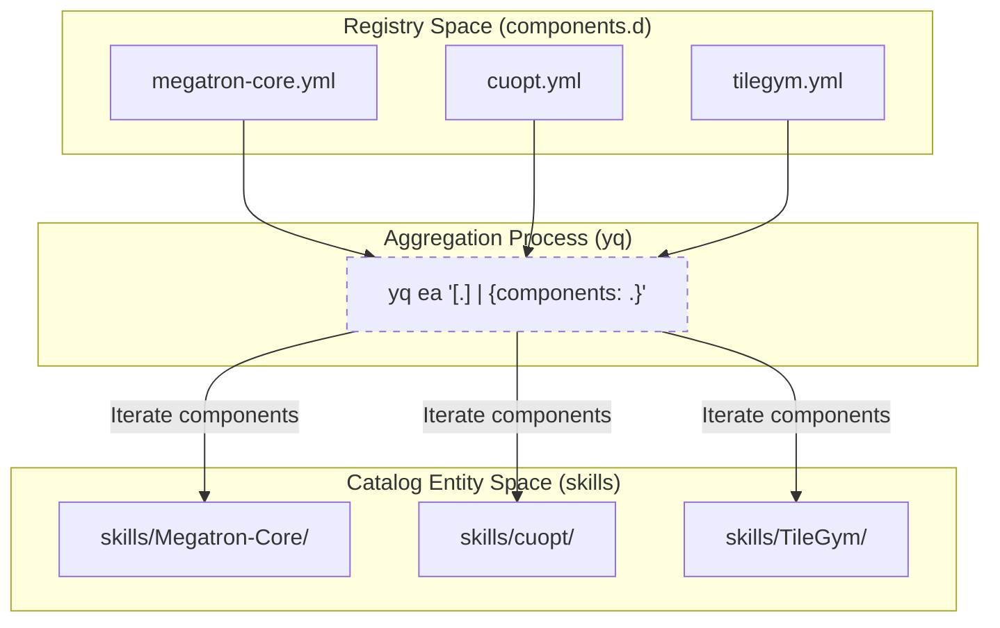

<!-- source: DeepWiki mcp.deepwiki.com · repo NVIDIA/skills · page 2.3 Components Registry (components.d) · fetched 2026-10-30 -->

# Components Registry (components.d)

<details>
<summary>Relevant source files</summary>

The following files were used as context for generating this wiki page:

- [components.d/README.md](components.d/README.md)
- [components.d/cuda-q.yml](components.d/cuda-q.yml)
- [components.d/cuopt.yml](components.d/cuopt.yml)
- [components.d/megatron-bridge.yml](components.d/megatron-bridge.yml)
- [components.d/megatron-core.yml](components.d/megatron-core.yml)
- [components.d/model-optimizer.yml](components.d/model-optimizer.yml)
- [components.d/nemo-evaluator.yml](components.d/nemo-evaluator.yml)
- [components.d/nemo-gym.yml](components.d/nemo-gym.yml)
- [components.d/nemoclaw.yml](components.d/nemoclaw.yml)
- [components.d/nemotron-voice-agent.yml](components.d/nemotron-voice-agent.yml)
- [components.d/rag-blueprint.yml](components.d/rag-blueprint.yml)
- [components.d/tensorrt-llm.yml](components.d/tensorrt-llm.yml)
- [components.d/tilegym.yml](components.d/tilegym.yml)
- [components.d/video-search-and-summarization.yml](components.d/video-search-and-summarization.yml)

</details>


The `components.d/` directory serves as the source of truth for all NVIDIA products integrated into the Skills catalog. It utilizes a decentralized configuration model where each product or component is defined in its own YAML file. This architecture prevents merge conflicts during simultaneous onboarding and allows the automation pipeline to scale across multiple NVIDIA engineering teams [components.d/README.md:4-6]().

## Configuration Schema

Each YAML file in `components.d/` must follow a specific schema to be successfully parsed by the `sync-skills.yml` workflow and the `regenerate-readme.sh` script.

### Required Fields
The following fields are mandatory for every component [components.d/README.md:14-29]():

| Field | Type | Description |
| :--- | :--- | :--- |
| `name` | `string` | The display name used in the README tables (e.g., `Megatron-Core`). |
| `repo` | `string` | The source GitHub repository in `owner/repo` format. |
| `description` | `string` | A concise one-line summary of the component's capabilities. |
| `skills` | `list` | A list of source/destination mappings for skill files. |

Each entry in the `skills` list requires:
*   `path`: The directory in the **upstream** repository where the `SKILL.md` files are located.
*   `catalog_dir`: The unique directory name under `skills/` in **this** repository where the skills will be mirrored.

### Optional Fields
These fields allow for fine-grained control over the synchronization and documentation generation [components.d/README.md:30-37]():

| Field | Default | Description |
| :--- | :--- | :--- |
| `ref` | `main` | The git branch or tag to sync from in the source repository. |
| `links.contributing` | `CONTRIBUTING.md` | Path to the contributing guide in the source repo. |
| `links.discussions` | `true` | Boolean to enable/disable the Discussions link in the README. |
| `links.security` | `true` | Boolean to enable/disable the Security link in the README. |

**Sources:** [components.d/README.md:14-37](), [components.d/megatron-core.yml:1-9]()

---

## Data Flow: From YAML to Catalog

The registry acts as the input for the aggregation logic. The system bridges the "Natural Language Space" (Product Names/Descriptions) to the "Code Entity Space" (Repository Paths/Local Directories) through a multi-step workflow.

### Component Aggregation Logic
The `sync-skills.yml` workflow uses `yq` to aggregate all individual files into a single temporary manifest [components.d/README.md:64-70]():

**Aggregation and Sync Process**

**Sources:** [components.d/README.md:64-73](), [components.d/megatron-core.yml:1-6](), [components.d/cuopt.yml:1-6](), [components.d/tilegym.yml:1-6]()

---

## Multi-Skill Components

Some NVIDIA products distribute skills across multiple sub-packages within their repository. The registry supports this by allowing multiple entries in the `skills` list. Each entry must have a unique `catalog_dir` to prevent file collisions during the rsync process [components.d/README.md:51-62]().

**Example: NeMo Evaluator Configuration**
```yaml
name: NeMo Evaluator
repo: NVIDIA-NeMo/Evaluator
description: LLM evaluation — launch evaluations, access MLflow results...
skills:
  - path: packages/nemo-evaluator-launcher/.claude/skills/
    catalog_dir: NeMo-Evaluator-Launcher
  - path: packages/nemo-evaluator/.claude/skills/
    catalog_dir: NeMo-Evaluator
```
**Sources:** [components.d/nemo-evaluator.yml:1-9](), [components.d/README.md:53-62]()

---

## Registered NVIDIA Products

The following table details the primary components currently registered in the `components.d/` registry and their corresponding source-to-catalog mappings.

| Product Name | Source Repo | Catalog Directory |
| :--- | :--- | :--- |
| **Megatron-Core** | `NVIDIA/Megatron-LM` | `Megatron-Core` [components.d/megatron-core.yml:1-6]() |
| **Megatron-Bridge** | `NVIDIA-NeMo/Megatron-Bridge` | `Megatron-Bridge` [components.d/megatron-bridge.yml:1-6]() |
| **cuOpt** | `NVIDIA/cuopt` | `cuopt` [components.d/cuopt.yml:1-6]() |
| **TileGym** | `NVIDIA/TileGym` | `TileGym` [components.d/tilegym.yml:1-6]() |
| **NemoClaw** | `NVIDIA/NemoClaw` | `NemoClaw` [components.d/nemoclaw.yml:1-6]() |
| **CUDA-Q** | `NVIDIA/cuda-quantum` | `CUDA-Q` [components.d/cuda-q.yml:1-6]() |
| **Model-Optimizer** | `NVIDIA/Model-Optimizer` | `Model-Optimizer` [components.d/model-optimizer.yml:1-6]() |
| **NeMo Gym** | `NVIDIA-NeMo/Gym` | `NeMo-Gym` [components.d/nemo-gym.yml:1-6]() |
| **VSS Blueprint** | `NVIDIA-AI-Blueprints/video-search-and-summarization` | `video-search-and-summarization` [components.d/video-search-and-summarization.yml:1-6]() |
| **Nemotron Voice Agent** | `NVIDIA-AI-Blueprints/nemotron-voice-agent` | `nemotron-voice-agent` [components.d/nemotron-voice-agent.yml:1-6]() |

### Implementation Constraints
1.  **Uniqueness:** The `catalog_dir` must be unique across all files in `components.d/`. This is the directory name created under the root `skills/` folder [components.d/README.md:28]().
2.  **Naming Convention:** Component files should be named using a lowercased slug with dashes (e.g., `nemotron-voice-agent.yml`) [components.d/README.md:10]().
3.  **Path Resolution:** The `path` field is relative to the root of the `repo` defined in the same file [components.d/README.md:27]().

**Sources:** [components.d/README.md:1-73](), [components.d/cuda-q.yml:1-9](), [components.d/nemo-evaluator.yml:1-9](), [components.d/video-search-and-summarization.yml:1-7]()

---

