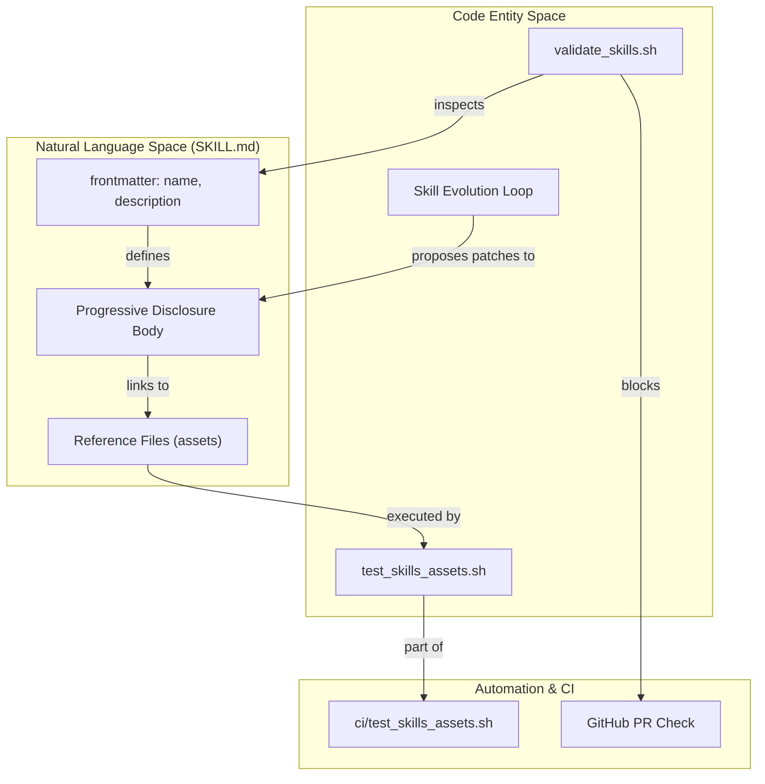
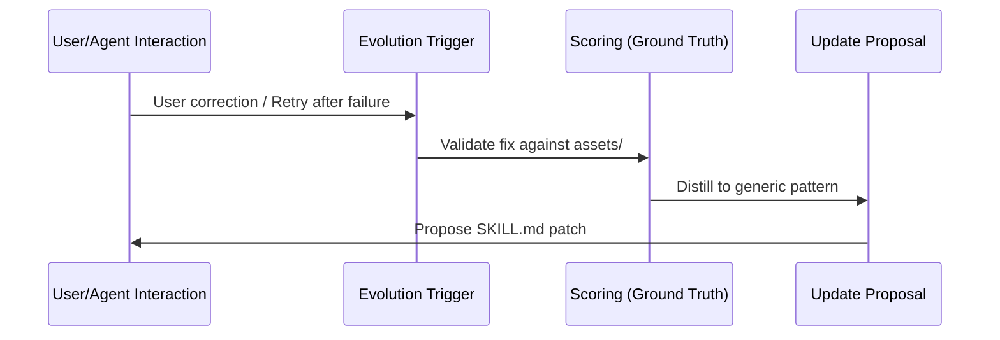

<!-- source: DeepWiki mcp.deepwiki.com · repo NVIDIA/skills · page 4 Skill Authoring Specification · fetched 2026-10-30 -->

# Skill Authoring Specification

Relevant source files

The following files were used as context for generating this wiki page:

- [.github/PULL_REQUEST_TEMPLATE.md](.github/PULL_REQUEST_TEMPLATE.md)
- [CONTRIBUTING.md](CONTRIBUTING.md)
- [skills/Megatron-Core/run-on-slurm/SKILL.md](skills/Megatron-Core/run-on-slurm/SKILL.md)
- [skills/cuopt/skill-evolution/SKILL.md](skills/cuopt/skill-evolution/SKILL.md)

This page provides the technical reference for authoring and maintaining skills within the NVIDIA Agent Skills catalog. It defines the structural requirements for skill files, the metadata schema, and the lifecycle of a skill from initial creation to automated evolution.

## Specification Overview

The NVIDIA Agent Skills framework follows the [agentskills.io](https://agentskills.io/specification) specification, designed for high-density, context-efficient communication between human developers and AI agents. Skills are organized by product and follow a **Progressive Disclosure** model: providing just enough information for an agent to start a task, with "escape hatches" to deeper reference material only when needed.

### Core Components
- **`SKILL.md`**: The entry point for every skill, containing a YAML frontmatter and Markdown body.
- **`assets/`**: A directory for executable code, reference implementations, and validation tests.
- **`validation/`**: Scripts and schemas used to ensure skill compliance during CI.

For details on the specific file structure, see [SKILL.md Format & Frontmatter](#4.1).

---

## Technical Architecture

The following diagram illustrates how natural language requirements in a `SKILL.md` file bridge into the "Code Entity Space" through assets and validation scripts.

### Skill-to-Code Mapping

**Sources:** [.github/PULL_REQUEST_TEMPLATE.md:21-26](), [skills/cuopt/skill-evolution/SKILL.md:53-64]()

---

## The SKILL.md Format

Every skill is defined by a `SKILL.md` file. This file must contain a YAML frontmatter block that allows agents to parse the skill's purpose and applicability without reading the entire document.

| Field | Requirement | Description |
| :--- | :--- | :--- |
| `name` | Required | Unique identifier for the skill (slug-style). |
| `description` | Required | High-level summary of what the skill accomplishes. |
| `when_to_use` | Optional | Semantic triggers and keywords for agent retrieval. |
| `version` | Optional | Semantic version of the skill content. |

For the full schema and body formatting rules, see [SKILL.md Format & Frontmatter](#4.1).

**Sources:** [skills/Megatron-Core/run-on-slurm/SKILL.md:1-5](), [skills/cuopt/skill-evolution/SKILL.md:1-5]()

---

## Skill Evolution & Feedback Loop

Skills in this catalog are not static; they are designed to improve through a self-correction mechanism called **Skill Evolution**. This framework (initially developed for `cuOpt`) monitors agent interactions for "triggers" like user corrections or code execution failures.

### Evolution Trigger Flow

When a trigger fires (e.g., `Thrash before landing`), the agent is tasked with distilling the specific fix into a generalizable pattern and proposing a patch to the relevant `SKILL.md` or adding a new helper to `assets/`.

For details on the evolution triggers and distillation rules, see [Skill Evolution & Self-Improvement](#4.2).

**Sources:** [skills/cuopt/skill-evolution/SKILL.md:11-35](), [skills/cuopt/skill-evolution/SKILL.md:67-73]()

---

## Validation and CI

To maintain the quality of the catalog, all skills undergo automated validation. This ensures that the YAML frontmatter is well-formed and that any code assets provided are functional.

1.  **Structural Validation**: `validate_skills.sh` checks for required frontmatter fields and unique `catalog_dir` constraints.
2.  **Functional Validation**: `test_skills_assets.sh` executes Python scripts and other code entities in the `assets/` directory to ensure they produce the expected output.

For details on the validation pipeline, see [Skill Validation & CI](#4.3).

**Sources:** [.github/PULL_REQUEST_TEMPLATE.md:21-26](), [skills/cuopt/skill-evolution/SKILL.md:60-63]()

---

## Organization & Assets

Skills should be organized within the product's directory in the catalog. 

- **Recommended Path**: `.agents/skills/` or `skills/` at the root of the source repository.
- **Reference Files**: If a code example exceeds ~15 lines, it should be moved from the `SKILL.md` body into a file within the `assets/` subdirectory.

**Sources:** [CONTRIBUTING.md:12-19](), [skills/cuopt/skill-evolution/SKILL.md:67-73]()

---

