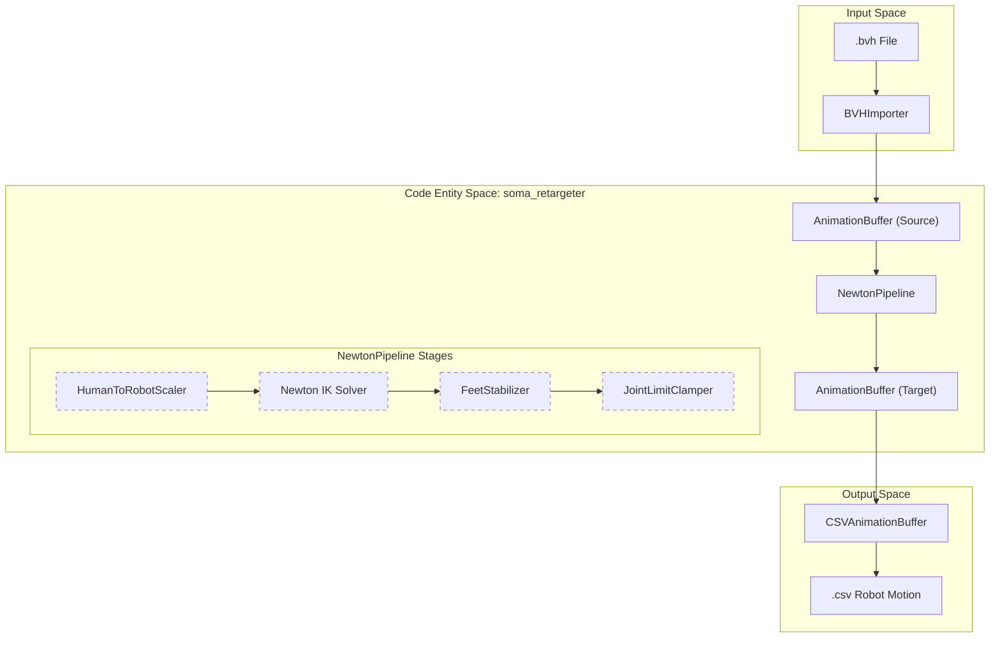
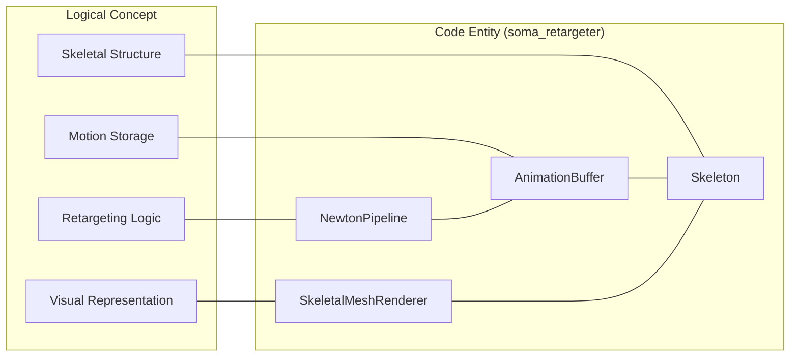

<!-- source: DeepWiki mcp.deepwiki.com · repo NVIDIA/soma-retargeter · page 1 SOMA Retargeter: Overview · fetched 2026-10-26 -->

# SOMA Retargeter: Overview

Relevant source files

The following files were used as context for generating this wiki page:

- [CHANGELOG.md](CHANGELOG.md)
- [CONTRIBUTING.md](CONTRIBUTING.md)
- [LICENSE](LICENSE)
- [README.md](README.md)
- [SECURITY.md](SECURITY.md)

The **SOMA Retargeter** is a high-performance library and toolset designed to convert [SOMA](https://github.com/NVlabs/SOMA-X) human motion capture data into humanoid robot joint animations [README.md:1-10](). It leverages **NVIDIA Warp** for GPU-accelerated computations and the **Newton** physics engine for multi-objective inverse kinematics (IK) solving [README.md:6-8]().

The primary goal of the project is to bridge the gap between human skeletal motion (typically stored in BVH format) and robot-specific control data (exported as CSV), ensuring that the resulting motion is physically plausible, respects joint limits, and maintains environmental constraints like foot-ground contact [README.md:8-10]().

## System Architecture

The project is structured into a main application entry point and several specialized sub-packages that handle animation data, file I/O, retargeting logic, and visualization.

### High-Level Subsystems

| Subsystem | Responsibility |
| :--- | :--- |
| **Application (`app/`)** | Orchestrates the workflow via `bvh_to_csv_converter.py` for both GUI and batch modes [README.md:112-117](). |
| **Animation (`soma_retargeter/animation/`)** | Defines core data structures like `Skeleton`, `SkeletonInstance`, and `AnimationBuffer` [README.md:122](). |
| **Pipelines (`soma_retargeter/pipelines/`)** | Contains the `NewtonPipeline`, which manages IK solving, scaling, and stabilization [README.md:124](). |
| **Robotics (`soma_retargeter/robotics/`)** | Handles human-to-robot scaling and robot-specific output formatting [README.md:125](). |
| **Assets (`soma_retargeter/assets/`)** | Manages file I/O for BVH, CSV, and USD formats [README.md:123](). |
| **Renderers (`soma_retargeter/renderers/`)** | Provides real-time visualization of skeletons and meshes in the viewer [README.md:126](). |

**Sources:** [README.md:112-129]()

### System Data Flow
This diagram illustrates how data moves from raw human motion files through the retargeting pipeline to the final robot-ready output.

**Sources:** [README.md:6-10](), [README.md:118-129]()

## Key Concepts

### Newton-Based IK Solving
The core of the retargeting process uses the **Newton** library to solve for robot joint angles. It treats retargeting as an optimization problem where multiple objectives (positioning effectors, matching rotations, and staying within joint limits) are balanced simultaneously [README.md:6-8]().

### Human-to-Robot Scaling
Because human and robot proportions differ significantly, the `HumanToRobotScaler` computes per-joint scale ratios. This ensures that a human "reach" translates correctly to the robot's physical dimensions while maintaining the intent of the motion [README.md:8-10]().

### GPU Acceleration with Warp
Heavy computational tasks—such as skeleton forward kinematics, skinning for visualization, and the IK solve itself—are implemented using **NVIDIA Warp** kernels. This allows the system to process large batches of motion data or provide high-framerate interactive feedback [README.md:6-8]().

## Execution Modes

The SOMA Retargeter supports two primary workflows:

1.  **Interactive Viewer Mode**: An OpenGL and `imgui`-based interface used for inspecting motions, tuning IK parameters, and visualizing the retargeting result in real-time [README.md:90-99]().
2.  **Batch Processing Mode**: A headless mode for processing large datasets (like the SEED dataset) without a graphical interface, optimized for throughput [README.md:100-109]().

For details on setting up the environment and running these modes, see [Getting Started: Installation and Configuration](#1.1).

## Component Relationship
This diagram maps high-level concepts to the specific code entities that implement them.

**Sources:** [README.md:118-129]()

## Project Content and Assets

The repository includes sample motion assets to help users verify their installation and understand the expected data formats. These samples include both the source human BVH files and the reference robot CSV outputs [README.md:82-85]().

For more information on the included files and their structure, see [Sample Motion Assets](#1.2).

**Sources:** [README.md:82-85]()

---

