# Page: SOMA Retargeter: Overview

# SOMA Retargeter: Overview

<details>
<summary>Relevant source files</summary>

The following files were used as context for generating this wiki page:

- [CHANGELOG.md](CHANGELOG.md)
- [CONTRIBUTING.md](CONTRIBUTING.md)
- [LICENSE](LICENSE)
- [README.md](README.md)
- [SECURITY.md](SECURITY.md)

</details>


The **SOMA Retargeter** is a high-performance library and toolset designed to convert [SOMA](https://github.com/NVlabs/SOMA-X) human motion capture data into humanoid robot joint animations [README.md:1-10](). It leverages **NVIDIA Warp** for GPU-accelerated computations and the **Newton** physics engine for multi-objective inverse kinematics (IK) solving [README.md:6-8]().

The primary goal of the project is to bridge the gap between human skeletal motion (typically stored in BVH format) and robot-specific control data (exported as CSV), ensuring that the resulting motion is physically plausible, respects joint limits, and maintains environmental constraints like foot-ground contact [README.md:8-10]().

## System Architecture

The project is structured into a main application entry point and several specialized sub-packages that handle animation data, file I/O, retargeting logic, and visualization.

### High-Level Subsystems

| Subsystem | Responsibility |
| :--- | :--- |
| **Application (`app/`)** | Orchestrates the workflow via `bvh_to_csv_converter.py` for both GUI and batch modes [README.md:112-117](). |
| **Animation (`soma_retargeter/animation/`)** | Defines core data structures like `Skeleton`, `SkeletonInstance`, and `AnimationBuffer` [README.md:122](). |
| **Pipelines (`soma_retargeter/pipelines/`)** | Contains the `NewtonPipeline`, which manages IK solving, scaling, and stabilization [README.md:124](). |
| **Robotics (`soma_retargeter/robotics/`)** | Handles human-to-robot scaling and robot-specific output formatting [README.md:125](). |
| **Assets (`soma_retargeter/assets/`)** | Manages file I/O for BVH, CSV, and USD formats [README.md:123](). |
| **Renderers (`soma_retargeter/renderers/`)** | Provides real-time visualization of skeletons and meshes in the viewer [README.md:126](). |

**Sources:** [README.md:112-129]()

### System Data Flow
This diagram illustrates how data moves from raw human motion files through the retargeting pipeline to the final robot-ready output.

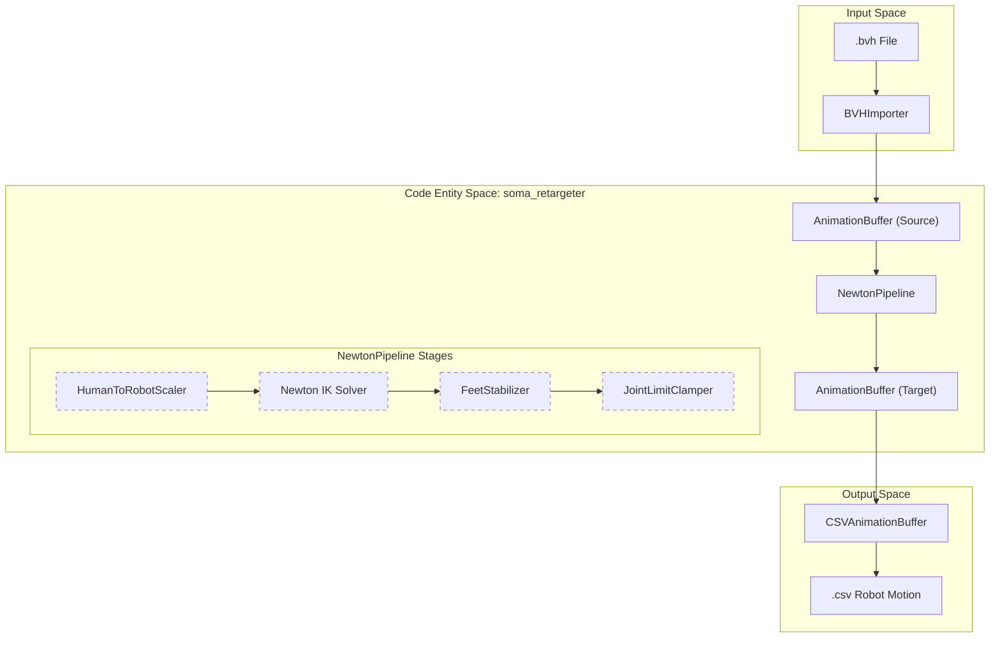
**Sources:** [README.md:6-10](), [README.md:118-129]()

## Key Concepts

### Newton-Based IK Solving
The core of the retargeting process uses the **Newton** library to solve for robot joint angles. It treats retargeting as an optimization problem where multiple objectives (positioning effectors, matching rotations, and staying within joint limits) are balanced simultaneously [README.md:6-8]().

### Human-to-Robot Scaling
Because human and robot proportions differ significantly, the `HumanToRobotScaler` computes per-joint scale ratios. This ensures that a human "reach" translates correctly to the robot's physical dimensions while maintaining the intent of the motion [README.md:8-10]().

### GPU Acceleration with Warp
Heavy computational tasks—such as skeleton forward kinematics, skinning for visualization, and the IK solve itself—are implemented using **NVIDIA Warp** kernels. This allows the system to process large batches of motion data or provide high-framerate interactive feedback [README.md:6-8]().

## Execution Modes

The SOMA Retargeter supports two primary workflows:

1.  **Interactive Viewer Mode**: An OpenGL and `imgui`-based interface used for inspecting motions, tuning IK parameters, and visualizing the retargeting result in real-time [README.md:90-99]().
2.  **Batch Processing Mode**: A headless mode for processing large datasets (like the SEED dataset) without a graphical interface, optimized for throughput [README.md:100-109]().

For details on setting up the environment and running these modes, see [Getting Started: Installation and Configuration](#1.1).

## Component Relationship
This diagram maps high-level concepts to the specific code entities that implement them.

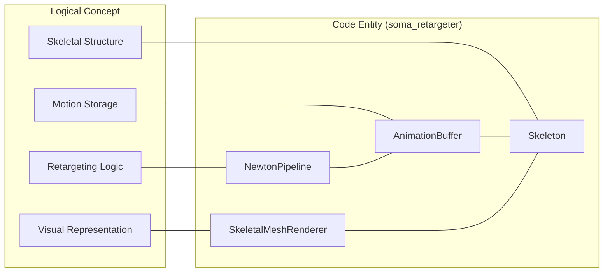
**Sources:** [README.md:118-129]()

## Project Content and Assets

The repository includes sample motion assets to help users verify their installation and understand the expected data formats. These samples include both the source human BVH files and the reference robot CSV outputs [README.md:82-85]().

For more information on the included files and their structure, see [Sample Motion Assets](#1.2).

**Sources:** [README.md:82-85]()

---

# Page: Getting Started: Installation and Configuration

# Getting Started: Installation and Configuration

<details>
<summary>Relevant source files</summary>

The following files were used as context for generating this wiki page:

- [.gitignore](.gitignore)
- [.python-version](.python-version)
- [.vscode/launch.json](.vscode/launch.json)
- [app/__init__.py](app/__init__.py)
- [app/bvh_to_csv_converter.py](app/bvh_to_csv_converter.py)
- [pyproject.toml](pyproject.toml)
- [uv.lock](uv.lock)

</details>


This page provides a technical guide for setting up the SOMA Retargeter environment. It covers system requirements, dependency management via `uv` or `pip`, and the execution patterns for the BVH-to-CSV conversion pipeline.

## System Requirements and Environment

The SOMA Retargeter is built on modern Python and NVIDIA high-performance libraries. The project specifically targets **Python 3.12** as defined in the environment configuration `[.python-version:1-1]()`.

### Core Dependencies
The project leverages several specialized libraries for simulation, rendering, and GPU acceleration:
*   **Newton (`newton`)**: The core physics and IK solving engine `[pyproject.toml:12-12]()`.
*   **NVIDIA Warp (`warp-lang`)**: Used for GPU-accelerated kernels in skeletal animation, scaling, and rendering `[pyproject.toml:13-13]()`.
*   **USD Core (`usd-core`)**: Provides the foundation for loading skeletal meshes and bind poses `[pyproject.toml:20-20]()`.
*   **imgui-bundle**: Powers the interactive graphical user interface for the viewer `[pyproject.toml:19-19]()`.

## Installation

The project uses `pyproject.toml` for package definition and dependency management.

### Using uv (Recommended)
The project includes a `uv.lock` file for reproducible builds. `uv` is configured to use the NVIDIA PyPI index for `warp-lang` `[pyproject.toml:39-45]()`.

```bash
# Install dependencies and create virtual environment
uv sync
```

### Using pip
Standard installation is supported via `setuptools`. The package includes specific data files like configurations and USD assets `[pyproject.toml:30-32]()`.

```bash
pip install .
```

### Package Structure
The package is defined under the `soma_retargeter` namespace. The installation process excludes application scripts and raw assets from the library path while including configuration JSONs and model files `[pyproject.toml:25-32]()`.

## Execution Modes

The entry point for the system is `app/bvh_to_csv_converter.py`. It supports two primary modes of operation: **Interactive Viewer** and **Batch Headless**.

### Mode Selection Data Flow
The `Viewer` class determines its execution path based on the type of `viewer` object passed during initialization.

| Mode | Viewer Class | Description |
| :--- | :--- | :--- |
| **Interactive** | `newton.viewer.Viewer` | OpenGL-based UI with real-time rendering and manual controls `[app/bvh_to_csv_converter.py:63-64]()`. |
| **Batch** | `newton.viewer.ViewerNull` | Headless execution for recursive directory processing `[app/bvh_to_csv_converter.py:37-39]()`. |

### Configuration and Launch
The system is configured via JSON files. A default configuration is provided at `assets/default_bvh_to_csv_converter_config.json`.

#### Interactive Viewer Mode
Used for debugging and manual retargeting. It initializes the `SkeletonRenderer`, `SkeletalMeshRenderer`, and `CoordinateRenderer` `[app/bvh_to_csv_converter.py:86-89]()`.

**Launch Command:**
```bash
python app/bvh_to_csv_converter.py --config assets/default_bvh_to_csv_converter_config.json --viewer gl
```

#### Batch Mode
Used for processing large datasets. It calls `Viewer.batched_retargeting()` to recursively find BVH files and export them to CSV `[app/bvh_to_csv_converter.py:37-39]()`.

**Launch Command:**
```bash
python app/bvh_to_csv_converter.py --config assets/default_bvh_to_csv_converter_config.json --viewer null
```

### VS Code Integration
The repository includes a `launch.json` file with pre-configured debug targets for both modes `[.vscode/launch.json:1-25]()`.

**Sources:**
`[pyproject.toml:1-46]()`, `[.python-version:1-1]()`, `[app/bvh_to_csv_converter.py:30-95]()`, `[.vscode/launch.json:1-25]()`

## System Architecture: Initialization Flow

The following diagram illustrates how the `Viewer` class bridges the high-level application logic with the underlying Newton and Warp entities.

### Viewer Initialization Entity Mapping
"Natural Language Space" to "Code Entity Space"

```mermaid
graph TD
    subgraph "Application Logic"
        [MainEntry] --> |"instantiates"| V["Viewer Class"]
        V --> |"loads"| CFG["JSON Config"]
    end

    subgraph "Newton Engine Entities"
        V --> |"builds"| MB["newton.ModelBuilder"]
        MB --> |"creates"| M["newton.Model"]
        M --> |"manages"| S["newton.State"]
        V --> |"controls"| VW["newton.viewer.Viewer"]
    end

    subgraph "Rendering & Assets"
        V --> |"initializes"| SR["SkeletonRenderer"]
        V --> |"initializes"| MR["SkeletalMeshRenderer"]
        V --> |"uses"| SC["SpaceConverter"]
    end

    style V stroke-width:2px
    style M stroke-width:2px
    style SR stroke-width:2px
```
**Sources:**
`[app/bvh_to_csv_converter.py:30-95]()`, `[app/bvh_to_csv_converter.py:66-76]()`

## Data Flow: Input to Output

The retargeting pipeline transforms motion data from human-centric BVH files to robot-compatible CSV files.

### Conversion Pipeline Data Flow
"Natural Language Space" to "Code Entity Space"

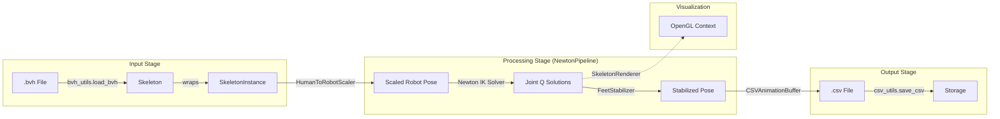

### Key Functional Components

| Component | File Path | Role |
| :--- | :--- | :--- |
| **SpaceConverter** | `soma_retargeter/utils/space_conversion_utils.py` | Handles coordinate system remapping (e.g., Maya to Newton) `[app/bvh_to_csv_converter.py:35-35]()`. |
| **BVHImporter** | `soma_retargeter/assets/bvh.py` | Tokenizes and parses BVH hierarchy and motion data `[app/bvh_to_csv_converter.py:114-114]()`. |
| **ModelBuilder** | `newton.ModelBuilder` | Constructs the physical robot model from MJCF files `[app/bvh_to_csv_converter.py:66-76]()`. |
| **CSVAnimationBuffer** | `soma_retargeter/assets/csv.py` | Stores the final retargeted joint angles for export `[app/bvh_to_csv_converter.py:101-101]()`. |

**Sources:**
`[app/bvh_to_csv_converter.py:35-35]()`, `[app/bvh_to_csv_converter.py:100-123]()`, `[pyproject.toml:25-32]()`

---

# Page: Sample Motion Assets

# Sample Motion Assets

<details>
<summary>Relevant source files</summary>

The following files were used as context for generating this wiki page:

- [.gitattributes](.gitattributes)
- [assets/motions/bvh/Neutral_throw_ball_001__A057.bvh](assets/motions/bvh/Neutral_throw_ball_001__A057.bvh)
- [assets/motions/bvh/Neutral_walk_forward_002__A057.bvh](assets/motions/bvh/Neutral_walk_forward_002__A057.bvh)
- [assets/motions/bvh/dance_hiphop_shuffle_square_R_fast_002__A318.bvh](assets/motions/bvh/dance_hiphop_shuffle_square_R_fast_002__A318.bvh)
- [assets/motions/bvh/high_jump_R_001__A277.bvh](assets/motions/bvh/high_jump_R_001__A277.bvh)
- [assets/motions/csv/Neutral_walk_forward_002__A057.csv](assets/motions/csv/Neutral_walk_forward_002__A057.csv)
- [assets/motions/csv/dance_hiphop_shuffle_square_R_fast_002__A318.csv](assets/motions/csv/dance_hiphop_shuffle_square_R_fast_002__A318.csv)

</details>


The SOMA Retargeter includes a curated set of motion assets located in the `assets/motions/` directory. These assets serve as both functional input examples for the retargeting pipeline and as reference outputs to verify the accuracy and stability of the IK solver and feet stabilization modules.

## Asset Directory Structure

The motion assets are organized by file format, reflecting their role in the data flow:

*   **`assets/motions/bvh/`**: Contains raw Biovision Hierarchy (BVH) files. These are the source human motion captures used as inputs to the `NewtonPipeline`.
*   **`assets/motions/csv/`**: Contains processed motion data in CSV format. These files represent the final retargeted joint angles (q-values) for the target robot (e.g., Unitree G1).

### Git LFS Integration
Due to the high frequency and duration of the motion captures, these files are managed via **Git LFS (Large File Storage)**. This ensures the repository remains lightweight while maintaining binary integrity for the animation data. The `.gitattributes` file explicitly tracks these extensions:

[ .gitattributes:1-5 ]()

| Extension | Filter / Merge Strategy |
| :--- | :--- |
| `.bvh` | `lfs` |
| `.csv` | `lfs` |
| `.usd` / `.usda` | `lfs` |

**Sources:** [ .gitattributes:1-5 ]()

---

## Bundled BVH Samples (Input)

The bundled BVH files represent a variety of human movement patterns designed to test different aspects of the retargeting engine, such as limb extension, rapid acceleration, and root translation.

| Filename | Purpose / Test Case |
| :--- | :--- |
| `Neutral_walk_forward_002__A057.bvh` | Standard locomotion; tests root blending and cyclic gait stability. |
| `Neutral_throw_ball_001__A057.bvh` | Asymmetric upper-body movement; tests arm IK and torso rotation. |
| `dance_hiphop_shuffle_square_R_fast_002__A318.bvh` | High-frequency leg movement; tests `FeetStabilizer` and solver convergence speed. |
| `high_jump_R_001__A277.bvh` | Vertical displacement and airborne phases; tests gravity/root height scaling. |

### Data Flow: From Asset to Pipeline
The following diagram illustrates how these assets are ingested by the `BVHImporter` and passed into the core system entities.

**Motion Data Ingestion Flow**
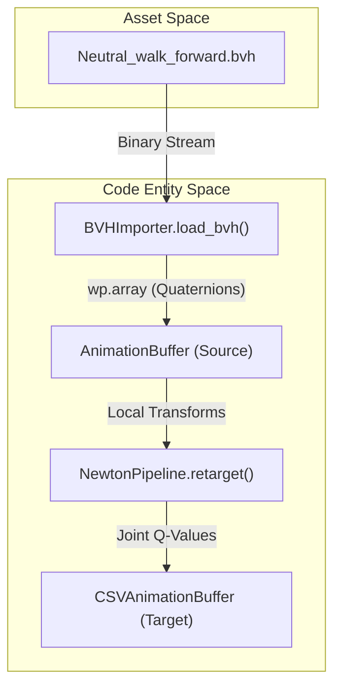

**Sources:** [assets/motions/bvh/Neutral_walk_forward_002__A057.bvh:1-3](), [assets/motions/bvh/Neutral_throw_ball_001__A057.bvh:1-3]()

---

## Bundled CSV Samples (Reference Output)

The `assets/motions/csv/` directory contains pre-computed retargeting results for the Unitree G1 robot. These files are generated by the `CSVAnimationBuffer` class and serve as a "Golden Set" for regression testing.

### CSV Structure
Each CSV file corresponds to a BVH source and contains:
1.  **Header**: Mapping of robot joint names to column indices.
2.  **Root Data**: World-space position and orientation for the robot's base link.
3.  **Joint Data**: Scalar values representing the angular position (q) for every Degree of Freedom (DOF) of the target skeleton.

**Reference Assets:**
*   `assets/motions/csv/Neutral_walk_forward_002__A057.csv` [assets/motions/csv/Neutral_walk_forward_002__A057.csv:1-3]()
*   `assets/motions/csv/dance_hiphop_shuffle_square_R_fast_002__A318.csv` [assets/motions/csv/dance_hiphop_shuffle_square_R_fast_002__A318.csv:1-3]()

---

## Technical Implementation Reference

The assets are utilized by the following key classes within the `soma_retargeter` package:

### 1. Asset Discovery and Loading
The `BVHImporter` handles the parsing of the BVH files into the `AnimationBuffer` format. It uses a specialized GPU kernel to convert Euler angles from the BVH file into quaternions used by the Newton solver.

### 2. Output Generation
The `CSVAnimationBuffer` is responsible for sampling the retargeted results. It blends the root transformation and linearizes joint DOFs to produce the final CSV output found in `assets/motions/csv/`.

**Asset Interaction Diagram**
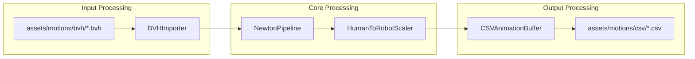

**Sources:** [assets/motions/bvh/dance_hiphop_shuffle_square_R_fast_002__A318.bvh:1-3](), [assets/motions/csv/dance_hiphop_shuffle_square_R_fast_002__A318.csv:1-3]()

---

# Page: Application Entry Point

# Application Entry Point

<details>
<summary>Relevant source files</summary>

The following files were used as context for generating this wiki page:

- [app/bvh_to_csv_converter.py](app/bvh_to_csv_converter.py)
- [assets/default_bvh_to_csv_converter_config.json](assets/default_bvh_to_csv_converter_config.json)

</details>


The `app/bvh_to_csv_converter.py` script serves as the primary entry point for the SOMA Retargeter system. It orchestrates the flow of data from raw BVH motion files through the Newton-based IK pipeline to produce robot-compatible CSV files. The script is designed to handle both interactive visualization for debugging/configuration and high-throughput batch processing for large datasets.

### Overview of Orchestration

The application uses a `Viewer` class [app/bvh_to_csv_converter.py:30-31]() to manage the lifecycle of the retargeting process. Depending on the command-line arguments and configuration, it initializes either a graphical OpenGL window (using the Newton viewer) or a `ViewerNull` [app/bvh_to_csv_converter.py:37-39]() for headless execution.

#### System Entry Flow
The following diagram illustrates how the entry point initializes the environment and branches into the two primary execution modes.

**Entry Point Logic Flow**
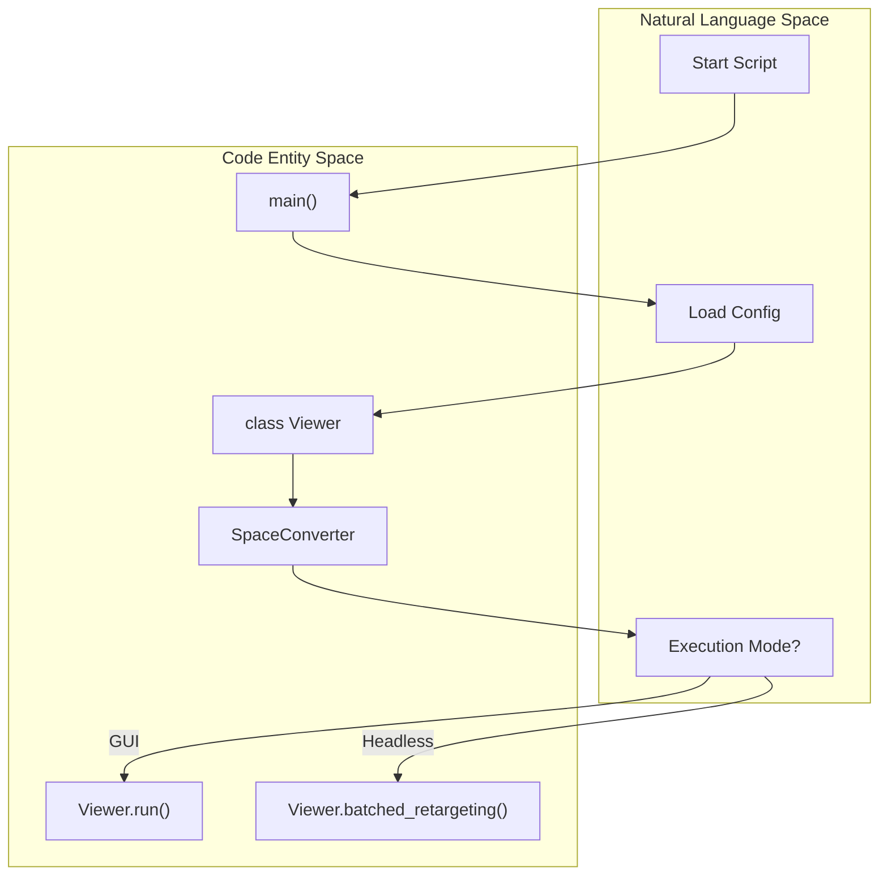
Sources: [app/bvh_to_csv_converter.py:30-39](), [app/bvh_to_csv_converter.py:35-35]()

---

### Configuration and CLI

The script relies on a JSON configuration file to define default paths and retargeting parameters. By default, it loads `assets/default_bvh_to_csv_converter_config.json` [assets/default_bvh_to_csv_converter_config.json:1-10]().

| Key | Description | Default |
| :--- | :--- | :--- |
| `import_folder` | Source directory for BVH files | `assets/motions/bvh` |
| `export_folder` | Destination for generated CSVs | `assets/motions/test-export` |
| `batch_size` | Number of files processed per GPU batch | `100` |
| `retarget_source` | Source character profile (e.g., SOMA) | `soma` |
| `retarget_target` | Target robot profile (e.g., Unitree G1) | `unitree_g1` |
| `retarget_source_facing_direction` | Coordinate system of input (e.g., Mujoco) | `Mujoco` |

Sources: [assets/default_bvh_to_csv_converter_config.json:1-10]()

---

### Execution Modes

The application operates in two distinct modes based on the presence of the `--batch` flag or the state of the `Viewer` initialization.

#### 1. Interactive Viewer Mode
In this mode, the `Viewer` class initializes a graphical interface using `imgui`. It allows users to:
*   **Visualize** the source human skeleton and the target robot model (Unitree G1) side-by-side [app/bvh_to_csv_converter.py:70-78]().
*   **Adjust** spatial offsets using interactive gizmos [app/bvh_to_csv_converter.py:61-61]().
*   **Trigger** the retargeting pipeline for a single file and inspect the results in real-time.
*   **Render** skeletal meshes and joint axes using `SkeletalMeshRenderer` and `CoordinateRenderer` [app/bvh_to_csv_converter.py:86-89]().

For details, see [Interactive Viewer Mode (OpenGL / imgui)](#2.1).

#### 2. Batch Processing Mode
When run in batch mode, the application bypasses the UI and focuses on throughput. It utilizes the `batched_retargeting()` method to:
*   Recursively scan the `import_folder` for BVH files.
*   Group animations into batches to maximize GPU utilization via NVIDIA Warp.
*   Execute the `NewtonPipeline` without rendering overhead.
*   Export results directly to the `export_folder`.

For details, see [Batch Processing Mode](#2.2).

---

### Component Relationship
The `Viewer` class acts as a central hub, connecting asset loaders, renderers, and the retargeting pipeline.

**Viewer Component Architecture**
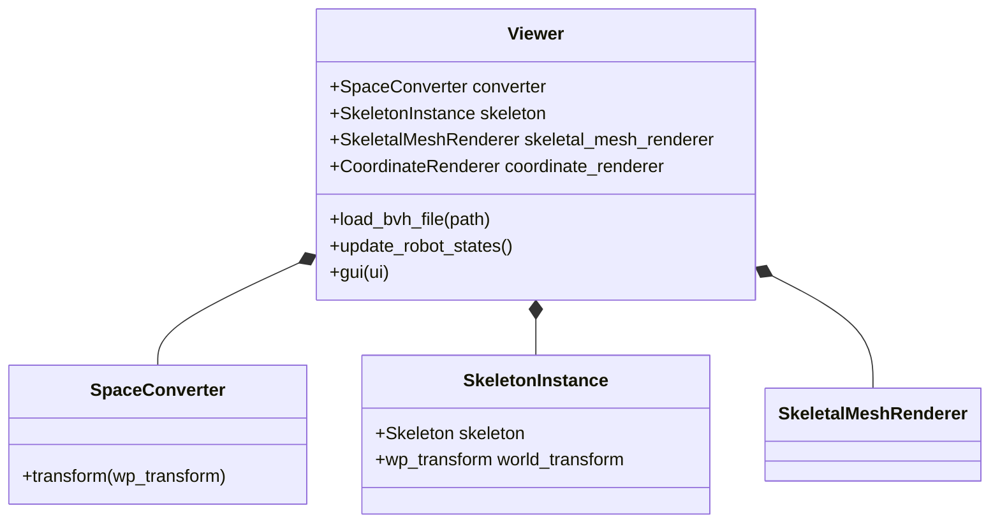
Sources: [app/bvh_to_csv_converter.py:30-35](), [app/bvh_to_csv_converter.py:86-93](), [app/bvh_to_csv_converter.py:104-123]()

---

# Page: Interactive Viewer Mode (OpenGL / imgui)

# Interactive Viewer Mode (OpenGL / imgui)

<details>
<summary>Relevant source files</summary>

The following files were used as context for generating this wiki page:

- [.gitignore](.gitignore)
- [app/bvh_to_csv_converter.py](app/bvh_to_csv_converter.py)
- [assets/docs/banner.gif](assets/docs/banner.gif)
- [assets/docs/interactive-viewer-screenshot.png](assets/docs/interactive-viewer-screenshot.png)

</details>


The Interactive Viewer Mode provides a real-time graphical interface for monitoring and controlling the BVH-to-CSV retargeting process. Built on the `newton.viewer` framework, it integrates OpenGL rendering with an `imgui` overlay to allow users to manipulate character offsets, control playback, and trigger the Newton IK solver pipeline manually.

### The Viewer Class

The `Viewer` class in `app/bvh_to_csv_converter.py` is the central orchestrator for the interactive session. It manages the rendering lifecycle, UI state, and the synchronization between source animation data and the target robot model.

| Entity | Role |
| :--- | :--- |
| `self.viewer` | The underlying `newton.viewer.Viewer` instance providing the OpenGL context [app/bvh_to_csv_converter.py:32](). |
| `self.model` | The Newton model containing the target robot (e.g., Unitree G1) and ground plane [app/bvh_to_csv_converter.py:76](). |
| `self.converter` | A `SpaceConverter` that handles coordinate transformations between source BVH space and the viewer's world space [app/bvh_to_csv_converter.py:35](). |
| `self.skeleton_instances` | List of `SkeletonInstance` objects representing the source human characters [app/bvh_to_csv_converter.py:116](). |

**Sources:** [app/bvh_to_csv_converter.py:30-94]()

### Data Flow and System Architecture

The following diagram illustrates how the `Viewer` class connects the Natural Language concepts (like "Playback" or "Retargeting") to the underlying Code Entities.

**Viewer System Architecture**
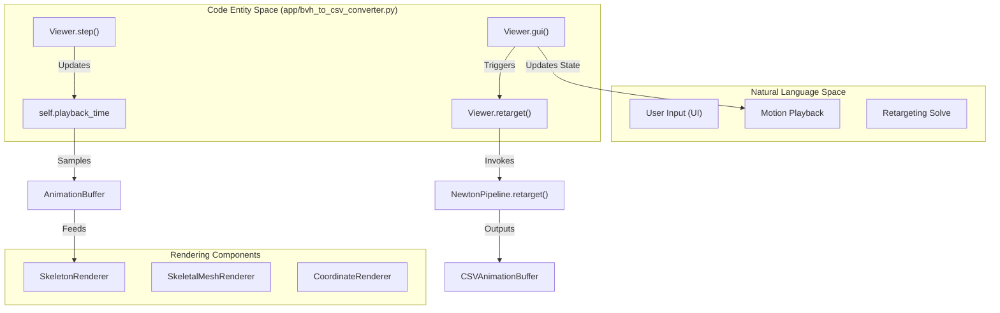
**Sources:** [app/bvh_to_csv_converter.py:96-103](), [app/bvh_to_csv_converter.py:166-175](), [app/bvh_to_csv_converter.py:223-245]()

### UI Panels and Controls

The interface is divided into two primary `imgui` panels defined in the `gui()` callback [app/bvh_to_csv_converter.py:96]().

#### 1. Playback Controls
This panel manages the temporal state of the loaded animations.
*   **Time Slider:** Direct manipulation of `self.playback_time` [app/bvh_to_csv_converter.py:263]().
*   **Speed Multiplier:** Adjusts `self.playback_speed` (default 1.0) [app/bvh_to_csv_converter.py:270]().
*   **Looping:** Toggles `self.playback_loop` to restart the animation automatically [app/bvh_to_csv_converter.py:273]().

#### 2. Scene Options
This panel controls visibility and file operations.
*   **Visibility Toggles:** Includes `show_skeleton_mesh`, `show_skeleton`, and `show_skeleton_joint_axes` [app/bvh_to_csv_converter.py:313-316]().
*   **Gizmo Manipulation:** When `show_gizmos` is active, the viewer renders translation/rotation gizmos for `self.animation_offsets`, allowing the user to reposition the source human relative to the robot [app/bvh_to_csv_converter.py:330-340]().
*   **Load/Save Dialogs:** Buttons to trigger `load_bvh_file()` or save the retargeted output via `csv_utils.save_csv()` [app/bvh_to_csv_converter.py:343-350]().

**Sources:** [app/bvh_to_csv_converter.py:253-305](), [app/bvh_to_csv_converter.py:307-355]()

### Real-time Retargeting Trigger

The retargeting process is triggered via the "Retarget" button in the UI. This executes the `retarget()` method, which bridges the interactive state to the `NewtonPipeline`.

**Retargeting Logic Flow**
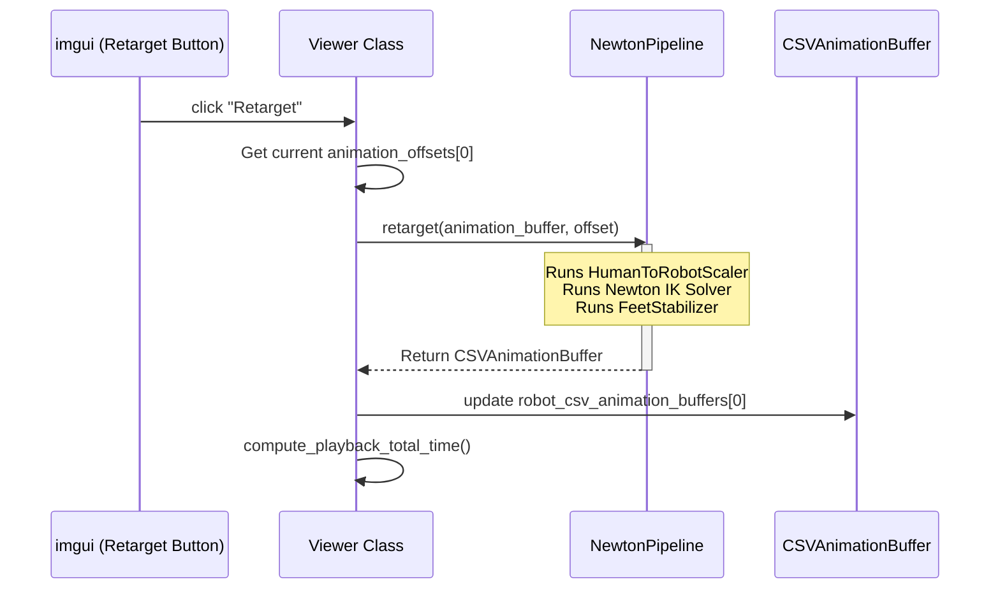
**Sources:** [app/bvh_to_csv_converter.py:223-245](), [app/bvh_to_csv_converter.py:124-137]()

### Implementation Details

#### Gizmo-based Offset Manipulation
The viewer uses `newton.viewer.gizmo` to allow users to manually align the source character with the target robot. The offset is stored as a `wp.transform` and is applied to the source skeleton's root before the IK solve [app/bvh_to_csv_converter.py:204-211]().

#### Rendering Lifecycle
In every frame, the `step()` function:
1.  Increments `self.playback_time` based on `frame_dt` [app/bvh_to_csv_converter.py:169]().
2.  Updates the robot's joint positions in `self.model.joint_q` by sampling the `CSVAnimationBuffer` [app/bvh_to_csv_converter.py:149-150]().
3.  Calls `newton.eval_fk` to update the robot's global state [app/bvh_to_csv_converter.py:164]().
4.  Updates the `SkeletonRenderer` and `SkeletalMeshRenderer` with the sampled human pose [app/bvh_to_csv_converter.py:186-196]().

**Sources:** [app/bvh_to_csv_converter.py:138-165](), [app/bvh_to_csv_converter.py:166-221]()

---

# Page: Batch Processing Mode

# Batch Processing Mode

<details>
<summary>Relevant source files</summary>

The following files were used as context for generating this wiki page:

- [app/bvh_to_csv_converter.py](app/bvh_to_csv_converter.py)
- [assets/default_bvh_to_csv_converter_config.json](assets/default_bvh_to_csv_converter_config.json)

</details>


The Batch Processing Mode is a headless execution path within the `Viewer` class designed for high-throughput motion retargeting. It bypasses the OpenGL/imgui interface to recursively process directories of BVH files, grouping them into optimized batches for the Newton pipeline, and exporting the results as robot-compatible CSV files.

### Overview and Execution Flow

Batch processing is triggered when the application is launched without a graphical display or via specific CLI configurations. The primary entry point for this mode is `Viewer.batched_retargeting()`, which orchestrates the discovery, transformation, and export of motion data.

The system utilizes a "headless" Newton viewer instance (`newton.viewer.ViewerNull`) to maintain compatibility with the pipeline's internal requirements while avoiding the overhead of GPU rendering and window management [app/bvh_to_csv_converter.py:37-39]().

#### Data Flow Diagram: Batch Execution
The following diagram illustrates the transition from file discovery to the final CSV export within the batch processing loop.

Title: Batch Processing Pipeline Data Flow
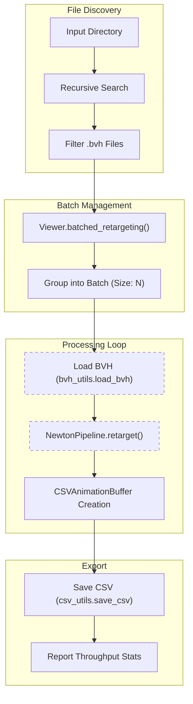
Sources: [app/bvh_to_csv_converter.py:236-245](), [app/bvh_to_csv_converter.py:270-285](), [assets/default_bvh_to_csv_converter_config.json:2-4]()

### File Discovery and Batching

The process begins by scanning the `import_folder` defined in the configuration [assets/default_bvh_to_csv_converter_config.json:2](). The `Viewer` uses `pathlib` to recursively find all files with the `.bvh` extension [app/bvh_to_csv_converter.py:236-240]().

To optimize GPU resource utilization and pipeline initialization, files are processed in chunks defined by the `batch_size` parameter (defaulting to 100) [assets/default_bvh_to_csv_converter_config.json:4](). This prevents memory exhaustion when dealing with thousands of motion files while maintaining high throughput.

| Configuration Key | Description | Default Value |
| :--- | :--- | :--- |
| `import_folder` | Source directory for recursive BVH search | `"assets/motions/bvh"` |
| `export_folder` | Destination for generated CSV files | `"assets/motions/test-export"` |
| `batch_size` | Number of files processed in one pipeline iteration | `100` |

Sources: [assets/default_bvh_to_csv_converter_config.json:1-9](), [app/bvh_to_csv_converter.py:236-245]()

### Implementation Details

The core logic resides in `Viewer.batched_retargeting()`. For each batch, the system performs the following technical steps:

1.  **Pipeline Initialization**: A `NewtonPipeline` is instantiated using the source and target configurations (e.g., SOMA to Unitree G1) [app/bvh_to_csv_converter.py:242-250]().
2.  **BVH Loading**: Each file is parsed using `bvh_utils.load_bvh()`, which returns a `Skeleton` and an `AnimationBuffer` [app/bvh_to_csv_converter.py:114-118]().
3.  **Newton Solve**: The pipeline executes the `retarget()` method. This involves human-to-robot scaling, Newton IK solving with joint limits, and feet stabilization.
4.  **CSV Serialization**: The resulting robot joint trajectories are wrapped in a `CSVAnimationBuffer` and written to the `export_folder` using `csv_utils.save_csv()` [app/bvh_to_csv_converter.py:101-101]().

#### Code Entity Mapping
This diagram maps the natural language concepts of the batch process to the specific classes and methods in the codebase.

Title: Code Entity Relationship for Batch Mode
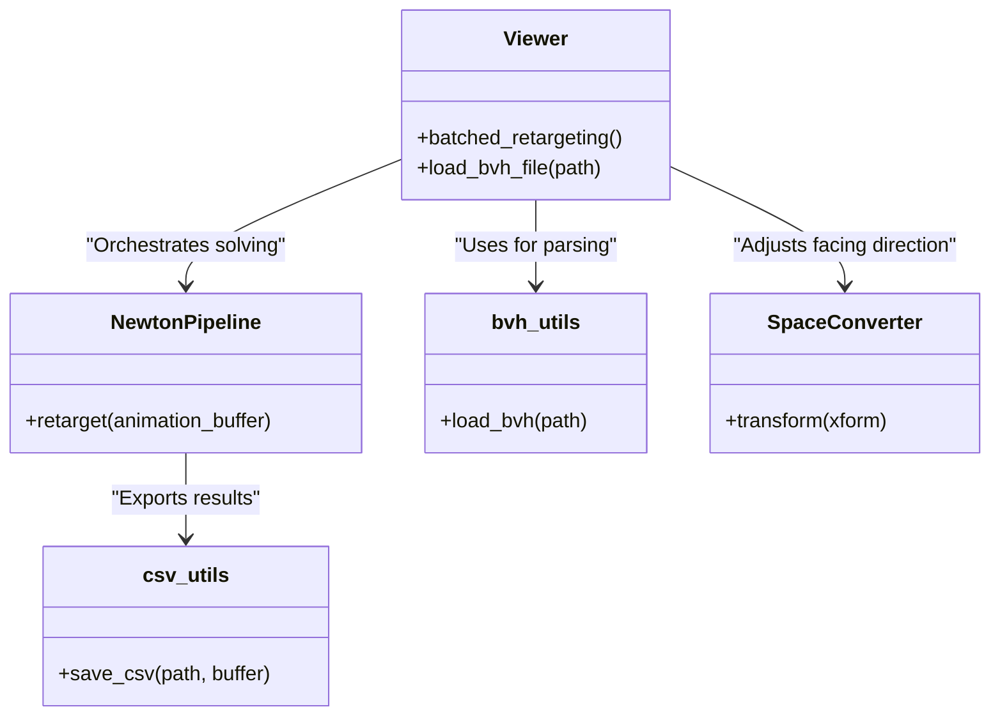
Sources: [app/bvh_to_csv_converter.py:30-35](), [app/bvh_to_csv_converter.py:236-250](), [app/bvh_to_csv_converter.py:114-118]()

### Performance Reporting

During execution, the system tracks and reports throughput statistics. It calculates the total time taken to process the entire batch and provides metrics such as "Files per Second" and "Total Frames Processed." This is facilitated by the `tqdm` progress bar integration, which provides real-time feedback in the terminal during headless operation [app/bvh_to_csv_converter.py:23-23]().

The batch mode also ensures that any visual offsets or space conversions (e.g., converting from Mujoco to Newton coordinate spaces) are applied consistently across all files in the batch via the `SpaceConverter` class [app/bvh_to_csv_converter.py:35-35]().

Sources: [app/bvh_to_csv_converter.py:21-23](), [app/bvh_to_csv_converter.py:236-250]()

---

# Page: Core Animation Data Model

# Core Animation Data Model

<details>
<summary>Relevant source files</summary>

The following files were used as context for generating this wiki page:

- [soma_retargeter/animation/__init__.py](soma_retargeter/animation/__init__.py)
- [soma_retargeter/animation/animation_buffer.py](soma_retargeter/animation/animation_buffer.py)
- [soma_retargeter/animation/ik.py](soma_retargeter/animation/ik.py)
- [soma_retargeter/animation/mesh.py](soma_retargeter/animation/mesh.py)
- [soma_retargeter/animation/skeleton.py](soma_retargeter/animation/skeleton.py)

</details>


This page provides an overview of the fundamental data structures used to represent skeletal hierarchy, pose data, and animated sequences within the SOMA Retargeter. The system relies on [NVIDIA Warp](https://github.com/NVIDIA/warp) for high-performance GPU-accelerated math and transformations.

The data model is designed to support hierarchical joint structures, time-sampled animation buffers with linear interpolation, and skinned skeletal meshes for visualization.

### System Entity Map
The following diagram illustrates how high-level animation concepts map to specific classes and functions in the codebase.

**Natural Language to Code Entity Mapping**
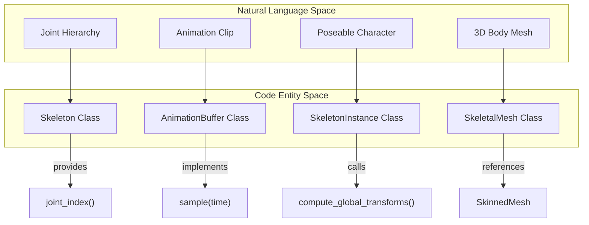
Sources: [soma_retargeter/animation/skeleton.py:10-14](), [soma_retargeter/animation/animation_buffer.py:11-18](), [soma_retargeter/animation/mesh.py:83-85]()

---

### Skeleton and SkeletonInstance
The `Skeleton` class is the static definition of a character's structure. It stores joint names, parent-child relationships via integer indices, and a reference pose. The `SkeletonInstance` represents a specific, poseable occurrence of that skeleton in world space.

| Class | Responsibility | Key Attributes |
| :--- | :--- | :--- |
| `Skeleton` | Defines the hierarchy and reference pose. | `parent_indices`, `joint_names`, `reference_local_transforms` |
| `SkeletonInstance` | Manages a specific pose and world placement. | `xform` (world transform), `local_transforms`, `color` |

For details, see [Skeleton and SkeletonInstance](#3.1).

Sources: [soma_retargeter/animation/skeleton.py:10-149](), [soma_retargeter/animation/skeleton.py:149-169]()

---

### AnimationBuffer and Frame Sampling
The `AnimationBuffer` acts as a container for time-sampled local joint transforms. It is the primary structure used to store motion captured data (from BVH) or retargeted results (for CSV export).

**Animation Data Flow**
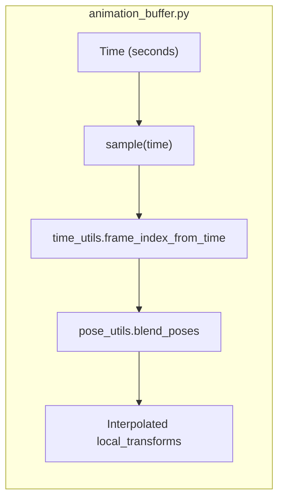

Key features include:
* **Linear Interpolation**: The `sample()` method computes blended poses between frames based on the `sample_rate`.
* **Skeleton Remapping**: `create_animation_buffer_for_skeleton()` allows transferring animation data between different skeletons by matching joint names.
* **IK Utilities**: A specialized `wp_solve_two_bone_ik` function provides analytic solving for limbs (e.g., arms and legs).

For details, see [AnimationBuffer and Frame Sampling](#3.2).

Sources: [soma_retargeter/animation/animation_buffer.py:11-94](), [soma_retargeter/animation/animation_buffer.py:96-128](), [soma_retargeter/animation/ik.py:19-45]()

---

### Skeletal Mesh (USD)
For visual representation, the system uses the `SkeletalMesh` class. This links one or more `SkinnedMesh` objects to a `Skeleton`.

* **Bind Poses**: It stores `bind_transforms` (inverse bind-pose transforms) for every joint, which are essential for Linear Blend Skinning (LBS).
* **USD Integration**: Assets are typically loaded from Universal Scene Description (USD) files, which provide the geometry, skinning weights, and initial joint transforms.

For details, see [Skeletal Mesh (USD)](#3.3).

Sources: [soma_retargeter/animation/mesh.py:27-81](), [soma_retargeter/animation/mesh.py:83-137]()

---

# Page: Skeleton and SkeletonInstance

# Skeleton and SkeletonInstance

<details>
<summary>Relevant source files</summary>

The following files were used as context for generating this wiki page:

- [soma_retargeter/animation/skeleton.py](soma_retargeter/animation/skeleton.py)
- [soma_retargeter/utils/pose_utils.py](soma_retargeter/utils/pose_utils.py)

</details>


This page provides a deep dive into the fundamental skeletal data structures used throughout the SOMA Retargeter. It covers the definition of joint hierarchies, the management of poseable instances, and the mathematical foundations of forward kinematics (FK) used to compute world-space transforms.

## Skeleton

The `Skeleton` class is a stateless description of a character's joint hierarchy [soma_retargeter/animation/skeleton.py:10-14](). It stores the structural topology and the reference (bind) pose of the skeleton.

### Key Components
*   **Joint Hierarchy**: Defined by a list of `joint_names` and a corresponding array of `parent_indices` [soma_retargeter/animation/skeleton.py:32-33]().
*   **Reference Pose**: Stored as `_reference_local_transforms`, representing the default local-space transformation for every joint [soma_retargeter/animation/skeleton.py:56-63]().
*   **Axis Definitions**: Defaults to a Z-up (`wp.vec3(0, 0, 1)`) and -Y forward (`wp.vec3(0, -1, 0)`) coordinate system [soma_retargeter/animation/skeleton.py:35-36]().

### Joint Resolution
The class provides utility methods to map between joint names and indices, which is critical for configuring IK objectives and mapping human joints to robot joints.
*   `joint_index(name)`: Returns the integer index of a joint, or -1 if not found [soma_retargeter/animation/skeleton.py:65-81]().
*   `joint_name(index)`: Returns the string name for a specific index [soma_retargeter/animation/skeleton.py:83-96]().
*   `joint_parent(index)`: Returns the index of the parent joint [soma_retargeter/animation/skeleton.py:98-112]().

**Sources:** [soma_retargeter/animation/skeleton.py:10-148]()

---

## SkeletonInstance

A `SkeletonInstance` represents a poseable, stateful instance of a `Skeleton` [soma_retargeter/animation/skeleton.py:149-155](). While the `Skeleton` defines the structure, the `SkeletonInstance` stores the current pose and world-space placement.

### Instance State
*   **`local_transforms`**: A numpy array of current local-space transforms for each joint, initialized from the skeleton's reference pose [soma_retargeter/animation/skeleton.py:168]().
*   **`xform`**: A `wp.transform` representing the world-space position and orientation of the skeleton's root [soma_retargeter/animation/skeleton.py:166]().
*   **`color`**: A `wp.vec3` used by renderers to distinguish different instances (e.g., source vs. target) [soma_retargeter/animation/skeleton.py:167]().

### Skeleton Logic Flow
The following diagram illustrates how the `Skeleton` and `SkeletonInstance` classes interact with the `pose_utils` module to compute global poses.

**Diagram: Pose Computation Data Flow**
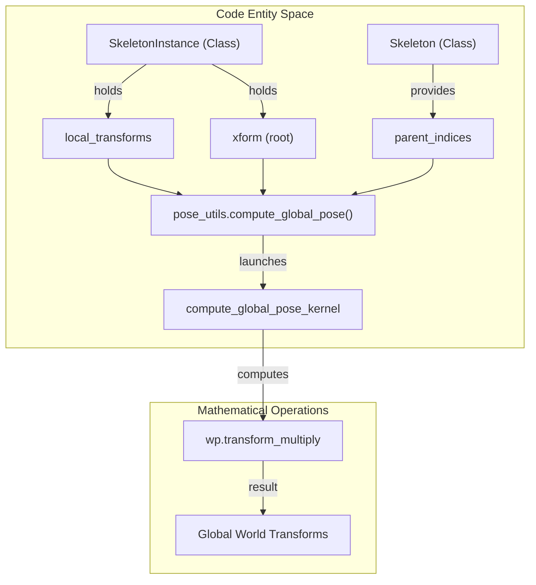
**Sources:** [soma_retargeter/animation/skeleton.py:149-173](), [soma_retargeter/utils/pose_utils.py:64-94]()

---

## Forward Kinematics and Pose Utilities

The system relies on NVIDIA Warp kernels to perform efficient skeletal math. The primary operation is converting between local-space transforms (relative to parent) and global-space transforms (world coordinates).

### Global Pose Computation
The `compute_global_transforms` method in `Skeleton` delegates to `pose_utils.compute_global_pose` [soma_retargeter/animation/skeleton.py:137-146](). This function launches a Warp kernel that iterates through the hierarchy:

1.  **Root Joint**: The global transform of the first joint (index 0) is calculated by multiplying the instance's world `root_tx` with the joint's `local_pose[0]` [soma_retargeter/utils/pose_utils.py:46]().
2.  **Child Joints**: For every subsequent joint, the global transform is the product of its parent's global transform and its own local transform [soma_retargeter/utils/pose_utils.py:47-49]().

### Implementation Details

| Function | File Reference | Description |
| :--- | :--- | :--- |
| `wp_compute_global_pose` | [pose_utils.py:38-50]() | Warp device function implementing the FK loop. |
| `compute_global_pose_kernel` | [pose_utils.py:53-61]() | Kernel wrapper for parallel execution (dim=1). |
| `compute_local_pose` | [pose_utils.py:97-124]() | Inverse operation: computes local offsets from world transforms. |
| `blend_poses` | [pose_utils.py:141-167]() | Interpolates between two sets of local transforms using `wp.quat_slerp`. |

### System Mapping
The relationship between the high-level skeleton management and the low-level Warp acceleration is shown below.

**Diagram: System Entity Mapping**
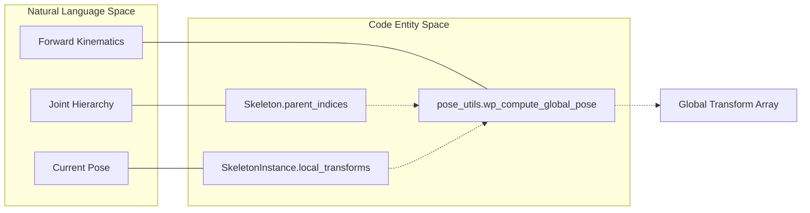

**Sources:** [soma_retargeter/utils/pose_utils.py:10-167](), [soma_retargeter/animation/skeleton.py:137-146]()

---

# Page: AnimationBuffer and Frame Sampling

# AnimationBuffer and Frame Sampling

<details>
<summary>Relevant source files</summary>

The following files were used as context for generating this wiki page:

- [soma_retargeter/animation/animation_buffer.py](soma_retargeter/animation/animation_buffer.py)
- [soma_retargeter/animation/ik.py](soma_retargeter/animation/ik.py)
- [soma_retargeter/utils/time_utils.py](soma_retargeter/utils/time_utils.py)

</details>


The `AnimationBuffer` serves as the primary data structure for storing and sampling time-varying skeletal poses. It manages local-space joint transforms across a fixed duration and provides mechanisms for temporal interpolation and skeletal remapping. Additionally, the system includes specialized Inverse Kinematics (IK) helpers to solve three-joint chains (e.g., legs or arms) within this animation context.

## AnimationBuffer Implementation

The `AnimationBuffer` class [soma_retargeter/animation/animation_buffer.py:11-18]() stores animation data as a sequence of local joint transforms. It is defined by a `Skeleton` reference, a `num_frames` count, and a `sample_rate` (FPS) [soma_retargeter/animation/animation_buffer.py:32-34]().

### Data Structure and Initialization
The core data is stored in `self.local_transforms`, a NumPy array of shape `(num_frames, num_joints)` using the `wp.transform` data type [soma_retargeter/animation/animation_buffer.py:38-41](). If no transforms are provided at initialization, the buffer defaults to the skeleton's reference pose for every frame [soma_retargeter/animation/animation_buffer.py:36-39]().

### Sampling and Interpolation
To support arbitrary playback speeds and sub-frame accuracy, the `sample()` method implements linear interpolation [soma_retargeter/animation/animation_buffer.py:78-93]().

1.  **Time to Frame Conversion**: The utility `frame_index_from_time` calculates the integer frame index and a floating-point `blend` factor [soma_retargeter/utils/time_utils.py:7-34]().
2.  **Pose Blending**: If the `blend` factor is significant (> 1e-5), the system calls `pose_utils.blend_poses()` to interpolate between the current frame and the subsequent frame [soma_retargeter/animation/animation_buffer.py:90-93]().

### Global Transform Computation
While the buffer stores local transforms, world-space visualization and IK require global transforms. The `compute_global_transforms()` method performs forward kinematics by traversing the skeleton hierarchy, optionally starting from a custom `root_tx` [soma_retargeter/animation/animation_buffer.py:58-76]().

**Sources:**
- [soma_retargeter/animation/animation_buffer.py:11-94]()
- [soma_retargeter/utils/time_utils.py:7-34]()

---

## Skeleton Remapping

The utility function `create_animation_buffer_for_skeleton()` allows transferring animation data between two different `Skeleton` objects [soma_retargeter/animation/animation_buffer.py:96-128]().

This is a name-based remapping process:
1.  A new `AnimationBuffer` is initialized using the target `new_skeleton` [soma_retargeter/animation/animation_buffer.py:115]().
2.  The function iterates through the source skeleton's joints [soma_retargeter/animation/animation_buffer.py:119]().
3.  If a joint name from the source exists in the target skeleton, its local transforms across all frames are copied to the new buffer [soma_retargeter/animation/animation_buffer.py:120-124]().

### Entity Mapping: Animation Data Flow
The following diagram illustrates how the `AnimationBuffer` bridges the `Skeleton` definition with temporal sampling logic.

Title: Animation Sampling Data Flow
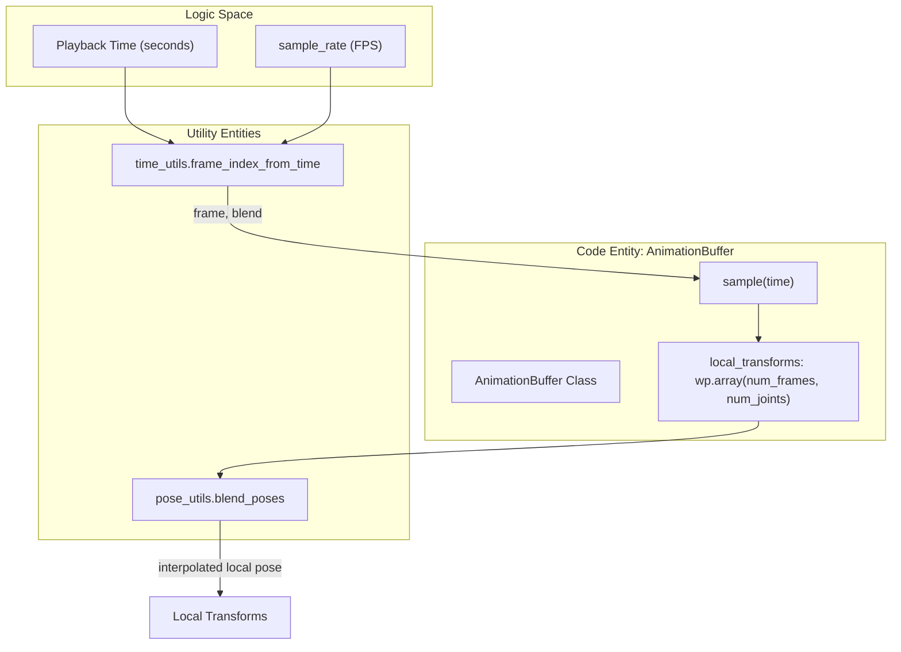
**Sources:**
- [soma_retargeter/animation/animation_buffer.py:78-94]()
- [soma_retargeter/utils/time_utils.py:7-34]()

---

## Two-Bone IK Helper

The module `soma_retargeter/animation/ik.py` provides an analytic solver for three-joint chains (e.g., Hip-Knee-Ankle). This is used primarily for post-processing adjustments like feet stabilization.

### wp_solve_two_bone_ik
This Warp function implements a geometric IK solver [soma_retargeter/animation/ik.py:19-89](). It calculates the required rotations for the root (A) and middle (B) joints so that the tip (C) reaches a target (T).

*   **Cosine Rule**: Used to find the interior angles based on segment lengths `l_ab` and `l_cb` [soma_retargeter/animation/ik.py:63-64]().
*   **Bending Plane**: The solver determines the plane of rotation using the current joint positions or a provided `in_hint_world` vector to disambiguate the "elbow/knee" direction [soma_retargeter/animation/ik.py:67]().
*   **Warp Kernel**: The logic is wrapped in `two_bone_ik_kernel`, allowing the solver to run efficiently on the GPU for batched operations [soma_retargeter/animation/ik.py:93-112]().

### IK Data Entities
Title: Two-Bone IK Solver Interface
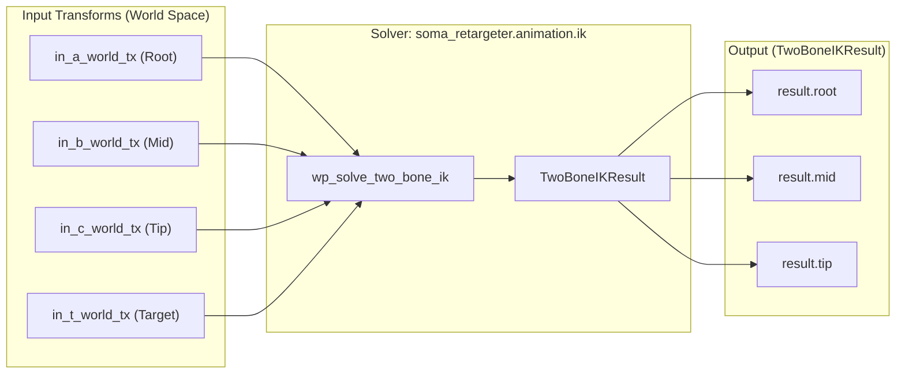

**Sources:**
- [soma_retargeter/animation/ik.py:12-112]()

## Summary of Key Functions

| Function | File | Description |
| :--- | :--- | :--- |
| `AnimationBuffer.sample()` | [animation_buffer.py:78]() | Interpolates local transforms at a given timestamp. |
| `create_animation_buffer_for_skeleton()` | [animation_buffer.py:96]() | Remaps animation data to a new hierarchy by joint name. |
| `wp_solve_two_bone_ik()` | [ik.py:19]() | Analytic IK solver for 3-joint chains. |
| `frame_index_from_time()` | [time_utils.py:7]() | Calculates frame indices and blend weights for sampling. |

**Sources:**
- [soma_retargeter/animation/animation_buffer.py:1-128]()
- [soma_retargeter/animation/ik.py:1-112]()
- [soma_retargeter/utils/time_utils.py:1-34]()

---

# Page: Skeletal Mesh (USD)

# Skeletal Mesh (USD)

<details>
<summary>Relevant source files</summary>

The following files were used as context for generating this wiki page:

- [soma_retargeter/animation/mesh.py](soma_retargeter/animation/mesh.py)
- [soma_retargeter/assets/usd.py](soma_retargeter/assets/usd.py)
- [soma_retargeter/configs/soma/soma_base_skel_minimal.usd](soma_retargeter/configs/soma/soma_base_skel_minimal.usd)

</details>


The **Skeletal Mesh** system provides the data structures and loading mechanisms for representing deformable character geometry within the SOMA Retargeter. It bridges the gap between static USD (Universal Scene Description) assets and the dynamic, GPU-accelerated animation pipeline.

## Data Structures

The system uses a hierarchical representation of geometry, starting from raw vertex data up to a complete character bound to a skeleton.

### Mesh and SkinnedMesh
The base `Mesh` class [soma_retargeter/animation/mesh.py:12-25]() stores fundamental geometric data: vertex positions (`points`) and triangle connectivity (`indices`).

The `SkinnedMesh` class [soma_retargeter/animation/mesh.py:27-81]() extends this to support Linear Blend Skinning (LBS). It adds:
*   **Joint Indices**: An array mapping vertices to the skeleton joints that influence them [soma_retargeter/animation/mesh.py:53-56]().
*   **Joint Weights**: An array of scalar weights defining the strength of each joint's influence [soma_retargeter/animation/mesh.py:58-61]().
*   **Influences**: The number of joints affecting a single vertex, calculated as the ratio of total joint indices to total points [soma_retargeter/animation/mesh.py:42-45]().

### SkeletalMesh
The `SkeletalMesh` class [soma_retargeter/animation/mesh.py:83-137]() aggregates one or more `SkinnedMesh` instances (e.g., separate meshes for the body, hair, or clothing) and binds them to a single `Skeleton` [soma_retargeter/animation/mesh.py:105-108]().

A critical component of this class is the `bind_transforms` array [soma_retargeter/animation/mesh.py:129-132](). These are the per-joint transforms in the mesh's bind pose, used during the skinning process to transform vertices from model space into the local space of their influencing joints.

### Entity Relationship Diagram
This diagram illustrates how the Python classes in `mesh.py` relate to the core `Skeleton` and the USD loading logic.

**Skeletal Mesh Entity Mapping**
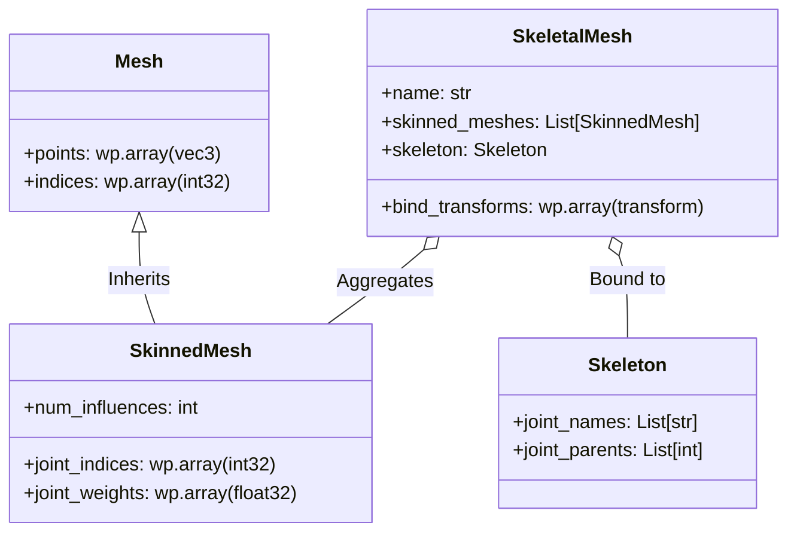
Sources: [soma_retargeter/animation/mesh.py:12-137](), [soma_retargeter/animation/skeleton.py:10-143]()

---

## USD Asset Loading

The `assets/usd.py` module handles the extraction of skeletal data from USD files using the `pxr.Usd` and `pxr.UsdSkel` libraries.

### Coordinate System Alignment
USD files may authored with different up-axes (Y or Z) and units (centimeters, meters, etc.). The loader performs automatic correction:
*   **Up-Axis**: `get_up_axis_transform()` computes a rotation to align the USD stage with the target application (typically Z-up) [soma_retargeter/assets/usd.py:81-118]().
*   **Scaling**: `get_stage_meters_per_unit()` retrieves the stage metadata to ensure all vertex positions and joint translations are converted to meters [soma_retargeter/assets/usd.py:54-64]().

### The Loading Pipeline
The loading process follows a specific flow to ensure that the resulting `SkeletalMesh` is compatible with the GPU-based `SkeletalMeshRenderer`.

**USD to SkeletalMesh Data Flow**
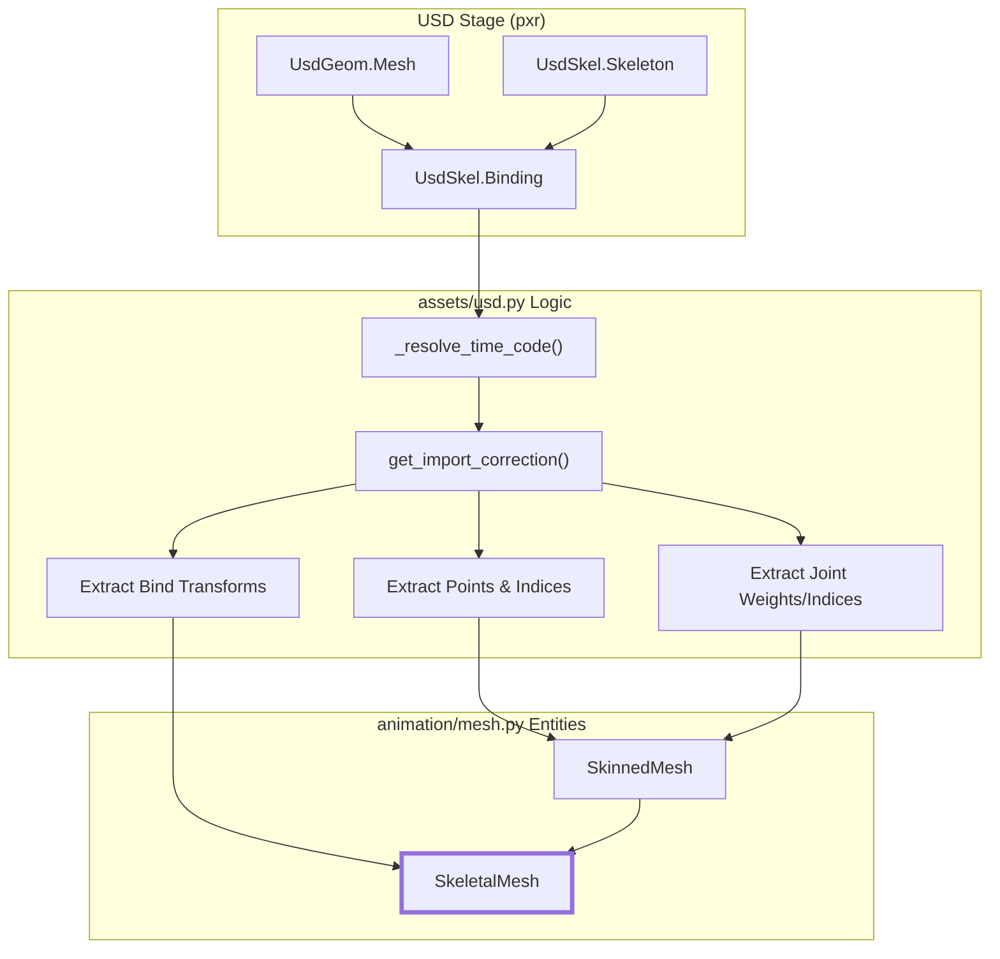
Sources: [soma_retargeter/assets/usd.py:21-148](), [soma_retargeter/animation/mesh.py:105-112]()

---

## SOMA Body Mesh

The primary skeletal mesh used by the retargeter is the **SOMA body mesh**, defined in `soma_base_skel_minimal.usd` [soma_retargeter/configs/soma/soma_base_skel_minimal.usd:1-4]().

This asset provides:
1.  **Low-poly Geometry**: Optimized for real-time visualization in the interactive viewer.
2.  **Standard Topology**: A consistent vertex layout that matches the SOMA human skeleton.
3.  **Skinning Weights**: Pre-authored weights that allow the mesh to deform naturally as the `NewtonPipeline` solves for human motion.

### Integration with Renderer
The `SkeletalMeshRenderer` consumes the `SkeletalMesh` object. Every frame, it performs the following steps:
1.  Receives the current joint transforms from the `SkeletonInstance`.
2.  Combines these with the `bind_transforms` from the `SkeletalMesh`.
3.  Executes a Warp kernel to perform Linear Blend Skinning on the GPU.
4.  Updates the vertex buffer of the mesh for the OpenGL viewer.

Sources: [soma_retargeter/animation/mesh.py:83-103](), [soma_retargeter/assets/usd.py:151-181]()

---

# Page: Retargeting Pipeline

# Retargeting Pipeline

<details>
<summary>Relevant source files</summary>

The following files were used as context for generating this wiki page:

- [soma_retargeter/pipelines/__init__.py](soma_retargeter/pipelines/__init__.py)
- [soma_retargeter/pipelines/newton_pipeline.py](soma_retargeter/pipelines/newton_pipeline.py)
- [soma_retargeter/pipelines/utils.py](soma_retargeter/pipelines/utils.py)

</details>


The retargeting pipeline is the central engine of the SOMA Retargeter, responsible for transforming human motion data (BVH) into robot-executable joint commands (CSV). This process is managed by the `NewtonPipeline` class, which orchestrates several specialized stages including spatial scaling, optimization-based Inverse Kinematics (IK), and physical stabilization.

### Pipeline Overview

The pipeline operates by consuming an `AnimationBuffer` representing human motion and passing it through a series of transformations to map it onto a target robot model, such as the Unitree G1 [soma_retargeter/pipelines/newton_pipeline.py:29-37](). The pipeline is designed to handle both single-frame interactive updates and high-throughput batch processing.

#### High-Level Data Flow

The following diagram illustrates how data moves from the input BVH through the various code entities within the `NewtonPipeline`.

**Diagram: Retargeting Data Flow**
```mermaid
graph TD
    subgraph "Input Space"
        BVH["BVH File"] --> AB["AnimationBuffer"]
    end

    subgraph "NewtonPipeline (Code Entity Space)"
        AB --> HTRS["HumanToRobotScaler"]
        HTRS --> IK["Newton IK Solver (ik_model)"]
        
        subgraph "Optimization Loop"
            IK --> OBJ1["IKObjectivePosition"]
            IK --> OBJ2["IKObjectiveRotation"]
            IK --> OBJ3["IKSmoothJointFilter"]
        end

        IK --> FS["FeetStabilizer"]
        FS --> JLC["JointLimitClamper"]
    end

    subgraph "Output Space"
        JLC --> CSV["CSVAnimationBuffer"]
        CSV --> ROBOT["Unitree G1 Robot"]
    end
```
Sources: [soma_retargeter/pipelines/newton_pipeline.py:131-160](), [soma_retargeter/pipelines/newton_pipeline.py:236-260]()

---

### Pipeline Stages

The `NewtonPipeline` coordinates four primary stages to ensure the resulting motion is both visually accurate and kinematically valid for the target hardware.

#### 1. Human-to-Robot Scaling
Before IK solving begins, the human motion must be scaled to match the proportions of the target robot. The `HumanToRobotScaler` uses a configuration-driven approach to calculate scale ratios based on the human's height relative to the robot's model height [soma_retargeter/pipelines/newton_pipeline.py:77-78](). It produces target effector transforms that the IK solver will attempt to reach.

For details, see [Human-to-Robot Scaling](#4.1).

#### 2. IK Solving with Newton
The core of the retargeting is an optimization-based IK solve using the `newton` library. The pipeline builds a `newton.Model` from the robot's MJCF definition [soma_retargeter/pipelines/newton_pipeline.py:73-75](). It applies multiple objectives, including position and rotation targets for effectors, joint limit constraints, and a custom `IKSmoothJointFilter` to prevent temporal jitter [soma_retargeter/pipelines/newton_pipeline.py:202-225]().

For details, see [IK Solving with Newton](#4.2).

#### 3. Feet Stabilization
To prevent foot sliding and ensure stable ground contact, the `FeetStabilizer` performs a post-IK adjustment. It uses a two-bone IK chain logic to anchor the robot's feet to the ground or specific hint locations [soma_retargeter/pipelines/newton_pipeline.py:105-106](). This stage is critical for maintaining the physical plausibility of the motion on a humanoid platform.

For details, see [Feet Stabilization](#4.3).

#### 4. Joint Limit Clamping and Post-Processing
The final stage ensures the generated joint angles strictly adhere to the hardware's Degrees of Freedom (DOF) limits. The `JointLimitClamper` processes the IK output to enforce safety boundaries [soma_retargeter/pipelines/newton_pipeline.py:106](). Additionally, the pipeline handles "warm-up" frames to initialize the solver state smoothly before the actual motion begins [soma_retargeter/pipelines/newton_pipeline.py:108-116]().

For details, see [Joint Limit Clamping and Post-Processing](#4.4).

---

### System Integration

The pipeline is initialized by specifying a `SourceType` and `TargetType` [soma_retargeter/pipelines/newton_pipeline.py:53-54](). It automatically resolves the correct JSON configurations (e.g., `soma_to_g1_retargeter_config.json`) using utility functions [soma_retargeter/pipelines/utils.py:120-144]().

**Diagram: Pipeline Component Association**
```mermaid
classDiagram
    class NewtonPipeline {
        +HumanToRobotScaler human_robot_scaler
        +FeetStabilizer feet_stabilizer
        +JointLimitClamper joint_limit_clamper
        +newton.Model ik_model
        +add_input_motions()
        +retarget()
    }
    class HumanToRobotScaler {
        +wp.array effector_targets
        +scale_animation()
    }
    class FeetStabilizer {
        +stabilize()
    }
    class JointLimitClamper {
        +clamp_dofs()
    }

    NewtonPipeline *-- HumanToRobotScaler
    NewtonPipeline *-- FeetStabilizer
    NewtonPipeline *-- JointLimitClamper
```
Sources: [soma_retargeter/pipelines/newton_pipeline.py:29-118](), [soma_retargeter/pipelines/utils.py:10-18]()

| Feature | Description | File Reference |
| :--- | :--- | :--- |
| **IK Iterations** | Number of solver iterations per frame (Default: 24) | [soma_retargeter/pipelines/newton_pipeline.py:22]() |
| **Initialization** | Uses a zero-pose frame to stabilize the solver | [soma_retargeter/pipelines/newton_pipeline.py:111-116]() |
| **GPU Acceleration** | Uses NVIDIA Warp for scaling and pose computations | [soma_retargeter/pipelines/newton_pipeline.py:4]() |
| **Multi-Motion** | Supports batching multiple BVH inputs into one pipeline run | [soma_retargeter/pipelines/newton_pipeline.py:131-143]() |

Sources: [soma_retargeter/pipelines/newton_pipeline.py:1-200](), [soma_retargeter/pipelines/utils.py:1-145]()

---

# Page: Human-to-Robot Scaling

# Human-to-Robot Scaling

<details>
<summary>Relevant source files</summary>

The following files were used as context for generating this wiki page:

- [soma_retargeter/configs/unitree_g1/soma_to_g1_scaler_config.json](soma_retargeter/configs/unitree_g1/soma_to_g1_scaler_config.json)
- [soma_retargeter/robotics/__init__.py](soma_retargeter/robotics/__init__.py)
- [soma_retargeter/robotics/human_to_robot_scaler.py](soma_retargeter/robotics/human_to_robot_scaler.py)

</details>


The `HumanToRobotScaler` class is a core component of the retargeting pipeline responsible for mapping human skeletal motion to robot-aligned effector targets. It handles the geometric discrepancies between human and robot proportions by applying configurable scale ratios and coordinate offsets. This process ensures that the IK solver targets locations that are physically reachable and anatomically sensible for the target robot hardware, such as the Unitree G1.

### Core Logic and Scaling Math

The scaler operates by transforming human joint positions into "effector" targets. This involves three primary transformations:
1.  **Global Height Scaling**: A global ratio is computed by comparing the actual human subject's height to a `human_height_assumption` defined in the configuration [soma_retargeter/robotics/human_to_robot_scaler.py:22-25]().
2.  **Per-Joint Scaling**: Specific joints (e.g., "LeftLeg", "RightArm") can have individual scale factors to account for different limb proportions [soma_retargeter/configs/unitree_g1/soma_to_g1_scaler_config.json:5-27]().
3.  **Joint Offsets**: Local translation and rotation offsets are applied to align the human joint's coordinate system with the robot's expected effector frame [soma_retargeter/robotics/human_to_robot_scaler.py:27-33]().

### System Architecture: Human-to-Robot Mapping

The following diagram illustrates how the `HumanToRobotScaler` consumes configuration data and skeletal poses to produce effector transforms.

**Figure 1: Scaling Data Flow**
```mermaid
graph TD
    subgraph "Configuration Space"
        CONFIG["soma_to_g1_scaler_config.json"]
        JS["joint_scales"]
        JO["joint_offsets"]
        HA["human_height_assumption"]
    end

    subgraph "Code Entity Space"
        SCALER["HumanToRobotScaler"]
        SKEL["SkeletonInstance"]
        BUFF["AnimationBuffer"]
        KERN_G["wp_compute_global_pose"]
        KERN_S["wp_compute_scaled_effectors"]
    end

    CONFIG -->|io_utils.load_json| SCALER
    HA -->|ratio calculation| SCALER
    JS -->|mapped_joint_scales| SCALER
    JO -->|mapped_joint_offsets| SCALER

    SKEL -->|compute_effectors_from_skeleton| KERN_G
    BUFF -->|compute_effectors_from_buffer| KERN_G
    
    KERN_G -->|global_pose| KERN_S
    SCALER -->|mapped_joint_indices| KERN_S
    
    KERN_S -->|Output| EF["Effector Transforms (wp.transform)"]
```
**Sources:** [soma_retargeter/robotics/human_to_robot_scaler.py:13-47](), [soma_retargeter/configs/unitree_g1/soma_to_g1_scaler_config.json:1-127]()

---

### Implementation Details

#### Initialization and Configuration
The `HumanToRobotScaler` is initialized with a `Skeleton`, the human's height, and a path to a JSON configuration file [soma_retargeter/robotics/human_to_robot_scaler.py:17-20](). During `__init__`, it:
*   Calculates a height ratio: `ratio = human_height / config['human_height_assumption']` [soma_retargeter/robotics/human_to_robot_scaler.py:22]().
*   Pre-multiplies all `joint_scales` by this ratio [soma_retargeter/robotics/human_to_robot_scaler.py:24-25]().
*   Converts JSON offset arrays into `wp.transform` objects [soma_retargeter/robotics/human_to_robot_scaler.py:29-33]().
*   Maps joint names to internal indices for efficient GPU processing [soma_retargeter/robotics/human_to_robot_scaler.py:38-41]().

#### GPU-Accelerated Computation
The class provides two primary methods for computing effectors, both utilizing NVIDIA Warp kernels for high-performance GPU execution:

| Method | Purpose | Input |
| :--- | :--- | :--- |
| `compute_effectors_from_skeleton` | Single frame computation for interactive use. | `SkeletonInstance` |
| `compute_effectors_from_buffer` | Batched computation for full animations. | `AnimationBuffer` |

Both methods follow a two-step process:
1.  **Global Pose Computation**: Calls `pose_utils.wp_compute_global_pose` to convert local joint transforms into world-space transforms [soma_retargeter/robotics/human_to_robot_scaler.py:81-89]().
2.  **Effector Scaling**: Launches `compute_scaled_effectors_kernel` which applies the final offsets and scales [soma_retargeter/robotics/human_to_robot_scaler.py:91-102]().

**Sources:** [soma_retargeter/robotics/human_to_robot_scaler.py:57-129](), [soma_retargeter/robotics/human_to_robot_scaler.py:131-163]()

---

### Scaling Logic: Natural Language to Code Entity Mapping

The transformation from raw human motion to robot-ready effectors involves several internal code entities and mathematical steps.

**Figure 2: Transformation Pipeline**
```mermaid
graph LR
    subgraph "Natural Language Space"
        H_POSE["Human Pose"]
        H_HEIGHT["Human Height"]
        R_PROP["Robot Proportions"]
        E_TARGET["Effector Target"]
    end

    subgraph "Code Entity Space"
        direction TB
        L_TRANS["SkeletonInstance.local_transforms"]
        G_POSE["wp_global_pose"]
        M_SCALE["mapped_joint_scales"]
        M_OFF["mapped_joint_offsets"]
        S_EFF["wp_compute_scaled_effectors"]
    end

    H_POSE -.-> L_TRANS
    H_HEIGHT -.-> M_SCALE
    R_PROP -.-> M_OFF
    
    L_TRANS -->|wp_compute_global_pose| G_POSE
    G_POSE --> S_EFF
    M_SCALE --> S_EFF
    M_OFF --> S_EFF
    S_EFF -.-> E_TARGET
```
**Sources:** [soma_retargeter/robotics/human_to_robot_scaler.py:57-129](), [soma_retargeter/utils/pose_utils.py:7-10]()

### Configuration Structure
The scaler relies on a specific JSON schema found in `soma_to_g1_scaler_config.json`. Key sections include:

*   **`human_height_assumption`**: The reference height (in meters) for which the base `joint_scales` were authored [soma_retargeter/configs/unitree_g1/soma_to_g1_scaler_config.json:4]().
*   **`joint_scales`**: Multipliers for specific bone lengths (e.g., `LeftLeg: 0.86`) [soma_retargeter/configs/unitree_g1/soma_to_g1_scaler_config.json:5-27]().
*   **`joint_offsets`**: A dictionary where each key is a joint name and the value is a list containing a translation `[x, y, z]` and a rotation quaternion `[x, y, z, w]` [soma_retargeter/configs/unitree_g1/soma_to_g1_scaler_config.json:49-126]().

**Sources:** [soma_retargeter/configs/unitree_g1/soma_to_g1_scaler_config.json:1-127]()

---

# Page: IK Solving with Newton

# IK Solving with Newton

<details>
<summary>Relevant source files</summary>

The following files were used as context for generating this wiki page:

- [soma_retargeter/configs/unitree_g1/soma_to_g1_retargeter_config.json](soma_retargeter/configs/unitree_g1/soma_to_g1_retargeter_config.json)
- [soma_retargeter/pipelines/ik_objectives.py](soma_retargeter/pipelines/ik_objectives.py)
- [soma_retargeter/pipelines/newton_pipeline.py](soma_retargeter/pipelines/newton_pipeline.py)
- [soma_retargeter/utils/newton_utils.py](soma_retargeter/utils/newton_utils.py)

</details>


The IK Solving stage is the core of the retargeting pipeline, responsible for finding a set of robot joint angles that satisfy the target effector transforms produced by the human-to-robot scaling stage. This process utilizes the **Newton** optimization-based IK solver, which minimizes a multi-objective cost function across the robot's degrees of freedom (DOFs).

## Solver Configuration and Model Building

The `NewtonPipeline` initializes a Newton `Model` based on the target robot's MJCF definition. For the Unitree G1, it loads the model from `mjcf/g1_29dof_rev_1_0.xml` using `newton.ModelBuilder` [soma_retargeter/pipelines/newton_pipeline.py:73-75]().

The solver is configured with a specific number of iterations (default 24) and weights for various objectives defined in the retargeter configuration [soma_retargeter/pipelines/newton_pipeline.py:64-66]().

### IK Mapping
The mapping between the source human skeleton joints and the target robot body links is defined in `ik_map` within the configuration file [soma_retargeter/configs/unitree_g1/soma_to_g1_retargeter_config.json:24-109](). Each entry specifies:
*   `t_body` / `r_body`: The target Newton body link for position and rotation.
*   `t_weight` / `r_weight`: The importance of the position and rotation objectives for this specific link.

**Newton Solver Setup Data Flow**

| Component | Source | Role |
| :--- | :--- | :--- |
| `ModelBuilder` | `newton.ModelBuilder` | Loads MJCF and builds the differentiable robot model [soma_retargeter/pipelines/newton_pipeline.py:73-75](). |
| `IKObjectivePosition` | `newton.ik` | Minimizes distance between scaled human joint and robot link [soma_retargeter/pipelines/newton_pipeline.py:226-231](). |
| `IKObjectiveRotation` | `newton.ik` | Minimizes orientation difference between human and robot links [soma_retargeter/pipelines/newton_pipeline.py:233-238](). |
| `IKObjectiveJointLimit` | `newton.ik` | Penalizes joints exceeding their MJCF-defined soft limits [soma_retargeter/pipelines/newton_pipeline.py:240-244](). |
| `IKSmoothJointFilter` | `soma_retargeter.pipelines.ik_objectives` | Custom objective for smooth limit avoidance [soma_retargeter/pipelines/ik_objectives.py:92-104](). |

**Sources:** [soma_retargeter/pipelines/newton_pipeline.py:59-118](), [soma_retargeter/configs/unitree_g1/soma_to_g1_retargeter_config.json:24-109]()

## Custom Objective: IKSmoothJointFilter

The `IKSmoothJointFilter` is a custom `ik.IKObjective` that applies an inverse Gaussian filter to joint coordinates as they approach their limits. Unlike standard hard limits, this provides a smooth gradient that helps the optimizer stay within the valid workspace without sudden discontinuities.

### Implementation Details
*   **Kernel:** It uses `_wp_smooth_joint_filter_func` to calculate a penalty based on the distance from the joint center `c` and a `padding_limit` [soma_retargeter/pipelines/ik_objectives.py:11-28]().
*   **Masking:** It supports `coord_masks`, allowing the filter to be applied with different strengths to specific joints (e.g., shoulders vs. wrists) [soma_retargeter/pipelines/ik_objectives.py:114-122]().
*   **Analytic Jacobian:** It implements `supports_analytic()` to provide a diagonal Jacobian for performance [soma_retargeter/pipelines/ik_objectives.py:161-162](), [soma_retargeter/pipelines/ik_objectives.py:72-90]().

**Sources:** [soma_retargeter/pipelines/ik_objectives.py:92-195]()

## Execution Loop and CUDA Graph Capture

To achieve high performance, the pipeline utilizes **CUDA Graph Capture**. The IK solve for a single frame is recorded into a graph, which is then replayed for every subsequent frame in the animation buffer.

### Frame-by-Frame Solve Loop
1.  **Initialization Frames:** Prepend transition frames from a "Zero Pose" to the start of the animation to ensure a stable solver start [soma_retargeter/utils/newton_utils.py:64-127]().
2.  **Graph Capture:** On the first frame, `ik_solver.solve()` is called inside a `wp.capture_begin()` block [soma_retargeter/pipelines/newton_pipeline.py:263-272]().
3.  **Playback:** For all remaining frames, the captured graph is launched via `wp.capture_launch()`, significantly reducing CPU overhead [soma_retargeter/pipelines/newton_pipeline.py:284-285]().
4.  **Warm-start:** The solution from frame `t` is used as the initial guess for frame `t+1` [soma_retargeter/pipelines/newton_pipeline.py:280-281]().

**Newton Solver Execution Logic**

```mermaid
graph TD
    subgraph "Initialization"
        A["Load MJCF"] --> B["Create Newton Model"]
        B --> C["Bind IK Objectives (Pos, Rot, Limit)"]
        C --> D["Add IKSmoothJointFilter"]
    end

    subgraph "Solve Loop (NewtonPipeline.retarget)"
        E["Frame t=0"] --> F["Update Objective Targets"]
        F --> G{"Graph Captured?"}
        G -- "No" --> H["wp.capture_begin()"]
        H --> I["ik_solver.solve()"]
        I --> J["wp.capture_end()"]
        G -- "Yes" --> K["wp.capture_launch()"]
        J --> L["Store joint_q Result"]
        K --> L
        L --> M["t = t + 1"]
        M --> F
    end
```

**Sources:** [soma_retargeter/pipelines/newton_pipeline.py:246-300](), [soma_retargeter/utils/newton_utils.py:64-84]()

## Performance and Constraints

| Feature | Entity / Variable | Implementation Detail |
| :--- | :--- | :--- |
| **Iteration Count** | `self.ik_iterations` | Controls the Newton-Raphson steps per frame [soma_retargeter/pipelines/newton_pipeline.py:64](). |
| **Joint Masks** | `smooth_joint_filter_coord_masks` | Per-joint scaling for the smooth filter [soma_retargeter/pipelines/newton_pipeline.py:94-97](). |
| **Coordinate Masking** | `newton_utils.create_joint_coord_masks` | Maps body link names to joint coordinate indices [soma_retargeter/utils/newton_utils.py:33-61](). |
| **Post-Processing** | `JointLimitClamper` | Final pass to ensure hard limits are never breached [soma_retargeter/pipelines/newton_pipeline.py:106](). |

**Sources:** [soma_retargeter/pipelines/newton_pipeline.py:64-116](), [soma_retargeter/utils/newton_utils.py:33-61]()

## Code Entity Relationship

The following diagram bridges the logical retargeting concepts to the specific classes and functions implemented in the `pipelines` and `utils` modules.

**Newton IK System Map**

```mermaid
classDiagram
    class NewtonPipeline {
        +ik_model: newton.Model
        +ik_solver: newton.ik.IKSolver
        +retarget(buffers, offsets)
        -_build_target_mapping()
    }
    class IKSmoothJointFilter {
        +joint_limit_lower: wp.array
        +joint_limit_upper: wp.array
        +compute_residuals()
        +compute_jacobian()
    }
    class newton_utils {
        +create_joint_coord_masks()
        +create_buffer_with_initialization_frames()
    }
    
    NewtonPipeline "1" *-- "1" IKSmoothJointFilter : uses
    NewtonPipeline ..> newton_utils : calls
    IKSmoothJointFilter --|> "newton.ik.IKObjective" : inherits
```

**Sources:** [soma_retargeter/pipelines/newton_pipeline.py:29-118](), [soma_retargeter/pipelines/ik_objectives.py:92-123](), [soma_retargeter/utils/newton_utils.py:33-68]()

---

# Page: Feet Stabilization

# Feet Stabilization

<details>
<summary>Relevant source files</summary>

The following files were used as context for generating this wiki page:

- [soma_retargeter/animation/ik.py](soma_retargeter/animation/ik.py)
- [soma_retargeter/configs/unitree_g1/g1_feet_stabilizer_config.json](soma_retargeter/configs/unitree_g1/g1_feet_stabilizer_config.json)
- [soma_retargeter/pipelines/feet_stabilizer.py](soma_retargeter/pipelines/feet_stabilizer.py)

</details>


The `FeetStabilizer` class provides a specialized post-processing stage in the retargeting pipeline designed to ensure robust foot-ground contact and leg posture. While the main Newton IK solver handles full-body posing, the `FeetStabilizer` applies a high-fidelity, analytic two-bone IK solve to the leg chains (hip-knee-ankle) to correct for any floating or ground penetration that may persist after the global optimization.

### System Overview

The stabilizer operates by anchoring the pelvis and solving for the leg joints using a batched Warp kernel. It uses a configuration-driven approach to define which joints constitute the "limbs" and where the end-effectors should be placed relative to the ground or target transforms.

#### Key Responsibilities
*   **Pelvis Anchoring**: Maintains the root position of the lower body while leg adjustments are made [soma_retargeter/pipelines/feet_stabilizer.py:125-125]().
*   **Analytic IK Solve**: Uses a trigonometric "Two-Bone IK" approach to calculate precise joint angles for the hip and knee [soma_retargeter/animation/ik.py:19-89]().
*   **Hint-Based Bending**: Uses "hint" offsets to ensure knees bend in the correct anatomical direction (e.g., forward for the Unitree G1) [soma_retargeter/animation/ik.py:66-67]().
*   **Batch Processing**: Executes the stabilization across multiple environments or animation frames simultaneously using CUDA kernels [soma_retargeter/pipelines/feet_stabilizer.py:111-150]().

---

### Data Flow and Architecture

The `FeetStabilizer` bridges the gap between the high-level retargeting logic and low-level geometric IK solvers.

#### System Architecture Diagram
This diagram illustrates how the `FeetStabilizer` interacts with the Newton physics engine and the Warp-based IK utilities.

```mermaid
graph TD
    subgraph "FeetStabilizer Class"
        A["__init__(config)"] --> B["_load_config()"]
        B --> C["_build_model()"]
        C --> D["setup_num_envs()"]
        D --> E["solve(targets_tx)"]
    end

    subgraph "IK Solving (Warp Kernels)"
        E --> F["solve_two_bone_ik_batched_kernel"]
        F --> G["wp_solve_two_bone_ik"]
        G --> H["TwoBoneIKResult"]
    end

    subgraph "Newton Engine"
        C --> I["newton.ModelBuilder"]
        E --> J["newton.eval_fk"]
        E --> K["newton.Solver"]
    end

    H --> L["Final Joint Q"]
```
Sources: [soma_retargeter/pipelines/feet_stabilizer.py:17-70](), [soma_retargeter/animation/ik.py:12-112]()

---

### The Two-Bone IK Algorithm

The core logic resides in `wp_solve_two_bone_ik`, which implements an analytic solver for a chain consisting of a root (A), mid (B), and tip (C) joint.

#### Geometric Calculation
1.  **Target Blending**: The target position is blended with the current tip position based on `in_weight` [soma_retargeter/animation/ik.py:51-51]().
2.  **Cosine Rule**: The interior angles for joints A and B are calculated using the Law of Cosines to ensure the distance from root to tip matches the distance to the target [soma_retargeter/animation/ik.py:63-64]().
3.  **Bend Plane**: A rotation axis is determined by the cross product of the limb vector and a hint vector. This prevents the "knee" from flipping or bending backward [soma_retargeter/animation/ik.py:66-67]().
4.  **Transform Updates**: The solver updates the local rotations and propagates them to world space, ensuring the end-effector matches the target orientation via `wp.quat_slerp` [soma_retargeter/animation/ik.py:87-87]().

#### Two-Bone IK Data Structure
| Field | Type | Description |
| :--- | :--- | :--- |
| `root` | `wp.transform` | The solved world transform for the hip [soma_retargeter/animation/ik.py:14-14](). |
| `mid` | `wp.transform` | The solved world transform for the knee [soma_retargeter/animation/ik.py:15-15](). |
| `tip` | `wp.transform` | The solved world transform for the ankle/foot [soma_retargeter/animation/ik.py:16-16](). |

Sources: [soma_retargeter/animation/ik.py:12-16](), [soma_retargeter/animation/ik.py:19-89]()

---

### Configuration and Mapping

The stabilizer is configured via a JSON file (e.g., `g1_feet_stabilizer_config.json`), which maps robot-specific link names to the IK solver's expected limb structure.

#### Config Structure Entity Map
This diagram maps the JSON configuration keys to the internal logic of the `FeetStabilizer`.

```mermaid
classDiagram
    class FeetStabilizerConfig {
        +robot_type: string
        +ik_iterations: int
        +effectors: dict
        +ik_limbs: dict
    }

    class LimbData {
        +effectors: list[int]
        +hint_reference: int
        +hint_offset: float3
    }

    FeetStabilizerConfig --* LimbData : "defines ik_limbs"
    
    note for FeetStabilizerConfig "soma_retargeter/configs/unitree_g1/g1_feet_stabilizer_config.json"
    note for LimbData "Maps to two_bone_ik_chains in FeetStabilizer"
```
Sources: [soma_retargeter/configs/unitree_g1/g1_feet_stabilizer_config.json:1-29](), [soma_retargeter/pipelines/feet_stabilizer.py:45-48]()

#### Key Configuration Parameters
*   **`effectors`**: A dictionary of joint names and their corresponding position/rotation weights used during the final Newton optimization pass [soma_retargeter/configs/unitree_g1/g1_feet_stabilizer_config.json:6-14]().
*   **`ik_limbs`**: Defines the `left_leg` and `right_leg` chains. Each limb specifies three indices corresponding to the `effectors` list (Root, Mid, Tip) [soma_retargeter/configs/unitree_g1/g1_feet_stabilizer_config.json:17-28]().
*   **`hint_offset`**: A `vec3` (e.g., `[0.25, 0.0, 0.25]`) that defines a world-space direction relative to a reference joint to guide knee bending [soma_retargeter/configs/unitree_g1/g1_feet_stabilizer_config.json:21-21]().

---

### Implementation Details: `solve()`

The `solve()` method executes the stabilization pipeline. It is typically called after the main retargeting pass to "clean up" the lower body pose.

1.  **Batched Execution**: It launches `solve_two_bone_ik_batched_kernel`, which iterates over every environment (frame) in parallel [soma_retargeter/pipelines/feet_stabilizer.py:111-122]().
2.  **Hint Calculation**: For each leg, it calculates a world-space hint position by transforming the `hint_offset` by the current world transform of the `hint_reference` joint [soma_retargeter/pipelines/feet_stabilizer.py:131-134]().
3.  **Newton Refinement**: After the analytic IK solve provides the target transforms for the hip, knee, and ankle, a Newton solver (`self.solver.solve`) is invoked to find the final joint coordinates (`joint_q`) that satisfy these transforms while respecting joint limits [soma_retargeter/pipelines/feet_stabilizer.py:155-162]().

Sources: [soma_retargeter/pipelines/feet_stabilizer.py:95-162](), [soma_retargeter/pipelines/feet_stabilizer.py:111-150]()

---

# Page: Joint Limit Clamping and Post-Processing

# Joint Limit Clamping and Post-Processing

<details>
<summary>Relevant source files</summary>

The following files were used as context for generating this wiki page:

- [soma_retargeter/pipelines/joint_limit_clamper.py](soma_retargeter/pipelines/joint_limit_clamper.py)
- [soma_retargeter/pipelines/newton_pipeline.py](soma_retargeter/pipelines/newton_pipeline.py)

</details>


The final stage of the retargeting pipeline ensures that the motion generated by the Inverse Kinematics (IK) solver adheres to the physical constraints of the target hardware (Unitree G1) and transitions smoothly from a rest pose into the retargeted motion. This is achieved through the `JointLimitClamper` class and a multi-phase initialization strategy within the `NewtonPipeline`.

### JointLimitClamper Implementation

The `JointLimitClamper` is a utility designed to enforce hard hardware limits on joint positions. While the Newton IK solver includes a `IKObjectiveJointLimit` objective to pull joints toward their valid ranges [soma_retargeter/pipelines/newton_pipeline.py:65-65](), numerical solvers can occasionally overshoot these boundaries. The clamper acts as a safety pass to ensure every degree of freedom (DOF) is strictly within the robot's specification.

#### Data Mapping
During initialization, the clamper maps the robot model's Degrees of Freedom (DOFs) to their corresponding coordinate indices in the `joint_q` configuration vector. This is necessary because Newton's internal representation of joint states may differ from the flat array used for hardware commands.

| Component | Source | Role |
| :--- | :--- | :--- |
| `n_dofs` | `model.joint_dof_count` | Number of velocity-level degrees of freedom. |
| `n_coords` | `model.joint_coord_count` | Number of position-level coordinates (q). |
| `joint_limit_lower` | `model.joint_limit_lower` | Hardware minimum bounds for each DOF. |
| `joint_limit_upper` | `model.joint_limit_upper` | Hardware maximum bounds for each DOF. |

Sources: [soma_retargeter/pipelines/joint_limit_clamper.py:12-28]()

#### GPU-Accelerated Clamping
The clamping operation is performed via a Warp kernel, `clamp_to_joint_limits_kernel`, which processes all DOFs across all batches in parallel.

**Logic Flow: Clamping Kernel**
1. Retrieve the `dof_idx` and `env` (batch index) from the Warp thread ID [soma_retargeter/pipelines/joint_limit_clamper.py:54-54]().
2. Look up the coordinate index using `in_dof_to_coord` [soma_retargeter/pipelines/joint_limit_clamper.py:55-55]().
3. Apply `wp.clamp` to the value in `inout_joint_q` using the lower and upper limits for that specific DOF [soma_retargeter/pipelines/joint_limit_clamper.py:59-62]().

Sources: [soma_retargeter/pipelines/joint_limit_clamper.py:47-71]()

### Initialization and Stabilization Strategy

To prevent jerky movements at the start of a retargeted clip, the `NewtonPipeline` implements a "warm-up" strategy using initialization and stabilization frames.

#### Phase 1: Initialization Frames
The pipeline prepends a set number of frames (default 10) where the robot is held in a static `initialization_pose` [soma_retargeter/pipelines/newton_pipeline.py:108-116](). This pose is typically a standard "Zero" or "T-Pose" defined in a BVH file (e.g., `soma_zero_frame0.bvh`).

#### Phase 2: Stabilization and Weight Ramping
Following the initialization frames, a set of "stabilization frames" (default 5) are used to transition from the static pose to the first frame of the actual motion [soma_retargeter/pipelines/newton_pipeline.py:116-116](). 

During this phase, the weight of the `IKSmoothJointFilter` is dynamically adjusted. The `smooth_joint_filter_weight` is multiplied by a ramp-up factor:
`weight = base_weight * min(1.0, frame_index / num_stabilization_frames)`

This allows the IK solver to gradually prioritize temporal smoothness, preventing the robot from "snapping" into the first frame of the human motion.

Sources: [soma_retargeter/pipelines/newton_pipeline.py:25-26](), [soma_retargeter/pipelines/newton_pipeline.py:108-116]()

### System Entity Mapping

The following diagram illustrates how the `JointLimitClamper` and stabilization logic integrate into the broader `NewtonPipeline` execution flow.

**Post-Processing Data Flow**
```mermaid
graph TD
    subgraph "NewtonPipeline Solve Loop"
        A["IK Solver (Newton)"] -- "Raw joint_q" --> B["JointLimitClamper.apply()"]
        B -- "Clamped joint_q" --> C["FeetStabilizer (Optional)"]
        C -- "Stabilized joint_q" --> D["CSVAnimationBuffer"]
    end

    subgraph "JointLimitClamper Entity"
        E["clamp_to_joint_limits_kernel"]
        F["dof_to_coord map"]
        G["joint_limit_lower/upper"]
    end

    B --> E
    F --> E
    G --> E
```
Sources: [soma_retargeter/pipelines/newton_pipeline.py:19-20](), [soma_retargeter/pipelines/joint_limit_clamper.py:8-11]()

### Code Integration: Clamping in the Pipeline

The `JointLimitClamper` is instantiated during the `NewtonPipeline` initialization if the target is a supported robot like the Unitree G1 [soma_retargeter/pipelines/newton_pipeline.py:106-106](). It is invoked at the end of every frame's IK solve within the main retargeting loop.

**Logic Flow: Frame Post-Processing**
1. **IK Solve**: The Newton solver computes the optimal `joint_q` for the current frame.
2. **Clamping**: `self.joint_limit_clamper.apply(self.joint_q)` is called to enforce hardware limits [soma_retargeter/pipelines/joint_limit_clamper.py:30-43]().
3. **Feet Stabilization**: If enabled, the `FeetStabilizer` further adjusts the leg joints to ensure ground contact [soma_retargeter/pipelines/newton_pipeline.py:105-105]().

**Entity Relationship Diagram**
```mermaid
classDiagram
    class NewtonPipeline {
        +JointLimitClamper joint_limit_clamper
        +FeetStabilizer feet_stabilizer
        +IKSmoothJointFilter smooth_joint_filter
        +solve()
    }
    class JointLimitClamper {
        +wp.array dof_to_coord
        +wp.array joint_limit_lower
        +wp.array joint_limit_upper
        +apply(joint_q)
    }
    class Model {
        +joint_limit_lower
        +joint_limit_upper
        +joint_dof_count
    }
    NewtonPipeline *-- JointLimitClamper
    JointLimitClamper ..> Model : "Initialized from"
```
Sources: [soma_retargeter/pipelines/newton_pipeline.py:29-37](), [soma_retargeter/pipelines/joint_limit_clamper.py:8-12]()

---

# Page: File I/O: BVH, CSV, and USD

# File I/O: BVH, CSV, and USD

<details>
<summary>Relevant source files</summary>

The following files were used as context for generating this wiki page:

- [soma_retargeter/assets/__init__.py](soma_retargeter/assets/__init__.py)
- [soma_retargeter/assets/bvh.py](soma_retargeter/assets/bvh.py)
- [soma_retargeter/assets/csv.py](soma_retargeter/assets/csv.py)
- [soma_retargeter/assets/usd.py](soma_retargeter/assets/usd.py)

</details>


The `assets` sub-package is the central hub for all file ingestion and export operations within the SOMA Retargeter. It provides specialized importers for motion capture data (BVH) and skeletal mesh geometry (USD), as well as exporters for robot-compatible motion data (CSV). These modules abstract away coordinate system conversions, unit scaling, and data structure transformations to ensure compatibility with the internal `AnimationBuffer` and `Skeleton` models.

### Data Flow Overview

The following diagram illustrates how external file formats are mapped to internal code entities and processed through the system.

**File I/O Entity Mapping**

```mermaid
graph TD
    subgraph "External Files (Natural Language Space)"
        BVH_FILE["BVH Motion File"]
        USD_FILE["USD/USDA Mesh File"]
        CSV_FILE["Robot CSV File"]
    end

    subgraph "Assets Package (Code Entity Space)"
        BVH_IMP["bvh.py: load_bvh()"]
        USD_IMP["usd.py: load_skeletal_mesh()"]
        CSV_IO["csv.py: load_csv() / save_csv()"]
    end

    subgraph "Core Data Model"
        SKEL["skeleton.py: Skeleton"]
        ANIM["animation_buffer.py: AnimationBuffer"]
        MESH["mesh.py: SkeletalMesh"]
        CSV_BUF["csv_animation_buffer.py: CSVAnimationBuffer"]
    end

    BVH_FILE --> BVH_IMP
    BVH_IMP --> SKEL
    BVH_IMP --> ANIM

    USD_FILE --> USD_IMP
    USD_IMP --> MESH

    CSV_FILE <--> CSV_IO
    CSV_IO <--> CSV_BUF
```
Sources: [soma_retargeter/assets/__init__.py:1-2](), [soma_retargeter/assets/bvh.py:1510-1512](), [soma_retargeter/assets/csv.py:86-115](), [soma_retargeter/assets/usd.py:9-11]()

---

## 5.1 BVH Parsing (BVHImporter)

The BVH (Biovision Hierarchy) format is the primary source of human motion data. The `BVHImporter` class handles the multi-step process of converting ASCII BVH files into GPU-ready animation data. This involves tokenizing the hierarchy to build a `Skeleton` object and then processing the `MOTION` section.

Key technical components include:
*   **Hierarchy Construction**: The `construct_skeleton()` method parses the `HIERARCHY` block to define joint parents and reference offsets [soma_retargeter/assets/bvh.py:1455-1460]().
*   **GPU Conversion**: Because BVH stores rotations as Euler angles, the importer uses a Warp kernel, `wp_convert_frame_animation`, to perform massively parallel Euler-to-quaternion conversions on the GPU [soma_retargeter/assets/bvh.py:64-89]().
*   **Unit Scaling**: Positions are automatically scaled from centimeters (common in BVH) to meters [soma_retargeter/assets/bvh.py:79-79]().

For details, see [BVH Parsing (BVHImporter)](#5.1).

Sources: [soma_retargeter/assets/bvh.py:64-89](), [soma_retargeter/assets/bvh.py:1440-1460]()

---

## 5.2 CSV Output (CSVAnimationBuffer)

The retargeting pipeline's final output is a CSV file formatted for direct playback on robot hardware (specifically the Unitree G1). The `CSVAnimationBuffer` class manages this data, which consists of a root transform (translation and rotation) followed by 1D Degrees of Freedom (DOF) for each motor.

*   **Configurable Layouts**: The `RobotCSVConfig` protocol allows the system to support different robot joint mappings. The default `UnitreeG129DOF_CSVConfig` defines the 29-DOF structure required for the G1 [soma_retargeter/assets/csv.py:26-43]().
*   **Data Conversion**: The `save_csv()` function converts internal radians and meter-based transforms back into the degrees and centimeters expected by the hardware controllers [soma_retargeter/assets/csv.py:72-81]().
*   **Sampling**: The buffer supports linear interpolation of joint angles via its `sample()` method to match the robot's control frequency.

For details, see [CSV Output (CSVAnimationBuffer)](#5.2).

Sources: [soma_retargeter/assets/csv.py:15-23](), [soma_retargeter/assets/csv.py:115-140]()

---

## 5.3 USD Asset Loading

Universal Scene Description (USD) files are used to load the visual representation of the SOMA body and the target robot. The `assets/usd.py` module uses the `pxr.Usd` (OpenUSD) library to extract geometric and skeletal data.

*   **Coordinate Correction**: USD stages often use different "Up" axes (Y vs Z). The loader automatically computes corrective transforms to align assets with the system's Z-up convention [soma_retargeter/assets/usd.py:121-148]().
*   **Skeletal Mesh Extraction**: It parses `UsdSkel` prims to retrieve bind poses, joint hierarchies, and skinning weights (joint indices and weights per vertex) [soma_retargeter/assets/usd.py:9-10]().
*   **SOMA Body**: The file `soma_base_skel_minimal.usd` serves as the reference mesh for human visualization during the retargeting process.

For details, see [USD Asset Loading](#5.3).

Sources: [soma_retargeter/assets/usd.py:67-79](), [soma_retargeter/assets/usd.py:121-148]()

---

### File I/O Logic Flow

The following diagram demonstrates the internal logic of the `assets` package when processing a motion file.

**Asset Processing Pipeline**

```mermaid
sequenceDiagram
    participant App as bvh_to_csv_converter.py
    participant BVH as assets/bvh.py
    participant WP as Warp (GPU)
    participant Core as animation/animation_buffer.py

    App->>BVH: load_bvh(file_path)
    BVH->>BVH: bvh_parser() (Tokenizer)
    BVH->>BVH: construct_skeleton()
    BVH->>WP: Launch wp_convert_frame_animation
    Note over WP: Parallel Euler -> Quat
    WP-->>BVH: Return local transforms
    BVH->>Core: create_animation_buffer_for_skeleton()
    Core-->>App: AnimationBuffer Object
```
Sources: [soma_retargeter/assets/bvh.py:64-73](), [soma_retargeter/assets/bvh.py:1510-1530](), [soma_retargeter/animation/animation_buffer.py:231-235]()

---

# Page: BVH Parsing (BVHImporter)

# BVH Parsing (BVHImporter)

<details>
<summary>Relevant source files</summary>

The following files were used as context for generating this wiki page:

- [soma_retargeter/assets/bvh.py](soma_retargeter/assets/bvh.py)
- [soma_retargeter/configs/soma/soma_zero_frame0.bvh](soma_retargeter/configs/soma/soma_zero_frame0.bvh)
- [soma_retargeter/utils/math_utils.py](soma_retargeter/utils/math_utils.py)

</details>


The `BVHImporter` is the primary interface for ingesting motion capture data into the SOMA Retargeter pipeline. It handles the transition from text-based BVH files to GPU-accelerated `AnimationBuffer` structures. This process involves tokenizing the BVH hierarchy, constructing a skeletal tree, and converting Euler-angle animation channels into normalized quaternions using NVIDIA Warp kernels.

## System Overview and Data Flow

The ingestion process flows from a raw string stream to a structured `Skeleton` object and finally to a GPU-resident `AnimationBuffer`.

### Entity Mapping: File to Code
The following diagram maps the logical components of a BVH file to the specific classes and functions in `soma_retargeter/assets/bvh.py`.

Title: BVH Parsing Entity Mapping
```mermaid
graph TD
    subgraph "File Space (BVH)"
        A["HIERARCHY Section"]
        B["MOTION Section"]
        C["Channels (Xposition, Zrotation, etc.)"]
    end

    subgraph "Code Entity Space (soma_retargeter/assets/bvh.py)"
        D["bvh_parser()"]
        E["BVHJoint class"]
        F["construct_skeleton()"]
        G["load_animation()"]
        H["wp_convert_frame_animation()"]
    end

    A --> D
    D --> E
    E --> F
    B --> G
    C --> H
    F --> I["Skeleton Object"]
    G --> J["AnimationBuffer Object"]
```
Sources: [soma_retargeter/assets/bvh.py:175-185](), [soma_retargeter/assets/bvh.py:246-250](), [soma_retargeter/assets/bvh.py:328-335]()

## Tokenization and Hierarchy Building

### `bvh_parser()`
The `bvh_parser()` function is a recursive-descent style tokenizer. It processes the BVH file line-by-line to build a tree of `BVHJoint` objects [soma_retargeter/assets/bvh.py:246-326](). 
- It identifies `ROOT`, `JOINT`, and `End Site` keywords to define parent-child relationships [soma_retargeter/assets/bvh.py:265-285]().
- It parses the `OFFSET` values to define the local translation of joints relative to their parents [soma_retargeter/assets/bvh.py:287-290]().
- It records the `CHANNELS` order (e.g., `3 Zrotation Xrotation Yrotation`), which is critical for correct Euler-to-Quaternion conversion later [soma_retargeter/assets/bvh.py:292-300]().

### `construct_skeleton()`
Once the `BVHJoint` tree is built, `construct_skeleton()` flattens this hierarchy into a linear format compatible with the `Skeleton` class [soma_retargeter/assets/bvh.py:328-360]().
- **Joint Indexing**: It assigns a unique integer ID to every joint in a depth-first traversal [soma_retargeter/assets/bvh.py:343-345]().
- **Reference Pose**: It converts the BVH `OFFSET` values (which are in centimeters in many BVH conventions) to meters by multiplying by `0.01` [soma_retargeter/assets/bvh.py:348-350]().
- **Parent Indices**: It generates the `parent_indices` array used for forward kinematics [soma_retargeter/assets/bvh.py:355-357]().

Sources: [soma_retargeter/assets/bvh.py:246-360]()

## Animation Loading and GPU Conversion

The `load_animation()` function converts the raw text numbers in the `MOTION` section into a GPU-backed `AnimationBuffer`.

### Euler to Quaternion Kernel
Because BVH files store rotations as Euler angles in varying orders (XYZ, ZXY, etc.), the system uses a Warp kernel `wp_convert_frame_animation` to perform massive parallel conversion [soma_retargeter/assets/bvh.py:63-89]().

Title: Animation Conversion Pipeline
```mermaid
sequenceDiagram
    participant CPU as "load_animation() (CPU)"
    participant GPU as "wp_convert_frame_animation (Kernel)"
    participant AB as "AnimationBuffer (Warp Array)"

    CPU->>CPU: Parse MOTION block into numpy arrays
    CPU->>GPU: Upload raw float32 animation data
    CPU->>GPU: Upload rotate_order indices
    Note over GPU: Parallel Execution (Frame x Joint)
    GPU->>GPU: wp_euler_to_quaternion()
    GPU->>AB: Store as wp.transform (pos + quat)
    AB-->>CPU: Return AnimationBuffer
```

### Key Functions in Conversion
| Function | Role |
| :--- | :--- |
| `wp_euler_to_quaternion` | Iteratively multiplies axis-angle quaternions based on the `rotation_order` array [soma_retargeter/assets/bvh.py:49-60](). |
| `wp_get_quaternion_from_axis` | Helper to generate a rotation around a specific X(0), Y(1), or Z(2) axis [soma_retargeter/assets/bvh.py:35-47](). |
| `wp_convert_frame_animation` | The main kernel. It handles coordinate scaling (cm to m) and assigns the resulting `wp.transform` to the output buffer [soma_retargeter/assets/bvh.py:63-89](). |

Sources: [soma_retargeter/assets/bvh.py:14-89](), [soma_retargeter/assets/bvh.py:362-452]()

## Convenience Functions

### `load_bvh()`
This is the primary entry point for users [soma_retargeter/assets/bvh.py:455-477](). It orchestrates the entire sequence:
1. Calls `bvh_parser()` to get the joint hierarchy.
2. Calls `construct_skeleton()` to create the `Skeleton` object.
3. Calls `load_animation()` to create the `AnimationBuffer`.
4. Returns a tuple of `(skeleton, animation_buffer)`.

### Visualization Helpers
The `get_global_positions()` function [soma_retargeter/assets/bvh.py:133-143]() is used by the `SkeletonRenderer` to calculate the start and end points of bones in world space. It iterates through the skeleton and uses the parent index to find the vector between a joint and its parent [soma_retargeter/assets/bvh.py:138-141]().

Sources: [soma_retargeter/assets/bvh.py:133-143](), [soma_retargeter/assets/bvh.py:455-477]()

---

# Page: CSV Output (CSVAnimationBuffer)

# CSV Output (CSVAnimationBuffer)

<details>
<summary>Relevant source files</summary>

The following files were used as context for generating this wiki page:

- [soma_retargeter/assets/csv.py](soma_retargeter/assets/csv.py)
- [soma_retargeter/robotics/csv_animation_buffer.py](soma_retargeter/robotics/csv_animation_buffer.py)

</details>


The `CSVAnimationBuffer` class and its associated utilities provide the final stage of the retargeting pipeline, responsible for storing, interpolating, and exporting robot-compatible motion data. While the internal pipeline often works with full skeletal transforms, the CSV output format is specifically designed for robot playback, typically consisting of a root transform (translation and rotation) followed by individual joint Degrees of Freedom (DOF).

## The CSVAnimationBuffer Class

The `CSVAnimationBuffer` serves as a container for retargeted motion data that has been converted into the robot's specific DOF space. Unlike the standard `AnimationBuffer` which stores local transforms for every joint in a hierarchy, this buffer stores raw numerical arrays formatted for CSV export.

### Data Structure and Storage
The class maintains the following key attributes:
*   `data`: A list or array of frames, where each frame is a `np.ndarray` containing root translation, root rotation, and joint angles [[soma_retargeter/robotics/csv_animation_buffer.py:21]]().
*   `sample_rate`: The frequency (FPS) at which the data was captured [[soma_retargeter/robotics/csv_animation_buffer.py:22]]().
*   `xform`: A global offset transform applied to the root during sampling [[soma_retargeter/robotics/csv_animation_buffer.py:23]]().

### Sampling and Interpolation
The `sample()` method allows for continuous time-based playback by interpolating between discrete CSV frames.

| Feature | Implementation Detail |
| :--- | :--- |
| **Time Mapping** | Uses `time_utils.frame_index_from_time` to calculate the floor frame and the fractional blend weight [[soma_retargeter/robotics/csv_animation_buffer.py:72]](). |
| **Root Translation** | Linear interpolation (`wp.lerp`) between `vec3` positions [[soma_retargeter/robotics/csv_animation_buffer.py:81]](). |
| **Root Rotation** | Spherical linear interpolation (`wp.quat_slerp`) between quaternions [[soma_retargeter/robotics/csv_animation_buffer.py:82]](). |
| **Joint DOFs** | Standard linear blending of scalar joint angles [[soma_retargeter/robotics/csv_animation_buffer.py:85]](). |

**Sources:** [[soma_retargeter/robotics/csv_animation_buffer.py:10-88]]()

## CSV Configuration and Robot Mapping

Because different robots have different joint orders and naming conventions, the system uses a `RobotCSVConfig` protocol to define how internal animation data maps to CSV rows.

### Unitree G1 29DOF Configuration
The `UnitreeG129DOF_CSVConfig` class implements the specific layout required for the Unitree G1 humanoid. It defines a header with 43 columns, including the frame index, 3 root translation components, 3 root Euler rotation components, and 29 specific joint DOFs [[soma_retargeter/assets/csv.py:26-43]]().

#### Data Conversion Flow
The configuration handles unit conversions and rotation representation changes:
1.  **Translation**: Converts between meters (internal) and centimeters (CSV) [[soma_retargeter/assets/csv.py:56]](), [[soma_retargeter/assets/csv.py:73]]().
2.  **Root Rotation**: Converts between quaternions (internal) and Euler angles in degrees (CSV) [[soma_retargeter/assets/csv.py:60-61]](), [[soma_retargeter/assets/csv.py:75-76]]().
3.  **Joint Angles**: Converts between radians (internal) and degrees (CSV) [[soma_retargeter/assets/csv.py:64]](), [[soma_retargeter/assets/csv.py:81]]().

### System Data Flow: Animation to CSV

The following diagram illustrates how data moves from the internal `CSVAnimationBuffer` through the configuration layer to the final filesystem output.

**Animation Export Logic**
```mermaid
graph TD
    subgraph "Internal State"
        A["CSVAnimationBuffer"] --> B["raw_data (radians/meters)"]
    end

    subgraph "Conversion Layer: RobotCSVConfig"
        B --> C["to_csv_row()"]
        C --> D["Convert m to cm"]
        C --> E["Convert Quat to Euler Deg"]
        C --> F["Convert rad to deg"]
    end

    subgraph "File I/O"
        D & E & F --> G["csv.writer"]
        G --> H["Output .csv File"]
    end

    style A stroke-width:2px
    style H stroke-width:2px
```
**Sources:** [[soma_retargeter/assets/csv.py:15-83]](), [[soma_retargeter/robotics/csv_animation_buffer.py:10-45]]()

## Save and Load Functions

The `soma_retargeter.assets.csv` module provides high-level functions to interface with the filesystem.

### `save_csv`
This function iterates through every frame in a `CSVAnimationBuffer`, applies the `to_csv_row` transformation from the provided `RobotCSVConfig`, and writes the resulting strings to a file [[soma_retargeter/assets/csv.py:115-140]]().

### `load_csv`
This function performs the inverse:
1.  Loads raw numerical data using `np.loadtxt` [[soma_retargeter/assets/csv.py:101]]().
2.  Iterates through rows and applies `to_anim_frame` to reconstruct the internal radian/meter representation [[soma_retargeter/assets/csv.py:109-110]]().
3.  Wraps the resulting array in a new `CSVAnimationBuffer` instance via `create_from_raw_data` [[soma_retargeter/assets/csv.py:112]]().

### Class Relationship Diagram

This diagram maps the logical entities to their implementation classes in the codebase.

**Code Entity Mapping**
```mermaid
classDiagram
    class CSVAnimationBuffer {
        +data: np.ndarray
        +sample_rate: float
        +xform: wp.transform
        +sample(time)
        +get_data(frame)
    }

    class RobotCSVConfig {
        <<interface>>
        +csv_header: List~str~
        +to_anim_frame(csv_row)
        +to_csv_row(frame_idx, anim_row)
    }

    class UnitreeG129DOF_CSVConfig {
        +name: str
        +csv_header: List~str~
    }

    class CSV_IO_Utils {
        +load_csv(file_path)
        +save_csv(file_path, buffer)
    }

    CSV_IO_Utils ..> CSVAnimationBuffer : creates/consumes
    CSV_IO_Utils ..> RobotCSVConfig : uses for formatting
    RobotCSVConfig <|-- UnitreeG129DOF_CSVConfig : implements
```
**Sources:** [[soma_retargeter/assets/csv.py:15-115]](), [[soma_retargeter/robotics/csv_animation_buffer.py:10-45]]()

---

# Page: USD Asset Loading

# USD Asset Loading

<details>
<summary>Relevant source files</summary>

The following files were used as context for generating this wiki page:

- [soma_retargeter/assets/usd.py](soma_retargeter/assets/usd.py)
- [soma_retargeter/configs/soma/__init__.py](soma_retargeter/configs/soma/__init__.py)
- [soma_retargeter/configs/soma/soma_base_skel_minimal.usd](soma_retargeter/configs/soma/soma_base_skel_minimal.usd)

</details>


The USD asset loading subsystem is responsible for parsing Universal Scene Description (USD/USDA) files to extract skeletal hierarchies, bind poses, and skinned mesh geometry. It leverages the `pxr.Usd` (USD Core) libraries for stage traversal and `trimesh` for geometric processing, ensuring that SOMA body meshes and robot models are correctly imported into the internal `SkeletalMesh` data structures.

## System Overview

The primary entry point for USD operations is `soma_retargeter/assets/usd.py`. This module handles the conversion between USD's scene graph representation and the flat, linear arrays used by NVIDIA Warp and the SOMA animation pipeline.

### Key Components

| Component | Role |
| :--- | :--- |
| `pxr.Usd` / `pxr.UsdSkel` | Industry-standard libraries used to traverse the USD stage, evaluate transforms, and access skeletal data. |
| `soma_base_skel_minimal.usd` | The default SOMA body mesh asset containing the reference human topology and skeletal structure. |
| `assets/usd.py` | Contains helper functions for unit conversion, coordinate system alignment, and matrix decomposition. |
| `SkeletalMesh` | The destination data structure that stores vertex positions, indices, and skinning weights. |

## Data Flow: USD to Skeletal Mesh

The loading process involves resolving stage-level metadata (up-axis and units) before extracting geometric data. This ensures that assets authored in different DCC tools (e.g., Maya's Y-up vs. Omniverse's Z-up) are unified into the SOMA coordinate space.

### Import Logic Diagram

"USD Loading Pipeline"
```mermaid
graph TD
    subgraph "USD Stage Evaluation"
        A["Usd.Stage.Open()"] --> B["_resolve_time_code()"]
        B --> C["get_import_correction()"]
        C --> D["get_stage_meters_per_unit()"]
        C --> E["get_stage_up_axis()"]
    end

    subgraph "Geometry Extraction"
        F["UsdGeom.Mesh"] --> G["Extract Points/Indices"]
        G --> H["Apply rotation_tf & uniform_scale"]
    end

    subgraph "Skeletal Binding"
        I["UsdSkel.Root"] --> J["Extract Skeleton Hierarchy"]
        J --> K["Extract Joint Weights/Indices"]
        K --> L["Compute Bind Pose Transforms"]
    end

    H --> M["SkeletalMesh / SkinnedMesh"]
    L --> M
```
Sources: [soma_retargeter/assets/usd.py:21-51](), [soma_retargeter/assets/usd.py:121-149](), [soma_retargeter/assets/usd.py:54-79]()

## Implementation Details

### Coordinate System Alignment
USD stages can vary in their `upAxis` and `metersPerUnit` metadata. The `get_import_correction` function computes a `wp.transform` (rotation) and a `uniform_scale` factor to map the source USD units into the target application space (typically Z-up, 1.0 = 1 meter) [soma_retargeter/assets/usd.py:121-149]().

- **Y-up to Z-up**: A +90° rotation around the X-axis is applied [soma_retargeter/assets/usd.py:103-109]().
- **Z-up to Y-up**: A -90° rotation around the X-axis is applied [soma_retargeter/assets/usd.py:110-116]().

### Matrix Decomposition
Since USD often stores transforms as 4x4 matrices, the `decompose_matrix` function is used to extract `wp.vec3` positions, `wp.quat` rotations, and scale factors. It specifically handles USD's row-major matrix convention where translation is stored in the 4th row (index 3) [soma_retargeter/assets/usd.py:187-209]().

### Time Code Resolution
A critical detail in `assets/usd.py` is the `_resolve_time_code` function. Many DCC exporters do not author a meaningful "Default" value for animated attributes. The loader prefers the `stage.GetStartTimeCode()` to ensure that the "bind pose" matches the first frame of animation rather than a potentially uninitialized fallback state [soma_retargeter/assets/usd.py:21-45]().

## Entity Mapping: Code to USD

The following diagram maps internal class names to the USD primitives they interact with during the loading process.

"Code Entity to USD Primitive Mapping"
```mermaid
classDiagram
    class SkeletalMesh {
        +points: wp.array
        +indices: wp.array
        +skeleton: Skeleton
    }
    class SkinnedMesh {
        +joint_indices: wp.array
        +joint_weights: wp.array
    }
    class USD_Stage {
        +UsdGeomMesh
        +UsdSkelSkeleton
        +UsdSkelAnimation
    }

    SkeletalMesh ..> "UsdGeom.Mesh" : Parsed from
    SkinnedMesh ..> "UsdSkel.BindingAPI" : Extracts weights from
    Skeleton ..> "UsdSkel.Skeleton" : Extracts hierarchy from
    AnimationBuffer ..> "UsdSkel.Animation" : Samples samples from
```
Sources: [soma_retargeter/assets/usd.py:9-11](), [soma_retargeter/animation/mesh.py:1-20]()

## SOMA Body Mesh Asset

The system uses `soma_base_skel_minimal.usd` as the canonical representation of the SOMA human model. This asset is stored as a USD Large File Storage (LFS) pointer in the repository and contains the mesh topology required for the `SkeletalMeshRenderer` to visualize the retargeting results in real-time [soma_retargeter/configs/soma/soma_base_skel_minimal.usd:1-3]().

### Integration with Trimesh
While USD is used for the skeletal structure and scene hierarchy, the `trimesh` library is utilized for specific geometric operations, such as calculating surface normals or performing ray-casts if needed during mesh processing. The `assets/usd.py` module facilitates the hand-off between `pxr.Usd` data and `trimesh.Trimesh` objects by converting USD `VtArray` types into standard NumPy arrays compatible with `trimesh`.

Sources: [soma_retargeter/assets/usd.py:1-15](), [soma_retargeter/animation/mesh.py:1-20]()

---

# Page: Rendering Subsystem

# Rendering Subsystem

<details>
<summary>Relevant source files</summary>

The following files were used as context for generating this wiki page:

- [soma_retargeter/renderers/__init__.py](soma_retargeter/renderers/__init__.py)
- [soma_retargeter/renderers/base_renderer.py](soma_retargeter/renderers/base_renderer.py)

</details>


The `soma_retargeter.renderers` sub-package provides a modular visualization framework for the retargeting pipeline. It translates abstract skeletal data and mesh geometry into visual primitives that can be consumed by the Newton viewer's real-time rendering engine.

The subsystem is built around a unified lifecycle managed by the `BaseRenderer` class, which ensures that resources created in the viewer are properly tracked and disposed of to prevent memory leaks during interactive sessions.

### BaseRenderer Lifecycle

The `BaseRenderer` class [soma_retargeter/renderers/base_renderer.py:4-24]() serves as the abstract foundation for all concrete renderers. It provides a standardized mechanism for tracking "registered" objects within the Newton viewer.

*   **Registration**: When a renderer creates a visual object (like a line set or a mesh) in the viewer, it stores the object's unique identifier using `_register_unique_id(id)` [soma_retargeter/renderers/base_renderer.py:10-12]().
*   **Cleanup**: The `_clear(renderer_dict)` method [soma_retargeter/renderers/base_renderer.py:14-23]() iterates through all tracked IDs, calls the object's `destroy()` method if it exists, and removes the reference from the viewer's internal dictionary.

### Renderer Architecture

The subsystem is divided into three specialized renderers, each responsible for a specific aspect of the scene visualization. These renderers utilize NVIDIA Warp kernels to perform high-performance geometry updates on the GPU.

| Renderer | Purpose | Key Code Entities |
| :--- | :--- | :--- |
| **SkeletonRenderer** | Visualizes hierarchies as pyramid-style bone lines. | `SkeletonRenderer`, `_update_skeleton_lines_kernel` |
| **CoordinateRenderer** | Displays RGB axis gizmos at each joint location. | `CoordinateRenderer` |
| **SkeletalMeshRenderer** | Renders deformed skin geometry (e.g., SOMA body). | `SkeletalMeshRenderer`, `SkeletalMesh` |

#### System Entity Mapping

The following diagram illustrates how the abstract rendering concepts map to specific classes and their relationship to the `BaseRenderer` lifecycle.

**Rendering Class Hierarchy**
```mermaid
graph TD
    subgraph "Natural Language Space"
        LIFECYCLE["Lifecycle Manager"]
        BONE_VIS["Bone Visualization"]
        AXIS_VIS["Joint Axis Visualization"]
        MESH_VIS["Deformable Mesh Visualization"]
    end

    subgraph "Code Entity Space"
        BaseRenderer["BaseRenderer (base_renderer.py)"]
        SkeletonRenderer["SkeletonRenderer (skeleton_renderer.py)"]
        CoordinateRenderer["CoordinateRenderer (coordinate_renderer.py)"]
        SkeletalMeshRenderer["SkeletalMeshRenderer (mesh_renderer.py)"]
        
        BaseRenderer -->|Inherited by| SkeletonRenderer
        BaseRenderer -->|Inherited by| CoordinateRenderer
        BaseRenderer -->|Inherited by| SkeletalMeshRenderer
        
        BaseRenderer --- id_set["self.registered_ids (set)"]
        BaseRenderer --- clear_fn["_clear(renderer_dict)"]
    end

    LIFECYCLE -.-> BaseRenderer
    BONE_VIS -.-> SkeletonRenderer
    AXIS_VIS -.-> CoordinateRenderer
    MESH_VIS -.-> SkeletalMeshRenderer
```
Sources: [soma_retargeter/renderers/base_renderer.py:4-24]()

### Component Overview

#### Skeleton and Coordinate Renderers
These renderers are primarily used for debugging and visualizing the "wireframe" state of the retargeting. 
*   **SkeletonRenderer**: Draws the hierarchical relationship between joints. It transforms the `SkeletonInstance` global transforms into a set of line segments representing bones.
*   **CoordinateRenderer**: Visualizes the orientation of each joint. This is critical for verifying that the `ik_map` and joint offsets are correctly aligned with the target robot's hardware specifications.

For technical details on Warp kernel implementation and the `log_lines` API, see **[Skeleton and Coordinate Renderers](#6.1)**.

#### Skeletal Mesh Renderer
The `SkeletalMeshRenderer` handles the most computationally intensive part of the visualization: Linear Blend Skinning (LBS). It takes a `SkeletalMesh` object (containing vertices and skinning weights) and deforms it in real-time based on the current pose of a `SkeletonInstance`. 

For details on USD mesh loading and GPU-accelerated deformation, see **[Skeletal Mesh Renderer](#6.2)**.

**Renderer Integration Flow**
```mermaid
graph LR
    subgraph "Input Data"
        SKEL_INST["SkeletonInstance (Pose)"]
        MESH_DATA["SkeletalMesh (Geometry)"]
    end

    subgraph "soma_retargeter.renderers"
        SR["SkeletonRenderer"]
        CR["CoordinateRenderer"]
        SMR["SkeletalMeshRenderer"]
    end

    subgraph "Newton Viewer"
        NV_LINES["Viewer.log_lines()"]
        NV_MESH["Viewer.submit_mesh()"]
    end

    SKEL_INST --> SR
    SKEL_INST --> CR
    SKEL_INST --> SMR
    MESH_DATA --> SMR

    SR --> NV_LINES
    CR --> NV_LINES
    SMR --> NV_MESH
```
Sources: [soma_retargeter/renderers/base_renderer.py:1-24]()

---

# Page: Skeleton and Coordinate Renderers

# Skeleton and Coordinate Renderers

<details>
<summary>Relevant source files</summary>

The following files were used as context for generating this wiki page:

- [soma_retargeter/renderers/base_renderer.py](soma_retargeter/renderers/base_renderer.py)
- [soma_retargeter/renderers/coordinate_renderer.py](soma_retargeter/renderers/coordinate_renderer.py)
- [soma_retargeter/renderers/skeleton_renderer.py](soma_retargeter/renderers/skeleton_renderer.py)

</details>


The SOMA Retargeter provides specialized rendering components to visualize skeletal hierarchies and joint orientations within the Newton viewer. These renderers leverage **NVIDIA Warp** kernels to compute geometry on the GPU, ensuring high-performance visualization of complex characters and retargeting results.

## BaseRenderer Lifecycle

Both the `SkeletonRenderer` and `CoordinateRenderer` inherit from `BaseRenderer`, which provides a standardized mechanism for tracking and cleaning up visual objects registered with the viewer [soma_retargeter/renderers/base_renderer.py:4-24]().

### Registration and Cleanup
The `BaseRenderer` maintains a `set` of unique identifiers (`registered_ids`) representing the lines or gizmos submitted to the viewer [soma_retargeter/renderers/base_renderer.py:8](). 
*   **`_register_unique_id(id)`**: Adds a name (e.g., `/skeleton_0`) to the tracking set [soma_retargeter/renderers/base_renderer.py:10-12]().
*   **`_clear(renderer_dict)`**: Iterates through tracked IDs, calls the `destroy()` method on the corresponding viewer object if it exists, and removes the entry from the viewer's internal dictionary [soma_retargeter/renderers/base_renderer.py:14-21]().

**Sources:** [soma_retargeter/renderers/base_renderer.py:4-24]()

---

## SkeletonRenderer

The `SkeletonRenderer` visualizes a `SkeletonInstance` by drawing pyramid-shaped bone lines between parent and child joints [soma_retargeter/renderers/skeleton_renderer.py:91-92]().

### Bone Geometry Generation
Instead of simple lines, the renderer constructs a 3D pyramid for every bone. This is defined by a constant array of 16 vertices (`_const_pyramid_vertices`) that form the edges of a dual-pyramid shape [soma_retargeter/renderers/skeleton_renderer.py:10-27]().

| Function/Kernel | Role |
| :--- | :--- |
| `_build_bones` | Filters joints based on an optional mask and creates parent-child index pairs [soma_retargeter/renderers/skeleton_renderer.py:126-135](). |
| `_update_skeleton_lines_kernel` | The main entry point for GPU computation. It iterates over every bone and calls `compute_bone_lines` [soma_retargeter/renderers/skeleton_renderer.py:71-89](). |
| `compute_bone_lines` | Calculates the rotation (`wp.quat_between_vectors`) and scaling required to align a pyramid between two joint positions [soma_retargeter/renderers/skeleton_renderer.py:47-69](). |
| `compute_pyramid_vertices` | Applies the calculated transform to the base pyramid vertices to produce world-space line segments [soma_retargeter/renderers/skeleton_renderer.py:32-45](). |

### Data Flow: Skeleton to Viewer
The following diagram illustrates how a `SkeletonInstance` is transformed into line segments for the `viewer.log_lines` API.

**Skeleton Rendering Pipeline**
```mermaid
graph TD
    subgraph "Natural Language Space"
        A["Skeleton Pose"] --> B["Bone Geometry"]
        B --> C["Screen Display"]
    end

    subgraph "Code Entity Space"
        SI["SkeletonInstance"] -- "local_transforms" --> GPU_K["pose_utils.compute_global_pose"]
        GPU_K -- "global_transforms" --> SK["_update_skeleton_lines_kernel"]
        SK -- "uses" --> PV["_const_pyramid_vertices"]
        SK -- "populates" --> LS["SkeletonRenderer.line_starts"]
        SK -- "populates" --> LE["SkeletonRenderer.line_ends"]
        LS & LE -- "passed to" --> VLL["viewer.log_lines"]
    end
```
**Sources:** [soma_retargeter/renderers/skeleton_renderer.py:71-120](), [soma_retargeter/utils/pose_utils.py:1-10]() (referenced via `pose_utils.compute_global_pose`).

---

## CoordinateRenderer

The `CoordinateRenderer` is used to visualize the orientation of joints or arbitrary transforms using standard RGB (Red=X, Green=Y, Blue=Z) axis gizmos [soma_retargeter/renderers/coordinate_renderer.py:37-38]().

### Implementation Details
*   **Kernel-based computation**: The `_compute_coordinate_lines_kernel` calculates three line segments for every input transform [soma_retargeter/renderers/coordinate_renderer.py:12-35]().
*   **Dynamic Resizing**: The renderer automatically reallocates its internal Warp arrays (`axes_starts`, `axes_ends`, `axes_colors`) if the number of requested transforms exceeds the current buffer size [soma_retargeter/renderers/coordinate_renderer.py:52-55]().
*   **Integration**: It uses `viewer.log_lines` to submit the computed axes to the Newton viewer [soma_retargeter/renderers/coordinate_renderer.py:74]().

### Logic Mapping
The mapping between transform components and visual axes is handled entirely within the Warp kernel.

**Coordinate Axis Mapping**
```mermaid
graph LR
    subgraph "Transform Data"
        T["wp.transform (p, q)"]
    end

    subgraph "CoordinateRenderer Logic"
        K["_compute_coordinate_lines_kernel"]
        S["Scale Factor"]
    end

    subgraph "Visual Output (viewer.log_lines)"
        X["Red Line (X-Axis)"]
        Y["Green Line (Y-Axis)"]
        Z["Blue Line (Z-Axis)"]
    end

    T --> K
    S --> K
    K -- "wp.quat_rotate(q, vec3(1,0,0))" --> X
    K -- "wp.quat_rotate(q, vec3(0,1,0))" --> Y
    K -- "wp.quat_rotate(q, vec3(0,0,1))" --> Z
```
**Sources:** [soma_retargeter/renderers/coordinate_renderer.py:12-35](), [soma_retargeter/renderers/coordinate_renderer.py:46-75]()

---

## Integration with Newton Viewer

Both renderers interact with the viewer through a consistent API. This lifecycle ensures that frame-by-frame updates do not leak memory or clutter the scene graph.

### The Draw/Clear Loop
1.  **`draw(viewer, data, id)`**:
    *   Calculates global positions/orientations on the GPU [soma_retargeter/renderers/skeleton_renderer.py:108-116]().
    *   Generates a unique path string (e.g., `f"/coordinate_axes{id}"`) [soma_retargeter/renderers/coordinate_renderer.py:72]().
    *   Registers the ID with the `BaseRenderer` [soma_retargeter/renderers/base_renderer.py:10-12]().
    *   Submits lines to `viewer.log_lines(name, starts, ends, colors)` [soma_retargeter/renderers/coordinate_renderer.py:74]().
2.  **`clear(viewer)`**:
    *   Invokes the `_clear` method from the base class, targeting either `viewer.lines` or specific renderer dictionaries [soma_retargeter/renderers/skeleton_renderer.py:122-124]().

### Comparison Table

| Feature | SkeletonRenderer | CoordinateRenderer |
| :--- | :--- | :--- |
| **Primary Input** | `SkeletonInstance` [soma_retargeter/renderers/skeleton_renderer.py:103]() | `List[wp.transform]` [soma_retargeter/renderers/coordinate_renderer.py:46]() |
| **Visual Primitive** | Pyramid Bones (16 lines/bone) [soma_retargeter/renderers/skeleton_renderer.py:98]() | RGB Axis Gizmos (3 lines/transform) [soma_retargeter/renderers/coordinate_renderer.py:23]() |
| **Coloring** | Single color from `SkeletonInstance.color` [soma_retargeter/renderers/skeleton_renderer.py:120]() | Per-axis fixed RGB [soma_retargeter/renderers/coordinate_renderer.py:32-34]() |
| **GPU Kernel** | `_update_skeleton_lines_kernel` [soma_retargeter/renderers/skeleton_renderer.py:71]() | `_compute_coordinate_lines_kernel` [soma_retargeter/renderers/coordinate_renderer.py:12]() |

**Sources:** [soma_retargeter/renderers/skeleton_renderer.py:91-136](), [soma_retargeter/renderers/coordinate_renderer.py:37-79]()

---

# Page: Skeletal Mesh Renderer

# Skeletal Mesh Renderer

<details>
<summary>Relevant source files</summary>

The following files were used as context for generating this wiki page:

- [soma_retargeter/animation/mesh.py](soma_retargeter/animation/mesh.py)
- [soma_retargeter/renderers/mesh_renderer.py](soma_retargeter/renderers/mesh_renderer.py)

</details>


The `SkeletalMeshRenderer` is a specialized rendering component within the SOMA Retargeter that handles the visualization of deformable characters, specifically the SOMA body mesh. It implements GPU-accelerated Linear Blend Skinning (LBS) using NVIDIA Warp to transform mesh vertices based on the current pose of a `SkeletonInstance` [soma_retargeter/renderers/mesh_renderer.py:45-46](). The resulting geometry is submitted to the Newton viewer for real-time display [soma_retargeter/renderers/mesh_renderer.py:107-107]().

## Data Structures

The renderer relies on a hierarchy of data classes that define the relationship between geometry, skinning weights, and the driving skeleton.

| Class | Description | Key Attributes |
| :--- | :--- | :--- |
| `Mesh` | Base class for static geometry. | `_points`, `_indices` [soma_retargeter/animation/mesh.py:12-25]() |
| `SkinnedMesh` | Extends `Mesh` with per-vertex skinning data. | `joint_indices`, `joint_weights`, `num_influences` [soma_retargeter/animation/mesh.py:27-41]() |
| `SkeletalMesh` | A collection of `SkinnedMesh` parts bound to a `Skeleton`. | `skinned_meshes`, `bind_transforms` [soma_retargeter/animation/mesh.py:83-109]() |

Sources: [soma_retargeter/animation/mesh.py:12-109]()

## Rendering Pipeline

The `SkeletalMeshRenderer` follows a three-stage pipeline to transform the mesh from its rest pose to the posed state in world space.

### 1. Transform Computation
The renderer first computes the final skinning matrices. This involves converting local joint transforms into global space and then multiplying by the inverse bind pose transforms. This is performed by the `update_skinned_transform_kernel` [soma_retargeter/renderers/mesh_renderer.py:28-43]().

### 2. Linear Blend Skinning (LBS)
For every vertex in the mesh, the `skinning_kernel` iterates through the joint influences. It calculates a weighted sum of the vertex position transformed by each influencing joint's skinning matrix [soma_retargeter/renderers/mesh_renderer.py:13-25]().

### 3. Viewer Submission
The deformed vertices (`skinned_points`) and the original triangle indices are sent to the Newton viewer via `viewer.log_mesh()` [soma_retargeter/renderers/mesh_renderer.py:107-107]().

### Data Flow: Skeleton Pose to Rendered Mesh

The following diagram illustrates how data flows from the `SkeletonInstance` through Warp kernels into the `Newton` viewer.

"Skeletal Mesh Rendering Data Flow"
```mermaid
graph TD
    subgraph "Code Entity Space"
        SI["SkeletonInstance"]
        SMR["SkeletalMeshRenderer"]
        SM["SkeletalMesh"]
        SK1["update_skinned_transform_kernel"]
        SK2["skinning_kernel"]
        NV["newton.viewer.ViewerGL"]
    end

    SI -- "get_local_transforms()" --> SK1
    SM -- "bind_transforms" --> SK1
    SI -- "xform (Character Root)" --> SK1
    
    SK1 -- "skinned_transforms" --> SK2
    SM -- "points (Bind Pose)" --> SK2
    SM -- "joint_weights / indices" --> SK2
    
    SK2 -- "skinned_points" --> NV
    SM -- "indices" --> NV
    
    SMR -- "draw()" --> SK1
    SMR -- "log_mesh()" --> NV
```
Sources: [soma_retargeter/renderers/mesh_renderer.py:13-43](), [soma_retargeter/renderers/mesh_renderer.py:68-107]()

## Implementation Details

### Skinning Kernels
The renderer utilizes two primary Warp kernels to offload heavy computations to the GPU:

*   **`update_skinned_transform_kernel`**: 
    *   Computes the world-space transform for each joint by traversing the hierarchy [soma_retargeter/renderers/mesh_renderer.py:38-39]().
    *   Applies the `character_transform` (root placement) [soma_retargeter/renderers/mesh_renderer.py:42-42]().
    *   Premultiplies by the `bind_transforms` (inverse bind pose) to bring vertices from model space to joint space [soma_retargeter/renderers/mesh_renderer.py:42-42]().
*   **`skinning_kernel`**: 
    *   Parallelized over the number of vertices [soma_retargeter/renderers/mesh_renderer.py:21-21]().
    *   Performs the accumulation: `output = sum(joint_transform * bind_pose_point * weight)` [soma_retargeter/renderers/mesh_renderer.py:23-24]().

### Integration with Newton Viewer
The renderer manages mesh lifecycle in the viewer using unique identifiers. For each `SkinnedMesh` part, a unique name is generated (e.g., `/skeletal_mesh_{id}_{i}`) and registered [soma_retargeter/renderers/mesh_renderer.py:104-105]().

The renderer also includes a static helper `_set_color` that directly manipulates the OpenGL state of the Newton viewer to apply vertex colors [soma_retargeter/renderers/mesh_renderer.py:59-67]().

### Class Relationship: Mesh and Renderer

"Mesh Renderer Class Architecture"
```mermaid
classDiagram
    class SkeletalMesh {
        +List~SkinnedMesh~ skinned_meshes
        +Skeleton skeleton
        +wp.array bind_transforms
    }
    class SkinnedMesh {
        +wp.array points
        +wp.array indices
        +wp.array joint_indices
        +wp.array joint_weights
        +int num_influences
    }
    class SkeletalMeshRenderer {
        +SkeletalMesh skeletal_mesh
        +wp.array skinned_points
        +wp.array skinned_transforms
        +draw(viewer, skeleton_instance, color, id)
        +clear(viewer)
    }
    class BaseRenderer {
        <<abstract>>
        #_register_unique_id(name)
        #_clear(viewer_objects)
    }

    SkeletalMeshRenderer --|> BaseRenderer
    SkeletalMeshRenderer o-- SkeletalMesh
    SkeletalMesh "1" *-- "many" SkinnedMesh
```
Sources: [soma_retargeter/animation/mesh.py:27-109](), [soma_retargeter/renderers/mesh_renderer.py:45-50](), [soma_retargeter/renderers/base_renderer.py:1-15]()

Sources:
- [soma_retargeter/animation/mesh.py:12-109]()
- [soma_retargeter/renderers/mesh_renderer.py:1-112]()
- [soma_retargeter/renderers/base_renderer.py:1-15]()

---

# Page: Configuration Reference

# Configuration Reference

<details>
<summary>Relevant source files</summary>

The following files were used as context for generating this wiki page:

- [assets/default_bvh_to_csv_converter_config.json](assets/default_bvh_to_csv_converter_config.json)
- [soma_retargeter/configs/__init__.py](soma_retargeter/configs/__init__.py)
- [soma_retargeter/configs/unitree_g1/__init__.py](soma_retargeter/configs/unitree_g1/__init__.py)
- [soma_retargeter/configs/unitree_g1/g1_feet_stabilizer_config.json](soma_retargeter/configs/unitree_g1/g1_feet_stabilizer_config.json)
- [soma_retargeter/configs/unitree_g1/soma_to_g1_retargeter_config.json](soma_retargeter/configs/unitree_g1/soma_to_g1_retargeter_config.json)
- [soma_retargeter/configs/unitree_g1/soma_to_g1_scaler_config.json](soma_retargeter/configs/unitree_g1/soma_to_g1_scaler_config.json)

</details>


The SOMA Retargeter pipeline is governed by a hierarchical set of JSON configuration files. These files define everything from high-level I/O paths to low-level Inverse Kinematics (IK) weights and per-joint scaling factors. This modular approach allows the system to support different source skeletons and robot targets by swapping configuration sets.

### Configuration Hierarchy

The system uses a top-down configuration approach where the main converter config points to specific retargeter configs, which in turn point to specialized scaler and stabilizer configs.

Title: Configuration File Dependency Graph
```mermaid
graph TD
    subgraph "Global Config"
        A["default_bvh_to_csv_converter_config.json"]
    end

    subgraph "Target-Specific Configs"
        B["soma_to_g1_retargeter_config.json"]
        C["soma_to_g1_scaler_config.json"]
        D["g1_feet_stabilizer_config.json"]
    end

    A -- "retarget_target: unitree_g1" --> B
    B -- "human_robot_scaler_config" --> C
    B -- "feet_stabilizer_config" --> D
```
Sources: [assets/default_bvh_to_csv_converter_config.json:1-9](), [soma_retargeter/configs/unitree_g1/soma_to_g1_retargeter_config.json:5-6]()

---

### Main Converter Configuration

The `default_bvh_to_csv_converter_config.json` file defines the execution environment for the `bvh_to_csv_converter.py` script. It specifies where to find input BVH files, where to save the resulting CSVs, and which retargeting profile to load.

| Key | Type | Description |
| :--- | :--- | :--- |
| `import_folder` | String | Path to source BVH files [assets/default_bvh_to_csv_converter_config.json:2](). |
| `export_folder` | String | Output directory for robot-compatible CSVs [assets/default_bvh_to_csv_converter_config.json:3](). |
| `retarget_target` | String | The target robot identifier (e.g., `unitree_g1`) [assets/default_bvh_to_csv_converter_config.json:7](). |
| `retarget_source_facing_direction` | String | Coordinate convention of the source (e.g., `Mujoco`) [assets/default_bvh_to_csv_converter_config.json:8](). |

Sources: [assets/default_bvh_to_csv_converter_config.json:1-9]()

---

### Retargeter Configuration (`ik_map`)

The retargeter configuration (e.g., `soma_to_g1_retargeter_config.json`) is the primary bridge between the SOMA human model and the robot model. It defines the `ik_map`, which associates SOMA joints with robot bodies and assigns weights to position (`t_weight`) and rotation (`r_weight`) objectives.

| Parameter | Role |
| :--- | :--- |
| `initialization_pose` | Path to the BVH used to define the reference pose [soma_retargeter/configs/unitree_g1/soma_to_g1_retargeter_config.json:2](). |
| `ik_iterations` | Number of solver iterations per frame [soma_retargeter/configs/unitree_g1/soma_to_g1_retargeter_config.json:9](). |
| `ik_map` | Mapping of human joints (e.g., `Hips`) to robot bodies (e.g., `pelvis`) [soma_retargeter/configs/unitree_g1/soma_to_g1_retargeter_config.json:24-109](). |
| `smooth_joint_filter_weight` | Weight for the temporal smoothing objective [soma_retargeter/configs/unitree_g1/soma_to_g1_retargeter_config.json:11](). |

For details on the SOMA-specific initialization assets, see [SOMA Source Configuration](#7.1).

Sources: [soma_retargeter/configs/unitree_g1/soma_to_g1_retargeter_config.json:1-110]()

---

### Scaler Configuration (`joint_scales`, `joint_offsets`)

The scaler configuration (e.g., `soma_to_g1_scaler_config.json`) handles the anatomical differences between humans and robots. It adjusts the source motion to fit the robot's physical dimensions.

*   **`human_height_assumption`**: The assumed height (in meters) of the person in the source BVH [soma_retargeter/configs/unitree_g1/soma_to_g1_scaler_config.json:4]().
*   **`joint_scales`**: Per-joint multipliers to adjust limb lengths [soma_retargeter/configs/unitree_g1/soma_to_g1_scaler_config.json:5-27]().
*   **`joint_offsets`**: Translation and rotation offsets applied to align the SOMA skeleton with the robot's zero-pose [soma_retargeter/configs/unitree_g1/soma_to_g1_scaler_config.json:49-126]().

For details on the Unitree G1 scaling parameters, see [Unitree G1 Target Configuration](#7.2).

Sources: [soma_retargeter/configs/unitree_g1/soma_to_g1_scaler_config.json:1-127]()

---

### Feet Stabilizer Configuration

The `g1_feet_stabilizer_config.json` governs the post-processing stage that ensures the robot's feet maintain contact with the ground and follow natural kinematics.

Title: Feet Stabilizer Entity Association
```mermaid
graph LR
    subgraph "Logic Space"
        L1["Limb Definition"]
        L2["Target Effector"]
        L3["Hint Reference"]
    end

    subgraph "Code Space (JSON)"
        C1["ik_limbs"]
        C2["effectors"]
        C3["hint_reference"]
    end

    L1 --- C1
    L2 --- C2
    L3 --- C3
```

*   **`ik_limbs`**: Defines groups of joints (e.g., `left_leg`) that are solved together [soma_retargeter/configs/unitree_g1/g1_feet_stabilizer_config.json:17-28]().
*   **`hint_offset`**: Used to guide the knee/elbow direction during the two-bone IK solve [soma_retargeter/configs/unitree_g1/g1_feet_stabilizer_config.json:21]().
*   **`effectors`**: Specific weights for bodies involved in the stabilization (e.g., `pelvis`, `ankle`) [soma_retargeter/configs/unitree_g1/g1_feet_stabilizer_config.json:6-14]().

Sources: [soma_retargeter/configs/unitree_g1/g1_feet_stabilizer_config.json:1-29]()

---

# Page: SOMA Source Configuration

# SOMA Source Configuration

<details>
<summary>Relevant source files</summary>

The following files were used as context for generating this wiki page:

- [soma_retargeter/configs/soma/soma_base_skel_minimal.usd](soma_retargeter/configs/soma/soma_base_skel_minimal.usd)
- [soma_retargeter/configs/soma/soma_zero_frame0.bvh](soma_retargeter/configs/soma/soma_zero_frame0.bvh)
- [soma_retargeter/utils/io_utils.py](soma_retargeter/utils/io_utils.py)

</details>


The SOMA Source Configuration defines the foundational assets and resolution mechanisms used to represent the source human character in the retargeting pipeline. These assets provide the reference geometry for visualization and the initialization pose used to align human motion data with the robot target.

### Configuration Path Resolution

The system utilizes a centralized utility module, `io_utils.py`, to resolve paths to configuration assets. This ensures that the codebase can locate required files regardless of the current working directory, provided the package structure remains intact.

The resolution logic is anchored to the `_PACKAGE_ROOT`, which is dynamically determined based on the filesystem location of the `soma_retargeter/utils/io_utils.py` file [soma_retargeter/utils/io_utils.py:10-10]().

| Function | Purpose | Implementation |
| :--- | :--- | :--- |
| `get_package_root()` | Returns the absolute path to the root of the `soma_retargeter` package. | [soma_retargeter/utils/io_utils.py:13-15]() |
| `get_configs_dir()` | Points to the `configs/` subdirectory containing SOMA and Robot assets. | [soma_retargeter/utils/io_utils.py:18-20]() |
| `get_config_file()` | Joins arbitrary path parts to the config directory to locate specific assets. | [soma_retargeter/utils/io_utils.py:23-25]() |

**Config Resolution Data Flow**

The following diagram illustrates how the system resolves the path to a SOMA asset using the `io_utils` logic.

Title: Configuration Path Resolution Flow
```mermaid
graph TD
    subgraph "io_utils Module"
        ROOT["_PACKAGE_ROOT (Path)"]
        GPR["get_package_root()"]
        GCD["get_configs_dir()"]
        GCF["get_config_file(*relative_parts)"]
    end

    subgraph "Filesystem"
        CFG_DIR["soma_retargeter/configs/"]
        SOMA_DIR["soma_retargeter/configs/soma/"]
        ASSET["soma_base_skel_minimal.usd"]
    end

    ROOT --> GPR
    GPR --> GCD
    GCD --> CFG_DIR
    CFG_DIR --> GCF
    GCF -->|"joinpath('soma', 'soma_base_skel_minimal.usd')"| ASSET
```
Sources: [soma_retargeter/utils/io_utils.py:10-25]()

### Core SOMA Assets

The SOMA character is defined by two primary files located in `soma_retargeter/configs/soma/`. These files are tracked via Git LFS due to their binary nature.

#### 1. Initialization Pose (`soma_zero_frame0.bvh`)
The file `soma_zero_frame0.bvh` serves as the canonical reference pose for the human skeleton [soma_retargeter/configs/soma/soma_zero_frame0.bvh:1-3]().
*   **Purpose**: It defines the "Zero Pose" or "T-Pose" used during the initialization phase of the retargeting pipeline.
*   **Usage**: The pipeline uses this file to establish the base hierarchy and bone lengths of the source character before applying motion from external BVH files.

#### 2. Body Mesh (`soma_base_skel_minimal.usd`)
The file `soma_base_skel_minimal.usd` contains the geometric representation of the SOMA character [soma_retargeter/configs/soma/soma_base_skel_minimal.usd:1-3]().
*   **Format**: Universal Scene Description (USD).
*   **Contents**: It includes the skeletal mesh, skinning weights, and the bind pose.
*   **Visualization**: This mesh is loaded by the `SkeletalMeshRenderer` to provide a visual overlay of the human source in the interactive viewer, allowing users to compare the source motion against the robot's retargeted pose.

**Asset Mapping to Code Entities**

The following diagram maps the physical configuration files to the internal classes and functions that consume them.

Title: SOMA Asset Consumption Map
```mermaid
graph LR
    subgraph "Configuration Files"
        BVH_ZERO["soma_zero_frame0.bvh"]
        USD_MESH["soma_base_skel_minimal.usd"]
    end

    subgraph "Code Entities"
        BVH_IMP["BVHImporter.load_bvh()"]
        USD_LOAD["assets.usd.load_usd_mesh()"]
        SKEL_MESH["SkeletalMesh"]
        RENDERER["SkeletalMeshRenderer"]
    end

    BVH_ZERO -.->|"Reference Hierarchy"| BVH_IMP
    USD_MESH -.->|"Geometry & Weights"| USD_LOAD
    USD_LOAD --> SKEL_MESH
    SKEL_MESH --> RENDERER
```
Sources: [soma_retargeter/configs/soma/soma_zero_frame0.bvh:1-3](), [soma_retargeter/configs/soma/soma_base_skel_minimal.usd:1-3](), [soma_retargeter/utils/io_utils.py:23-25]()

### JSON Utility
While the primary SOMA assets are BVH and USD, the `io_utils` module also provides a `load_json` helper used extensively for robot-specific configurations (such as the Unitree G1). This function includes error handling to ensure that missing configuration files raise descriptive `FileNotFoundError` exceptions [soma_retargeter/utils/io_utils.py:28-43]().

Sources: [soma_retargeter/utils/io_utils.py:28-43]()

---

# Page: Unitree G1 Target Configuration

# Unitree G1 Target Configuration

<details>
<summary>Relevant source files</summary>

The following files were used as context for generating this wiki page:

- [soma_retargeter/configs/unitree_g1/g1_feet_stabilizer_config.json](soma_retargeter/configs/unitree_g1/g1_feet_stabilizer_config.json)
- [soma_retargeter/configs/unitree_g1/soma_to_g1_retargeter_config.json](soma_retargeter/configs/unitree_g1/soma_to_g1_retargeter_config.json)
- [soma_retargeter/configs/unitree_g1/soma_to_g1_scaler_config.json](soma_retargeter/configs/unitree_g1/soma_to_g1_scaler_config.json)

</details>


This page documents the configuration assets specifically tailored for the Unitree G1 humanoid robot. These files define how the SOMA source animation is mapped, scaled, and stabilized to produce valid joint commands for the G1 hardware.

The configuration is split into three primary functional areas:
1.  **Retargeter Config**: High-level mapping and IK solver parameters.
2.  **Scaler Config**: Geometric transformation from human proportions to G1 proportions.
3.  **Feet Stabilizer Config**: Post-processing parameters for foot-ground contact and leg IK.

## 1. Retargeter Configuration (`soma_to_g1_retargeter_config.json`)

The main retargeter configuration orchestrates the pipeline by referencing other sub-configs and defining the `ik_map`, which associates SOMA source joints with G1 target body links.

### Key Solver Parameters
The solver uses a specific iteration count and weighting scheme to balance pose accuracy against joint smoothness.
*   **`ik_iterations`**: Set to 24 for the G1 to ensure convergence of the Newton IK solver [soma_retargeter/configs/unitree_g1/soma_to_g1_retargeter_config.json:9-9]().
*   **`smooth_joint_filter_weight`**: Set to 5.5 to penalize high-frequency joint jitter [soma_retargeter/configs/unitree_g1/soma_to_g1_retargeter_config.json:11-11]().
*   **`smooth_joint_filter_objective_body_masks`**: Specifically lowers the smoothing penalty for shoulder links (e.g., `left_shoulder_pitch_link` at 0.1) to allow for faster arm movements while keeping the roll/yaw more stable [soma_retargeter/configs/unitree_g1/soma_to_g1_retargeter_config.json:15-22]().

### Joint Mapping (`ik_map`)
The `ik_map` defines the target body links in the G1 URDF/Newton model that should follow the SOMA joints. Each entry specifies a translation weight (`t_weight`) and rotation weight (`r_weight`).

| SOMA Joint | G1 Body Link | T-Weight | R-Weight |
| :--- | :--- | :--- | :--- |
| `Hips` | `pelvis` | 30.0 | 2.0 |
| `LeftFoot` | `left_ankle_roll_link` | 30.0 | 2.0 |
| `RightFoot` | `right_ankle_roll_link` | 30.0 | 2.0 |
| `LeftHand` | `left_wrist_yaw_link` | 2.0 | 1.2 |
| `Chest` | `torso_link` | 0.7 | 0.7 |

Sources: [soma_retargeter/configs/unitree_g1/soma_to_g1_retargeter_config.json:24-109]()

## 2. Human-to-Robot Scaler Configuration (`soma_to_g1_scaler_config.json`)

The `HumanToRobotScaler` uses this file to adjust the SOMA skeleton to match the physical dimensions and coordinate frames of the G1.

### Scaling Logic
*   **`human_height_assumption`**: The source SOMA data is assumed to represent a human of 1.8m [soma_retargeter/configs/unitree_g1/soma_to_g1_scaler_config.json:4-4]().
*   **`joint_scales`**: Defines per-joint multipliers to adjust bone lengths. For G1, most joints are scaled between 0.78 and 0.86 (e.g., `LeftLeg` at 0.86) [soma_retargeter/configs/unitree_g1/soma_to_g1_scaler_config.json:5-27]().

### Joint Offsets and Orientations
Because the G1's local joint frames differ from the SOMA BVH standard, `joint_offsets` provide a translation and a quaternion rotation to align the frames.
*   **Data Format**: `[ [tx, ty, tz], [qx, qy, qz, qw] ]`
*   **Example**: The `LeftLeg` offset `[0.459, -0.538, -0.538, 0.459]` rotates the hip joint to align with the G1's hardware axis [soma_retargeter/configs/unitree_g1/soma_to_g1_scaler_config.json:54-57]().

### Config Entity Relationship
The following diagram illustrates how the `HumanToRobotScaler` class consumes the JSON configuration to produce scaled effector targets.

**Title: Scaler Configuration Data Flow**
```mermaid
graph TD
    subgraph "JSON Config Space"
        SC["soma_to_g1_scaler_config.json"]
        JS["joint_scales"]
        JO["joint_offsets"]
    end

    subgraph "Code Entity Space"
        HTRS["HumanToRobotScaler Class"]
        WPK["wp_scale_human_to_robot_kernel"]
        EB["Effector Buffer (Warp)"]
    end

    SC -->|Parses| HTRS
    JS -->|Informs| WPK
    JO -->|Informs| WPK
    HTRS -->|Launches| WPK
    WPK -->|Writes| EB
```
Sources: [soma_retargeter/configs/unitree_g1/soma_to_g1_scaler_config.json:1-127]()

## 3. Feet Stabilizer Configuration (`g1_feet_stabilizer_config.json`)

After the main IK solve, the `FeetStabilizer` performs a specialized pass to ensure the feet are correctly placed on the ground and the legs follow a natural 2-bone IK solution.

### IK Limb Definition
The G1 configuration defines two IK chains for the legs:
*   **`ik_root`**: Index 0 (typically the pelvis) [soma_retargeter/configs/unitree_g1/g1_feet_stabilizer_config.json:16-16]().
*   **`ik_limbs`**: Defines `left_leg` and `right_leg`.
    *   **`effectors`**: Indices `[1, 2, 3]` for the left leg correspond to the hip, knee, and ankle links defined in the `effectors` map [soma_retargeter/configs/unitree_g1/g1_feet_stabilizer_config.json:18-22]().
    *   **`hint_reference`**: Points to the ankle link (index 3 or 6) to determine the direction of the knee "hint" or pole vector [soma_retargeter/configs/unitree_g1/g1_feet_stabilizer_config.json:20-25]().
    *   **`hint_offset`**: Set to `[0.25, 0.0, 0.25]` to push the knee hint forward and slightly outward [soma_retargeter/configs/unitree_g1/g1_feet_stabilizer_config.json:21-26]().

### Effector Weights
Individual links within the stabilizer have their own weights to balance position vs. rotation:
*   **`pelvis`**: High translation weight (30.0) to keep the base stable [soma_retargeter/configs/unitree_g1/g1_feet_stabilizer_config.json:7-7]().
*   **`ankle_roll_link`**: High translation weight (10.0) to ensure ground contact [soma_retargeter/configs/unitree_g1/g1_feet_stabilizer_config.json:10-13]().

**Title: Feet Stabilizer Component Mapping**
```mermaid
graph LR
    subgraph "Stabilizer Config"
        LIMBS["ik_limbs"]
        EFFS["effectors"]
        HINT["hint_offset"]
    end

    subgraph "Newton/Warp Logic"
        FS["FeetStabilizer Class"]
        KRN["solve_two_bone_ik_batched_kernel"]
        OUT["Final G1 Joint States"]
    end

    LIMBS -->|Defines Chain| FS
    EFFS -->|Weighting| FS
    HINT -->|Pole Vector| KRN
    FS -->|Executes| KRN
    KRN --> OUT
```
Sources: [soma_retargeter/configs/unitree_g1/g1_feet_stabilizer_config.json:1-29]()

---

# Page: Utility Modules

# Utility Modules

<details>
<summary>Relevant source files</summary>

The following files were used as context for generating this wiki page:

- [soma_retargeter/utils/__init__.py](soma_retargeter/utils/__init__.py)
- [soma_retargeter/utils/io_utils.py](soma_retargeter/utils/io_utils.py)
- [soma_retargeter/utils/math_utils.py](soma_retargeter/utils/math_utils.py)
- [soma_retargeter/utils/newton_utils.py](soma_retargeter/utils/newton_utils.py)
- [soma_retargeter/utils/pose_utils.py](soma_retargeter/utils/pose_utils.py)
- [soma_retargeter/utils/space_conversion_utils.py](soma_retargeter/utils/space_conversion_utils.py)
- [soma_retargeter/utils/time_utils.py](soma_retargeter/utils/time_utils.py)

</details>


The `soma_retargeter/utils` sub-package provides a collection of stateless helper functions and utility classes that support the core retargeting pipeline. These modules handle low-level operations such as GPU-accelerated pose mathematics, coordinate space transformations, Newton-specific model parsing, and filesystem I/O for configuration management.

### System Overview and Code Mapping

The following diagram maps the logical utility categories to their respective implementations in the codebase.

**Utility Module Architecture**
```mermaid
graph TD
    subgraph "Logic Space"
        A["Math & Kinematics"]
        B["Space Conversion"]
        C["Newton Integration"]
        D["System & I/O"]
    end

    subgraph "Code Entity Space"
        A --> math_utils["math_utils.py"]
        A --> pose_utils["pose_utils.py"]
        B --> space_utils["space_conversion_utils.py"]
        C --> newton_utils["newton_utils.py"]
        D --> io_utils["io_utils.py"]
        D --> time_utils["time_utils.py"]
    end

    pose_utils --> |"uses"| math_utils
    newton_utils --> |"uses"| pose_utils
```
Sources: [soma_retargeter/utils/math_utils.py:1-40](), [soma_retargeter/utils/pose_utils.py:1-171](), [soma_retargeter/utils/newton_utils.py:1-140]()

---

### Math and Pose Utilities
The system relies heavily on NVIDIA Warp for high-performance skeletal operations. These utilities bridge standard Python/NumPy data with Warp's GPU-accelerated types (`wp.transform`, `wp.quat`).

*   **`math_utils.py`**: Contains fundamental geometric functions like `quat_twist` [soma_retargeter/utils/math_utils.py:28-33]() for decomposing rotations and `project_point_to_plane` [soma_retargeter/utils/math_utils.py:37-39]() for spatial projections.
*   **`pose_utils.py`**: Implements the core Forward Kinematics (FK) logic. It includes `compute_global_pose` [soma_retargeter/utils/pose_utils.py:64-94]() and `compute_local_pose` [soma_retargeter/utils/pose_utils.py:97-124](), which launch Warp kernels to traverse skeletal hierarchies. It also provides `blend_poses` [soma_retargeter/utils/pose_utils.py:141-167]() for spherical linear interpolation (SLERP) between animation frames.

For details, see [Math and Pose Utilities](#8.1).

---

### Space Conversion and Newton Utilities
Retargeting requires mapping data between different coordinate conventions (e.g., Y-up vs Z-up) and interacting with the Newton IK solver's internal model representation.

*   **`space_conversion_utils.py`**: Features the `SpaceConverter` class [soma_retargeter/utils/space_conversion_utils.py:54-90](), which manages rotations between `FacingDirectionType.MAYA` or `MUJOCO` [soma_retargeter/utils/space_conversion_utils.py:9-12]() and the Newton coordinate system.
*   **`newton_utils.py`**: Provides helpers to bridge the `AnimationBuffer` with Newton models. Key functions include `create_joint_coord_masks` [soma_retargeter/utils/newton_utils.py:33-61]() for isolating specific DOFs during IK and `create_buffer_with_initialization_frames` [soma_retargeter/utils/newton_utils.py:64-127](), which prepends transition frames to an animation to ensure a smooth start from a rest pose.

For details, see [Space Conversion and Newton Utilities](#8.2).

---

### I/O and Timing Helpers
These modules handle the boilerplate of asset resolution and temporal sampling.

*   **`io_utils.py`**: Manages path resolution for the package. It defines `get_package_root()` [soma_retargeter/utils/io_utils.py:13-15]() and `get_config_file()` [soma_retargeter/utils/io_utils.py:23-25](), ensuring that configuration JSONs are found regardless of the current working directory. It also includes a standard `load_json` [soma_retargeter/utils/io_utils.py:28-43]() helper.
*   **`time_utils.py`**: Contains `frame_index_from_time` [soma_retargeter/utils/time_utils.py:7-34](), which converts a continuous time value into a discrete frame index and an interpolation alpha (0.0 to 1.0) for smooth playback.

**Data Flow: From Filesystem to GPU**
```mermaid
graph LR
    subgraph "Filesystem"
        JSON[".json Configs"]
    end

    subgraph "CPU (io_utils.py)"
        Load["load_json()"]
    end

    subgraph "GPU (math_utils.py / pose_utils.py)"
        WP["wp.transform / wp.kernel"]
    end

    JSON --> Load
    Load --> |"parameters"| WP
```
Sources: [soma_retargeter/utils/io_utils.py:28-43](), [soma_retargeter/utils/math_utils.py:8-10](), [soma_retargeter/utils/pose_utils.py:25-35]()

---

### Summary Table of Utility Classes

| Module | Key Entity | Purpose |
| :--- | :--- | :--- |
| `math_utils.py` | `quat_twist` | Extracts axial rotation (twist) from a quaternion. |
| `pose_utils.py` | `compute_global_pose` | Converts parent-relative transforms to world-space via FK. |
| `space_conversion_utils.py` | `SpaceConverter` | Handles basis changes between Maya, Mujoco, and Newton. |
| `newton_utils.py` | `create_buffer_with_initialization_frames` | Generates "warm-up" frames for IK stability. |
| `io_utils.py` | `get_config_file` | Resolves paths to internal JSON configuration assets. |
| `time_utils.py` | `frame_index_from_time` | Calculates frame indices and blend factors for sampling. |

Sources: [soma_retargeter/utils/math_utils.py:28](), [soma_retargeter/utils/pose_utils.py:64](), [soma_retargeter/utils/space_conversion_utils.py:54](), [soma_retargeter/utils/newton_utils.py:64](), [soma_retargeter/utils/io_utils.py:23](), [soma_retargeter/utils/time_utils.py:7]()

---

# Page: Math and Pose Utilities

# Math and Pose Utilities

<details>
<summary>Relevant source files</summary>

The following files were used as context for generating this wiki page:

- [soma_retargeter/utils/math_utils.py](soma_retargeter/utils/math_utils.py)
- [soma_retargeter/utils/pose_utils.py](soma_retargeter/utils/pose_utils.py)
- [soma_retargeter/utils/time_utils.py](soma_retargeter/utils/time_utils.py)

</details>


This module provides the foundational mathematical operations and skeletal pose manipulation logic used throughout the SOMA Retargeter. It leverages **NVIDIA Warp** for high-performance GPU-accelerated transformations, specifically for forward kinematics (FK), inverse kinematics (IK) preprocessing, and temporal interpolation.

## Math Utilities

The `math_utils.py` module contains geometric functions for quaternion manipulation and spatial projections. These functions are typically defined as `wp.func` to allow them to be called within larger Warp kernels.

### Key Functions
*   **`transform_from_array`**: A utility to convert flat NumPy arrays (typically size 7: 3 for position, 4 for quaternion) into `wp.transform` objects [soma_retargeter/utils/math_utils.py:8-10]().
*   **`quat_twist`**: Extracts the twist component of a rotation around a specific axis. This is critical for isolating specific degrees of freedom (e.g., knee flexion vs. rotation) [soma_retargeter/utils/math_utils.py:27-33]().
*   **`project_point_to_plane`**: Orthogonally projects a 3D point onto a plane passing through the origin defined by a normal vector [soma_retargeter/utils/math_utils.py:36-39]().
*   **Equality Checks**: `are_rotations_equal` and `are_transforms_equal` provide tolerance-based comparisons for unit testing and convergence checks [soma_retargeter/utils/math_utils.py:13-24]().

**Sources:**
* [soma_retargeter/utils/math_utils.py:1-40]()

---

## Pose Utilities

The `pose_utils.py` module handles the conversion between **Local Space** (parent-relative) and **Global Space** (world-relative) for skeletal hierarchies. 

### Global and Local Pose Computation
The system uses a serial loop within Warp kernels to process joint hierarchies. Because joint $i$ depends on its parent $p < i$, the kernels iterate through the joints to ensure parent transforms are computed before children.

| Function | Description | Logic |
| :--- | :--- | :--- |
| `compute_global_pose` | Converts local transforms to world space. | `out[i] = out[parent] * local[i]` [soma_retargeter/utils/pose_utils.py:38-50]() |
| `compute_local_pose` | Converts world transforms to local space. | `out[i] = inv(global[parent]) * global[i]` [soma_retargeter/utils/pose_utils.py:11-23]() |
| `blend_poses` | Interpolates between two skeletal poses. | Linear interpolation for position, Spherical Linear Interpolation (Slerp) for rotation [soma_retargeter/utils/pose_utils.py:128-139]() |

### Data Flow: Pose Transformation
The following diagram illustrates how the `pose_utils` functions bridge the gap between high-level Python `Skeleton` objects and low-level GPU `wp.array` data.

**Pose Computation Data Flow**
```mermaid
graph TD
    subgraph "Python Space"
        S["Skeleton Object"]
        LT["local_transforms (List)"]
        GT["global_transforms (List)"]
    end

    subgraph "Warp Kernel Space (GPU)"
        K_FK["compute_global_pose_kernel"]
        K_IK["compute_local_pose_kernel"]
        WP_A["wp.array (parent_indices)"]
    end

    S -->|parent_indices| WP_A
    LT -->|wp.launch| K_FK
    WP_A --> K_FK
    K_FK -->|Returns numpy| GT

    GT -->|wp.launch| K_IK
    WP_A --> K_IK
    K_IK -->|Returns numpy| LT
```
**Sources:**
* [soma_retargeter/utils/pose_utils.py:11-124]()
* [soma_retargeter/utils/pose_utils.py:127-167]()

---

## Time Utilities

The `time_utils.py` module provides a standardized way to map continuous time (seconds) to discrete animation frames. This is used by the `AnimationBuffer` and `CSVAnimationBuffer` to sample poses at arbitrary timestamps.

### Frame Index Calculation
The `frame_index_from_time` function calculates the floor index and a normalized blend factor for interpolation between the current and subsequent frame [soma_retargeter/utils/time_utils.py:7-34]().

**Logic Mapping**
```mermaid
graph LR
    subgraph "Input"
        T["time (float)"]
        SR["sample_rate (Hz)"]
        NF["num_frames (int)"]
    end

    subgraph "Logic: frame_index_from_time"
        FRAC["fractional = time * sample_rate"]
        IDX["frame = floor(fractional)"]
        BLEND["blend = fractional - frame"]
    end

    subgraph "Output"
        OUT_I["frame index (int)"]
        OUT_B["blend factor (0.0 - 1.0)"]
    end

    T & SR --> FRAC
    FRAC --> IDX
    FRAC & IDX --> BLEND
    IDX --> OUT_I
    BLEND --> OUT_B
    NF -.->|Clamp Range| IDX
```

**Sources:**
* [soma_retargeter/utils/time_utils.py:7-34]()

---

## Summary of Core Entities

| Entity | File | Role |
| :--- | :--- | :--- |
| `wp_compute_global_pose` | `pose_utils.py` | Low-level Warp function implementing the FK chain [soma_retargeter/utils/pose_utils.py:38-50](). |
| `compute_global_pose` | `pose_utils.py` | Python wrapper that manages memory allocation and kernel launching [soma_retargeter/utils/pose_utils.py:64-94](). |
| `blend_pose_kernel` | `pose_utils.py` | GPU kernel for parallel pose interpolation using `wp.lerp` and `wp.quat_slerp` [soma_retargeter/utils/pose_utils.py:127-139](). |
| `quat_twist` | `math_utils.py` | Decomposes rotation into swing and twist components [soma_retargeter/utils/math_utils.py:27-33](). |
| `frame_index_from_time` | `time_utils.py` | Maps timeline seconds to buffer indices for sampling [soma_retargeter/utils/time_utils.py:7-34](). |

**Sources:**
* [soma_retargeter/utils/math_utils.py:1-40]()
* [soma_retargeter/utils/pose_utils.py:1-175]()
* [soma_retargeter/utils/time_utils.py:1-34]()

---

# Page: Space Conversion and Newton Utilities

# Space Conversion and Newton Utilities

<details>
<summary>Relevant source files</summary>

The following files were used as context for generating this wiki page:

- [soma_retargeter/utils/newton_utils.py](soma_retargeter/utils/newton_utils.py)
- [soma_retargeter/utils/space_conversion_utils.py](soma_retargeter/utils/space_conversion_utils.py)

</details>


This page documents the utility modules responsible for coordinate space transformations and Newton-specific model manipulations. These utilities bridge the gap between external DCC (Digital Content Creation) tools like Maya or simulation environments like MuJoCo and the internal representation used by the Newton IK solver.

## Space Conversion

The `SpaceConverter` class handles the transformation of positions and rotations between different coordinate conventions. This is essential for ensuring that source motion data (e.g., from BVH files) and target robot models are aligned correctly within the Newton world space [soma_retargeter/utils/space_conversion_utils.py:54-58]().

### Supported Facing Directions
The system defines standard facing directions via the `FacingDirectionType` enum [soma_retargeter/utils/space_conversion_utils.py:9-12]():

| Enum Value | Description | Internal Quaternion Logic |
| :--- | :--- | :--- |
| `MAYA` | Standard Maya Y-up, Z-forward convention. | $q_1(0,1,0, 90^\circ) \times q_2(0,0,1, 90^\circ)$ [soma_retargeter/utils/space_conversion_utils.py:62-65]() |
| `MUJOCO` | Standard MuJoCo Z-up convention. | $q(1,0,0, 90^\circ)$ [soma_retargeter/utils/space_conversion_utils.py:60-61]() |

### Implementation Details
The `SpaceConverter` stores a `converter` quaternion and its inverse to perform efficient rotations of vectors and quaternions using NVIDIA Warp [soma_retargeter/utils/space_conversion_utils.py:59-69]().

*   **Position Conversion**: Rotates a scaled position vector into the target space using `wp.quat_rotate` [soma_retargeter/utils/space_conversion_utils.py:71-73]().
*   **Rotation Conversion**: Conjugates the source quaternion: $q_{new} = q_{conv} \times q_{src} \times q_{conv}^{-1}$ [soma_retargeter/utils/space_conversion_utils.py:75-77]().

**Sources:** [soma_retargeter/utils/space_conversion_utils.py:1-90]()

## Newton Model Utilities

The `newton_utils.py` module provides helper functions to interact with the Newton model structure, specifically for masking degrees of freedom (DOF) and preparing animation buffers for the solver.

### Joint Coordinate Masking
The `create_joint_coord_masks` function generates a 1D array of weights (masks) corresponding to every joint coordinate in the Newton model. This is used to selectively enable or disable specific DOFs during the IK solve [soma_retargeter/utils/newton_utils.py:33-50]().

1.  It initializes a NumPy array of size `model.joint_coord_count` with a `default_mask_fill_value` [soma_retargeter/utils/newton_utils.py:51]().
2.  It maps body labels to indices using `get_name_from_label` to handle hierarchical naming (e.g., "robot/link1" becomes "link1") [soma_retargeter/utils/newton_utils.py:54,130-139]().
3.  For each body in `active_body_masks`, it locates the start index in the global coordinate array using `model.joint_q_start` and the dimension from `model.joint_dof_dim` [soma_retargeter/utils/newton_utils.py:55-59]().

### Initialization and Stabilization Frames
To prevent "snapping" at the start of a retargeted motion, `create_buffer_with_initialization_frames` prepends a sequence of transition frames to an `AnimationBuffer` [soma_retargeter/utils/newton_utils.py:64-84]().

**The Transition Sequence:**
1.  **Root Blending**: Interpolates the root joint's position (`wp.lerp`) and rotation (`wp.quat_slerp`) from the `init_pose` to the first frame of the animation [soma_retargeter/utils/newton_utils.py:99-113]().
2.  **Joint Blending**: Uses `pose_utils.blend_poses` to smoothly transition all internal joint rotations [soma_retargeter/utils/newton_utils.py:115-119]().
3.  **Stabilization**: Appends static frames of the first animation pose to allow the IK solver and feet stabilizer to settle before motion begins [soma_retargeter/utils/newton_utils.py:120-121]().

**Sources:** [soma_retargeter/utils/newton_utils.py:1-140]()

## System Architecture Diagrams

### Coordinate Space Transformation Flow
This diagram illustrates how `SpaceConverter` transforms external motion data into the Newton Solver's internal space.

```mermaid
graph TD
    subgraph "External Space (Maya/MuJoCo)"
        A["Raw Position (vec3)"]
        B["Raw Rotation (quat)"]
    end

    subgraph "SpaceConverter [space_conversion_utils.py]"
        C["converter (wp.quat)"]
        D["converter_inverse (wp.quat)"]
        
        E["convert_position()"]
        F["convert_rotation()"]
    end

    subgraph "Newton Internal Space"
        G["Newton Position"]
        H["Newton Rotation"]
    end

    A --> E
    B --> F
    C --> E
    C --> F
    D --> F
    E --> G
    F --> H
```
**Sources:** [soma_retargeter/utils/space_conversion_utils.py:54-86]()

### Newton Model Data Mapping
This diagram shows how `newton_utils.py` bridges high-level body names to the low-level flattened coordinate arrays required by the solver.

```mermaid
graph LR
    subgraph "Input Config"
        M["active_body_masks (dict)"]
    end

    subgraph "newton_utils.py"
        F1["get_name_from_label()"]
        F2["create_joint_coord_masks()"]
    end

    subgraph "Newton Model Attributes"
        B1["body_label"]
        B2["joint_q_start"]
        B3["joint_dof_dim"]
    end

    subgraph "Output Buffer"
        O["mask_np (ndarray)"]
    end

    M --> F2
    B1 --> F1
    F1 --> F2
    B2 --> F2
    B3 --> F2
    F2 --> O
```
**Sources:** [soma_retargeter/utils/newton_utils.py:33-61]()

## Utility Function Summary

| Function | File | Description |
| :--- | :--- | :--- |
| `create_child_parent_map` | `newton_utils.py` | Extracts the kinematic hierarchy from a Newton model as a dictionary [soma_retargeter/utils/newton_utils.py:12-30](). |
| `get_name_from_label` | `newton_utils.py` | Splits slash-delimited strings to find the leaf body name [soma_retargeter/utils/newton_utils.py:130-140](). |
| `create_buffer_with_initialization_frames` | `newton_utils.py` | Merges an initial pose and an animation buffer with root and joint blending [soma_retargeter/utils/newton_utils.py:64-128](). |
| `get_facing_direction_type_from_str` | `space_conversion_utils.py` | Converts string identifiers (e.g., "Maya") to `FacingDirectionType` enums [soma_retargeter/utils/space_conversion_utils.py:34-52](). |

**Sources:** [soma_retargeter/utils/newton_utils.py:1-140](), [soma_retargeter/utils/space_conversion_utils.py:1-90]()

---

# Page: Third-Party Dependencies and Licenses

# Third-Party Dependencies and Licenses

<details>
<summary>Relevant source files</summary>

The following files were used as context for generating this wiki page:

- [licenses/GitPython-LICENSE.txt](licenses/GitPython-LICENSE.txt)
- [licenses/imgui_bundle-LICENSE.txt](licenses/imgui_bundle-LICENSE.txt)
- [licenses/newton-LICENSE.txt](licenses/newton-LICENSE.txt)
- [licenses/numpy-LICENSE.txt](licenses/numpy-LICENSE.txt)
- [licenses/pyglet-LICENSE.txt](licenses/pyglet-LICENSE.txt)
- [licenses/scipy-LICENSE.txt](licenses/scipy-LICENSE.txt)
- [licenses/tqdm-LICENSE.txt](licenses/tqdm-LICENSE.txt)
- [licenses/trimesh-LICENSE.txt](licenses/trimesh-LICENSE.txt)
- [licenses/typing_extensions-LICENSE.txt](licenses/typing_extensions-LICENSE.txt)
- [licenses/usd-core-LICENSE.txt](licenses/usd-core-LICENSE.txt)
- [licenses/warp-LICENSE.txt](licenses/warp-LICENSE.txt)
- [pyproject.toml](pyproject.toml)

</details>


This page provides a comprehensive list of the third-party libraries used by the SOMA Retargeter project. It details their specific roles within the architecture, their versions as defined in the project metadata, and links to their respective license agreements bundled within the codebase.

The project relies on a high-performance stack combining GPU-accelerated simulation (Newton, Warp), standard scientific computing (NumPy, SciPy), and modern graphics/UI frameworks (imgui-bundle, pyglet) [pyproject.toml:11-23]().

## Dependency Overview

The following table summarizes the core dependencies required for the SOMA Retargeter pipeline:

| Library | Version | Primary Role | License File |
| :--- | :--- | :--- | :--- |
| `newton` | 1.0.0 | Core IK solver and visualization engine | [licenses/newton-LICENSE.txt]() |
| `warp-lang` | 1.12.0 | GPU kernels for scaling, IK, and rendering | [licenses/warp-LICENSE.txt]() |
| `numpy` | 2.4.3 | Linear algebra and data manipulation | [licenses/numpy-LICENSE.txt]() |
| `scipy` | 1.17.1 | Rotation mathematics and optimization | [licenses/scipy-LICENSE.txt]() |
| `trimesh` | 4.11.3 | Mesh processing for skeletal visualization | [licenses/trimesh-LICENSE.txt]() |
| `imgui-bundle` | 1.92.4 | Interactive Viewer UI and gizmos | [licenses/imgui_bundle-LICENSE.txt]() |
| `usd-core` | 26.3 | Loading SOMA body mesh assets | [licenses/usd-core-LICENSE.txt]() |
| `pyglet` | 2.1.13 | Windowing and event handling | [licenses/pyglet-LICENSE.txt]() |
| `tqdm` | 4.67.3 | Progress bars for batch processing | [licenses/tqdm-LICENSE.txt]() |
| `GitPython` | 3.1.46 | Version tracking for exported assets | [licenses/GitPython-LICENSE.txt]() |
| `typing_extensions`| 4.15.0 | Backported type hinting support | [licenses/typing_extensions-LICENSE.txt]() |

**Sources:** [pyproject.toml:11-23]()

## Technical Implementation Roles

### Computational Core (Newton & Warp)
The system's performance is driven by the integration of `newton` and `nvidia-warp`. Newton provides the high-level IK framework, while Warp executes custom kernels for per-frame operations.

**Dependency Interaction Flow:**
The diagram below illustrates how third-party entities interact with internal SOMA components during a retargeting solve.

**Title: Solver Dependency Graph**
```mermaid
graph TD
    subgraph "NVIDIA_Stack"
        W["warp-lang (Kernels)"]
        N["newton (Solver)"]
    end

    subgraph "SOMA_Core"
        NP["NewtonPipeline"]
        H2R["HumanToRobotScaler"]
        FS["FeetStabilizer"]
    end

    NP -->|Configures| N
    H2R -->|Launches| W
    FS -->|Launches| W
    N -->|Provides API| NP
```
**Sources:** [pyproject.toml:12-13](), [licenses/newton-LICENSE.txt](), [licenses/warp-LICENSE.txt]()

### Visualization and UI (imgui & usd-core)
The interactive `Viewer` uses `imgui-bundle` for its control panels and `usd-core` to ingest high-fidelity robot and human mesh representations.

**Title: Visualization Entity Mapping**
```mermaid
graph LR
    subgraph "Third_Party_Library"
        IMGUI["imgui-bundle"]
        USD["usd-core"]
        TRI["trimesh"]
    end

    subgraph "SOMA_Entity"
        VIEW["Viewer Class"]
        SM["SkeletalMesh"]
        SMR["SkeletalMeshRenderer"]
    end

    VIEW -->|UI_Calls| IMGUI
    SM -->|Parses_USDA| USD
    SMR -->|Skinning_Logic| TRI
```
**Sources:** [pyproject.toml:18-20](), [licenses/imgui_bundle-LICENSE.txt](), [licenses/usd-core-LICENSE.txt](), [licenses/trimesh-LICENSE.txt]()

## License Details

The SOMA Retargeter is distributed under the **Apache-2.0** license [pyproject.toml:8-9](). However, it incorporates various third-party components with differing license terms.

### Apache License 2.0
The following libraries are governed by the Apache 2.0 license (or variants like the Tomorrow Open Source Technology License):
*   **Newton**: [licenses/newton-LICENSE.txt:1-131]()
*   **NVIDIA Warp**: [licenses/warp-LICENSE.txt:1-131]()
*   **USD Core**: [licenses/usd-core-LICENSE.txt:1-131]()

### MIT License
The following libraries use the permissive MIT license:
*   **imgui-bundle**: [licenses/imgui_bundle-LICENSE.txt:1-21]()
*   **trimesh**: [licenses/trimesh-LICENSE.txt:1-21]()
*   **tqdm**: [licenses/tqdm-LICENSE.txt:29-49]()

### BSD-style Licenses
Standard scientific and utility libraries often use 3-clause BSD licenses:
*   **NumPy**: [licenses/numpy-LICENSE.txt:1-30]()
*   **SciPy**: [licenses/scipy-LICENSE.txt:1-30]()
*   **Pyglet**: [licenses/pyglet-LICENSE.txt:1-30]()
*   **GitPython**: [licenses/GitPython-LICENSE.txt:1-29]()

### Python Software Foundation (PSF) License
*   **typing_extensions**: This library follows the Python Software Foundation License Version 2 [licenses/typing_extensions-LICENSE.txt:73-122]().

**Sources:** [licenses/newton-LICENSE.txt](), [licenses/warp-LICENSE.txt](), [licenses/usd-core-LICENSE.txt](), [licenses/imgui_bundle-LICENSE.txt](), [licenses/trimesh-LICENSE.txt](), [licenses/tqdm-LICENSE.txt](), [licenses/numpy-LICENSE.txt](), [licenses/scipy-LICENSE.txt](), [licenses/pyglet-LICENSE.txt](), [licenses/GitPython-LICENSE.txt](), [licenses/typing_extensions-LICENSE.txt]()

---

# Page: Glossary

# Glossary

<details>
<summary>Relevant source files</summary>

The following files were used as context for generating this wiki page:

- [README.md](README.md)
- [soma_retargeter/animation/animation_buffer.py](soma_retargeter/animation/animation_buffer.py)
- [soma_retargeter/animation/skeleton.py](soma_retargeter/animation/skeleton.py)
- [soma_retargeter/assets/bvh.py](soma_retargeter/assets/bvh.py)
- [soma_retargeter/pipelines/feet_stabilizer.py](soma_retargeter/pipelines/feet_stabilizer.py)
- [soma_retargeter/pipelines/ik_objectives.py](soma_retargeter/pipelines/ik_objectives.py)
- [soma_retargeter/pipelines/newton_pipeline.py](soma_retargeter/pipelines/newton_pipeline.py)
- [soma_retargeter/pipelines/utils.py](soma_retargeter/pipelines/utils.py)
- [soma_retargeter/robotics/csv_animation_buffer.py](soma_retargeter/robotics/csv_animation_buffer.py)
- [soma_retargeter/robotics/human_to_robot_scaler.py](soma_retargeter/robotics/human_to_robot_scaler.py)
- [soma_retargeter/utils/space_conversion_utils.py](soma_retargeter/utils/space_conversion_utils.py)

</details>


This glossary defines the core technical terms, data structures, and domain concepts used in the SOMA Retargeter. It serves as a reference for understanding how human motion data is processed, scaled, and mapped onto robotic hardware.

## Core Animation Data Model

The following terms define how skeletal data and motion are represented in memory.

| Term | Definition | Key File/Class |
| :--- | :--- | :--- |
| **Skeleton** | A static description of a joint hierarchy, including joint names, parent-child indices, and a reference (bind) pose. | [soma_retargeter/animation/skeleton.py:10-147]() |
| **SkeletonInstance** | A poseable instance of a `Skeleton`. It maintains its own world-space `xform` and a set of local transforms for its current pose. | [soma_retargeter/animation/skeleton.py:149-183]() |
| **AnimationBuffer** | A container for time-sampled local joint transforms. It supports sampling at arbitrary times via linear interpolation. | [soma_retargeter/animation/animation_buffer.py:11-94]() |
| **Local Transform** | A `wp.transform` representing a joint's position and orientation relative to its parent. | [soma_retargeter/animation/skeleton.py:23-25]() |
| **Global Transform** | A `wp.transform` representing a joint's position and orientation in world space, calculated via Forward Kinematics (FK). | [soma_retargeter/utils/pose_utils.py:14-25]() |

### Data Flow: Natural Language to Code Entities

The following diagram maps high-level animation concepts to the specific classes and kernels that implement them.

**Animation Data Mapping**
```mermaid
graph TD
    subgraph "Natural Language Space"
        A["Hierarchy & Bind Pose"]
        B["Motion Clip"]
        C["Pose in World"]
    end

    subgraph "Code Entity Space"
        A --> D["Skeleton Class"]
        B --> E["AnimationBuffer Class"]
        C --> F["wp_compute_global_pose (Kernel)"]
    end

    D["Skeleton [soma_retargeter/animation/skeleton.py]"]
    E["AnimationBuffer [soma_retargeter/animation/animation_buffer.py]"]
    F["wp_compute_global_pose [soma_retargeter/utils/pose_utils.py]"]
```
Sources: [soma_retargeter/animation/skeleton.py:10-150](), [soma_retargeter/animation/animation_buffer.py:11-20](), [soma_retargeter/utils/pose_utils.py:14-30]()

---

## Retargeting & Robotics Concepts

Terms related to the conversion of motion from a human source to a robotic target.

### Human-to-Robot Scaling
*   **Effector**: A specific joint (e.g., "LeftFoot", "RightHand") used as a target for the Inverse Kinematics solver. [soma_retargeter/robotics/human_to_robot_scaler.py:48-56]()
*   **HumanToRobotScaler**: A class that adjusts human joint positions based on the height ratio between the source capture and the target robot model. It applies `joint_scales` and `joint_offsets` to align human morphology with robot morphology. [soma_retargeter/robotics/human_to_robot_scaler.py:13-47]()

### Inverse Kinematics (IK)
*   **Newton**: The underlying GPU-accelerated optimization library used to solve IK objectives. [soma_retargeter/pipelines/newton_pipeline.py:6-7]()
*   **IKSmoothJointFilter**: A custom IK objective that applies a smooth penalty (using an inverse Gaussian filter) as joints approach their hardware limits, preventing jerky motions near boundaries. [soma_retargeter/pipelines/ik_objectives.py:92-104]()
*   **IKMap**: A configuration mapping that defines which human joints correspond to which robot bodies and their relative offsets. [soma_retargeter/pipelines/newton_pipeline.py:84-93]()

### Pipeline Components
*   **FeetStabilizer**: A post-processing stage that uses a two-bone IK solver to ensure robot feet maintain contact with the ground, correcting for floating or penetration introduced by the main IK solve. [soma_retargeter/pipelines/feet_stabilizer.py:17-52]()
*   **JointLimitClamper**: Enforces hard hardware limits on joint degrees of freedom (DOF) to ensure the generated motion is safe for the physical robot. [soma_retargeter/pipelines/joint_limit_clamper.py:13-30]()

### System Integration: Pipeline Execution

The following diagram illustrates how the `NewtonPipeline` coordinates different code entities to transform a BVH into a robot-ready CSV.

**Pipeline Orchestration**
```mermaid
graph LR
    subgraph "Input"
        BVH["BVHImporter.load_bvh()"]
    end

    subgraph "NewtonPipeline [soma_retargeter/pipelines/newton_pipeline.py]"
        Scaler["HumanToRobotScaler.compute_effectors_from_buffer()"]
        Solver["newton.ik.IKSolver.solve()"]
        Stabilizer["FeetStabilizer.solve()"]
        Clamper["JointLimitClamper.clamp()"]
    end

    subgraph "Output"
        CSV["CSVAnimationBuffer"]
    end

    BVH --> Scaler
    Scaler --> Solver
    Solver --> Stabilizer
    Stabilizer --> Clamper
    Clamper --> CSV
```
Sources: [soma_retargeter/pipelines/newton_pipeline.py:29-130](), [soma_retargeter/robotics/human_to_robot_scaler.py:131-150](), [soma_retargeter/pipelines/feet_stabilizer.py:95-105]()

---

## File Formats & I/O

| Term | Definition | Implementation |
| :--- | :--- | :--- |
| **BVH** | Biovision Hierarchy file. Used for input human motion. Parsed into a `Skeleton` and `AnimationBuffer`. | [soma_retargeter/assets/bvh.py:240-250]() |
| **CSV** | Comma-Separated Values. The output format for the robot, containing root transforms and joint angles (Q values). | [soma_retargeter/robotics/csv_animation_buffer.py:10-24]() |
| **USD / USDA** | Universal Scene Description. Used for loading the high-fidelity skeletal mesh of the SOMA body for visualization. | [soma_retargeter/assets/usd.py:12-30]() |

## Mathematical & Utility Concepts

*   **wp.transform**: A NVIDIA Warp data type representing a rigid body transformation (a 3D vector for position and a quaternion for rotation). [soma_retargeter/assets/bvh.py:88]()
*   **SpaceConverter**: A utility to convert between coordinate systems (e.g., Maya's Y-up vs. Newton's Z-up). [soma_retargeter/utils/space_conversion_utils.py:54-69]()
*   **FacingDirectionType**: An enum defining the orientation of the source model (e.g., `MAYA` or `MUJOCO`). [soma_retargeter/utils/space_conversion_utils.py:9-13]()
*   **Initialization Frames**: A set of frames (usually 10) prepended to an animation to allow the IK solver to "warm up" from a reference T-pose to the first frame of motion. [soma_retargeter/pipelines/newton_pipeline.py:25-116]()

Sources: [soma_retargeter/utils/space_conversion_utils.py:9-90](), [soma_retargeter/robotics/csv_animation_buffer.py:10-88](), [soma_retargeter/pipelines/newton_pipeline.py:22-26]()