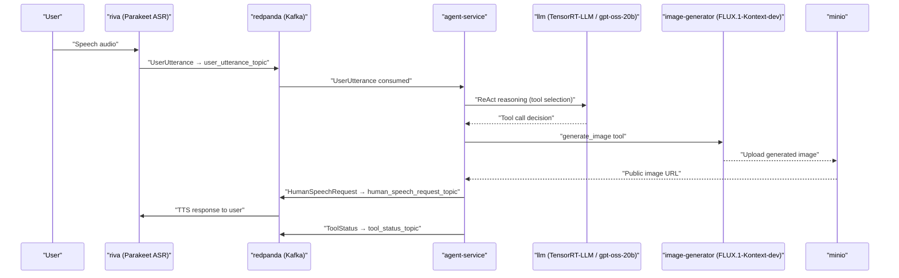
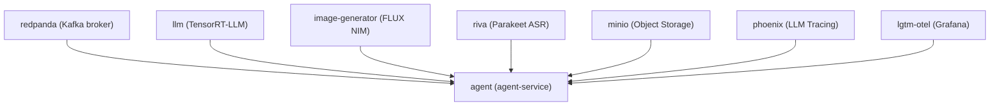
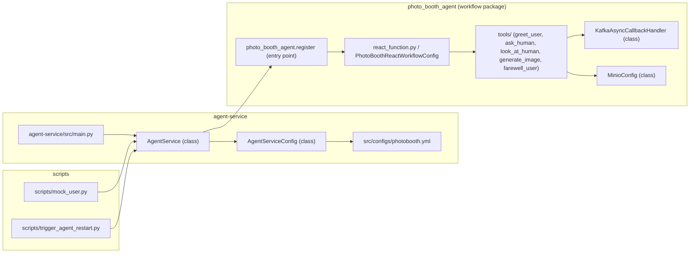

<!-- source: DeepWiki mcp.deepwiki.com · repo NVIDIA/spark-reachy-photo-booth · page 1 Overview · fetched 2026-10-26 -->

# Overview

Relevant source files

The following files were used as context for generating this wiki page:

- [.env.example](.env.example)
- [README.md](README.md)
- [agent-service/README.md](agent-service/README.md)

This page introduces the `spark-reachy-photo-booth` repository: what the system is, what it is not, its major components, and how to navigate this wiki. For implementation details on any specific component, follow the links to the relevant sub-pages.

---

## What This Is

`spark-reachy-photo-booth` is a **reference implementation** of an AI-powered photo booth application. It is designed to run locally on an NVIDIA DGX Spark and integrates with a [Reachy Mini](https://pollen-robotics.com) robot as the physical interaction surface.

> **This is not production-ready software.** It is intended for local DGX Spark deployment only. Do not expose any of its services beyond your trusted local development environment.

The application lets a user walk up, speak with the robot, and receive an AI-generated image based on the conversation. All major functions — speech recognition, language reasoning, image generation, and robot control — are implemented as distinct services that communicate over a Kafka-compatible message broker (Redpanda).

---

## Major Capabilities

| Capability | Implementation |
|---|---|
| Conversational AI agent | `agent-service`, ReAct loop via LangChain + `photo_booth_agent` |
| Speech-to-text | NVIDIA RIVA (Parakeet 1.1B CTC) |
| Language model inference | TensorRT-LLM serving `gpt-oss-20b` |
| AI image generation | FLUX.1-Kontext-dev NIM |
| Object storage (generated images) | MinIO |
| Event backbone | Redpanda (Kafka-compatible) |
| LLM tracing | Arize Phoenix |
| General observability | Grafana LGTM (OpenTelemetry) |

---

## What This Is Not

- **Not a production service.** There is no authentication, no rate limiting, and services are not hardened for public exposure.
- **Not a general-purpose robot SDK.** Reachy Mini integration is specific to this photo booth workflow.
- **Not accepting external contributions** at this time ([README.md:69]()).

---

## High-Level Data Flow

The diagram below shows how a user's spoken words become a generated image.

**Diagram: End-to-End Request Flow**

Sources: [README.md:1-74](), [agent-service/README.md:1-144]()

---

## Service Map

The table below maps each service name (as used in `compose.yaml`) to its role and technology.

| Service Name | Role | Technology |
|---|---|---|
| `agent` | Central orchestrator; runs the ReAct agent loop | Python, LangChain, `photo_booth_agent` |
| `redpanda` | Kafka-compatible event backbone | Redpanda |
| `llm` | LLM inference | TensorRT-LLM, `gpt-oss-20b` |
| `image-generator` | Text-to-image generation | FLUX.1-Kontext-dev NIM |
| `riva` | Speech-to-text (ASR) | NVIDIA Parakeet 1.1B CTC |
| `minio` | Object storage for generated images | MinIO |
| `phoenix` | LLM trace collection and UI | Arize Phoenix |
| `lgtm-otel` | Metrics, traces, logs | Grafana LGTM + OpenTelemetry |

Sources: [README.md:22-54](), [agent-service/README.md:13-18]()

---

## Component Dependency Graph

**Diagram: Service Startup Dependencies**

Sources: [agent-service/README.md:13-18]()

---

## Key Code Entry Points

**Diagram: Code Entity Map**

Sources: [agent-service/README.md:68-144]()

---

## Required Environment Variables

The file [.env.example:1-5]() lists all secrets needed to run the stack:

| Variable | Description |
|---|---|
| `NVIDIA_API_KEY` | NVIDIA API key (prefix `nvapi-`) |
| `HF_TOKEN` | Hugging Face token (required to pull FLUX model weights) |
| `MINIO_ROOT_USER` | MinIO admin username |
| `MINIO_ROOT_PASSWORD` | MinIO admin password |
| `EXTERNAL_MINIO_BASE_URL` | Host-accessible MinIO address (e.g., `127.0.0.1:9010`) |

Sources: [.env.example:1-5]()

---

## Third-Party Model Licensing Note

Two models used in this system carry **non-commercial** license restrictions:

- **FLUX.1-Kontext-dev** and **FLUX.1-Kontext-dev-onnx** — for non-commercial use only. Contact `sales@blackforestlabs.ai` for commercial terms.
- **gpt-oss-20b** — served via TensorRT-LLM; review Hugging Face model card for terms.

You are responsible for accepting all applicable License Agreements before use. See [Legal & Compliance](#6) for full details.

Sources: [README.md:28-65]()

---

## Wiki Navigation

| Page | What It Covers |
|---|---|
| [System Architecture](#1.1) | Full service topology diagram, Kafka topics, startup order, and message flow |
| [Agent Service](#2) | `agent-service` package structure, orchestration role, key dependencies |
| [ReAct Agent Loop](#2.1) | Step-by-step ReAct reasoning loop, tool selection, HITL, summarization |
| [Agent Configuration](#2.2) | `AgentServiceConfig`, `photobooth.yml`, LLM settings, personality |
| [Photo Booth Agent Workflow](#2.3) | `photo_booth_agent` NAT component, entry points, tools |
| [Infrastructure Services](#3) | Kafka, AI/ML services, observability — all supporting services |
| [Development Guide](#4) | Prerequisites, local setup, dev scripts, VS Code config |
| [Deployment](#5) | Docker build, Docker Compose orchestration |
| [Legal & Compliance](#6) | License (Apache 2.0), third-party licenses, security policy |

---

