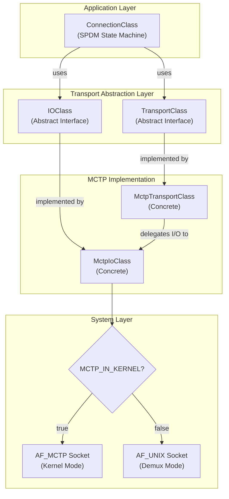
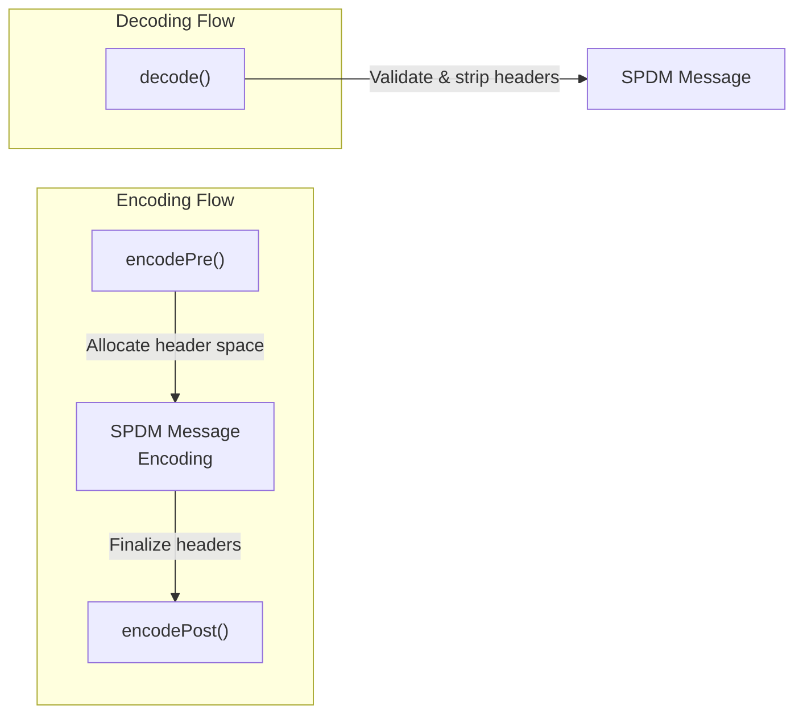
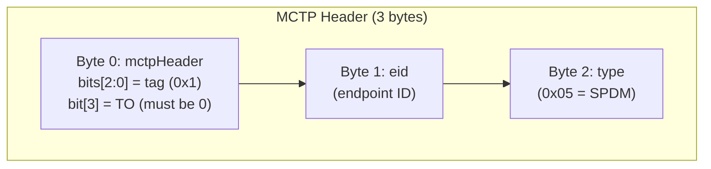
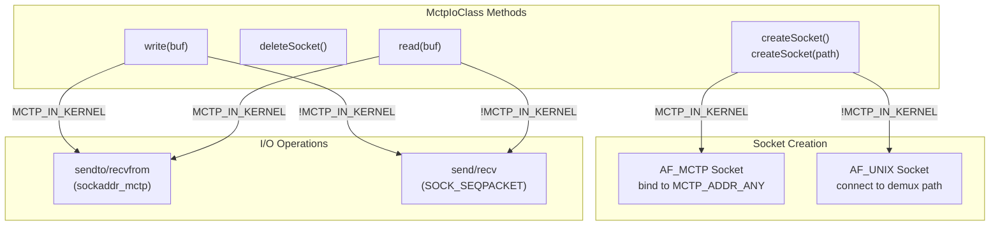
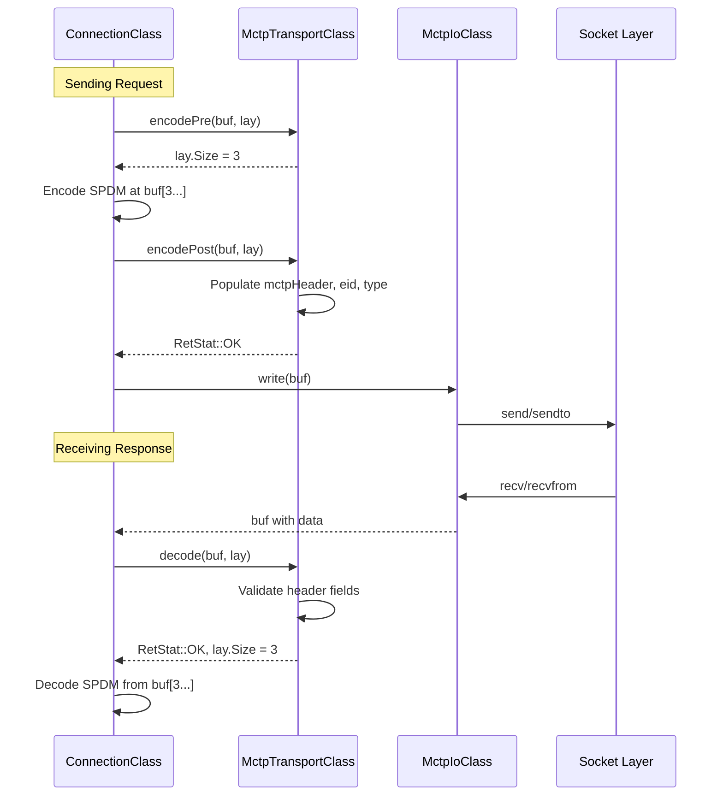

<!-- source: DeepWiki mcp.deepwiki.com · repo NVIDIA/spdm · page 2.2 Transport Layer Abstraction · fetched 2026-10-26 -->

# Transport Layer Abstraction

<details>
<summary>Relevant source files</summary>

The following files were used as context for generating this wiki page:

- [libspdmcpp/headers_public/spdmcpp/common.hpp](libspdmcpp/headers_public/spdmcpp/common.hpp)
- [libspdmcpp/headers_public/spdmcpp/context.hpp](libspdmcpp/headers_public/spdmcpp/context.hpp)
- [libspdmcpp/headers_public/spdmcpp/enum_defs.hpp](libspdmcpp/headers_public/spdmcpp/enum_defs.hpp)
- [libspdmcpp/headers_public/spdmcpp/log.hpp](libspdmcpp/headers_public/spdmcpp/log.hpp)
- [libspdmcpp/headers_public/spdmcpp/mctp_support.hpp](libspdmcpp/headers_public/spdmcpp/mctp_support.hpp)

</details>


## Purpose and Scope

This document describes the transport layer abstraction in `libspdmcpp`, which provides a protocol-agnostic interface for wrapping SPDM messages with transport headers and performing I/O operations. The abstraction consists of two primary interfaces: `TransportClass` for framing SPDM messages with transport-specific headers, and `IOClass` for socket-level communication. The current implementation supports MCTP (Management Component Transport Protocol) via both kernel sockets (AF_MCTP) and userspace demux daemon.

For information about the SPDM protocol state machine that uses this transport layer, see [ConnectionClass and Protocol Flow](#2.1). For packet structure details, see [Packet Structures and Serialization](#2.3).

---

## Architecture Overview

The transport layer abstraction separates SPDM protocol logic from the underlying transport mechanism through a two-tier design:



**Sources:** [libspdmcpp/headers_public/spdmcpp/common.hpp:119-268](), [libspdmcpp/headers_public/spdmcpp/mctp_support.hpp:51-538]()

---

## Abstract Interfaces

### TransportClass

`TransportClass` defines the interface for adding and removing transport-layer headers around SPDM messages. It operates through a three-phase encoding process and single-phase decoding.



| Method | Purpose | Parameters | Returns |
|--------|---------|------------|---------|
| `encodePre()` | Pre-allocate space for transport header | `buf`: output buffer<br/>`lay`: layer state | `RetStat` |
| `encodePost()` | Finalize transport header after SPDM message is encoded | `buf`: buffer with SPDM message<br/>`lay`: layer state | `RetStat` |
| `decode()` | Validate and strip transport header from received message | `buf`: received buffer<br/>`lay`: layer state | `RetStat` |
| `setupTimeout()` | Configure timeout for expected response | `timeout`: milliseconds | `RetStat` |
| `clearTimeout()` | Cancel pending timeout | none | `bool` |

**Key Members:**
- **LayerState**: Helper class tracking offset and size of the transport layer within a buffer

**Sources:** [libspdmcpp/headers_public/spdmcpp/common.hpp:119-239]()

### IOClass

`IOClass` defines the interface for reading and writing complete transport+SPDM packets to/from the underlying communication medium (typically sockets).

| Method | Purpose | Parameters | Returns |
|--------|---------|------------|---------|
| `write()` | Send complete packet | `buf`: data to send<br/>`timeout`: microseconds | `RetStat` |
| `read()` | Receive complete packet | `buf`: output buffer<br/>`timeout`: microseconds | `RetStat` |

**Sources:** [libspdmcpp/headers_public/spdmcpp/common.hpp:241-268]()

### LayerState Helper Class

`LayerState` manages the positioning of transport layer data within a buffer:

```
Buffer Layout:
┌─────────────┬──────────────────┬─────────────┐
│   Padding   │  Transport Layer │ SPDM Message│
└─────────────┴──────────────────┴─────────────┘
              ↑                  ↑
           Offset            Offset + Size
```

| Method | Purpose |
|--------|---------|
| `getOffset()` | Returns starting position of transport layer |
| `getEndOffset()` | Returns position where SPDM message begins (`Offset + Size`) |

**Sources:** [libspdmcpp/headers_public/spdmcpp/common.hpp:129-149]()

---

## MCTP Transport Implementation

### MctpTransportClass

`MctpTransportClass` implements `TransportClass` for MCTP protocol, adding a 3-byte header consisting of MCTP tag, endpoint ID, and message type.

**Constructor:**
```cpp
explicit MctpTransportClass(uint8_t eid)
```
- `eid`: Endpoint ID of the remote SPDM responder

**Header Structure:**



**Sources:** [libspdmcpp/headers_public/spdmcpp/mctp_support.hpp:51-196]()

### Header Field Details

The `HeaderType` structure encapsulates MCTP framing:

| Field | Type | Value | Description |
|-------|------|-------|-------------|
| `mctpHeader` | `uint8_t` | `0x09` | bits[2:0]=`MCTP_TAG_SPDM` (1), bit[3]=TO (always 1 for outbound) |
| `eid` | `uint8_t` | Varies | Source or destination endpoint ID |
| `type` | `MCTPMessageTypeEnum` | `0x05` | `MCTPMessageTypeEnum::SPDM` |

**Helper Methods:**
- `mctpTag()`: Extracts tag value (bits 2:0) from `mctpHeader`
- `mctpTag(tag)`: Sets tag value and TO bit in `mctpHeader` to `tag | 0x08`
- `mctpTO()`: Checks TO (tag owner) bit (bit 3)

**Sources:** [libspdmcpp/headers_public/spdmcpp/mctp_support.hpp:153-190]()

### Encoding and Decoding Operations

**encodePre() Implementation:**
```
1. Sets lay.Size = sizeof(HeaderType) = 3 bytes
2. Returns RetStat::OK
   (Header space reserved but not yet populated)
```

**encodePost() Implementation:**
```
1. Populates HeaderType fields:
   - mctpTag(MCTP_TAG_SPDM)  → sets mctpHeader = 0x09
   - eid = EID                → destination endpoint
   - type = MCTPMessageTypeEnum::SPDM  → 0x05
2. Returns RetStat::OK
```

**decode() Implementation:**
```
1. Checks buffer size ≥ sizeof(HeaderType)
2. Validates header.type == MCTPMessageTypeEnum::SPDM
3. Validates header.eid == EID (expected source)
4. Validates header.mctpTag() == MCTP_TAG_SPDM
5. Validates header.mctpTO() == false (must not be tag owner)
6. Returns RetStat::OK or error status
```

**Error Codes:**
- `ERROR_BUFFER_TOO_SMALL`: Insufficient data for header
- `ERROR_WRONG_MCTP_TYPE`: Type field ≠ 0x05
- `ERROR_WRONG_EID`: EID mismatch
- `ERROR_WRONG_MCTP_TAG`: Tag ≠ 1
- `ERROR_WRONG_MCTP_TO`: TO bit incorrectly set

**Sources:** [libspdmcpp/headers_public/spdmcpp/mctp_support.hpp:66-105]()

### Static Helper: peekEid()

The `peekEid()` static method enables routing without full decoding:

```cpp
static RetStat peekEid(std::vector<uint8_t>& buf, 
                       LayerState& lay,
                       uint8_t& eid)
```

**Purpose:** Quickly extract endpoint ID from received packet for dispatching to the correct `ConnectionClass` instance.

**Validation:** Checks buffer size, MCTP type (0x05), tag (1), and TO bit (0) before extracting EID.

**Usage:** See [MCTP Packet Processing](#3.5) for integration with the daemon's packet routing logic.

**Sources:** [libspdmcpp/headers_public/spdmcpp/mctp_support.hpp:117-140]()

---

## I/O Layer Implementation

### MctpIoClass

`MctpIoClass` implements `IOClass` for MCTP socket communication. It supports two compile-time modes via the `MCTP_IN_KERNEL` preprocessor flag:

1. **Kernel Mode** (`MCTP_IN_KERNEL` defined): Uses AF_MCTP sockets with native kernel MCTP stack
2. **Demux Mode** (`MCTP_IN_KERNEL` not defined): Uses AF_UNIX sockets to communicate with mctp-demux-daemon



**Sources:** [libspdmcpp/headers_public/spdmcpp/mctp_support.hpp:198-538]()

### Socket Creation

**Kernel Mode (`createSocket()`)**:
```
1. socket(AF_MCTP, SOCK_DGRAM, 0)
2. Populate sockaddr_mctp:
   - smctp_family = AF_MCTP
   - smctp_network = MCTP_NET_ANY
   - smctp_addr.s_addr = MCTP_ADDR_ANY
   - smctp_type = MCTP_TYPE_SPDM (5)
   - smctp_tag = MCTP_TAG_OWNER
3. bind() to address
4. Return success/failure
```

**Demux Mode (`createSocket(path)`)**:
```
1. socket(AF_UNIX, SOCK_SEQPACKET, 0)
2. Populate sockaddr_un:
   - sun_family = AF_UNIX
   - sun_path = path (typically "\0mctp-demux-daemon")
3. connect() to daemon
4. write(&type, sizeof(type)) where type = MCTPMessageTypeEnum::SPDM
   (Registers with demux daemon for SPDM message type)
5. Return success/failure
```

**Sources:** [libspdmcpp/headers_public/spdmcpp/mctp_support.hpp:224-335]()

### Write Operations

**Kernel Mode:**
```cpp
inline RetStat MctpIoClass::write(const std::vector<uint8_t>& buf,
                                  timeout_us_t /*timeout*)
{
    struct sockaddr_mctp addr;
    // Extract EID from buf[1], construct sockaddr_mctp
    addr.smctp_addr.s_addr = buf[1];
    
    // Send SPDM payload (skip 3-byte header at buf[0..2])
    sendto(Socket, buf.data() + 3, buf.size() - 3, ...);
}
```

**Buffer Format:** `[mctpHeader(1), eid(1), type(1), SPDM payload...]`

The kernel mode extracts the destination EID from `buf[1]` and sends only the SPDM payload (skipping the 3-byte MCTP header, which is reconstructed by the kernel).

**Demux Mode:**
```cpp
inline RetStat MctpIoClass::write(const std::vector<uint8_t>& buf,
                                  timeout_us_t /*timeout*)
{
    // Send entire buffer including MCTP header
    ssize_t sent = 0;
    while (sent < buf.size()) {
        ssize_t ret = send(Socket, &buf[sent], buf.size() - sent, 0);
        sent += ret;
    }
}
```

The demux mode sends the complete buffer including the MCTP header, as the demux daemon expects it.

**Sources:** [libspdmcpp/headers_public/spdmcpp/mctp_support.hpp:382-500]()

### Read Operations

**Kernel Mode:**
```cpp
inline RetStat MctpIoClass::read(std::vector<uint8_t>& buf,
                                 timeout_us_t /*timeout*)
{
    // Peek to get buffer size
    ssize_t bufLen = recv(Socket, NULL, 0, MSG_PEEK | MSG_TRUNC);
    buf.resize(bufLen);
    
    // Receive payload
    struct sockaddr_mctp addr;
    recvfrom(Socket, buf.data(), buf.size(), ..., &addr, ...);
    
    // Reconstruct MCTP header at front
    std::vector<int> head = {1, addr.smctp_addr.s_addr, 
                             MCTPMessageTypeEnum::SPDM};
    buf.insert(buf.begin(), head.begin(), head.end());
}
```

The kernel provides only the SPDM payload and source address information. `MctpIoClass::read()` reconstructs the 3-byte MCTP header at the buffer's beginning.

**Demux Mode:**
```cpp
inline RetStat MctpIoClass::read(std::vector<uint8_t>& buf,
                                 timeout_us_t /*timeout*)
{
    buf.resize(mctpMaxMessageSize);  // 4096 bytes
    ssize_t result = recv(Socket, buf.data(), buf.size(), 0);
    buf.resize(result);
}
```

The demux daemon provides the complete packet including the MCTP header, so no reconstruction is necessary.

**Sources:** [libspdmcpp/headers_public/spdmcpp/mctp_support.hpp:425-535]()

---

## Integration with ConnectionClass

The transport layer integrates with `ConnectionClass` through a well-defined sequence:



**Key Points:**

1. **Encoding Flow:**
   - `ConnectionClass` calls `encodePre()` to reserve space
   - Encodes SPDM packet at offset `lay.getEndOffset()`
   - Calls `encodePost()` to finalize transport header
   - Calls `write()` to send complete buffer

2. **Decoding Flow:**
   - `IOClass` provides received buffer via `read()`
   - `ConnectionClass` calls `decode()` to validate and strip header
   - Decodes SPDM packet from offset `lay.getEndOffset()`

3. **Error Handling:**
   - Transport validation errors return specific `RetStat` codes
   - `ConnectionClass` can retry or abort based on error type

**Sources:** [libspdmcpp/headers_public/spdmcpp/common.hpp:119-239](), [libspdmcpp/headers_public/spdmcpp/mctp_support.hpp:66-105]()

---

## Context Registration

The `ContextClass` manages `IOClass` registration for both kernel and demux modes:

| Method | Purpose | Parameters |
|--------|---------|------------|
| `registerIo(io)` | Register kernel-mode IO | `io`: shared_ptr to IOClass |
| `registerIo(io, path)` | Register demux-mode IO | `io`: shared_ptr to IOClass<br/>`path`: demux socket path |
| `unregisterIo()` | Unregister kernel-mode IO | none |
| `unregisterIo(path)` | Unregister demux-mode IO | `path`: socket path |
| `getIO()` | Retrieve kernel-mode IO | none → shared_ptr |
| `getIO(path)` | Retrieve demux-mode IO | `path` → shared_ptr |
| `isIOPathRegistered(path)` | Check if path is registered | `path` → bool |

**Storage:**
- **Kernel Mode**: `io_inkernel` (shared_ptr)
- **Demux Mode**: `ioContainer` (unordered_map<string, shared_ptr>)

**Sources:** [libspdmcpp/headers_public/spdmcpp/context.hpp:56-150]()

---

## Compile-Time Configuration

The transport layer behavior is controlled by the `MCTP_IN_KERNEL` preprocessor macro:

| Mode | Flag | Socket Type | Protocol |
|------|------|-------------|----------|
| Kernel | `MCTP_IN_KERNEL` defined | AF_MCTP, SOCK_DGRAM | Native kernel MCTP |
| Demux | `MCTP_IN_KERNEL` not defined | AF_UNIX, SOCK_SEQPACKET | Userspace demux daemon |

**Configuration in meson.build:**
```
mctp_in_kernel = get_option('MCTP_IN_KERNEL')
conf_data.set('MCTP_IN_KERNEL', mctp_in_kernel)
```

**Implications:**

| Aspect | Kernel Mode | Demux Mode |
|--------|-------------|------------|
| **Dependencies** | Kernel MCTP support | mctp-demux-daemon process |
| **Header Handling** | Stripped/reconstructed by kernel | Passed through verbatim |
| **Addressing** | sockaddr_mctp with EID | AF_UNIX path |
| **Setup** | `createSocket()` | `createSocket(path)` |
| **Performance** | Lower latency | Additional userspace hop |

**Sources:** [libspdmcpp/headers_public/spdmcpp/mctp_support.hpp:367-536]()

---

## Return Status Codes

Transport layer operations return `RetStat` enumeration values:

| Status Code | Value | Meaning |
|-------------|-------|---------|
| `OK` | 0 | Operation successful |
| `ERROR_BUFFER_TOO_SMALL` | -2 | Buffer insufficient for header |
| `ERROR_WRONG_MCTP_TYPE` | -18 | Message type ≠ SPDM (0x05) |
| `ERROR_WRONG_EID` | -19 | Endpoint ID mismatch |
| `ERROR_WRONG_MCTP_TAG` | -26 | Tag ≠ MCTP_TAG_SPDM (1) |
| `ERROR_WRONG_MCTP_TO` | -27 | Tag owner bit incorrectly set |
| `ERROR_UNKNOWN` | -1 | Socket I/O error (check errno) |

**Sources:** [libspdmcpp/headers_public/spdmcpp/enum_defs.hpp:23-56]()

---

## Summary

The transport layer abstraction provides:

1. **Protocol Independence**: `ConnectionClass` operates without transport-specific knowledge
2. **Flexible Deployment**: Kernel or userspace MCTP via compile-time flag
3. **Clean Interfaces**: Separation of framing (`TransportClass`) and I/O (`IOClass`)
4. **Efficient Routing**: `peekEid()` enables packet dispatch without full decoding
5. **Robust Validation**: Comprehensive header checking with specific error codes

The design enables future transport protocols (e.g., PCIe DOE, USB) to be added by implementing the abstract interfaces without modifying the SPDM protocol logic.

**Sources:** [libspdmcpp/headers_public/spdmcpp/common.hpp:119-268](), [libspdmcpp/headers_public/spdmcpp/mctp_support.hpp:51-538]()

---

