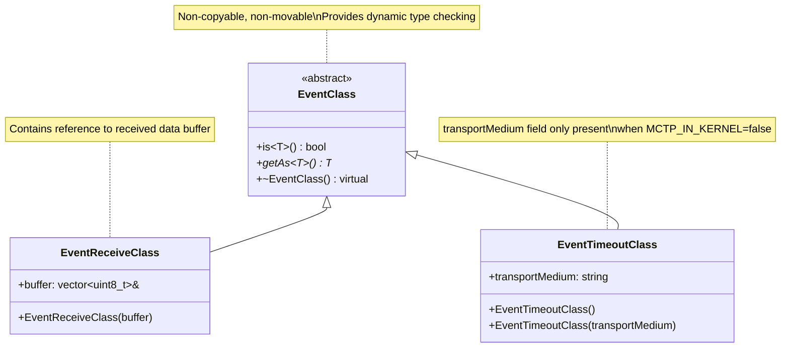
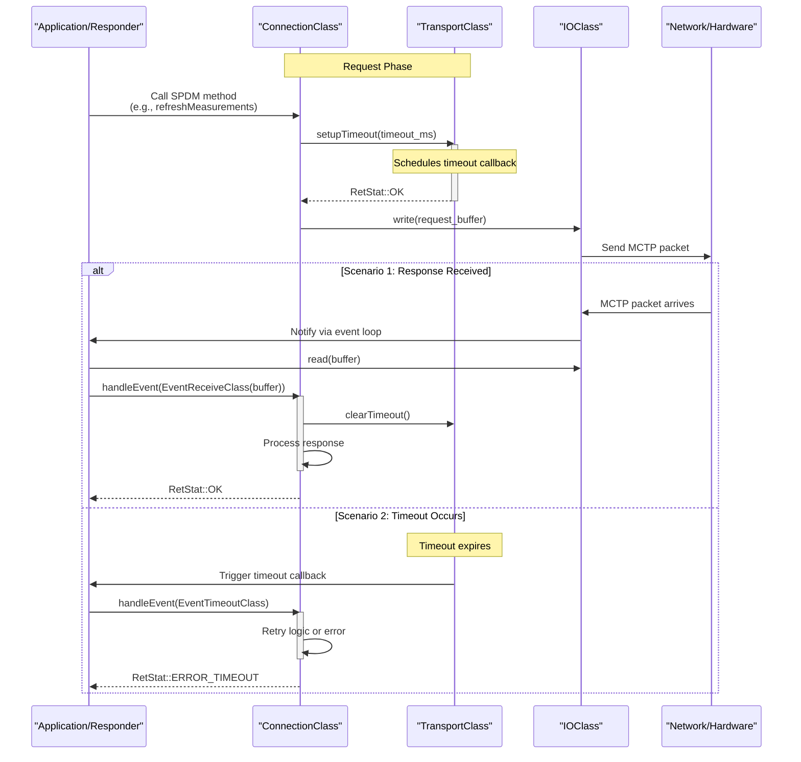
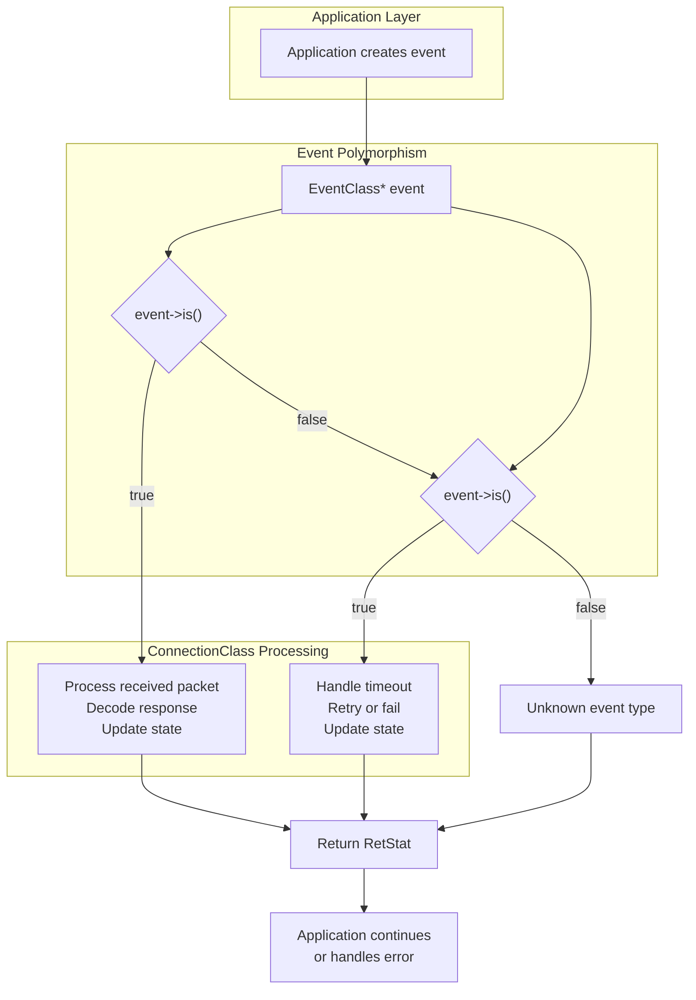

<!-- source: DeepWiki mcp.deepwiki.com · repo NVIDIA/spdm · page 2.6 Event System · fetched 2026-10-26 -->

# Event System

<details>
<summary>Relevant source files</summary>

The following files were used as context for generating this wiki page:

- [libspdmcpp/headers_public/spdmcpp/common.hpp](libspdmcpp/headers_public/spdmcpp/common.hpp)
- [libspdmcpp/headers_public/spdmcpp/context.hpp](libspdmcpp/headers_public/spdmcpp/context.hpp)
- [libspdmcpp/headers_public/spdmcpp/enum_defs.hpp](libspdmcpp/headers_public/spdmcpp/enum_defs.hpp)
- [libspdmcpp/headers_public/spdmcpp/event.hpp](libspdmcpp/headers_public/spdmcpp/event.hpp)
- [spdmd/meson.build](spdmd/meson.build)
- [spdmd/tests/meson.build](spdmd/tests/meson.build)
- [tools/libmctppacketcorrupt/random.c](tools/libmctppacketcorrupt/random.c)

</details>


## Purpose and Scope

The Event System in libspdmcpp provides the foundation for asynchronous communication between the SPDM protocol state machine and the transport/IO layers. It defines abstract event types that enable `ConnectionClass` to handle both incoming SPDM messages and timeout conditions in a unified manner.

This page documents the event class hierarchy, event types, and how events flow through the library. For information about the transport layer that generates these events, see [Transport Layer Abstraction](#2.2). For details on how `ConnectionClass` processes events, see [ConnectionClass and Protocol Flow](#2.1).

**Sources:** [libspdmcpp/headers_public/spdmcpp/event.hpp:1-94]()

---

## Event Class Hierarchy

The event system consists of a three-level hierarchy:



**Base Class: `EventClass`**

`EventClass` is an abstract base class that defines the interface for all events. It provides:

| Feature | Description |
|---------|-------------|
| Type Safety | Deleted copy and move constructors/operators ensure events cannot be accidentally copied |
| Dynamic Type Checking | `is<T>()` template method checks if event is of a specific derived type |
| Type Casting | `getAs<T>()` template method performs safe dynamic cast to derived type |
| Polymorphism | Virtual destructor enables proper cleanup of derived classes |

The type checking methods use `dynamic_cast` internally:

[libspdmcpp/headers_public/spdmcpp/event.hpp:46-56]()

**Sources:** [libspdmcpp/headers_public/spdmcpp/event.hpp:32-57]()

---

## Event Types

### EventReceiveClass

`EventReceiveClass` represents the reception of data from the transport layer. It holds a reference to a buffer containing the received packet data.

| Property | Type | Description |
|----------|------|-------------|
| `buffer` | `std::vector<uint8_t>&` | Reference to buffer containing received MCTP+SPDM packet |

**Key Characteristics:**

- **Reference Semantics**: The buffer is held by reference, not copied. The caller (typically `IOClass::read()`) owns the buffer memory.
- **Single-Use**: Each receive event represents one packet reception.
- **Non-Copyable**: Like all event types, cannot be copied or moved to prevent buffer lifetime issues.

**Creation Pattern:**

```cpp
std::vector<uint8_t> receivedData;
// ... IOClass::read() fills receivedData ...
EventReceiveClass event(receivedData);
// Pass to ConnectionClass::handleEvent()
```

**Sources:** [libspdmcpp/headers_public/spdmcpp/event.hpp:59-71]()

### EventTimeoutClass

`EventTimeoutClass` represents a timeout condition where no response was received within the expected time window. The class structure differs based on compile-time configuration:

**Kernel Mode (`MCTP_IN_KERNEL=true`):**

```cpp
struct EventTimeoutClass : EventClass {
    EventTimeoutClass() = default;
    std::string transportMedium;  // Empty/unused
};
```

**Userspace Mode (`MCTP_IN_KERNEL=false`):**

```cpp
struct EventTimeoutClass : EventClass {
    explicit EventTimeoutClass(std::string transportMedium);
    std::string transportMedium;  // Identifies which MCTP path timed out
};
```

| Field | Purpose | When Used |
|-------|---------|-----------|
| `transportMedium` | Identifies the MCTP socket path (e.g., `/tmp/mctp-demux-usb`) | Only in userspace demux mode |

**Conditional Compilation:**

The constructor is conditionally defined based on the `MCTP_IN_KERNEL` preprocessor flag:

[libspdmcpp/headers_public/spdmcpp/event.hpp:75-82]()

In kernel mode, a single global MCTP stack is used, so no path identifier is needed. In userspace mode, multiple demux sockets may exist, requiring identification of which path timed out.

**Sources:** [libspdmcpp/headers_public/spdmcpp/event.hpp:73-91]()

---

## Event Flow Through the System



**Event Dispatching Workflow:**

1. **Request Initiation**: Application calls a SPDM protocol method on `ConnectionClass`
2. **Timeout Setup**: `ConnectionClass` calls `TransportClass::setupTimeout()` to schedule a timeout
3. **Packet Transmission**: Request packet is encoded and sent via `IOClass::write()`
4. **Event Generation**:
   - If data arrives: `IOClass::read()` fills a buffer, application creates `EventReceiveClass`
   - If timeout occurs: Transport layer triggers callback, application creates `EventTimeoutClass`
5. **Event Handling**: Application passes event to `ConnectionClass::handleEvent()`
6. **State Update**: `ConnectionClass` processes the event and updates protocol state

**Sources:** [libspdmcpp/headers_public/spdmcpp/event.hpp:1-94](), [libspdmcpp/headers_public/spdmcpp/common.hpp:189-206]()

---

## Integration with TransportClass

The `TransportClass` abstract interface defines timeout management methods that work in conjunction with the event system:

| Method | Signature | Purpose |
|--------|-----------|---------|
| `setupTimeout` | `RetStat setupTimeout(timeout_ms_t timeout)` | Request timeout notification after specified milliseconds |
| `clearTimeout` | `bool clearTimeout()` | Cancel a previously scheduled timeout |

**Timeout Contract:**

The `TransportClass` implementation is expected to:
- When `setupTimeout()` is called, schedule a callback/event after the timeout period
- If no data is received before timeout, trigger creation of `EventTimeoutClass`
- Return `true` from `clearTimeout()` if a timeout was active and cleared
- Return `false` from `clearTimeout()` if no timeout was scheduled

[libspdmcpp/headers_public/spdmcpp/common.hpp:193-206]()

**Default Implementation:**

The base `TransportClass` provides default no-op implementations:

```cpp
virtual RetStat setupTimeout(timeout_ms_t /*timeout*)
{
    return RetStat::ERROR_UNKNOWN;  // Subclass must override
}

virtual bool clearTimeout()
{
    return false;  // No timeout was set
}
```

Concrete transport implementations (e.g., `MctpTransportClass`) override these to provide actual timeout functionality.

**Sources:** [libspdmcpp/headers_public/spdmcpp/common.hpp:119-239]()

---

## Event Handling Pattern



**Type-Safe Event Dispatch:**

The event system uses runtime type identification (RTTI) through `dynamic_cast` to safely determine event types. This pattern enables `ConnectionClass` to handle different event types with type safety:

```cpp
RetStat handleEvent(EventClass& event) {
    if (event.is<EventReceiveClass>()) {
        auto* recvEvent = event.getAs<EventReceiveClass>();
        return handleReceive(recvEvent->buffer);
    }
    else if (event.is<EventTimeoutClass>()) {
        auto* timeoutEvent = event.getAs<EventTimeoutClass>();
        return handleTimeout(timeoutEvent->transportMedium);
    }
    return RetStat::ERROR_UNKNOWN;
}
```

**Sources:** [libspdmcpp/headers_public/spdmcpp/event.hpp:46-56]()

---

## Transport Mode Differences

The event system adapts to different MCTP transport configurations:

| Configuration | `MCTP_IN_KERNEL` | `EventTimeoutClass` Behavior | Use Case |
|---------------|------------------|------------------------------|----------|
| Kernel MCTP | `true` | No `transportMedium` parameter | Single AF_MCTP socket |
| Userspace Demux | `false` | Requires `transportMedium` string | Multiple demux sockets per MCTP medium |

**Kernel Mode:**

- Single MCTP socket via `AF_MCTP` address family
- No need to identify which transport timed out
- Default constructor for `EventTimeoutClass`

**Userspace Demux Mode:**

- Multiple UNIX domain sockets (e.g., `/tmp/mctp-demux-pcie`, `/tmp/mctp-demux-usb`)
- `transportMedium` identifies which socket path timed out
- Explicit constructor requires transport medium parameter

[libspdmcpp/headers_public/spdmcpp/event.hpp:75-91]()

**Build Configuration:**

The `MCTP_IN_KERNEL` flag is set during build configuration and affects event handling throughout the library. See [Build System and Configuration](#1.2) for details on selecting the appropriate mode.

**Sources:** [libspdmcpp/headers_public/spdmcpp/event.hpp:75-91](), [spdmd/meson.build:1-43]()

---

## Summary

The Event System provides a lightweight, type-safe mechanism for asynchronous communication in libspdmcpp:

| Component | Responsibility |
|-----------|----------------|
| `EventClass` | Abstract base providing polymorphic event interface |
| `EventReceiveClass` | Carries received packet data from IO layer to protocol layer |
| `EventTimeoutClass` | Signals timeout conditions with optional transport identification |
| Transport Integration | `setupTimeout()` and `clearTimeout()` coordinate timeout scheduling |

The system's design enforces safety through deleted copy/move operations while enabling flexible event handling across different transport configurations (kernel vs. userspace).

**Sources:** [libspdmcpp/headers_public/spdmcpp/event.hpp:1-94]()

---

