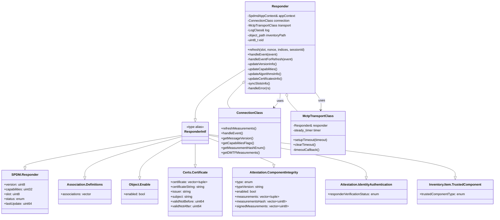
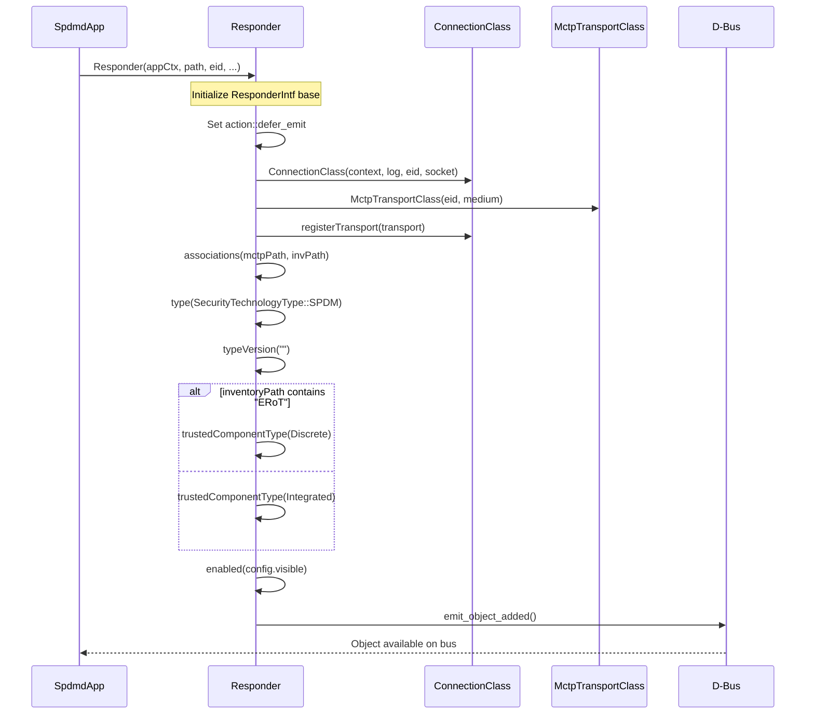
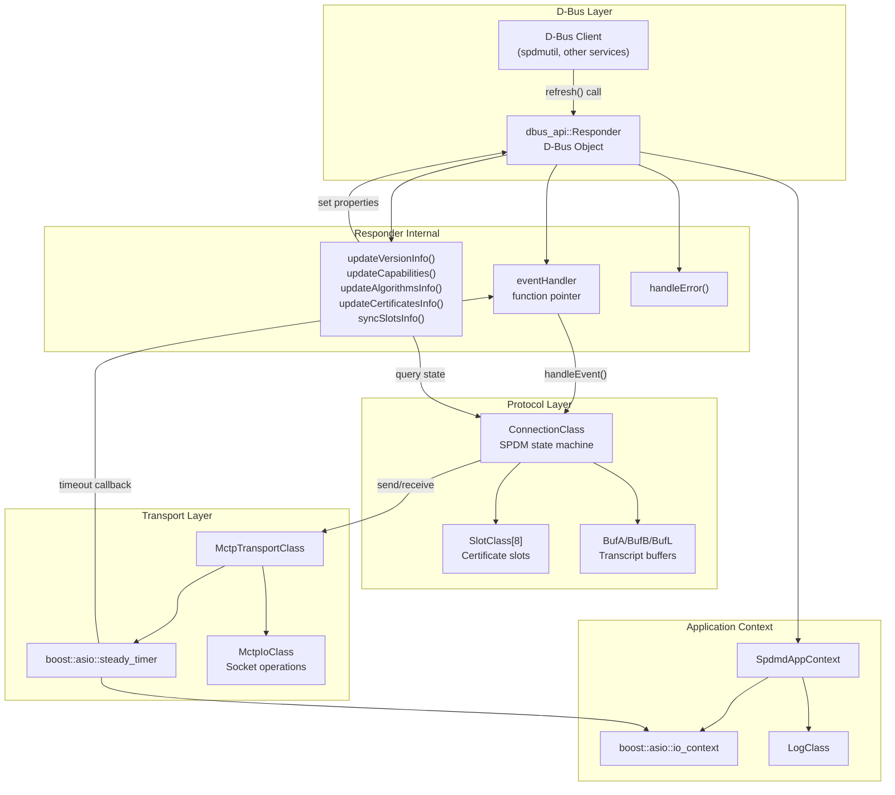
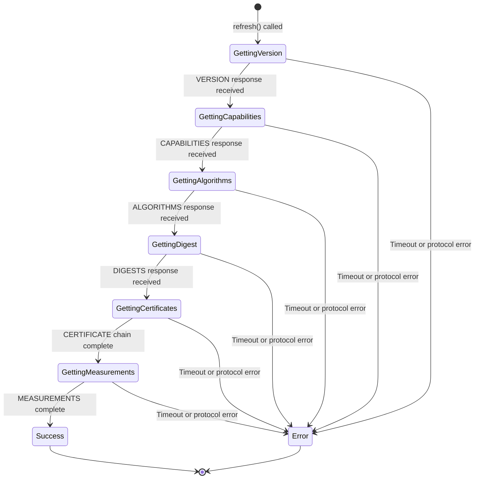
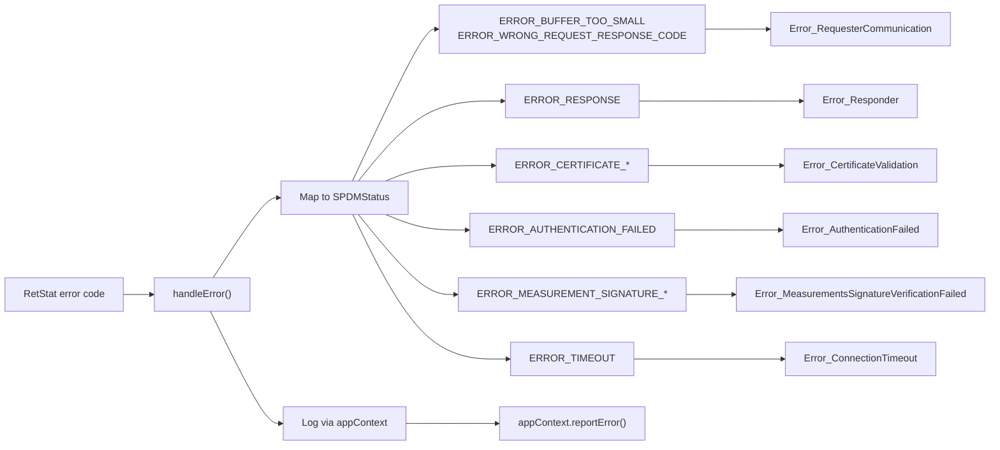
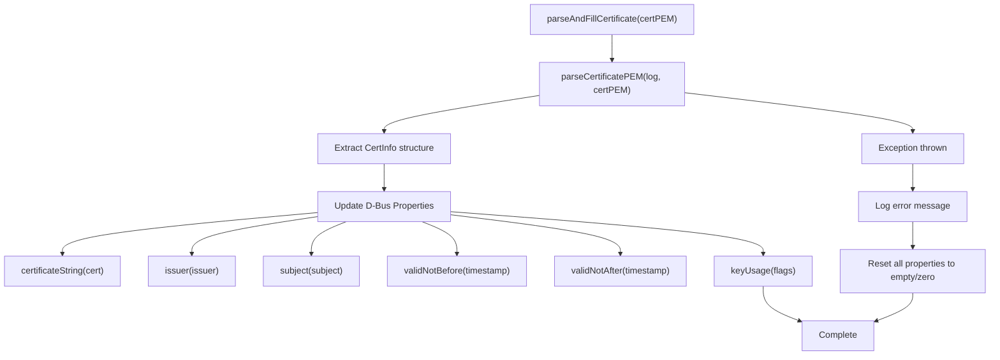
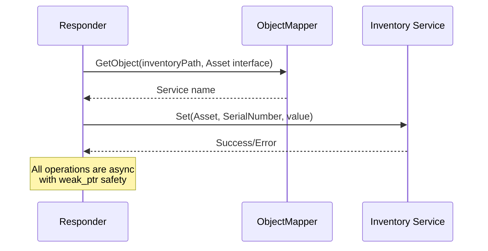

<!-- source: DeepWiki mcp.deepwiki.com · repo NVIDIA/spdm · page 3.2 D-Bus Responder Interface · fetched 2026-10-26 -->

# D-Bus Responder Interface

<details>
<summary>Relevant source files</summary>

The following files were used as context for generating this wiki page:

- [spdmd/dbus_impl_responder.cpp](spdmd/dbus_impl_responder.cpp)
- [spdmd/dbus_impl_responder.hpp](spdmd/dbus_impl_responder.hpp)

</details>


## Purpose and Scope

The D-Bus Responder Interface implements the bridge between the SPDM protocol implementation (`libspdmcpp`) and the OpenBMC D-Bus system. This layer exposes SPDM responder devices as D-Bus objects, making their attestation data, certificates, and measurements available to other system services.

The `dbus_api::Responder` class is the central component that:
- Encapsulates a `spdmcpp::ConnectionClass` instance for SPDM protocol operations
- Implements multiple D-Bus interfaces to expose different aspects of the device
- Orchestrates the SPDM handshake and updates D-Bus properties as data becomes available
- Integrates with boost::asio for asynchronous event handling and timeouts

For details on the specific D-Bus interfaces and properties, see [D-Bus Interfaces and Properties](#3.2.1). For the `refresh()` method workflow, see [Refresh Method and Event Handling](#3.2.2). For certificate and measurement processing, see [Certificate and Measurement Data Processing](#3.2.3).

**Sources:** [spdmd/dbus_impl_responder.hpp:1-229](), [spdmd/dbus_impl_responder.cpp:1-726]()

## Class Inheritance Structure

The `Responder` class inherits from multiple D-Bus interface server classes through the `ResponderIntf` type alias. This multi-inheritance pattern allows a single D-Bus object to implement several standard OpenBMC interfaces.



**Sources:** [spdmd/dbus_impl_responder.hpp:96-104](), [spdmd/dbus_impl_responder.hpp:111-225]()

## Construction and Lifecycle

The `Responder` object is constructed by `SpdmdApp` when a new SPDM-capable MCTP endpoint is discovered or when a higher-priority responder is created for an existing EID.

### Construction Parameters

The constructor accepts parameters encapsulated in the `ResponderArgs` structure:

| Parameter | Type | Purpose |
|-----------|------|---------|
| `eid` | `uint8_t` | MCTP Endpoint ID of the responder |
| `uuid` | `std::string` | UUID for correlation with inventory |
| `medium` | `std::string` | Transport medium (PCIe, USB, etc.) |
| `bindingType` | `std::string` | MCTP binding type |
| `mctpPath` | `object_path` | D-Bus path of MCTP endpoint object |
| `inventoryPath` | `object_path` | D-Bus path of inventory item |
| `socketPath` | `std::string` | Socket path for MCTP I/O |

**Sources:** [spdmd/dbus_impl_responder.hpp:48-62]()

### Constructor Workflow



The constructor:
1. Initializes the base `ResponderIntf` with `action::defer_emit` to prevent premature signal emission
2. Creates the `ConnectionClass` instance with the MCTP EID and socket path
3. Creates the `MctpTransportClass` instance and registers it with the connection
4. Sets up D-Bus associations linking the SPDM object to MCTP and inventory objects
5. Initializes security technology type to SPDM
6. Determines component attachment type (Discrete for ERoT devices, Integrated otherwise)
7. Reads the `visible` configuration property to set the `enabled` state
8. Calls `emit_object_added()` to make the object available on D-Bus

**Sources:** [spdmd/dbus_impl_responder.cpp:54-103]()

### Destructor

The destructor unregisters the transport from the connection to ensure clean teardown:

```cpp
Responder::~Responder()
{
    connection.unregisterTransport(transport);
}
```

**Sources:** [spdmd/dbus_impl_responder.cpp:105-108]()

## Component Relationships

The following diagram shows how the `Responder` class integrates with other components:



**Sources:** [spdmd/dbus_impl_responder.hpp:111-225](), [spdmd/dbus_impl_responder.cpp:54-103]()

## Event Handling Architecture

The `Responder` uses a callback-based event handling pattern where different operations set different event handlers.

### Event Handler Function Pointer

The `eventHandler` member is a function pointer that determines which handler processes incoming events:

```cpp
spdmcpp::RetStat (Responder::*eventHandler)(spdmcpp::EventClass& event) = nullptr;
```

The public `handleEvent()` method dispatches to the current handler:

```cpp
spdmcpp::RetStat handleEvent(spdmcpp::EventClass& event)
{
    return (this->*eventHandler)(event);
}
```

**Sources:** [spdmd/dbus_impl_responder.hpp:196-197](), [spdmd/dbus_impl_responder.hpp:166-170]()

### Event Types

The system handles two primary event types:

| Event Type | Class | Purpose |
|------------|-------|---------|
| Receive | `EventReceiveClass` | Contains data received from the responder device |
| Timeout | `EventTimeoutClass` | Signals that a timeout has expired |

Events are forwarded to the `ConnectionClass` which processes them according to the current SPDM protocol state.

**Sources:** [spdmd/dbus_impl_responder.cpp:330-384]()

## SPDM Protocol State Machine Integration

The `Responder` class orchestrates the SPDM protocol flow by:
1. Initiating protocol operations via `ConnectionClass` methods
2. Receiving events when responses arrive or timeouts occur
3. Updating D-Bus properties to reflect the current state
4. Setting appropriate status values

### Status Enumeration

The `SPDMStatus` property tracks the current operation state:

| Status Value | Meaning |
|--------------|---------|
| `GettingVersion` | Performing version negotiation |
| `GettingCapabilities` | Retrieving responder capabilities |
| `GettingAlgorithms` | Negotiating cryptographic algorithms |
| `GettingDigest` | Retrieving certificate digests |
| `GettingCertificates` | Downloading certificate chains |
| `GettingMeasurements` | Collecting measurements |
| `Success` | Operation completed successfully |
| `Error_*` | Various error conditions |

**Sources:** [spdmd/dbus_impl_responder.cpp:353-382]()

### Refresh Flow State Progression

The `handleEventForRefresh()` callback updates status as the protocol progresses:



The handler checks `ConnectionClass` state flags in reverse protocol order to determine progression:

```cpp
if (!connection.isWaitingForResponse())
{
    syncSlotsInfo();
    status(SPDMStatus::Success);
}
else if (connection.slotHasInfo(slotidx, SlotInfoEnum::CERTIFICATES))
{
    updateCertificatesInfo();
    status(SPDMStatus::GettingMeasurements);
}
else if (connection.hasInfo(ConnectionInfoEnum::DIGESTS))
{
    status(SPDMStatus::GettingCertificates);
}
// ... and so on
```

**Sources:** [spdmd/dbus_impl_responder.cpp:330-384]()

## Property Update Methods

The `Responder` class provides several private methods to extract data from `ConnectionClass` and update D-Bus properties.

### Version Update

Extracts the negotiated SPDM version:

```cpp
void Responder::updateVersionInfo()
{
    version(static_cast<uint8_t>(connection.getMessageVersion()));
    typeVersion(getVersionStr(static_cast<uint8_t>(connection.getMessageVersion())));
}
```

The `getVersionStr()` helper converts binary version to string format (e.g., `0x12` → `"1.2.0"`).

**Sources:** [spdmd/dbus_impl_responder.cpp:110-115](), [spdmd/dbus_impl_responder.cpp:39-52]()

### Capabilities Update

Extracts responder capability flags:

```cpp
void Responder::updateCapabilities()
{
    capabilities(
        static_cast<std::underlying_type_t<ResponderCapabilitiesFlags>>(
            connection.getCapabilitiesFlags()));
}
```

**Sources:** [spdmd/dbus_impl_responder.cpp:117-122]()

### Algorithms Update

Maps SPDM algorithm enumerations to D-Bus property enumerations:

```cpp
void Responder::updateAlgorithmsInfo()
{
    switch (connection.getMeasurementHashEnum())
    {
        case HashEnum::TPM_ALG_SHA_256:
            hashingAlgorithm(HashingAlgorithms::TPM_ALG_SHA_256);
            break;
        // ... additional cases
    }
    switch (connection.getSignatureEnum())
    {
        case SignatureEnum::TPM_ALG_RSASSA_2048:
            signingAlgorithm(SigningAlgorithms::TPM_ALG_RSASSA_2048);
            break;
        // ... additional cases
    }
}
```

**Sources:** [spdmd/dbus_impl_responder.cpp:124-166]()

### Certificates Update

Retrieves certificate chains from slots and converts to PEM format:

```cpp
void Responder::updateCertificatesInfo()
{
    CertificatesContainerType certs;
    std::string certToUse;
    
    for (ConnectionClass::SlotIdx idx = 0; idx < ConnectionClass::slotNum; ++idx)
    {
        if (connection.slotHasInfo(idx, SlotInfoEnum::CERTIFICATES))
        {
            std::string cert;
            if (connection.getCertificatesPEM(cert, idx))
            {
                certToUse = cert;
                certs.emplace_back(idx, std::move(cert));
            }
        }
    }
    
    certificate(std::move(certs));
    parseAndFillCertificate(certToUse);
}
```

The method iterates through all 8 certificate slots and collects any available certificates. The `parseAndFillCertificate()` method extracts certificate metadata (issuer, subject, validity dates).

**Sources:** [spdmd/dbus_impl_responder.cpp:168-195](), [spdmd/dbus_impl_responder.cpp:588-623]()

### Measurements Synchronization

The `syncSlotsInfo()` method performs a complete property update:

```cpp
void Responder::syncSlotsInfo()
{
    MeasurementsContainerType meas;
    
    updateVersionInfo();
    updateAlgorithmsInfo();
    updateCertificatesInfo();
    updateResponderVerificationStatus();
    updateCapabilities();
    
    if (connection.hasInfo(ConnectionInfoEnum::MEASUREMENTS))
    {
        const ConnectionClass::DMTFMeasurementsContainer& src =
            connection.getDMTFMeasurements();
        
        std::transform(src.begin(), src.end(), std::back_inserter(meas),
                       [](const auto& field) {
                           return MeasurementsContainerType::value_type(
                               field.first, field.second.Min.Type,
                               field.second.ValueVector);
                       });
    }
    measurementsHash(connection.getSignedMeasurementsHash());
    signedMeasurements(/* combined L2 buffer and signature *);
    measurementsSignature(connection.getMeasurementsSignature());
    nonce(/* measurement nonce *);
    measurements(std::move(meas));
    updateLastUpdateTime();
}
```

**Sources:** [spdmd/dbus_impl_responder.cpp:220-266]()

## Error Handling

The `handleError()` method maps `spdmcpp::RetStat` error codes to D-Bus status values and logs errors:



Example error mapping:

```cpp
void Responder::handleError(spdmcpp::RetStat rs)
{
    updateLastUpdateTime();
    const std::string dbgIdName = "eid: " + std::to_string(connection.m_eid) +
                                  " name: " + inventoryPath.filename();
    switch (rs)
    {
        case RetStat::ERROR_TIMEOUT:
            status(Responder::SPDMStatus::Error_ConnectionTimeout);
            appContext.reportError(
                "SPDM timeout on " + dbgIdName + ", while waiting on: " +
                get_cstr(connection.getDbgLastWaitState()) +
                ", timeout value: " +
                std::to_string(connection.getSendTimeoutValue()) + "ms");
            break;
        // ... additional cases
    }
}
```

**Sources:** [spdmd/dbus_impl_responder.cpp:268-328]()

## Transport Timeout Integration

The `MctpTransportClass` inner class provides timeout functionality using boost::asio timers.

### Timeout Setup

When the `ConnectionClass` needs to wait for a response, it calls `setupTimeout()`:

```cpp
spdmcpp::RetStat MctpTransportClass::setupTimeout(spdmcpp::timeout_ms_t timeout)
{
    auto& io = responder.getAppCtx().getIo();
    if (!timer)
    {
        timer = std::make_unique<boost::asio::steady_timer>(io);
    }
    timer->expires_after(std::chrono::milliseconds(timeout));
    timer->async_wait([this](const boost::system::error_code& ec) {
        if (!ec)
        {
            timeoutCallback();
        }
    });
    return RetStat::OK;
}
```

The timer is created on-demand and uses the shared `boost::asio::io_context` from `SpdmdAppContext`.

**Sources:** [spdmd/dbus_impl_responder.cpp:543-558]()

### Timeout Callback

When a timeout expires, `timeoutCallback()` creates a timeout event and dispatches it to the responder:

```cpp
void MctpTransportClass::timeoutCallback()
{
#ifdef MCTP_IN_KERNEL
    spdmcpp::EventTimeoutClass ev{};
#else
    spdmcpp::EventTimeoutClass ev(transportMedium);
#endif
    responder.handleEvent(ev);
}
```

The event includes transport medium information for userspace MCTP mode.

**Sources:** [spdmd/dbus_impl_responder.cpp:560-568]()

### Timeout Cancellation

When a response arrives before timeout, `clearTimeout()` cancels the timer:

```cpp
bool MctpTransportClass::clearTimeout()
{
    if (timer)
    {
        try
        {
            timer->cancel();
        }
        catch (const std::exception& e)
        {
            log.print("Exception while canceling timer: ");
            log.println(e.what());
        }
        return true;
    }
    return false;
}
```

**Sources:** [spdmd/dbus_impl_responder.cpp:570-586]()

## Certificate Parsing and Properties

The `parseAndFillCertificate()` method extracts metadata from PEM certificates and updates D-Bus properties:



The method handles parsing failures gracefully by resetting all certificate properties to default values.

**Sources:** [spdmd/dbus_impl_responder.cpp:588-623]()

## Serial Number Update (Optional Feature)

When the `FETCH_SERIALNUMBER_FROM_RESPONDER` compile-time option is enabled, the `Responder` can fetch a serial number from a specific measurement index and update the inventory D-Bus property asynchronously.

### Serial Number Refresh

```cpp
void Responder::refreshSerialNumber()
{
    if (connection.isWaitingForResponse())
    {
        return; // Ignore if busy
    }
    eventHandler = &spdmd::dbus_api::Responder::handleEventForSerialNumber;
    
    std::bitset<256> meas;
    meas.set(FETCH_SERIALNUMBER_FROM_RESPONDER); // Fetch specific index
    
    auto rs = connection.refreshMeasurements(0, meas);
}
```

**Sources:** [spdmd/dbus_impl_responder.cpp:485-501]()

### Serial Number Event Handler

The dedicated handler extracts the serial number measurement and initiates an asynchronous D-Bus property update:

```cpp
spdmcpp::RetStat Responder::handleEventForSerialNumber(spdmcpp::EventClass& event)
{
    auto rs = handleEventForRefresh(event);
    
    if (connection.hasInfo(ConnectionInfoEnum::MEASUREMENTS))
    {
        const ConnectionClass::DMTFMeasurementsContainer& src =
            connection.getDMTFMeasurements();
        auto iter = src.find(FETCH_SERIALNUMBER_FROM_RESPONDER);
        if (iter != src.end() && iter->second.Min.Type == 0x82)
        {
            setSerialNumberAsync(iter->second.ValueVector);
        }
    }
    return rs;
}
```

The measurement type `0x82` represents hardware configuration data suitable for serial numbers.

**Sources:** [spdmd/dbus_impl_responder.cpp:503-527]()

### Asynchronous D-Bus Property Update

The `setSerialNumberAsync()` method uses the D-Bus object mapper to find the service owning the inventory object and then sets the `SerialNumber` property:



**Sources:** [spdmd/dbus_impl_responder.cpp:625-722]()

## Responder Construction Parameters Summary

The `ResponderArgs` structure encapsulates all parameters needed to create a `Responder` instance:

| Field | Type | Source | Purpose |
|-------|------|--------|---------|
| `eid` | `uint8_t` | MCTP endpoint | Identifies the device on MCTP network |
| `uuid` | `std::string` | Inventory/MCTP | Correlates MCTP endpoint with inventory item |
| `medium` | `std::string` | MCTP endpoint | Transport medium (PCIe, I2C, USB, etc.) |
| `bindingType` | `std::string` | MCTP endpoint | MCTP binding specification |
| `mctpPath` | `object_path` | MCTP endpoint | D-Bus path of MCTP endpoint object |
| `inventoryPath` | `object_path` | Inventory | D-Bus path of inventory item |
| `socketPath` | `std::string` | MCTP endpoint | Socket path for I/O operations |

These parameters are collected during the discovery process (see [MCTP Endpoint Discovery](#3.3)) and used by `SpdmdApp` to instantiate responder objects.

**Sources:** [spdmd/dbus_impl_responder.hpp:48-62]()

---

