# Page: Overview

# Overview

<details>
<summary>Relevant source files</summary>

The following files were used as context for generating this wiki page:

- [config.h.in](config.h.in)
- [libspdmcpp/connection.cpp](libspdmcpp/connection.cpp)
- [libspdmcpp/headers_public/spdmcpp/connection.hpp](libspdmcpp/headers_public/spdmcpp/connection.hpp)
- [libspdmcpp/headers_public/spdmcpp/connection_inl.hpp](libspdmcpp/headers_public/spdmcpp/connection_inl.hpp)
- [libspdmcpp/tests/connection_test.cpp](libspdmcpp/tests/connection_test.cpp)
- [meson.build](meson.build)
- [meson_options.txt](meson_options.txt)
- [spdmd/spdmd.cpp](spdmd/spdmd.cpp)
- [spdmd/spdmd_app.hpp](spdmd/spdmd_app.hpp)

</details>


## Purpose and Scope

The NVIDIA SPDM project provides a complete implementation of the Security Protocol and Data Model (SPDM) specification for OpenBMC environments. This implementation enables secure hardware attestation, measurement collection, and certificate management for devices that support the SPDM protocol over MCTP (Management Component Transport Protocol) transport.

The project consists of three primary components:
- **libspdmcpp**: A C++ library implementing the SPDM protocol state machine and packet handling
- **spdmd**: A system daemon that discovers SPDM-capable devices and exposes them via D-Bus interfaces
- **spdmutil**: A command-line utility for direct SPDM communication and testing

For detailed information about specific subsystems, see:
- Library implementation details: [libspdmcpp Library](#2)
- Daemon architecture and D-Bus interfaces: [spdmd Daemon](#3)
- Command-line tool usage: [spdmutil Command-Line Tool](#4)
- Build configuration options: [Build System and Configuration](#1.2)

**Sources:** [meson.build:1-110](), [README.md](), [libspdmcpp/](), [spdmd/](), [spdmutil/]()

## Project Components

### Component Architecture

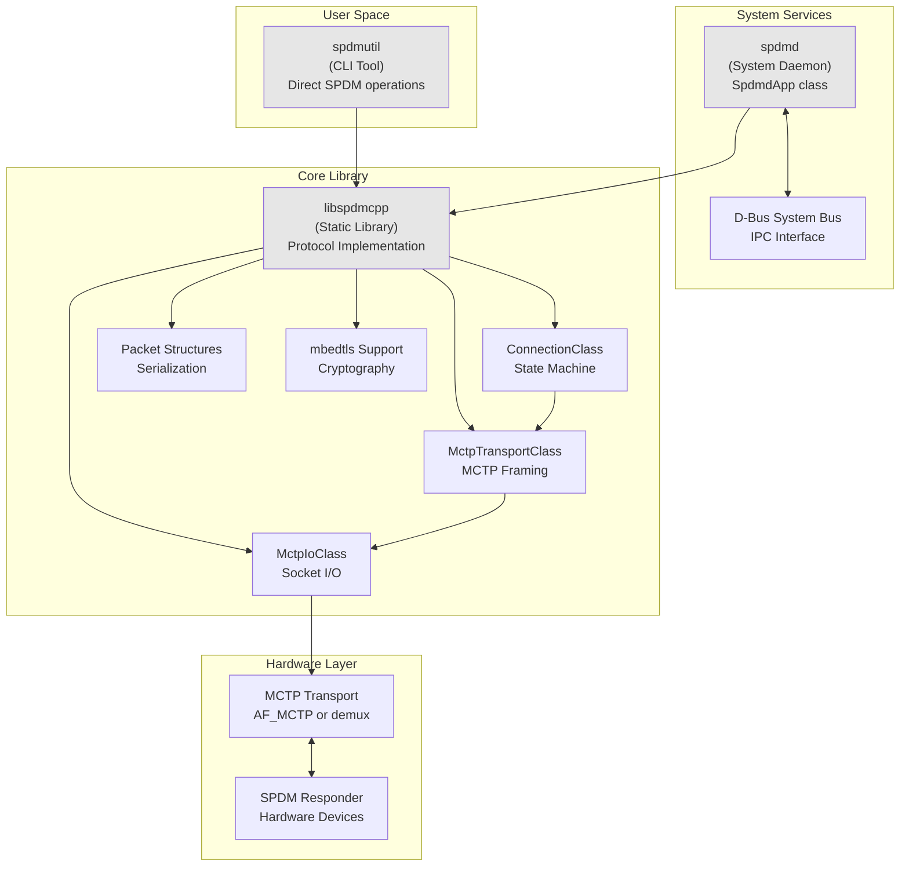

**Sources:** [spdmd/spdmd.cpp:1-545](), [spdmutil/spdmutil.cpp](), [libspdmcpp/connection.hpp:1-907]()

### libspdmcpp Library

The `libspdmcpp` library is a static library built from C++23 source code that implements the SPDM protocol specification. It provides:

| Component | Purpose | Key Classes |
|-----------|---------|-------------|
| Protocol Engine | SPDM state machine implementation | `ConnectionClass` |
| Transport Layer | MCTP packet framing and I/O | `MctpTransportClass`, `MctpIoClass` |
| Packet Handling | Message serialization/deserialization | `PacketVersionResponseVar`, `PacketMeasurementsResponseVar` |
| Cryptography | Certificate parsing, hashing, signature verification | `HashClass`, `mbedtls_x509_crt` wrappers |
| Context Management | Global configuration and I/O registry | `ContextClass` |

The library is transport-agnostic through abstract `TransportClass` and `IOClass` interfaces, with concrete MCTP implementations provided.

**Sources:** [libspdmcpp/connection.hpp:136-906](), [libspdmcpp/connection.cpp:1-1763](), [meson.build:104]()

### spdmd Daemon

The `spdmd` daemon is a system service that:
- Discovers SPDM-capable endpoints via D-Bus signals from MCTP services and phosphor-inventory
- Creates `dbus_api::Responder` objects for each discovered device
- Exposes SPDM device status, capabilities, certificates, and measurements through D-Bus properties
- Handles asynchronous SPDM communication using boost::asio event loop
- Supports automatic measurement collection on device discovery

The daemon integrates with the OpenBMC D-Bus ecosystem, making SPDM data accessible to other system services.

**Sources:** [spdmd/spdmd.cpp:1-545](), [spdmd/spdmd_app.hpp:1-189](), [spdmd/dbus_impl_responder.hpp]()

### spdmutil Command-Line Tool

The `spdmutil` utility provides direct command-line access to SPDM operations for testing and debugging:
- Send individual SPDM commands (GET_VERSION, GET_CAPABILITIES, etc.)
- Retrieve certificates and measurements from responders
- Output results in JSON format
- Useful for development, testing, and manual device interrogation

**Sources:** [spdmutil/spdmutil.cpp](), [meson.build:109]()

## SPDM Protocol Implementation

### Protocol Flow State Machine

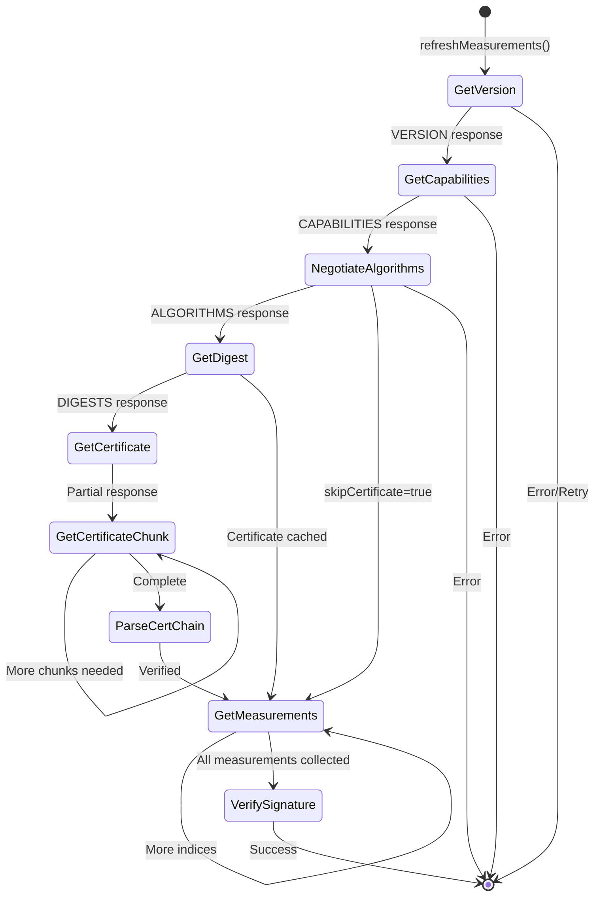

The `ConnectionClass` implements this state machine through a series of `try*()` and `handleRecv<T>()` methods:
- `tryGetVersion()` / `handleRecv<PacketVersionResponseVar>()`
- `tryGetCapabilities()` / `handleRecv<PacketCapabilitiesResponse>()`
- `tryNegotiateAlgorithms()` / `handleRecv<PacketAlgorithmsResponseVar>()`
- `tryGetDigest()` / `handleRecv<PacketDigestsResponseVar>()`
- `tryGetCertificate()` / `handleRecv<PacketCertificateResponseVar>()`
- `tryGetMeasurements()` / `handleRecv<PacketMeasurementsResponseVar>()`

Each phase appends protocol messages to internal buffers (BufA, BufB, BufL) for computing transcript hashes required by the SPDM specification.

**Sources:** [libspdmcpp/connection.cpp:354-1100](), [libspdmcpp/connection.hpp:456-464]()

### Code Entity Mapping

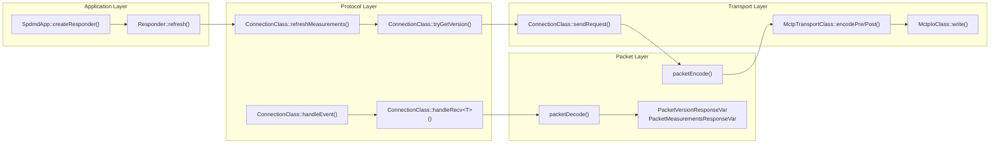

**Sources:** [spdmd/spdmd.cpp:336-387](), [libspdmcpp/connection.cpp:114-164](), [libspdmcpp/connection_inl.hpp:26-92]()

## Transport Modes

The implementation supports two MCTP transport modes, selected at compile time via the `MCTP_IN_KERNEL` build option:

### Kernel Mode (AF_MCTP)

When `MCTP_IN_KERNEL` is enabled, the library uses the in-kernel MCTP stack via `AF_MCTP` sockets. This mode provides:
- Direct kernel-level MCTP protocol handling
- Lower latency communication
- Integration with the Linux kernel MCTP subsystem

The daemon creates a single socket connection via `MctpIoClass::createSocket()` without a path argument, which binds to the kernel MCTP interface.

**Sources:** [config.h.in:26](), [meson_options.txt:17](), [spdmd/spdmd.cpp:524-526]()

### Userspace Mode (Demux Daemon)

When `MCTP_IN_KERNEL` is disabled, the library communicates with the `mctp-demux-daemon` userspace service via Unix domain sockets. This mode:
- Uses per-endpoint socket paths (e.g., `/tmp/mctp-socket-{eid}`)
- Supports environments where kernel MCTP is unavailable
- Allows multiple processes to communicate with MCTP endpoints

The daemon creates separate socket connections for each discovered endpoint via `MctpIoClass::createSocket(sockPath)`.

**Sources:** [spdmd/spdmd.cpp:118-175](), [libspdmcpp/connection_inl.hpp:86-91]()

## Build System Configuration

The project uses Meson as its build system with extensive compile-time configurability:

### Core Build Options

| Option | Type | Purpose | Default |
|--------|------|---------|---------|
| `enable-in-kernel-mctp` | feature | Use kernel MCTP stack (AF_MCTP) instead of demux daemon | disabled |
| `discovery_only_from_mctp_control` | feature | Restrict discovery to MCTP Control daemon signals only | disabled |
| `fetch_serialnumber_from_responder` | integer (0-254) | Measurement index for serial number retrieval | 0 (disabled) |
| `csm_service_enabled` | feature | Enable CSM service dependency checking | enabled |
| `conf_file_name` | string | Path to spdmd JSON configuration file | "/etc/spdmd_conf.json" |

These options are processed into `config.h` via `config.h.in` template substitution and control conditional compilation throughout the codebase.

**Sources:** [meson_options.txt:1-20](), [config.h.in:1-29](), [meson.build:29-52]()

### Dependencies

The project requires the following external dependencies:

**Cryptography:**
- `mbedcrypto`: Core cryptographic operations
- `mbedx509`: X.509 certificate parsing and validation

**D-Bus (daemon only):**
- `sdbusplus`: C++ D-Bus bindings
- `phosphor-dbus-interfaces`: OpenBMC D-Bus interface definitions
- `sdeventplus`: Event loop integration

**Utilities:**
- `CLI11`: Command-line parsing (spdmutil only)
- `nlohmann_json`: JSON configuration parsing (spdmd only)
- `boost::asio`: Asynchronous I/O (spdmd only)

**Sources:** [meson.build:54-102]()

## Discovery and Responder Management

### Discovery Mechanism

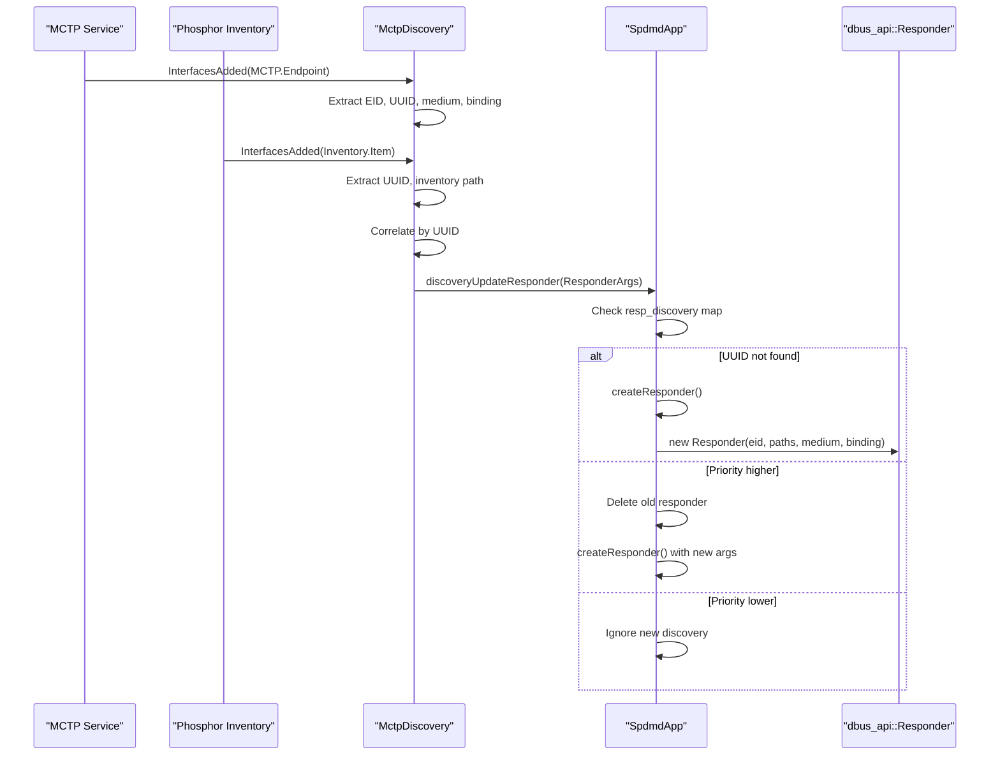

The `MctpDiscovery` class monitors D-Bus for:
- `InterfacesAdded` signals on `/xyz/openbmc_project/mctp` from `au.com.CodeConstruct.MCTP1` service
- `InterfacesAdded` signals on inventory paths from `xyz.openbmc_project.Inventory.Manager`

When both MCTP and inventory objects share the same UUID, a `ResponderArgs` structure is created and passed to `SpdmdApp::discoveryUpdateResponder()`. The application maintains a `resp_discovery` map keyed by UUID to track discovered devices and implements priority-based selection when multiple transport paths exist for the same device.

**Sources:** [spdmd/mctp_endpoint_discovery.hpp](), [spdmd/spdmd.cpp:294-334](), [spdmd/spdmd_app.hpp:169]()

### Priority-Based Selection

The daemon prioritizes transport mediums and binding types by bandwidth when multiple paths exist:

**Medium Priority (highest to lowest):**
PCIe > USB > SPI > I3C > KCS > Serial > SMBus

**Binding Priority (highest to lowest):**
PCIe > USB > SPI > I3C > KCS > Serial > SMBus

The `needRecreateResponder()` method compares medium priorities first, then binding priorities if mediums match, ensuring the highest-bandwidth path is selected for each device.

**Sources:** [spdmd/spdmd_app.hpp:54-73](), [spdmd/spdmd.cpp:225-292]()

## Configuration and Deployment

### Runtime Configuration

The daemon reads configuration from `/etc/spdmd_conf.json` (configurable via `conf_file_name` build option). The configuration file supports:
- Per-EID measurement settings
- Automatic measurement collection parameters
- Logging configuration

The daemon also supports command-line options:
- `-v, --verbose <0-7>`: Set log verbosity level
- `--cached_measurements <all|eid1,eid2,...>`: Enable automatic measurements on discovery
- `--cached_measurements_delay <seconds>`: Delay before initial measurements (default: 60)

**Sources:** [spdmd/spdmd.cpp:49-116](), [spdmd/spdmd_app_context.hpp](), [config.h.in:17]()

### systemd Integration

When built with `systemd` feature enabled, the project includes a systemd service unit for `spdmd`. The daemon supports:
- systemd watchdog notifications
- Automatic restart on failure
- D-Bus activation
- Integration with OpenBMC service dependencies

**Sources:** [meson.build:3](), [spdmd/meson.build]()

---

# Page: System Architecture

# System Architecture

<details>
<summary>Relevant source files</summary>

The following files were used as context for generating this wiki page:

- [libspdmcpp/connection.cpp](libspdmcpp/connection.cpp)
- [libspdmcpp/headers_public/spdmcpp/connection.hpp](libspdmcpp/headers_public/spdmcpp/connection.hpp)
- [libspdmcpp/headers_public/spdmcpp/connection_inl.hpp](libspdmcpp/headers_public/spdmcpp/connection_inl.hpp)
- [libspdmcpp/tests/connection_test.cpp](libspdmcpp/tests/connection_test.cpp)
- [spdmd/dbus_impl_responder.cpp](spdmd/dbus_impl_responder.cpp)
- [spdmd/dbus_impl_responder.hpp](spdmd/dbus_impl_responder.hpp)
- [spdmd/spdmd.cpp](spdmd/spdmd.cpp)
- [spdmd/spdmd_app.hpp](spdmd/spdmd_app.hpp)

</details>


## Purpose and Scope

This document describes the overall architecture of the NVIDIA SPDM implementation, focusing on how the three main components—`spdmd` daemon, `libspdmcpp` library, and `spdmutil` CLI tool—interact with each other and with external systems including D-Bus, MCTP transport, and SPDM-capable hardware devices.

For detailed information about specific subsystems:
- Build configuration and compile-time options: see [Build System and Configuration](#1.2)
- libspdmcpp library internals: see [libspdmcpp Library](#2)
- spdmd daemon implementation details: see [spdmd Daemon](#3)
- spdmutil command-line tool: see [spdmutil Command-Line Tool](#4)

---

## System Components

The NVIDIA SPDM implementation consists of three primary executable components and one library:

| Component | Type | Purpose | Key Classes |
|-----------|------|---------|-------------|
| **spdmd** | System Daemon | Manages SPDM communication, exposes D-Bus interfaces | `SpdmdApp`, `dbus_api::Responder` |
| **libspdmcpp** | Static Library | SPDM protocol implementation | `ConnectionClass`, `MctpTransportClass` |
| **spdmutil** | CLI Tool | Manual SPDM operations via command line | N/A (utility functions) |

### Component Architecture

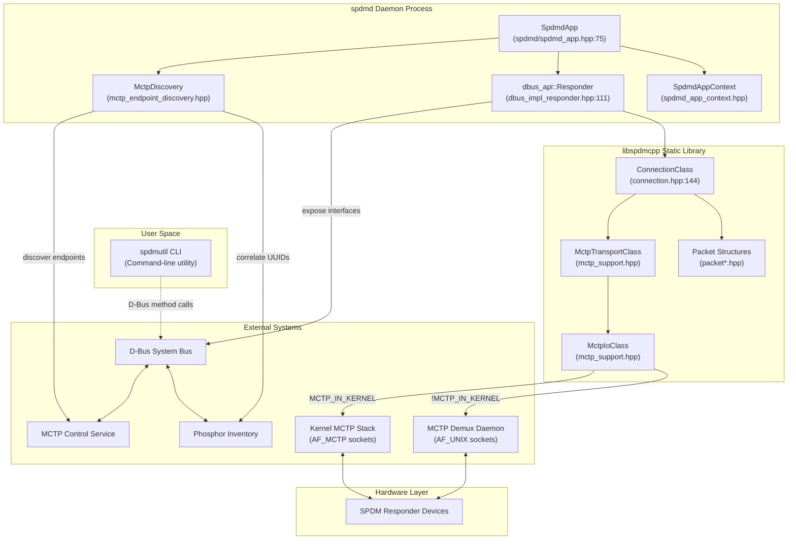

**Sources:** [spdmd/spdmd_app.hpp](), [spdmd/dbus_impl_responder.hpp](), [libspdmcpp/headers_public/spdmcpp/connection.hpp]()

---

## Protocol Stack Layering

The SPDM implementation follows a layered architecture from application logic down to hardware communication:

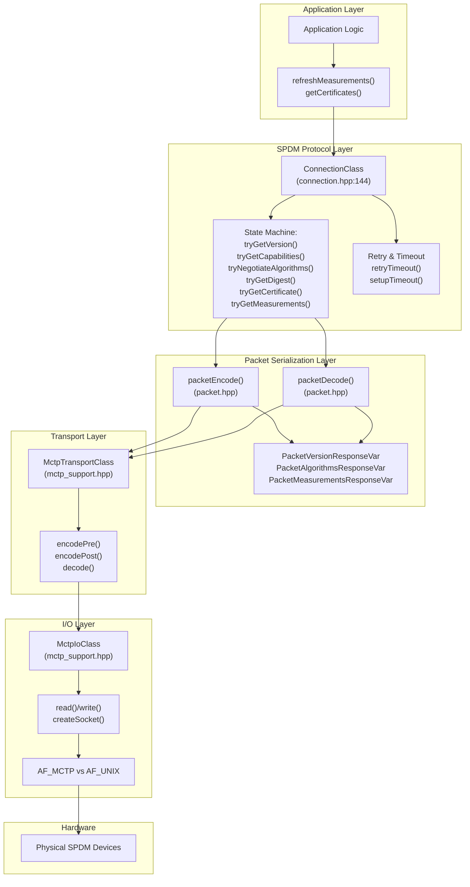

**Sources:** [libspdmcpp/connection.cpp:354-945](), [libspdmcpp/headers_public/spdmcpp/connection.hpp:456-465]()

---

## Daemon Architecture

The `spdmd` daemon orchestrates SPDM operations, managing multiple SPDM responder devices through D-Bus interfaces:

### Daemon Component Relationships

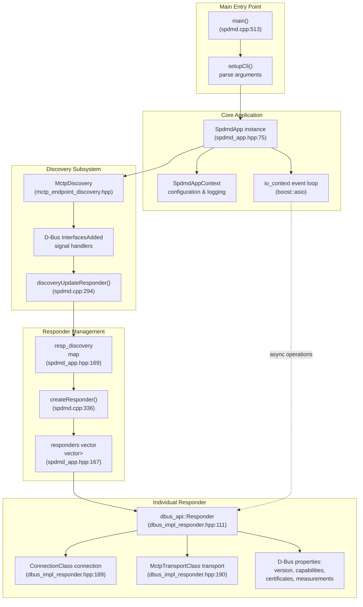

**Sources:** [spdmd/spdmd.cpp:513-544](), [spdmd/spdmd_app.hpp:75-186](), [spdmd/dbus_impl_responder.hpp:111-225]()

---

## Communication Flow

### MCTP Transport Modes

The system supports two MCTP transport modes, selected at compile time via the `MCTP_IN_KERNEL` flag:

| Mode | Socket Type | Description |
|------|-------------|-------------|
| **Kernel Mode** | `AF_MCTP` | Direct kernel MCTP stack communication |
| **Userspace Mode** | `AF_UNIX` | Communication via mctp-demux-daemon |

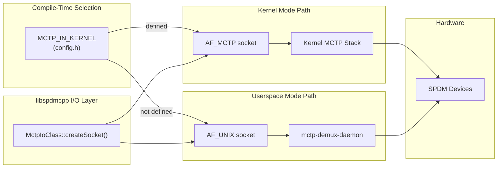

**Sources:** [libspdmcpp/connection_inl.hpp:86-90](), [spdmd/spdmd.cpp:524-526]()

### MCTP Packet Reception

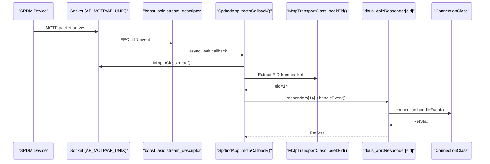

**Sources:** [spdmd/spdmd.cpp:423-486](), [spdmd/spdmd.cpp:118-175]()

---

## D-Bus Integration

The daemon exposes SPDM functionality through D-Bus interfaces, allowing external OpenBMC services to interact with SPDM responders:

### D-Bus Interface Hierarchy

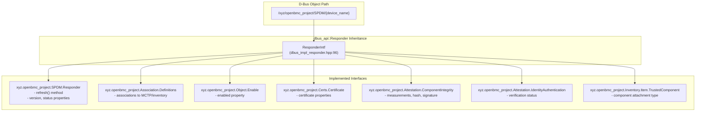

**Sources:** [spdmd/dbus_impl_responder.hpp:96-104]()

### Refresh Operation Flow

The `refresh()` D-Bus method triggers a complete SPDM measurement cycle:

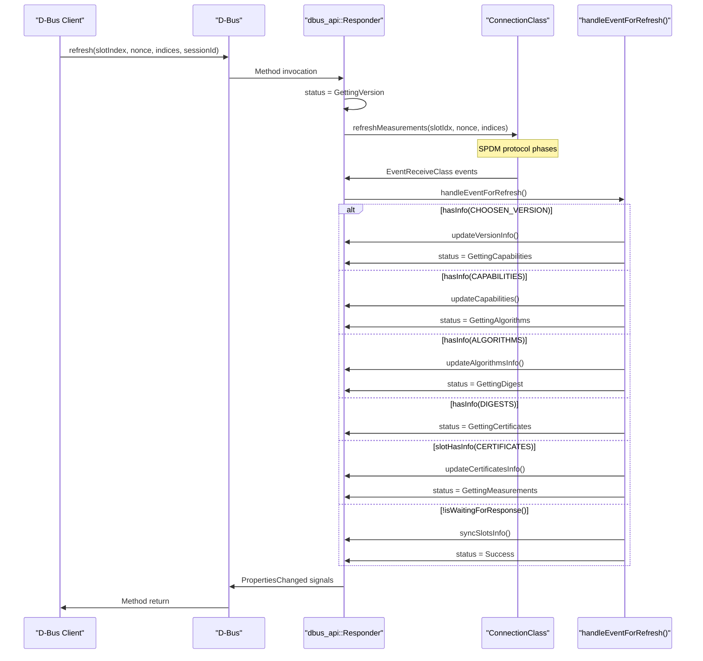

**Sources:** [spdmd/dbus_impl_responder.cpp:386-481](), [spdmd/dbus_impl_responder.cpp:330-384]()

---

## ConnectionClass State Machine

The `ConnectionClass` implements the SPDM protocol as a state machine, coordinating the multi-phase handshake:

### Protocol Phase Transitions

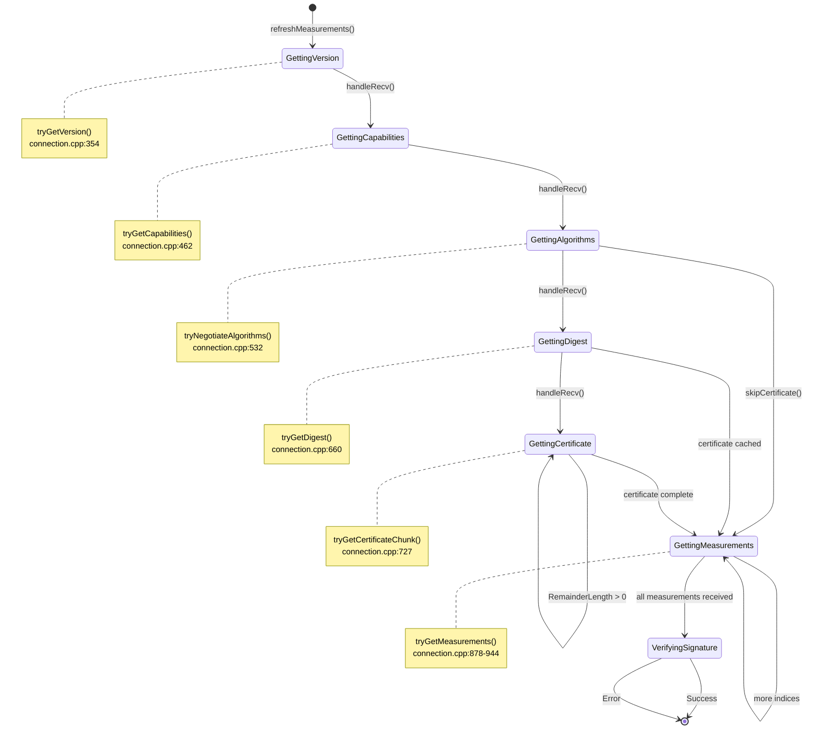

**Sources:** [libspdmcpp/connection.cpp:354-1104]()

### Key ConnectionClass Methods

| Method | Purpose | Line Reference |
|--------|---------|----------------|
| `refreshMeasurements()` | Entry point for measurement flow | [connection.cpp:114-147]() |
| `tryGetVersion()` | Negotiate SPDM version | [connection.cpp:354-371]() |
| `tryGetCapabilities()` | Exchange capabilities | [connection.cpp:462-495]() |
| `tryNegotiateAlgorithms()` | Select crypto algorithms | [connection.cpp:532-573]() |
| `tryGetDigest()` | Request certificate digests | [connection.cpp:660-673]() |
| `tryGetCertificate()` | Request certificate chain | [connection.cpp:860-876]() |
| `tryGetMeasurements()` | Request measurements | [connection.cpp:878-909]() |
| `handleEvent()` | Process receive/timeout events | [connection.cpp:1318-1356]() |

**Sources:** [libspdmcpp/connection.cpp](), [libspdmcpp/headers_public/spdmcpp/connection.hpp:144-448]()

---

## Buffer Management for Transcript Hashing

The SPDM 1.2 specification requires computing hashes over communication transcripts. `ConnectionClass` maintains three buffers:

### Buffer Architecture

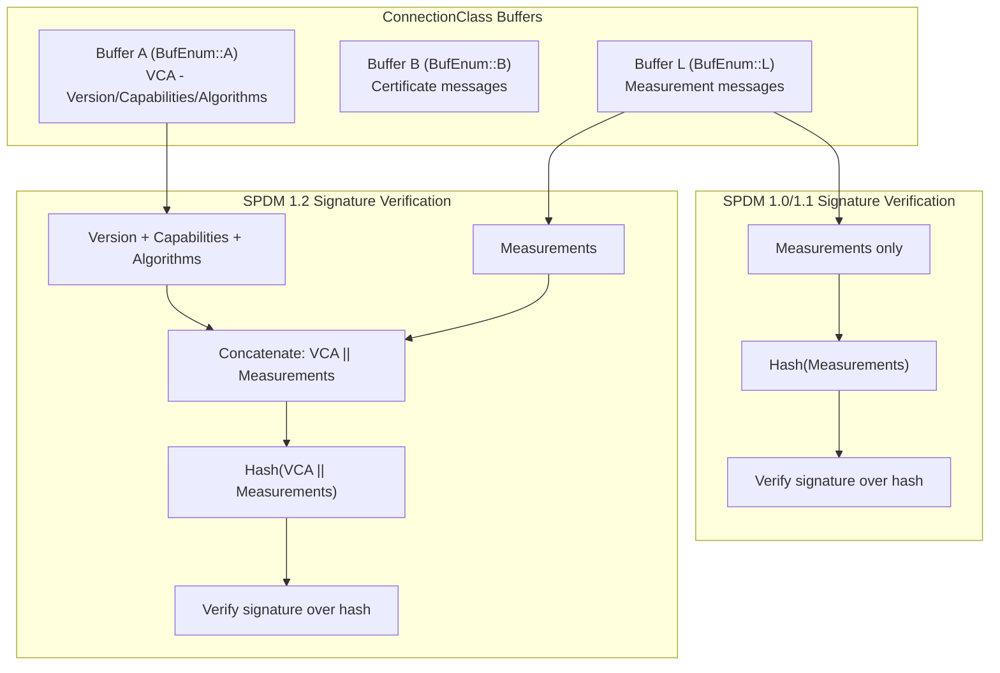

**Sources:** [libspdmcpp/connection.cpp:1028-1060](), [libspdmcpp/headers_public/spdmcpp/connection.hpp:476-486]()

### Buffer Usage Pattern

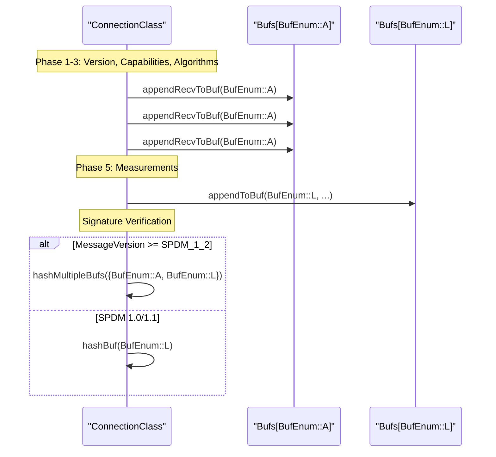

**Sources:** [libspdmcpp/connection.cpp:411-416](), [libspdmcpp/connection.cpp:1030-1041]()

---

## Event-Driven Architecture

The system uses an asynchronous, event-driven model with `boost::asio`:

### Event Loop Integration

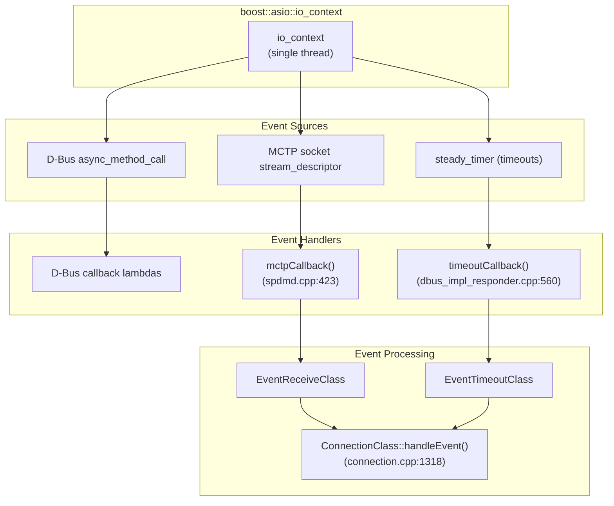

**Sources:** [spdmd/spdmd.cpp:423-486](), [spdmd/dbus_impl_responder.cpp:543-568](), [libspdmcpp/connection.cpp:1318-1356]()

---

## Discovery Mechanism

The daemon discovers SPDM responders through D-Bus signals, correlating MCTP endpoints with inventory items by UUID:

### Discovery Flow

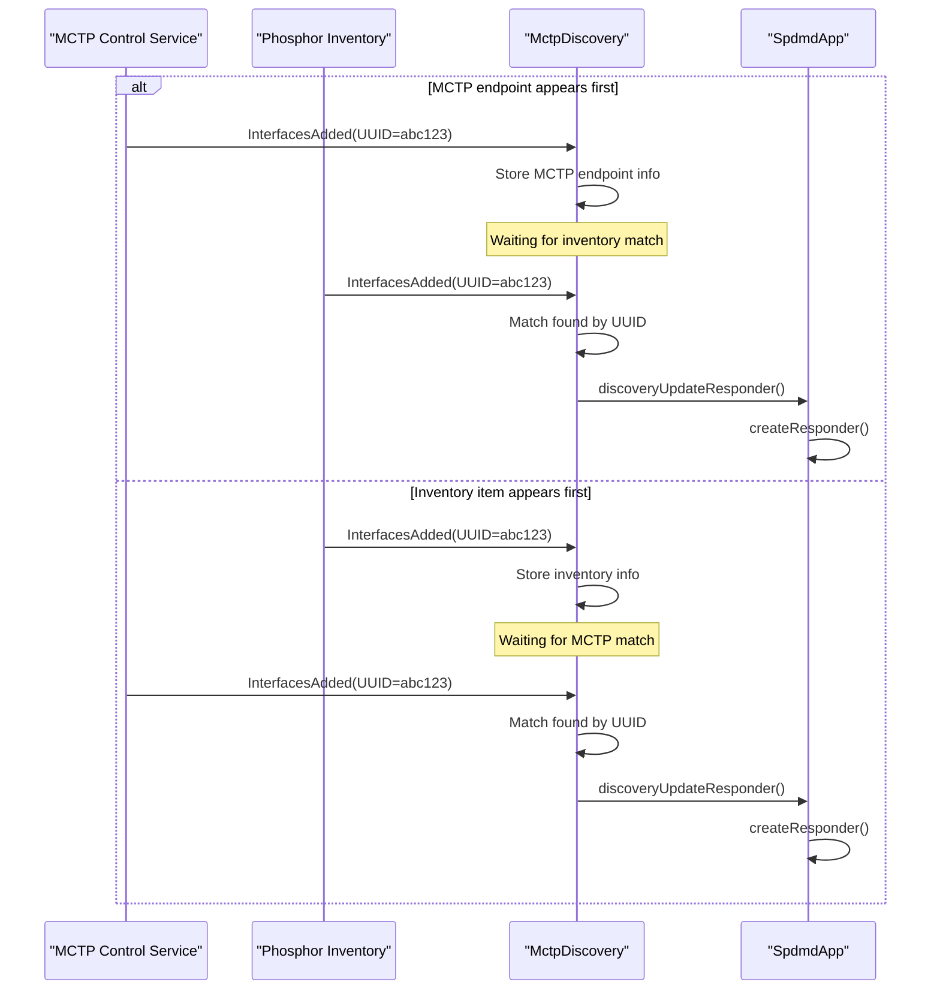

**Sources:** [spdmd/spdmd.cpp:294-334](), [spdmd/spdmd_app.hpp:115]()

### Priority-Based Responder Recreation

When multiple transports exist for the same device, the system selects the highest priority:

| Priority Level | MCTP Medium | Binding Type |
|----------------|-------------|--------------|
| 0 (highest) | PCIe | PCIe |
| 1 | USB | USB |
| 2 | SPI | SPI |
| 3 | I3C | I3C |
| 4 | KCS | KCS |
| 5 | Serial | Serial |
| 6 (lowest) | SMBus | SMBus |

**Sources:** [spdmd/spdmd_app.hpp:54-73](), [spdmd/spdmd.cpp:225-292]()

---

## Summary

The NVIDIA SPDM implementation provides a layered architecture where:

1. **libspdmcpp** implements the SPDM protocol state machine and packet handling
2. **spdmd** daemon manages multiple SPDM devices, exposing their status through D-Bus
3. **spdmutil** provides direct command-line access to SPDM operations
4. Communication occurs via MCTP transport (kernel or userspace mode)
5. Discovery happens automatically through D-Bus signal monitoring
6. The event loop coordinates asynchronous operations across D-Bus, MCTP, and timers

This architecture enables OpenBMC services to attest hardware components using the SPDM security protocol while maintaining flexibility in transport mechanisms and deployment scenarios.

---

# Page: Build System and Configuration

# Build System and Configuration

<details>
<summary>Relevant source files</summary>

The following files were used as context for generating this wiki page:

- [config.h.in](config.h.in)
- [libspdmcpp/headers_public/spdmcpp/event.hpp](libspdmcpp/headers_public/spdmcpp/event.hpp)
- [meson.build](meson.build)
- [meson_options.txt](meson_options.txt)
- [spdmd/meson.build](spdmd/meson.build)
- [spdmd/tests/meson.build](spdmd/tests/meson.build)
- [tools/libmctppacketcorrupt/random.c](tools/libmctppacketcorrupt/random.c)

</details>


This page documents the build system and compile-time configuration for the NVIDIA SPDM project. It covers Meson build definitions, feature flags, dependency management, and deployment artifacts. For runtime configuration of the `spdmd` daemon, see [Configuration](#3.4). For deployment scenarios and examples, see [Deployment Guide](#6).

---

## Build System Overview

The project uses Meson as its build system, configured through [meson.build:1-110]() with C++23 as the target standard. The build is structured as a multi-component project producing a static library (`libspdmcpp`), a system daemon (`spdmd`), a CLI utility (`spdmutil`), and test executables.

### Project Structure

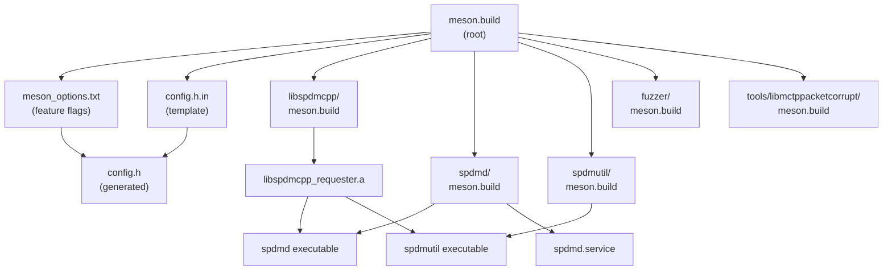

**Meson Build Flow**

The root [meson.build:1-110]() orchestrates the build by:
1. Declaring project metadata and compiler options [meson.build:1-27]()
2. Processing feature flags from `meson_options.txt` [meson.build:29-43]()
3. Generating `config.h` from template [meson.build:45-52]()
4. Resolving dependencies [meson.build:56-102]()
5. Building subdirectories in order [meson.build:104-110]()

Sources: `meson.build`, `meson_options.txt`, `config.h.in`

---

## Build Options and Feature Flags

The [meson_options.txt:1-20]() file defines compile-time feature flags that control major behavioral changes. These options affect code paths via preprocessor macros in the generated `config.h`.

### Core Build Options

| Option | Type | Default | Description | Impact |
|--------|------|---------|-------------|--------|
| `tests` | feature | enabled | Build unit tests | Enables test executables with gtest/gmock |
| `spdmd` | feature | enabled | Build spdmd daemon | Controls daemon build |
| `systemd` | feature | enabled | Include systemd support | Installs systemd service unit |
| `emu` | feature | enabled | Build spdmcpp_emu | Test emulator for development |
| `use_fuzz` | feature | disabled | Fuzz testing | Enables fuzzer builds |

Sources: [meson_options.txt:1-4](), [meson_options.txt:9](), [meson_options.txt:15]()

### Transport Configuration

| Option | Type | Default | Description | Code Impact |
|--------|------|---------|-------------|-------------|
| `enable-in-kernel-mctp` | feature | disabled | Use kernel MCTP stack | Sets `MCTP_IN_KERNEL` macro; switches between `AF_MCTP` sockets vs. demux daemon communication |

The `MCTP_IN_KERNEL` flag fundamentally changes the transport layer implementation. When enabled:
- [libspdmcpp/mctp_io.cpp]() uses `AF_MCTP` sockets directly
- When disabled: uses `AF_UNIX` sockets to communicate with MCTP demux daemon

This flag also affects event handling in [libspdmcpp/headers_public/spdmcpp/event.hpp:75-82](), where `EventTimeoutClass` constructor behavior changes based on kernel vs. userspace mode.

Sources: [meson_options.txt:17](), [config.h.in:26](), [libspdmcpp/headers_public/spdmcpp/event.hpp:75-82]()

### Discovery and Endpoint Management

| Option | Type | Default | Description | Code Impact |
|--------|------|---------|-------------|-------------|
| `discovery_only_from_mctp_control` | feature | disabled | MCTP Control-only discovery | Sets `DISCOVERY_ONLY_FROM_MCTP_CONTROL`; when enabled, discovery happens only via MCTP Control D-Bus signals, using EID for D-Bus paths |
| `csm_service_enabled` | feature | enabled | Enable CSM service check | Sets `CSM_SERVICE_ENABLED`; gates CSM D-Bus service dependency |

The discovery mode determines how `MctpDiscovery` in [spdmd/mctp_endpoint_discovery.cpp]() correlates MCTP endpoints with inventory items:
- **Disabled (bidirectional)**: Matches MCTP endpoints with inventory items via UUID
- **Enabled (MCTP-only)**: Creates responders directly from MCTP Control signals, using EID as identifier

Sources: [meson_options.txt:5](), [meson_options.txt:19](), [config.h.in:14](), [config.h.in:28]()

### Application-Specific Configuration

| Option | Type | Default | Description | Code Impact |
|--------|------|---------|-------------|-------------|
| `fetch_serialnumber_from_responder` | integer | 0 | Measurement index for serial number | Sets `FETCH_SERIALNUMBER_FROM_RESPONDER`; if non-zero, enables custom code to extract serial number from measurement at specified index |
| `conf_file_name` | string | `/etc/spdmd_conf.json` | Configuration file path | Sets `SPDM_JSON_CONF_FILE_NAME` used by `SpdmdAppContext` |
| `use_default_dbus` | feature | disabled | Use default D-Bus for tests | Sets `USE_DEFAULT_DBUS`; affects test D-Bus connection |

Sources: [meson_options.txt:7](), [meson_options.txt:11](), [meson_options.txt:13](), [config.h.in:11](), [config.h.in:17](), [config.h.in:20]()

---

## Configuration Template System

The [config.h.in:1-29]() template file defines preprocessor macros that are populated by Meson during configuration. The [meson.build:29-52]() uses Meson's `configuration_data()` and `configure_file()` to generate the final `config.h`.

### Configuration Generation Flow

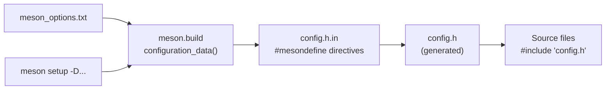

### Macro Definitions

The configuration system generates these key macros:

| Macro | Source | Type | Purpose |
|-------|--------|------|---------|
| `SPDMD_VERSION` | `meson.project_version()` | String | Version information |
| `SPDM_WRAPPER_VERSION` | `meson.project_version()` | String | Library version |
| `MCTP_IN_KERNEL` | `enable-in-kernel-mctp` option | Boolean | Transport mode selection |
| `DISCOVERY_ONLY_FROM_MCTP_CONTROL` | `discovery_only_from_mctp_control` option | Boolean | Discovery strategy |
| `FETCH_SERIALNUMBER_FROM_RESPONDER` | `fetch_serialnumber_from_responder` option | Integer | Measurement index |
| `CSM_SERVICE_ENABLED` | `csm_service_enabled` option | Boolean | CSM dependency gating |
| `SPDM_JSON_CONF_FILE_NAME` | `conf_file_name` option | String | Config file path |
| `USE_DEFAULT_DBUS` | `use_default_dbus` option | Boolean | Test D-Bus mode |
| `USE_FUZZ` | `use_fuzz` option | Boolean | Fuzzing mode |

The `#mesondefine` directives in [config.h.in:11-28]() are replaced by Meson with either `#define MACRO_NAME value` or `/* #undef MACRO_NAME */` based on the configuration.

**Example Configuration Code:**

```cpp
// From meson.build:29-43
conf_data = configuration_data()
conf_data.set_quoted('SPDMD_VERSION', meson.project_version())
conf_data.set('MCTP_IN_KERNEL', get_option('enable-in-kernel-mctp').enabled())
conf_data.set('DISCOVERY_ONLY_FROM_MCTP_CONTROL', 
              get_option('discovery_only_from_mctp_control').enabled())
```

Sources: [meson.build:29-52](), [config.h.in:1-29]()

---

## Dependency Management

The build system declares and resolves both internal and external dependencies. The [meson.build:54-102]() handles dependency resolution with fallback to subprojects when system libraries are unavailable.

### Dependency Resolution Strategy

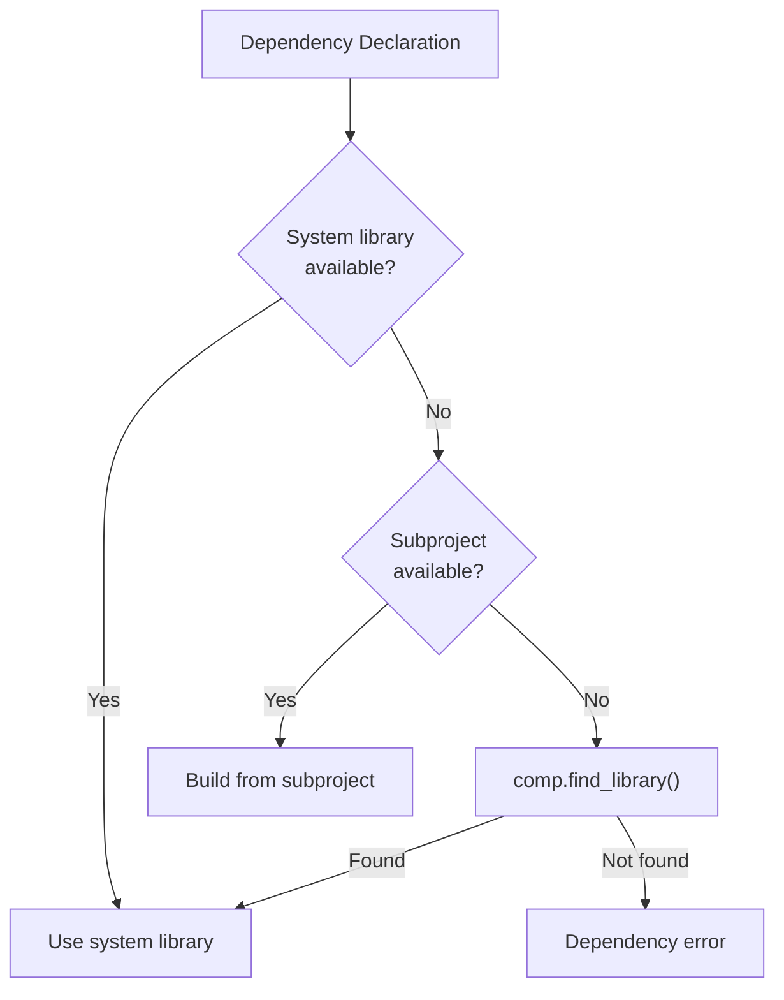

### External Dependencies

#### Cryptographic Libraries

```cpp
// From meson.build:56-76
mbedcrypto_dep = dependency('mbedcrypto', required: false, 
                           fallback: ['mbedtls', 'mbedcrypto_dep'])
mbedx509_dep = dependency('mbedx509', required: false, 
                         fallback: ['mbedtls', 'mbedx509_dep'])
crypto_deps = declare_dependency(dependencies: [mbedcrypto_dep, mbedx509_dep])
```

| Library | Purpose | Usage in Code |
|---------|---------|---------------|
| `mbedcrypto` | Cryptographic operations | Hashing, signature verification, ECDSA |
| `mbedx509` | X.509 certificate parsing | Certificate chain validation |

These dependencies are used throughout [libspdmcpp]() for implementing SPDM cryptographic protocols.

#### D-Bus and IPC Libraries

```cpp
// From meson.build:78-87
sdbusplus = dependency('sdbusplus', fallback: ['sdbusplus', 'sdbusplus_dep'])
phosphor_dbus_interfaces = dependency('phosphor-dbus-interfaces', 
                                     fallback: ['phosphor-dbus-interfaces', 
                                               'phosphor_dbus_interfaces_dep'])
sdeventplus = dependency('sdeventplus', fallback: ['sdeventplus', 'sdeventplus_dep'])
```

| Library | Purpose | Usage in Code |
|---------|---------|---------------|
| `sdbusplus` | D-Bus C++ bindings | All D-Bus communication in `spdmd` |
| `phosphor-dbus-interfaces` | OpenBMC D-Bus interface definitions | Interface implementations in `dbus_api::Responder` |
| `sdeventplus` | Event loop integration | Asynchronous D-Bus signal handling |

#### Utility Libraries

```cpp
// From meson.build:89-102
CLI11_dep = dependency('CLI11', fallback: ['CLI11', 'CLI11_dep'])
nlohmann_json = dependency('nlohmann_json', fallback: ['nlohmann_json', 'nlohmann_json_dep'])
```

| Library | Purpose | Usage in Code |
|---------|---------|---------------|
| `CLI11` | Command-line argument parsing | `spdmutil` command structure |
| `nlohmann_json` | JSON parsing/serialization | Configuration file parsing in `SpdmdAppContext` |

The build system checks for header presence first (lines 89-90, 95-96) and falls back to `dependency()` calls if not found, enabling both system-installed and subproject-based builds.

#### Test Dependencies

```cpp
// From meson.build:12-15
gtest = dependency('gtest', main: true, disabler: true, required: false)
gmock = dependency('gmock', disabler: true, required: false)
```

Test dependencies are only resolved when `tests` option is enabled, using the `disabler: true` flag to gracefully handle missing test frameworks.

Sources: [meson.build:56-102](), [meson.build:12-15]()

---

## Build Targets

The project builds multiple artifacts with defined dependency relationships.

### Build Target Architecture

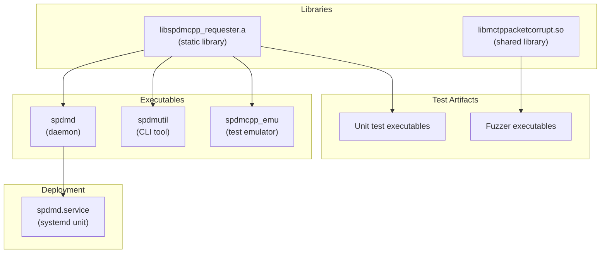

### libspdmcpp Static Library

Built from [libspdmcpp/meson.build](), this is the core SPDM protocol implementation library. It includes:
- `ConnectionClass` state machine
- Packet encoding/decoding
- MCTP transport layer
- Cryptographic support
- Event system

The library is linked into both `spdmd` and `spdmutil` executables.

### spdmd Daemon

The daemon executable is built by [spdmd/meson.build:10-26]():

```cpp
executable(
    'spdmd',
    sources,  // spdmd.cpp, dbus_impl_responder.cpp, mctp_endpoint_discovery.cpp, spdmd_app_context.cpp
    implicit_include_directories: false,
    include_directories: include_directories(spdmd_headers),
    link_with: libspdmcpp_requester,
    dependencies: [
        conf_h_dep, CLI11_dep, phosphor_dbus_interfaces,
        sdbusplus, crypto_deps, nlohmann_json,
        libspdmcpp_requester_dep,
    ],
    install: true,
)
```

**Source Files:**
- [spdmd/spdmd.cpp]() - Main entry point, `SpdmdApp` orchestration
- [spdmd/dbus_impl_responder.cpp]() - `dbus_api::Responder` D-Bus interface implementation
- [spdmd/mctp_endpoint_discovery.cpp]() - `MctpDiscovery` endpoint discovery logic
- [spdmd/spdmd_app_context.cpp]() - `SpdmdAppContext` configuration and logging

The daemon is installed to `/usr/sbin/spdmd` and depends on D-Bus, JSON, and cryptographic libraries.

Sources: [spdmd/meson.build:1-26]()

### spdmutil CLI Tool

Built from [spdmutil/meson.build](), this command-line utility provides direct SPDM protocol interaction without the daemon. It links against `libspdmcpp` and uses `CLI11` for argument parsing.

### Test Executables

Test builds are controlled by the `tests` option. The [spdmd/tests/meson.build:1-75]() shows test configuration:

```cpp
// Generate test-specific config.h
test_config_h = configuration_data()
test_config_h.set('FETCH_SERIALNUMBER_FROM_RESPONDER', '0')
test_config_h.set('SPDM_JSON_CONF_FILE_NAME', '""')
configure_file(output: 'config.h', configuration: test_config_h)
```

Tests override certain configuration macros (lines 12-17) to provide controlled test environments. Standard tests are defined in a list [spdmd/tests/meson.build:2](), while special tests requiring additional source files are defined in a dictionary [spdmd/tests/meson.build:5-10]().

Sources: [spdmd/tests/meson.build:1-75]()

---

## Systemd Service Deployment

When the `systemd` option is enabled, the build system installs the systemd service unit file:

```cpp
// From spdmd/meson.build:28-38
if get_option('systemd').enabled()
    systemd_system_unit_dir = dependency('systemd').get_variable(
        pkgconfig: 'systemdsystemunitdir',
    )
    
    fs.copyfile(
        'service_files/spdmd.service',
        install: true,
        install_dir: systemd_system_unit_dir,
    )
endif
```

This installs `spdmd.service` to the system's systemd unit directory (typically `/lib/systemd/system/`). The service file defines:
- Service dependencies
- Execution user/privileges
- Restart behavior
- Watchdog configuration

Sources: [spdmd/meson.build:28-38]()

---

## Compiler Flags and Warnings

The root build file configures strict compiler behavior:

```cpp
// From meson.build:7
default_options: ['cpp_std=c++23', 'warning_level=3']

// From meson.build:18-27
add_project_arguments(
    ['-Werror', '-fno-sanitize=alignment'],
    language: ['c', 'cpp'],
)

add_project_arguments('-Wno-psabi', language: 'cpp')
```

| Flag | Purpose |
|------|---------|
| `-std=c++23` | Requires C++23 features (ranges, concepts, etc.) |
| `-W3` | Warning level 3 (many warnings enabled) |
| `-Werror` | Treat all warnings as errors |
| `-fno-sanitize=alignment` | Disable alignment sanitizer |
| `-Wno-psabi` | Suppress ABI compatibility notes (for ARM cross-compilation) |

The `-Wno-psabi` flag is ARM-specific and suppresses informational messages about ABI changes between GCC 6 and 7, which are safe to ignore in homogeneous OpenBMC environments.

Sources: [meson.build:7](), [meson.build:18-27]()

---

## Build Configuration Examples

### Default Build (Userspace MCTP, Bidirectional Discovery)

```bash
meson setup builddir
ninja -C builddir
```

This produces:
- Userspace MCTP transport (communicates via demux daemon)
- Bidirectional discovery (correlates MCTP endpoints with inventory via UUID)
- All optional features enabled

### Kernel MCTP Build

```bash
meson setup builddir -Denable-in-kernel-mctp=enabled
ninja -C builddir
```

Changes:
- Uses `AF_MCTP` sockets directly
- Bypasses demux daemon
- Requires kernel MCTP stack support

### MCTP-Only Discovery Build

```bash
meson setup builddir -Ddiscovery_only_from_mctp_control=enabled
ninja -C builddir
```

Changes:
- Discovery driven only by MCTP Control D-Bus signals
- D-Bus paths use EID instead of UUID
- Faster discovery, no inventory correlation

### Minimal Build for Testing

```bash
meson setup builddir \
    -Dspdmd=disabled \
    -Dsystemd=disabled \
    -Demu=disabled \
    -Duse_fuzz=disabled
ninja -C builddir
```

This builds only the library and tests, useful for development and CI environments.

### Custom Configuration File Path

```bash
meson setup builddir -Dconf_file_name='"/custom/path/spdmd.json"'
ninja -C builddir
```

Changes the hardcoded configuration file path in the generated `config.h`.

---

## Configuration Dependencies Graph

The following diagram shows how build options affect different components:

```mermaid
graph TB
    subgraph "Build Options"
        MCTP_KERNEL["enable-in-kernel-mctp"]
        DISCOVERY["discovery_only_from_mctp_control"]
        SERIAL["fetch_serialnumber_from_responder"]
        CSM["csm_service_enabled"]
        TESTS["tests"]
        SYSTEMD["systemd"]
    end
    
    subgraph "Generated Artifacts"
        CONFIG_H["config.h<br/>(MCTP_IN_KERNEL,<br/>DISCOVERY_ONLY_FROM_MCTP_CONTROL,<br/>etc.)"]
    end
    
    subgraph "Library Components"
        IO_CLASS["MctpIoClass<br/>(transport)"]
        EVENT_CLASS["EventTimeoutClass<br/>(events)"]
    end
    
    subgraph "Daemon Components"
        DISCOVERY_CODE["MctpDiscovery<br/>(endpoint discovery)"]
        RESPONDER_CODE["dbus_api::Responder<br/>(D-Bus interface)"]
        APP_CONTEXT["SpdmdAppContext<br/>(configuration)"]
    end
    
    subgraph "Build Artifacts"
        LIB["libspdmcpp.a"]
        DAEMON["spdmd executable"]
        SERVICE["spdmd.service"]
        TEST_EXES["Test executables"]
    end
    
    MCTP_KERNEL --> CONFIG_H
    DISCOVERY --> CONFIG_H
    SERIAL --> CONFIG_H
    CSM --> CONFIG_H
    
    CONFIG_H --> IO_CLASS
    CONFIG_H --> EVENT_CLASS
    CONFIG_H --> DISCOVERY_CODE
    CONFIG_H --> RESPONDER_CODE
    CONFIG_H --> APP_CONTEXT
    
    IO_CLASS --> LIB
    EVENT_CLASS --> LIB
    LIB --> DAEMON
    
    DISCOVERY_CODE --> DAEMON
    RESPONDER_CODE --> DAEMON
    APP_CONTEXT --> DAEMON
    
    SYSTEMD --> SERVICE
    TESTS --> TEST_EXES
```

This shows the flow from build options through configuration generation to final artifacts, highlighting which components are affected by each option.

Sources: [meson.build:1-110](), [meson_options.txt:1-20](), [config.h.in:1-29](), [spdmd/meson.build:1-43]()

---

# Page: libspdmcpp Library

# libspdmcpp Library

<details>
<summary>Relevant source files</summary>

The following files were used as context for generating this wiki page:

- [libspdmcpp/connection.cpp](libspdmcpp/connection.cpp)
- [libspdmcpp/headers_public/spdmcpp/common.hpp](libspdmcpp/headers_public/spdmcpp/common.hpp)
- [libspdmcpp/headers_public/spdmcpp/connection.hpp](libspdmcpp/headers_public/spdmcpp/connection.hpp)
- [libspdmcpp/headers_public/spdmcpp/connection_inl.hpp](libspdmcpp/headers_public/spdmcpp/connection_inl.hpp)
- [libspdmcpp/headers_public/spdmcpp/context.hpp](libspdmcpp/headers_public/spdmcpp/context.hpp)
- [libspdmcpp/headers_public/spdmcpp/enum_defs.hpp](libspdmcpp/headers_public/spdmcpp/enum_defs.hpp)
- [libspdmcpp/tests/connection_test.cpp](libspdmcpp/tests/connection_test.cpp)

</details>


## Purpose and Scope

The `libspdmcpp` library is the core C++ implementation of the SPDM (Security Protocol and Data Model) protocol stack. It provides a transport-agnostic, stateful protocol engine for communicating with SPDM responder devices. The library implements SPDM versions 1.0, 1.1, and 1.2 as specified in DMTF DSP0274.

This page provides an overview of the library's architecture, core components, and interfaces. For detailed information about specific subsystems:
- Protocol state machine and flow details: see [ConnectionClass and Protocol Flow](#2.1)
- Transport layer implementation: see [Transport Layer Abstraction](#2.2)
- Packet encoding/decoding: see [Packet Structures and Serialization](#2.3)
- Cryptographic operations: see [Cryptographic Support](#2.4)

## Library Architecture

```mermaid
graph TB
    subgraph "Application Layer"
        APP["Application Code<br/>(spdmd, spdmutil)"]
    end
    
    subgraph "Core Protocol Engine"
        CONTEXT["ContextClass<br/>Global configuration<br/>IO registry<br/>Supported versions"]
        CONN["ConnectionClass<br/>SPDM state machine<br/>Protocol phases<br/>Event handling"]
    end
    
    subgraph "Protocol State"
        SLOTS["SlotClass[8]<br/>Certificate storage<br/>Digest caching"]
        BUFS["Buffer Management<br/>BufA: VCA transcript<br/>BufB: Certificate transcript<br/>BufL: Measurement transcript"]
        TIMING["TimingClass<br/>T1/T2 timeouts<br/>CT exponent"]
        INFO["Connection State<br/>GotInfo flags<br/>MessageVersion<br/>Algorithms"]
    end
    
    subgraph "Packet Layer"
        PKT_ENC["packetEncode<br/>Struct → bytes"]
        PKT_DEC["packetDecode<br/>Bytes → struct"]
        PKT_STRUCTS["Packet Structures<br/>30+ request/response types"]
    end
    
    subgraph "Transport Abstraction"
        TRANS_IF["TransportClass<br/>encodePre/encodePost/decode"]
        IO_IF["IOClass<br/>read/write"]
    end
    
    subgraph "Cryptographic Layer"
        HASH["HashClass<br/>SHA-256/384/512"]
        MBEDTLS["mbedtls Integration<br/>Certificate parsing<br/>Signature verification"]
    end
    
    subgraph "Event System"
        EVENT["EventClass<br/>EventReceiveClass<br/>EventTimeoutClass"]
    end
    
    APP --> CONN
    APP --> CONTEXT
    CONN --> CONTEXT
    CONN --> SLOTS
    CONN --> BUFS
    CONN --> TIMING
    CONN --> INFO
    CONN --> PKT_ENC
    CONN --> PKT_DEC
    PKT_ENC --> PKT_STRUCTS
    PKT_DEC --> PKT_STRUCTS
    CONN --> TRANS_IF
    CONN --> IO_IF
    CONN --> HASH
    CONN --> MBEDTLS
    CONN --> EVENT
    
    style CONN fill:#f9f,stroke:#333,stroke-width:3px
```

**Library Component Architecture**: The library is structured in layers with `ConnectionClass` as the central protocol engine coordinating all operations.

Sources: [libspdmcpp/headers_public/spdmcpp/connection.hpp:143-904](), [libspdmcpp/headers_public/spdmcpp/common.hpp:1-270](), [libspdmcpp/headers_public/spdmcpp/context.hpp:1-164]()

## Core Components

The library is organized around several key classes and abstractions:

| Component | File | Responsibility |
|-----------|------|----------------|
| `ConnectionClass` | [connection.hpp:143-904]() | SPDM protocol state machine, orchestrates all protocol phases |
| `ContextClass` | [context.hpp:44-162]() | Global configuration, IO registry, supported versions |
| `TransportClass` | [common.hpp:126-239]() | Abstract interface for transport framing (MCTP) |
| `IOClass` | [common.hpp:249-267]() | Abstract interface for socket I/O operations |
| `SlotClass` | [connection.hpp:493-571]() | Per-slot certificate storage (8 slots per SPDM spec) |
| `TimingClass` | [connection.hpp:86-133]() | Timeout calculation (T1/T2 per SPDM spec) |
| `EventClass` | [event.hpp]() | Asynchronous event abstraction (receive/timeout) |
| `HashClass` | [hash.hpp]() | Cryptographic hashing with algorithm selection |
| `LogClass` | [log.hpp]() | Structured logging with levels and indentation |

Sources: [libspdmcpp/headers_public/spdmcpp/connection.hpp:1-907](), [libspdmcpp/headers_public/spdmcpp/common.hpp:1-270](), [libspdmcpp/headers_public/spdmcpp/context.hpp:1-164]()

## ConnectionClass: The Protocol Engine

`ConnectionClass` is the core of the library, implementing the SPDM state machine. It manages the complete protocol flow from version negotiation through measurement retrieval and signature verification.

### Key Responsibilities

1. **Protocol Phase Orchestration**: Coordinates the multi-phase SPDM handshake
2. **State Management**: Tracks connection state, received information, and pending responses
3. **Buffer Management**: Maintains transcript buffers for signature verification
4. **Certificate Handling**: Manages 8 certificate slots with digest caching
5. **Retry Logic**: Implements timeout and retry mechanisms per SPDM spec
6. **Event Processing**: Handles receive and timeout events asynchronously

### State Tracking

```mermaid
graph LR
    START["Initial State"] --> VERSION["Version<br/>Negotiation"]
    VERSION --> CAPAB["Capabilities<br/>Exchange"]
    CAPAB --> ALGO["Algorithm<br/>Negotiation"]
    ALGO --> DIGEST["Get Digests"]
    DIGEST --> CERT["Get Certificate"]
    CERT --> MEAS["Get Measurements"]
    MEAS --> VERIFY["Verify Signature"]
    VERIFY --> DONE["Complete"]
    
    VERSION -.->|"Retry/Error"| VERSION
    CAPAB -.->|"Error"| VERSION
    ALGO -.->|"Error"| VERSION
    DIGEST -.->|"Error"| VERSION
    CERT -.->|"Retry"| CERT
    MEAS -.->|"Error"| VERSION
```

**SPDM Protocol State Progression**: `ConnectionClass` implements this multi-phase flow with retry and error handling.

Sources: [libspdmcpp/connection.cpp:354-1095](), [libspdmcpp/headers_public/spdmcpp/connection.hpp:143-450]()

### Public API

The primary entry points for applications:

| Method | Purpose |
|--------|---------|
| `refreshMeasurements(SlotIdx, nonce, indices)` | Initiates complete SPDM flow |
| `handleEvent(EventClass&)` | Processes receive/timeout events |
| `resetConnection()` | Resets all state to initial condition |
| `getCertificatesPEM(string&, SlotIdx)` | Retrieves certificate chain as PEM |
| `getCertificatesDER(vector<uint8_t>&, SlotIdx)` | Retrieves certificate chain as DER |
| `getDMTFMeasurements()` | Returns parsed measurement data |
| `getSignedMeasurementsBuffer()` | Returns full transcript (VCA + measurements) |
| `getSignedMeasurementsHash()` | Returns L1/L2 hash |
| `getMeasurementsSignature()` | Returns responder signature |

Sources: [libspdmcpp/headers_public/spdmcpp/connection.hpp:213-427]()

### Buffer Management for Transcript Hashing

`ConnectionClass` maintains three buffers for computing transcript hashes required for SPDM signature verification:

```mermaid
graph TB
    subgraph "Buffer A - VCA Transcript"
        BUFA["Version + Capabilities + Algorithms<br/>Used in SPDM 1.2+ signatures"]
    end
    
    subgraph "Buffer B - Certificate Transcript"
        BUFB["GET_DIGESTS + DIGESTS<br/>+ GET_CERTIFICATE + CERTIFICATE<br/>Used for M1/M2 hash (authentication)"]
    end
    
    subgraph "Buffer L - Measurement Transcript"
        BUFL["GET_MEASUREMENTS + MEASUREMENTS<br/>Used for L1/L2 hash (measurements)"]
    end
    
    CONN["ConnectionClass"] --> BUFA
    CONN --> BUFB
    CONN --> BUFL
    
    BUFA --> SPDM12["SPDM 1.2 Signature Context<br/>Hash(BufA + BufL)"]
    BUFL --> SPDM12
    
    BUFL --> SPDM11["SPDM 1.0/1.1<br/>Hash(BufL only)"]
```

**Transcript Buffer Usage**: Different buffers accumulate request/response pairs for signature verification. SPDM 1.2 includes VCA in the measurement signature context.

Sources: [libspdmcpp/connection.cpp:1030-1073](), [libspdmcpp/headers_public/spdmcpp/connection.hpp:477-486](), [libspdmcpp/headers_public/spdmcpp/connection.hpp:689-742]()

## Transport and I/O Abstraction

The library uses abstract interfaces to remain transport-agnostic:

```mermaid
graph TB
    subgraph "Abstract Interfaces"
        TRANS_IF["TransportClass<br/>encodePre()<br/>encodePost()<br/>decode()<br/>setupTimeout()"]
        IO_IF["IOClass<br/>read()<br/>write()"]
    end
    
    subgraph "MCTP Implementations"
        MCTP_TRANS["MctpTransportClass<br/>MCTP header framing<br/>EID addressing"]
        MCTP_IO["MctpIoClass<br/>AF_MCTP or AF_UNIX socket"]
    end
    
    CONN["ConnectionClass"] --> TRANS_IF
    CONN --> IO_IF
    TRANS_IF <-.implements.-> MCTP_TRANS
    IO_IF <-.implements.-> MCTP_IO
    
    MCTP_TRANS --> PKT["Adds MCTP headers<br/>Message type 0x05<br/>TO bit, EID"]
    MCTP_IO --> SOCK["Socket operations<br/>Kernel or userspace demux"]
```

**Transport Abstraction Layers**: Applications implement concrete transport/IO classes and register them with `ContextClass`.

The library supports two MCTP modes selected at compile time via `MCTP_IN_KERNEL`:
- **Kernel Mode**: Uses `AF_MCTP` sockets, kernel handles MCTP framing
- **Userspace Mode**: Uses `AF_UNIX` sockets to mctp-demux-daemon, userspace handles MCTP

Sources: [libspdmcpp/headers_public/spdmcpp/common.hpp:119-267](), [libspdmcpp/headers_public/spdmcpp/connection_inl.hpp:26-92]()

## Enumeration Types

The library defines several critical enumerations for type-safe protocol handling:

### RetStat - Return Status Codes

```cpp
RetStat::OK                                    // Success
RetStat::ERROR_TIMEOUT                         // No response received
RetStat::ERROR_UNSUPPORTED_SPDM_VERSION        // Version negotiation failed
RetStat::ERROR_CERTIFICATE_PARSING_ERROR       // Invalid certificate format
RetStat::ERROR_MEASUREMENT_SIGNATURE_VERIFIY_FAILED  // Signature verification failed
```

### ConnectionInfoEnum - Protocol Phase Tracking

```cpp
ConnectionInfoEnum::SUPPORTED_VERSIONS  // Received VERSION response
ConnectionInfoEnum::CHOOSEN_VERSION     // Negotiated SPDM version
ConnectionInfoEnum::CAPABILITIES        // Received CAPABILITIES response
ConnectionInfoEnum::ALGORITHMS          // Negotiated algorithms
ConnectionInfoEnum::DIGESTS             // Received certificate digests
ConnectionInfoEnum::MEASUREMENTS        // Completed measurements
```

### MessageVersionEnum - SPDM Versions

```cpp
MessageVersionEnum::SPDM_1_0  // 0x10
MessageVersionEnum::SPDM_1_1  // 0x11
MessageVersionEnum::SPDM_1_2  // 0x12
```

Sources: [libspdmcpp/headers_public/spdmcpp/enum_defs.hpp:23-167]()

## Certificate Slot Management

SPDM supports up to 8 certificate slots per responder. `ConnectionClass` maintains a `SlotClass` array for managing these:

| SlotClass Member | Type | Purpose |
|------------------|------|---------|
| `Digest` | `vector<uint8_t>` | Hash of certificate chain |
| `Certificates` | `vector<uint8_t>` | Raw certificate chain (with SPDM header) |
| `MCertificates` | `vector<unique_ptr<mbedtls_x509_crt_raii>>` | Parsed X.509 certificates |
| `CertificateOffset` | `size_t` | Offset where DER data starts |
| `GotInfo` | `uint8_t` | Bitmask of received information |

The library supports digest-based caching: if the digest matches a previously received certificate chain, the certificate retrieval phase is skipped.

Sources: [libspdmcpp/headers_public/spdmcpp/connection.hpp:493-571](), [libspdmcpp/connection.cpp:199-262](), [libspdmcpp/connection.cpp:674-725]()

## Timing and Timeout Management

`TimingClass` calculates SPDM timeouts per DSP0274 section 9:

```cpp
T1 = RTT + sT1  // Standard request timeout
T2 = RTT + CT   // Measurement request timeout (includes crypto time)
```

- **RTT**: Round-trip transport time (configurable, default 6000ms for slow BMC environments)
- **sT1**: Static T1 component (24000ms)
- **CT**: Crypto time, computed from responder's `CTExponent` capability: `CT = 2^(CTExponent-10)` milliseconds

The library uses `T1` for version/capabilities/algorithm/certificate requests and `T2` for measurement requests which may require cryptographic operations.

Sources: [libspdmcpp/headers_public/spdmcpp/connection.hpp:86-133]()

## Packet Encode/Decode Flow

```mermaid
sequenceDiagram
    participant App as Application
    participant Conn as ConnectionClass
    participant Trans as TransportClass
    participant Enc as packetEncode
    participant IO as IOClass
    
    App->>Conn: refreshMeasurements()
    Conn->>Conn: tryGetVersion()
    Conn->>Trans: encodePre(buf, lay)
    Trans->>Trans: Reserve header space
    Conn->>Enc: packetEncode(request, buf, offset)
    Enc->>Enc: Serialize PacketGetVersionRequest
    Conn->>Trans: encodePost(buf, lay)
    Trans->>Trans: Fill MCTP headers
    Conn->>IO: write(buf)
    IO->>IO: Socket send
    
    Note over IO: ... response received ...
    
    IO->>Conn: EventReceiveClass(response_buf)
    Conn->>Trans: decode(response_buf, lay)
    Trans->>Trans: Validate MCTP headers
    Conn->>Enc: packetDecode(resp, buf, offset)
    Enc->>Enc: Deserialize PacketVersionResponseVar
    Conn->>Conn: handleRecv<PacketVersionResponseVar>()
    Conn->>Conn: chooseVersion()
    Conn->>Conn: tryGetCapabilities()
```

**Packet Encoding/Decoding Flow**: Request encoding adds transport headers, response decoding strips them and validates content.

Sources: [libspdmcpp/headers_public/spdmcpp/connection_inl.hpp:26-125](), [libspdmcpp/connection.cpp:354-424]()

## Event-Driven Operation

The library operates asynchronously via an event-driven model:

```cpp
// Application provides received data via EventReceiveClass
std::vector<uint8_t> receivedData;
io->read(receivedData);
EventReceiveClass receiveEvent(receivedData);
connection.handleEvent(receiveEvent);

// Or timeout event when no response received
EventTimeoutClass timeoutEvent;
connection.handleEvent(timeoutEvent);
```

`ConnectionClass::handleEvent()` dispatches to the appropriate handler based on `WaitingForResponse` state:

1. Validates event type matches expected response
2. Calls template specialization of `handleRecv<T>()` for the response type
3. Updates connection state and buffers
4. Initiates next protocol phase or completes flow

Sources: [libspdmcpp/connection.cpp:1157-1240](), [libspdmcpp/headers_public/spdmcpp/connection.hpp:447-454]()

## Usage Pattern Example

Typical usage sequence for applications:

```mermaid
graph TB
    START["Application Start"] --> CTX["Create ContextClass<br/>Register IOClass"]
    CTX --> CONN["Create ConnectionClass<br/>Register TransportClass"]
    CONN --> REFRESH["Call refreshMeasurements()"]
    REFRESH --> WAIT["Wait for events"]
    WAIT --> EVENT["Receive data or timeout"]
    EVENT --> HANDLE["Call handleEvent()"]
    HANDLE --> CHECK{"isWaitingForResponse()?"}
    CHECK -->|"Yes"| WAIT
    CHECK -->|"No"| RESULT["Check hasInfo(MEASUREMENTS)"]
    RESULT --> GET["getCertificatesPEM()<br/>getDMTFMeasurements()<br/>getMeasurementsSignature()"]
    GET --> DONE["Process results"]
```

**Typical Application Flow**: Applications drive the protocol by initiating `refreshMeasurements()` and pumping events.

Sources: [libspdmcpp/tests/connection_test.cpp:233-481]()

## Configuration and Context

`ContextClass` provides global configuration shared by multiple connections:

| Configuration Item | Purpose |
|-------------------|---------|
| Supported SPDM versions | Determines version negotiation behavior |
| IO registry | Maps socket paths to `IOClass` instances (userspace mode) |
| Single IO instance | Shared kernel socket (kernel mode) |

The library supports both kernel and userspace MCTP modes. In userspace mode, each MCTP medium (PCIe, USB, I2C) has a separate socket path registered in the `ContextClass` IO container.

Sources: [libspdmcpp/headers_public/spdmcpp/context.hpp:44-162]()

## Error Handling and Retry

The library implements robust error handling:

1. **Packet-level retries**: Up to 4 retries for transient errors with 3-second delays
2. **Certificate retries**: Up to 3 retries for certificate retrieval failures  
3. **Version negotiation fallback**: On error, restart from `GET_VERSION`
4. **Timeout handling**: Uses `setupTimeout()` to detect unresponsive responders

Error codes are returned as `RetStat` enums with detailed categorization:
- `ERROR_TIMEOUT`: No response within timeout period
- `ERROR_CERTIFICATE_PARSING_ERROR`: Invalid certificate format
- `ERROR_MEASUREMENT_SIGNATURE_VERIFIY_FAILED`: Signature verification failed
- `ERROR_UNSUPPORTED_SPDM_VERSION`: No common SPDM version

Sources: [libspdmcpp/connection.cpp:1241-1297](), [libspdmcpp/connection.cpp:754-858](), [libspdmcpp/headers_public/spdmcpp/enum_defs.hpp:23-56]()

## Thread Safety

`ConnectionClass` is **not thread-safe**. Applications must ensure:
- Single thread calls `handleEvent()` for a given connection
- No concurrent calls to `refreshMeasurements()` or getter methods
- Event pumping happens on a single event loop

Multiple `ConnectionClass` instances (for different responders) can safely operate on separate threads.

Sources: [libspdmcpp/headers_public/spdmcpp/connection.hpp:143-145]()

---

# Page: ConnectionClass and Protocol Flow

# ConnectionClass and Protocol Flow

<details>
<summary>Relevant source files</summary>

The following files were used as context for generating this wiki page:

- [libspdmcpp/connection.cpp](libspdmcpp/connection.cpp)
- [libspdmcpp/headers_public/spdmcpp/connection.hpp](libspdmcpp/headers_public/spdmcpp/connection.hpp)
- [libspdmcpp/headers_public/spdmcpp/connection_inl.hpp](libspdmcpp/headers_public/spdmcpp/connection_inl.hpp)
- [libspdmcpp/tests/connection_test.cpp](libspdmcpp/tests/connection_test.cpp)

</details>


## Purpose and Scope

The `ConnectionClass` is the core SPDM protocol engine in libspdmcpp. It implements the complete SPDM requester state machine, managing communication with SPDM responder devices from initial version negotiation through measurement retrieval and signature verification. This page documents the class architecture, protocol flow mechanisms, event handling, and retry logic.

For details on specific protocol phases (version, capabilities, algorithms, etc.), see [SPDM Protocol Phases](#2.1.1). For certificate slot management, see [Certificate Management and Slots](#2.1.2). For buffer and transcript hash management, see [Buffer Management and Transcript Hashing](#2.1.3).

**Sources:** [libspdmcpp/headers_public/spdmcpp/connection.hpp:135-145](), [libspdmcpp/connection.cpp:107-112]()

---

## Class Architecture

`ConnectionClass` is a non-copyable class that manages all SPDM communication state for a single endpoint. It coordinates transport abstraction, cryptographic operations, packet encoding/decoding, and protocol flow logic.

### ConnectionClass Structure

```mermaid
graph TB
    subgraph "ConnectionClass Core"
        CC[ConnectionClass]
        CONTEXT["context: ContextClass<br/>(global config)"]
        TRANSPORT["transport: TransportClass*<br/>(MCTP layer)"]
        LOG["Log: LogClass<br/>(logging instance)"]
        EID["m_eid: uint8_t<br/>(endpoint ID)"]
    end
    
    subgraph "Protocol State"
        MSGVER["MessageVersion<br/>MessageVersionEnum"]
        WAITING["WaitingForResponse<br/>RequestResponseEnum"]
        GOTINFO["GotInfo: uint8_t<br/>(bitmask flags)"]
        ALGORITHMS["Algorithms<br/>PacketAlgorithmsResponseVar"]
        SUPPORTED["SupportedVersions<br/>vector<PacketVersionNumber>"]
        RESPFLAGS["responderCapabilitiesFlags<br/>ResponderCapabilitiesFlags"]
    end
    
    subgraph "Certificate Storage"
        SLOTS["Slots[8]: SlotClass<br/>(certificate chains)"]
        CERTIDX["CertificateSlotIdx<br/>(current slot)"]
    end
    
    subgraph "Buffer Management"
        BUFA["Bufs[A]: VCA transcript"]
        BUFB["Bufs[B]: Certificate data"]
        BUFL["Bufs[L]: Measurements"]
        SENDBUF["SendBuffer<br/>(outgoing requests)"]
        RESPBUF["ResponseBuffer<br/>(incoming responses)"]
    end
    
    subgraph "Measurement State"
        DMTF["DMTFMeasurements<br/>map<index, measurement>"]
        MEASHASH["MeasurementsHash<br/>(L1/L2 hash)"]
        MEASIG["MeasurementsSignature<br/>(responder signature)"]
        NONCE["MeasurementNonce[32]"]
        INDICES["MeasurementIndices<br/>bitset<256>"]
    end
    
    subgraph "Retry and Timeout"
        TIMING["Timings: TimingClass"]
        SENDTIMEOUT["SendTimeout: timeout_ms_t"]
        SENDRETRY["SendRetry: uint16_t"]
        RETRYPKT["retryPktCount: uint8_t"]
        RETRYVER["retryGetVersionCount: uint8_t"]
        RETRYCERT["retryCertCount: uint8_t"]
    end
    
    CC --> CONTEXT
    CC --> TRANSPORT
    CC --> LOG
    CC --> EID
    CC --> MSGVER
    CC --> WAITING
    CC --> GOTINFO
    CC --> ALGORITHMS
    CC --> SLOTS
    CC --> BUFA
    CC --> BUFB
    CC --> BUFL
    CC --> DMTF
    CC --> TIMING
```

**Key Member Variables:**

| Variable | Type | Purpose |
|----------|------|---------|
| `MessageVersion` | `MessageVersionEnum` | Negotiated SPDM protocol version (1.0, 1.1, or 1.2) |
| `WaitingForResponse` | `RequestResponseEnum` | Current expected response type, or `INVALID` if idle |
| `GotInfo` | `uint8_t` | Bitmask tracking which protocol stages completed |
| `Algorithms` | `PacketAlgorithmsResponseVar` | Negotiated cryptographic algorithms |
| `Slots[8]` | `SlotClass` | Certificate storage for up to 8 certificate chains |
| `Bufs[A/B/L]` | `vector<uint8_t>` | Transcript buffers for hash computation |
| `SendBuffer` | `vector<uint8_t>` | Encoded outgoing request packet |
| `ResponseBuffer` | `vector<uint8_t>` | Received response packet |
| `retryPktCount` | `uint8_t` | Retry counter for current request |
| `stateEnabled` | `bool` | Whether protocol flow is actively progressing |

**Sources:** [libspdmcpp/headers_public/spdmcpp/connection.hpp:143-904](), [libspdmcpp/connection.cpp:166-197]()

---

## Protocol State Machine

The SPDM protocol follows a strict sequential flow. `ConnectionClass` implements this as a state machine driven by `refreshMeasurements()` calls and asynchronous event handling.

### State Progression Flow

```mermaid
stateDiagram-v2
    [*] --> GetVersion: refreshMeasurements()
    
    GetVersion --> GetCapabilities: handleRecv<br/>PacketVersionResponseVar
    
    GetCapabilities --> NegotiateAlgorithms: handleRecv<br/>PacketCapabilitiesResponse
    
    NegotiateAlgorithms --> GetDigest: handleRecv<br/>PacketAlgorithmsResponseVar<br/>(if CERT_CAP)
    NegotiateAlgorithms --> GetMeasurements: handleRecv<br/>PacketAlgorithmsResponseVar<br/>(if skipCertificate)
    
    GetDigest --> GetCertificate: handleRecv<br/>PacketDigestsResponseVar<br/>(if digest changed)
    GetDigest --> GetMeasurements: handleRecv<br/>PacketDigestsResponseVar<br/>(if digest cached)
    
    GetCertificate --> GetCertificateChunk: handleRecv<br/>PacketCertificateResponseVar<br/>(if RemainderLength > 0)
    GetCertificateChunk --> GetCertificateChunk: more chunks
    GetCertificateChunk --> GetMeasurements: last chunk received
    
    GetMeasurements --> GetMeasurementsLoop: handleRecv<br/>PacketMeasurementsResponseVar<br/>(if more indices)
    GetMeasurementsLoop --> GetMeasurementsLoop: next index
    GetMeasurementsLoop --> VerifySignature: all indices done
    
    VerifySignature --> Complete: signature valid
    VerifySignature --> Complete: skipVerifySignature
    
    Complete --> [*]: stateEnabled = false
    
    note right of GetVersion
        tryGetVersion()
        WaitingForResponse = RESPONSE_VERSION
    end note
    
    note right of GetCapabilities
        tryGetCapabilities()
        WaitingForResponse = RESPONSE_CAPABILITIES
    end note
    
    note right of GetMeasurements
        tryGetMeasurements(idx)
        WaitingForResponse = RESPONSE_MEASUREMENTS
    end note
```

**Key Protocol Methods:**

Each protocol phase is initiated by a `try*()` method and completed by a corresponding `handleRecv<T>()` specialization:

| Phase | Initiator Method | Response Handler | Buffer |
|-------|-----------------|------------------|--------|
| Version | `tryGetVersion()` | `handleRecv<PacketVersionResponseVar>()` | BufEnum::A |
| Capabilities | `tryGetCapabilities()` | `handleRecv<PacketCapabilitiesResponse>()` | BufEnum::A |
| Algorithms | `tryNegotiateAlgorithms()` | `handleRecv<PacketAlgorithmsResponseVar>()` | BufEnum::A |
| Digests | `tryGetDigest()` | `handleRecv<PacketDigestsResponseVar>()` | BufEnum::B |
| Certificate | `tryGetCertificate(idx)` | `handleRecv<PacketCertificateResponseVar>()` | BufEnum::B |
| Measurements | `tryGetMeasurements(idx)` | `handleRecv<PacketMeasurementsResponseVar>()` | BufEnum::L |

**Sources:** [libspdmcpp/connection.cpp:354-371](), [libspdmcpp/connection.cpp:372-424](), [libspdmcpp/connection.cpp:462-530](), [libspdmcpp/connection.cpp:532-658](), [libspdmcpp/connection.cpp:660-725](), [libspdmcpp/connection.cpp:727-876](), [libspdmcpp/connection.cpp:878-1107]()

---

## Event-Driven Execution Model

`ConnectionClass` uses an event-driven model for asynchronous operation. Events are dispatched through `handleEvent()`, which routes them to specialized handlers.

### Event Handling Flow

```mermaid
graph TB
    START["handleEvent(EventClass& event)"]
    
    GETTYPE["event.getAs<T>()"]
    
    ISRECV{"EventReceiveClass?"}
    ISTIMEOUT{"EventTimeoutClass?"}
    
    HANDLERECV["handleRecv(EventReceiveClass)"]
    
    CHECKTOKEN{"respIfReadyToken<br/>set?"}
    
    HANDLEIFREADY["handleResponseIfReadyDelay()"]
    HANDLETIMEOUT["handleTimeoutOrRetry()"]
    
    DECODETRANSPORT["transport->decode()<br/>(strip MCTP headers)"]
    GETCODE["packetMessageHeaderGetRequestresponsecode()"]
    
    ISERROR{"code ==<br/>RESPONSE_ERROR?"}
    
    HANDLEERROR["Interpret PacketErrorResponseVar"]
    
    ISNOTREADY{"ErrorCodeResponseNotReady?"}
    
    SETUPDELAY["transport->setupTimeout()<br/>(ResponseIfReady delay)"]
    
    CHECKWAITING{"code ==<br/>WaitingForResponse?"}
    
    DISPATCH["Dispatch to handleRecv<T>()<br/>based on code"]
    
    CHECKRETRY{"checkErrorCodeForRetry(rs)?"}
    RETRY["retryTimeout()"]
    
    RETURN["Return RetStat"]
    
    START --> GETTYPE
    GETTYPE --> ISRECV
    ISRECV -->|Yes| HANDLERECV
    ISRECV -->|No| ISTIMEOUT
    
    ISTIMEOUT -->|Yes| CHECKTOKEN
    ISTIMEOUT -->|No| RETURN
    
    CHECKTOKEN -->|Yes| HANDLEIFREADY
    CHECKTOKEN -->|No| HANDLETIMEOUT
    
    HANDLERECV --> DECODETRANSPORT
    DECODETRANSPORT --> GETCODE
    GETCODE --> ISERROR
    
    ISERROR -->|Yes| HANDLEERROR
    ISERROR -->|No| CHECKWAITING
    
    HANDLEERROR --> ISNOTREADY
    ISNOTREADY -->|Yes| SETUPDELAY
    ISNOTREADY -->|No| CHECKWAITING
    
    CHECKWAITING -->|Match| DISPATCH
    CHECKWAITING -->|Mismatch| RETRY
    
    DISPATCH --> CHECKRETRY
    CHECKRETRY -->|Yes| RETRY
    CHECKRETRY -->|No| RETURN
    
    SETUPDELAY --> RETURN
    HANDLEIFREADY --> RETURN
    HANDLETIMEOUT --> RETURN
    RETRY --> RETURN
```

**Event Types:**

| Event Class | Purpose | Handler |
|------------|---------|---------|
| `EventReceiveClass` | New response packet received | `handleRecv(EventReceiveClass&)` |
| `EventTimeoutClass` | Timeout expired (response timeout or ResponseIfReady delay) | `handleTimeoutOrRetry()` or `handleResponseIfReadyDelay()` |

**Response Matching Logic:**

The `WaitingForResponse` field tracks the expected response type. When a response arrives, the code is extracted from the packet header and compared:

```cpp
// From connection.cpp:1237-1263
if (code != WaitingForResponse)
{
    if (Log.logLevel >= spdmcpp::LogClass::Level::Error)
    {
        if (isWaitingForResponse())
        {
            Log.iprint("ERROR_WRONG_REQUEST_RESPONSE_CODE: ");
            Log.println(code);
            Log.iprint(" while waiting for response: ");
            Log.println(WaitingForResponse);
        }
        ...
    }
    return retryTimeout(RetStat::ERROR_WRONG_REQUEST_RESPONSE_CODE);
}
WaitingForResponse = RequestResponseEnum::INVALID;
```

**Sources:** [libspdmcpp/connection.cpp:1313-1334](), [libspdmcpp/connection.cpp:1109-1311](), [libspdmcpp/connection.cpp:1336-1371]()

---

## Request-Response Pattern

All SPDM communication follows a consistent request-response pattern implemented by the `sendRequestSetupResponse<R, T>()` template method.

### Request-Response Cycle

```mermaid
sequenceDiagram
    participant App as Application
    participant Conn as ConnectionClass
    participant Trans as TransportClass
    participant IO as IOClass
    participant Dev as SPDM Device
    
    App->>Conn: tryGetVersion()
    
    Note over Conn: sendRequestSetupResponse<<br/>PacketVersionResponseVar,<br/>PacketGetVersionRequest>()
    
    Conn->>Conn: sendRequest(request, bufidx)
    Note over Conn: packetEncode(request)
    Conn->>Trans: encodePre(buf, lay)
    Note over Trans: Add MCTP header
    Conn->>Trans: encodePost(buf, lay)
    Note over Trans: Finalize MCTP framing
    Conn->>IO: write(SendBuffer)
    IO->>Dev: MCTP packet
    
    Conn->>Conn: setupResponseWait<<br/>PacketVersionResponseVar>()
    Note over Conn: WaitingForResponse =<br/>RESPONSE_VERSION
    Conn->>Trans: setupTimeout(T1)
    Note over Trans: Start timeout timer
    
    Conn-->>App: RetStat::OK
    
    Dev->>IO: RESPONSE_VERSION packet
    IO->>Conn: EventReceiveClass
    
    Conn->>Conn: handleEvent(event)
    Conn->>Conn: handleRecv(EventReceiveClass)
    Conn->>Trans: decode(ResponseBuffer)
    Note over Trans: Strip MCTP headers
    
    Conn->>Conn: Check code == WaitingForResponse
    
    Conn->>Conn: handleRecv<<br/>PacketVersionResponseVar>()
    Note over Conn: interpretResponse(resp)
    Note over Conn: packetDecode(resp)
    
    Conn->>Conn: Process response<br/>(choose version, etc.)
    
    Conn->>Conn: tryGetCapabilities()
    Note over Conn: Next protocol phase
```

**Template Implementation:**

The pattern is implemented as a template in `connection_inl.hpp`:

```cpp
// From connection_inl.hpp:161-178
template <typename R = void, typename T>
RetStat ConnectionClass::sendRequestSetupResponse(const T& request,
                                                  BufEnum bufidx,
                                                  timeout_ms_t timeout,
                                                  uint16_t retry)
{
    auto rs = sendRequest(request, bufidx);
    if (isError(rs))
    {
        return rs;
    }
    rs = setupResponseWait<R>(timeout, retry);
    if (isError(rs))
    {
        return rs;
    }
    return rs;
}
```

**Buffer Tracking:**

The `bufidx` parameter determines whether the request should be appended to a transcript buffer (A, B, or L) for later hash computation. See [Buffer Management and Transcript Hashing](#2.1.3) for details.

**Sources:** [libspdmcpp/headers_public/spdmcpp/connection_inl.hpp:161-178](), [libspdmcpp/headers_public/spdmcpp/connection_inl.hpp:26-92](), [libspdmcpp/headers_public/spdmcpp/connection_inl.hpp:127-159](), [libspdmcpp/headers_public/spdmcpp/connection_inl.hpp:94-125]()

---

## Retry and Timeout Logic

`ConnectionClass` implements multi-level retry logic to handle transient communication failures and busy responders.

### Retry Mechanisms

```mermaid
graph TB
    SEND["Send request<br/>sendRequest()"]
    
    SETUP["setupResponseWait()<br/>Setup timeout timer<br/>Store SendRetry count"]
    
    WAIT["Wait for response<br/>or timeout"]
    
    RECV["EventReceiveClass<br/>received"]
    TIMEOUT["EventTimeoutClass<br/>received"]
    
    HANDLERECV["handleRecv()"]
    
    CHECKCODE{"Response code<br/>matches expected?"}
    
    PROCESS["Process response<br/>handleRecv<T>()"]
    
    CHECKRS{"RetStat indicates<br/>retry needed?"}
    
    RETRYTIMEOUT["retryTimeout(rs)"]
    
    CHECKCOUNT{"SendRetry > 0?"}
    
    DECREMENT["SendRetry--<br/>retryPktCount++"]
    
    RESEND["Wait SendTimeout ms<br/>then resend last request"]
    
    CHECKMAXRETRY{"retryGetVersionCount ><br/>maxGetVersionRetries?"}
    
    RESETVERSION["Reset protocol<br/>stateEnabled = true<br/>tryGetVersion()"]
    
    ERROR["Return error to<br/>application"]
    
    SUCCESS["Continue protocol<br/>flow"]
    
    SEND --> SETUP
    SETUP --> WAIT
    
    WAIT --> RECV
    WAIT --> TIMEOUT
    
    RECV --> HANDLERECV
    HANDLERECV --> CHECKCODE
    
    CHECKCODE -->|Yes| PROCESS
    CHECKCODE -->|No| RETRYTIMEOUT
    
    PROCESS --> CHECKRS
    CHECKRS -->|Yes| RETRYTIMEOUT
    CHECKRS -->|No| SUCCESS
    
    TIMEOUT --> RETRYTIMEOUT
    
    RETRYTIMEOUT --> CHECKCOUNT
    CHECKCOUNT -->|Yes| DECREMENT
    CHECKCOUNT -->|No| CHECKMAXRETRY
    
    DECREMENT --> RESEND
    RESEND --> WAIT
    
    CHECKMAXRETRY -->|No| RESETVERSION
    CHECKMAXRETRY -->|Yes| ERROR
    
    RESETVERSION --> WAIT
```

**Retry Counters:**

| Counter | Max Value | Scope | Purpose |
|---------|-----------|-------|---------|
| `SendRetry` | 4 (default) | Per request | Number of retries for current request before timeout |
| `retryPktCount` | No limit | Per protocol flow | Total packet retries during current `refreshMeasurements()` |
| `retryGetVersionCount` | 6 (`maxGetVersionRetries`) | Per protocol flow | Number of times protocol has restarted from GET_VERSION |
| `retryCertCount` | 3 (`numCertRetries`) | Per certificate | Certificate-specific retry for parsing errors |

**Timeout Values:**

The `TimingClass` computes timeouts based on SPDM specification requirements:

```cpp
// From connection.hpp:95-102
timeout_ms_t getT1() const
{
    return RTT + sT1;
}
timeout_ms_t getT2() const
{
    return RTT + CT;
}
```

Where:
- `T1` = RTT + sT1 = 6000 + 24000 = 30000ms (used for most requests)
- `T2` = RTT + CT (used for `GET_MEASUREMENTS` with longer CT from responder)
- `CT` is computed from the `CTExponent` value in the responder's capabilities

**ResponseIfReady Handling:**

When a responder returns `ERROR_RESPONSE_NOT_READY`, it includes timing parameters for when to retry:

```cpp
// From connection.cpp:1165-1196
if (err.Min.Header.Param1 ==
    PacketErrorResponseVar::ErrorCodeResponseNotReady)
{
    const auto RTDExp =
        err.ExtendedErrorData
            [PacketErrorResponseVar::ExtErrOffsNotReadyRTDExponent];
    respIfReqCode =
        err.ExtendedErrorData
            [PacketErrorResponseVar::ExtErrOffsReadyRequestCode];
    respIfReadyToken =
        err.ExtendedErrorData
            [PacketErrorResponseVar::ExtErrOffsNotReadyToken];
    const auto RTDM =
        err.ExtendedErrorData
            [PacketErrorResponseVar::ExtErrOffsNotReadyRTDM];
    if (!transport)
    {
        return RetStat::ERROR_UNKNOWN;
    }
    return transport->setupTimeout(
        calcResponseIfReadyWaitTimeMs(RTDExp, RTDM));
}
```

When the delay expires, `handleResponseIfReadyDelay()` sends a `RESPOND_IF_READY` request.

**Error Recovery:**

For critical errors (wrong version, unsupported algorithms, etc.), the protocol restarts from GET_VERSION:

```cpp
// Macro from connection.cpp:49-62
#define SPDMCPP_CONNECTION_RS_ERROR_RETURN_WITH_VERSION(rs)                    
    do                                                                         
    {                                                                          
        if (isError(rs))                                                       
        {                                                                      
            ...
            stateEnabled = false;                                              
            return tryGetVersion();                                            
        }                                                                      
    } while (false)
```

**Sources:** [libspdmcpp/connection.cpp:1336-1371](), [libspdmcpp/connection.cpp:1373-1420](), [libspdmcpp/connection.cpp:1154-1234](), [libspdmcpp/headers_public/spdmcpp/connection.hpp:86-133]()

---

## Entry Points and Public API

Applications interact with `ConnectionClass` through a small set of public methods.

### Primary Methods

| Method | Purpose |
|--------|---------|
| `refreshMeasurements(slotIdx)` | Start protocol flow with random nonce and all measurements |
| `refreshMeasurements(slotIdx, nonce)` | Start protocol flow with specified nonce and all measurements |
| `refreshMeasurements(slotIdx, indices)` | Start protocol flow with random nonce and specific measurement indices |
| `refreshMeasurements(slotIdx, nonce, indices)` | Start protocol flow with full control |
| `handleEvent(event)` | Process incoming receive or timeout event |
| `resetConnection()` | Clear all state and return to initial conditions |

### Query Methods

| Method | Return Type | Purpose |
|--------|-------------|---------|
| `hasInfo(ConnectionInfoEnum)` | `bool` | Check if protocol stage completed |
| `slotHasInfo(idx, SlotInfoEnum)` | `bool` | Check if slot has certificate/digest data |
| `isWaitingForResponse()` | `bool` | Check if expecting a response |
| `getMessageVersion()` | `MessageVersionEnum` | Get negotiated SPDM version |
| `getSignatureEnum()` | `SignatureEnum` | Get signature algorithm |
| `getSignatureHashEnum()` | `HashEnum` | Get hash algorithm for signatures |
| `getMeasurementHashEnum()` | `HashEnum` | Get hash algorithm for measurements |
| `getDMTFMeasurements()` | `map<uint8_t, PacketMeasurementFieldVar>` | Get decoded measurements |
| `getSignedMeasurementsBuffer()` | `vector<uint8_t>` | Get VCA+Measurements transcript |
| `getSignedMeasurementsHash()` | `vector<uint8_t>` | Get L1/L2 hash |
| `getMeasurementsSignature()` | `vector<uint8_t>` | Get responder signature |
| `getCertificatesDER(buf, idx)` | `bool` | Get certificate chain in DER format |
| `getCertificatesPEM(str, idx)` | `bool` | Get certificate chain in PEM format |

**Example Usage Pattern:**

```cpp
// Typical usage from spdmd daemon
ConnectionClass conn(context, log, eid, sockPath);
MctpTransportClass transport(eid);
conn.registerTransport(transport);

// Start measurement flow
auto rs = conn.refreshMeasurements(0); // slot 0, random nonce, all measurements
if (isError(rs)) { /* handle error */ }

// Event loop
while (conn.isWaitingForResponse()) {
    EventClass event = ...; // received from transport or timer
    rs = conn.handleEvent(event);
    if (isError(rs)) { /* handle error */ }
}

// Retrieve results
if (conn.hasInfo(ConnectionInfoEnum::MEASUREMENTS)) {
    auto measurements = conn.getDMTFMeasurements();
    auto hash = conn.getSignedMeasurementsHash();
    auto signature = conn.getMeasurementsSignature();
    // Process attestation data
}

conn.unregisterTransport(transport);
```

**Sources:** [libspdmcpp/headers_public/spdmcpp/connection.hpp:213-248](), [libspdmcpp/connection.cpp:114-164](), [libspdmcpp/headers_public/spdmcpp/connection.hpp:266-445]()

---

## Integration with Transport and IO

`ConnectionClass` is transport-agnostic. It delegates packet framing and socket I/O to pluggable interfaces.

### Transport Layer Integration

```mermaid
graph LR
    subgraph "ConnectionClass"
        CONN["ConnectionClass"]
        SENDBUF["SendBuffer"]
        RESPBUF["ResponseBuffer"]
    end
    
    subgraph "Transport Abstraction"
        TPTR["transport: TransportClass*"]
        TCLASS["TransportClass<br/>(abstract interface)"]
        MCTP["MctpTransportClass<br/>(concrete implementation)"]
    end
    
    subgraph "IO Abstraction"
        IOCTX["context.getIO()"]
        IOCLASS["IOClass<br/>(abstract interface)"]
        MCTPIO["MctpIoClass<br/>(socket I/O)"]
    end
    
    subgraph "Packet Operations"
        ENCPRE["encodePre(buf, lay)<br/>(add MCTP header)"]
        ENCPOST["encodePost(buf, lay)<br/>(finalize)"]
        DECODE["decode(buf, lay)<br/>(strip headers)"]
    end
    
    CONN --> TPTR
    TPTR -.implements.-> TCLASS
    TCLASS --> MCTP
    
    CONN --> IOCTX
    IOCTX -.implements.-> IOCLASS
    IOCLASS --> MCTPIO
    
    SENDBUF --> ENCPRE
    ENCPRE --> ENCPOST
    ENCPOST --> MCTPIO
    
    MCTPIO --> DECODE
    DECODE --> RESPBUF
    
    MCTP --> ENCPRE
    MCTP --> ENCPOST
    MCTP --> DECODE
```

**Registration Pattern:**

```cpp
// From connection.hpp:190-206
void registerTransport(TransportClass& trans)
{
    SPDMCPP_ASSERT(!transport);
    transport = &trans;
}

void unregisterTransport(TransportClass& trans)
{
    SPDMCPP_ASSERT(transport == &trans);
    transport = nullptr;
}
```

The `ConnectionClass` does not own the transport object; the caller must manage its lifetime and ensure it outlives the connection.

**Encoding Flow:**

```cpp
// From connection_inl.hpp:27-77
template <typename T>
RetStat ConnectionClass::sendRequest(const T& packet, BufEnum bufidx)
{
    ...
    std::vector<uint8_t>& buf = SendBuffer;
    buf.clear();
    TransportClass::LayerState lay;

    if (transport)
    {
        transport->encodePre(buf, lay);  // Add transport header
    }

    auto rs = packetEncode(packet, buf, lay.getEndOffset());  // Encode SPDM packet
    ...
    
    if (transport)
    {
        transport->encodePost(buf, lay);  // Finalize transport framing
    }
    
    rs = context.getIO(sockPath)->write(buf);  // Send to socket
    return rs;
}
```

**Decoding Flow:**

```cpp
// From connection.cpp:1134-1152
TransportClass::LayerState lay;
if (transport)
{
    auto rs = transport->decode(ResponseBuffer, lay);
    SPDMCPP_CONNECTION_RS_ERROR_RETURN(rs);
}
ResponseBufferSPDMOffset = lay.getEndOffset();

if (ResponseBuffer.size() - ResponseBufferSPDMOffset <
    sizeof(PacketMessageHeader))
{
    return RetStat::ERROR_BUFFER_TOO_SMALL;
}
version = packetMessageHeaderGetMessageVersion(
    ResponseBuffer, ResponseBufferSPDMOffset);
code = packetMessageHeaderGetRequestresponsecode(
    ResponseBuffer, ResponseBufferSPDMOffset);
```

For MCTP transport details, see [MCTP Transport Implementation](#2.2.1). For abstract interfaces, see [Transport Layer Abstraction](#2.2).

**Sources:** [libspdmcpp/headers_public/spdmcpp/connection.hpp:183-206](), [libspdmcpp/headers_public/spdmcpp/connection_inl.hpp:26-92](), [libspdmcpp/connection.cpp:1134-1152]()

---

## State Tracking and Information Flags

`ConnectionClass` uses bitmask flags to track which protocol stages have completed and which data is available.

### ConnectionInfoEnum Flags

The `GotInfo` field tracks connection-level information:

| Flag | Meaning |
|------|---------|
| `SUPPORTED_VERSIONS` | Received `VERSION` response with supported versions |
| `CHOOSEN_VERSION` | Selected SPDM version from intersection of supported versions |
| `CAPABILITIES` | Received `CAPABILITIES` response |
| `ALGORITHMS` | Received `ALGORITHMS` response |
| `DIGESTS` | Received `DIGESTS` response |
| `MEASUREMENTS` | Completed measurements and signature verification |

**Usage:**

```cpp
// From connection.hpp:267-272
bool hasInfo(ConnectionInfoEnum info) const
{
    return !!(GotInfo &
              (1 << static_cast<std::underlying_type_t<ConnectionInfoEnum>>(
                   info)));
}
```

### SlotInfoEnum Flags

Each `SlotClass` tracks per-slot information:

| Flag | Meaning |
|------|---------|
| `DIGEST` | Received digest for this slot |
| `CERTIFICATES` | Downloaded and parsed certificate chain for this slot |

**Usage:**

```cpp
// From connection.hpp:277-283
bool slotHasInfo(SlotIdx slotidx, SlotInfoEnum info) const
{
    SPDMCPP_ASSERT(slotidx < slotNum);
    return !!(
        Slots[slotidx].GotInfo &
        (1 << static_cast<std::underlying_type_t<SlotInfoEnum>>(info)));
}
```

**Assertion Usage:**

Many protocol methods assert that prerequisite information is available:

```cpp
// From connection.cpp:463-465
RetStat ConnectionClass::tryGetCapabilities()
{
    SPDMCPP_ASSERT(hasInfo(ConnectionInfoEnum::CHOOSEN_VERSION));
    ...
}
```

This ensures the protocol flow executes in the correct order.

**Sources:** [libspdmcpp/headers_public/spdmcpp/connection.hpp:266-283](), [libspdmcpp/headers_public/spdmcpp/connection.hpp:820-827](), [libspdmcpp/headers_public/spdmcpp/connection.hpp:492-528]()

---

## Testing and Validation

The `ConnectionClass` test suite validates the complete protocol flow with simulated responders.

### Test Structure

The test fixture creates a mock transport and IO layer:

```cpp
// From connection_test.cpp:55-66
class FixtureTransportClass : public MctpTransportClass
{
  public:
    FixtureTransportClass() : MctpTransportClass(14) {}
    
    spdmcpp::RetStat setupTimeout(spdmcpp::timeout_us_t) override
    {
        return RetStat::OK;
    }
};

class FixtureIOClass : public IOClass
{
    // Queues for write/read operations
    std::list<std::vector<uint8_t>> WriteQueue;
    std::list<std::vector<uint8_t>> ReadQueue;
    ...
};
```

**Test Flow:**

```cpp
// From connection_test.cpp:233-481
void testConnectionFlow(BaseAsymAlgoFlags asymAlgo, BaseHashAlgoFlags hashAlgo)
{
    ConnectionFixture fix;
    
    fix.Connection.refreshMeasurements(0);  // Start flow
    
    // 1. Intercept GET_VERSION request
    PacketGetVersionRequest req;
    fix.interpret(req, MessageHashEnum::M);
    
    // 2. Push VERSION response
    PacketVersionResponseVar resp;
    resp.VersionNumberEntries.push_back(ver);
    fix.push(resp, MessageHashEnum::M);
    fix.handleRecv();
    
    // 3. Intercept GET_CAPABILITIES request
    // 4. Push CAPABILITIES response
    // 5. Intercept NEGOTIATE_ALGORITHMS request
    // 6. Push ALGORITHMS response
    // 7. Intercept GET_DIGESTS request
    // 8. Push DIGESTS response
    // 9. Intercept GET_CERTIFICATE request
    // 10. Push CERTIFICATE response
    // 11. Intercept GET_MEASUREMENTS request
    // 12. Push MEASUREMENTS response with signature
    
    // Signature verification happens automatically
}
```

**Test Coverage:**

| Test Case | Algorithms | Purpose |
|-----------|-----------|---------|
| `FullFlow_ECDSA_256_SHA_256` | P-256 + SHA-256 | NIST P-256 curve with SHA-256 |
| `FullFlow_ECDSA_256_SHA_384` | P-256 + SHA-384 | NIST P-256 curve with SHA-384 |
| `FullFlow_ECDSA_256_SHA_512` | P-256 + SHA-512 | NIST P-256 curve with SHA-512 |
| `FullFlow_ECDSA_384_SHA_384` | P-384 + SHA-384 | NIST P-384 curve with SHA-384 |
| `FullFlow_ECDSA_521_SHA_512` | P-521 + SHA-512 | NIST P-521 curve with SHA-512 |

Each test validates:
- Correct request encoding
- Response interpretation
- Transcript hash computation
- Certificate parsing
- Signature verification

**Sources:** [libspdmcpp/tests/connection_test.cpp:233-481](), [libspdmcpp/tests/connection_test.cpp:483-511]()

---

# Page: SPDM Protocol Phases

# SPDM Protocol Phases

<details>
<summary>Relevant source files</summary>

The following files were used as context for generating this wiki page:

- [libspdmcpp/connection.cpp](libspdmcpp/connection.cpp)
- [libspdmcpp/headers_public/spdmcpp/connection.hpp](libspdmcpp/headers_public/spdmcpp/connection.hpp)
- [libspdmcpp/headers_public/spdmcpp/connection_inl.hpp](libspdmcpp/headers_public/spdmcpp/connection_inl.hpp)
- [libspdmcpp/headers_public/spdmcpp/internal/request/packet_negotiate_algorithms_request.hpp](libspdmcpp/headers_public/spdmcpp/internal/request/packet_negotiate_algorithms_request.hpp)
- [libspdmcpp/headers_public/spdmcpp/internal/response/packet_algorithms_response.hpp](libspdmcpp/headers_public/spdmcpp/internal/response/packet_algorithms_response.hpp)
- [libspdmcpp/headers_public/spdmcpp/internal/response/packet_error_response.hpp](libspdmcpp/headers_public/spdmcpp/internal/response/packet_error_response.hpp)
- [libspdmcpp/headers_public/spdmcpp/internal/response/packet_version_response.hpp](libspdmcpp/headers_public/spdmcpp/internal/response/packet_version_response.hpp)
- [libspdmcpp/tests/connection_test.cpp](libspdmcpp/tests/connection_test.cpp)

</details>


## Purpose and Scope

This document describes the sequential protocol phases that `ConnectionClass` executes during SPDM communication. The SPDM (Security Protocol and Data Model) handshake consists of five distinct phases: version negotiation, capabilities exchange, algorithm negotiation, certificate retrieval, and measurements collection. Each phase builds upon information obtained in previous phases to establish secure attestation of a remote device.

For details on the `ConnectionClass` implementation and event handling mechanisms, see [2.1](#2.1). For information about certificate slot management specifically, see [2.1.2](#2.1.2). For buffer management and transcript hashing, see [2.1.3](#2.1.3).

## Protocol Phase Overview

The following diagram illustrates the complete SPDM protocol flow as orchestrated by `ConnectionClass::refreshMeasurementsInternal()`:

```mermaid
sequenceDiagram
    participant App as Application
    participant Conn as ConnectionClass
    participant Resp as SPDM Responder

    App->>Conn: refreshMeasurements(slotIdx, nonce, indices)
    Conn->>Conn: refreshMeasurementsInternal()
    
    Note over Conn,Resp: Phase 1: Version Negotiation
    Conn->>Resp: GET_VERSION
    Resp->>Conn: VERSION (supported versions)
    Conn->>Conn: chooseVersion()
    Conn->>Conn: markInfo(SUPPORTED_VERSIONS)
    
    Note over Conn,Resp: Phase 2: Capabilities Exchange
    Conn->>Resp: GET_CAPABILITIES
    Resp->>Conn: CAPABILITIES (flags, CT exponent)
    Conn->>Conn: markInfo(CAPABILITIES)
    Conn->>Conn: Timings.setCTExponent()
    
    Note over Conn,Resp: Phase 3: Algorithm Negotiation
    Conn->>Resp: NEGOTIATE_ALGORITHMS
    Resp->>Conn: ALGORITHMS (selected algos)
    Conn->>Conn: markInfo(ALGORITHMS)
    Conn->>Conn: Set BaseHashSize, SignatureSize
    
    alt Certificate Capability Present
        Note over Conn,Resp: Phase 4: Certificate Retrieval
        Conn->>Resp: GET_DIGESTS
        Resp->>Conn: DIGESTS (slot digests)
        Conn->>Conn: markInfo(DIGESTS)
        
        alt Digest Changed or Not Cached
            loop Certificate Chunks
                Conn->>Resp: GET_CERTIFICATE(offset, length)
                Resp->>Conn: CERTIFICATE(chunk)
            end
            Conn->>Conn: parseCertChain()
            Conn->>Conn: SlotClass.markInfo(CERTIFICATES)
        end
    end
    
    Note over Conn,Resp: Phase 5: Measurements Collection
    alt Request All Measurements (index 255)
        Conn->>Resp: GET_MEASUREMENTS(255, nonce, slotIdx)
        Resp->>Conn: MEASUREMENTS(all, signature)
    else Request Individual Measurements
        loop For Each Index
            Conn->>Resp: GET_MEASUREMENTS(index)
            Resp->>Conn: MEASUREMENTS(single)
        end
        Conn->>Resp: GET_MEASUREMENTS(last, nonce, slotIdx)
        Resp->>Conn: MEASUREMENTS(last, signature)
    end
    
    Conn->>Conn: hashMultipleBufs(BufA, BufL)
    Conn->>Conn: verifySignature()
    Conn->>Conn: markInfo(MEASUREMENTS)
    Conn->>App: RetStat::OK
```

**Sources:** [libspdmcpp/connection.cpp:148-164](), [libspdmcpp/connection.cpp:354-1097]()

## Phase State Tracking

`ConnectionClass` uses the `GotInfo` bitmask to track which protocol phases have been successfully completed:

| ConnectionInfoEnum | Set By Phase | Checked By |
|-------------------|--------------|------------|
| `SUPPORTED_VERSIONS` | Version Negotiation | `hasInfo()` |
| `CHOOSEN_VERSION` | Version Negotiation | `hasInfo()` |
| `CAPABILITIES` | Capabilities Exchange | `hasInfo()` |
| `ALGORITHMS` | Algorithm Negotiation | `hasInfo()` |
| `DIGESTS` | Certificate Retrieval | `hasInfo()` |
| `MEASUREMENTS` | Measurements Collection | `hasInfo()` |

**Sources:** [libspdmcpp/headers_public/spdmcpp/connection.hpp:266-283](), [libspdmcpp/connection.cpp:409-614]()

## Phase 1: Version Negotiation

### Purpose

Version negotiation establishes the SPDM specification version to use for subsequent communication. The responder advertises all versions it supports, and the requester selects the highest mutually compatible version.

### Request-Response Flow

```mermaid
graph TB
    Start["tryGetVersion()"] --> CreateReq["Create PacketGetVersionRequest"]
    CreateReq --> SendReq["sendRequestSetupResponse()"]
    SendReq --> WaitResp["Wait for RESPONSE_VERSION"]
    WaitResp --> RecvResp["handleRecv&lt;PacketVersionResponseVar&gt;()"]
    RecvResp --> Validate["Validate Header & Reserved Fields"]
    Validate --> Store["Store SupportedVersions[]"]
    Store --> MarkInfo["markInfo(SUPPORTED_VERSIONS)"]
    MarkInfo --> Choose["chooseVersion()"]
    Choose --> Compare["Compare Context vs Responder Versions"]
    Compare --> Select["Select Highest Common Version"]
    Select --> SetVersion["MessageVersion = selected"]
    SetVersion --> MarkChosen["markInfo(CHOOSEN_VERSION)"]
    MarkChosen --> AppendBuf["appendRecvToBuf(BufEnum::A)"]
    AppendBuf --> NextPhase["tryGetCapabilities()"]
```

### Implementation Details

The version negotiation is implemented in `tryGetVersion()` and `handleRecv<PacketVersionResponseVar>()`:

**Request Transmission:**
- Method: `ConnectionClass::tryGetVersion()` [libspdmcpp/connection.cpp:354-371]()
- Packet Type: `PacketGetVersionRequest`
- Buffer: Appended to `BufEnum::A` for transcript hash
- Timeout: `Timings.getT1()` (T1 timing requirement)

**Response Processing:**
- Method: `ConnectionClass::handleRecv<PacketVersionResponseVar>()` [libspdmcpp/connection.cpp:372-424]()
- Packet Type: `PacketVersionResponseVar`
- Validation:
  - Header `MessageVersion` must be 1.0, 1.1, or 1.2 [libspdmcpp/connection.cpp:390-396]()
  - `Param1` and `Param2` must be 0 [libspdmcpp/connection.cpp:397-400]()
  - `Reserved` field must be 0 [libspdmcpp/connection.cpp:402-406]()

**Version Selection:**
- Method: `ConnectionClass::chooseVersion()` [libspdmcpp/connection.cpp:426-460]()
- Algorithm: Select highest version supported by both requester and responder
- Supported versions defined by `ContextClass::getSupportedVersions()`
- Selected version stored in `MessageVersion` member

**Data Structures:**

```cpp
// Version number entry in response
PacketVersionNumber {
    uint8_t: Major version (4 bits) + Minor version (4 bits)
}

// Response contains variable-length list
PacketVersionResponseVar {
    PacketVersionResponseMin Min;
    vector<PacketVersionNumber> VersionNumberEntries;
}
```

**Sources:** [libspdmcpp/connection.cpp:354-460](), [libspdmcpp/headers_public/spdmcpp/connection.hpp:456](), [libspdmcpp/headers_public/spdmcpp/internal/response/packet_version_response.hpp:1-158]()

## Phase 2: Capabilities Exchange

### Purpose

Capabilities exchange determines what optional features the responder supports. This includes certificate support, measurement capabilities, and signature requirements. The responder also provides its CT (computation time) exponent, which is used to calculate timeout values for subsequent operations.

### Request-Response Flow

The request differs based on the negotiated SPDM version:

| SPDM Version | Request Packet | Key Differences |
|--------------|----------------|-----------------|
| 1.0 | `PacketGetCapabilities10Request` | No flags, no transfer sizes |
| 1.1+ | `PacketGetCapabilitiesRequest` | Includes requester flags |
| 1.2+ | `PacketGetCapabilitiesRequest` | Adds DataTransferSize, MaxSPDMmsgSize |

### Implementation Details

**Request Transmission:**
- Method: `ConnectionClass::tryGetCapabilities()` [libspdmcpp/connection.cpp:462-495]()
- Version-specific handling:
  - SPDM 1.0: Uses `PacketGetCapabilities10Request` [libspdmcpp/connection.cpp:471-476]()
  - SPDM 1.1+: Uses `PacketGetCapabilitiesRequest` with flags [libspdmcpp/connection.cpp:478-492]()
  - SPDM 1.2+: Includes transfer size parameters [libspdmcpp/connection.cpp:484-488]()
- Buffer: Appended to `BufEnum::A`
- Timeout: `Timings.getT1()`

**Response Processing:**
- Method: `ConnectionClass::handleRecv<PacketCapabilitiesResponse>()` [libspdmcpp/connection.cpp:496-530]()
- Validation:
  - `Param1` and `Param2` must be 0 [libspdmcpp/connection.cpp:503-507]()
  - Reserved fields must be 0 [libspdmcpp/connection.cpp:508-512]()
  - CERT_CAP must be set if signature verification is required [libspdmcpp/connection.cpp:519-523]()

**Key Capability Flags:**

```mermaid
graph LR
    Flags["ResponderCapabilitiesFlags"] --> CERT["CERT_CAP:<br/>Certificate support"]
    Flags --> MEAS10["MEAS_CAP_10:<br/>Measurements with signature"]
    Flags --> MEAS01["MEAS_CAP_01:<br/>Measurements without signature"]
    
    CERT --> CertPhase["Phase 4: Certificates"]
    MEAS10 --> MeasPhase["Phase 5: With Verification"]
    MEAS01 --> MeasPhase2["Phase 5: Skip Verification"]
```

**Timing Configuration:**
- The `CTExponent` value is used by `TimingClass::setCTExponent()` [libspdmcpp/connection.cpp:525]()
- Converts microseconds to milliseconds: `CT = 2^(CTExponent-10)` [libspdmcpp/headers_public/spdmcpp/connection.hpp:104-122]()
- Used to calculate T2 timeout: `T2 = RTT + CT` [libspdmcpp/headers_public/spdmcpp/connection.hpp:99-102]()

**Sources:** [libspdmcpp/connection.cpp:462-530](), [libspdmcpp/headers_public/spdmcpp/connection.hpp:86-133]()

## Phase 3: Algorithm Negotiation

### Purpose

Algorithm negotiation establishes the cryptographic algorithms to use for all subsequent operations. This includes asymmetric algorithms for signatures, hash algorithms for transcript hashing, and measurement hash algorithms for measurement digests.

### Negotiation Flow

```mermaid
graph TB
    Start["tryNegotiateAlgorithms()"] --> BuildReq["Build PacketNegotiateAlgorithmsRequestVar"]
    BuildReq --> SetFlags["Set BaseAsymAlgo Flags:<br/>ECDSA P256/P384/P521"]
    SetFlags --> SetHash["Set BaseHashAlgo Flags:<br/>SHA-256/384/512"]
    SetHash --> SetMeas["Set MeasurementSpecification = 0x01"]
    SetMeas --> Finalize["request.finalize()"]
    Finalize --> Send["sendRequestSetupResponse()"]
    Send --> Wait["Wait for RESPONSE_ALGORITHMS"]
    Wait --> Recv["handleRecv&lt;PacketAlgorithmsResponseVar&gt;()"]
    Recv --> Validate["Validate Single Bit Set in Each Algo"]
    Validate --> Store["Store in Algorithms member"]
    Store --> CalcSizes["Calculate BaseHashSize, SignatureSize"]
    CalcSizes --> UpdateInfo["Update packetDecodeInfo"]
    UpdateInfo --> MarkInfo["markInfo(ALGORITHMS)"]
    MarkInfo --> AppendBuf["appendRecvToBuf(BufEnum::A)"]
    AppendBuf --> Decide{"skipCertificate()?"}
    Decide -->|Yes| Measurements["tryGetMeasurements()"]
    Decide -->|No| Digest["tryGetDigest()"]
```

### Implementation Details

**Request Construction:**
- Method: `ConnectionClass::tryNegotiateAlgorithms()` [libspdmcpp/connection.cpp:532-573]()
- Packet: `PacketNegotiateAlgorithmsRequestVar`
- Requester advertises support for:
  - BaseAsymAlgo: ECDSA P256, P384, P521 [libspdmcpp/connection.cpp:542-544]()
  - BaseHashAlgo: SHA-256, SHA-384, SHA-512 [libspdmcpp/connection.cpp:545-547]()
  - MeasurementSpecification: DMTF (bit 0) [libspdmcpp/connection.cpp:540]()

**Response Processing:**
- Method: `ConnectionClass::handleRecv<PacketAlgorithmsResponseVar>()` [libspdmcpp/connection.cpp:574-658]()
- Validation ensures exactly one bit set for each algorithm type [libspdmcpp/connection.cpp:594-612]()
- Critical validations:
  - `MeasurementHashAlgo`: Must have ≤1 bit set [libspdmcpp/connection.cpp:594-600]()
  - `BaseAsymAlgo`: Must have exactly 1 bit set [libspdmcpp/connection.cpp:601-606]()
  - `BaseHashAlgo`: Must have exactly 1 bit set [libspdmcpp/connection.cpp:607-612]()

**Size Calculation:**

The negotiated algorithms determine sizes for subsequent packet fields:

```cpp
// BaseHashSize affects:
// - Certificate digest size
// - Measurement hash size  
// - Transcript hash size
if (auto hsize = getHashSize(resp.Min.BaseHashAlgo); hsize != invalidFlagSize) {
    packetDecodeInfo.BaseHashSize = hsize;
}

// SignatureSize affects:
// - Measurement signature field size
if (auto ssize = getSignatureSize(resp.Min.BaseAsymAlgo); ssize != invalidFlagSize) {
    packetDecodeInfo.SignatureSize = ssize;
}
```

**Algorithms Response Structure:**

| Field | Type | Purpose |
|-------|------|---------|
| `MeasurementHashAlgo` | `MeasurementHashAlgoFlags` | Hash for measurement digests |
| `BaseAsymAlgo` | `BaseAsymAlgoFlags` | Asymmetric signature algorithm |
| `BaseHashAlgo` | `BaseHashAlgoFlags` | Hash for transcripts and signatures |
| `PacketReqAlgVector` | `vector<PacketReqAlgStruct>` | Additional algorithm details |

**Sources:** [libspdmcpp/connection.cpp:532-658](), [libspdmcpp/headers_public/spdmcpp/internal/response/packet_algorithms_response.hpp:1-199](), [libspdmcpp/headers_public/spdmcpp/internal/request/packet_negotiate_algorithms_request.hpp:1-368]()

## Phase 4: Certificate Retrieval (Optional)

### Purpose

Certificate retrieval obtains the responder's certificate chain for signature verification. This phase is skipped if the responder does not have the `CERT_CAP` capability flag set. The process involves two steps: getting certificate digests for all slots, then retrieving the certificate chain for the selected slot.

### Certificate Retrieval Sequence

```mermaid
sequenceDiagram
    participant Conn as ConnectionClass
    participant Slots as SlotClass[8]
    participant Resp as SPDM Responder

    Note over Conn: Phase 4a: Digest Collection
    Conn->>Resp: GET_DIGESTS
    Resp->>Conn: DIGESTS(slot bitmask + digests)
    Conn->>Slots: Update Digest for each slot
    Conn->>Slots: markInfo(DIGEST)
    
    alt Digest Matches Cached & Slot Has Certificates
        Note over Conn: Skip certificate retrieval
        Conn->>Conn: skipCert = true
    else Digest Changed or No Cache
        Note over Conn: Phase 4b: Certificate Chunking
        Conn->>Conn: cert.clear()
        loop Until RemainderLength == 0
            Conn->>Resp: GET_CERTIFICATE(offset, length)
            Resp->>Conn: CERTIFICATE(PortionLength, RemainderLength, chunk)
            Conn->>Conn: cert.append(chunk)
        end
        
        Note over Conn: Phase 4c: Parse & Verify
        Conn->>Conn: parseCertChain(slot, cert)
        Conn->>Conn: Parse PacketCertificateChain
        Conn->>Conn: Extract root cert hash
        loop For each certificate in chain
            Conn->>Conn: mbedtlsCertParseDer()
            Conn->>Slots: MCertificates.push_back()
        end
        Conn->>Slots: markInfo(CERTIFICATES)
    end
```

### Digest Phase Implementation

**Request Transmission:**
- Method: `ConnectionClass::tryGetDigest()` [libspdmcpp/connection.cpp:660-673]()
- Packet: `PacketGetDigestsRequest`
- Buffer: Appended to `BufEnum::B` (used for M1/M2 hash)
- Timeout: `Timings.getT1()`

**Response Processing:**
- Method: `ConnectionClass::handleRecv<PacketDigestsResponseVar>()` [libspdmcpp/connection.cpp:674-725]()
- Response structure:
  - `Param2`: 8-bit slot availability bitmask [libspdmcpp/connection.cpp:686-709]()
  - `Digests[8]`: Array of digest values for available slots
- Digest comparison for cache hit:
  ```cpp
  if (i == CertificateSlotIdx &&
      slotHasInfo(i, SlotInfoEnum::DIGEST) &&
      slotHasInfo(i, SlotInfoEnum::CERTIFICATES) &&
      resp.Digests[i] == Slots[i].Digest) {
      skipCert = true;  // Certificate already cached
  }
  ```

**Sources:** [libspdmcpp/connection.cpp:660-725]()

### Certificate Chunk Retrieval

**Chunking Strategy:**

Certificates may be large and must be retrieved in chunks due to packet size limitations:

```mermaid
graph TB
    Start["tryGetCertificate(slotIdx)"] --> Clear["cert.clear()"]
    Clear --> FirstChunk["tryGetCertificateChunk()"]
    FirstChunk --> BuildReq["PacketGetCertificateRequest"]
    BuildReq --> SetOffset["Offset = cert.size()"]
    SetOffset --> SetLength["Length = 65535 (max uint16)"]
    SetLength --> Send["sendRequestSetupResponse()"]
    Send --> Recv["handleRecv&lt;PacketCertificateResponseVar&gt;()"]
    Recv --> Validate["Validate PortionLength"]
    Validate --> Reserve{"First Chunk?"}
    Reserve -->|Yes| Res["cert.reserve(PortionLength + RemainderLength)"]
    Reserve -->|No| CheckSize["Verify expected total size"]
    Res --> Append
    CheckSize --> Append["cert.append(CertificateVector)"]
    Append --> CheckRemainder{"RemainderLength > 0?"}
    CheckRemainder -->|Yes| FirstChunk
    CheckRemainder -->|No| Parse["parseCertChain()"]
```

**Implementation Details:**

- Method: `ConnectionClass::tryGetCertificateChunk()` [libspdmcpp/connection.cpp:727-753]()
- First chunk reserves buffer space: [libspdmcpp/connection.cpp:792-795]()
  ```cpp
  cert.shrink_to_fit();
  cert.reserve(resp.Min.PortionLength + resp.Min.RemainderLength);
  ```
- Subsequent chunks append data [libspdmcpp/connection.cpp:807-809]()
- Retry logic: Up to 3 retries on certificate errors [libspdmcpp/connection.cpp:757-841]()

**Sources:** [libspdmcpp/connection.cpp:727-877]()

### Certificate Chain Parsing

**Certificate Chain Structure:**

```
PacketCertificateChain {
    uint16_t Length;           // Total chain length
    uint16_t Reserved;
    uint8_t[HashSize] RootHash; // Hash of root certificate
    uint8_t[] Certificates;     // DER-encoded certs (root, intermediate, leaf)
}
```

**Parsing Implementation:**
- Method: `ConnectionClass::parseCertChain()` [libspdmcpp/connection.cpp:264-319]()
- Steps:
  1. Decode `PacketCertificateChain` header [libspdmcpp/connection.cpp:270-271]()
  2. Extract root certificate hash [libspdmcpp/connection.cpp:282-298]()
  3. Store `CertificateOffset` (where DER data begins) [libspdmcpp/connection.cpp:300]()
  4. Parse each certificate with `mbedtlsCertParseDer()` [libspdmcpp/connection.cpp:307-316]()
  5. Store parsed certificates in `slot.MCertificates[]` [libspdmcpp/connection.cpp:315]()

**Certificate Slot Storage:**

| SlotClass Member | Type | Purpose |
|-----------------|------|---------|
| `Digest` | `vector<uint8_t>` | SPDM digest of certificate chain |
| `Certificates` | `vector<uint8_t>` | Raw certificate chain bytes |
| `MCertificates` | `vector<unique_ptr<mbedtls_x509_crt_raii>>` | Parsed X.509 certificates |
| `CertificateOffset` | `size_t` | Offset where DER data starts |

**Sources:** [libspdmcpp/connection.cpp:264-319](), [libspdmcpp/headers_public/spdmcpp/connection.hpp:488-571]()

## Phase 5: Measurements Collection

### Purpose

Measurements collection retrieves attestation data from the responder and verifies its authenticity via a digital signature. Measurements can be requested all at once (index 255) or individually (indices 1-254). The final measurement request includes a nonce and requests a signature over all collected measurements.

### Measurement Collection Strategies

```mermaid
graph TB
    Start["tryGetMeasurements()"] --> CheckCap{"skipMeasurements()"}
    CheckCap -->|Yes| Skip["Log warning, skip phase"]
    CheckCap -->|No| ClearDMTF["DMTFMeasurements.clear()"]
    ClearDMTF --> CheckIndex{"MeasurementIndices[255]?"}
    
    CheckIndex -->|Yes| All["Request All Measurements:<br/>tryGetMeasurements(255)"]
    CheckIndex -->|No| CheckAny{"MeasurementIndices.any()?"}
    
    CheckAny -->|Yes| Individual["Request Individual:<br/>tryGetMeasurements(firstIndex)"]
    CheckAny -->|No| NoReq["Log warning: no measurements"]
    
    All --> BuildAllReq["Build GET_MEASUREMENTS(255)"]
    Individual --> BuildIndReq["Build GET_MEASUREMENTS(index)"]
    
    BuildAllReq --> CheckLast{"Is Last Request?"}
    BuildIndReq --> CheckLast
    
    CheckLast -->|Yes| AddNonce["Param1=0x01<br/>Add Nonce<br/>Add SlotIDParam"]
    CheckLast -->|No| NoSig["Param1=0x00<br/>No Signature"]
    
    AddNonce --> Send["sendRequestSetupResponse()"]
    NoSig --> Send
```

### Individual Measurement Request Flow

**Request Construction:**
- Method: `ConnectionClass::tryGetMeasurements(uint8_t idx)` [libspdmcpp/connection.cpp:911-945]()
- Packet: `PacketGetMeasurementsRequestVar`
- Key parameters:
  - `Param2`: Measurement index (1-254 for individual, 255 for all) [libspdmcpp/connection.cpp:939]()
  - `Param1`: 0x01 if signature requested, 0x00 otherwise [libspdmcpp/connection.cpp:925-936]()
  - `Nonce`: Random 32-byte nonce (only on last request) [libspdmcpp/connection.cpp:928]()
  - `SlotIDParam`: Certificate slot to use for verification [libspdmcpp/connection.cpp:929]()

**Signature Request Logic:**
```cpp
const bool isLast = (MeasurementIndices.count() == 1 || MeasurementIndices[255]);
if (isLast && !skipVerifySignature()) {
    // This is the last measurement request, so:
    // 1. Set Param1 = 0x01 to request signature
    // 2. Include nonce for freshness
    // 3. Specify certificate slot for verification
}
```

**Sources:** [libspdmcpp/connection.cpp:911-945]()

### Measurement Response Processing

**Response Handling:**
- Method: `ConnectionClass::handleRecv<PacketMeasurementsResponseVar>()` [libspdmcpp/connection.cpp:947-1097]()
- Packet: `PacketMeasurementsResponseVar`

**Measurement Block Parsing:**

```mermaid
graph LR
    Resp["PacketMeasurementsResponseVar"] --> Blocks["MeasurementBlockVector[]"]
    Blocks --> Block["PacketMeasurementBlockVar"]
    Block --> Index["Min.Index:<br/>Measurement identifier"]
    Block --> Spec["Min.MeasurementSpecification:<br/>1=DMTF"]
    Block --> Meas["MeasurementVector:<br/>PacketMeasurementFieldVar"]
    
    Meas --> Type["Type:<br/>Immutable/Mutable"]
    Meas --> Value["ValueVector:<br/>Raw measurement data"]
    
    Index --> Store["DMTFMeasurements[Index]"]
    Value --> Store
```

**DMTF Measurement Extraction:**
[libspdmcpp/connection.cpp:955-984]()
```cpp
for (const auto& block : resp.MeasurementBlockVector) {
    if (block.Min.MeasurementSpecification == 1) {  // DMTF spec
        size_t off = 0;
        rs = packetDecodeInternal(Log, DMTFMeasurements[block.Min.Index],
                                  block.MeasurementVector, off);
    }
}
```

**Measurement Index Tracking:**
- For index 255: Reset all indices [libspdmcpp/connection.cpp:986-989]()
- For individual index: Reset only that index [libspdmcpp/connection.cpp:990-993]()
- Continue requesting until `MeasurementIndices.none()` [libspdmcpp/connection.cpp:996]()

**Sources:** [libspdmcpp/connection.cpp:947-1097]()

### Signature Verification

When all measurements are collected, the signature is verified:

```mermaid
graph TB
    CheckDone{"MeasurementIndices.none()?"}
    CheckDone -->|No| Continue["Continue requesting more measurements"]
    CheckDone -->|Yes| AppendBuf["appendToBuf(BufEnum::L, measurements)"]
    
    AppendBuf --> CheckSkip{"skipVerifySignature()?"}
    CheckSkip -->|Yes| SkipVer["Log 'SKIPPED'<br/>markInfo(MEASUREMENTS)"]
    CheckSkip -->|No| ExtractSig["Extract MeasurementsSignature"]
    
    ExtractSig --> CheckVersion{"MessageVersion >= 1.2?"}
    
    CheckVersion -->|Yes| Hash12["Hash(BufA + BufL)<br/>SPDM 1.2: VCA + Measurements"]
    CheckVersion -->|No| Hash11["Hash(BufL)<br/>SPDM 1.0/1.1: Measurements only"]
    
    Hash12 --> BuildCtx["buildSpdm12SignatureContext()"]
    Hash11 --> UseHash["signature_verification_hash = hash"]
    BuildCtx --> HashCtx["Hash(context_data)"]
    HashCtx --> UseHash
    
    UseHash --> Verify["verifySignature(cert, signature, hash)"]
    Verify --> CheckResult{"Signature Valid?"}
    
    CheckResult -->|Yes| Success["markInfo(MEASUREMENTS)<br/>RetStat::OK"]
    CheckResult -->|No| Fail["Log error<br/>Return ERROR"]
```

**Transcript Hashing:**

SPDM 1.2 changed the transcript hash calculation to include VCA (Version, Capabilities, Algorithms):

[libspdmcpp/connection.cpp:1030-1040]()
```cpp
if (MessageVersion >= MessageVersionEnum::SPDM_1_2) {
    // SPDM 1.2+: Hash(VCA || Measurements)
    hashMultipleBufs(hash, getSignatureHashEnum(), {BufEnum::A, BufEnum::L});
} else {
    // SPDM 1.0/1.1: Hash(Measurements only)
    hashBuf(hash, getSignatureHashEnum(), BufEnum::L);
}
```

**SPDM 1.2 Signature Context:**

For SPDM 1.2+, the hash is wrapped in a signature context structure:
[libspdmcpp/connection.cpp:1062-1068]()
```cpp
if (MessageVersion >= MessageVersionEnum::SPDM_1_2) {
    auto context_data = buildSpdm12SignatureContext(
        SPDM_MEASUREMENTS_SIGN_CONTEXT, false, hash);
    signature_verification_hash.resize(hash.size());
    hashBuf(signature_verification_hash, getSignatureHashEnum(), context_data);
}
```

**Signature Verification Call:**
[libspdmcpp/connection.cpp:1074-1076]()
```cpp
auto ret = verifySignature(Slots[CertificateSlotIdx].getLeafCert(),
                          resp.SignatureVector, 
                          signature_verification_hash);
```

**Sources:** [libspdmcpp/connection.cpp:996-1097]()

## Buffer Management Across Phases

`ConnectionClass` maintains three transcript buffers for hash computation:

| Buffer | Enum | Contents | Used For |
|--------|------|----------|----------|
| Buffer A | `BufEnum::A` | Version + Capabilities + Algorithms | VCA transcript (M1 hash, SPDM 1.2+ measurement signature) |
| Buffer B | `BufEnum::B` | Digests + Certificates | M2 hash (challenge-response, not used in basic measurement flow) |
| Buffer L | `BufEnum::L` | GET_MEASUREMENTS requests + MEASUREMENTS responses | L1/L2 hash (measurement signature verification) |

**Buffer Operations:**

| Phase | Buffer | Operation |
|-------|--------|-----------|
| Version Negotiation | A | Append VERSION request + response |
| Capabilities | A | Append GET_CAPABILITIES request + response |
| Algorithms | A | Append NEGOTIATE_ALGORITHMS request + response |
| Digests | B | Append GET_DIGESTS request + response |
| Certificates | B | Append GET_CERTIFICATE requests + responses |
| Measurements | L | Append GET_MEASUREMENTS requests + responses (without signature) |

**Buffer Clearing:**

Buffers are cleared at the start of `refreshMeasurementsInternal()` if `stateEnabled` is true:
[libspdmcpp/connection.cpp:358-364]()
```cpp
if (stateEnabled) {
    for (auto& b : Bufs) {
        b.clear();
    }
}
```

**Sources:** [libspdmcpp/headers_public/spdmcpp/connection.hpp:477-486](), [libspdmcpp/connection.cpp:358-364]()

## Error Handling and State Transitions

### Error Response Handling

SPDM responders may return `RESPONSE_ERROR` packets instead of expected responses. The `ConnectionClass` handles several error codes:

| Error Code | Name | Handling |
|------------|------|----------|
| 0x01 | InvalidRequest | Abort with `ERROR_RESPONSE` |
| 0x03 | Busy | Retry request after delay |
| 0x42 | ResponseNotReady | Wait and retry with RESPOND_IF_READY |

**Response-If-Ready Flow:**

```mermaid
graph TB
    SendReq["Send Request"] --> WaitResp["Wait for Response"]
    WaitResp --> RecvErr["Receive ERROR Response"]
    RecvErr --> CheckCode{"Error Code?"}
    
    CheckCode -->|0x42| NotReady["ResponseNotReady"]
    CheckCode -->|Other| OtherErr["Handle Other Error"]
    
    NotReady --> ExtractInfo["Extract from ExtendedErrorData:<br/>RTDExponent, RTDM, Token"]
    ExtractInfo --> CalcWait["calcResponseIfReadyWaitTimeMs()"]
    CalcWait --> Store["Store respIfReadyToken<br/>Store respIfReqCode"]
    Store --> SetTimeout["setupTimeout(wait_time)"]
    SetTimeout --> WaitTimer["Wait for Timeout"]
    WaitTimer --> SendRetry["Send RESPOND_IF_READY(token)"]
    SendRetry --> WaitResp
```

**Response-If-Ready Implementation:**
[libspdmcpp/connection.cpp:1279-1300]()
- Extracts RTD (Response Time to Data) parameters
- Calculates wait time: `((2^RTDExp) * RTDM + 2^RTDExp) / 2 / 1000` ms
- Stores token and original request code
- Sends `RESPOND_IF_READY` with token after delay

**Sources:** [libspdmcpp/connection.cpp:1158-1374]()

### Retry Logic

**Packet-Level Retries:**

Each request can be retried if no response is received:
[libspdmcpp/connection.cpp:1424-1494]()
- Default retry count: 4 attempts
- Retry delay: 3000ms (configurable)
- Managed by `retryPktCount` counter

**Version-Specific Retries:**

GET_VERSION has special retry handling:
[libspdmcpp/connection.cpp:374-382]()
```cpp
if (!stateEnabled) {
    if (retryGetVersionCount > maxGetVersionRetries) {
        return RetStat::ERROR_RESPONSE;
    }
    return RetStat::OK;
}
```

**Certificate Retries:**

Certificate retrieval has dedicated retry logic:
[libspdmcpp/connection.cpp:770-841]()
- Up to 3 retries on parsing errors or invalid chunk sizes
- Clears certificate buffer and restarts from offset 0
- Managed by `retryCertCount` counter

**Sources:** [libspdmcpp/connection.cpp:374-382](), [libspdmcpp/connection.cpp:770-841](), [libspdmcpp/connection.cpp:1424-1494]()

### Phase Restart on Error

Certain errors cause the protocol to restart from Phase 1 (Version Negotiation):

[libspdmcpp/connection.cpp:49-62]()
```cpp
#define SPDMCPP_CONNECTION_RS_ERROR_RETURN_WITH_VERSION(rs)
    do {
        if (isError(rs)) {
            SPDMCPP_LOG_TRACE(Log, (rs));
            // ... logging ...
            stateEnabled = false;
            return tryGetVersion();  // Restart from Phase 1
        }
    } while (false)
```

**Error Categories Triggering Restart:**
- Invalid response header fields
- Wrong algorithm bit counts
- Unsupported SPDM version
- Certificate verification failures
- Signature verification failures

This macro is used extensively in response handlers to ensure protocol consistency after errors.

**Sources:** [libspdmcpp/connection.cpp:49-62](), [libspdmcpp/connection.cpp:386-839]()

---

# Page: Certificate Management and Slots

# Certificate Management and Slots

<details>
<summary>Relevant source files</summary>

The following files were used as context for generating this wiki page:

- [libspdmcpp/connection.cpp](libspdmcpp/connection.cpp)
- [libspdmcpp/headers_public/spdmcpp/connection.hpp](libspdmcpp/headers_public/spdmcpp/connection.hpp)
- [libspdmcpp/headers_public/spdmcpp/connection_inl.hpp](libspdmcpp/headers_public/spdmcpp/connection_inl.hpp)
- [libspdmcpp/tests/connection_test.cpp](libspdmcpp/tests/connection_test.cpp)

</details>


## Purpose and Scope

This page documents the certificate slot management system within `ConnectionClass`, which implements the SPDM specification's 8-slot certificate architecture. It covers how certificates are stored, retrieved from responders, cached via digest comparison, and parsed into usable formats.

For information about the overall SPDM protocol flow that uses these certificates, see [SPDM Protocol Phases](#2.1.1). For details on buffer management used during certificate-based signature verification, see [Buffer Management and Transcript Hashing](#2.1.3).

---

## Slot Architecture Overview

The SPDM specification defines up to 8 certificate slots per responder device. Each slot can hold a complete certificate chain (root CA → intermediate(s) → leaf certificate). The `ConnectionClass` maintains an array of `SlotClass` instances to manage these slots.

```mermaid
graph TB
    subgraph ConnectionClass["ConnectionClass"]
        SLOTS["Slots: array&lt;SlotClass, 8&gt;"]
        CERT_SLOT_IDX["CertificateSlotIdx: SlotIdx"]
    end
    
    subgraph Slot0["Slots[0]: SlotClass"]
        D0["Digest"]
        C0["Certificates"]
        M0["MCertificates"]
        INFO0["GotInfo"]
    end
    
    subgraph Slot1["Slots[1]: SlotClass"]
        D1["Digest"]
        C1["Certificates"]
        M1["MCertificates"]
        INFO1["GotInfo"]
    end
    
    subgraph SlotN["Slots[7]: SlotClass"]
        D7["Digest"]
        C7["Certificates"]
        M7["MCertificates"]
        INFO7["GotInfo"]
    end
    
    SLOTS --> Slot0
    SLOTS --> Slot1
    SLOTS -.-> SlotN
    CERT_SLOT_IDX -.->|"points to active slot"| Slot0
    
    D0 --> |"SHA-256/384/512"| HASH_VEC["vector&lt;uint8_t&gt;"]
    C0 --> |"Raw cert chain bytes"| CERT_VEC["vector&lt;uint8_t&gt;"]
    M0 --> |"Parsed X.509"| MBEDTLS["vector&lt;unique_ptr&lt;mbedtls_x509_crt_raii&gt;&gt;"]
```

**Diagram: Slot Array Structure in ConnectionClass**

Sources: [libspdmcpp/headers_public/spdmcpp/connection.hpp:155](), [libspdmcpp/headers_public/spdmcpp/connection.hpp:682](), [libspdmcpp/headers_public/spdmcpp/connection.hpp:493-571]()

---

## SlotClass Structure

Each `SlotClass` instance maintains certificate data in three parallel representations plus metadata:

| Member | Type | Purpose |
|--------|------|---------|
| `Digest` | `std::vector<uint8_t>` | SPDM digest of the entire certificate chain |
| `Certificates` | `std::vector<uint8_t>` | Raw certificate_chain bytes as received from responder |
| `MCertificates` | `std::vector<std::unique_ptr<mbedtls_x509_crt_raii>>` | Parsed X.509 certificates (root → intermediate(s) → leaf) |
| `CertificateOffset` | `size_t` | Offset into `Certificates` where DER data starts |
| `GotInfo` | `uint8_t` | Bitmask tracking which `SlotInfoEnum` flags are available |

```mermaid
graph LR
    subgraph SlotClass_Members["SlotClass Key Members"]
        DIGEST["Digest<br/>vector&lt;uint8_t&gt;"]
        CERTS["Certificates<br/>vector&lt;uint8_t&gt;"]
        MCERTS["MCertificates<br/>vector&lt;unique_ptr&lt;...&gt;&gt;"]
        OFFSET["CertificateOffset<br/>size_t"]
        INFO["GotInfo<br/>uint8_t bitmask"]
    end
    
    subgraph Operations["Key Operations"]
        MARK["markInfo(SlotInfoEnum)"]
        ROOT["getRootCert()"]
        LEAF["getLeafCert()"]
        CLEAR["clear()"]
    end
    
    INFO --> MARK
    MCERTS --> ROOT
    MCERTS --> LEAF
    DIGEST --> CLEAR
    CERTS --> CLEAR
    MCERTS --> CLEAR
```

**Diagram: SlotClass Member Variables and Operations**

The `GotInfo` bitmask tracks whether the slot has valid data:
- `SlotInfoEnum::DIGEST` - Digest has been retrieved
- `SlotInfoEnum::CERTIFICATES` - Certificate chain has been retrieved and parsed

Sources: [libspdmcpp/headers_public/spdmcpp/connection.hpp:493-571]()

---

## Certificate Retrieval Flow

Certificate retrieval follows a multi-phase protocol orchestrated by `ConnectionClass`. The process involves digest retrieval, optional caching, and chunked certificate transfer.

```mermaid
sequenceDiagram
    participant Conn as ConnectionClass
    participant Resp as SPDM Responder
    participant Slot as Slots[slotIdx]
    
    Note over Conn: After algorithm negotiation
    
    Conn->>Conn: tryGetDigest()
    Conn->>Resp: GET_DIGESTS
    Resp->>Conn: DIGESTS (all 8 slots)
    Conn->>Conn: handleRecv&lt;PacketDigestsResponseVar&gt;()
    
    loop For each slot bit set in Param2
        Conn->>Slot: Compare resp.Digests[i] with Slot.Digest
        alt Digest matches AND slot has CERTIFICATES
            Note over Conn: skipCert = true (reuse cached)
        else Digest differs OR no cached cert
            Conn->>Slot: Update Slot.Digest
            Conn->>Slot: markInfo(SlotInfoEnum::DIGEST)
        end
    end
    
    alt skipCert == false
        Conn->>Conn: tryGetCertificate(CertificateSlotIdx)
        Conn->>Slot: Certificates.clear()
        Conn->>Conn: tryGetCertificateChunk(slotIdx)
        
        loop While RemainderLength > 0
            Conn->>Resp: GET_CERTIFICATE(offset, length)
            Resp->>Conn: CERTIFICATE(PortionLength, RemainderLength)
            Conn->>Conn: handleRecv&lt;PacketCertificateResponseVar&gt;()
            Conn->>Slot: Append chunk to Certificates
            
            alt RemainderLength > 0
                Conn->>Conn: tryGetCertificateChunk(slotIdx)
            end
        end
        
        Conn->>Conn: parseCertChain(slot, cert)
        Conn->>Slot: Parse PacketCertificateChain
        Conn->>Slot: Extract root cert hash
        Conn->>Slot: Parse DER certificates into MCertificates
        Conn->>Slot: markInfo(SlotInfoEnum::CERTIFICATES)
    end
```

**Diagram: Certificate Retrieval Sequence with Digest Caching**

### Phase 1: Digest Retrieval

The `tryGetDigest()` function sends a `GET_DIGESTS` request to retrieve SHA-256/384/512 digests for all populated certificate slots.

**Function:** `tryGetDigest()`
- Sends: `PacketGetDigestsRequest`
- Expects: `PacketDigestsResponseVar`
- Buffer: Appends to `BufEnum::B`

Sources: [libspdmcpp/connection.cpp:660-673]()

### Phase 2: Digest Comparison and Caching

In `handleRecv<PacketDigestsResponseVar>()`, the received digests are compared with cached values:

**Caching Logic:**
```
For each slot i where (Param2 & (1 << i)):
    if (i == CertificateSlotIdx AND 
        slotHasInfo(i, DIGEST) AND 
        slotHasInfo(i, CERTIFICATES) AND
        resp.Digests[i] == Slots[i].Digest)
    {
        skipCert = true;  // Reuse cached certificate
    }
```

Sources: [libspdmcpp/connection.cpp:686-709]()

### Phase 3: Chunked Certificate Transfer

If caching is not possible, `tryGetCertificate()` initiates certificate retrieval. Large certificate chains are transferred in multiple chunks due to packet size limitations.

**Chunking Implementation:**
1. First chunk request sets `Offset = 0`, `Length = 0xFFFF`
2. Response contains `PortionLength` (bytes in this chunk) and `RemainderLength` (bytes remaining)
3. Subsequent chunks increment offset by accumulated size
4. Loop continues while `RemainderLength > 0`

Sources: [libspdmcpp/connection.cpp:727-753](), [libspdmcpp/connection.cpp:754-858]()

---

## Certificate Chain Parsing

After all chunks are received, `parseCertChain()` decodes the certificate_chain structure and parses individual X.509 certificates.

```mermaid
graph TB
    RAW["Raw Certificates Buffer<br/>vector&lt;uint8_t&gt;"]
    
    subgraph Parse_Chain["parseCertChain(slot, cert)"]
        CHAIN_HDR["PacketCertificateChain<br/>(Length field)"]
        ROOT_HASH["Root Cert Hash<br/>(BaseHashSize bytes)"]
        DER_DATA["DER Certificate Data<br/>(remaining bytes)"]
    end
    
    subgraph Parse_DER["Parse DER Loop"]
        PARSE_CALL["mbedtlsCertParseDer()"]
        CREATE_RAII["Create mbedtls_x509_crt_raii"]
        APPEND_VEC["Append to MCertificates"]
    end
    
    RAW --> CHAIN_HDR
    CHAIN_HDR --> ROOT_HASH
    ROOT_HASH --> DER_DATA
    
    DER_DATA --> PARSE_CALL
    PARSE_CALL --> CREATE_RAII
    CREATE_RAII --> APPEND_VEC
    APPEND_VEC -.->|"Loop until offset == cert.size()"| PARSE_CALL
    
    subgraph Slot_Update["SlotClass Update"]
        SET_OFFSET["CertificateOffset = offset"]
        STORE_MCERTS["MCertificates[0...n]"]
        MARK_INFO["markInfo(CERTIFICATES)"]
    end
    
    ROOT_HASH --> SET_OFFSET
    APPEND_VEC --> STORE_MCERTS
    STORE_MCERTS --> MARK_INFO
```

**Diagram: Certificate Chain Parsing Pipeline**

### Certificate Chain Structure

The certificate_chain format (per DSP0274 spec pages 54-55):

| Field | Size | Description |
|-------|------|-------------|
| Length | 2 bytes | Total length of certificate_chain |
| Reserved | 2 bytes | Must be 0 |
| RootHash | BaseHashSize | SHA-256/384/512 of root certificate |
| Certificates | Variable | Concatenated DER-encoded X.509 certificates |

**Parsing Implementation:**

```
parseCertChain(SlotClass& slot, const vector<uint8_t>& cert):
    1. Decode PacketCertificateChain header
    2. Validate Length == cert.size()
    3. Extract RootHash (size determined by BaseHashAlgo)
    4. Store offset where DER data begins
    5. Loop: Parse each DER certificate until all bytes consumed
    6. Store parsed certificates in slot.MCertificates
```

Sources: [libspdmcpp/connection.cpp:264-319]()

---

## Certificate Chain Verification

While not currently enabled by default, the `verifyCertificateChain()` function verifies the certificate chain's cryptographic validity.

```mermaid
graph LR
    subgraph Chain_Order["Certificate Chain Order"]
        ROOT["MCertificates[0]<br/>Root CA"]
        INT1["MCertificates[1]<br/>Intermediate"]
        INTN["MCertificates[n-2]<br/>Intermediate"]
        LEAF["MCertificates[n-1]<br/>Leaf Cert"]
    end
    
    ROOT --> INT1
    INT1 --> INTN
    INTN --> LEAF
    
    subgraph Verification["verifyCertificateChain()"]
        LOOP["For i = 1 to n-1"]
        LINK["cert[i]->next = cert[i-1]"]
        VERIFY["mbedtls_x509_crt_verify()"]
        CHECK["Check return flags"]
    end
    
    LEAF --> LOOP
    LOOP --> LINK
    LINK --> VERIFY
    VERIFY --> CHECK
```

**Diagram: Certificate Chain Verification Process**

The verification links each certificate to its parent and validates signatures:

```
For i = 1 to MCertificates.size():
    MCertificates[i]->next = MCertificates[i-1]
    mbedtls_x509_crt_verify(MCertificates[i-1], MCertificates[i], ...)
    if (ret != 0): return ERROR_CERTIFICATE_CHAIN_VERIFY_FAILED
```

Sources: [libspdmcpp/connection.cpp:321-352]()

---

## Certificate Access Methods

`ConnectionClass` provides methods to retrieve certificates in different formats:

### getCertificatesDER()

Returns the raw DER-encoded certificate chain for a given slot.

**Signature:** `bool getCertificatesDER(std::vector<uint8_t>& buf, SlotIdx slotidx)`

**Behavior:**
- Checks `slotHasInfo(slotidx, SlotInfoEnum::CERTIFICATES)`
- Validates `CertificateOffset` is valid
- Copies bytes from `Certificates[CertificateOffset]` onward
- Returns `false` if certificate data is unavailable

Sources: [libspdmcpp/connection.cpp:199-223]()

### getCertificatesPEM()

Converts the parsed certificate chain to PEM format suitable for display or storage.

**Signature:** `bool getCertificatesPEM(std::string& str, SlotIdx slotidx)`

**Implementation:**
```
For each cert in reverse(MCertificates):  // Leaf first, then intermediates, then root
    Allocate 4096-byte buffer
    Call mbedtls_pem_write_buffer() to convert DER → PEM
    Append PEM text to output string
```

The reverse iteration ensures the leaf certificate appears first in the PEM output, which is conventional for certificate chain presentation.

Sources: [libspdmcpp/connection.cpp:225-262]()

---

## Retry and Error Handling

Certificate retrieval includes retry logic to handle transient failures:

```mermaid
graph TB
    START["tryGetCertificate(idx)"]
    START --> CLEAR["Certificates.clear()"]
    CLEAR --> CHUNK["tryGetCertificateChunk(idx)"]
    
    CHUNK --> RECV["handleRecv&lt;PacketCertificateResponseVar&gt;()"]
    RECV --> CHECK_SIZE{"PortionLength valid?"}
    
    CHECK_SIZE -->|No| RETRY_CHECK1{"retryCertCount < 3?"}
    RETRY_CHECK1 -->|Yes| INC1["retryCertCount++"]
    INC1 --> START
    RETRY_CHECK1 -->|No| FAIL1["ERROR_WITH_VERSION"]
    
    CHECK_SIZE -->|Yes| APPEND["Append chunk to Certificates"]
    APPEND --> MORE{"RemainderLength > 0?"}
    MORE -->|Yes| CHUNK
    
    MORE -->|No| PARSE["parseCertChain()"]
    PARSE --> PARSE_OK{"Parse successful?"}
    
    PARSE_OK -->|No| RETRY_CHECK2{"retryCertCount < 3?"}
    RETRY_CHECK2 -->|Yes| INC2["retryCertCount++"]
    INC2 --> START
    RETRY_CHECK2 -->|No| FAIL2["ERROR_WITH_VERSION"]
    
    PARSE_OK -->|Yes| SUCCESS["markInfo(CERTIFICATES)"]
```

**Diagram: Certificate Retrieval Retry Logic**

**Retry Scenarios:**
1. Invalid chunk size detected → retry up to 3 times
2. Certificate parsing failure → retry up to 3 times
3. After max retries → return error with version reset

Sources: [libspdmcpp/connection.cpp:754-858](), [libspdmcpp/connection.cpp:860-876]()

---

## Slot Helper Methods

`SlotClass` provides convenience methods for accessing specific certificates:

```mermaid
graph LR
    subgraph SlotClass_Methods["SlotClass Helper Methods"]
        GET_ROOT["getRootCert()"]
        GET_LEAF["getLeafCert()"]
        CLEAR_METHOD["clear()"]
        MARK_METHOD["markInfo(info)"]
    end
    
    subgraph Certificate_Access["Certificate Access"]
        ROOT_PTR["MCertificates[0]<br/>Root CA"]
        LEAF_PTR["MCertificates[size-1]<br/>Leaf Certificate"]
    end
    
    GET_ROOT -->|"Returns"| ROOT_PTR
    GET_LEAF -->|"Returns"| LEAF_PTR
    
    subgraph Clear_Operations["clear() Operations"]
        CLR1["GotInfo = 0"]
        CLR2["CertificateOffset = 0"]
        CLR3["Digest.clear()"]
        CLR4["Certificates.clear()"]
        CLR5["MCertificates.clear()"]
    end
    
    CLEAR_METHOD --> CLR1
    CLEAR_METHOD --> CLR2
    CLEAR_METHOD --> CLR3
    CLEAR_METHOD --> CLR4
    CLEAR_METHOD --> CLR5
```

**Diagram: SlotClass Helper Methods**

### getRootCert()

Returns the first certificate in the chain (root CA).

**Implementation:** `return MCertificates.empty() ? nullptr : *MCertificates[0]`

Sources: [libspdmcpp/headers_public/spdmcpp/connection.hpp:533-541]()

### getLeafCert()

Returns the last certificate in the chain (responder's leaf certificate). This is used during signature verification.

**Implementation:** `return MCertificates.empty() ? nullptr : *MCertificates[size - 1]`

Sources: [libspdmcpp/headers_public/spdmcpp/connection.hpp:545-553]()

### clear()

Resets all slot data, called when a slot is invalidated or during connection reset.

Sources: [libspdmcpp/headers_public/spdmcpp/connection.hpp:557-565]()

---

## Integration with Protocol Flow

Certificate retrieval is triggered during the `refreshMeasurements()` flow after algorithm negotiation:

```mermaid
graph TB
    START["refreshMeasurements()"]
    START --> VERSION["tryGetVersion()"]
    VERSION --> CAP["tryGetCapabilities()"]
    CAP --> ALGO["tryNegotiateAlgorithms()"]
    
    ALGO --> SKIP_CHECK{"skipCertificate()?"}
    SKIP_CHECK -->|"Yes<br/>(No CERT_CAP)"| MEAS["tryGetMeasurements()"]
    SKIP_CHECK -->|No| DIGEST["tryGetDigest()"]
    
    DIGEST --> DIGEST_RESP["handleRecv&lt;PacketDigestsResponseVar&gt;()"]
    DIGEST_RESP --> CACHE_CHECK{"Digest matches<br/>cached cert?"}
    
    CACHE_CHECK -->|Yes| MEAS
    CACHE_CHECK -->|No| CERT["tryGetCertificate(CertificateSlotIdx)"]
    
    CERT --> CHUNK_LOOP["Chunked transfer loop"]
    CHUNK_LOOP --> PARSE["parseCertChain()"]
    PARSE --> VERIFY["verifyCertificateChain()"]
    VERIFY --> MEAS
```

**Diagram: Certificate Retrieval in refreshMeasurements Flow**

**Key Decision Points:**

1. **skipCertificate()** - Checks if responder has `CERT_CAP` capability
2. **Digest comparison** - Determines if cached certificate can be reused
3. **Certificate retrieval** - Only fetches if digest differs or no cache exists

The retrieved certificate's leaf certificate is later used to verify measurement signatures.

Sources: [libspdmcpp/connection.cpp:648-658](), [libspdmcpp/connection.cpp:686-724]()

---

## Summary

The certificate slot management system provides:

| Feature | Implementation |
|---------|----------------|
| **Slot capacity** | 8 slots per responder (`slotNum = 8`) |
| **Storage formats** | Raw bytes, parsed X.509, DER/PEM export |
| **Digest caching** | Avoids re-fetching unchanged certificates |
| **Chunked transfer** | Handles large certificate chains via multiple packets |
| **Retry logic** | Up to 3 retries for parsing/transfer errors |
| **Verification** | Optional cryptographic chain validation |
| **Access methods** | `getCertificatesDER()`, `getCertificatesPEM()`, `getRootCert()`, `getLeafCert()` |

The slot system enables efficient certificate management while adhering to SPDM specification requirements for multi-slot responders.

Sources: [libspdmcpp/headers_public/spdmcpp/connection.hpp:143-904](), [libspdmcpp/connection.cpp:1-1400]()

---

# Page: Buffer Management and Transcript Hashing

# Buffer Management and Transcript Hashing

<details>
<summary>Relevant source files</summary>

The following files were used as context for generating this wiki page:

- [libspdmcpp/connection.cpp](libspdmcpp/connection.cpp)
- [libspdmcpp/headers_public/spdmcpp/connection.hpp](libspdmcpp/headers_public/spdmcpp/connection.hpp)
- [libspdmcpp/headers_public/spdmcpp/connection_inl.hpp](libspdmcpp/headers_public/spdmcpp/connection_inl.hpp)
- [libspdmcpp/tests/connection_test.cpp](libspdmcpp/tests/connection_test.cpp)

</details>


## Purpose and Scope

This page documents the buffer management system used by `ConnectionClass` for computing transcript hashes across SPDM protocol phases. Transcript hashing is required by the SPDM specification (DSP0274) for signature verification of measurements and certificates. The library maintains separate buffers for different message sequences and combines them according to SPDM version-specific rules.

For information about the overall protocol flow and state machine, see [SPDM Protocol Phases](#2.1.1). For certificate storage and slot management, see [Certificate Management and Slots](#2.1.2).

---

## Buffer Architecture Overview

`ConnectionClass` maintains four distinct buffers for accumulating protocol messages during communication with an SPDM Responder. These buffers are used to compute cryptographic hashes over specific message sequences, which are then verified against signatures provided by the Responder.

### Buffer Enumeration

The buffer types are defined by the `BufEnum` enumeration:

**Buffer Types:**

| Buffer | Enum Value | Purpose | Used For |
|--------|-----------|---------|----------|
| **A** | `BufEnum::A` | VCA Transcript (Version/Capabilities/Algorithms) | M1/M2 hash, SPDM 1.2+ measurements |
| **B** | `BufEnum::B` | Certificate Transcript (Digests/Certificates) | M1/M2 hash (certificate verification) |
| **C** | `BufEnum::C` | Reserved for future use | Currently unused |
| **L** | `BufEnum::L` | Measurements Transcript | L1/L2 hash (measurement verification) |

Sources: [libspdmcpp/headers_public/spdmcpp/connection.hpp:476-486]()

### Storage Implementation

Buffers are stored as an array of `std::vector<uint8_t>` within `ConnectionClass`:

```cpp
std::array<std::vector<uint8_t>, static_cast<size_t>(BufEnum::NUM)> Bufs;
```

Helper methods provide access to individual buffers:
- `refBuf(BufEnum bufidx)`: Returns a reference to the specified buffer
- `appendToBuf(BufEnum bufidx, uint8_t* data, size_t size)`: Appends data to a buffer
- `appendRecvToBuf(BufEnum bufidx)`: Appends the received SPDM response to a buffer

Sources: [libspdmcpp/headers_public/spdmcpp/connection.hpp:689-760]()

---

## Diagram: Buffer Flow Through Protocol Phases

```mermaid
sequenceDiagram
    participant Req as "Requester<br/>(ConnectionClass)"
    participant BufA as "Buffer A<br/>(VCA)"
    participant BufB as "Buffer B<br/>(Certificates)"
    participant BufL as "Buffer L<br/>(Measurements)"
    participant Resp as "SPDM Responder"
    
    Note over Req,Resp: Phase 1: Version Negotiation
    Req->>Resp: GET_VERSION
    Resp->>Req: VERSION response
    Req->>BufA: appendRecvToBuf(BufEnum::A)
    
    Note over Req,Resp: Phase 2: Capabilities
    Req->>Resp: GET_CAPABILITIES
    Resp->>Req: CAPABILITIES response
    Req->>BufA: appendRecvToBuf(BufEnum::A)
    
    Note over Req,Resp: Phase 3: Algorithms
    Req->>Resp: NEGOTIATE_ALGORITHMS
    Resp->>Req: ALGORITHMS response
    Req->>BufA: appendRecvToBuf(BufEnum::A)
    
    Note over BufA: Buffer A (VCA) complete
    
    Note over Req,Resp: Phase 4: Certificates
    Req->>Resp: GET_DIGESTS
    Resp->>Req: DIGESTS response
    Req->>BufB: appendRecvToBuf(BufEnum::B)
    
    Req->>Resp: GET_CERTIFICATE (chunks)
    Resp->>Req: CERTIFICATE responses
    Req->>BufB: appendRecvToBuf(BufEnum::B)
    
    Note over BufB: Buffer B (Certificates) complete
    
    Note over Req,Resp: Phase 5: Measurements
    Req->>Resp: GET_MEASUREMENTS
    Resp->>Req: MEASUREMENTS response
    Req->>BufL: appendToBuf(BufEnum::L, ...)
    
    Note over Req,BufL: Signature Verification
    Req->>Req: hashMultipleBufs({BufEnum::A, BufEnum::L})
    Note over Req: SPDM 1.2+: Hash(VCA + Measurements)
    Note over Req: SPDM 1.0/1.1: Hash(Measurements only)
```

Sources: [libspdmcpp/connection.cpp:354-1107]()

---

## Buffer A: VCA Transcript

Buffer A accumulates the **Version, Capabilities, and Algorithms** (VCA) messages. This transcript is used for computing the M1/M2 hash in certificate verification and, in SPDM 1.2+, is prepended to measurement data for signature verification.

### Messages Appended to Buffer A

| Message | Request Code | Response Code | Append Location |
|---------|-------------|---------------|-----------------|
| Version | `GET_VERSION` | `VERSION` | Response only |
| Capabilities | `GET_CAPABILITIES` | `CAPABILITIES` | Response only |
| Algorithms | `NEGOTIATE_ALGORITHMS` | `ALGORITHMS` | Response only |

**Key Implementation Details:**

1. **Buffer Initialization**: Buffer A is cleared at the start of each `refreshMeasurements()` flow when `stateEnabled` is true.
2. **Request Handling**: Requests are appended to Buffer A during `sendRequest()`, except for VERSION requests when `stateEnabled` is false (to avoid duplicate VERSION entries).
3. **Response Handling**: Responses are appended after successful interpretation via `appendRecvToBuf(BufEnum::A)`.

**Code Flow:**

```mermaid
graph TB
    Start["refreshMeasurementsInternal()"] --> Clear["Clear all Bufs<br/>(lines 360-363)"]
    Clear --> GetVer["tryGetVersion()"]
    GetVer --> SendVer["sendRequest(GET_VERSION)<br/>BufEnum::A"]
    SendVer --> RecvVer["handleRecv&lt;PacketVersionResponseVar&gt;"]
    RecvVer --> AppendVer["appendRecvToBuf(BufEnum::A)<br/>(line 411)"]
    AppendVer --> GetCap["tryGetCapabilities()"]
    GetCap --> SendCap["sendRequest(GET_CAPABILITIES)<br/>BufEnum::A"]
    SendCap --> RecvCap["handleRecv&lt;PacketCapabilitiesResponse&gt;"]
    RecvCap --> AppendCap["appendRecvToBuf(BufEnum::A)<br/>(line 515)"]
    AppendCap --> NegAlgo["tryNegotiateAlgorithms()"]
    NegAlgo --> SendAlgo["sendRequest(NEGOTIATE_ALGORITHMS)<br/>BufEnum::A"]
    SendAlgo --> RecvAlgo["handleRecv&lt;PacketAlgorithmsResponseVar&gt;"]
    RecvAlgo --> AppendAlgo["appendRecvToBuf(BufEnum::A)<br/>(line 616)"]
    AppendAlgo --> BufAComplete["Buffer A (VCA) Complete"]
```

Sources: [libspdmcpp/connection.cpp:148-164](), [libspdmcpp/connection.cpp:354-658](), [libspdmcpp/connection_inl.hpp:59-72]()

---

## Buffer B: Certificate Transcript

Buffer B accumulates **certificate-related messages** including digests and certificate chains. This buffer is used for computing the M1/M2 hash during certificate authentication.

### Messages Appended to Buffer B

| Message | Request Code | Response Code | Append Location |
|---------|-------------|---------------|-----------------|
| Digests | `GET_DIGESTS` | `DIGESTS` | Response only |
| Certificate | `GET_CERTIFICATE` | `CERTIFICATE` | Response (all chunks) |

**Certificate Chunking:**

The SPDM specification allows large certificate chains to be retrieved in multiple chunks. Buffer B accumulates all CERTIFICATE response chunks:

1. First chunk triggers buffer reservation: `cert.reserve(resp.Min.PortionLength + resp.Min.RemainderLength)`
2. Each chunk is appended to the certificate buffer and to Buffer B
3. When `RemainderLength` reaches 0, certificate retrieval is complete

Sources: [libspdmcpp/connection.cpp:660-876]()

---

## Buffer L: Measurements Transcript

Buffer L accumulates **measurement messages** including GET_MEASUREMENTS requests and MEASUREMENTS responses. This buffer is the primary input for the L1/L2 hash, which is signed by the Responder to attest to measurement authenticity.

### Messages Appended to Buffer L

| Message | Request Code | Response Code | Append Location |
|---------|-------------|---------------|-----------------|
| Measurements | `GET_MEASUREMENTS` | `MEASUREMENTS` | Request and partial response |

**Special Handling:**

Unlike Buffers A and B, Buffer L requires careful handling of the MEASUREMENTS response:

1. **Partial Response Append**: Only the SPDM message portion is appended, **excluding the signature** (if present)
2. **Signature Extraction**: The signature is extracted separately and stored in `MeasurementsSignature`
3. **Calculation**: 
   ```cpp
   const auto measSize = ResponseBuffer.size() - ResponseBufferSPDMOffset -
                         (skipVerifySignature() ? 0 : packetDecodeInfo.SignatureSize);
   appendToBuf(BufEnum::L, &ResponseBuffer[ResponseBufferSPDMOffset], measSize);
   ```

Sources: [libspdmcpp/connection.cpp:878-1107]()

---

## Transcript Hash Computation

The library computes cryptographic hashes over buffer contents using the `HashClass`. Hash computation differs based on SPDM version and the type of signature being verified.

### Hash Computation Methods

**Single Buffer Hash:**
```cpp
void hashBuf(std::vector<uint8_t>& hash, HashEnum hashtype, BufEnum bufidx)
```

**Multiple Buffer Hash:**
```cpp
void hashMultipleBufs(std::vector<uint8_t>& hash, HashEnum hashtype,
                      const std::vector<BufEnum>& bufIndices)
```

The `hashMultipleBufs()` method incrementally updates a hash context over multiple buffers, effectively computing `Hash(Buf1 || Buf2 || ... || BufN)`.

Sources: [libspdmcpp/headers_public/spdmcpp/connection.hpp:704-742]()

### Measurement Signature Verification Flow

```mermaid
graph TB
    RecvMeas["Receive MEASUREMENTS response"] --> ExtractSig["Extract signature<br/>(last SignatureSize bytes)"]
    ExtractSig --> AppendL["Append to Buffer L<br/>(excluding signature)"]
    AppendL --> CheckVer{"SPDM Version?"}
    
    CheckVer -->|"1.2+"| Hash12["hashMultipleBufs(hash, hashtype,<br/>{BufEnum::A, BufEnum::L})<br/>(line 1033)"]
    CheckVer -->|"1.0/1.1"| Hash11["hashBuf(hash, hashtype,<br/>BufEnum::L)<br/>(line 1039)"]
    
    Hash12 --> BuildCtx12["buildSpdm12SignatureContext()<br/>(line 1064)"]
    Hash11 --> VerifySig["verifySignature(cert,<br/>signature, hash)"]
    BuildCtx12 --> HashCtx["Hash signature context"]
    HashCtx --> VerifySig
    
    VerifySig --> Result{"Verification<br/>Result"}
    Result -->|"Success"| MarkInfo["markInfo(MEASUREMENTS)"]
    Result -->|"Failure"| Error["Return error"]
```

Sources: [libspdmcpp/connection.cpp:995-1099]()

---

## SPDM Version Differences

The buffer management and hashing strategy differs significantly between SPDM versions:

### SPDM 1.0 and 1.1

**Measurement Signature Hash:**
- **Input**: Buffer L only (measurements transcript)
- **Formula**: `Hash(L)` where L = GET_MEASUREMENTS requests + MEASUREMENTS responses (without signature)
- **Code Location**: [libspdmcpp/connection.cpp:1036-1040]()

```cpp
// SPDM 1.0/1.1: Hash(Measurements only)
hashBuf(hash, getSignatureHashEnum(), BufEnum::L);
```

### SPDM 1.2 and Later

**Measurement Signature Hash:**
- **Input**: Buffer A (VCA) concatenated with Buffer L (measurements)
- **Formula**: `Hash(A || L)` where:
  - A = VERSION + CAPABILITIES + ALGORITHMS responses
  - L = GET_MEASUREMENTS requests + MEASUREMENTS responses (without signature)
- **Additional Step**: The hash is then included in a signature context structure before final hashing
- **Code Location**: [libspdmcpp/connection.cpp:1030-1073]()

```cpp
// SPDM 1.2+: Hash(VCA || Measurements)
hashMultipleBufs(hash, getSignatureHashEnum(), {BufEnum::A, BufEnum::L});

// Build signature context and hash again
auto context_data = buildSpdm12SignatureContext(
    SPDM_MEASUREMENTS_SIGN_CONTEXT, false, hash);
signature_verification_hash.resize(hash.size());
hashBuf(signature_verification_hash, getSignatureHashEnum(), context_data);
```

**Rationale**: SPDM 1.2 introduced VCA inclusion to prevent certain replay attacks by binding measurements to the negotiated protocol parameters.

Sources: [libspdmcpp/connection.cpp:1030-1073]()

### Comparison Table

| Aspect | SPDM 1.0/1.1 | SPDM 1.2+ |
|--------|--------------|-----------|
| **Buffers Used** | L only | A + L |
| **Hash Input** | Measurements only | VCA + Measurements |
| **Signature Context** | Direct hash | Hash wrapped in context structure |
| **Protection** | Measurement integrity | Measurement + negotiation binding |
| **Code Branch** | Line 1038-1040 | Line 1030-1035 |

---

## Combined Measurement Transcript

The `getSignedMeasurementsBuffer()` method provides a unified view of the transcript data used for signature verification, handling version differences automatically.

### Implementation

```mermaid
graph LR
    GetBuf["getSignedMeasurementsBuffer()"] --> CheckVer{"MessageVersion >= 1.2?"}
    CheckVer -->|Yes| Combine["CombinedMeasurementTranscript =<br/>BufA + BufL"]
    CheckVer -->|No| CopyL["CombinedMeasurementTranscript =<br/>BufL"]
    Combine --> Return["Return reference"]
    CopyL --> Return
```

**Code:**
```cpp
const std::vector<uint8_t>& getSignedMeasurementsBuffer() const
{
    CombinedMeasurementTranscript.clear();
    
    if (MessageVersion >= MessageVersionEnum::SPDM_1_2)
    {
        const auto& bufA = refBuf(BufEnum::A);
        const auto& bufL = refBuf(BufEnum::L);
        CombinedMeasurementTranscript.reserve(bufA.size() + bufL.size());
        CombinedMeasurementTranscript.insert(
            CombinedMeasurementTranscript.end(), bufA.begin(), bufA.end());
        CombinedMeasurementTranscript.insert(
            CombinedMeasurementTranscript.end(), bufL.begin(), bufL.end());
    }
    else
    {
        const auto& bufL = refBuf(BufEnum::L);
        CombinedMeasurementTranscript.assign(bufL.begin(), bufL.end());
    }
    
    return CombinedMeasurementTranscript;
}
```

This method is used by external consumers (e.g., `spdmd::dbus_api::Responder`) that need to expose the signed transcript data via D-Bus interfaces.

Sources: [libspdmcpp/headers_public/spdmcpp/connection.hpp:385-407]()

---

## Buffer Lifecycle

### Initialization

Buffers are cleared at the start of each `refreshMeasurements()` flow:

```cpp
if (stateEnabled)
{
    for (auto& b : Bufs)
    {
        b.clear();
    }
}
```

This occurs in `tryGetVersion()` when entering a new protocol flow.

Sources: [libspdmcpp/connection.cpp:358-364]()

### Reset

All buffers are cleared when `resetConnection()` is called or when the connection needs to be re-established:

```cpp
for (auto& b : Bufs)
{
    b.clear();
}
```

Sources: [libspdmcpp/connection.cpp:193-196]()

---

## Debugging and Observability

The library includes logging for buffer contents during signature verification:

```cpp
if (MessageVersion >= MessageVersionEnum::SPDM_1_2)
{
    Log.iprint("SPDM 1.2: VCA included in measurement transcript. ");
    Log.iprint("Buffer A size = ");
    Log.print(refBuf(BufEnum::A).size());
    Log.iprint(", Buffer L size = ");
    Log.println(refBuf(BufEnum::L).size());
    Log.iprint("Buffer A (VCA) hex: ");
    Log.println(refBuf(BufEnum::A));
    Log.iprint("Buffer L (Measurements) hex: ");
    Log.println(refBuf(BufEnum::L));
}
Log.iprint("computed l2 hash = ");
Log.println(hash);
```

This logging output helps diagnose signature verification failures by exposing the exact data that was hashed.

Sources: [libspdmcpp/connection.cpp:1042-1059]()

---

## Summary

The buffer management system in `ConnectionClass` implements SPDM transcript hashing requirements:

- **Buffer A (VCA)**: Accumulates version, capabilities, and algorithms for protocol negotiation binding
- **Buffer B**: Accumulates certificate-related messages for M1/M2 hash computation
- **Buffer L**: Accumulates measurement messages for L1/L2 hash computation
- **Version-Specific Logic**: SPDM 1.2+ includes VCA in measurement signatures; earlier versions do not
- **Hash Computation**: Uses `hashBuf()` for single buffers and `hashMultipleBufs()` for concatenated buffers

This design ensures that signature verification follows the SPDM specification correctly across all supported protocol versions while maintaining clear separation between different message classes.

---

# Page: Transport Layer Abstraction

# Transport Layer Abstraction

<details>
<summary>Relevant source files</summary>

The following files were used as context for generating this wiki page:

- [libspdmcpp/headers_public/spdmcpp/common.hpp](libspdmcpp/headers_public/spdmcpp/common.hpp)
- [libspdmcpp/headers_public/spdmcpp/context.hpp](libspdmcpp/headers_public/spdmcpp/context.hpp)
- [libspdmcpp/headers_public/spdmcpp/enum_defs.hpp](libspdmcpp/headers_public/spdmcpp/enum_defs.hpp)
- [libspdmcpp/headers_public/spdmcpp/log.hpp](libspdmcpp/headers_public/spdmcpp/log.hpp)
- [libspdmcpp/headers_public/spdmcpp/mctp_support.hpp](libspdmcpp/headers_public/spdmcpp/mctp_support.hpp)

</details>


## Purpose and Scope

This document describes the transport layer abstraction in `libspdmcpp`, which provides a protocol-agnostic interface for wrapping SPDM messages with transport headers and performing I/O operations. The abstraction consists of two primary interfaces: `TransportClass` for framing SPDM messages with transport-specific headers, and `IOClass` for socket-level communication. The current implementation supports MCTP (Management Component Transport Protocol) via both kernel sockets (AF_MCTP) and userspace demux daemon.

For information about the SPDM protocol state machine that uses this transport layer, see [ConnectionClass and Protocol Flow](#2.1). For packet structure details, see [Packet Structures and Serialization](#2.3).

---

## Architecture Overview

The transport layer abstraction separates SPDM protocol logic from the underlying transport mechanism through a two-tier design:

```mermaid
graph TB
    subgraph "Application Layer"
        CONN["ConnectionClass<br/>(SPDM State Machine)"]
    end
    
    subgraph "Transport Abstraction Layer"
        TRANS_IF["TransportClass<br/>(Abstract Interface)"]
        IO_IF["IOClass<br/>(Abstract Interface)"]
    end
    
    subgraph "MCTP Implementation"
        MCTP_TRANS["MctpTransportClass<br/>(Concrete)"]
        MCTP_IO["MctpIoClass<br/>(Concrete)"]
    end
    
    subgraph "System Layer"
        KERNEL{"MCTP_IN_KERNEL?"}
        AF_MCTP["AF_MCTP Socket<br/>(Kernel Mode)"]
        AF_UNIX["AF_UNIX Socket<br/>(Demux Mode)"]
    end
    
    CONN -->|"uses"| TRANS_IF
    CONN -->|"uses"| IO_IF
    
    TRANS_IF -->|"implemented by"| MCTP_TRANS
    IO_IF -->|"implemented by"| MCTP_IO
    
    MCTP_TRANS -->|"delegates I/O to"| MCTP_IO
    
    MCTP_IO --> KERNEL
    KERNEL -->|"true"| AF_MCTP
    KERNEL -->|"false"| AF_UNIX
```

**Sources:** [libspdmcpp/headers_public/spdmcpp/common.hpp:119-268](), [libspdmcpp/headers_public/spdmcpp/mctp_support.hpp:51-538]()

---

## Abstract Interfaces

### TransportClass

`TransportClass` defines the interface for adding and removing transport-layer headers around SPDM messages. It operates through a three-phase encoding process and single-phase decoding.

```mermaid
graph LR
    subgraph "Encoding Flow"
        EP["encodePre()"]
        SPDM["SPDM Message<br/>Encoding"]
        EPost["encodePost()"]
    end
    
    subgraph "Decoding Flow"
        DEC["decode()"]
    end
    
    EP -->|"Allocate header space"| SPDM
    SPDM -->|"Finalize headers"| EPost
    
    DEC -->|"Validate & strip headers"| SPDM_OUT["SPDM Message"]
```

| Method | Purpose | Parameters | Returns |
|--------|---------|------------|---------|
| `encodePre()` | Pre-allocate space for transport header | `buf`: output buffer<br/>`lay`: layer state | `RetStat` |
| `encodePost()` | Finalize transport header after SPDM message is encoded | `buf`: buffer with SPDM message<br/>`lay`: layer state | `RetStat` |
| `decode()` | Validate and strip transport header from received message | `buf`: received buffer<br/>`lay`: layer state | `RetStat` |
| `setupTimeout()` | Configure timeout for expected response | `timeout`: milliseconds | `RetStat` |
| `clearTimeout()` | Cancel pending timeout | none | `bool` |

**Key Members:**
- **LayerState**: Helper class tracking offset and size of the transport layer within a buffer

**Sources:** [libspdmcpp/headers_public/spdmcpp/common.hpp:119-239]()

### IOClass

`IOClass` defines the interface for reading and writing complete transport+SPDM packets to/from the underlying communication medium (typically sockets).

| Method | Purpose | Parameters | Returns |
|--------|---------|------------|---------|
| `write()` | Send complete packet | `buf`: data to send<br/>`timeout`: microseconds | `RetStat` |
| `read()` | Receive complete packet | `buf`: output buffer<br/>`timeout`: microseconds | `RetStat` |

**Sources:** [libspdmcpp/headers_public/spdmcpp/common.hpp:241-268]()

### LayerState Helper Class

`LayerState` manages the positioning of transport layer data within a buffer:

```
Buffer Layout:
┌─────────────┬──────────────────┬─────────────┐
│   Padding   │  Transport Layer │ SPDM Message│
└─────────────┴──────────────────┴─────────────┘
              ↑                  ↑
           Offset            Offset + Size
```

| Method | Purpose |
|--------|---------|
| `getOffset()` | Returns starting position of transport layer |
| `getEndOffset()` | Returns position where SPDM message begins (`Offset + Size`) |

**Sources:** [libspdmcpp/headers_public/spdmcpp/common.hpp:129-149]()

---

## MCTP Transport Implementation

### MctpTransportClass

`MctpTransportClass` implements `TransportClass` for MCTP protocol, adding a 3-byte header consisting of MCTP tag, endpoint ID, and message type.

**Constructor:**
```cpp
explicit MctpTransportClass(uint8_t eid)
```
- `eid`: Endpoint ID of the remote SPDM responder

**Header Structure:**

```mermaid
graph TB
    subgraph "MCTP Header (3 bytes)"
        BYTE0["Byte 0: mctpHeader<br/>bits[2:0] = tag (0x1)<br/>bit[3] = TO (must be 0)"]
        BYTE1["Byte 1: eid<br/>(endpoint ID)"]
        BYTE2["Byte 2: type<br/>(0x05 = SPDM)"]
    end
    
    BYTE0 --> BYTE1
    BYTE1 --> BYTE2
```

**Sources:** [libspdmcpp/headers_public/spdmcpp/mctp_support.hpp:51-196]()

### Header Field Details

The `HeaderType` structure encapsulates MCTP framing:

| Field | Type | Value | Description |
|-------|------|-------|-------------|
| `mctpHeader` | `uint8_t` | `0x09` | bits[2:0]=`MCTP_TAG_SPDM` (1), bit[3]=TO (always 1 for outbound) |
| `eid` | `uint8_t` | Varies | Source or destination endpoint ID |
| `type` | `MCTPMessageTypeEnum` | `0x05` | `MCTPMessageTypeEnum::SPDM` |

**Helper Methods:**
- `mctpTag()`: Extracts tag value (bits 2:0) from `mctpHeader`
- `mctpTag(tag)`: Sets tag value and TO bit in `mctpHeader` to `tag | 0x08`
- `mctpTO()`: Checks TO (tag owner) bit (bit 3)

**Sources:** [libspdmcpp/headers_public/spdmcpp/mctp_support.hpp:153-190]()

### Encoding and Decoding Operations

**encodePre() Implementation:**
```
1. Sets lay.Size = sizeof(HeaderType) = 3 bytes
2. Returns RetStat::OK
   (Header space reserved but not yet populated)
```

**encodePost() Implementation:**
```
1. Populates HeaderType fields:
   - mctpTag(MCTP_TAG_SPDM)  → sets mctpHeader = 0x09
   - eid = EID                → destination endpoint
   - type = MCTPMessageTypeEnum::SPDM  → 0x05
2. Returns RetStat::OK
```

**decode() Implementation:**
```
1. Checks buffer size ≥ sizeof(HeaderType)
2. Validates header.type == MCTPMessageTypeEnum::SPDM
3. Validates header.eid == EID (expected source)
4. Validates header.mctpTag() == MCTP_TAG_SPDM
5. Validates header.mctpTO() == false (must not be tag owner)
6. Returns RetStat::OK or error status
```

**Error Codes:**
- `ERROR_BUFFER_TOO_SMALL`: Insufficient data for header
- `ERROR_WRONG_MCTP_TYPE`: Type field ≠ 0x05
- `ERROR_WRONG_EID`: EID mismatch
- `ERROR_WRONG_MCTP_TAG`: Tag ≠ 1
- `ERROR_WRONG_MCTP_TO`: TO bit incorrectly set

**Sources:** [libspdmcpp/headers_public/spdmcpp/mctp_support.hpp:66-105]()

### Static Helper: peekEid()

The `peekEid()` static method enables routing without full decoding:

```cpp
static RetStat peekEid(std::vector<uint8_t>& buf, 
                       LayerState& lay,
                       uint8_t& eid)
```

**Purpose:** Quickly extract endpoint ID from received packet for dispatching to the correct `ConnectionClass` instance.

**Validation:** Checks buffer size, MCTP type (0x05), tag (1), and TO bit (0) before extracting EID.

**Usage:** See [MCTP Packet Processing](#3.5) for integration with the daemon's packet routing logic.

**Sources:** [libspdmcpp/headers_public/spdmcpp/mctp_support.hpp:117-140]()

---

## I/O Layer Implementation

### MctpIoClass

`MctpIoClass` implements `IOClass` for MCTP socket communication. It supports two compile-time modes via the `MCTP_IN_KERNEL` preprocessor flag:

1. **Kernel Mode** (`MCTP_IN_KERNEL` defined): Uses AF_MCTP sockets with native kernel MCTP stack
2. **Demux Mode** (`MCTP_IN_KERNEL` not defined): Uses AF_UNIX sockets to communicate with mctp-demux-daemon

```mermaid
graph TB
    subgraph "MctpIoClass Methods"
        CREATE["createSocket()<br/>createSocket(path)"]
        DELETE["deleteSocket()"]
        WRITE["write(buf)"]
        READ["read(buf)"]
    end
    
    subgraph "Socket Creation"
        KERNEL_CREATE["AF_MCTP Socket<br/>bind to MCTP_ADDR_ANY"]
        UNIX_CREATE["AF_UNIX Socket<br/>connect to demux path"]
    end
    
    subgraph "I/O Operations"
        KERNEL_IO["sendto/recvfrom<br/>(sockaddr_mctp)"]
        UNIX_IO["send/recv<br/>(SOCK_SEQPACKET)"]
    end
    
    CREATE -->|"MCTP_IN_KERNEL"| KERNEL_CREATE
    CREATE -->|"!MCTP_IN_KERNEL"| UNIX_CREATE
    
    WRITE -->|"MCTP_IN_KERNEL"| KERNEL_IO
    READ -->|"MCTP_IN_KERNEL"| KERNEL_IO
    
    WRITE -->|"!MCTP_IN_KERNEL"| UNIX_IO
    READ -->|"!MCTP_IN_KERNEL"| UNIX_IO
```

**Sources:** [libspdmcpp/headers_public/spdmcpp/mctp_support.hpp:198-538]()

### Socket Creation

**Kernel Mode (`createSocket()`)**:
```
1. socket(AF_MCTP, SOCK_DGRAM, 0)
2. Populate sockaddr_mctp:
   - smctp_family = AF_MCTP
   - smctp_network = MCTP_NET_ANY
   - smctp_addr.s_addr = MCTP_ADDR_ANY
   - smctp_type = MCTP_TYPE_SPDM (5)
   - smctp_tag = MCTP_TAG_OWNER
3. bind() to address
4. Return success/failure
```

**Demux Mode (`createSocket(path)`)**:
```
1. socket(AF_UNIX, SOCK_SEQPACKET, 0)
2. Populate sockaddr_un:
   - sun_family = AF_UNIX
   - sun_path = path (typically "\0mctp-demux-daemon")
3. connect() to daemon
4. write(&type, sizeof(type)) where type = MCTPMessageTypeEnum::SPDM
   (Registers with demux daemon for SPDM message type)
5. Return success/failure
```

**Sources:** [libspdmcpp/headers_public/spdmcpp/mctp_support.hpp:224-335]()

### Write Operations

**Kernel Mode:**
```cpp
inline RetStat MctpIoClass::write(const std::vector<uint8_t>& buf,
                                  timeout_us_t /*timeout*)
{
    struct sockaddr_mctp addr;
    // Extract EID from buf[1], construct sockaddr_mctp
    addr.smctp_addr.s_addr = buf[1];
    
    // Send SPDM payload (skip 3-byte header at buf[0..2])
    sendto(Socket, buf.data() + 3, buf.size() - 3, ...);
}
```

**Buffer Format:** `[mctpHeader(1), eid(1), type(1), SPDM payload...]`

The kernel mode extracts the destination EID from `buf[1]` and sends only the SPDM payload (skipping the 3-byte MCTP header, which is reconstructed by the kernel).

**Demux Mode:**
```cpp
inline RetStat MctpIoClass::write(const std::vector<uint8_t>& buf,
                                  timeout_us_t /*timeout*)
{
    // Send entire buffer including MCTP header
    ssize_t sent = 0;
    while (sent < buf.size()) {
        ssize_t ret = send(Socket, &buf[sent], buf.size() - sent, 0);
        sent += ret;
    }
}
```

The demux mode sends the complete buffer including the MCTP header, as the demux daemon expects it.

**Sources:** [libspdmcpp/headers_public/spdmcpp/mctp_support.hpp:382-500]()

### Read Operations

**Kernel Mode:**
```cpp
inline RetStat MctpIoClass::read(std::vector<uint8_t>& buf,
                                 timeout_us_t /*timeout*)
{
    // Peek to get buffer size
    ssize_t bufLen = recv(Socket, NULL, 0, MSG_PEEK | MSG_TRUNC);
    buf.resize(bufLen);
    
    // Receive payload
    struct sockaddr_mctp addr;
    recvfrom(Socket, buf.data(), buf.size(), ..., &addr, ...);
    
    // Reconstruct MCTP header at front
    std::vector<int> head = {1, addr.smctp_addr.s_addr, 
                             MCTPMessageTypeEnum::SPDM};
    buf.insert(buf.begin(), head.begin(), head.end());
}
```

The kernel provides only the SPDM payload and source address information. `MctpIoClass::read()` reconstructs the 3-byte MCTP header at the buffer's beginning.

**Demux Mode:**
```cpp
inline RetStat MctpIoClass::read(std::vector<uint8_t>& buf,
                                 timeout_us_t /*timeout*)
{
    buf.resize(mctpMaxMessageSize);  // 4096 bytes
    ssize_t result = recv(Socket, buf.data(), buf.size(), 0);
    buf.resize(result);
}
```

The demux daemon provides the complete packet including the MCTP header, so no reconstruction is necessary.

**Sources:** [libspdmcpp/headers_public/spdmcpp/mctp_support.hpp:425-535]()

---

## Integration with ConnectionClass

The transport layer integrates with `ConnectionClass` through a well-defined sequence:

```mermaid
sequenceDiagram
    participant Conn as ConnectionClass
    participant Trans as MctpTransportClass
    participant IO as MctpIoClass
    participant Socket as Socket Layer
    
    Note over Conn: Sending Request
    Conn->>Trans: encodePre(buf, lay)
    Trans-->>Conn: lay.Size = 3
    Conn->>Conn: Encode SPDM at buf[3...]
    Conn->>Trans: encodePost(buf, lay)
    Trans->>Trans: Populate mctpHeader, eid, type
    Trans-->>Conn: RetStat::OK
    Conn->>IO: write(buf)
    IO->>Socket: send/sendto
    
    Note over Conn: Receiving Response
    Socket->>IO: recv/recvfrom
    IO-->>Conn: buf with data
    Conn->>Trans: decode(buf, lay)
    Trans->>Trans: Validate header fields
    Trans-->>Conn: RetStat::OK, lay.Size = 3
    Conn->>Conn: Decode SPDM from buf[3...]
```

**Key Points:**

1. **Encoding Flow:**
   - `ConnectionClass` calls `encodePre()` to reserve space
   - Encodes SPDM packet at offset `lay.getEndOffset()`
   - Calls `encodePost()` to finalize transport header
   - Calls `write()` to send complete buffer

2. **Decoding Flow:**
   - `IOClass` provides received buffer via `read()`
   - `ConnectionClass` calls `decode()` to validate and strip header
   - Decodes SPDM packet from offset `lay.getEndOffset()`

3. **Error Handling:**
   - Transport validation errors return specific `RetStat` codes
   - `ConnectionClass` can retry or abort based on error type

**Sources:** [libspdmcpp/headers_public/spdmcpp/common.hpp:119-239](), [libspdmcpp/headers_public/spdmcpp/mctp_support.hpp:66-105]()

---

## Context Registration

The `ContextClass` manages `IOClass` registration for both kernel and demux modes:

| Method | Purpose | Parameters |
|--------|---------|------------|
| `registerIo(io)` | Register kernel-mode IO | `io`: shared_ptr to IOClass |
| `registerIo(io, path)` | Register demux-mode IO | `io`: shared_ptr to IOClass<br/>`path`: demux socket path |
| `unregisterIo()` | Unregister kernel-mode IO | none |
| `unregisterIo(path)` | Unregister demux-mode IO | `path`: socket path |
| `getIO()` | Retrieve kernel-mode IO | none → shared_ptr |
| `getIO(path)` | Retrieve demux-mode IO | `path` → shared_ptr |
| `isIOPathRegistered(path)` | Check if path is registered | `path` → bool |

**Storage:**
- **Kernel Mode**: `io_inkernel` (shared_ptr)
- **Demux Mode**: `ioContainer` (unordered_map<string, shared_ptr>)

**Sources:** [libspdmcpp/headers_public/spdmcpp/context.hpp:56-150]()

---

## Compile-Time Configuration

The transport layer behavior is controlled by the `MCTP_IN_KERNEL` preprocessor macro:

| Mode | Flag | Socket Type | Protocol |
|------|------|-------------|----------|
| Kernel | `MCTP_IN_KERNEL` defined | AF_MCTP, SOCK_DGRAM | Native kernel MCTP |
| Demux | `MCTP_IN_KERNEL` not defined | AF_UNIX, SOCK_SEQPACKET | Userspace demux daemon |

**Configuration in meson.build:**
```
mctp_in_kernel = get_option('MCTP_IN_KERNEL')
conf_data.set('MCTP_IN_KERNEL', mctp_in_kernel)
```

**Implications:**

| Aspect | Kernel Mode | Demux Mode |
|--------|-------------|------------|
| **Dependencies** | Kernel MCTP support | mctp-demux-daemon process |
| **Header Handling** | Stripped/reconstructed by kernel | Passed through verbatim |
| **Addressing** | sockaddr_mctp with EID | AF_UNIX path |
| **Setup** | `createSocket()` | `createSocket(path)` |
| **Performance** | Lower latency | Additional userspace hop |

**Sources:** [libspdmcpp/headers_public/spdmcpp/mctp_support.hpp:367-536]()

---

## Return Status Codes

Transport layer operations return `RetStat` enumeration values:

| Status Code | Value | Meaning |
|-------------|-------|---------|
| `OK` | 0 | Operation successful |
| `ERROR_BUFFER_TOO_SMALL` | -2 | Buffer insufficient for header |
| `ERROR_WRONG_MCTP_TYPE` | -18 | Message type ≠ SPDM (0x05) |
| `ERROR_WRONG_EID` | -19 | Endpoint ID mismatch |
| `ERROR_WRONG_MCTP_TAG` | -26 | Tag ≠ MCTP_TAG_SPDM (1) |
| `ERROR_WRONG_MCTP_TO` | -27 | Tag owner bit incorrectly set |
| `ERROR_UNKNOWN` | -1 | Socket I/O error (check errno) |

**Sources:** [libspdmcpp/headers_public/spdmcpp/enum_defs.hpp:23-56]()

---

## Summary

The transport layer abstraction provides:

1. **Protocol Independence**: `ConnectionClass` operates without transport-specific knowledge
2. **Flexible Deployment**: Kernel or userspace MCTP via compile-time flag
3. **Clean Interfaces**: Separation of framing (`TransportClass`) and I/O (`IOClass`)
4. **Efficient Routing**: `peekEid()` enables packet dispatch without full decoding
5. **Robust Validation**: Comprehensive header checking with specific error codes

The design enables future transport protocols (e.g., PCIe DOE, USB) to be added by implementing the abstract interfaces without modifying the SPDM protocol logic.

**Sources:** [libspdmcpp/headers_public/spdmcpp/common.hpp:119-268](), [libspdmcpp/headers_public/spdmcpp/mctp_support.hpp:51-538]()

---

# Page: MCTP Transport Implementation

# MCTP Transport Implementation

<details>
<summary>Relevant source files</summary>

The following files were used as context for generating this wiki page:

- [libspdmcpp/headers_public/spdmcpp/log.hpp](libspdmcpp/headers_public/spdmcpp/log.hpp)
- [libspdmcpp/headers_public/spdmcpp/mctp_support.hpp](libspdmcpp/headers_public/spdmcpp/mctp_support.hpp)

</details>


## Purpose and Scope

This document details the MCTP (Management Component Transport Protocol) transport layer implementation in libspdmcpp, specifically the `MctpTransportClass` and `MctpIoClass` components. These classes provide SPDM message framing and socket-based I/O for communication with SPDM responder devices over MCTP.

For higher-level transport abstraction interfaces, see [Transport Layer Abstraction](#2.2). For the complete SPDM protocol flow that uses this transport, see [ConnectionClass and Protocol Flow](#2.1).

**Sources:** [libspdmcpp/headers_public/spdmcpp/mctp_support.hpp:1-539]()

---

## Architecture Overview

The MCTP transport implementation consists of two primary classes that implement abstract interfaces defined in the transport layer:

| Class | Base Interface | Responsibility |
|-------|---------------|----------------|
| `MctpTransportClass` | `TransportClass` | MCTP message framing (header encode/decode) |
| `MctpIoClass` | `IOClass` | Socket operations (read/write with timeout support) |

Both classes work together in the protocol stack:

```mermaid
graph TB
    subgraph "SPDM Protocol Layer"
        CONN["ConnectionClass<br/>SPDM state machine"]
    end
    
    subgraph "Transport Layer"
        TRANS["MctpTransportClass<br/>Header: [mctpHeader|EID|Type]"]
    end
    
    subgraph "I/O Layer"
        IO["MctpIoClass<br/>Socket operations"]
        KERNEL{"MCTP_IN_KERNEL<br/>compile flag"}
    end
    
    subgraph "Socket Layer"
        AFMCTP["AF_MCTP Socket<br/>Kernel MCTP stack"]
        AFUNIX["AF_UNIX Socket<br/>mctp-demux-daemon"]
    end
    
    CONN -->|"encode/decode"| TRANS
    TRANS -->|"read/write"| IO
    IO --> KERNEL
    KERNEL -->|"enabled"| AFMCTP
    KERNEL -->|"disabled"| AFUNIX
    
    AFMCTP -->|"sendto/recvfrom"| HW["SPDM Responder"]
    AFUNIX -->|"send/recv"| DEMUX["mctp-demux-daemon"]
    DEMUX --> HW
```

**Sources:** [libspdmcpp/headers_public/spdmcpp/mctp_support.hpp:56-365]()

---

## MctpTransportClass

The `MctpTransportClass` implements MCTP message framing by managing a 3-byte header that precedes SPDM payload data.

### MCTP Header Structure

The `HeaderType` structure defines the MCTP transport header:

```mermaid
graph LR
    subgraph "HeaderType (3 bytes)"
        B0["Byte 0<br/>mctpHeader<br/>(tag + TO bit)"]
        B1["Byte 1<br/>eid<br/>(Endpoint ID)"]
        B2["Byte 2<br/>type<br/>(Message Type)"]
    end
    
    B0 --> B1 --> B2
```

| Field | Offset | Size | Description |
|-------|--------|------|-------------|
| `mctpHeader` | 0 | 1 byte | Bits [2:0]: MCTP tag (set to `MCTP_TAG_SPDM` = 1)<br/>Bit [3]: TO (Tag Owner) bit (set to 1) |
| `eid` | 1 | 1 byte | MCTP Endpoint ID of the target responder |
| `type` | 2 | 1 byte | MCTP message type (set to `MCTPMessageTypeEnum::SPDM` = 5) |

**Sources:** [libspdmcpp/headers_public/spdmcpp/mctp_support.hpp:153-190]()

### Encoding Flow

The encoding process occurs in two phases coordinated by the `ConnectionClass`:

```mermaid
sequenceDiagram
    participant Conn as ConnectionClass
    participant Trans as MctpTransportClass
    participant Buf as Buffer
    
    Note over Conn: Prepare SPDM request packet
    Conn->>Trans: encodePre(buf, lay)
    Trans->>Buf: Reserve 3 bytes for header
    Trans-->>Conn: RetStat::OK
    
    Note over Conn: Write SPDM payload
    
    Conn->>Trans: encodePost(buf, lay)
    Trans->>Buf: Write mctpHeader (tag=1, TO=1)
    Trans->>Buf: Write EID
    Trans->>Buf: Write type (SPDM = 5)
    Trans-->>Conn: RetStat::OK
```

**`encodePre()`** [libspdmcpp/headers_public/spdmcpp/mctp_support.hpp:66-70]()
- Reserves space for the 3-byte header by setting `lay.Size = sizeof(HeaderType)`
- Called before the SPDM payload is written

**`encodePost()`** [libspdmcpp/headers_public/spdmcpp/mctp_support.hpp:71-78]()
- Fills in the header fields:
  - `mctpTag()` sets tag to `MCTP_TAG_SPDM` (1) and TO bit (0x08)
  - `eid` set to the target endpoint ID from constructor
  - `type` set to `MCTPMessageTypeEnum::SPDM`

**Sources:** [libspdmcpp/headers_public/spdmcpp/mctp_support.hpp:66-78]()

### Decoding Flow

The `decode()` method validates and strips the MCTP header from received messages:

```mermaid
graph TB
    START["decode(buf, lay)"]
    CHECK_SIZE{"Header fits<br/>in buffer?"}
    CHECK_TYPE{"type ==<br/>SPDM?"}
    CHECK_EID{"eid ==<br/>expected EID?"}
    CHECK_TAG{"tag ==<br/>MCTP_TAG_SPDM?"}
    CHECK_TO{"TO bit<br/>== 0?"}
    SUCCESS["Return OK<br/>(header stripped)"]
    
    START --> CHECK_SIZE
    CHECK_SIZE -->|No| ERR_SIZE["ERROR_BUFFER_TOO_SMALL"]
    CHECK_SIZE -->|Yes| CHECK_TYPE
    CHECK_TYPE -->|No| ERR_TYPE["ERROR_WRONG_MCTP_TYPE"]
    CHECK_TYPE -->|Yes| CHECK_EID
    CHECK_EID -->|No| ERR_EID["ERROR_WRONG_EID"]
    CHECK_EID -->|Yes| CHECK_TAG
    CHECK_TAG -->|No| ERR_TAG["ERROR_WRONG_MCTP_TAG"]
    CHECK_TAG -->|Yes| CHECK_TO
    CHECK_TO -->|No| ERR_TO["ERROR_WRONG_MCTP_TO"]
    CHECK_TO -->|Yes| SUCCESS
```

Validation errors return specific `RetStat` codes:
- `ERROR_BUFFER_TOO_SMALL`: Buffer doesn't contain full header
- `ERROR_WRONG_MCTP_TYPE`: Message type is not SPDM
- `ERROR_WRONG_EID`: EID doesn't match the expected endpoint
- `ERROR_WRONG_MCTP_TAG`: Tag is not `MCTP_TAG_SPDM`
- `ERROR_WRONG_MCTP_TO`: TO bit is set (expected cleared for received messages)

**Sources:** [libspdmcpp/headers_public/spdmcpp/mctp_support.hpp:80-105]()

### EID Peeking for Routing

The static `peekEid()` method allows extracting the endpoint ID from a buffer without full validation, enabling packet routing to the correct `Responder` instance:

```mermaid
graph LR
    BUF["Received Buffer"]
    PEEK["peekEid(buf, lay, eid)"]
    VALID["Validate header fits<br/>and type == SPDM"]
    EXTRACT["Extract EID<br/>from buf[1]"]
    ROUTE["Route to<br/>responders[eid]"]
    
    BUF --> PEEK
    PEEK --> VALID
    VALID --> EXTRACT
    EXTRACT --> ROUTE
```

This is used by `spdmd` to determine which `Responder` object should handle an incoming MCTP message.

**Sources:** [libspdmcpp/headers_public/spdmcpp/mctp_support.hpp:117-140]()

---

## MctpIoClass

The `MctpIoClass` handles socket creation and I/O operations, supporting two distinct transport modes selected at compile time.

### Socket Creation

`MctpIoClass` provides two `createSocket()` overloads:

**Kernel Mode (no arguments)** [libspdmcpp/headers_public/spdmcpp/mctp_support.hpp:224-266]()

```cpp
bool createSocket()
```

Creates an `AF_MCTP` socket and binds it:
1. Creates socket with `socket(AF_MCTP, SOCK_DGRAM, 0)`
2. Binds to `sockaddr_mctp` with:
   - `smctp_network = MCTP_NET_ANY`
   - `smctp_addr = MCTP_ADDR_ANY`
   - `smctp_type = MCTP_TYPE_SPDM` (5)
   - `smctp_tag = MCTP_TAG_OWNER`

**Demux Daemon Mode (with path)** [libspdmcpp/headers_public/spdmcpp/mctp_support.hpp:280-335]()

```cpp
bool createSocket(const std::string& path)
```

Creates an `AF_UNIX` socket and connects to mctp-demux-daemon:
1. Creates socket with `socket(AF_UNIX, SOCK_SEQPACKET, 0)`
2. Connects to UNIX domain socket at `path` (typically abstract namespace)
3. Writes message type (`MCTPMessageTypeEnum::SPDM`) to register with daemon

**Sources:** [libspdmcpp/headers_public/spdmcpp/mctp_support.hpp:224-335]()

### Dual-Mode Architecture

The `MCTP_IN_KERNEL` compile-time flag determines which implementation of `write()` and `read()` is compiled:

```mermaid
graph TB
    subgraph "Compile Time"
        FLAG{"#ifdef<br/>MCTP_IN_KERNEL"}
    end
    
    subgraph "Kernel Mode Implementation"
        KW["write()<br/>Uses sendto() with sockaddr_mctp<br/>Skips first 3 bytes of buffer"]
        KR["read()<br/>Uses recvfrom() with MSG_PEEK<br/>Constructs header manually"]
    end
    
    subgraph "Demux Mode Implementation"
        DW["write()<br/>Uses send() in loop<br/>Sends complete buffer"]
        DR["read()<br/>Uses recv()<br/>Receives complete buffer"]
    end
    
    FLAG -->|Defined| KW
    FLAG -->|Defined| KR
    FLAG -->|Not Defined| DW
    FLAG -->|Not Defined| DR
```

**Sources:** [libspdmcpp/headers_public/spdmcpp/mctp_support.hpp:367-536]()

---

## Transport Modes

### Kernel Mode (AF_MCTP)

When `MCTP_IN_KERNEL` is defined, the implementation uses the Linux kernel's MCTP socket interface.

**`write()` Implementation** [libspdmcpp/headers_public/spdmcpp/mctp_support.hpp:382-407]()

```mermaid
sequenceDiagram
    participant Caller
    participant IO as MctpIoClass::write()
    participant Kernel as AF_MCTP Socket
    
    Caller->>IO: write(buf)
    Note over IO: buf[0] = mctpHeader<br/>buf[1] = EID<br/>buf[2] = type<br/>buf[3+] = payload
    IO->>IO: Construct sockaddr_mctp<br/>from buf[1] (EID)
    IO->>Kernel: sendto(buf+3, size-3, addr)
    Note over IO,Kernel: Kernel adds MCTP framing
    Kernel-->>IO: bytes sent
    IO-->>Caller: RetStat::OK
```

Key details:
- Skips first 3 bytes (`buf.data() + 3, buf.size() - 3`) as kernel handles MCTP framing
- Extracts EID from `buf[1]` to populate `sockaddr_mctp.smctp_addr.s_addr`
- Sets `smctp_tag = MCTP_TAG_OWNER`

**`read()` Implementation** [libspdmcpp/headers_public/spdmcpp/mctp_support.hpp:425-459]()

```mermaid
sequenceDiagram
    participant Kernel as AF_MCTP Socket
    participant IO as MctpIoClass::read()
    participant Caller
    
    Kernel->>IO: Data available
    IO->>Kernel: recv(NULL, 0, MSG_PEEK|MSG_TRUNC)
    Kernel-->>IO: Buffer length
    IO->>IO: Resize buffer
    IO->>Kernel: recvfrom(buf, size, MSG_TRUNC)
    Kernel-->>IO: Payload + sockaddr_mctp
    IO->>IO: Construct header:<br/>[1, addr.smctp_addr, SPDM]
    IO->>IO: Insert header at buf.begin()
    IO-->>Caller: RetStat::OK
```

Key details:
- First peeks message size with `MSG_PEEK | MSG_TRUNC`
- Receives payload without MCTP header (kernel strips it)
- Manually constructs 3-byte header from `sockaddr_mctp` and inserts at beginning

**Sources:** [libspdmcpp/headers_public/spdmcpp/mctp_support.hpp:367-459]()

### Demux Daemon Mode (AF_UNIX)

When `MCTP_IN_KERNEL` is not defined, communication goes through the mctp-demux-daemon userspace service.

**`write()` Implementation** [libspdmcpp/headers_public/spdmcpp/mctp_support.hpp:477-500]()

```mermaid
graph TB
    START["write(buf)"]
    INIT["sent = 0<br/>toSend = buf.size()"]
    CHECK{"sent < toSend?"}
    SEND["send(Socket, buf[sent], toSend-sent)"]
    CHECK_RET{"ret <= 0?"}
    INCREMENT["sent += ret"]
    SUCCESS["Return OK"]
    ERROR["Return ERROR_UNKNOWN"]
    
    START --> INIT
    INIT --> CHECK
    CHECK -->|Yes| SEND
    SEND --> CHECK_RET
    CHECK_RET -->|Yes| ERROR
    CHECK_RET -->|No| INCREMENT
    INCREMENT --> CHECK
    CHECK -->|No| SUCCESS
```

Key details:
- Sends complete buffer including 3-byte MCTP header
- Loops to handle partial sends (socket may accept fewer bytes than requested)
- Daemon forwards message to appropriate MCTP endpoint

**`read()` Implementation** [libspdmcpp/headers_public/spdmcpp/mctp_support.hpp:517-535]()

Simple implementation:
1. Resizes buffer to `mctpMaxMessageSize` (4096 bytes)
2. Calls `recv(Socket, buf.data(), buf.size(), 0)`
3. Resizes buffer to actual received size
4. Returns complete message with MCTP header intact

**Sources:** [libspdmcpp/headers_public/spdmcpp/mctp_support.hpp:461-536]()

### Mode Comparison

| Aspect | Kernel Mode (AF_MCTP) | Demux Daemon Mode (AF_UNIX) |
|--------|----------------------|----------------------------|
| Socket Family | `AF_MCTP` | `AF_UNIX` (SOCK_SEQPACKET) |
| Socket Creation | `createSocket()` with bind | `createSocket(path)` with connect |
| Header Handling (TX) | Kernel adds header, skip 3 bytes | Include full header in send |
| Header Handling (RX) | Kernel strips header, reconstruct it | Receive full header |
| Routing | Kernel routes by EID in sockaddr | Daemon routes by connection |
| Message Integrity | SOCK_DGRAM (datagram) | SOCK_SEQPACKET (sequenced packets) |
| Partial Sends | Single `sendto()` | Loop until complete |
| Size Discovery | `MSG_PEEK` before receive | Buffer to max size, resize after |
| Configuration Flag | `MCTP_IN_KERNEL` defined | `MCTP_IN_KERNEL` not defined |

**Sources:** [libspdmcpp/headers_public/spdmcpp/mctp_support.hpp:224-536]()

---

## Error Handling and Return Codes

Both `MctpTransportClass` and `MctpIoClass` use the `RetStat` enumeration to indicate operation results.

### Transport-Specific Errors

| Error Code | Condition | Source |
|------------|-----------|--------|
| `ERROR_BUFFER_TOO_SMALL` | Buffer doesn't contain full 3-byte header | `decode()`, `peekEid()` |
| `ERROR_WRONG_MCTP_TYPE` | Message type ≠ `MCTPMessageTypeEnum::SPDM` | `decode()`, `peekEid()` |
| `ERROR_WRONG_EID` | Endpoint ID doesn't match expected value | `decode()` |
| `ERROR_WRONG_MCTP_TAG` | MCTP tag ≠ `MCTP_TAG_SPDM` (1) | `decode()`, `peekEid()` |
| `ERROR_WRONG_MCTP_TO` | TO (Tag Owner) bit is set in received message | `decode()`, `peekEid()` |

### I/O-Specific Errors

| Error Code | Condition | Source |
|------------|-----------|--------|
| `ERROR_UNKNOWN` | Socket send/receive failure (errno logged) | `write()`, `read()` |

All socket errors are logged with the `LogClass` instance, including the errno value and error string from `strerror()`.

**Sources:** [libspdmcpp/headers_public/spdmcpp/mctp_support.hpp:80-105](), [libspdmcpp/headers_public/spdmcpp/mctp_support.hpp:382-535]()

---

## Constants and Configuration

| Constant | Value | Purpose |
|----------|-------|---------|
| `MCTP_TAG_SPDM` | 1 | MCTP tag for SPDM messages |
| `MCTP_TYPE_SPDM` | 5 | MCTP message type for SPDM |
| `mctpMaxMessageSize` | 4096 | Maximum MCTP message size (demux mode) |
| `MCTP_TAG_OWNER` | 0x08 | Tag owner bit (from linux/mctp.h) |

The `MCTPMessageTypeEnum::SPDM` enumeration value equals 5, matching the DMTF MCTP specification for SPDM message types.

**Sources:** [libspdmcpp/headers_public/spdmcpp/mctp_support.hpp:39-49]()

---

# Page: Packet Structures and Serialization

# Packet Structures and Serialization

<details>
<summary>Relevant source files</summary>

The following files were used as context for generating this wiki page:

- [libspdmcpp/headers_public/spdmcpp/internal/request/packet_negotiate_algorithms_request.hpp](libspdmcpp/headers_public/spdmcpp/internal/request/packet_negotiate_algorithms_request.hpp)
- [libspdmcpp/headers_public/spdmcpp/internal/response/packet_algorithms_response.hpp](libspdmcpp/headers_public/spdmcpp/internal/response/packet_algorithms_response.hpp)
- [libspdmcpp/headers_public/spdmcpp/internal/response/packet_error_response.hpp](libspdmcpp/headers_public/spdmcpp/internal/response/packet_error_response.hpp)
- [libspdmcpp/headers_public/spdmcpp/internal/response/packet_version_response.hpp](libspdmcpp/headers_public/spdmcpp/internal/response/packet_version_response.hpp)
- [libspdmcpp/headers_public/spdmcpp/packet.hpp](libspdmcpp/headers_public/spdmcpp/packet.hpp)
- [libspdmcpp/tests/packet_basic_test.cpp](libspdmcpp/tests/packet_basic_test.cpp)

</details>


## Purpose and Scope

This document describes the packet structure definitions and serialization/deserialization mechanisms used in libspdmcpp to encode SPDM protocol messages into binary format and decode received binary data into C++ structures. The packet layer sits between the protocol state machine ([ConnectionClass](#2.1)) and the transport layer ([MctpTransportClass](#2.2.1)), converting between structured data and byte streams.

For information about how these packets are used in the protocol flow, see [SPDM Protocol Phases](#2.1.1). For details on cryptographic operations performed on packet data, see [Cryptographic Support](#2.4).

## Packet Organization and Min/Var Pattern

The libspdmcpp library defines 30+ packet structures representing SPDM protocol messages. All packet definitions follow a consistent organizational pattern to handle both fixed-size and variable-size messages.

### Min/Var Design Pattern

Packet structures use a dual-structure pattern to accommodate variable-length SPDM messages:

- **Min structures**: Fixed-size portion of a packet, containing all fields with predictable sizes
- **Var structures**: Complete packet including the Min structure plus variable-length fields (vectors, arrays)

```mermaid
graph TB
    subgraph "Fixed-Size Packet Example"
        PMH1["PacketGetVersionRequest<br/>(sizeIsConstant = true)"]
        PMH1 --> Fields1["PacketMessageHeader Header<br/>uint8_t Param1<br/>uint8_t Param2"]
    end
    
    subgraph "Variable-Size Packet Example"
        PVR["PacketVersionResponseVar<br/>(sizeIsConstant = false)"]
        PVR --> Min["PacketVersionResponseMin<br/>(Fixed fields)"]
        PVR --> Var["std::vector&lt;PacketVersionNumber&gt;<br/>VersionNumberEntries"]
    end
    
    subgraph "Algorithm Negotiation Example"
        PNAR["PacketNegotiateAlgorithmsRequestVar"]
        PNAR --> AlgMin["PacketNegotiateAlgorithmsRequestMin"]
        PNAR --> AlgVec["std::vector&lt;PacketReqAlgStruct&gt;<br/>PacketReqAlgVector"]
    end
```

**Sources:** [libspdmcpp/headers_public/spdmcpp/internal/response/packet_version_response.hpp:24-101](), [libspdmcpp/headers_public/spdmcpp/internal/request/packet_negotiate_algorithms_request.hpp:197-322]()

### Compile-Time Properties

Each packet structure defines two static constexpr properties:

| Property | Type | Purpose |
|----------|------|---------|
| `requestResponseCode` | `RequestResponseEnum` | Identifies the SPDM message type (e.g., `REQUEST_GET_VERSION`, `RESPONSE_ALGORITHMS`) |
| `sizeIsConstant` | `bool` | `true` for fixed-size packets, `false` for variable-size packets |

These properties enable compile-time dispatch and validation during encoding/decoding.

**Sources:** [libspdmcpp/headers_public/spdmcpp/internal/response/packet_version_response.hpp:26-28](), [libspdmcpp/headers_public/spdmcpp/internal/request/packet_negotiate_algorithms_request.hpp:199-201]()

### Packet Header Structure

All SPDM messages begin with `PacketMessageHeader`, which contains the message type and parameters:

```mermaid
classDiagram
    class PacketMessageHeader {
        +uint8_t SPDMVersion
        +RequestResponseEnum RequestResponseCode
        +uint8_t Param1
        +uint8_t Param2
        +print(LogClass) void
    }
    
    class PacketVersionResponseMin {
        +PacketMessageHeader Header
        +uint8_t Reserved
        +printMl(LogClass) void
    }
    
    class PacketAlgorithmsResponseMin {
        +PacketMessageHeader Header
        +uint16_t Length
        +uint8_t MeasurementSpecification
        +BaseAsymAlgoFlags BaseAsymAlgo
        +BaseHashAlgoFlags BaseHashAlgo
        +printMl(LogClass) void
    }
    
    PacketVersionResponseMin --> PacketMessageHeader
    PacketAlgorithmsResponseMin --> PacketMessageHeader
```

**Sources:** [libspdmcpp/headers_public/spdmcpp/internal/packet_message_header.hpp](), [libspdmcpp/headers_public/spdmcpp/internal/response/packet_version_response.hpp:24-52](), [libspdmcpp/headers_public/spdmcpp/internal/response/packet_algorithms_response.hpp:24-70]()

## PacketDecodeInfo Context

The `PacketDecodeInfo` structure provides runtime context needed to decode variable-size response packets. It carries negotiated algorithm parameters that determine field sizes in subsequent messages.

```cpp
struct PacketDecodeInfo
{
    uint16_t BaseHashSize = 0;
    uint16_t SignatureSize = 0;
    uint8_t GetMeasurementsParam1 = 0;
};
```

### Context Usage

| Field | Purpose | Affects Decoding Of |
|-------|---------|---------------------|
| `BaseHashSize` | Size of hash digests based on negotiated algorithm | `PacketDigestsResponseVar`, `PacketMeasurementsResponseVar` |
| `SignatureSize` | Size of signatures based on negotiated algorithm | `PacketMeasurementsResponseVar` (when signature is present) |
| `GetMeasurementsParam1` | Copy of request Param1 to interpret response format | `PacketMeasurementsResponseVar` (determines if measurements or signature is included) |

This context is populated after algorithm negotiation completes and passed to subsequent decode operations.

**Sources:** [libspdmcpp/headers_public/spdmcpp/packet.hpp:89-94](), [libspdmcpp/tests/packet_basic_test.cpp:452-456]()

## Encoding and Decoding Functions

The serialization system provides multiple layers of encoding/decoding functions to handle different use cases.

### Public Encoding Interface

```mermaid
graph LR
    App["Application Code"] --> PE["packetEncode(packet, buf)"]
    PE --> PEI["packetEncodeInternal(packet, buf, off)"]
    PEI --> PEB["packetEncodeBasic(field, buf, off)"]
    PEB --> Mem["std::vector&lt;uint8_t&gt;"]
```

| Function | Signature | Purpose |
|----------|-----------|---------|
| `packetEncode` | `RetStat packetEncode(const T& p, std::vector<uint8_t>& buf)` | Top-level encoding starting at offset 0 |
| `packetEncodeInternal` | `RetStat packetEncodeInternal(const T& p, std::vector<uint8_t>& buf, size_t& off)` | Internal encoding advancing offset |
| `packetEncodeBasic` | `void packetEncodeBasic(const T& val, std::vector<uint8_t>& buf, size_t& off)` | Primitive type encoding (integers, enums, arrays) |

**Sources:** [libspdmcpp/headers_public/spdmcpp/internal/request/packet_negotiate_algorithms_request.hpp:324-344](), [libspdmcpp/headers_public/spdmcpp/internal/response/packet_version_response.hpp:132-155]()

### Public Decoding Interface

```mermaid
graph LR
    Mem["std::vector&lt;uint8_t&gt;"] --> PD["packetDecode(log, packet, buf, off, info)"]
    PD --> PDI["packetDecodeInternal(log, packet, buf, off)"]
    PDI --> PDB["packetDecodeBasic(log, field, buf, off)"]
    PDB --> App["Application Code"]
```

| Function | Signature | Purpose |
|----------|-----------|---------|
| `packetDecode` | `RetStat packetDecode(LogClass& log, T& p, const std::vector<uint8_t>& buf, size_t& off, PacketDecodeInfo info)` | Top-level decoding with validation |
| `packetDecodeInternal` | `RetStat packetDecodeInternal(LogClass& log, T& p, const std::vector<uint8_t>& buf, size_t& off)` | Internal decoding advancing offset |
| `packetDecodeBasic` | `RetStat packetDecodeBasic(LogClass& log, T& val, const std::vector<uint8_t>& buf, size_t& off)` | Primitive type decoding with bounds checking |

The decoding functions return `RetStat` values to indicate success, warnings (e.g., `WARNING_BUFFER_TOO_BIG`), or errors (e.g., `ERROR_BUFFER_TOO_SMALL`).

**Sources:** [libspdmcpp/tests/packet_basic_test.cpp:190-228](), [libspdmcpp/headers_public/spdmcpp/internal/response/packet_version_response.hpp:103-130]()

### Endianness Handling

The library provides `endianHostSpdmCopy` functions to handle byte-order conversion between host endianness and SPDM protocol endianness (little-endian). These functions are defined for each packet structure and recursively copy fields while performing necessary conversions.

```cpp
inline void endianHostSpdmCopy(const PacketAlgorithmsResponseMin& src,
                               PacketAlgorithmsResponseMin& dst)
{
    endianHostSpdmCopy(src.Header, dst.Header);
    endianHostSpdmCopy(src.Length, dst.Length);
    endianHostSpdmCopy(src.MeasurementSpecification, dst.MeasurementSpecification);
    // ... additional fields
}
```

**Sources:** [libspdmcpp/headers_public/spdmcpp/internal/response/packet_algorithms_response.hpp:72-89](), [libspdmcpp/headers_public/spdmcpp/internal/request/packet_negotiate_algorithms_request.hpp:242-258]()

## Request Packet Structures

Request packets are sent by the SPDM requester (typically the BMC) to an SPDM responder device. The library defines request structures for each SPDM message type.

### Common Request Packets

| Packet Structure | Message Type | Size | Description |
|------------------|--------------|------|-------------|
| `PacketGetVersionRequest` | `REQUEST_GET_VERSION` | Fixed | Queries supported SPDM versions |
| `PacketGetCapabilitiesRequest` | `REQUEST_GET_CAPABILITIES` | Fixed | Queries responder capabilities |
| `PacketNegotiateAlgorithmsRequestVar` | `REQUEST_NEGOTIATE_ALGORITHMS` | Variable | Proposes cryptographic algorithms |
| `PacketGetDigestsRequest` | `REQUEST_GET_DIGESTS` | Fixed | Requests certificate chain digests |
| `PacketGetCertificateRequest` | `REQUEST_GET_CERTIFICATE` | Fixed | Requests certificate chain data (with offset/length for chunking) |
| `PacketGetMeasurementsRequestVar` | `REQUEST_GET_MEASUREMENTS` | Variable | Requests device measurements (optionally includes nonce) |

**Sources:** [libspdmcpp/headers_public/spdmcpp/packet.hpp:119-127]()

### Algorithm Negotiation Request Structure

The `PacketNegotiateAlgorithmsRequestVar` is a complex variable-size packet that proposes multiple algorithm categories:

```mermaid
graph TB
    subgraph "PacketNegotiateAlgorithmsRequestVar"
        Min["PacketNegotiateAlgorithmsRequestMin<br/>- Header<br/>- Length<br/>- MeasurementSpecification<br/>- BaseAsymAlgo (flags)<br/>- BaseHashAlgo (flags)<br/>- ExtAsymCount<br/>- ExtHashCount"]
        Vec["std::vector&lt;PacketReqAlgStruct&gt;<br/>PacketReqAlgVector"]
        Min --> Vec
    end
    
    subgraph "PacketReqAlgStruct"
        Type["AlgTypeEnum AlgType"]
        Count["uint8_t AlgCount<br/>(4 bits: FixedAlgCount)<br/>(4 bits: ExtAlgCount)"]
        Fixed["std::array&lt;uint8_t, 14&gt;<br/>AlgSupported"]
        Ext["std::array&lt;uint32_t, 15&gt;<br/>AlgExternal"]
    end
    
    Vec --> Type
    Vec --> Count
    Vec --> Fixed
    Vec --> Ext
```

Each `PacketReqAlgStruct` element describes one algorithm type (DHE, AEAD cipher suite, etc.) with supported algorithm identifiers.

**Sources:** [libspdmcpp/headers_public/spdmcpp/internal/request/packet_negotiate_algorithms_request.hpp:24-134](), [libspdmcpp/headers_public/spdmcpp/internal/request/packet_negotiate_algorithms_request.hpp:260-322]()

## Response Packet Structures

Response packets are sent by the SPDM responder device back to the requester. Response structures mirror the request types but contain device-provided data.

### Common Response Packets

| Packet Structure | Message Type | Size | Description |
|------------------|--------------|------|-------------|
| `PacketVersionResponseVar` | `RESPONSE_VERSION` | Variable | List of supported SPDM versions |
| `PacketCapabilitiesResponse` | `RESPONSE_CAPABILITIES` | Fixed | Responder capabilities and flags |
| `PacketAlgorithmsResponseVar` | `RESPONSE_ALGORITHMS` | Variable | Selected algorithms and parameters |
| `PacketDigestsResponseVar` | `RESPONSE_DIGESTS` | Variable | Certificate chain digests (up to 8 slots) |
| `PacketCertificateResponseVar` | `RESPONSE_CERTIFICATE` | Variable | Certificate chain chunk |
| `PacketMeasurementsResponseVar` | `RESPONSE_MEASUREMENTS` | Variable | Device measurements and optional signature |
| `PacketErrorResponseVar` | `RESPONSE_ERROR` | Variable | Error indication with extended error data |

**Sources:** [libspdmcpp/headers_public/spdmcpp/packet.hpp:130-136]()

### Version Response Structure

The `PacketVersionResponseVar` demonstrates the Min/Var pattern with a vector of version entries:

```cpp
struct PacketVersionResponseVar
{
    PacketVersionResponseMin Min;
    std::vector<PacketVersionNumber> VersionNumberEntries;
    
    static constexpr RequestResponseEnum requestResponseCode = 
        RequestResponseEnum::RESPONSE_VERSION;
    static constexpr bool sizeIsConstant = false;
};
```

The number of version entries is stored in `Min.Header.Param1` and used during decoding to size the `VersionNumberEntries` vector.

**Sources:** [libspdmcpp/headers_public/spdmcpp/internal/response/packet_version_response.hpp:63-101](), [libspdmcpp/headers_public/spdmcpp/internal/response/packet_version_response.hpp:103-130]()

### Error Response Structure

`PacketErrorResponseVar` includes extended error data for certain error conditions:

```cpp
struct PacketErrorResponseVar
{
    PacketErrorResponseMin Min;
    std::vector<uint8_t> ExtendedErrorData;
    
    enum ErrorCodes : uint8_t
    {
        ErrorCodeInvalidRequest = 0x01,
        ErrorCodeBusy = 0x03,
        ErrorCodeResponseNotReady = 0x42,
    };
};
```

The `ErrorCodeResponseNotReady` case includes a token and timing information in `ExtendedErrorData` for retry handling.

**Sources:** [libspdmcpp/headers_public/spdmcpp/internal/response/packet_error_response.hpp:59-105]()

## Packet Finalization

Variable-size packet structures must be finalized before encoding to compute size fields and populate header parameters.

### Finalization Pattern

```mermaid
sequenceDiagram
    participant App as "Application"
    participant Pkt as "PacketNegotiateAlgorithmsRequestVar"
    participant Enc as "packetEncode"
    
    App->>Pkt: Add elements to PacketReqAlgVector
    App->>Pkt: finalize()
    Pkt->>Pkt: Compute total size
    Pkt->>Pkt: Set Min.Header.Param1 = vector size
    Pkt->>Pkt: Set Min.Length = total size
    Pkt-->>App: RetStat::OK
    App->>Enc: packetEncode(packet, buffer)
    Enc-->>App: Encoded bytes
```

**Example finalize implementation:**

```cpp
RetStat finalize()
{
    if (PacketReqAlgVector.size() >= 256)
    {
        return RetStat::ERROR_UNKNOWN;
    }
    Min.Header.Param1 = static_cast<uint8_t>(PacketReqAlgVector.size());
    Min.Length = getSize();
    return RetStat::OK;
}
```

Finalization validates constraints (e.g., vector size < 256) and updates size fields based on the actual content. Failure to call `finalize()` before encoding results in incorrect size fields in the encoded message.

**Sources:** [libspdmcpp/headers_public/spdmcpp/internal/request/packet_negotiate_algorithms_request.hpp:280-289](), [libspdmcpp/headers_public/spdmcpp/internal/response/packet_algorithms_response.hpp:110-119]()

## Encoding/Decoding Implementation Examples

### Variable-Size Encoding

The `PacketNegotiateAlgorithmsRequestVar` encoding demonstrates how variable-size packets serialize their components:

```mermaid
graph TB
    Start["packetEncodeInternal(RequestVar, buf, off)"] --> EncMin["packetEncodeInternal(Min, buf, off)"]
    EncMin --> Loop["for each PacketReqAlgStruct"]
    Loop --> EncElem["packetEncodeInternal(element, buf, off)"]
    EncElem --> EncType["packetEncodeBasic(AlgType, buf, off)"]
    EncElem --> EncCount["packetEncodeBasic(AlgCount, buf, off)"]
    EncElem --> EncFixed["for i in 0..FixedAlgCount<br/>packetEncodeBasic(AlgSupported[i])"]
    EncElem --> EncExt["for i in 0..ExtAlgCount<br/>packetEncodeBasic(AlgExternal[i])"]
    EncType --> Next["Next element"]
    EncCount --> Next
    EncFixed --> Next
    EncExt --> Next
    Next --> Loop
    Loop --> End["Return RetStat::OK"]
```

**Sources:** [libspdmcpp/headers_public/spdmcpp/internal/request/packet_negotiate_algorithms_request.hpp:324-344](), [libspdmcpp/headers_public/spdmcpp/internal/request/packet_negotiate_algorithms_request.hpp:136-154]()

### Variable-Size Decoding

Decoding reverses the process, resizing vectors based on count fields:

```cpp
RetStat packetDecodeInternal(LogClass& logg, PacketNegotiateAlgorithmsRequestVar& p,
                             const std::vector<uint8_t>& buf, size_t& off)
{
    auto rs = packetDecodeInternal(logg, p.Min, buf, off);
    
    // Resize vector based on Param1 count
    p.PacketReqAlgVector.resize(p.Min.Header.Param1);
    
    for (auto& iter : p.PacketReqAlgVector)
    {
        rs = packetDecodeInternal(logg, iter, buf, off);
        if (isError(rs))
        {
            return rs;
        }
    }
    return rs;
}
```

**Sources:** [libspdmcpp/headers_public/spdmcpp/internal/request/packet_negotiate_algorithms_request.hpp:346-365](), [libspdmcpp/headers_public/spdmcpp/internal/response/packet_algorithms_response.hpp:173-196]()

## Testing Strategy

The packet layer includes comprehensive round-trip testing to verify encoding/decoding correctness.

### Pseudorandom Testing

The test suite uses pseudorandom data generation to test packet structures:

```mermaid
graph LR
    PRNG["Pseudorandom Data<br/>Generator (MT19937)"] --> Fill["fillPseudoRandom(src)"]
    Fill --> Decode["packetDecode(log, packet, src, off)"]
    Decode --> Encode["packetEncode(packet, dst)"]
    Encode --> Compare["std::equal(src, dst)"]
    Compare --> Pass["Test Pass"]
    Compare --> Fail["Test Fail"]
```

**Test example:**

```cpp
TEST(packet_pseudorandom_encode_decode, PacketVersionResponseVar)
{
    PacketVersionResponseVar p;
    fillPseudoRandomPacket(p.Min);
    p.VersionNumberEntries.push_back(returnPseudoRandomType<PacketVersionNumber>());
    p.VersionNumberEntries.push_back(returnPseudoRandomType<PacketVersionNumber>());
    EXPECT_TRUE(packetEncodeDecode(p));
}
```

This approach validates that:
1. Decoding correctly parses byte buffers into structures
2. Encoding produces identical byte buffers
3. Buffer size validation detects oversized/undersized buffers

**Sources:** [libspdmcpp/tests/packet_basic_test.cpp:137-188](), [libspdmcpp/tests/packet_basic_test.cpp:306-334](), [libspdmcpp/tests/packet_basic_test.cpp:450-509]()

### Buffer Size Validation

The test framework validates buffer size handling:

```cpp
// Test with extra byte - should warn
src.push_back(0xBA);
auto rs = packetDecode(log, packet, src, off);
EXPECT_EQ(rs, RetStat::WARNING_BUFFER_TOO_BIG);

// Test with missing bytes - should error  
src.pop_back();
src.pop_back();
rs = packetDecode(log, packet, src, off);
EXPECT_EQ(rs, RetStat::ERROR_BUFFER_TOO_SMALL);
```

This ensures robust handling of malformed or truncated messages.

**Sources:** [libspdmcpp/tests/packet_basic_test.cpp:174-186]()

## Common Supporting Structures

Several structures are shared across multiple packet types.

### PacketVersionNumber

Represents an SPDM protocol version (major.minor format):

```cpp
struct PacketVersionNumber
{
    uint8_t MinorVersion;
    uint8_t MajorVersion;
};
```

Used in `PacketVersionResponseVar` to list supported versions (e.g., 1.0, 1.1, 1.2).

### PacketReqAlgStruct

Describes algorithm support for one category (DHE, AEAD, signature algorithms, etc.):

```cpp
struct PacketReqAlgStruct
{
    AlgTypeEnum AlgType;
    uint8_t AlgCount;  // 4 bits: FixedAlgCount, 4 bits: ExtAlgCount
    std::array<uint8_t, 14> AlgSupported;
    std::array<uint32_t, 15> AlgExternal;
    
    uint16_t getSize() const;
    void setFixedAlgCount(uint8_t count);
    uint8_t getFixedAlgCount() const;
};
```

Used in both `PacketNegotiateAlgorithmsRequestVar` and `PacketAlgorithmsResponseVar`.

**Sources:** [libspdmcpp/headers_public/spdmcpp/internal/request/packet_negotiate_algorithms_request.hpp:24-134]()

### Pragma Pack

The packet headers use `#pragma pack(1)` to ensure structures are tightly packed without padding, matching the SPDM wire format. This is conditionally disabled for clang due to a compiler bug.

```cpp
#ifndef __clang__
#pragma pack(1)
#endif
// ... packet structure definitions ...
#ifndef __clang__
#pragma pack()
#endif
```

**Sources:** [libspdmcpp/headers_public/spdmcpp/packet.hpp:100-144]()

---

# Page: Request Packets

# Request Packets

<details>
<summary>Relevant source files</summary>

The following files were used as context for generating this wiki page:

- [libspdmcpp/headers_public/spdmcpp/internal/request/packet_negotiate_algorithms_request.hpp](libspdmcpp/headers_public/spdmcpp/internal/request/packet_negotiate_algorithms_request.hpp)
- [libspdmcpp/headers_public/spdmcpp/internal/response/packet_algorithms_response.hpp](libspdmcpp/headers_public/spdmcpp/internal/response/packet_algorithms_response.hpp)
- [libspdmcpp/headers_public/spdmcpp/internal/response/packet_error_response.hpp](libspdmcpp/headers_public/spdmcpp/internal/response/packet_error_response.hpp)
- [libspdmcpp/headers_public/spdmcpp/internal/response/packet_version_response.hpp](libspdmcpp/headers_public/spdmcpp/internal/response/packet_version_response.hpp)
- [libspdmcpp/headers_public/spdmcpp/packet.hpp](libspdmcpp/headers_public/spdmcpp/packet.hpp)
- [libspdmcpp/tests/packet_basic_test.cpp](libspdmcpp/tests/packet_basic_test.cpp)

</details>


## Purpose and Scope

This document describes the SPDM request packet structures defined in `libspdmcpp`. Request packets are sent by the SPDM requester (typically the BMC) to an SPDM responder device to initiate protocol operations such as version negotiation, capability exchange, algorithm negotiation, certificate retrieval, and measurement collection.

For information about response packets sent by SPDM responder devices, see [Response Packets](#2.3.2). For the overall packet serialization framework and common structures, see [Packet Structures and Serialization](#2.3).

---

## Request Packet Types

The SPDM protocol defines several request message types, each corresponding to a specific protocol operation. All request packet structures are defined in header files under [libspdmcpp/headers_public/spdmcpp/internal/request/]().

```mermaid
graph TB
    subgraph "SPDM Protocol Flow"
        VERSION["GET_VERSION<br/>Version negotiation"]
        CAPAB["GET_CAPABILITIES<br/>Capability exchange"]
        ALGO["NEGOTIATE_ALGORITHMS<br/>Algorithm negotiation"]
        DIGEST["GET_DIGESTS<br/>Certificate digest retrieval"]
        CERT["GET_CERTIFICATE<br/>Certificate chain retrieval"]
        MEAS["GET_MEASUREMENTS<br/>Attestation measurement retrieval"]
    end
    
    subgraph "Error Recovery"
        READY["RESPOND_IF_READY<br/>Poll for ready state"]
    end
    
    VERSION --> CAPAB
    CAPAB --> ALGO
    ALGO --> DIGEST
    DIGEST --> CERT
    CERT --> MEAS
    
    VERSION -.-> READY
    CAPAB -.-> READY
    ALGO -.-> READY
    DIGEST -.-> READY
    CERT -.-> READY
    MEAS -.-> READY
```

**Sources:** [libspdmcpp/headers_public/spdmcpp/packet.hpp:119-126]()

---

## Common Packet Structure

All SPDM request packets begin with a `PacketMessageHeader` that identifies the message type and contains protocol-specific parameters.

```mermaid
classDiagram
    class PacketMessageHeader {
        +uint8_t SPDMVersion
        +RequestResponseEnum RequestResponseCode
        +uint8_t Param1
        +uint8_t Param2
        +print(LogClass)
    }
    
    class PacketGetVersionRequest {
        +PacketMessageHeader Header
        +printMl(LogClass)
    }
    
    class PacketNegotiateAlgorithmsRequestMin {
        +PacketMessageHeader Header
        +uint16_t Length
        +uint8_t MeasurementSpecification
        +BaseAsymAlgoFlags BaseAsymAlgo
        +BaseHashAlgoFlags BaseHashAlgo
        +printMl(LogClass)
    }
    
    class PacketGetMeasurementsRequestMin {
        +PacketMessageHeader Header
        +printMl(LogClass)
    }
    
    PacketMessageHeader <|-- PacketGetVersionRequest
    PacketMessageHeader <|-- PacketNegotiateAlgorithmsRequestMin
    PacketMessageHeader <|-- PacketGetMeasurementsRequestMin
```

The `PacketMessageHeader` contains:
- **SPDMVersion**: SPDM protocol version (e.g., 0x10 for SPDM 1.0, 0x12 for SPDM 1.2)
- **RequestResponseCode**: Enum identifying the message type (e.g., `REQUEST_GET_VERSION`, `REQUEST_NEGOTIATE_ALGORITHMS`)
- **Param1, Param2**: Request-specific parameters

**Sources:** [libspdmcpp/headers_public/spdmcpp/internal/packet_message_header.hpp]()

---

## Min/Var Pattern

Request packets follow a **Min/Var pattern** to handle variable-length data:

| Pattern | Description | `sizeIsConstant` |
|---------|-------------|------------------|
| **Min** | Fixed-size structure containing mandatory fields | `true` |
| **Var** | Variable-size structure containing Min + dynamic arrays | `false` |

For packets with no variable data, only the Min structure exists and is used directly. For packets with variable data (e.g., algorithm negotiation), the Var structure contains the Min structure plus variable-length vectors.

**Example:** `PacketNegotiateAlgorithmsRequestMin` vs. `PacketNegotiateAlgorithmsRequestVar`

**Sources:** [libspdmcpp/headers_public/spdmcpp/internal/request/packet_negotiate_algorithms_request.hpp:197-268]()

---

## GET_VERSION Request

The `GET_VERSION` request is the first message in the SPDM protocol flow, used to negotiate the SPDM specification version between requester and responder.

### Structure

```cpp
struct PacketGetVersionRequest
{
    static constexpr RequestResponseEnum requestResponseCode =
        RequestResponseEnum::REQUEST_GET_VERSION;
    static constexpr bool sizeIsConstant = true;

    PacketMessageHeader Header = PacketMessageHeader(requestResponseCode);
};
```

This is the simplest SPDM request, consisting only of the header. The responder replies with a list of supported SPDM versions.

**Sources:** [libspdmcpp/headers_public/spdmcpp/internal/request/packet_get_version_request.hpp]()

---

## GET_CAPABILITIES Request

The `GET_CAPABILITIES` request retrieves the capabilities supported by the responder. Two versions exist to support SPDM 1.0 and SPDM 1.1+.

### SPDM 1.0 Structure

```cpp
struct PacketGetCapabilities10Request
{
    static constexpr RequestResponseEnum requestResponseCode =
        RequestResponseEnum::REQUEST_GET_CAPABILITIES;
    static constexpr bool sizeIsConstant = true;

    PacketMessageHeader Header = PacketMessageHeader(requestResponseCode);
};
```

### SPDM 1.1+ Structure

```cpp
struct PacketGetCapabilitiesRequest
{
    static constexpr RequestResponseEnum requestResponseCode =
        RequestResponseEnum::REQUEST_GET_CAPABILITIES;
    static constexpr bool sizeIsConstant = true;

    PacketMessageHeader Header = PacketMessageHeader(requestResponseCode);
    uint8_t Reserved = 0;
    uint8_t CTExponent = 0;
    uint16_t Reserved2 = 0;
    RequesterCapabilitiesFlags Flags = RequesterCapabilitiesFlags::NIL;
};
```

The SPDM 1.1+ version includes:
- **CTExponent**: Timing exponent for timeout calculations
- **Flags**: Requester capability flags (e.g., certificate support, measurement support)

**Sources:** [libspdmcpp/headers_public/spdmcpp/internal/request/packet_get_capabilities_1_0_request.hpp](), [libspdmcpp/headers_public/spdmcpp/internal/request/packet_get_capabilities_request.hpp]()

---

## NEGOTIATE_ALGORITHMS Request

The `NEGOTIATE_ALGORITHMS` request is the most complex request packet, used to negotiate cryptographic algorithms between requester and responder.

```mermaid
classDiagram
    class PacketNegotiateAlgorithmsRequestMin {
        +PacketMessageHeader Header
        +uint16_t Length
        +uint8_t MeasurementSpecification
        +BaseAsymAlgoFlags BaseAsymAlgo
        +BaseHashAlgoFlags BaseHashAlgo
        +uint8_t ExtAsymCount
        +uint8_t ExtHashCount
        +printMl(LogClass)
    }
    
    class PacketNegotiateAlgorithmsRequestVar {
        +PacketNegotiateAlgorithmsRequestMin Min
        +vector~PacketReqAlgStruct~ PacketReqAlgVector
        +uint16_t getSize()
        +RetStat finalize()
        +printMl(LogClass)
    }
    
    class PacketReqAlgStruct {
        +AlgTypeEnum AlgType
        +uint8_t AlgCount
        +array~uint8_t~ AlgSupported
        +array~uint32_t~ AlgExternal
        +uint16_t getSize()
        +uint8_t getFixedAlgCount()
        +uint8_t getExtAlgCount()
        +BaseAsymAlgoFlags getReqBaseAsymAlg()
        +void setReqBaseAsymAlg()
    }
    
    PacketNegotiateAlgorithmsRequestVar o-- PacketNegotiateAlgorithmsRequestMin
    PacketNegotiateAlgorithmsRequestVar o-- PacketReqAlgStruct
```

### Fixed Fields (Min structure)

| Field | Type | Description |
|-------|------|-------------|
| `Length` | `uint16_t` | Total packet length including variable data |
| `MeasurementSpecification` | `uint8_t` | DMTF measurement specification |
| `BaseAsymAlgo` | `BaseAsymAlgoFlags` | Base asymmetric algorithm flags (RSA, ECDSA) |
| `BaseHashAlgo` | `BaseHashAlgoFlags` | Base hash algorithm flags (SHA-256, SHA-384, SHA-512) |
| `ExtAsymCount` | `uint8_t` | Number of extended asymmetric algorithms |
| `ExtHashCount` | `uint8_t` | Number of extended hash algorithms |

### Variable Fields (PacketReqAlgStruct)

The `PacketReqAlgVector` contains algorithm structures for additional algorithm types:

```cpp
struct PacketReqAlgStruct
{
    AlgTypeEnum AlgType;        // DHE, AEADCipherSuite, ReqBaseAsymAlg, etc.
    uint8_t AlgCount;           // Fixed and extended algorithm counts
    std::array<uint8_t, 14> AlgSupported;   // Algorithm support bits
    std::array<uint32_t, 15> AlgExternal;   // External algorithm IDs
};
```

The `AlgCount` field encodes two values:
- **Upper nibble (bits 7-4)**: Fixed algorithm count
- **Lower nibble (bits 3-0)**: Extended algorithm count

### Example Construction

```cpp
PacketNegotiateAlgorithmsRequestVar request;
request.Min.BaseHashAlgo = BaseHashAlgoFlags::SHA_256 | BaseHashAlgoFlags::SHA_384;
request.Min.BaseAsymAlgo = BaseAsymAlgoFlags::ECDSA_ECC_NIST_P256;

// Add DHE algorithm
request.PacketReqAlgVector.push_back(
    PacketReqAlgStruct::buildAlgSupported(AlgTypeEnum::DHE, 0x1b, 0x00));

// Add AEAD cipher suite
request.PacketReqAlgVector.push_back(
    PacketReqAlgStruct::buildAlgSupported(AlgTypeEnum::AEADCipherSuite, 0x06, 0x00));

request.finalize();  // Sets Length and Param1
```

**Sources:** [libspdmcpp/headers_public/spdmcpp/internal/request/packet_negotiate_algorithms_request.hpp:24-365](), [libspdmcpp/tests/packet_basic_test.cpp:317-334]()

---

## GET_DIGESTS Request

The `GET_DIGESTS` request retrieves cryptographic digests of certificate chains stored in the responder's certificate slots.

```cpp
struct PacketGetDigestsRequest
{
    static constexpr RequestResponseEnum requestResponseCode =
        RequestResponseEnum::REQUEST_GET_DIGESTS;
    static constexpr bool sizeIsConstant = true;

    PacketMessageHeader Header = PacketMessageHeader(requestResponseCode);
};
```

The responder replies with digests for all populated certificate slots (up to 8 slots per SPDM specification).

**Sources:** [libspdmcpp/headers_public/spdmcpp/internal/request/packet_get_digests_request.hpp]()

---

## GET_CERTIFICATE Request

The `GET_CERTIFICATE` request retrieves a certificate chain from a specific slot. Due to message size limits, large certificate chains are retrieved in multiple chunks.

```cpp
struct PacketGetCertificateRequest
{
    static constexpr RequestResponseEnum requestResponseCode =
        RequestResponseEnum::REQUEST_GET_CERTIFICATE;
    static constexpr bool sizeIsConstant = true;

    PacketMessageHeader Header = PacketMessageHeader(requestResponseCode);
    uint16_t Offset = 0;
    uint16_t Length = 0;
};
```

| Field | Description |
|-------|-------------|
| `Header.Param1` | Slot index (0-7) |
| `Offset` | Byte offset into the certificate chain |
| `Length` | Number of bytes to retrieve in this chunk |

### Chunking Example

For a 2048-byte certificate chain with a 1024-byte maximum message size:
1. Request 1: `Offset=0, Length=1024` → receives bytes 0-1023
2. Request 2: `Offset=1024, Length=1024` → receives bytes 1024-2047

**Sources:** [libspdmcpp/headers_public/spdmcpp/internal/request/packet_get_certificate_request.hpp]()

---

## GET_MEASUREMENTS Request

The `GET_MEASUREMENTS` request retrieves attestation measurements from the responder device. This can request individual measurements or all measurements at once.

```mermaid
classDiagram
    class PacketGetMeasurementsRequestMin {
        +PacketMessageHeader Header
        +bool sizeIsConstant = true
        +printMl(LogClass)
    }
    
    class PacketGetMeasurementsRequestVar {
        +PacketGetMeasurementsRequestMin Min
        +nonce_array_32 Nonce
        +uint8_t SlotIDParam
        +bool sizeIsConstant = false
        +void setNonce()
        +void clearNonce()
        +bool hasNonce()
        +printMl(LogClass)
    }
    
    PacketGetMeasurementsRequestVar o-- PacketGetMeasurementsRequestMin
```

### Header Parameters

| Parameter | Location | Description |
|-----------|----------|-------------|
| **Param1** | `Header.Param1` | Bit 0: Signature requested flag<br/>Bit 1: Raw bit stream requested |
| **Param2** | `Header.Param2` | Measurement operation:<br/>0: Total number of measurements<br/>1-254: Specific measurement index<br/>255: All measurements |

### Variable Fields

When signature is requested (`Param1 & 0x01`), the variable structure includes:
- **Nonce**: 32-byte random nonce for signature freshness
- **SlotIDParam**: Certificate slot to use for signature verification

### Example Usage

```cpp
// Request all measurements with signature
PacketGetMeasurementsRequestVar request;
request.Min.Header.Param1 = 0x01;  // Request signature
request.Min.Header.Param2 = 0xFF;  // All measurements
request.setNonce();
fillPseudoRandom(request.Nonce);   // Fill with random data
request.SlotIDParam = 0;           // Use slot 0 certificate
```

**Sources:** [libspdmcpp/headers_public/spdmcpp/internal/request/packet_get_measurements_request.hpp](), [libspdmcpp/tests/packet_basic_test.cpp:407-420]()

---

## RESPOND_IF_READY Request

The `RESPOND_IF_READY` request is used to poll the responder after receiving a `ResponseNotReady` error. This allows the requester to check if the responder is ready to process the original request.

```cpp
struct PacketRespondIfReadyRequest
{
    static constexpr RequestResponseEnum requestResponseCode =
        RequestResponseEnum::REQUEST_RESPOND_IF_READY;
    static constexpr bool sizeIsConstant = true;

    PacketMessageHeader Header = PacketMessageHeader(requestResponseCode);
};
```

The header parameters contain information from the original `ResponseNotReady` error:
- **Param1**: Original request code that received `ResponseNotReady`
- **Param2**: Token from the error response for request correlation

**Sources:** [libspdmcpp/headers_public/spdmcpp/internal/request/packet_respond_if_ready.hpp]()

---

## Packet Encoding and Decoding

All request packets support encoding (structure → bytes) and decoding (bytes → structure) through template functions.

### Encoding Functions

```mermaid
graph LR
    STRUCT["Packet Structure<br/>(e.g., PacketGetVersionRequest)"]
    ENCODE["packetEncode()<br/>or<br/>packetEncodeInternal()"]
    BUFFER["std::vector&lt;uint8_t&gt;<br/>(byte buffer)"]
    
    STRUCT --> ENCODE
    ENCODE --> BUFFER
```

For fixed-size packets:
```cpp
std::vector<uint8_t> buffer;
auto rs = packetEncode(request, buffer);
```

For variable-size packets, call `finalize()` first:
```cpp
PacketNegotiateAlgorithmsRequestVar request;
// ... populate fields and PacketReqAlgVector ...
request.finalize();  // Updates Length and Param1

std::vector<uint8_t> buffer;
auto rs = packetEncode(request, buffer);
```

### Decoding Functions

```cpp
PacketGetVersionRequest request;
size_t offset = 0;
auto rs = packetDecode(log, request, buffer, offset);
```

For variable-size packets that require context:
```cpp
PacketGetMeasurementsRequestVar request;
PacketDecodeInfo info;
info.GetMeasurementsParam1 = buffer[1];  // From header
size_t offset = 0;
auto rs = packetDecode(log, request, buffer, offset, info);
```

### Endianness Handling

All multi-byte fields are automatically converted between host and SPDM (little-endian) byte order:

```cpp
inline void endianHostSpdmCopy(const PacketNegotiateAlgorithmsRequestMin& src,
                               PacketNegotiateAlgorithmsRequestMin& dst)
{
    endianHostSpdmCopy(src.Header, dst.Header);
    endianHostSpdmCopy(src.Length, dst.Length);
    endianHostSpdmCopy(src.BaseAsymAlgo, dst.BaseAsymAlgo);
    endianHostSpdmCopy(src.BaseHashAlgo, dst.BaseHashAlgo);
    // ... other fields
}
```

**Sources:** [libspdmcpp/headers_public/spdmcpp/internal/request/packet_negotiate_algorithms_request.hpp:136-195](), [libspdmcpp/headers_public/spdmcpp/internal/request/packet_negotiate_algorithms_request.hpp:242-258](), [libspdmcpp/tests/packet_basic_test.cpp:100-188]()

---

## Testing and Validation

Request packet encoding and decoding is extensively tested using pseudorandom data to ensure round-trip correctness.

### Test Pattern

```cpp
template <class T>
bool packetEncodeDecode(const T& src)
{
    // 1. Encode structure to buffer
    std::vector<uint8_t> buf;
    auto rs = packetEncode(src, buf);
    
    // 2. Decode buffer back to structure
    T dst;
    size_t off = 0;
    rs = packetDecode(log, dst, buf, off);
    
    // 3. Verify roundtrip: src == dst
    return src == dst;
}
```

### Example Tests

| Test Case | Packet Type | Description |
|-----------|-------------|-------------|
| `packet_pseudorandom_encode_decode` | `PacketNegotiateAlgorithmsRequestVar` | Tests algorithm negotiation with multiple PacketReqAlgStruct entries |
| `packet_pseudorandom_encode_decode` | `PacketGetMeasurementsRequestVar` | Tests measurement request with and without nonce |
| `packet_pseudorandom_decode_encode` | All Min structures | Tests fixed-size packet encoding/decoding |

**Sources:** [libspdmcpp/tests/packet_basic_test.cpp:271-509]()

---

## Summary Table

| Request Type | Structure Name | Variable Size | Primary Use |
|--------------|----------------|---------------|-------------|
| GET_VERSION | `PacketGetVersionRequest` | No | Version negotiation |
| GET_CAPABILITIES (1.0) | `PacketGetCapabilities10Request` | No | Capability exchange (SPDM 1.0) |
| GET_CAPABILITIES (1.1+) | `PacketGetCapabilitiesRequest` | No | Capability exchange (SPDM 1.1+) |
| NEGOTIATE_ALGORITHMS | `PacketNegotiateAlgorithmsRequestVar` | Yes | Algorithm negotiation |
| GET_DIGESTS | `PacketGetDigestsRequest` | No | Certificate digest retrieval |
| GET_CERTIFICATE | `PacketGetCertificateRequest` | No | Certificate chain retrieval |
| GET_MEASUREMENTS | `PacketGetMeasurementsRequestVar` | Yes | Measurement retrieval |
| RESPOND_IF_READY | `PacketRespondIfReadyRequest` | No | Error recovery polling |

**Sources:** [libspdmcpp/headers_public/spdmcpp/packet.hpp:119-126]()

---

# Page: Response Packets

# Response Packets

<details>
<summary>Relevant source files</summary>

The following files were used as context for generating this wiki page:

- [libspdmcpp/headers_public/spdmcpp/internal/request/packet_negotiate_algorithms_request.hpp](libspdmcpp/headers_public/spdmcpp/internal/request/packet_negotiate_algorithms_request.hpp)
- [libspdmcpp/headers_public/spdmcpp/internal/response/packet_algorithms_response.hpp](libspdmcpp/headers_public/spdmcpp/internal/response/packet_algorithms_response.hpp)
- [libspdmcpp/headers_public/spdmcpp/internal/response/packet_error_response.hpp](libspdmcpp/headers_public/spdmcpp/internal/response/packet_error_response.hpp)
- [libspdmcpp/headers_public/spdmcpp/internal/response/packet_version_response.hpp](libspdmcpp/headers_public/spdmcpp/internal/response/packet_version_response.hpp)
- [libspdmcpp/headers_public/spdmcpp/packet.hpp](libspdmcpp/headers_public/spdmcpp/packet.hpp)
- [libspdmcpp/tests/packet_basic_test.cpp](libspdmcpp/tests/packet_basic_test.cpp)

</details>


## Purpose and Scope

This page documents the SPDM response packet structures defined in `libspdmcpp`. Response packets are sent by SPDM responder devices in reply to request messages from requesters. Each response packet type corresponds to a specific SPDM protocol operation.

For information about request packet structures, see [Request Packets](#2.3.1). For the overall packet structure and serialization system, see [Packet Structures and Serialization](#2.3).

**Sources:** [libspdmcpp/headers_public/spdmcpp/packet.hpp:1-153]()

---

## Response Packet Type Hierarchy

The following diagram shows the inheritance and composition relationships of response packet structures:

```mermaid
graph TB
    subgraph "Base Components"
        PMH["PacketMessageHeader<br/>requestResponseCode<br/>Param1, Param2"]
        PDI["PacketDecodeInfo<br/>BaseHashSize<br/>SignatureSize<br/>GetMeasurementsParam1"]
    end
    
    subgraph "VERSION Response"
        VRM["PacketVersionResponseMin<br/>Header + Reserved"]
        VRV["PacketVersionResponseVar<br/>Min + VersionNumberEntries[]"]
    end
    
    subgraph "CAPABILITIES Response"
        CPM["PacketCapabilitiesResponseMin<br/>Header + Flags + CTExponent"]
        CPV["PacketCapabilitiesResponseVar<br/>(same as Min)"]
    end
    
    subgraph "ALGORITHMS Response"
        ALM["PacketAlgorithmsResponseMin<br/>Header + Length + Algo Flags"]
        ALV["PacketAlgorithmsResponseVar<br/>Min + PacketReqAlgVector[]"]
    end
    
    subgraph "DIGESTS Response"
        DGM["PacketDigestsResponseMin<br/>Header only"]
        DGV["PacketDigestsResponseVar<br/>Min + Digests[8]"]
    end
    
    subgraph "CERTIFICATE Response"
        CRM["PacketCertificateResponseMin<br/>Header + PortionLength + RemainderLength"]
        CRV["PacketCertificateResponseVar<br/>Min + CertificateVector[]"]
    end
    
    subgraph "MEASUREMENTS Response"
        MSM["PacketMeasurementsResponseMin<br/>Header + NumberOfBlocks + RecordLength"]
        MSV["PacketMeasurementsResponseVar<br/>Min + Blocks[] + Nonce + OpaqueData + Signature"]
    end
    
    subgraph "ERROR Response"
        ERM["PacketErrorResponseMin<br/>Header only"]
        ERV["PacketErrorResponseVar<br/>Min + ExtendedErrorData[]"]
    end
    
    PMH --> VRM
    PMH --> CPM
    PMH --> ALM
    PMH --> DGM
    PMH --> CRM
    PMH --> MSM
    PMH --> ERM
    
    VRM --> VRV
    CPM --> CPV
    ALM --> ALV
    DGM --> DGV
    CRM --> CRV
    MSM --> MSV
    ERM --> ERV
    
    PDI -.->|"decoding context"| DGV
    PDI -.->|"decoding context"| MSV
```

**Sources:** [libspdmcpp/headers_public/spdmcpp/packet.hpp:104-144](), [libspdmcpp/headers_public/spdmcpp/packet.hpp:89-94]()

---

## Min/Var Pattern

All response packets follow a consistent **Min/Var pattern** to handle variable-length data:

| Component | Purpose | Size | `sizeIsConstant` |
|-----------|---------|------|------------------|
| **Min Structure** | Fixed-size header and core fields | Fixed | `true` |
| **Var Structure** | Min + variable-length vectors | Variable | `false` |

### Common Structure Members

Every response packet structure includes:

```cpp
static constexpr RequestResponseEnum requestResponseCode  // Packet type identifier
static constexpr bool sizeIsConstant                      // true for Min, false for Var
```

### Common Methods

| Method | Purpose |
|--------|---------|
| `printMl(LogClass& log)` | Multi-line formatted logging output |
| `operator==()` | Equality comparison for testing |
| `getSize()` | Calculate total packet size (Var only) |
| `finalize()` | Update size/count fields before encoding (Var only) |

**Sources:** [libspdmcpp/headers_public/spdmcpp/internal/response/packet_version_response.hpp:24-52](), [libspdmcpp/headers_public/spdmcpp/internal/response/packet_algorithms_response.hpp:24-70]()

---

## VERSION Response

Returns the SPDM protocol versions supported by the responder.

### Structure Definition

```mermaid
graph LR
    A["PacketVersionResponseMin"] --> B["PacketMessageHeader<br/>RESPONSE_VERSION"]
    A --> C["Reserved: uint8_t"]
    
    D["PacketVersionResponseVar"] --> A
    D --> E["VersionNumberEntries[]<br/>vector&lt;PacketVersionNumber&gt;"]
```

### Fields

| Field | Type | Description |
|-------|------|-------------|
| `Header` | `PacketMessageHeader` | Request/response code = `RESPONSE_VERSION` |
| `Reserved` | `uint8_t` | Reserved field (0) |
| `VersionNumberEntries` | `vector<PacketVersionNumber>` | Supported SPDM versions (Var only) |

### Encoding Behavior

- The count of version entries is encoded as a separate `uint8_t` field after the Min structure
- Each `PacketVersionNumber` contains major and minor version numbers
- Maximum 255 version entries can be encoded

### Example Structure

```
[Header: 3 bytes][Reserved: 1 byte][Count: 1 byte][Version1][Version2]...
```

**Sources:** [libspdmcpp/headers_public/spdmcpp/internal/response/packet_version_response.hpp:24-157]()

---

## CAPABILITIES Response

Returns the capabilities and configuration parameters of the responder.

### Structure Definition

```mermaid
graph TB
    A["PacketCapabilitiesResponseMin"] --> B["PacketMessageHeader"]
    A --> C["CTExponent: uint8_t"]
    A --> D["Reserved: uint8_t"]
    A --> E["Flags: ResponderCapabilitiesFlags"]
```

### Key Fields

| Field | Type | Description |
|-------|------|-------------|
| `Header` | `PacketMessageHeader` | Request/response code = `RESPONSE_CAPABILITIES` |
| `CTExponent` | `uint8_t` | Cache timeout exponent for timing |
| `Flags` | `ResponderCapabilitiesFlags` | Capability flags bitfield |

### Capability Flags

The `ResponderCapabilitiesFlags` bitfield indicates supported features:
- Certificate support
- Measurement support
- Encryption/MAC support
- Key exchange support
- Handshake-in-the-clear support

**Note:** For SPDM 1.0/1.1, use `PacketGetCapabilities_1_0_ResponseMin` variant.

**Sources:** [libspdmcpp/headers_public/spdmcpp/internal/response/packet_capabilities_response.hpp]() (referenced but not provided in detail)

---

## ALGORITHMS Response

Returns the cryptographic algorithms selected by the responder after negotiation.

### Structure Definition

```mermaid
graph TB
    A["PacketAlgorithmsResponseMin"] --> B["Header + Length"]
    A --> C["MeasurementSpecification: uint8_t"]
    A --> D["MeasurementHashAlgo: Flags"]
    A --> E["BaseAsymAlgo: Flags"]
    A --> F["BaseHashAlgo: Flags"]
    A --> G["ExtAsymCount + ExtHashCount"]
    
    H["PacketAlgorithmsResponseVar"] --> A
    H --> I["PacketReqAlgVector[]"]
    
    I --> J["PacketReqAlgStruct<br/>AlgType + AlgCount<br/>AlgSupported[]<br/>AlgExternal[]"]
```

### PacketAlgorithmsResponseMin Fields

| Field | Type | Size | Description |
|-------|------|------|-------------|
| `Header` | `PacketMessageHeader` | 3 bytes | RESPONSE_ALGORITHMS |
| `Length` | `uint16_t` | 2 bytes | Total response length |
| `MeasurementSpecification` | `uint8_t` | 1 byte | Measurement hash specification |
| `Reserved0` | `uint8_t` | 1 byte | Reserved |
| `MeasurementHashAlgo` | `MeasurementHashAlgoFlags` | 4 bytes | Selected measurement hash |
| `BaseAsymAlgo` | `BaseAsymAlgoFlags` | 4 bytes | Selected asymmetric algorithm |
| `BaseHashAlgo` | `BaseHashAlgoFlags` | 4 bytes | Selected hash algorithm |
| `Reserved1-3` | `uint32_t[3]` | 12 bytes | Reserved fields |
| `ExtAsymCount` | `uint8_t` | 1 byte | Extended asym algorithm count |
| `ExtHashCount` | `uint8_t` | 1 byte | Extended hash algorithm count |
| `Reserved4` | `uint16_t` | 2 bytes | Reserved |

### PacketReqAlgStruct

The variable portion contains algorithm structures shared with the request:

| Field | Description |
|-------|-------------|
| `AlgType` | Algorithm type enum (DHE, AEAD, ReqBaseAsymAlg, KeySchedule, etc.) |
| `AlgCount` | Fixed algorithm count (upper 4 bits) + external count (lower 4 bits) |
| `AlgSupported[]` | Array of supported algorithm bytes (max 14) |
| `AlgExternal[]` | Array of external algorithm IDs (max 15) |

### Finalization

The `finalize()` method must be called before encoding to:
- Set `Header.Param1` to the count of `PacketReqAlgVector` entries
- Calculate and set the `Length` field

**Sources:** [libspdmcpp/headers_public/spdmcpp/internal/response/packet_algorithms_response.hpp:24-197](), [libspdmcpp/headers_public/spdmcpp/internal/request/packet_negotiate_algorithms_request.hpp:24-134]()

---

## DIGESTS Response

Returns certificate slot digests for the responder's provisioned certificates.

### Structure Definition

```mermaid
graph LR
    A["PacketDigestsResponseMin"] --> B["PacketMessageHeader<br/>Param2=SlotMask"]
    
    C["PacketDigestsResponseVar"] --> A
    C --> D["Digests[8]<br/>vector&lt;uint8_t&gt;[8]"]
    
    E["PacketDecodeInfo"] -.->|"BaseHashSize required"| C
```

### Fields

| Field | Type | Description |
|-------|------|-------------|
| `Header` | `PacketMessageHeader` | RESPONSE_DIGESTS |
| `Header.Param2` | `uint8_t` | Bitmask indicating which slots contain digests |
| `Digests[8]` | `vector<uint8_t>[8]` | Digest for each of 8 certificate slots |

### Decoding Context

The `PacketDecodeInfo.BaseHashSize` must be set before decoding to determine digest lengths:
- SHA-256: 32 bytes
- SHA-384: 48 bytes
- SHA-512: 64 bytes

Only slots with bits set in `Param2` will have populated digest vectors.

**Sources:** [libspdmcpp/tests/packet_basic_test.cpp:355-376](), [libspdmcpp/headers_public/spdmcpp/internal/response/packet_digests_response.hpp]() (referenced)

---

## CERTIFICATE Response

Returns a portion of a certificate chain from the specified slot.

### Structure Definition

```mermaid
graph TB
    A["PacketCertificateResponseMin"] --> B["Header<br/>Param1=SlotID"]
    A --> C["PortionLength: uint16_t"]
    A --> D["RemainderLength: uint16_t"]
    
    E["PacketCertificateResponseVar"] --> A
    E --> F["CertificateVector[]<br/>Certificate chain data"]
```

### Fields

| Field | Type | Description |
|-------|------|-------------|
| `Header` | `PacketMessageHeader` | RESPONSE_CERTIFICATE |
| `Header.Param1` | `uint8_t` | Certificate slot ID (0-7) |
| `PortionLength` | `uint16_t` | Length of certificate data in this response |
| `RemainderLength` | `uint16_t` | Bytes remaining in subsequent responses |
| `CertificateVector` | `vector<uint8_t>` | Certificate chain chunk (Var only) |

### Chunking Protocol

Large certificate chains are retrieved in multiple requests:
1. First response: `PortionLength` bytes, `RemainderLength` = total - portion
2. Subsequent responses: Continue until `RemainderLength` = 0

The `finalize()` method updates the `PortionLength` field based on vector size.

**Sources:** [libspdmcpp/tests/packet_basic_test.cpp:378-390](), [libspdmcpp/headers_public/spdmcpp/internal/response/packet_certificate_response.hpp]() (referenced)

---

## MEASUREMENTS Response

Returns attestation measurements from the responder device.

### Structure Definition

```mermaid
graph TB
    A["PacketMeasurementsResponseMin"] --> B["Header<br/>Param1=0 or 0xFF<br/>Param2=SlotID"]
    A --> C["NumberOfBlocks: uint8_t"]
    A --> D["MeasurementRecordLength: uint24_t"]
    
    E["PacketMeasurementsResponseVar"] --> A
    E --> F["MeasurementBlockVector[]"]
    E --> G["Nonce[32]: array&lt;uint8_t,32&gt;"]
    E --> H["OpaqueDataVector[]"]
    E --> I["SignatureVector[]"]
    
    J["PacketDecodeInfo"] -.->|"All fields required"| E
    
    F --> K["PacketMeasurementBlockVar"]
    K --> L["Index + MeasurementSpec<br/>MeasurementSize<br/>MeasurementVector[]"]
```

### Key Fields

| Field | Type | Conditional | Description |
|-------|------|-------------|-------------|
| `Header.Param1` | `uint8_t` | Always | 0=return all, 0xFF=return count only, 1-254=specific index |
| `Header.Param2` | `uint8_t` | Always | Certificate slot ID used for signing |
| `NumberOfBlocks` | `uint8_t` | Always | Number of measurement blocks |
| `MeasurementRecordLength` | 24-bit | Always | Total length of measurement record |
| `MeasurementBlockVector` | `vector<PacketMeasurementBlockVar>` | If Param1 != 0xFF | Actual measurement blocks |
| `Nonce` | `array<uint8_t,32>` | If nonce in request | Nonce from request |
| `OpaqueDataVector` | `vector<uint8_t>` | Optional | Device-specific opaque data |
| `SignatureVector` | `vector<uint8_t>` | If signature requested | Signature over measurements |

### Decoding Context Requirements

All three `PacketDecodeInfo` fields are required:

| Field | Purpose |
|-------|---------|
| `GetMeasurementsParam1` | Determines presence of measurement blocks (0 or 1) vs count-only (0xFF) |
| `BaseHashSize` | Size of hash fields in measurement blocks |
| `SignatureSize` | Size of signature vector if present |

### Measurement Block Structure

Each `PacketMeasurementBlockVar` contains:
- `Index`: Measurement index (1-254)
- `MeasurementSpec`: Measurement specification bitfield
- `MeasurementSize`: Size of measurement data
- `MeasurementVector`: Raw measurement bytes

**Sources:** [libspdmcpp/tests/packet_basic_test.cpp:450-509](), [libspdmcpp/headers_public/spdmcpp/internal/response/packet_measurements_response.hpp]() (referenced)

---

## ERROR Response

Returns error information when a request cannot be processed successfully.

### Structure Definition

```mermaid
graph TB
    A["PacketErrorResponseMin"] --> B["PacketMessageHeader<br/>Param1=ErrorCode<br/>Param2=ErrorData"]
    
    C["PacketErrorResponseVar"] --> A
    C --> D["ExtendedErrorData[]<br/>vector&lt;uint8_t&gt;"]
```

### Fields

| Field | Type | Description |
|-------|------|-------------|
| `Header` | `PacketMessageHeader` | RESPONSE_ERROR |
| `Header.Param1` | `uint8_t` | Error code |
| `Header.Param2` | `uint8_t` | Error-specific data |
| `ExtendedErrorData` | `vector<uint8_t>` | Additional error information (Var only) |

### Error Codes

Defined in `PacketErrorResponseVar::ErrorCodes`:

| Code | Name | Value | Description |
|------|------|-------|-------------|
| `ErrorCodeInvalidRequest` | 0x01 | Invalid request format or parameters |
| `ErrorCodeBusy` | 0x03 | Responder is busy, requester should retry |
| `ErrorCodeResponseNotReady` | 0x42 | Response not ready, use RESPOND_IF_READY |

### Extended Error Data Offsets

For `ErrorCodeResponseNotReady`, `ExtendedErrorData` contains:

| Offset | Field | Description |
|--------|-------|-------------|
| 0 | `ExtErrOffsNotReadyRTDExponent` | Request-to-device time exponent |
| 1 | `ExtErrOffsReadyRequestCode` | Original request code |
| 2 | `ExtErrOffsNotReadyToken` | Token for RESPOND_IF_READY |
| 3 | `ExtErrOffsNotReadyRTDM` | Request-to-device time mantissa |

**Sources:** [libspdmcpp/headers_public/spdmcpp/internal/response/packet_error_response.hpp:24-142]()

---

## Encoding and Decoding Functions

### Function Signatures

Each response packet type has corresponding encode/decode functions:

```cpp
// Encoding
RetStat packetEncodeInternal(const PacketXxxResponseVar& p, 
                            std::vector<uint8_t>& buf, 
                            size_t& off)

// Decoding
RetStat packetDecodeInternal(LogClass& logg, 
                            PacketXxxResponseVar& p,
                            const std::vector<uint8_t>& buf, 
                            size_t& off)

// Context-sensitive decoding
RetStat packetDecodeInternal(LogClass& logg,
                            PacketXxxResponseVar& p,
                            const std::vector<uint8_t>& buf,
                            size_t& off,
                            const PacketDecodeInfo& info)
```

### Encoding Process Flow

```mermaid
sequenceDiagram
    participant App as "Application"
    participant Var as "PacketXxxResponseVar"
    participant Enc as "packetEncodeInternal"
    participant Buf as "vector&lt;uint8_t&gt;"
    
    App->>Var: Set Min fields
    App->>Var: Populate variable vectors
    App->>Var: finalize()
    Var->>Var: Update counts/lengths
    
    App->>Enc: packetEncodeInternal(packet, buf, off)
    Enc->>Buf: Encode Min structure
    Enc->>Buf: Encode additional size field (if needed)
    loop For each vector element
        Enc->>Buf: Encode element
    end
    Enc-->>App: RetStat::OK
```

### Decoding Process Flow

```mermaid
sequenceDiagram
    participant App as "Application"
    participant Dec as "packetDecodeInternal"
    participant Var as "PacketXxxResponseVar"
    participant Buf as "vector&lt;uint8_t&gt;"
    
    App->>Dec: packetDecodeInternal(log, packet, buf, off, [info])
    Dec->>Buf: Decode Min structure
    Dec->>Var: Store Min fields
    
    alt Variable-length packet
        Dec->>Buf: Read count/size field
        Dec->>Var: Resize vectors
        loop For each element
            Dec->>Buf: Decode element
            Dec->>Var: Store element
        end
    end
    
    Dec-->>App: RetStat::OK or ERROR
```

### Return Status Values

| RetStat | Meaning |
|---------|---------|
| `RetStat::OK` | Success |
| `RetStat::ERROR_BUFFER_TOO_SMALL` | Input buffer too small |
| `RetStat::WARNING_BUFFER_TOO_BIG` | Extra data after packet (warning) |
| `RetStat::ERROR_UNKNOWN` | Other error |

**Sources:** [libspdmcpp/headers_public/spdmcpp/internal/response/packet_version_response.hpp:103-155](), [libspdmcpp/headers_public/spdmcpp/internal/response/packet_algorithms_response.hpp:152-196](), [libspdmcpp/tests/packet_basic_test.cpp:190-228]()

---

## Endianness Handling

Each response packet has an `endianHostSpdmCopy()` function for byte order conversion:

```cpp
void endianHostSpdmCopy(const PacketXxxResponseMin& src, 
                        PacketXxxResponseMin& dst)
```

These functions handle conversion between host byte order and SPDM (little-endian) byte order for:
- Multi-byte integers (`uint16_t`, `uint32_t`)
- Flag bitfields
- Nested structures

**Sources:** [libspdmcpp/headers_public/spdmcpp/internal/response/packet_version_response.hpp:54-61](), [libspdmcpp/headers_public/spdmcpp/internal/response/packet_algorithms_response.hpp:72-89]()

---

## Testing Pattern

### Round-Trip Encode/Decode Testing

The test suite validates response packets through encode/decode cycles:

```cpp
template <class T, typename... Targs>
bool packetEncodeDecode(const T& src, Targs... fargs)
{
    // 1. Encode packet to buffer
    std::vector<uint8_t> buf;
    auto rs = packetEncode(src, buf);
    
    // 2. Decode buffer back to packet
    T dst;
    size_t off = 0;
    rs = packetDecode(log, dst, buf, off, fargs...);
    
    // 3. Verify equality
    return src == dst;
}
```

### Example Test Case

```cpp
TEST(packet_pseudorandom_encode_decode, PacketAlgorithmsResponseVar)
{
    PacketAlgorithmsResponseVar p;
    fillPseudoRandomPacket(p.Min);
    
    p.PacketReqAlgVector.push_back(
        PacketReqAlgStruct::buildAlgSupported(AlgTypeEnum::DHE, 0x1b, 0x00));
    p.PacketReqAlgVector.push_back(
        PacketReqAlgStruct::buildAlgSupported(AlgTypeEnum::AEADCipherSuite, 0x06, 0x00));
    
    EXPECT_EQ(p.finalize(), RetStat::OK);
    EXPECT_TRUE(packetEncodeDecode(p));
}
```

**Sources:** [libspdmcpp/tests/packet_basic_test.cpp:190-228](), [libspdmcpp/tests/packet_basic_test.cpp:336-353]()

---

## Summary Table

| Response Type | Min Structure | Variable Data | Requires Context | Key Use |
|--------------|---------------|---------------|------------------|---------|
| VERSION | Header + Reserved | Version entries | No | Protocol negotiation |
| CAPABILITIES | Header + flags | None | No | Feature discovery |
| ALGORITHMS | Header + algo flags | Algorithm structures | No | Crypto negotiation |
| DIGESTS | Header | 8 digest vectors | Yes (BaseHashSize) | Certificate discovery |
| CERTIFICATE | Header + lengths | Certificate chunk | No | Certificate retrieval |
| MEASUREMENTS | Header + counts | Blocks + signature | Yes (All 3 fields) | Attestation |
| ERROR | Header | Extended error data | No | Error reporting |

**Sources:** [libspdmcpp/headers_public/spdmcpp/packet.hpp:130-136](), [libspdmcpp/headers_public/spdmcpp/packet.hpp:89-94]()

---

# Page: Cryptographic Support

# Cryptographic Support

<details>
<summary>Relevant source files</summary>

The following files were used as context for generating this wiki page:

- [libspdmcpp/headers_public/spdmcpp/hash.hpp](libspdmcpp/headers_public/spdmcpp/hash.hpp)
- [libspdmcpp/headers_public/spdmcpp/mbedtls_support.hpp](libspdmcpp/headers_public/spdmcpp/mbedtls_support.hpp)

</details>


This document describes the cryptographic support layer in `libspdmcpp`, which provides the cryptographic primitives required for SPDM protocol operations. The library integrates with mbedtls to provide hashing, certificate parsing, signature verification, and other cryptographic operations.

For detailed information on specific cryptographic subsystems, see:
- Hashing operations and `HashClass`: [Hashing](#2.4.1)
- Certificate parsing and verification: [Certificate Parsing and Verification](#2.4.2)

## Purpose and Scope

The cryptographic support layer serves as an abstraction over mbedtls, providing SPDM-specific cryptographic operations including:

- **Hash computation**: SHA-256, SHA-384, SHA-512 for transcript hashing and measurement verification
- **Certificate parsing**: X.509 DER and PEM certificate chain processing
- **Signature verification**: ECDSA signature verification using certificate public keys
- **Cryptographic type conversions**: Mapping SPDM algorithm enumerations to mbedtls types

All cryptographic operations are implemented in [libspdmcpp/headers_public/spdmcpp/mbedtls_support.hpp]() and [libspdmcpp/headers_public/spdmcpp/hash.hpp]().

**Sources**: [libspdmcpp/headers_public/spdmcpp/mbedtls_support.hpp:1-463](), [libspdmcpp/headers_public/spdmcpp/hash.hpp:1-263]()

## Architecture Overview

```mermaid
graph TB
    subgraph "SPDM Protocol Layer"
        CONN["ConnectionClass"]
        SLOTS["SlotClass[8]<br/>Certificate storage"]
        BUFFERS["Buffer Management<br/>BufA, BufB, BufL"]
    end
    
    subgraph "Cryptographic Support Layer"
        HASH["HashClass<br/>Incremental hashing"]
        VERIFY["verifySignature()<br/>ECDSA verification"]
        PARSE["parseCertificatePEM()<br/>X.509 parsing"]
        CERTDER["mbedtlsCertParseDer()<br/>DER parsing"]
        CONV["Type Conversions<br/>toHash(), toMbedtls()"]
    end
    
    subgraph "mbedtls Integration"
        RAII["RAII Wrappers<br/>mbedtls_x509_crt_raii<br/>mbedtls_mpi_raii<br/>mbedtls_ecdh_context_raii"]
        ERROR["Error Handling<br/>mbedtlsPrintErrorString()"]
        HELPERS["Helper Functions<br/>getHalfSize()<br/>toMbedtlsGroupID()"]
    end
    
    subgraph "mbedtls Library"
        MBEDTLS_MD["mbedtls_md_*<br/>Hashing functions"]
        MBEDTLS_X509["mbedtls_x509_*<br/>Certificate parsing"]
        MBEDTLS_ECDSA["mbedtls_ecdsa_*<br/>Signature verification"]
        MBEDTLS_PK["mbedtls_pk_*<br/>Public key operations"]
    end
    
    CONN --> HASH
    CONN --> VERIFY
    CONN --> PARSE
    SLOTS --> PARSE
    BUFFERS --> HASH
    
    HASH --> CONV
    VERIFY --> HELPERS
    PARSE --> CERTDER
    
    HASH --> RAII
    VERIFY --> RAII
    PARSE --> RAII
    CERTDER --> RAII
    
    RAII --> ERROR
    
    HASH --> MBEDTLS_MD
    VERIFY --> MBEDTLS_ECDSA
    PARSE --> MBEDTLS_X509
    CERTDER --> MBEDTLS_X509
    VERIFY --> MBEDTLS_PK
```

The cryptographic layer sits between the SPDM protocol implementation (`ConnectionClass`) and the underlying mbedtls library. It provides SPDM-specific abstractions while managing mbedtls resources through RAII wrappers.

**Sources**: [libspdmcpp/headers_public/spdmcpp/mbedtls_support.hpp:42-462](), [libspdmcpp/headers_public/spdmcpp/hash.hpp:100-262]()

## Key Components

### Hash Operations

The `HashClass` provides incremental hashing capabilities for computing transcript hashes across multiple SPDM protocol phases. See [Hashing](#2.4.1) for detailed documentation.

| Component | Purpose | File Location |
|-----------|---------|---------------|
| `HashClass` | Incremental hash computation | [libspdmcpp/headers_public/spdmcpp/hash.hpp:113-260]() |
| `HashClass::compute()` | Static method for one-shot hashing | [libspdmcpp/headers_public/spdmcpp/hash.hpp:122-150]() |
| `HashClass::setup()` | Initialize hash algorithm | [libspdmcpp/headers_public/spdmcpp/hash.hpp:194-201]() |
| `HashClass::update()` | Add data to hash computation | [libspdmcpp/headers_public/spdmcpp/hash.hpp:205-229]() |
| `HashClass::hashFinish()` | Finalize and retrieve hash | [libspdmcpp/headers_public/spdmcpp/hash.hpp:235-250]() |

**Sources**: [libspdmcpp/headers_public/spdmcpp/hash.hpp:100-262]()

### Certificate Operations

Certificate parsing and verification operations process X.509 certificates in DER and PEM formats. See [Certificate Parsing and Verification](#2.4.2) for detailed documentation.

| Function | Purpose | Return Type |
|----------|---------|-------------|
| `parseCertificatePEM()` | Parse PEM certificate and extract metadata | `CertificateInfo` |
| `mbedtlsCertParseDer()` | Parse DER certificate from buffer | `std::pair<int, std::unique_ptr<mbedtls_x509_crt_raii>>` |
| `getKeyUsage()` | Extract key usage flags from certificate | `std::vector<std::string>` |
| `convertMbedtlsTime()` | Convert mbedtls time to Unix timestamp | `uint64_t` |
| `mbedtlsToInfoString()` | Convert certificate to human-readable string | `std::string` |

**Sources**: [libspdmcpp/headers_public/spdmcpp/mbedtls_support.hpp:64-88](), [libspdmcpp/headers_public/spdmcpp/mbedtls_support.hpp:267-290](), [libspdmcpp/headers_public/spdmcpp/mbedtls_support.hpp:301-317](), [libspdmcpp/headers_public/spdmcpp/mbedtls_support.hpp:335-367](), [libspdmcpp/headers_public/spdmcpp/mbedtls_support.hpp:387-460]()

### Signature Verification

#### ECDSA Signature Verification Flow

```mermaid
sequenceDiagram
    participant Conn as "ConnectionClass"
    participant Verify as "verifySignature()"
    participant Helper as "getHalfSize()"
    participant MPI as "mbedtls_mpi_raii"
    participant ECDSA as "mbedtls_ecdsa_verify()"
    
    Conn->>Verify: verifySignature(cert, signature, hash)
    Verify->>Verify: Extract EC key from certificate
    Verify->>Verify: Check pk type == MBEDTLS_PK_ECKEY
    Verify->>Helper: getHalfSize(ec_key)
    Helper-->>Verify: halfSize (32, 48, or 66 bytes)
    Verify->>Verify: Validate signature.size() == halfSize * 2
    Verify->>MPI: Create bnR, bnS RAII wrappers
    Verify->>MPI: mbedtls_mpi_read_binary(bnR, signature[0:halfSize])
    Verify->>MPI: mbedtls_mpi_read_binary(bnS, signature[halfSize:])
    Verify->>ECDSA: mbedtls_ecdsa_verify(grp, hash, Q, bnR, bnS)
    ECDSA-->>Verify: ret (0 on success, error code on failure)
    Verify-->>Conn: ret
```

The `verifySignature()` function implements ECDSA signature verification for SPDM protocol messages. It handles NIST P-256, P-384, and P-521 curves.

**Implementation Details**:
- Signature format: Concatenation of R and S components (each `halfSize` bytes)
- Supported curves: SECP256R1 (32-byte half), SECP384R1 (48-byte half), BP512R1 (66-byte half)
- Uses `mbedtls_mpi_raii` wrappers for automatic memory management of big integers
- Extracts EC keypair from certificate using `mbedtls_pk_ec()`

**Sources**: [libspdmcpp/headers_public/spdmcpp/mbedtls_support.hpp:192-255](), [libspdmcpp/headers_public/spdmcpp/mbedtls_support.hpp:108-143]()

## RAII Wrappers for mbedtls Structures

The library provides RAII (Resource Acquisition Is Initialization) wrappers for mbedtls structures to ensure proper resource cleanup and exception safety.

### MbedtlsStructWrapper Template

```mermaid
classDiagram
    class MbedtlsStructWrapper~T,INIT,FREE~ {
        -T obj
        +MbedtlsStructWrapper()
        +~MbedtlsStructWrapper()
        +T* get()
        +operator T&()
        +operator T*()
        +T* operator->()
    }
    
    class mbedtls_mpi_raii {
        <<alias>>
        MbedtlsStructWrapper~mbedtls_mpi~
    }
    
    class mbedtls_x509_crt_raii {
        <<alias>>
        MbedtlsStructWrapper~mbedtls_x509_crt~
    }
    
    class mbedtls_ecdh_context_raii {
        <<alias>>
        MbedtlsStructWrapper~mbedtls_ecdh_context~
    }
    
    MbedtlsStructWrapper~T,INIT,FREE~ <|-- mbedtls_mpi_raii
    MbedtlsStructWrapper~T,INIT,FREE~ <|-- mbedtls_x509_crt_raii
    MbedtlsStructWrapper~T,INIT,FREE~ <|-- mbedtls_ecdh_context_raii
```

The `MbedtlsStructWrapper` template automatically calls the appropriate initialization function in the constructor and the free function in the destructor, preventing resource leaks.

| Type Alias | Wrapped Structure | Init Function | Free Function |
|------------|-------------------|---------------|---------------|
| `mbedtls_mpi_raii` | `mbedtls_mpi` | `mbedtls_mpi_init` | `mbedtls_mpi_free` |
| `mbedtls_x509_crt_raii` | `mbedtls_x509_crt` | `mbedtls_x509_crt_init` | `mbedtls_x509_crt_free` |
| `mbedtls_ecdh_context_raii` | `mbedtls_ecdh_context` | `mbedtls_ecdh_init` | `mbedtls_ecdh_free` |

**Key Features**:
- Deleted copy and move operations to prevent double-free
- Implicit conversion operators for seamless use with mbedtls APIs
- Pointer access via `operator->()` for convenient member access

**Sources**: [libspdmcpp/headers_public/spdmcpp/mbedtls_support.hpp:144-191]()

## Type Conversion Functions

The cryptographic layer provides conversion functions to map SPDM algorithm enumerations to mbedtls types.

### Hash Algorithm Conversions

```mermaid
graph LR
    subgraph "SPDM Types"
        BHF["BaseHashAlgoFlags"]
        MHF["MeasurementHashAlgoFlags"]
        HE["HashEnum"]
    end
    
    subgraph "mbedtls Types"
        MD["mbedtls_md_type_t"]
    end
    
    BHF -->|"toHash()"| HE
    MHF -->|"toHash()"| HE
    HE -->|"toMbedtls()"| MD
    
    MD -.->|"MBEDTLS_MD_SHA256"| SHA256["SHA-256"]
    MD -.->|"MBEDTLS_MD_SHA384"| SHA384["SHA-384"]
    MD -.->|"MBEDTLS_MD_SHA512"| SHA512["SHA-512"]
```

| Function | Input Type | Output Type | Purpose |
|----------|------------|-------------|---------|
| `toHash(BaseHashAlgoFlags)` | `BaseHashAlgoFlags` | `HashEnum` | Convert base hash flags to enum |
| `toHash(MeasurementHashAlgoFlags)` | `MeasurementHashAlgoFlags` | `HashEnum` | Convert measurement hash flags to enum |
| `toMbedtls(HashEnum)` | `HashEnum` | `mbedtls_md_type_t` | Convert hash enum to mbedtls type |

**Sources**: [libspdmcpp/headers_public/spdmcpp/hash.hpp:37-98]()

### Signature Algorithm Conversions

```mermaid
graph LR
    subgraph "SPDM Types"
        SE["SignatureEnum"]
    end
    
    subgraph "mbedtls Types"
        GID["mbedtls_ecp_group_id"]
    end
    
    SE -->|"toMbedtlsGroupID()"| GID
    
    GID -.->|"MBEDTLS_ECP_DP_SECP256R1"| P256["NIST P-256"]
    GID -.->|"MBEDTLS_ECP_DP_SECP384R1"| P384["NIST P-384"]
    GID -.->|"MBEDTLS_ECP_DP_BP512R1"| P521["NIST P-521/BP512"]
```

The `toMbedtlsGroupID()` function maps SPDM signature algorithms to mbedtls elliptic curve group identifiers:

| SPDM Signature | mbedtls Group ID | Curve | Half Size |
|----------------|------------------|-------|-----------|
| `TPM_ALG_ECDSA_ECC_NIST_P256` | `MBEDTLS_ECP_DP_SECP256R1` | NIST P-256 | 32 bytes |
| `TPM_ALG_ECDSA_ECC_NIST_P384` | `MBEDTLS_ECP_DP_SECP384R1` | NIST P-384 | 48 bytes |
| `TPM_ALG_ECDSA_ECC_NIST_P521` | `MBEDTLS_ECP_DP_BP512R1` | Brainpool P512R1 | 66 bytes |

**Sources**: [libspdmcpp/headers_public/spdmcpp/mbedtls_support.hpp:90-105](), [libspdmcpp/headers_public/spdmcpp/mbedtls_support.hpp:108-143]()

## Error Handling

The cryptographic layer provides helper functions for consistent error reporting from mbedtls operations.

| Function | Purpose | Usage |
|----------|---------|-------|
| `mbedtlsPrintErrorString()` | Convert error code to string | Inline error message printing |
| `mbedtlsPrintErrorLine()` | Print error with prefix | Formatted error output with context |

Both functions use `mbedtls_strerror()` internally to convert numeric error codes to human-readable strings.

**Example Usage Pattern**:
```cpp
int ret = mbedtls_x509_crt_parse(cert, data, size);
if (ret < 0) {
    mbedtlsPrintErrorLine(log, "Certificate parse error", ret);
    return ERROR;
}
```

**Sources**: [libspdmcpp/headers_public/spdmcpp/mbedtls_support.hpp:45-62]()

## Supported Algorithms

### Hash Algorithms

| Algorithm | SPDM Enum | mbedtls Type | Output Size |
|-----------|-----------|--------------|-------------|
| SHA-256 | `HashEnum::TPM_ALG_SHA_256` | `MBEDTLS_MD_SHA256` | 32 bytes |
| SHA-384 | `HashEnum::TPM_ALG_SHA_384` | `MBEDTLS_MD_SHA384` | 48 bytes |
| SHA-512 | `HashEnum::TPM_ALG_SHA_512` | `MBEDTLS_MD_SHA512` | 64 bytes |

**Note**: SHA3 variants are defined in SPDM enumerations but not currently supported due to mbedtls limitations.

**Sources**: [libspdmcpp/headers_public/spdmcpp/hash.hpp:84-98]()

### Signature Algorithms

| Algorithm | Curve | Signature Size | Key Usage |
|-----------|-------|----------------|-----------|
| ECDSA P-256 | SECP256R1 | 64 bytes (32+32) | Certificate signing, attestation |
| ECDSA P-384 | SECP384R1 | 96 bytes (48+48) | Certificate signing, attestation |
| ECDSA P-521 | BP512R1 | 132 bytes (66+66) | Certificate signing, attestation |

All signatures use the concatenated R||S format where R and S are big-endian encoded integers of equal size.

**Sources**: [libspdmcpp/headers_public/spdmcpp/mbedtls_support.hpp:90-105](), [libspdmcpp/headers_public/spdmcpp/mbedtls_support.hpp:228-232]()

## CertificateInfo Structure

The `CertificateInfo` structure holds parsed certificate metadata for D-Bus property exposure:

| Field | Type | Description |
|-------|------|-------------|
| `certificate` | `std::string` | PEM-encoded certificate |
| `issuer` | `std::string` | Issuer distinguished name |
| `subject` | `std::string` | Subject distinguished name |
| `notBefore` | `uint64_t` | Validity start (milliseconds since epoch) |
| `notAfter` | `uint64_t` | Validity end (milliseconds since epoch) |
| `keyUsage` | `std::vector<std::string>` | Key usage flags (e.g., "DigitalSignature", "KeyCertSign") |

This structure is populated by `parseCertificatePEM()` and used by `dbus_api::Responder` to expose certificate properties via D-Bus interfaces.

**Sources**: [libspdmcpp/headers_public/spdmcpp/mbedtls_support.hpp:370-378](), [libspdmcpp/headers_public/spdmcpp/mbedtls_support.hpp:387-460]()

---

# Page: Hashing

# Hashing

<details>
<summary>Relevant source files</summary>

The following files were used as context for generating this wiki page:

- [libspdmcpp/headers_public/spdmcpp/hash.hpp](libspdmcpp/headers_public/spdmcpp/hash.hpp)
- [libspdmcpp/headers_public/spdmcpp/mbedtls_support.hpp](libspdmcpp/headers_public/spdmcpp/mbedtls_support.hpp)

</details>


## Purpose and Scope

This page documents the hashing subsystem within libspdmcpp's cryptographic support layer. The hashing functionality provides SHA-256, SHA-384, and SHA-512 hash computation through mbedtls integration, supporting both one-shot and incremental hashing operations.

For certificate parsing and signature verification, see [Certificate Parsing and Verification](#2.4.2). For the overall cryptographic architecture, see [Cryptographic Support](#2.4).

---

## Hash Algorithm Support

The library supports three SHA-2 family hash algorithms through mbedtls:

| Algorithm | mbedtls Type | Output Size | SPDM Usage |
|-----------|--------------|-------------|------------|
| SHA-256 | `MBEDTLS_MD_SHA256` | 32 bytes | Base hash, measurement hash |
| SHA-384 | `MBEDTLS_MD_SHA384` | 48 bytes | Base hash, measurement hash |
| SHA-512 | `MBEDTLS_MD_SHA512` | 64 bytes | Base hash, measurement hash |

These algorithms are selected during the SPDM algorithm negotiation phase and used throughout the protocol for:
- **Transcript hashing**: Computing hashes over message sequences in BufA, BufB, and BufL buffers
- **Certificate digest computation**: Generating digests for certificate slots
- **Measurement hashing**: Computing hashes of device measurements
- **Signature context generation**: Building signature verification contexts in SPDM 1.2+

**Note**: SHA-3 variants (SHA3-256, SHA3-384, SHA3-512) are defined in the SPDM specification but not currently supported due to mbedtls limitations. See [libspdmcpp/headers_public/spdmcpp/hash.hpp:48-53]() and [libspdmcpp/headers_public/spdmcpp/hash.hpp:72-78]().

Sources: [libspdmcpp/headers_public/spdmcpp/hash.hpp:84-98]()

---

## Hash Algorithm Type System

### HashEnum Enumeration

The `HashEnum` type identifies hash algorithms within the library. Valid values include:
- `HashEnum::NONE` - No hashing (used for raw bit stream measurements)
- `HashEnum::TPM_ALG_SHA_256` - SHA-256 algorithm
- `HashEnum::TPM_ALG_SHA_384` - SHA-384 algorithm
- `HashEnum::TPM_ALG_SHA_512` - SHA-512 algorithm
- `HashEnum::INVALID` - Invalid/unsupported algorithm

Sources: [libspdmcpp/headers_public/spdmcpp/hash.hpp:37-57]()

### Hash Algorithm Conversion Functions

The library provides conversion functions between different hash type representations:

```mermaid
graph TB
    subgraph "SPDM Protocol Flags"
        BASE["BaseHashAlgoFlags<br/>(from algorithm negotiation)"]
        MEAS["MeasurementHashAlgoFlags<br/>(from capabilities)"]
    end
    
    subgraph "Internal Representation"
        ENUM["HashEnum<br/>(NONE, TPM_ALG_SHA_256, etc.)"]
    end
    
    subgraph "mbedtls Integration"
        MBEDTLS["mbedtls_md_type_t<br/>(MBEDTLS_MD_SHA256, etc.)"]
    end
    
    BASE -->|"toHash(BaseHashAlgoFlags)"| ENUM
    MEAS -->|"toHash(MeasurementHashAlgoFlags)"| ENUM
    ENUM -->|"toMbedtls(HashEnum)"| MBEDTLS
    
    MBEDTLS -->|"used by"| HASHCLASS["HashClass<br/>mbedtls_md_context_t"]
```

**Diagram**: Hash algorithm type conversion flow showing how SPDM protocol flags are converted to internal representation and mbedtls types

**Conversion Functions**:
- `toHash(BaseHashAlgoFlags)` [libspdmcpp/headers_public/spdmcpp/hash.hpp:37-57]() - Converts base hash algorithm flags (from NEGOTIATE_ALGORITHMS response) to HashEnum
- `toHash(MeasurementHashAlgoFlags)` [libspdmcpp/headers_public/spdmcpp/hash.hpp:59-82]() - Converts measurement hash algorithm flags (from capabilities) to HashEnum
- `toMbedtls(HashEnum)` [libspdmcpp/headers_public/spdmcpp/hash.hpp:84-98]() - Converts HashEnum to mbedtls message digest type

These conversions enforce that only a single bit is set in the flags (checked via `countBits()` assertion), ensuring a single hash algorithm is selected.

Sources: [libspdmcpp/headers_public/spdmcpp/hash.hpp:37-98]()

---

## HashClass API

`HashClass` is the primary hashing abstraction that wraps mbedtls hash functionality. It supports both one-shot and incremental hashing patterns.

```mermaid
graph TB
    subgraph "HashClass Public Interface"
        STATIC["Static Methods"]
        INSTANCE["Instance Methods"]
    end
    
    subgraph "Static Hash Computation"
        COMPUTE1["compute(hash, algo, buf*, size)"]
        COMPUTE2["compute(hash, algo, vector, off, len)"]
    end
    
    subgraph "Incremental Hash Computation"
        SETUP["setup(HashEnum algo)"]
        UPDATE1["update(buf*, size)"]
        UPDATE2["update(vector, off, len)"]
        FINISH1["hashFinish(buf*, size)"]
        FINISH2["hashFinish(vector)"]
    end
    
    subgraph "State Management"
        CTOR["HashClass()<br/>constructor"]
        COPY["HashClass(const HashClass&)<br/>copy constructor"]
        ASSIGN["operator=(const HashClass&)<br/>assignment"]
    end
    
    subgraph "mbedtls Integration"
        CTX["mbedtls_md_context_t Ctx"]
        INFO["mbedtls_md_info_t*<br/>getInfo()"]
        MDTYPE["mbedtls_md_type_t<br/>from HashEnum"]
    end
    
    STATIC --> COMPUTE1
    STATIC --> COMPUTE2
    
    INSTANCE --> SETUP
    SETUP --> UPDATE1
    SETUP --> UPDATE2
    UPDATE1 --> FINISH1
    UPDATE2 --> FINISH2
    
    CTOR --> CTX
    COPY --> CTX
    ASSIGN --> CTX
    
    SETUP --> INFO
    INFO --> MDTYPE
    INFO --> CTX
```

**Diagram**: HashClass architecture showing public API methods and internal mbedtls integration

Sources: [libspdmcpp/headers_public/spdmcpp/hash.hpp:100-261]()

### One-Shot Hashing

For simple hash computation, use the static `compute()` method:

**Method Signatures**:
```cpp
static void compute(std::vector<uint8_t>& hash, HashEnum algo,
                    const uint8_t* buf, size_t size)

static void compute(std::vector<uint8_t>& hash, HashEnum algo,
                    const std::vector<uint8_t>& buf, size_t off = 0,
                    size_t len = std::numeric_limits<size_t>::max())
```

These methods create a temporary `HashClass` instance, initialize it with the specified algorithm, hash the input data, and return the computed hash in the output vector.

Sources: [libspdmcpp/headers_public/spdmcpp/hash.hpp:116-150]()

### Incremental Hashing

For hashing data across multiple chunks (used extensively in SPDM transcript hashing):

```mermaid
sequenceDiagram
    participant App as Application
    participant HC as HashClass
    participant mbedtls as mbedtls_md_context_t
    
    App->>HC: HashClass()
    HC->>mbedtls: mbedtls_md_init(&Ctx)
    
    App->>HC: setup(HashEnum::TPM_ALG_SHA_256)
    HC->>mbedtls: mbedtls_md_setup(&Ctx, info, 0)
    HC->>mbedtls: mbedtls_md_starts(&Ctx)
    
    App->>HC: update(buf1, size1)
    HC->>mbedtls: mbedtls_md_update(&Ctx, buf1, size1)
    
    App->>HC: update(buf2, size2)
    HC->>mbedtls: mbedtls_md_update(&Ctx, buf2, size2)
    
    Note over App,mbedtls: Can call update() multiple times
    
    App->>HC: hashFinish(hash)
    HC->>mbedtls: mbedtls_md_finish(&Ctx, output)
    HC->>mbedtls: Resize vector to hash size
    HC-->>App: hash vector populated
    
    App->>HC: ~HashClass()
    HC->>mbedtls: mbedtls_md_free(&Ctx)
```

**Diagram**: Incremental hashing flow showing the sequence of operations for computing a hash over multiple data chunks

**Incremental Hashing Methods**:

1. **`setup(HashEnum algo)`** [libspdmcpp/headers_public/spdmcpp/hash.hpp:194-201]() - Initializes the hash context with the specified algorithm. Must be called before `update()`.

2. **`update(const uint8_t* buf, size_t size)`** [libspdmcpp/headers_public/spdmcpp/hash.hpp:205-209]() - Adds data to the hash computation. Can be called multiple times to hash data incrementally.

3. **`update(const std::vector<uint8_t>& buf, size_t off, size_t len)`** [libspdmcpp/headers_public/spdmcpp/hash.hpp:213-229]() - Vector-based update with optional offset and length parameters. Returns `RetStat::ERROR_BUFFER_TOO_SMALL` if offset is invalid.

4. **`hashFinish(uint8_t* buf, size_t size)`** [libspdmcpp/headers_public/spdmcpp/hash.hpp:235-240]() - Finalizes the hash and writes to the provided buffer. Buffer size must match hash output size.

5. **`hashFinish(std::vector<uint8_t>& buf)`** [libspdmcpp/headers_public/spdmcpp/hash.hpp:246-250]() - Finalizes the hash and writes to a vector, automatically resizing it to the correct hash size.

Sources: [libspdmcpp/headers_public/spdmcpp/hash.hpp:194-250]()

### Hash State Cloning

`HashClass` supports copying mid-computation, allowing hash state to be cloned at any point:

**Copy Constructor**: [libspdmcpp/headers_public/spdmcpp/hash.hpp:162-165]()
```cpp
HashClass(const HashClass& other)
```

**Assignment Operator**: [libspdmcpp/headers_public/spdmcpp/hash.hpp:169-181]()
```cpp
HashClass& operator=(const HashClass& other)
```

Both operations use `mbedtls_md_clone()` to duplicate the internal hash state, enabling scenarios where:
- The same hash prefix is used for multiple computations (e.g., BufA is shared across certificate and measurement phases)
- Hash state needs to be saved and restored
- Parallel hash computations from a common starting point are needed

**Note**: Move semantics are explicitly deleted [libspdmcpp/headers_public/spdmcpp/hash.hpp:183-184]() to prevent resource management issues.

Sources: [libspdmcpp/headers_public/spdmcpp/hash.hpp:162-184]()

---

## Integration with SPDM Protocol

### Transcript Hash Buffers

The `ConnectionClass` uses `HashClass` for computing transcript hashes across SPDM protocol phases:

| Buffer | Purpose | Hash Content |
|--------|---------|--------------|
| BufA | Version, Capabilities, Algorithms | VCA transcript (Version + Capabilities + Algorithms messages) |
| BufB | Certificates | Certificate chain data for signature verification |
| BufL | Measurements | Measurement data and signatures |

These buffers are maintained as `HashClass` instances and cloned at various protocol phases to compute different hash combinations (e.g., `hash(BufA + BufB)` for certificate verification, `hash(BufA + BufL)` for measurement verification).

### Algorithm Negotiation

During the NEGOTIATE_ALGORITHMS phase:
1. Requester proposes supported hash algorithms via `BaseHashAlgoFlags`
2. Responder selects one algorithm and returns it in the ALGORITHMS response
3. `ConnectionClass` converts the selected flag to `HashEnum` using `toHash(BaseHashAlgoFlags)`
4. The selected hash algorithm is stored and used for all subsequent hashing operations

The selected algorithm is used to set `BaseHashSize` in `ConnectionClass`, which determines buffer sizes for digests, transcript hashes, and signature contexts.

### Measurement Hash Algorithm

Separately from the base hash algorithm, devices may negotiate a measurement-specific hash algorithm:
1. Responder advertises measurement hash capabilities via `MeasurementHashAlgoFlags` in CAPABILITIES
2. This is converted to `HashEnum` using `toHash(MeasurementHashAlgoFlags)`
3. If `RAW_BIT_STREAM_ONLY` is set, measurements are returned without hashing (`HashEnum::NONE`)
4. Otherwise, measurements are hashed using the negotiated measurement algorithm

Sources: [libspdmcpp/headers_public/spdmcpp/hash.hpp:37-82]()

---

## Usage Patterns and Examples

### Pattern 1: Simple Hash Computation

For computing a single hash over complete data:

```cpp
// Example from code (conceptual)
std::vector<uint8_t> data = /* ... */;
std::vector<uint8_t> hash;
HashClass::compute(hash, HashEnum::TPM_ALG_SHA_256, data);
// hash now contains SHA-256(data)
```

This pattern is suitable when all data is available at once.

Sources: [libspdmcpp/headers_public/spdmcpp/hash.hpp:122-129]()

### Pattern 2: Incremental Hash with Multiple Updates

For computing a hash over data that arrives in chunks (used in transcript hashing):

```cpp
// Example from SPDM protocol flow (conceptual)
HashClass bufA;
bufA.setup(negotiatedHashAlgo);

// Phase 1: Add VERSION messages
bufA.update(versionRequest);
bufA.update(versionResponse);

// Phase 2: Add CAPABILITIES messages
bufA.update(capabilitiesRequest);
bufA.update(capabilitiesResponse);

// Phase 3: Add ALGORITHMS messages
bufA.update(algorithmsRequest);
bufA.update(algorithmsResponse);

// At this point, bufA contains hash state for VCA transcript
```

This pattern is used throughout `ConnectionClass` to maintain transcript hashes across multiple protocol phases.

Sources: [libspdmcpp/headers_public/spdmcpp/hash.hpp:194-229]()

### Pattern 3: Hash State Cloning for Multiple Computations

For computing multiple hashes from a common prefix (used in SPDM signature verification):

```cpp
// Example from certificate verification (conceptual)
HashClass bufA = /* ... VCA transcript hash */;

// Clone BufA to compute hash(BufA + BufB)
HashClass certHash = bufA;  // Clone constructor
certHash.update(certificateData);

std::vector<uint8_t> hashForCertVerification;
certHash.hashFinish(hashForCertVerification);

// bufA is still intact and can be cloned again for measurements
HashClass measHash = bufA;  // Clone constructor again
measHash.update(measurementData);

std::vector<uint8_t> hashForMeasVerification;
measHash.hashFinish(hashForMeasVerification);
```

This pattern enables efficient hash computation when multiple hashes share a common prefix, avoiding redundant rehashing of the prefix data.

Sources: [libspdmcpp/headers_public/spdmcpp/hash.hpp:162-181]()

---

## Internal Implementation Details

### mbedtls Context Management

`HashClass` wraps `mbedtls_md_context_t` and manages its lifecycle:

**Initialization**: [libspdmcpp/headers_public/spdmcpp/hash.hpp:155-158]()
- Constructor calls `mbedtls_md_init(&Ctx)` to initialize the context

**Setup**: [libspdmcpp/headers_public/spdmcpp/hash.hpp:194-201]()
- `mbedtls_md_setup(&Ctx, info, 0)` configures the context for the selected algorithm
- `mbedtls_md_starts(&Ctx)` begins the hash computation

**Updates**: [libspdmcpp/headers_public/spdmcpp/hash.hpp:205-229]()
- `mbedtls_md_update(&Ctx, buf, size)` adds data to the hash

**Finalization**: [libspdmcpp/headers_public/spdmcpp/hash.hpp:235-250]()
- `mbedtls_md_finish(&Ctx, output)` completes the hash and writes output

**Cleanup**: [libspdmcpp/headers_public/spdmcpp/hash.hpp:186-189]()
- Destructor calls `mbedtls_md_free(&Ctx)` to release resources

### Hash Info Retrieval

The private `getInfo()` method [libspdmcpp/headers_public/spdmcpp/hash.hpp:256-259]() retrieves the `mbedtls_md_info_t*` for the configured algorithm:

```cpp
const mbedtls_md_info_t* getInfo() const
{
    return mbedtls_md_info_from_type(toMbedtls(algorithm));
}
```

This info structure is used to:
- Determine hash output size via `mbedtls_md_get_size(getInfo())`
- Configure the mbedtls context during setup
- Query algorithm capabilities

Sources: [libspdmcpp/headers_public/spdmcpp/hash.hpp:252-259]()

---

## Summary

The hashing subsystem provides a clean abstraction over mbedtls hash functionality with support for SHA-256, SHA-384, and SHA-512 algorithms. Key features include:

- **Type-safe algorithm selection** through `HashEnum` and conversion functions
- **Flexible hashing patterns** supporting both one-shot and incremental computation
- **State cloning** for efficient multi-hash scenarios with shared prefixes
- **SPDM protocol integration** for transcript hashing, certificate digests, and measurement hashing
- **Clean resource management** through RAII wrappers over mbedtls contexts

The incremental hashing capability is essential for SPDM protocol implementation, where transcript hashes (BufA, BufB, BufL) are computed across multiple message exchanges, and hash state cloning enables efficient computation of multiple hashes from shared prefixes.

Sources: [libspdmcpp/headers_public/spdmcpp/hash.hpp:1-263](), [libspdmcpp/headers_public/spdmcpp/mbedtls_support.hpp:1-463]()

---

# Page: Certificate Parsing and Verification

# Certificate Parsing and Verification

<details>
<summary>Relevant source files</summary>

The following files were used as context for generating this wiki page:

- [libspdmcpp/headers_public/spdmcpp/hash.hpp](libspdmcpp/headers_public/spdmcpp/hash.hpp)
- [libspdmcpp/headers_public/spdmcpp/mbedtls_support.hpp](libspdmcpp/headers_public/spdmcpp/mbedtls_support.hpp)

</details>


## Purpose and Scope

This page documents the X.509 certificate parsing and ECDSA signature verification capabilities provided by the libspdmcpp library. The implementation uses mbedtls as the underlying cryptographic library and provides RAII-safe wrappers, PEM/DER format conversion, and certificate chain validation.

For cryptographic hashing operations, see [Hashing](#2.4.1). For the broader context of how certificates are retrieved and stored during the SPDM protocol flow, see [Certificate Management and Slots](#2.1.2).

---

## mbedtls Integration Architecture

The certificate parsing and verification system wraps mbedtls C APIs with C++ RAII patterns to ensure proper resource cleanup. All mbedtls operations are exposed through inline utility functions in the `spdmcpp` namespace.

```mermaid
graph TB
    subgraph "High-Level API"
        parseCertificatePEM["parseCertificatePEM()<br/>Parse PEM certificate"]
        verifySignature["verifySignature()<br/>Verify ECDSA signature"]
        mbedtlsCertParseDer["mbedtlsCertParseDer()<br/>Parse DER certificate"]
    end
    
    subgraph "RAII Wrappers"
        mbedtls_x509_crt_raii["mbedtls_x509_crt_raii<br/>Certificate chain wrapper"]
        mbedtls_mpi_raii["mbedtls_mpi_raii<br/>Big integer wrapper"]
        mbedtls_ecdh_context_raii["mbedtls_ecdh_context_raii<br/>ECDH context wrapper"]
        MbedtlsStructWrapper["MbedtlsStructWrapper&lt;T, INIT, FREE&gt;<br/>Generic RAII template"]
    end
    
    subgraph "Utility Functions"
        mbedtlsPrintErrorString["mbedtlsPrintErrorString()<br/>Error logging"]
        mbedtlsToInfoString["mbedtlsToInfoString()<br/>Certificate info string"]
        convertMbedtlsTime["convertMbedtlsTime()<br/>Time conversion"]
        getKeyUsage["getKeyUsage()<br/>Extract key usage flags"]
        toMbedtlsGroupID["toMbedtlsGroupID()<br/>Map SignatureEnum to ECP group"]
        getHalfSize["getHalfSize()<br/>Get signature component size"]
    end
    
    subgraph "mbedtls C Library"
        mbedtls_x509_crt_parse["mbedtls_x509_crt_parse()<br/>Parse certificate"]
        mbedtls_x509_crt_parse_der["mbedtls_x509_crt_parse_der()<br/>Parse DER"]
        mbedtls_ecdsa_verify["mbedtls_ecdsa_verify()<br/>Verify signature"]
        mbedtls_x509_dn_gets["mbedtls_x509_dn_gets()<br/>Get DN string"]
        mbedtls_x509_crt_check_key_usage["mbedtls_x509_crt_check_key_usage()<br/>Check usage"]
    end
    
    subgraph "Data Structures"
        CertificateInfo["CertificateInfo struct<br/>Parsed certificate metadata"]
        mbedtls_x509_crt["mbedtls_x509_crt<br/>Certificate structure"]
        mbedtls_ecp_keypair["mbedtls_ecp_keypair<br/>ECC key pair"]
    end
    
    parseCertificatePEM --> mbedtls_x509_crt_raii
    parseCertificatePEM --> getKeyUsage
    parseCertificatePEM --> convertMbedtlsTime
    parseCertificatePEM --> CertificateInfo
    
    verifySignature --> mbedtls_mpi_raii
    verifySignature --> getHalfSize
    
    mbedtlsCertParseDer --> mbedtls_x509_crt_raii
    
    mbedtls_x509_crt_raii --> MbedtlsStructWrapper
    mbedtls_mpi_raii --> MbedtlsStructWrapper
    mbedtls_ecdh_context_raii --> MbedtlsStructWrapper
    
    mbedtls_x509_crt_raii --> mbedtls_x509_crt
    
    parseCertificatePEM --> mbedtls_x509_crt_parse
    mbedtlsCertParseDer --> mbedtls_x509_crt_parse_der
    verifySignature --> mbedtls_ecdsa_verify
    parseCertificatePEM --> mbedtls_x509_dn_gets
    getKeyUsage --> mbedtls_x509_crt_check_key_usage
    
    verifySignature --> mbedtls_ecp_keypair
```

**Sources:** [libspdmcpp/headers_public/spdmcpp/mbedtls_support.hpp:42-462]()

---

## RAII Wrapper Pattern

The library uses a generic template `MbedtlsStructWrapper` to provide automatic resource management for mbedtls C structures. This ensures that initialization and cleanup functions are called correctly without manual memory management.

### MbedtlsStructWrapper Template

| Component | Description |
|-----------|-------------|
| Template Parameters | `T` (struct type), `INIT` (init function), `FREE` (free function) |
| Constructor | Calls `INIT(&obj)` to initialize the mbedtls structure |
| Destructor | Calls `FREE(&obj)` to clean up resources |
| Copy/Move | Deleted to prevent resource double-free issues |
| Access | Provides `get()`, `operator T*()`, `operator T&()`, `operator->()` |

```mermaid
graph LR
    subgraph "RAII Type Aliases"
        mbedtls_mpi_raii["mbedtls_mpi_raii"]
        mbedtls_x509_crt_raii["mbedtls_x509_crt_raii"]
        mbedtls_ecdh_context_raii["mbedtls_ecdh_context_raii"]
    end
    
    subgraph "Template Instantiation"
        MbedtlsStructWrapper["MbedtlsStructWrapper&lt;T, INIT, FREE&gt;"]
    end
    
    subgraph "mbedtls Functions"
        mbedtls_mpi_init["mbedtls_mpi_init"]
        mbedtls_mpi_free["mbedtls_mpi_free"]
        mbedtls_x509_crt_init["mbedtls_x509_crt_init"]
        mbedtls_x509_crt_free["mbedtls_x509_crt_free"]
        mbedtls_ecdh_init["mbedtls_ecdh_init"]
        mbedtls_ecdh_free["mbedtls_ecdh_free"]
    end
    
    mbedtls_mpi_raii --> MbedtlsStructWrapper
    mbedtls_x509_crt_raii --> MbedtlsStructWrapper
    mbedtls_ecdh_context_raii --> MbedtlsStructWrapper
    
    mbedtls_mpi_raii --> mbedtls_mpi_init
    mbedtls_mpi_raii --> mbedtls_mpi_free
    mbedtls_x509_crt_raii --> mbedtls_x509_crt_init
    mbedtls_x509_crt_raii --> mbedtls_x509_crt_free
    mbedtls_ecdh_context_raii --> mbedtls_ecdh_init
    mbedtls_ecdh_context_raii --> mbedtls_ecdh_free
```

**Sources:** [libspdmcpp/headers_public/spdmcpp/mbedtls_support.hpp:144-190]()

---

## Certificate Parsing

The library supports parsing certificates in both DER (binary) and PEM (ASCII-armored) formats.

### DER Format Parsing

The `mbedtlsCertParseDer()` function parses a DER-encoded certificate from a buffer and automatically advances the offset to point past the parsed certificate.

| Parameter | Type | Description |
|-----------|------|-------------|
| `buf` | `const std::vector<uint8_t>&` | Buffer containing DER-encoded certificate(s) |
| `off` | `size_t&` | Offset to start parsing (updated after parsing) |
| **Return** | `std::pair<int, std::unique_ptr<mbedtls_x509_crt_raii>>` | mbedtls result code and certificate (or nullptr on error) |

The function uses ASN.1 parsing to determine the exact certificate length and updates the offset accordingly.

**Sources:** [libspdmcpp/headers_public/spdmcpp/mbedtls_support.hpp:267-290]()

### PEM Format Parsing with Metadata Extraction

The `parseCertificatePEM()` function is the primary high-level interface for parsing PEM certificates. It extracts comprehensive metadata and validates the certificate structure.

```mermaid
flowchart TD
    Start["parseCertificatePEM(log, certPEM)"]
    Validate["Validate certPEM not empty"]
    CreateChain["Create mbedtls_x509_crt_raii"]
    Parse["mbedtls_x509_crt_parse()"]
    ParseCheck{"Parse<br/>successful?"}
    ExtractIssuer["mbedtls_x509_dn_gets()<br/>Extract issuer DN"]
    IssuerCheck{"Issuer<br/>valid?"}
    ExtractSubject["mbedtls_x509_dn_gets()<br/>Extract subject DN"]
    SubjectCheck{"Subject<br/>valid?"}
    ExtractTime["convertMbedtlsTime()<br/>notBefore, notAfter"]
    TimeCheck{"Validity<br/>period<br/>valid?"}
    ExtractUsage["getKeyUsage()<br/>Extract key usage flags"]
    UsageCheck{"Key usage<br/>present?"}
    BuildInfo["Construct CertificateInfo"]
    Return["Return CertificateInfo"]
    ThrowError["throw std::runtime_error or<br/>std::invalid_argument"]
    
    Start --> Validate
    Validate --> CreateChain
    CreateChain --> Parse
    Parse --> ParseCheck
    ParseCheck -->|Success| ExtractIssuer
    ParseCheck -->|Failure| ThrowError
    ExtractIssuer --> IssuerCheck
    IssuerCheck -->|Valid| ExtractSubject
    IssuerCheck -->|Invalid| ThrowError
    ExtractSubject --> SubjectCheck
    SubjectCheck -->|Valid| ExtractTime
    SubjectCheck -->|Invalid| ThrowError
    ExtractTime --> TimeCheck
    TimeCheck -->|Valid| ExtractUsage
    TimeCheck -->|Invalid| ThrowError
    ExtractUsage --> UsageCheck
    UsageCheck -->|Present| BuildInfo
    UsageCheck -->|Empty| ThrowError
    BuildInfo --> Return
```

**Sources:** [libspdmcpp/headers_public/spdmcpp/mbedtls_support.hpp:387-460]()

### CertificateInfo Structure

The parsed certificate data is returned in a `CertificateInfo` struct:

| Field | Type | Description |
|-------|------|-------------|
| `certificate` | `std::string` | The original PEM certificate string |
| `issuer` | `std::string` | Issuer Distinguished Name (DN) |
| `subject` | `std::string` | Subject Distinguished Name (DN) |
| `notBefore` | `uint64_t` | Validity start time (milliseconds since epoch) |
| `notAfter` | `uint64_t` | Validity end time (milliseconds since epoch) |
| `keyUsage` | `std::vector<std::string>` | List of key usage flags |

**Sources:** [libspdmcpp/headers_public/spdmcpp/mbedtls_support.hpp:369-378]()

---

## ECDSA Signature Verification

The `verifySignature()` function verifies an ECDSA signature over a hash using the public key from an X.509 certificate. SPDM uses ECDSA signatures to authenticate measurements and other protocol messages.

### Signature Format

SPDM ECDSA signatures use a concatenated R||S format (raw format), where each component is a fixed-size big-endian integer. This differs from the DER-encoded format used in some other protocols.

| ECC Curve | Half Size (R or S) | Total Signature Size |
|-----------|-------------------|---------------------|
| NIST P-256 (secp256r1) | 32 bytes | 64 bytes |
| NIST P-384 (secp384r1) | 48 bytes | 96 bytes |
| NIST P-521 / BP512R1 | 66 bytes | 132 bytes |

### Verification Process

```mermaid
sequenceDiagram
    participant Caller
    participant verifySignature
    participant mbedtls_pk_ec
    participant getHalfSize
    participant mbedtls_mpi_raii
    participant mbedtls_ecdsa_verify
    
    Caller->>verifySignature: cert, signature, hash
    verifySignature->>verifySignature: Check cert != nullptr
    verifySignature->>verifySignature: Verify pk type == MBEDTLS_PK_ECKEY
    verifySignature->>mbedtls_pk_ec: Extract ECC key pair
    mbedtls_pk_ec-->>verifySignature: mbedtls_ecp_keypair*
    
    verifySignature->>getHalfSize: ec_key->private_grp
    getHalfSize-->>verifySignature: halfSize (32, 48, or 66)
    
    verifySignature->>verifySignature: Verify signature.size() == halfSize * 2
    
    verifySignature->>mbedtls_mpi_raii: Create bnR
    verifySignature->>mbedtls_mpi_raii: Create bnS
    
    verifySignature->>verifySignature: mbedtls_mpi_read_binary(bnR, signature[0:halfSize])
    verifySignature->>verifySignature: mbedtls_mpi_read_binary(bnS, signature[halfSize:])
    
    verifySignature->>mbedtls_ecdsa_verify: grp, hash, public_key, bnR, bnS
    mbedtls_ecdsa_verify-->>verifySignature: 0 on success, error code on failure
    
    verifySignature-->>Caller: Return result code
```

**Sources:** [libspdmcpp/headers_public/spdmcpp/mbedtls_support.hpp:192-255]()

### ECC Group Mapping

The `toMbedtlsGroupID()` function maps SPDM signature algorithm enumerations to mbedtls ECC group identifiers:

| SPDM SignatureEnum | mbedtls Group | Curve |
|-------------------|---------------|-------|
| `TPM_ALG_ECDSA_ECC_NIST_P256` | `MBEDTLS_ECP_DP_SECP256R1` | NIST P-256 |
| `TPM_ALG_ECDSA_ECC_NIST_P384` | `MBEDTLS_ECP_DP_SECP384R1` | NIST P-384 |
| `TPM_ALG_ECDSA_ECC_NIST_P521` | `MBEDTLS_ECP_DP_BP512R1` | Brainpool P-512 |

**Sources:** [libspdmcpp/headers_public/spdmcpp/mbedtls_support.hpp:90-105]()

---

## Certificate Information Extraction

### Time Conversion

X.509 certificates store validity periods as calendar date/time values. The `convertMbedtlsTime()` function converts mbedtls time structures to Unix timestamps (milliseconds since epoch).

| mbedtls Field | std::tm Field | Conversion |
|--------------|---------------|------------|
| `year` (full year, e.g., 2024) | `tm_year` (years since 1900) | `t.year - 1900` |
| `mon` (1-12) | `tm_mon` (0-11) | `t.mon - 1` |
| `day`, `hour`, `min`, `sec` | `tm_mday`, `tm_hour`, `tm_min`, `tm_sec` | Direct copy |

The function uses `timegm()` to perform the conversion to UTC time, then multiplies by 1000 to get milliseconds.

**Sources:** [libspdmcpp/headers_public/spdmcpp/mbedtls_support.hpp:301-317]()

### Key Usage Extraction

The `getKeyUsage()` function extracts human-readable key usage flags from the certificate. These flags indicate what cryptographic operations the certificate is authorized for.

```mermaid
graph TB
    subgraph "X.509 Key Usage Flags"
        DIGITAL_SIG["MBEDTLS_X509_KU_DIGITAL_SIGNATURE<br/>0x80"]
        NON_REP["MBEDTLS_X509_KU_NON_REPUDIATION<br/>0x40"]
        KEY_ENC["MBEDTLS_X509_KU_KEY_ENCIPHERMENT<br/>0x20"]
        DATA_ENC["MBEDTLS_X509_KU_DATA_ENCIPHERMENT<br/>0x10"]
        KEY_CERT_SIGN["MBEDTLS_X509_KU_KEY_CERT_SIGN<br/>0x04"]
        CRL_SIGN["MBEDTLS_X509_KU_CRL_SIGN<br/>0x02"]
        ENCIPHER_ONLY["MBEDTLS_X509_KU_ENCIPHER_ONLY<br/>0x01"]
        DECIPHER_ONLY["MBEDTLS_X509_KU_DECIPHER_ONLY<br/>0x8000"]
    end
    
    subgraph "String Representation"
        DigitalSignature["DigitalSignature"]
        NonRepudiation["NonRepudiation"]
        KeyEncipherment["KeyEncipherment"]
        DataEncipherment["DataEncipherment"]
        KeyCertSign["KeyCertSign"]
        CRLSigning["CRLSigning"]
        EncipherOnly["EncipherOnly"]
        DecipherOnly["DecipherOnly"]
    end
    
    DIGITAL_SIG --> DigitalSignature
    NON_REP --> NonRepudiation
    KEY_ENC --> KeyEncipherment
    DATA_ENC --> DataEncipherment
    KEY_CERT_SIGN --> KeyCertSign
    CRL_SIGN --> CRLSigning
    ENCIPHER_ONLY --> EncipherOnly
    DECIPHER_ONLY --> DecipherOnly
```

**Sources:** [libspdmcpp/headers_public/spdmcpp/mbedtls_support.hpp:335-367]()

---

## Error Handling

### Error Logging Utilities

The library provides utilities for logging mbedtls errors in a human-readable format:

| Function | Purpose |
|----------|---------|
| `mbedtlsPrintErrorString(log, error)` | Prints just the error message string |
| `mbedtlsPrintErrorLine(log, prefix, error)` | Prints prefix, error code, and error message |
| `mbedtlsToInfoString(cert)` | Converts certificate to multi-line info string |

These functions use `mbedtls_strerror()` to convert numeric error codes to descriptive strings.

**Sources:** [libspdmcpp/headers_public/spdmcpp/mbedtls_support.hpp:45-88]()

### Exception Handling

The high-level `parseCertificatePEM()` function uses exceptions for error reporting:

- `std::invalid_argument` - Invalid input data (empty certificate, missing DN fields, invalid validity period, no key usage)
- `std::runtime_error` - mbedtls parsing or extraction failures

Lower-level functions like `verifySignature()` and `mbedtlsCertParseDer()` return integer error codes compatible with mbedtls conventions (0 = success, negative = error).

**Sources:** [libspdmcpp/headers_public/spdmcpp/mbedtls_support.hpp:387-460]()

---

## Integration with SPDM Protocol

The certificate parsing and verification functions are used throughout the SPDM protocol flow:

1. **Certificate Chain Retrieval** - `mbedtlsCertParseDer()` is used to parse individual certificates from chunked GET_CERTIFICATE responses. See [Certificate Management and Slots](#2.1.2) for details.

2. **Measurement Signature Verification** - `verifySignature()` is used to verify the signature over measurements in SPDM 1.2+ protocol. The signature covers the transcript hash of all prior protocol messages. See [SPDM Protocol Phases](#2.1.1) for the complete flow.

3. **D-Bus Certificate Exposure** - `parseCertificatePEM()` is used by the spdmd daemon to extract certificate metadata for D-Bus property exposure. See [Certificate and Measurement Data Processing](#3.2.3) for details.

The certificate verification depends on hash computation, which is documented in [Hashing](#2.4.1).

---

# Page: Core Types and Interfaces

# Core Types and Interfaces

<details>
<summary>Relevant source files</summary>

The following files were used as context for generating this wiki page:

- [libspdmcpp/headers_public/spdmcpp/common.hpp](libspdmcpp/headers_public/spdmcpp/common.hpp)
- [libspdmcpp/headers_public/spdmcpp/context.hpp](libspdmcpp/headers_public/spdmcpp/context.hpp)
- [libspdmcpp/headers_public/spdmcpp/enum_defs.hpp](libspdmcpp/headers_public/spdmcpp/enum_defs.hpp)

</details>


## Purpose and Scope

This page documents the foundational types, enumerations, and abstract interfaces that form the base layer of `libspdmcpp`. These definitions establish the type system, return codes, protocol constants, and abstraction boundaries that all higher-level components depend on.

This page covers:
- Core enumerations for return codes, protocol states, and cryptographic algorithms
- Abstract interfaces (`TransportClass`, `IOClass`) that enable transport-agnostic design
- Global configuration through `ContextClass`
- Helper types for timeouts, layering, and utilities

For details on concrete implementations of these interfaces, see:
- Transport implementation: [MCTP Transport Implementation](#2.2.1)
- Protocol state machine using these types: [ConnectionClass and Protocol Flow](#2.1)
- Event handling: [Event System](#2.6)

---

## Core Enumerations

The library defines all enumerations using a custom macro system in [libspdmcpp/headers_public/spdmcpp/enum_defs.hpp](), which provides type-safe enumeration definitions with string conversion capabilities.

### RetStat: Return Status Codes

`RetStat` is the primary return type for all library operations. It uses signed 32-bit integers to distinguish success, warnings, and errors.

[libspdmcpp/headers_public/spdmcpp/enum_defs.hpp:23-56]()

| Value | Constant | Meaning |
|-------|----------|---------|
| 0 | `OK` | Operation succeeded |
| 1 | `WARNING_BUFFER_TOO_BIG` | Success with warning |
| -1 | `ERROR_UNKNOWN` | Unspecified error |
| -2 | `ERROR_BUFFER_TOO_SMALL` | Buffer capacity insufficient |
| -3 | `ERROR_WRONG_REQUEST_RESPONSE_CODE` | Unexpected message type |
| -4 | `ERROR_UNKNOWN_REQUEST_RESPONSE_CODE` | Unknown message type |
| -5 | `ERROR_RESPONSE` | SPDM error response received |
| -6 | `ERROR_TIMEOUT` | Operation timed out |
| -7 | `ERROR_INVALID_HEADER_VERSION` | Invalid SPDM header |
| -8 | `ERROR_UNSUPPORTED_SPDM_VERSION` | Unsupported SPDM version |
| -9 to -14 | Certificate/Authentication errors | Certificate chain validation failures |
| -15 to -17 | Capability errors | Missing required capabilities |
| -18 to -27 | Protocol errors | MCTP/SPDM protocol violations |
| -28 | `ERROR_UNSUPPORTED_ALGO` | Algorithm not supported |

**Sources:** [libspdmcpp/headers_public/spdmcpp/enum_defs.hpp:23-56]()

---

### Protocol State Enumerations

#### ConnectionInfoEnum

Tracks the stages of information collected during SPDM negotiation.

[libspdmcpp/headers_public/spdmcpp/enum_defs.hpp:58-66]()

```mermaid
graph LR
    SUPPORTED_VERSIONS["SUPPORTED_VERSIONS (0)<br/>Responder capabilities"]
    CHOOSEN_VERSION["CHOOSEN_VERSION (1)<br/>Negotiated version"]
    CAPABILITIES["CAPABILITIES (2)<br/>Capability flags"]
    ALGORITHMS["ALGORITHMS (3)<br/>Selected algorithms"]
    DIGESTS["DIGESTS (4)<br/>Certificate digests"]
    MEASUREMENTS["MEASUREMENTS (5)<br/>Measurement data"]
    
    SUPPORTED_VERSIONS --> CHOOSEN_VERSION
    CHOOSEN_VERSION --> CAPABILITIES
    CAPABILITIES --> ALGORITHMS
    ALGORITHMS --> DIGESTS
    DIGESTS --> MEASUREMENTS
```

**Sources:** [libspdmcpp/headers_public/spdmcpp/enum_defs.hpp:58-66]()

#### SlotInfoEnum

Indexes the types of information stored per certificate slot (0-7).

[libspdmcpp/headers_public/spdmcpp/enum_defs.hpp:68-72]()

| Value | Name | Purpose |
|-------|------|---------|
| 0 | `DIGEST` | Certificate chain digest |
| 1 | `CERTIFICATES` | Full certificate chain |

**Sources:** [libspdmcpp/headers_public/spdmcpp/enum_defs.hpp:68-72]()

---

### Cryptographic Algorithm Enumerations

#### HashEnum

Supported hash algorithms matching TPM Algorithm Registry values.

[libspdmcpp/headers_public/spdmcpp/enum_defs.hpp:74-80]()

| Value | Algorithm | Output Size |
|-------|-----------|-------------|
| 0 | `NONE` | N/A |
| 1 | `TPM_ALG_SHA_256` | 32 bytes |
| 2 | `TPM_ALG_SHA_384` | 48 bytes |
| 3 | `TPM_ALG_SHA_512` | 64 bytes |
| 4 | `INVALID` | Error marker |

#### SignatureEnum

Supported signature algorithms for authentication and measurements.

[libspdmcpp/headers_public/spdmcpp/enum_defs.hpp:82-94]()

**RSA Algorithms:**
- `TPM_ALG_RSASSA_2048`, `TPM_ALG_RSAPSS_2048` (values 1-2)
- `TPM_ALG_RSASSA_3072`, `TPM_ALG_RSAPSS_3072` (values 3-4)
- `TPM_ALG_RSASSA_4096`, `TPM_ALG_RSAPSS_4096` (values 5-6)

**ECDSA Algorithms:**
- `TPM_ALG_ECDSA_ECC_NIST_P256` (value 7)
- `TPM_ALG_ECDSA_ECC_NIST_P384` (value 8)
- `TPM_ALG_ECDSA_ECC_NIST_P521` (value 9)

**Sources:** [libspdmcpp/headers_public/spdmcpp/enum_defs.hpp:74-94]()

---

### SPDM Protocol Enumerations

#### MessageVersionEnum

SPDM specification versions supported by the library.

[libspdmcpp/headers_public/spdmcpp/enum_defs.hpp:104-109]()

| Value | Version | Hex Encoding |
|-------|---------|--------------|
| 0x10 | `SPDM_1_0` | Version 1.0 |
| 0x11 | `SPDM_1_1` | Version 1.1 |
| 0x12 | `SPDM_1_2` | Version 1.2 |

#### RequestResponseEnum

Complete set of SPDM request and response message codes.

[libspdmcpp/headers_public/spdmcpp/enum_defs.hpp:113-157]()

```mermaid
graph TB
    subgraph "Request Codes (0x80-0xFF)"
        REQ_DIGESTS["REQUEST_GET_DIGESTS<br/>0x81"]
        REQ_CERT["REQUEST_GET_CERTIFICATE<br/>0x82"]
        REQ_CHALLENGE["REQUEST_CHALLENGE<br/>0x83"]
        REQ_VERSION["REQUEST_GET_VERSION<br/>0x84"]
        REQ_MEAS["REQUEST_GET_MEASUREMENTS<br/>0xE0"]
        REQ_CAPAB["REQUEST_GET_CAPABILITIES<br/>0xE1"]
        REQ_ALGO["REQUEST_NEGOTIATE_ALGORITHMS<br/>0xE3"]
        REQ_KEY_EX["REQUEST_KEY_EXCHANGE<br/>0xE4"]
        REQ_FINISH["REQUEST_FINISH<br/>0xE5"]
    end
    
    subgraph "Response Codes (0x01-0x7F)"
        RESP_DIGESTS["RESPONSE_DIGESTS<br/>0x01"]
        RESP_CERT["RESPONSE_CERTIFICATE<br/>0x02"]
        RESP_CHALLENGE["RESPONSE_CHALLENGE_AUTH<br/>0x03"]
        RESP_VERSION["RESPONSE_VERSION<br/>0x04"]
        RESP_MEAS["RESPONSE_MEASUREMENTS<br/>0x60"]
        RESP_CAPAB["RESPONSE_CAPABILITIES<br/>0x61"]
        RESP_ALGO["RESPONSE_ALGORITHMS<br/>0x63"]
        RESP_KEY_EX["RESPONSE_KEY_EXCHANGE_RSP<br/>0x64"]
        RESP_FINISH["RESPONSE_FINISH_RSP<br/>0x65"]
        RESP_ERROR["RESPONSE_ERROR<br/>0x7F"]
    end
    
    REQ_VERSION -.->|"pair"| RESP_VERSION
    REQ_CAPAB -.->|"pair"| RESP_CAPAB
    REQ_ALGO -.->|"pair"| RESP_ALGO
    REQ_DIGESTS -.->|"pair"| RESP_DIGESTS
    REQ_CERT -.->|"pair"| RESP_CERT
    REQ_MEAS -.->|"pair"| RESP_MEAS
```

The enumeration includes:
- **SPDM 1.0 messages**: Version, capabilities, algorithms, digests, certificates, challenge, measurements
- **SPDM 1.1 additions**: Key exchange, finish, PSK operations, heartbeat, key update, encapsulation
- **Error responses**: `RESPONSE_ERROR` (0x7F) for all error conditions

**Sources:** [libspdmcpp/headers_public/spdmcpp/enum_defs.hpp:113-157]()

#### AlgTypeEnum

Algorithm type identifiers for negotiation.

[libspdmcpp/headers_public/spdmcpp/enum_defs.hpp:159-165]()

| Value | Type | Used In |
|-------|------|---------|
| 2 | `DHE` | Key exchange |
| 3 | `AEADCipherSuite` | Encryption |
| 4 | `ReqBaseAsymAlg` | Requester authentication |
| 5 | `KeySchedule` | Key derivation |

**Sources:** [libspdmcpp/headers_public/spdmcpp/enum_defs.hpp:159-165]()

---

### Transport Enumerations

#### MCTPMessageTypeEnum

MCTP message type codes per DSP0236 specification.

[libspdmcpp/headers_public/spdmcpp/enum_defs.hpp:97-102]()

| Value | Type | Purpose |
|-------|------|---------|
| 0x00 | `CONTROL` | MCTP control messages |
| 0x01 | `PLDM` | Platform Level Data Model |
| 0x05 | `SPDM` | Security Protocol and Data Model |
| 0x06 | `SECURED` | Secured SPDM messages |

**Sources:** [libspdmcpp/headers_public/spdmcpp/enum_defs.hpp:97-102]()

---

## Abstract Interfaces

The library uses abstract base classes to decouple protocol logic from transport and I/O mechanisms.

### Interface Hierarchy

```mermaid
graph TB
    subgraph "Abstract Interfaces"
        TransportClass["TransportClass<br/>Transport framing interface"]
        IOClass["IOClass<br/>Socket I/O interface"]
        NonCopyable["NonCopyable<br/>Base for non-copyable types"]
    end
    
    subgraph "Helper Types"
        LayerState["LayerState<br/>Buffer layout tracker"]
    end
    
    subgraph "Concrete Implementations"
        MctpTransportClass["MctpTransportClass<br/>MCTP framing"]
        MctpIoClass["MctpIoClass<br/>AF_MCTP / AF_UNIX sockets"]
    end
    
    subgraph "Protocol Layer"
        ConnectionClass["ConnectionClass<br/>SPDM state machine"]
    end
    
    NonCopyable --> TransportClass
    NonCopyable --> IOClass
    TransportClass -.->|"uses"| LayerState
    TransportClass <|..|"implements"| MctpTransportClass
    IOClass <|..|"implements"| MctpIoClass
    ConnectionClass -->|"depends on"| TransportClass
    TransportClass -->|"depends on"| IOClass
```

**Sources:** [libspdmcpp/headers_public/spdmcpp/common.hpp:107-268]()

---

### TransportClass Interface

Provides transport-layer framing for SPDM messages. Implementations add protocol-specific headers (e.g., MCTP) around SPDM payloads.

[libspdmcpp/headers_public/spdmcpp/common.hpp:119-239]()

#### Key Methods

| Method | Purpose | Called By |
|--------|---------|-----------|
| `encodePre()` | Reserve space for transport header | `ConnectionClass` before encoding |
| `encodePost()` | Finalize transport header after SPDM message | `ConnectionClass` after encoding |
| `decode()` | Strip transport header from received data | `ConnectionClass` on receive |
| `setupTimeout()` | Configure timeout for response | `ConnectionClass` when waiting |
| `clearTimeout()` | Cancel pending timeout | `ConnectionClass` on receive |

#### LayerState Helper

Tracks buffer layout during encoding/decoding to coordinate between layers.

[libspdmcpp/headers_public/spdmcpp/common.hpp:132-149]()

```cpp
class LayerState {
    size_t Offset;  // Start position of this layer
    size_t Size;    // Size of this layer's data
    
    size_t getEndOffset() const {
        return Offset + Size;  // Where next layer begins
    }
};
```

**Encoding Flow:**
1. `ConnectionClass` allocates buffer
2. Calls `TransportClass::encodePre()` to reserve header space
3. Writes SPDM message at `LayerState.getEndOffset()`
4. Calls `TransportClass::encodePost()` to finalize headers

**Decoding Flow:**
1. `IOClass` reads full packet into buffer
2. `TransportClass::decode()` validates and strips transport headers
3. `ConnectionClass` processes SPDM message starting at `LayerState.getEndOffset()`

**Sources:** [libspdmcpp/headers_public/spdmcpp/common.hpp:119-239]()

---

### IOClass Interface

Provides abstract I/O operations for reading and writing complete transport+SPDM packets.

[libspdmcpp/headers_public/spdmcpp/common.hpp:248-268]()

#### Methods

```cpp
class IOClass {
    virtual RetStat write(const std::vector<uint8_t>& buf, 
                         timeout_us_t timeout = timeoutUsInfinite) = 0;
    
    virtual RetStat read(std::vector<uint8_t>& buf,
                        timeout_us_t timeout = timeoutUsInfinite) = 0;
};
```

| Method | Direction | Parameters | Returns |
|--------|-----------|------------|---------|
| `write()` | Outbound | Buffer, timeout | `RetStat::OK` or error |
| `read()` | Inbound | Output buffer, timeout | `RetStat::OK` or error |

**Timeout Semantics:**
- `timeoutUsInfinite`: Block indefinitely
- Positive value: Microsecond timeout
- Returns `RetStat::ERROR_TIMEOUT` on expiration

**Sources:** [libspdmcpp/headers_public/spdmcpp/common.hpp:248-268]()

---

## Context and Configuration

### ContextClass

Manages global configuration and I/O resource registry for multiple SPDM connections.

[libspdmcpp/headers_public/spdmcpp/context.hpp:40-163]()

```mermaid
graph TB
    ContextClass["ContextClass"]
    
    subgraph "Configuration"
        SupportedVersions["SupportedVersions<br/>std::vector&lt;MessageVersionEnum&gt;<br/>{SPDM_1_0, SPDM_1_1, SPDM_1_2}"]
    end
    
    subgraph "I/O Registry"
        io_inkernel["io_inkernel<br/>shared_ptr&lt;IOClass&gt;<br/>Kernel MCTP transport"]
        ioContainer["ioContainer<br/>map&lt;string, shared_ptr&lt;IOClass&gt;&gt;<br/>Path-indexed I/O objects"]
    end
    
    subgraph "Connections"
        Conn1["ConnectionClass<br/>EID 0x10"]
        Conn2["ConnectionClass<br/>EID 0x11"]
        Conn3["ConnectionClass<br/>EID 0x12"]
    end
    
    ContextClass --> SupportedVersions
    ContextClass --> io_inkernel
    ContextClass --> ioContainer
    
    Conn1 -.->|"getIO()"| ContextClass
    Conn2 -.->|"getIO(path)"| ContextClass
    Conn3 -.->|"getIO(path)"| ContextClass
```

#### Key Methods

[libspdmcpp/headers_public/spdmcpp/context.hpp:56-150]()

| Method | Purpose | Notes |
|--------|---------|-------|
| `registerIo(io)` | Register default I/O | For kernel MCTP transport |
| `registerIo(io, path)` | Register path-specific I/O | For userspace demux daemon |
| `unregisterIo()` | Remove default I/O | Must be called before destruction |
| `unregisterIo(path)` | Remove path-specific I/O | Throws if path not registered |
| `getIO()` | Retrieve default I/O | Returns `shared_ptr<IOClass>` |
| `getIO(path)` | Retrieve path-specific I/O | Throws if path not found |
| `getSupportedVersions()` | Get version list | Returns sorted vector (highest first) |
| `isIOPathRegistered(path)` | Check registration | Boolean query |

#### Default Configuration

Constructor initializes with all supported SPDM versions sorted in descending order for negotiation:

[libspdmcpp/headers_public/spdmcpp/context.hpp:47-54]()

```cpp
ContextClass() {
    SupportedVersions.push_back(MessageVersionEnum::SPDM_1_0);
    SupportedVersions.push_back(MessageVersionEnum::SPDM_1_1);
    SupportedVersions.push_back(MessageVersionEnum::SPDM_1_2);
    std::sort(SupportedVersions.begin(), SupportedVersions.end(),
              std::greater());  // {1.2, 1.1, 1.0}
}
```

**Sources:** [libspdmcpp/headers_public/spdmcpp/context.hpp:40-163]()

---

## Helper Types and Utilities

### Timeout Types

Type-safe timeout durations with special sentinel values.

[libspdmcpp/headers_public/spdmcpp/common.hpp:36-44]()

```cpp
using timeout_us_t = uint64_t;  // Microseconds
constexpr timeout_us_t timeoutUsInfinite = std::numeric_limits<uint64_t>::max();
constexpr timeout_us_t timeoutUsMaximum = timeoutUsInfinite - 1;

using timeout_ms_t = uint64_t;  // Milliseconds
constexpr timeout_ms_t timeoutMsInfinite = std::numeric_limits<uint64_t>::max();
constexpr timeout_ms_t timeoutMsMaximum = timeoutMsInfinite - 1;
```

**Usage Pattern:**
- Infinite timeout for blocking operations: `timeoutUsInfinite`
- Maximum finite timeout: `timeoutUsMaximum` or `timeoutMsMaximum`
- Concrete timeouts: Positive integer values

**Sources:** [libspdmcpp/headers_public/spdmcpp/common.hpp:36-44]()

---

### SPDM 1.2 Constants and Utilities

#### Data Transfer Sizes

[libspdmcpp/headers_public/spdmcpp/common.hpp:46-51]()

```cpp
constexpr uint32_t spdmMinDataTransferSize12 = 42;  // SPDM 1.2 minimum
constexpr uint32_t spdmDefaultDataTransferSize = 64 * 1024;  // 64KB
constexpr uint32_t spdmDefaultMaxSpdmMsgSize = 64 * 1024;    // 64KB
```

#### Signature Context Construction

SPDM 1.2 requires a specific prefix structure for signature verification per DSP0274 Section 15.

[libspdmcpp/headers_public/spdmcpp/common.hpp:53-100]()

```cpp
constexpr const char* SPDM_VERSION_1_2_SIGNING_PREFIX = "dmtf-spdm-v1.2.*";  // 16 chars
constexpr size_t SPDM_SIGNING_CONTEXT_PREFIX_REPEAT_COUNT = 4;  // 64 bytes total
constexpr size_t SPDM_COMBINED_PREFIX_SIZE = 100;

std::vector<uint8_t> buildSpdm12SignatureContext(
    const char* context,        // e.g., "measurements signing"
    bool is_requester,          // Signing role
    const std::vector<uint8_t>& hash  // Data to be signed
);
```

**Context Structure:**
1. Repeat prefix 4 times: `"dmtf-spdm-v1.2.*"` × 4 = 64 bytes
2. Zero byte separator: 1 byte
3. Zero padding to align
4. Role prefix: `"requester-"` or `"responder-"`
5. Context string: e.g., `"measurements signing"`
6. Hash value appended

Total prefix size: 100 bytes before hash

**Sources:** [libspdmcpp/headers_public/spdmcpp/common.hpp:46-100]()

---

### NonCopyable Base Class

Helper to explicitly delete copy and move operations for classes that should not be copied.

[libspdmcpp/headers_public/spdmcpp/common.hpp:107-117]()

```cpp
struct NonCopyable {
    NonCopyable() = default;
    ~NonCopyable() = default;
    
    NonCopyable(const NonCopyable&) = delete;
    NonCopyable& operator=(const NonCopyable&) = delete;
    
    NonCopyable(NonCopyable&&) = delete;
    NonCopyable& operator=(NonCopyable&&) = delete;
};
```

**Inheritance Pattern:**
- `TransportClass : public NonCopyable`
- `IOClass : NonCopyable`
- Prevents accidental copying of stateful protocol objects

**Sources:** [libspdmcpp/headers_public/spdmcpp/common.hpp:107-117]()

---

## Type System Architecture

```mermaid
graph TB
    subgraph "Enumerations (enum_defs.hpp)"
        RetStat["RetStat<br/>Return codes"]
        HashEnum["HashEnum<br/>Hash algorithms"]
        SignatureEnum["SignatureEnum<br/>Signature algorithms"]
        MessageVersionEnum["MessageVersionEnum<br/>SPDM versions"]
        RequestResponseEnum["RequestResponseEnum<br/>Message types"]
        ConnectionInfoEnum["ConnectionInfoEnum<br/>Protocol phases"]
        SlotInfoEnum["SlotInfoEnum<br/>Certificate slot data"]
    end
    
    subgraph "Abstract Interfaces (common.hpp)"
        TransportClass["TransportClass<br/>encodePre/Post, decode"]
        IOClass["IOClass<br/>read, write"]
        LayerState["LayerState<br/>Offset, Size"]
    end
    
    subgraph "Configuration (context.hpp)"
        ContextClass["ContextClass<br/>SupportedVersions<br/>ioContainer"]
    end
    
    subgraph "Utilities (common.hpp)"
        TimeoutTypes["timeout_us_t<br/>timeout_ms_t"]
        SpdmConstants["spdmDefaultDataTransferSize<br/>SPDM_COMBINED_PREFIX_SIZE"]
        NonCopyable["NonCopyable"]
        BuildContext["buildSpdm12SignatureContext()"]
    end
    
    subgraph "Protocol Implementation"
        ConnectionClass["ConnectionClass<br/>State machine"]
        PacketStructures["Packet encode/decode<br/>Uses RequestResponseEnum"]
        HashClass["HashClass<br/>Uses HashEnum"]
    end
    
    ConnectionClass -.->|"returns"| RetStat
    ConnectionClass -.->|"uses"| TransportClass
    ConnectionClass -.->|"gets IO from"| ContextClass
    ConnectionClass -.->|"tracks"| ConnectionInfoEnum
    
    TransportClass -.->|"uses"| LayerState
    TransportClass -.->|"uses"| IOClass
    TransportClass -.->|"inherits"| NonCopyable
    
    ContextClass -.->|"stores"| MessageVersionEnum
    ContextClass -.->|"manages"| IOClass
    
    PacketStructures -.->|"uses"| RequestResponseEnum
    HashClass -.->|"implements"| HashEnum
    
    ConnectionClass -.->|"uses"| TimeoutTypes
    ConnectionClass -.->|"uses"| BuildContext
```

**Sources:** [libspdmcpp/headers_public/spdmcpp/enum_defs.hpp](), [libspdmcpp/headers_public/spdmcpp/common.hpp](), [libspdmcpp/headers_public/spdmcpp/context.hpp]()

---

# Page: Event System

# Event System

<details>
<summary>Relevant source files</summary>

The following files were used as context for generating this wiki page:

- [libspdmcpp/headers_public/spdmcpp/common.hpp](libspdmcpp/headers_public/spdmcpp/common.hpp)
- [libspdmcpp/headers_public/spdmcpp/context.hpp](libspdmcpp/headers_public/spdmcpp/context.hpp)
- [libspdmcpp/headers_public/spdmcpp/enum_defs.hpp](libspdmcpp/headers_public/spdmcpp/enum_defs.hpp)
- [libspdmcpp/headers_public/spdmcpp/event.hpp](libspdmcpp/headers_public/spdmcpp/event.hpp)
- [spdmd/meson.build](spdmd/meson.build)
- [spdmd/tests/meson.build](spdmd/tests/meson.build)
- [tools/libmctppacketcorrupt/random.c](tools/libmctppacketcorrupt/random.c)

</details>


## Purpose and Scope

The Event System in libspdmcpp provides the foundation for asynchronous communication between the SPDM protocol state machine and the transport/IO layers. It defines abstract event types that enable `ConnectionClass` to handle both incoming SPDM messages and timeout conditions in a unified manner.

This page documents the event class hierarchy, event types, and how events flow through the library. For information about the transport layer that generates these events, see [Transport Layer Abstraction](#2.2). For details on how `ConnectionClass` processes events, see [ConnectionClass and Protocol Flow](#2.1).

**Sources:** [libspdmcpp/headers_public/spdmcpp/event.hpp:1-94]()

---

## Event Class Hierarchy

The event system consists of a three-level hierarchy:

```mermaid
classDiagram
    class EventClass {
        <<abstract>>
        +is~T~() bool
        +getAs~T~() T*
        +~EventClass() virtual
    }
    
    class EventReceiveClass {
        +buffer: vector~uint8_t~&
        +EventReceiveClass(buffer)
    }
    
    class EventTimeoutClass {
        +transportMedium: string
        +EventTimeoutClass()
        +EventTimeoutClass(transportMedium)
    }
    
    EventClass <|-- EventReceiveClass
    EventClass <|-- EventTimeoutClass
    
    note for EventClass "Non-copyable, non-movable\nProvides dynamic type checking"
    note for EventReceiveClass "Contains reference to received data buffer"
    note for EventTimeoutClass "transportMedium field only present\nwhen MCTP_IN_KERNEL=false"
```

**Base Class: `EventClass`**

`EventClass` is an abstract base class that defines the interface for all events. It provides:

| Feature | Description |
|---------|-------------|
| Type Safety | Deleted copy and move constructors/operators ensure events cannot be accidentally copied |
| Dynamic Type Checking | `is<T>()` template method checks if event is of a specific derived type |
| Type Casting | `getAs<T>()` template method performs safe dynamic cast to derived type |
| Polymorphism | Virtual destructor enables proper cleanup of derived classes |

The type checking methods use `dynamic_cast` internally:

[libspdmcpp/headers_public/spdmcpp/event.hpp:46-56]()

**Sources:** [libspdmcpp/headers_public/spdmcpp/event.hpp:32-57]()

---

## Event Types

### EventReceiveClass

`EventReceiveClass` represents the reception of data from the transport layer. It holds a reference to a buffer containing the received packet data.

| Property | Type | Description |
|----------|------|-------------|
| `buffer` | `std::vector<uint8_t>&` | Reference to buffer containing received MCTP+SPDM packet |

**Key Characteristics:**

- **Reference Semantics**: The buffer is held by reference, not copied. The caller (typically `IOClass::read()`) owns the buffer memory.
- **Single-Use**: Each receive event represents one packet reception.
- **Non-Copyable**: Like all event types, cannot be copied or moved to prevent buffer lifetime issues.

**Creation Pattern:**

```cpp
std::vector<uint8_t> receivedData;
// ... IOClass::read() fills receivedData ...
EventReceiveClass event(receivedData);
// Pass to ConnectionClass::handleEvent()
```

**Sources:** [libspdmcpp/headers_public/spdmcpp/event.hpp:59-71]()

### EventTimeoutClass

`EventTimeoutClass` represents a timeout condition where no response was received within the expected time window. The class structure differs based on compile-time configuration:

**Kernel Mode (`MCTP_IN_KERNEL=true`):**

```cpp
struct EventTimeoutClass : EventClass {
    EventTimeoutClass() = default;
    std::string transportMedium;  // Empty/unused
};
```

**Userspace Mode (`MCTP_IN_KERNEL=false`):**

```cpp
struct EventTimeoutClass : EventClass {
    explicit EventTimeoutClass(std::string transportMedium);
    std::string transportMedium;  // Identifies which MCTP path timed out
};
```

| Field | Purpose | When Used |
|-------|---------|-----------|
| `transportMedium` | Identifies the MCTP socket path (e.g., `/tmp/mctp-demux-usb`) | Only in userspace demux mode |

**Conditional Compilation:**

The constructor is conditionally defined based on the `MCTP_IN_KERNEL` preprocessor flag:

[libspdmcpp/headers_public/spdmcpp/event.hpp:75-82]()

In kernel mode, a single global MCTP stack is used, so no path identifier is needed. In userspace mode, multiple demux sockets may exist, requiring identification of which path timed out.

**Sources:** [libspdmcpp/headers_public/spdmcpp/event.hpp:73-91]()

---

## Event Flow Through the System

```mermaid
sequenceDiagram
    participant App as "Application/Responder"
    participant Conn as "ConnectionClass"
    participant Trans as "TransportClass"
    participant IO as "IOClass"
    participant HW as "Network/Hardware"
    
    Note over Conn,Trans: Request Phase
    App->>Conn: Call SPDM method<br/>(e.g., refreshMeasurements)
    Conn->>Trans: setupTimeout(timeout_ms)
    activate Trans
    Note over Trans: Schedules timeout callback
    Trans-->>Conn: RetStat::OK
    deactivate Trans
    Conn->>IO: write(request_buffer)
    IO->>HW: Send MCTP packet
    
    alt Scenario 1: Response Received
        HW->>IO: MCTP packet arrives
        IO->>App: Notify via event loop
        App->>IO: read(buffer)
        App->>Conn: handleEvent(EventReceiveClass(buffer))
        activate Conn
        Conn->>Trans: clearTimeout()
        Conn->>Conn: Process response
        deactivate Conn
        Conn-->>App: RetStat::OK
    else Scenario 2: Timeout Occurs
        Note over Trans: Timeout expires
        Trans->>App: Trigger timeout callback
        App->>Conn: handleEvent(EventTimeoutClass)
        activate Conn
        Conn->>Conn: Retry logic or error
        deactivate Conn
        Conn-->>App: RetStat::ERROR_TIMEOUT
    end
```

**Event Dispatching Workflow:**

1. **Request Initiation**: Application calls a SPDM protocol method on `ConnectionClass`
2. **Timeout Setup**: `ConnectionClass` calls `TransportClass::setupTimeout()` to schedule a timeout
3. **Packet Transmission**: Request packet is encoded and sent via `IOClass::write()`
4. **Event Generation**:
   - If data arrives: `IOClass::read()` fills a buffer, application creates `EventReceiveClass`
   - If timeout occurs: Transport layer triggers callback, application creates `EventTimeoutClass`
5. **Event Handling**: Application passes event to `ConnectionClass::handleEvent()`
6. **State Update**: `ConnectionClass` processes the event and updates protocol state

**Sources:** [libspdmcpp/headers_public/spdmcpp/event.hpp:1-94](), [libspdmcpp/headers_public/spdmcpp/common.hpp:189-206]()

---

## Integration with TransportClass

The `TransportClass` abstract interface defines timeout management methods that work in conjunction with the event system:

| Method | Signature | Purpose |
|--------|-----------|---------|
| `setupTimeout` | `RetStat setupTimeout(timeout_ms_t timeout)` | Request timeout notification after specified milliseconds |
| `clearTimeout` | `bool clearTimeout()` | Cancel a previously scheduled timeout |

**Timeout Contract:**

The `TransportClass` implementation is expected to:
- When `setupTimeout()` is called, schedule a callback/event after the timeout period
- If no data is received before timeout, trigger creation of `EventTimeoutClass`
- Return `true` from `clearTimeout()` if a timeout was active and cleared
- Return `false` from `clearTimeout()` if no timeout was scheduled

[libspdmcpp/headers_public/spdmcpp/common.hpp:193-206]()

**Default Implementation:**

The base `TransportClass` provides default no-op implementations:

```cpp
virtual RetStat setupTimeout(timeout_ms_t /*timeout*)
{
    return RetStat::ERROR_UNKNOWN;  // Subclass must override
}

virtual bool clearTimeout()
{
    return false;  // No timeout was set
}
```

Concrete transport implementations (e.g., `MctpTransportClass`) override these to provide actual timeout functionality.

**Sources:** [libspdmcpp/headers_public/spdmcpp/common.hpp:119-239]()

---

## Event Handling Pattern

```mermaid
graph TB
    subgraph "Application Layer"
        A["Application creates event"]
    end
    
    subgraph "Event Polymorphism"
        B["EventClass* event"]
        C{"event->is<EventReceiveClass>()"}
        D{"event->is<EventTimeoutClass>()"}
    end
    
    subgraph "ConnectionClass Processing"
        E["Process received packet<br/>Decode response<br/>Update state"]
        F["Handle timeout<br/>Retry or fail<br/>Update state"]
    end
    
    A --> B
    B --> C
    B --> D
    C -->|true| E
    D -->|true| F
    C -->|false| D
    D -->|false| G["Unknown event type"]
    
    E --> H["Return RetStat"]
    F --> H
    G --> H
    
    H --> I["Application continues<br/>or handles error"]
```

**Type-Safe Event Dispatch:**

The event system uses runtime type identification (RTTI) through `dynamic_cast` to safely determine event types. This pattern enables `ConnectionClass` to handle different event types with type safety:

```cpp
RetStat handleEvent(EventClass& event) {
    if (event.is<EventReceiveClass>()) {
        auto* recvEvent = event.getAs<EventReceiveClass>();
        return handleReceive(recvEvent->buffer);
    }
    else if (event.is<EventTimeoutClass>()) {
        auto* timeoutEvent = event.getAs<EventTimeoutClass>();
        return handleTimeout(timeoutEvent->transportMedium);
    }
    return RetStat::ERROR_UNKNOWN;
}
```

**Sources:** [libspdmcpp/headers_public/spdmcpp/event.hpp:46-56]()

---

## Transport Mode Differences

The event system adapts to different MCTP transport configurations:

| Configuration | `MCTP_IN_KERNEL` | `EventTimeoutClass` Behavior | Use Case |
|---------------|------------------|------------------------------|----------|
| Kernel MCTP | `true` | No `transportMedium` parameter | Single AF_MCTP socket |
| Userspace Demux | `false` | Requires `transportMedium` string | Multiple demux sockets per MCTP medium |

**Kernel Mode:**

- Single MCTP socket via `AF_MCTP` address family
- No need to identify which transport timed out
- Default constructor for `EventTimeoutClass`

**Userspace Demux Mode:**

- Multiple UNIX domain sockets (e.g., `/tmp/mctp-demux-pcie`, `/tmp/mctp-demux-usb`)
- `transportMedium` identifies which socket path timed out
- Explicit constructor requires transport medium parameter

[libspdmcpp/headers_public/spdmcpp/event.hpp:75-91]()

**Build Configuration:**

The `MCTP_IN_KERNEL` flag is set during build configuration and affects event handling throughout the library. See [Build System and Configuration](#1.2) for details on selecting the appropriate mode.

**Sources:** [libspdmcpp/headers_public/spdmcpp/event.hpp:75-91](), [spdmd/meson.build:1-43]()

---

## Summary

The Event System provides a lightweight, type-safe mechanism for asynchronous communication in libspdmcpp:

| Component | Responsibility |
|-----------|----------------|
| `EventClass` | Abstract base providing polymorphic event interface |
| `EventReceiveClass` | Carries received packet data from IO layer to protocol layer |
| `EventTimeoutClass` | Signals timeout conditions with optional transport identification |
| Transport Integration | `setupTimeout()` and `clearTimeout()` coordinate timeout scheduling |

The system's design enforces safety through deleted copy/move operations while enabling flexible event handling across different transport configurations (kernel vs. userspace).

**Sources:** [libspdmcpp/headers_public/spdmcpp/event.hpp:1-94]()

---

# Page: Logging System

# Logging System

<details>
<summary>Relevant source files</summary>

The following files were used as context for generating this wiki page:

- [libspdmcpp/headers_public/spdmcpp/log.hpp](libspdmcpp/headers_public/spdmcpp/log.hpp)
- [libspdmcpp/headers_public/spdmcpp/mctp_support.hpp](libspdmcpp/headers_public/spdmcpp/mctp_support.hpp)

</details>


## Purpose and Scope

This document describes the logging infrastructure provided by `libspdmcpp` for diagnostic output, debugging, and operational monitoring. The logging system supports hierarchical log levels, automatic indentation, function tracing, and structured output. For information about the `SpdmdAppContext` configuration that integrates logging with phosphor-logging, see [Application Context](#3.1.1).

**Sources:** [libspdmcpp/headers_public/spdmcpp/log.hpp:1-406]()

---

## Architecture Overview

The logging system consists of three primary components working together to provide structured, hierarchical logging output:

```mermaid
graph TB
    LogClass["LogClass<br/>Core logging engine<br/>Stream management<br/>Level filtering"]
    IndentHelper["IndentHelper<br/>RAII indentation<br/>Scope-based management"]
    TraceHelper["TraceHelper<br/>Function/block tracing<br/>Auto entry/exit logging"]
    
    Macros["Logging Macros<br/>SPDMCPP_LOG_TRACE_FUNC<br/>SPDMCPP_LOG_TRACE_BLOCK<br/>SPDMCPP_LOG_INDENT<br/>SPDMCPP_LOG_TRACE_RS"]
    
    UsageContext["Usage Contexts"]
    ConnectionClass["ConnectionClass<br/>Protocol state logging"]
    MctpIoClass["MctpIoClass<br/>Socket I/O logging"]
    SpdmdApp["SpdmdApp<br/>Application logging"]
    
    LogClass --> IndentHelper
    LogClass --> TraceHelper
    Macros --> IndentHelper
    Macros --> TraceHelper
    
    UsageContext --> Macros
    UsageContext --> LogClass
    
    ConnectionClass --> UsageContext
    MctpIoClass --> UsageContext
    SpdmdApp --> UsageContext
    
    Stream["std::ostream<br/>Output destination"]
    LogClass --> Stream
```

**Sources:** [libspdmcpp/headers_public/spdmcpp/log.hpp:47-280](), [libspdmcpp/headers_public/spdmcpp/log.hpp:287-352]()

---

## LogClass Core Component

### Class Definition and Members

`LogClass` is the central logging component that manages output stream operations, log level filtering, and indentation state.

| Member | Type | Purpose |
|--------|------|---------|
| `logLevel` | `LogClass::Level` | Current log level threshold for filtering |
| `Stream` | `std::ostream*` | Output stream for all log messages |
| `Indentation` | `uint16_t` | Current indentation depth counter |

**Sources:** [libspdmcpp/headers_public/spdmcpp/log.hpp:274-279]()

### Log Levels

The log level enumeration matches phosphor-logging severity levels for OpenBMC integration:

```mermaid
graph LR
    Emergency["Emergency (0)<br/>System unusable"]
    Alert["Alert (1)<br/>Action required"]
    Critical["Critical (2)<br/>Critical conditions"]
    Error["Error (3)<br/>Error conditions"]
    Warning["Warning (4)<br/>Warning conditions"]
    Notice["Notice (5)<br/>Normal but significant"]
    Informational["Informational (6)<br/>Informational messages"]
    Debug["Debug (7)<br/>Debug-level messages"]
    
    Emergency --> Alert --> Critical --> Error --> Warning --> Notice --> Informational --> Debug
```

**Level Filtering Behavior:** Messages are printed only if their severity is less than or equal to the configured `logLevel`. For example, if `logLevel = LogClass::Level::Warning`, only Emergency through Warning messages appear.

**Sources:** [libspdmcpp/headers_public/spdmcpp/log.hpp:52-62]()

### Print Function Variants

`LogClass` provides multiple overloaded `print()` functions for type-safe output:

| Function Pattern | Supported Types | Example Usage |
|-----------------|-----------------|---------------|
| `print(T value)` | Integers (int8_t - int64_t, uint8_t - uint64_t) | `log.print(42)` |
| `print(const char*)` | C-strings | `log.print("message")` |
| `print(const std::string&)` | std::string | `log.print(str)` |
| `print(std::span<const uint8_t>)` | Byte arrays | `log.print(buffer)` |
| `print(const std::vector<uint8_t>&)` | Byte vectors | `log.print(data)` |
| `print(std::chrono::time_point)` | Timestamps | `log.print(now())` |
| `print(const T&)` | Enumerations | `log.print(RetStat::OK)` |

**Hexadecimal Byte Array Output:** The byte array printing functions format output as space-separated hex values with leading zeros (e.g., `"0a 1f 3c 4d"`).

**Sources:** [libspdmcpp/headers_public/spdmcpp/log.hpp:86-214]()

### Indentation Management

```mermaid
stateDiagram-v2
    [*] --> Indent0: Initial state
    Indent0 --> Indent1: indent()
    Indent1 --> Indent2: indent()
    Indent2 --> Indent3: indent()
    Indent3 --> Indent2: unindent()
    Indent2 --> Indent1: unindent()
    Indent1 --> Indent0: unindent()
    
    note right of Indent0: Indentation = 0<br/>No tabs
    note right of Indent1: Indentation = 1<br/>One tab
    note right of Indent2: Indentation = 2<br/>Two tabs
```

**Indentation Functions:**
- `indent()`: Increments indentation counter [libspdmcpp/headers_public/spdmcpp/log.hpp:250-253]()
- `unindent()`: Decrements indentation counter with underflow protection [libspdmcpp/headers_public/spdmcpp/log.hpp:258-267]()
- `printIndent()`: Outputs tabs equal to current indentation level [libspdmcpp/headers_public/spdmcpp/log.hpp:238-245]()

**Print Variants with Indentation:**
- `iprint(...)`: Prints indentation, then arguments
- `println(...)`: Prints arguments, then newline
- `iprintln(...)`: Prints indentation, arguments, then newline

**Sources:** [libspdmcpp/headers_public/spdmcpp/log.hpp:216-233](), [libspdmcpp/headers_public/spdmcpp/log.hpp:238-267]()

---

## Helper Classes

### IndentHelper - RAII Indentation

`IndentHelper` provides automatic indentation management using RAII (Resource Acquisition Is Initialization) pattern:

```cpp
// Conceptual usage (actual usage via macro)
{
    IndentHelper helper(log);  // Calls log.indent()
    log.iprintln("Indented message");
    // ... more indented code ...
}  // Destructor calls log.unindent()
```

**Class Lifecycle:**

```mermaid
sequenceDiagram
    participant Code
    participant IndentHelper
    participant LogClass
    
    Code->>IndentHelper: Constructor(LogClass& log)
    IndentHelper->>LogClass: indent()
    Note over LogClass: Indentation++
    
    Code->>LogClass: iprintln("message")
    LogClass->>LogClass: printIndent()
    
    Code->>IndentHelper: Destructor
    IndentHelper->>LogClass: unindent()
    Note over LogClass: Indentation--
```

**Sources:** [libspdmcpp/headers_public/spdmcpp/log.hpp:287-307]()

### TraceHelper - Function and Block Tracing

`TraceHelper` automatically logs function entry and exit with indentation:

```mermaid
sequenceDiagram
    participant Caller
    participant TraceHelper
    participant LogClass
    
    Caller->>TraceHelper: Constructor(log, "functionName")
    TraceHelper->>LogClass: iprint("functionName() START:")
    TraceHelper->>LogClass: println()
    TraceHelper->>LogClass: indent()
    Note over LogClass: Indentation level increased
    
    Note over Caller: Function body executes
    
    Caller->>TraceHelper: Destructor
    TraceHelper->>LogClass: unindent()
    TraceHelper->>LogClass: iprint("functionName() END")
    TraceHelper->>LogClass: println()
```

**Constructor Variants:**
1. **Function tracing:** `TraceHelper(LogClass& log, const std::string& func)` - Logs function name
2. **Block tracing:** `TraceHelper(LogClass& log, const std::string& func, const std::string& file, uint32_t line)` - Logs function name, file, and line number

**Sources:** [libspdmcpp/headers_public/spdmcpp/log.hpp:317-352]()

---

## Logging Macros

### Macro Definitions and Usage

| Macro | Purpose | Example Output |
|-------|---------|----------------|
| `SPDMCPP_LOG_TRACE_FUNC(log)` | Trace function entry/exit | `functionName() START:` ... `functionName() END` |
| `SPDMCPP_LOG_TRACE_BLOCK(log)` | Trace code block with location | `functionName() BLOCK START: @ file.cpp : 42` |
| `SPDMCPP_LOG_INDENT(log)` | RAII indentation for scope | (No output, just indentation) |
| `SPDMCPP_LOG_TRACE_RS(log, rs)` | Debug-level variable trace | `rs = OK; in: functionName() @ file.cpp : 42` |
| `SPDMCPP_LOG_TRACE(log, rs)` | Error-level variable trace | `rs = ERROR; in: functionName() @ file.cpp : 42` |

**Level-Based Filtering:**

```mermaid
graph TB
    TRACE_FUNC["SPDMCPP_LOG_TRACE_FUNC<br/>Checks: logLevel >= Debug"]
    TRACE_BLOCK["SPDMCPP_LOG_TRACE_BLOCK<br/>Checks: logLevel >= Debug"]
    TRACE_RS["SPDMCPP_LOG_TRACE_RS<br/>Checks: logLevel >= Debug"]
    TRACE["SPDMCPP_LOG_TRACE<br/>Checks: logLevel >= Error"]
    
    DebugLevel["Debug Level (7)"]
    ErrorLevel["Error Level (3)"]
    
    TRACE_FUNC --> DebugLevel
    TRACE_BLOCK --> DebugLevel
    TRACE_RS --> DebugLevel
    TRACE --> ErrorLevel
```

**Sources:** [libspdmcpp/headers_public/spdmcpp/log.hpp:357-401]()

### Implementation Details

**SPDMCPP_LOG_TRACE_FUNC Macro:**
```cpp
#define SPDMCPP_LOG_TRACE_FUNC(log)                                    \
    if ((log).logLevel >= spdmcpp::LogClass::Level::Debug)             \
    {                                                                  \
        spdmcpp::TraceHelper log_trace_helper_##__LINE__((log), (__func__)); \
    }
```

The macro uses `__LINE__` in the helper variable name to ensure unique identifiers when multiple macros appear in the same scope.

**Sources:** [libspdmcpp/headers_public/spdmcpp/log.hpp:357-363]()

---

## Usage Patterns in libspdmcpp

### MctpIoClass Socket Operations

The `MctpIoClass` demonstrates typical logging patterns:

```mermaid
sequenceDiagram
    participant Client
    participant MctpIoClass
    participant LogClass
    participant Socket
    
    Client->>MctpIoClass: createSocket()
    MctpIoClass->>LogClass: SPDMCPP_LOG_TRACE_FUNC(Log)
    Note over LogClass: If logLevel >= Debug:<br/>Log "createSocket() START"
    
    MctpIoClass->>Socket: socket(AF_MCTP, ...)
    alt Socket creation fails
        Socket-->>MctpIoClass: -1
        MctpIoClass->>LogClass: Log.iprint("socket() error: ")
        MctpIoClass->>LogClass: Log.println(errno)
    else Socket creation succeeds
        Socket-->>MctpIoClass: fd
        MctpIoClass->>Socket: bind()
        alt Bind fails
            MctpIoClass->>LogClass: if (logLevel >= Critical)
            MctpIoClass->>LogClass: Log.iprint("bind to socket failed")
        else Bind succeeds
            MctpIoClass->>LogClass: if (logLevel >= Informational)
            MctpIoClass->>LogClass: Log.iprint("Binding success\n")
        end
    end
    
    Note over LogClass: SPDMCPP_LOG_TRACE_FUNC destructor:<br/>Log "createSocket() END"
```

**Key Patterns:**
1. **Function entry tracing:** `SPDMCPP_LOG_TRACE_FUNC(Log)` at function start
2. **Conditional logging:** Check `Log.logLevel >= Level::X` before expensive operations
3. **Error reporting:** Always log critical errors with context (errno, error messages)
4. **Informational logging:** Log successful operations at appropriate levels

**Sources:** [libspdmcpp/headers_public/spdmcpp/mctp_support.hpp:224-266](), [libspdmcpp/headers_public/spdmcpp/mctp_support.hpp:280-335]()

### Write Operation Example

```cpp
inline RetStat MctpIoClass::write(const std::vector<uint8_t>& buf,
                                  [[maybe_unused]] timeout_us_t /*timeout*)
{
    SPDMCPP_LOG_TRACE_FUNC(Log);  // Automatic function tracing
    ssize_t sent = 0;
    ssize_t toSend = static_cast<ssize_t>(buf.size());

    while (sent < toSend)
    {
        ssize_t ret = send(Socket, (void*)&buf[static_cast<size_t>(sent)],
                           static_cast<size_t>(toSend - sent), 0);
        if (ret <= 0)
        {
            if (Log.logLevel >= LogClass::Level::Critical)  // Conditional logging
            {
                Log.iprint("Send error:");
                Log.println(errno);
            }
            return RetStat::ERROR_UNKNOWN;
        }
        sent += ret;
    }
    return RetStat::OK;
}
```

**Sources:** [libspdmcpp/headers_public/spdmcpp/mctp_support.hpp:477-500]()

---

## Logging Output Flow

### Complete Message Path

```mermaid
graph TB
    Source["Logging Source<br/>(MctpIoClass, ConnectionClass, etc.)"]
    
    Macro["Logging Macro<br/>SPDMCPP_LOG_TRACE_FUNC"]
    DirectCall["Direct LogClass Call<br/>log.iprintln(...)"]
    
    LevelCheck{"Log Level<br/>Check"}
    
    Helper["Helper Class<br/>(TraceHelper, IndentHelper)"]
    
    LogClass["LogClass Methods<br/>iprint(), println()"]
    
    Indent["printIndent()<br/>Output tabs"]
    Print["print()<br/>Type-specific formatting"]
    
    OStream["std::ostream*<br/>Stream member"]
    
    Destination["Output Destination<br/>std::cout, file, phosphor-logging"]
    
    Source --> Macro
    Source --> DirectCall
    
    Macro --> LevelCheck
    DirectCall --> LevelCheck
    
    LevelCheck -->|Level sufficient| Helper
    LevelCheck -->|Level insufficient| Skip["Skip (no output)"]
    
    Helper --> LogClass
    DirectCall --> LogClass
    
    LogClass --> Indent
    LogClass --> Print
    
    Indent --> OStream
    Print --> OStream
    
    OStream --> Destination
```

**Sources:** [libspdmcpp/headers_public/spdmcpp/log.hpp:86-280]()

---

## Integration Points

### Phosphor-Logging Integration

The `spdmd` daemon can integrate with OpenBMC's phosphor-logging system via the `USE_PHOSPHOR_LOGGING` compile-time option. When enabled:

1. **Level mapping:** `LogClass::Level` enum matches phosphor-logging severity levels exactly
2. **Stream redirection:** The `std::ostream` can be connected to phosphor-logging output
3. **Structured logging:** Log messages can be tagged with metadata for the OpenBMC journal

**Sources:** [libspdmcpp/headers_public/spdmcpp/log.hpp:50-62]()

### MctpIoClass Constructor Pattern

Every class that uses logging stores a reference to a `LogClass` instance:

```cpp
class MctpIoClass : public IOClass
{
  public:
    explicit MctpIoClass(LogClass& log) : Log(log)
    {}
    
  private:
    LogClass& Log;  // Reference to logging instance
    // ...
};
```

This dependency injection pattern allows:
- **Centralized configuration:** Single log level controls all components
- **Consistent output:** All logs go to the same stream
- **Testability:** Mock logging implementations for unit tests

**Sources:** [libspdmcpp/headers_public/spdmcpp/mctp_support.hpp:199-364]()

---

## Example Logging Output

### Hierarchical Function Trace

Given the following code with proper logging:

```cpp
void outerFunction() {
    SPDMCPP_LOG_TRACE_FUNC(log);
    log.iprintln("Outer function logic");
    
    {
        SPDMCPP_LOG_INDENT(log);
        innerFunction();
    }
}

void innerFunction() {
    SPDMCPP_LOG_TRACE_FUNC(log);
    log.iprintln("Inner function logic");
}
```

**Expected Output (with logLevel = Debug):**
```
outerFunction() START:
	Outer function logic
		innerFunction() START:
			Inner function logic
		innerFunction() END
outerFunction() END
```

**Sources:** [libspdmcpp/headers_public/spdmcpp/log.hpp:310-373]()

---

## Summary of Key Classes and Macros

| Component | File | Lines | Purpose |
|-----------|------|-------|---------|
| `LogClass` | log.hpp | 47-280 | Core logging engine with level filtering and indentation |
| `LogClass::Level` | log.hpp | 52-62 | Severity enumeration (Emergency to Debug) |
| `IndentHelper` | log.hpp | 287-307 | RAII indentation management |
| `TraceHelper` | log.hpp | 317-352 | Automatic function/block entry/exit tracing |
| `SPDMCPP_LOG_TRACE_FUNC` | log.hpp | 357-363 | Function tracing macro (Debug level) |
| `SPDMCPP_LOG_TRACE_BLOCK` | log.hpp | 366-373 | Block tracing macro with file/line (Debug level) |
| `SPDMCPP_LOG_INDENT` | log.hpp | 310 | Scope-based indentation macro |
| `SPDMCPP_LOG_TRACE_RS` | log.hpp | 376-387 | Variable value tracing macro (Debug level) |
| `SPDMCPP_LOG_TRACE` | log.hpp | 390-401 | Variable value tracing macro (Error level) |

**Sources:** [libspdmcpp/headers_public/spdmcpp/log.hpp:1-406]()

---

# Page: spdmd Daemon

# spdmd Daemon

<details>
<summary>Relevant source files</summary>

The following files were used as context for generating this wiki page:

- [spdmd/spdmd.cpp](spdmd/spdmd.cpp)
- [spdmd/spdmd_app.hpp](spdmd/spdmd_app.hpp)
- [spdmd/spdmd_app_context.cpp](spdmd/spdmd_app_context.cpp)
- [spdmd/spdmd_app_context.hpp](spdmd/spdmd_app_context.hpp)

</details>


The `spdmd` daemon is the central orchestrator of the NVIDIA SPDM system. It manages SPDM communication with hardware devices, exposes device status via D-Bus interfaces, discovers MCTP endpoints, and handles automatic measurement scheduling. The daemon integrates with OpenBMC's D-Bus infrastructure and systemd service management.

For details on the SPDM protocol implementation, see [libspdmcpp Library](#2). For information on discovery mechanisms, see [MCTP Endpoint Discovery](#3.3). For the D-Bus API surface, see [D-Bus Responder Interface](#3.2).

---

## Architecture Overview

The daemon is built around two primary classes: `SpdmdApp` and `SpdmdAppContext`. `SpdmdApp` inherits from `SpdmdAppContext` and adds application-level orchestration, while `SpdmdAppContext` provides foundational services including configuration management, logging, D-Bus connectivity, and boost::asio event loop integration.

### Class Hierarchy

```mermaid
classDiagram
    class SpdmdAppContext {
        +ContextClass context
        +LogClass& getLog()
        +boost::asio::io_context& getIo()
        +sdbusplus::asio::connection& getConn()
        +connectDBus(busName)
        +int loop()
        +reportError(message)
        +reportNotice(message)
        +getPropertyByEid(eid, property)
        -nlohmann::json conf
        -boost::asio::io_context io
        -unique_ptr~connection~ conn
        -unique_ptr~steady_timer~ watchdogTimer
        -bool measureOnDiscovery
        -chrono::seconds measureOnDiscoveryDelay
        -set~uint8_t~ cachedMeasurements
        -bool measureOnDiscoveryActive
    }
    
    class SpdmdApp {
        +SpdmdApp()
        +setupCli(argc, argv)
        +connectMCTP(sockPath)
        +connectMCTP()
        +setupMeasurementDelay()
        +discoveryUpdateResponder(respArg)
        -mctpCallback(revents, mctpIo)
        -createResponder(args)
        -needRecreateResponder(currMedium, newMedium, currBinding, newBinding)
        -measurementDelayCallback()
        -bool autoMeasure(eid)
        -LogClass::Level verbose
        -vector~shared_ptr~Responder~~ responders
        -map~string,ResponderArgs~ resp_discovery
        -vector~uint8_t~ packetBuffer
        -unordered_map~string,stream_descriptor~ mctpEvents
        -unique_ptr~steady_timer~ measurementDelayTimer
    }
    
    class Responder {
        <<from dbus_api>>
        +refresh(slotIdx, nonce, indices, dmtfLevel)
        +ConnectionClass connection
        +MctpTransportClass transport
    }
    
    class MctpDiscovery {
        <<see section 3.3>>
        +MctpDiscovery(SpdmdApp)
    }
    
    SpdmdAppContext <|-- SpdmdApp : inherits
    SpdmdApp "1" --> "*" Responder : manages
    SpdmdApp --> MctpDiscovery : creates
```

**Sources:** [spdmd/spdmd_app_context.hpp:46-199](), [spdmd/spdmd_app.hpp:75-186]()

---

## Initialization and Main Entry Point

The daemon's lifecycle begins in `main()` and follows a structured initialization sequence.

### Startup Sequence

```mermaid
sequenceDiagram
    participant main as main()
    participant App as SpdmdApp
    participant Ctx as SpdmdAppContext
    participant CLI as CLI::App
    participant DBus as D-Bus
    participant Disc as MctpDiscovery
    participant Loop as io_context
    
    main->>App: SpdmdApp()
    App->>Ctx: SpdmdAppContext(cout)
    Ctx->>Ctx: Load /etc/spdmd_conf.json
    Ctx->>Ctx: Create boost::asio::io_context
    
    main->>App: setupCli(argc, argv)
    App->>CLI: Parse arguments
    CLI-->>App: verbose, cached_measurements, delay
    App->>App: Set log level
    App->>App: Configure auto-measurement
    
    main->>App: connectDBus("xyz.openbmc_project.SPDM")
    App->>Ctx: connectDBus()
    Ctx->>DBus: Create asio::connection
    Ctx->>Ctx: startWatchdog()
    DBus-->>Ctx: request_name()
    
    alt MCTP_IN_KERNEL
        main->>App: connectMCTP()
        App->>App: Create AF_MCTP socket
        App->>App: Register async_wait handler
    end
    
    main->>Disc: MctpDiscovery(spdmApp)
    Disc->>DBus: Setup InterfacesAdded matches
    
    main->>App: setupMeasurementDelay()
    App->>App: Create delay timer if needed
    
    main->>DBus: manager_t(conn, "/xyz/openbmc_project/SPDM")
    
    main->>Loop: io.run()
    Loop-->>main: Event loop running
```

**Sources:** [spdmd/spdmd.cpp:513-544](), [spdmd/spdmd_app.cpp:46-116](), [spdmd/spdmd_app_context.cpp:28-40]()

### CLI Argument Parsing

The daemon accepts three main command-line options:

| Option | Type | Default | Description |
|--------|------|---------|-------------|
| `-v, --verbose` | Range(0-7) | Emergency | Log verbosity level (0=Emergency, 7=Debug) |
| `--cached_measurements` | List/all | None | EIDs to auto-measure: `all` or `eid1,eid2,...` |
| `--cached_measurements_delay` | Seconds | 60 | Delay before automatic measurements begin |

**Sources:** [spdmd/spdmd.cpp:49-116]()

---

## MCTP Connection Management

The daemon supports two MCTP transport modes selected at compile time via the `MCTP_IN_KERNEL` flag:

1. **Kernel Mode** (`MCTP_IN_KERNEL=true`): Uses AF_MCTP sockets directly
2. **Userspace Mode** (`MCTP_IN_KERNEL=false`): Connects to demux daemon via AF_UNIX sockets

### Dual Transport Mode Architecture

```mermaid
graph TB
    subgraph "SpdmdApp"
        connectMCTP_kernel["connectMCTP()<br/>AF_MCTP mode"]
        connectMCTP_socket["connectMCTP(sockPath)<br/>AF_UNIX mode"]
        mctpCallback["mctpCallback(revents, mctpIo)"]
    end
    
    subgraph "Event Handlers"
        afMctpEvent["afMctpEvent<br/>stream_descriptor for AF_MCTP"]
        mctpEvents["mctpEvents<br/>map of stream_descriptors<br/>for AF_UNIX sockets"]
    end
    
    subgraph "I/O Layer"
        MctpIoClass["MctpIoClass"]
        kernel["createSocket()<br/>AF_MCTP"]
        unix["createSocket(sockPath)<br/>AF_UNIX"]
    end
    
    subgraph "context Registry"
        ioRegistry["context.registerIo(mctpIo)<br/>or<br/>context.registerIo(mctpIo, sockPath)"]
    end
    
    connectMCTP_kernel --> afMctpEvent
    connectMCTP_socket --> mctpEvents
    
    afMctpEvent --> MctpIoClass
    mctpEvents --> MctpIoClass
    
    MctpIoClass --> kernel
    MctpIoClass --> unix
    
    kernel --> ioRegistry
    unix --> ioRegistry
    
    afMctpEvent -.->|async_wait EPOLLIN| mctpCallback
    mctpEvents -.->|async_wait EPOLLIN| mctpCallback
```

**Sources:** [spdmd/spdmd.cpp:118-223](), [spdmd/spdmd_app.hpp:158-164]()

### Socket Registration and Event Handling

For kernel mode, `connectMCTP()` creates a single AF_MCTP socket:

```cpp
// spdmd/spdmd.cpp:177-223
void connectMCTP()
{
    auto io = std::make_shared<spdmcpp::MctpIoClass>(getLog());
    if (io->createSocket())
    {
        int fd = io->getSocket();
        auto streamDesc = std::make_unique<boost::asio::posix::stream_descriptor>(getIo(), fd);
        // ... async_wait setup ...
        afMctpEvent = std::move(streamDesc);
        context.registerIo(io);
    }
}
```

For userspace mode with demux daemon, `connectMCTP(sockPath)` is called for each endpoint:

```cpp
// spdmd/spdmd.cpp:118-175
void connectMCTP(const std::string& sockPath)
{
    if (!context.isIOPathRegistered(sockPath))
    {
        auto mctpIo = std::make_shared<spdmcpp::MctpIoClass>(getLog());
        if (mctpIo->createSocket(sockPath))
        {
            // ... stream_descriptor setup ...
            mctpEvents[sockPath] = std::move(streamDesc);
            context.registerIo(mctpIo, sockPath);
        }
    }
}
```

**Sources:** [spdmd/spdmd.cpp:118-175](), [spdmd/spdmd.cpp:177-223]()

---

## Responder Lifecycle Management

The daemon maintains a vector of `dbus_api::Responder` objects indexed by EID. Each responder represents a single SPDM device and exposes D-Bus interfaces for that device.

### Responder Discovery and Priority Logic

```mermaid
graph TB
    Signal["InterfacesAdded signal<br/>(MCTP or Inventory)"]
    discoveryUpdateResponder["discoveryUpdateResponder(respArg)"]
    resp_discovery["resp_discovery<br/>map&lt;UUID, ResponderArgs&gt;"]
    
    check1{UUID in<br/>resp_discovery?}
    check2{Medium &<br/>Binding<br/>populated?}
    check3{needRecreateResponder?}
    
    createResponder["createResponder(respArg)"]
    responders["responders[eid]<br/>shared_ptr&lt;Responder&gt;"]
    
    recreate["Reset old responder<br/>Erase from resp_discovery<br/>createResponder()"]
    
    Signal --> discoveryUpdateResponder
    discoveryUpdateResponder --> check1
    
    check1 -->|No| createResponder
    check1 -->|Yes| check2
    
    check2 -->|No| skip["Skip: unknown medium"]
    check2 -->|Yes| check3
    
    check3 -->|Priority higher| recreate
    check3 -->|Priority lower/equal| ignore["Ignore lower priority"]
    
    createResponder --> resp_discovery
    recreate --> resp_discovery
    
    resp_discovery --> responders
```

**Sources:** [spdmd/spdmd.cpp:294-334]()

### Priority Tables

The daemon uses two priority tables to determine which transport path to prefer:

**Medium Priority** (lower number = higher priority):

| Medium Type | Priority |
|-------------|----------|
| `xyz.openbmc_project.MCTP.Endpoint.MediaTypes.PCIe` | 0 |
| `xyz.openbmc_project.MCTP.Endpoint.MediaTypes.USB` | 1 |
| `xyz.openbmc_project.MCTP.Endpoint.MediaTypes.SPI` | 2 |
| `xyz.openbmc_project.MCTP.Endpoint.MediaTypes.I3C` | 3 |
| `xyz.openbmc_project.MCTP.Endpoint.MediaTypes.KCS` | 4 |
| `xyz.openbmc_project.MCTP.Endpoint.MediaTypes.Serial` | 5 |
| `xyz.openbmc_project.MCTP.Endpoint.MediaTypes.SMBus` | 6 |

**Binding Type Priority** (same ordering):

| Binding Type | Priority |
|--------------|----------|
| `xyz.openbmc_project.MCTP.Binding.BindingTypes.PCIe` | 0 |
| `xyz.openbmc_project.MCTP.Binding.BindingTypes.USB` | 1 |
| ... | ... |

**Sources:** [spdmd/spdmd_app.hpp:54-73]()

### Priority Comparison Logic

The `needRecreateResponder()` function implements the priority comparison:

```mermaid
flowchart TD
    Start["needRecreateResponder(currMedium, newMedium,<br/>currBinding, newBinding)"]
    
    Check1{Both mediums<br/>in priority map?}
    Check2{Medium priorities<br/>different?}
    Check3{New medium<br/>priority < current?}
    Check4{Both bindings<br/>in priority map?}
    Check5{New binding<br/>priority <= current?}
    
    Start --> Check1
    Check1 -->|No| ReturnFalse["return false"]
    Check1 -->|Yes| Check2
    
    Check2 -->|Yes| Check3
    Check2 -->|No| Check4
    
    Check3 -->|Yes| ReturnTrue["return true"]
    Check3 -->|No| ReturnFalse
    
    Check4 -->|No| ReturnFalse
    Check4 -->|Yes| Check5
    
    Check5 -->|Yes| ReturnTrue
    Check5 -->|No| ReturnFalse
```

**Logic Summary:**
1. Compare medium priorities first
2. If medium priorities equal, compare binding priorities
3. Recreate if new configuration has equal or higher priority

**Sources:** [spdmd/spdmd.cpp:225-292]()

---

## MCTP Packet Processing

When an MCTP packet arrives, the `mctpCallback()` function extracts the EID and dispatches the packet to the appropriate responder.

### Packet Reception Flow

```mermaid
sequenceDiagram
    participant Socket as MCTP Socket
    participant Async as async_wait handler
    participant Callback as mctpCallback(revents, mctpIo)
    participant IO as MctpIoClass
    participant Peek as MctpTransportClass::peekEid()
    participant Resp as responders[eid]
    participant Conn as ConnectionClass
    
    Socket->>Async: EPOLLIN event
    Async->>Callback: Trigger callback
    
    Callback->>IO: read(packetBuffer)
    IO-->>Callback: RetStat::OK
    
    Callback->>Peek: peekEid(packetBuffer)
    Peek-->>Callback: eid extracted
    
    alt eid >= responders.size()
        Callback->>Callback: Log error, return
    else responders[eid] == null
        Callback->>Callback: Log warning
    else Valid responder
        Callback->>Resp: handleEvent(EventReceiveClass)
        Resp->>Conn: Process SPDM packet
    end
```

**Sources:** [spdmd/spdmd.cpp:423-486]()

### EID Extraction

The `peekEid()` function decodes the MCTP transport header to determine the source EID without fully parsing the packet:

```cpp
// spdmd/spdmd.cpp:445-449
spdmcpp::TransportClass::LayerState lay;
auto rs = spdmcpp::MctpTransportClass::peekEid(packetBuffer, lay, eid);
```

This allows the daemon to route incoming packets to the correct `Responder` object based on the device's EID.

**Sources:** [spdmd/spdmd.cpp:444-465]()

---

## Automatic Measurements

The daemon can automatically trigger SPDM measurements for discovered devices after a configurable delay.

### Measurement Configuration

Three related settings control automatic measurements:

1. **`measureOnDiscovery`** (bool): Enabled by `--cached_measurements` CLI option
2. **`measureOnDiscoveryDelay`** (chrono::seconds): Set by `--cached_measurements_delay`, default 60s
3. **`cachedMeasurements`** (set<uint8_t>): Specific EIDs to measure, or empty for "all"
4. **`measureOnDiscoveryActive`** (bool): True after delay expires or if delay is 0

### Measurement Flow

```mermaid
stateDiagram-v2
    [*] --> Disabled: measureOnDiscovery=false
    [*] --> Configured: --cached_measurements CLI arg
    
    Configured --> DelayActive: delay == 0
    Configured --> DelayPending: delay > 0
    
    DelayPending --> DelayActive: Timer expires
    
    DelayActive --> CheckEID: New responder created
    
    state CheckEID {
        [*] --> CheckList
        CheckList --> MeasureAll: cachedMeasurements.empty()
        CheckList --> CheckContains: !empty()
        CheckContains --> MeasureSpecific: eid in set
        CheckContains --> Skip: eid not in set
        MeasureAll --> [*]
        MeasureSpecific --> [*]
        Skip --> [*]
    }
    
    CheckEID --> CallRefresh: autoMeasure(eid)
    CallRefresh --> [*]
```

**Sources:** [spdmd/spdmd.cpp:389-421](), [spdmd/spdmd.cpp:488-509](), [spdmd/spdmd_app_context.cpp:42-58]()

### Measurement Trigger Points

Automatic measurements are triggered in two scenarios:

1. **On responder creation** via `createResponder()` → `autoMeasure(eid)`
2. **When delay expires** via `measurementDelayCallback()` which iterates all existing responders

```cpp
// spdmd/spdmd.cpp:488-498
void SpdmdApp::measurementDelayCallback()
{
    measureOnDiscoveryActive = true;
    for (size_t eid = 0; eid < responders.size(); ++eid)
    {
        if (responders[eid])
        {
            autoMeasure(eid);
        }
    }
}
```

The `autoMeasure()` function checks eligibility then calls `responders[eid]->refresh()` with default parameters (slot 0, no nonce, all measurements, DMTF level 0).

**Sources:** [spdmd/spdmd.cpp:488-509](), [spdmd/spdmd.cpp:383-387]()

---

## Configuration System

The daemon loads configuration from `/etc/spdmd_conf.json` at startup via `SpdmdAppContext` constructor.

### Configuration Schema

```json
{
  "endpoints": [
    {
      "eid": 10,
      "custom_property1": "value1",
      "custom_property2": 42
    }
  ]
}
```

The `getPropertyByEid<T>()` template function provides type-safe access to per-EID configuration:

```cpp
// Usage example:
auto value = getPropertyByEid<std::string>(10, "custom_property1");
if (value.has_value()) {
    // Use value.value()
}
```

**Sources:** [spdmd/spdmd_app_context.hpp:83-124](), [spdmd/spdmd_app_context.cpp:28-40]()

---

## Systemd Integration

The daemon integrates with systemd through two mechanisms:

### Watchdog Support

If systemd watchdog is enabled, the daemon sends periodic heartbeats:

```mermaid
sequenceDiagram
    participant SD as systemd
    participant Start as startWatchdog()
    participant Timer as watchdogTimer
    participant Schedule as scheduleWatchdog()
    
    Start->>SD: sd_watchdog_enabled(0, &usec)
    SD-->>Start: enabled=1, usec=timeout
    
    Start->>Timer: Create steady_timer
    Start->>Schedule: scheduleWatchdog(usec/2)
    
    loop Every interval
        Schedule->>Timer: expires_after(interval)
        Timer->>Schedule: async_wait callback
        Schedule->>SD: sd_notify(0, "WATCHDOG=1")
        Schedule->>Schedule: scheduleWatchdog(interval)
    end
```

The watchdog interval is set to half the systemd timeout to ensure timely heartbeats.

**Sources:** [spdmd/spdmd_app_context.cpp:166-188]()

### Service Definition

The daemon is deployed as `spdmd.service` and claims the D-Bus service name `xyz.openbmc_project.SPDM`.

**Sources:** [spdmd/spdmd.cpp:40-41](), [spdmd/spdmd.cpp:523]()

---

## D-Bus Object Hierarchy

The daemon creates D-Bus objects under the `/xyz/openbmc_project/SPDM` root path:

```mermaid
graph TB
    Root["/xyz/openbmc_project/SPDM<br/>ObjectManager interface"]
    
    Device1["/xyz/openbmc_project/SPDM/device_name<br/>dbus_api::Responder"]
    Device2["/xyz/openbmc_project/SPDM/EID_10<br/>dbus_api::Responder"]
    
    Root --> Device1
    Root --> Device2
    
    Device1 --> Interfaces1["Multiple D-Bus interfaces:<br/>- SPDM.Responder<br/>- Certs.Certificate<br/>- Attestation<br/>- etc."]
    Device2 --> Interfaces2["Same interfaces"]
```

Object path construction logic:

1. Extract filename from `inventoryPath` (e.g., "device_name")
2. If filename empty, fallback to EID number (e.g., "10")
3. Construct path: `/xyz/openbmc_project/SPDM/{filename_or_eid}`

**Sources:** [spdmd/spdmd.cpp:348-360](), [spdmd/spdmd.cpp:534]()

---

## Error Handling and Logging

### Logging Levels

The daemon supports 8 log levels (0-7) configurable via `--verbose`:

| Level | Name | Usage |
|-------|------|-------|
| 0 | Emergency | System unusable |
| 1 | Alert | Action required immediately |
| 2 | Critical | Critical conditions |
| 3 | Error | Error conditions (default if verbose not set) |
| 4 | Warning | Warning conditions |
| 5 | Notice | Normal but significant |
| 6 | Informational | Informational messages |
| 7 | Debug | Debug-level messages |

### Phosphor Logging Integration

When `USE_PHOSPHOR_LOGGING` is defined, the daemon reports errors and notices to the phosphor logging service:

```cpp
// spdmd/spdmd_app_context.hpp:62-73
bool reportError(const string& message)
{
    return reportLog(obmcprj::Logging::server::Entry::Level::Error, message);
}

bool reportNotice(const string& message)
{
    return reportLog(obmcprj::Logging::server::Entry::Level::Notice, message);
}
```

**Sources:** [spdmd/spdmd_app_context.hpp:62-73](), [spdmd/spdmd_app_context.cpp:60-120](), [spdmd/spdmd.cpp:78-89]()

---

## Runtime Event Loop

All asynchronous operations share a single `boost::asio::io_context`:

```mermaid
graph TB
    io_context["boost::asio::io_context io"]
    
    connection["sdbusplus::asio::connection<br/>(D-Bus async operations)"]
    stream_desc["stream_descriptor(s)<br/>(MCTP socket events)"]
    watchdog["watchdogTimer<br/>(systemd heartbeat)"]
    measure["measurementDelayTimer<br/>(auto-measure delay)"]
    responder["Responder timeout timers<br/>(SPDM protocol timeouts)"]
    
    io_context --> connection
    io_context --> stream_desc
    io_context --> watchdog
    io_context --> measure
    io_context --> responder
    
    main["main()<br/>io.run()"]
    main -.-> io_context
```

The `loop()` function simply calls `io.run()`, which blocks until all async operations complete or the io_context is stopped.

**Sources:** [spdmd/spdmd_app_context.hpp:138-142](), [spdmd/spdmd.cpp:535]()

---

# Page: Application Architecture

# Application Architecture

<details>
<summary>Relevant source files</summary>

The following files were used as context for generating this wiki page:

- [spdmd/spdmd.cpp](spdmd/spdmd.cpp)
- [spdmd/spdmd_app.hpp](spdmd/spdmd_app.hpp)
- [spdmd/spdmd_app_context.cpp](spdmd/spdmd_app_context.cpp)
- [spdmd/spdmd_app_context.hpp](spdmd/spdmd_app_context.hpp)

</details>


## Purpose and Scope

This document describes the core application architecture of the `spdmd` daemon, focusing on the `SpdmdApp` and `SpdmdAppContext` classes that orchestrate SPDM communication. It covers initialization, configuration loading, event loop integration, and resource management.

For information about the D-Bus responder interfaces exposed by the daemon, see [D-Bus Responder Interface](#3.2). For endpoint discovery mechanisms, see [MCTP Endpoint Discovery](#3.3). For configuration file format, see [Configuration](#3.4).

---

## Component Overview

The `spdmd` daemon is built around two primary classes that work together to provide the application infrastructure:

| Class | File | Primary Responsibilities |
|-------|------|-------------------------|
| `SpdmdAppContext` | [spdmd/spdmd_app_context.hpp]() | Configuration loading, logging setup, D-Bus connection, boost::asio event loop, systemd watchdog |
| `SpdmdApp` | [spdmd/spdmd_app.hpp]() | CLI argument parsing, MCTP connectivity, responder lifecycle management, MCTP packet routing, priority-based responder selection |

`SpdmdApp` inherits from `SpdmdAppContext`, extending the base context with application-specific logic for managing SPDM responders and MCTP communication.

**Class Hierarchy:**

```mermaid
classDiagram
    class SpdmdAppContext {
        -LogClass log
        -nlohmann::json conf
        -boost::asio::io_context io
        -sdbusplus::asio::connection* conn
        -ContextClass context
        -steady_timer* watchdogTimer
        -steady_timer* measurementDelayTimer
        +getLog() LogClass&
        +getConn() connection&
        +getIo() io_context&
        +connectDBus(busName)
        +loop() int
        +reportError(message)
        +reportNotice(message)
        +getPropertyByEid(eid, property)
        -startWatchdog()
        -scheduleWatchdog(interval)
    }
    
    class SpdmdApp {
        -vector~Responder*~ responders
        -map~uuid, ResponderArgs~ resp_discovery
        -unordered_map~string, stream_descriptor*~ mctpEvents
        -stream_descriptor* afMctpEvent
        -vector~uint8_t~ packetBuffer
        -LogClass::Level verbose
        +setupCli(argc, argv)
        +connectMCTP(sockPath)
        +connectMCTP()
        +discoveryUpdateResponder(respArg)
        +setupMeasurementDelay()
        -createResponder(args)
        -mctpCallback(revents, mctpIo)
        -needRecreateResponder(...)
        -autoMeasure(eid)
    }
    
    SpdmdApp --|> SpdmdAppContext : inherits
```

Sources: [spdmd/spdmd_app.hpp:75-186](), [spdmd/spdmd_app_context.hpp:46-199]()

---

## Application Initialization

The daemon initialization follows a well-defined sequence orchestrated by the `main()` function. The startup process configures all necessary subsystems before entering the event loop.

**Initialization Sequence:**

```mermaid
sequenceDiagram
    participant Main as main()
    participant App as SpdmdApp
    participant Ctx as SpdmdAppContext
    participant CLI as CLI11
    participant DBus as D-Bus
    participant MCTP as MCTP
    participant Disc as MctpDiscovery
    participant Loop as io_context
    
    Main->>App: SpdmdApp()
    App->>Ctx: SpdmdAppContext(cout)
    Ctx->>Ctx: Load /etc/spdmd_conf.json
    Ctx->>Ctx: Initialize LogClass
    Ctx->>Ctx: Create io_context
    
    Main->>App: setupCli(argc, argv)
    App->>CLI: Parse arguments
    CLI-->>App: verbose, cached_measurements, delay
    App->>Ctx: log.setLogLevel(verbose)
    
    Main->>App: connectDBus(busName)
    App->>Ctx: connectDBus()
    Ctx->>DBus: request_name("xyz.openbmc_project.SPDM")
    Ctx->>Ctx: startWatchdog()
    
    alt MCTP_IN_KERNEL enabled
        Main->>App: connectMCTP()
        App->>MCTP: MctpIoClass::createSocket()
        App->>Loop: Register async_wait handler
    end
    
    Main->>Disc: MctpDiscovery(spdmApp)
    Disc->>DBus: Register InterfacesAdded signals
    
    Main->>App: setupMeasurementDelay()
    App->>Loop: Schedule steady_timer
    
    Main->>Loop: io_context.run()
    Loop->>Loop: Process events indefinitely
```

Sources: [spdmd/spdmd.cpp:513-544]()

The `main()` function creates a single `SpdmdApp` instance and sequentially initializes each subsystem:

1. **CLI parsing** via `setupCli()` - processes command-line arguments
2. **D-Bus connection** via `connectDBus()` - claims the service name and sets up systemd watchdog
3. **MCTP connectivity** (conditionally) - establishes socket connections for packet I/O
4. **Discovery handler** - creates `MctpDiscovery` to monitor for new endpoints
5. **Measurement delay timer** - schedules automatic measurements if configured
6. **Event loop** - enters `io_context.run()` which blocks until shutdown

Sources: [spdmd/spdmd.cpp:513-544]()

---

## SpdmdAppContext: Configuration and Resource Management

The `SpdmdAppContext` class provides foundational services that the daemon relies on throughout its lifecycle. It manages configuration, logging, D-Bus connectivity, and the central event loop.

**SpdmdAppContext Responsibilities:**

```mermaid
graph TB
    subgraph SpdmdAppContext["SpdmdAppContext"]
        Config["Configuration<br/>(nlohmann::json conf)"]
        Log["Logging<br/>(LogClass log)"]
        IO["Event Loop<br/>(boost::asio::io_context io)"]
        DBus["D-Bus Connection<br/>(sdbusplus::asio::connection)"]
        Context["SPDM Context<br/>(ContextClass context)"]
        Watchdog["Systemd Watchdog<br/>(steady_timer)"]
    end
    
    ConfigFile["/etc/spdmd_conf.json"]
    SystemdWD["systemd watchdog"]
    SysBus["System D-Bus"]
    
    ConfigFile -->|"JSON parse"| Config
    Config -->|"getPropertyByEid()"| App["Application code"]
    Log -->|"reportError/reportNotice"| SysBus
    IO -->|"run()"| EventLoop["Event processing"]
    DBus -->|"request_name"| SysBus
    Watchdog -->|"sd_notify(WATCHDOG=1)"| SystemdWD
    
    style SpdmdAppContext fill:#f9f9f9
```

Sources: [spdmd/spdmd_app_context.hpp:46-199]()

### Configuration File Loading

The constructor loads the JSON configuration file specified by the `SPDM_JSON_CONF_FILE_NAME` macro:

```cpp
SpdmdAppContext::SpdmdAppContext(std::ostream& logOutStream) : log(logOutStream)
{
    try
    {
        std::ifstream ifs(confFile);
        conf = json::parse(ifs);
    }
    catch (json::parse_error& err)
    {
        logOutStream << "Unable to open config file: " << err.what() << std::endl;
    }
}
```

The configuration is stored in the `nlohmann::json conf` member and accessed via the `getPropertyByEid<T>()` template method, which allows per-endpoint customization.

Sources: [spdmd/spdmd_app_context.cpp:28-40](), [spdmd/spdmd_app_context.hpp:85-124]()

### Logging System

`SpdmdAppContext` initializes a `spdmcpp::LogClass` instance that provides structured logging throughout the daemon. Two public methods expose logging to phosphor:

- `reportError(message)` - logs error-level messages
- `reportNotice(message)` - logs notice-level messages

When `USE_PHOSPHOR_LOGGING` is defined, these methods invoke D-Bus methods on `xyz.openbmc_project.Logging` to create persistent log entries with metadata.

Sources: [spdmd/spdmd_app_context.hpp:62-73](), [spdmd/spdmd_app_context.cpp:60-120]()

### Boost ASIO Event Loop

The `boost::asio::io_context io` member is the central event dispatcher for all asynchronous operations:

```cpp
boost::asio::io_context io;

int loop()
{
    return io.run();
}
```

All timers, D-Bus operations, and MCTP socket I/O are registered with this single `io_context`, enabling cooperative multitasking without threads.

Sources: [spdmd/spdmd_app_context.hpp:133-142]()

### D-Bus Connection

The `connectDBus()` method establishes the D-Bus connection and claims the service name:

```cpp
void SpdmdAppContext::connectDBus(const std::string& busName)
{
    startWatchdog();
    conn = std::make_unique<sdbusplus::asio::connection>(io);
    if (conn)
    {
        conn->request_name(busName.c_str());
    }
}
```

The `sdbusplus::asio::connection` integrates with the `io_context`, so D-Bus signals and method calls are processed in the same event loop as MCTP I/O.

Sources: [spdmd/spdmd_app_context.cpp:122-137]()

### Systemd Watchdog Integration

If systemd watchdog is enabled, the daemon periodically notifies systemd to prevent service restarts:

```cpp
void SpdmdAppContext::startWatchdog()
{
    uint64_t usec = 0;
    int enabled = sd_watchdog_enabled(0, &usec);
    if (enabled > 0 && usec > 0)
    {
        watchdogTimer = std::make_unique<boost::asio::steady_timer>(io);
        scheduleWatchdog(std::chrono::microseconds(usec / 2));
    }
}

void SpdmdAppContext::scheduleWatchdog(std::chrono::microseconds interval)
{
    watchdogTimer->expires_after(interval);
    watchdogTimer->async_wait(
        [this, interval](const boost::system::error_code& ec) {
            if (!ec)
            {
                sd_notify(0, "WATCHDOG=1");
                scheduleWatchdog(interval);
            }
        });
}
```

The watchdog pings at half the configured interval to provide a safety margin.

Sources: [spdmd/spdmd_app_context.cpp:166-188]()

---

## SpdmdApp: Main Application Orchestrator

`SpdmdApp` extends `SpdmdAppContext` with the application-level logic for managing SPDM responders, routing MCTP packets, and handling discovery events.

### CLI Argument Parsing

The `setupCli()` method uses CLI11 to parse command-line arguments:

| Option | Type | Description | Validation |
|--------|------|-------------|------------|
| `-v, --verbose` | int | Log verbosity level | Range(0-7) |
| `--cached_measurements` | vector<string> | EIDs to auto-measure on discovery | "all" or comma-separated EID list (1-254) |
| `--cached_measurements_delay` | int | Delay in seconds before auto-measurement | Default: 60 |

Example usage:
```
spdmd --verbose 7 --cached_measurements all --cached_measurements_delay 30
```

The parsed values control:
- `verbose` → sets `log.setLogLevel()`
- `cached_measurements` → populates `cachedMeasurements` set and sets `measureOnDiscovery` flag
- `cached_measurements_delay` → configures `measureOnDiscoveryDelay`

Sources: [spdmd/spdmd.cpp:49-116]()

### MCTP Connectivity

The daemon supports two MCTP transport modes, selected at compile time via `MCTP_IN_KERNEL`:

**Kernel Mode (AF_MCTP):**
```cpp
void SpdmdApp::connectMCTP()
{
    auto io = std::make_shared<spdmcpp::MctpIoClass>(getLog());
    if (io->createSocket())
    {
        int fd = io->getSocket();
        auto streamDesc = std::make_unique<boost::asio::posix::stream_descriptor>(getIo(), fd);
        // Register async_wait handler
        afMctpEvent = std::move(streamDesc);
        context.registerIo(io);
    }
}
```

**Userspace Demux Mode:**
```cpp
void SpdmdApp::connectMCTP(const std::string& sockPath)
{
    if (!context.isIOPathRegistered(sockPath))
    {
        auto mctpIo = std::make_shared<spdmcpp::MctpIoClass>(getLog());
        if (mctpIo->createSocket(sockPath))
        {
            int fd = mctpIo->getSocket();
            auto streamDesc = std::make_unique<boost::asio::posix::stream_descriptor>(getIo(), fd);
            // Register async_wait handler
            mctpEvents[sockPath] = std::move(streamDesc);
            context.registerIo(mctpIo, sockPath);
        }
    }
}
```

In both cases, the file descriptor is wrapped in a `boost::asio::posix::stream_descriptor` and configured with an `async_wait` handler that invokes `mctpCallback()` when data arrives.

Sources: [spdmd/spdmd.cpp:118-223]()

### MCTP Packet Routing

When MCTP packets arrive, the `mctpCallback()` method routes them to the appropriate responder:

```mermaid
flowchart TD
    Start["mctpCallback(revents, mctpIo)"]
    CheckEvent{"revents & EPOLLIN?"}
    Read["mctpIo.read(packetBuffer)"]
    PeekEID["MctpTransportClass::peekEid()"]
    ExtractEID["Extract EID from packet"]
    ValidateEID{"EID < responders.size()?"}
    CheckResponder{"responders[eid] exists?"}
    CreateEvent["EventReceiveClass(packetBuffer)"]
    HandleEvent["responders[eid]->handleEvent(ev)"]
    End["Return"]
    
    Start --> CheckEvent
    CheckEvent -->|No| End
    CheckEvent -->|Yes| Read
    Read --> PeekEID
    PeekEID --> ExtractEID
    ExtractEID --> ValidateEID
    ValidateEID -->|No| End
    ValidateEID -->|Yes| CheckResponder
    CheckResponder -->|No| End
    CheckResponder -->|Yes| CreateEvent
    CreateEvent --> HandleEvent
    HandleEvent --> End
```

Sources: [spdmd/spdmd.cpp:423-486]()

The EID extraction uses `MctpTransportClass::peekEid()` to determine which responder should handle the packet without fully decoding it. The packet is then wrapped in an `EventReceiveClass` and passed to the responder's `handleEvent()` method.

### Responder Lifecycle Management

The daemon maintains two data structures for responder management:

```cpp
std::vector<std::shared_ptr<dbus_api::Responder>> responders;  // Indexed by EID
std::map<std::string, dbus_api::ResponderArgs> resp_discovery;  // Keyed by UUID
```

When a new endpoint is discovered (via `discoveryUpdateResponder()`), the daemon applies priority-based selection:

**Priority-Based Responder Selection:**

```mermaid
flowchart TD
    Start["discoveryUpdateResponder(respArg)"]
    LookupUUID{"UUID in resp_discovery?"}
    CreateFirst["Create first responder<br/>resp_discovery.emplace()<br/>createResponder()"]
    CheckMedium{"Both mediums valid?"}
    NeedRecreate["needRecreateResponder(<br/>curr.medium, new.medium,<br/>curr.binding, new.binding)"]
    RecreateResp["Delete old responder<br/>Update resp_discovery<br/>createResponder()"]
    SkipLower["Skip lower priority<br/>responder"]
    End["Return"]
    
    Start --> LookupUUID
    LookupUUID -->|No| CreateFirst
    LookupUUID -->|Yes| CheckMedium
    CreateFirst --> End
    CheckMedium -->|Yes| NeedRecreate
    CheckMedium -->|No| End
    NeedRecreate -->|Yes| RecreateResp
    NeedRecreate -->|No| SkipLower
    RecreateResp --> End
    SkipLower --> End
```

Sources: [spdmd/spdmd.cpp:294-334]()

The `needRecreateResponder()` method implements a two-tier priority system:

1. **Medium Priority** (higher priority = lower number):
   - PCIe (0)
   - USB (1)
   - SPI (2)
   - I3C (3)
   - KCS (4)
   - Serial (5)
   - SMBus (6)

2. **Binding Type Priority** (used when mediums are equal):
   - Same ordering as medium priority

This ensures that if a device appears on multiple transports (e.g., PCIe and SMBus), the daemon uses the higher-bandwidth connection.

Sources: [spdmd/spdmd.cpp:225-292](), [spdmd/spdmd_app.hpp:54-73]()

### Automatic Measurements

If `--cached_measurements` is specified, the daemon automatically refreshes measurements after a configurable delay:

```cpp
void SpdmdApp::setupMeasurementDelay()
{
    if (!measureOnDiscovery)
        return;
    
    if (measureOnDiscoveryDelay == std::chrono::seconds(0))
    {
        measureOnDiscoveryActive = true;  // Already set
        return;
    }
    
    measurementDelayTimer = std::make_unique<boost::asio::steady_timer>(getIo());
    measurementDelayTimer->expires_after(measureOnDiscoveryDelay);
    measurementDelayTimer->async_wait([this](const boost::system::error_code& ec) {
        if (!ec)
        {
            measurementDelayCallback();
        }
    });
}

void SpdmdApp::measurementDelayCallback()
{
    measureOnDiscoveryActive = true;
    for (size_t eid = 0; eid < responders.size(); ++eid)
    {
        if (responders[eid])
        {
            autoMeasure(eid);
        }
    }
}
```

The delay mechanism prevents overwhelming the devices with measurement requests immediately after daemon startup. After the delay expires, `autoMeasure()` calls `responders[eid]->refresh()` for each configured EID.

Sources: [spdmd/spdmd.cpp:389-509]()

---

## Event Loop Architecture

All asynchronous operations in `spdmd` share a single `boost::asio::io_context`. This cooperative multitasking model avoids the complexity of threading while providing responsive event handling.

**Event Loop Components:**

```mermaid
graph TB
    subgraph EventLoop["boost::asio::io_context"]
        direction TB
        Run["io_context.run()<br/>(blocking)"]
    end
    
    subgraph Handlers["Registered Handlers"]
        MCTP["MCTP Socket<br/>stream_descriptor::async_wait"]
        DBusOps["D-Bus Operations<br/>sdbusplus::asio::connection"]
        Timers["Timers<br/>steady_timer::async_wait"]
    end
    
    subgraph Callbacks["Event Callbacks"]
        MCTPCb["mctpCallback()"]
        DBusCb["D-Bus signal handlers"]
        WatchdogCb["scheduleWatchdog()"]
        MeasureCb["measurementDelayCallback()"]
    end
    
    EventLoop --> MCTP
    EventLoop --> DBusOps
    EventLoop --> Timers
    
    MCTP -.->|"EPOLLIN"| MCTPCb
    DBusOps -.->|"InterfacesAdded"| DBusCb
    Timers -.->|"expires"| WatchdogCb
    Timers -.->|"expires"| MeasureCb
    
    MCTPCb -->|"dispatch to"| Responder["responders[eid]->handleEvent()"]
    DBusCb -->|"call"| Discovery["discoveryUpdateResponder()"]
```

Sources: [spdmd/spdmd_app_context.hpp:133-142](), [spdmd/spdmd.cpp:118-223]()

The event loop processes:
1. **MCTP socket events** - incoming SPDM packets from devices
2. **D-Bus signals** - endpoint discovery and inventory updates
3. **Watchdog timer** - systemd health checks
4. **Measurement timer** - automatic measurement triggers

All callbacks execute synchronously within the event loop, so they must complete quickly to avoid blocking other events.

---

## Key Data Structures

### Responder Storage

```cpp
std::vector<std::shared_ptr<dbus_api::Responder>> responders;
```

A vector indexed by MCTP EID (0-255). Sparse storage is acceptable since most EIDs are unused. Each non-null entry is a `Responder` object managing SPDM communication with that endpoint.

### Discovery Map

```cpp
std::map<std::string, dbus_api::ResponderArgs> resp_discovery;
```

Maps device UUID to discovery arguments. Used to track which devices have been discovered and their transport properties (medium, binding type) for priority-based responder selection.

### MCTP Event Handlers

```cpp
std::unordered_map<std::string, std::unique_ptr<boost::asio::posix::stream_descriptor>> mctpEvents;
```

In userspace demux mode, maps socket path to stream descriptor. Each socket can receive packets from multiple endpoints.

```cpp
std::unique_ptr<boost::asio::posix::stream_descriptor> afMctpEvent;
```

In kernel mode, a single stream descriptor for the AF_MCTP socket.

Sources: [spdmd/spdmd_app.hpp:158-172]()

---

## Summary

The `spdmd` application architecture is designed around a single-threaded, event-driven model:

- **SpdmdAppContext** provides foundational services: configuration, logging, D-Bus connectivity, event loop, and systemd integration
- **SpdmdApp** orchestrates SPDM communication: CLI parsing, MCTP connectivity, responder lifecycle, and packet routing
- **boost::asio::io_context** unifies all asynchronous operations in a cooperative multitasking model
- **Priority-based responder selection** ensures optimal transport utilization when devices appear on multiple interfaces
- **Automatic measurements** can be scheduled with configurable delays to minimize startup impact

This architecture provides a robust foundation for managing SPDM communication with multiple devices while integrating cleanly with OpenBMC's D-Bus-based infrastructure.

---

# Page: Application Context

# Application Context

<details>
<summary>Relevant source files</summary>

The following files were used as context for generating this wiki page:

- [spdmd/spdmd_app_context.cpp](spdmd/spdmd_app_context.cpp)
- [spdmd/spdmd_app_context.hpp](spdmd/spdmd_app_context.hpp)

</details>


## Purpose and Scope

The `SpdmdAppContext` class serves as the central resource manager and configuration holder for the spdmd daemon. It owns critical infrastructure components including the asio event loop, D-Bus connection, SPDM protocol context, logging system, and configuration data. This page documents the initialization, resource management, and service coordination provided by this context object.

For information about how SpdmdApp uses this context to manage responder lifecycles, see [Responder Lifecycle Management](#3.1.2). For details on the D-Bus interfaces exposed through this context's connection, see [D-Bus Responder Interface](#3.2).

---

## Class Structure and Ownership

The `SpdmdAppContext` class consolidates all global daemon resources into a single object that is constructed early in the daemon's lifecycle and passed to other components.

```mermaid
graph TB
    subgraph "SpdmdAppContext"
        CTX["SpdmdAppContext"]
        
        subgraph "Core Resources"
            SPDMCTX["context<br/>spdmcpp::ContextClass<br/>SPDM protocol context"]
            IO["io<br/>boost::asio::io_context<br/>Event loop"]
            CONN["conn<br/>sdbusplus::asio::connection<br/>D-Bus connection"]
        end
        
        subgraph "Logging"
            LOG["log<br/>spdmcpp::LogClass<br/>Logger instance"]
        end
        
        subgraph "Configuration"
            CONF["conf<br/>nlohmann::json<br/>Parsed config file"]
        end
        
        subgraph "Automatic Measurement"
            MEAS_FLAG["measureOnDiscovery<br/>bool<br/>Enable flag"]
            MEAS_DELAY["measureOnDiscoveryDelay<br/>std::chrono::seconds<br/>Startup delay"]
            MEAS_ACTIVE["measureOnDiscoveryActive<br/>bool<br/>Active flag"]
            CACHED["cachedMeasurements<br/>std::set<uint8_t><br/>EID filter"]
            MEAS_TIMER["measurementDelayTimer<br/>boost::asio::steady_timer<br/>Delay timer"]
        end
        
        subgraph "Systemd Integration"
            WD_TIMER["watchdogTimer<br/>boost::asio::steady_timer<br/>Watchdog timer"]
        end
    end
    
    CTX --> SPDMCTX
    CTX --> IO
    CTX --> CONN
    CTX --> LOG
    CTX --> CONF
    CTX --> MEAS_FLAG
    CTX --> MEAS_DELAY
    CTX --> MEAS_ACTIVE
    CTX --> CACHED
    CTX --> MEAS_TIMER
    CTX --> WD_TIMER
    
    CONN -.->|"uses"| IO
    MEAS_TIMER -.->|"scheduled on"| IO
    WD_TIMER -.->|"scheduled on"| IO
```

**Resource Ownership Model**

| Member | Type | Ownership | Purpose |
|--------|------|-----------|---------|
| `context` | `spdmcpp::ContextClass` | Owned | SPDM protocol configuration and IO registry |
| `io` | `boost::asio::io_context` | Owned | Asio event loop for async operations |
| `conn` | `std::unique_ptr<sdbusplus::asio::connection>` | Owned | D-Bus system bus connection |
| `log` | `spdmcpp::LogClass` | Owned | Logging backend for debug output |
| `conf` | `nlohmann::json` | Owned | Parsed configuration from JSON file |
| `measurementDelayTimer` | `std::unique_ptr<boost::asio::steady_timer>` | Owned | Timer for measurement startup delay |
| `watchdogTimer` | `std::unique_ptr<boost::asio::steady_timer>` | Owned | Timer for systemd watchdog notifications |

The class explicitly deletes copy and move operations [spdmd/spdmd_app_context.hpp:55-58](), ensuring singleton-like behavior where only one context exists per daemon instance.

**Sources:** [spdmd/spdmd_app_context.hpp:46-199]()

---

## Initialization and Construction

The `SpdmdAppContext` constructor performs early initialization of logging and configuration loading.

```mermaid
sequenceDiagram
    participant Main as main()
    participant CTX as SpdmdAppContext
    participant FS as Filesystem
    participant JSON as nlohmann::json
    
    Main->>CTX: SpdmdAppContext(logOutStream)
    CTX->>CTX: Initialize log(logOutStream)
    CTX->>FS: Open SPDM_JSON_CONF_FILE_NAME
    alt File exists and valid
        FS->>JSON: Read file contents
        JSON->>CTX: Parse JSON
        CTX->>CTX: Store in conf member
    else Parse error
        JSON->>CTX: json::parse_error exception
        CTX->>CTX: Log error, conf remains empty
    end
    CTX-->>Main: Context ready
```

**Constructor Sequence** [spdmd/spdmd_app_context.cpp:28-40]():

1. **Logging Initialization**: The `log` member is initialized with the provided `logOutStream`, typically `std::cout` for the daemon
2. **Configuration Loading**: The JSON configuration file path is read from the `SPDM_JSON_CONF_FILE_NAME` macro (defined in `config.h`)
3. **Error Handling**: If the file cannot be parsed, an error is logged but the constructor succeeds with an empty `conf` object

The configuration file path is compile-time configurable via the Meson build option `json-conf-file-name` [spdmd/spdmd_app_context.hpp:48]().

**Sources:** [spdmd/spdmd_app_context.cpp:28-40](), [spdmd/spdmd_app_context.hpp:54]()

---

## JSON Configuration System

The context provides a type-safe templated interface for querying per-endpoint configuration properties.

```mermaid
graph LR
    subgraph "JSON Structure"
        ROOT["{ }"]
        EPS["endpoints: [ ]"]
        EP1["{ eid: 10, ... }"]
        EP2["{ eid: 20, ... }"]
        
        ROOT --> EPS
        EPS --> EP1
        EPS --> EP2
    end
    
    subgraph "Query Interface"
        QUERY["getPropertyByEid&lt;T&gt;(eid, property)"]
        SEARCH["Linear search<br/>through endpoints array"]
        MATCH["Match EID"]
        EXTRACT["Extract property<br/>as type T"]
    end
    
    QUERY --> SEARCH
    SEARCH --> MATCH
    MATCH --> EXTRACT
    EXTRACT -.->|"reads from"| EPS
```

**Configuration Query Method** [spdmd/spdmd_app_context.hpp:86-124]():

The `getPropertyByEid<T>()` template method implements the following algorithm:

1. **Validate Structure**: Check that the root object contains an `"endpoints"` key and it is an array
2. **Iterate Endpoints**: Loop through each endpoint object in the array
3. **Match EID**: For each endpoint, verify it has an `"eid"` key that is an unsigned number matching the requested EID
4. **Extract Property**: If a match is found and the property exists, extract it as type `T` using `json::get<T>()`
5. **Return Optional**: Return `std::optional<T>` - containing the value if found, or `std::nullopt` if not

**Example Configuration Structure**:

```json
{
  "endpoints": [
    {
      "eid": 10,
      "autoRefreshInterval": 3600,
      "enableCaching": true
    },
    {
      "eid": 20,
      "autoRefreshInterval": 7200
    }
  ]
}
```

**Usage Pattern**:

```cpp
auto interval = appContext.getPropertyByEid<int>(eid, "autoRefreshInterval");
if (interval.has_value()) {
    // Use interval.value()
}
```

**Sources:** [spdmd/spdmd_app_context.hpp:86-124]()

---

## Logging System Integration

The context provides a dual logging strategy: local debug logging via `LogClass` and optional phosphor-logging integration for system-level events.

```mermaid
graph TB
    subgraph "Application Code"
        APP["Daemon Components"]
    end
    
    subgraph "SpdmdAppContext Logging Interface"
        GETLOG["getLog()<br/>Returns LogClass&"]
        REPORT_ERR["reportError(message)<br/>Error severity"]
        REPORT_NOT["reportNotice(message)<br/>Notice severity"]
    end
    
    subgraph "Logging Backends"
        LOGCLASS["spdmcpp::LogClass<br/>log member<br/>Stream-based debug log"]
        STDERR["std::cerr<br/>Error stream"]
        STREAM["logOutStream<br/>Configured stream"]
        
        subgraph "Phosphor Logging (optional)"
            PLOG_CHECK{USE_PHOSPHOR_LOGGING<br/>defined?}
            PLOG_DBUS["D-Bus method call<br/>xyz.openbmc_project.Logging.Create"]
        end
    end
    
    APP --> GETLOG
    APP --> REPORT_ERR
    APP --> REPORT_NOT
    
    GETLOG --> LOGCLASS
    
    REPORT_ERR --> STDERR
    REPORT_ERR --> PLOG_CHECK
    REPORT_NOT --> STREAM
    REPORT_NOT --> PLOG_CHECK
    
    PLOG_CHECK -->|"yes"| PLOG_DBUS
    PLOG_CHECK -->|"no"| STREAM
    
    LOGCLASS --> STREAM
```

**Logging Methods**:

| Method | Severity | Local Output | Phosphor Integration |
|--------|----------|--------------|---------------------|
| `getLog()` | All levels | Returns `LogClass&` for direct usage | N/A |
| `reportError()` | Error | `std::cerr` if `log.logLevel >= Error` | Creates Error-level log entry |
| `reportNotice()` | Notice | `log.getOstream()` if `log.logLevel >= Notice` | Creates Notice-level log entry |

**Phosphor Logging Details** [spdmd/spdmd_app_context.cpp:60-120]():

When `USE_PHOSPHOR_LOGGING` is defined (note: currently disabled at [spdmd/spdmd_app_context.hpp:39]()), the `reportLog()` method creates D-Bus log entries with:
- Message text
- Severity level (Error, Notice, etc.)
- Additional metadata: resolution text ("Contact NVIDIA Support" for errors), timestamp, namespace ("spdmd")
- D-Bus method call to `xyz.openbmc_project.Logging.Create`

The logging integration allows spdmd to participate in the broader OpenBMC event logging infrastructure for production deployments while maintaining human-readable console output for development.

**Sources:** [spdmd/spdmd_app_context.hpp:61-81](), [spdmd/spdmd_app_context.cpp:60-120]()

---

## Event Loop and D-Bus Connection Management

The context manages the asio event loop and D-Bus connection lifecycle.

```mermaid
sequenceDiagram
    participant App as SpdmdApp
    participant CTX as SpdmdAppContext
    participant ASIO as boost::asio::io_context
    participant DBUS as sdbusplus::asio::connection
    participant BUS as D-Bus System Bus
    
    App->>CTX: connectDBus(busName)
    CTX->>CTX: startWatchdog()
    Note over CTX: Create bus instance<br/>(new_system or new_default)
    CTX->>DBUS: Create connection with io
    CTX->>DBUS: request_name(busName)
    DBUS->>BUS: Request well-known name
    BUS-->>DBUS: Name acquired
    
    Note over App: Setup responders, discovery, etc.
    
    App->>CTX: loop()
    CTX->>ASIO: io.run()
    Note over ASIO: Process events:<br/>- D-Bus messages<br/>- Timer expirations<br/>- Socket I/O
    ASIO-->>CTX: (blocks until shutdown)
```

**Connection Initialization** [spdmd/spdmd_app_context.cpp:122-137]():

The `connectDBus()` method:
1. Calls `startWatchdog()` to initialize systemd watchdog if enabled
2. Creates either a default bus (`sdbusplus::bus::new_default()`) or system bus (`sdbusplus::bus::new_system()`) based on compile-time configuration
3. Constructs the asio-integrated connection: `sdbusplus::asio::connection(io)`
4. Requests the provided well-known bus name (typically `"com.nvidia.spdm"`)

**Event Loop Execution** [spdmd/spdmd_app_context.hpp:139-142]():

The `loop()` method simply delegates to `io.run()`, which blocks and processes:
- Asynchronous D-Bus method calls and signals
- Timer expirations (measurement delay, watchdog)
- MCTP socket I/O events (via registered handlers)

All asynchronous operations in the daemon share this single event loop, ensuring single-threaded execution without explicit locking in most cases.

**Sources:** [spdmd/spdmd_app_context.cpp:122-137](), [spdmd/spdmd_app_context.hpp:126-142]()

---

## Automatic Measurement Delay Mechanism

The context implements a configurable delay before enabling automatic measurements, allowing the system to stabilize after boot.

```mermaid
stateDiagram-v2
    [*] --> Disabled: measureOnDiscovery = false
    [*] --> ZeroDelay: measureOnDiscovery = true<br/>measureOnDiscoveryDelay = 0s
    [*] --> DelayPending: measureOnDiscovery = true<br/>measureOnDiscoveryDelay > 0s
    
    ZeroDelay --> Active: Immediate<br/>measureOnDiscoveryActive = true
    
    DelayPending --> TimerRunning: setupMeasurementDelay()<br/>creates timer
    TimerRunning --> Active: Timer expires<br/>measureOnDiscoveryActive = true
    TimerRunning --> Canceled: Timer error/cancel
    
    Active --> [*]: shouldMeasureEID(eid)<br/>returns true for eligible EIDs
    Disabled --> [*]
    Canceled --> [*]
```

**Delay Configuration** [spdmd/spdmd_app_context.hpp:150-163]():

The automatic measurement system uses four state variables:
- `measureOnDiscovery`: Master enable flag
- `measureOnDiscoveryDelay`: Startup delay duration (default 60 seconds)
- `measureOnDiscoveryActive`: Indicates delay has passed and measurements are enabled
- `cachedMeasurements`: Set of EIDs to measure (empty means "all EIDs")

**Timer Setup** [spdmd/spdmd_app_context.cpp:139-164]():

The `setupMeasurementDelay()` method implements the following logic:

1. **Early Exit**: If `measureOnDiscovery` is false, return immediately
2. **Zero Delay**: If `measureOnDiscoveryDelay` is zero, immediately set `measureOnDiscoveryActive = true`
3. **Timer Creation**: Otherwise, create a `boost::asio::steady_timer` on the io_context
4. **Expiration Setup**: Set the timer to expire after `measureOnDiscoveryDelay`
5. **Completion Handler**: On expiration, set `measureOnDiscoveryActive = true`

**EID Filtering** [spdmd/spdmd_app_context.cpp:42-58]():

The `shouldMeasureEID()` method determines if a specific endpoint should be measured:
- Returns `false` if `measureOnDiscoveryActive` is false
- Returns `true` if `cachedMeasurements` is empty (meaning "all" was selected)
- Returns `true` if the EID exists in `cachedMeasurements`
- Returns `false` otherwise

This mechanism allows the daemon to defer expensive SPDM measurement operations until the system has fully booted, reducing startup time and avoiding potential race conditions with other services.

**Sources:** [spdmd/spdmd_app_context.cpp:42-58](), [spdmd/spdmd_app_context.cpp:139-164](), [spdmd/spdmd_app_context.hpp:150-169]()

---

## Systemd Watchdog Integration

The context implements systemd watchdog support to enable automatic recovery from daemon hangs.

```mermaid
sequenceDiagram
    participant Init as connectDBus()
    participant WD as Watchdog Logic
    participant SD as libsystemd
    participant Timer as watchdogTimer
    participant ASIO as io_context
    
    Init->>WD: startWatchdog()
    WD->>SD: sd_watchdog_enabled(0, &usec)
    SD-->>WD: enabled=1, usec=30000000 (30s)
    
    alt Watchdog enabled
        WD->>Timer: Create steady_timer(io)
        WD->>WD: scheduleWatchdog(usec/2)
        
        loop Every usec/2 microseconds
            WD->>Timer: expires_after(interval)
            Timer->>ASIO: Register async_wait handler
            ASIO->>Timer: Timer expires
            Timer->>WD: Callback invoked
            WD->>SD: sd_notify(0, "WATCHDOG=1")
            WD->>WD: scheduleWatchdog(interval)
        end
    else Watchdog disabled
        WD-->>Init: No action
    end
```

**Watchdog Initialization** [spdmd/spdmd_app_context.cpp:166-175]():

The `startWatchdog()` method:
1. Calls `sd_watchdog_enabled(0, &usec)` to query systemd watchdog configuration
2. If enabled (`returned value > 0`) and timeout is specified (`usec > 0`):
   - Creates a `boost::asio::steady_timer` on the io_context
   - Schedules the first notification at `usec/2` (half the watchdog timeout)

**Watchdog Notification Loop** [spdmd/spdmd_app_context.cpp:177-188]():

The `scheduleWatchdog()` method implements a self-rescheduling timer:
1. Sets timer expiration to the provided interval
2. Registers an async_wait handler
3. On expiration:
   - Calls `sd_notify(0, "WATCHDOG=1")` to notify systemd that the daemon is alive
   - Recursively calls `scheduleWatchdog(interval)` to reschedule
4. If the timer is canceled or an error occurs, the loop terminates

**Watchdog Timing Strategy**:
- Systemd typically configures watchdog timeout via `WatchdogSec=` in the service unit file
- The daemon notifies at half the timeout interval to provide safety margin
- Example: If `WatchdogSec=30s`, the daemon notifies every 15 seconds
- If notifications stop (daemon hangs), systemd automatically restarts the service after 30 seconds

This mechanism ensures daemon reliability in production deployments, particularly in embedded BMC environments where manual intervention is costly.

**Sources:** [spdmd/spdmd_app_context.cpp:166-188]()

---

## Public Interface Summary

The `SpdmdAppContext` class exposes the following public interface for use by `SpdmdApp` and other daemon components:

**Resource Access Methods**:
- `getLog()`: Returns reference to `spdmcpp::LogClass` for debug logging [spdmd/spdmd_app_context.hpp:78-81]()
- `getConn()`: Returns reference to D-Bus connection [spdmd/spdmd_app_context.hpp:126-130]()
- `getIo()`: Returns reference to asio io_context [spdmd/spdmd_app_context.hpp:132-136]()

**Configuration Methods**:
- `getPropertyByEid<T>(eid, property)`: Query per-endpoint configuration [spdmd/spdmd_app_context.hpp:86-124]()

**Logging Methods**:
- `reportError(message)`: Log error-level message [spdmd/spdmd_app_context.hpp:62-66]()
- `reportNotice(message)`: Log notice-level message [spdmd/spdmd_app_context.hpp:68-73]()

**Lifecycle Methods**:
- `connectDBus(busName)`: Initialize D-Bus connection and request name [spdmd/spdmd_app_context.cpp:122-137]()
- `loop()`: Run the asio event loop (blocks) [spdmd/spdmd_app_context.hpp:139-142]()

**Protected Methods** (used by derived classes or SpdmdApp):
- `shouldMeasureEID(eid)`: Check if automatic measurement should occur for an EID [spdmd/spdmd_app_context.cpp:42-58]()
- `setupMeasurementDelay()`: Initialize measurement delay timer [spdmd/spdmd_app_context.cpp:139-164]()

**Public Members**:
- `context`: The `spdmcpp::ContextClass` instance containing SPDM protocol configuration and IO registry [spdmd/spdmd_app_context.hpp:52]()

**Sources:** [spdmd/spdmd_app_context.hpp:46-199]()

---

# Page: Responder Lifecycle Management

# Responder Lifecycle Management

<details>
<summary>Relevant source files</summary>

The following files were used as context for generating this wiki page:

- [spdmd/spdmd.cpp](spdmd/spdmd.cpp)
- [spdmd/spdmd_app.hpp](spdmd/spdmd_app.hpp)

</details>


## Purpose and Scope

This page documents how the `spdmd` daemon manages the lifecycle of SPDM responder objects, from initial discovery through creation, priority-based replacement, and EID-based indexing. The lifecycle management ensures that the daemon maintains one active `Responder` object per discovered SPDM device, selecting the highest-priority transport path when multiple MCTP connections exist to the same device.

For information about how responders are discovered via MCTP and inventory correlation, see [MCTP Endpoint Discovery](#3.3). For details about the `Responder` class's D-Bus interfaces and SPDM protocol operations, see [D-Bus Responder Interface](#3.2).

---

## Lifecycle Overview

The responder lifecycle consists of four main stages:

| Stage | Trigger | Action | Key Method |
|-------|---------|--------|-----------|
| **Discovery** | MCTP endpoint or inventory signal | UUID and transport parameters recorded | `discoveryUpdateResponder()` |
| **Priority Evaluation** | New transport path discovered | Compare medium/binding priorities | `needRecreateResponder()` |
| **Creation/Recreation** | First discovery or higher priority path | Instantiate `Responder` object | `createResponder()` |
| **Initialization** | After creation | Optional serial number and measurements | `autoMeasure()` |

```mermaid
stateDiagram-v2
    [*] --> Discovery: "InterfacesAdded signal"
    Discovery --> UUIDCheck: "Extract UUID and transport params"
    
    UUIDCheck --> FirstDiscovery: "UUID not in resp_discovery"
    UUIDCheck --> ExistingDiscovery: "UUID already exists"
    
    FirstDiscovery --> CreateResponder: "Store in resp_discovery"
    
    ExistingDiscovery --> PriorityCheck: "needRecreateResponder()"
    PriorityCheck --> KeepExisting: "New priority <= current"
    PriorityCheck --> RecreateResponder: "New priority > current"
    
    RecreateResponder --> DestroyOld: "responders[eid].reset()"
    DestroyOld --> UpdateDiscovery: "Update resp_discovery"
    UpdateDiscovery --> CreateResponder
    
    CreateResponder --> ConstructPath: "Build D-Bus path"
    ConstructPath --> InstantiateObject: "new Responder(...)"
    InstantiateObject --> InitialMeasurement: "Optional autoMeasure()"
    InitialMeasurement --> [*]: "Ready for operations"
    
    KeepExisting --> [*]: "No action needed"
```

**Diagram: Responder Lifecycle State Machine**

Sources: [spdmd/spdmd.cpp:294-387]()

---

## Discovery and UUID Tracking

The daemon maintains two primary data structures for managing responder lifecycle:

| Data Structure | Type | Purpose | Key |
|----------------|------|---------|-----|
| `resp_discovery` | `std::map<std::string, ResponderArgs>` | Tracks discovered devices by UUID | Device UUID |
| `responders` | `std::vector<std::shared_ptr<Responder>>` | Active responder objects | EID (index) |

The `resp_discovery` map serves as the source of truth for which transport path is currently selected for each device, while `responders` provides EID-based access for packet routing.

```mermaid
graph TB
    subgraph "Discovery Phase"
        SIGNAL["InterfacesAdded Signal"]
        EXTRACT["Extract ResponderArgs<br/>- uuid<br/>- eid<br/>- medium<br/>- bindingType<br/>- inventoryPath<br/>- mctpPath<br/>- socketPath"]
    end
    
    subgraph "UUID Tracking: resp_discovery map"
        MAP["std::map<string, ResponderArgs>"]
        KEY1["UUID: '123e4567-...'"]
        VAL1["ResponderArgs{<br/>eid=5,<br/>medium='PCIe',<br/>...}"]
        KEY2["UUID: '789abcde-...'"]
        VAL2["ResponderArgs{<br/>eid=7,<br/>medium='SMBus',<br/>...}"]
    end
    
    subgraph "EID Indexing: responders vector"
        VEC["std::vector<shared_ptr<Responder>>"]
        IDX0["[0] nullptr"]
        IDX5["[5] Responder*"]
        IDX7["[7] Responder*"]
        IDX_N["[n] ..."]
    end
    
    SIGNAL --> EXTRACT
    EXTRACT --> MAP
    MAP --> KEY1 --> VAL1
    MAP --> KEY2 --> VAL2
    
    VAL1 -.->|"eid=5"| IDX5
    VAL2 -.->|"eid=7"| IDX7
    
    VEC --> IDX0
    VEC --> IDX5
    VEC --> IDX7
    VEC --> IDX_N
```

**Diagram: Discovery Data Structures**

The `discoveryUpdateResponder()` method is the entry point for all lifecycle management:

```mermaid
sequenceDiagram
    participant Discovery as MctpDiscovery
    participant App as SpdmdApp
    participant RespMap as resp_discovery map
    participant RespVec as responders vector
    
    Discovery->>App: discoveryUpdateResponder(respArg)
    App->>RespMap: find(respArg.uuid)
    
    alt UUID not found
        App->>App: reportNotice("Create first responder")
        App->>RespMap: emplace(uuid, respArg)
        App->>App: createResponder(respArg)
        App->>RespVec: responders[eid] = new Responder
    else UUID exists
        App->>App: needRecreateResponder(current, new)
        alt Higher priority
            App->>App: reportNotice("Recreate responder")
            App->>RespVec: responders[old_eid].reset()
            App->>RespMap: erase(uuid)
            App->>RespMap: emplace(uuid, new_respArg)
            App->>App: createResponder(new_respArg)
            App->>RespVec: responders[eid] = new Responder
        else Lower/equal priority
            App->>App: reportNotice("Lower priority, not creating")
        end
    end
```

**Diagram: discoveryUpdateResponder() Flow**

Sources: [spdmd/spdmd.cpp:294-334](), [spdmd/spdmd_app.hpp:166-169]()

---

## Priority-Based Selection Mechanism

When multiple transport paths connect to the same device (identified by UUID), the daemon selects the highest-priority path using a two-tier priority system:

### Priority Tables

The daemon uses two static priority maps defined in [spdmd/spdmd_app.hpp:54-73]():

**Medium Type Priorities (Primary):**
```
PCIe   = 0 (highest)
USB    = 1
SPI    = 2
I3C    = 3
KCS    = 4
Serial = 5
SMBus  = 6 (lowest)
```

**Binding Type Priorities (Secondary):**
```
PCIe   = 0 (highest)
USB    = 1
SPI    = 2
I3C    = 3
KCS    = 4
Serial = 5
SMBus  = 6 (lowest)
```

These priorities are based on expected bandwidth characteristics, with PCIe providing the highest throughput and lowest latency.

### Priority Comparison Algorithm

The `needRecreateResponder()` method implements the priority comparison logic:

```mermaid
graph TD
    START["needRecreateResponder(currMedium, newMedium,<br/>currBinding, newBinding)"]
    LOOKUP_CURR["Lookup currMediumPriority"]
    LOOKUP_NEW["Lookup newMediumPriority"]
    
    CHECK_FOUND{"Both priorities<br/>found in map?"}
    LOG_ERROR["Log error:<br/>'priority not found'"]
    RETURN_FALSE1["return false"]
    
    COMPARE_MEDIUM{"newMediumPriority <<br/>currMediumPriority?"}
    RETURN_TRUE1["return true<br/>(recreate)"]
    
    EQUAL_MEDIUM{"Medium priorities<br/>equal?"}
    LOOKUP_BINDING["Lookup binding priorities"]
    
    CHECK_BINDING_FOUND{"Both binding<br/>priorities found?"}
    LOG_ERROR2["Log error:<br/>'binding priority not found'"]
    RETURN_FALSE2["return false"]
    
    COMPARE_BINDING{"newBindingPriority <=<br/>currBindingPriority?"}
    RETURN_TRUE2["return true<br/>(recreate)"]
    RETURN_FALSE3["return false<br/>(keep existing)"]
    
    START --> LOOKUP_CURR
    LOOKUP_CURR --> LOOKUP_NEW
    LOOKUP_NEW --> CHECK_FOUND
    
    CHECK_FOUND -->|No| LOG_ERROR
    LOG_ERROR --> RETURN_FALSE1
    
    CHECK_FOUND -->|Yes| COMPARE_MEDIUM
    COMPARE_MEDIUM -->|Yes| RETURN_TRUE1
    COMPARE_MEDIUM -->|No| EQUAL_MEDIUM
    
    EQUAL_MEDIUM -->|Yes| LOOKUP_BINDING
    EQUAL_MEDIUM -->|No| RETURN_FALSE3
    
    LOOKUP_BINDING --> CHECK_BINDING_FOUND
    CHECK_BINDING_FOUND -->|No| LOG_ERROR2
    LOG_ERROR2 --> RETURN_FALSE2
    
    CHECK_BINDING_FOUND -->|Yes| COMPARE_BINDING
    COMPARE_BINDING -->|Yes| RETURN_TRUE2
    COMPARE_BINDING -->|No| RETURN_FALSE3
```

**Diagram: needRecreateResponder() Decision Logic**

### Priority Evaluation Examples

| Current | New | Decision | Reason |
|---------|-----|----------|--------|
| PCIe/PCIe (0/0) | USB/USB (1/1) | Keep existing | Lower medium priority |
| SMBus/SMBus (6/6) | PCIe/PCIe (0/0) | Recreate | Higher medium priority |
| PCIe/PCIe (0/0) | PCIe/USB (0/1) | Keep existing | Same medium, lower binding priority |
| PCIe/USB (0/1) | PCIe/PCIe (0/0) | Recreate | Same medium, higher binding priority |
| USB/SMBus (1/6) | USB/SMBus (1/6) | Recreate | Equal priority (inventory recreated) |

The last case (equal priority) triggers recreation to refresh the responder when inventory objects are recreated, as noted in [spdmd/spdmd.cpp:288-291]().

Sources: [spdmd/spdmd.cpp:225-292](), [spdmd/spdmd_app.hpp:54-73](), [spdmd/spdmd_app.hpp:128-151]()

---

## Responder Creation Process

The `createResponder()` method instantiates a new `Responder` object and registers it in the `responders` vector:

### EID-Based Array Sizing

The `responders` vector is dynamically resized to accommodate the EID:

```cpp
if (args.eid >= responders.size())
{
    responders.resize(args.eid + 1);
}
```

This ensures EID-based indexing works correctly, with sparse arrays for non-contiguous EIDs. Entries for unused EIDs remain as `nullptr`.

### D-Bus Object Path Construction

The D-Bus object path is constructed from the inventory path:

```
/xyz/openbmc_project/SPDM/{inventory_filename}
```

For example, if `inventoryPath = /xyz/openbmc_project/inventory/system/chassis/GPU0`, the SPDM object path becomes `/xyz/openbmc_project/SPDM/GPU0`. If the inventory path is empty (during local testing), the EID is used as a fallback.

### Responder Instantiation

```mermaid
graph LR
    START["createResponder(args)"]
    RESIZE["Resize responders vector<br/>if needed"]
    PATH["Construct D-Bus path<br/>from inventoryPath"]
    CHECK_MEDIUM{"args.medium<br/>not empty?"}
    INSTANTIATE["responders[eid] =<br/>new Responder(*this, path, eid,<br/>mctpPath, inventoryPath,<br/>medium, bindingType, socketPath)"]
    ERROR["Log error:<br/>'Unable to determine<br/>responder type'"]
    SERIAL["refreshSerialNumber()<br/>(if FETCH_SERIALNUMBER)"]
    AUTO["autoMeasure(eid)<br/>(if configured)"]
    END["Return"]
    
    START --> RESIZE
    RESIZE --> PATH
    PATH --> CHECK_MEDIUM
    CHECK_MEDIUM -->|Yes| INSTANTIATE
    CHECK_MEDIUM -->|No| ERROR
    INSTANTIATE --> SERIAL
    SERIAL --> AUTO
    AUTO --> END
    ERROR --> END
```

**Diagram: createResponder() Execution Flow**

The `Responder` constructor receives:
- `*this` - Reference to `SpdmdApp` for context access
- `path` - D-Bus object path
- `eid` - MCTP Endpoint ID
- `mctpPath` - D-Bus path to MCTP endpoint object
- `inventoryPath` - D-Bus path to inventory object
- `medium` - Transport medium type (e.g., "xyz.openbmc_project.MCTP.Endpoint.MediaTypes.PCIe")
- `bindingType` - MCTP binding type
- `socketPath` - Unix socket path (for non-kernel MCTP)

Sources: [spdmd/spdmd.cpp:336-387]()

---

## EID-Based Indexing and Packet Routing

The `responders` vector provides O(1) lookup for routing incoming MCTP packets to the correct responder:

```mermaid
sequenceDiagram
    participant MCTP as MCTP Socket
    participant App as SpdmdApp::mctpCallback()
    participant Peek as MctpTransportClass::peekEid()
    participant Vec as responders vector
    participant Resp as Responder[eid]
    
    MCTP->>App: EPOLLIN event
    App->>App: mctpIo.read(packetBuffer)
    App->>Peek: peekEid(packetBuffer)
    Peek-->>App: eid = 5
    
    App->>App: Check eid < responders.size()
    App->>Vec: responders[5]
    
    alt responders[5] != nullptr
        Vec-->>Resp: Get shared_ptr
        App->>Resp: handleEvent(EventReceiveClass)
        Resp->>Resp: Process packet
    else responders[5] == nullptr
        App->>App: Log error:<br/>"received message from EID=5<br/>while responder not created"
    end
```

**Diagram: EID-Based Packet Routing**

The `mctpCallback()` method extracts the EID from the packet header using `MctpTransportClass::peekEid()`, then dispatches the packet to the appropriate responder. If the EID is out of bounds or the responder slot is `nullptr`, the packet is logged and dropped.

Sources: [spdmd/spdmd.cpp:423-486]()

---

## Automatic Initialization

After a responder is created, two optional initialization steps may occur:

### Serial Number Retrieval

If the `FETCH_SERIALNUMBER_FROM_RESPONDER` compile-time option is enabled and set to a non-zero measurement index, the daemon automatically requests that measurement to populate the serial number property:

```cpp
#if FETCH_SERIALNUMBER_FROM_RESPONDER != 0
    responders[args.eid]->refreshSerialNumber();
#endif
```

This is implemented at [spdmd/spdmd.cpp:383-385]().

### Automatic Measurements

The `autoMeasure()` method is called immediately after responder creation if:
1. The `--cached_measurements` CLI option is enabled
2. The measurement delay has expired (or is zero)
3. The EID matches the configured filter (or "all" is specified)

```mermaid
graph TD
    CREATE["createResponder(args)"]
    AUTO["autoMeasure(eid)"]
    SHOULD{"shouldMeasureEID(eid)?"}
    DELAY{"measureOnDiscoveryActive?"}
    FILTER{"cachedMeasurements.empty() OR<br/>eid in cachedMeasurements?"}
    REFRESH["responders[eid]->refresh(0, {}, {}, 0)"]
    SKIP["Skip automatic measurement"]
    
    CREATE --> AUTO
    AUTO --> SHOULD
    SHOULD --> DELAY
    DELAY -->|No| SKIP
    DELAY -->|Yes| FILTER
    FILTER -->|No| SKIP
    FILTER -->|Yes| REFRESH
```

**Diagram: Automatic Measurement Decision Logic**

The measurement delay is controlled by the `--cached_measurements_delay` option (default 60 seconds) and uses a `boost::asio::steady_timer` to trigger `measurementDelayCallback()`, which sets `measureOnDiscoveryActive = true` and calls `autoMeasure()` for all existing responders.

Sources: [spdmd/spdmd.cpp:386-387](), [spdmd/spdmd.cpp:500-509](), [spdmd/spdmd.cpp:389-421](), [spdmd/spdmd.cpp:488-498]()

---

## Responder Destruction

When a responder is recreated due to a higher-priority transport path, the old responder is destroyed by resetting its `shared_ptr`:

```cpp
responders[it->second.eid].reset();
```

This occurs at [spdmd/spdmd.cpp:317](). The `Responder` destructor automatically:
1. Closes the D-Bus interfaces
2. Cancels any pending timers
3. Releases the `ConnectionClass` and associated transport resources

The EID slot in the vector becomes `nullptr`, ready for a new responder to be assigned.

---

## Key Data Structures Summary

| Structure | Location | Type | Purpose |
|-----------|----------|------|---------|
| `resp_discovery` | `SpdmdApp` | `std::map<std::string, ResponderArgs>` | UUID-indexed discovery state |
| `responders` | `SpdmdApp` | `std::vector<std::shared_ptr<Responder>>` | EID-indexed active responders |
| `mediumPriority` | `spdmd_app.hpp` | `std::unordered_map<std::string, int>` | MCTP medium priority mapping |
| `bindingPriority` | `spdmd_app.hpp` | `std::unordered_map<std::string, int>` | MCTP binding priority mapping |
| `ResponderArgs` | `dbus_impl_responder.hpp` | struct | Discovery parameters (uuid, eid, paths, etc.) |

Sources: [spdmd/spdmd_app.hpp:166-169](), [spdmd/spdmd_app.hpp:54-73]()

---

# Page: D-Bus Responder Interface

# D-Bus Responder Interface

<details>
<summary>Relevant source files</summary>

The following files were used as context for generating this wiki page:

- [spdmd/dbus_impl_responder.cpp](spdmd/dbus_impl_responder.cpp)
- [spdmd/dbus_impl_responder.hpp](spdmd/dbus_impl_responder.hpp)

</details>


## Purpose and Scope

The D-Bus Responder Interface implements the bridge between the SPDM protocol implementation (`libspdmcpp`) and the OpenBMC D-Bus system. This layer exposes SPDM responder devices as D-Bus objects, making their attestation data, certificates, and measurements available to other system services.

The `dbus_api::Responder` class is the central component that:
- Encapsulates a `spdmcpp::ConnectionClass` instance for SPDM protocol operations
- Implements multiple D-Bus interfaces to expose different aspects of the device
- Orchestrates the SPDM handshake and updates D-Bus properties as data becomes available
- Integrates with boost::asio for asynchronous event handling and timeouts

For details on the specific D-Bus interfaces and properties, see [D-Bus Interfaces and Properties](#3.2.1). For the `refresh()` method workflow, see [Refresh Method and Event Handling](#3.2.2). For certificate and measurement processing, see [Certificate and Measurement Data Processing](#3.2.3).

**Sources:** [spdmd/dbus_impl_responder.hpp:1-229](), [spdmd/dbus_impl_responder.cpp:1-726]()

## Class Inheritance Structure

The `Responder` class inherits from multiple D-Bus interface server classes through the `ResponderIntf` type alias. This multi-inheritance pattern allows a single D-Bus object to implement several standard OpenBMC interfaces.

```mermaid
classDiagram
    class ResponderIntf {
        <<type alias>>
    }
    
    class Responder {
        -SpdmdAppContext& appContext
        -ConnectionClass connection
        -MctpTransportClass transport
        -LogClass& log
        -object_path inventoryPath
        -uint8_t eid
        +refresh(slot, nonce, indices, sessionId)
        +handleEvent(event)
        -handleEventForRefresh(event)
        -updateVersionInfo()
        -updateCapabilities()
        -updateAlgorithmsInfo()
        -updateCertificatesInfo()
        -syncSlotsInfo()
        -handleError(rs)
    }
    
    class SPDMResponder["SPDM.Responder"] {
        +version: uint8
        +capabilities: uint32
        +slot: uint8
        +status: enum
        +lastUpdate: uint64
    }
    
    class AssociationDefinitions["Association.Definitions"] {
        +associations: vector
    }
    
    class ObjectEnable["Object.Enable"] {
        +enabled: bool
    }
    
    class CertsCertificate["Certs.Certificate"] {
        +certificate: vector~tuple~
        +certificateString: string
        +issuer: string
        +subject: string
        +validNotBefore: uint64
        +validNotAfter: uint64
    }
    
    class ComponentIntegrity["Attestation.ComponentIntegrity"] {
        +type: enum
        +typeVersion: string
        +enabled: bool
        +measurements: vector~tuple~
        +measurementsHash: vector~uint8~
        +signedMeasurements: vector~uint8~
    }
    
    class IdentityAuthentication["Attestation.IdentityAuthentication"] {
        +responderVerificationStatus: enum
    }
    
    class TrustedComponent["Inventory.Item.TrustedComponent"] {
        +trustedComponentType: enum
    }
    
    ResponderIntf --|> SPDMResponder
    ResponderIntf --|> AssociationDefinitions
    ResponderIntf --|> ObjectEnable
    ResponderIntf --|> CertsCertificate
    ResponderIntf --|> ComponentIntegrity
    ResponderIntf --|> IdentityAuthentication
    ResponderIntf --|> TrustedComponent
    
    Responder --|> ResponderIntf
    Responder o-- ConnectionClass
    Responder o-- MctpTransportClass
    
    class ConnectionClass {
        +refreshMeasurements()
        +handleEvent()
        +getMessageVersion()
        +getCapabilitiesFlags()
        +getMeasurementHashEnum()
        +getDMTFMeasurements()
    }
    
    class MctpTransportClass {
        -Responder& responder
        -steady_timer timer
        +setupTimeout(timeout)
        +clearTimeout()
        -timeoutCallback()
    }
    
    Responder --> ConnectionClass : uses
    Responder --> MctpTransportClass : uses
```

**Sources:** [spdmd/dbus_impl_responder.hpp:96-104](), [spdmd/dbus_impl_responder.hpp:111-225]()

## Construction and Lifecycle

The `Responder` object is constructed by `SpdmdApp` when a new SPDM-capable MCTP endpoint is discovered or when a higher-priority responder is created for an existing EID.

### Construction Parameters

The constructor accepts parameters encapsulated in the `ResponderArgs` structure:

| Parameter | Type | Purpose |
|-----------|------|---------|
| `eid` | `uint8_t` | MCTP Endpoint ID of the responder |
| `uuid` | `std::string` | UUID for correlation with inventory |
| `medium` | `std::string` | Transport medium (PCIe, USB, etc.) |
| `bindingType` | `std::string` | MCTP binding type |
| `mctpPath` | `object_path` | D-Bus path of MCTP endpoint object |
| `inventoryPath` | `object_path` | D-Bus path of inventory item |
| `socketPath` | `std::string` | Socket path for MCTP I/O |

**Sources:** [spdmd/dbus_impl_responder.hpp:48-62]()

### Constructor Workflow

```mermaid
sequenceDiagram
    participant App as SpdmdApp
    participant Resp as Responder
    participant Conn as ConnectionClass
    participant Trans as MctpTransportClass
    participant DBus as D-Bus
    
    App->>Resp: Responder(appCtx, path, eid, ...)
    Note over Resp: Initialize ResponderIntf base
    Resp->>Resp: Set action::defer_emit
    Resp->>Conn: ConnectionClass(context, log, eid, socket)
    Resp->>Trans: MctpTransportClass(eid, medium)
    Resp->>Conn: registerTransport(transport)
    Resp->>Resp: associations(mctpPath, invPath)
    Resp->>Resp: type(SecurityTechnologyType::SPDM)
    Resp->>Resp: typeVersion("")
    alt inventoryPath contains "ERoT"
        Resp->>Resp: trustedComponentType(Discrete)
    else
        Resp->>Resp: trustedComponentType(Integrated)
    end
    Resp->>Resp: enabled(config.visible)
    Resp->>DBus: emit_object_added()
    DBus-->>App: Object available on bus
```

The constructor:
1. Initializes the base `ResponderIntf` with `action::defer_emit` to prevent premature signal emission
2. Creates the `ConnectionClass` instance with the MCTP EID and socket path
3. Creates the `MctpTransportClass` instance and registers it with the connection
4. Sets up D-Bus associations linking the SPDM object to MCTP and inventory objects
5. Initializes security technology type to SPDM
6. Determines component attachment type (Discrete for ERoT devices, Integrated otherwise)
7. Reads the `visible` configuration property to set the `enabled` state
8. Calls `emit_object_added()` to make the object available on D-Bus

**Sources:** [spdmd/dbus_impl_responder.cpp:54-103]()

### Destructor

The destructor unregisters the transport from the connection to ensure clean teardown:

```cpp
Responder::~Responder()
{
    connection.unregisterTransport(transport);
}
```

**Sources:** [spdmd/dbus_impl_responder.cpp:105-108]()

## Component Relationships

The following diagram shows how the `Responder` class integrates with other components:

```mermaid
graph TB
    subgraph DBusLayer["D-Bus Layer"]
        DBusClient["D-Bus Client<br/>(spdmutil, other services)"]
        ResponderObj["dbus_api::Responder<br/>D-Bus Object"]
    end
    
    subgraph ResponderInternal["Responder Internal"]
        EventHandler["eventHandler<br/>function pointer"]
        UpdateMethods["updateVersionInfo()<br/>updateCapabilities()<br/>updateAlgorithmsInfo()<br/>updateCertificatesInfo()<br/>syncSlotsInfo()"]
        HandleError["handleError()"]
    end
    
    subgraph ProtocolLayer["Protocol Layer"]
        ConnClass["ConnectionClass<br/>SPDM state machine"]
        SlotInfo["SlotClass[8]<br/>Certificate slots"]
        Buffers["BufA/BufB/BufL<br/>Transcript buffers"]
    end
    
    subgraph TransportLayer["Transport Layer"]
        MctpTrans["MctpTransportClass"]
        Timer["boost::asio::steady_timer"]
        MctpIO["MctpIoClass<br/>Socket operations"]
    end
    
    subgraph Context["Application Context"]
        AppCtx["SpdmdAppContext"]
        IoContext["boost::asio::io_context"]
        LogObj["LogClass"]
    end
    
    DBusClient -->|"refresh() call"| ResponderObj
    ResponderObj --> EventHandler
    ResponderObj --> UpdateMethods
    ResponderObj --> HandleError
    
    EventHandler -->|"handleEvent()"| ConnClass
    UpdateMethods -->|"query state"| ConnClass
    UpdateMethods -->|"set properties"| ResponderObj
    
    ConnClass --> SlotInfo
    ConnClass --> Buffers
    ConnClass -->|"send/receive"| MctpTrans
    
    MctpTrans --> Timer
    MctpTrans --> MctpIO
    Timer -->|"timeout callback"| EventHandler
    
    ResponderObj --> AppCtx
    AppCtx --> IoContext
    AppCtx --> LogObj
    Timer --> IoContext
```

**Sources:** [spdmd/dbus_impl_responder.hpp:111-225](), [spdmd/dbus_impl_responder.cpp:54-103]()

## Event Handling Architecture

The `Responder` uses a callback-based event handling pattern where different operations set different event handlers.

### Event Handler Function Pointer

The `eventHandler` member is a function pointer that determines which handler processes incoming events:

```cpp
spdmcpp::RetStat (Responder::*eventHandler)(spdmcpp::EventClass& event) = nullptr;
```

The public `handleEvent()` method dispatches to the current handler:

```cpp
spdmcpp::RetStat handleEvent(spdmcpp::EventClass& event)
{
    return (this->*eventHandler)(event);
}
```

**Sources:** [spdmd/dbus_impl_responder.hpp:196-197](), [spdmd/dbus_impl_responder.hpp:166-170]()

### Event Types

The system handles two primary event types:

| Event Type | Class | Purpose |
|------------|-------|---------|
| Receive | `EventReceiveClass` | Contains data received from the responder device |
| Timeout | `EventTimeoutClass` | Signals that a timeout has expired |

Events are forwarded to the `ConnectionClass` which processes them according to the current SPDM protocol state.

**Sources:** [spdmd/dbus_impl_responder.cpp:330-384]()

## SPDM Protocol State Machine Integration

The `Responder` class orchestrates the SPDM protocol flow by:
1. Initiating protocol operations via `ConnectionClass` methods
2. Receiving events when responses arrive or timeouts occur
3. Updating D-Bus properties to reflect the current state
4. Setting appropriate status values

### Status Enumeration

The `SPDMStatus` property tracks the current operation state:

| Status Value | Meaning |
|--------------|---------|
| `GettingVersion` | Performing version negotiation |
| `GettingCapabilities` | Retrieving responder capabilities |
| `GettingAlgorithms` | Negotiating cryptographic algorithms |
| `GettingDigest` | Retrieving certificate digests |
| `GettingCertificates` | Downloading certificate chains |
| `GettingMeasurements` | Collecting measurements |
| `Success` | Operation completed successfully |
| `Error_*` | Various error conditions |

**Sources:** [spdmd/dbus_impl_responder.cpp:353-382]()

### Refresh Flow State Progression

The `handleEventForRefresh()` callback updates status as the protocol progresses:

```mermaid
stateDiagram-v2
    [*] --> GettingVersion: refresh() called
    
    GettingVersion --> GettingCapabilities: VERSION response received
    
    GettingCapabilities --> GettingAlgorithms: CAPABILITIES response received
    
    GettingAlgorithms --> GettingDigest: ALGORITHMS response received
    
    GettingDigest --> GettingCertificates: DIGESTS response received
    
    GettingCertificates --> GettingMeasurements: CERTIFICATE chain complete
    
    GettingMeasurements --> Success: MEASUREMENTS complete
    
    GettingVersion --> Error: Timeout or protocol error
    GettingCapabilities --> Error: Timeout or protocol error
    GettingAlgorithms --> Error: Timeout or protocol error
    GettingDigest --> Error: Timeout or protocol error
    GettingCertificates --> Error: Timeout or protocol error
    GettingMeasurements --> Error: Timeout or protocol error
    
    Success --> [*]
    Error --> [*]
```

The handler checks `ConnectionClass` state flags in reverse protocol order to determine progression:

```cpp
if (!connection.isWaitingForResponse())
{
    syncSlotsInfo();
    status(SPDMStatus::Success);
}
else if (connection.slotHasInfo(slotidx, SlotInfoEnum::CERTIFICATES))
{
    updateCertificatesInfo();
    status(SPDMStatus::GettingMeasurements);
}
else if (connection.hasInfo(ConnectionInfoEnum::DIGESTS))
{
    status(SPDMStatus::GettingCertificates);
}
// ... and so on
```

**Sources:** [spdmd/dbus_impl_responder.cpp:330-384]()

## Property Update Methods

The `Responder` class provides several private methods to extract data from `ConnectionClass` and update D-Bus properties.

### Version Update

Extracts the negotiated SPDM version:

```cpp
void Responder::updateVersionInfo()
{
    version(static_cast<uint8_t>(connection.getMessageVersion()));
    typeVersion(getVersionStr(static_cast<uint8_t>(connection.getMessageVersion())));
}
```

The `getVersionStr()` helper converts binary version to string format (e.g., `0x12` → `"1.2.0"`).

**Sources:** [spdmd/dbus_impl_responder.cpp:110-115](), [spdmd/dbus_impl_responder.cpp:39-52]()

### Capabilities Update

Extracts responder capability flags:

```cpp
void Responder::updateCapabilities()
{
    capabilities(
        static_cast<std::underlying_type_t<ResponderCapabilitiesFlags>>(
            connection.getCapabilitiesFlags()));
}
```

**Sources:** [spdmd/dbus_impl_responder.cpp:117-122]()

### Algorithms Update

Maps SPDM algorithm enumerations to D-Bus property enumerations:

```cpp
void Responder::updateAlgorithmsInfo()
{
    switch (connection.getMeasurementHashEnum())
    {
        case HashEnum::TPM_ALG_SHA_256:
            hashingAlgorithm(HashingAlgorithms::TPM_ALG_SHA_256);
            break;
        // ... additional cases
    }
    switch (connection.getSignatureEnum())
    {
        case SignatureEnum::TPM_ALG_RSASSA_2048:
            signingAlgorithm(SigningAlgorithms::TPM_ALG_RSASSA_2048);
            break;
        // ... additional cases
    }
}
```

**Sources:** [spdmd/dbus_impl_responder.cpp:124-166]()

### Certificates Update

Retrieves certificate chains from slots and converts to PEM format:

```cpp
void Responder::updateCertificatesInfo()
{
    CertificatesContainerType certs;
    std::string certToUse;
    
    for (ConnectionClass::SlotIdx idx = 0; idx < ConnectionClass::slotNum; ++idx)
    {
        if (connection.slotHasInfo(idx, SlotInfoEnum::CERTIFICATES))
        {
            std::string cert;
            if (connection.getCertificatesPEM(cert, idx))
            {
                certToUse = cert;
                certs.emplace_back(idx, std::move(cert));
            }
        }
    }
    
    certificate(std::move(certs));
    parseAndFillCertificate(certToUse);
}
```

The method iterates through all 8 certificate slots and collects any available certificates. The `parseAndFillCertificate()` method extracts certificate metadata (issuer, subject, validity dates).

**Sources:** [spdmd/dbus_impl_responder.cpp:168-195](), [spdmd/dbus_impl_responder.cpp:588-623]()

### Measurements Synchronization

The `syncSlotsInfo()` method performs a complete property update:

```cpp
void Responder::syncSlotsInfo()
{
    MeasurementsContainerType meas;
    
    updateVersionInfo();
    updateAlgorithmsInfo();
    updateCertificatesInfo();
    updateResponderVerificationStatus();
    updateCapabilities();
    
    if (connection.hasInfo(ConnectionInfoEnum::MEASUREMENTS))
    {
        const ConnectionClass::DMTFMeasurementsContainer& src =
            connection.getDMTFMeasurements();
        
        std::transform(src.begin(), src.end(), std::back_inserter(meas),
                       [](const auto& field) {
                           return MeasurementsContainerType::value_type(
                               field.first, field.second.Min.Type,
                               field.second.ValueVector);
                       });
    }
    measurementsHash(connection.getSignedMeasurementsHash());
    signedMeasurements(/* combined L2 buffer and signature *);
    measurementsSignature(connection.getMeasurementsSignature());
    nonce(/* measurement nonce *);
    measurements(std::move(meas));
    updateLastUpdateTime();
}
```

**Sources:** [spdmd/dbus_impl_responder.cpp:220-266]()

## Error Handling

The `handleError()` method maps `spdmcpp::RetStat` error codes to D-Bus status values and logs errors:

```mermaid
graph LR
    RetStat["RetStat error code"] --> handleError["handleError()"]
    
    handleError --> StatusMapping["Map to SPDMStatus"]
    handleError --> Logging["Log via appContext"]
    
    StatusMapping --> BufferError["ERROR_BUFFER_TOO_SMALL<br/>ERROR_WRONG_REQUEST_RESPONSE_CODE"]
    StatusMapping --> ResponseError["ERROR_RESPONSE"]
    StatusMapping --> CertError["ERROR_CERTIFICATE_*"]
    StatusMapping --> AuthError["ERROR_AUTHENTICATION_FAILED"]
    StatusMapping --> SigError["ERROR_MEASUREMENT_SIGNATURE_*"]
    StatusMapping --> TimeoutError["ERROR_TIMEOUT"]
    
    BufferError --> RequesterError["Error_RequesterCommunication"]
    ResponseError --> ResponderError["Error_Responder"]
    CertError --> CertValidationError["Error_CertificateValidation"]
    AuthError --> AuthFailedError["Error_AuthenticationFailed"]
    SigError --> SigVerifyError["Error_MeasurementsSignatureVerificationFailed"]
    TimeoutError --> TimeoutStatus["Error_ConnectionTimeout"]
    
    Logging --> ReportError["appContext.reportError()"]
```

Example error mapping:

```cpp
void Responder::handleError(spdmcpp::RetStat rs)
{
    updateLastUpdateTime();
    const std::string dbgIdName = "eid: " + std::to_string(connection.m_eid) +
                                  " name: " + inventoryPath.filename();
    switch (rs)
    {
        case RetStat::ERROR_TIMEOUT:
            status(Responder::SPDMStatus::Error_ConnectionTimeout);
            appContext.reportError(
                "SPDM timeout on " + dbgIdName + ", while waiting on: " +
                get_cstr(connection.getDbgLastWaitState()) +
                ", timeout value: " +
                std::to_string(connection.getSendTimeoutValue()) + "ms");
            break;
        // ... additional cases
    }
}
```

**Sources:** [spdmd/dbus_impl_responder.cpp:268-328]()

## Transport Timeout Integration

The `MctpTransportClass` inner class provides timeout functionality using boost::asio timers.

### Timeout Setup

When the `ConnectionClass` needs to wait for a response, it calls `setupTimeout()`:

```cpp
spdmcpp::RetStat MctpTransportClass::setupTimeout(spdmcpp::timeout_ms_t timeout)
{
    auto& io = responder.getAppCtx().getIo();
    if (!timer)
    {
        timer = std::make_unique<boost::asio::steady_timer>(io);
    }
    timer->expires_after(std::chrono::milliseconds(timeout));
    timer->async_wait([this](const boost::system::error_code& ec) {
        if (!ec)
        {
            timeoutCallback();
        }
    });
    return RetStat::OK;
}
```

The timer is created on-demand and uses the shared `boost::asio::io_context` from `SpdmdAppContext`.

**Sources:** [spdmd/dbus_impl_responder.cpp:543-558]()

### Timeout Callback

When a timeout expires, `timeoutCallback()` creates a timeout event and dispatches it to the responder:

```cpp
void MctpTransportClass::timeoutCallback()
{
#ifdef MCTP_IN_KERNEL
    spdmcpp::EventTimeoutClass ev{};
#else
    spdmcpp::EventTimeoutClass ev(transportMedium);
#endif
    responder.handleEvent(ev);
}
```

The event includes transport medium information for userspace MCTP mode.

**Sources:** [spdmd/dbus_impl_responder.cpp:560-568]()

### Timeout Cancellation

When a response arrives before timeout, `clearTimeout()` cancels the timer:

```cpp
bool MctpTransportClass::clearTimeout()
{
    if (timer)
    {
        try
        {
            timer->cancel();
        }
        catch (const std::exception& e)
        {
            log.print("Exception while canceling timer: ");
            log.println(e.what());
        }
        return true;
    }
    return false;
}
```

**Sources:** [spdmd/dbus_impl_responder.cpp:570-586]()

## Certificate Parsing and Properties

The `parseAndFillCertificate()` method extracts metadata from PEM certificates and updates D-Bus properties:

```mermaid
flowchart TD
    Start["parseAndFillCertificate(certPEM)"] --> Parse["parseCertificatePEM(log, certPEM)"]
    
    Parse --> Extract["Extract CertInfo structure"]
    
    Extract --> Properties["Update D-Bus Properties"]
    
    Properties --> PropCertString["certificateString(cert)"]
    Properties --> PropIssuer["issuer(issuer)"]
    Properties --> PropSubject["subject(subject)"]
    Properties --> PropNotBefore["validNotBefore(timestamp)"]
    Properties --> PropNotAfter["validNotAfter(timestamp)"]
    Properties --> PropKeyUsage["keyUsage(flags)"]
    
    Parse --> Error["Exception thrown"]
    Error --> LogError["Log error message"]
    LogError --> Reset["Reset all properties to empty/zero"]
    
    PropKeyUsage --> End["Complete"]
    Reset --> End
```

The method handles parsing failures gracefully by resetting all certificate properties to default values.

**Sources:** [spdmd/dbus_impl_responder.cpp:588-623]()

## Serial Number Update (Optional Feature)

When the `FETCH_SERIALNUMBER_FROM_RESPONDER` compile-time option is enabled, the `Responder` can fetch a serial number from a specific measurement index and update the inventory D-Bus property asynchronously.

### Serial Number Refresh

```cpp
void Responder::refreshSerialNumber()
{
    if (connection.isWaitingForResponse())
    {
        return; // Ignore if busy
    }
    eventHandler = &spdmd::dbus_api::Responder::handleEventForSerialNumber;
    
    std::bitset<256> meas;
    meas.set(FETCH_SERIALNUMBER_FROM_RESPONDER); // Fetch specific index
    
    auto rs = connection.refreshMeasurements(0, meas);
}
```

**Sources:** [spdmd/dbus_impl_responder.cpp:485-501]()

### Serial Number Event Handler

The dedicated handler extracts the serial number measurement and initiates an asynchronous D-Bus property update:

```cpp
spdmcpp::RetStat Responder::handleEventForSerialNumber(spdmcpp::EventClass& event)
{
    auto rs = handleEventForRefresh(event);
    
    if (connection.hasInfo(ConnectionInfoEnum::MEASUREMENTS))
    {
        const ConnectionClass::DMTFMeasurementsContainer& src =
            connection.getDMTFMeasurements();
        auto iter = src.find(FETCH_SERIALNUMBER_FROM_RESPONDER);
        if (iter != src.end() && iter->second.Min.Type == 0x82)
        {
            setSerialNumberAsync(iter->second.ValueVector);
        }
    }
    return rs;
}
```

The measurement type `0x82` represents hardware configuration data suitable for serial numbers.

**Sources:** [spdmd/dbus_impl_responder.cpp:503-527]()

### Asynchronous D-Bus Property Update

The `setSerialNumberAsync()` method uses the D-Bus object mapper to find the service owning the inventory object and then sets the `SerialNumber` property:

```mermaid
sequenceDiagram
    participant Resp as Responder
    participant Mapper as ObjectMapper
    participant Inv as Inventory Service
    
    Resp->>Mapper: GetObject(inventoryPath, Asset interface)
    Mapper-->>Resp: Service name
    Resp->>Inv: Set(Asset, SerialNumber, value)
    Inv-->>Resp: Success/Error
    
    Note over Resp: All operations are async<br/>with weak_ptr safety
```

**Sources:** [spdmd/dbus_impl_responder.cpp:625-722]()

## Responder Construction Parameters Summary

The `ResponderArgs` structure encapsulates all parameters needed to create a `Responder` instance:

| Field | Type | Source | Purpose |
|-------|------|--------|---------|
| `eid` | `uint8_t` | MCTP endpoint | Identifies the device on MCTP network |
| `uuid` | `std::string` | Inventory/MCTP | Correlates MCTP endpoint with inventory item |
| `medium` | `std::string` | MCTP endpoint | Transport medium (PCIe, I2C, USB, etc.) |
| `bindingType` | `std::string` | MCTP endpoint | MCTP binding specification |
| `mctpPath` | `object_path` | MCTP endpoint | D-Bus path of MCTP endpoint object |
| `inventoryPath` | `object_path` | Inventory | D-Bus path of inventory item |
| `socketPath` | `std::string` | MCTP endpoint | Socket path for I/O operations |

These parameters are collected during the discovery process (see [MCTP Endpoint Discovery](#3.3)) and used by `SpdmdApp` to instantiate responder objects.

**Sources:** [spdmd/dbus_impl_responder.hpp:48-62]()

---

# Page: D-Bus Interfaces and Properties

# D-Bus Interfaces and Properties

<details>
<summary>Relevant source files</summary>

The following files were used as context for generating this wiki page:

- [spdmd/dbus_impl_responder.cpp](spdmd/dbus_impl_responder.cpp)
- [spdmd/dbus_impl_responder.hpp](spdmd/dbus_impl_responder.hpp)

</details>


This page documents the D-Bus interfaces implemented by the `dbus_api::Responder` class and the properties exposed on each interface. The `Responder` class serves as the primary D-Bus-accessible representation of an SPDM-capable device, exposing SPDM protocol state, cryptographic information, attestation data, and certificate details through standard OpenBMC D-Bus interfaces.

For information about the overall D-Bus responder architecture and lifecycle management, see [D-Bus Responder Interface](#3.2). For details on the refresh mechanism and event handling flow, see [Refresh Method and Event Handling](#3.2.2). For certificate and measurement data processing, see [Certificate and Measurement Data Processing](#3.2.3).

---

## Interface Inheritance Hierarchy

The `Responder` class implements multiple D-Bus server interfaces through multi-inheritance via the `ResponderIntf` type alias. This design allows a single D-Bus object to expose properties and methods from seven distinct OpenBMC interfaces.

```mermaid
graph TB
    ResponderIntf["ResponderIntf<br/>(Type Alias)"]
    ResponderClass["dbus_api::Responder<br/>(Implementation Class)"]
    
    SPDM["xyz.openbmc_project.SPDM.Responder"]
    Assoc["xyz.openbmc_project.Association.Definitions"]
    Enable["xyz.openbmc_project.Object.Enable"]
    Cert["xyz.openbmc_project.Certs.Certificate"]
    CompInt["xyz.openbmc_project.Attestation.ComponentIntegrity"]
    IdAuth["xyz.openbmc_project.Attestation.IdentityAuthentication"]
    Trust["xyz.openbmc_project.Inventory.Item.TrustedComponent"]
    
    ResponderIntf --> SPDM
    ResponderIntf --> Assoc
    ResponderIntf --> Enable
    ResponderIntf --> Cert
    ResponderIntf --> CompInt
    ResponderIntf --> IdAuth
    ResponderIntf --> Trust
    
    ResponderClass -.inherits from.-> ResponderIntf
```

**Sources:** [spdmd/dbus_impl_responder.hpp:96-104]()

---

## Interface Definitions

### xyz.openbmc_project.SPDM.Responder

The primary SPDM interface exposes core protocol information, negotiated algorithms, and attestation data.

| Property | Type | Description | Updated By |
|----------|------|-------------|------------|
| `version` | `uint8_t` | SPDM protocol version (0x10=1.0, 0x11=1.1, 0x12=1.2) | `updateVersionInfo()` |
| `capabilities` | `uint32_t` | Responder capability flags bitfield | `updateCapabilities()` |
| `hashingAlgorithm` | `enum HashingAlgorithms` | Negotiated hashing algorithm (SHA-256/384/512) | `updateAlgorithmsInfo()` |
| `signingAlgorithm` | `enum SigningAlgorithms` | Negotiated signature algorithm (RSA/ECDSA variants) | `updateAlgorithmsInfo()` |
| `measurements` | `vector<tuple<uint8_t, uint8_t, vector<uint8_t>>>` | DMTF measurement blocks (index, type, value) | `syncSlotsInfo()` |
| `measurementsHash` | `vector<uint8_t>` | Hash of all measurements | `syncSlotsInfo()` |
| `signedMeasurements` | `vector<uint8_t>` | BufL + signature concatenated | `syncSlotsInfo()` |
| `measurementsSignature` | `vector<uint8_t>` | Signature over measurements | `syncSlotsInfo()` |
| `nonce` | `vector<uint8_t>` | Nonce used in measurement request | `syncSlotsInfo()` |
| `status` | `enum SPDMStatus` | Current protocol state (GettingVersion, Success, Error_*) | `handleEventForRefresh()`, `handleError()` |
| `slot` | `uint8_t` | Active certificate slot index (0-7) | `refresh()` |
| `lastUpdate` | `uint64_t` | Timestamp of last property update (seconds since epoch) | `updateLastUpdateTime()` |

**Method:**
- `refresh(uint8_t slot, vector<uint8_t> nonce, vector<uint8_t> indices, uint32_t sessionId)` - Initiate SPDM measurement refresh

**Sources:** [spdmd/dbus_impl_responder.cpp:110-115](), [spdmd/dbus_impl_responder.cpp:117-122](), [spdmd/dbus_impl_responder.cpp:124-166](), [spdmd/dbus_impl_responder.cpp:220-266](), [spdmd/dbus_impl_responder.cpp:386-481]()

---

### xyz.openbmc_project.Certs.Certificate

Provides X.509 certificate information extracted from the SPDM certificate chain.

| Property | Type | Description | Updated By |
|----------|------|-------------|------------|
| `certificate` | `vector<tuple<uint8_t, string>>` | Certificate chain (slot index, PEM string) | `updateCertificatesInfo()` |
| `certificateString` | `string` | Primary certificate PEM format | `parseAndFillCertificate()` |
| `issuer` | `string` | Certificate issuer DN | `parseAndFillCertificate()` |
| `subject` | `string` | Certificate subject DN | `parseAndFillCertificate()` |
| `validNotBefore` | `uint64_t` | Certificate validity start (Unix timestamp) | `parseAndFillCertificate()` |
| `validNotAfter` | `uint64_t` | Certificate validity end (Unix timestamp) | `parseAndFillCertificate()` |
| `keyUsage` | `vector<string>` | Certificate key usage extensions | `parseAndFillCertificate()` |

**Sources:** [spdmd/dbus_impl_responder.cpp:168-195](), [spdmd/dbus_impl_responder.cpp:588-623]()

---

### xyz.openbmc_project.Attestation.ComponentIntegrity

Attestation interface for component integrity verification.

| Property | Type | Description | Updated By |
|----------|------|-------------|------------|
| `type` | `enum SecurityTechnologyType` | Security technology (always `SPDM`) | Constructor |
| `typeVersion` | `string` | Human-readable SPDM version ("1.0.0", "1.1.0", "1.2.0") | `updateVersionInfo()` |
| `enabled` | `bool` | Component integrity verification enabled | Constructor |
| `lastUpdated` | `uint64_t` | Last attestation update timestamp | `updateLastUpdateTime()` |

**Sources:** [spdmd/dbus_impl_responder.cpp:77-81](), [spdmd/dbus_impl_responder.cpp:99-100](), [spdmd/dbus_impl_responder.cpp:110-115]()

---

### xyz.openbmc_project.Attestation.IdentityAuthentication

Identity authentication interface for responder verification status.

| Property | Type | Description | Updated By |
|----------|------|-------------|------------|
| `responderVerificationStatus` | `enum VerificationStatus` | Verification result (Unknown, Success, Failed) | `updateResponderVerificationStatus()` |

The verification status is set to `Success` if any certificate slot contains valid certificate information, `Failed` if all slots are empty or invalid, and `Unknown` initially.

**Sources:** [spdmd/dbus_impl_responder.cpp:197-218]()

---

### xyz.openbmc_project.Inventory.Item.TrustedComponent

Inventory interface for trusted component classification.

| Property | Type | Description | Updated By |
|----------|------|-------------|------------|
| `trustedComponentType` | `enum ComponentAttachType` | Component attachment (Discrete/Integrated) | Constructor |

The attachment type is determined heuristically from the inventory path: paths containing "ERoT" are marked as `Discrete`, all others as `Integrated`.

**Sources:** [spdmd/dbus_impl_responder.cpp:82-93]()

---

### xyz.openbmc_project.Object.Enable

Standard enable/disable interface for object visibility control.

| Property | Type | Description | Updated By |
|----------|------|-------------|------------|
| `enabled` | `bool` | Object visibility in D-Bus hierarchy | Constructor |

The `enabled` property is read from the per-EID configuration (`visible` key in `/etc/spdmd_conf.json`), defaulting to `true`.

**Sources:** [spdmd/dbus_impl_responder.cpp:96-98]()

---

### xyz.openbmc_project.Association.Definitions

Defines D-Bus associations linking the responder to related objects.

| Property | Type | Description | Updated By |
|----------|------|-------------|------------|
| `associations` | `vector<tuple<string, string, string>>` | Forward/reverse/endpoint associations | Constructor |

Two associations are created:
1. `("transport_object", "spdm_responder_object", <mctpPath>)` - Links to MCTP endpoint
2. `("inventory_object", "spdm_responder_object", <invPath>)` - Links to inventory item

**Sources:** [spdmd/dbus_impl_responder.cpp:67-73]()

---

## Property Update Flow

Properties are updated at specific phases during the SPDM protocol flow, triggered by the `handleEventForRefresh()` callback as protocol phases complete.

```mermaid
stateDiagram-v2
    [*] --> GettingVersion: refresh() called
    
    GettingVersion --> GettingCapabilities: version property updated
    note right of GettingVersion
        updateVersionInfo()
        - version
        - typeVersion
    end note
    
    GettingCapabilities --> GettingAlgorithms: capabilities property updated
    note right of GettingCapabilities
        updateCapabilities()
        - capabilities
    end note
    
    GettingAlgorithms --> GettingDigest: algorithms properties updated
    note right of GettingAlgorithms
        updateAlgorithmsInfo()
        - hashingAlgorithm
        - signingAlgorithm
    end note
    
    GettingDigest --> GettingCertificates: digests retrieved
    
    GettingCertificates --> GettingMeasurements: certificate properties updated
    note right of GettingCertificates
        updateCertificatesInfo()
        - certificate
        parseAndFillCertificate()
        - certificateString
        - issuer, subject
        - validNotBefore, validNotAfter
        - keyUsage
        updateResponderVerificationStatus()
        - responderVerificationStatus
    end note
    
    GettingMeasurements --> Success: all properties synchronized
    note right of Success
        syncSlotsInfo()
        - measurements
        - measurementsHash
        - signedMeasurements
        - measurementsSignature
        - nonce
        - lastUpdate, lastUpdated
    end note
    
    Success --> [*]
    
    GettingVersion --> Error: timeout/protocol error
    GettingCapabilities --> Error: timeout/protocol error
    GettingAlgorithms --> Error: timeout/protocol error
    GettingDigest --> Error: timeout/protocol error
    GettingCertificates --> Error: timeout/protocol error
    GettingMeasurements --> Error: timeout/protocol error
    
    Error --> [*]
    note left of Error
        handleError()
        - status set to Error_*
        - lastUpdate, lastUpdated
    end note
```

**Sources:** [spdmd/dbus_impl_responder.cpp:330-384]()

---

## Status Enumeration Values

The `status` property uses the `SPDMStatus` enumeration to track protocol progress and errors:

| Status Value | Meaning | Set By |
|--------------|---------|--------|
| `GettingVersion` | Negotiating SPDM version | `refresh()` |
| `GettingCapabilities` | Retrieving responder capabilities | `handleEventForRefresh()` after version |
| `GettingAlgorithms` | Negotiating crypto algorithms | `handleEventForRefresh()` after capabilities |
| `GettingDigest` | Retrieving certificate digests | `handleEventForRefresh()` after algorithms |
| `GettingCertificates` | Downloading certificate chain | `handleEventForRefresh()` after digests |
| `GettingMeasurements` | Collecting measurements | `handleEventForRefresh()` after certificates |
| `Success` | Protocol completed successfully | `handleEventForRefresh()` after final measurement |
| `Error_RequesterCommunication` | Request encoding or response parsing error | `handleError()` |
| `Error_Responder` | Responder returned error response | `handleError()` |
| `Error_CertificateValidation` | Certificate verification failed | `handleError()` |
| `Error_AuthenticationFailed` | Authentication signature invalid | `handleError()` |
| `Error_MeasurementsSignatureVerificationFailed` | Measurement signature invalid | `handleError()` |
| `Error_ConnectionTimeout` | No response within timeout period | `handleError()` |
| `Error_InvalidArguments` | Invalid parameters to `refresh()` | `refresh()` |
| `Error_Other` | Other protocol or parsing error | `handleError()` |

**Sources:** [spdmd/dbus_impl_responder.cpp:268-328](), [spdmd/dbus_impl_responder.cpp:407-481]()

---

## Algorithm Enumeration Mapping

The `hashingAlgorithm` and `signingAlgorithm` properties map from internal `spdmcpp` enumerations to D-Bus enumerations.

### Hashing Algorithms

| `HashEnum` (libspdmcpp) | `HashingAlgorithms` (D-Bus) |
|-------------------------|------------------------------|
| `TPM_ALG_SHA_256` | `TPM_ALG_SHA_256` |
| `TPM_ALG_SHA_384` | `TPM_ALG_SHA_384` |
| `TPM_ALG_SHA_512` | `TPM_ALG_SHA_512` |
| `NONE`, `INVALID` | `None` |

### Signing Algorithms

| `SignatureEnum` (libspdmcpp) | `SigningAlgorithms` (D-Bus) |
|------------------------------|------------------------------|
| `TPM_ALG_RSASSA_2048` | `TPM_ALG_RSASSA_2048` |
| `TPM_ALG_RSAPSS_2048` | `TPM_ALG_RSAPSS_2048` |
| `TPM_ALG_RSASSA_3072` | `TPM_ALG_RSASSA_3072` |
| `TPM_ALG_RSAPSS_3072` | `TPM_ALG_RSAPSS_3072` |
| `TPM_ALG_RSASSA_4096` | `TPM_ALG_RSASSA_4096` |
| `TPM_ALG_RSAPSS_4096` | `TPM_ALG_RSAPSS_4096` |
| `TPM_ALG_ECDSA_ECC_NIST_P256` | `TPM_ALG_ECDSA_ECC_NIST_P256` |
| `TPM_ALG_ECDSA_ECC_NIST_P384` | `TPM_ALG_ECDSA_ECC_NIST_P384` |
| `TPM_ALG_ECDSA_ECC_NIST_P521` | `TPM_ALG_ECDSA_ECC_NIST_P521` |
| `NONE`, `INVALID` | `None` |

**Sources:** [spdmd/dbus_impl_responder.cpp:124-166]()

---

## Measurements Data Structure

The `measurements` property contains DMTF-formatted measurement blocks extracted from SPDM `GET_MEASUREMENTS` responses:

```mermaid
graph LR
    Meas["measurements property<br/>(D-Bus)"]
    Tuple["tuple&lt;uint8_t, uint8_t, vector&lt;uint8_t&gt;&gt;"]
    Index["Measurement Index<br/>(0-254, 255=all)"]
    Type["Measurement Type<br/>(DMTF encoding)"]
    Value["Measurement Value<br/>(raw bytes)"]
    
    Meas --> Tuple
    Tuple --> Index
    Tuple --> Type
    Tuple --> Value
    
    DMTFCont["ConnectionClass::DMTFMeasurementsContainer<br/>(libspdmcpp)"]
    Transform["std::transform"]
    
    DMTFCont --> Transform
    Transform --> Meas
```

The transformation from `ConnectionClass::getDMTFMeasurements()` to the D-Bus property occurs in `syncSlotsInfo()`:

```cpp
std::transform(src.begin(), src.end(), std::back_inserter(meas),
    [](const auto& field) {
        return MeasurementsContainerType::value_type(
            field.first,              // Index
            field.second.Min.Type,    // Type
            field.second.ValueVector  // Value
        );
    });
```

**Sources:** [spdmd/dbus_impl_responder.cpp:230-241]()

---

## Certificate Chain Processing

Certificates are retrieved from `ConnectionClass` for all 8 slots and converted to PEM format:

```mermaid
graph TB
    Slots["SlotClass[0-7]<br/>(ConnectionClass)"]
    Check{"slotHasInfo(idx,<br/>CERTIFICATES)?"}
    GetPEM["connection.getCertificatesPEM(cert, idx)"]
    CertVec["certificate property<br/>vector&lt;tuple&lt;slotIdx, PEM&gt;&gt;"]
    Parse["parseAndFillCertificate(certToUse)"]
    MbedTLS["parseCertificatePEM()<br/>(mbedtls wrapper)"]
    Props["certificateString<br/>issuer, subject<br/>validNotBefore, validNotAfter<br/>keyUsage"]
    
    Slots --> Check
    Check -->|Yes| GetPEM
    Check -->|No| Slots
    GetPEM --> CertVec
    GetPEM --> Parse
    Parse --> MbedTLS
    MbedTLS --> Props
```

The certificate at the first populated slot is used to fill detailed X.509 properties via `parseAndFillCertificate()`, which calls the global `parseCertificatePEM()` function (see [Certificate Parsing and Verification](#2.4.2)) that uses mbedtls to extract certificate fields.

**Sources:** [spdmd/dbus_impl_responder.cpp:168-195](), [spdmd/dbus_impl_responder.cpp:588-623]()

---

## Version String Conversion

The `typeVersion` property provides a human-readable SPDM version string:

| Binary Version (`version`) | String Version (`typeVersion`) |
|----------------------------|--------------------------------|
| `0x10` | `"1.0.0"` |
| `0x11` | `"1.1.0"` |
| `0x12` | `"1.2.0"` |
| Other | `"unknown"` |

**Sources:** [spdmd/dbus_impl_responder.cpp:39-52]()

---

## Property Update Timing

All property updates occur within the `handleEventForRefresh()` callback, which is invoked by `handleEvent()` after the `ConnectionClass` processes each SPDM response. This ensures properties are synchronized with the underlying protocol state.

The `updateLastUpdateTime()` function is called at multiple points to maintain accurate timestamps:
- At the start of `refresh()`
- After each successful protocol phase
- After errors in `handleError()`
- At the end of `syncSlotsInfo()`

**Sources:** [spdmd/dbus_impl_responder.cpp:330-384](), [spdmd/dbus_impl_responder.cpp:530-541]()

---

## Optional Serial Number Fetching

When `FETCH_SERIALNUMBER_FROM_RESPONDER` is configured to a non-zero measurement index, the daemon fetches the serial number from that measurement and writes it to the inventory's `SerialNumber` property asynchronously via D-Bus method calls to the ObjectMapper.

**Sources:** [spdmd/dbus_impl_responder.cpp:483-527](), [spdmd/dbus_impl_responder.cpp:625-722]()

---

# Page: Refresh Method and Event Handling

# Refresh Method and Event Handling

<details>
<summary>Relevant source files</summary>

The following files were used as context for generating this wiki page:

- [spdmd/dbus_impl_responder.cpp](spdmd/dbus_impl_responder.cpp)
- [spdmd/dbus_impl_responder.hpp](spdmd/dbus_impl_responder.hpp)

</details>


## Purpose and Scope

This document explains the `refresh()` D-Bus method implementation in the `dbus_api::Responder` class and the associated event handling mechanism that drives SPDM protocol execution. The `refresh()` method initiates a complete SPDM handshake sequence to retrieve version, capabilities, algorithms, certificates, and measurements from an SPDM responder device. This page focuses on the asynchronous event-driven architecture that coordinates the multi-phase protocol flow.

For details on the D-Bus interfaces and properties exposed by the Responder, see [D-Bus Interfaces and Properties](#3.2.1). For information on how certificates and measurements are processed and stored, see [Certificate and Measurement Data Processing](#3.2.3).

## Refresh Method Overview

The `refresh()` method is the primary D-Bus API for initiating SPDM communication. It is invoked by external clients (such as `spdmutil` or system management services) to trigger a complete SPDM protocol exchange sequence.

### Method Signature and Parameters

The `refresh()` method accepts four parameters:

| Parameter | Type | Description | Validation |
|-----------|------|-------------|------------|
| `slotIndex` | `uint8_t` | Certificate slot index (0-7) | Must be < `ConnectionClass::slotNum` (8) |
| `nonc` | `std::vector<uint8_t>` | Optional 32-byte nonce for measurement signature | Must be empty or exactly 32 bytes |
| `measurementIndices` | `std::vector<uint8_t>` | Measurement indices to retrieve | Empty/[255] means all measurements; individual indices must be < 255 and unique |
| `sessionId` | `uint32_t` | Session identifier (currently unsupported) | Warning logged if non-zero |

The method performs comprehensive parameter validation before initiating the SPDM protocol sequence:

```
Parameter Validation Flow:
1. Check if connection is already busy (isWaitingForResponse)
2. Validate slotIndex < 8
3. Validate nonce is empty or exactly 32 bytes
4. Process measurement indices into bitset<256>
   - Handle special case: empty or [255] → request all measurements
   - Validate individual indices < 255
   - Check for duplicate indices
5. Set status to GettingVersion
6. Call connection.refreshMeasurements()
```

**Sources:** [spdmd/dbus_impl_responder.cpp:386-481]()

### Busy State Handling

The method includes concurrency protection. If a previous `refresh()` operation is still in progress (`connection.isWaitingForResponse()` returns true), the new request is ignored with a warning logged:

[spdmd/dbus_impl_responder.cpp:390-405]()

This prevents multiple simultaneous SPDM transactions on the same connection, which could corrupt the protocol state machine.

**Sources:** [spdmd/dbus_impl_responder.cpp:390-405]()

## Event Handler Architecture

The `Responder` class uses a function pointer-based event handler pattern to manage asynchronous SPDM protocol execution. This design allows different operations (refresh, serial number retrieval) to register different callback handlers.

### Event Handler Function Pointer

The class maintains a member function pointer that is invoked for all incoming events:

[spdmd/dbus_impl_responder.hpp:196-197]()

When `refresh()` is called, it sets this pointer to `handleEventForRefresh`:

[spdmd/dbus_impl_responder.cpp:457]()

The public `handleEvent()` method delegates to the registered handler:

[spdmd/dbus_impl_responder.hpp:166-170]()

```mermaid
graph TB
    DBusCall["D-Bus refresh() call"]
    SetHandler["eventHandler = &handleEventForRefresh"]
    CallConn["connection.refreshMeasurements()"]
    
    EventRecv["EventReceiveClass received<br/>(MCTP packet arrives)"]
    EventTimeout["EventTimeoutClass received<br/>(timeout expires)"]
    
    HandleEvent["Responder::handleEvent()"]
    FuncPtr["(*eventHandler)(event)"]
    HandleRefresh["handleEventForRefresh()"]
    
    ConnHandle["connection.handleEvent()"]
    CheckWaiting["connection.isWaitingForResponse()"]
    
    UpdateProps["Update D-Bus properties<br/>based on protocol phase"]
    StatusProg["Update status property"]
    
    DBusCall --> SetHandler
    SetHandler --> CallConn
    
    EventRecv --> HandleEvent
    EventTimeout --> HandleEvent
    
    HandleEvent --> FuncPtr
    FuncPtr --> HandleRefresh
    
    HandleRefresh --> ConnHandle
    ConnHandle --> CheckWaiting
    
    CheckWaiting -->|"false (complete)"| UpdateProps
    CheckWaiting -->|"true (in progress)"| StatusProg
    
    UpdateProps --> StatusProg
```

**Sources:** [spdmd/dbus_impl_responder.hpp:166-170](), [spdmd/dbus_impl_responder.cpp:330-384](), [spdmd/dbus_impl_responder.cpp:457]()

## Status Progression and Property Updates

The `handleEventForRefresh()` callback coordinates the multi-phase SPDM protocol by tracking protocol state through `ConnectionClass` info flags and updating the D-Bus `status` property to reflect progress.

### SPDM Protocol Phase Detection

The method uses `connection.hasInfo()` and `connection.slotHasInfo()` to detect which protocol phase has just completed, then updates the appropriate D-Bus properties and advances the status:

```mermaid
stateDiagram-v2
    [*] --> GettingVersion: refresh() called
    
    GettingVersion --> GettingCapabilities: VERSION received<br/>updateVersionInfo()
    
    GettingCapabilities --> GettingAlgorithms: CAPABILITIES received<br/>updateCapabilities()
    
    GettingAlgorithms --> GettingDigest: ALGORITHMS received<br/>updateAlgorithmsInfo()
    
    GettingDigest --> GettingCertificates: DIGESTS received
    
    GettingCertificates --> GettingMeasurements: CERTIFICATES received<br/>updateCertificatesInfo()
    
    GettingMeasurements --> Success: All phases complete<br/>syncSlotsInfo()
    
    GettingVersion --> Error: Timeout/Error
    GettingCapabilities --> Error: Timeout/Error
    GettingAlgorithms --> Error: Timeout/Error
    GettingDigest --> Error: Timeout/Error
    GettingCertificates --> Error: Timeout/Error
    GettingMeasurements --> Error: Timeout/Error
    
    Success --> [*]
    Error --> [*]
```

### Status Update Logic

The status progression is implemented through a series of conditional checks in reverse order of the protocol sequence. This ensures that as the protocol advances, the most recently completed phase is detected first:

[spdmd/dbus_impl_responder.cpp:330-384]()

The logic structure is:

```
if (!connection.isWaitingForResponse()) {
    // Protocol complete
    syncSlotsInfo();
    status = Success;
}
else if (slotHasInfo(CERTIFICATES)) {
    updateCertificatesInfo();
    status = GettingMeasurements;
}
else if (hasInfo(DIGESTS)) {
    status = GettingCertificates;
}
else if (hasInfo(ALGORITHMS)) {
    updateAlgorithmsInfo();
    status = GettingDigest;
}
else if (hasInfo(CAPABILITIES)) {
    updateCapabilities();
    status = GettingAlgorithms;
}
else if (hasInfo(CHOOSEN_VERSION)) {
    updateVersionInfo();
    status = GettingCapabilities;
}
```

**Sources:** [spdmd/dbus_impl_responder.cpp:353-383]()

### Property Update Methods

Each phase calls a specific update method to populate D-Bus properties with newly retrieved data:

| Method | Properties Updated | Source Data |
|--------|-------------------|-------------|
| `updateVersionInfo()` | `version`, `typeVersion` | `connection.getMessageVersion()` |
| `updateCapabilities()` | `capabilities` | `connection.getCapabilitiesFlags()` |
| `updateAlgorithmsInfo()` | `hashingAlgorithm`, `signingAlgorithm` | `connection.getMeasurementHashEnum()`, `connection.getSignatureEnum()` |
| `updateCertificatesInfo()` | `certificate` (array of slot/PEM pairs) | `connection.getCertificatesPEM()` for each slot |
| `syncSlotsInfo()` | `measurements`, `measurementsHash`, `signedMeasurements`, `measurementsSignature`, `nonce` | `connection.getDMTFMeasurements()`, `connection.getSignedMeasurementsHash()`, etc. |

**Sources:** [spdmd/dbus_impl_responder.cpp:110-266]()

### Complete Protocol Sequence

```mermaid
sequenceDiagram
    participant Client as D-Bus Client
    participant Responder as Responder::refresh()
    participant Handler as handleEventForRefresh()
    participant Conn as ConnectionClass
    participant Device as SPDM Device
    
    Client->>Responder: refresh(slotIdx, nonce, indices)
    Responder->>Responder: Validate parameters
    Responder->>Responder: eventHandler = handleEventForRefresh
    Responder->>Responder: status = GettingVersion
    Responder->>Conn: refreshMeasurements(slot, nonce, indices)
    
    Note over Conn,Device: Phase 1: Version
    Conn->>Device: GET_VERSION
    Device->>Conn: VERSION response
    Conn->>Handler: EventReceiveClass
    Handler->>Conn: handleEvent(event)
    Handler->>Handler: hasInfo(CHOOSEN_VERSION)?
    Handler->>Handler: updateVersionInfo()
    Handler->>Handler: status = GettingCapabilities
    
    Note over Conn,Device: Phase 2: Capabilities
    Conn->>Device: GET_CAPABILITIES
    Device->>Conn: CAPABILITIES response
    Conn->>Handler: EventReceiveClass
    Handler->>Handler: hasInfo(CAPABILITIES)?
    Handler->>Handler: updateCapabilities()
    Handler->>Handler: status = GettingAlgorithms
    
    Note over Conn,Device: Phase 3: Algorithms
    Conn->>Device: NEGOTIATE_ALGORITHMS
    Device->>Conn: ALGORITHMS response
    Conn->>Handler: EventReceiveClass
    Handler->>Handler: hasInfo(ALGORITHMS)?
    Handler->>Handler: updateAlgorithmsInfo()
    Handler->>Handler: status = GettingDigest
    
    Note over Conn,Device: Phase 4: Digests
    Conn->>Device: GET_DIGESTS
    Device->>Conn: DIGESTS response
    Conn->>Handler: EventReceiveClass
    Handler->>Handler: hasInfo(DIGESTS)?
    Handler->>Handler: status = GettingCertificates
    
    Note over Conn,Device: Phase 5: Certificates (chunked)
    loop For each chunk
        Conn->>Device: GET_CERTIFICATE(offset)
        Device->>Conn: CERTIFICATE chunk
    end
    Conn->>Handler: EventReceiveClass
    Handler->>Handler: slotHasInfo(CERTIFICATES)?
    Handler->>Handler: updateCertificatesInfo()
    Handler->>Handler: status = GettingMeasurements
    
    Note over Conn,Device: Phase 6: Measurements
    loop For each index
        Conn->>Device: GET_MEASUREMENTS(index)
        Device->>Conn: MEASUREMENTS response
    end
    Conn->>Handler: EventReceiveClass
    Handler->>Handler: isWaitingForResponse() == false?
    Handler->>Handler: syncSlotsInfo()
    Handler->>Handler: status = Success
    Handler->>Client: PropertiesChanged signals
```

**Sources:** [spdmd/dbus_impl_responder.cpp:330-384]()

## Error Handling

The `handleEventForRefresh()` method checks for errors after delegating to `connection.handleEvent()`. If an error is detected, it calls `handleError()` which maps `RetStat` error codes to appropriate `SPDMStatus` enum values and logs diagnostic information.

### Error Detection and Handling Flow

[spdmd/dbus_impl_responder.cpp:330-344]()

The method first invokes `connection.handleEvent()`, which returns a `RetStat` value. If `isError(rs)` is true, it delegates to `handleError()` and returns immediately.

### Error Status Mapping

The `handleError()` method maps specific error conditions to user-visible status codes:

| RetStat Error | SPDMStatus | Description |
|---------------|------------|-------------|
| `ERROR_BUFFER_TOO_SMALL`, `ERROR_WRONG_REQUEST_RESPONSE_CODE`, `ERROR_UNKNOWN_REQUEST_RESPONSE_CODE` | `Error_RequesterCommunication` | Requester-side communication failure |
| `ERROR_RESPONSE` | `Error_Responder` | Device returned an ERROR response |
| `ERROR_CERTIFICATE_CHAIN_DIGEST_INVALID`, `ERROR_ROOT_CERTIFICATE_HASH_INVALID`, `ERROR_CERTIFICATE_CHAIN_VERIFIY_FAILED`, `ERROR_CERTIFICATE_PARSING_ERROR`, `ERROR_CERTIFICATE_CHAIN_SIZE_INVALID` | `Error_CertificateValidation` | Certificate validation failed |
| `ERROR_AUTHENTICATION_FAILED` | `Error_AuthenticationFailed` | Device authentication failed |
| `ERROR_MEASUREMENT_SIGNATURE_VERIFIY_FAILED` | `Error_MeasurementsSignatureVerificationFailed` | Measurement signature verification failed |
| `ERROR_TIMEOUT` | `Error_ConnectionTimeout` | Communication timeout occurred |
| Other errors | `Error_Other` | Unclassified error |

[spdmd/dbus_impl_responder.cpp:268-328]()

For timeout errors, additional diagnostic information is logged including the waiting state and timeout value:

[spdmd/dbus_impl_responder.cpp:306-315]()

### Error Reporting

All errors are reported through `appContext.reportError()`, which integrates with the phosphor-logging system to create system event logs visible through BMC management interfaces.

**Sources:** [spdmd/dbus_impl_responder.cpp:268-328]()

## Timeout Management

Timeouts are handled through the `MctpTransportClass`, which bridges between the synchronous `ConnectionClass` and the asynchronous boost::asio event loop used by the daemon.

### Timeout Setup

When `ConnectionClass` needs to wait for a response with a timeout, it calls `setupTimeout()` on the registered transport:

[spdmd/dbus_impl_responder.cpp:543-558]()

The transport creates a `boost::asio::steady_timer` and schedules a callback. The timer is tied to the daemon's `io_context`, allowing it to integrate with the event loop.

### Timeout Callback Invocation

When the timer expires, it invokes `timeoutCallback()`, which constructs an `EventTimeoutClass` and delivers it to the responder:

[spdmd/dbus_impl_responder.cpp:560-568]()

The responder's `handleEvent()` method dispatches this to the current event handler (e.g., `handleEventForRefresh()`), which forwards it to `connection.handleEvent()`. The `ConnectionClass` then returns `ERROR_TIMEOUT`, triggering error handling.

### Timeout Cancellation

When a response is successfully received before the timeout expires, `ConnectionClass` calls `clearTimeout()` to cancel the pending timer:

[spdmd/dbus_impl_responder.cpp:570-586]()

```mermaid
graph TB
    ConnReq["ConnectionClass sends request"]
    SetupTO["transport.setupTimeout(ms)"]
    CreateTimer["Create steady_timer"]
    StartTimer["timer.async_wait(callback)"]
    
    ResponseRecv["Response received"]
    TimeoutExpire["Timeout expires"]
    
    ClearTO["clearTimeout()"]
    CancelTimer["timer.cancel()"]
    
    TOCallback["timeoutCallback()"]
    EventTO["Create EventTimeoutClass"]
    HandleTO["responder.handleEvent(EventTimeoutClass)"]
    
    ConnReq --> SetupTO
    SetupTO --> CreateTimer
    CreateTimer --> StartTimer
    
    ResponseRecv --> ClearTO
    ClearTO --> CancelTimer
    
    TimeoutExpire --> TOCallback
    TOCallback --> EventTO
    EventTO --> HandleTO
    HandleTO --> |"ERROR_TIMEOUT"| HandleError["handleError()"]
```

**Sources:** [spdmd/dbus_impl_responder.cpp:543-586](), [spdmd/dbus_impl_responder.hpp:64-94]()

## Special Case: Serial Number Refresh

The system includes an optional feature (controlled by `FETCH_SERIALNUMBER_FROM_RESPONDER` compile flag) for automatically retrieving a device serial number from a specific measurement index and updating the inventory.

When enabled, the responder registers a different event handler:

[spdmd/dbus_impl_responder.cpp:494]()

The `handleEventForSerialNumber()` method wraps `handleEventForRefresh()` and adds additional logic to extract the serial number measurement and asynchronously update the D-Bus inventory service:

[spdmd/dbus_impl_responder.cpp:503-527]()

The serial number update is performed asynchronously using D-Bus method calls to the ObjectMapper service, which locates the appropriate inventory service, followed by a property update call:

[spdmd/dbus_impl_responder.cpp:625-722]()

**Sources:** [spdmd/dbus_impl_responder.cpp:485-527](), [spdmd/dbus_impl_responder.cpp:625-722]()

## Event Processing Summary

The event-driven architecture enables the daemon to manage multiple SPDM responders concurrently while maintaining clean separation between the transport layer (MCTP I/O), protocol layer (SPDM state machine), and application layer (D-Bus interface).

Key design principles:
- **Function pointer indirection**: Allows different operations to register different handlers
- **Status property tracking**: Provides visibility into protocol progress for external clients
- **Incremental property updates**: Properties are updated as each protocol phase completes
- **Asynchronous timeout handling**: Integrates with boost::asio event loop
- **Comprehensive error mapping**: Translates low-level protocol errors to user-visible status codes

**Sources:** [spdmd/dbus_impl_responder.cpp:330-481](), [spdmd/dbus_impl_responder.hpp:166-210]()

---

# Page: Certificate and Measurement Data Processing

# Certificate and Measurement Data Processing

<details>
<summary>Relevant source files</summary>

The following files were used as context for generating this wiki page:

- [spdmd/dbus_impl_responder.cpp](spdmd/dbus_impl_responder.cpp)
- [spdmd/dbus_impl_responder.hpp](spdmd/dbus_impl_responder.hpp)

</details>


## Purpose and Scope

This page documents how the `dbus_api::Responder` class transforms SPDM protocol data from the underlying `ConnectionClass` into D-Bus properties for consumption by OpenBMC services. The transformation includes certificate retrieval and PEM formatting, measurement data extraction, and metadata synchronization. 

For information about the overall D-Bus responder architecture and interfaces, see [D-Bus Responder Interface](#3.2). For details on the SPDM protocol flow that produces this data, see [ConnectionClass and Protocol Flow](#2.1).

**Sources:** [spdmd/dbus_impl_responder.cpp](), [spdmd/dbus_impl_responder.hpp]()

---

## Data Flow Architecture

The data transformation occurs after the SPDM protocol exchange completes. The `ConnectionClass` accumulates protocol responses in internal buffers and slot structures, which the `Responder` class then extracts and formats for D-Bus exposure.

**Diagram: Certificate and Measurement Data Flow**

```mermaid
graph TB
    subgraph "ConnectionClass (libspdmcpp)"
        SLOTS["SlotClass[8]<br/>Certificate storage"]
        BUFFERS["Protocol Buffers<br/>BufL: Measurements<br/>BufA: Transcript"]
        DMTF["DMTFMeasurementsContainer<br/>Map<index, measurement>"]
        CRYPTO["Cryptographic Data<br/>Hash, Signature, Nonce"]
    end
    
    subgraph "Data Extraction Methods"
        GET_CERTS["getCertificatesPEM()<br/>Retrieves PEM from slot"]
        GET_MEAS["getDMTFMeasurements()<br/>Returns measurement map"]
        GET_HASH["getSignedMeasurementsHash()"]
        GET_SIG["getMeasurementsSignature()"]
        GET_NONCE["getMeasurementNonce()"]
        HAS_INFO["slotHasInfo()<br/>hasInfo()"]
    end
    
    subgraph "Responder Update Methods"
        UPDATE_CERTS["updateCertificatesInfo()"]
        SYNC_SLOTS["syncSlotsInfo()"]
        PARSE_CERT["parseAndFillCertificate()"]
        UPDATE_ALGO["updateAlgorithmsInfo()"]
        UPDATE_VER["updateVersionInfo()"]
    end
    
    subgraph "D-Bus Properties (ResponderIntf)"
        CERT_PROP["certificate()<br/>Vector of (slot, PEM)"]
        CERT_META["certificateString()<br/>issuer(), subject()<br/>validNotBefore()<br/>validNotAfter()<br/>keyUsage()"]
        MEAS_PROP["measurements()<br/>Vector of (index, type, value)"]
        HASH_PROP["measurementsHash()"]
        SIG_PROP["measurementsSignature()"]
        NONCE_PROP["nonce()"]
        SIGNED_MEAS["signedMeasurements()"]
    end
    
    SLOTS --> HAS_INFO
    HAS_INFO --> UPDATE_CERTS
    SLOTS --> GET_CERTS
    GET_CERTS --> UPDATE_CERTS
    UPDATE_CERTS --> CERT_PROP
    CERT_PROP --> PARSE_CERT
    PARSE_CERT --> CERT_META
    
    DMTF --> GET_MEAS
    GET_MEAS --> SYNC_SLOTS
    SYNC_SLOTS --> MEAS_PROP
    
    CRYPTO --> GET_HASH
    CRYPTO --> GET_SIG
    CRYPTO --> GET_NONCE
    GET_HASH --> SYNC_SLOTS
    GET_SIG --> SYNC_SLOTS
    GET_NONCE --> SYNC_SLOTS
    
    SYNC_SLOTS --> HASH_PROP
    SYNC_SLOTS --> SIG_PROP
    SYNC_SLOTS --> NONCE_PROP
    SYNC_SLOTS --> SIGNED_MEAS
    
    BUFFERS --> GET_HASH
    BUFFERS --> GET_SIG
```

**Sources:** [spdmd/dbus_impl_responder.cpp:220-266](), [spdmd/dbus_impl_responder.cpp:168-195]()

---

## Certificate Data Processing

### Slot Iteration and Retrieval

The SPDM specification defines up to 8 certificate slots per responder. The `Responder` iterates through all slots to find valid certificates and convert them to PEM format.

**Key Function: `updateCertificatesInfo()`**

This function [spdmd/dbus_impl_responder.cpp:168-195]() performs the following steps:

1. **Slot Enumeration**: Iterates through all 8 slots using `ConnectionClass::slotNum`
2. **Validity Check**: Uses `connection.slotHasInfo(idx, SlotInfoEnum::CERTIFICATES)` to verify slot contains valid certificate data
3. **PEM Conversion**: Calls `connection.getCertificatesPEM(cert, idx)` to retrieve certificate chain in PEM format
4. **D-Bus Storage**: Accumulates certificates in a vector of `(slotIndex, pemString)` tuples
5. **Property Update**: Sets the `certificate()` D-Bus property with the complete certificate container

| Step | ConnectionClass Method | Purpose |
|------|----------------------|---------|
| Validity Check | `slotHasInfo(idx, SlotInfoEnum::CERTIFICATES)` | Verifies slot has parsed certificate data |
| Retrieval | `getCertificatesPEM(cert, idx)` | Converts internal DER format to PEM string |
| Storage | `certificate(std::move(certs))` | Updates D-Bus property with vector of (slot, PEM) |

**Code Flow:**

```cpp
// Iterate all 8 slots
for (ConnectionClass::SlotIdx idx = 0; idx < ConnectionClass::slotNum; ++idx)
{
    if (connection.slotHasInfo(idx, SlotInfoEnum::CERTIFICATES))
    {
        std::string cert;
        if (connection.getCertificatesPEM(cert, idx))
        {
            certToUse = cert;  // Last valid cert for parsing
            certs.emplace_back(idx, std::move(cert));
        }
    }
}
certificate(std::move(certs));  // D-Bus property update
```

**Sources:** [spdmd/dbus_impl_responder.cpp:168-195]()

---

### Certificate Parsing and Metadata Extraction

After retrieving PEM-formatted certificates, the responder parses the first valid certificate to extract metadata for additional D-Bus properties.

**Key Function: `parseAndFillCertificate()`**

This function [spdmd/dbus_impl_responder.cpp:588-623]() extracts X.509 certificate metadata using mbedtls:

```mermaid
graph LR
    PEM["PEM String<br/>certToUse"] --> PARSE["::parseCertificatePEM()"]
    PARSE --> INFO["CertInfo struct<br/>certificate<br/>issuer<br/>subject<br/>notBefore<br/>notAfter<br/>keyUsage"]
    INFO --> PROPS["D-Bus Properties<br/>certificateString()<br/>issuer()<br/>subject()<br/>validNotBefore()<br/>validNotAfter()<br/>keyUsage()"]
    PARSE -.->|exception| RESET["Reset Properties<br/>Set empty/zero"]
```

**Certificate Metadata Properties:**

| D-Bus Property | Source Field | Type | Description |
|----------------|--------------|------|-------------|
| `certificateString()` | `certInfo.certificate` | string | PEM-encoded certificate |
| `issuer()` | `certInfo.issuer` | string | X.509 Issuer DN |
| `subject()` | `certInfo.subject` | string | X.509 Subject DN |
| `validNotBefore()` | `certInfo.notBefore` | uint64_t | Unix timestamp (seconds) |
| `validNotAfter()` | `certInfo.notAfter` | uint64_t | Unix timestamp (seconds) |
| `keyUsage()` | `certInfo.keyUsage` | vector<string> | X.509 Key Usage extensions |

The parsing uses the `parseCertificatePEM()` helper function from libspdmcpp, which wraps mbedtls certificate parsing. On failure, all certificate properties are reset to empty/zero values to avoid stale data.

**Sources:** [spdmd/dbus_impl_responder.cpp:588-623](), [spdmd/dbus_impl_responder.cpp:194]()

---

### Verification Status

The `updateResponderVerificationStatus()` function [spdmd/dbus_impl_responder.cpp:197-218]() determines identity authentication status based on certificate availability:

```cpp
// Default to Unknown
responderVerificationStatus(VerificationStatus::Unknown);

// Check all slots for valid certificates
for (SlotIdx idx = 0; idx < slotNum; ++idx)
{
    if (connection.slotHasInfo(idx, SlotInfoEnum::CERTIFICATES))
    {
        responderVerificationStatus(VerificationStatus::Success);
        return;
    }
}

// No certificates found
responderVerificationStatus(VerificationStatus::Failed);
```

**Verification Status Values:**

| Status | Condition |
|--------|-----------|
| `Unknown` | Default state before check |
| `Success` | At least one slot contains valid certificates |
| `Failed` | No slots contain valid certificates |

**Sources:** [spdmd/dbus_impl_responder.cpp:197-218]()

---

## Measurement Data Processing

### DMTF Measurements Transformation

SPDM measurements follow the DMTF specification format. The `syncSlotsInfo()` function [spdmd/dbus_impl_responder.cpp:230-241]() transforms the internal measurement container to D-Bus format.

**Data Structure Transformation:**

```mermaid
graph LR
    subgraph "ConnectionClass Format"
        DMTF_MAP["DMTFMeasurementsContainer<br/>map<uint8_t, DMTFMeasurement>"]
        DMTF_ENTRY["DMTFMeasurement<br/>{Min.Type, ValueVector}"]
    end
    
    subgraph "D-Bus Format"
        MEAS_VEC["MeasurementsContainerType<br/>vector<tuple>"]
        TUPLE["tuple<uint8_t, uint8_t, vector<uint8_t>><br/>(index, type, value)"]
    end
    
    DMTF_MAP --> TRANSFORM["std::transform()"]
    DMTF_ENTRY --> TRANSFORM
    TRANSFORM --> MEAS_VEC
    MEAS_VEC --> TUPLE
```

**Transformation Code:**

```cpp
if (connection.hasInfo(ConnectionInfoEnum::MEASUREMENTS))
{
    const ConnectionClass::DMTFMeasurementsContainer& src =
        connection.getDMTFMeasurements();
    
    std::transform(src.begin(), src.end(), std::back_inserter(meas),
                   [](const auto& field) {
                       return MeasurementsContainerType::value_type(
                           field.first,          // Measurement index
                           field.second.Min.Type,  // Measurement type
                           field.second.ValueVector);  // Value bytes
                   });
}
measurements(std::move(meas));
```

**Measurement Tuple Fields:**

| Position | Field | Type | Description |
|----------|-------|------|-------------|
| 0 | Index | `uint8_t` | SPDM measurement index (0-254, 255=all) |
| 1 | Type | `uint8_t` | DMTF measurement type (e.g., 0x82 for hardware config) |
| 2 | Value | `vector<uint8_t>` | Raw measurement value bytes |

**Sources:** [spdmd/dbus_impl_responder.cpp:230-241]()

---

### Hash and Signature Data

SPDM 1.2+ includes signed measurements for attestation. The responder extracts the hash, signature, and combined signed buffer.

**Key Extraction Points in `syncSlotsInfo()`:**

```cpp
// Hash of signed measurements (transcript hash)
measurementsHash(connection.getSignedMeasurementsHash());

// Signed buffer (L2 + signature)
const std::vector<uint8_t>& l2 = connection.getSignedMeasurementsBuffer();
const std::vector<uint8_t>& sig = connection.getMeasurementsSignature();

// Concatenate for signedMeasurements property
std::vector<uint8_t> buf;
buf.reserve(l2.size() + sig.size());
buf.insert(buf.end(), l2.begin(), l2.end());
buf.insert(buf.end(), sig.begin(), sig.end());

signedMeasurements(std::move(buf));
measurementsSignature(sig);
```

**D-Bus Properties for Attestation:**

| Property | ConnectionClass Method | Contents |
|----------|----------------------|----------|
| `measurementsHash()` | `getSignedMeasurementsHash()` | Hash of transcript (BufA + BufL) |
| `measurementsSignature()` | `getMeasurementsSignature()` | Signature bytes from responder |
| `signedMeasurements()` | `getSignedMeasurementsBuffer()` + signature | Complete signed buffer (L2 ‖ sig) |

**Sources:** [spdmd/dbus_impl_responder.cpp:242-255]()

---

### Nonce Handling

Nonces provide replay protection for measurements. The responder extracts the 32-byte nonce used in the measurement request:

```cpp
const nonce_array_32& arr = connection.getMeasurementNonce();
std::vector<uint8_t> nonc;
nonc.reserve(arr.size());
nonc.insert(nonc.end(), arr.begin(), arr.end());
nonce(std::move(nonc));
```

The nonce is either:
- Requester-provided: Passed to `refresh()` method
- Responder-generated: If no nonce specified in refresh call

**Sources:** [spdmd/dbus_impl_responder.cpp:258-263]()

---

## Protocol Metadata Processing

### Version Information

**Function: `updateVersionInfo()`** [spdmd/dbus_impl_responder.cpp:110-115]()

Converts SPDM protocol version from internal enum to D-Bus properties:

```cpp
version(static_cast<uint8_t>(connection.getMessageVersion()));
typeVersion(getVersionStr(static_cast<uint8_t>(connection.getMessageVersion())));
```

**Version Mapping:**

| Raw Value | `version()` | `typeVersion()` | SPDM Spec |
|-----------|-------------|-----------------|-----------|
| 0x10 | 16 | "1.0.0" | SPDM 1.0 |
| 0x11 | 17 | "1.1.0" | SPDM 1.1 |
| 0x12 | 18 | "1.2.0" | SPDM 1.2 |

**Sources:** [spdmd/dbus_impl_responder.cpp:110-115](), [spdmd/dbus_impl_responder.cpp:39-52]()

---

### Capabilities

**Function: `updateCapabilities()`** [spdmd/dbus_impl_responder.cpp:117-122]()

Extracts responder capability flags as a bitmask:

```cpp
capabilities(
    static_cast<std::underlying_type_t<ResponderCapabilitiesFlags>>(
        connection.getCapabilitiesFlags()));
```

The capabilities bitmask indicates supported operations (e.g., CERT_CAP, MEAS_CAP, CHAL_CAP).

**Sources:** [spdmd/dbus_impl_responder.cpp:117-122]()

---

### Algorithm Information

**Function: `updateAlgorithmsInfo()`** [spdmd/dbus_impl_responder.cpp:124-166]()

Maps negotiated cryptographic algorithms to D-Bus enum values:

**Hash Algorithm Mapping:**

| `HashEnum` | D-Bus `HashingAlgorithms` |
|------------|---------------------------|
| `TPM_ALG_SHA_256` | `TPM_ALG_SHA_256` |
| `TPM_ALG_SHA_384` | `TPM_ALG_SHA_384` |
| `TPM_ALG_SHA_512` | `TPM_ALG_SHA_512` |
| `NONE`/`INVALID` | `None` |

**Signature Algorithm Mapping:**

The function uses a macro to map 9 signature types (RSA-2048/3072/4096 with SSA/PSS, ECDSA P-256/384/521):

```cpp
#define DTYPE(name)                                                            
    case SignatureEnum::name:                                                  
        signingAlgorithm(SigningAlgorithms::name);                             
        break;
DTYPE(TPM_ALG_RSASSA_2048)
DTYPE(TPM_ALG_RSAPSS_2048)
// ... etc
```

**Sources:** [spdmd/dbus_impl_responder.cpp:124-166]()

---

## Update Coordination

The `handleEventForRefresh()` function [spdmd/dbus_impl_responder.cpp:330-384]() orchestrates the data transformation process as SPDM protocol phases complete.

**Diagram: Progressive Property Updates**

```mermaid
stateDiagram-v2
    [*] --> GettingVersion: refresh() called
    
    GettingVersion --> GettingCapabilities: VERSION received<br/>updateVersionInfo()
    
    GettingCapabilities --> GettingAlgorithms: CAPABILITIES received<br/>updateCapabilities()
    
    GettingAlgorithms --> GettingDigest: ALGORITHMS received<br/>updateAlgorithmsInfo()
    
    GettingDigest --> GettingCertificates: DIGESTS received
    
    GettingCertificates --> GettingMeasurements: CERTIFICATES received<br/>updateCertificatesInfo()
    
    GettingMeasurements --> Success: MEASUREMENTS complete<br/>syncSlotsInfo()
    
    Success --> [*]
    
    GettingVersion --> Error: Timeout/Error
    GettingCapabilities --> Error: Timeout/Error
    GettingAlgorithms --> Error: Timeout/Error
    GettingDigest --> Error: Timeout/Error
    GettingCertificates --> Error: Timeout/Error
    GettingMeasurements --> Error: Timeout/Error
    
    Error --> [*]: handleError()
```

**Update Sequence:**

The function checks connection state in **reverse protocol order** to determine which properties to update:

1. **Protocol Complete** (`!isWaitingForResponse()`): Call `syncSlotsInfo()` to update all measurements and related properties
2. **Certificates Available** (`slotHasInfo(CERTIFICATES)`): Update certificate properties
3. **Digests Available** (`hasInfo(DIGESTS)`): No property update, transition to certificate phase
4. **Algorithms Negotiated** (`hasInfo(ALGORITHMS)`): Update algorithm properties
5. **Capabilities Received** (`hasInfo(CAPABILITIES)`): Update capability properties
6. **Version Negotiated** (`hasInfo(CHOOSEN_VERSION)`): Update version properties

**Key Code Section:**

```cpp
if (!connection.isWaitingForResponse())
{
    syncSlotsInfo();  // Complete: update all measurements
    updateLastUpdateTime();
    status(SPDMStatus::Success);
}
else if (connection.slotHasInfo(slotidx, SlotInfoEnum::CERTIFICATES))
{
    updateCertificatesInfo();  // Partial: certificates ready
    status(SPDMStatus::GettingMeasurements);
}
else if (connection.hasInfo(ConnectionInfoEnum::DIGESTS))
{
    status(SPDMStatus::GettingCertificates);
}
// ... etc for each protocol phase
```

**Sources:** [spdmd/dbus_impl_responder.cpp:330-384]()

---

## Complete Data Transformation Summary

**Table: ConnectionClass to D-Bus Property Mapping**

| D-Bus Property | Update Function | ConnectionClass Source | Data Type |
|----------------|-----------------|------------------------|-----------|
| `version()` | `updateVersionInfo()` | `getMessageVersion()` | uint8_t |
| `typeVersion()` | `updateVersionInfo()` | `getMessageVersion()` | string |
| `capabilities()` | `updateCapabilities()` | `getCapabilitiesFlags()` | uint32_t |
| `hashingAlgorithm()` | `updateAlgorithmsInfo()` | `getMeasurementHashEnum()` | enum |
| `signingAlgorithm()` | `updateAlgorithmsInfo()` | `getSignatureEnum()` | enum |
| `certificate()` | `updateCertificatesInfo()` | `getCertificatesPEM()` | vector<tuple> |
| `certificateString()` | `parseAndFillCertificate()` | PEM parsing | string |
| `issuer()` | `parseAndFillCertificate()` | PEM parsing | string |
| `subject()` | `parseAndFillCertificate()` | PEM parsing | string |
| `validNotBefore()` | `parseAndFillCertificate()` | PEM parsing | uint64_t |
| `validNotAfter()` | `parseAndFillCertificate()` | PEM parsing | uint64_t |
| `keyUsage()` | `parseAndFillCertificate()` | PEM parsing | vector<string> |
| `measurements()` | `syncSlotsInfo()` | `getDMTFMeasurements()` | vector<tuple> |
| `measurementsHash()` | `syncSlotsInfo()` | `getSignedMeasurementsHash()` | vector<uint8_t> |
| `measurementsSignature()` | `syncSlotsInfo()` | `getMeasurementsSignature()` | vector<uint8_t> |
| `signedMeasurements()` | `syncSlotsInfo()` | buffer + signature concat | vector<uint8_t> |
| `nonce()` | `syncSlotsInfo()` | `getMeasurementNonce()` | vector<uint8_t> |
| `responderVerificationStatus()` | `updateResponderVerificationStatus()` | `slotHasInfo()` | enum |
| `status()` | `handleEventForRefresh()` | Protocol state | enum |
| `lastUpdate()` | `updateLastUpdateTime()` | `system_clock::now()` | uint64_t |

**Sources:** [spdmd/dbus_impl_responder.cpp:110-266](), [spdmd/dbus_impl_responder.cpp:330-384](), [spdmd/dbus_impl_responder.cpp:588-623]()

---

# Page: MCTP Endpoint Discovery

# MCTP Endpoint Discovery

<details>
<summary>Relevant source files</summary>

The following files were used as context for generating this wiki page:

- [spdmd/mctp_endpoint_discovery.cpp](spdmd/mctp_endpoint_discovery.cpp)
- [spdmd/mctp_endpoint_discovery.hpp](spdmd/mctp_endpoint_discovery.hpp)

</details>


## Purpose and Scope

This document describes the `MctpDiscovery` subsystem within the `spdmd` daemon, which automatically detects SPDM-capable devices on the MCTP transport layer. The discovery system monitors D-Bus signals from MCTP control services and optionally from the OpenBMC inventory service, correlates endpoints by UUID, extracts transport properties (EID, medium type, binding type, socket path), and instructs `SpdmdApp` to create `Responder` objects for each discovered device.

For information about the `Responder` object lifecycle and priority-based selection, see [Responder Lifecycle Management](#3.1.2). For details on D-Bus interfaces exposed by responders, see [D-Bus Responder Interface](#3.2).

---

## System Architecture

The `MctpDiscovery` class serves as the discovery engine for the spdmd daemon, bridging MCTP transport infrastructure with SPDM protocol handling.

**Discovery Architecture**

```mermaid
graph TB
    subgraph "D-Bus System Bus"
        MCTP_CTRL["MCTP Control Services<br/>(au.com.codeconstruct.mctp1<br/>or xyz.openbmc_project.mctp)"]
        INV_SVC["Inventory Service<br/>(xyz.openbmc_project.Inventory)"]
        CSM_SVC["CSM Service<br/>(xyz.openbmc_project.State.ConfigurableStateManager)"]
        OBJ_MAPPER["Object Mapper<br/>(xyz.openbmc_project.ObjectMapper)"]
    end
    
    subgraph "spdmd::MctpDiscovery"
        DISCOVERY["MctpDiscovery"]
        MCTP_MATCH["mctpMatch<br/>sdbusplus::bus::match_t"]
        INV_MATCH["inventoryMatch<br/>sdbusplus::bus::match_t"]
        CSM_MATCH["ccsmChange<br/>sdbusplus::bus::match_t"]
        MCTP_SVC_MAP["mctpControlServices<br/>ServiceHelper map"]
        SIGNAL_QUEUE["inventorySignalQueue<br/>deque"]
    end
    
    subgraph "spdmd::SpdmdApp"
        APP["SpdmdApp"]
        RESP_MAP["resp_discovery<br/>UUID → ResponderArgs"]
        RESPONDERS["responders<br/>EID → Responder"]
    end
    
    MCTP_CTRL -->|"InterfacesAdded signals"| MCTP_MATCH
    INV_SVC -->|"InterfacesAdded signals"| INV_MATCH
    CSM_SVC -->|"PropertiesChanged signals"| CSM_MATCH
    
    MCTP_MATCH --> DISCOVERY
    INV_MATCH --> DISCOVERY
    CSM_MATCH --> DISCOVERY
    
    DISCOVERY -->|"GetManagedObjects"| MCTP_CTRL
    DISCOVERY -->|"GetSubTree"| OBJ_MAPPER
    DISCOVERY -->|"Get Property"| INV_SVC
    
    DISCOVERY --> MCTP_SVC_MAP
    DISCOVERY --> SIGNAL_QUEUE
    
    DISCOVERY -->|"discoveryUpdateResponder"| APP
    APP --> RESP_MAP
    RESP_MAP -->|"create/recreate"| RESPONDERS
    
    CSM_MATCH -->|"gates discovery"| DISCOVERY
```

Sources: [spdmd/mctp_endpoint_discovery.hpp:34-271](), [spdmd/mctp_endpoint_discovery.cpp:40-116]()

---

## Discovery Modes

The `DISCOVERY_ONLY_FROM_MCTP_CONTROL` compile-time flag determines the discovery strategy:

| Mode | Flag State | Behavior |
|------|-----------|----------|
| **MCTP-Only Discovery** | `DISCOVERY_ONLY_FROM_MCTP_CONTROL` defined | Discovery triggered exclusively by MCTP endpoint signals. UUID from MCTP endpoint. Inventory path optional (from config if not found). |
| **Bidirectional Discovery** | `DISCOVERY_ONLY_FROM_MCTP_CONTROL` not defined | Discovery triggered by either MCTP endpoint signals OR inventory object signals. UUID correlation between both sources required. |

**Mode Selection Table**

| Property | MCTP-Only Mode | Bidirectional Mode |
|----------|----------------|-------------------|
| Primary trigger | MCTP `InterfacesAdded` | MCTP or Inventory `InterfacesAdded` |
| UUID source | MCTP endpoint (`xyz.openbmc_project.MCTP.UUID`) | Both MCTP and inventory must match |
| Inventory path | Optional (config fallback) | Required for correlation |
| Discovery flow | Single-pass from MCTP | Two-pass with async lookups |
| Use case | Simpler deployments | Full inventory integration |

Sources: [spdmd/mctp_endpoint_discovery.cpp:42-68](), [spdmd/mctp_endpoint_discovery.cpp:321-493]()

---

## D-Bus Signal Monitoring

The discovery system registers D-Bus match rules to monitor object lifecycle events from MCTP and inventory services.

**Signal Monitoring Setup**

```mermaid
graph TB
    subgraph "MctpDiscovery Constructor"
        INIT["MctpDiscovery::MctpDiscovery"]
        INIT_CSM["initCsmStatus()"]
    end
    
    subgraph "Match Rules"
        MCTP_MATCH_RULE["mctpMatch<br/>interfacesAdded(mctpPath)"]
        INV_MATCH_RULE["inventoryMatch<br/>interfacesAddedAtPath(basePath)"]
        CSM_MATCH_RULE["ccsmChange<br/>propertiesChanged(csmPath)"]
    end
    
    subgraph "Signal Handlers"
        MCTP_HANDLER["mctpNewObjectSignal()"]
        INV_HANDLER["inventoryNewObjectSignal()"]
        CSM_HANDLER["ccsmReady flag update"]
    end
    
    INIT --> INIT_CSM
    INIT --> MCTP_MATCH_RULE
    INIT --> INV_MATCH_RULE
    INIT --> CSM_MATCH_RULE
    
    MCTP_MATCH_RULE -->|"ccsmReady check"| MCTP_HANDLER
    INV_MATCH_RULE -->|"ccsmReady check"| INV_HANDLER
    CSM_MATCH_RULE --> CSM_HANDLER
    
    CSM_HANDLER -->|"when ready"| MCTP_HANDLER
    CSM_HANDLER -->|"when ready"| INV_HANDLER
```

### MCTP Endpoint Signals

The `mctpMatch` match rule monitors `InterfacesAdded` signals on the MCTP control path:

- **Path**: `/au/com/codeconstruct/mctp1` (kernel mode) or `/xyz/openbmc_project/mctp` (userspace mode)
- **Interface**: `xyz.openbmc_project.MCTP.Endpoint`
- **Handler**: `mctpNewObjectSignal()` at [spdmd/mctp_endpoint_discovery.cpp:277-494]()

**Key Properties Extracted**:
- `EID`: Endpoint ID (uint8_t or uint32_t variant)
- `SupportedMessageTypes`: Must contain value `5` (SPDM)
- `UUID`: Device unique identifier
- `MediumType`: Transport medium (PCIe, USB, etc.)
- `BindingType`: MCTP binding protocol
- `Address`: Unix socket path (userspace mode only)

### Inventory Signals (Bidirectional Mode Only)

When `DISCOVERY_ONLY_FROM_MCTP_CONTROL` is not defined, the `inventoryMatch` match rule monitors inventory additions:

- **Path**: `/xyz/openbmc_project/inventory/system/chassis/`
- **Interface**: `xyz.openbmc_project.Inventory.Item.SPDMResponder`
- **Handler**: `inventoryNewObjectSignal()` at [spdmd/mctp_endpoint_discovery.cpp:497-626]()

Sources: [spdmd/mctp_endpoint_discovery.cpp:74-86](), [spdmd/mctp_endpoint_discovery.cpp:42-68](), [spdmd/mctp_endpoint_discovery.hpp:119-162]()

---

## Discovery Flow by Mode

### MCTP-Only Discovery Flow

**MCTP-Only Discovery Sequence**

```mermaid
sequenceDiagram
    participant MCTP as MCTP Control Service
    participant Match as mctpMatch
    participant Handler as mctpNewObjectSignal
    participant Extract as Property Extractors
    participant App as SpdmdApp
    
    MCTP->>Match: InterfacesAdded signal
    Match->>Match: Check ccsmReady
    alt CSM not ready
        Match->>Match: Drop signal
    else CSM ready
        Match->>Handler: Invoke handler
        Handler->>Extract: getEid(interfaces)
        Extract-->>Handler: EidType (uint8_t or uint32_t)
        Handler->>Extract: getUUID(interfaces)
        Extract-->>Handler: UUID string
        Handler->>Extract: getMediumType(interfaces)
        Extract-->>Handler: Medium type string
        Handler->>Extract: getBindingType(interfaces)
        Extract-->>Handler: Binding type string
        Handler->>Extract: getTransportSocket(interfaces)
        Extract-->>Handler: Socket path or empty
        
        alt Socket path exists (userspace)
            Handler->>Handler: tryConnectMCTP(sockPath)
        end
        
        Handler->>Handler: Build ResponderArgs
        Handler->>App: discoveryUpdateResponder(args)
        App->>App: Create/recreate Responder
    end
```

In MCTP-only mode, all required information is extracted from the MCTP endpoint object. If the inventory path cannot be found via async lookup, it falls back to the configuration file's `name` property to construct a synthetic path.

Sources: [spdmd/mctp_endpoint_discovery.cpp:321-393]()

### Bidirectional Discovery Flow

**Bidirectional Discovery Sequence**

```mermaid
sequenceDiagram
    participant Inv as Inventory Service
    participant InvMatch as inventoryMatch
    participant InvHandler as inventoryNewObjectSignal
    participant AsyncLookup as getMCTPObjectAsync
    participant MCTP as MCTP Services
    participant Extract as Property Extractors
    participant App as SpdmdApp
    
    Inv->>InvMatch: InterfacesAdded signal
    InvMatch->>InvMatch: Check ccsmReady
    alt CSM not ready
        InvMatch->>InvMatch: Queue in inventorySignalQueue
    else CSM ready
        InvMatch->>InvHandler: Invoke handler
        InvHandler->>InvHandler: getUUID(interfaces)
        InvHandler->>AsyncLookup: getMCTPObjectAsync(uuid)
        
        loop For each MCTP control service
            AsyncLookup->>MCTP: GetManagedObjects
            MCTP-->>AsyncLookup: ObjectValueTree
            AsyncLookup->>AsyncLookup: Search for matching UUID
        end
        
        AsyncLookup-->>InvHandler: Object (path + interfaces)
        
        alt MCTP object not found
            InvHandler->>InvHandler: Log error and return
        else MCTP object found
            InvHandler->>Extract: getEid(mctpObj.interfaces)
            Extract-->>InvHandler: EidType
            InvHandler->>Extract: getMediumType(mctpObj.interfaces)
            Extract-->>InvHandler: Medium type
            InvHandler->>Extract: getBindingType(mctpObj.interfaces)
            Extract-->>InvHandler: Binding type
            InvHandler->>Extract: getTransportSocket(mctpObj.interfaces)
            Extract-->>InvHandler: Socket path
            
            alt Socket path exists (userspace)
                InvHandler->>InvHandler: tryConnectMCTP(sockPath)
            end
            
            InvHandler->>InvHandler: Build ResponderArgs
            InvHandler->>App: discoveryUpdateResponder(args)
            App->>App: Create/recreate Responder
        end
    end
```

In bidirectional mode, the inventory signal triggers a reverse lookup to find the corresponding MCTP endpoint by UUID. This enables inventory-driven discovery where the inventory service is the source of truth for device presence.

Sources: [spdmd/mctp_endpoint_discovery.cpp:497-626]()

---

## CSM Gating Mechanism

The Configurable State Manager (CSM) service controls when discovery is enabled, preventing premature responder creation before the system is ready.

**CSM State Management**

```mermaid
stateDiagram-v2
    [*] --> Initializing: MctpDiscovery constructor
    
    Initializing --> CheckingCSM: initCsmStatus()
    
    CheckingCSM --> CSMDisabled: CSM service unavailable<br/>(CSM_SERVICE_ENABLED=OFF)
    CheckingCSM --> WaitingForCSM: CSM service available<br/>(CSM_SERVICE_ENABLED=ON)
    
    CSMDisabled --> Ready: ccsmReady = true
    
    WaitingForCSM --> WaitingForCSM: State != Enabled
    WaitingForCSM --> Ready: State == Enabled<br/>ccsmReady = true
    
    Ready --> Processing: setupMCTPServices()
    Processing --> Processing: Process queued signals
    Processing --> Active: All queued signals processed
    
    Active --> Active: Handle new MCTP/Inventory signals
    
    note right of WaitingForCSM
        Signals received while waiting
        are queued in inventorySignalQueue
    end note
    
    note right of Ready
        PropertiesChanged signal handler
        at ccsmChange match rule
    end note
```

### CSM State Checking

The `initCsmStatus()` function queries the CSM service state:

**CSM Property Path**: `/xyz/openbmc_project/state/configurableStateManager/MCTP`  
**Interface**: `xyz.openbmc_project.State.FeatureReady`  
**Property**: `State`  
**Ready Value**: `xyz.openbmc_project.State.FeatureReady.States.Enabled`

When `CSM_SERVICE_ENABLED` is not defined, `ccsmReady` is immediately set to `true` at [spdmd/mctp_endpoint_discovery.cpp:56]() and [spdmd/mctp_endpoint_discovery.cpp:1174]().

### Signal Queuing

Signals received before CSM is ready are stored in `inventorySignalQueue` (bidirectional mode only). When CSM transitions to ready state, the queue is drained at [spdmd/mctp_endpoint_discovery.cpp:105-111]() and [spdmd/mctp_endpoint_discovery.cpp:1155-1161]().

Sources: [spdmd/mctp_endpoint_discovery.cpp:1133-1185](), [spdmd/mctp_endpoint_discovery.cpp:88-115](), [spdmd/mctp_endpoint_discovery.hpp:83-96]()

---

## MCTP Service Discovery and Management

Before processing endpoint signals, the discovery system must identify all MCTP control services on the D-Bus system.

**MCTP Service Discovery Flow**

```mermaid
graph TB
    subgraph "Service Discovery"
        SETUP["setupMCTPServices()"]
        GET_SVCS["getMCTPServicesAsync()"]
        MAPPER["ObjectMapper.GetSubTree"]
    end
    
    subgraph "Service Initialization"
        LOOP["For each service"]
        CREATE_HELPER["Create ServiceHelper"]
        GET_OBJS["GetManagedObjects"]
        PROCESS["Process existing endpoints"]
    end
    
    subgraph "Service Tracking"
        SVC_MAP["mctpControlServices map<br/>serviceName → ServiceHelper"]
    end
    
    SETUP --> GET_SVCS
    GET_SVCS --> MAPPER
    MAPPER -->|"Return service names"| LOOP
    
    LOOP --> CREATE_HELPER
    CREATE_HELPER --> SVC_MAP
    
    LOOP --> GET_OBJS
    GET_OBJS -->|"Existing endpoints"| PROCESS
    PROCESS -->|"For each endpoint"| MCTP_HANDLER["mctpNewObjectSignal()"]
```

### Service Discovery Process

The `getMCTPServicesAsync()` function at [spdmd/mctp_endpoint_discovery.cpp:195-257]() queries the ObjectMapper for services implementing `xyz.openbmc_project.MCTP.Endpoint`:

```
ObjectMapper.GetSubTree(
    rootPath = "/",
    depth = 0,
    interfaces = ["xyz.openbmc_project.MCTP.Endpoint"]
)
```

The response contains a map of object paths to service names. The unique service names are extracted and processed.

### Per-Service Initialization

For each discovered service, `setupMCTPServices()` at [spdmd/mctp_endpoint_discovery.cpp:118-193]():

1. Creates a `ServiceHelper` instance stored in `mctpControlServices` map
2. Calls `GetManagedObjects` on the service to retrieve all existing MCTP endpoints
3. Processes each existing endpoint through `mctpNewObjectSignal()`

This ensures that endpoints already present before `spdmd` starts are discovered, not just new endpoints added after startup.

Sources: [spdmd/mctp_endpoint_discovery.cpp:118-193](), [spdmd/mctp_endpoint_discovery.cpp:195-257](), [spdmd/mctp_endpoint_discovery.hpp:80-81]()

---

## Property Extraction

The discovery system extracts multiple properties from D-Bus interface maps to construct `ResponderArgs` objects.

**Property Extraction Functions**

| Function | Return Type | Interface | Property | Description |
|----------|-------------|-----------|----------|-------------|
| `getEid()` | `std::optional<std::variant<uint32_t, uint8_t>>` | `xyz.openbmc_project.MCTP.Endpoint` | `EID`, `SupportedMessageTypes` | Endpoint ID, validates SPDM support (type 5) |
| `getUUID()` | `std::string` | `xyz.openbmc_project.MCTP.UUID` or `xyz.openbmc_project.Common.UUID` | `UUID` | Device unique identifier |
| `getMediumType()` | `std::string` | `xyz.openbmc_project.MCTP.Endpoint` | `MediumType` | Transport medium (PCIe, USB, etc.) |
| `getBindingType()` | `std::string` | `xyz.openbmc_project.MCTP.Binding` | `BindingType` | MCTP binding protocol |
| `getTransportSocket()` | `std::string` | `xyz.openbmc_project.Common.UnixSocket` | `Address` | Unix socket path (userspace mode) |

### EID Extraction

The `getEid()` function at [spdmd/mctp_endpoint_discovery.cpp:649-726]() handles two data type variants for EID (uint8_t or uint32_t depending on the control daemon implementation). It also validates that the endpoint supports SPDM by checking for message type `5` in the `SupportedMessageTypes` array:

```cpp
if (std::find(types.begin(), types.end(), mctpTypeSPDM) != types.end())
{
    return eid;
}
```

### UUID Extraction

The `getUUID()` function at [spdmd/mctp_endpoint_discovery.cpp:773-804]() checks both MCTP-specific and common UUID interfaces, prioritizing `xyz.openbmc_project.MCTP.UUID` before falling back to `xyz.openbmc_project.Common.UUID`.

### Transport Socket Extraction

In userspace MCTP mode (when `MCTP_IN_KERNEL` is not defined), the `getTransportSocket()` function at [spdmd/mctp_endpoint_discovery.cpp:729-771]() extracts the Unix socket path from the `xyz.openbmc_project.Common.UnixSocket` interface. The `Address` property contains a `std::vector<uint8_t>` that is converted to a string.

Sources: [spdmd/mctp_endpoint_discovery.cpp:629-804](), [spdmd/mctp_endpoint_discovery.cpp:1059-1131](), [spdmd/mctp_endpoint_discovery.hpp:193-229]()

---

## Asynchronous Lookup Operations

The bidirectional discovery mode requires several asynchronous D-Bus operations to correlate endpoints across services.

**Asynchronous Callback Chain**

```mermaid
graph TB
    subgraph "Inventory Signal"
        INV_SIGNAL["inventoryNewObjectSignal"]
        EXTRACT_UUID["Extract UUID from inventory"]
    end
    
    subgraph "MCTP Lookup"
        GET_MCTP["getMCTPObjectAsync(uuid)"]
        LOOP_SERVICES["Loop through mctpControlServices"]
        GET_MANAGED["GetManagedObjects per service"]
        COMPARE_UUID["Compare UUIDs"]
    end
    
    subgraph "Callback Execution"
        CALLBACK1["Lambda callback"]
        EXTRACT_PROPS["Extract EID, medium, binding, socket"]
        CONNECT["tryConnectMCTP"]
        BUILD_ARGS["Build ResponderArgs"]
        UPDATE["discoveryUpdateResponder"]
    end
    
    INV_SIGNAL --> EXTRACT_UUID
    EXTRACT_UUID --> GET_MCTP
    
    GET_MCTP --> LOOP_SERVICES
    LOOP_SERVICES --> GET_MANAGED
    GET_MANAGED --> COMPARE_UUID
    COMPARE_UUID -->|"UUID matches"| CALLBACK1
    COMPARE_UUID -->|"No match, continue"| LOOP_SERVICES
    LOOP_SERVICES -->|"All checked"| CALLBACK1
    
    CALLBACK1 --> EXTRACT_PROPS
    EXTRACT_PROPS --> CONNECT
    CONNECT --> BUILD_ARGS
    BUILD_ARGS --> UPDATE
```

### getMCTPObjectAsync()

The `getMCTPObjectAsync()` function at [spdmd/mctp_endpoint_discovery.cpp:852-921]() iterates through all MCTP control services stored in `mctpControlServices` map. For each service, it:

1. Calls `GetManagedObjects` asynchronously
2. Searches the returned object tree for matching UUID
3. Uses shared atomic counters to track completion across multiple async calls
4. Returns the first matching `Object` or empty object if none found

This parallel search pattern handles systems with multiple MCTP control services (e.g., separate services for PCIe and USB).

### getInventoryPathAsync()

The reverse lookup, `getInventoryPathAsync()` at [spdmd/mctp_endpoint_discovery.cpp:923-1057](), queries the ObjectMapper for inventory items implementing `xyz.openbmc_project.Inventory.Item.SPDMResponder`, then serially queries each candidate's UUID property until a match is found.

The serial iteration pattern uses a recursive lambda stored in `std::shared_ptr<std::function<void()>>` to maintain state across async calls:

```cpp
*processNextPtr = [this, uuid, callback, candidates, sharedIndex,
                   resultPathPtr, processNextPtr]() {
    if (*sharedIndex >= candidates->size()) {
        callback(*resultPathPtr);
        return;
    }
    // Process candidate, then call (*processNextPtr)() for next
};
```

Sources: [spdmd/mctp_endpoint_discovery.cpp:852-921](), [spdmd/mctp_endpoint_discovery.cpp:923-1057](), [spdmd/mctp_endpoint_discovery.cpp:806-850]()

---

## MCTP Connection Establishment

After extracting all properties, the discovery system establishes the MCTP transport connection.

### tryConnectMCTP()

The `tryConnectMCTP()` function at [spdmd/mctp_endpoint_discovery.cpp:259-275]() wraps the `SpdmdApp::connectMCTP()` call with exception handling. This is necessary because MCTP control daemons may become available on D-Bus but fail socket connection due to service initialization issues.

**Connection Modes**:

| Mode | Socket Path | Connection Method |
|------|-------------|-------------------|
| **Kernel Mode** (`MCTP_IN_KERNEL` defined) | Not used | AF_MCTP socket with EID |
| **Userspace Mode** (`MCTP_IN_KERNEL` not defined) | Extracted from `Address` property | AF_UNIX socket to demux daemon |

The socket path is passed to `SpdmdApp::connectMCTP()` which creates the appropriate `MctpIoClass` instance configured for the discovered endpoint.

### Responder Creation

After successful property extraction and optional connection establishment, the discovery system constructs a `dbus_api::ResponderArgs` structure:

```cpp
dbus_api::ResponderArgs{
    eid,            // uint8_t endpoint ID
    uuid,           // std::string device UUID
    mediumType,     // std::string transport medium
    bindingType,    // std::string binding protocol
    mctpPath,       // object_path MCTP D-Bus path
    inventoryPath,  // object_path inventory D-Bus path
    sockPath        // std::string Unix socket path
}
```

This is passed to `SpdmdApp::discoveryUpdateResponder()` which handles priority-based responder creation/recreation logic documented in [Responder Lifecycle Management](#3.1.2).

Sources: [spdmd/mctp_endpoint_discovery.cpp:259-275](), [spdmd/mctp_endpoint_discovery.cpp:362-389](), [spdmd/mctp_endpoint_discovery.cpp:463-490](), [spdmd/mctp_endpoint_discovery.cpp:596-624]()

---

## Error Handling and Logging

The discovery system includes extensive error handling and logging for debugging deployment issues.

**Common Error Scenarios**:

| Error Condition | Detection | Action |
|-----------------|-----------|--------|
| Invalid EID (>= 255) | `getEid()` validation | Log error, skip endpoint |
| Missing UUID | `getUUID()` returns empty | Log error, skip endpoint |
| Missing medium type | `getMediumType()` returns empty | Log error, skip endpoint |
| Missing binding type | `getBindingType()` returns empty | Log error, skip endpoint |
| Missing socket path (userspace) | `getTransportSocket()` returns empty | Log error, skip endpoint |
| MCTP lookup failure | `getMCTPObjectAsync()` callback with invalid Object | Log error, skip endpoint |
| Inventory lookup failure | `getInventoryPathAsync()` callback with empty path | Try config fallback, log error if fails |
| D-Bus error | `boost::system::error_code` in callbacks | Log error with error code message |

### Logging Patterns

Error messages include context to aid troubleshooting:

```cpp
log.iprint("Unable to get medium type for EID = ");
log.iprintln(eidValue1);

log.iprint("SPDM inventoryNewObjectSignal couldn't get EID for UUID '");
log.iprintln(uuid + "'");
```

The logging system respects the configured log level, typically checking `logLevel >= LogClass::Level::Error` before logging at [spdmd/mctp_endpoint_discovery.cpp:326-330](), [spdmd/mctp_endpoint_discovery.cpp:403-409](), etc.

Sources: [spdmd/mctp_endpoint_discovery.cpp:313-317](), [spdmd/mctp_endpoint_discovery.cpp:394-398](), [spdmd/mctp_endpoint_discovery.cpp:506-511](), [spdmd/mctp_endpoint_discovery.cpp:517-520]()

---

# Page: Discovery Modes

# Discovery Modes

<details>
<summary>Relevant source files</summary>

The following files were used as context for generating this wiki page:

- [spdmd/mctp_endpoint_discovery.cpp](spdmd/mctp_endpoint_discovery.cpp)
- [spdmd/mctp_endpoint_discovery.hpp](spdmd/mctp_endpoint_discovery.hpp)

</details>


## Purpose and Scope

This document explains the two discovery modes available in `spdmd` for identifying SPDM responder devices on the system. The discovery mode is selected at compile time via the `DISCOVERY_ONLY_FROM_MCTP_CONTROL` flag and determines whether the daemon discovers responders exclusively through MCTP control signals or through bidirectional discovery that correlates MCTP endpoints with inventory items.

For information about the overall discovery system architecture and signal monitoring mechanisms, see [MCTP Endpoint Discovery](#3.3). For details on responder lifecycle management after discovery, see [Responder Lifecycle Management](#3.1.2).

---

## Overview

The `MctpDiscovery` class implements two distinct discovery modes:

| Discovery Mode | Compile Flag | Discovery Sources | UUID Correlation |
|---------------|--------------|-------------------|------------------|
| **MCTP-Only** | `DISCOVERY_ONLY_FROM_MCTP_CONTROL` defined | MCTP control signals only | Not required |
| **Bidirectional** | `DISCOVERY_ONLY_FROM_MCTP_CONTROL` not defined | MCTP control signals + Inventory signals | Required |

The mode is selected at build time and cannot be changed at runtime. The choice affects which D-Bus signals are monitored and how responder information is collected.

**Sources:** [spdmd/mctp_endpoint_discovery.hpp:74-96](), [spdmd/mctp_endpoint_discovery.cpp:42-68]()

---

## MCTP-Only Discovery Mode

### Configuration

When `DISCOVERY_ONLY_FROM_MCTP_CONTROL` is defined, the daemon discovers responders exclusively through MCTP control service signals. The `inventoryMatch` signal handler and related inventory discovery logic are excluded at compile time.

```mermaid
graph TB
    subgraph "MctpDiscovery Constructor (MCTP-Only Mode)"
        CONSTRUCTOR["MctpDiscovery::MctpDiscovery()"]
        MCTP_MATCH["mctpMatch<br/>(InterfacesAdded signal)"]
        CSM_MATCH["ccsmChange<br/>(CSM ready signal)"]
    end
    
    subgraph "Signal Handlers"
        MCTP_HANDLER["mctpNewObjectSignal()"]
        SETUP["setupMCTPServices()"]
    end
    
    subgraph "Data Extraction"
        GET_EID["getEid()"]
        GET_UUID["getUUID()"]
        GET_MEDIUM["getMediumType()"]
        GET_BINDING["getBindingType()"]
        GET_SOCKET["getTransportSocket()"]
    end
    
    subgraph "Responder Creation"
        UPDATE["spdmApp.discoveryUpdateResponder()"]
        ARGS["ResponderArgs{<br/>eid, uuid, mediumType,<br/>bindingType, mctpPath,<br/>invPath, sockPath}"]
    end
    
    CONSTRUCTOR --> MCTP_MATCH
    CONSTRUCTOR --> CSM_MATCH
    
    MCTP_MATCH -->|"InterfacesAdded<br/>signal"| SETUP
    SETUP -->|"GetManagedObjects"| MCTP_HANDLER
    
    MCTP_HANDLER --> GET_EID
    MCTP_HANDLER --> GET_UUID
    MCTP_HANDLER --> GET_MEDIUM
    MCTP_HANDLER --> GET_BINDING
    MCTP_HANDLER --> GET_SOCKET
    
    GET_EID --> ARGS
    GET_UUID --> ARGS
    GET_MEDIUM --> ARGS
    GET_BINDING --> ARGS
    GET_SOCKET --> ARGS
    
    ARGS --> UPDATE
```

**Diagram: MCTP-Only Discovery Flow**

**Sources:** [spdmd/mctp_endpoint_discovery.cpp:40-116](), [spdmd/mctp_endpoint_discovery.cpp:321-390]()

### Discovery Process

In MCTP-only mode, the `mctpNewObjectSignal` function performs the following steps:

1. **Extract Endpoint ID (EID)** - Retrieves the EID from the `xyz.openbmc_project.MCTP.Endpoint` interface [spdmd/mctp_endpoint_discovery.cpp:294-317]()

2. **Extract UUID** - Obtains the UUID from either `xyz.openbmc_project.MCTP.UUID` or `xyz.openbmc_project.Common.UUID` interface [spdmd/mctp_endpoint_discovery.cpp:319]()

3. **Extract Medium Type** - Reads the `MediumType` property to determine transport medium (PCIe, USB, etc.) [spdmd/mctp_endpoint_discovery.cpp:322-332]()

4. **Extract Binding Type** - Reads the `BindingType` property from `xyz.openbmc_project.MCTP.Binding` interface [spdmd/mctp_endpoint_discovery.cpp:334-345]()

5. **Extract Socket Path** - When `MCTP_IN_KERNEL` is not defined, retrieves the Unix socket path for userspace MCTP stack [spdmd/mctp_endpoint_discovery.cpp:346-361]()

6. **Create Responder** - Constructs `ResponderArgs` and calls `discoveryUpdateResponder` with the collected information [spdmd/mctp_endpoint_discovery.cpp:362-389]()

### Data Structures

The MCTP-only mode populates a `ResponderArgs` structure with data extracted directly from the MCTP endpoint:

```cpp
dbus_api::ResponderArgs{
    eid,           // uint8_t from MCTP.Endpoint.EID
    uuid,          // string from MCTP.UUID or Common.UUID
    mediumType,    // string from MCTP.Endpoint.MediumType
    bindingType,   // string from MCTP.Binding.BindingType
    objPath,       // MCTP D-Bus object path
    invPath,       // Empty in MCTP-only mode
    sockPath       // Unix socket path (userspace only)
}
```

**Sources:** [spdmd/mctp_endpoint_discovery.cpp:362-389]()

---

## Bidirectional Discovery Mode

### Configuration

When `DISCOVERY_ONLY_FROM_MCTP_CONTROL` is not defined, the daemon monitors both MCTP control signals and inventory signals. This mode requires UUID-based correlation between MCTP endpoints and inventory items to construct complete responder information.

```mermaid
graph TB
    subgraph "MctpDiscovery Constructor (Bidirectional Mode)"
        CONSTRUCTOR["MctpDiscovery::MctpDiscovery()"]
        MCTP_MATCH["mctpMatch<br/>(MCTP InterfacesAdded)"]
        INV_MATCH["inventoryMatch<br/>(Inventory InterfacesAdded)"]
        CSM_MATCH["ccsmChange<br/>(CSM ready signal)"]
        QUEUE["inventorySignalQueue<br/>(pending signals)"]
    end
    
    subgraph "Signal Handlers"
        MCTP_HANDLER["mctpNewObjectSignal()"]
        INV_HANDLER["inventoryNewObjectSignal()"]
    end
    
    subgraph "Async Lookups"
        GET_INV_PATH["getInventoryPathAsync()"]
        GET_MCTP_OBJ["getMCTPObjectAsync()"]
    end
    
    subgraph "Responder Creation"
        UPDATE["spdmApp.discoveryUpdateResponder()"]
    end
    
    CONSTRUCTOR --> MCTP_MATCH
    CONSTRUCTOR --> INV_MATCH
    CONSTRUCTOR --> CSM_MATCH
    CONSTRUCTOR --> QUEUE
    
    MCTP_MATCH -->|"MCTP signal"| MCTP_HANDLER
    INV_MATCH -->|"Inventory signal"| INV_HANDLER
    
    MCTP_HANDLER -->|"uuid lookup"| GET_INV_PATH
    INV_HANDLER -->|"uuid lookup"| GET_MCTP_OBJ
    
    GET_INV_PATH -->|"invPath found"| UPDATE
    GET_MCTP_OBJ -->|"MCTP obj found"| UPDATE
    
    CSM_MATCH -->|"Ready"| QUEUE
    QUEUE -->|"Drain queue"| INV_HANDLER
```

**Diagram: Bidirectional Discovery Flow**

**Sources:** [spdmd/mctp_endpoint_discovery.cpp:42-116](), [spdmd/mctp_endpoint_discovery.hpp:74-96]()

### MCTP-First Discovery Path

When an MCTP endpoint appears first, the daemon follows this asynchronous flow:

1. **Receive MCTP Signal** - `mctpNewObjectSignal` is triggered with MCTP endpoint information [spdmd/mctp_endpoint_discovery.cpp:277-294]()

2. **Extract UUID** - Extracts UUID from the MCTP endpoint [spdmd/mctp_endpoint_discovery.cpp:319](), [spdmd/mctp_endpoint_discovery.cpp:392-399]()

3. **Extract MCTP Properties** - Collects EID, medium type, binding type, and socket path [spdmd/mctp_endpoint_discovery.cpp:400-439]()

4. **Async Inventory Lookup** - Calls `getInventoryPathAsync` to find matching inventory item by UUID [spdmd/mctp_endpoint_discovery.cpp:440-442]()

5. **Create Responder** - When inventory path is found (or fallback to config), constructs and registers responder [spdmd/mctp_endpoint_discovery.cpp:459-491]()

### Inventory-First Discovery Path

When an inventory item appears first, the daemon follows this asynchronous flow:

1. **Receive Inventory Signal** - `inventoryNewObjectSignal` is triggered with inventory item information [spdmd/mctp_endpoint_discovery.cpp:497-512]()

2. **Extract UUID** - Extracts UUID from the inventory item's `xyz.openbmc_project.Inventory.Item.SPDMResponder` interface [spdmd/mctp_endpoint_discovery.cpp:505-512]()

3. **Async MCTP Lookup** - Calls `getMCTPObjectAsync` to find matching MCTP endpoint by UUID [spdmd/mctp_endpoint_discovery.cpp:514]()

4. **Extract MCTP Properties** - Collects EID, medium type, binding type, and socket path from the MCTP object [spdmd/mctp_endpoint_discovery.cpp:523-594]()

5. **Create Responder** - Constructs and registers responder with both MCTP and inventory information [spdmd/mctp_endpoint_discovery.cpp:596-624]()

**Sources:** [spdmd/mctp_endpoint_discovery.cpp:391-626]()

### CSM Gating and Signal Queuing

Both discovery paths respect the Configurable State Manager (CSM) readiness state:

- When `CSM_SERVICE_ENABLED` is defined, discovery waits until the CSM MCTP state is `Enabled` [spdmd/mctp_endpoint_discovery.cpp:87-115]()
- Inventory signals received before CSM readiness are queued in `inventorySignalQueue` [spdmd/mctp_endpoint_discovery.cpp:64-66]()
- Once CSM is ready, queued signals are processed [spdmd/mctp_endpoint_discovery.cpp:104-111]()

**Sources:** [spdmd/mctp_endpoint_discovery.cpp:87-115](), [spdmd/mctp_endpoint_discovery.cpp:1133-1185]()

---

## UUID-Based Correlation

### UUID Extraction

The `getUUID` function attempts to extract UUID from two possible D-Bus interfaces:

| Interface | Priority | Use Case |
|-----------|----------|----------|
| `xyz.openbmc_project.MCTP.UUID` | 1st | MCTP endpoints |
| `xyz.openbmc_project.Common.UUID` | 2nd | Inventory items and fallback |

The function searches for the `UUID` property and returns the string value. If neither interface is present, an empty string is returned and discovery fails for that object.

**Sources:** [spdmd/mctp_endpoint_discovery.cpp:773-804]()

### Async Correlation Methods

#### getInventoryPathAsync

This method searches for an inventory item matching a given UUID:

1. Queries the object mapper for all objects implementing `xyz.openbmc_project.Inventory.Item.SPDMResponder` [spdmd/mctp_endpoint_discovery.cpp:923-956]()
2. For each candidate, checks both `xyz.openbmc_project.MCTP.UUID` and `xyz.openbmc_project.Common.UUID` interfaces [spdmd/mctp_endpoint_discovery.cpp:990-1002]()
3. Asynchronously retrieves the UUID property using `getPropertyValueAsync` [spdmd/mctp_endpoint_discovery.cpp:1033-1050]()
4. Returns the inventory path of the first matching UUID [spdmd/mctp_endpoint_discovery.cpp:1038-1043]()

**Sources:** [spdmd/mctp_endpoint_discovery.cpp:923-1057]()

#### getMCTPObjectAsync

This method searches for an MCTP endpoint matching a given UUID:

1. Iterates through all registered MCTP control services [spdmd/mctp_endpoint_discovery.cpp:855-866]()
2. Calls `GetManagedObjects` on each service to retrieve all MCTP endpoints [spdmd/mctp_endpoint_discovery.cpp:868-920]()
3. Compares extracted UUIDs from each object until a match is found [spdmd/mctp_endpoint_discovery.cpp:901-910]()
4. Returns the complete `Object` with path and interfaces [spdmd/mctp_endpoint_discovery.cpp:907-908]()

The method uses shared atomic counters to track completion across multiple asynchronous calls and short-circuits once a match is found.

**Sources:** [spdmd/mctp_endpoint_discovery.cpp:852-921]()

---

## Comparison Matrix

The following table summarizes the key differences between the two discovery modes:

| Aspect | MCTP-Only Mode | Bidirectional Mode |
|--------|----------------|-------------------|
| **Compile Flag** | `DISCOVERY_ONLY_FROM_MCTP_CONTROL` defined | `DISCOVERY_ONLY_FROM_MCTP_CONTROL` not defined |
| **Signal Sources** | MCTP control only | MCTP control + Inventory |
| **UUID Usage** | Optional, extracted from MCTP endpoint | Required for correlation |
| **Inventory Path** | Empty or from config | Retrieved via UUID lookup |
| **Async Lookups** | None | `getInventoryPathAsync`, `getMCTPObjectAsync` |
| **Discovery Latency** | Lower (single signal) | Higher (requires correlation) |
| **Robustness** | Depends on MCTP signal order | Order-independent |
| **Signal Queue** | Not used | `inventorySignalQueue` for CSM gating |

**Sources:** [spdmd/mctp_endpoint_discovery.cpp:42-68](), [spdmd/mctp_endpoint_discovery.cpp:321-626]()

---

## Discovery Flow Sequence

### MCTP-Only Mode Sequence

```mermaid
sequenceDiagram
    participant MCTP as "MCTP Control Service"
    participant DBus as "D-Bus"
    participant Discovery as "MctpDiscovery"
    participant App as "SpdmdApp"
    participant Responder as "dbus_api::Responder"
    
    MCTP->>DBus: InterfacesAdded signal<br/>(MCTP.Endpoint)
    DBus->>Discovery: mctpNewObjectSignal()
    
    Discovery->>Discovery: getEid(interfaces)
    Discovery->>Discovery: getUUID(interfaces)
    Discovery->>Discovery: getMediumType(interfaces)
    Discovery->>Discovery: getBindingType(interfaces)
    Discovery->>Discovery: getTransportSocket(interfaces)
    
    alt MCTP_IN_KERNEL not defined
        Discovery->>Discovery: tryConnectMCTP(sockPath)
    end
    
    Discovery->>Discovery: Construct ResponderArgs
    Discovery->>App: discoveryUpdateResponder(args)
    App->>App: Evaluate priority
    App->>Responder: Create or recreate responder
```

**Diagram: MCTP-Only Discovery Sequence**

**Sources:** [spdmd/mctp_endpoint_discovery.cpp:277-390]()

### Bidirectional Mode: MCTP-First Sequence

```mermaid
sequenceDiagram
    participant MCTP as "MCTP Control Service"
    participant DBus as "D-Bus"
    participant Discovery as "MctpDiscovery"
    participant Mapper as "ObjectMapper"
    participant Inventory as "Inventory Service"
    participant App as "SpdmdApp"
    
    MCTP->>DBus: InterfacesAdded signal<br/>(MCTP.Endpoint)
    DBus->>Discovery: mctpNewObjectSignal()
    
    Discovery->>Discovery: getUUID(interfaces)
    Discovery->>Discovery: getMediumType(interfaces)
    Discovery->>Discovery: getBindingType(interfaces)
    Discovery->>Discovery: getTransportSocket(interfaces)
    
    Discovery->>Mapper: GetSubTree<br/>(SPDMResponder interface)
    Mapper-->>Discovery: List of inventory paths
    
    loop For each candidate path
        Discovery->>Inventory: Get UUID property
        Inventory-->>Discovery: UUID value
        
        alt UUID matches
            Discovery->>Discovery: Found invPath
            Note over Discovery: Break loop
        end
    end
    
    alt invPath found or from config
        Discovery->>Discovery: tryConnectMCTP(sockPath)
        Discovery->>App: discoveryUpdateResponder(args)
        App->>App: Create/update responder
    end
```

**Diagram: Bidirectional MCTP-First Sequence**

**Sources:** [spdmd/mctp_endpoint_discovery.cpp:440-491]()

### Bidirectional Mode: Inventory-First Sequence

```mermaid
sequenceDiagram
    participant Inventory as "Inventory Service"
    participant DBus as "D-Bus"
    participant Discovery as "MctpDiscovery"
    participant MCTP1 as "MCTP Control Service 1"
    participant MCTPn as "MCTP Control Service N"
    participant App as "SpdmdApp"
    
    Inventory->>DBus: InterfacesAdded signal<br/>(SPDMResponder)
    DBus->>Discovery: inventoryNewObjectSignal()
    
    Discovery->>Discovery: getUUID(interfaces)
    
    par Query all MCTP services
        Discovery->>MCTP1: GetManagedObjects
        Discovery->>MCTPn: GetManagedObjects
    end
    
    MCTP1-->>Discovery: Object tree 1
    MCTPn-->>Discovery: Object tree N
    
    loop Until UUID match found
        Discovery->>Discovery: Compare UUID
        
        alt UUID matches
            Discovery->>Discovery: Extract MCTP properties<br/>(EID, medium, binding, socket)
            Note over Discovery: Found MCTP object
        end
    end
    
    alt MCTP object found
        Discovery->>Discovery: tryConnectMCTP(sockPath)
        Discovery->>App: discoveryUpdateResponder(args)
        App->>App: Create/update responder
    end
```

**Diagram: Bidirectional Inventory-First Sequence**

**Sources:** [spdmd/mctp_endpoint_discovery.cpp:497-626]()

---

## Configuration Selection

The discovery mode is selected at build time using the Meson build option:

```
-Ddiscovery-only-from-mctp-control=[true|false]
```

This flag is processed in the build system and generates a corresponding preprocessor definition in `config.h`:

- When `true`: `#define DISCOVERY_ONLY_FROM_MCTP_CONTROL`
- When `false`: DISCOVERY_ONLY_FROM_MCTP_CONTROL is not defined

The choice should be based on the deployment environment:

| Environment | Recommended Mode | Reason |
|-------------|------------------|--------|
| Systems with complete inventory | Bidirectional | Provides richer metadata from inventory |
| MCTP-centric deployments | MCTP-Only | Simpler, lower latency |
| Systems without inventory service | MCTP-Only | Inventory correlation would fail |
| Development/testing | Bidirectional | More flexible for testing scenarios |

For more information on build configuration, see [Build System and Configuration](#1.2).

**Sources:** [spdmd/mctp_endpoint_discovery.cpp:42](), [spdmd/mctp_endpoint_discovery.cpp:321](), [spdmd/mctp_endpoint_discovery.cpp:496]()

---

# Page: D-Bus Signal Monitoring

# D-Bus Signal Monitoring

<details>
<summary>Relevant source files</summary>

The following files were used as context for generating this wiki page:

- [spdmd/mctp_endpoint_discovery.cpp](spdmd/mctp_endpoint_discovery.cpp)
- [spdmd/mctp_endpoint_discovery.hpp](spdmd/mctp_endpoint_discovery.hpp)

</details>


## Purpose and Scope

This page documents how the `MctpDiscovery` class monitors D-Bus signals to detect SPDM-capable endpoints. The discovery system relies on `InterfacesAdded` signals from both MCTP control services and inventory management services to identify new devices. For information about how discovered endpoints are correlated and prioritized, see [Discovery Modes](#3.3.1).

The signal monitoring subsystem is implemented in the `MctpDiscovery` constructor and associated handler methods. It establishes D-Bus signal matches that trigger callbacks when new MCTP endpoints or inventory items appear on the system bus.

**Sources:** [spdmd/mctp_endpoint_discovery.cpp:40-116](), [spdmd/mctp_endpoint_discovery.hpp:34-273]()

---

## Signal Handler Registration

The `MctpDiscovery` constructor registers up to three different D-Bus signal handlers depending on compile-time configuration:

| Signal Handler | D-Bus Rule | Condition | Purpose |
|----------------|-----------|-----------|---------|
| `mctpMatch` | `interfacesAdded` at `/xyz/openbmc_project/mctp` or `/au/com/codeconstruct/mctp1` | Always | Detect new MCTP endpoints |
| `inventoryMatch` | `interfacesAddedAtPath` at `/xyz/openbmc_project/inventory/system/chassis/` | `!DISCOVERY_ONLY_FROM_MCTP_CONTROL` | Detect new inventory SPDM responders |
| `ccsmChange` | `propertiesChanged` for CSM ready state | `CSM_SERVICE_ENABLED` | Monitor MCTP service readiness |

### Signal Handler Initialization Flow

```mermaid
graph TB
    Constructor["MctpDiscovery()"]
    InitCSM["initCsmStatus()"]
    
    CreateMCTPMatch["Create mctpMatch<br/>sdbusplus::bus::match_t"]
    MCTPCallback["Lambda callback:<br/>mctpNewObjectSignal()"]
    
    CreateInvMatch["Create inventoryMatch<br/>sdbusplus::bus::match_t"]
    InvCallback["Lambda callback:<br/>inventoryNewObjectSignal()"]
    
    CreateCSMMatch["Create ccsmChange<br/>sdbusplus::bus::match_t"]
    CSMCallback["Lambda callback:<br/>Update ccsmReady flag"]
    
    CheckCSM{CSM enabled?}
    CheckDiscMode{DISCOVERY_ONLY_FROM<br/>_MCTP_CONTROL?}
    
    Constructor --> InitCSM
    Constructor --> CreateMCTPMatch
    CreateMCTPMatch --> MCTPCallback
    
    Constructor --> CheckDiscMode
    CheckDiscMode -->|No| CreateInvMatch
    CreateInvMatch --> InvCallback
    
    Constructor --> CheckCSM
    CheckCSM -->|Yes| CreateCSMMatch
    CreateCSMMatch --> CSMCallback
    
    style CreateMCTPMatch fill:#f9f9f9
    style CreateInvMatch fill:#f9f9f9
    style CreateCSMMatch fill:#f9f9f9
```

The MCTP signal match uses `sdbusplus::bus::match::rules::interfacesAdded(mctpPath)` where `mctpPath` is `/xyz/openbmc_project/mctp` for userspace MCTP or `/au/com/codeconstruct/mctp1` for kernel MCTP. The inventory match targets the specific base path `/xyz/openbmc_project/inventory/system/chassis/`.

**Sources:** [spdmd/mctp_endpoint_discovery.cpp:40-116](), [spdmd/mctp_endpoint_discovery.hpp:165-169](), [spdmd/mctp_endpoint_discovery.hpp:134-139]()

---

## MCTP Endpoint Signal Monitoring

When a new MCTP endpoint is added to the system, the MCTP control daemon publishes an `InterfacesAdded` signal that triggers the `mctpMatch` handler. The handler extracts endpoint properties and initiates responder creation.

### MCTP Signal Processing Flow

```mermaid
sequenceDiagram
    participant MCTP as MCTP Control Daemon
    participant DBus as D-Bus System Bus
    participant Handler as mctpMatch Lambda
    participant Signal as mctpNewObjectSignal()
    participant Extract as Property Extractors
    participant App as SpdmdApp
    
    MCTP->>DBus: InterfacesAdded signal<br/>(objectPath, interfaces)
    DBus->>Handler: Signal delivery
    
    Handler->>Handler: Check ccsmReady flag
    
    alt ccsmReady is true
        Handler->>Handler: setupMCTPServices()
        Handler->>Signal: Call with objectPath, interfaces
        
        Signal->>Extract: getEid(interfaces)
        Extract-->>Signal: EidType (uint8_t or uint32_t)
        
        Signal->>Extract: getUUID(interfaces)
        Extract-->>Signal: std::string uuid
        
        Signal->>Extract: getMediumType(interfaces)
        Extract-->>Signal: std::string mediumType
        
        Signal->>Extract: getBindingType(interfaces)
        Extract-->>Signal: std::string bindingType
        
        alt !MCTP_IN_KERNEL
            Signal->>Extract: getTransportSocket(interfaces)
            Extract-->>Signal: std::string sockPath
            Signal->>Signal: tryConnectMCTP(sockPath)
        end
        
        alt DISCOVERY_ONLY_FROM_MCTP_CONTROL
            Signal->>App: discoveryUpdateResponder(args)
        else
            Signal->>Signal: getInventoryPathAsync(uuid)
            Signal->>App: discoveryUpdateResponder(args)
        end
    end
```

The `mctpNewObjectSignal()` method validates that the EID is valid (less than 0xFF) and that SPDM is listed in the `SupportedMessageTypes` property. In userspace MCTP mode, it also attempts to connect to the UNIX socket provided in the `xyz.openbmc_project.Common.UnixSocket` interface.

**Sources:** [spdmd/mctp_endpoint_discovery.cpp:277-494](), [spdmd/mctp_endpoint_discovery.cpp:259-275]()

---

## Inventory Item Signal Monitoring

When `DISCOVERY_ONLY_FROM_MCTP_CONTROL` is not defined, the daemon also monitors the inventory service for new SPDM responder objects. This enables bidirectional discovery where either the MCTP endpoint or the inventory item can appear first.

### Inventory Signal Processing Flow

```mermaid
sequenceDiagram
    participant Inv as Inventory Service
    participant DBus as D-Bus System Bus
    participant Handler as inventoryMatch Lambda
    participant Signal as inventoryNewObjectSignal()
    participant Async as getMCTPObjectAsync()
    participant App as SpdmdApp
    
    Inv->>DBus: InterfacesAdded at<br/>/xyz/openbmc_project/inventory/system/chassis/
    DBus->>Handler: Signal delivery
    Handler->>Handler: Check for SPDMResponder interface
    
    alt Has inventorySPDMResponderIntfName
        alt ccsmReady is true
            Handler->>Signal: Call with objectPath, interfaces
        else
            Handler->>Handler: Queue in inventorySignalQueue
            Note over Handler: Deferred until CSM ready
        end
    end
    
    Signal->>Signal: getUUID(interfaces)
    Signal->>Async: Search for MCTP object with UUID
    
    loop For each MCTP control service
        Async->>DBus: GetManagedObjects()
        DBus-->>Async: ObjectValueTree
        Async->>Async: Match UUID
    end
    
    Async-->>Signal: Object (path + interfaces)
    Signal->>Signal: Extract EID, mediumType,<br/>bindingType, transpSock
    
    alt !MCTP_IN_KERNEL
        Signal->>Signal: tryConnectMCTP(transpSock)
    end
    
    Signal->>App: discoveryUpdateResponder(args)
```

The inventory signal handler ensures the `xyz.openbmc_project.Inventory.Item.SPDMResponder` interface is present before processing. If CSM is not ready, the signal is queued in `inventorySignalQueue` and processed later when CSM becomes ready.

**Sources:** [spdmd/mctp_endpoint_discovery.cpp:42-67](), [spdmd/mctp_endpoint_discovery.cpp:497-626]()

---

## CSM State Monitoring

When `CSM_SERVICE_ENABLED` is defined, the discovery system waits for the Configurable State Manager (CSM) to signal that MCTP services are ready before processing endpoint discoveries.

### CSM Ready State Handling

```mermaid
graph TB
    Init["initCsmStatus()"]
    GetState["async_method_call Get<br/>csmFeatureReadyStateIntfName.State"]
    Handler["Handler callback"]
    
    CheckState{State ==<br/>'Enabled'?}
    SetReady["ccsmReady = true"]
    SetNotReady["ccsmReady = false"]
    
    Setup["setupMCTPServices()"]
    ProcessQueue["Process inventorySignalQueue"]
    
    PropChange["PropertiesChanged signal<br/>on ccsmChange match"]
    UpdateState["Update ccsmReady<br/>from State property"]
    
    Init --> GetState
    GetState --> Handler
    Handler --> CheckState
    
    CheckState -->|Yes| SetReady
    CheckState -->|No| SetNotReady
    
    SetReady --> Setup
    Setup --> ProcessQueue
    
    PropChange --> UpdateState
    UpdateState --> CheckState
    
    style SetReady fill:#f9f9f9
    style Setup fill:#f9f9f9
```

The CSM monitoring ensures that SPDM discovery doesn't begin until the MCTP infrastructure is fully initialized. The `ccsmChange` match monitors the property `State` on the interface `xyz.openbmc_project.State.FeatureReady` at path `/xyz/openbmc_project/state/configurableStateManager/MCTP`. When the state becomes `xyz.openbmc_project.State.FeatureReady.States.Enabled`, discovery proceeds.

**Sources:** [spdmd/mctp_endpoint_discovery.cpp:87-115](), [spdmd/mctp_endpoint_discovery.cpp:1133-1185]()

---

## Property Extraction Methods

The discovery handlers extract multiple properties from the D-Bus `InterfaceMap` to construct `ResponderArgs` for creating responder instances.

### Property Extraction Overview

| Property | Method | D-Bus Interface | D-Bus Property | Type |
|----------|--------|----------------|----------------|------|
| EID | `getEid()` | `xyz.openbmc_project.MCTP.Endpoint` | `EID` | `uint8_t` or `uint32_t` |
| UUID | `getUUID()` | `xyz.openbmc_project.MCTP.UUID` or `xyz.openbmc_project.Common.UUID` | `UUID` | `std::string` |
| Medium Type | `getMediumType()` | `xyz.openbmc_project.MCTP.Endpoint` | `MediumType` | `std::string` |
| Binding Type | `getBindingType()` | `xyz.openbmc_project.MCTP.Binding` | `BindingType` | `std::string` |
| Transport Socket | `getTransportSocket()` | `xyz.openbmc_project.Common.UnixSocket` | `Address` | `std::vector<uint8_t>` |

### EID Extraction Logic

The `getEid()` method handles both `uint8_t` and `uint32_t` EID types and validates SPDM support:

```mermaid
graph TB
    Start["getEid(interfaces)"]
    FindIntf["Find mctpEndpointIntfName"]
    
    CheckIntf{Interface found?}
    FindEID["Find EID property"]
    FindTypes["Find SupportedMessageTypes"]
    
    CheckTypes{Both properties<br/>exist?}
    
    ExtractEID["Extract EID value<br/>(try uint32_t, then uint8_t)"]
    ValidateEID{EID < 0xFF?}
    
    CheckSPDM["Check if SPDM (type 5)<br/>in SupportedMessageTypes"]
    ValidSPDM{SPDM supported?}
    
    ReturnEID["Return EidType with value"]
    ReturnNull["Return std::nullopt"]
    
    Start --> FindIntf
    FindIntf --> CheckIntf
    CheckIntf -->|No| ReturnNull
    CheckIntf -->|Yes| FindEID
    FindEID --> FindTypes
    FindTypes --> CheckTypes
    CheckTypes -->|No| ReturnNull
    CheckTypes -->|Yes| ExtractEID
    
    ExtractEID --> ValidateEID
    ValidateEID -->|No| ReturnNull
    ValidateEID -->|Yes| CheckSPDM
    CheckSPDM --> ValidSPDM
    ValidSPDM -->|No| ReturnNull
    ValidSPDM -->|Yes| ReturnEID
```

The EID extraction uses `std::variant<uint32_t, uint8_t>` to accommodate different MCTP control daemon implementations. The constant `mctpTypeSPDM = 5` is used to filter endpoints that support SPDM messages.

**Sources:** [spdmd/mctp_endpoint_discovery.cpp:629-726](), [spdmd/mctp_endpoint_discovery.hpp:117]()

---

## Asynchronous Property Resolution

Several property extraction operations require asynchronous D-Bus method calls to resolve cross-references between MCTP objects and inventory items.

### Inventory Path Resolution

```mermaid
graph TB
    Start["getInventoryPathAsync(uuid)"]
    GetSubTree["ObjectMapper.GetSubTree<br/>for SPDMResponder interface"]
    
    ProcessResp["Process response map"]
    BuildCandidates["Build candidates list<br/>(objectPath, serviceName, interface)"]
    
    CheckEmpty{candidates.empty()?}
    ReturnEmpty["callback(empty path)"]
    
    IterCandidates["Iterate candidates"]
    GetProp["getPropertyValueAsync<br/>Get UUID property"]
    
    CheckMatch{UUID matches?}
    ReturnPath["callback(objectPath)"]
    NextCandidate["Next candidate"]
    
    AllChecked{All checked?}
    
    Start --> GetSubTree
    GetSubTree --> ProcessResp
    ProcessResp --> BuildCandidates
    BuildCandidates --> CheckEmpty
    
    CheckEmpty -->|Yes| ReturnEmpty
    CheckEmpty -->|No| IterCandidates
    
    IterCandidates --> GetProp
    GetProp --> CheckMatch
    CheckMatch -->|Yes| ReturnPath
    CheckMatch -->|No| NextCandidate
    NextCandidate --> AllChecked
    AllChecked -->|No| GetProp
    AllChecked -->|Yes| ReturnEmpty
```

The `getInventoryPathAsync()` method searches the inventory tree for objects implementing `xyz.openbmc_project.Inventory.Item.SPDMResponder` and matching the provided UUID. It uses the ObjectMapper service to discover candidates and then queries each candidate's UUID property until a match is found.

**Sources:** [spdmd/mctp_endpoint_discovery.cpp:923-1057]()

### MCTP Object Resolution

```mermaid
graph TB
    Start["getMCTPObjectAsync(uuid)"]
    CheckServices{mctpControlServices<br/>empty?}
    ReturnEmpty1["callback(Object{})"]
    
    SetupCounters["Setup shared counters<br/>sharedCount, found"]
    
    LoopServices["For each MCTP control service"]
    GetManaged["GetManagedObjects()"]
    
    CheckFound1{found == true?}
    Return1["return early"]
    
    CheckError{error?}
    IncrCount1["++sharedCount"]
    CheckLast1{count == total<br/>&& !found?}
    ReturnEmpty2["callback(Object{})"]
    
    ParseTree["Parse ObjectValueTree"]
    IterObjects["Iterate objects"]
    CompareUUID{UUID matches?}
    
    SetFound["found = true"]
    ReturnObj["callback(Object)"]
    
    Continue["Continue iteration"]
    IncrCount2["++sharedCount"]
    CheckLast2{count == total<br/>&& !found?}
    ReturnEmpty3["callback(Object{})"]
    
    Start --> CheckServices
    CheckServices -->|Yes| ReturnEmpty1
    CheckServices -->|No| SetupCounters
    SetupCounters --> LoopServices
    LoopServices --> GetManaged
    GetManaged --> CheckFound1
    CheckFound1 -->|Yes| Return1
    CheckFound1 -->|No| CheckError
    
    CheckError -->|Yes| IncrCount1
    IncrCount1 --> CheckLast1
    CheckLast1 -->|Yes| ReturnEmpty2
    
    CheckError -->|No| ParseTree
    ParseTree --> IterObjects
    IterObjects --> CompareUUID
    CompareUUID -->|Yes| SetFound
    SetFound --> ReturnObj
    CompareUUID -->|No| Continue
    Continue --> IncrCount2
    IncrCount2 --> CheckLast2
    CheckLast2 -->|Yes| ReturnEmpty3
```

The `getMCTPObjectAsync()` method queries all registered MCTP control services in parallel using shared atomic counters to track completion. When a UUID match is found in any service, the callback is invoked immediately with the matching object.

**Sources:** [spdmd/mctp_endpoint_discovery.cpp:852-921]()

---

## MCTP Service Discovery

Before processing endpoint signals, the discovery system must identify available MCTP control services.

### MCTP Service Setup Flow

```mermaid
graph TB
    Start["setupMCTPServices()"]
    CheckReady{ccsmReady?}
    Return["return"]
    
    GetServices["getMCTPServicesAsync()"]
    Callback["Callback with service names"]
    
    CheckEmpty{svcNames.empty()?}
    LogError["Log error"]
    
    IterServices["For each service name"]
    CheckExists{Service already<br/>in mctpControlServices?}
    Skip["continue to next"]
    
    CreateHelper["Create ServiceHelper"]
    Store["Store in mctpControlServices map"]
    
    GetManaged["async_method_call<br/>GetManagedObjects"]
    ProcessObjs["For each object"]
    CallNewObj["mctpNewObjectSignal()"]
    
    Start --> CheckReady
    CheckReady -->|No| Return
    CheckReady -->|Yes| GetServices
    GetServices --> Callback
    Callback --> CheckEmpty
    CheckEmpty -->|Yes| LogError
    CheckEmpty -->|No| IterServices
    
    IterServices --> CheckExists
    CheckExists -->|Yes| Skip
    CheckExists -->|No| CreateHelper
    CreateHelper --> Store
    Store --> GetManaged
    GetManaged --> ProcessObjs
    ProcessObjs --> CallNewObj
```

The `getMCTPServicesAsync()` method queries the ObjectMapper at `/xyz/openbmc_project/object_mapper` using the `GetSubTree` method to find all services implementing the `xyz.openbmc_project.MCTP.Endpoint` interface. Each discovered service is wrapped in a `dbus::ServiceHelper` and stored in the `mctpControlServices` map for future queries.

**Sources:** [spdmd/mctp_endpoint_discovery.cpp:118-193](), [spdmd/mctp_endpoint_discovery.cpp:195-257]()

---

## Signal Queue Management

When CSM is not ready but signals arrive, they are queued for later processing.

### Inventory Signal Queuing

The `inventorySignalQueue` is a `std::deque` that stores `(objectPath, InterfaceMap)` pairs:

```mermaid
graph LR
    Signal["InterfacesAdded signal"]
    Check{ccsmReady?}
    Process["inventoryNewObjectSignal()"]
    Queue["inventorySignalQueue.emplace_back()"]
    
    CSMReady["CSM becomes ready"]
    Loop["while (!queue.empty())"]
    PopFront["queue.front()"]
    ProcessQueued["inventoryNewObjectSignal()"]
    PopQueue["queue.pop_front()"]
    
    Signal --> Check
    Check -->|Yes| Process
    Check -->|No| Queue
    
    CSMReady --> Loop
    Loop --> PopFront
    PopFront --> ProcessQueued
    ProcessQueued --> PopQueue
    PopQueue --> Loop
```

When CSM transitions to ready state (either in `initCsmStatus()` or via the `ccsmChange` signal), all queued inventory signals are processed in FIFO order.

**Sources:** [spdmd/mctp_endpoint_discovery.cpp:58-66](), [spdmd/mctp_endpoint_discovery.cpp:104-111](), [spdmd/mctp_endpoint_discovery.cpp:1154-1161]()

---

## Error Handling and Validation

Each property extraction method includes robust error handling for missing interfaces, malformed properties, and type mismatches.

### Common Error Patterns

| Scenario | Validation | Action |
|----------|-----------|--------|
| Missing interface | `interfaces.find() == end()` | Return empty/nullopt |
| Missing property | `properties.contains()` check | Return empty/nullopt |
| Type mismatch | `std::get_if<T>()` returns nullptr | Return empty/nullopt |
| Invalid EID | `eid >= invalidEid (0xFF)` | Log error, return nullopt |
| Empty UUID | `uuid.empty()` | Log error, skip processing |
| SPDM not supported | SPDM type not in `SupportedMessageTypes` | Return nullopt |

The `tryConnectMCTP()` method wraps socket connection attempts in a try-catch block. If the connection fails, the exception is re-thrown to crash the application rather than silently failing, ensuring MCTP connectivity issues are immediately visible.

**Sources:** [spdmd/mctp_endpoint_discovery.cpp:259-275](), [spdmd/mctp_endpoint_discovery.cpp:311-317](), [spdmd/mctp_endpoint_discovery.cpp:394-399]()

---

# Page: Configuration

# Configuration

<details>
<summary>Relevant source files</summary>

The following files were used as context for generating this wiki page:

- [spdmd/spdmd.cpp](spdmd/spdmd.cpp)
- [spdmd/spdmd_app.hpp](spdmd/spdmd_app.hpp)
- [spdmd/spdmd_app_context.cpp](spdmd/spdmd_app_context.cpp)
- [spdmd/spdmd_app_context.hpp](spdmd/spdmd_app_context.hpp)

</details>


## Purpose and Scope

This page documents the configuration system for the `spdmd` daemon. It covers both compile-time and runtime configuration mechanisms, including the JSON configuration file format and command-line arguments. For information about build-time configuration options (meson options), see [Build Options and Compilation](#6.1). For details on MCTP endpoint discovery configuration, see [Discovery Modes](#3.3.1).

The configuration system controls:
- Per-endpoint (EID) properties
- Automatic measurement behavior
- Logging verbosity
- Discovery timing and gating

## Configuration Sources

The `spdmd` daemon obtains configuration from two sources at runtime:

```mermaid
graph TB
    Main["main()<br/>spdmd.cpp:513"]
    CLI["setupCli()<br/>spdmd.cpp:49"]
    Context["SpdmdAppContext constructor<br/>spdmd_app_context.cpp:28"]
    JSONFile["/etc/spdmd_conf.json"]
    CLIArgs["Command-line arguments"]
    
    Main --> CLI
    Main --> Context
    CLI --> CLIArgs
    Context --> JSONFile
    
    CLI --> Verbose["verbose level (0-7)"]
    CLI --> AutoMeas["cached_measurements<br/>(all | eid1,eid2,...)"]
    CLI --> Delay["cached_measurements_delay<br/>(seconds)"]
    
    Context --> ConfJSON["nlohmann::json conf<br/>spdmd_app_context.hpp:186"]
    
    AutoMeas --> MeasSet["cachedMeasurements<br/>std::set<uint8_t><br/>spdmd_app_context.hpp:152"]
    Delay --> DelayVal["measureOnDiscoveryDelay<br/>std::chrono::seconds<br/>spdmd_app_context.hpp:156"]
    
    style CLI fill:#f9f9f9
    style Context fill:#f9f9f9
```

**Sources:** [spdmd/spdmd.cpp:49-116](), [spdmd/spdmd_app_context.cpp:28-40](), [spdmd/spdmd_app_context.hpp:48-59,150-163]()

## JSON Configuration File

### File Location and Loading

The JSON configuration file is located at the path defined by `SPDM_JSON_CONF_FILE_NAME` in `config.h` (typically `/etc/spdmd_conf.json`). The file is loaded during `SpdmdAppContext` construction and parsed into an `nlohmann::json` object.

```mermaid
sequenceDiagram
    participant Main as main()
    participant App as SpdmdApp
    participant Context as SpdmdAppContext
    participant FS as Filesystem
    
    Main->>App: construct
    App->>Context: construct (base class)
    Context->>FS: open confFile
    FS-->>Context: ifstream
    Context->>Context: json::parse(ifs)
    Note over Context: Store in conf member
    Context-->>App: construction complete
```

If the JSON file cannot be parsed, an error message is logged to the output stream, but the daemon continues execution without failing:

[spdmd/spdmd_app_context.cpp:30-39]()

**Sources:** [spdmd/spdmd_app_context.hpp:48](), [spdmd/spdmd_app_context.cpp:28-40]()

### JSON File Structure

The configuration file uses the following JSON structure:

| Top-Level Key | Type | Description |
|---------------|------|-------------|
| `endpoints` | Array | Array of endpoint configuration objects |

Each element in the `endpoints` array represents per-EID configuration:

| Property | Type | Required | Description |
|----------|------|----------|-------------|
| `eid` | unsigned integer | Yes | MCTP Endpoint ID (1-254) |
| `<property>` | varies | No | Custom properties specific to EID |

Example configuration:

```json
{
  "endpoints": [
    {
      "eid": 10,
      "custom_property": "value1",
      "another_setting": 42
    },
    {
      "eid": 20,
      "custom_property": "value2"
    }
  ]
}
```

**Sources:** [spdmd/spdmd_app_context.hpp:85-124]()

### Accessing Per-EID Properties

The `SpdmdAppContext::getPropertyByEid<T>()` template method retrieves properties from the JSON configuration:

```mermaid
graph TB
    Caller["Caller<br/>(e.g., Responder)"]
    GetProp["getPropertyByEid&lt;T&gt;(eid, property)<br/>spdmd_app_context.hpp:85"]
    HasEndpoints{"conf contains<br/>'endpoints'?"}
    IsArray{"endpoints<br/>is array?"}
    IterateEPs["Iterate endpoints array"]
    CheckEID{"endpoint has<br/>'eid' field?"}
    MatchEID{"eid matches<br/>requested?"}
    HasProp{"endpoint has<br/>property?"}
    ReturnValue["Return<br/>std::optional&lt;T&gt;<br/>with value"]
    ReturnNull["Return<br/>std::nullopt"]
    
    Caller --> GetProp
    GetProp --> HasEndpoints
    HasEndpoints -->|No| ReturnNull
    HasEndpoints -->|Yes| IsArray
    IsArray -->|No| ReturnNull
    IsArray -->|Yes| IterateEPs
    IterateEPs --> CheckEID
    CheckEID -->|No| IterateEPs
    CheckEID -->|Yes| MatchEID
    MatchEID -->|No| IterateEPs
    MatchEID -->|Yes| HasProp
    HasProp -->|Yes| ReturnValue
    HasProp -->|No| ReturnNull
```

The method returns `std::optional<T>` to handle missing properties safely. The template parameter `T` specifies the expected type (e.g., `int`, `std::string`, `bool`).

**Sources:** [spdmd/spdmd_app_context.hpp:85-124]()

## Command-Line Options

The daemon uses the CLI11 library for command-line argument parsing. All options are processed in `SpdmdApp::setupCli()`:

### Available Options

| Option | Short | Type | Range/Values | Default | Description |
|--------|-------|------|--------------|---------|-------------|
| `--verbose` | `-v` | integer | 0-7 | Emergency (0) | Log verbosity level matching `spdmcpp::LogClass::Level` |
| `--cached_measurements` | - | string list | `all` or `eid1,eid2,...` | (none) | Enables automatic measurement on discovery |
| `--cached_measurements_delay` | - | integer | seconds | 60 | Initial delay before automatic measurements begin |

**Sources:** [spdmd/spdmd.cpp:49-116]()

### Verbose Option

The verbose option sets the log level for the daemon:

```mermaid
graph LR
    CLI["CLI argument<br/>--verbose N"]
    Check{"verbose > 0?"}
    SetCustom["setLogLevel(verbose)<br/>spdmd.cpp:80"]
    SetDefault["setLogLevel(Error)<br/>spdmd.cpp:88"]
    
    CLI --> Check
    Check -->|Yes| SetCustom
    Check -->|No| SetDefault
```

Log level values correspond to `spdmcpp::LogClass::Level` enumeration:
- 0: Emergency
- 1: Alert
- 2: Critical
- 3: Error
- 4: Warning
- 5: Notice
- 6: Informational
- 7: Debug

**Sources:** [spdmd/spdmd.cpp:54-89]()

### Cached Measurements Option

The `--cached_measurements` option enables automatic measurement collection upon device discovery:

```mermaid
graph TB
    Parse["Parse --cached_measurements"]
    IsAll{"value is 'all'?"}
    ParseEIDs["Parse comma-separated EIDs<br/>std::stoi(i)"]
    InsertSet["Insert into<br/>cachedMeasurements set<br/>spdmd.cpp:106"]
    SetFlag["measureOnDiscovery = true<br/>spdmd.cpp:93"]
    CheckDelay{"delay == 0?"}
    SetActive["measureOnDiscoveryActive = true<br/>spdmd.cpp:96"]
    
    Parse --> IsAll
    IsAll -->|Yes| SetFlag
    IsAll -->|No| ParseEIDs
    ParseEIDs --> InsertSet
    InsertSet --> SetFlag
    SetFlag --> CheckDelay
    CheckDelay -->|Yes| SetActive
    CheckDelay -->|No| WaitTimer["Wait for timer"]
```

**Behavior:**
- `--cached_measurements all`: Measure all discovered endpoints
- `--cached_measurements 10,20,30`: Measure only EIDs 10, 20, and 30
- Empty `cachedMeasurements` set with `measureOnDiscovery=true` means "all"

**Sources:** [spdmd/spdmd.cpp:91-115]()

### Cached Measurements Delay

The delay parameter controls when automatic measurements begin after daemon startup:

| Delay Value | Behavior |
|-------------|----------|
| `0` | Measurements start immediately upon discovery |
| `> 0` | Measurements deferred until timer expires |

The delay prevents overwhelming the system during initial discovery when many endpoints may appear simultaneously.

**Sources:** [spdmd/spdmd.cpp:65-68,94-99]()

## Automatic Measurement Configuration

### Measurement Delay Timer

When `--cached_measurements_delay` is non-zero, a `boost::asio::steady_timer` is created to gate automatic measurements:

```mermaid
sequenceDiagram
    participant Main as main()
    participant App as SpdmdApp
    participant Timer as measurementDelayTimer
    participant IO as boost::asio::io_context
    
    Main->>App: setupMeasurementDelay()
    alt delay == 0
        App->>App: measureOnDiscoveryActive = true
        Note over App: Immediate activation
    else delay > 0
        App->>Timer: create steady_timer
        App->>Timer: expires_after(delay)
        App->>Timer: async_wait(callback)
        Timer->>IO: register timer
    end
    
    Note over IO: Event loop runs...
    
    Timer->>App: measurementDelayCallback()
    App->>App: measureOnDiscoveryActive = true
    App->>App: autoMeasure(all responders)
```

**Sources:** [spdmd/spdmd.cpp:389-421,488-498]()

### EID Filtering Logic

The `shouldMeasureEID()` method determines whether a specific EID should be measured:

```mermaid
graph TB
    Call["shouldMeasureEID(eid)<br/>spdmd_app_context.cpp:42"]
    CheckActive{"measureOnDiscoveryActive?"}
    CheckEmpty{"cachedMeasurements<br/>empty?"}
    CheckContains{"cachedMeasurements<br/>contains(eid)?"}
    ReturnTrue["return true"]
    ReturnFalse["return false"]
    
    Call --> CheckActive
    CheckActive -->|No| ReturnFalse
    CheckActive -->|Yes| CheckEmpty
    CheckEmpty -->|Yes| ReturnTrue
    CheckEmpty -->|No| ReturnContains
    CheckContains -->|Yes| ReturnTrue
    CheckContains -->|No| ReturnFalse
    
    style ReturnTrue fill:#e8f5e9
    style ReturnFalse fill:#ffebee
```

**Decision Table:**

| `measureOnDiscoveryActive` | `cachedMeasurements.empty()` | `cachedMeasurements.contains(eid)` | Result |
|---------------------------|------------------------------|-----------------------------------|--------|
| `false` | - | - | Not measured |
| `true` | `true` | - | Measured (all mode) |
| `true` | `false` | `true` | Measured |
| `true` | `false` | `false` | Not measured |

**Sources:** [spdmd/spdmd_app_context.cpp:42-58]()

### Automatic Measurement Trigger

When a responder is created or the delay timer expires, `autoMeasure()` is called:

```mermaid
graph TB
    Trigger["Trigger event"]
    Create["createResponder()<br/>spdmd.cpp:336"]
    DelayExp["measurementDelayCallback()<br/>spdmd.cpp:488"]
    AutoMeas["autoMeasure(eid)<br/>spdmd.cpp:500"]
    ShouldMeas["shouldMeasureEID(eid)?"]
    Refresh["responders[eid]->refresh(0, {}, {}, 0)<br/>spdmd.cpp:506"]
    Skip["Skip measurement"]
    
    Trigger --> Create
    Trigger --> DelayExp
    Create --> AutoMeas
    DelayExp --> AutoMeas
    AutoMeas --> ShouldMeas
    ShouldMeas -->|Yes| Refresh
    ShouldMeas -->|No| Skip
```

The `refresh()` call with default parameters (slot 0, empty nonce, empty indices, 0) triggers a full SPDM measurement flow as documented in [Refresh Method and Event Handling](#3.2.2).

**Sources:** [spdmd/spdmd.cpp:383-387,488-509]()

## Configuration Loading Flow

### Complete Initialization Sequence

```mermaid
sequenceDiagram
    participant Main as main()
    participant App as SpdmdApp
    participant CLI as setupCli()
    participant JSON as SpdmdAppContext
    participant Timer as setupMeasurementDelay()
    
    Main->>App: construct SpdmdApp
    App->>JSON: construct SpdmdAppContext
    JSON->>JSON: Load /etc/spdmd_conf.json
    JSON-->>App: Ready
    
    Main->>App: setupCli(argc, argv)
    App->>CLI: Parse arguments
    CLI->>CLI: Set verbose level
    CLI->>CLI: Parse --cached_measurements
    CLI->>CLI: Parse --cached_measurements_delay
    CLI-->>App: Configuration complete
    
    Main->>App: connectDBus()
    Main->>App: connectMCTP()
    
    Main->>App: setupMeasurementDelay()
    App->>Timer: Create timer if delay > 0
    Timer-->>App: Timer armed
    
    Main->>Main: Start event loop
    
    Note over Timer: After delay expires...
    Timer->>App: measurementDelayCallback()
    App->>App: measureOnDiscoveryActive = true
    App->>App: Trigger autoMeasure for all responders
```

**Sources:** [spdmd/spdmd.cpp:513-544]()

## Priority Configuration

The daemon uses hardcoded priority maps for responder selection when multiple transport paths exist to the same device (by UUID):

### Medium Priority Map

Defined in [spdmd/spdmd_app.hpp:54-61]():

| Medium Type | Priority | D-Bus Interface |
|-------------|----------|-----------------|
| PCIe | 0 (highest) | `xyz.openbmc_project.MCTP.Endpoint.MediaTypes.PCIe` |
| USB | 1 | `xyz.openbmc_project.MCTP.Endpoint.MediaTypes.USB` |
| SPI | 2 | `xyz.openbmc_project.MCTP.Endpoint.MediaTypes.SPI` |
| I3C | 3 | `xyz.openbmc_project.MCTP.Endpoint.MediaTypes.I3C` |
| KCS | 4 | `xyz.openbmc_project.MCTP.Endpoint.MediaTypes.KCS` |
| Serial | 5 | `xyz.openbmc_project.MCTP.Endpoint.MediaTypes.Serial` |
| SMBus | 6 (lowest) | `xyz.openbmc_project.MCTP.Endpoint.MediaTypes.SMBus` |

### Binding Priority Map

Defined in [spdmd/spdmd_app.hpp:66-73]():

| Binding Type | Priority | D-Bus Interface |
|--------------|----------|-----------------|
| PCIe | 0 (highest) | `xyz.openbmc_project.MCTP.Binding.BindingTypes.PCIe` |
| USB | 1 | `xyz.openbmc_project.MCTP.Binding.BindingTypes.USB` |
| SPI | 2 | `xyz.openbmc_project.MCTP.Binding.BindingTypes.SPI` |
| I3C | 3 | `xyz.openbmc_project.MCTP.Binding.BindingTypes.I3C` |
| KCS | 4 | `xyz.openbmc_project.MCTP.Binding.BindingTypes.KCS` |
| Serial | 5 | `xyz.openbmc_project.MCTP.Binding.BindingTypes.Serial` |
| SMBus | 6 (lowest) | `xyz.openbmc_project.MCTP.Binding.BindingTypes.SMBus` |

These priorities are used in `needRecreateResponder()` to determine if a newly discovered transport should replace an existing one. For details, see [Responder Lifecycle Management](#3.1.2).

**Sources:** [spdmd/spdmd_app.hpp:52-73](), [spdmd/spdmd.cpp:225-292]()

## Usage Examples

### Example 1: Measure All Devices After 30 Seconds

```bash
spdmd --verbose 5 --cached_measurements all --cached_measurements_delay 30
```

This configuration:
- Sets log level to Notice (5)
- Enables automatic measurement for all discovered endpoints
- Waits 30 seconds after daemon start before beginning measurements

### Example 2: Measure Specific EIDs Immediately

```bash
spdmd --verbose 6 --cached_measurements 10,20,30 --cached_measurements_delay 0
```

This configuration:
- Sets log level to Informational (6)
- Measures only endpoints with EID 10, 20, and 30
- Begins measurements immediately upon discovery (no delay)

### Example 3: Production Mode with Default Delay

```bash
spdmd --cached_measurements all
```

This configuration:
- Uses default log level (Error)
- Measures all discovered endpoints
- Uses default 60-second delay before starting measurements

**Sources:** [spdmd/spdmd.cpp:49-116]()

---

# Page: MCTP Packet Processing

# MCTP Packet Processing

<details>
<summary>Relevant source files</summary>

The following files were used as context for generating this wiki page:

- [spdmd/spdmd.cpp](spdmd/spdmd.cpp)
- [spdmd/spdmd_app.hpp](spdmd/spdmd_app.hpp)

</details>


## Purpose and Scope

This document describes how the `spdmd` daemon receives and processes incoming MCTP packets from SPDM responder devices. It covers the socket setup, asynchronous I/O handling with `boost::asio`, the packet reception callback, EID extraction, and routing of packets to the appropriate `Responder` objects.

For information about the MCTP transport layer implementation within `libspdmcpp` (including packet encoding/decoding), see [MCTP Transport Implementation](#2.2.1). For details on how `Responder` objects handle the dispatched events, see [Refresh Method and Event Handling](#3.2.2). For the overall application event loop architecture, see [Application Architecture](#3.1).

---

## Overview

The `spdmd` daemon uses an event-driven architecture to handle MCTP packet reception. The system supports two transport modes, selected at compile time:

1. **Kernel Mode** (`MCTP_IN_KERNEL` enabled): Uses Linux kernel's `AF_MCTP` socket family
2. **Userspace Mode** (`MCTP_IN_KERNEL` disabled): Uses UNIX domain sockets to communicate with the MCTP demux daemon

In both modes, the daemon sets up asynchronous I/O using `boost::asio::posix::stream_descriptor` to monitor socket file descriptors. When data arrives, the `mctpCallback` method is invoked, which reads the packet, extracts the source EID (Endpoint ID), and dispatches the packet to the corresponding `Responder` object for SPDM protocol processing.

**Sources:** [spdmd/spdmd.cpp:118-223](), [spdmd/spdmd_app.hpp:158-172]()

---

## Socket Connection Setup

### Kernel Mode Connection

When compiled with `MCTP_IN_KERNEL`, the daemon establishes a single AF_MCTP socket connection that can communicate with all MCTP endpoints through the kernel's MCTP subsystem.

```mermaid
graph TB
    Main["main()"]
    ConnectMCTP["connectMCTP()"]
    CreateSocket["MctpIoClass::createSocket()"]
    GetFD["getSocket() → fd"]
    CreateDesc["boost::asio::posix::stream_descriptor"]
    AsyncWait["async_wait(wait_read)"]
    MctpCallback["mctpCallback(EPOLLIN, mctpIo)"]
    
    Main -->|"#ifdef MCTP_IN_KERNEL"| ConnectMCTP
    ConnectMCTP --> CreateSocket
    CreateSocket --> GetFD
    GetFD --> CreateDesc
    CreateDesc --> AsyncWait
    AsyncWait -->|"data ready"| MctpCallback
    MctpCallback -->|"rearm"| AsyncWait
    
    style ConnectMCTP fill:#f9f9f9,stroke:#333,stroke-width:2px
    style MctpCallback fill:#f9f9f9,stroke:#333,stroke-width:2px
```

**Connection Establishment Flow (Kernel Mode)**

The `connectMCTP()` method performs the following steps:

1. **Create MctpIoClass**: Instantiates `spdmcpp::MctpIoClass` with logging context
2. **Create Socket**: Calls `createSocket()` without arguments, which creates an AF_MCTP socket
3. **Extract File Descriptor**: Obtains the socket file descriptor via `getSocket()`
4. **Wrap in Stream Descriptor**: Creates `boost::asio::posix::stream_descriptor` to integrate the socket with the asio event loop
5. **Setup Async Read**: Configures `async_wait()` with a lambda that invokes `mctpCallback()` and rearms itself

**Sources:** [spdmd/spdmd.cpp:177-223](), [spdmd/spdmd_app.hpp:164]()

### Userspace Mode Connection

When `MCTP_IN_KERNEL` is disabled, the daemon connects to UNIX domain sockets provided by the MCTP demux daemon. Each MCTP binding may have its own socket path.

```mermaid
graph TB
    Discovery["MctpDiscovery"]
    ConnectPath["connectMCTP(sockPath)"]
    CheckReg["isIOPathRegistered(sockPath)?"]
    CreateSocket["MctpIoClass::createSocket(sockPath)"]
    GetFD["getSocket() → fd"]
    CreateDesc["boost::asio::posix::stream_descriptor"]
    RegisterIO["context.registerIo(mctpIo, sockPath)"]
    StoreDesc["mctpEvents[sockPath] = streamDesc"]
    AsyncWait["async_wait(wait_read)"]
    MctpCallback["mctpCallback(EPOLLIN, mctpIo)"]
    
    Discovery -->|"new endpoint discovered"| ConnectPath
    ConnectPath --> CheckReg
    CheckReg -->|"not registered"| CreateSocket
    CheckReg -->|"already registered"| Done["return"]
    CreateSocket --> GetFD
    GetFD --> CreateDesc
    CreateDesc --> AsyncWait
    AsyncWait --> RegisterIO
    RegisterIO --> StoreDesc
    StoreDesc --> MctpCallback
    MctpCallback -->|"rearm"| AsyncWait
    
    style ConnectPath fill:#f9f9f9,stroke:#333,stroke-width:2px
    style MctpCallback fill:#f9f9f9,stroke:#333,stroke-width:2px
```

**Connection Establishment Flow (Userspace Mode)**

The `connectMCTP(const std::string& sockPath)` method:

1. **Check Registration**: Verifies if the socket path is already registered to avoid duplicate connections
2. **Create MctpIoClass**: Instantiates with logging
3. **Create Socket**: Calls `createSocket(sockPath)` to connect to the UNIX domain socket
4. **Wrap and Register**: Creates stream descriptor and registers the I/O handler in the context
5. **Store Descriptor**: Adds the stream descriptor to `mctpEvents` map for lifecycle management

**Sources:** [spdmd/spdmd.cpp:118-175](), [spdmd/spdmd_app.hpp:158-160]()

---

## Asynchronous I/O Pattern

Both transport modes use the same asynchronous I/O pattern with `boost::asio`:

| Component | Type | Purpose |
|-----------|------|---------|
| `mctpIo` | `std::shared_ptr<MctpIoClass>` | Manages the socket and provides read/write operations |
| `streamDesc` | `std::unique_ptr<boost::asio::posix::stream_descriptor>` | Integrates socket fd with asio event loop |
| `rearmPtr` | `std::shared_ptr<std::function<void(...)>>` | Self-rearming lambda for continuous monitoring |
| `async_wait()` | asio operation | Waits for `wait_read` events on the descriptor |

The self-rearming lambda pattern ensures that the socket remains monitored after each packet is received. The lambda captures all necessary state (io context, stream descriptor, mctpIo reference) and recursively calls itself after processing each event.

**Error Handling**: If `async_wait()` returns an error code, the error is logged but the connection is not automatically reestablished. For the single AF_MCTP socket, a critical error typically results in daemon termination.

**Sources:** [spdmd/spdmd.cpp:131-157](), [spdmd/spdmd.cpp:189-210]()

---

## Packet Reception and Processing

### The mctpCallback Method

The `mctpCallback` method is the central packet reception handler. It is invoked by the asio event loop when data is available on an MCTP socket.

```mermaid
sequenceDiagram
    participant Asio as "boost::asio event loop"
    participant Callback as "mctpCallback()"
    participant MctpIo as "MctpIoClass"
    participant Transport as "MctpTransportClass"
    participant Responder as "Responder object"
    
    Asio->>Callback: async_wait triggered (EPOLLIN)
    Callback->>Callback: Check revents & EPOLLIN
    Callback->>MctpIo: read(packetBuffer)
    MctpIo-->>Callback: RetStat::OK
    Callback->>Transport: peekEid(packetBuffer, lay, eid)
    Transport-->>Callback: eid extracted
    Callback->>Callback: Bounds check: eid < responders.size()
    Callback->>Callback: Null check: responders[eid] exists
    Callback->>Callback: Create EventReceiveClass(packetBuffer)
    Callback->>Responder: handleEvent(ev)
    Responder-->>Callback: Event processed
    Note over Asio: Lambda rearms async_wait
```

**mctpCallback Flow**

**Sources:** [spdmd/spdmd.cpp:423-486]()

### Step-by-Step Processing

#### 1. Event Validation

```cpp
if (!(revents & EPOLLIN))
{
    return;
}
```

The method first checks that the event is actually a read event (`EPOLLIN`). This is a safety check since the socket is configured for read monitoring.

**Sources:** [spdmd/spdmd.cpp:428-431]()

#### 2. Packet Reading

```cpp
auto rs = mctpIo.read(packetBuffer);
if (rs != spdmcpp::RetStat::OK)
{
    getLog().println("SpdmdApp::IO read failed...");
    std::exit(1);
    return;
}
```

The `MctpIoClass::read()` method reads the incoming packet into `packetBuffer`. For kernel mode, this uses `recvmsg()` on the AF_MCTP socket. For userspace mode, it reads from the UNIX domain socket. A read failure typically indicates a broken socket connection, which causes the daemon to exit.

**Sources:** [spdmd/spdmd.cpp:434-442]()

#### 3. EID Extraction

```cpp
uint8_t eid = 0;
spdmcpp::TransportClass::LayerState lay;
auto rs = spdmcpp::MctpTransportClass::peekEid(packetBuffer, lay, eid);
```

The `peekEid()` static method examines the MCTP packet headers to extract the source endpoint ID without fully decoding the packet. This is a lightweight operation that parses just the MCTP transport header.

**Possible Return Values:**
- `RetStat::OK`: EID successfully extracted
- `RetStat::ERROR_BUFFER_TOO_SMALL`: Packet is too small to contain valid MCTP headers
- Other errors: Unexpected parsing failures

**Sources:** [spdmd/spdmd.cpp:444-465]()

#### 4. Responder Lookup and Validation

```cpp
if (eid >= responders.size())
{
    getLog().println("SpdmdApp::IO received message from EID=...");
    return;
}
if (!responders[eid])
{
    getLog().println("SpdmdApp::IO received message from EID=... while responder class is not created");
}
```

The daemon maintains a vector of `Responder` objects indexed by EID. The code performs two safety checks:

1. **Bounds Check**: Ensures the EID is within the vector bounds
2. **Null Check**: Verifies a `Responder` object has been created for this EID

If either check fails, the packet is logged and discarded. This can occur if a packet arrives from an undiscovered endpoint or before discovery is complete.

**Sources:** [spdmd/spdmd.cpp:466-479]()

#### 5. Event Dispatch

```cpp
else
{
    auto& resp = responders[eid];
    spdmcpp::EventReceiveClass ev(packetBuffer);
    resp->handleEvent(ev);
}
```

If a valid `Responder` exists, the packet buffer is wrapped in an `EventReceiveClass` and passed to the responder's `handleEvent()` method. The `Responder` (which contains a `ConnectionClass`) then processes the packet according to the SPDM state machine.

**Sources:** [spdmd/spdmd.cpp:480-485]()

---

## Responder Vector Management

The `responders` vector serves as the central dispatch table, mapping EIDs to `Responder` objects:

```mermaid
graph LR
    Vec["responders vector"]
    R0["responders[0]<br/>nullptr or Responder*"]
    R1["responders[1]<br/>Responder*"]
    R2["responders[2]<br/>nullptr"]
    RN["responders[N]<br/>Responder*"]
    
    Vec --> R0
    Vec --> R1
    Vec --> R2
    Vec --> RN
    
    Packet["Incoming packet<br/>EID=1"] -->|"peekEid()"| Extract["eid = 1"]
    Extract --> R1
    R1 --> Handle["handleEvent()"]
```

**Vector Characteristics:**

- **Dynamic Sizing**: The vector grows as needed when new responders are discovered
- **Sparse Population**: Not all indices necessarily contain responders; null entries are common
- **EID-Based Indexing**: The EID directly serves as the array index for O(1) lookup
- **Thread Safety**: Access is serialized through the single-threaded asio event loop

The vector is resized in `createResponder()` when a new endpoint is discovered:

```cpp
if (args.eid >= responders.size())
{
    responders.resize(args.eid + 1);
}
```

**Sources:** [spdmd/spdmd_app.hpp:167](), [spdmd/spdmd.cpp:339-342]()

---

## Packet Buffer Management

### Buffer Lifecycle

```mermaid
stateDiagram-v2
    [*] --> Allocated: SpdmdApp constructed
    Allocated --> Filled: mctpCallback() → mctpIo.read()
    Filled --> Peeked: MctpTransportClass::peekEid()
    Peeked --> Wrapped: EventReceiveClass(packetBuffer)
    Wrapped --> Dispatched: responders[eid]->handleEvent()
    Dispatched --> Processing: ConnectionClass decodes packet
    Processing --> Reused: Next mctpCallback invocation
    Reused --> Filled
```

The `packetBuffer` is a member variable of `SpdmdApp`:

```cpp
std::vector<uint8_t> packetBuffer;
```

**Buffer Reuse**: The same buffer is reused for all packet receptions. The `MctpIoClass::read()` method resizes the buffer as needed to accommodate the incoming packet size. This design minimizes allocations during normal operation.

**Buffer Contents**: After `read()`, the buffer contains the complete MCTP packet including:
- MCTP transport header (with source/destination EID)
- SPDM message header
- SPDM payload

The buffer is passed by reference to `EventReceiveClass`, which stores a reference to it for later decoding by `ConnectionClass`.

**Sources:** [spdmd/spdmd_app.hpp:172](), [spdmd/spdmd.cpp:434]()

---

## Error Handling and Edge Cases

### Read Failures

When `mctpIo.read()` fails, it typically indicates a broken socket connection:

```cpp
if (rs != spdmcpp::RetStat::OK)
{
    getLog().println("SpdmdApp::IO read failed likely due to broken socket connection, quitting!");
    std::exit(1);
    return;
}
```

**Rationale**: A read failure on the primary MCTP socket is a critical error. The daemon exits rather than attempting recovery, allowing the system's process manager (e.g., systemd) to restart it.

**Sources:** [spdmd/spdmd.cpp:435-441]()

### Invalid Packet Size

If `peekEid()` returns `ERROR_BUFFER_TOO_SMALL`, the packet is too small to contain valid MCTP headers:

```cpp
case spdmcpp::RetStat::ERROR_BUFFER_TOO_SMALL:
    getLog().print("SpdmdApp::IO: packet size = ");
    getLog().print(packetBuffer.size());
    getLog().println(" is too small to be a valid SPDM packet");
    return;
```

The packet is logged and discarded. This can occur due to network corruption or malformed packets.

**Sources:** [spdmd/spdmd.cpp:454-458]()

### EID Out of Bounds

Packets from unknown EIDs are logged but do not cause daemon termination:

```cpp
if (eid >= responders.size())
{
    getLog().println("SpdmdApp::IO received message from EID=..." + 
                     " outside of responder array size=...");
    return;
}
```

This is a non-fatal error since devices can be dynamically discovered and removed.

**Sources:** [spdmd/spdmd.cpp:466-472]()

### Responder Not Created

If a packet arrives before the responder is fully initialized:

```cpp
if (!responders[eid])
{
    getLog().println("SpdmdApp::IO received message from EID=..." +
                     " while responder class is not created");
}
```

This can occur during the discovery phase or if discovery failed for an endpoint. The packet is logged and discarded.

**Sources:** [spdmd/spdmd.cpp:474-478]()

---

## Integration with Connection State Machine

The packet processing flow integrates with the SPDM protocol state machine in `ConnectionClass`:

```mermaid
graph TB
    subgraph "SpdmdApp::mctpCallback"
        Read["read(packetBuffer)"]
        PeekEID["peekEid() → eid"]
        CreateEvent["EventReceiveClass(packetBuffer)"]
        Dispatch["responders[eid]->handleEvent(ev)"]
    end
    
    subgraph "Responder::handleEvent"
        HandleEvt["handleEvent(ev)"]
        ConnHandle["connection.handleEvent(ev)"]
    end
    
    subgraph "ConnectionClass State Machine"
        IsRecv["ev.isReceiveEvent()?"]
        DecodeResp["decodeResponse()"]
        HandleRecv["handleRecv<PacketType>()"]
        StateTransition["Update state machine"]
    end
    
    Read --> PeekEID
    PeekEID --> CreateEvent
    CreateEvent --> Dispatch
    Dispatch --> HandleEvt
    HandleEvt --> ConnHandle
    ConnHandle --> IsRecv
    IsRecv -->|"yes"| DecodeResp
    DecodeResp --> HandleRecv
    HandleRecv --> StateTransition
    
    style Dispatch fill:#f9f9f9,stroke:#333,stroke-width:2px
    style HandleEvt fill:#f9f9f9,stroke:#333,stroke-width:2px
```

The `EventReceiveClass` carries the raw packet data through the dispatch chain. When it reaches `ConnectionClass::handleEvent()`, the connection examines the event type and, if it's a receive event, decodes the SPDM packet and invokes the appropriate handler based on the current state.

**Sources:** [spdmd/spdmd.cpp:480-485]()

---

## Performance Considerations

### Zero-Copy Design

The packet processing path minimizes data copying:

1. **Direct Read**: `mctpIo.read()` reads directly into `packetBuffer`
2. **Reference Passing**: `EventReceiveClass` stores a reference to the buffer
3. **In-Place Decoding**: Packet decoding reads from the buffer without copying

### Single-Threaded Event Loop

All packet processing occurs on the main thread through the `boost::asio` event loop. This design:

- **Eliminates locking**: No mutex contention for shared state
- **Simplifies debugging**: Sequential execution is easier to reason about
- **Sufficient throughput**: SPDM is a request-response protocol with low message rate

### Buffer Reuse

The single `packetBuffer` is reused across all packet receptions, reducing heap allocations. The buffer grows to accommodate the largest packet seen but never shrinks, optimizing for steady-state operation.

**Sources:** [spdmd/spdmd.cpp:423-486]()

---

## Summary

The MCTP packet processing subsystem in `spdmd` provides efficient, event-driven reception and dispatch of SPDM protocol messages. Key design elements include:

- **Dual Transport Support**: Kernel AF_MCTP and userspace demux sockets
- **Asynchronous I/O**: `boost::asio` integration with self-rearming callbacks
- **Direct Dispatch**: EID-based vector lookup for O(1) responder routing
- **Robust Error Handling**: Graceful handling of malformed packets and missing responders
- **Zero-Copy Path**: Minimal data copying from socket to state machine

The system integrates seamlessly with the SPDM protocol state machine in `ConnectionClass`, enabling the daemon to handle multiple responders concurrently within a single-threaded event loop architecture.

---

# Page: spdmutil Command-Line Tool

# spdmutil Command-Line Tool

<details>
<summary>Relevant source files</summary>

The following files were used as context for generating this wiki page:

- [spdmutil/cmds.hpp](spdmutil/cmds.hpp)
- [spdmutil/spdm_tool.cpp](spdmutil/spdm_tool.cpp)
- [spdmutil/spdm_tool.hpp](spdmutil/spdm_tool.hpp)

</details>


`spdmutil` is a command-line utility that provides direct access to SPDM (Security Protocol and Data Model) operations for testing, debugging, and interacting with SPDM responder devices. Unlike the `spdmd` daemon (see [spdmd Daemon](#3)), which continuously manages SPDM connections and exposes D-Bus interfaces, `spdmutil` performs one-time command execution and outputs results as JSON.

**Scope**: This document covers the `spdmutil` tool architecture, command structure, request-response processing, and output format. For information about the underlying SPDM protocol implementation, see [libspdmcpp Library](#2). For daemon-based SPDM management, see [spdmd Daemon](#3).

---

## Overview

`spdmutil` enables direct communication with SPDM responders over MCTP transport. The tool supports the complete SPDM protocol flow: version negotiation, capabilities exchange, algorithm negotiation, certificate retrieval, and measurements collection. It is primarily used for:

- **Testing**: Verifying SPDM responder behavior
- **Debugging**: Troubleshooting SPDM communication issues
- **Manual Operations**: Performing one-time SPDM requests outside daemon control
- **Endpoint Discovery**: Enumerating available SPDM endpoints

The tool is implemented in the `spdmt` namespace with the `SpdmTool` class as the main orchestrator.

Sources: [spdmutil/spdm_tool.cpp:1-943](), [spdmutil/spdm_tool.hpp:1-182]()

---

## Command Structure

### Global Options

`spdmutil` accepts several global options that apply to all subcommands:

| Option | Type | Range | Description |
|--------|------|-------|-------------|
| `-e, --eid` | integer | 0x00-0xff | Target endpoint ID (EID) for SPDM communication |
| `--json` | string | - | Output file path for JSON results (stdout if omitted) |
| `--debug` | flag | - | Enable detailed logging (sets log level to Informational) |
| `--enumerate` | flag | - | Enumerate available SPDM endpoints instead of sending commands |
| `--help-all` | flag | - | Display expanded help for all subcommands |

**Mutual Exclusivity**: `--eid` and `--enumerate` cannot be used together. Commands require either `--eid` for targeted operations or `--enumerate` for discovery.

Sources: [spdmutil/spdm_tool.cpp:64-146]()

### Subcommands

The tool provides six SPDM protocol subcommands, each with specific parameters:

```mermaid
graph TB
    SPDMUTIL["spdmutil"]
    
    GETVER["get-version<br/>Version negotiation"]
    GETCAP["get-capab<br/>Capabilities exchange"]
    NEGALGO["neg-algo<br/>Algorithm negotiation"]
    GETDIG["get-digest<br/>Certificate digests"]
    GETCERT["get-cert<br/>Certificate retrieval"]
    GETMEAS["get-meas<br/>Measurements collection"]
    
    SPDMUTIL --> GETVER
    SPDMUTIL --> GETCAP
    SPDMUTIL --> NEGALGO
    SPDMUTIL --> GETDIG
    SPDMUTIL --> GETCERT
    SPDMUTIL --> GETMEAS
    
    GETVER -.->|"--ver"| VER["SPDM version<br/>0x10, 0x11, 0x12"]
    
    GETCAP -.->|"--flags"| FLAGS["Capability flags"]
    GETCAP -.->|"--exponent"| EXP["CT exponent"]
    GETCAP -.->|"--data-transfer-size"| DTS["Buffer size"]
    GETCAP -.->|"--max-spdm-msg-size"| MSS["Max message size"]
    
    NEGALGO -.->|"--base-asym-algo"| ASYM["Asymmetric algorithm"]
    NEGALGO -.->|"--base-hash-algo"| HASH["Hash algorithm"]
    
    GETCERT -.->|"--slot"| SLOT["Certificate slot (0-7)"]
    GETCERT -.->|"--offset"| OFF["Offset or -1 for full chain"]
    
    GETMEAS -.->|"--attributes"| ATTR["Measurement attributes"]
    GETMEAS -.->|"--block-index"| BIDX["Block index"]
    GETMEAS -.->|"--cert-slot"| CSLOT["Certificate slot"]
```

Sources: [spdmutil/spdm_tool.cpp:81-145](), [spdmutil/cmds.hpp:1-76]()

#### Command Definitions

**VerCmd** - Version Negotiation
- `--ver`: SPDM version (0x10=1.0, 0x11=1.1, 0x12=1.2), default: 0x11
- Negotiates the SPDM protocol version to use for subsequent commands

**CapabCmd** - Capabilities Exchange
- `--flags`: Requester capability flags, range: 0x00000000-0x0001FFFF, default: 0x00
- `--exponent`: CT exponent for timeout calculation, range: 0x00-0xFF, default: 0x00
- `--data-transfer-size`: SPDM 1.2 maximum receive buffer size, default: 2048
- `--max-spdm-msg-size`: SPDM 1.2 maximum reassembly size, default: 4096

**NegAlgoCmd** - Algorithm Negotiation
- `--base-asym-algo`: Asymmetric algorithm flags, default: 0x00000080 (ECDSA P-384)
- `--base-hash-algo`: Hash algorithm flags, default: 0x00000002 (SHA-256)

**DigestCmd** - Certificate Digests
- No parameters
- Retrieves digests of all certificate slots

**CertCmd** - Certificate Retrieval
- `--slot`: Certificate slot index, range: 0-7, default: 0
- `--offset`: Byte offset for partial retrieval, or -1 for complete chain (default: -1)
- When offset is -1, automatically retrieves and reassembles the full chain

**MeasCmd** - Measurements Collection
- `--attributes`: Measurement attributes (0x01=signature requested), range: 0x00-0x03, default: 0x01
- `--block-index`: Measurement block index (0xFE=all blocks), range: 0x00-0xFF, default: 0xFE
- `--cert-slot`: Certificate slot for signature verification, range: 0x00-0x0F, default: 0x0F

Sources: [spdmutil/cmds.hpp:26-76](), [spdmutil/spdm_tool.cpp:88-145]()

#### Command Chaining and Dependencies

Commands can be chained in a single invocation. The tool automatically fills in prerequisite commands if they are missing:

```mermaid
graph LR
    GETVER["get-version"]
    GETCAP["get-capab"]
    NEGALGO["neg-algo"]
    GETDIG["get-digest"]
    GETCERT["get-cert"]
    GETMEAS["get-meas"]
    
    GETVER --> GETCAP
    GETCAP --> NEGALGO
    NEGALGO --> GETDIG
    GETDIG --> GETCERT
    NEGALGO --> GETMEAS
    GETCERT --> GETMEAS
    
    style GETVER fill:#f9f9f9
    style GETCAP fill:#f9f9f9
    style NEGALGO fill:#f9f9f9
    style GETDIG fill:#f9f9f9
    style GETCERT fill:#f9f9f9
    style GETMEAS fill:#f9f9f9
```

The tool inspects the command list and automatically inserts missing prerequisite commands with default parameters. This ensures the SPDM protocol flow is maintained.

Sources: [spdmutil/spdm_tool.cpp:218-260]()

---

## Architecture and Flow

### Main Components

```mermaid
graph TB
    subgraph "SpdmTool Class (spdmt::SpdmTool)"
        PARSEARGS["parseArgs()<br/>CLI11 argument parsing"]
        RUN["run()<br/>Main orchestrator"]
        RUNENUM["runEnumerate()<br/>Endpoint discovery"]
        RUNCOMM["runComm()<br/>Command execution"]
        CONNECTMCTP["connectMctp()<br/>Transport setup"]
        PREPAREREQ["prepareRequest&lt;T&gt;()<br/>Packet encoding"]
        SENDMCTP["sendMctp()<br/>Socket write"]
        RECVMCTP["recvMctp()<br/>Socket read with timeout"]
        PARSERESP["parseResp()<br/>Response dispatcher"]
        HANDLERECV["handleRecv&lt;T&gt;()<br/>Type-specific handlers"]
        PARSECERT["parseCertChain()<br/>DER to PEM conversion"]
    end
    
    subgraph "State"
        LOG["log: LogClass"]
        CMDLIST["cmdList: vector<optional<cmdv>>"]
        MCTPIO["mctpIO: MctpIoClass"]
        TRANSPORT["transport: unique_ptr<MctpTransportClass>"]
        JSOGEN["jsonGen: nlohmann::json"]
        CERTBUF["certBuf: vector<uint8_t>"]
        ALRESP["algoResp: optional<PacketAlgorithmsResponseVar>"]
    end
    
    subgraph "Command Variants (cmds.hpp)"
        VERCMD["VerCmd"]
        CAPCMD["CapabCmd"]
        NEGCMD["NegAlgoCmd"]
        DIGCMD["DigestCmd"]
        CERTCMD["CertCmd"]
        MEASCMD["MeasCmd"]
    end
    
    subgraph "External Dependencies"
        CLI11["CLI11<br/>Argument parser"]
        NLOHMANN["nlohmann::json<br/>JSON serialization"]
        MBEDTLS["mbedtls<br/>Certificate parsing"]
        ENUMEPS["EnumerateEndpoints<br/>Discovery helper"]
        SPDMCPP["libspdmcpp<br/>SPDM protocol"]
    end
    
    PARSEARGS --> CLI11
    PARSEARGS --> CMDLIST
    RUN --> RUNENUM
    RUN --> RUNCOMM
    RUNENUM --> ENUMEPS
    RUNENUM --> JSOGEN
    RUNCOMM --> CMDLIST
    RUNCOMM --> CONNECTMCTP
    RUNCOMM --> PREPAREREQ
    RUNCOMM --> SENDMCTP
    RUNCOMM --> RECVMCTP
    RUNCOMM --> PARSERESP
    CONNECTMCTP --> MCTPIO
    CONNECTMCTP --> ENUMEPS
    PREPAREREQ --> TRANSPORT
    PREPAREREQ --> SPDMCPP
    SENDMCTP --> MCTPIO
    RECVMCTP --> MCTPIO
    PARSERESP --> TRANSPORT
    PARSERESP --> HANDLERECV
    HANDLERECV --> JSOGEN
    HANDLERECV --> PARSECERT
    PARSECERT --> MBEDTLS
    PARSECERT --> ALRESP
    
    CMDLIST -.-> VERCMD
    CMDLIST -.-> CAPCMD
    CMDLIST -.-> NEGCMD
    CMDLIST -.-> DIGCMD
    CMDLIST -.-> CERTCMD
    CMDLIST -.-> MEASCMD
```

The `SpdmTool` class manages the complete tool lifecycle. It stores parsed commands in `cmdList` as a vector of optional command variants. The tool maintains state for MCTP transport (`mctpIO`, `transport`), JSON output (`jsonGen`), and certificate reassembly (`certBuf`, `wholeCert` flag).

Sources: [spdmutil/spdm_tool.hpp:36-115](), [spdmutil/spdm_tool.cpp:54-61]()

### Request-Response Cycle

The complete request-response cycle for each command follows this sequence:

```mermaid
sequenceDiagram
    participant Main as main()
    participant Tool as SpdmTool
    participant Prepare as prepareRequest<T>()
    participant Transport as MctpTransportClass
    participant IO as MctpIoClass
    participant Parse as parseResp()
    participant Handle as handleRecv<T>()
    participant JSON as nlohmann::json
    
    Main->>Tool: parseArgs(argc, argv)
    Tool->>Tool: Fill cmdList with CLI11
    Main->>Tool: run()
    Tool->>Tool: runComm()
    
    loop For each command in cmdList
        Tool->>Tool: std::visit command variant
        Tool->>Prepare: prepareRequest(packet, sendBuf)
        Prepare->>Transport: encodePre(buf, lay)
        Prepare->>Prepare: packetEncode(packet, buf, offset)
        Prepare->>Transport: encodePost(buf, lay)
        Prepare-->>Tool: RetStat::OK
        
        Tool->>IO: write(sendBuf)
        IO-->>Tool: RetStat
        
        Tool->>Tool: poll() with 180s timeout
        Tool->>IO: read(recvBuf)
        IO-->>Tool: RetStat
        
        Tool->>Parse: parseResp(recvBuf)
        Parse->>Transport: decode(buf, lay)
        Parse->>Parse: Extract MessageVersion and RequestResponseEnum
        Parse->>Handle: handleRecv<T>(buf)
        Handle->>Handle: interpretResponse(buf, packet)
        Handle->>JSON: Store results in jsonGen
        Handle-->>Parse: RetStat
        Parse-->>Tool: RetStat
        
        alt wholeCert == true
            Tool->>Tool: Loop for next certificate chunk
        end
    end
    
    Tool->>JSON: Output jsonGen to file or stdout
    Tool-->>Main: Return success/failure
```

**Key Steps**:

1. **Argument Parsing**: CLI11 parses command-line arguments and populates `cmdList` at positions 0-5 (version, capabilities, algorithms, digest, certificate, measurements).

2. **Command Execution**: `std::visit` with an `Overloaded` pattern invokes lambda functions for each command variant, constructing the appropriate request packet.

3. **Encoding**: `prepareRequest` template function handles SPDM packet serialization:
   - `encodePre` adds MCTP pre-headers
   - `packetEncode` serializes the SPDM packet structure
   - `encodePost` finalizes MCTP framing

4. **Transmission**: `sendMctp` writes to the MCTP socket via `MctpIoClass::write()`.

5. **Reception**: `recvMctp` uses `poll()` with a 180-second timeout, then reads from the socket.

6. **Decoding**: `parseResp` strips MCTP headers, extracts the response code, and dispatches to the appropriate `handleRecv` specialization.

7. **Result Storage**: Each `handleRecv` specialization parses the response and stores structured data in `jsonGen`.

Sources: [spdmutil/spdm_tool.cpp:486-645](), [spdmutil/spdm_tool.hpp:118-179]()

#### prepareRequest Template Function

The `prepareRequest` template function provides type-safe packet encoding:

```cpp
template <typename T>
auto SpdmTool::prepareRequest(const T& packet, std::vector<uint8_t>& buf)
    -> spdmcpp::RetStat
```

**Parameters**:
- `packet`: SPDM request packet (e.g., `PacketGetVersionRequest`, `PacketGetCertificateRequest`)
- `buf`: Output buffer for encoded data

**Process**:
1. Logs packet details if debug mode is enabled
2. Calls `transport->encodePre()` to add MCTP headers
3. Calls `packetEncode()` from libspdmcpp to serialize the packet
4. Calls `transport->encodePost()` to finalize headers
5. Returns `RetStat::OK` on success

Sources: [spdmutil/spdm_tool.hpp:118-145]()

#### interpretResponse Template Function

The `interpretResponse` template function provides type-safe packet decoding:

```cpp
template <typename T, typename... Targs>
auto SpdmTool::interpretResponse(std::vector<uint8_t>& buf, T& packet,
                                 Targs... fargs) -> spdmcpp::RetStat
```

**Parameters**:
- `buf`: Received buffer from socket
- `packet`: Output packet structure
- `fargs`: Optional decode parameters (e.g., `PacketDecodeInfo` for variable-sized packets)

**Process**:
1. Calls `transport->decode()` to strip MCTP headers
2. Calls `packetDecode()` from libspdmcpp to deserialize the packet
3. Logs packet details if debug mode is enabled
4. Returns parsing status

Sources: [spdmutil/spdm_tool.hpp:148-179]()

#### handleRecv Specializations

The tool provides six template specializations for handling different response types:

| Specialization | Response Type | Purpose |
|----------------|---------------|---------|
| `handleRecv<PacketVersionResponseVar>` | VERSION | Parse version entries, negotiate highest supported version |
| `handleRecv<PacketCapabilitiesResponse>` | CAPABILITIES | Extract capability flags and CT exponent |
| `handleRecv<PacketAlgorithmsResponseVar>` | ALGORITHMS | Update `packetDecodeInfo` with hash/signature sizes |
| `handleRecv<PacketDigestsResponseVar>` | DIGESTS | Extract certificate slot digests |
| `handleRecv<PacketCertificateResponseVar>` | CERTIFICATE | Handle chunked certificate retrieval |
| `handleRecv<PacketMeasurementsResponseVar>` | MEASUREMENTS | Extract measurement blocks |

Each specialization:
1. Calls `interpretResponse()` to deserialize the packet
2. Extracts relevant fields and stores them in `jsonGen`
3. Updates tool state (e.g., `negotiatedVersion`, `packetDecodeInfo`, `algoResp`)
4. Returns the parsing status

Sources: [spdmutil/spdm_tool.cpp:263-483]()

---

## Certificate Chain Retrieval

Certificate chains can exceed MCTP's maximum transfer unit, requiring chunked retrieval. The tool implements automatic reassembly:

```mermaid
graph TB
    START["User: get-cert --slot 0"]
    CHECK{"offset == -1?"}
    INIT["Set wholeCert = true<br/>Clear certBuf<br/>offset = 0"]
    SEND["Send GET_CERTIFICATE<br/>offset = certBuf.size()<br/>length = 0xFFFF"]
    RECV["Receive CERTIFICATE response"]
    APPEND["Append PortionLength bytes to certBuf"]
    CHECKREM{"RemainderLength == 0?"}
    PARSE["parseCertChain(certBuf, certTxt)"]
    JSON["Add certTxt to jsonGen"]
    OUTPUT["Output JSON"]
    
    START --> CHECK
    CHECK -->|Yes| INIT
    CHECK -->|No| SEND
    INIT --> SEND
    SEND --> RECV
    RECV --> APPEND
    APPEND --> CHECKREM
    CHECKREM -->|No| SEND
    CHECKREM -->|Yes| PARSE
    PARSE --> JSON
    JSON --> OUTPUT
    
    subgraph "parseCertChain()"
        DECODE1["Decode PacketCertificateChain header"]
        DECODE2["Extract root certificate hash"]
        LOOP["Loop: Parse each DER certificate"]
        CONV["mbedtls_x509_crt_parse_der()"]
        PEM["mbedtls_pem_write_buffer()"]
        CONCAT["Concatenate PEM strings"]
        
        DECODE1 --> DECODE2
        DECODE2 --> LOOP
        LOOP --> CONV
        CONV --> PEM
        PEM --> CONCAT
    end
    
    PARSE -.-> DECODE1
```

**Chunking Process**:

1. **Initialization**: When `--offset` is -1 or omitted, `wholeCert` is set to `true` and `certBuf` is cleared.

2. **First Request**: A `GET_CERTIFICATE` request is sent with `offset=0` and `length=0xFFFF` (maximum).

3. **Response Handling**: The `handleRecv<PacketCertificateResponseVar>` specialization:
   - Reserves space: `certBuf.reserve(PortionLength + RemainderLength)`
   - Appends chunk: `std::copy(CertificateVector → certBuf)`
   - Checks completion: `if (!RemainderLength)` then all chunks received

4. **Subsequent Requests**: If `RemainderLength > 0`, the `runComm()` loop sends another request with `offset=certBuf.size()`.

5. **Completion**: When `RemainderLength == 0`, `wholeCert` is set to `false` and `parseCertChain()` is called.

Sources: [spdmutil/spdm_tool.cpp:376-425](), [spdmutil/spdm_tool.cpp:605-642]()

### Certificate Parsing

The `parseCertChain()` function converts the binary certificate chain to PEM format:

**Input**: `std::vector<uint8_t>` containing raw certificate chain data
**Output**: `std::string` containing concatenated PEM-encoded certificates

**Process**:

1. **Header Decoding**: Parse `PacketCertificateChain` structure to extract chain length.

2. **Root Hash Extraction**: Read the root certificate hash based on `algoResp->Min.BaseHashAlgo`.

3. **Certificate Loop**: For each certificate in the chain:
   - Parse DER format using `mbedtls_x509_crt_parse_der()`
   - Extract ASN.1 tag and length to determine certificate boundaries
   - Convert to PEM format using `mbedtls_pem_write_buffer()`
   - Concatenate to output string

4. **Validation**: Verify that the parsed length matches the expected chain length.

Sources: [spdmutil/spdm_tool.cpp:806-888]()

---

## JSON Output Format

All results are stored in `nlohmann::json` format and output at the end of execution. The output structure varies by command:

### Version Response

```json
{
  "GetVersion": {
    "SPDMVersion": ["1.0.0", "1.1.0", "1.2.0"],
    "NegotiatedVersion": "1.2.0",
    "ResponseCode": "OK"
  }
}
```

Sources: [spdmutil/spdm_tool.cpp:274-300]()

### Capabilities Response

```json
{
  "GetCapabilities": {
    "SPDMVersion": "1.2.0",
    "CTExponent": 12,
    "Capabilities": ["CERT_CAP", "MEAS_CAP_SIG"],
    "ResponseCode": "OK",
    "DataTransferSize": 4096,
    "MaxSPDMmsgSize": 8192
  }
}
```

**Note**: `DataTransferSize` and `MaxSPDMmsgSize` are only present for SPDM 1.2+.

Sources: [spdmutil/spdm_tool.cpp:314-324]()

### Algorithms Response

```json
{
  "NegotiateAlgorithms": {
    "SPDMVersion": "1.2.0",
    "SignatureAlgorithm": "ECDSA_P384",
    "HashingAlgorithm": "SHA_384",
    "ResponseCode": "OK"
  }
}
```

**Side Effect**: Updates `packetDecodeInfo.BaseHashSize` and `packetDecodeInfo.SignatureSize` for subsequent packet decoding.

Sources: [spdmutil/spdm_tool.cpp:328-373]()

### Certificate Response

```json
{
  "GetCertificate": {
    "SPDMVersion": "1.2.0",
    "ResponseCode": "OK",
    "Slot": 0,
    "CertChain": "-----BEGIN CERTIFICATE-----\nMIIC...\n-----END CERTIFICATE-----\n-----BEGIN CERTIFICATE-----\nMIID...\n-----END CERTIFICATE-----\n"
  }
}
```

For partial retrieval (when `--offset` is specified):

```json
{
  "GetCertificate": {
    "SPDMVersion": "1.2.0",
    "ResponseCode": "OK",
    "Slot": 0,
    "CertChunk:": [48, 130, 2, 218, ...]
  }
}
```

Sources: [spdmutil/spdm_tool.cpp:381-424]()

### Digest Response

```json
{
  "GetDigest": {
    "SPDMVersion": "1.2.0",
    "ResponseCode": "OK",
    "Slot": 15,
    "Digest": [
      [159, 171, 82, 193, ...],
      [47, 218, 103, 245, ...]
    ]
  }
}
```

Sources: [spdmutil/spdm_tool.cpp:428-454]()

### Measurements Response

```json
{
  "GetMeasurement": {
    "SPDMVersion": "1.2.0",
    "ResponseCode": "OK",
    "Slot": 0,
    "MeasurementRecordLength": 512,
    "MeasurementData": [
      [1, [0, 12, 0, 4, 1, 2, 3, 4]],
      [2, [0, 12, 0, 8, 5, 6, 7, 8, 9, 10, 11, 12]]
    ],
    "Nonce": [143, 201, 47, 89, ...],
    "Signature": [48, 69, 2, 33, ...]
  }
}
```

**Format**: `MeasurementData` is an array of `[index, measurement_bytes]` pairs.

Sources: [spdmutil/spdm_tool.cpp:458-482]()

### Error Response

For any command that fails:

```json
{
  "GetVersion": {
    "ResponseCode": "ERROR_RESPONSE"
  }
}
```

Sources: [spdmutil/spdm_tool.cpp:270-276]()

### Endpoint Enumeration

When `--enumerate` is used:

```json
{
  "Endpoints": [
    {
      "Path": "/xyz/openbmc_project/mctp/1/8",
      "EID": 8,
      "UUID": "12345678-1234-5678-1234-567812345678"
    },
    {
      "Path": "/xyz/openbmc_project/mctp/1/9",
      "EID": 9,
      "UUID": "87654321-4321-8765-4321-876543218765"
    }
  ]
}
```

Sources: [spdmutil/spdm_tool.cpp:922-940]()

---

## Endpoint Enumeration

The `EnumerateEndpoints` class discovers SPDM endpoints via D-Bus:

```mermaid
graph TB
    TOOL["SpdmTool::runEnumerate()"]
    ENUM["EnumerateEndpoints(eid)"]
    DBUS["D-Bus System Bus"]
    MCTP["MCTP Control Service<br/>xyz.openbmc_project.MCTP.Control"]
    INV["Inventory Service<br/>xyz.openbmc_project.Inventory.Manager"]
    
    GETOBJ["GetManagedObjects()"]
    FILTER["Filter interfaces:<br/>MCTP.Endpoint<br/>SPDM.Responder"]
    EXTRACT["Extract:<br/>- D-Bus path<br/>- EID<br/>- UUID"]
    MATCH["Match endpoints with UUID"]
    RESULT["ResponderInfo vector"]
    
    TOOL --> ENUM
    ENUM --> DBUS
    DBUS --> GETOBJ
    GETOBJ --> MCTP
    GETOBJ --> INV
    MCTP --> FILTER
    INV --> FILTER
    FILTER --> EXTRACT
    EXTRACT --> MATCH
    MATCH --> RESULT
    RESULT --> TOOL
    
    TOOL -.-> JSON["Output to jsonGen"]
```

**Discovery Process**:

1. **D-Bus Query**: Calls `GetManagedObjects()` on both MCTP Control and Inventory services.

2. **Interface Filtering**: Searches for objects implementing:
   - `xyz.openbmc_project.MCTP.Endpoint` (provides EID)
   - `xyz.openbmc_project.SPDM.Responder` (provides UUID)

3. **Endpoint Matching**: Correlates MCTP endpoints with inventory items by UUID.

4. **Result Collection**: Returns a vector of `ResponderInfo` structures containing:
   - `path`: D-Bus object path
   - `eid`: MCTP endpoint ID
   - `uuid`: SPDM responder UUID
   - `sockPath`: UNIX socket path (for non-kernel MCTP mode)

5. **JSON Output**: Each endpoint is serialized to `jsonGen["Endpoints"]`.

**EID Filtering**: If a specific EID is provided via `--eid`, only that endpoint is included. Otherwise, all discovered endpoints are returned.

Sources: [spdmutil/spdm_tool.cpp:922-940](), [spdmutil/enumerate_endpoints.hpp]()

---

## Transport Configuration

The tool supports both kernel-based and userspace MCTP transport, determined at compile time:

| Configuration | Socket Type | Connection Method |
|---------------|-------------|-------------------|
| `MCTP_IN_KERNEL=true` | `AF_MCTP` | Direct kernel MCTP stack |
| `MCTP_IN_KERNEL=false` | `AF_UNIX` | MCTP demux daemon |

**Connection Establishment**:

```cpp
void SpdmTool::connectMctp()
{
    EnumerateEndpoints enumerate(m_eid);
    auto& respInfo = enumerate.getRespondersInfo();
    
#ifndef MCTP_IN_KERNEL
    const auto& unixSock = responder.sockPath;
    if (!mctpIO.createSocket(unixSock)) {
        throw std::logic_error("Unable connect to MCTP socket");
    }
#else
    if (!mctpIO.createSocket()) {
        throw std::logic_error("Unable connect to MCTP socket");
    }
#endif
}
```

**Kernel Mode**: `MctpIoClass::createSocket()` creates an `AF_MCTP` socket and binds it.

**Userspace Mode**: `MctpIoClass::createSocket(unixSock)` connects to a UNIX domain socket provided by the demux daemon.

Sources: [spdmutil/spdm_tool.cpp:744-774]()

---

## Error Handling

The tool employs several error detection mechanisms:

### Timeout Handling

`recvMctp()` uses `poll()` with a 180-second timeout:

```cpp
auto SpdmTool::recvMctp(std::vector<uint8_t>& buf) -> spdmcpp::RetStat
{
    static constexpr auto timeout = 180'000U;
    std::array<pollfd, 1> pfd{};
    pfd[0].fd = mctpIO.getSocket();
    pfd[0].events = POLLIN;
    auto ret = ::poll(pfd.data(), 1, timeout);
    if (ret == -1) {
        throw std::logic_error("Poll error");
    }
    if (ret == 0) {
        return RetStat::ERROR_TIMEOUT;
    }
    return mctpIO.read(buf);
}
```

Sources: [spdmutil/spdm_tool.cpp:776-792]()

### Response Error Handling

`parseResp()` checks for `RESPONSE_ERROR` packets:

```cpp
if (code == RequestResponseEnum::RESPONSE_ERROR)
{
    log.iprintln("RESPONSE_ERROR");
    PacketErrorResponseVar err;
    rs = interpretResponse(buf, err);
    return RetStat::ERROR_RESPONSE;
}
```

When detected, the error response is decoded and `ERROR_RESPONSE` is returned, propagating to the JSON output.

Sources: [spdmutil/spdm_tool.cpp:693-704]()

### RetStat Propagation

Every operation returns a `RetStat` enum. The main loop checks for errors after each step:

1. **Encoding**: `if (isError(rs))` after `prepareRequest()`
2. **Sending**: `if (rs != RetStat::OK)` after `sendMctp()`
3. **Receiving**: `if (rs != RetStat::OK)` after `recvMctp()`
4. **Parsing**: `if (isError(rs))` after `parseResp()`

On error, the loop breaks and `jsonGen` contains the response code.

Sources: [spdmutil/spdm_tool.cpp:604-643]()

---

## Usage Examples

### Example 1: Get Version

```bash
$ spdmutil --eid 8 get-version
{
  "GetVersion": {
    "SPDMVersion": ["1.1.0", "1.2.0"],
    "NegotiatedVersion": "1.2.0",
    "ResponseCode": "OK"
  }
}
```

### Example 2: Full Protocol Flow with Measurements

```bash
$ spdmutil --eid 8 get-meas --json output.json
```

This automatically executes:
1. `get-version` (with defaults)
2. `get-capab` (with defaults)
3. `neg-algo` (with defaults)
4. `get-meas` (with specified parameters)

Output includes all four responses in `output.json`.

### Example 3: Certificate Retrieval

```bash
$ spdmutil --eid 8 get-cert --slot 0
{
  "GetVersion": {...},
  "GetCapabilities": {...},
  "NegotiateAlgorithms": {...},
  "GetCertificate": {
    "SPDMVersion": "1.2.0",
    "ResponseCode": "OK",
    "Slot": 0,
    "CertChain": "-----BEGIN CERTIFICATE-----\n...\n-----END CERTIFICATE-----\n"
  }
}
```

### Example 4: Enumerate Endpoints

```bash
$ spdmutil --enumerate
{
  "Endpoints": [
    {
      "Path": "/xyz/openbmc_project/mctp/1/8",
      "EID": 8,
      "UUID": "12345678-1234-5678-1234-567812345678"
    }
  ]
}
```

### Example 5: Debug Mode

```bash
$ spdmutil --eid 8 --debug get-version
sendRequest(N6spdmcpp25PacketGetVersionRequestE):
  Header:
    MessageVersion: 1.1
    RequestResponseCode: GET_VERSION
  ...
ResponseBuffer.size() = 42
ResponseBuffer = [0x10, 0x04, 0x00, ...]
...
```

Sources: [spdmutil/spdm_tool.cpp:1-943]()

---

# Page: Command Structure

# Command Structure

<details>
<summary>Relevant source files</summary>

The following files were used as context for generating this wiki page:

- [spdmutil/cmds.hpp](spdmutil/cmds.hpp)
- [spdmutil/spdm_tool.cpp](spdmutil/spdm_tool.cpp)
- [spdmutil/spdm_tool.hpp](spdmutil/spdm_tool.hpp)

</details>


## Purpose and Scope

This page documents the command-line interface structure of the `spdmutil` tool, including argument parsing with CLI11, available subcommands, global options, and the internal representation of commands. For information about how commands are executed and responses are processed, see [Request-Response Cycle](#4.2). For JSON output formatting, see [JSON Output Format](#4.4).

---

## Overview

The `spdmutil` tool provides a command-line interface for performing SPDM protocol operations directly against MCTP endpoints. The tool uses the CLI11 library for argument parsing and supports six primary SPDM operations as subcommands, each with their own specific options.

**Sources:** [spdmutil/spdm_tool.cpp:64-261](), [spdmutil/spdm_tool.hpp:36-115]()

---

## CLI11 Framework Integration

The `SpdmTool::parseArgs()` method creates a `CLI::App` instance to define the command-line interface. CLI11 provides structured argument parsing with type checking, range validation, and automatic help generation.

```mermaid
graph TB
    subgraph "CLI11 Application Structure"
        APP["CLI::App<br/>'spdmtool, version: 1.0.0'"]
        
        APP --> GLOBAL_EID["--eid option<br/>Range: 0x00-0xFF"]
        APP --> GLOBAL_JSON["--json option<br/>Save to file"]
        APP --> GLOBAL_DEBUG["--debug flag<br/>Enable logging"]
        APP --> GLOBAL_ENUM["--enumerate flag<br/>List endpoints"]
        
        APP --> SUB_VER["get-version subcommand"]
        APP --> SUB_CAPAB["get-capab subcommand"]
        APP --> SUB_ALGO["neg-algo subcommand"]
        APP --> SUB_DIG["get-digest subcommand"]
        APP --> SUB_CERT["get-cert subcommand"]
        APP --> SUB_MEAS["get-meas subcommand"]
        
        SUB_VER --> VER_OPT["--ver option"]
        SUB_CAPAB --> CAPAB_FLAGS["--flags option"]
        SUB_CAPAB --> CAPAB_EXP["--exponent option"]
        SUB_CAPAB --> CAPAB_DTS["--data-transfer-size"]
        SUB_CAPAB --> CAPAB_MSS["--max-spdm-msg-size"]
        
        SUB_ALGO --> ALGO_ASYM["--base-asym-algo"]
        SUB_ALGO --> ALGO_HASH["--base-hash-algo"]
        
        SUB_CERT --> CERT_SLOT["--slot option"]
        SUB_CERT --> CERT_OFF["--offset option"]
        
        SUB_MEAS --> MEAS_ATTR["--attributes"]
        SUB_MEAS --> MEAS_IDX["--block-index"]
        SUB_MEAS --> MEAS_SLOT["--cert-slot"]
    end
```

**Sources:** [spdmutil/spdm_tool.cpp:66-145]()

---

## Global Options

Global options apply to all subcommands and control the tool's behavior:

| Option | Type | Description | Validation |
|--------|------|-------------|------------|
| `-e, --eid` | Integer | Target MCTP Endpoint ID | Range: 0x00-0xFF |
| `--json` | String | Save responses to JSON file | File path |
| `--debug` | Flag | Enable debug logging (Informational level) | Boolean |
| `--enumerate` | Flag | Enumerate SPDM endpoints instead of executing commands | Boolean |
| `--help-all` | Flag | Expand all help including subcommands | Boolean |

The `--eid` and `--enumerate` options are mutually exclusive. When `--enumerate` is used, the tool lists available SPDM endpoints and exits. Otherwise, `--eid` must be specified to target a specific endpoint.

**Sources:** [spdmutil/spdm_tool.cpp:72-79](), [spdmutil/spdm_tool.cpp:154-164]()

---

## Subcommands

### get-version

Retrieves the SPDM version(s) supported by the responder.

**Options:**

| Option | Type | Default | Description |
|--------|------|---------|-------------|
| `--ver` | Hex (0x00-0xFF) | `0x11` | SPDM version to request (0x10=1.0, 0x11=1.1, 0x12=1.2) |

**Implementation:** Constructs a `PacketGetVersionRequest` with the specified version.

**Sources:** [spdmutil/spdm_tool.cpp:81-95](), [spdmutil/spdm_tool.cpp:520-543]()

---

### get-capab

Retrieves the capabilities of the responder.

**Options:**

| Option | Type | Default | Description |
|--------|------|---------|-------------|
| `--flags` | Hex (0x00-0x1FFFF) | `0x00` | Requester capabilities flags |
| `--exponent` | Hex (0x00-0xFF) | `0x00` | CT (Connection Timeout) exponent |
| `--data-transfer-size` | Integer | `0x1000` | SPDM 1.2: Maximum receive buffer size |
| `--max-spdm-msg-size` | Integer | `0x1200` | SPDM 1.2: Maximum SPDM message size for reassembly |

**Implementation:** Constructs a `PacketGetCapabilitiesRequest`. The last two options are only included for SPDM 1.2+ connections.

**Sources:** [spdmutil/spdm_tool.cpp:82-113](), [spdmutil/spdm_tool.cpp:545-556]()

---

### neg-algo

Negotiates cryptographic algorithms with the responder.

**Options:**

| Option | Type | Default | Description |
|--------|------|---------|-------------|
| `--base-asym-algo` | Hex (0x00-0x190) | `0x00000080` | Base asymmetric algorithm flags |
| `--base-hash-algo` | Hex (0x00-0x20) | `0x00000002` | Base hash algorithm flags |

**Implementation:** Constructs a `PacketNegotiateAlgorithmsRequestVar` with specified algorithms.

**Sources:** [spdmutil/spdm_tool.cpp:83-122](), [spdmutil/spdm_tool.cpp:558-567]()

---

### get-digest

Retrieves certificate digests from all available slots. This subcommand has no additional options.

**Implementation:** Constructs a `PacketGetDigestsRequest` using the negotiated version.

**Sources:** [spdmutil/spdm_tool.cpp:86](), [spdmutil/spdm_tool.cpp:597-600]()

---

### get-cert

Retrieves certificates from a specific slot.

**Options:**

| Option | Type | Default | Description |
|--------|------|---------|-------------|
| `--slot` | Integer (0-7) | `0` | Certificate slot index |
| `--offset` | Integer (0-0xFFFF) | Omitted | Certificate offset for partial retrieval |

**Implementation:** When `--offset` is omitted, the tool automatically retrieves the entire certificate chain by chunking (see [Certificate Chain Retrieval](#4.3)). When specified, only the chunk at that offset is retrieved.

**Sources:** [spdmutil/spdm_tool.cpp:87-130](), [spdmutil/spdm_tool.cpp:569-585]()

---

### get-meas

Retrieves measurements from the responder.

**Options:**

| Option | Type | Default | Description |
|--------|------|---------|-------------|
| `--attributes` | Hex (0x00-0x03) | `0x01` | Measurement attributes (signature request) |
| `--block-index` | Hex (0x00-0xFF) | `0xFE` | Measurement block index (0xFE=all, 0xFF=count) |
| `--cert-slot` | Hex (0x00-0x0F) | `0x0F` | Certificate slot for signature verification |

**Implementation:** Constructs a `PacketGetMeasurementsRequestVar` with a randomly generated nonce.

**Sources:** [spdmutil/spdm_tool.cpp:88-144](), [spdmutil/spdm_tool.cpp:587-595]()

---

## Command Data Structures

```mermaid
graph TB
    subgraph "Command Variant Pattern"
        CMDV["cmdv variant type<br/>(cmds.hpp:74-75)"]
        
        CMDV --> VER["VerCmd<br/>{ver: uint8_t}"]
        CMDV --> CAPAB["CapabCmd<br/>{flags, ctExponent,<br/>dataTransferSize,<br/>maxSpdmMsgSize}"]
        CMDV --> ALGO["NegAlgoCmd<br/>{baseAsymAlgo,<br/>baseHashAlgo}"]
        CMDV --> DIG["DigestCmd<br/>{empty}"]
        CMDV --> CERT["CertCmd<br/>{slot, offset,<br/>needChain()}"]
        CMDV --> MEAS["MeasCmd<br/>{attributes,<br/>blockIndex,<br/>certSlot}"]
    end
    
    subgraph "SpdmTool Storage"
        TOOL["SpdmTool class"]
        TOOL --> CMDLIST["cmdList<br/>vector&lt;optional&lt;cmdv&gt;&gt;<br/>Size: 6"]
        CMDLIST --> POS0["[0] Version"]
        CMDLIST --> POS1["[1] Capabilities"]
        CMDLIST --> POS2["[2] Algorithms"]
        CMDLIST --> POS3["[3] Digest"]
        CMDLIST --> POS4["[4] Certificate"]
        CMDLIST --> POS5["[5] Measurements"]
    end
```

Each subcommand has a corresponding C++ struct defined in `cmds.hpp`. These structs are combined into a `std::variant` type called `cmdv`, allowing type-safe storage of different command types. The `SpdmTool` class maintains a `cmdList` vector with fixed positions for each command type.

**Position Constants:**

The parsing logic uses an internal enumeration to map commands to positions:

```
vpos_ver   = 0  // get-version
vpos_capab = 1  // get-capab
vpos_algo  = 2  // neg-algo
vpos_dig   = 3  // get-digest
vpos_cert  = 4  // get-cert
vpos_meas  = 5  // get-meas
```

**Sources:** [spdmutil/cmds.hpp:24-76](), [spdmutil/spdm_tool.hpp:91](), [spdmutil/spdm_tool.cpp:176-184]()

---

## Command Parsing Flow

```mermaid
sequenceDiagram
    participant Main as main()
    participant Parse as parseArgs()
    participant CLI as CLI::App
    participant Tool as SpdmTool
    
    Main->>Parse: argc, argv
    Parse->>CLI: Create CLI::App
    Parse->>CLI: Define global options
    Parse->>CLI: Add 6 subcommands
    Parse->>CLI: Configure options per subcommand
    Parse->>CLI: CLI11_PARSE(app, argc, argv)
    
    Note over CLI: CLI11 parses and validates
    
    CLI-->>Parse: Return parsed subcommands
    
    Parse->>Parse: Validate --eid vs --enumerate
    
    loop For each active subcommand
        Parse->>Tool: Add to cmdList[position]
    end
    
    Parse->>Parse: Auto-fill prerequisite commands
    Note over Parse: If get-cert requested,<br/>ensure get-version, get-capab,<br/>neg-algo are also added
    
    Parse-->>Main: Return EXIT_SUCCESS or EXIT_FAILURE
```

**Auto-fill Logic:**

The tool automatically inserts prerequisite commands when a higher-level command is requested. For example, requesting `get-cert` automatically includes `get-version`, `get-capab`, and `neg-algo` if they weren't explicitly specified. This ensures the SPDM protocol handshake completes properly.

The auto-fill algorithm:
1. Find the rightmost (highest) command in `cmdList` that has a value
2. Fill in any empty positions to the left with default-constructed commands

**Sources:** [spdmutil/spdm_tool.cpp:186-259]()

---

## Command Execution

After parsing, commands are executed sequentially from the `cmdList` vector using `std::visit` with an `Overloaded` visitor pattern. Each command variant is handled by a lambda that constructs the appropriate request packet.

```mermaid
graph LR
    subgraph "Execution Loop"
        START["runComm()"] --> ITER["Iterate cmdList"]
        ITER --> VISIT["std::visit with<br/>Overloaded lambdas"]
        
        VISIT --> VER_LAMBDA["VerCmd lambda:<br/>Create PacketGetVersionRequest"]
        VISIT --> CAPAB_LAMBDA["CapabCmd lambda:<br/>Create PacketGetCapabilitiesRequest"]
        VISIT --> ALGO_LAMBDA["NegAlgoCmd lambda:<br/>Create PacketNegotiateAlgorithmsRequestVar"]
        VISIT --> CERT_LAMBDA["CertCmd lambda:<br/>Create PacketGetCertificateRequest"]
        VISIT --> MEAS_LAMBDA["MeasCmd lambda:<br/>Create PacketGetMeasurementsRequestVar"]
        VISIT --> DIG_LAMBDA["DigestCmd lambda:<br/>Create PacketGetDigestsRequest"]
        
        VER_LAMBDA --> PREP["prepareRequest()"]
        CAPAB_LAMBDA --> PREP
        ALGO_LAMBDA --> PREP
        CERT_LAMBDA --> PREP
        MEAS_LAMBDA --> PREP
        DIG_LAMBDA --> PREP
        
        PREP --> SEND["sendMctp()"]
        SEND --> RECV["recvMctp()"]
        RECV --> PARSE["parseResp()"]
        PARSE --> ITER
    end
```

The `Overloaded` struct is a template helper that combines multiple lambda functions into a single visitor callable:

```cpp
template <class... Ts>
struct Overloaded : Ts...
{
    using Ts::operator()...;
};
```

This enables the `std::visit` call to dispatch to the correct lambda based on the active variant type at runtime.

**Sources:** [spdmutil/spdm_tool.cpp:486-645](), [spdmutil/spdm_tool.cpp:44-50](), [spdmutil/spdm_tool.cpp:518-602]()

---

## Validation and Error Handling

The tool performs several validation checks during argument parsing:

| Validation | Error Condition | Error Message |
|------------|----------------|---------------|
| Mutual exclusivity | Both `--eid` and `--enumerate` specified | `"--eid or --enumerate should be choosen at the same time"` |
| EID requirement | Neither `--eid` nor `--enumerate` specified | `"--eid argument not specified"` |
| JSON file creation | Unable to create specified JSON file | `"Unable to create json file: <filename>"` |

Range validation is handled automatically by CLI11 through the `->check(CLI::Range(...))` modifiers on each option.

**Sources:** [spdmutil/spdm_tool.cpp:154-175]()

---

## Debug Mode

When the `--debug` flag is enabled, the `LogClass` log level is set to `Informational`, which causes the tool to output:
- Request packet details before sending
- Response buffer contents after receiving
- Packet sizes and hex dumps
- Decoded packet structures

Without debug mode, the log level remains at `Critical`, suppressing most diagnostic output.

**Sources:** [spdmutil/spdm_tool.cpp:77](), [spdmutil/spdm_tool.cpp:148-151](), [spdmutil/spdm_tool.cpp:58]()

---

## Summary

The `spdmutil` command structure provides a hierarchical, type-safe interface for SPDM operations:
- **CLI11** handles argument parsing and validation
- **Command structs** (`VerCmd`, `CapabCmd`, etc.) store parsed arguments
- **Variant pattern** enables type-safe storage and dispatch
- **Auto-fill logic** ensures protocol prerequisites are met
- **Sequential execution** processes commands in protocol-correct order

This design separates concerns between argument parsing, command representation, and execution, making the tool maintainable and extensible for future SPDM operations.

**Sources:** [spdmutil/spdm_tool.cpp:1-943](), [spdmutil/spdm_tool.hpp:1-181](), [spdmutil/cmds.hpp:1-76]()

---

# Page: Request-Response Cycle

# Request-Response Cycle

<details>
<summary>Relevant source files</summary>

The following files were used as context for generating this wiki page:

- [spdmutil/cmds.hpp](spdmutil/cmds.hpp)
- [spdmutil/spdm_tool.cpp](spdmutil/spdm_tool.cpp)
- [spdmutil/spdm_tool.hpp](spdmutil/spdm_tool.hpp)

</details>


## Purpose and Scope

This page documents the request-response cycle in the `spdmutil` command-line tool. It covers the complete flow from encoding SPDM request packets, transmitting them over MCTP, receiving responses, and parsing them into structured data for JSON output. The cycle involves template-based packet encoding/decoding, transport layer framing, socket I/O, and type-specific response handlers.

For information about the overall command structure and CLI argument parsing, see [Command Structure](#4.1). For details on certificate chain retrieval with chunking, see [Certificate Chain Retrieval](#4.3). For JSON output formatting, see [JSON Output Format](#4.4).

---

## Request-Response Flow Overview

The request-response cycle in `spdmutil` follows a layered approach: application logic constructs SPDM request packets, which are encoded and framed at the transport layer, transmitted over MCTP sockets, and then decoded and dispatched to type-specific handlers on the response path.

### Complete Request-Response Sequence

```mermaid
sequenceDiagram
    participant User as User/CLI
    participant runComm as SpdmTool::runComm()
    participant prepareRequest as prepareRequest<T>()
    participant Transport as MctpTransportClass
    participant sendMctp as sendMctp()
    participant IO as MctpIoClass
    participant Device as SPDM Responder
    participant recvMctp as recvMctp()
    participant parseResp as parseResp()
    participant handleRecv as handleRecv<T>()
    participant JSON as jsonGen

    User->>runComm: Execute command
    
    Note over runComm: Iterate through cmdList
    runComm->>runComm: std::visit(Overloaded{...}, cmd)
    
    Note over runComm,prepareRequest: REQUEST PATH
    runComm->>prepareRequest: Construct packet & encode
    prepareRequest->>Transport: encodePre(buf, LayerState)
    prepareRequest->>prepareRequest: packetEncode(packet, buf, offset)
    prepareRequest->>Transport: encodePost(buf, LayerState)
    prepareRequest-->>runComm: Return sendBuf
    
    runComm->>sendMctp: sendBuf
    sendMctp->>IO: write(sendBuf)
    IO->>Device: MCTP packet
    
    Note over runComm,Device: RESPONSE PATH
    Device->>IO: MCTP response
    runComm->>recvMctp: Wait for response
    recvMctp->>recvMctp: poll(180s timeout)
    recvMctp->>IO: read(recvBuf)
    recvMctp-->>runComm: Return recvBuf
    
    runComm->>parseResp: Parse response
    parseResp->>Transport: decode(buf, LayerState)
    parseResp->>parseResp: Extract MessageVersion & RequestResponseCode
    
    alt ERROR response
        parseResp->>parseResp: Handle PacketErrorResponseVar
        parseResp-->>runComm: Return ERROR_RESPONSE
    else Normal response
        parseResp->>handleRecv: Dispatch by RequestResponseCode
        handleRecv->>handleRecv: interpretResponse<T>(buf, packet)
        handleRecv->>handleRecv: Process packet fields
        handleRecv->>JSON: Update jsonGen[commandName]
        handleRecv-->>parseResp: Return RetStat
    end
    
    parseResp-->>runComm: Return RetStat
    runComm->>JSON: Output JSON to file/stdout
```

**Sources:** [spdmutil/spdm_tool.cpp:486-645](), [spdmutil/spdm_tool.cpp:648-742]()

---

## Request Encoding Path

The `prepareRequest()` template function handles encoding SPDM request packets with transport layer framing.

### Request Encoding Process

```mermaid
graph TB
    subgraph "Application Layer"
        PacketStruct["Request Packet Struct<br/>(e.g., PacketGetVersionRequest)"]
    end
    
    subgraph "prepareRequest Template"
        direction TB
        PrintDebug["Log packet contents<br/>(if debug mode)"]
        LayerState["Create TransportClass::LayerState"]
        EncodePre["transport->encodePre(buf, lay)"]
        PacketEncode["packetEncode(packet, buf, lay.getEndOffset())"]
        EncodePost["transport->encodePost(buf, lay)"]
    end
    
    subgraph "Transport Layer"
        MctpTransport["MctpTransportClass"]
        AddHeaders["Add MCTP headers<br/>(SPDM over MCTP type)"]
    end
    
    subgraph "Output"
        SendBuffer["std::vector<uint8_t> sendBuf<br/>[MCTP headers | SPDM packet]"]
    end
    
    PacketStruct --> PrintDebug
    PrintDebug --> LayerState
    LayerState --> EncodePre
    EncodePre --> MctpTransport
    MctpTransport --> PacketEncode
    PacketEncode --> EncodePost
    EncodePost --> MctpTransport
    MctpTransport --> AddHeaders
    AddHeaders --> SendBuffer
```

**Sources:** [spdmutil/spdm_tool.hpp:118-145]()

### prepareRequest Template Implementation

The `prepareRequest()` function is a template that works with any SPDM request packet type:

| Step | Function | Purpose |
|------|----------|---------|
| 1 | Debug logging | Print packet type name and fields using `printMl()` |
| 2 | Create LayerState | Initialize transport layer state tracker |
| 3 | `encodePre()` | Add MCTP pre-headers (reserves space) |
| 4 | `packetEncode()` | Serialize SPDM packet structure to bytes |
| 5 | `encodePost()` | Finalize MCTP headers (fill in length, etc.) |

The function accepts any packet type `T` that implements the SPDM packet encoding interface, enabling compile-time polymorphism for different request types.

**Sources:** [spdmutil/spdm_tool.hpp:118-145]()

---

## Command Dispatch with std::visit

The `runComm()` function uses `std::visit` with an `Overloaded` helper to dispatch commands from the `cmdList` vector. Each command variant constructs its corresponding request packet.

### Command Dispatch Pattern

```mermaid
graph LR
    subgraph "cmdList Vector"
        direction TB
        VerCmd["std::optional<cmdv>[0]<br/>VerCmd"]
        CapabCmd["std::optional<cmdv>[1]<br/>CapabCmd"]
        NegAlgoCmd["std::optional<cmdv>[2]<br/>NegAlgoCmd"]
        DigestCmd["std::optional<cmdv>[3]<br/>DigestCmd"]
        CertCmd["std::optional<cmdv>[4]<br/>CertCmd"]
        MeasCmd["std::optional<cmdv>[5]<br/>MeasCmd"]
    end
    
    subgraph "std::visit Dispatch"
        direction TB
        Overloaded["Overloaded{...}<br/>Lambda overload set"]
        VerLambda["[VerCmd] → PacketGetVersionRequest"]
        CapabLambda["[CapabCmd] → PacketGetCapabilitiesRequest"]
        AlgoLambda["[NegAlgoCmd] → PacketNegotiateAlgorithmsRequestVar"]
        CertLambda["[CertCmd] → PacketGetCertificateRequest"]
        MeasLambda["[MeasCmd] → PacketGetMeasurementsRequestVar"]
        DigestLambda["[DigestCmd] → PacketGetDigestsRequest"]
    end
    
    subgraph "Output"
        PrepareReq["prepareRequest(packet, sendBuf)"]
    end
    
    VerCmd --> Overloaded
    CapabCmd --> Overloaded
    NegAlgoCmd --> Overloaded
    CertCmd --> Overloaded
    MeasCmd --> Overloaded
    DigestCmd --> Overloaded
    
    Overloaded --> VerLambda
    Overloaded --> CapabLambda
    Overloaded --> AlgoLambda
    Overloaded --> CertLambda
    Overloaded --> MeasLambda
    Overloaded --> DigestLambda
    
    VerLambda --> PrepareReq
    CapabLambda --> PrepareReq
    AlgoLambda --> PrepareReq
    CertLambda --> PrepareReq
    MeasLambda --> PrepareReq
    DigestLambda --> PrepareReq
```

**Sources:** [spdmutil/spdm_tool.cpp:518-602](), [spdmutil/spdm_tool.hpp:44-50]()

### Example: Version Command Dispatch

For a `VerCmd` command, the lambda constructs a `PacketGetVersionRequest` and sets the `MessageVersion` field based on the command-line argument:

```cpp
[&sendBuf, &rs, this](const VerCmd& arg) {
    PacketGetVersionRequest req{};
    if (arg.ver == 0x10) {
        req.Header.MessageVersion = MessageVersionEnum::SPDM_1_0;
    } else if (arg.ver == 0x11) {
        req.Header.MessageVersion = MessageVersionEnum::SPDM_1_1;
    } else if (arg.ver == 0x12) {
        req.Header.MessageVersion = MessageVersionEnum::SPDM_1_2;
    }
    rs = prepareRequest(req, sendBuf);
}
```

**Sources:** [spdmutil/spdm_tool.cpp:520-544]()

---

## MCTP Transmission

After encoding, the request buffer is transmitted via the `sendMctp()` and `recvMctp()` functions, which wrap the `MctpIoClass` socket operations.

### MCTP Send Function

The `sendMctp()` function logs the buffer size and contents (in debug mode) and delegates to `MctpIoClass::write()`:

| Field | Value |
|-------|-------|
| Function | `SpdmTool::sendMctp(const std::vector<uint8_t>& buf)` |
| Location | [spdmutil/spdm_tool.cpp:794-804]() |
| Debug Output | Buffer size and hex dump |
| Delegation | `mctpIO.write(buf)` |

**Sources:** [spdmutil/spdm_tool.cpp:794-804]()

### MCTP Receive with Timeout

The `recvMctp()` function implements timeout handling using `poll()` before reading from the socket:

| Field | Value |
|-------|-------|
| Function | `SpdmTool::recvMctp(std::vector<uint8_t>& buf)` |
| Location | [spdmutil/spdm_tool.cpp:776-792]() |
| Timeout | 180,000 ms (3 minutes) |
| Poll Mechanism | `::poll(pfd.data(), 1, timeout)` |
| Error Handling | Returns `RetStat::ERROR_TIMEOUT` on timeout |

The function uses a `pollfd` structure to monitor the MCTP socket file descriptor for incoming data. If no data arrives within 180 seconds, it returns a timeout error.

**Sources:** [spdmutil/spdm_tool.cpp:776-792]()

---

## Response Parsing and Decoding

The `parseResp()` function is the central dispatcher for response handling. It decodes the transport layer, extracts the message header, and dispatches to the appropriate `handleRecv<T>()` specialization based on the `RequestResponseCode`.

### Response Parsing Flow

```mermaid
graph TB
    subgraph "Input"
        RecvBuf["std::vector<uint8_t> recvBuf<br/>(Raw MCTP response)"]
    end
    
    subgraph "parseResp Function"
        direction TB
        LogBuf["Log buffer size & contents<br/>(if debug mode)"]
        TransDecode["transport->decode(buf, LayerState)"]
        ExtractOffset["responseBufferSPDMOffset = lay.getEndOffset()"]
        CheckSize["Verify buffer size >= sizeof(PacketMessageHeader)"]
        GetVersion["packetMessageHeaderGetMessageVersion()"]
        GetCode["packetMessageHeaderGetRequestresponsecode()"]
        
        CheckError{{"code == RESPONSE_ERROR?"}}
        CheckVersion{{"code == RESPONSE_VERSION?"}}
        
        HandleError["interpretResponse<PacketErrorResponseVar><br/>Return ERROR_RESPONSE"]
        HandleVersion["handleRecv<PacketVersionResponseVar>"]
        
        SwitchCode{{"Switch on RequestResponseCode"}}
        
        HandleCapab["handleRecv<PacketCapabilitiesResponse>"]
        HandleAlgo["handleRecv<PacketAlgorithmsResponseVar>"]
        HandleDigest["handleRecv<PacketDigestsResponseVar>"]
        HandleCert["handleRecv<PacketCertificateResponseVar>"]
        HandleMeas["handleRecv<PacketMeasurementsResponseVar>"]
        HandleUnknown["Return ERROR_UNKNOWN_REQUEST_RESPONSE_CODE"]
    end
    
    subgraph "Output"
        RetStat["RetStat result"]
    end
    
    RecvBuf --> LogBuf
    LogBuf --> TransDecode
    TransDecode --> ExtractOffset
    ExtractOffset --> CheckSize
    CheckSize --> GetVersion
    GetVersion --> GetCode
    
    GetCode --> CheckError
    CheckError -->|Yes| HandleError
    CheckError -->|No| CheckVersion
    
    CheckVersion -->|Yes| HandleVersion
    CheckVersion -->|No| SwitchCode
    
    SwitchCode -->|CAPABILITIES| HandleCapab
    SwitchCode -->|ALGORITHMS| HandleAlgo
    SwitchCode -->|DIGESTS| HandleDigest
    SwitchCode -->|CERTIFICATE| HandleCert
    SwitchCode -->|MEASUREMENTS| HandleMeas
    SwitchCode -->|Unknown| HandleUnknown
    
    HandleError --> RetStat
    HandleVersion --> RetStat
    HandleCapab --> RetStat
    HandleAlgo --> RetStat
    HandleDigest --> RetStat
    HandleCert --> RetStat
    HandleMeas --> RetStat
    HandleUnknown --> RetStat
```

**Sources:** [spdmutil/spdm_tool.cpp:648-742]()

### Transport Layer Decoding

The `parseResp()` function first strips MCTP framing by calling `transport->decode()`, which populates a `LayerState` object. The `LayerState` tracks the offset where the SPDM payload begins after transport headers.

**Sources:** [spdmutil/spdm_tool.cpp:663-671]()

### Header Extraction

After decoding the transport layer, the function extracts the SPDM message header to determine the message version and request/response code:

| Utility Function | Purpose |
|-----------------|---------|
| `packetMessageHeaderGetMessageVersion()` | Extracts `MessageVersionEnum` from buffer |
| `packetMessageHeaderGetRequestresponsecode()` | Extracts `RequestResponseEnum` from buffer |

These helper functions read the header without fully decoding the entire packet structure.

**Sources:** [spdmutil/spdm_tool.cpp:683-686]()

### Response Code Dispatch

The function uses a switch statement on `RequestResponseCode` to dispatch to the appropriate `handleRecv<T>()` specialization:

| RequestResponseCode | Handler Function |
|---------------------|------------------|
| `RESPONSE_ERROR` | `interpretResponse<PacketErrorResponseVar>()` |
| `RESPONSE_VERSION` | `handleRecv<PacketVersionResponseVar>()` |
| `RESPONSE_CAPABILITIES` | `handleRecv<PacketCapabilitiesResponse>()` |
| `RESPONSE_ALGORITHMS` | `handleRecv<PacketAlgorithmsResponseVar>()` |
| `RESPONSE_DIGESTS` | `handleRecv<PacketDigestsResponseVar>()` |
| `RESPONSE_CERTIFICATE` | `handleRecv<PacketCertificateResponseVar>()` |
| `RESPONSE_MEASUREMENTS` | `handleRecv<PacketMeasurementsResponseVar>()` |

**Sources:** [spdmutil/spdm_tool.cpp:718-739]()

---

## Response Handler Specializations

The `handleRecv<T>()` template has explicit specializations for each SPDM response type. Each specialization decodes the packet, validates the response, extracts relevant fields, and populates the `jsonGen` object for output.

### Handler Template Pattern

```mermaid
graph TB
    subgraph "handleRecv<T> Template Specialization"
        direction TB
        DeclarePacket["Declare packet variable<br/>(e.g., PacketVersionResponseVar resp)"]
        InterpretResp["interpretResponse(buf, resp, packetDecodeInfo)"]
        CheckError{{"isError(rs)?"}}
        ErrorPath["jsonGen[commandName] = {ResponseCode}<br/>Return error"]
        ExtractFields["Extract packet fields<br/>(e.g., VersionNumberEntries)"]
        Transform["Transform to JSON-friendly types<br/>(e.g., convert enums to strings)"]
        UpdateJSON["jsonGen[commandName] = {fields...}"]
        UpdateState["Update SpdmTool state<br/>(e.g., negotiatedVersion, packetDecodeInfo)"]
        ReturnOK["Return RetStat::OK"]
    end
    
    DeclarePacket --> InterpretResp
    InterpretResp --> CheckError
    CheckError -->|Yes| ErrorPath
    CheckError -->|No| ExtractFields
    ExtractFields --> Transform
    Transform --> UpdateJSON
    UpdateJSON --> UpdateState
    UpdateState --> ReturnOK
```

**Sources:** [spdmutil/spdm_tool.cpp:263-483]()

### Example: Version Response Handler

The `handleRecv<PacketVersionResponseVar>()` specialization demonstrates the pattern:

1. **Decode packet:** Call `interpretResponse()` to decode into `PacketVersionResponseVar`
2. **Check error:** Return early with error code in JSON if decoding failed
3. **Extract versions:** Iterate through `resp.VersionNumberEntries` and convert to string representations
4. **Negotiate version:** Select the highest supported version as `negotiatedVersion`
5. **Update JSON:** Store version list and negotiated version in `jsonGen["GetVersion"]`

**Sources:** [spdmutil/spdm_tool.cpp:263-301]()

### Example: Algorithms Response Handler

The `handleRecv<PacketAlgorithmsResponseVar>()` specialization updates critical decode context:

1. **Decode packet:** Parse `PacketAlgorithmsResponseVar` structure
2. **Update hash size:** Call `getHashSize(resp.Min.BaseHashAlgo)` and store in `packetDecodeInfo.BaseHashSize`
3. **Update signature size:** Call `getSignatureSize(resp.Min.BaseAsymAlgo)` and store in `packetDecodeInfo.SignatureSize`
4. **Store response:** Save entire `algoResp` for later use (e.g., certificate parsing)
5. **Update JSON:** Convert algorithm flags to human-readable strings

The `packetDecodeInfo` updates are critical for decoding subsequent variable-sized responses (digests, measurements) that depend on the negotiated algorithms.

**Sources:** [spdmutil/spdm_tool.cpp:327-373]()

---

## interpretResponse Template

The `interpretResponse()` template function abstracts the common decoding pattern used by all response handlers.

### interpretResponse Implementation

```mermaid
graph LR
    subgraph "Input"
        Buffer["std::vector<uint8_t>& buf"]
        Packet["T& packet<br/>(reference to packet struct)"]
        Args["Targs... fargs<br/>(e.g., PacketDecodeInfo)"]
    end
    
    subgraph "interpretResponse Template"
        direction TB
        LayerState["Create TransportClass::LayerState"]
        TransDecode["transport->decode(buf, LayerState)"]
        GetOffset["size_t off = lay.getEndOffset()"]
        PacketDecode["packetDecode(log, packet, buf, off, fargs...)"]
        CheckError{{"isError(rs)?"}}
        LogError["Log wrong code if applicable"]
        PrintPacket["packet.printMl(log)<br/>(if debug mode)"]
    end
    
    subgraph "Output"
        RetStat["RetStat result"]
    end
    
    Buffer --> LayerState
    Packet --> PacketDecode
    Args --> PacketDecode
    
    LayerState --> TransDecode
    TransDecode --> GetOffset
    GetOffset --> PacketDecode
    PacketDecode --> CheckError
    CheckError -->|Yes| LogError
    CheckError -->|No| PrintPacket
    LogError --> RetStat
    PrintPacket --> RetStat
```

**Sources:** [spdmutil/spdm_tool.hpp:148-179]()

The template accepts optional `PacketDecodeInfo` argument for variable-sized packets that require context (e.g., hash size) for decoding.

---

## PacketDecodeInfo Context

The `PacketDecodeInfo` structure maintains context needed for decoding variable-sized SPDM response packets.

### PacketDecodeInfo Fields

| Field | Type | Purpose | Updated By |
|-------|------|---------|------------|
| `BaseHashSize` | `size_t` | Size of hash digests (32/48/64 bytes) | `handleRecv<PacketAlgorithmsResponseVar>()` |
| `SignatureSize` | `size_t` | Size of signatures (64/96 bytes) | `handleRecv<PacketAlgorithmsResponseVar>()` |
| `GetMeasurementsParam1` | `uint8_t` | Attributes field for measurements | `runComm()` when constructing request |

The `packetDecodeInfo` member is initialized with default values in the `SpdmTool` constructor and updated as negotiation progresses. It is passed to `interpretResponse()` and `packetDecode()` for packets that contain variable-sized fields.

**Sources:** [spdmutil/spdm_tool.cpp:59-61](), [spdmutil/spdm_tool.cpp:339-358](), [spdmutil/spdm_tool.hpp:103]()

---

## Error Handling

The request-response cycle includes multiple error handling mechanisms at each layer.

### Error Handling Points

```mermaid
graph TB
    subgraph "Error Sources"
        EncodeErr["prepareRequest encoding error"]
        SendErr["sendMctp write error"]
        TimeoutErr["recvMctp timeout (180s)"]
        DecodeErr["interpretResponse decoding error"]
        RespErr["RESPONSE_ERROR from device"]
        CodeErr["Unknown RequestResponseCode"]
    end
    
    subgraph "Error Detection"
        CheckRS{{"isError(rs)?"}}
        LogErr["log.iprint(error message)"]
        RetErr["Return RetStat::ERROR_*"]
    end
    
    subgraph "Error Recording"
        JSONErr["jsonGen[command] = {ResponseCode: error}"]
        SetFret["fret = false"]
        BreakLoop["break from command loop"]
    end
    
    EncodeErr --> CheckRS
    SendErr --> CheckRS
    TimeoutErr --> CheckRS
    DecodeErr --> CheckRS
    RespErr --> CheckRS
    CodeErr --> CheckRS
    
    CheckRS -->|Yes| LogErr
    LogErr --> RetErr
    RetErr --> JSONErr
    JSONErr --> SetFret
    SetFret --> BreakLoop
```

**Sources:** [spdmutil/spdm_tool.cpp:614-641](), [spdmutil/spdm_tool.cpp:693-704]()

### Error Response Handling

When the device returns `RESPONSE_ERROR`, the code decodes the error packet to extract error details:

```cpp
if (code == RequestResponseEnum::RESPONSE_ERROR)
{
    log.iprintln("RESPONSE_ERROR");
    PacketErrorResponseVar err;
    rs = interpretResponse(buf, err);
    if (isError(rs)) {
        log.iprint("Interpret response error ");
        log.iprintln(rs);
    }
    return RetStat::ERROR_RESPONSE;
}
```

The `PacketErrorResponseVar` structure contains error code and error data fields per the SPDM specification.

**Sources:** [spdmutil/spdm_tool.cpp:693-704]()

---

## Special Case: Certificate Chunking

Certificate retrieval requires special handling because certificate chains may exceed the maximum SPDM message size and must be retrieved in chunks.

### Certificate Chunking Loop

```mermaid
graph TB
    subgraph "Certificate Command Processing"
        CheckWholeCert{{"wholeCert flag set?"}}
        FirstReq["Send GET_CERTIFICATE (offset=0, length=MAX)"]
        RecvChunk["Receive CERTIFICATE response"]
        HandleChunk["handleRecv<PacketCertificateResponseVar>"]
        
        subgraph "handleRecv Chunking Logic"
            CheckFirst{{"certBuf.empty()?"}}
            Reserve["certBuf.reserve(PortionLength + RemainderLength)"]
            Append["Append CertificateVector to certBuf"]
            CheckRemainder{{"RemainderLength == 0?"}}
            ParseChain["parseCertChain(certBuf, certTxt)"]
            UpdateJSON["jsonGen[GetCertificate] = {CertChain}"]
            ClearFlag["wholeCert = false"]
        end
        
        LoopCheck{{"wholeCert still true?"}}
        NextReq["Send GET_CERTIFICATE (offset=certBuf.size())"]
    end
    
    CheckWholeCert -->|Yes| FirstReq
    FirstReq --> RecvChunk
    RecvChunk --> HandleChunk
    HandleChunk --> CheckFirst
    CheckFirst -->|Yes| Reserve
    Reserve --> Append
    CheckFirst -->|No| Append
    Append --> CheckRemainder
    CheckRemainder -->|No| LoopCheck
    CheckRemainder -->|Yes| ParseChain
    ParseChain --> UpdateJSON
    UpdateJSON --> ClearFlag
    ClearFlag --> LoopCheck
    LoopCheck -->|Yes| NextReq
    NextReq --> RecvChunk
```

**Sources:** [spdmutil/spdm_tool.cpp:605-642](), [spdmutil/spdm_tool.cpp:381-424]()

### Certificate Chunking State

The chunking mechanism uses several member variables to maintain state across iterations:

| Member Variable | Type | Purpose |
|----------------|------|---------|
| `wholeCert` | `bool` | Flag indicating chunking is active |
| `certBuf` | `std::vector<uint8_t>` | Accumulated certificate data |
| `certSlot` | `uint8_t` | Certificate slot number (0-7) |

The `do-while` loop in `runComm()` continues as long as `wholeCert` is true, automatically constructing and sending subsequent `GET_CERTIFICATE` requests with updated offsets.

**Sources:** [spdmutil/spdm_tool.hpp:104-109](), [spdmutil/spdm_tool.cpp:605-642]()

---

## State Tracking Across Requests

The `SpdmTool` class maintains state that evolves across the command sequence:

### State Variables

| Variable | Type | Updated By | Used By |
|----------|------|------------|---------|
| `negotiatedVersion` | `MessageVersionEnum` | `handleRecv<PacketVersionResponseVar>()` | Subsequent request construction |
| `packetDecodeInfo.BaseHashSize` | `size_t` | `handleRecv<PacketAlgorithmsResponseVar>()` | Digest/measurement decoding |
| `packetDecodeInfo.SignatureSize` | `size_t` | `handleRecv<PacketAlgorithmsResponseVar>()` | Measurement signature decoding |
| `algoResp` | `std::optional<PacketAlgorithmsResponseVar>` | `handleRecv<PacketAlgorithmsResponseVar>()` | Certificate chain parsing |

These state variables enable proper encoding/decoding of subsequent commands in the sequence. For example, the `GET_CAPABILITIES` request uses the `negotiatedVersion` from the previous `GET_VERSION` response.

**Sources:** [spdmutil/spdm_tool.hpp:103-114](), [spdmutil/spdm_tool.cpp:545-556]()

---

## Summary

The `spdmutil` request-response cycle implements a layered, template-based architecture:

1. **Command dispatch:** Uses `std::visit` with `Overloaded` pattern to construct request packets
2. **Request encoding:** `prepareRequest<T>()` template handles encoding with transport framing
3. **Transmission:** `sendMctp()` writes to socket, `recvMctp()` reads with timeout
4. **Response parsing:** `parseResp()` decodes transport layer and dispatches by `RequestResponseCode`
5. **Type-specific handling:** `handleRecv<T>()` specializations decode packets and update JSON output
6. **State management:** `negotiatedVersion`, `packetDecodeInfo`, and `algoResp` track protocol state
7. **Special cases:** Certificate chunking uses loop and state flags

This design provides type-safe packet handling, clean separation of concerns across protocol layers, and extensibility for adding new SPDM command types.

**Sources:** [spdmutil/spdm_tool.cpp:486-645](), [spdmutil/spdm_tool.hpp:36-115]()

---

# Page: Certificate Chain Retrieval

# Certificate Chain Retrieval

<details>
<summary>Relevant source files</summary>

The following files were used as context for generating this wiki page:

- [spdmutil/cmds.hpp](spdmutil/cmds.hpp)
- [spdmutil/spdm_tool.cpp](spdmutil/spdm_tool.cpp)
- [spdmutil/spdm_tool.hpp](spdmutil/spdm_tool.hpp)

</details>


## Purpose and Scope

This page documents how the `spdmutil` command-line tool retrieves and processes SPDM certificate chains from responder devices. Certificate chains in SPDM can be larger than the maximum SPDM message size, requiring a chunking mechanism to retrieve them in multiple requests. This page covers the chunking logic, response accumulation, and certificate chain parsing with mbedtls PEM conversion.

For information about the overall request-response cycle in spdmutil, see [Request-Response Cycle](#4.2). For details on how the daemon (`spdmd`) handles certificate retrieval, see [Certificate and Measurement Data Processing](#3.2.3).

## Overview

SPDM certificate chains consist of a `PacketCertificateChain` structure followed by a root certificate hash and one or more X.509 certificates. These chains can easily exceed 1KB or more, which may be larger than the maximum SPDM message size negotiated with the responder. The SPDM specification addresses this by allowing certificate retrieval through multiple `GET_CERTIFICATE` requests with different offset and length parameters.

The `spdmutil` tool implements automatic chunking when the user requests a complete certificate chain (as opposed to a specific offset). The tool iteratively requests chunks until all data is received, then parses and converts the certificate chain to PEM format for output.

**Sources:** [spdmutil/spdm_tool.cpp:376-425](), [spdmutil/spdm_tool.cpp:569-643]()

## Chunking Mechanism

### Whole Certificate Flag

The `SpdmTool` class maintains a `wholeCert` boolean flag that controls whether the tool is in chunked retrieval mode. When set to `true`, the tool will automatically issue subsequent `GET_CERTIFICATE` requests until the entire certificate chain is retrieved.

```cpp
bool wholeCert{};
std::vector<uint8_t> certBuf;
uint8_t certSlot{};
```

The flag is activated when the user issues a `get-cert` command without specifying an explicit `--offset` parameter. The command parsing logic determines this through the `CertCmd::needChain()` method:

```cpp
struct CertCmd
{
    static constexpr auto wholeChain = -1;
    uint8_t slot{0};
    int offset{wholeChain};
    auto needChain() const { return offset == wholeChain; }
};
```

**Sources:** [spdmutil/spdm_tool.hpp:104-109](), [spdmutil/cmds.hpp:50-59](), [spdmutil/spdm_tool.cpp:569-586]()

### Request Loop

The `runComm()` function contains a do-while loop that continues requesting certificate chunks until `wholeCert` becomes `false`:

```mermaid
graph TB
    Start["Start Certificate Retrieval"]
    PrepareReq["Prepare GET_CERTIFICATE request<br/>with current offset"]
    SendReq["Send MCTP packet"]
    RecvResp["Receive MCTP response"]
    ParseResp["Parse response<br/>handleRecv&lt;PacketCertificateResponseVar&gt;()"]
    CheckWhole{"wholeCert<br/>still true?"}
    UpdateOffset["Increment offset by<br/>PortionLength"]
    Complete["Certificate retrieval complete"]
    
    Start --> PrepareReq
    PrepareReq --> SendReq
    SendReq --> RecvResp
    RecvResp --> ParseResp
    ParseResp --> CheckWhole
    CheckWhole -->|Yes| UpdateOffset
    UpdateOffset --> PrepareReq
    CheckWhole -->|No| Complete
```

The loop implementation:

[spdmutil/spdm_tool.cpp:603-642]()

Each iteration constructs a new `PacketGetCertificateRequest` with:
- `Offset`: Current size of `certBuf`
- `Length`: Maximum value (`0xFFFF`)
- `Param1`: Certificate slot number

**Sources:** [spdmutil/spdm_tool.cpp:605-613]()

## Certificate Response Handling

### PacketCertificateResponseVar Structure

The `handleRecv<PacketCertificateResponseVar>()` specialization processes each certificate chunk response. The response packet contains:

| Field | Type | Description |
|-------|------|-------------|
| `Header.MessageVersion` | `MessageVersionEnum` | SPDM protocol version |
| `Header.Param1` | `uint8_t` | Certificate slot number |
| `PortionLength` | `uint16_t` | Number of bytes in this chunk |
| `RemainderLength` | `uint16_t` | Number of bytes remaining after this chunk |
| `CertificateVector` | `std::vector<uint8_t>` | Certificate data for this chunk |

### Chunk Accumulation

The handler accumulates chunks into the `certBuf` member variable:

```mermaid
sequenceDiagram
    participant User as User
    participant Tool as SpdmTool
    participant Handler as handleRecv<br/>&lt;PacketCertificateResponseVar&gt;
    participant Buffer as certBuf
    
    User->>Tool: "get-cert --slot 0"
    Note over Tool: wholeCert = true<br/>certBuf.clear()
    
    loop Until RemainderLength == 0
        Tool->>Tool: "Request chunk at offset certBuf.size()"
        Tool->>Handler: "Process CERTIFICATE response"
        
        alt First chunk
            Handler->>Buffer: "Reserve total size<br/>(PortionLength + RemainderLength)"
        end
        
        Handler->>Buffer: "Append PortionLength bytes"
        Handler->>Handler: "Check RemainderLength"
        
        alt RemainderLength > 0
            Note over Handler: "Continue chunking"
        else RemainderLength == 0
            Handler->>Handler: "wholeCert = false"
            Handler->>Handler: "parseCertChain(certBuf)"
        end
    end
    
    Handler->>User: "Return complete certificate chain"
```

The accumulation logic:

1. **First chunk**: Reserve space based on `PortionLength + RemainderLength` to avoid repeated reallocations
2. **Each chunk**: Append `CertificateVector` bytes to `certBuf`
3. **Last chunk**: When `RemainderLength == 0`, call `parseCertChain()` and set `wholeCert = false`

**Sources:** [spdmutil/spdm_tool.cpp:376-425]()

### Handling Partial vs. Complete Retrieval

The handler distinguishes between whole-chain mode and single-chunk mode:

```cpp
if (wholeCert)
{
    // Accumulate chunks
    if (certBuf.empty()) { /* reserve space */ }
    // Append chunk data
    if (!resp.Min.RemainderLength)
    {
        wholeCert = false;
        std::string certTxt;
        rs = parseCertChain(certBuf, certTxt);
        // Store in JSON
    }
}
else
{
    // Single chunk request - output raw data
    jsonGen["GetCertificate"] = {
        {"CertChunk:", resp.CertificateVector}
    };
}
```

**Sources:** [spdmutil/spdm_tool.cpp:381-423]()

## Certificate Chain Parsing

### Structure of Certificate Chain Data

The accumulated `certBuf` contains an SPDM certificate chain with the following structure:

```mermaid
graph TB
    CertChain["PacketCertificateChain"]
    Length["Length (uint16_t)"]
    Reserved["Reserved (uint16_t)"]
    RootHash["Root Certificate Hash<br/>(BaseHashSize bytes)"]
    Cert1["First X.509 Certificate<br/>(DER encoded)"]
    Cert2["Second X.509 Certificate<br/>(DER encoded)"]
    CertN["... More Certificates"]
    
    CertChain --> Length
    CertChain --> Reserved
    Length --> RootHash
    RootHash --> Cert1
    Cert1 --> Cert2
    Cert2 --> CertN
    
    Note1["Offset 0: PacketCertificateChain"]
    Note2["Offset 4: Root Hash<br/>(size from BaseHashAlgo)"]
    Note3["Offset 4+HashSize: DER certificates"]
```

**Sources:** [spdmutil/spdm_tool.cpp:807-888]()

### parseCertChain Function

The `parseCertChain()` function performs the following steps:

#### Step 1: Decode Certificate Chain Header

[spdmutil/spdm_tool.cpp:810-817]()

Parse the `PacketCertificateChain` structure and validate that `Length` matches the buffer size.

#### Step 2: Extract Root Certificate Hash

[spdmutil/spdm_tool.cpp:822-842]()

The root certificate hash size is determined from the negotiated `BaseHashAlgo` (stored in `algoResp`):

| Algorithm | Hash Size |
|-----------|-----------|
| SHA-256 | 32 bytes |
| SHA-384 | 48 bytes |
| SHA-512 | 64 bytes |

#### Step 3: Parse DER-Encoded Certificates

[spdmutil/spdm_tool.cpp:843-886]()

The function iterates through remaining buffer data, parsing each X.509 certificate:

```cpp
do
{
    mbedtls_x509_crt cert;
    mbedtls_x509_crt_init(&cert);
    
    // Parse DER certificate
    auto ret = mbedtls_x509_crt_parse_der(&cert, &vec[off], vec.size() - off);
    
    // Get ASN.1 length to advance offset
    size_t asn1Len = 0;
    ret = mbedtls_asn1_get_tag(&p, vec.data() + vec.size(), &asn1Len, ...);
    asn1Len += (p - s);
    
    // Convert to PEM format
    std::array<unsigned char, 8192> buf{{}};
    ret = mbedtls_pem_write_buffer(
        "-----BEGIN CERTIFICATE-----\n", 
        "-----END CERTIFICATE-----\n",
        cert.raw.p, cert.raw.len, buf.data(), buf.size(), &sz);
    
    // Append to output string
    out += reinterpret_cast<char*>(buf.data());
    
    mbedtls_x509_crt_free(&cert);
    off += asn1Len;
} while (off < vec.size());
```

### mbedtls Integration

The parsing uses several mbedtls functions:

| Function | Purpose |
|----------|---------|
| `mbedtls_x509_crt_parse_der()` | Parse DER-encoded X.509 certificate |
| `mbedtls_asn1_get_tag()` | Determine ASN.1 structure length |
| `mbedtls_pem_write_buffer()` | Convert DER certificate to PEM format |
| `mbedtls_x509_crt_init()` / `_free()` | RAII management of certificate structure |

Each certificate is individually converted to PEM format and concatenated to the output string. The PEM format includes standard BEGIN/END markers and base64-encoded certificate data.

**Sources:** [spdmutil/spdm_tool.cpp:807-888]()

## Complete Control Flow

```mermaid
flowchart TB
    ParseArgs["parseArgs()<br/>Process CLI arguments"]
    CheckOffset{"offset parameter<br/>specified?"}
    SetWhole["wholeCert = true<br/>certBuf.clear()"]
    RunCommLoop["runComm() loop<br/>Iterate through commands"]
    PrepareGetCert["Prepare GET_CERTIFICATE<br/>Offset = certBuf.size()<br/>Length = 0xFFFF"]
    SendRequest["sendMctp()<br/>Transmit request"]
    RecvResponse["recvMctp()<br/>Receive response"]
    ParseResponse["parseResp()<br/>Route to handler"]
    HandleCert["handleRecv&lt;PacketCertificateResponseVar&gt;()"]
    FirstChunk{"certBuf<br/>empty?"}
    Reserve["Reserve space:<br/>PortionLength + RemainderLength"]
    AppendChunk["Append CertificateVector<br/>to certBuf"]
    CheckRemainder{"RemainderLength<br/>== 0?"}
    ParseChain["parseCertChain(certBuf, certTxt)<br/>1. Decode PacketCertificateChain<br/>2. Extract root hash<br/>3. Parse DER certificates<br/>4. Convert to PEM"]
    SetWholeFalse["wholeCert = false"]
    StoreJSON["Store in jsonGen<br/>'CertChain': certTxt"]
    CheckLoop{"wholeCert<br/>true?"}
    Done["Certificate retrieval complete"]
    
    ParseArgs --> CheckOffset
    CheckOffset -->|"No (default)"| SetWhole
    CheckOffset -->|"Yes"| RunCommLoop
    SetWhole --> RunCommLoop
    RunCommLoop --> PrepareGetCert
    PrepareGetCert --> SendRequest
    SendRequest --> RecvResponse
    RecvResponse --> ParseResponse
    ParseResponse --> HandleCert
    HandleCert --> FirstChunk
    FirstChunk -->|"Yes"| Reserve
    FirstChunk -->|"No"| AppendChunk
    Reserve --> AppendChunk
    AppendChunk --> CheckRemainder
    CheckRemainder -->|"No"| CheckLoop
    CheckRemainder -->|"Yes"| ParseChain
    ParseChain --> SetWholeFalse
    SetWholeFalse --> StoreJSON
    StoreJSON --> CheckLoop
    CheckLoop -->|"Yes"| PrepareGetCert
    CheckLoop -->|"No"| Done
```

**Sources:** [spdmutil/spdm_tool.cpp:64-261](), [spdmutil/spdm_tool.cpp:486-645](), [spdmutil/spdm_tool.cpp:376-425](), [spdmutil/spdm_tool.cpp:807-888]()

## Error Handling

The certificate chain retrieval process includes several error checks:

| Error Condition | RetStat Code | Location |
|----------------|--------------|----------|
| Certificate chain size mismatch | `ERROR_CERTIFICATE_CHAIN_SIZE_INVALID` | [spdmutil/spdm_tool.cpp:818-820]() |
| Invalid hash algorithm flag | `ERROR_INVALID_FLAG_SIZE` | [spdmutil/spdm_tool.cpp:824-836]() |
| Certificate parsing failure | `ERROR_CERTIFICATE_PARSING_ERROR` | [spdmutil/spdm_tool.cpp:849-865]() |
| PEM conversion buffer overflow | `ERROR_CERTIFICATE_PARSING_ERROR` | [spdmutil/spdm_tool.cpp:878-880]() |

All errors are propagated to the caller and stored in the JSON output with the corresponding `ResponseCode` field.

**Sources:** [spdmutil/spdm_tool.cpp:807-888](), [spdmutil/spdm_tool.cpp:399-402]()

## JSON Output Format

Upon successful retrieval and parsing, the certificate chain is stored in the JSON output:

```json
{
  "GetCertificate": {
    "SPDMVersion": "1.2.0",
    "ResponseCode": "OK",
    "Slot": 0,
    "CertChain": "-----BEGIN CERTIFICATE-----\n...\n-----END CERTIFICATE-----\n-----BEGIN CERTIFICATE-----\n...\n-----END CERTIFICATE-----\n"
  }
}
```

The `CertChain` field contains the complete concatenated PEM-formatted certificate chain, which can be directly used by standard X.509 tools.

**Sources:** [spdmutil/spdm_tool.cpp:404-408]()

---

# Page: JSON Output Format

# JSON Output Format

<details>
<summary>Relevant source files</summary>

The following files were used as context for generating this wiki page:

- [spdmutil/cmds.hpp](spdmutil/cmds.hpp)
- [spdmutil/spdm_tool.cpp](spdmutil/spdm_tool.cpp)
- [spdmutil/spdm_tool.hpp](spdmutil/spdm_tool.hpp)

</details>


This page documents the JSON output format produced by `spdmutil` for all SPDM protocol commands and endpoint enumeration operations. The tool uses the `nlohmann::json` library to serialize command results into structured JSON format.

For information about the command structure and argument parsing, see [Command Structure](#4.1). For details about the request-response cycle, see [Request-Response Cycle](#4.2).

---

## Purpose and Output Destination

The `spdmutil` tool generates JSON output for all executed SPDM commands, providing a structured, machine-readable representation of protocol responses. The JSON output can be directed to either:

- **Standard output (stdout)**: Default behavior when no `--json` flag is specified
- **File output**: When the `--json <filename>` argument is provided, output is written to the specified file

The JSON generation logic is implemented in the `SpdmTool` class using the `nlohmann::json jsonGen` member variable [spdmutil/spdm_tool.hpp:99](). Each command handler populates the appropriate JSON structure based on the response received from the SPDM responder.

**Sources:** [spdmutil/spdm_tool.hpp:89-115](), [spdmutil/spdm_tool.cpp:64-76](), [spdmutil/spdm_tool.cpp:906-916]()

---

## Output Structure Overview

The JSON output consists of a top-level object with keys corresponding to executed commands. Each command creates a nested object containing:

1. **ResponseCode**: Status of the operation (e.g., "OK", "ERROR_RESPONSE")
2. **SPDMVersion**: SPDM protocol version used in the message
3. **Command-specific fields**: Data extracted from the SPDM response packet

```mermaid
graph TB
    subgraph "JSON Output Flow"
        CMD["Command Execution"]
        HANDLER["handleRecv<T>()"]
        JSON_GEN["jsonGen (nlohmann::json)"]
        OUTPUT["Output Stream"]
    end
    
    subgraph "Command Handlers"
        VER["handleRecv<br/>PacketVersionResponseVar"]
        CAP["handleRecv<br/>PacketCapabilitiesResponse"]
        ALG["handleRecv<br/>PacketAlgorithmsResponseVar"]
        DIG["handleRecv<br/>PacketDigestsResponseVar"]
        CERT["handleRecv<br/>PacketCertificateResponseVar"]
        MEAS["handleRecv<br/>PacketMeasurementsResponseVar"]
    end
    
    subgraph "JSON Structure"
        GET_VER["GetVersion:<br/>SPDMVersion, NegotiatedVersion,<br/>ResponseCode"]
        GET_CAP["GetCapabilities:<br/>SPDMVersion, CTExponent,<br/>Capabilities, ResponseCode"]
        NEG_ALG["NegotiateAlgorithms:<br/>SPDMVersion, SignatureAlgorithm,<br/>HashingAlgorithm, ResponseCode"]
        GET_DIG["GetDigest:<br/>SPDMVersion, Slot, Digest,<br/>ResponseCode"]
        GET_CERT["GetCertificate:<br/>SPDMVersion, Slot, CertChain,<br/>ResponseCode"]
        GET_MEAS["GetMeasurement:<br/>SPDMVersion, Slot, MeasurementData,<br/>Nonce, Signature, ResponseCode"]
    end
    
    CMD --> HANDLER
    HANDLER --> VER
    HANDLER --> CAP
    HANDLER --> ALG
    HANDLER --> DIG
    HANDLER --> CERT
    HANDLER --> MEAS
    
    VER --> GET_VER
    CAP --> GET_CAP
    ALG --> NEG_ALG
    DIG --> GET_DIG
    CERT --> GET_CERT
    MEAS --> GET_MEAS
    
    GET_VER --> JSON_GEN
    GET_CAP --> JSON_GEN
    NEG_ALG --> JSON_GEN
    GET_DIG --> JSON_GEN
    GET_CERT --> JSON_GEN
    GET_MEAS --> JSON_GEN
    
    JSON_GEN --> OUTPUT
```

**Sources:** [spdmutil/spdm_tool.cpp:263-483](), [spdmutil/spdm_tool.cpp:648-742]()

---

## Command-Specific JSON Formats

### Get Version Command

The `get-version` command produces a JSON object under the `"GetVersion"` key containing an array of supported SPDM versions and the negotiated version.

**JSON Structure:**
```json
{
  "GetVersion": {
    "SPDMVersion": ["SPDM_1.0", "SPDM_1.1", "SPDM_1.2"],
    "NegotiatedVersion": "SPDM_1.2",
    "ResponseCode": "OK"
  }
}
```

**Fields:**
| Field | Type | Description |
|-------|------|-------------|
| `SPDMVersion` | Array of strings | List of SPDM versions supported by the responder |
| `NegotiatedVersion` | String | Highest mutually supported version selected for the session |
| `ResponseCode` | String | Result status (OK, ERROR_RESPONSE, etc.) |

**Implementation:** The handler converts `MessageVersionEnum` values to human-readable strings using `verToString()` and selects the highest version as the negotiated version [spdmutil/spdm_tool.cpp:285-294]().

**Sources:** [spdmutil/spdm_tool.cpp:263-301]()

---

### Get Capabilities Command

The `get-capab` command outputs responder capabilities and timing parameters under the `"GetCapabilities"` key.

**JSON Structure (SPDM 1.1):**
```json
{
  "GetCapabilities": {
    "SPDMVersion": "SPDM_1.1",
    "CTExponent": 12,
    "Capabilities": ["CERT_CAP", "MEAS_CAP_11", "ENCRYPT_CAP"],
    "ResponseCode": "OK"
  }
}
```

**JSON Structure (SPDM 1.2 with additional fields):**
```json
{
  "GetCapabilities": {
    "SPDMVersion": "SPDM_1.2",
    "CTExponent": 12,
    "Capabilities": ["CERT_CAP", "MEAS_CAP_11", "ENCRYPT_CAP"],
    "DataTransferSize": 4096,
    "MaxSPDMmsgSize": 4096,
    "ResponseCode": "OK"
  }
}
```

**Fields:**
| Field | Type | Description |
|-------|------|-------------|
| `SPDMVersion` | String | SPDM version of the response message |
| `CTExponent` | Number | CT (Coordinated Timing) exponent for timeout calculation |
| `Capabilities` | Array of strings | Capability flags converted to human-readable names |
| `DataTransferSize` | Number | SPDM 1.2+ only: Maximum buffer size for receiving messages |
| `MaxSPDMmsgSize` | Number | SPDM 1.2+ only: Maximum size for reassembling large SPDM messages |
| `ResponseCode` | String | Result status |

**Implementation:** The handler uses `capFlagsToStr()` to convert the `ResponderCapabilitiesFlags` bitfield into an array of flag names. For SPDM 1.2+, additional fields are conditionally included [spdmutil/spdm_tool.cpp:319-323]().

**Sources:** [spdmutil/spdm_tool.cpp:303-325]()

---

### Negotiate Algorithms Command

The `neg-algo` command outputs the negotiated cryptographic algorithms under the `"NegotiateAlgorithms"` key.

**JSON Structure:**
```json
{
  "NegotiateAlgorithms": {
    "SPDMVersion": "SPDM_1.2",
    "SignatureAlgorithm": "TPM_ALG_ECDSA_ECC_NIST_P384",
    "HashingAlgorithm": "TPM_ALG_SHA_384",
    "ResponseCode": "OK"
  }
}
```

**Fields:**
| Field | Type | Description |
|-------|------|-------------|
| `SPDMVersion` | String | SPDM version of the response message |
| `SignatureAlgorithm` | String | Negotiated asymmetric signature algorithm |
| `HashingAlgorithm` | String | Negotiated hash algorithm |
| `ResponseCode` | String | Result status |

**Implementation:** The handler extracts algorithm identifiers from `PacketAlgorithmsResponseVar` and converts them using `asymAlgoToStr()` and `hashAlgoToStr()` [spdmutil/spdm_tool.cpp:367-372](). The negotiated hash and signature sizes are stored in `packetDecodeInfo` for decoding subsequent responses [spdmutil/spdm_tool.cpp:339-359]().

**Sources:** [spdmutil/spdm_tool.cpp:327-373]()

---

### Get Certificate Command

The `get-cert` command outputs certificate chain data under the `"GetCertificate"` key. The format differs depending on whether a full certificate chain or a single chunk is retrieved.

**JSON Structure (Full Certificate Chain):**
```json
{
  "GetCertificate": {
    "SPDMVersion": "SPDM_1.2",
    "ResponseCode": "OK",
    "Slot": 0,
    "CertChain": "-----BEGIN CERTIFICATE-----\n...\n-----END CERTIFICATE-----\n..."
  }
}
```

**JSON Structure (Single Chunk):**
```json
{
  "GetCertificate": {
    "SPDMVersion": "SPDM_1.2",
    "ResponseCode": "OK",
    "Slot": 0,
    "CertChunk:": [48, 130, 3, 42, ...]
  }
}
```

**Fields:**
| Field | Type | Description |
|-------|------|-------------|
| `SPDMVersion` | String | SPDM version of the response message |
| `ResponseCode` | String | Result status |
| `Slot` | Number | Certificate slot index (0-7) |
| `CertChain` | String | PEM-encoded certificate chain (full retrieval mode) |
| `CertChunk` | Array of numbers | Raw certificate bytes (chunk retrieval mode) |

**Implementation:** When retrieving a full certificate chain (`wholeCert` flag is true), the handler accumulates chunks into `certBuf` [spdmutil/spdm_tool.cpp:383-393](). When all chunks are received (`RemainderLength == 0`), it calls `parseCertChain()` to convert the DER-encoded certificate chain to PEM format using mbedtls [spdmutil/spdm_tool.cpp:396-409]().

**Sources:** [spdmutil/spdm_tool.cpp:375-425](), [spdmutil/spdm_tool.cpp:806-888]()

---

### Get Digest Command

The `get-digest` command outputs certificate digests under the `"GetDigest"` key.

**JSON Structure:**
```json
{
  "GetDigest": {
    "SPDMVersion": "SPDM_1.2",
    "ResponseCode": "OK",
    "Slot": 255,
    "Digest": [
      [48, 130, 62, ...],
      [89, 201, 143, ...]
    ]
  }
}
```

**Fields:**
| Field | Type | Description |
|-------|------|-------------|
| `SPDMVersion` | String | SPDM version of the response message |
| `ResponseCode` | String | Result status |
| `Slot` | Number | Slot parameter from response header |
| `Digest` | Array of arrays | Each inner array contains digest bytes for one certificate slot |

**Implementation:** The handler converts `std::vector<std::vector<uint8_t>>` digest data to nested JSON arrays, transforming `uint8_t` to `int` for JSON compatibility [spdmutil/spdm_tool.cpp:438-448]().

**Sources:** [spdmutil/spdm_tool.cpp:427-455]()

---

### Get Measurements Command

The `get-meas` command outputs attestation measurements under the `"GetMeasurement"` key.

**JSON Structure:**
```json
{
  "GetMeasurement": {
    "SPDMVersion": "SPDM_1.2",
    "ResponseCode": "OK",
    "Slot": 0,
    "MeasurementRecordLength": 512,
    "MeasurementData": [
      [1, [72, 101, 108, 108, 111]],
      [2, [87, 111, 114, 108, 100]]
    ],
    "Nonce": [12, 34, 56, ...],
    "Signature": [48, 130, 3, ...]
  }
}
```

**Fields:**
| Field | Type | Description |
|-------|------|-------------|
| `SPDMVersion` | String | SPDM version of the response message |
| `ResponseCode` | String | Result status |
| `Slot` | Number | Certificate slot used for signature |
| `MeasurementRecordLength` | Number | Total length of measurement record data |
| `MeasurementData` | Array of pairs | Each pair contains `[index, byteArray]` for a measurement block |
| `Nonce` | Array of numbers | Random nonce bytes |
| `Signature` | Array of numbers | Signature bytes over measurements |

**Implementation:** The handler extracts measurement blocks from `PacketMeasurementsResponseVar` and creates pairs of `(index, measurementVector)` [spdmutil/spdm_tool.cpp:468-473](). The signature and nonce are included as byte arrays [spdmutil/spdm_tool.cpp:474-481]().

**Sources:** [spdmutil/spdm_tool.cpp:457-483]()

---

### Enumerate Endpoints

When the `--enumerate` flag is used, the tool outputs discovered SPDM endpoints under the `"Endpoints"` key.

**JSON Structure:**
```json
{
  "Endpoints": [
    {
      "Path": "/xyz/openbmc_project/mctp/device/1",
      "EID": 10,
      "UUID": "12345678-1234-5678-1234-567812345678"
    },
    {
      "Path": "/xyz/openbmc_project/mctp/device/2",
      "EID": 11,
      "UUID": "87654321-4321-8765-4321-876543218765"
    }
  ]
}
```

**Fields:**
| Field | Type | Description |
|-------|------|-------------|
| `Path` | String | D-Bus object path of the MCTP endpoint |
| `EID` | Number | MCTP Endpoint ID |
| `UUID` | String | Universally unique identifier for the endpoint |

**Implementation:** The enumeration logic uses the `EnumerateEndpoints` class to query D-Bus for MCTP endpoints, then populates the JSON array [spdmutil/spdm_tool.cpp:928-934]().

**Sources:** [spdmutil/spdm_tool.cpp:922-940]()

---

## Error Handling in JSON Output

When a command encounters an error, the JSON output includes only the `ResponseCode` field with an error status.

**Error Response Example:**
```json
{
  "GetVersion": {
    "ResponseCode": "ERROR_RESPONSE"
  }
}
```

**Common Error Codes:**
| ResponseCode | Description |
|--------------|-------------|
| `OK` | Successful operation |
| `ERROR_RESPONSE` | Responder returned an SPDM ERROR response |
| `ERROR_TIMEOUT` | No response received within timeout period |
| `ERROR_BUFFER_TOO_SMALL` | Receive buffer insufficient for response |
| `ERROR_WRONG_REQUEST_RESPONSE_CODE` | Unexpected response type received |
| `ERROR_CERTIFICATE_PARSING_ERROR` | Failed to parse certificate chain |
| `ERROR_INVALID_FLAG_SIZE` | Invalid hash or signature algorithm size |

**Implementation:** Error handling occurs in specialized `handleRecv<T>()` template instantiations, which check the return status and either populate full JSON structures or error-only structures [spdmutil/spdm_tool.cpp:270-276](), [spdmutil/spdm_tool.cpp:309-312](), [spdmutil/spdm_tool.cpp:361-364]().

```mermaid
graph TB
    RECV["parseResp(buf)"]
    HDR_CHK["Check PacketMessageHeader"]
    ERR_CHK{"code == RESPONSE_ERROR?"}
    TYPE_CHK{"Determine response type"}
    
    HANDLER_VER["handleRecv<br/>PacketVersionResponseVar"]
    HANDLER_CAP["handleRecv<br/>PacketCapabilitiesResponse"]
    HANDLER_ALG["handleRecv<br/>PacketAlgorithmsResponseVar"]
    HANDLER_DIG["handleRecv<br/>PacketDigestsResponseVar"]
    HANDLER_CERT["handleRecv<br/>PacketCertificateResponseVar"]
    HANDLER_MEAS["handleRecv<br/>PacketMeasurementsResponseVar"]
    
    INTERP["interpretResponse(buf, resp)"]
    ERR_CHK2{"isError(rs)?"}
    JSON_ERR["jsonGen[cmd] = ResponseCode only"]
    JSON_FULL["jsonGen[cmd] = Full structure"]
    
    RECV --> HDR_CHK
    HDR_CHK --> ERR_CHK
    ERR_CHK -->|Yes| JSON_ERR
    ERR_CHK -->|No| TYPE_CHK
    
    TYPE_CHK --> HANDLER_VER
    TYPE_CHK --> HANDLER_CAP
    TYPE_CHK --> HANDLER_ALG
    TYPE_CHK --> HANDLER_DIG
    TYPE_CHK --> HANDLER_CERT
    TYPE_CHK --> HANDLER_MEAS
    
    HANDLER_VER --> INTERP
    HANDLER_CAP --> INTERP
    HANDLER_ALG --> INTERP
    HANDLER_DIG --> INTERP
    HANDLER_CERT --> INTERP
    HANDLER_MEAS --> INTERP
    
    INTERP --> ERR_CHK2
    ERR_CHK2 -->|Yes| JSON_ERR
    ERR_CHK2 -->|No| JSON_FULL
```

**Sources:** [spdmutil/spdm_tool.cpp:648-742](), [spdmutil/spdm_tool.cpp:693-704]()

---

## Output Generation and Writing

The final JSON output is generated and written in the `SpdmTool::run()` method after all commands have been executed.

```mermaid
graph LR
    RUN_ENUM["runEnumerate()"]
    RUN_COMM["runComm()"]
    JSON_CHK{"jsonGen.empty()?"}
    FILE_CHK{"jsonFileStream.is_open()?"}
    FILE_OUT["Write to file"]
    STDOUT_OUT["Write to stdout"]
    
    RUN_ENUM --> RUN_COMM
    RUN_COMM --> JSON_CHK
    JSON_CHK -->|No| FILE_CHK
    JSON_CHK -->|Yes| DONE["Done"]
    FILE_CHK -->|Yes| FILE_OUT
    FILE_CHK -->|No| STDOUT_OUT
    FILE_OUT --> DONE
    STDOUT_OUT --> DONE
```

**Implementation Details:**

1. **JSON Accumulation**: Throughout command execution, each `handleRecv<T>()` specialization populates its section of `jsonGen` [spdmutil/spdm_tool.cpp:296-300](), [spdmutil/spdm_tool.cpp:314-323](), etc.

2. **Output Determination**: In `run()`, the tool checks if `jsonGen` contains any data and if a file stream is open [spdmutil/spdm_tool.cpp:906-916]().

3. **Serialization**: The `nlohmann::json` library automatically handles serialization with proper indentation when using the `<<` operator [spdmutil/spdm_tool.cpp:910](), [spdmutil/spdm_tool.cpp:914]().

**Command-Line Configuration:**
- The `--json <filename>` option opens `jsonFileStream` during argument parsing [spdmutil/spdm_tool.cpp:166-175]()
- If the file cannot be created, the tool exits with an error before executing any commands

**Sources:** [spdmutil/spdm_tool.cpp:891-919](), [spdmutil/spdm_tool.cpp:64-76]()

---

## Data Type Conversions

The JSON output requires specific conversions from C++ types to JSON-compatible representations:

| C++ Type | JSON Type | Conversion Method | Example |
|----------|-----------|-------------------|---------|
| `MessageVersionEnum` | String | `verToString()` | `SPDM_1_2` → `"SPDM_1.2"` |
| `ResponderCapabilitiesFlags` | Array of strings | `capFlagsToStr()` | Bitfield → `["CERT_CAP", "MEAS_CAP_11"]` |
| `BaseHashAlgoFlags` | String | `hashAlgoToStr()` | Flag → `"TPM_ALG_SHA_384"` |
| `BaseAsymAlgoFlags` | String | `asymAlgoToStr()` | Flag → `"TPM_ALG_ECDSA_ECC_NIST_P384"` |
| `std::vector<uint8_t>` | Array of numbers | Automatic by nlohmann::json | `{0x48, 0x65}` → `[72, 101]` |
| `RetStat` | String | `get_cstr()` | `RetStat::OK` → `"OK"` |

**Certificate Chain Conversion:** The certificate parsing process involves multiple steps:
1. Decode `PacketCertificateChain` header [spdmutil/spdm_tool.cpp:810-817]()
2. Extract root certificate hash [spdmutil/spdm_tool.cpp:827-842]()
3. Parse DER-encoded certificates using `mbedtls_x509_crt_parse_der()` [spdmutil/spdm_tool.cpp:847-853]()
4. Calculate ASN.1 length for each certificate [spdmutil/spdm_tool.cpp:854-867]()
5. Convert to PEM format using `mbedtls_pem_write_buffer()` [spdmutil/spdm_tool.cpp:871-877]()
6. Concatenate all PEM certificates into a single string [spdmutil/spdm_tool.cpp:884]()

**Sources:** [spdmutil/spdm_tool.cpp:806-888](), [spdmutil/spdm_tool.cpp:277-283](), [spdmutil/spdm_tool.cpp:314-323]()

---

## Implementation Summary

The JSON output system is implemented through the following key components:

**Core Class Members:**
- `nlohmann::json jsonGen` [spdmutil/spdm_tool.hpp:99]() - Main JSON accumulator
- `std::ofstream jsonFileStream` [spdmutil/spdm_tool.hpp:97]() - Optional file output stream

**Handler Template Specializations:**
Each SPDM response type has a specialized `handleRecv<T>()` template:
- `handleRecv<PacketVersionResponseVar>` [spdmutil/spdm_tool.cpp:264-301]()
- `handleRecv<PacketCapabilitiesResponse>` [spdmutil/spdm_tool.cpp:304-325]()
- `handleRecv<PacketAlgorithmsResponseVar>` [spdmutil/spdm_tool.cpp:328-373]()
- `handleRecv<PacketCertificateResponseVar>` [spdmutil/spdm_tool.cpp:376-425]()
- `handleRecv<PacketDigestsResponseVar>` [spdmutil/spdm_tool.cpp:428-455]()
- `handleRecv<PacketMeasurementsResponseVar>` [spdmutil/spdm_tool.cpp:458-483]()

**Supporting Functions:**
- `parseCertChain()` - Converts DER certificate chains to PEM format [spdmutil/spdm_tool.cpp:807-888]()
- `runEnumerate()` - Populates endpoint enumeration data [spdmutil/spdm_tool.cpp:922-940]()
- `run()` - Final output generation and writing [spdmutil/spdm_tool.cpp:891-919]()

**Sources:** [spdmutil/spdm_tool.hpp:36-115](), [spdmutil/spdm_tool.cpp:263-483]()

---

# Page: Testing Infrastructure

# Testing Infrastructure

<details>
<summary>Relevant source files</summary>

The following files were used as context for generating this wiki page:

- [libspdmcpp/headers/spdmcpp/helpers.hpp](libspdmcpp/headers/spdmcpp/helpers.hpp)
- [libspdmcpp/tests/hash_test.cpp](libspdmcpp/tests/hash_test.cpp)
- [libspdmcpp/tests/helpers_test.cpp](libspdmcpp/tests/helpers_test.cpp)
- [libspdmcpp/tests/test_helpers.hpp](libspdmcpp/tests/test_helpers.hpp)
- [spdmd/spdmd_app_context.cpp](spdmd/spdmd_app_context.cpp)
- [spdmd/spdmd_app_context.hpp](spdmd/spdmd_app_context.hpp)

</details>


## Purpose and Scope

This document describes the testing infrastructure used in the SPDM project, focusing on test utilities, helper functions, and testing patterns. The testing framework supports unit testing of SPDM packet structures, cryptographic operations, and protocol flows.

For information about the SPDM protocol implementation being tested, see [libspdmcpp Library](#2). For deployment and runtime configuration, see [Deployment Guide](#6).

---

## Testing Framework Overview

The SPDM project uses **Google Test** (gtest/gmock) as its testing framework. Tests are organized under `libspdmcpp/tests/` and focus on validating packet encoding/decoding, cryptographic operations, and protocol state management.

The testing infrastructure emphasizes **deterministic testing** through pseudo-random data generation with fixed seeds, enabling reproducible test results across different environments and runs.

### Test Organization

```mermaid
graph TB
    GTEST["Google Test Framework"]
    
    subgraph "Test Utilities"
        HELPERS["test_helpers.hpp<br/>Utility functions"]
        RANDOM["fillPseudoRandom()<br/>Deterministic data generation"]
        FILE_IO["loadFile()/appendFile()<br/>Test data loading"]
        CRYPTO_UTIL["computeSignature()<br/>Signature generation"]
    end
    
    subgraph "Unit Tests"
        HELPERS_TEST["helpers_test.cpp<br/>Helper function tests"]
        HASH_TEST["hash_test.cpp<br/>Hash algorithm tests"]
        PACKET_TESTS["packet_*_test.cpp<br/>Packet encode/decode tests"]
    end
    
    subgraph "Test Support Types"
        PRODUCTION["Production Types<br/>PacketVersionResponseVar<br/>PacketAlgorithmsResponseVar<br/>HashClass"]
    end
    
    GTEST --> HELPERS_TEST
    GTEST --> HASH_TEST
    GTEST --> PACKET_TESTS
    
    HELPERS_TEST --> HELPERS
    HASH_TEST --> HELPERS
    PACKET_TESTS --> HELPERS
    
    HELPERS --> RANDOM
    HELPERS --> FILE_IO
    HELPERS --> CRYPTO_UTIL
    
    HELPERS_TEST --> PRODUCTION
    HASH_TEST --> PRODUCTION
    PACKET_TESTS --> PRODUCTION
```

**Sources:** [libspdmcpp/tests/test_helpers.hpp:1-123](), [libspdmcpp/tests/helpers_test.cpp:1-153](), [libspdmcpp/tests/hash_test.cpp:1-183]()

---

## Test Helpers and Utilities

The test infrastructure provides reusable utility functions in `test_helpers.hpp` to support deterministic testing, file operations, and cryptographic test operations.

### Pseudo-Random Data Generation

Tests require deterministic data generation to ensure reproducibility. The `fillPseudoRandom()` function uses `std::mt19937` with a fixed seed to generate consistent pseudo-random data across test runs.

```mermaid
graph LR
    SEED["mt19937DefaultSeed = 13"]
    GEN["std::mt19937<br/>Pseudo-random generator"]
    DISTRIB["std::uniform_int_distribution"]
    
    FILL_PR["fillPseudoRandom(span)"]
    FILL_TYPE["fillPseudoRandomType(T&)"]
    RETURN_TYPE["returnPseudoRandomType()"]
    
    SEED --> GEN
    GEN --> DISTRIB
    DISTRIB --> FILL_PR
    
    FILL_PR --> FILL_TYPE
    FILL_TYPE --> RETURN_TYPE
    
    FILL_PR --> TEST_BUF["Test buffers<br/>std::vector/std::array"]
    FILL_TYPE --> TEST_STRUCT["Test structures<br/>PacketVersionResponseVar"]
```

**Key Functions:**

| Function | Purpose | Signature |
|----------|---------|-----------|
| `fillPseudoRandom()` | Fill buffer with pseudo-random data | `void fillPseudoRandom(std::span<uint8_t>, seed)` |
| `fillPseudoRandomType<T>()` | Fill struct with pseudo-random data | `void fillPseudoRandomType(T& dst, seed)` |
| `returnPseudoRandomType<T>()` | Create and return pseudo-random struct | `T returnPseudoRandomType(seed)` |
| `fillRandom()` | Fill buffer with true random data | `void fillRandom(std::span<uint8_t>)` |

The default seed is defined as `mt19937DefaultSeed = 13` at [libspdmcpp/tests/test_helpers.hpp:25]().

**Example Usage:**

```cpp
// Generate deterministic test data for a 512-byte buffer
std::vector<uint8_t> testBuffer(512);
fillPseudoRandom(testBuffer);  // Uses default seed=13

// Generate deterministic test packet structure
auto testPacket = returnPseudoRandomType<PacketVersionResponseVar>();
```

**Sources:** [libspdmcpp/tests/test_helpers.hpp:27-54](), [libspdmcpp/headers/spdmcpp/helpers.hpp:34-40](), [libspdmcpp/tests/helpers_test.cpp:86-122]()

### Reference Data Validation

The `helpers_test.cpp` file defines a 512-byte reference buffer at [libspdmcpp/tests/helpers_test.cpp:32-75]() that represents the expected output when using the default seed. This enables validation that the pseudo-random generator produces consistent results:

```cpp
std::array<uint8_t, 512> refBuf = { 0xc7, 0x9b, 0x3d, ... };

TEST(Helpers, fillPseudoRandom_stdarray) {
    std::array<uint8_t, refBuf.size()> buf{};
    fillPseudoRandom(buf);
    EXPECT_EQ(memcmp(buf.data(), refBuf.data(), sizeof(buf)), 0);
}
```

**Sources:** [libspdmcpp/tests/helpers_test.cpp:32-92]()

---

## File I/O Test Utilities

Test data such as certificates, private keys, and pre-generated packets can be loaded from files for integration testing.

### File Loading Functions

```mermaid
graph TB
    FILE["Test Data Files<br/>.pem, .der, .bin"]
    
    LOAD["loadFile(vector, path)<br/>Load entire file"]
    APPEND["appendFile(vector, path)<br/>Append file to vector"]
    
    VEC["std::vector&lt;uint8_t&gt;<br/>Test data buffer"]
    
    CERT_TESTS["Certificate Tests<br/>X.509 parsing"]
    PACKET_TESTS["Packet Tests<br/>Pre-recorded responses"]
    
    FILE --> LOAD
    FILE --> APPEND
    
    LOAD --> VEC
    APPEND --> VEC
    
    VEC --> CERT_TESTS
    VEC --> PACKET_TESTS
```

| Function | Purpose | Implementation |
|----------|---------|----------------|
| `loadFile(buf, path)` | Clear buffer and load entire file | Opens file in binary mode, resizes buffer, reads all data |
| `appendFile(buf, path)` | Append file contents to existing buffer | Preserves existing data, appends file at end |

Both functions at [libspdmcpp/tests/test_helpers.hpp:56-81]() use `std::ifstream` with `std::ios::binary` mode and handle buffer sizing automatically based on file size.

**Sources:** [libspdmcpp/tests/test_helpers.hpp:56-81]()

---

## Cryptographic Test Utilities

Testing SPDM protocol flows requires generating valid cryptographic signatures for verification testing. The test helpers provide signature computation using mbedtls.

### Signature Generation for Testing

```mermaid
graph TB
    PK["mbedtls_pk_context<br/>Private key context"]
    CERT["mbedtls_x509_crt<br/>Certificate with key"]
    MSG["Message/Hash<br/>std::vector&lt;uint8_t&gt;"]
    
    FRNG["fRng()<br/>Random number generator<br/>wrapper"]
    FILL_RAND["spdmcpp::fillRandom()"]
    
    COMPUTE_SIG_PK["computeSignature(pkctx, sig, msg)"]
    COMPUTE_SIG_CERT["computeSignature(cert, sig, msg)"]
    
    ECDSA["mbedtls_ecdsa_sign()<br/>ECDSA signature"]
    SIG_R["sigR (mbedtls_mpi)"]
    SIG_S["sigS (mbedtls_mpi)"]
    
    OUTPUT["signature vector<br/>R || S format"]
    
    PK --> COMPUTE_SIG_PK
    CERT --> COMPUTE_SIG_CERT
    MSG --> COMPUTE_SIG_PK
    MSG --> COMPUTE_SIG_CERT
    
    FILL_RAND --> FRNG
    FRNG --> ECDSA
    
    COMPUTE_SIG_PK --> ECDSA
    COMPUTE_SIG_CERT --> COMPUTE_SIG_PK
    
    ECDSA --> SIG_R
    ECDSA --> SIG_S
    
    SIG_R --> OUTPUT
    SIG_S --> OUTPUT
```

The `computeSignature()` function at [libspdmcpp/tests/test_helpers.hpp:89-122]() performs ECDSA signing for test purposes:

1. Validates the key type is `MBEDTLS_PK_ECKEY`
2. Extracts the elliptic curve keypair from the pk context
3. Uses `mbedtls_ecdsa_sign()` to compute signature components (R, S)
4. Writes the signature in concatenated R||S format

**Signature Format:**

The output signature vector contains two equal-sized components:
- First half: R value (big-endian)
- Second half: S value (big-endian)

The half-size is determined by `spdmcpp::getHalfSize(*ctx)` which returns the curve's field size.

**Sources:** [libspdmcpp/tests/test_helpers.hpp:83-122]()

---

## Hash Testing

The SPDM protocol uses cryptographic hashing extensively for transcript hashing and measurement verification. Hash tests validate the `HashClass` implementation against known test vectors.

### Hash Algorithm Test Coverage

```mermaid
graph TB
    subgraph "Hash Algorithms"
        SHA256["SHA-256<br/>32-byte output"]
        SHA384["SHA-384<br/>48-byte output"]
        SHA512["SHA-512<br/>64-byte output"]
    end
    
    subgraph "Test Data"
        REF_BUF["refBuf[512]<br/>Pseudo-random input<br/>seed=13"]
        REF_256["refHash256<br/>Expected SHA-256"]
        REF_384["refHash384<br/>Expected SHA-384"]
        REF_512["refHash512<br/>Expected SHA-512"]
    end
    
    subgraph "Test Cases"
        TEST_256["TEST(Hash, SHA256)"]
        TEST_384["TEST(Hash, SHA384)"]
        TEST_512["TEST(Hash, SHA512)"]
    end
    
    HASH_CLASS["HashClass::compute()"]
    STRING_TO_HASH["stringToHash()<br/>Convert hex string to bytes"]
    
    REF_BUF --> TEST_256
    REF_BUF --> TEST_384
    REF_BUF --> TEST_512
    
    STRING_TO_HASH --> REF_256
    STRING_TO_HASH --> REF_384
    STRING_TO_HASH --> REF_512
    
    REF_256 --> TEST_256
    REF_384 --> TEST_384
    REF_512 --> TEST_512
    
    TEST_256 --> HASH_CLASS
    TEST_384 --> HASH_CLASS
    TEST_512 --> HASH_CLASS
    
    HASH_CLASS --> SHA256
    HASH_CLASS --> SHA384
    HASH_CLASS --> SHA512
```

### Test Vector Format

Hash test vectors are stored as hex strings and converted to byte arrays using the `stringToHash()` helper at [libspdmcpp/tests/hash_test.cpp:99-111]():

```cpp
template <size_t N>
void stringToHash(std::array<uint8_t, N>& arr, const char* str) {
    // Converts hex string "33c452d9..." to byte array
}
```

The `charToUint()` function at [libspdmcpp/tests/hash_test.cpp:80-97]() converts individual hex characters to 4-bit values.

### Hash Test Example

Each hash test follows this pattern at [libspdmcpp/tests/hash_test.cpp:113-142]():

1. Define expected hash output as hex string
2. Convert hex string to byte array using `stringToHash()`
3. Call `HashClass::compute()` with the `refBuf` input
4. Verify output matches expected hash value

**Test Vector Sources:**

The 512-byte reference buffer is shared with helper tests at [libspdmcpp/tests/hash_test.cpp:35-78](), ensuring consistency across test suites.

**Sources:** [libspdmcpp/tests/hash_test.cpp:1-183]()

---

## Packet Testing Approach

SPDM packet structures must correctly serialize and deserialize to/from wire format. The testing approach validates this through round-trip encode/decode testing with pseudo-random data.

### Packet Test Pattern

```mermaid
graph TB
    PSEUDO["fillPseudoRandomType&lt;PacketT&gt;()<br/>Generate deterministic packet"]
    
    NORMALIZE["Normalize special fields<br/>- Set valid enum values<br/>- Adjust length fields<br/>- Set reserved=0"]
    
    ENCODE["packetEncode(buffer, packet)<br/>Serialize to bytes"]
    
    BUF["std::vector&lt;uint8_t&gt;<br/>Encoded packet bytes"]
    
    DECODE["packetDecode(packet2, buffer)<br/>Deserialize from bytes"]
    
    COMPARE["Compare original vs decoded<br/>memcmp() validation"]
    
    PSEUDO --> NORMALIZE
    NORMALIZE --> ENCODE
    ENCODE --> BUF
    BUF --> DECODE
    DECODE --> COMPARE
    
    COMPARE -->|"Match"| PASS["Test PASS"]
    COMPARE -->|"Mismatch"| FAIL["Test FAIL"]
```

### Typical Packet Test Structure

While specific packet test files are not provided in the sources, the pattern follows:

1. **Generate test packet:** Use `returnPseudoRandomType<PacketVersionResponseVar>()` to create a packet with deterministic random data
2. **Normalize fields:** Set enum values to valid constants, adjust length fields to match actual data
3. **Encode:** Call `packetEncode()` to serialize the packet to a byte buffer
4. **Decode:** Call `packetDecode()` to deserialize back to a packet structure
5. **Validate:** Use `memcmp()` or field-by-field comparison to verify round-trip correctness

### Buffer Size Validation

Packet tests also validate buffer size requirements:
- Minimum buffer size must accommodate fixed header + minimum variable data
- Maximum buffer size must not exceed SPDM protocol limits
- Length fields must correctly reflect actual data sizes

**Sources:** [libspdmcpp/tests/test_helpers.hpp:1-123]()

---

## Test Execution and Build Integration

Tests are built using the Meson build system and integrated into the project's continuous integration pipeline.

### Test Binary Organization

```mermaid
graph TB
    MESON["meson.build<br/>Test configuration"]
    
    subgraph "Test Dependencies"
        GTEST_DEP["gtest_dep<br/>Google Test"]
        GMOCK_DEP["gmock_dep<br/>Google Mock"]
        LIB_SPDM["libspdmcpp<br/>Static library"]
        MBEDTLS["mbedcrypto<br/>mbedx509"]
    end
    
    subgraph "Test Executables"
        HELPERS_BIN["helpers_test"]
        HASH_BIN["hash_test"]
        PACKET_BINS["packet_*_test<br/>Multiple binaries"]
    end
    
    MESON --> GTEST_DEP
    MESON --> GMOCK_DEP
    MESON --> LIB_SPDM
    
    GTEST_DEP --> HELPERS_BIN
    GTEST_DEP --> HASH_BIN
    GTEST_DEP --> PACKET_BINS
    
    LIB_SPDM --> HELPERS_BIN
    LIB_SPDM --> HASH_BIN
    LIB_SPDM --> PACKET_BINS
    
    MBEDTLS --> LIB_SPDM
```

### Running Tests

Tests can be executed using Meson's test runner:

```bash
# Build and run all tests
meson test -C build

# Run specific test suite
meson test -C build helpers_test

# Run with verbose output
meson test -C build --verbose
```

**Test Output:**

Each test reports:
- Number of tests executed
- Pass/fail status for each test
- Failure details including expected vs actual values
- Execution time

**Sources:** Build system integration inferred from [libspdmcpp/tests/test_helpers.hpp:1-123](), [libspdmcpp/tests/helpers_test.cpp:1-153]()

---

## Test Data Management

### Deterministic vs Random Data

The testing infrastructure provides two approaches for data generation:

| Approach | Function | Use Case | Reproducibility |
|----------|----------|----------|-----------------|
| **Pseudo-random** | `fillPseudoRandom()` | Unit tests, regression tests | Fully reproducible with same seed |
| **True random** | `fillRandom()` | Fuzzing, stress testing | Non-reproducible, higher coverage |

The `fillRandom()` function at [libspdmcpp/headers/spdmcpp/helpers.hpp:34-40]() uses `std::random_device` for true randomness, making it suitable for:
- Fuzzing packet decoders with random inputs
- Stress testing memory management
- Finding edge cases not covered by deterministic tests

### Reference Data Storage

Test reference data follows these patterns:

1. **Inline hex arrays:** Small test vectors (hashes, signatures) stored as C++ arrays in test files
2. **External files:** Large test data (certificates, packet captures) loaded via `loadFile()`
3. **Generated data:** Pseudo-random data generated at test time with fixed seeds

The reference buffer at [libspdmcpp/tests/hash_test.cpp:35-78]() demonstrates inline storage of 512 bytes, while the file I/O utilities support external test data management.

**Sources:** [libspdmcpp/headers/spdmcpp/helpers.hpp:34-40](), [libspdmcpp/tests/helpers_test.cpp:124-152]()

---

## Summary

The SPDM testing infrastructure provides comprehensive utilities for validating protocol implementation:

- **Deterministic testing** through pseudo-random data generation with fixed seeds
- **Cryptographic test support** for signature generation and verification
- **File I/O utilities** for loading external test data
- **Hash validation** against known test vectors
- **Round-trip packet testing** for encode/decode correctness

This infrastructure enables reliable, reproducible testing across the SPDM protocol stack, from low-level packet serialization to high-level protocol flows.

**Sources:** [libspdmcpp/tests/test_helpers.hpp:1-123](), [libspdmcpp/tests/helpers_test.cpp:1-153](), [libspdmcpp/tests/hash_test.cpp:1-183](), [libspdmcpp/headers/spdmcpp/helpers.hpp:1-43]()

---

# Page: Test Helpers and Utilities

# Test Helpers and Utilities

<details>
<summary>Relevant source files</summary>

The following files were used as context for generating this wiki page:

- [libspdmcpp/headers/spdmcpp/helpers.hpp](libspdmcpp/headers/spdmcpp/helpers.hpp)
- [libspdmcpp/tests/hash_test.cpp](libspdmcpp/tests/hash_test.cpp)
- [libspdmcpp/tests/helpers_test.cpp](libspdmcpp/tests/helpers_test.cpp)
- [libspdmcpp/tests/test_helpers.hpp](libspdmcpp/tests/test_helpers.hpp)

</details>


This document describes the test helper functions and utilities used throughout the SPDM testing infrastructure. These utilities provide deterministic pseudo-random data generation, file I/O operations, cryptographic test support, and hash manipulation for unit and integration tests.

For information about the broader testing infrastructure including packet testing and fuzzing, see [Testing Infrastructure](#5).

---

## Overview

The test helpers are organized into several categories based on functionality:

| Category | Purpose | Primary Location |
|----------|---------|------------------|
| Pseudo-Random Generation | Deterministic data generation for reproducible tests | `libspdmcpp/tests/test_helpers.hpp` |
| File I/O | Loading test data from files | `libspdmcpp/tests/test_helpers.hpp` |
| Cryptographic Support | Signature computation and RNG callbacks | `libspdmcpp/tests/test_helpers.hpp` |
| Hash Utilities | Hex string to byte array conversion | `libspdmcpp/tests/hash_test.cpp` |
| Production Helpers | True random data generation | `libspdmcpp/headers/spdmcpp/helpers.hpp` |

The key distinction between test and production helpers is **determinism**: test helpers use fixed seeds to produce reproducible results, while production helpers use true randomness.

**Sources:** [libspdmcpp/tests/test_helpers.hpp:1-123](), [libspdmcpp/headers/spdmcpp/helpers.hpp:1-43]()

---

## Test Helper Architecture

```mermaid
graph TB
    subgraph "Test Helper Categories"
        PSEUDO["Pseudo-Random Generation<br/>fillPseudoRandom<br/>fillPseudoRandomType<br/>returnPseudoRandomType"]
        FILEIO["File I/O Utilities<br/>loadFile<br/>appendFile"]
        CRYPTO["Cryptographic Helpers<br/>computeSignature<br/>fRng"]
        HASH["Hash Utilities<br/>charToUint<br/>stringToHash"]
    end
    
    subgraph "Production Helpers"
        PROD["fillRandom<br/>(true randomness)"]
    end
    
    subgraph "Test Usage"
        PACKET_TEST["Packet Encode/Decode Tests"]
        HASH_TEST["Hash Algorithm Tests"]
        CERT_TEST["Certificate Tests"]
        SIG_TEST["Signature Verification Tests"]
    end
    
    PSEUDO -->|"deterministic data"| PACKET_TEST
    PSEUDO -->|"test structures"| HASH_TEST
    FILEIO -->|"load certs"| CERT_TEST
    CRYPTO -->|"generate sigs"| SIG_TEST
    HASH -->|"reference hashes"| HASH_TEST
    
    PROD -.->|"runtime use"| CRYPTO
    
    style PSEUDO fill:#f9f9f9,stroke:#333,stroke-width:2px
    style PROD fill:#e9e9e9,stroke:#333,stroke-width:2px
```

**Sources:** [libspdmcpp/tests/test_helpers.hpp:1-123](), [libspdmcpp/tests/helpers_test.cpp:1-153](), [libspdmcpp/tests/hash_test.cpp:1-183]()

---

## Pseudo-Random Data Generation

The pseudo-random generation utilities provide deterministic random data using the Mersenne Twister (MT19937) algorithm with a fixed seed. This enables reproducible test results across runs and platforms.

### Core Functions

#### `fillPseudoRandom()`

Fills a span of bytes with deterministic pseudo-random data.

```cpp
inline void fillPseudoRandom(
    std::span<uint8_t, std::dynamic_extent> buf,
    std::mt19937::result_type seed = mt19937DefaultSeed)
```

**Parameters:**
- `buf`: Span to fill with pseudo-random data
- `seed`: Random seed (default: `mt19937DefaultSeed = 13`)

**Implementation:** Creates an `std::mt19937` generator with the specified seed and fills the buffer using `std::uniform_int_distribution<uint8_t>` with minimum value 1 (ensuring no zero bytes by default).

**Sources:** [libspdmcpp/tests/test_helpers.hpp:25-35]()

#### `fillPseudoRandomType()`

Fills an arbitrary typed structure with pseudo-random data by reinterpreting it as a byte array.

```cpp
template <typename T>
inline void fillPseudoRandomType(
    T& dst,
    std::mt19937::result_type seed = mt19937DefaultSeed)
```

**Usage:** Useful for initializing complex packet structures with non-zero data to catch uninitialized field bugs.

**Sources:** [libspdmcpp/tests/test_helpers.hpp:37-45]()

#### `returnPseudoRandomType()`

Returns a new instance of type `T` filled with pseudo-random data.

```cpp
template <typename T>
inline T returnPseudoRandomType(
    std::mt19937::result_type seed = mt19937DefaultSeed)
```

**Sources:** [libspdmcpp/tests/test_helpers.hpp:47-54]()

### Deterministic Behavior

The fixed seed ensures that the same input size always produces the same output bytes:

| Buffer Size | First 4 Bytes (hex) | Notes |
|-------------|---------------------|-------|
| 512 bytes | `c7 9b 3d dc` | Reference buffer defined in tests |
| Any size | Deterministic | Same seed → same output |

**Sources:** [libspdmcpp/tests/helpers_test.cpp:32-75](), [libspdmcpp/tests/helpers_test.cpp:86-122]()

---

## Pseudo-Random vs True Random

```mermaid
graph LR
    subgraph "fillPseudoRandom"
        SEED["Fixed Seed<br/>mt19937DefaultSeed = 13"]
        MT19937["std::mt19937<br/>Mersenne Twister"]
        UNIFORM["uniform_int_distribution<br/>min=1, max=255"]
        OUTPUT_P["Deterministic Output<br/>Same every run"]
    end
    
    subgraph "fillRandom"
        RD["std::random_device<br/>True entropy source"]
        ENGINE["std::default_random_engine"]
        UNIFORM_R["uniform_int_distribution<br/>min=0, max=255"]
        OUTPUT_R["Non-deterministic Output<br/>Different every run"]
    end
    
    SEED --> MT19937
    MT19937 --> UNIFORM
    UNIFORM --> OUTPUT_P
    
    RD --> ENGINE
    ENGINE --> UNIFORM_R
    UNIFORM_R --> OUTPUT_R
    
    TEST_USE["Test Code"] -->|"requires determinism"| SEED
    PROD_USE["Production Code"] -->|"requires security"| RD
    
    style OUTPUT_P fill:#f9f9f9,stroke:#333,stroke-width:2px
    style OUTPUT_R fill:#ffe9e9,stroke:#333,stroke-width:2px
```

**Key Differences:**

| Aspect | `fillPseudoRandom` | `fillRandom` |
|--------|-------------------|--------------|
| **Entropy Source** | Fixed seed (13) | `std::random_device` |
| **Determinism** | Yes - same output every run | No - different every run |
| **Minimum Value** | 1 (no zeros) | 0 (includes zeros) |
| **Use Case** | Unit tests, reproducibility | Runtime operations, security |
| **Location** | `tests/test_helpers.hpp` | `headers/spdmcpp/helpers.hpp` |

**Sources:** [libspdmcpp/tests/test_helpers.hpp:25-35](), [libspdmcpp/headers/spdmcpp/helpers.hpp:32-40](), [libspdmcpp/tests/helpers_test.cpp:124-152]()

---

## File I/O Utilities

File I/O utilities load test data from the filesystem, primarily for certificate chains and reference data.

### `loadFile()`

Loads an entire file into a `std::vector<uint8_t>`.

```cpp
inline void loadFile(std::vector<uint8_t>& buf, const std::string& str)
```

**Behavior:**
1. Clears the destination buffer
2. Opens file in binary mode (`std::ios::binary`)
3. Seeks to end to determine file size (`std::ios::ate`)
4. Resizes buffer to file size
5. Seeks back to beginning
6. Reads entire file into buffer

**Sources:** [libspdmcpp/tests/test_helpers.hpp:56-67]()

### `appendFile()`

Appends file contents to an existing buffer without clearing it.

```cpp
inline void appendFile(std::vector<uint8_t>& buf, const std::string& str)
```

**Use Case:** Building multi-file certificate chains where multiple PEM files need to be concatenated.

**Sources:** [libspdmcpp/tests/test_helpers.hpp:69-81]()

---

## Cryptographic Test Utilities

Cryptographic helpers support signature generation and provide mbedtls callback functions for tests.

### `fRng()` - Random Number Generator Callback

Provides an mbedtls-compatible RNG callback that wraps the production `fillRandom()` function.

```cpp
inline int fRng(void* /*ctx*/, unsigned char* buf, size_t len)
```

**Signature:** Matches `mbedtls_ctr_drbg_random` and similar mbedtls RNG function pointers.

**Returns:** Always 0 (success).

**Sources:** [libspdmcpp/tests/test_helpers.hpp:83-87]()

### `computeSignature()` - ECDSA Signature Generation

Computes ECDSA signatures for testing signature verification logic.

```cpp
inline int computeSignature(mbedtls_pk_context* pkctx,
                            std::vector<uint8_t>& signature,
                            const std::vector<uint8_t>& message)

inline int computeSignature(mbedtls_x509_crt* cert,
                            std::vector<uint8_t>& signature,
                            const std::vector<uint8_t>& message)
```

**Overloads:**
- Takes `mbedtls_pk_context*` (public key context)
- Takes `mbedtls_x509_crt*` (certificate) - extracts public key automatically

**Algorithm Flow:**

```mermaid
flowchart TD
    START["computeSignature called"]
    CHECK["Check key type<br/>Must be MBEDTLS_PK_ECKEY"]
    EXTRACT["Extract mbedtls_ecp_keypair"]
    SIGN["mbedtls_ecdsa_sign<br/>private_grp, private_d<br/>message → sigR, sigS"]
    HALFSIZE["Calculate halfSize<br/>getHalfSize(ctx)"]
    RESIZE["Resize signature<br/>to halfSize * 2"]
    WRITE_R["Write sigR to first half<br/>mbedtls_mpi_write_binary"]
    WRITE_S["Write sigS to second half<br/>mbedtls_mpi_write_binary"]
    DONE["Return signature"]
    
    START --> CHECK
    CHECK -->|"ECDSA"| EXTRACT
    CHECK -->|"Not ECDSA"| ASSERT["SPDMCPP_ASSERT(false)"]
    EXTRACT --> SIGN
    SIGN --> HALFSIZE
    HALFSIZE --> RESIZE
    RESIZE --> WRITE_R
    WRITE_R --> WRITE_S
    WRITE_S --> DONE
    
    style SIGN fill:#f9f9f9,stroke:#333,stroke-width:2px
```

**Signature Format:** Raw ECDSA signature as concatenated R||S components (no DER encoding).

**Sources:** [libspdmcpp/tests/test_helpers.hpp:89-122]()

---

## Hash Testing Utilities

Hash utilities convert human-readable hex strings to byte arrays for test reference data.

### `charToUint()`

Converts a single hexadecimal character to its numeric value.

```cpp
uint8_t charToUint(char c)
```

**Supported Characters:**
- `'0'` - `'9'` → 0-9
- `'a'` - `'f'` → 10-15
- `'A'` - `'F'` → 10-15

**Error Handling:** Asserts on invalid characters.

**Sources:** [libspdmcpp/tests/hash_test.cpp:80-97]()

### `stringToHash()`

Converts a hex string to a fixed-size byte array.

```cpp
template <size_t N>
void stringToHash(std::array<uint8_t, N>& arr, const char* str)
```

**Requirements:**
- Input string length must be exactly `2 * N` (two hex chars per byte)
- Processes pairs of hex characters into single bytes
- High nibble first (big-endian within byte)

**Example Usage:**
```cpp
std::array<uint8_t, 32> refHash{};
stringToHash(refHash, 
    "33c452d940f6b206bc539bfe92b3151317fb70dfe2c17ecf59375c9f745d1102");
// refHash now contains 32 bytes of SHA-256 reference hash
```

**Sources:** [libspdmcpp/tests/hash_test.cpp:99-111](), [libspdmcpp/tests/hash_test.cpp:113-142]()

---

## Test Helper Usage Patterns

```mermaid
graph TB
    subgraph "Packet Encode/Decode Testing"
        PKT_TEST["Test Case"]
        FILL_PKT["fillPseudoRandomType<br/>PacketXxxRequest"]
        ENCODE["packetEncode"]
        DECODE["packetDecode"]
        VERIFY["memcmp original vs decoded"]
    end
    
    subgraph "Hash Algorithm Testing"
        HASH_TEST["Test Case"]
        FILL_BUF["fillPseudoRandom<br/>512-byte buffer"]
        COMPUTE["HashClass::compute"]
        STRING_HASH["stringToHash<br/>reference value"]
        COMPARE["memcmp computed vs reference"]
    end
    
    subgraph "Certificate Chain Testing"
        CERT_TEST["Test Case"]
        LOAD["loadFile<br/>cert_chain.pem"]
        APPEND["appendFile<br/>additional_certs.pem"]
        PARSE["parseCertificatePEM"]
        VERIFY_SIG["Verify signature"]
    end
    
    subgraph "Signature Verification Testing"
        SIG_TEST["Test Case"]
        LOAD_KEY["Load private key"]
        GEN_MSG["fillPseudoRandom<br/>message"]
        COMPUTE_SIG["computeSignature"]
        VERIFY_SIG_TEST["verifySignature"]
    end
    
    PKT_TEST --> FILL_PKT
    FILL_PKT --> ENCODE
    ENCODE --> DECODE
    DECODE --> VERIFY
    
    HASH_TEST --> FILL_BUF
    FILL_BUF --> COMPUTE
    HASH_TEST --> STRING_HASH
    COMPUTE --> COMPARE
    STRING_HASH --> COMPARE
    
    CERT_TEST --> LOAD
    LOAD --> APPEND
    APPEND --> PARSE
    PARSE --> VERIFY_SIG
    
    SIG_TEST --> LOAD_KEY
    SIG_TEST --> GEN_MSG
    LOAD_KEY --> COMPUTE_SIG
    GEN_MSG --> COMPUTE_SIG
    COMPUTE_SIG --> VERIFY_SIG_TEST
    
    style FILL_PKT fill:#f9f9f9,stroke:#333,stroke-width:2px
    style FILL_BUF fill:#f9f9f9,stroke:#333,stroke-width:2px
    style GEN_MSG fill:#f9f9f9,stroke:#333,stroke-width:2px
```

**Sources:** [libspdmcpp/tests/helpers_test.cpp:1-153](), [libspdmcpp/tests/hash_test.cpp:1-183]()

---

## Reference Data Generation

The test infrastructure uses a 512-byte reference buffer generated with the default seed:

```cpp
constexpr std::mt19937::result_type mt19937DefaultSeed = 13;

std::array<uint8_t, 512> refBuf = {
    0xc7, 0x9b, 0x3d, 0xdc, 0xd3, 0xe4, 0xf7, 0x2e, 
    0xf9, 0xc2, 0x74, 0xc0, 0x9c, 0x9b, 0xc6, 0xcb,
    // ... (512 bytes total)
};
```

This reference buffer is used to validate:
- Pseudo-random generation produces consistent output
- Hash algorithms compute correct digests
- Packet structures handle arbitrary data correctly

**Validation Pattern:**
1. Call `fillPseudoRandom()` with default seed
2. Compare output with `refBuf` using `memcmp()`
3. Expect exact match (result = 0)

**Sources:** [libspdmcpp/tests/helpers_test.cpp:32-75](), [libspdmcpp/tests/hash_test.cpp:35-78]()

---

## Summary Table

| Function | Return Type | Primary Use Case | Deterministic |
|----------|-------------|------------------|---------------|
| `fillPseudoRandom()` | `void` | Fill buffer with test data | Yes (seed=13) |
| `fillPseudoRandomType<T>()` | `void` | Initialize struct for testing | Yes (seed=13) |
| `returnPseudoRandomType<T>()` | `T` | Create test instance | Yes (seed=13) |
| `fillRandom()` | `void` | Production random data | No |
| `loadFile()` | `void` | Load test files | N/A |
| `appendFile()` | `void` | Concatenate files | N/A |
| `fRng()` | `int` | mbedtls RNG callback | No |
| `computeSignature()` | `int` | Generate ECDSA signatures | No (uses fRng) |
| `charToUint()` | `uint8_t` | Hex char conversion | N/A |
| `stringToHash<N>()` | `void` | Convert hex string to bytes | N/A |

**Sources:** [libspdmcpp/tests/test_helpers.hpp:1-123](), [libspdmcpp/headers/spdmcpp/helpers.hpp:1-43]()

---

# Page: Packet Testing

# Packet Testing

<details>
<summary>Relevant source files</summary>

The following files were used as context for generating this wiki page:

- [libspdmcpp/headers/spdmcpp/helpers.hpp](libspdmcpp/headers/spdmcpp/helpers.hpp)
- [libspdmcpp/headers_public/spdmcpp/packet.hpp](libspdmcpp/headers_public/spdmcpp/packet.hpp)
- [libspdmcpp/tests/hash_test.cpp](libspdmcpp/tests/hash_test.cpp)
- [libspdmcpp/tests/helpers_test.cpp](libspdmcpp/tests/helpers_test.cpp)
- [libspdmcpp/tests/packet_basic_test.cpp](libspdmcpp/tests/packet_basic_test.cpp)
- [libspdmcpp/tests/test_helpers.hpp](libspdmcpp/tests/test_helpers.hpp)

</details>


## Purpose and Scope

This page documents the packet testing infrastructure in `libspdmcpp`, which validates the encoding and decoding of SPDM protocol packets through round-trip tests. The tests ensure that packets can be serialized to byte buffers and deserialized back to identical structures, verifying the correctness of packet serialization logic.

For information about test helper utilities like `fillPseudoRandom()` and `loadFile()`, see [Test Helpers and Utilities](#5.1). For details on packet structure definitions, see [Packet Structures and Serialization](#2.3).

**Sources:** [libspdmcpp/tests/packet_basic_test.cpp:1-510]()

---

## Testing Strategy Overview

The packet testing strategy validates serialization correctness through three complementary approaches:

| Testing Approach | Packet Types | Validation Method |
|-----------------|--------------|-------------------|
| **Pseudorandom Decode-Encode** | Fixed-size packets (Min variants) | Fill buffer with pseudorandom bytes → decode → encode → verify buffer equality |
| **Constructed Encode-Decode** | Variable-size packets (Var variants) | Construct packet with known data → encode → decode → verify packet equality |
| **Buffer Validation** | All packet types | Test with oversized and undersized buffers to verify error handling |

The fundamental principle is bidirectional validation: if encoding and decoding are inverse operations, then `encode(decode(buffer)) == buffer` for fixed-size packets and `decode(encode(packet)) == packet` for all packets.

```mermaid
flowchart TB
    subgraph "Fixed-Size Packet Testing"
        A1["Pseudorandom Buffer"] --> A2["packetDecode()"]
        A2 --> A3["Packet Structure"]
        A3 --> A4["packetEncode()"]
        A4 --> A5["Encoded Buffer"]
        A5 --> A6{"Buffer\nEquality?"}
        A6 -->|Yes| A7["PASS"]
        A6 -->|No| A8["FAIL"]
    end
    
    subgraph "Variable-Size Packet Testing"
        B1["Construct Packet"] --> B2["packetEncode()"]
        B2 --> B3["Buffer"]
        B3 --> B4["packetDecode()"]
        B4 --> B5["Decoded Packet"]
        B5 --> B6{"Packet\nEquality?"}
        B6 -->|Yes| B7["PASS"]
        B6 -->|No| B8["FAIL"]
    end
    
    subgraph "Buffer Size Validation"
        C1["Exact Size"] --> C2["RetStat::OK"]
        C3["Oversized +1 byte"] --> C4["RetStat::WARNING_BUFFER_TOO_BIG"]
        C5["Undersized -1 byte"] --> C6["RetStat::ERROR_BUFFER_TOO_SMALL"]
    end
```

**Sources:** [libspdmcpp/tests/packet_basic_test.cpp:99-188](), [libspdmcpp/tests/packet_basic_test.cpp:190-228]()

---

## Pseudorandom Data Generation

Tests use deterministic pseudorandom data generation to create reproducible test cases. The `fillPseudoRandom()` function uses a Mersenne Twister PRNG with a fixed seed to generate consistent byte sequences across test runs.

### Key Functions

| Function | Purpose | Location |
|----------|---------|----------|
| `fillPseudoRandom(span)` | Fill buffer with pseudorandom bytes using fixed seed | [libspdmcpp/tests/test_helpers.hpp:28-35]() |
| `fillPseudoRandomType<T>()` | Fill structure with pseudorandom bytes via reinterpret_cast | [libspdmcpp/tests/test_helpers.hpp:38-45]() |
| `fillPseudoRandomPacket<T>()` | Fill packet and set correct request/response code | [libspdmcpp/tests/packet_basic_test.cpp:78-88]() |
| `returnPseudoRandomType<T>()` | Return pseudorandomly initialized structure | [libspdmcpp/tests/test_helpers.hpp:48-54]() |

The default seed value is `mt19937DefaultSeed = 13`, ensuring reproducibility.

**Sources:** [libspdmcpp/tests/test_helpers.hpp:25-54](), [libspdmcpp/tests/packet_basic_test.cpp:78-97]()

---

## Fixed-Size Packet Testing

Fixed-size packets use the `Min` suffix (e.g., `PacketVersionResponseMin`) and have `sizeIsConstant = true`. Testing fills a buffer with pseudorandom data, decodes it into a packet structure, re-encodes it, and verifies buffer equality.

### Basic Testing Flow

```mermaid
sequenceDiagram
    participant Test as Test Function
    participant Buffer as std::vector<uint8_t>
    participant Decoder as packetDecodeBasic/packetDecode
    participant Packet as Packet Structure
    participant Encoder as packetEncode
    
    Test->>Buffer: resize(sizeof(T))
    Test->>Buffer: fillPseudoRandom()
    Test->>Buffer: Set RequestResponseCode (if needed)
    Test->>Decoder: packetDecode(packet, buffer, offset)
    Decoder->>Packet: Populate fields
    Decoder-->>Test: RetStat::OK, offset == buffer.size()
    Test->>Encoder: packetEncode(packet, dstBuffer)
    Encoder-->>Test: RetStat::OK
    Test->>Test: ASSERT(srcBuffer == dstBuffer)
```

### Implementation

The `packetPseudorandomDecodeEncode()` template function implements the full validation:

```cpp
template <class T>
bool packetPseudorandomDecodeEncode()
{
    // Fixed-size packet validation
    SPDMCPP_STATIC_ASSERT(T::sizeIsConstant);
    
    // Generate source buffer
    std::vector<uint8_t> src;
    src.resize(sizeof(T));
    fillPseudoRandom(src);
    packetMessageHeaderSetRequestresponsecode(src.data(), 
                                              T::requestResponseCode);
    
    // Decode -> Encode -> Compare
    T packet;
    packetDecode(log, packet, src, offset);
    packetEncode(packet, dst);
    return std::equal(src.begin(), src.end(), dst.begin());
}
```

### Tested Fixed-Size Packets

The following fixed-size packet types are validated in [libspdmcpp/tests/packet_basic_test.cpp:271-293]():

- `PacketMessageHeader` - SPDM message header (4 bytes)
- `PacketVersionNumber` - Version entry (2 bytes)
- `PacketErrorResponseMin` - Error response without extended data
- `PacketCertificateChain` - Certificate chain header
- `PacketMeasurementBlockMin` - Measurement block without variable data
- `PacketVersionResponseMin` - Version response without version list
- `PacketNegotiateAlgorithmsRequestMin` - Algorithm negotiation without algorithms
- `PacketAlgorithmsResponseMin` - Algorithm response without algorithms
- `PacketGetDigestsRequest` - Digest request
- `PacketDigestsResponseMin` - Digest response without digest data
- `PacketGetCertificateRequest` - Certificate request
- `PacketCertificateResponseMin` - Certificate response without certificate data
- `PacketGetMeasurementsRequestMin` - Measurements request without nonce
- `PacketMeasurementsResponseMin` - Measurements response without blocks

**Sources:** [libspdmcpp/tests/packet_basic_test.cpp:99-188](), [libspdmcpp/tests/packet_basic_test.cpp:271-293]()

---

## Variable-Size Packet Testing

Variable-size packets use the `Var` suffix and contain `std::vector` fields for dynamic data. Testing constructs packets with known data, encodes to bytes, decodes back, and verifies packet equality using `operator==`.

### Variable Packet Construction Pattern

```mermaid
graph LR
    A["Initialize Packet"] --> B["fillPseudoRandomPacket(p.Min)"]
    B --> C["Populate Vector Fields"]
    C --> D["p.finalize()"]
    D --> E["packetEncodeDecode(p)"]
    E --> F["Verify p == decoded_p"]
```

### Example: PacketVersionResponseVar

The version response test demonstrates the pattern:

```cpp
TEST(packet_pseudorandom_encode_decode, PacketVersionResponseVar)
{
    PacketVersionResponseVar p;
    fillPseudoRandomPacket(p.Min);  // Fill fixed portion
    
    // Add variable-size version entries
    p.VersionNumberEntries.push_back(
        returnPseudoRandomType<PacketVersionNumber>());
    p.VersionNumberEntries.push_back(
        returnPseudoRandomType<PacketVersionNumber>());
    
    EXPECT_TRUE(packetEncodeDecode(p));
}
```

### Tested Variable-Size Packets

| Packet Type | Variable Fields | Finalization Required | Test Location |
|-------------|----------------|----------------------|---------------|
| `PacketErrorResponseVar` | ExtendedDataVector | No | [packet_basic_test.cpp:295-304]() |
| `PacketVersionResponseVar` | VersionNumberEntries | No | [packet_basic_test.cpp:306-315]() |
| `PacketNegotiateAlgorithmsRequestVar` | PacketReqAlgVector | Yes | [packet_basic_test.cpp:317-334]() |
| `PacketAlgorithmsResponseVar` | PacketReqAlgVector | Yes | [packet_basic_test.cpp:336-353]() |
| `PacketDigestsResponseVar` | Digests[8] arrays | Yes | [packet_basic_test.cpp:355-376]() |
| `PacketCertificateResponseVar` | CertificateVector | Yes | [packet_basic_test.cpp:378-390]() |
| `PacketGetMeasurementsRequestVar` | Nonce, SlotIDParam | No | [packet_basic_test.cpp:392-420]() |
| `PacketMeasurementBlockVar` | MeasurementVector | Yes | [packet_basic_test.cpp:422-434]() |
| `PacketMeasurementFieldVar` | ValueVector | Yes | [packet_basic_test.cpp:436-448]() |
| `PacketMeasurementsResponseVar` | MeasurementBlockVector, SignatureVector | Yes | [packet_basic_test.cpp:450-509]() |

### Finalization

Packets marked "Yes" for finalization require calling `p.finalize()` before encoding. This updates length fields and prepares internal state. For example, `PacketNegotiateAlgorithmsRequestVar::finalize()` computes the total length of all algorithm structures.

**Sources:** [libspdmcpp/tests/packet_basic_test.cpp:295-509]()

---

## Buffer Validation Testing

The `packetPseudorandomDecodeEncode()` function validates buffer size handling by testing three scenarios after successful round-trip encoding:

```mermaid
graph TB
    A["Original Buffer<br/>(size = N)"] --> B["Successful Decode/Encode<br/>Test Complete"]
    B --> C["Add Extra Byte<br/>(size = N+1)"]
    C --> D["packetDecode()"]
    D --> E["RetStat::WARNING_BUFFER_TOO_BIG"]
    
    B --> F["Remove 2 Bytes<br/>(size = N-2)"]
    F --> G["packetDecode()"]
    G --> H["RetStat::ERROR_BUFFER_TOO_SMALL"]
```

### Implementation

```cpp
// Test oversized buffer
src.push_back(0xBA);
{
    size_t off = 0;
    auto rs = packetDecode(log, packet, src, off);
    SPDMCPP_TEST_ASSERT_RS(rs, RetStat::WARNING_BUFFER_TOO_BIG);
}

// Test undersized buffer
src.pop_back();
src.pop_back();  // Remove 2 bytes total
{
    size_t off = 0;
    auto rs = packetDecode(log, packet, src, off);
    SPDMCPP_TEST_ASSERT_RS(rs, RetStat::ERROR_BUFFER_TOO_SMALL);
}
```

This ensures decoders properly validate input buffer sizes and return appropriate error codes rather than reading out of bounds.

**Sources:** [libspdmcpp/tests/packet_basic_test.cpp:174-186]()

---

## PacketDecodeInfo Context

Some packets require additional context for decoding, passed via `PacketDecodeInfo`:

```cpp
struct PacketDecodeInfo
{
    uint16_t BaseHashSize = 0;      // Hash algorithm size (32/48/64 bytes)
    uint16_t SignatureSize = 0;     // Signature size from negotiated algorithm
    uint8_t GetMeasurementsParam1 = 0;  // Param1 from request (affects response structure)
};
```

### Usage in Tests

```cpp
TEST(packet_pseudorandom_encode_decode, PacketDigestsResponseVar)
{
    PacketDecodeInfo info;
    info.BaseHashSize = 32;  // SHA-256
    
    PacketDigestsResponseVar p;
    fillPseudoRandomPacket(p.Min);
    
    // Digest size depends on BaseHashSize
    p.Digests[0].resize(info.BaseHashSize);
    fillPseudoRandom(p.Digests[0]);
    
    EXPECT_TRUE(packetEncodeDecode(p, info));  // Pass info as decode context
}
```

Packets requiring `PacketDecodeInfo`:
- `PacketDigestsResponseVar` - needs `BaseHashSize` for digest array sizing
- `PacketMeasurementsResponseVar` - needs all three fields for proper structure decoding

**Sources:** [libspdmcpp/headers_public/spdmcpp/packet.hpp:89-94](), [libspdmcpp/tests/packet_basic_test.cpp:355-376](), [libspdmcpp/tests/packet_basic_test.cpp:450-509]()

---

## Test Helper Functions

### Helper Function Diagram

```mermaid
graph TB
    subgraph "Data Generation"
        A["fillPseudoRandom(span, seed)"]
        B["fillPseudoRandomType<T>(obj, seed)"]
        C["returnPseudoRandomType<T>(seed)"]
        D["fillPseudoRandomPacket<T>(packet, seed)"]
    end
    
    subgraph "Validation Functions"
        E["packetPseudorandomDecodeEncodeBasic<T>()"]
        F["packetPseudorandomDecodeEncode<T>()"]
        G["packetEncodeDecode<T>(packet, ...)"]
        H["packetEncodeDecodeInternal<T>(packet, ...)"]
    end
    
    subgraph "Debug Output"
        I["print(vector)"]
        J["LogClass.printMl()"]
    end
    
    A --> B
    B --> C
    B --> D
    
    D --> E
    D --> F
    C --> G
    
    E --> I
    F --> I
    F --> J
    G --> J
    H --> J
```

### Function Signatures

```cpp
// Data generation with Mersenne Twister (seed=13)
void fillPseudoRandom(std::span<uint8_t> buf, 
                     std::mt19937::result_type seed = mt19937DefaultSeed);

template <typename T>
void fillPseudoRandomType(T& dst, std::mt19937::result_type seed = mt19937DefaultSeed);

template <typename T>
void fillPseudoRandomPacket(T& p, std::mt19937::result_type seed = mt19937DefaultSeed)
{
    SPDMCPP_STATIC_ASSERT(T::sizeIsConstant);
    fillPseudoRandomType(p, seed);
    packetMessageHeaderSetRequestresponsecode(
        reinterpret_cast<uint8_t*>(&p), T::requestResponseCode);
}

// Round-trip validation
template <class T>
bool packetPseudorandomDecodeEncodeBasic();  // No header validation

template <class T>
bool packetPseudorandomDecodeEncode();  // Full validation + buffer size tests

template <class T, typename... Targs>
bool packetEncodeDecode(const T& src, Targs... fargs);  // Constructed packet test

template <class T, typename... Targs>
bool packetEncodeDecodeInternal(const T& src, Targs... fargs);  // Internal encode/decode
```

**Sources:** [libspdmcpp/tests/test_helpers.hpp:25-54](), [libspdmcpp/tests/packet_basic_test.cpp:78-269]()

---

## Test Coverage Matrix

The following table summarizes all packet types tested and their validation methods:

| Packet Type | Fixed/Variable | Decode-Encode | Encode-Decode | Buffer Validation |
|-------------|----------------|---------------|---------------|-------------------|
| `PacketMessageHeader` | Fixed | ✓ | - | - |
| `PacketVersionNumber` | Fixed | ✓ | - | - |
| `PacketErrorResponseMin` | Fixed | ✓ | - | ✓ |
| `PacketCertificateChain` | Fixed | ✓ | - | - |
| `PacketMeasurementBlockMin` | Fixed | ✓ | - | - |
| `PacketVersionResponseMin` | Fixed | ✓ | - | ✓ |
| `PacketNegotiateAlgorithmsRequestMin` | Fixed | ✓ | - | ✓ |
| `PacketAlgorithmsResponseMin` | Fixed | ✓ | - | ✓ |
| `PacketGetDigestsRequest` | Fixed | ✓ | - | ✓ |
| `PacketDigestsResponseMin` | Fixed | ✓ | - | ✓ |
| `PacketGetCertificateRequest` | Fixed | ✓ | - | ✓ |
| `PacketCertificateResponseMin` | Fixed | ✓ | - | ✓ |
| `PacketGetMeasurementsRequestMin` | Fixed | ✓ | - | ✓ |
| `PacketMeasurementsResponseMin` | Fixed | ✓ | - | ✓ |
| `PacketErrorResponseVar` | Variable | - | ✓ | - |
| `PacketVersionResponseVar` | Variable | - | ✓ | - |
| `PacketNegotiateAlgorithmsRequestVar` | Variable | - | ✓ | - |
| `PacketAlgorithmsResponseVar` | Variable | - | ✓ | - |
| `PacketDigestsResponseVar` | Variable | - | ✓ (w/ info) | - |
| `PacketCertificateResponseVar` | Variable | - | ✓ | - |
| `PacketGetMeasurementsRequestVar` | Variable | - | ✓ (2 variants) | - |
| `PacketMeasurementBlockVar` | Variable | - | ✓ (internal) | - |
| `PacketMeasurementFieldVar` | Variable | - | ✓ (internal) | - |
| `PacketMeasurementsResponseVar` | Variable | - | ✓ (2 variants, w/ info) | - |

**Legend:**
- **Decode-Encode**: Pseudorandom buffer → decode → encode → compare buffers
- **Encode-Decode**: Construct packet → encode → decode → compare packets
- **Buffer Validation**: Test with oversized/undersized buffers
- **(w/ info)**: Requires `PacketDecodeInfo` context
- **(internal)**: Uses `packetEncodeDecodeInternal()` for nested structures
- **(2 variants)**: Multiple test cases with different configurations

**Sources:** [libspdmcpp/tests/packet_basic_test.cpp:271-509]()

---

# Page: Deployment Guide

# Deployment Guide

<details>
<summary>Relevant source files</summary>

The following files were used as context for generating this wiki page:

- [config.h.in](config.h.in)
- [meson.build](meson.build)
- [meson_options.txt](meson_options.txt)
- [spdmd/spdmd.cpp](spdmd/spdmd.cpp)
- [spdmd/spdmd_app.hpp](spdmd/spdmd_app.hpp)
- [spdmd/spdmd_app_context.cpp](spdmd/spdmd_app_context.cpp)
- [spdmd/spdmd_app_context.hpp](spdmd/spdmd_app_context.hpp)

</details>


This page provides practical guidance for deploying the SPDM daemon (`spdmd`) in production OpenBMC environments. It covers build-time configuration options, runtime configuration, service integration, and deployment verification.

For architectural details about the build system, see [Build System and Configuration](#1.2). For in-depth configuration file format documentation, see [Configuration](#3.4).

---

## Prerequisites and Dependencies

The SPDM daemon requires the following system components and libraries to be available in the target OpenBMC environment:

### Required System Services

| Service | Purpose | Configuration Impact |
|---------|---------|---------------------|
| D-Bus system bus | IPC for SPDM interfaces | Required for all deployments |
| MCTP Control daemon | Endpoint discovery and management | Required unless `DISCOVERY_ONLY_FROM_MCTP_CONTROL=false` |
| Phosphor Inventory | Device catalog correlation | Required for UUID-based discovery |
| CSM Service | Chassis state management | Optional, controlled by `csm_service_enabled` |

### Library Dependencies

The following dependencies are resolved at build time through Meson:

- **mbedtls** (mbedcrypto, mbedx509): Cryptographic operations and X.509 certificate parsing
- **sdbusplus**: D-Bus C++ bindings for OpenBMC
- **phosphor-dbus-interfaces**: Standard OpenBMC D-Bus interface definitions
- **sdeventplus**: Event loop integration
- **nlohmann_json**: JSON configuration parsing
- **CLI11**: Command-line argument parsing

Sources: [meson.build:1-110](), [meson_options.txt:1-20]()

---

## Build-Time Configuration

The SPDM daemon behavior is controlled by compile-time feature flags defined in `meson_options.txt` and exposed through `config.h`. These flags must be selected before building to match the target deployment environment.

### Critical Build Options

#### MCTP Transport Mode

```mermaid
graph LR
    BUILD["Build Configuration"]
    KERNEL["enable-in-kernel-mctp=enabled"]
    DEMUX["enable-in-kernel-mctp=disabled"]
    
    BUILD --> KERNEL
    BUILD --> DEMUX
    
    KERNEL --> AF_MCTP["AF_MCTP sockets<br/>Direct kernel stack"]
    DEMUX --> AF_UNIX["AF_UNIX sockets<br/>Demux daemon multiplexer"]
    
    AF_MCTP --> HW["Hardware devices"]
    AF_UNIX --> HW
```

**Option**: `enable-in-kernel-mctp`
- **Default**: `disabled`
- **Values**: `enabled` | `disabled`
- **Impact**: Sets `MCTP_IN_KERNEL` macro in [config.h.in:26]()
- **Code reference**: [spdmd/spdmd.cpp:524-526]()

When **enabled**, `spdmd` uses the kernel MCTP stack via `AF_MCTP` sockets:
- Direct kernel-mode MCTP communication
- Better performance for high-throughput scenarios
- Requires kernel MCTP support (Linux 5.15+)
- Initialization in [spdmd/spdmd.cpp:177-223]()

When **disabled**, `spdmd` uses the userspace demux daemon via `AF_UNIX` sockets:
- Compatible with older kernels
- More flexible routing and filtering
- Requires `mctp-demux-daemon` running
- Initialization in [spdmd/spdmd.cpp:118-175]()

#### Discovery Strategy

**Option**: `discovery_only_from_mctp_control`
- **Default**: `disabled`
- **Values**: `enabled` | `disabled`
- **Impact**: Sets `DISCOVERY_ONLY_FROM_MCTP_CONTROL` macro in [config.h.in:14]()

When **enabled**:
- Responders discovered only through MCTP Control daemon signals
- D-Bus object paths use EID numbers: `/xyz/openbmc_project/SPDM/{eid}`
- Faster discovery, simpler object naming
- Suitable for environments where inventory service is unavailable

When **disabled** (default):
- Bidirectional discovery: MCTP endpoints correlated with Inventory items via UUID
- D-Bus object paths use inventory names: `/xyz/openbmc_project/SPDM/{device_name}`
- More descriptive object paths, better integration with existing services
- Discovery logic in `MctpDiscovery` class

See [Discovery Modes](#3.3.1) for detailed discovery flow.

#### Serial Number Retrieval

**Option**: `fetch_serialnumber_from_responder`
- **Default**: `0` (disabled)
- **Values**: `0-254` (measurement index)
- **Impact**: Sets `FETCH_SERIALNUMBER_FROM_RESPONDER` macro in [config.h.in:11]()

When set to non-zero value:
- Automatically retrieves serial number from specified measurement index
- Writes serial number to PLDM inventory
- Triggered in [spdmd/spdmd.cpp:383-385]()

#### CSM Service Integration

**Option**: `csm_service_enabled`
- **Default**: `enabled`
- **Values**: `enabled` | `disabled`
- **Impact**: Sets `CSM_SERVICE_ENABLED` macro in [config.h.in:28]()

Controls whether `spdmd` checks for Chassis State Manager (CSM) service state before communicating with responders. Disable on platforms without CSM support.

### Build Options Summary Table

| Option | Default | Purpose | Code Impact |
|--------|---------|---------|-------------|
| `enable-in-kernel-mctp` | `disabled` | Kernel vs userspace MCTP | [spdmd.cpp:524-526]() |
| `discovery_only_from_mctp_control` | `disabled` | Discovery mechanism | Affects `MctpDiscovery` |
| `fetch_serialnumber_from_responder` | `0` | Custom serial number index | [spdmd.cpp:383-385]() |
| `csm_service_enabled` | `enabled` | CSM service dependency | Discovery gating |
| `conf_file_name` | `/etc/spdmd_conf.json` | Config file path | [spdmd_app_context.hpp:48]() |

### Example Build Commands

**For kernel MCTP with full discovery:**
```bash
meson setup builddir \
    -Denable-in-kernel-mctp=enabled \
    -Ddiscovery_only_from_mctp_control=disabled \
    -Dcsm_service_enabled=enabled

meson compile -C builddir
```

**For demux daemon with simple discovery:**
```bash
meson setup builddir \
    -Denable-in-kernel-mctp=disabled \
    -Ddiscovery_only_from_mctp_control=enabled \
    -Dcsm_service_enabled=disabled

meson compile -C builddir
```

Sources: [meson.build:29-52](), [meson_options.txt:1-20](), [config.h.in:1-29](), [spdmd/spdmd.cpp:524-526]()

---

## Runtime Configuration

### Command-Line Options

The `spdmd` daemon accepts the following command-line arguments:

```mermaid
graph TB
    CLI["spdmd command-line"]
    
    CLI --> VERBOSE["--verbose, -v &lt;0-7&gt;<br/>Log verbosity level"]
    CLI --> CACHE["--cached_measurements<br/>Automatic measurement mode"]
    CLI --> DELAY["--cached_measurements_delay<br/>Initial delay in seconds"]
    
    CACHE --> ALL["'all': Measure all devices"]
    CACHE --> EIDS["'eid1,eid2,...': Specific EIDs"]
    
    DELAY --> DEFAULT["Default: 60 seconds"]
    DELAY --> ZERO["0: Immediate measurement"]
```

#### Verbosity Levels

| Level | Value | Purpose |
|-------|-------|---------|
| Emergency | 0 | System unusable |
| Alert | 1 | Action required |
| Critical | 2 | Critical conditions |
| Error | 3 | Error conditions (default if not specified) |
| Warning | 4 | Warning conditions |
| Notice | 5 | Normal but significant |
| Informational | 6 | Informational messages |
| Debug | 7 | Debug-level messages |

Code reference: [spdmd/spdmd.cpp:54-89]()

#### Automatic Measurements

The `--cached_measurements` option enables automatic retrieval of measurements upon device discovery:

**Measure all devices:**
```bash
spdmd --cached_measurements all --cached_measurements_delay 30
```

**Measure specific EIDs:**
```bash
spdmd --cached_measurements 10,20,30 --cached_measurements_delay 0
```

Implementation flow:
1. Parse CLI arguments in [spdmd/spdmd.cpp:91-115]()
2. Store configuration in `cachedMeasurements` set [spdmd_app_context.hpp:152]()
3. Setup delay timer in [spdmd/spdmd.cpp:389-421]()
4. Execute measurements in [spdmd/spdmd.cpp:500-509]()

### Configuration File Format

The daemon reads JSON configuration from `/etc/spdmd_conf.json` (or path specified by `conf_file_name` build option).

**File structure:**
```json
{
  "endpoints": [
    {
      "eid": 10,
      "property1": "value1",
      "property2": "value2"
    },
    {
      "eid": 20,
      "custom_setting": true
    }
  ]
}
```

**Property lookup mechanism:**

```mermaid
graph TB
    REQ["Property request for EID"]
    CONF["Load /etc/spdmd_conf.json"]
    PARSE["Parse 'endpoints' array"]
    
    REQ --> CONF
    CONF --> PARSE
    
    PARSE --> ITER["Iterate through endpoints"]
    ITER --> MATCH{"EID matches?"}
    
    MATCH -->|No| ITER
    MATCH -->|Yes| CHECK{"Property exists?"}
    
    CHECK -->|Yes| RETURN["Return property value"]
    CHECK -->|No| NULLOPT["Return std::nullopt"]
```

Code implementation: [spdmd_app_context.hpp:85-124]()

**Example configuration:**
```json
{
  "endpoints": [
    {
      "eid": 10,
      "description": "Primary GPU",
      "auto_refresh": true,
      "refresh_interval": 300
    },
    {
      "eid": 20,
      "description": "Secondary GPU",
      "auto_refresh": false
    }
  ]
}
```

Configuration loading: [spdmd_app_context.cpp:28-40]()

Sources: [spdmd/spdmd.cpp:49-116](), [spdmd_app_context.hpp:48-124](), [spdmd_app_context.cpp:28-40]()

---

## Deployment Lifecycle

### Initialization Sequence

```mermaid
sequenceDiagram
    participant Main as main()
    participant App as SpdmdApp
    participant CLI as setupCli()
    participant DBus as connectDBus()
    participant MCTP as connectMCTP()
    participant Disc as MctpDiscovery
    participant Loop as Event Loop
    
    Main->>App: Create SpdmdApp instance
    Main->>CLI: Parse command-line args
    CLI->>App: Configure verbosity, measurements
    
    Main->>DBus: connectDBus("xyz.openbmc_project.SPDM")
    DBus->>DBus: Request D-Bus service name
    DBus->>DBus: Start systemd watchdog
    
    alt MCTP_IN_KERNEL enabled
        Main->>MCTP: connectMCTP() - kernel mode
        MCTP->>MCTP: Create AF_MCTP socket
        MCTP->>MCTP: Register async read handler
    end
    
    Main->>Disc: Create MctpDiscovery
    Disc->>Disc: Setup D-Bus signal matches
    Disc->>Disc: Begin endpoint discovery
    
    Main->>App: setupMeasurementDelay()
    App->>App: Configure auto-measurement timer
    
    Main->>Loop: io.run() - Enter event loop
    Loop->>Loop: Process D-Bus signals
    Loop->>Loop: Process MCTP packets
    Loop->>Loop: Process timers
```

**Code flow:**
1. **Application instantiation**: [spdmd/spdmd.cpp:519]()
2. **CLI setup**: [spdmd/spdmd.cpp:521]()
3. **D-Bus connection**: [spdmd/spdmd.cpp:523]()
4. **MCTP connection**: [spdmd/spdmd.cpp:524-526]()
5. **Discovery initialization**: [spdmd/spdmd.cpp:528-529]()
6. **Measurement timer**: [spdmd/spdmd.cpp:531]()
7. **D-Bus object manager**: [spdmd/spdmd.cpp:534]()
8. **Event loop**: [spdmd/spdmd.cpp:535]()

### Responder Creation Flow

```mermaid
graph TB
    SIGNAL["D-Bus Signal:<br/>InterfacesAdded"]
    
    SIGNAL --> DISC["MctpDiscovery<br/>Signal handler"]
    
    DISC --> UPDATE["discoveryUpdateResponder()"]
    
    UPDATE --> CHECK{"UUID exists in<br/>resp_discovery map?"}
    
    CHECK -->|No| CREATE["createResponder()<br/>First responder for UUID"]
    CHECK -->|Yes| PRIORITY{"needRecreateResponder()?<br/>Check medium/binding priority"}
    
    PRIORITY -->|Lower priority| SKIP["Skip creation<br/>Keep existing responder"]
    PRIORITY -->|Higher/equal priority| RECREATE["Reset old responder<br/>Create new responder"]
    
    CREATE --> ALLOC["Allocate in responders vector<br/>Index by EID"]
    RECREATE --> ALLOC
    
    ALLOC --> CONSTRUCT["Construct dbus_api::Responder<br/>Create D-Bus object"]
    
    CONSTRUCT --> SERIAL{"FETCH_SERIALNUMBER_FROM_RESPONDER?"}
    SERIAL -->|Yes| FETCH["refreshSerialNumber()"]
    SERIAL -->|No| AUTO["autoMeasure()<br/>Check cached_measurements"]
    FETCH --> AUTO
    
    AUTO --> DONE["Responder ready<br/>Exposed on D-Bus"]
```

**Priority evaluation logic** in [spdmd/spdmd.cpp:225-292]():

1. Compare MCTP medium priorities: PCIe (0) > USB (1) > SPI (2) > I3C (3) > KCS (4) > Serial (5) > SMBus (6)
2. If mediums equal, compare binding type priorities (same order)
3. Higher priority (lower number) triggers responder recreation

**Medium priority table**: [spdmd_app.hpp:54-61]()
**Binding priority table**: [spdmd_app.hpp:66-73]()

Sources: [spdmd/spdmd.cpp:513-544](), [spdmd/spdmd.cpp:225-292](), [spdmd/spdmd.cpp:294-334](), [spdmd/spdmd.cpp:336-387]()

---

## Systemd Integration

### Service Unit Configuration

The daemon integrates with systemd for process management and watchdog monitoring. A typical service unit file:

```ini
[Unit]
Description=SPDM Daemon
After=network.target
Requires=xyz.openbmc_project.Logging.service
Wants=xyz.openbmc_project.ObjectMapper.service

[Service]
Type=notify
ExecStart=/usr/sbin/spdmd --verbose 5 --cached_measurements all
Restart=on-failure
WatchdogSec=30s

[Install]
WantedBy=multi-user.target
```

### Watchdog Implementation

```mermaid
graph LR
    SYSTEMD["systemd"]
    CHECK["sd_watchdog_enabled()"]
    TIMER["boost::asio::steady_timer"]
    NOTIFY["sd_notify(WATCHDOG=1)"]
    
    SYSTEMD --> CHECK
    CHECK -->|"Enabled, interval=usec"| SETUP["Setup timer at usec/2"]
    SETUP --> TIMER
    TIMER -->|"Timer expires"| NOTIFY
    NOTIFY --> TIMER
```

**Watchdog initialization**: [spdmd_app_context.cpp:166-175]()
- Calls `sd_watchdog_enabled()` to get configured interval
- Creates `boost::asio::steady_timer` with half the watchdog interval
- Schedules periodic refresh

**Watchdog refresh**: [spdmd_app_context.cpp:177-188]()
- Calls `sd_notify(0, "WATCHDOG=1")` before timeout
- Re-schedules next refresh
- Integrated with main event loop

### Service Dependencies

The daemon requires the following D-Bus services to be available:

| Service | Purpose | Optional? |
|---------|---------|-----------|
| `xyz.openbmc_project.MCTP.Control` | MCTP endpoint management | No (unless DISCOVERY_ONLY_FROM_MCTP_CONTROL=false) |
| `xyz.openbmc_project.Inventory.Manager` | Device catalog | No (unless DISCOVERY_ONLY_FROM_MCTP_CONTROL=true) |
| `xyz.openbmc_project.Logging` | Phosphor logging | Yes (graceful degradation) |
| `xyz.openbmc_project.ObjectMapper` | D-Bus object lookup | Yes |
| CSM service | Chassis state | Yes (if csm_service_enabled=disabled) |

Sources: [spdmd_app_context.cpp:122-137](), [spdmd_app_context.cpp:166-188]()

---

## MCTP Socket Management

### Kernel Mode (AF_MCTP)

When `MCTP_IN_KERNEL` is enabled:

```mermaid
graph TB
    APP["SpdmdApp::connectMCTP()"]
    
    APP --> CREATE["MctpIoClass::createSocket()"]
    CREATE --> SOCKET["Create AF_MCTP socket"]
    SOCKET --> FD["Get socket file descriptor"]
    
    FD --> DESC["boost::asio::posix::stream_descriptor"]
    DESC --> ASYNC["async_wait(wait_read)"]
    
    ASYNC --> CALLBACK["mctpCallback() on EPOLLIN"]
    CALLBACK --> READ["MctpIoClass::read()"]
    READ --> PEEK["MctpTransportClass::peekEid()"]
    PEEK --> DISPATCH["responders[eid]->handleEvent()"]
    
    DISPATCH --> ASYNC
```

Implementation: [spdmd/spdmd.cpp:177-223]()

**Key aspects:**
- Single socket for all MCTP communication
- Asynchronous I/O via `boost::asio::posix::stream_descriptor`
- EID extracted from packet headers using `peekEid()` [spdmd/spdmd.cpp:447]()
- Events dispatched to appropriate `Responder` instance [spdmd/spdmd.cpp:482-485]()

### Demux Mode (AF_UNIX)

When `MCTP_IN_KERNEL` is disabled:

```mermaid
graph TB
    APP["SpdmdApp::connectMCTP(sockPath)"]
    
    APP --> REGISTRY["Check context.isIOPathRegistered(sockPath)"]
    REGISTRY -->|Not registered| CREATE["MctpIoClass::createSocket(sockPath)"]
    
    CREATE --> SOCKET["Create AF_UNIX socket<br/>Connect to sockPath"]
    SOCKET --> FD["Get socket file descriptor"]
    
    FD --> DESC["boost::asio::posix::stream_descriptor"]
    DESC --> ASYNC["async_wait(wait_read)"]
    
    ASYNC --> CALLBACK["mctpCallback() on EPOLLIN"]
    
    CALLBACK --> READ["MctpIoClass::read()"]
    READ --> PEEK["MctpTransportClass::peekEid()"]
    PEEK --> DISPATCH["responders[eid]->handleEvent()"]
    
    DISPATCH --> ASYNC
    
    DESC --> STORE["Store in mctpEvents map"]
    STORE --> REG["context.registerIo(mctpIo, sockPath)"]
```

Implementation: [spdmd/spdmd.cpp:118-175]()

**Key aspects:**
- Multiple sockets possible (one per demux endpoint)
- Socket paths provided by discovery mechanism
- Path-indexed socket management in `mctpEvents` map [spdmd_app.hpp:158-160]()
- I/O objects registered in `context` for lifecycle management

**Packet reception flow**: [spdmd/spdmd.cpp:423-486]()
1. Asynchronous read triggered on socket activity
2. `MctpIoClass::read()` populates `packetBuffer`
3. `peekEid()` extracts EID from MCTP header
4. Event dispatched to `responders[eid]`

Sources: [spdmd/spdmd.cpp:118-223](), [spdmd/spdmd.cpp:423-486](), [spdmd_app.hpp:158-164]()

---

## Deployment Verification

### Checking Daemon Status

**Verify service is running:**
```bash
systemctl status spdmd
```

**Check D-Bus service presence:**
```bash
busctl list | grep xyz.openbmc_project.SPDM
```

**List discovered responders:**
```bash
busctl tree xyz.openbmc_project.SPDM
```

Expected output:
```
/xyz/openbmc_project/SPDM
├─/xyz/openbmc_project/SPDM/device1
├─/xyz/openbmc_project/SPDM/device2
└─/xyz/openbmc_project/SPDM/device3
```

### Verifying Responder Properties

**Check responder status:**
```bash
busctl get-property xyz.openbmc_project.SPDM \
    /xyz/openbmc_project/SPDM/device1 \
    xyz.openbmc_project.SPDM.Responder \
    status
```

**Inspect version:**
```bash
busctl get-property xyz.openbmc_project.SPDM \
    /xyz/openbmc_project/SPDM/device1 \
    xyz.openbmc_project.SPDM.Responder \
    version
```

### Using spdmutil for Testing

The `spdmutil` command-line tool can verify SPDM communication independently of the daemon. See [spdmutil Command-Line Tool](#4) for detailed usage.

**Example: Retrieve version from EID 10:**
```bash
spdmutil get-version 10 -o version.json
```

**Example: Get measurements:**
```bash
spdmutil get-meas 10 --slot 0 -o measurements.json
```

### Common Issues

#### Issue: Responder not discovered

**Symptoms:**
- No D-Bus objects created under `/xyz/openbmc_project/SPDM/`
- Log messages: "Unable to connect to socket"

**Troubleshooting:**
1. Verify MCTP Control daemon is running: `systemctl status xyz.openbmc_project.MCTP.Control`
2. Check MCTP endpoints exist: `busctl tree xyz.openbmc_project.MCTP`
3. Verify inventory items present: `busctl tree xyz.openbmc_project.Inventory`
4. Enable debug logging: `spdmd --verbose 7`

**Discovery mode specific:**
- If `DISCOVERY_ONLY_FROM_MCTP_CONTROL=true`: Check MCTP Control signals
- If `DISCOVERY_ONLY_FROM_MCTP_CONTROL=false`: Verify UUID matches between MCTP and Inventory

#### Issue: MCTP connection failed

**Symptoms:**
- Log messages: "Unable to connect to socket"
- Exception: "Couldn't connect to any MCTP endpoint"

**Resolution for kernel mode:**
- Verify kernel MCTP support: `lsmod | grep mctp`
- Check socket availability: `ls -l /sys/class/mctp/`

**Resolution for demux mode:**
- Verify demux daemon running: `ps aux | grep mctp-demux`
- Check socket paths: `ls -l /run/mctp/`

#### Issue: Automatic measurements not running

**Symptoms:**
- Responders discovered but measurements not retrieved
- `status` property remains in initial state

**Troubleshooting:**
1. Verify `--cached_measurements` specified on command line
2. Check delay has expired: `--cached_measurements_delay`
3. Verify EID in allowed list (if not using "all")
4. Check log for measurement errors: `journalctl -u spdmd | grep measurement`

Implementation reference: [spdmd/spdmd.cpp:488-509](), [spdmd_app_context.cpp:42-58]()

Sources: Various troubleshooting flows derived from [spdmd/spdmd.cpp:513-544](), [spdmd/spdmd.cpp:118-223](), [spdmd/spdmd.cpp:488-509]()

---

## Example Deployment Scenarios

### Scenario 1: High-Performance PCIe GPUs (Kernel MCTP)

**Environment:**
- OpenBMC on x86 BMC with Linux 5.15+
- Multiple PCIe-attached SPDM responders
- High measurement frequency required

**Build configuration:**
```bash
meson setup builddir \
    -Denable-in-kernel-mctp=enabled \
    -Ddiscovery_only_from_mctp_control=disabled \
    -Dcsm_service_enabled=enabled \
    -Dfetch_serialnumber_from_responder=1
```

**Runtime configuration (`/etc/spdmd_conf.json`):**
```json
{
  "endpoints": [
    {
      "eid": 10,
      "description": "GPU0",
      "auto_refresh_interval": 300
    },
    {
      "eid": 11,
      "description": "GPU1",
      "auto_refresh_interval": 300
    }
  ]
}
```

**Service invocation:**
```bash
spdmd --verbose 5 --cached_measurements all --cached_measurements_delay 30
```

### Scenario 2: Legacy System (Demux Daemon)

**Environment:**
- ARM BMC with older kernel (< 5.15)
- I2C/SMBus MCTP transport
- Inventory service available

**Build configuration:**
```bash
meson setup builddir \
    -Denable-in-kernel-mctp=disabled \
    -Ddiscovery_only_from_mctp_control=disabled \
    -Dcsm_service_enabled=enabled
```

**Runtime:**
- Ensure `mctp-demux-daemon` running and creating sockets in `/run/mctp/`
- Discovery correlates MCTP endpoints with inventory via UUID

**Service invocation:**
```bash
spdmd --verbose 4 --cached_measurements 10,20,30
```

### Scenario 3: Minimal Embedded System

**Environment:**
- Resource-constrained BMC
- No inventory service
- Simple EID-based addressing

**Build configuration:**
```bash
meson setup builddir \
    -Denable-in-kernel-mctp=enabled \
    -Ddiscovery_only_from_mctp_control=enabled \
    -Dcsm_service_enabled=disabled
```

**Runtime:**
- Responders discovered only via MCTP Control
- D-Bus paths: `/xyz/openbmc_project/SPDM/{eid}`
- No UUID correlation overhead

**Service invocation:**
```bash
spdmd --verbose 3 --cached_measurements all --cached_measurements_delay 0
```

Sources: Deployment scenarios synthesized from [meson_options.txt:1-20](), [spdmd/spdmd.cpp:49-116](), build configuration in [meson.build:29-52]()

---

# Page: Build Options and Compilation

# Build Options and Compilation

<details>
<summary>Relevant source files</summary>

The following files were used as context for generating this wiki page:

- [config.h.in](config.h.in)
- [meson.build](meson.build)
- [meson_options.txt](meson_options.txt)

</details>


## Purpose and Scope

This document provides a comprehensive guide to configuring and building the NVIDIA SPDM project using the Meson build system. It covers all compile-time options available through `meson_options.txt`, their effects on the generated `config.h` macros, and how to select appropriate options for different deployment scenarios.

For runtime configuration of the `spdmd` daemon, see [Runtime Configuration](#6.2). For overall system architecture context, see [System Architecture](#1.1).

---

## Build System Overview

The project uses Meson as its build system with a primary build definition at [meson.build:1-110](). The build system compiles three main artifacts:

| Artifact | Description | Build Control |
|----------|-------------|---------------|
| `libspdmcpp.a` | Core SPDM protocol library | Always built |
| `spdmd` | SPDM daemon service | Controlled by `spdmd` option |
| `spdmutil` | Command-line utility | Always built |
| Test executables | Unit and integration tests | Controlled by `tests` option |

The build process follows this flow:

**Build Configuration Flow**

```mermaid
graph TB
    MESON_OPTS["meson_options.txt<br/>Feature flags and parameters"]
    MESON_BUILD["meson.build<br/>Build logic"]
    CONFIG_IN["config.h.in<br/>Macro template"]
    CONFIG_H["config.h<br/>Generated configuration"]
    
    LIB_SRC["libspdmcpp/*.cpp<br/>Library source"]
    DAEMON_SRC["spdmd/*.cpp<br/>Daemon source"]
    UTIL_SRC["spdmutil/*.cpp<br/>Utility source"]
    
    LIB["libspdmcpp.a"]
    DAEMON["spdmd binary"]
    UTIL["spdmutil binary"]
    
    MESON_OPTS -->|"get_option()"| MESON_BUILD
    MESON_BUILD -->|"configure_file()"| CONFIG_IN
    CONFIG_IN -->|"generates"| CONFIG_H
    
    CONFIG_H -->|"#include"| LIB_SRC
    CONFIG_H -->|"#include"| DAEMON_SRC
    CONFIG_H -->|"#include"| UTIL_SRC
    
    LIB_SRC --> LIB
    DAEMON_SRC --> DAEMON
    UTIL_SRC --> UTIL
    
    LIB -->|"link"| DAEMON
    LIB -->|"link"| UTIL
```

Sources: [meson.build:1-110](), [meson_options.txt:1-20](), [config.h.in:1-29]()

---

## Compile-Time Options Reference

All build options are defined in [meson_options.txt:1-20](). The following sections detail each option, its effect on the build, and when to use it.

### Feature Toggles

**Feature Option Processing**

```mermaid
graph LR
    OPT["meson_options.txt<br/>option() definition"]
    GET["meson.build<br/>get_option()"]
    CONF["conf_data.set()"]
    MACRO["config.h<br/>#define or #undef"]
    CODE["C++ source<br/>#ifdef blocks"]
    
    OPT -->|"option('name', type: 'feature')"| GET
    GET -->|".enabled()"| CONF
    CONF -->|"@mesondefine@"| MACRO
    MACRO -->|"conditional compilation"| CODE
```

Sources: [meson.build:29-43](), [config.h.in:1-29]()

#### `tests`

| Property | Value |
|----------|-------|
| Type | Feature |
| Default | `enabled` |
| Config Macro | None (used at build time only) |
| Effect | Enables building of test executables |

Controls whether test executables are built and whether test dependencies (`gtest`, `gmock`) are required.

**Implementation**: [meson.build:12-15]()
```cpp
if get_option('tests').enabled()
    gtest = dependency('gtest', main: true, disabler: true, required: false)
    gmock = dependency('gmock', disabler: true, required: false)
endif
```

**When to use**: Disable in production builds where tests are not needed. Enable for development and CI/CD environments.

#### `spdmd`

| Property | Value |
|----------|-------|
| Type | Feature |
| Default | `enabled` |
| Config Macro | None (used at build time only) |
| Effect | Controls whether the `spdmd` daemon is built |

Determines if the daemon component is included in the build. When disabled, only the library and CLI utility are built.

**When to use**: Disable if only the library or `spdmutil` is needed. Enable for full OpenBMC integration.

#### `systemd`

| Property | Value |
|----------|-------|
| Type | Feature |
| Default | `enabled` |
| Config Macro | None |
| Effect | Includes systemd service file installation |

Controls installation of `spdmd.service` systemd unit file.

**When to use**: Enable for systemd-based systems (most OpenBMC deployments). Disable for non-systemd environments.

---

### Transport Configuration

#### `enable-in-kernel-mctp`

| Property | Value |
|----------|-------|
| Type | Feature |
| Default | `disabled` |
| Config Macro | `MCTP_IN_KERNEL` |
| Effect | Selects MCTP transport implementation |

**Critical Option**: Determines which MCTP transport backend is used.

**Values and Effects**:

| Value | Macro State | Transport Mode | Socket Type |
|-------|-------------|----------------|-------------|
| `disabled` | `MCTP_IN_KERNEL` undefined | Userspace demux daemon | `AF_UNIX` |
| `enabled` | `MCTP_IN_KERNEL` defined | Kernel MCTP stack | `AF_MCTP` |

**Implementation**: [meson.build:43]()
```cpp
conf_data.set('MCTP_IN_KERNEL', get_option('enable-in-kernel-mctp').enabled())
```

**Code Usage**: [config.h.in:26]()
```cpp
#mesondefine MCTP_IN_KERNEL
```

This macro is checked throughout `libspdmcpp/mctp_io.cpp` to select between kernel and userspace I/O paths.

**When to use**:
- **Enable**: For systems with kernel MCTP support (Linux 5.15+), provides better performance and direct hardware access
- **Disable**: For systems using the userspace MCTP demux daemon, typical in older OpenBMC deployments

**Transport Mode Comparison**

```mermaid
graph TB
    subgraph Kernel["Kernel Mode (MCTP_IN_KERNEL)"]
        K_APP["spdmd/spdmutil"]
        K_LIB["libspdmcpp<br/>MctpIoClass"]
        K_SOCK["AF_MCTP socket"]
        K_STACK["Kernel MCTP stack"]
        K_HW["Hardware"]
        
        K_APP --> K_LIB
        K_LIB --> K_SOCK
        K_SOCK --> K_STACK
        K_STACK --> K_HW
    end
    
    subgraph Userspace["Userspace Mode (default)"]
        U_APP["spdmd/spdmutil"]
        U_LIB["libspdmcpp<br/>MctpIoClass"]
        U_SOCK["AF_UNIX socket"]
        U_DEMUX["mctpd demux daemon"]
        U_HW["Hardware"]
        
        U_APP --> U_LIB
        U_LIB --> U_SOCK
        U_SOCK --> U_DEMUX
        U_DEMUX --> U_HW
    end
```

Sources: [meson_options.txt:17](), [meson.build:43](), [config.h.in:26]()

---

### Discovery Configuration

#### `discovery_only_from_mctp_control`

| Property | Value |
|----------|-------|
| Type | Feature |
| Default | `disabled` |
| Config Macro | `DISCOVERY_ONLY_FROM_MCTP_CONTROL` |
| Effect | Changes discovery mechanism and D-Bus path strategy |

Controls how SPDM responders are discovered and identified.

**Values and Effects**:

| Value | Macro State | Discovery Strategy | D-Bus Path Format |
|-------|-------------|--------------------|--------------------|
| `disabled` | Undefined | Bidirectional: MCTP + Inventory | `/xyz/openbmc_project/inventory/...<UUID>` |
| `enabled` | Defined | MCTP Control only | `/xyz/openbmc_project/mctp/.../eid<EID>` |

**Implementation**: [meson.build:37-40]()
```cpp
conf_data.set(
    'DISCOVERY_ONLY_FROM_MCTP_CONTROL',
    get_option('discovery_only_from_mctp_control').enabled(),
)
```

**Code Usage**: [config.h.in:14]()
```cpp
#mesondefine DISCOVERY_ONLY_FROM_MCTP_CONTROL
```

**When to use**:
- **Enable**: For systems where the MCTP Control daemon is the authoritative source of endpoint information. Simpler discovery logic, uses EID-based naming.
- **Disable**: For OpenBMC systems with full inventory integration. Allows UUID-based correlation between MCTP endpoints and inventory items. More flexible but requires both services.

**Discovery Mode Comparison**

```mermaid
graph TB
    subgraph BiDir["Bidirectional Mode (default)"]
        BD_MCTP["MCTP Control<br/>InterfacesAdded"]
        BD_INV["Inventory<br/>InterfacesAdded"]
        BD_DISC["MctpDiscovery"]
        BD_MAP["resp_discovery<br/>UUID → ResponderArgs"]
        BD_RESP["Responder<br/>/inventory/.../UUID"]
        
        BD_MCTP -->|"EID, UUID"| BD_DISC
        BD_INV -->|"UUID, properties"| BD_DISC
        BD_DISC -->|"correlate"| BD_MAP
        BD_MAP -->|"create"| BD_RESP
    end
    
    subgraph MctpOnly["MCTP-Only Mode (enabled)"]
        MO_MCTP["MCTP Control<br/>InterfacesAdded"]
        MO_DISC["MctpDiscovery"]
        MO_RESP["Responder<br/>/mctp/.../eid<N>"]
        
        MO_MCTP -->|"EID"| MO_DISC
        MO_DISC -->|"create immediately"| MO_RESP
    end
```

Sources: [meson_options.txt:5](), [meson.build:37-40](), [config.h.in:14]()

---

### Measurement Configuration

#### `fetch_serialnumber_from_responder`

| Property | Value |
|----------|-------|
| Type | Integer (0-254) |
| Default | `0` |
| Config Macro | `FETCH_SERIALNUMBER_FROM_RESPONDER` |
| Effect | Enables serial number extraction from specific measurement index |

When set to a non-zero value, enables custom code to extract a serial number from the specified DMTF measurement index and write it to the PLDM inventory.

**Implementation**: [meson.build:32-35]()
```cpp
conf_data.set(
    'FETCH_SERIALNUMBER_FROM_RESPONDER',
    get_option('fetch_serialnumber_from_responder'),
)
```

**Code Usage**: [config.h.in:11]()
```cpp
#mesondefine FETCH_SERIALNUMBER_FROM_RESPONDER
```

**When to use**:
- **0 (default)**: Disable serial number extraction
- **1-254**: Set to the DMTF measurement index containing the device serial number. For example, if the SPDM responder provides serial number in measurement index 5, set this to `5`.

**Measurement Index Specification**:

The value must correspond to a valid DMTF measurement index as defined in the DSP0274 SPDM specification. Common indices:
- Index 1-254: Device-specific measurements
- Index 0: Reserved (invalid)
- Index 255: All measurements (invalid for single extraction)

Sources: [meson_options.txt:7](), [meson.build:32-35](), [config.h.in:11]()

---

### Service Dependencies

#### `csm_service_enabled`

| Property | Value |
|----------|-------|
| Type | Feature |
| Default | `enabled` |
| Config Macro | `CSM_SERVICE_ENABLED` |
| Effect | Controls CSM service readiness check |

Determines whether `spdmd` checks for the CCSM (Component Command Service Manager) service before initializing SPDM responders.

**Implementation**: [meson.build:36]()
```cpp
conf_data.set('CSM_SERVICE_ENABLED', get_option('csm_service_enabled').enabled())
```

**Code Usage**: [config.h.in:28]()
```cpp
#mesondefine CSM_SERVICE_ENABLED
```

**When to use**:
- **Enable**: For platforms with CCSM service. `spdmd` will wait for CSM readiness before discovering endpoints.
- **Disable**: For platforms without CCSM support. Discovery proceeds immediately.

**Service Dependency Flow**

```mermaid
graph LR
    START["spdmd startup"]
    CHECK{"CSM_SERVICE_ENABLED?"}
    WAIT["Wait for CCSM<br/>D-Bus service"]
    DISCOVER["MctpDiscovery<br/>start"]
    
    START --> CHECK
    CHECK -->|"defined"| WAIT
    CHECK -->|"undefined"| DISCOVER
    WAIT -->|"service ready"| DISCOVER
```

Sources: [meson_options.txt:19](), [meson.build:36](), [config.h.in:28]()

---

### Development and Testing Options

#### `use_default_dbus`

| Property | Value |
|----------|-------|
| Type | Feature |
| Default | `disabled` |
| Config Macro | `USE_DEFAULT_DBUS` |
| Effect | Uses system D-Bus instead of session bus for testing |

Controls which D-Bus bus is used in test environments on x86 development systems.

**Implementation**: [meson.build:42]()
```cpp
conf_data.set('USE_DEFAULT_DBUS', get_option('use_default_dbus').enabled())
```

**When to use**: Enable only for x86 development/testing where access to system D-Bus is available. Never enable in production.

#### `use_fuzz`

| Property | Value |
|----------|-------|
| Type | Feature |
| Default | `disabled` |
| Config Macro | `USE_FUZZ` |
| Effect | Enables fuzzing instrumentation |

Enables fuzzing support for security testing.

**When to use**: Enable only when building fuzzing targets with AFL or libFuzzer. Disable for all normal builds.

#### `emu`

| Property | Value |
|----------|-------|
| Type | Feature |
| Default | `enabled` |
| Config Macro | None |
| Effect | Builds `spdmcpp_emu` test binary |

Controls building of the emulation/testing binary.

**When to use**: Enable for development. Disable before production release.

Sources: [meson_options.txt:9-16](), [meson.build:42](), [config.h.in:20-24]()

---

### Configuration File Path

#### `conf_file_name`

| Property | Value |
|----------|-------|
| Type | String |
| Default | `"/etc/spdmd_conf.json"` |
| Config Macro | `SPDM_JSON_CONF_FILE_NAME` |
| Effect | Sets the path to the daemon configuration file |

Defines the absolute path where `spdmd` will look for its JSON configuration file at runtime.

**Implementation**: [meson.build:41]()
```cpp
conf_data.set('SPDM_JSON_CONF_FILE_NAME', get_option('conf_file_name'))
```

**Code Usage**: [config.h.in:17]()
```cpp
#mesondefine SPDM_JSON_CONF_FILE_NAME
```

**When to use**: Override the default path for custom deployment layouts or testing environments. Must be an absolute path enclosed in quotes.

Sources: [meson_options.txt:11](), [meson.build:41](), [config.h.in:17]()

---

## Dependencies

The build system requires and automatically resolves the following dependencies:

**Core Dependencies**

```mermaid
graph TB
    subgraph Required["Required Dependencies"]
        MBEDCRYPTO["mbedcrypto<br/>Cryptographic operations"]
        MBEDX509["mbedx509<br/>Certificate parsing"]
    end
    
    subgraph DaemonOnly["spdmd Daemon Dependencies"]
        SDBUSPLUS["sdbusplus<br/>D-Bus C++ bindings"]
        PHOSPHOR_DBUS["phosphor-dbus-interfaces<br/>OpenBMC interfaces"]
        SDEVENTPLUS["sdeventplus<br/>Event loop abstraction"]
        NLOHMANN["nlohmann_json<br/>JSON parsing"]
    end
    
    subgraph UtilOnly["spdmutil Dependencies"]
        CLI11["CLI11<br/>Command-line parsing"]
    end
    
    subgraph TestOnly["Test Dependencies (optional)"]
        GTEST["gtest<br/>Unit testing framework"]
        GMOCK["gmock<br/>Mocking framework"]
    end
    
    LIBSPDM["libspdmcpp.a"] --> MBEDCRYPTO
    LIBSPDM --> MBEDX509
    
    SPDMD["spdmd binary"] --> LIBSPDM
    SPDMD --> SDBUSPLUS
    SPDMD --> PHOSPHOR_DBUS
    SPDMD --> SDEVENTPLUS
    SPDMD --> NLOHMANN
    
    SPDMUTIL["spdmutil binary"] --> LIBSPDM
    SPDMUTIL --> CLI11
    SPDMUTIL --> NLOHMANN
    
    TESTS["Test executables"] --> LIBSPDM
    TESTS --> GTEST
    TESTS --> GMOCK
```

Sources: [meson.build:56-102]()

### Dependency Resolution Strategy

**mbedTLS Libraries** ([meson.build:56-76]()):
```cpp
# Try system libraries first, fall back to subproject
mbedcrypto_dep = dependency('mbedcrypto', required: false,
    fallback: ['mbedtls', 'mbedcrypto_dep'])
if not mbedcrypto_dep.found()
    mbedcrypto_dep = comp.find_library('mbedcrypto')
endif
```

**D-Bus and OpenBMC Libraries** ([meson.build:78-87]()):
```cpp
sdbusplus = dependency('sdbusplus', fallback: ['sdbusplus', 'sdbusplus_dep'])
phosphor_dbus_interfaces = dependency('phosphor-dbus-interfaces',
    fallback: ['phosphor-dbus-interfaces', 'phosphor_dbus_interfaces_dep'])
```

**Header-Only Libraries** ([meson.build:89-102]()):
```cpp
# Check for system header first, use dependency fallback if not found
if comp.has_header('CLI/CLI.hpp')
    CLI11_dep = declare_dependency()
else
    CLI11_dep = dependency('CLI11', fallback: ['CLI11', 'CLI11_dep'])
endif
```

Sources: [meson.build:56-102]()

---

## Build Commands and Examples

### Basic Build

```bash
# Configure build with defaults
meson setup builddir

# Compile
meson compile -C builddir

# Install
meson install -C builddir
```

### Common Configuration Scenarios

#### Scenario 1: Production Build with Kernel MCTP

For modern OpenBMC systems with kernel MCTP support:

```bash
meson setup builddir \
    -Denable-in-kernel-mctp=enabled \
    -Dtests=disabled \
    -Demu=disabled
```

**Generated macros**:
- `MCTP_IN_KERNEL` → defined
- Test infrastructure disabled

#### Scenario 2: Legacy Build with Demux

For systems using the userspace MCTP demux daemon:

```bash
meson setup builddir \
    -Denable-in-kernel-mctp=disabled \
    -Ddiscovery_only_from_mctp_control=disabled
```

**Generated macros**:
- `MCTP_IN_KERNEL` → undefined
- `DISCOVERY_ONLY_FROM_MCTP_CONTROL` → undefined
- Full bidirectional discovery enabled

#### Scenario 3: Development Build

For development with all testing capabilities:

```bash
meson setup builddir \
    -Dtests=enabled \
    -Demu=enabled \
    -Duse_default_dbus=enabled
```

**Generated macros**:
- `USE_DEFAULT_DBUS` → defined
- Test dependencies required

#### Scenario 4: Simplified Discovery

For systems where MCTP Control is authoritative:

```bash
meson setup builddir \
    -Ddiscovery_only_from_mctp_control=enabled \
    -Dcsm_service_enabled=disabled
```

**Generated macros**:
- `DISCOVERY_ONLY_FROM_MCTP_CONTROL` → defined
- `CSM_SERVICE_ENABLED` → undefined

#### Scenario 5: Serial Number Extraction

For devices with serial number in measurement index 5:

```bash
meson setup builddir \
    -Dfetch_serialnumber_from_responder=5
```

**Generated macros**:
- `FETCH_SERIALNUMBER_FROM_RESPONDER` → 5

Sources: [meson.build:1-110](), [meson_options.txt:1-20]()

---

## Configuration Macro Reference

The following table maps build options to their generated macros in `config.h`:

| Build Option | Macro Name | Type | Checked In |
|-------------|------------|------|------------|
| `enable-in-kernel-mctp` | `MCTP_IN_KERNEL` | Boolean | `libspdmcpp/mctp_io.cpp` |
| `discovery_only_from_mctp_control` | `DISCOVERY_ONLY_FROM_MCTP_CONTROL` | Boolean | `spdmd/discovery.cpp` |
| `fetch_serialnumber_from_responder` | `FETCH_SERIALNUMBER_FROM_RESPONDER` | Integer | `spdmd/responder.cpp` |
| `csm_service_enabled` | `CSM_SERVICE_ENABLED` | Boolean | `spdmd/discovery.cpp` |
| `use_default_dbus` | `USE_DEFAULT_DBUS` | Boolean | Test files |
| `use_fuzz` | `USE_FUZZ` | Boolean | Fuzzer targets |
| N/A | `SPDMD_VERSION` | String | Version display |
| N/A | `SPDM_WRAPPER_VERSION` | String | Version display |
| `conf_file_name` | `SPDM_JSON_CONF_FILE_NAME` | String | `spdmd/context.cpp` |

**Version Macros** ([meson.build:30-31](), [config.h.in:5-8]()):
```cpp
conf_data.set_quoted('SPDMD_VERSION', meson.project_version())
conf_data.set_quoted('SPDM_WRAPPER_VERSION', meson.project_version())
```

Both are set to the project version defined in [meson.build:5]() (`'0.1.0'`).

Sources: [meson.build:29-43](), [config.h.in:1-29]()

---

## Build Artifacts and Installation

**Build Output Structure**

```mermaid
graph TB
    BUILDDIR["builddir/"]
    
    LIBSPDM["libspdmcpp/<br/>libspdmcpp.a"]
    DAEMON["spdmd/<br/>spdmd"]
    UTIL["spdmutil/<br/>spdmutil"]
    CONFIG["config.h"]
    TESTS["tests/<br/>test_*"]
    
    INSTALL_BIN["/usr/sbin/<br/>spdmd, spdmutil"]
    INSTALL_LIB["/usr/lib/<br/>libspdmcpp.a"]
    INSTALL_SERVICE["/lib/systemd/system/<br/>spdmd.service"]
    INSTALL_CONF["/etc/<br/>spdmd_conf.json"]
    
    BUILDDIR --> CONFIG
    BUILDDIR --> LIBSPDM
    BUILDDIR --> DAEMON
    BUILDDIR --> UTIL
    BUILDDIR --> TESTS
    
    DAEMON -->|"meson install"| INSTALL_BIN
    UTIL -->|"meson install"| INSTALL_BIN
    LIBSPDM -->|"meson install"| INSTALL_LIB
    DAEMON -.->|"if systemd enabled"| INSTALL_SERVICE
    INSTALL_CONF -.->|"user provided"| DAEMON
```

### Installation Paths

The default installation follows standard FHS conventions:

| Artifact | Default Path | Controlled By |
|----------|--------------|---------------|
| `spdmd` | `/usr/sbin/spdmd` | `--prefix` |
| `spdmutil` | `/usr/sbin/spdmutil` | `--prefix` |
| `libspdmcpp.a` | `/usr/lib/libspdmcpp.a` | `--libdir` |
| `spdmd.service` | `/lib/systemd/system/spdmd.service` | `systemd` option |
| Configuration | `/etc/spdmd_conf.json` | `conf_file_name` option |

**Custom Installation**:
```bash
meson setup builddir --prefix=/opt/spdm --libdir=lib64
meson install -C builddir
```

Sources: [meson.build:104-110]()

---

## Compiler Flags and Standards

The build enforces strict compilation standards:

**Language Standard** ([meson.build:7]()):
- C++23 (`cpp_std=c++23`)

**Warning Level** ([meson.build:7]()):
- Level 3 (`warning_level=3`)

**Additional Flags** ([meson.build:18-27]()):
```cpp
add_project_arguments(
    ['-Werror', '-fno-sanitize=alignment'],
    language: ['c', 'cpp'],
)
add_project_arguments('-Wno-psabi', language: 'cpp')
```

| Flag | Purpose |
|------|---------|
| `-Werror` | Treat warnings as errors |
| `-fno-sanitize=alignment` | Disable alignment sanitizer |
| `-Wno-psabi` | Suppress ABI compatibility notes (ARM cross-compilation) |

The `-Wno-psabi` flag is specifically added for ARM cross-compilation to suppress informational notes about ABI compatibility between GCC 6 and GCC 7, which are safe to ignore when the entire OpenBMC project uses the same compiler.

Sources: [meson.build:7](), [meson.build:18-27]()

---

## Verification

After building, verify the configuration by checking the generated `config.h`:

```bash
cat builddir/config.h
```

**Expected Output Example** (with kernel MCTP enabled):
```cpp
#pragma once

#define SPDMD_VERSION "0.1.0"
#define SPDM_WRAPPER_VERSION "0.1.0"
#define FETCH_SERIALNUMBER_FROM_RESPONDER 0
/* #undef DISCOVERY_ONLY_FROM_MCTP_CONTROL */
#define SPDM_JSON_CONF_FILE_NAME "/etc/spdmd_conf.json"
/* #undef USE_DEFAULT_DBUS */
/* #undef USE_FUZZ */
#define MCTP_IN_KERNEL
#define CSM_SERVICE_ENABLED
```

**Check Binary Configuration**:
```bash
# Verify binary was built with correct options
strings builddir/spdmd/spdmd | grep "SPDMD_VERSION"

# Check linked libraries
ldd builddir/spdmd/spdmd
```

Sources: [config.h.in:1-29]()

---

# Page: Runtime Configuration

# Runtime Configuration

<details>
<summary>Relevant source files</summary>

The following files were used as context for generating this wiki page:

- [spdmd/spdmd_app_context.cpp](spdmd/spdmd_app_context.cpp)
- [spdmd/spdmd_app_context.hpp](spdmd/spdmd_app_context.hpp)

</details>


This page documents the runtime configuration system for the `spdmd` daemon, focusing on the `/etc/spdmd_conf.json` configuration file format, per-endpoint (EID) property customization, and automatic measurement settings. For compile-time build options that affect daemon behavior, see [Build Options and Compilation](#6.1). For the daemon's application architecture and context management, see [Application Context](#3.1.1).

## Overview

The `spdmd` daemon reads its runtime configuration from a JSON file during startup. The `SpdmdAppContext` class [spdmd/spdmd_app_context.hpp:46-199]() is responsible for loading, parsing, and providing access to this configuration throughout the daemon's lifetime. Configuration includes per-endpoint properties, automatic measurement settings, and timing parameters.

**Sources:** [spdmd/spdmd_app_context.hpp:46-199](), [spdmd/spdmd_app_context.cpp:28-40]()

## Configuration File Location and Loading

### File Path

The configuration file path is determined at compile time via the `SPDM_JSON_CONF_FILE_NAME` preprocessor definition [spdmd/spdmd_app_context.hpp:48](). By default, this is `/etc/spdmd_conf.json`.

### Loading Process

Configuration loading occurs in the `SpdmdAppContext` constructor [spdmd/spdmd_app_context.cpp:28-40]():

```mermaid
sequenceDiagram
    participant Main as main()
    participant App as SpdmdAppContext
    participant FS as std::ifstream
    participant JSON as nlohmann::json
    
    Main->>App: SpdmdAppContext(logOutStream)
    App->>FS: open(confFile)
    FS->>JSON: parse(ifs)
    alt Parse Success
        JSON-->>App: conf populated
        App->>App: Store in conf member
    else Parse Error
        JSON-->>App: json::parse_error
        App->>App: Log error, conf remains empty
    end
    App-->>Main: Constructor complete
```

**Sources:** [spdmd/spdmd_app_context.cpp:28-40]()

The loading process is fault-tolerant: if the configuration file is missing or contains invalid JSON, the daemon logs an error but continues operation with default settings.

## JSON Configuration Structure

### Top-Level Schema

The configuration file is a JSON object with the following top-level structure:

| Field | Type | Required | Description |
|-------|------|----------|-------------|
| `endpoints` | Array | No | Array of per-EID configuration objects |

### Endpoints Array Structure

Each element in the `endpoints` array represents configuration for a specific MCTP Endpoint ID (EID):

| Field | Type | Required | Description |
|-------|------|----------|-------------|
| `eid` | Unsigned Integer | Yes | MCTP Endpoint ID (0-255) |
| *(custom)* | Any | No | Application-defined properties |

The configuration system supports arbitrary per-EID properties that can be queried at runtime using the `getPropertyByEid<T>()` template method.

**Sources:** [spdmd/spdmd_app_context.hpp:86-124]()

### Configuration-to-Code Mapping

```mermaid
graph TB
    subgraph "JSON Configuration File"
        FILE["/etc/spdmd_conf.json"]
        ROOT["{ }"]
        ENDPOINTS["endpoints: [ ]"]
        EP1["{ eid: 8, ... }"]
        EP2["{ eid: 10, ... }"]
    end
    
    subgraph "SpdmdAppContext Class"
        CONTEXT["SpdmdAppContext"]
        CONF["nlohmann::json conf"]
        GETTER["getPropertyByEid<T>(eid, property)"]
        MEASURE_FLAG["bool measureOnDiscovery"]
        MEASURE_DELAY["std::chrono::seconds measureOnDiscoveryDelay"]
        CACHED_MEAS["std::set<uint8_t> cachedMeasurements"]
    end
    
    subgraph "Runtime Access"
        DISCOVERY["MctpDiscovery"]
        RESPONDER["dbus_api::Responder"]
        SHOULD_MEAS["shouldMeasureEID(eid)"]
    end
    
    FILE-->ROOT
    ROOT-->ENDPOINTS
    ENDPOINTS-->EP1
    ENDPOINTS-->EP2
    
    ROOT-->CONF
    CONF-->GETTER
    
    CACHED_MEAS-->SHOULD_MEAS
    MEASURE_FLAG-->SHOULD_MEAS
    
    DISCOVERY-->GETTER
    RESPONDER-->SHOULD_MEAS
    
    style CONTEXT fill:#99ccff,stroke:#333,stroke-width:2px
    style CONF fill:#ffcc99,stroke:#333,stroke-width:2px
```

**Sources:** [spdmd/spdmd_app_context.hpp:46-199](), [spdmd/spdmd_app_context.cpp:1-190]()

## Per-Endpoint Property Access

### getPropertyByEid Template Method

The `getPropertyByEid<T>()` method [spdmd/spdmd_app_context.hpp:86-124]() provides type-safe access to endpoint-specific configuration properties:

```cpp
template <typename T>
std::optional<T> getPropertyByEid(uint8_t eid, const std::string& property) const
```

**Parameters:**
- `eid`: The MCTP Endpoint ID to query
- `property`: The property name as a string
- `T`: The expected type of the property value

**Return Value:**
- `std::optional<T>` containing the property value if found, or `std::nullopt` if:
  - The `endpoints` array doesn't exist
  - No endpoint with matching EID is found
  - The property doesn't exist for that endpoint
  - Type conversion fails

### Property Lookup Algorithm

```mermaid
flowchart TD
    START["getPropertyByEid(eid, property)"]
    CHECK_ENDPOINTS{"conf.contains('endpoints')?"}
    CHECK_ARRAY{"endpoints.is_array()?"}
    ITERATE["Iterate endpoints array"]
    CHECK_EID_EXISTS{"element.contains('eid')?"}
    CHECK_EID_TYPE{"eid.is_number_unsigned()?"}
    CHECK_EID_MATCH{"eid == target?"}
    CHECK_PROP{"element.contains(property)?"}
    EXTRACT["return property.get<T>()"]
    RETURN_NULL["return std::nullopt"]
    
    START-->CHECK_ENDPOINTS
    CHECK_ENDPOINTS-->|No|RETURN_NULL
    CHECK_ENDPOINTS-->|Yes|CHECK_ARRAY
    CHECK_ARRAY-->|No|RETURN_NULL
    CHECK_ARRAY-->|Yes|ITERATE
    ITERATE-->CHECK_EID_EXISTS
    CHECK_EID_EXISTS-->|No|ITERATE
    CHECK_EID_EXISTS-->|Yes|CHECK_EID_TYPE
    CHECK_EID_TYPE-->|No|ITERATE
    CHECK_EID_TYPE-->|Yes|CHECK_EID_MATCH
    CHECK_EID_MATCH-->|No|ITERATE
    CHECK_EID_MATCH-->|Yes|CHECK_PROP
    CHECK_PROP-->|No|RETURN_NULL
    CHECK_PROP-->|Yes|EXTRACT
```

**Sources:** [spdmd/spdmd_app_context.hpp:86-124]()

## Automatic Measurement Configuration

The daemon supports automatic SPDM measurement collection for newly discovered endpoints. This behavior is controlled by several configuration parameters and internal state variables.

### Configuration Members

| Member | Type | Default | Description |
|--------|------|---------|-------------|
| `measureOnDiscovery` | `bool` | `false` | Enable automatic measurements on endpoint discovery |
| `measureOnDiscoveryDelay` | `std::chrono::seconds` | `60` | Delay after daemon start before automatic measurements begin |
| `cachedMeasurements` | `std::set<uint8_t>` | empty | Set of EIDs to measure; empty means measure all endpoints |
| `measureOnDiscoveryActive` | `bool` | `false` | Internal flag indicating delay has elapsed |

**Sources:** [spdmd/spdmd_app_context.hpp:150-163]()

### Measurement Delay Timer

The `setupMeasurementDelay()` method [spdmd/spdmd_app_context.cpp:139-164]() configures the automatic measurement timer:

```mermaid
flowchart TD
    START["setupMeasurementDelay()"]
    CHECK_ENABLED{"measureOnDiscovery?"}
    CHECK_DELAY{"measureOnDiscoveryDelay == 0?"}
    SET_ACTIVE["measureOnDiscoveryActive = true"]
    CREATE_TIMER["Create boost::asio::steady_timer"]
    SET_EXPIRY["timer.expires_after(measureOnDiscoveryDelay)"]
    ASYNC_WAIT["timer.async_wait(callback)"]
    CALLBACK["Lambda callback"]
    CHECK_ERROR{"error_code?"}
    ACTIVATE["measureOnDiscoveryActive = true"]
    LOG_ERROR["Log timer error"]
    RETURN["return"]
    
    START-->CHECK_ENABLED
    CHECK_ENABLED-->|false|RETURN
    CHECK_ENABLED-->|true|CHECK_DELAY
    CHECK_DELAY-->|Yes|SET_ACTIVE
    CHECK_DELAY-->|No|CREATE_TIMER
    SET_ACTIVE-->RETURN
    CREATE_TIMER-->SET_EXPIRY
    SET_EXPIRY-->ASYNC_WAIT
    ASYNC_WAIT-->CALLBACK
    CALLBACK-->CHECK_ERROR
    CHECK_ERROR-->|No error|ACTIVATE
    CHECK_ERROR-->|Error|LOG_ERROR
    ACTIVATE-->RETURN
    LOG_ERROR-->RETURN
```

**Sources:** [spdmd/spdmd_app_context.cpp:139-164]()

### shouldMeasureEID Decision Logic

The `shouldMeasureEID(uint8_t eid)` method [spdmd/spdmd_app_context.cpp:42-58]() determines whether a given endpoint should be automatically measured:

```mermaid
flowchart TD
    START["shouldMeasureEID(eid)"]
    CHECK_ACTIVE{"measureOnDiscoveryActive?"}
    CHECK_EMPTY{"cachedMeasurements.empty()?"}
    CHECK_CONTAINS{"cachedMeasurements.contains(eid)?"}
    RETURN_TRUE["return true"]
    RETURN_FALSE["return false"]
    
    START-->CHECK_ACTIVE
    CHECK_ACTIVE-->|false|RETURN_FALSE
    CHECK_ACTIVE-->|true|CHECK_EMPTY
    CHECK_EMPTY-->|true|RETURN_TRUE
    CHECK_EMPTY-->|false|CHECK_CONTAINS
    CHECK_CONTAINS-->|true|RETURN_TRUE
    CHECK_CONTAINS-->|false|RETURN_FALSE
```

**Logic Summary:**
1. If `measureOnDiscoveryActive` is `false`, return `false` (delay not elapsed or feature disabled)
2. If `cachedMeasurements` is empty, return `true` (measure all endpoints)
3. If `cachedMeasurements` contains the EID, return `true` (measure this specific endpoint)
4. Otherwise, return `false`

**Sources:** [spdmd/spdmd_app_context.cpp:42-58]()

## Configuration Examples

### Minimal Configuration

Empty configuration file (uses all defaults):

```json
{}
```

### Per-Endpoint Properties

Configuration with custom properties for specific endpoints:

```json
{
  "endpoints": [
    {
      "eid": 8,
      "description": "GPU 0",
      "custom_timeout": 5000
    },
    {
      "eid": 10,
      "description": "GPU 1",
      "custom_timeout": 3000
    }
  ]
}
```

Accessing these properties from code:

```cpp
auto timeout = appContext.getPropertyByEid<int>(8, "custom_timeout");
if (timeout) {
    // Use timeout.value()
}
```

### Automatic Measurement Configuration

Example showing measurement configuration (note: these properties would need to be read during daemon initialization via custom code, as they're not automatically parsed):

```json
{
  "measureOnDiscovery": true,
  "measureOnDiscoveryDelay": 120,
  "cachedMeasurements": [8, 10, 12],
  "endpoints": [
    {
      "eid": 8,
      "name": "Primary GPU"
    },
    {
      "eid": 10,
      "name": "Secondary GPU"
    }
  ]
}
```

**Sources:** [spdmd/spdmd_app_context.hpp:150-163](), [spdmd/spdmd_app_context.cpp:42-58]()

## D-Bus Connection and Watchdog Integration

The `SpdmdAppContext` also manages D-Bus connection initialization and systemd watchdog integration through the `connectDBus()` method [spdmd/spdmd_app_context.cpp:122-137]().

### D-Bus Connection

The `connectDBus(busName)` method:
1. Starts the systemd watchdog timer via `startWatchdog()` [spdmd/spdmd_app_context.cpp:166-175]()
2. Creates either a default or system bus connection (controlled by `USE_DEFAULT_DBUS` compile-time flag)
3. Requests the specified bus name
4. Stores the connection in the `conn` member variable

### Watchdog Timer

The watchdog mechanism [spdmd/spdmd_app_context.cpp:166-188]() integrates with systemd's service supervision:

```mermaid
sequenceDiagram
    participant SD as systemd
    participant App as SpdmdAppContext
    participant Timer as boost::asio::steady_timer
    
    App->>SD: sd_watchdog_enabled(0, &usec)
    SD-->>App: enabled=1, usec=timeout
    App->>Timer: Create timer
    App->>App: scheduleWatchdog(usec/2)
    
    loop Every usec/2 microseconds
        Timer->>App: Timer expires
        App->>SD: sd_notify(0, "WATCHDOG=1")
        App->>App: scheduleWatchdog(usec/2)
    end
```

**Watchdog Logic:**
- Checks if systemd watchdog is enabled via `sd_watchdog_enabled()`
- If enabled, creates a recurring timer at half the watchdog interval
- Periodically sends `WATCHDOG=1` notification to systemd via `sd_notify()`
- Uses `boost::asio::steady_timer` for asynchronous scheduling

**Sources:** [spdmd/spdmd_app_context.cpp:122-188]()

## Runtime Access Patterns

### From Discovery Subsystem

The `MctpDiscovery` class uses `getPropertyByEid()` to retrieve endpoint-specific configuration when creating or updating responder instances.

### From Responder Management

The daemon's responder lifecycle management checks `shouldMeasureEID()` when a new endpoint is discovered to determine whether to automatically trigger an SPDM measurement refresh cycle.

**Sources:** [spdmd/spdmd_app_context.hpp:86-124](), [spdmd/spdmd_app_context.cpp:42-58]()

## Summary Table: Configuration Access Methods

| Method | Purpose | Defined In |
|--------|---------|------------|
| `getPropertyByEid<T>(eid, property)` | Retrieve typed property for specific EID | [spdmd/spdmd_app_context.hpp:86-124]() |
| `shouldMeasureEID(eid)` | Check if EID should be auto-measured | [spdmd/spdmd_app_context.cpp:42-58]() |
| `setupMeasurementDelay()` | Configure measurement delay timer | [spdmd/spdmd_app_context.cpp:139-164]() |
| `connectDBus(busName)` | Initialize D-Bus connection and watchdog | [spdmd/spdmd_app_context.cpp:122-137]() |
| `getLog()` | Access logging interface | [spdmd/spdmd_app_context.hpp:78-81]() |
| `getConn()` | Access D-Bus connection | [spdmd/spdmd_app_context.hpp:127-130]() |
| `getIo()` | Access boost::asio::io_context | [spdmd/spdmd_app_context.hpp:133-136]() |
| `loop()` | Enter main event loop | [spdmd/spdmd_app_context.hpp:139-142]() |

**Sources:** [spdmd/spdmd_app_context.hpp:46-199]()