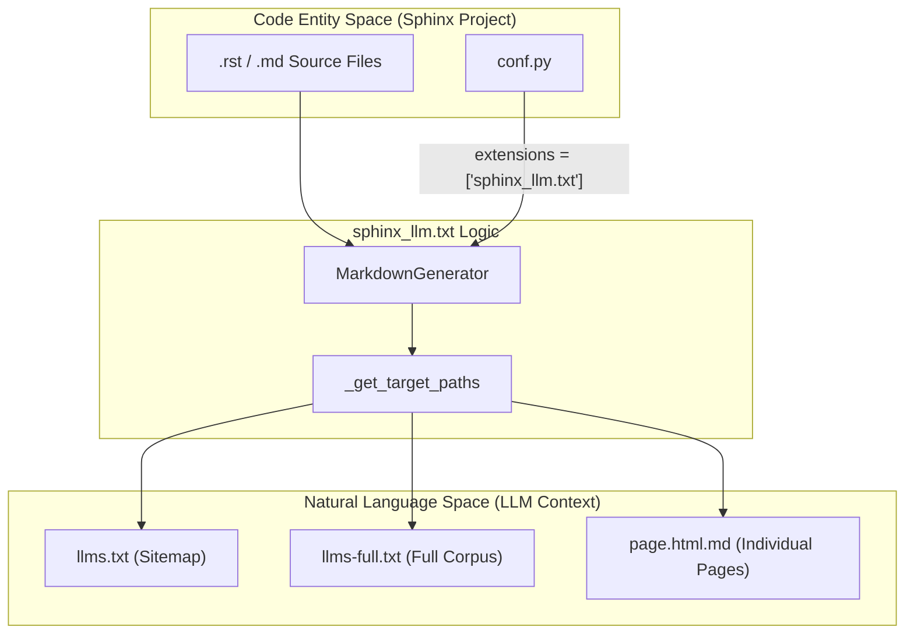
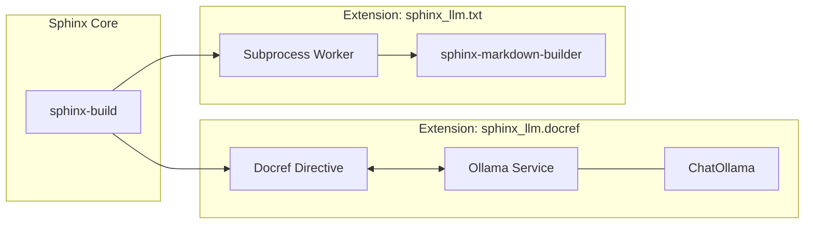

<!-- source: DeepWiki mcp.deepwiki.com · repo NVIDIA/sphinx-llm · page 1 Overview · fetched 2026-10-26 -->

# Overview

Relevant source files

The following files were used as context for generating this wiki page:

- [.gitignore](.gitignore)
- [.readthedocs.yaml](.readthedocs.yaml)
- [LICENSE](LICENSE)
- [README.md](README.md)
- [pyproject.toml](pyproject.toml)

The `sphinx-llm` package is a collection of [Sphinx](https://www.sphinx-doc.org) extensions designed to bridge the gap between traditional technical documentation and Large Language Models (LLMs) [README.md:1-4](). It addresses two primary needs: making documentation more consumable for AI agents and leveraging AI to enhance the documentation itself during the build process [README.md:6-15]().

## Core Capabilities

The project provides two distinct extensions that serve different roles in the documentation lifecycle:

1.  **Machine-Consumable Output (`sphinx_llm.txt`)**: This extension implements the [llms.txt](https://llmstxt.org) standard. It automatically generates Markdown versions of your documentation alongside the standard HTML output, creating a sitemap (`llms.txt`) and a full concatenated corpus (`llms-full.txt`) [README.md:30-41]().
2.  **AI-Enhanced Content (`sphinx_llm.docref`)**: This extension provides a `docref` directive that uses an LLM (via [Ollama](https://github.com/ollama/ollama)) to generate summaries of referenced pages. These summaries are then written back into the source `.rst` files to ensure they are baked into the static output [README.md:120-159]().

### From Source to AI-Ready Space

The following diagram illustrates how `sphinx-llm` transforms standard Sphinx source files into entities consumable by both humans (HTML) and LLMs (Markdown/Text).

**Documentation Transformation Pipeline**

Sources: [README.md:30-52](), [README.md:110-116]()

## Integration Architecture

`sphinx-llm` integrates directly into the Sphinx build lifecycle. While `sphinx_llm.txt` typically runs a parallel subprocess to generate Markdown without interfering with the HTML build, `sphinx_llm.docref` interacts with external LLM services to modify source content [README.md:54-65](), [README.md:125-130]().

**Component Interaction Diagram**

Sources: [README.md:58-60](), [README.md:125-143](), [pyproject.toml:24-27]()

## Project Structure and Setup

The project uses a standard `src`-layout and is managed with `hatch` [pyproject.toml:1-3](), [pyproject.toml:40-41](). It supports optional dependencies via the `[gen]` extra, which is required for the LLM-generation features of `docref` [README.md:22-24](), [pyproject.toml:26-27]().

*   **Installation**: Can be installed via `pip` or `uv`. For details, see [Getting Started](#1.1).
*   **Configuration**: All behavior is controlled via standard Sphinx `conf.py` variables. For details, see [Project Layout and Configuration](#1.2).

### Dependency Overview

| Group | Dependencies | Purpose |
| --- | --- | --- |
| **Core** | `sphinx`, `sphinx-markdown-builder` | Base functionality for `sphinx_llm.txt` |
| **Gen** | `langchain-ollama` | Required for `sphinx_llm.docref` |
| **Dev** | `pytest`, `pytest-cov`, `sphinx-autobuild` | Local development and testing |

Sources: [pyproject.toml:24-30]()

---
**Child Pages:**
*   [Getting Started](#1.1) — Installation and first-run guide.
*   [Project Layout and Configuration](#1.2) — Repository structure and `conf.py` reference.

---

