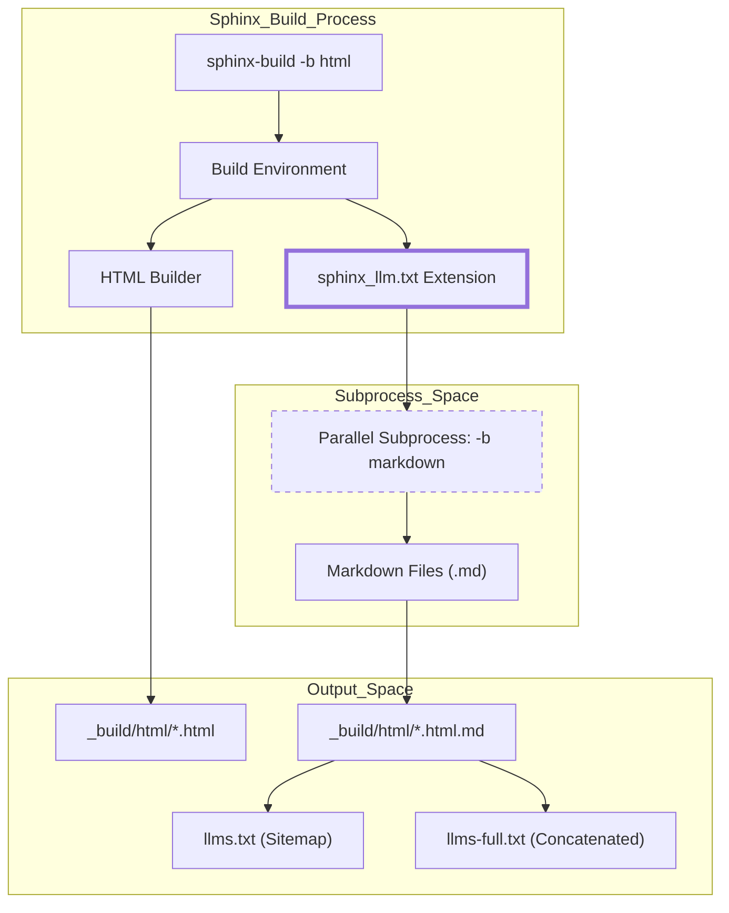
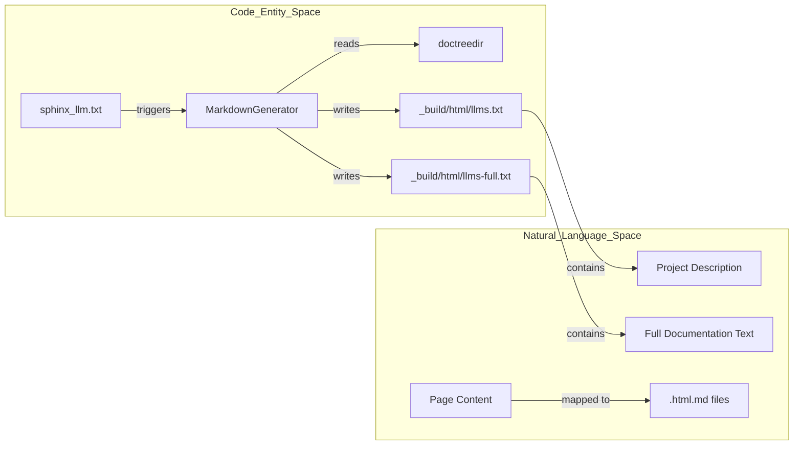

<!-- source: DeepWiki mcp.deepwiki.com · repo NVIDIA/sphinx-llm · page 1.1 Getting Started · fetched 2026-10-26 -->

# Getting Started

<details>
<summary>Relevant source files</summary>

The following files were used as context for generating this wiki page:

- [README.md](README.md)
- [docs/source/conf.py](docs/source/conf.py)
- [pyproject.toml](pyproject.toml)
- [uv.lock](uv.lock)

</details>


This page provides a technical walkthrough for installing `sphinx-llm`, configuring its extensions within a Sphinx project, and executing the build process to generate LLM-optimized documentation artifacts.

## Installation

The `sphinx-llm` package is distributed via PyPI and supports Python 3.9+ [pyproject.toml:9](). It depends on `sphinx>=5` and `sphinx-markdown-builder>=0.6.8` [pyproject.toml:24]().

### Base Installation
The base package includes the `sphinx_llm.txt` extension, which generates Markdown sitemaps and concatenated corpora.
```console
pip install sphinx-llm
```

### LLM Generation Extra
To use the `sphinx_llm.docref` extension for dynamic content generation (summaries), you must install the `gen` extra, which adds `langchain-ollama` as a dependency [pyproject.toml:27]().
```console
pip install sphinx-llm[gen]
```

**Sources:** [README.md:17-24](), [pyproject.toml:9-27]()

---

## Configuration

To enable the extensions, add them to the `extensions` list in your Sphinx `conf.py` file [docs/source/conf.py:18-21]().

### Extension Registration
```python
# conf.py
extensions = [
    "sphinx_llm.txt",    # Generates llms.txt and llms-full.txt
    "sphinx_llm.docref", # Generates page summaries via Ollama
]
```

### Global Options
You can configure project-wide settings for the LLM extensions directly in `conf.py`.

| Option | Description | Default |
| --- | --- | --- |
| `llms_txt_description` | Custom description for the `llms.txt` sitemap [README.md:112](). | `pyproject.toml` description |
| `llms_txt_build_parallel`| Run the Markdown shadow-build in parallel with HTML [README.md:113](). | `True` |
| `llms_txt_suffix_mode` | Controls Markdown file naming (`auto`, `file-suffix`, `url-suffix`, `replace`) [README.md:114](). | `"auto"` |
| `llms_txt_full_build` | Toggles the generation of the large `llms-full.txt` file [README.md:115](). | `True` |
| `sphinx_llm_options` | Dictionary containing LLM parameters like `model` [docs/source/conf.py:23-25](). | N/A |

**Sources:** [README.md:105-116](), [docs/source/conf.py:18-30]()

---

## Running the Build

When you execute a standard Sphinx build (e.g., `make html` or `sphinx-build -b html`), the extensions intercept the build lifecycle.

### Execution Flow
1.  **Standard Build**: Sphinx builds the HTML output as requested.
2.  **Shadow Build**: `sphinx_llm.txt` triggers a secondary build using the `markdown` builder [README.md:58-59]().
3.  **Merge Phase**: The Markdown files are moved into the HTML output directory [README.md:60]().
4.  **Artifact Generation**: The extension creates `llms.txt` (sitemap) and `llms-full.txt` (concatenated content) [README.md:63-64]().
5.  **Source Update**: If `docref` is used, the extension connects to a local Ollama instance to generate summaries and writes them back to the `.rst` source files [README.md:158-159]().

### Build Pipeline Architecture
The following diagram illustrates how the `sphinx_llm.txt` extension interacts with the Sphinx `Build` process to produce LLM artifacts.

**Build Process and Data Flow**

**Sources:** [README.md:54-65](), [docs/source/conf.py:18-21]()

---

## Verifying Output

After a successful build, your output directory (typically `_build/html`) should contain specific files designed for LLM consumption.

### File Structure Comparison
The following table maps standard HTML outputs to the corresponding `sphinx-llm` artifacts using the default `auto` suffix mode [README.md:89-94]().

| HTML Output | LLM Markdown Output | Purpose |
| --- | --- | --- |
| `index.html` | `index.html.md` | Page-specific context |
| `apples.html` | `apples.html.md` | Page-specific context |
| N/A | `llms.txt` | Sitemap/Index for LLMs |
| N/A | `llms-full.txt` | Full corpus for RAG/Training |

### Artifact Relationships
This diagram bridges the high-level documentation concepts to the specific file entities generated by the `MarkdownGenerator` and `llms_txt` logic.

**Code Entity to Artifact Mapping**


**Sources:** [README.md:66-77](), [README.md:112-115]()

---

## Development and Local Testing

For developers contributing to the project or testing the example documentation locally, `uv` is the recommended tool [pyproject.toml:29-30]().

### Building Example Docs
To run a live-reloading server for the example documentation:
```console
uv run --dev sphinx-autobuild docs/source docs/build/html
```
This command uses the `dev` dependency group which includes `sphinx-autobuild` [pyproject.toml:30]().

### Requirement: Ollama for Docref
If using `sphinx_llm.docref`, ensure [Ollama](https://ollama.com) is running locally. The extension will attempt to pull the model specified in `sphinx_llm_options` (e.g., `llama3.2:3b`) if it is not present [README.md:125-130](), [docs/source/conf.py:24]().

**Sources:** [README.md:183-189](), [pyproject.toml:29-31](), [docs/source/conf.py:23-25]()

---

