# Page: Overview

# Overview

<details>
<summary>Relevant source files</summary>

The following files were used as context for generating this wiki page:

- [.gitignore](.gitignore)
- [.readthedocs.yaml](.readthedocs.yaml)
- [LICENSE](LICENSE)
- [README.md](README.md)
- [pyproject.toml](pyproject.toml)

</details>


The `sphinx-llm` package is a collection of [Sphinx](https://www.sphinx-doc.org) extensions designed to bridge the gap between traditional technical documentation and Large Language Models (LLMs) [README.md:1-4](). It addresses two primary needs: making documentation more consumable for AI agents and leveraging AI to enhance the documentation itself during the build process [README.md:6-15]().

## Core Capabilities

The project provides two distinct extensions that serve different roles in the documentation lifecycle:

1.  **Machine-Consumable Output (`sphinx_llm.txt`)**: This extension implements the [llms.txt](https://llmstxt.org) standard. It automatically generates Markdown versions of your documentation alongside the standard HTML output, creating a sitemap (`llms.txt`) and a full concatenated corpus (`llms-full.txt`) [README.md:30-41]().
2.  **AI-Enhanced Content (`sphinx_llm.docref`)**: This extension provides a `docref` directive that uses an LLM (via [Ollama](https://github.com/ollama/ollama)) to generate summaries of referenced pages. These summaries are then written back into the source `.rst` files to ensure they are baked into the static output [README.md:120-159]().

### From Source to AI-Ready Space

The following diagram illustrates how `sphinx-llm` transforms standard Sphinx source files into entities consumable by both humans (HTML) and LLMs (Markdown/Text).

**Documentation Transformation Pipeline**
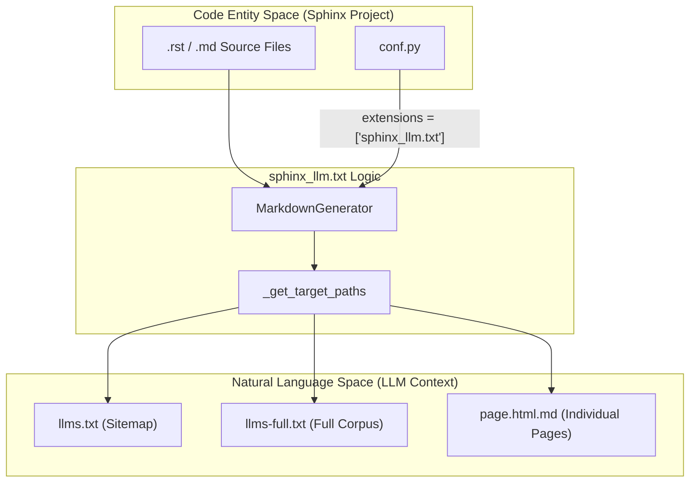
Sources: [README.md:30-52](), [README.md:110-116]()

## Integration Architecture

`sphinx-llm` integrates directly into the Sphinx build lifecycle. While `sphinx_llm.txt` typically runs a parallel subprocess to generate Markdown without interfering with the HTML build, `sphinx_llm.docref` interacts with external LLM services to modify source content [README.md:54-65](), [README.md:125-130]().

**Component Interaction Diagram**
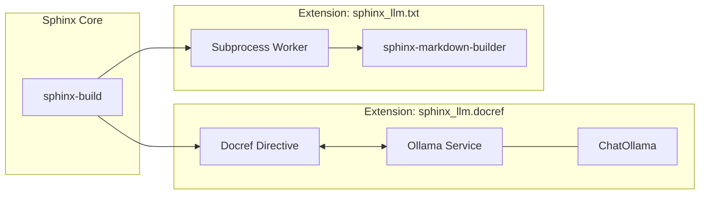
Sources: [README.md:58-60](), [README.md:125-143](), [pyproject.toml:24-27]()

## Project Structure and Setup

The project uses a standard `src`-layout and is managed with `hatch` [pyproject.toml:1-3](), [pyproject.toml:40-41](). It supports optional dependencies via the `[gen]` extra, which is required for the LLM-generation features of `docref` [README.md:22-24](), [pyproject.toml:26-27]().

*   **Installation**: Can be installed via `pip` or `uv`. For details, see [Getting Started](#1.1).
*   **Configuration**: All behavior is controlled via standard Sphinx `conf.py` variables. For details, see [Project Layout and Configuration](#1.2).

### Dependency Overview

| Group | Dependencies | Purpose |
| --- | --- | --- |
| **Core** | `sphinx`, `sphinx-markdown-builder` | Base functionality for `sphinx_llm.txt` |
| **Gen** | `langchain-ollama` | Required for `sphinx_llm.docref` |
| **Dev** | `pytest`, `pytest-cov`, `sphinx-autobuild` | Local development and testing |

Sources: [pyproject.toml:24-30]()

---
**Child Pages:**
*   [Getting Started](#1.1) — Installation and first-run guide.
*   [Project Layout and Configuration](#1.2) — Repository structure and `conf.py` reference.

---

# Page: Getting Started

# Getting Started

<details>
<summary>Relevant source files</summary>

The following files were used as context for generating this wiki page:

- [README.md](README.md)
- [docs/source/conf.py](docs/source/conf.py)
- [pyproject.toml](pyproject.toml)
- [uv.lock](uv.lock)

</details>


This page provides a technical walkthrough for installing `sphinx-llm`, configuring its extensions within a Sphinx project, and executing the build process to generate LLM-optimized documentation artifacts.

## Installation

The `sphinx-llm` package is distributed via PyPI and supports Python 3.9+ [pyproject.toml:9](). It depends on `sphinx>=5` and `sphinx-markdown-builder>=0.6.8` [pyproject.toml:24]().

### Base Installation
The base package includes the `sphinx_llm.txt` extension, which generates Markdown sitemaps and concatenated corpora.
```console
pip install sphinx-llm
```

### LLM Generation Extra
To use the `sphinx_llm.docref` extension for dynamic content generation (summaries), you must install the `gen` extra, which adds `langchain-ollama` as a dependency [pyproject.toml:27]().
```console
pip install sphinx-llm[gen]
```

**Sources:** [README.md:17-24](), [pyproject.toml:9-27]()

---

## Configuration

To enable the extensions, add them to the `extensions` list in your Sphinx `conf.py` file [docs/source/conf.py:18-21]().

### Extension Registration
```python
# conf.py
extensions = [
    "sphinx_llm.txt",    # Generates llms.txt and llms-full.txt
    "sphinx_llm.docref", # Generates page summaries via Ollama
]
```

### Global Options
You can configure project-wide settings for the LLM extensions directly in `conf.py`.

| Option | Description | Default |
| --- | --- | --- |
| `llms_txt_description` | Custom description for the `llms.txt` sitemap [README.md:112](). | `pyproject.toml` description |
| `llms_txt_build_parallel`| Run the Markdown shadow-build in parallel with HTML [README.md:113](). | `True` |
| `llms_txt_suffix_mode` | Controls Markdown file naming (`auto`, `file-suffix`, `url-suffix`, `replace`) [README.md:114](). | `"auto"` |
| `llms_txt_full_build` | Toggles the generation of the large `llms-full.txt` file [README.md:115](). | `True` |
| `sphinx_llm_options` | Dictionary containing LLM parameters like `model` [docs/source/conf.py:23-25](). | N/A |

**Sources:** [README.md:105-116](), [docs/source/conf.py:18-30]()

---

## Running the Build

When you execute a standard Sphinx build (e.g., `make html` or `sphinx-build -b html`), the extensions intercept the build lifecycle.

### Execution Flow
1.  **Standard Build**: Sphinx builds the HTML output as requested.
2.  **Shadow Build**: `sphinx_llm.txt` triggers a secondary build using the `markdown` builder [README.md:58-59]().
3.  **Merge Phase**: The Markdown files are moved into the HTML output directory [README.md:60]().
4.  **Artifact Generation**: The extension creates `llms.txt` (sitemap) and `llms-full.txt` (concatenated content) [README.md:63-64]().
5.  **Source Update**: If `docref` is used, the extension connects to a local Ollama instance to generate summaries and writes them back to the `.rst` source files [README.md:158-159]().

### Build Pipeline Architecture
The following diagram illustrates how the `sphinx_llm.txt` extension interacts with the Sphinx `Build` process to produce LLM artifacts.

**Build Process and Data Flow**
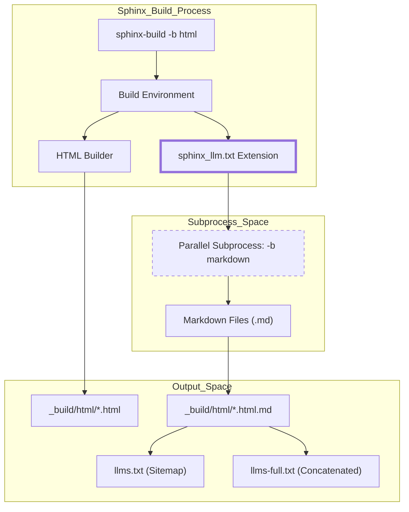
**Sources:** [README.md:54-65](), [docs/source/conf.py:18-21]()

---

## Verifying Output

After a successful build, your output directory (typically `_build/html`) should contain specific files designed for LLM consumption.

### File Structure Comparison
The following table maps standard HTML outputs to the corresponding `sphinx-llm` artifacts using the default `auto` suffix mode [README.md:89-94]().

| HTML Output | LLM Markdown Output | Purpose |
| --- | --- | --- |
| `index.html` | `index.html.md` | Page-specific context |
| `apples.html` | `apples.html.md` | Page-specific context |
| N/A | `llms.txt` | Sitemap/Index for LLMs |
| N/A | `llms-full.txt` | Full corpus for RAG/Training |

### Artifact Relationships
This diagram bridges the high-level documentation concepts to the specific file entities generated by the `MarkdownGenerator` and `llms_txt` logic.

**Code Entity to Artifact Mapping**
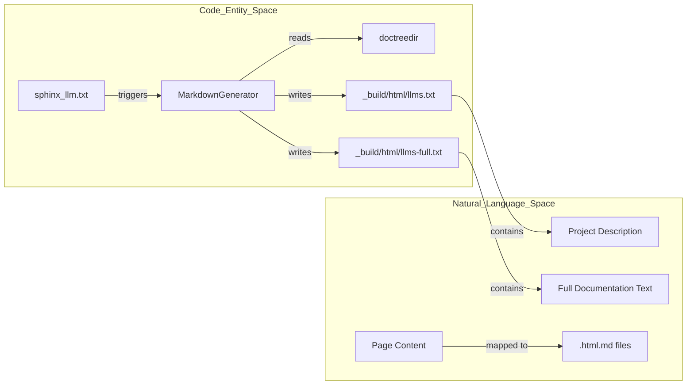

**Sources:** [README.md:66-77](), [README.md:112-115]()

---

## Development and Local Testing

For developers contributing to the project or testing the example documentation locally, `uv` is the recommended tool [pyproject.toml:29-30]().

### Building Example Docs
To run a live-reloading server for the example documentation:
```console
uv run --dev sphinx-autobuild docs/source docs/build/html
```
This command uses the `dev` dependency group which includes `sphinx-autobuild` [pyproject.toml:30]().

### Requirement: Ollama for Docref
If using `sphinx_llm.docref`, ensure [Ollama](https://ollama.com) is running locally. The extension will attempt to pull the model specified in `sphinx_llm_options` (e.g., `llama3.2:3b`) if it is not present [README.md:125-130](), [docs/source/conf.py:24]().

**Sources:** [README.md:183-189](), [pyproject.toml:29-31](), [docs/source/conf.py:23-25]()

---

# Page: Project Layout and Configuration

# Project Layout and Configuration

<details>
<summary>Relevant source files</summary>

The following files were used as context for generating this wiki page:

- [docs/source/conf.py](docs/source/conf.py)
- [pyproject.toml](pyproject.toml)
- [src/sphinx_llm/__init__.py](src/sphinx_llm/__init__.py)
- [src/sphinx_llm/version.py](src/sphinx_llm/version.py)

</details>


This page details the structural organization of the `sphinx-llm` repository, its build configuration, and the dependency management strategy. It provides a technical overview of how the project is packaged and how the example documentation project serves as a reference implementation.

## Repository Structure (src-layout)

The `sphinx-llm` repository adopts the `src` layout to ensure that tests run against the installed package rather than the local source directory. This prevents accidental reliance on local files that might not be included in the distribution.

### Directory Organization

| Path | Purpose |
| :--- | :--- |
| `src/sphinx_llm/` | Primary package source containing extension logic. |
| `src/sphinx_llm/txt.py` | Implementation of the `sphinx_llm.txt` extension. |
| `src/sphinx_llm/docref.py` | Implementation of the `sphinx_llm.docref` extension. |
| `src/sphinx_llm/_version.py` | Autogenerated version file managed by `hatch-vcs`. |
| `docs/source/` | Example Sphinx project and documentation source. |
| `tests/` | Pytest suite exercising the extensions. |

**Sources:** `src/sphinx_llm/` [src/sphinx_llm/__init__.py:1-3](), [src/sphinx_llm/version.py:1-11]().

## Build System and Versioning

The project uses `hatchling` as the build backend and `hatch-vcs` for dynamic versioning based on Git tags.

### Versioning Implementation
Versioning is handled dynamically through the `vcs` source in `pyproject.toml` [pyproject.toml:37-38](). The `hatch-vcs` hook is configured to write the version information to `src/sphinx_llm/_version.py` [pyproject.toml:40-41]().

At runtime, the package attempts to import this generated version. If the file is missing (e.g., in a local development environment without a build step), it defaults to `0.0.0` [src/sphinx_llm/version.py:5-10]().

### Project Metadata
The project specifies a minimum Python version of `3.9` [pyproject.toml:9](). It declares a dependency on `sphinx-markdown-builder` (version `0.6.8` or higher) and `sphinx` (version `5` or higher) [pyproject.toml:24]().

**Sources:** [pyproject.toml:1-42](), [src/sphinx_llm/version.py:1-11]().

## Dependency Groups

`sphinx-llm` categorizes dependencies into three distinct tiers to minimize the footprint for users who only need specific features.

| Group | Key Dependencies | Purpose |
| :--- | :--- | :--- |
| **Core** | `sphinx`, `sphinx-markdown-builder` | Required for `sphinx_llm.txt` functionality. |
| **gen** (Optional) | `langchain-ollama` | Required for the `sphinx_llm.docref` LLM summarization. |
| **dev** (Internal) | `pytest`, `pytest-cov`, `sphinx-autobuild` | Used for local development and testing. |

### Configuration in pyproject.toml
The optional `gen` group is defined under `project.optional-dependencies` [pyproject.toml:26-27](), while development tools are managed under `dependency-groups` [pyproject.toml:29-30]().

**Sources:** [pyproject.toml:24-31]().

## Example Configuration (`conf.py`)

The project includes a reference `conf.py` located in `docs/source/` that demonstrates the standard integration of both extensions.

### Extension Registration
To enable the full suite of capabilities, both extensions must be added to the `extensions` list [docs/source/conf.py:18-21]().

### Global Options
The configuration allows for global settings via the `sphinx_llm_options` dictionary and specific metadata for the LLM sitemap.

*   **`sphinx_llm_options`**: Sets the default model for summarization (e.g., `llama3.2:3b`) [docs/source/conf.py:23-25]().
*   **`llms_txt_description`**: Provides a high-level summary that appears at the top of the generated `llms.txt` file [docs/source/conf.py:26-30]().

**Sources:** [docs/source/conf.py:18-30]().

## System Configuration Mapping

The following diagram bridges the high-level configuration concepts to the specific code entities and files that manage them.

### Configuration and Build Flow
"Project Configuration to Build System Mapping"
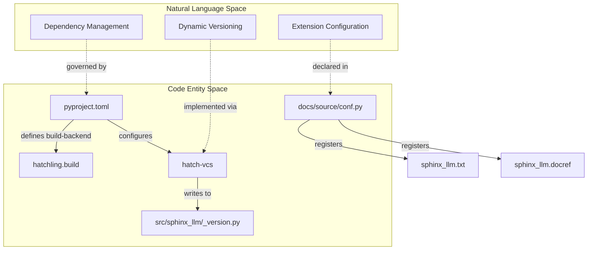
**Sources:** [pyproject.toml:1-3](), [pyproject.toml:37-41](), [docs/source/conf.py:18-21]().

### Source Layout and Import Logic
"Source Structure and Version Resolution"
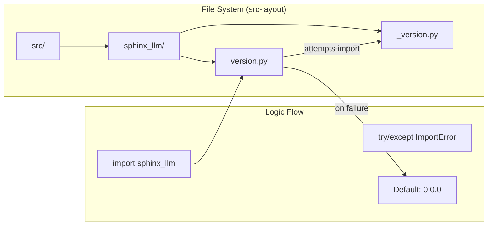
**Sources:** [src/sphinx_llm/version.py:5-10](), [pyproject.toml:41]().

## Development Tooling

The repository includes configurations for various quality assurance tools to maintain code standards.

### Linting and Formatting
Configuration for `ruff` is defined in `pyproject.toml`, specifying a line length of 88 and a selection of rules including `isort` (I), `flake8-bugbear` (B), and `pyupgrade` (UP) [pyproject.toml:61-72]().

### Type Checking
Static type checking is facilitated by `mypy`. A specific `hatch` environment (`types`) is defined to run `mypy` against the `src/sphinx_llm` and `tests` directories [pyproject.toml:43-46]().

### Coverage
Test coverage is configured to track branches and parallel execution, specifically targeting the `sphinx_llm` package while omitting internal metadata files like `__about__.py` [pyproject.toml:48-52]().

**Sources:** [pyproject.toml:43-87]().

---

# Page: Core Extensions

# Core Extensions

<details>
<summary>Relevant source files</summary>

The following files were used as context for generating this wiki page:

- [README.md](README.md)
- [src/sphinx_llm/docref.py](src/sphinx_llm/docref.py)
- [src/sphinx_llm/txt.py](src/sphinx_llm/txt.py)

</details>


The `sphinx-llm` package provides two primary extensions designed to enhance documentation for Large Language Models (LLMs) and leverage LLMs for content generation. These extensions integrate directly into the Sphinx build lifecycle to automate the production of LLM-friendly artifacts and summaries.

| Extension | Purpose | Key Feature |
| --- | --- | --- |
| `sphinx_llm.txt` | **LLM Consumption** | Generates `llms.txt` and `llms-full.txt` alongside HTML. |
| `sphinx_llm.docref` | **LLM Generation** | Uses Ollama to create and cache page summaries in-place. |

---

## Extension Integration Architecture

The extensions hook into different stages of the Sphinx application. While `sphinx_llm.txt` primarily operates during the `builder-inited` and `build-finished` phases to manage secondary build processes, `sphinx_llm.docref` functions as a directive that executes during the parsing of source documents.

### Build Lifecycle Integration
The following diagram illustrates how the extensions interact with the standard Sphinx build flow.

**Diagram: Sphinx Build Lifecycle Hooks**
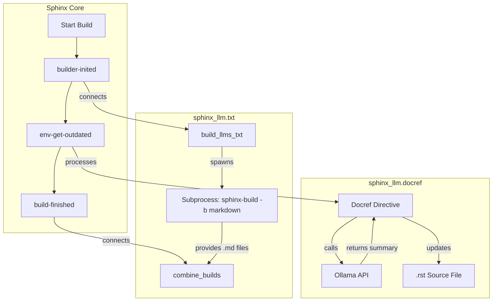
**Sources:**
- `src/sphinx_llm/txt.py:44-46` (builder-inited connection)
- `src/sphinx_llm/txt.py:81-83` (build-finished connection)
- `src/sphinx_llm/docref.py:167-168` (directive registration)

---

## sphinx_llm.txt — LLM-Consumable Output Generation

The `sphinx_llm.txt` extension implements the [llms.txt](https://llmstxt.org) standard. It ensures that for every HTML page generated, a corresponding Markdown version is available, typically with a `.md` suffix (e.g., `index.html.md`).

This extension uses a `MarkdownGenerator` class to manage a "shadow build." It spawns a separate `sphinx-build` process using the `markdown` builder to ensure high-quality Markdown output without interfering with the primary HTML rendering.

**Key Responsibilities:**
- **Parallel Execution**: Spawns a background subprocess to build Markdown while the main HTML build continues `[src/sphinx_llm/txt.py:155-159]()`.
- **Sitemap Generation**: Creates an `llms.txt` file that acts as a Markdown-formatted sitemap for LLM crawlers `[src/sphinx_llm/txt.py:119-119]()`.
- **Corpus Concatenation**: Optionally creates `llms-full.txt`, a single file containing the entire documentation set for easy ingestion `[src/sphinx_llm/txt.py:115-116]()`.

For details, see [sphinx_llm.txt — LLM-Consumable Output Generation](#2.1).

**Sources:**
- `src/sphinx_llm/txt.py:28-40` (MarkdownGenerator definition)
- `src/sphinx_llm/txt.py:130-138` (Subprocess command configuration)
- `README.md:30-42` (Extension purpose)

---

## sphinx_llm.docref — LLM-Powered Page Summaries

The `sphinx_llm.docref` extension provides the `.. docref::` directive. This directive allows authors to reference other pages while automatically generating a concise summary of the target page using a local LLM via Ollama.

**Core Workflow:**
1. **Extraction**: The directive extracts the text content of the target document using the Sphinx environment `[src/sphinx_llm/docref.py:71-73]()`.
2. **Generation**: It sends the content to an Ollama instance (defaulting to `llama3.2:3b`) with a specific `SYSTEM_PROMPT` `[src/sphinx_llm/docref.py:94-108]()`.
3. **Caching**: It computes an MD5 hash of the source document. If the hash matches the `:hash:` option in the directive, it skips regeneration to save time `[src/sphinx_llm/docref.py:76-78]()`.
4. **Write-back**: On the first run or when the target changes, the extension modifies the original `.rst` file on disk to include the generated summary and the new hash `[src/sphinx_llm/docref.py:162-163]()`.

**Diagram: Docref Data Flow**
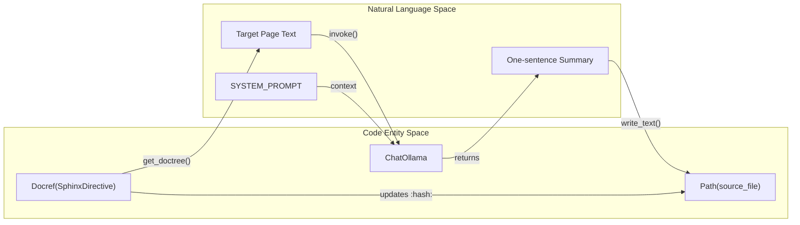

For details, see [sphinx_llm.docref — LLM-Powered Page Summaries](#2.2).

**Sources:**
- `src/sphinx_llm/docref.py:25-29` (Docref class and options)
- `src/sphinx_llm/docref.py:21-21` (SYSTEM_PROMPT)
- `src/sphinx_llm/docref.py:129-163` (update_content logic)
- `README.md:120-124` (Extension overview)

---

# Page: sphinx_llm.txt — LLM-Consumable Output Generation

# sphinx_llm.txt — LLM-Consumable Output Generation

<details>
<summary>Relevant source files</summary>

The following files were used as context for generating this wiki page:

- [README.md](README.md)
- [src/sphinx_llm/txt.py](src/sphinx_llm/txt.py)

</details>


The `sphinx_llm.txt` extension is designed to make Sphinx-based documentation easily consumable by Large Language Models (LLMs) and AI agents. It implements the [llms.txt](https://llmstxt.org) standard by generating a suite of Markdown-based artifacts alongside the standard HTML build. This ensures that documentation is well-indexed for model training and provides high-quality context for RAG (Retrieval-Augmented Generation) systems.

## Overview of LLM Artifacts

When integrated into a Sphinx project, `sphinx_llm.txt` produces three primary types of output:

1.  **Individual Markdown Pages**: A Markdown version of every HTML page, typically using an `.html.md` or `.md` suffix.
2.  **llms.txt (Sitemap)**: A Markdown-formatted index of the entire documentation site, including titles and brief descriptions for each page.
3.  **llms-full.txt (Concatenated Corpus)**: A single, large Markdown file containing the full text of every page in the project, optimized for providing comprehensive context in a single request.

### High-Level Architecture
The extension operates by spawning a "shadow build" using `sphinx-markdown-builder`. This process runs in the background while the primary HTML build proceeds.

**Process Flow: Markdown Generation and Merging**

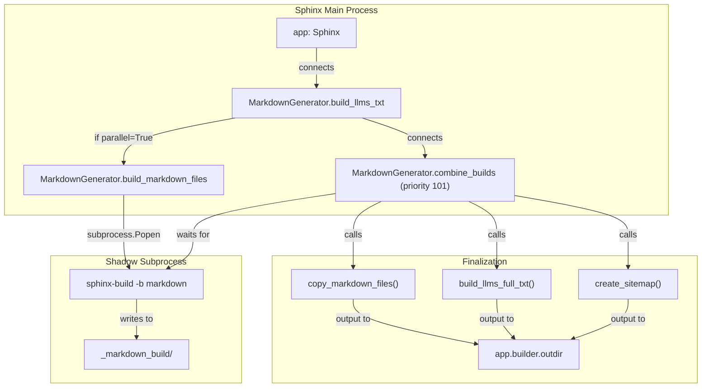
Sources: [src/sphinx_llm/txt.py:28-124](), [README.md:54-65]()

## Build Pipeline and Subprocess Management

The core of the extension is the `MarkdownGenerator` class [src/sphinx_llm/txt.py:28-30](). It manages a background `subprocess.Popen` call to `sphinx-build` using the `markdown` builder [src/sphinx_llm/txt.py:155-159](). 

Key behaviors include:
*   **Parallel Execution**: By default, the Markdown build runs concurrently with the HTML build to minimize total build time [src/sphinx_llm/txt.py:50-50]().
*   **Doctree Reuse**: If `llms_txt_build_parallel` is set to `False`, the subprocess reuses the existing `doctreedir` to speed up processing [src/sphinx_llm/txt.py:142-144]().
*   **Logging**: Subprocess output is captured in a temporary log file, which is printed to the main console only if the Markdown build fails [src/sphinx_llm/txt.py:102-108]().

For details, see [Build Pipeline and Subprocess Management](#2.1.1).

Sources: [src/sphinx_llm/txt.py:46-84](), [src/sphinx_llm/txt.py:125-164]()

## Suffix Modes and Path Mapping

The extension must map HTML output paths to corresponding Markdown paths. This is complicated by different Sphinx builders like `html` (which produces `page.html`) and `dirhtml` (which produces `page/index.html`).

The `llms_txt_suffix_mode` configuration option controls this behavior:
*   **auto**: The default; provides broad compatibility [src/sphinx_llm/txt.py:177-179]().
*   **file-suffix**: Appends `.md` to the physical filename (e.g., `index.html.md`) [src/sphinx_llm/txt.py:173-174]().
*   **url-suffix**: Creates a file that matches a clean URL (e.g., `page.md` for a directory `page/`) [src/sphinx_llm/txt.py:175-176]().
*   **replace**: Replaces `.html` with `.md` entirely [src/sphinx_llm/txt.py:182-183]().

The internal `_get_target_paths` method [src/sphinx_llm/txt.py:186-186]() handles the logic of translating these modes across different builder types.

For details, see [Suffix Modes and Path Mapping](#2.1.2).

Sources: [src/sphinx_llm/txt.py:51-63](), [README.md:89-100]()

## llms.txt and llms-full.txt Output Files

Once individual Markdown files are generated, the extension aggregates them into two standard files:

| File | Role | Content |
| :--- | :--- | :--- |
| `llms.txt` | **Sitemap** | Project title, description, and a list of links to all Markdown pages [src/sphinx_llm/txt.py:239-281](). |
| `llms-full.txt` | **Concatenated Corpus** | Every page's content separated by headers, allowing LLMs to read the entire docset at once [src/sphinx_llm/txt.py:214-237](). |

The extension automatically extracts project descriptions from `pyproject.toml` or `conf.py` [src/sphinx_llm/txt.py:283-306]() and uses Markdown headers to structure the concatenated output.

For details, see [llms.txt and llms-full.txt Output Files](#2.1.3).

Sources: [src/sphinx_llm/txt.py:115-119](), [README.md:34-41]()

## Code Entity Map

The following diagram maps the logical components of the `sphinx_llm.txt` extension to the specific Python classes and functions that implement them.

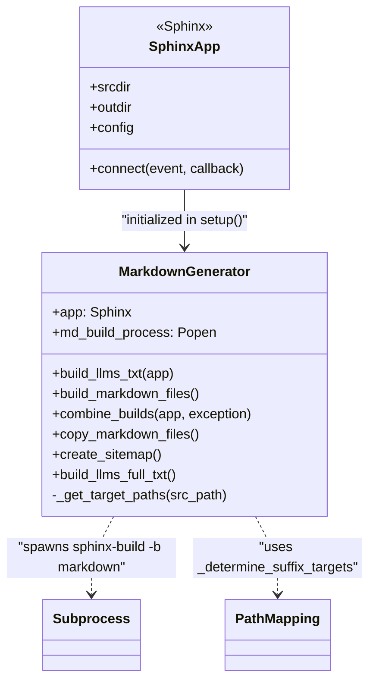

Sources: [src/sphinx_llm/txt.py:28-44](), [src/sphinx_llm/txt.py:165-212]()

---

# Page: Build Pipeline and Subprocess Management

# Build Pipeline and Subprocess Management

<details>
<summary>Relevant source files</summary>

The following files were used as context for generating this wiki page:

- [src/sphinx_llm/txt.py](src/sphinx_llm/txt.py)

</details>


The `sphinx_llm.txt` extension implements a "shadow-build" architecture to generate LLM-consumable Markdown content without interfering with the primary HTML build. This is achieved by spawning a secondary `sphinx-build` process that uses the `markdown` builder, then merging its artifacts back into the main output directory.

## Shadow-Build Architecture

The core of the build pipeline is managed by the `MarkdownGenerator` class. It intercepts the Sphinx lifecycle to initiate a subprocess that mirrors the source configuration but targets a different output format.

### Build Initiation and Lifecycle Hooks

The pipeline integrates into the Sphinx lifecycle using several key event connections:

1.  **`builder-inited`**: The `MarkdownGenerator.setup` method connects `build_llms_txt` to this event [[src/sphinx_llm/txt.py:42-44]](). This is where the configuration is validated and the build strategy (parallel vs. sequential) is determined.
2.  **`build-finished`**: Two separate handlers are attached to this event with specific priorities:
    *   **Priority 100**: If sequential building is enabled, `build_markdown_files` is called here [[src/sphinx_llm/txt.py:81]]().
    *   **Priority 101**: `combine_builds` is called to wait for the subprocess, copy files, and generate the final `llms.txt` and `llms-full.txt` files [[src/sphinx_llm/txt.py:83]]().

### Subprocess Management

The secondary build is executed via `subprocess.Popen` using the current Python executable and the `markdown` builder [[src/sphinx_llm/txt.py:130-159]]().

| Component | Code Entity | Description |
| :--- | :--- | :--- |
| **Command Generator** | `build_markdown_files` | Constructs the `sphinx-build -b markdown` command [[src/sphinx_llm/txt.py:125-148]](). |
| **Process Handle** | `self.md_build_process` | Stores the `Popen` object to track state and wait for completion [[src/sphinx_llm/txt.py:155-159]](). |
| **Logging** | `self.md_build_logfile` | A `NamedTemporaryFile` that captures `stdout` and `stderr` from the subprocess [[src/sphinx_llm/txt.py:37-39]](). |

**Sources:** [[src/sphinx_llm/txt.py:28-83]](), [[src/sphinx_llm/txt.py:125-164]]()

## Parallel vs. Sequential Execution

The extension supports two modes of operation controlled by the `llms_txt_build_parallel` configuration option [[src/sphinx_llm/txt.py:50]]().

### Parallel Build (Default)
In parallel mode, the subprocess is spawned immediately during the `builder-inited` phase [[src/sphinx_llm/txt.py:75-76]](). This allows the Markdown generation to run alongside the HTML generation. To prevent file system conflicts, the parallel build uses its own temporary doctree directory (managed by Sphinx's default behavior when `-d` is omitted in the subprocess call) [[src/sphinx_llm/txt.py:141-142]]().

### Sequential Build
If `llms_txt_build_parallel` is `False`, the subprocess is delayed until the primary build's `build-finished` event [[src/sphinx_llm/txt.py:78-81]](). In this mode, the extension optimizes performance by reusing the existing doctree directory via the `-d` flag [[src/sphinx_llm/txt.py:142-144]]().

### Data Flow and Code Entity Mapping

The following diagram illustrates how the `MarkdownGenerator` coordinates the two Sphinx builds and manages the transition from source files to the final merged output.

**Title: Build Pipeline Execution Flow**
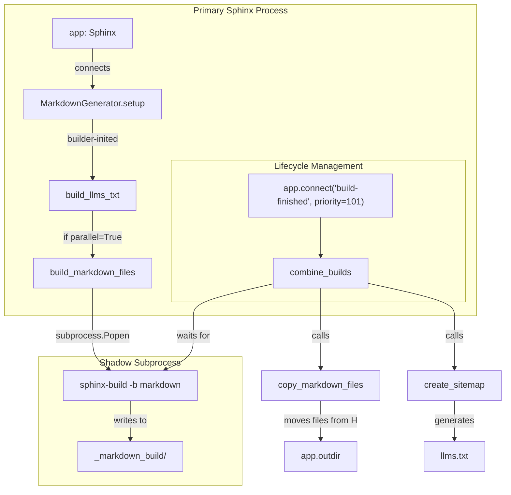
**Sources:** [[src/sphinx_llm/txt.py:42-50]](), [[src/sphinx_llm/txt.py:75-83]](), [[src/sphinx_llm/txt.py:125-159]](), [[src/sphinx_llm/txt.py:85-123]]()

## Output Merging and Cleanup

Once the primary build and the shadow subprocess are both complete, the `combine_builds` method orchestrates the final assembly [[src/sphinx_llm/txt.py:85-86]]().

### Merging Logic
1.  **Poll and Wait**: The system checks `self.md_build_process.poll()`. If the subprocess is still running, it calls `.wait()` [[src/sphinx_llm/txt.py:97-100]]().
2.  **Error Check**: If `returncode` is non-zero, the contents of `md_build_logfile` are dumped to the main logger and the merge is aborted [[src/sphinx_llm/txt.py:102-108]]().
3.  **File Transfer**: `copy_markdown_files` iterates through the temporary `_markdown_build` directory and moves the generated `.md` files into the main `outdir` based on the configured suffix mode [[src/sphinx_llm/txt.py:112]]().
4.  **Artifact Generation**: `build_llms_full_txt` and `create_sitemap` are called to generate the aggregate LLM files [[src/sphinx_llm/txt.py:115-119]]().

### Cleanup
The temporary build directory `_markdown_build` is deleted in a `finally` block to ensure the environment remains clean even if artifact generation fails [[src/sphinx_llm/txt.py:121-123]]().

**Sources:** [[src/sphinx_llm/txt.py:85-123]]()

## Error Handling

The pipeline includes robust error handling to ensure that a failure in the LLM-specific build does not necessarily crash the primary documentation build.

| Scenario | Handling Mechanism | Code Entity |
| :--- | :--- | :--- |
| **Subprocess Startup Failure** | Caught via `try...except` and logged as an error [[src/sphinx_llm/txt.py:160-161]](). | `build_markdown_files` |
| **Primary Build Failure** | `combine_builds` checks the `exception` argument; if present, it skips merging [[src/sphinx_llm/txt.py:87-89]](). | `combine_builds` |
| **Subprocess Runtime Error** | Checked via `returncode`. If it fails, the log file is read and printed to the console [[src/sphinx_llm/txt.py:102-108]](). | `combine_builds` |
| **Missing Subprocess** | If the process handle is missing, a warning is issued and the merge is skipped [[src/sphinx_llm/txt.py:91-95]](). | `combine_builds` |

### Process Interaction Diagram

This diagram shows the interaction between the primary build state and the subprocess lifecycle.

**Title: Subprocess Error and State Management**
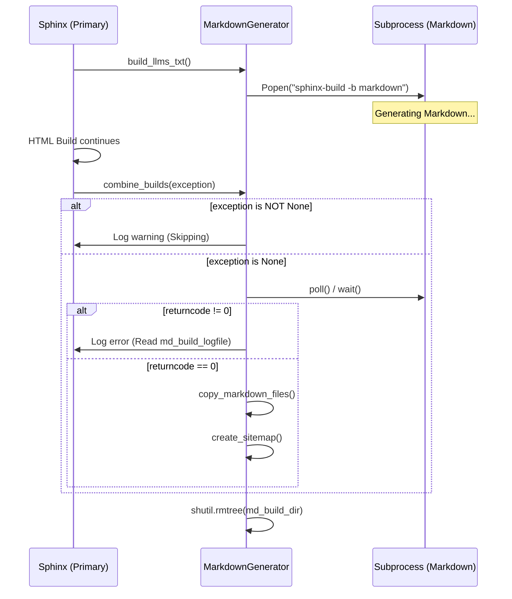
**Sources:** [[src/sphinx_llm/txt.py:85-123]](), [[src/sphinx_llm/txt.py:149-164]]()

---

# Page: Suffix Modes and Path Mapping

# Suffix Modes and Path Mapping

<details>
<summary>Relevant source files</summary>

The following files were used as context for generating this wiki page:

- [README.md](README.md)
- [src/sphinx_llm/txt.py](src/sphinx_llm/txt.py)

</details>


This page documents the configuration and internal logic used by the `sphinx_llm.txt` extension to map Sphinx document paths to their corresponding Markdown outputs. It specifically covers the `llms_txt_suffix_mode` configuration, how it interacts with different Sphinx builders (`html` and `dirhtml`), and the internal path resolution functions.

## Overview of Suffix Modes

The `llms_txt_suffix_mode` setting determines the naming convention for the Markdown files generated alongside the standard HTML output. This is crucial for compliance with the [llms.txt](https://llmstxt.org) specification, which suggests that every HTML page should have a corresponding Markdown version at the same URL with an added `.md` extension [README.md:30-42]().

The extension supports four primary modes:

| Mode | Description | Builder Behavior |
| :--- | :--- | :--- |
| `auto` | **Default**. Context-aware selection based on the active builder [src/sphinx_llm/txt.py:177-179](). | `html`: `.html.md`<br>`dirhtml`: Both `.html.md` and `.md` |
| `file-suffix` | Strict adherence to the file-based suffixing [src/sphinx_llm/txt.py:173-174](). | Always produces `.html.md` |
| `url-suffix` | Produces files that match clean URL patterns [src/sphinx_llm/txt.py:175-176](). | `html`: `.html.md`<br>`dirhtml`: `.md` |
| `replace` | Replaces the existing extension rather than appending to it [src/sphinx_llm/txt.py:98-100](). | `.html` → `.md` |

> [!NOTE]
> The value `"both"` is deprecated but remains supported as an alias for `"auto"` to maintain backward compatibility [src/sphinx_llm/txt.py:53-55]().

Sources: [src/sphinx_llm/txt.py:50-63](), [README.md:89-101]()

## Internal Path Mapping Logic

The mapping from a Sphinx source document to one or more output Markdown files is handled by the `MarkdownGenerator` class. The logic differentiates between the standard `html` builder (which produces `page.html`) and the `dirhtml` builder (which produces `page/index.html`).

### The `_get_target_paths` Function

The core logic resides in `_get_target_paths`, which calculates the destination paths within the build directory.

1.  **Input**: It receives a `docname` (e.g., `folder/page`) [src/sphinx_llm/txt.py:183]().
2.  **HTML Builder**:
    *   Generates a `file_suffix_target` by appending `.md` to the HTML output (e.g., `folder/page.html.md`) [src/sphinx_llm/txt.py:186-187]().
    *   In this mode, `url_suffix_target` is identical to `file_suffix_target` [src/sphinx_llm/txt.py:188]().
3.  **DirHTML Builder**:
    *   **File Suffix**: Maps to the actual index file: `folder/page/index.html.md` [src/sphinx_llm/txt.py:192-193]().
    *   **URL Suffix**: Maps to the directory name with a suffix: `folder/page.md` [src/sphinx_llm/txt.py:194-195]().
4.  **Replace Mode**: If `replace` is active, it simply swaps the extension of the standard output file [src/sphinx_llm/txt.py:199-204]().

### Path Resolution Flow

The following diagram illustrates how `MarkdownGenerator` translates Sphinx document names into filesystem targets based on the `llms_txt_suffix_mode`.

**Title: Path Mapping Logic in MarkdownGenerator**
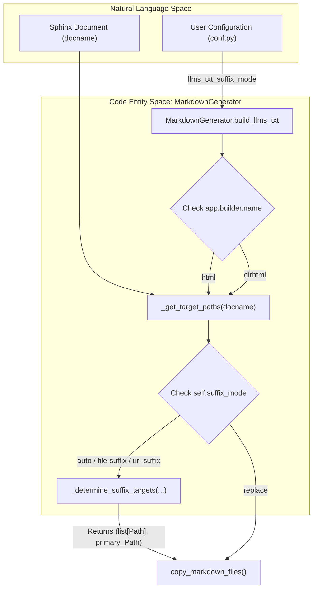
Sources: [src/sphinx_llm/txt.py:165-181](), [src/sphinx_llm/txt.py:183-207]()

## Implementation Detail: `_determine_suffix_targets`

Once the potential paths are identified, `_determine_suffix_targets` filters them based on the active mode to decide which files will actually be written to the output directory.

| Suffix Mode | Targets Generated | Primary Target (for sitemap) |
| :--- | :--- | :--- |
| `file-suffix` | `[file_suffix_target]` | `file_suffix_target` |
| `url-suffix` | `[url_suffix_target]` | `url_suffix_target` |
| `auto` | `[file_suffix_target, url_suffix_target]` | `file_suffix_target` |

This method ensures that even if multiple files are generated (as in `auto` mode for `dirhtml`), only one "primary" path is used when the `llms.txt` sitemap is constructed [src/sphinx_llm/txt.py:171-181]().

**Title: Suffix Target Selection Flow**
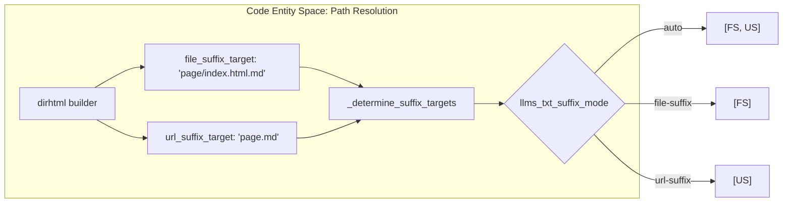
Sources: [src/sphinx_llm/txt.py:165-181](), [src/sphinx_llm/txt.py:191-195]()

## Impact on Output Structure

The choice of suffix mode directly impacts the final `_build/html` (or `_build/dirhtml`) directory structure.

### Example: `dirhtml` with `auto` mode
For a source file `apples.rst`, the following files are produced:
1.  `apples/index.html` (Standard Sphinx output)
2.  `apples/index.html.md` (Spec-compliant file-suffix) [src/sphinx_llm/txt.py:193]()
3.  `apples.md` (URL-suffix for cleaner agent access) [src/sphinx_llm/txt.py:195]()

### Example: `html` with `replace` mode
For a source file `apples.rst`:
1.  `apples.html` (Standard Sphinx output)
2.  `apples.md` (Replaces the extension) [src/sphinx_llm/txt.py:202]()

Sources: [src/sphinx_llm/txt.py:183-207](), [README.md:78-101]()

---

# Page: llms.txt and llms-full.txt Output Files

# llms.txt and llms-full.txt Output Files

<details>
<summary>Relevant source files</summary>

The following files were used as context for generating this wiki page:

- [README.md](README.md)
- [src/sphinx_llm/txt.py](src/sphinx_llm/txt.py)

</details>


This page provides a technical deep dive into the two primary artifacts generated by the `sphinx_llm.txt` extension: `llms.txt` and `llms-full.txt`. These files are designed to facilitate documentation consumption by Large Language Models (LLMs) and autonomous agents by providing a machine-readable sitemap and a concatenated corpus of the entire project.

## The llms.txt Sitemap

The `llms.txt` file serves as a discoverable index for LLMs, following the emerging [llmstxt.org](https://llmstxt.org) standard [README.md:34-39](). It provides a high-level description of the project followed by a structured list of all available documentation pages in Markdown format.

### Content Extraction Logic

The `MarkdownGenerator` class handles the creation of this file through the `create_sitemap` method [src/sphinx_llm/txt.py:119-119]().

1.  **Project Title and Description**:
    *   The title is derived from the Sphinx `project` configuration [src/sphinx_llm/txt.py:236-236]().
    *   The description is retrieved via `_get_project_description()` [src/sphinx_llm/txt.py:237-237](). It first checks the `llms_txt_description` config override. If not present, it attempts to extract the `Summary` from the package metadata using the project name [src/sphinx_llm/txt.py:270-285]().
2.  **Document Metadata**:
    *   For every document in the Sphinx environment, the extension extracts the document title using `app.env.titles[docname].astext()` [src/sphinx_llm/txt.py:246-246]().
    *   It attempts to find a "description" for each page by looking for the first `paragraph` node in the document's doctree that is not empty [src/sphinx_llm/txt.py:251-262]().
3.  **Link Formatting**:
    *   Links are formatted based on the `llms_txt_suffix_mode` [src/sphinx_llm/txt.py:51-51]().
    *   By default, it uses the "primary" target path determined by the builder type (e.g., `.html.md` for standard HTML or a cleaner URL-style for `dirhtml`) [src/sphinx_llm/txt.py:173-183]().

### Sitemap Data Flow

The following diagram illustrates how project and page metadata are transformed into the `llms.txt` structure.

**llms.txt Generation Flow**
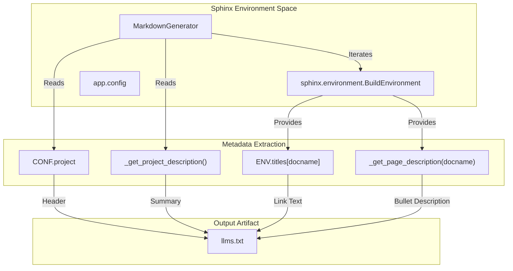
**Sources:** [src/sphinx_llm/txt.py:231-268](), [src/sphinx_llm/txt.py:270-285]()

---

## The llms-full.txt Concatenated Corpus

The `llms-full.txt` file is a single, large Markdown file containing the entire documentation set. This is intended for "full context" ingestion by LLMs [README.md:38-41]().

### Sort Order and Structure
The file is generated by the `build_llms_full_txt` method [src/sphinx_llm/txt.py:210-229](). To ensure a logical flow for the LLM, the extension sorts the documents:
1.  The `index` (root) document is always placed first [src/sphinx_llm/txt.py:214-214]().
2.  All other documents are sorted alphabetically by their `docname` [src/sphinx_llm/txt.py:215-215]().

### File Headers and Merging
When concatenating, the extension injects a clear delimiter between files to help the LLM identify document boundaries:
*   Each section starts with `# <docname>` [src/sphinx_llm/txt.py:221-221]().
*   The actual Markdown content of the page follows the header [src/sphinx_llm/txt.py:223-223]().
*   Two newlines are inserted between documents to prevent content bleed [src/sphinx_llm/txt.py:224-224]().

### Configuration: llms_txt_full_build
Because `llms-full.txt` can become extremely large for massive documentation projects, its generation can be disabled by setting `llms_txt_full_build = False` in `conf.py` [src/sphinx_llm/txt.py:115-116](), [README.md:115-115]().

---

## Implementation Details

The generation of these files occurs during the `combine_builds` phase, which is triggered after the primary Sphinx build and the shadow Markdown build are both complete [src/sphinx_llm/txt.py:83-85]().

### Process Interaction Diagram

This diagram shows how the `MarkdownGenerator` interacts with the file system and the subprocess to produce the final artifacts.

**File Aggregation Logic**
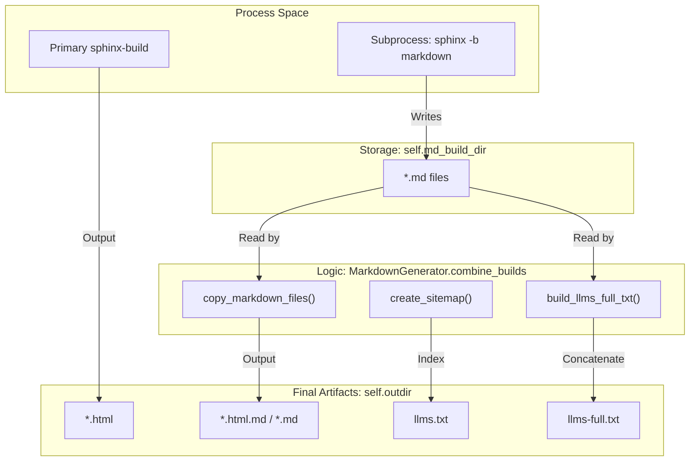
**Sources:** [src/sphinx_llm/txt.py:85-125](), [src/sphinx_llm/txt.py:186-208](), [src/sphinx_llm/txt.py:210-229]()

### Summary of Artifacts

| File | Purpose | Logic Source |
| :--- | :--- | :--- |
| `llms.txt` | Machine-readable sitemap and project summary. | `create_sitemap()` [src/sphinx_llm/txt.py:231]() |
| `llms-full.txt` | Full-text concatenation of all documentation. | `build_llms_full_txt()` [src/sphinx_llm/txt.py:210]() |
| `[page].md` | Individual Markdown version of an HTML page. | `copy_markdown_files()` [src/sphinx_llm/txt.py:186]() |

**Sources:** [src/sphinx_llm/txt.py:110-120](), [README.md:66-88]()

---

# Page: sphinx_llm.docref — LLM-Powered Page Summaries

# sphinx_llm.docref — LLM-Powered Page Summaries

<details>
<summary>Relevant source files</summary>

The following files were used as context for generating this wiki page:

- [README.md](README.md)
- [src/sphinx_llm/docref.py](src/sphinx_llm/docref.py)

</details>


The `sphinx_llm.docref` extension provides a mechanism to generate and embed AI-powered summaries of other documentation pages directly into your reStructuredText (RST) files [src/sphinx_llm/docref.py:120-123](). Unlike standard cross-references that only provide a title link, `docref` uses a Large Language Model (LLM) via **Ollama** to create a concise summary of the target page's content, which is then rendered as an admonition with a "Read more >>" link [src/sphinx_llm/docref.py:51-66]().

## Core Components and Workflow

The extension revolves around the `Docref` class, which inherits from both `BaseAdmonition` and `SphinxDirective` [src/sphinx_llm/docref.py:25](). When Sphinx encounters a `.. docref::` directive, the extension performs a lookup of the target document, calculates a hash of its content, and determines if a new summary needs to be generated or if a cached version can be used [src/sphinx_llm/docref.py:70-78]().

### Docref Build Process

The following diagram illustrates how the `Docref` directive bridges the gap between the Sphinx document tree (Code/Doc Space) and the LLM generation (Natural Language Space).

**Docref Summary Generation Flow**
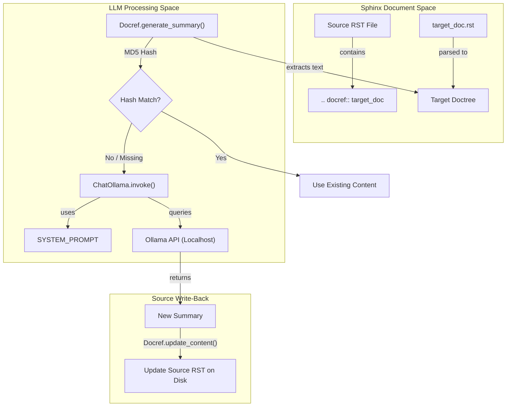
Sources: [src/sphinx_llm/docref.py:30-43](), [src/sphinx_llm/docref.py:69-110](), [src/sphinx_llm/docref.py:129-163]()

## The Docref Directive

The `.. docref::` directive requires a single argument: the name of the document to be summarized [src/sphinx_llm/docref.py:27-32](). It supports two primary options:
*   `:hash:`: An MD5 hash of the target document's content used for caching [src/sphinx_llm/docref.py:28]().
*   `:model:`: The specific LLM model to use for this summary (defaults to `llama3.2:3b`) [src/sphinx_llm/docref.py:20-28]().

When rendered, the directive produces a standard Sphinx admonition node [src/sphinx_llm/docref.py:26](). The extension automatically appends a `pending_xref` node to the end of the summary, which Sphinx later resolves into a "Read more >>" hyperlink pointing to the referenced document [src/sphinx_llm/docref.py:52-66]().

For detailed syntax and usage examples, see [Docref Directive Reference](#2.2.1).

Sources: [src/sphinx_llm/docref.py:25-67]()

## Ollama Integration and Caching

The extension integrates with [Ollama](https://github.com/ollama/ollama) to run LLMs locally [README.md:125-126](). It uses `langchain_ollama.ChatOllama` to communicate with the Ollama server, typically hosted at `http://localhost:11434` [src/sphinx_llm/docref.py:22, 94-98]().

### Caching and Write-Back Mechanism
To avoid redundant LLM calls and associated latency, `docref` implements a hash-based caching system:
1.  **Hash Calculation**: It generates an MD5 hash of the target document's text [src/sphinx_llm/docref.py:76]().
2.  **Verification**: If the `:hash:` option in the RST file matches the calculated hash, the existing summary in the file is reused [src/sphinx_llm/docref.py:77-78]().
3.  **In-Place Update**: If the hashes differ, the extension calls the LLM, generates a new summary, and **modifies the original RST source file on disk** to include the new summary and the updated hash [src/sphinx_llm/docref.py:132-163]().

**System Integration Mapping**
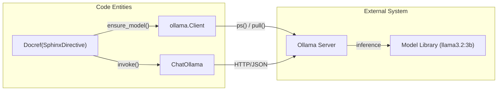
Sources: [src/sphinx_llm/docref.py:93-108](), [src/sphinx_llm/docref.py:112-127]()

For details on configuring the LLM connection and managing the cache, see [Ollama Integration and Summary Caching](#2.2.2).

Sources: [src/sphinx_llm/docref.py:69-110](), [src/sphinx_llm/docref.py:129-165]()

---

# Page: Docref Directive Reference

# Docref Directive Reference

<details>
<summary>Relevant source files</summary>

The following files were used as context for generating this wiki page:

- [README.md](README.md)
- [docs/source/conf.py](docs/source/conf.py)
- [src/sphinx_llm/docref.py](src/sphinx_llm/docref.py)

</details>


The `.. docref::` directive is provided by the `sphinx_llm.docref` extension. It allows documentation authors to reference other pages within the project while automatically generating a concise, LLM-powered summary of the target page's content.

## Purpose and Scope

The `Docref` directive automates the creation of "See also" style blocks. Unlike standard cross-references, `docref` includes a summary generated by a Large Language Model (LLM) via Ollama. It features a write-back mechanism that updates the original `.rst` source file with the generated summary and a content hash to minimize redundant API calls and ensure summaries stay in sync with the source material [src/sphinx_llm/docref.py:158-163]().

## Directive Syntax

The directive requires a single argument (the target document name) and supports optional configuration through directive options.

### Arguments and Options

| Component | Requirement | Description |
| :--- | :--- | :--- |
| `docname` | **Required** | The relative path to the document to be summarized (e.g., `apples` or `folder/page`). |
| `:model:` | Optional | Overrides the global LLM model for this specific summary. Defaults to `llama3.2:3b`. |
| `:hash:` | Optional | The MD5 hash of the target document. Usually managed automatically by the extension. |

### Usage Example

**Initial Input in RST:**
```rst
.. docref:: apples
```

**After Sphinx Build (Source Updated):**
```rst
.. docref:: apples
   :hash: 31ec12a54205539af3cde39b254ec766
   :model: llama3.2:3b

   Feeding apples to a friendly pig involves selecting ripe, pesticide-free
   apples, washing them thoroughly, and monitoring the pig's reaction.
```

Sources: [src/sphinx_llm/docref.py:25-28](), [README.md:148-174]()

## Implementation Details

The `Docref` class inherits from `BaseAdmonition` and `SphinxDirective` [src/sphinx_llm/docref.py:25](). It leverages the Sphinx environment to access document trees and the `langchain_ollama` client to communicate with the LLM.

### Data Flow and Logic

1.  **Title Retrieval**: The directive fetches the target document's doctree and extracts the first `title` node to use as the admonition header [src/sphinx_llm/docref.py:31-38]().
2.  **Hash Verification**: It calculates the MD5 hash of the target document's text. If it matches the `:hash:` option, the existing summary is reused [src/sphinx_llm/docref.py:75-78]().
3.  **LLM Generation**: If the hash mismatches or is missing, it invokes the LLM using a strict `SYSTEM_PROMPT` to generate a one-sentence summary [src/sphinx_llm/docref.py:21](), [src/sphinx_llm/docref.py:99-108]().
4.  **Source Write-back**: The extension identifies the exact lines in the original `.rst` file and overwrites them with the new summary and hash [src/sphinx_llm/docref.py:132-163]().
5.  **Cross-Reference**: A `pending_xref` node is appended to the end of the summary, which Sphinx resolves into a "Read more >>" link during the standard build phase [src/sphinx_llm/docref.py:51-66]().

### Component Interaction Diagram

This diagram shows how the `Docref` directive bridges the gap between the local filesystem (RST files) and the LLM inference service.

**Docref Execution Flow**
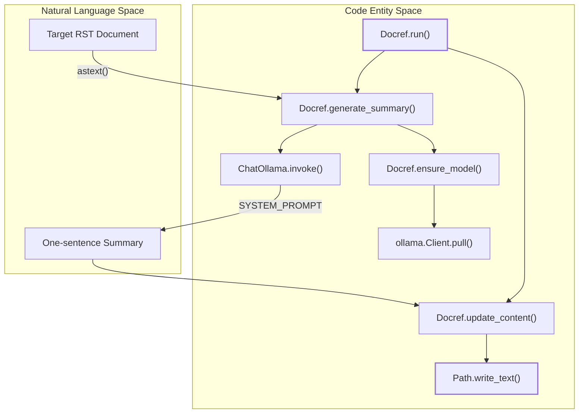
Sources: [src/sphinx_llm/docref.py:30-67](), [src/sphinx_llm/docref.py:69-110](), [src/sphinx_llm/docref.py:129-163]()

## Rendered Output

The directive renders as a standard Sphinx admonition with a custom class.

### Structure
1.  **Title**: Prefixed with "See also: ", followed by the title of the target document [src/sphinx_llm/docref.py:33-38]().
2.  **Body**: The LLM-generated summary text.
3.  **Link**: A paragraph with the CSS class `visit-link` containing a `pending_xref` to the target page [src/sphinx_llm/docref.py:63-65]().

### Visual Representation
The following diagram maps the code objects to the visual elements rendered in the final documentation.

**Mapping Code Entities to Rendered Output**
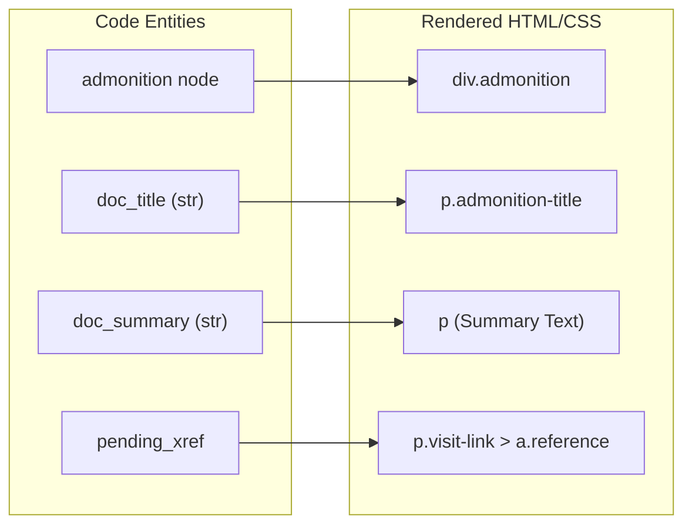
Sources: [src/sphinx_llm/docref.py:26](), [src/sphinx_llm/docref.py:33-39](), [src/sphinx_llm/docref.py:63-66]()

## Configuration Options

Global behavior for all `docref` instances can be configured in `conf.py` via the `sphinx_llm_options` dictionary.

| Option | Default | Description |
| :--- | :--- | :--- |
| `model` | `"llama3.2:3b"` | The default model used for generation if not specified in the directive. |
| `warn_on_cache_miss` | `True` | If `True`, Sphinx emits a warning when a summary is missing or out of date. |

Sources: [src/sphinx_llm/docref.py:20](), [src/sphinx_llm/docref.py:81](), [docs/source/conf.py:23-25]()

---

# Page: Ollama Integration and Summary Caching

# Ollama Integration and Summary Caching

<details>
<summary>Relevant source files</summary>

The following files were used as context for generating this wiki page:

- [src/sphinx_llm/docref.py](src/sphinx_llm/docref.py)
- [uv.lock](uv.lock)

</details>


The `sphinx_llm.docref` extension provides a mechanism to generate and cache document summaries using Large Language Models (LLMs) via the Ollama API. It integrates directly into the Sphinx build process, utilizing an MD5 hash-based caching system to minimize redundant API calls and a write-back pattern to update source `.rst` files with generated content.

## Ollama Connection and Model Management

The extension connects to an Ollama instance to perform inference. By default, it attempts to connect to `http://localhost:11434`, but this can be overridden using the `OLLAMA_BASE_URL` environment variable [[src/sphinx_llm/docref.py:22-22]]().

### ChatOllama and System Prompt
The integration uses the `ChatOllama` class from `langchain_ollama` to handle communication with the model [[src/sphinx_llm/docref.py:10-10]](). Every request is governed by a hardcoded `SYSTEM_PROMPT` designed to ensure the output is a concise, one-sentence summary without bullet points or nested structures [[src/sphinx_llm/docref.py:21-21]]().

### Model Lifecycle (ensure_model)
Before invoking the LLM, the extension verifies the availability of the requested model through the `ensure_model` method [[src/sphinx_llm/docref.py:112-127]]():
1. It initializes an `ollama.Client` using the configured `OLLAMA_BASE_URL` [[src/sphinx_llm/docref.py:114-114]]().
2. It checks if the model exists on the server using `ollama_client.show(model)` [[src/sphinx_llm/docref.py:118-118]]().
3. If the model is missing (triggering a `ResponseError`), it automatically triggers `ollama_client.pull(model)` to download the weights [[src/sphinx_llm/docref.py:122-122]]().

### LLM Interaction Flow
The following diagram illustrates the transition from the Sphinx environment to the Ollama service.

**Natural Language Space to Code Entity Space: Ollama Integration**
```mermaid
graph TD
    subgraph "Code Entity Space (sphinx_llm.docref)"
        A["Docref.generate_summary()"] --> B["Docref.ensure_model()"]
        B --> C["ollama.Client"]
        A --> D["ChatOllama"]
    end

    subgraph "Natural Language Space (Ollama Service)"
        C -- "pull(model)" --> E["Ollama Server"]
        D -- "invoke(SYSTEM_PROMPT)" --> E
        E -- "One-sentence summary" --> D
    end
```
Sources: [[src/sphinx_llm/docref.py:69-127]]()

## Hash-Based Caching Mechanism

To prevent expensive re-generation of summaries during every build, `docref` implements a local caching strategy based on the MD5 hash of the target document's content.

### Cache Validation
When the `Docref.run()` method is executed, it calls `generate_summary(doc_name)` [[src/sphinx_llm/docref.py:42-42]](). The validation logic proceeds as follows:
1. **Content Extraction**: The text content of the referenced document is extracted from the Sphinx environment's doctree [[src/sphinx_llm/docref.py:71-73]]().
2. **Hash Generation**: An MD5 hex digest is calculated from this content [[src/sphinx_llm/docref.py:76-76]]().
3. **Comparison**: The calculated hash is compared against the `:hash:` option provided in the RST directive [[src/sphinx_llm/docref.py:77-77]]().
4. **Cache Hit**: If the hashes match, the existing content in the directive is returned without calling the LLM [[src/sphinx_llm/docref.py:78-78]]().
5. **Cache Miss**: If the hashes differ or the `:hash:` option is missing, the extension logs a warning (if `warn_on_cache_miss` is enabled) and proceeds to regenerate the summary [[src/sphinx_llm/docref.py:79-85]]().

### Configuration Options
The caching behavior is influenced by the `sphinx_llm_options` dictionary in `conf.py` [[src/sphinx_llm/docref.py:168-168]]():
| Option | Type | Description |
| :--- | :--- | :--- |
| `model` | `str` | The Ollama model to use (defaults to `llama3.2:3b`) [[src/sphinx_llm/docref.py:20-20]](). |
| `warn_on_cache_miss` | `bool` | Whether to log a warning when a summary is out of date (defaults to `True`) [[src/sphinx_llm/docref.py:81-81]](). |

Sources: [[src/sphinx_llm/docref.py:69-110]](), [[src/sphinx_llm/docref.py:166-174]]()

## Source Write-Back Pattern

A unique feature of `sphinx_llm.docref` is its ability to update the developer's source files on disk. This ensures that once a summary is generated, it is persisted directly into the `.rst` file.

### Implementation of update_content
The `update_content` method performs in-place modification of the source file [[src/sphinx_llm/docref.py:129-163]]():
1. **File Identification**: It identifies the source file path using `self.state.document.current_source` [[src/sphinx_llm/docref.py:133-133]](). Currently, only `.rst` files are supported [[src/sphinx_llm/docref.py:135-136]]().
2. **Line Mapping**: It calculates the correct indentation level and line indices by inspecting the directive's position (`self.lineno`) and existing content [[src/sphinx_llm/docref.py:139-143]]().
3. **Substitution**: It removes the old summary lines and inserts the new LLM-generated summary at the correct indentation [[src/sphinx_llm/docref.py:146-151]]().
4. **Hash Update**: It searches for the `:hash:` option within the directive block. If found, it updates the value; if not, it inserts the new `:hash:` line [[src/sphinx_llm/docref.py:154-159]]().
5. **Atomic Write**: The file is only written back to disk if the new content differs from the `original_source` [[src/sphinx_llm/docref.py:162-163]]().

**Data Flow: Source File Synchronization**
```mermaid
graph TD
    subgraph "Sphinx Build Environment"
        DIR[".. docref:: target_doc"] -- "1. Parse" --> OBJ["Docref Instance"]
        OBJ -- "2. Generate" --> SUM["New Summary + Hash"]
    end

    subgraph "File System"
        OBJ -- "3. Read" --> FS_READ["source.rst"]
        SUM -- "4. Update Lines" --> FS_WRITE["source.rst"]
    end

    subgraph "Logic (Docref.update_content)"
        FS_READ --> MATCH{"Content Changed?"}
        MATCH -- "Yes" --> FS_WRITE
        MATCH -- "No" --> EXIT["Skip Write"]
    end
```
Sources: [[src/sphinx_llm/docref.py:129-163]]()

## Build Integration

The extension hooks into the Sphinx lifecycle by registering the `docref` directive and defining configuration values during the `setup` phase [[src/sphinx_llm/docref.py:166-174]]().

### Dependency Tracking
To ensure summaries stay current, the extension calls `self.state.document.settings.env.note_dependency(doc_name)` [[src/sphinx_llm/docref.py:46-46]](). This informs Sphinx that the current page must be rebuilt whenever the referenced document (`doc_name`) is modified.

### Output Rendering
The final output in the HTML documentation consists of:
- A standard Sphinx `admonition` containing the summary text [[src/sphinx_llm/docref.py:26-26]]().
- A `pending_xref` node that renders as a "Read more >>" link pointing to the referenced document [[src/sphinx_llm/docref.py:52-66]]().

Sources: [[src/sphinx_llm/docref.py:25-67]](), [[src/sphinx_llm/docref.py:166-174]]()

---

# Page: Testing

# Testing

<details>
<summary>Relevant source files</summary>

The following files were used as context for generating this wiki page:

- [src/sphinx_llm/tests/__init__.py](src/sphinx_llm/tests/__init__.py)
- [src/sphinx_llm/tests/test_txt.py](src/sphinx_llm/tests/test_txt.py)

</details>


The `sphinx-llm` test suite is designed to ensure that both the `sphinx_llm.txt` and `sphinx_llm.docref` extensions integrate correctly with the Sphinx build lifecycle. The testing strategy relies heavily on integration tests that execute real Sphinx builds against a dedicated example project, verifying the generation of LLM-consumable artifacts and the correctness of internal logic like path mapping and subprocess management.

### Test Architecture Overview

The test suite uses `pytest` and leverages the `Sphinx` application class to programmatically trigger builds. It specifically targets the interaction between the standard HTML builders and the custom Markdown generation pipeline.

The following diagram illustrates how the test infrastructure exercises the code entities:

**Test Execution Flow**
```mermaid
graph TD
    subgraph "Test Space"
        T1["test_txt.py"]
        F1["sphinx_build fixture"]
    end

    subgraph "Code Entity Space (sphinx_llm.txt)"
        MG["MarkdownGenerator"]
        SB["_build_sphinx()"]
        CM["combine_builds()"]
    end

    subgraph "Filesystem"
        SRC["docs/source/ (Test Corpus)"]
        OUT["Temporary Build Dir"]
    end

    T1 --> F1
    F1 --> SB
    SB -- "initializes" --> MG
    SB -- "reads" --> SRC
    MG -- "triggers shadow build" --> CM
    CM -- "writes" --> OUT
    T1 -- "asserts" --> OUT
```
Sources: [src/sphinx_llm/tests/test_txt.py:21-50](), [src/sphinx_llm/tests/test_txt.py:66-78]()

### Key Fixtures and Helpers

The primary engine for testing is the `sphinx_build` fixture. It allows the test suite to matrix across different Sphinx configurations to ensure compatibility across common documentation patterns.

| Fixture / Helper | Role |
| :--- | :--- |
| `sphinx_build` | Parametrized fixture that runs builds for `html` and `dirhtml` builders in both sequential and parallel modes [src/sphinx_llm/tests/test_txt.py:66-78](). |
| `_build_sphinx` | Internal helper that creates a `tempfile.TemporaryDirectory`, initializes the `Sphinx` app, and executes `app.build()` [src/sphinx_llm/tests/test_txt.py:21-50](). |
| `assert_file_exists_with_content` | Utility to verify that output artifacts (like `llms.txt`) are not only present but contain data [src/sphinx_llm/tests/test_txt.py:53-57](). |

### Testing Scope

The test suite validates several critical behaviors of the extensions:
*   **Artifact Integrity**: Ensuring every `.rst` file in the source results in a corresponding `.html.md` file in the output [src/sphinx_llm/tests/test_txt.py:122-141]().
*   **Sitemap Accuracy**: Parsing the generated `llms.txt` to verify that all listed URLs point to valid files on disk [src/sphinx_llm/tests/test_txt.py:144-159]().
*   **Suffix Mode Logic**: Verifying that `llms_txt_suffix_mode` (e.g., `file-suffix`, `url-suffix`) correctly places files in the expected directory structure [src/sphinx_llm/tests/test_txt.py:178-210]().
*   **Error Handling**: Confirming that the `MarkdownGenerator` handles build exceptions gracefully without crashing the main Sphinx process [src/sphinx_llm/tests/test_txt.py:115-120]().

### Integration with Example Project

Rather than using mock objects, the tests use the `docs/source` directory as a live test corpus. This directory contains a variety of Sphinx features (nested directories, static assets, various RST directives) to ensure the extensions work in real-world scenarios.

**Test Corpus Mapping**
```mermaid
graph LR
    subgraph "Natural Language Space"
        DOCS["Documentation Project"]
        NEST["Nested Content"]
        INDEX["Sitemap Root"]
    end

    subgraph "Code Entity Space (Filesystem)"
        F1["docs/source/conf.py"]
        F2["docs/source/index.rst"]
        F3["docs/source/nested/example.rst"]
    end

    DOCS --> F1
    INDEX --> F2
    NEST --> F3
```
Sources: [src/sphinx_llm/tests/test_txt.py:29-29](), [src/sphinx_llm/tests/test_txt.py:59-63]()

---

### Detailed Sub-Pages

For more specific information on the test implementation and the corpus used, see the following pages:

*   **[Test Suite for sphinx_llm.txt](#3.1)**: Detailed breakdown of `test_txt.py`, including the parametrization of builders and specific assertion logic for the LLM output files.
*   **[Example Documentation Project](#3.2)**: A guide to the `docs/source` directory, explaining how the different RST files exercise specific parts of the extension.

---

# Page: Test Suite for sphinx_llm.txt

# Test Suite for sphinx_llm.txt

<details>
<summary>Relevant source files</summary>

The following files were used as context for generating this wiki page:

- [docs/source/_static/images/pig-feeding-summary.png](docs/source/_static/images/pig-feeding-summary.png)
- [docs/source/apples.rst](docs/source/apples.rst)
- [docs/source/index.rst](docs/source/index.rst)
- [docs/source/nested/example.rst](docs/source/nested/example.rst)
- [docs/source/test.rst](docs/source/test.rst)
- [src/sphinx_llm/tests/test_txt.py](src/sphinx_llm/tests/test_txt.py)

</details>


This page documents the test suite for the `sphinx_llm.txt` extension, primarily contained within `test_txt.py`. The suite ensures that the extension correctly generates LLM-consumable Markdown artifacts, maintains sitemap integrity, and respects various configuration modes across different Sphinx builders and execution environments.

## Test Infrastructure and Fixtures

The test suite leverages a centralized Sphinx build fixture that parametrizes the build environment to cover common production scenarios.

### The `sphinx_build` Fixture
The `sphinx_build` function is a parametrized fixture that executes a full Sphinx build for each test case. It cycles through combinations of HTML builders and execution modes to ensure the extension's subprocess management is robust.

| Parameter | Values | Description |
| :--- | :--- | :--- |
| **Builder** | `html`, `dirhtml` | Tests standard file-based output and directory-based (clean URL) output. |
| **Parallel** | `True`, `False` | Toggles the `llms_txt_build_parallel` configuration to test both threaded and sequential shadow builds. |

The fixture uses a temporary directory for each run, isolating `build` and `doctrees` artifacts [src/sphinx_llm/tests/test_txt.py:34-43](). It points to the project's own documentation source (`docs/source`) as the test corpus [src/sphinx_llm/tests/test_txt.py:29-29]().

### Data Flow: Test Execution
The following diagram illustrates how the `sphinx_build` fixture initializes the `Sphinx` application and triggers the `MarkdownGenerator` logic.

**Sphinx Test Build Lifecycle**
```mermaid
graph TD
    subgraph "Test Runner (pytest)"
        A["sphinx_build Fixture"] --> B["_build_sphinx()"]
    end

    subgraph "Sphinx Application Space"
        B --> C["Sphinx Instance Init"]
        C --> D["MarkdownGenerator.setup()"]
        D --> E["app.connect('builder-inited')"]
        E --> F["app.build()"]
    end

    subgraph "Filesystem Space"
        F --> G["/tmp/build/"]
        G --> H["index.html"]
        G --> I["llms.txt"]
        G --> J["llms-full.txt"]
    end

    B -- "Yields (app, build_dir, src_dir)" --> A
```
Sources: [src/sphinx_llm/tests/test_txt.py:21-50](), [src/sphinx_llm/tests/test_txt.py:66-78]()

## Key Test Cases

### 1. File Existence and Content Integrity
The suite verifies that for every source `.rst` file in the documentation project, the extension produces a corresponding `.html.md` file [src/sphinx_llm/tests/test_txt.py:122-142]().
* **Logic**: It maps source paths to expected output paths based on whether the builder is `html` (flat) or `dirhtml` (folder-based) [src/sphinx_llm/tests/test_txt.py:132-138]().
* **Assertion**: `assert_file_exists_with_content` ensures files are not only present but have a non-zero size [src/sphinx_llm/tests/test_txt.py:53-56]().

### 2. llms.txt Sitemap Validation
The test `test_llms_txt_sitemap_links_exist` parses the generated `llms.txt` file using regex to extract all Markdown links [src/sphinx_llm/tests/test_txt.py:144-159]().
* **Link Verification**: Every URL found in the sitemap must point to a file that exists in the build directory [src/sphinx_llm/tests/test_txt.py:157-158]().
* **Description Filtering**: A specific test ensures that empty anchor tags (e.g., `<a id="..."></a>`) are not accidentally extracted as page descriptions in the sitemap [src/sphinx_llm/tests/test_txt.py:161-176]().

### 3. Suffix Mode Configuration
The suite tests the `llms_txt_suffix_mode` configuration, which determines the naming convention for Markdown files in `dirhtml` builds.

| Mode | Expected Output for `test.rst` |
| :--- | :--- |
| `file-suffix` | `test/index.html.md` |
| `url-suffix` | `test.md` |
| `auto` | Both of the above |

The `test_dirhtml_suffix_mode_configuration` test uses `indirect=True` parametrization to verify that only the requested files are created and that `both` acts as a backward-compatible alias for `auto` [src/sphinx_llm/tests/test_txt.py:178-216]().

### 4. Error Handling
The suite includes safety checks for the build lifecycle:
* **Initialization**: Verifies `MarkdownGenerator` correctly stores the app reference [src/sphinx_llm/tests/test_txt.py:89-94]().
* **Event Connection**: Confirms the `builder-inited` event is hooked during setup [src/sphinx_llm/tests/test_txt.py:96-113]().
* **Exception Resilience**: `test_combine_builds_with_exception` ensures that if the primary Sphinx build fails, the `combine_builds` method returns early without attempting to merge artifacts [src/sphinx_llm/tests/test_txt.py:115-120]().

Sources: [src/sphinx_llm/tests/test_txt.py:53-216]()

## Example Project as Test Corpus

The `docs/source` directory serves as the primary test project. It contains a variety of structures to exercise the extension's path logic:
* **Root Files**: `index.rst`, `test.rst`, `apples.rst` [docs/source/index.rst:13-14]().
* **Nested Files**: `nested/example.rst` [docs/source/nested/example.rst:1-5]().
* **Static Assets**: Images like `pig-feeding-summary.png` [docs/source/_static/images/pig-feeding-summary.png:1-1]().

**Code Entity to Document Mapping**
```mermaid
graph LR
    subgraph "Natural Language Space"
        Doc1["Root Index Page"]
        Doc2["Pig Feeding Guide"]
        Doc3["Nested Example"]
    end

    subgraph "Code Entity Space (RST Files)"
        File1["docs/source/index.rst"]
        File2["docs/source/apples.rst"]
        File3["docs/source/nested/example.rst"]
    end

    subgraph "Generated Artifacts"
        MD1["index.html.md"]
        MD2["apples.html.md"]
        MD3["nested/example.html.md"]
        Sitemap["llms.txt"]
    end

    Doc1 --- File1
    Doc2 --- File2
    Doc3 --- File3

    File1 --> MD1
    File2 --> MD2
    File3 --> MD3

    MD1 --> Sitemap
    MD2 --> Sitemap
    MD3 --> Sitemap
```
Sources: [docs/source/index.rst:9-15](), [docs/source/apples.rst:1-2](), [docs/source/nested/example.rst:1-2]()

---

# Page: Example Documentation Project

# Example Documentation Project

<details>
<summary>Relevant source files</summary>

The following files were used as context for generating this wiki page:

- [docs/Makefile](docs/Makefile)
- [docs/make.bat](docs/make.bat)
- [docs/source/_static/.gitkeep](docs/source/_static/.gitkeep)
- [docs/source/_static/images/pig-feeding-summary.png](docs/source/_static/images/pig-feeding-summary.png)
- [docs/source/_templates/.gitkeep](docs/source/_templates/.gitkeep)
- [docs/source/apples.rst](docs/source/apples.rst)
- [docs/source/conf.py](docs/source/conf.py)
- [docs/source/index.rst](docs/source/index.rst)
- [docs/source/nested/example.rst](docs/source/nested/example.rst)
- [docs/source/test.rst](docs/source/test.rst)

</details>


The `docs/source/` directory contains a complete Sphinx project that serves a dual purpose: it acts as the primary documentation for the `sphinx-llm` repository and functions as the ground-truth test corpus for the suite's integration tests. This project demonstrates the configuration and usage of both the `sphinx_llm.txt` and `sphinx_llm.docref` extensions.

## Project Structure and Configuration

The project follows a standard Sphinx layout, utilizing an `index.rst` file as the root of the documentation tree. The configuration is centralized in `conf.py`, which enables the `sphinx-llm` extensions and defines global parameters for LLM integration.

### Configuration (`conf.py`)

The `conf.py` file integrates the core extensions and provides the necessary metadata for the `llms.txt` generation.

| Parameter | Value / Description |
| :--- | :--- |
| `extensions` | Includes `sphinx_llm.docref` and `sphinx_llm.txt` [docs/source/conf.py:18-21](). |
| `sphinx_llm_options` | Sets the default model to `llama3.2:3b` [docs/source/conf.py:23-25](). |
| `llms_txt_description` | A multi-line string used as the summary in the generated `llms.txt` sitemap [docs/source/conf.py:26-30](). |
| `html_theme` | Uses the `alabaster` theme [docs/source/conf.py:39-39](). |

**Sources:** [docs/source/conf.py:1-41]()

## Documentation Content and Hierarchy

The project structure is designed to test various features of the extensions, including cross-referencing, nested directories, and LLM-generated summaries.

### The Document Tree

The `index.rst` file defines the `toctree`, which includes three primary pages: `test`, `apples`, and a nested `nested/example` [docs/source/index.rst:9-15]().

**Documentation Hierarchy Diagram**

```mermaid
graph TD
    subgraph "Natural Language Space"
        ROOT["Welcome to sphinx-llm"]
        TEST_PAGE["Testing page"]
        APPLE_PAGE["Feeding Apples to a Friendly Pig"]
        NESTED_PAGE["Example (Nested)"]
    end

    subgraph "Code Entity Space"
        INDEX_RST["docs/source/index.rst"]
        TEST_RST["docs/source/test.rst"]
        APPLES_RST["docs/source/apples.rst"]
        EXAMPLE_RST["docs/source/nested/example.rst"]
    end

    INDEX_RST -->|":toctree:"| TEST_RST
    INDEX_RST -->|":toctree:"| APPLES_RST
    INDEX_RST -->|":toctree:"| EXAMPLE_RST

    ROOT -.-> INDEX_RST
    TEST_PAGE -.-> TEST_RST
    APPLE_PAGE -.-> APPLES_RST
    NESTED_PAGE -.-> EXAMPLE_RST
```

**Sources:** [docs/source/index.rst:1-24](), [docs/source/test.rst:1-2](), [docs/source/apples.rst:1-2](), [docs/source/nested/example.rst:1-2]()

### Content Examples

1.  **`apples.rst`**: A detailed instructional page about feeding apples to pigs. It contains multiple sections (`Introduction`, `Steps`, `Safety Tips`) and formatted lists [docs/source/apples.rst:1-47](). This file serves as the primary source for the `docref` summarization test.
2.  **`test.rst`**: Demonstrates the `.. docref::` directive. It references the `apples` document and contains a cached summary generated by the `llama3.2:3b` model [docs/source/test.rst:5-9]().
3.  **`nested/example.rst`**: A simple file used to verify that the `sphinx_llm.txt` extension correctly handles nested directory structures when generating Markdown outputs and sitemaps [docs/source/nested/example.rst:1-5]().

**Sources:** [docs/source/apples.rst:1-47](), [docs/source/test.rst:1-9](), [docs/source/nested/example.rst:1-5]()

## Data Flow: Summarization and Referencing

The `docref` extension interacts with the source files by reading content from a target (e.g., `apples.rst`) and writing a summary back into the referencing file (e.g., `test.rst`).

**Summarization Data Flow**

```mermaid
sequenceDiagram
    participant RST as "docs/source/test.rst"
    participant DOCREF as "sphinx_llm.docref"
    participant TARGET as "docs/source/apples.rst"
    participant OLLAMA as "Ollama (llama3.2:3b)"

    RST->>DOCREF: Detects ".. docref:: apples"
    DOCREF->>TARGET: Reads content for context
    DOCREF->>DOCREF: Calculates content hash
    alt Hash mismatch or missing
        DOCREF->>OLLAMA: Requests summary
        OLLAMA-->>DOCREF: Returns generated text
        DOCREF->>RST: Writes back summary and new :hash:
    else Hash match
        DOCREF->>RST: Uses existing summary in RST
    end
```

**Sources:** [docs/source/test.rst:5-9](), [docs/source/conf.py:23-25]()

## Static Assets and Build Scripts

The project includes standard Sphinx directories for customization:
*   **`_static/`**: Contains assets like `pig-feeding-summary.png`, which provides a visual reference for how the documentation renders [docs/source/_static/images/pig-feeding-summary.png:1-15]().
*   **`_templates/`**: A placeholder for custom HTML templates [docs/source/_templates/.gitkeep:1-1]().

### Build Infrastructure

The project provides standard entry points for local builds:
*   **`Makefile`**: Standard GNU Make targets for building documentation (e.g., `make html`) [docs/Makefile:1-21]().
*   **`make.bat`**: Windows batch script equivalent for the Sphinx build process [docs/make.bat:1-36]().

When these scripts are executed, the `sphinx_llm.txt` extension intercepts the build to trigger the parallel sitemap and Markdown generation processes.

**Sources:** [docs/Makefile:1-21](), [docs/make.bat:1-36](), [docs/source/conf.py:18-21]()

---

# Page: CI/CD and Release Infrastructure

# CI/CD and Release Infrastructure

<details>
<summary>Relevant source files</summary>

The following files were used as context for generating this wiki page:

- [.github/workflows/build-docs.yml](.github/workflows/build-docs.yml)
- [.github/workflows/downstream.yml](.github/workflows/downstream.yml)
- [.github/workflows/lint.yml](.github/workflows/lint.yml)
- [.github/workflows/publish.yml](.github/workflows/publish.yml)
- [.github/workflows/test.yml](.github/workflows/test.yml)

</details>


This section provides an overview of the automation pipelines and release processes for `sphinx-llm`. The project utilizes GitHub Actions to manage a comprehensive suite of workflows including unit testing across multiple Python/Sphinx versions, documentation builds with live LLM services, downstream integration checks, and automated PyPI publishing.

### Workflow Orchestration

The infrastructure is designed to ensure that the complex interactions between Sphinx extensions, local LLM services (Ollama), and the generated Markdown artifacts remain stable across supported environments.

#### System Architecture: CI/CD Pipeline
```mermaid
graph TD
    subgraph "Triggers"
        PR["Pull Request"]
        Push["Push to Main"]
        Tag["Git Tag (v*)"]
        Sched["Daily Schedule"]
    end

    subgraph "Validation Layer"
        Lint["lint.yml<br/>(Pre-commit/Ruff)"]
        Test["test.yml<br/>(Pytest Matrix)"]
        BuildDocs["build-docs.yml<br/>(Ollama Integration)"]
    end

    subgraph "Integration Layer"
        Downstream["downstream.yml<br/>(kopf / kr8s)"]
    end

    subgraph "Delivery Layer"
        Publish["publish.yml<br/>(Trusted Publishing)"]
    end

    PR --> Lint
    PR --> Test
    Push --> BuildDocs
    Sched --> Downstream
    Tag --> Publish

    style PR fill:none
    style Push fill:none
    style Tag fill:none
    style Sched fill:none
```
**Sources:** [.github/workflows/lint.yml:3-8](), [.github/workflows/test.yml:3-8](), [.github/workflows/build-docs.yml:3-7](), [.github/workflows/downstream.yml:3-8](), [.github/workflows/publish.yml:3-6]()

---

### Build and Test Workflows
The core validation of the codebase is split between standard unit tests and functional documentation builds.

*   **`test.yml`**: Executes `pytest` against a matrix of Python versions (3.9–3.12) and Sphinx versions (5.x–8.x) [.github/workflows/test.yml:13-33](). It generates coverage reports uploaded to Codecov [.github/workflows/test.yml:45-53]().
*   **`build-docs.yml`**: Specifically validates the `sphinx_llm.docref` extension by spinning up an **Ollama** service in the runner [.github/workflows/build-docs.yml:21-22](). It verifies that LLM-powered summaries can be generated and written back to source files like `apples.rst` [.github/workflows/build-docs.yml:30-32]().

For details, see [Build and Test Workflows](#4.1).

**Sources:** [.github/workflows/test.yml:10-54](), [.github/workflows/build-docs.yml:9-42]()

---

### Downstream Compatibility Testing
Because `sphinx-llm` modifies the standard Sphinx build output, it is critical to ensure it does not break existing documentation projects.

The `downstream.yml` workflow performs "smoke tests" by:
1.  Cloning external projects such as `nolar/kopf` and `kr8s-org/kr8s` [.github/workflows/downstream.yml:20-27]().
2.  Injecting the local `sphinx-llm` build into their environments [.github/workflows/downstream.yml:50-52]().
3.  Running their native `sphinx-build` commands [.github/workflows/downstream.yml:54-58]().
4.  Verifying the presence of `llms.txt` and `llms-full.txt` artifacts [.github/workflows/downstream.yml:60-69]().

If a downstream build fails, the workflow automatically opens a GitHub issue in the `sphinx-llm` repository [.github/workflows/downstream.yml:70-80]().

For details, see [Downstream Compatibility Testing](#4.2).

**Sources:** [.github/workflows/downstream.yml:13-81]()

---

### Linting and Publishing
The project maintains strict code quality and automated release cycles.

*   **Linting**: The `lint.yml` workflow utilizes `pre-commit/action` to enforce `ruff` formatting, license header presence, and `codespell` checks [.github/workflows/lint.yml:10-17]().
*   **Publishing**: Releases are triggered by pushing a git tag. The `publish.yml` workflow uses **Trusted Publishing** to securely upload the built distribution to PyPI [.github/workflows/publish.yml:9-30](). Versioning is handled dynamically by `hatch-vcs` based on the git tag [.github/workflows/publish.yml:19]().

For details, see [Linting, Pre-commit, and Publishing](#4.3).

#### Release Process Mapping
```mermaid
sequenceDiagram
    participant Dev as Developer
    participant Git as GitHub Repo
    participant CI as GitHub Actions
    participant PyPI as PyPI Registry

    Dev->>Git: git tag v1.2.3 && git push --tags
    Git->>CI: Trigger publish.yml
    activate CI
    CI->>CI: Checkout (fetch-depth: 0)
    Note over CI: hatch-vcs resolves version
    CI->>CI: uv build
    CI->>PyPI: OIDC Trusted Publish
    deactivate CI
    PyPI-->>Dev: Package Available
```
**Sources:** [.github/workflows/publish.yml:1-31]()

---

# Page: Build and Test Workflows

# Build and Test Workflows

<details>
<summary>Relevant source files</summary>

The following files were used as context for generating this wiki page:

- [.github/workflows/build-docs.yml](.github/workflows/build-docs.yml)
- [.github/workflows/test.yml](.github/workflows/test.yml)

</details>


The `sphinx-llm` repository utilizes GitHub Actions to ensure cross-version compatibility for both Python and the Sphinx framework. The CI/CD pipeline is divided into specialized workflows that validate documentation generation (including LLM-powered features) and execute the test suite with comprehensive coverage reporting.

## Documentation Build Workflow (`build-docs.yml`)

The `build-docs.yml` workflow is designed to verify that the documentation can be built successfully across multiple versions of Sphinx. This workflow is unique because it exercises the `sphinx_llm.docref` extension, which requires a live LLM service to generate page summaries.

### Ollama Service Integration
To support the `.. docref::` directive during the build, the workflow initializes an Ollama instance using the `ai-action/setup-ollama` action [.github/workflows/build-docs.yml:21-22](). This allows the `sphinx-build` process to communicate with a local LLM to generate summaries for pages that do not have a cached summary in their source RST files.

### Cache Invalidation and Write-Back Testing
A critical part of this workflow is verifying the "write-back" mechanism of `sphinx_llm.docref`. The workflow performs the following steps to force a cache miss and observe the extension's behavior:
1.  **Invalidate Cache**: It appends a unique `GITHUB_RUN_ID` to `docs/source/apples.rst` [.github/workflows/build-docs.yml:30-32](). Since `docref` uses an MD5 hash of the target file's content to determine if a summary is stale, this modification forces the extension to request a new summary from Ollama.
2.  **Backup State**: It creates a backup of `docs/source/test.rst` [.github/workflows/build-docs.yml:33]().
3.  **Build and Compare**: After the build completes, it runs a `diff` between the original and updated source files [.github/workflows/build-docs.yml:39-41](). This confirms that the extension successfully updated the RST source on disk with the new summary and hash.

### Build Matrix and Environment
The build runs on `ubuntu-latest` using a matrix of Sphinx versions to ensure compatibility with legacy and modern Sphinx releases [.github/workflows/build-docs.yml:12-15]().

| Environment Variable / Tool | Purpose |
| :--- | :--- |
| `uv` | Used for fast dependency resolution and execution [.github/workflows/build-docs.yml:24-28](). |
| `--extra gen` | Ensures `langchain` and `ollama` dependencies are installed for `docref` [.github/workflows/build-docs.yml:37](). |
| `sphinx-version` matrix | Tests ranges from `5.1` through `9.0` [.github/workflows/build-docs.yml:15](). |

### Workflow Data Flow: Documentation Build
The following diagram illustrates how the build workflow interacts with the codebase and external services.

**Build Workflow Entity Map**
```mermaid
graph TD
    subgraph "GitHub Action: Build Sphinx Docs"
        RUNNER["Ubuntu Runner"]
        UV["uv run sphinx-build"]
        OLLAMA["Ollama Service"]
    end

    subgraph "Codebase Entities"
        DOCREF["sphinx_llm.docref"]
        APPLES_RST["docs/source/apples.rst"]
        TEST_RST["docs/source/test.rst"]
    end

    RUNNER -- "Modifies content" --> APPLES_RST
    UV -- "Invokes" --> DOCREF
    DOCREF -- "Calculates Hash" --> APPLES_RST
    DOCREF -- "Request Summary" --> OLLAMA
    DOCREF -- "Update :hash: and Summary" --> TEST_RST
    OLLAMA -- "Return Text" --> DOCREF
```
**Sources:** [.github/workflows/build-docs.yml:1-42]()

## Test Execution Workflow (`test.yml`)

The `test.yml` workflow focuses on unit and integration testing of the `sphinx_llm` package. It validates the logic of both `sphinx_llm.txt` (Markdown generation) and `sphinx_llm.docref` (referencing and summarization).

### Multi-Dimension Compatibility Matrix
The test suite is executed against a comprehensive matrix that covers:
1.  **Sphinx Versioning**: Latest Python (3.12) against Sphinx versions `5.x`, `6.x`, `7.x`, and `8.x` [.github/workflows/test.yml:16-23]().
2.  **Python Versioning**: Latest supported Sphinx (7.x) against Python `3.9`, `3.10`, `3.11`, and `3.12` [.github/workflows/test.yml:25-32]().

### Execution and Coverage
Tests are executed using `pytest` targeting the `src/sphinx_llm/tests/` directory [.github/workflows/test.yml:45](). The workflow includes:
*   **Coverage Tracking**: Uses `pytest-cov` to generate an XML coverage report for the `sphinx_llm` package [.github/workflows/test.yml:45]().
*   **Codecov Integration**: The resulting `coverage.xml` is uploaded to Codecov [.github/workflows/test.yml:47-54](). This provides visibility into which lines of the extensions are exercised by the test suite, specifically tracking the complex path mapping and subprocess logic in the `.txt` extension.

### Workflow Data Flow: Testing
This diagram maps the test execution process to the specific components of the package being validated.

**Test Workflow Entity Map**
```mermaid
graph TD
    subgraph "GitHub Action: Test"
        PYTEST["pytest"]
        CODECOV["Codecov Action"]
    end

    subgraph "Package Components"
        TXT_EXT["sphinx_llm.txt"]
        DOCREF_EXT["sphinx_llm.docref"]
        TEST_FILES["src/sphinx_llm/tests/test_txt.py"]
    end

    PYTEST -- "Discovers" --> TEST_FILES
    TEST_FILES -- "Exercises" --> TXT_EXT
    TEST_FILES -- "Exercises" --> DOCREF_EXT
    PYTEST -- "Generates coverage.xml" --> CODECOV
```
**Sources:** [.github/workflows/test.yml:1-54]()

## Key Workflow Components Summary

| Feature | `build-docs.yml` | `test.yml` |
| :--- | :--- | :--- |
| **Primary Goal** | End-to-end doc build & summary write-back | Code correctness & version compatibility |
| **LLM Support** | Active (via `ai-action/setup-ollama`) | Not required (mocks/fixtures used in tests) |
| **Python Versions** | 3.12 | 3.9, 3.10, 3.11, 3.12 |
| **Sphinx Versions** | 5.x, 6.x, 7.x, 8.x | 5.x, 6.x, 7.x, 8.x |
| **Key Command** | `sphinx-build -b html` | `pytest src/sphinx_llm/tests/` |
| **Artifacts** | Updated `.rst` source files (verified via diff) | `coverage.xml` (uploaded to Codecov) |

**Sources:** [.github/workflows/build-docs.yml:1-42](), [.github/workflows/test.yml:1-54]()

---

# Page: Downstream Compatibility Testing

# Downstream Compatibility Testing

<details>
<summary>Relevant source files</summary>

The following files were used as context for generating this wiki page:

- [.github/workflows/downstream.yml](.github/workflows/downstream.yml)

</details>


The `sphinx-llm` project maintains a robust compatibility layer by validating its extensions against real-world, high-traffic documentation projects. This is achieved through the **Downstream Compatibility Testing** suite, which ensures that changes to the core library do not break existing Sphinx integrations in consumer projects.

The primary mechanism for this validation is the `downstream.yml` GitHub Actions workflow. This workflow treats external projects as integration test cases, injecting the local version of `sphinx-llm` into their environments to verify that the generated LLM artifacts (`llms.txt`, `llms-full.txt`, and `.html.md` files) remain consistent and valid.

### Workflow Execution and Strategy

The compatibility suite is designed to run both on internal code changes and as a recurring health check. It targets specific "Downstream Projects" that are known to use complex Sphinx configurations.

| Trigger | Condition |
| :--- | :--- |
| **Push** | Triggered on every push to the `main` branch [.github/workflows/downstream.yml:4-6](). |
| **Schedule** | Runs daily at 01:00 UTC to catch regressions caused by external dependency updates [.github/workflows/downstream.yml:7-8](). |

#### Downstream Project Matrix
The workflow utilizes a GitHub Actions strategy matrix to define the target projects and their specific build requirements.

| Project Repo | Install Command | Build Command |
| :--- | :--- | :--- |
| `nolar/kopf` | `uv pip install --group docs -e .` | `sphinx-build docs/ docs/_build/ -b html` |
| `kr8s-org/kr8s` | `uv sync --dev` | `uv run --dev sphinx-build docs/ docs/_build/` |

**Sources:** [.github/workflows/downstream.yml:17-26]()

### Implementation Details

The workflow follows a strict sequence to ensure the local version of `sphinx-llm` is the one being tested, rather than a version from PyPI.

#### 1. Environment Initialization
The runner checks out the `sphinx-llm` repository first [.github/workflows/downstream.yml:29-30](), followed by the downstream project into a sub-directory [.github/workflows/downstream.yml:32-36](). It uses `astral-sh/setup-uv` to manage Python 3.12 environments [.github/workflows/downstream.yml:38-43]().

#### 2. Local Injection
This is the critical step for compatibility testing. The workflow:
1.  Installs the downstream project's own dependencies [.github/workflows/downstream.yml:45-48]().
2.  Performs an editable install of the local `sphinx-llm` source code into that same environment using `uv pip install -e .` [.github/workflows/downstream.yml:50-52](). This "injects" the current PR or commit's code into the consumer project.

#### 3. Build and Artifact Verification
The downstream project's documentation is built using its standard `sphinx-build` command [.github/workflows/downstream.yml:54-58](). After the build completes, the workflow executes a search to verify that the `sphinx_llm.txt` extension successfully hooked into the process and generated the expected artifacts.

**Artifact Validation Logic:**
The workflow uses `find` to locate the following specific files in the build directory:
*   `llms.txt` (The sitemap)
*   `llms-full.txt` (The concatenated corpus)
*   `*.html.md` (The Markdown shadow-build files)

If no files are found, the step exits with an error code [.github/workflows/downstream.yml:60-69]().

### Automated Issue Reporting

To ensure visibility of regressions, the workflow is granted `issues: write` permissions [.github/workflows/downstream.yml:10-11](). If any step in the matrix fails—either the Sphinx build itself or the artifact verification—a GitHub issue is automatically opened in the `NVIDIA/sphinx-llm` repository [.github/workflows/downstream.yml:70-80]().

The issue includes:
*   The short SHA of the commit that caused the failure [.github/workflows/downstream.yml:78]().
*   The name of the downstream project that failed [.github/workflows/downstream.yml:78]().
*   A direct link to the failed Action run for log inspection [.github/workflows/downstream.yml:79]().

### System Architecture Diagram

The following diagram illustrates the data flow and execution logic of the `downstream.yml` workflow.

**Downstream Build Lifecycle**
```mermaid
graph TD
    subgraph "GitHub Actions Runner"
        A["Checkout sphinx-llm (Local)"] --> B["Checkout Downstream (External)"]
        B --> C["Install Downstream Deps"]
        C --> D["Inject Local sphinx-llm (uv pip install -e .)"]
        D --> E["Run sphinx-build (Downstream)"]
        
        subgraph "Artifact Verification"
            E --> F{"Files Exist?"}
            F -- "llms.txt / llms-full.txt" --> G["Pass"]
            F -- "Empty" --> H["Fail"]
        end
        
        H --> I["github-script (Issue Creation)"]
    end
    
    subgraph "External Projects"
        P1["nolar/kopf"]
        P2["kr8s-org/kr8s"]
    end
    
    B -.-> P1
    B -.-> P2
```
**Sources:** [.github/workflows/downstream.yml:13-81]()

### Code Entity Mapping

This table maps the conceptual steps in the testing process to the specific configuration entities within the workflow file.

| Logic Step | Code Entity / Command |
| :--- | :--- |
| **Dependency Management** | `astral-sh/setup-uv@v7` [.github/workflows/downstream.yml:39]() |
| **Local Injection** | `uv pip install -e .` [.github/workflows/downstream.yml:52]() |
| **Artifact Search** | `find ... \( -name "llms.txt" -o -name "llms-full.txt" -o -name "*.html.md" \)` [.github/workflows/downstream.yml:62]() |
| **Failure Handling** | `actions/github-script@v7` [.github/workflows/downstream.yml:72]() |
| **Issue Generation** | `github.rest.issues.create` [.github/workflows/downstream.yml:75]() |

**Sources:** [.github/workflows/downstream.yml:1-81]()

---

# Page: Linting, Pre-commit, and Publishing

# Linting, Pre-commit, and Publishing

<details>
<summary>Relevant source files</summary>

The following files were used as context for generating this wiki page:

- [.github/workflows/lint.yml](.github/workflows/lint.yml)
- [.github/workflows/publish.yml](.github/workflows/publish.yml)
- [.pre-commit-config.yaml](.pre-commit-config.yaml)
- [LICENSE_HEADER](LICENSE_HEADER)

</details>


This section describes the automated quality assurance and distribution infrastructure for `sphinx-llm`. The project utilizes a comprehensive suite of pre-commit hooks to maintain code standards, a linting workflow for CI validation, and a "Trusted Publishing" pipeline for releasing the package to PyPI.

## Code Quality and Pre-commit Hooks

The project enforces code quality through `pre-commit`, which runs a series of specialized tools to validate code formatting, linting, and licensing requirements before commits are finalized.

### Hook Configuration and Tools

The hooks are configured in `.pre-commit-config.yaml` and cover Python code, Markdown files, YAML configuration, and general text health.

| Tool | Hook ID | Purpose | Configuration/Arguments |
| :--- | :--- | :--- | :--- |
| **Ruff** | `ruff` | Python linting and auto-fixing | `--fix` [`.pre-commit-config.yaml`:5-6]() |
| **Ruff Format** | `ruff-format` | Python code formatting | [`.pre-commit-config.yaml`:7]() |
| **Prettier** | `prettier` | YAML file formatting | Restricted to `[yaml]` types [`.pre-commit-config.yaml`:11-12]() |
| **Markdownlint** | `markdownlint` | Markdown style enforcement | [`.pre-commit-config.yaml`:16]() |
| **Codespell** | `codespell` | Spelling error detection | Ignores "trough" [`.pre-commit-config.yaml`:20-21]() |
| **Insert License** | `insert-license` | License header enforcement | Targets `.py` files using `LICENSE_HEADER` [`.pre-commit-config.yaml`:25-28]() |

### License Header Management
The `insert-license` hook ensures that every Python source file begins with the standard NVIDIA copyright notice and Apache-2.0 SPDX identifier defined in `LICENSE_HEADER` [`LICENSE_HEADER`:1-2](). It is configured to detect existing licenses within the top 5 lines to avoid duplicates [`.pre-commit-config.yaml`:31]().

**Sources:**
- [`.pre-commit-config.yaml`:1-32]()
- [`LICENSE_HEADER`:1-3]()

---

## Linting Workflow (`lint.yml`)

The `lint.yml` GitHub Action provides server-side verification of the pre-commit hooks. It ensures that no code enters the `main` branch without meeting the project's quality standards.

### Execution Logic
The workflow is triggered on every `push` to `main` and all `pull_request` events [`.github/workflows/lint.yml`:3-8](). It uses the official `pre-commit/action` to execute the hooks defined in the repository.

### Data Flow: Linting Process
The following diagram illustrates how code moves from a local environment through the CI linting gates.

**Linting Pipeline Architecture**
```mermaid
graph TD
    subgraph "Local Environment"
        A["Developer Code Change"] --> B["pre-commit run"]
    end

    subgraph "GitHub Actions: lint.yml"
        B -- "git push" --> C["actions/checkout"]
        C --> D["actions/setup-python"]
        D --> E["pre-commit/action"]
        E --> F{"Validation Result"}
        F -- "Fail" --> G["Block PR / Notify"]
        F -- "Pass" --> H["Allow Merge"]
    end

    subgraph "Code Entities"
        E -- "Executes" --> E1["ruff"]
        E -- "Executes" --> E2["markdownlint"]
        E -- "Executes" --> E3["insert-license"]
    end
```

**Sources:**
- [`.github/workflows/lint.yml`:1-17]()
- [`.pre-commit-config.yaml`:1-32]()

---

## Publishing and Release Workflow (`publish.yml`)

`sphinx-llm` uses a modern "Trusted Publishing" (OIDC) flow to release packages to PyPI. This eliminates the need for long-lived PyPI tokens stored as repository secrets.

### Release Trigger
The publishing workflow is triggered exclusively by the creation of a git tag [`.github/workflows/publish.yml`:3-6]().

### Versioning with `hatch-vcs`
The project uses `hatch-vcs` to derive the package version dynamically from Git tags. For this reason, the `publish` job performs a full checkout with `fetch-depth: 0` to ensure the build backend can access the tag history [`.github/workflows/publish.yml`:19]().

### Build and Distribution
The workflow utilizes `uv` to build the distribution packages (sdist and wheel) before uploading them to PyPI.

**Publishing Data Flow**
```mermaid
graph LR
    subgraph "Git Repository"
        Tag["git tag -a v0.1.0"] --> Push["git push --tags"]
    end

    subgraph "GitHub Actions: publish.yml"
        Push --> Checkout["actions/checkout (fetch-depth: 0)"]
        Checkout --> UV["Install uv"]
        UV --> Build["uv build"]
        Build --> OIDC["Request OIDC Token"]
        OIDC --> Upload["pypa/gh-action-pypi-publish"]
    end

    subgraph "PyPI"
        Upload --> Release["New Release Available"]
    end

    subgraph "Internal Logic"
        Build -- "Calls" --> HatchVCS["hatch-vcs"]
        HatchVCS -- "Reads" --> Tag
    end
```

### Trusted Publishing Configuration
The workflow requires `id-token: write` permissions to authenticate with PyPI via OpenID Connect (OIDC) [`.github/workflows/publish.yml`:12-13](). This allows the `pypa/gh-action-pypi-publish` action to securely exchange a GitHub token for a short-lived PyPI upload session [`.github/workflows/publish.yml`:29-30]().

**Sources:**
- [`.github/workflows/publish.yml`:1-31]()
- [`.pre-commit-config.yaml`:1-32]()

---

# Page: Contributing

# Contributing

<details>
<summary>Relevant source files</summary>

The following files were used as context for generating this wiki page:

- [.claude/skills/resolve-issue/SKILL.md](.claude/skills/resolve-issue/SKILL.md)
- [.coderabbit.yaml](.coderabbit.yaml)
- [.gitignore](.gitignore)
- [.readthedocs.yaml](.readthedocs.yaml)
- [CLAUDE.md](CLAUDE.md)
- [CONTRIBUTING.md](CONTRIBUTING.md)
- [LICENSE](LICENSE)

</details>


This page provides a high-level guide for developers looking to contribute to `sphinx-llm`. It covers the mandatory legal requirements for code submissions, the recommended tooling for local development, and the standards used to maintain code quality.

## Developer Certificate of Origin (DCO)

All contributors must "sign-off" on their commits to certify that the contribution is their original work or that they have the right to submit it under the project's license [CONTRIBUTING.md:3-7](). This is a requirement for all contributors not employed by NVIDIA [CLAUDE.md:105-106]().

To sign off, use the `-s` flag during the commit process:
```bash
git commit -s -m "Add cool feature."
```
This appends a `Signed-off-by` line to the commit message [CONTRIBUTING.md:12-23]().

For more details on the DCO text and legal requirements, see **[Commit and Code Quality Standards](#5.2)**.

## Development Environment

The project uses `uv` for dependency management and environment orchestration [CLAUDE.md:22-24](). The environment includes specialized dependency groups for development and content generation.

### Tooling Overview
| Tool | Purpose |
| :--- | :--- |
| `uv` | Package installation and virtual environment management. |
| `pytest` | Test runner for the suite located in `src/sphinx_llm/tests/`. |
| `pre-commit` | Orchestrates linting, formatting, and license header checks. |
| `sphinx-autobuild` | Provides a live-reloading server for documentation development. |

For a step-by-step walkthrough on cloning the repo and initializing the environment, see **[Development Environment Setup](#5.1)**.

## Contribution Workflow

The following diagram illustrates the relationship between the local development environment, the code entities, and the quality gates required before a contribution is accepted.

### Contribution Pipeline
```mermaid
graph TD
    subgraph "Local Environment (uv)"
        A["Source Code (src/sphinx_llm)"] --> B["pytest (src/sphinx_llm/tests)"]
        A --> C["pre-commit hooks"]
        A --> D["sphinx-autobuild (docs/source)"]
    end

    subgraph "Quality Gates"
        C --> C1["ruff (lint/format)"]
        C --> C2["codespell"]
        C --> C3["license-headers"]
        B --> B1["Test Coverage"]
    end

    subgraph "Submission"
        C1 & C2 & C3 & B1 --> E["git commit -s (DCO)"]
        E --> F["GitHub PR"]
    end
```
**Sources:** [CLAUDE.md:17-61](), [CONTRIBUTING.md:1-23]()

## Testing and Documentation

Contributors are expected to verify their changes using the internal test suite and by building the example documentation project.

*   **Tests:** Located in `src/sphinx_llm/tests/`, these utilize a `sphinx_build` fixture to test both `html` and `dirhtml` builders [CLAUDE.md:96-101]().
*   **Documentation:** The example docs in `docs/source/` serve as both a manual testing ground and the source for the test corpus [CLAUDE.md:97-98]().

### Local Build Commands
| Task | Command |
| :--- | :--- |
| **Run Tests** | `uv run pytest src/sphinx_llm/tests/` |
| **Lint Code** | `uv run pre-commit run --all-files` |
| **Live Docs** | `uv run --dev sphinx-autobuild docs/source docs/build/html` |

**Sources:** [CLAUDE.md:28-61]()

## Code Standards

The project enforces strict linting and formatting rules via `ruff`, as well as type checking and documentation standards.

### Standards Summary
*   **Linting:** Managed by `ruff` and `pre-commit` [CLAUDE.md:41-51]().
*   **Licensing:** Every `.py` file must contain the standard license header [CLAUDE.md:110-111]().
*   **Issue Resolution:** The project follows a test-driven development (TDD) workflow for resolving GitHub issues [.claude/skills/resolve-issue/SKILL.md:43-60]().

For detailed configuration of these tools and the full list of enforced rules, see **[Commit and Code Quality Standards](#5.2)**.

## Related Pages
- **[Development Environment Setup](#5.1)** — Detailed setup instructions for `uv` and local build tools.
- **[Commit and Code Quality Standards](#5.2)** — Deep dive into DCO, `ruff` rules, and pre-commit configurations.

---

# Page: Development Environment Setup

# Development Environment Setup

<details>
<summary>Relevant source files</summary>

The following files were used as context for generating this wiki page:

- [.claude/skills/resolve-issue/SKILL.md](.claude/skills/resolve-issue/SKILL.md)
- [CLAUDE.md](CLAUDE.md)
- [pyproject.toml](pyproject.toml)
- [uv.lock](uv.lock)

</details>


This page provides step-by-step instructions for setting up a local development environment for the `sphinx-llm` project. It covers dependency management, testing procedures, and local documentation preview.

## 1. Prerequisites and Repository Setup

The `sphinx-llm` project uses `uv` for Python package management and `hatch-vcs` for versioning [pyproject.toml:1-3](). To begin development, clone the repository and initialize the environment.

### 1.1 Cloning the Repository
```bash
git clone https://github.com/NVIDIA/sphinx-llm.git
cd sphinx-llm
```

### 1.2 Environment Initialization
The project defines two primary dependency groups:
1.  **Base Dependencies**: `sphinx` and `sphinx-markdown-builder` [pyproject.toml:24]().
2.  **Optional `gen` Extra**: `langchain-ollama` for LLM-powered content generation [pyproject.toml:27]().
3.  **Dev Group**: `pytest`, `pytest-cov`, and `sphinx-autobuild` [pyproject.toml:30]().

Use the following command to sync all necessary development dependencies:
```bash
uv sync --dev --extra gen
```
*Sources: [CLAUDE.md:21-24](), [pyproject.toml:24-30]()*

## 2. Development Workflow Components

The following diagram illustrates the relationship between the local development tools and the codebase entities.

### Tooling and Code Entity Mapping
| Component | Code Entity / Path | Role |
| :--- | :--- | :--- |
| **Test Runner** | `pytest` | Executes suites in `src/sphinx_llm/tests/` [CLAUDE.md:30]() |
| **Linter/Formatter** | `ruff` | Enforces styles defined in `[tool.ruff]` [pyproject.toml:61]() |
| **Type Checker** | `mypy` | Configured via `[tool.hatch.envs.types]` [pyproject.toml:43]() |
| **Doc Preview** | `sphinx-autobuild` | Serves `docs/source` with live reload [CLAUDE.md:57]() |

### Development Data Flow
This diagram shows how source code interacts with the development environment tools to produce validated artifacts.

"Development Data Flow"
```mermaid
graph TD
    subgraph "Source_Space"
        SRC["src/sphinx_llm/"]
        TESTS["src/sphinx_llm/tests/"]
        DOCS["docs/source/"]
    end

    subgraph "Tool_Space"
        UV["uv_run"]
        PRE["pre-commit_hooks"]
        PYT["pytest"]
        AUTO["sphinx-autobuild"]
    end

    SRC --> PRE
    PRE -->|Validation| UV
    TESTS --> PYT
    PYT -->|Exercises| SRC
    DOCS --> AUTO
    SRC -->|Extension_Logic| AUTO
    AUTO -->|Output| HTML[".html / .html.md"]
```
*Sources: [CLAUDE.md:17-62](), [pyproject.toml:43-87]()*

## 3. Running the Test Suite

Tests are located within the source tree at `src/sphinx_llm/tests/` [CLAUDE.md:96](). The suite utilizes a `sphinx_build` fixture to test various configurations, including `html` and `dirhtml` builders [CLAUDE.md:100-101]().

### 3.1 Standard Test Execution
```bash
# Run all tests
uv run pytest src/sphinx_llm/tests/

# Run with coverage reporting
uv run pytest src/sphinx_llm/tests/ --cov=sphinx_llm --cov-report=xml
```

### 3.2 Matrix Testing
To verify compatibility across different Sphinx versions:
```bash
uv run --with "sphinx>=7,<8" pytest src/sphinx_llm/tests/
```
*Sources: [CLAUDE.md:29-37]()*

## 4. Linting and Pre-commit Hooks

The project enforces strict code quality standards via `pre-commit`. These hooks include `ruff` for linting and formatting, `prettier` for YAML, and `markdownlint` [CLAUDE.md:48-51]().

### 4.1 Running Hooks Manually
```bash
# Run all hooks on all files
uv run pre-commit run --all-files

# Run specific hooks
uv run pre-commit run ruff --all-files
```

### 4.2 Configuration Details
- **Ruff**: Configured to target Python 3.9 with specific rules like `I` (isort) and `B` (flake8-bugbear) [pyproject.toml:62-72]().
- **License Headers**: A `LICENSE_HEADER` file is enforced on all `.py` files [CLAUDE.md:110]().
- **DCO**: All commits must be signed off using `git commit -s` [CLAUDE.md:105-107]().

*Sources: [CLAUDE.md:41-51](), [pyproject.toml:61-87]()*

## 5. Building and Previewing Documentation

The repository includes an example documentation project in `docs/source/` [CLAUDE.md:57](). This serves as both the project's documentation and a live test-bed for the extensions.

### 5.1 Sphinx Autobuild
For an interactive development experience with live-reloading:
```bash
uv run --dev sphinx-autobuild docs/source docs/build/html
```

### 5.2 Manual Build
To perform a single build and verify the `llms.txt` and `llms-full.txt` artifacts:
```bash
uv run --dev sphinx-build docs/source docs/build/html
```

### Extension Interaction in Build
The build process triggers the `MarkdownGenerator` within `src/sphinx_llm/txt.py` to spawn a subprocess for markdown generation [CLAUDE.md:67-72]().

"Build Process Logic"
```mermaid
graph LR
    subgraph "Sphinx_Lifecycle"
        INIT["builder-inited"]
        FIN["build-finished"]
    end

    subgraph "sphinx_llm.txt_Logic"
        MG["MarkdownGenerator"]
        SUB["Subprocess: sphinx-build -b markdown"]
        MERGE["Merge .md into HTML dir"]
    end

    INIT --> MG
    MG --> SUB
    SUB --> FIN
    FIN --> MERGE
    MERGE --> OUT["llms.txt / llms-full.txt"]
```
*Sources: [CLAUDE.md:55-61](), [CLAUDE.md:67-83]()*

---

# Page: Commit and Code Quality Standards

# Commit and Code Quality Standards

<details>
<summary>Relevant source files</summary>

The following files were used as context for generating this wiki page:

- [.pre-commit-config.yaml](.pre-commit-config.yaml)
- [CONTRIBUTING.md](CONTRIBUTING.md)
- [LICENSE_HEADER](LICENSE_HEADER)
- [pyproject.toml](pyproject.toml)

</details>


This page outlines the mandatory requirements for contributing to `sphinx-llm`. To maintain a high standard of code health and legal compliance, all contributions must adhere to the Developer Certificate of Origin (DCO), pass a comprehensive suite of automated linting checks, and satisfy static type analysis.

## Developer Certificate of Origin (DCO)

Every commit submitted to the `sphinx-llm` repository must include a "sign-off" line. This certifies that you have the legal right to submit the contribution under the project's license [CONTRIBUTING.md:5-10]().

### Implementation
The sign-off is achieved by appending a `Signed-off-by` footer to the commit message. This can be automated using the `-s` flag during the git commit process [CONTRIBUTING.md:12-17]().

```bash
git commit -s -m "Brief description of changes"
```

The resulting commit message will appear as follows:
```text
Brief description of changes

Signed-off-by: Your Name <your@email.com>
```

**Sources:** [CONTRIBUTING.md:1-64]()

---

## Pre-commit Hook Configuration

The project utilizes `pre-commit` to execute a battery of quality assurance tools before any code is recorded in the version control system. These hooks ensure consistent formatting, catch common programming errors, and enforce licensing requirements.

### Toolchain and Data Flow
The following diagram illustrates how the pre-commit pipeline processes staged files before a commit is finalized.

**Pre-commit Execution Pipeline**
```mermaid
graph TD
    "Git_Commit_Trigger" --> "Ruff_Hook[ruff]"
    "Ruff_Hook[ruff]" --> "Ruff_Format[ruff-format]"
    "Ruff_Format[ruff-format]" --> "Prettier_Hook[prettier]"
    "Prettier_Hook[prettier]" --> "Markdown_Lint[markdownlint]"
    "Markdown_Lint[markdownlint]" --> "Codespell_Hook[codespell]"
    "Codespell_Hook[codespell]" --> "License_Hook[insert-license]"
    
    subgraph "Python Validation"
    "Ruff_Hook[ruff]"
    "Ruff_Format[ruff-format]"
    end

    subgraph "Documentation & Metadata"
    "Prettier_Hook[prettier]"
    "Markdown_Lint[markdownlint]"
    "Codespell_Hook[codespell]"
    end

    subgraph "Legal Compliance"
    "License_Hook[insert-license]"
    end
```
**Sources:** [.pre-commit-config.yaml:1-32]()

### Hook Details

| Hook ID | Purpose | Configuration/Notes |
| :--- | :--- | :--- |
| `ruff` | Linting and auto-fixes | Uses `--fix` argument [.pre-commit-config.yaml:6](). |
| `ruff-format` | Code formatting | Replaces Black/isort functionality [.pre-commit-config.yaml:7](). |
| `prettier` | YAML formatting | Specifically targets `.yaml` files [.pre-commit-config.yaml:12](). |
| `markdownlint` | MD style enforcement | Validates all Markdown documentation [.pre-commit-config.yaml:16](). |
| `codespell` | Typos checking | Ignores specific technical terms like "trough" [.pre-commit-config.yaml:21](). |
| `insert-license` | License headers | Ensures NVIDIA Apache-2.0 headers exist in `.py` files [.pre-commit-config.yaml:25-31](). |

### License Header Enforcement
The `insert-license` hook references a local template to ensure all Python source files contain the required legal preamble [LICENSE_HEADER:1-2](). It is configured to detect existing licenses within the top 5 lines to avoid duplication [.pre-commit-config.yaml:31]().

**Sources:** [.pre-commit-config.yaml:1-32](), [LICENSE_HEADER:1-3]()

---

## Ruff Linting and Formatting

`ruff` serves as the primary engine for Python code quality. The configuration is centralized in `pyproject.toml` and targets Python 3.9 compatibility [pyproject.toml:61-62]().

### Rule Sets
The project enables a specific subset of Ruff rules to balance strictness with developer velocity:

*   **E/W (pycodestyle):** Standard PEP 8 errors and warnings [pyproject.toml:65-66]().
*   **F (pyflakes):** Logical error detection [pyproject.toml:67]().
*   **I (isort):** Import sorting and categorization [pyproject.toml:68]().
*   **B (flake8-bugbear):** Finding likely bugs and design problems [pyproject.toml:69]().
*   **C4 (flake8-comprehensions):** Optimizing collection literals and comprehensions [pyproject.toml:70]().
*   **UP (pyupgrade):** Modernizing Python syntax [pyproject.toml:71]().

### Formatting Standards
The project enforces a line length of 88 characters [pyproject.toml:63](). The `ruff.format` block specifies double quotes and space-based indentation [pyproject.toml:79-81](). Note that `E501` (line too long) is ignored by the linter as it is deferred to the formatter [pyproject.toml:74]().

**Sources:** [pyproject.toml:61-87]()

---

## Mypy Type Checking

Static type safety is enforced via `mypy`. The project defines a dedicated environment for type checking within the `hatch` configuration [pyproject.toml:43-44]().

### Configuration and Execution
Type checking is performed against the source code in `src/sphinx_llm` and the `tests` directory [pyproject.toml:46](). 

**Type Check Data Flow**
```mermaid
graph LR
    "Source_Code[src/sphinx_llm]" --> "Mypy_Engine[mypy]"
    "Test_Suite[tests]" --> "Mypy_Engine[mypy]"
    "pyproject.toml" -- "tool.hatch.envs.types" --> "Mypy_Engine[mypy]"
    "Mypy_Engine[mypy]" --> "Type_Report[Static Analysis Results]"
```

Developers can run the type checker using:
```bash
hatch run types:check
```
This command is configured to run in non-interactive mode and automatically install missing types [pyproject.toml:46]().

**Sources:** [pyproject.toml:43-47]()

---

# Page: Glossary

# Glossary

<details>
<summary>Relevant source files</summary>

The following files were used as context for generating this wiki page:

- [.github/workflows/build-docs.yml](.github/workflows/build-docs.yml)
- [.github/workflows/test.yml](.github/workflows/test.yml)
- [README.md](README.md)
- [pyproject.toml](pyproject.toml)
- [src/sphinx_llm/docref.py](src/sphinx_llm/docref.py)
- [src/sphinx_llm/txt.py](src/sphinx_llm/txt.py)
- [uv.lock](uv.lock)

</details>


This page provides definitions for codebase-specific terms, jargon, and domain concepts used in the `sphinx-llm` project. It serves as a technical reference for onboarding engineers to understand how these concepts map to the implementation.

## Core Concepts

### llms.txt
A proposed standard for providing documentation in a format easily consumable by LLMs and AI agents. It consists of a sitemap (`llms.txt`) and a full corpus concatenation (`llms-full.txt`).
*   **Implementation**: Managed by the `MarkdownGenerator` class [src/sphinx_llm/txt.py:28-29]().
*   **Sitemap**: Created in `create_sitemap` [src/sphinx_llm/txt.py:237-237]().
*   **Full Corpus**: Created in `build_llms_full_txt` [src/sphinx_llm/txt.py:209-209]().

### Shadow Build
The process of spawning a background Sphinx subprocess using the `markdown` builder while the primary HTML build is running. This ensures that Markdown artifacts are generated without interfering with the main HTML output generation.
*   **Trigger**: Initiated in `build_markdown_files` [src/sphinx_llm/txt.py:125-125]().
*   **Subprocess Command**: Uses `sys.executable -m sphinx -b markdown` [src/sphinx_llm/txt.py:130-138]().

### Suffix Modes
Configuration options that determine the file naming convention for generated Markdown files, particularly important for `dirhtml` (directory-style) builds.
*   **auto**: Default mode. For `dirhtml`, it generates both `.html.md` and `.md` extensions [src/sphinx_llm/txt.py:177-179]().
*   **file-suffix**: Generates spec-compliant `index.html.md` files [src/sphinx_llm/txt.py:173-174]().
*   **url-suffix**: Generates cleaner `.md` files at the directory level (e.g., `page.md`) [src/sphinx_llm/txt.py:175-176]().
*   **replace**: Replaces `.html` with `.md` directly [src/sphinx_llm/txt.py:182-183]().

### Docref
A custom Sphinx directive (`.. docref::`) that leverages an LLM to generate a summary of a referenced document and inserts it into the source documentation.
*   **Class**: `Docref` [src/sphinx_llm/docref.py:25-25]().
*   **Registration**: Added via `app.add_directive("docref", Docref)` [src/sphinx_llm/docref.py:167-167]().

### Write-back Pattern
The mechanism where the `Docref` directive modifies the local `.rst` source files on disk to cache the LLM-generated summary and its associated hash.
*   **Logic**: Implemented in `update_content` [src/sphinx_llm/docref.py:129-129]().
*   **File Update**: Performed via `source_file.write_text()` [src/sphinx_llm/docref.py:163-163]().

---

## Technical Mapping: Natural Language to Code Entity

The following diagrams bridge the gap between high-level system concepts and the specific classes or functions that implement them.

### LLM Output Generation Pipeline
This diagram shows how the "llms.txt standard" is realized through specific method calls in `txt.py`.

```mermaid
graph TD
    subgraph "Natural Language Space"
        A["Primary Build (HTML)"]
        B["Shadow Build (Markdown)"]
        C["Sitemap Generation"]
        D["Full Corpus Creation"]
    end

    subgraph "Code Entity Space (src/sphinx_llm/txt.py)"
        A -->|"app.connect('builder-inited')"| E["MarkdownGenerator.build_llms_txt"]
        E -->|"subprocess.Popen"| F["MarkdownGenerator.build_markdown_files"]
        F -->|"app.connect('build-finished')"| G["MarkdownGenerator.combine_builds"]
        G --> H["MarkdownGenerator.create_sitemap"]
        G --> I["MarkdownGenerator.build_llms_full_txt"]
    end
```
**Sources:** [src/sphinx_llm/txt.py:44-46](), [src/sphinx_llm/txt.py:155-159](), [src/sphinx_llm/txt.py:83-85](), [src/sphinx_llm/txt.py:116-119]()

### Docref Summarization Flow
This diagram maps the process of "summarizing a page" to the internal logic of the `Docref` class.

```mermaid
graph LR
    subgraph "Natural Language Space"
        Step1["Detect Directive"]
        Step2["Fetch Target Text"]
        Step3["Check Cache"]
        Step4["Call LLM"]
        Step5["Update Source"]
    end

    subgraph "Code Entity Space (src/sphinx_llm/docref.py)"
        Step1 -->|"Docref.run()"| D1["docutils.parsers.rst.directives"]
        Step2 -->|"env.get_doctree(doc_name).astext()"| D2["Docref.generate_summary"]
        Step3 -->|"hashlib.md5()"| D3["Docref.generate_summary"]
        Step4 -->|"ChatOllama.invoke()"| D4["Docref.generate_summary"]
        Step5 -->|"source_file.write_text()"| D5["Docref.update_content"]
    end
```
**Sources:** [src/sphinx_llm/docref.py:30-30](), [src/sphinx_llm/docref.py:71-76](), [src/sphinx_llm/docref.py:94-99](), [src/sphinx_llm/docref.py:163-163]()

---

## Technical Glossary Table

| Term | Definition | Code Pointer |
| :--- | :--- | :--- |
| **Ollama** | The local LLM runner used for text generation. | [src/sphinx_llm/docref.py:22-22]() |
| **ChatOllama** | LangChain wrapper for interacting with the Ollama API. | [src/sphinx_llm/docref.py:10-10]() |
| **MD5 Hash** | Used to detect if a referenced document has changed since the last summary. | [src/sphinx_llm/docref.py:76-77]() |
| **System Prompt** | The instructions provided to the LLM to ensure concise documentation summaries. | [src/sphinx_llm/docref.py:21-21]() |
| **Parallel Build** | Building Markdown in a subprocess simultaneously with HTML. | [src/sphinx_llm/txt.py:50-50]() |
| **Sequential Build** | Building Markdown after the HTML build completes to reuse doctrees. | [src/sphinx_llm/txt.py:81-81]() |
| **llms_txt_suffix_mode** | Config value determining how `.md` files are mapped to `.html` URLs. | [src/sphinx_llm/txt.py:51-51]() |
| **pending_xref** | Sphinx node used to create the "Read more >>" link in Docref. | [src/sphinx_llm/docref.py:52-52]() |

**Sources:** [src/sphinx_llm/docref.py:10-10](), [src/sphinx_llm/docref.py:21-22](), [src/sphinx_llm/docref.py:52-52](), [src/sphinx_llm/docref.py:76-77](), [src/sphinx_llm/txt.py:50-51](), [src/sphinx_llm/txt.py:81-81]()