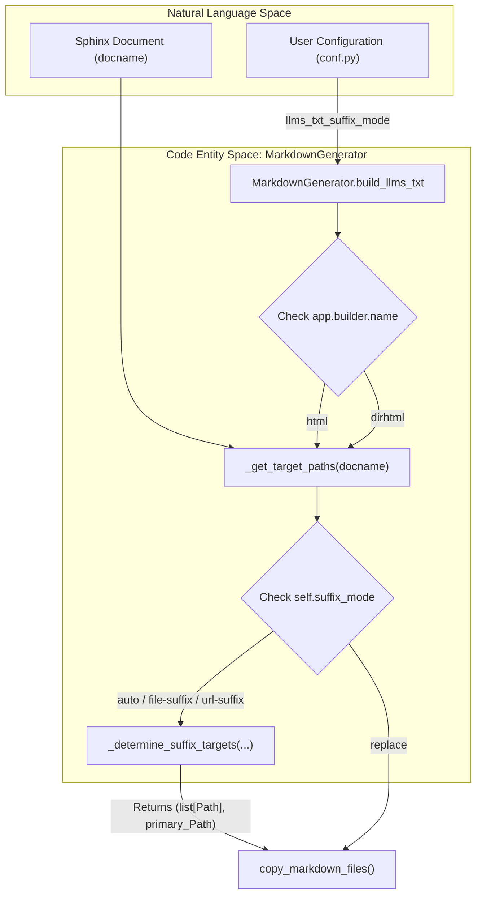
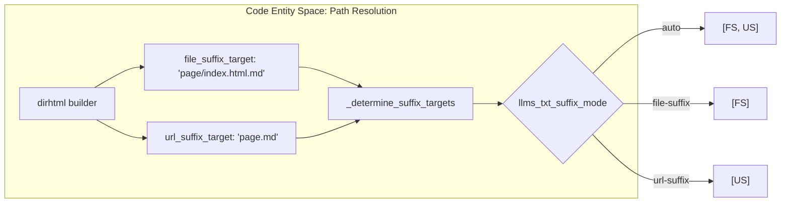

<!-- source: DeepWiki mcp.deepwiki.com · repo NVIDIA/sphinx-llm · extra page Suffix Modes and Path Mapping · fetched 2026-10-26 -->

# Suffix Modes and Path Mapping

Relevant source files

The following files were used as context for generating this wiki page:

- [README.md](README.md)
- [src/sphinx_llm/txt.py](src/sphinx_llm/txt.py)

This page documents the configuration and internal logic used by the `sphinx_llm.txt` extension to map Sphinx document paths to their corresponding Markdown outputs. It specifically covers the `llms_txt_suffix_mode` configuration, how it interacts with different Sphinx builders (`html` and `dirhtml`), and the internal path resolution functions.

## Overview of Suffix Modes

The `llms_txt_suffix_mode` setting determines the naming convention for the Markdown files generated alongside the standard HTML output. This is crucial for compliance with the [llms.txt](https://llmstxt.org) specification, which suggests that every HTML page should have a corresponding Markdown version at the same URL with an added `.md` extension [README.md:30-42]().

The extension supports four primary modes:

| Mode | Description | Builder Behavior |
| :--- | :--- | :--- |
| `auto` | **Default**. Context-aware selection based on the active builder [src/sphinx_llm/txt.py:177-179](). | `html`: `.html.md` `dirhtml`: Both `.html.md` and `.md` |
| `file-suffix` | Strict adherence to the file-based suffixing [src/sphinx_llm/txt.py:173-174](). | Always produces `.html.md` |
| `url-suffix` | Produces files that match clean URL patterns [src/sphinx_llm/txt.py:175-176](). | `html`: `.html.md` `dirhtml`: `.md` |
| `replace` | Replaces the existing extension rather than appending to it [src/sphinx_llm/txt.py:98-100](). | `.html` → `.md` |

> [!NOTE]
> The value `"both"` is deprecated but remains supported as an alias for `"auto"` to maintain backward compatibility [src/sphinx_llm/txt.py:53-55]().

Sources: [src/sphinx_llm/txt.py:50-63](), [README.md:89-101]()

## Internal Path Mapping Logic

The mapping from a Sphinx source document to one or more output Markdown files is handled by the `MarkdownGenerator` class. The logic differentiates between the standard `html` builder (which produces `page.html`) and the `dirhtml` builder (which produces `page/index.html`).

### The `_get_target_paths` Function

The core logic resides in `_get_target_paths`, which calculates the destination paths within the build directory.

1.  **Input**: It receives a `docname` (e.g., `folder/page`) [src/sphinx_llm/txt.py:183]().
2.  **HTML Builder**:
    *   Generates a `file_suffix_target` by appending `.md` to the HTML output (e.g., `folder/page.html.md`) [src/sphinx_llm/txt.py:186-187]().
    *   In this mode, `url_suffix_target` is identical to `file_suffix_target` [src/sphinx_llm/txt.py:188]().
3.  **DirHTML Builder**:
    *   **File Suffix**: Maps to the actual index file: `folder/page/index.html.md` [src/sphinx_llm/txt.py:192-193]().
    *   **URL Suffix**: Maps to the directory name with a suffix: `folder/page.md` [src/sphinx_llm/txt.py:194-195]().
4.  **Replace Mode**: If `replace` is active, it simply swaps the extension of the standard output file [src/sphinx_llm/txt.py:199-204]().

### Path Resolution Flow

The following diagram illustrates how `MarkdownGenerator` translates Sphinx document names into filesystem targets based on the `llms_txt_suffix_mode`.

**Title: Path Mapping Logic in MarkdownGenerator**

Sources: [src/sphinx_llm/txt.py:165-181](), [src/sphinx_llm/txt.py:183-207]()

## Implementation Detail: `_determine_suffix_targets`

Once the potential paths are identified, `_determine_suffix_targets` filters them based on the active mode to decide which files will actually be written to the output directory.

| Suffix Mode | Targets Generated | Primary Target (for sitemap) |
| :--- | :--- | :--- |
| `file-suffix` | `[file_suffix_target]` | `file_suffix_target` |
| `url-suffix` | `[url_suffix_target]` | `url_suffix_target` |
| `auto` | `[file_suffix_target, url_suffix_target]` | `file_suffix_target` |

This method ensures that even if multiple files are generated (as in `auto` mode for `dirhtml`), only one "primary" path is used when the `llms.txt` sitemap is constructed [src/sphinx_llm/txt.py:171-181]().

**Title: Suffix Target Selection Flow**

Sources: [src/sphinx_llm/txt.py:165-181](), [src/sphinx_llm/txt.py:191-195]()

## Impact on Output Structure

The choice of suffix mode directly impacts the final `_build/html` (or `_build/dirhtml`) directory structure.

### Example: `dirhtml` with `auto` mode
For a source file `apples.rst`, the following files are produced:
1.  `apples/index.html` (Standard Sphinx output)
2.  `apples/index.html.md` (Spec-compliant file-suffix) [src/sphinx_llm/txt.py:193]()
3.  `apples.md` (URL-suffix for cleaner agent access) [src/sphinx_llm/txt.py:195]()

### Example: `html` with `replace` mode
For a source file `apples.rst`:
1.  `apples.html` (Standard Sphinx output)
2.  `apples.md` (Replaces the extension) [src/sphinx_llm/txt.py:202]()

Sources: [src/sphinx_llm/txt.py:183-207](), [README.md:78-101]()

---

