<!-- source: DeepWiki mcp.deepwiki.com · repo NVIDIA/srt-slurm · page 9.2 Streamlit Analysis Dashboard · fetched 2026-10-26 -->

# Streamlit Analysis Dashboard

<details>
<summary>Relevant source files</summary>

The following files were used as context for generating this wiki page:

- [analysis/__init__.py](analysis/__init__.py)
- [analysis/dashboard/__init__.py](analysis/dashboard/__init__.py)
- [analysis/dashboard/app.py](analysis/dashboard/app.py)
- [analysis/dashboard/components.py](analysis/dashboard/components.py)
- [analysis/dashboard/config_tab.py](analysis/dashboard/config_tab.py)
- [analysis/dashboard/latency_tab.py](analysis/dashboard/latency_tab.py)
- [analysis/dashboard/node_metrics_tab.py](analysis/dashboard/node_metrics_tab.py)
- [analysis/dashboard/pareto_tab.py](analysis/dashboard/pareto_tab.py)
- [analysis/dashboard/rate_match_tab.py](analysis/dashboard/rate_match_tab.py)
- [analysis/srtlog/__init__.py](analysis/srtlog/__init__.py)
- [analysis/srtlog/cache_manager.py](analysis/srtlog/cache_manager.py)
- [analysis/srtlog/cluster_config.py](analysis/srtlog/cluster_config.py)
- [analysis/srtlog/config_reader.py](analysis/srtlog/config_reader.py)
- [analysis/srtlog/run_loader.py](analysis/srtlog/run_loader.py)
- [analysis/srtlog/visualizations.py](analysis/srtlog/visualizations.py)
- [docs/README.md](docs/README.md)
- [docs/SUMMARY.md](docs/SUMMARY.md)
- [docs/analyzing.md](docs/analyzing.md)
- [docs/installation.md](docs/installation.md)
- [docs/profiling.md](docs/profiling.md)
- [docs/sweeps.md](docs/sweeps.md)
- [tests/test_profiling.py](tests/test_profiling.py)

</details>


The Streamlit Analysis Dashboard provides an interactive web interface for visualizing and comparing benchmark results generated by `srtctl`. It allows users to explore performance metrics, node-level statistics, and disaggregation efficiency through various filters and visualizations. This page details how to launch the dashboard, its filtering capabilities, and the different analysis tabs available.

## Launching the Dashboard

The dashboard can be launched directly from the project root using `uv` (a fast Python package installer and runner) or `make`:

```bash
uv run streamlit run analysis/dashboard/app.py
# or using make
make dashboard
```

Once launched, the dashboard will typically open in your web browser at `http://localhost:8501`.
Sources: [analysis/dashboard/app.py:3-5](), [docs/analyzing.md:153-156]()

## Dashboard Interface and Filters

The dashboard's interface is divided into a main content area and a left sidebar for configuration and filtering.

### Sidebar Filters

The sidebar [analysis/dashboard/app.py:43-220]() provides powerful options to narrow down the benchmark runs displayed in the main content area. These filters help in comparing specific configurations or identifying trends across different experimental setups.

#### Logs Directory Path
The dashboard defaults to loading data from the `outputs/` directory in the project root. This path can be configured in the sidebar if your job logs are stored elsewhere.
Sources: [analysis/dashboard/components.py:162-166]()

#### GPU Type Filter
This filter allows selecting runs based on the GPU hardware used (e.g., "H100", "GB200"). This is useful for comparing performance across different hardware generations.
Sources: [analysis/dashboard/app.py:60-81](), [docs/analyzing.md:171-173]()

#### Topology Filter
Runs can be filtered by their worker configuration, such as "1P/4D" for one prefill node and four decode nodes (disaggregated mode), or "8A" for eight aggregated workers.
Sources: [analysis/dashboard/app.py:83-102](), [docs/analyzing.md:175-178]()

#### ISL/OSL Filter
This filter allows selecting runs based on the Input Sequence Length (ISL) and Output Sequence Length (OSL) combinations (e.g., "1024/1024", "2048/512").
Sources: [analysis/dashboard/app.py:104-123](), [docs/analyzing.md:180-182]()

#### Container Filter
Users can filter runs by the container image version used, which is helpful for comparing the impact of software updates or different container builds.
Sources: [analysis/dashboard/app.py:125-149](), [docs/analyzing.md:184-186]()

#### Tags Filter
Custom tags assigned during job submission (using `srtctl apply --tags tag1,tag2` [docs/installation.md:209-211]()) can be used to filter runs. This helps organize and compare experiments, such as "baseline", "optimized", or "production" configurations.
Sources: [analysis/dashboard/app.py:151-171](), [docs/analyzing.md:188-191]()

### Run Selection
After applying filters, the remaining runs are displayed in a multiselect box. Users can select specific runs to compare, and the dashboard will generate formatted labels for each run, including job ID, topology, ISL/OSL, and GPU type.
Sources: [analysis/dashboard/app.py:175-203]()

### Diagram: Dashboard Data Flow and Filtering

```mermaid
graph TD
    subgraph "User Interface (Streamlit)"
        A[User Interaction] --> B{Sidebar Filters};
        B -- "Selected Filters" --> C[Run Selection Multiselect];
        C -- "Selected Runs" --> D[Dashboard Tabs];
    end

    subgraph "Backend (Python)"
        E[logs_dir (outputs)] --> F[RunLoader.load_all_with_skipped()];
        F -- "All BenchmarkRun Objects" --> G{Apply Filters};
        G -- "Filtered BenchmarkRun Objects" --> H[DataFrame Conversion];
        H -- "Processed DataFrames" --> I[Visualization Functions];
        I --> D;
    end

    B -- "GPU Type, Topology, ISL/OSL, Container, Tags" --> G;
    G -- "Sorted by Date" --> C;

    style A fill:#fff,stroke:#333,stroke-width:2px
    style B fill:#fff,stroke:#333,stroke-width:2px
    style C fill:#fff,stroke:#333,stroke-width:2px
    style D fill:#fff,stroke:#333,stroke-width:2px
    style E fill:#fff,stroke:#333,stroke-width:2px
    style F fill:#fff,stroke:#333,stroke-width:2px
    style G fill:#fff,stroke:#333,stroke-width:2px
    style H fill:#fff,stroke:#333,stroke-width:2px
    style I fill:#fff,stroke:#333,stroke-width:2px
```
Title: "Dashboard Data Flow and Filtering"
Sources: [analysis/dashboard/app.py:43-220](), [analysis/dashboard/components.py:63-75](), [analysis/srtlog/run_loader.py]()

## Dashboard Tabs

The main content area of the dashboard features several tabs, each dedicated to a specific aspect of performance analysis.

### 1. Pareto Frontier Tab

**Purpose**: This tab visualizes the trade-off between throughput per GPU and throughput per user, helping to identify optimal configurations.
Sources: [analysis/dashboard/pareto_tab.py:22-29](), [docs/analyzing.md:195-196]()

**Metrics**:
*   **X-axis: Output TPS/User**: Represents the token generation rate experienced by each user, calculated as `1000 / Mean TPOT (ms)`.
*   **Y-axis: Output TPS/GPU** or **Total TPS/GPU**: Measures GPU utilization efficiency.
    *   `Output TPS/GPU = Total Output Throughput (tokens/s) / Total Number of GPUs`
    *   `Total TPS/GPU = Total Throughput (tokens/s) / Total Number of GPUs`
Sources: [analysis/dashboard/pareto_tab.py:30-36](), [analysis/dashboard/pareto_tab.py:158-169](), [docs/analyzing.md:214-218]()

**Key Features**:
*   **Y-axis toggle**: Switch between "Output TPS/GPU" (decode tokens only) and "Total TPS/GPU" (input + output tokens).
*   **TPS/User cutoff line**: A configurable vertical line to mark target throughput requirements.
*   **Pareto Frontier**: Highlights configurations where no other configuration is strictly better in both metrics. The `calculate_pareto_frontier` function [analysis/srtlog/visualizations.py:409-426]() identifies these points.
*   **Point Comparison**: Users can select two points on the graph to compare their performance metrics, including percentage change.
Sources: [analysis/dashboard/pareto_tab.py:25-29](), [analysis/dashboard/pareto_tab.py:46-52](), [analysis/dashboard/pareto_tab.py:67-120](), [docs/analyzing.md:203-207]()

The `create_pareto_graph` function [analysis/srtlog/visualizations.py:429-509]() is responsible for generating the Plotly graph.

### 2. Latency Analysis Tab

**Purpose**: This tab provides detailed analysis of latency metrics, including Time To First Token (TTFT), Time Per Output Token (TPOT), and Inter-Token Latency (ITL).
Sources: [analysis/dashboard/latency_tab.py:10-11](), [docs/analyzing.md:222-223]()

**Metrics**:
*   **TTFT (Time To First Token)**: Time taken to generate the first token.
*   **TPOT (Time Per Output Token)**: Average time between consecutive output tokens.
*   **ITL (Inter-Token Latency)**: Similar to TPOT, often used interchangeably or for specific internal measurements.
Sources: [docs/analyzing.md:111-113]()

**Visualizations**:
*   **Latency Distribution Histograms**: Shows the distribution of TTFT, TPOT, and ITL across requests.
*   **Latency vs. Concurrency Graphs**: Plots how these latency metrics change with increasing concurrency.
Sources: [analysis/dashboard/latency_tab.py:20-21](), [analysis/dashboard/latency_tab.py:30-31]()

### 3. Node Metrics Tab

**Purpose**: This tab visualizes runtime metrics extracted from worker log files, providing insights into the behavior of individual nodes and workers.
Sources: [analysis/dashboard/node_metrics_tab.py:33-34](), [docs/analyzing.md:229-230]()

**Data Source**: Metrics are parsed from `.err` and `.out` log files generated by each worker process. The `NodeAnalyzer` class [analysis/srtlog/run_loader.py:170-171]() is responsible for this parsing.
Sources: [analysis/dashboard/node_metrics_tab.py:85-87](), [docs/analyzing.md:127-128]()

**Key Metrics and Visualizations**:
*   **KV Cache Utilization**: Shows the percentage of KV cache memory used over time. The `create_kv_cache_utilization_graph` function [analysis/dashboard/components.py:186-202]() generates this graph.
*   **Queue Depth**: Visualizes the number of requests queued at workers over time. The `create_queue_depth_graph` function [analysis/dashboard/components.py:205-219]() generates this graph.
*   **Input Throughput**: Displays the input token throughput (tokens/s) over time. The `create_node_throughput_graph` function [analysis/dashboard/components.py:170-184]() generates this graph.
*   **Inflight Requests**: Shows the number of requests currently being processed.
*   **Generation Throughput**: For decode nodes, this shows the output token generation rate.
*   **Preallocated Requests**: For decode nodes, this shows the number of preallocated requests.
*   **Transfer Requests**: For disaggregated setups, this shows the number of KV cache transfer requests.
Sources: [analysis/dashboard/node_metrics_tab.py:166-171](), [analysis/dashboard/node_metrics_tab.py:173-178](), [analysis/dashboard/node_metrics_tab.py:180-185](), [analysis/dashboard/node_metrics_tab.py:190-195](), [analysis/dashboard/node_metrics_tab.py:197-202](), [analysis/dashboard/node_metrics_tab.py:204-209]()

**Aggregation Modes**:
The tab offers three aggregation modes for node metrics:
1.  **Show individual nodes**: Displays a separate line for each worker node.
2.  **Group by DP rank (average per DP)**: Averages metrics across workers belonging to the same Data Parallel (DP) rank. The `group_nodes_by_dp` function [analysis/srtlog/visualizations.py:140-219]() performs this aggregation.
3.  **Aggregate all nodes (single averaged line)**: Averages metrics across all nodes for a given run. The `aggregate_all_nodes` function [analysis/srtlog/visualizations.py:45-137]() performs this aggregation.
Sources: [analysis/dashboard/node_metrics_tab.py:100-110]()

### 4. Rate Match Analysis Tab

**Purpose**: This tab is specifically designed for disaggregated setups to compare the prefill input rate against the decode generation rate. It helps in identifying bottlenecks and verifying proper node ratios.
Sources: [analysis/dashboard/rate_match_tab.py:22-25](), [docs/analyzing.md:232-233]()

**Visualization**: A line graph plots the average prefill input rate (tokens/s or requests/s) and decode generation rate (tokens/s or requests/s) over time.
Sources: [analysis/dashboard/rate_match_tab.py:115-157](), [analysis/dashboard/rate_match_tab.py:160-202]()

**Key Insights**:
*   **Balanced System**: Lines should align, indicating that prefill and decode stages are well-matched.
*   **Decode Bottleneck**: If the decode rate is consistently below the prefill rate, more decode nodes might be needed.
*   **Prefill Bottleneck**: If the decode rate is above the prefill rate, prefill nodes might be underutilized.
Sources: [analysis/dashboard/rate_match_tab.py:35-39]()

The `_create_rate_match_graph` function [analysis/dashboard/rate_match_tab.py:104-202]() generates this graph. It can optionally convert token rates to request rates using ISL/OSL values.
Sources: [analysis/dashboard/rate_match_tab.py:28-31]()

### 5. Disaggregation Flow Funnel Visualization (Not explicitly detailed in provided content, but implied by "disaggregation flow funnel visualization" in prompt)

While the provided code snippets do not contain a dedicated tab for a "disaggregation flow funnel visualization," the presence of `rate_match_tab.py` and the focus on disaggregated metrics suggest its importance. Such a visualization would typically illustrate the flow of requests and tokens through different stages of a disaggregated system (e.g., frontend, prefill, decode, KV cache transfer), highlighting where bottlenecks or drops in throughput occur. This could involve:
*   **Stages**: Representing frontend, prefill, KV cache, and decode as distinct segments.
*   **Metrics**: Showing throughput (tokens/s or requests/s) at each stage.
*   **Flow**: Arrows indicating the movement of data, with widths proportional to throughput.
*   **Bottlenecks**: Narrowing sections indicating reduced throughput.

This visualization would likely draw data from the same node metrics (`input_throughput`, `gen_throughput`, `transfer_req`, `queue_req`) used in the Node Metrics and Rate Match tabs, but present them in a flow-oriented manner.

### Diagram: Dashboard Tab Structure and Key Functions

```mermaid
graph TD
    A[Streamlit Dashboard] --> B(Sidebar Filters);
    A --> C(Main Content Area);

    C --> C1[Pareto Frontier Tab];
    C --> C2[Latency Analysis Tab];
    C --> C3[Node Metrics Tab];
    C --> C4[Rate Match Analysis Tab];
    C --> C5[Disaggregation Flow Funnel Visualization];

    B -- "Filtered Runs" --> C1;
    B -- "Filtered Runs" --> C2;
    B -- "Filtered Runs" --> C3;
    B -- "Filtered Runs" --> C4;
    B -- "Filtered Runs" --> C5;

    C1 -- "df, selected_runs, pareto_options" --> F1[analysis/dashboard/pareto_tab.py::render];
    F1 -- "df, y_axis_metric" --> G1[analysis/srtlog/visualizations.py::create_pareto_graph];
    G1 -- "df, y_axis_metric" --> H1[analysis/srtlog/visualizations.py::calculate_pareto_frontier];

    C2 -- "df, selected_runs" --> F2[analysis/dashboard/latency_tab.py::render];
    F2 -- "df" --> G2[analysis/srtlog/visualizations.py::create_latency_distribution_graph];
    F2 -- "df" --> G3[analysis/srtlog/visualizations.py::create_latency_vs_concurrency_graph];

    C3 -- "filtered_runs, logs_dir" --> F3[analysis/dashboard/node_metrics_tab.py::render];
    F3 -- "run_path" --> G4[analysis/dashboard/components.py::load_node_metrics];
    G4 -- "node_metrics_list" --> H2[analysis/srtlog/visualizations.py::aggregate_all_nodes];
    G4 -- "node_metrics_list" --> H3[analysis/srtlog/visualizations.py::group_nodes_by_dp];
    F3 -- "node_metrics_list" --> G5[analysis/dashboard/components.py::create_kv_cache_utilization_graph];
    F3 -- "node_metrics_list" --> G6[analysis/dashboard/components.py::create_queue_depth_graph];
    F3 -- "node_metrics_list" --> G7[analysis/dashboard/components.py::create_node_throughput_graph];

    C4 -- "filtered_runs, logs_dir" --> F4[analysis/dashboard/rate_match_tab.py::render];
    F4 -- "run_path" --> G8[analysis/dashboard/components.py::load_node_metrics];
    F4 -- "prefill_nodes, decode_nodes" --> G9[analysis/dashboard/rate_match_tab.py::_create_rate_match_graph];

    G4 -- "NodeAnalyzer" --> I1[analysis/srtlog/run_loader.py::NodeAnalyzer::parse_run_logs];

    style A fill:#fff,stroke:#333,stroke-width:2px
    style B fill:#fff,stroke:#333,stroke-width:2px
    style C fill:#fff,stroke:#333,stroke-width:2px
    style C1 fill:#fff,stroke:#333,stroke-width:2px
    style C2 fill:#fff,stroke:#333,stroke-width:2px
    style C3 fill:#fff,stroke:#333,stroke-width:2px
    style C4 fill:#fff,stroke:#333,stroke-width:2px
    style C5 fill:#fff,stroke:#333,stroke-width:2px
    style F1 fill:#fff,stroke:#333,stroke-width:2px
    style F2 fill:#fff,stroke:#333,stroke-width:2px
    style F3 fill:#fff,stroke:#333,stroke-width:2px
    style F4 fill:#fff,stroke:#333,stroke-width:2px
    style G1 fill:#fff,stroke:#333,stroke-width:2px
    style G2 fill:#fff,stroke:#333,stroke-width:2px
    style G3 fill:#fff,stroke:#333,stroke-width:2px
    style G4 fill:#fff,stroke:#333,stroke-width:2px
    style G5 fill:#fff,stroke:#333,stroke-width:2px
    style G6 fill:#fff,stroke:#333,stroke-width:2px
    style G7 fill:#fff,stroke:#333,stroke-width:2px
    style G8 fill:#fff,stroke:#333,stroke-width:2px
    style G9 fill:#fff,stroke:#333,stroke-width:2px
    style H1 fill:#fff,stroke:#333,stroke-width:2px
    style H2 fill:#fff,stroke:#333,stroke-width:2px
    style H3 fill:#fff,stroke:#333,stroke-width:2px
    style I1 fill:#fff,stroke:#333,stroke-width:2px
```


Title: "Streamlit Dashboard Tab Structure and Key Functions"
Sources: [analysis/dashboard/app.py:22-24](), [analysis/dashboard/pareto_tab.py:13-14](), [analysis/dashboard/latency_tab.py:10-11](), [analysis/dashboard/node_metrics_tab.py:11-12](), [analysis/dashboard/rate_match_tab.py:11-12](), [analysis/dashboard/components.py:83-97](), [analysis/srtlog/visualizations.py:45-137](), [analysis/srtlog/visualizations.py:140-219](), [analysis/srtlog/visualizations.py:429-509](), [analysis/srtlog/run_loader.py:170-171]()

Sources:
- [analysis/dashboard/app.py:3-5]()
- [analysis/dashboard/app.py:22-24]()
- [analysis/dashboard/app.py:43-220]()
- [analysis/dashboard/components.py:63-75]()
- [analysis/dashboard/components.py:83-97]()
- [analysis/dashboard/components.py:162-166]()
- [analysis/dashboard/components.py:170-184]()
- [analysis/dashboard/components.py:186-202]()
- [analysis/dashboard/components.py:205-219]()
- [analysis/dashboard/latency_tab.py:10-11]()
- [analysis/dashboard/latency_tab.py:20-21]()
- [analysis/dashboard/latency_tab.py:30-31]()
- [analysis/dashboard/node_metrics_tab.py:11-12]()
- [analysis/dashboard/node_metrics_tab.py:33-34]()
- [analysis/dashboard/node_metrics_tab.py:85-87]()
- [analysis/dashboard/node_metrics_tab.py:100-110]()
- [analysis/dashboard/node_metrics_tab.py:166-171]()
- [analysis/dashboard/node_metrics_tab.py:173-178]()
- [analysis/dashboard/node_metrics_tab.py:180-185]()
- [analysis/dashboard/node_metrics_tab.py:190-195]()
- [analysis/dashboard/node_metrics_tab.py:197-202]()
- [analysis/dashboard/node_metrics_tab.py:204-209]()
- [analysis/dashboard/pareto_tab.py:13-14]()
- [analysis/dashboard/pareto_tab.py:22-29]()
- [analysis/dashboard/pareto_tab.py:25-29]()
- [analysis/dashboard/pareto_tab.py:30-36]()
- [analysis/dashboard/pareto_tab.py:46-52]()
- [analysis/dashboard/pareto_tab.py:67-120]()
- [analysis/dashboard/pareto_tab.py:158-169]()
- [analysis/dashboard/rate_match_tab.py:11-12]()
- [analysis/dashboard/rate_match_tab.py:22-25]()
- [analysis/dashboard/rate_match_tab.py:28-31]()
- [analysis/dashboard/rate_match_tab.py:35-39]()
- [analysis/dashboard/rate_match_tab.py:104-202]()
- [analysis/dashboard/rate_match_tab.py:115-157]()
- [analysis/dashboard/rate_match_tab.py:160-202]()
- [analysis/srtlog/run_loader.py]()
- [analysis/srtlog/run_loader.py:170-171]()
- [analysis/srtlog/visualizations.py:45-137]()
- [analysis/srtlog/visualizations.py:140-219]()
- [analysis/srtlog/visualizations.py:409-426]()
- [analysis/srtlog/visualizations.py:429-509]()
- [docs/analyzing.md:111-113]()
- [docs/analyzing.md:153-156]()
- [docs/analyzing.md:171-173]()
- [docs/analyzing.md:175-178]()
- [docs/analyzing.md:180-182]()
- [docs/analyzing.md:184-186]()
- [docs/analyzing.md:188-191]()
- [docs/analyzing.md:195-196]()
- [docs/analyzing.md:203-207]()
- [docs/analyzing.md:214-218]()
- [docs/analyzing.md:222-223]()
- [docs/analyzing.md:229-230]()
- [docs/analyzing.md:232-233]()
- [docs/analyzing.md:127-128]()
- [docs/installation.md:209-211]()

---

