# Page: Overview

# Overview

<details>
<summary>Relevant source files</summary>

The following files were used as context for generating this wiki page:

- [.github/workflows/copyright-check.yml](.github/workflows/copyright-check.yml)
- [.gitignore](.gitignore)
- [CONTRIBUTING.md](CONTRIBUTING.md)
- [LICENSE](LICENSE)
- [Makefile](Makefile)
- [NOTICE](NOTICE)
- [README.md](README.md)
- [THIRD_PARTY_LICENSES.md](THIRD_PARTY_LICENSES.md)
- [docs/README.md](docs/README.md)
- [docs/SUMMARY.md](docs/SUMMARY.md)
- [docs/analyzing.md](docs/analyzing.md)
- [docs/installation.md](docs/installation.md)
- [docs/profiling.md](docs/profiling.md)
- [src/srtctl/frontends/dynamo.py](src/srtctl/frontends/dynamo.py)
- [src/srtctl/templates/job_script_minimal.j2](src/srtctl/templates/job_script_minimal.j2)
- [tests/test_profiling.py](tests/test_profiling.py)

</details>


`srtctl` (SLURM Runtime Control) is a command-line utility designed to orchestrate distributed LLM inference benchmarks on SLURM clusters [README.md:1-3](). It abstracts the complexity of multi-node GPU coordination by replacing brittle shell scripts and manual SLURM directive management with a declarative YAML-based configuration system [README.md:12-16]().

The tool provides a unified interface for benchmarking leading inference engines, including **SGLang**, **vLLM**, and **TensorRT-LLM**, across various hardware topologies such as aggregated and Prefill/Decode (PD) disaggregated modes [docs/README.md:1-3]().

### Core Philosophy
*   **Declarative Over Imperative:** Define the desired state (model, hardware, backend settings) in YAML; `srtctl` handles the `sbatch` generation and worker discovery [docs/README.md:18-23]().
*   **Reproducibility:** Every job generates a detailed lockfile and environment fingerprint to ensure benchmarks can be audited and repeated [docs/README.md:20-20]().
*   **Automation-First:** Built-in support for parameter sweeps, profiling (nsys/torch), and post-processing pipelines [README.md:21-25]().

---

### System Architecture

The system operates in a two-phase execution model: **Submission** (local/login node) and **Orchestration** (compute node) [docs/README.md:24-40]().

#### Phase 1: Submission
When a user runs `srtctl apply`, the tool validates the configuration, resolves cluster-specific aliases (from `srtslurm.yaml`), and generates a specialized SLURM batch script [docs/README.md:26-32]().
*   **Key Entity:** `srtctl apply` command.
*   **Source:** [src/srtctl/templates/job_script_minimal.j2:1-40]()

#### Phase 2: Orchestration
Once SLURM allocates nodes, the generated script executes the `SweepOrchestrator` on the primary compute node [src/srtctl/templates/job_script_minimal.j2:115-132](). This orchestrator manages the lifecycle of the benchmark:
1.  **Infrastructure Launch:** Starts NATS and etcd for service discovery [src/srtctl/frontends/dynamo.py:7-12]().
2.  **Worker Deployment:** Spawns containerized inference workers (prefill/decode/agg) via `srun` [src/srtctl/frontends/dynamo.py:103-114]().
3.  **Frontend Setup:** Deploys routers (e.g., Dynamo or SGLang Router) and optional Nginx load balancers [src/srtctl/frontends/dynamo.py:62-70]().
4.  **Benchmark Execution:** Runs the specified benchmark (e.g., `sa-bench`) once workers are healthy [docs/README.md:39-40]().

#### Code Entity Mapping
The following diagram illustrates how high-level concepts map to specific classes and modules within the codebase.

**Concept to Code Mapping**
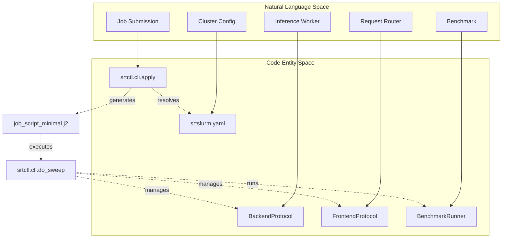
Sources: [src/srtctl/templates/job_script_minimal.j2:1-145](), [src/srtctl/frontends/dynamo.py:26-35](), [docs/README.md:24-40]()

---

### Workflow and Orchestration

The lifecycle of an `srtctl` job is managed by the `SweepOrchestrator` (invoked via `do_sweep`). It coordinates between the physical SLURM topology and the logical inference backend.

**Execution Lifecycle**
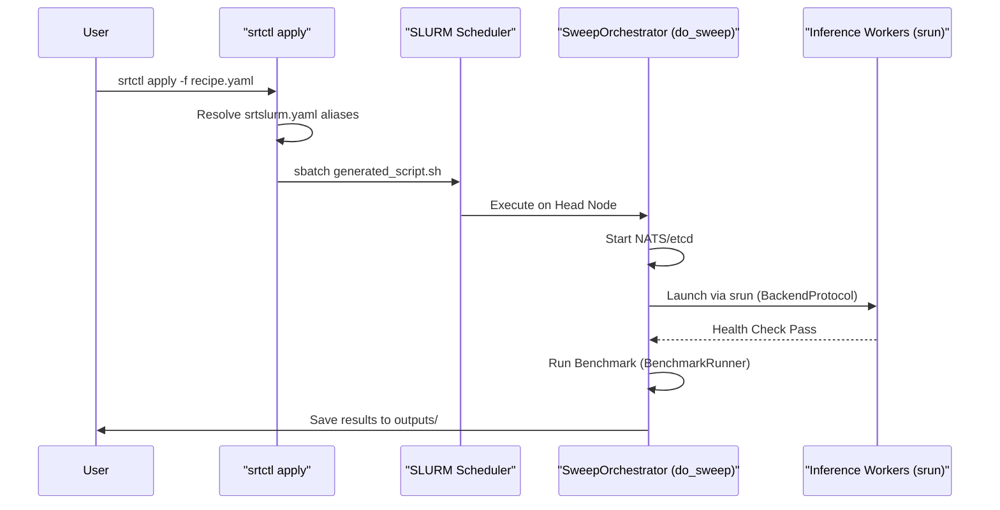
Sources: [src/srtctl/templates/job_script_minimal.j2:121-132](), [src/srtctl/frontends/dynamo.py:62-126](), [docs/README.md:24-40]()

---

### Navigating the Wiki

This wiki is structured to take you from initial setup to advanced performance analysis:

*   **[Getting Started & Installation](#1.1)**: Instructions for the `make setup` process, installing dependencies like `uv`, `nats-server`, and `etcd`, and configuring your `srtslurm.yaml`.
*   **[Project Structure & Development Guide](#1.2)**: A guide for developers looking to extend `srtctl`, covering the directory layout and core Python patterns (Dataclasses, Protocols).
*   **Configuration System**: Deep dive into the YAML schema, including parameter sweeps and cluster-level overrides.
*   **Core Architecture**: Detailed explanation of the `RuntimeContext`, `Endpoint` allocation, and the orchestrator's stage-based mixin architecture.
*   **Backends & Frontends**: Technical details on how SGLang, vLLM, and TRT-LLM are integrated and how request routing is handled via Dynamo or Nginx.
*   **Benchmarking & Profiling**: How to run performance/accuracy suites and capture `nsys` or `torch` profiles.
*   **Results Analysis**: Using the `srtlog` library and the Streamlit dashboard to visualize benchmark data.

For a complete list of all pages, see the **Wiki Table of Contents** in the sidebar.

Sources: [README.md:17-25](), [docs/SUMMARY.md:1-35]()

---

# Page: Getting Started & Installation

# Getting Started & Installation

<details>
<summary>Relevant source files</summary>

The following files were used as context for generating this wiki page:

- [.gitignore](.gitignore)
- [Makefile](Makefile)
- [README.md](README.md)
- [docs/README.md](docs/README.md)
- [docs/SUMMARY.md](docs/SUMMARY.md)
- [docs/analyzing.md](docs/analyzing.md)
- [docs/installation.md](docs/installation.md)
- [docs/profiling.md](docs/profiling.md)
- [recipes/gb200-fp4/1k1k-dsv4/README.md](recipes/gb200-fp4/1k1k-dsv4/README.md)
- [recipes/gb200-fp4/1k1k-dsv4/agg-2n-low-latency.yaml](recipes/gb200-fp4/1k1k-dsv4/agg-2n-low-latency.yaml)
- [recipes/gb200-fp4/1k1k-dsv4/agg-2n-nomtp.yaml](recipes/gb200-fp4/1k1k-dsv4/agg-2n-nomtp.yaml)
- [src/srtctl/frontends/dynamo.py](src/srtctl/frontends/dynamo.py)
- [src/srtctl/templates/job_script_minimal.j2](src/srtctl/templates/job_script_minimal.j2)
- [srtslurm.yaml.example](srtslurm.yaml.example)
- [tests/test_profiling.py](tests/test_profiling.py)

</details>


This page provides a comprehensive guide for setting up `srtctl` (SLURM Runtime Control) on a SLURM cluster. It covers prerequisites, the automated installation process via `Makefile`, cluster-level configuration, and submitting your first distributed LLM inference benchmark.

## Prerequisites

Before beginning the installation, ensure the following requirements are met on your cluster:

*   **SLURM Environment**: Access to a SLURM cluster with GPU nodes (e.g., H100, B200, GB200) [README.md:1-3]().
*   **Python**: Version 3.10 or higher [docs/installation.md:22]().
*   **Container Runtime**: `enroot` and `pyxis` must be configured for containerized execution [docs/installation.md:23]().
*   **Architecture Knowledge**: Identify if your compute nodes are `x86_64` (Intel/AMD) or `aarch64` (NVIDIA Grace) [docs/installation.md:48-51]().

## Installation Steps

### 1. Clone and Local Install
First, clone the repository and install the package in editable mode. This installs the `srtctl` CLI tool to your environment.

```bash
git clone https://github.com/NVIDIA/srt-slurm.git
cd srt-slurm
pip install -e .
```
Sources: [README.md:8-11](), [docs/installation.md:29-33]()

### 2. Automated Setup
The `Makefile` contains a `setup` target that automates binary downloads and initial configuration. You must specify the `ARCH` variable based on your **compute nodes**.

```bash
# For Grace-based systems (GB200, GH200)
make setup ARCH=aarch64

# For x86-based systems (H100, B200)
make setup ARCH=x86_64
```
Sources: [Makefile:43-52](), [docs/installation.md:51]()

The `make setup` command performs the following actions:
1.  **Directory Creation**: Creates a `logs/` directory for benchmark outputs [Makefile:45]().
2.  **Binary Downloads**:
    *   **NATS Server**: Downloads the `nats-server` binary to `configs/` for the request plane [Makefile:53-76]().
    *   **etcd**: Downloads `etcd` and `etcdctl` to `configs/` for worker discovery and metadata [Makefile:78-91]().
    *   **uv**: Downloads the `uv` package manager to `bin/` to manage the compute-node virtual environment [Makefile:93-103]().
3.  **Interactive Configuration**: Prompts for SLURM account, partition, GPUs per node, and time limits to generate the initial `srtslurm.yaml` [Makefile:105-140]().

## Cluster Configuration (`srtslurm.yaml`)

The `srtslurm.yaml` file acts as the global source of truth for your cluster environment. It allows you to define aliases for containers and models, simplifying job recipes.

### Key Configuration Fields

| Field | Description |
| :--- | :--- |
| `default_account` | The SLURM account used for job submissions [srtslurm.yaml.example:10]() |
| `default_partition` | The target SLURM partition [srtslurm.yaml.example:11]() |
| `model_paths` | A mapping of short aliases to absolute filesystem paths (e.g., Lustre/GPFS) [srtslurm.yaml.example:41-49]() |
| `containers` | A mapping of aliases to `.sqsh` container images [srtslurm.yaml.example:23-38]() |
| `use_gpus_per_node_directive` | Boolean to enable/disable `#SBATCH --gpus-per-node` [srtslurm.yaml.example:16]() |

### Implementation Flow: Config to Submission
The following diagram illustrates how `srtctl` merges the cluster configuration with a job recipe to generate the final SLURM submission.

**System Entity Mapping: Submission Pipeline**
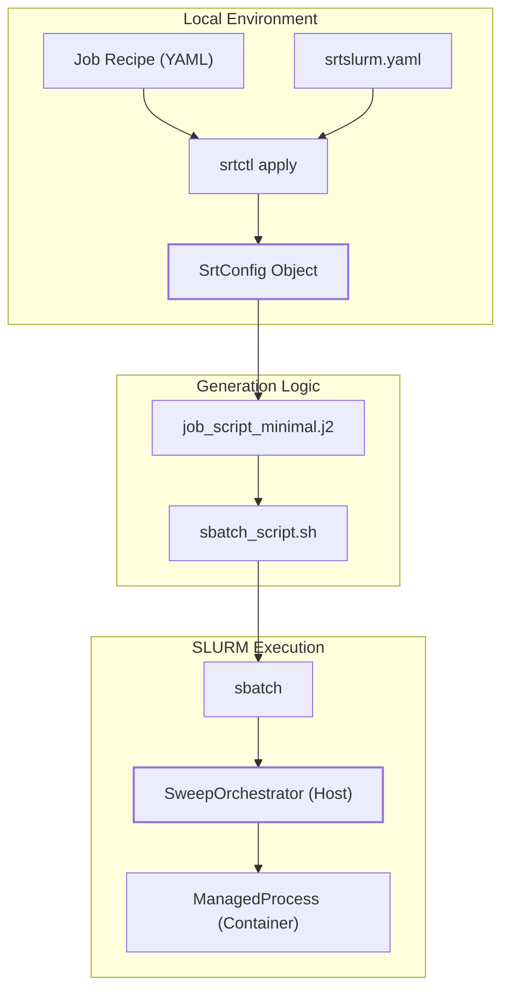
Sources: [src/srtctl/templates/job_script_minimal.j2:4-32](), [docs/README.md:25-32](), [src/srtctl/frontends/dynamo.py:117-125]()

## First Job Submission

### 1. Create a Recipe
Create a file named `configs/test-job.yaml`. You can use aliases defined in your `srtslurm.yaml`.

```yaml
name: "quick-start"
model:
  path: "deepseek-r1" # Alias from srtslurm.yaml
  container: "sglang-latest" # Alias from srtslurm.yaml
resources:
  gpu_type: "h100"
  agg_nodes: 1
  agg_workers: 1
  gpus_per_node: 8
benchmark:
  type: "sa-bench"
  isl: 1024
  osl: 1024
  concurrencies: [32]
```
Sources: [docs/installation.md:142-190](), [srtslurm.yaml.example:73-82]()

### 2. Submit and Monitor
Submit the job using the `apply` command.

```bash
srtctl apply -f configs/test-job.yaml
```
Sources: [README.md:31](), [docs/installation.md:197]()

Upon submission, `srtctl` performs the following:
1.  **Validation**: Checks the YAML against the `SrtConfig` schema [docs/README.md:28]().
2.  **Script Generation**: Renders `job_script_minimal.j2`, populating `#SBATCH` directives and environment variables like `SRTCTL_SOURCE` [src/srtctl/templates/job_script_minimal.j2:4-44]().
3.  **Orchestration**: Launches the `SweepOrchestrator` on the head node. This orchestrator manages the lifecycle of `nats-server`, `etcd`, and the inference workers [src/srtctl/templates/job_script_minimal.j2:115-132]().

### Data Flow: Runtime Infrastructure
When the SLURM job starts, the `srtctl` orchestrator sets up the communication plane before launching inference backends.

**Code Entity Mapping: Infrastructure Startup**
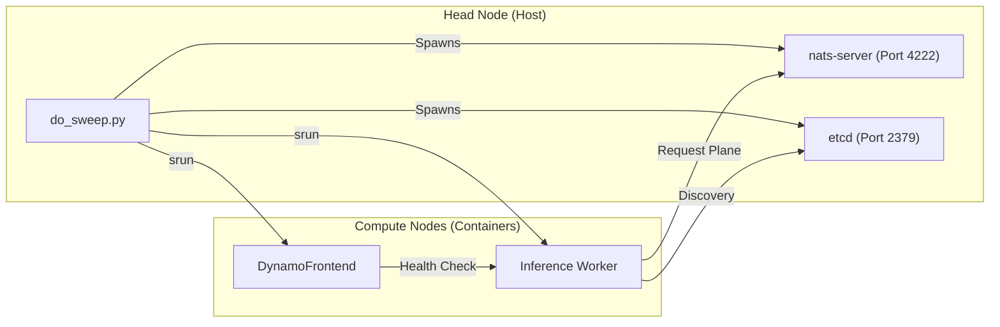
Sources: [src/srtctl/frontends/dynamo.py:82-87](), [src/srtctl/templates/job_script_minimal.j2:71-72](), [src/srtctl/frontends/dynamo.py:75-79]()

## Troubleshooting the Setup

*   **Architecture Mismatch**: If you see "Exec format error", ensure you ran `make setup ARCH=...` with the architecture of the **compute nodes**, not the login node [src/srtctl/templates/job_script_minimal.j2:85-87]().
*   **`uv` Not Found**: The orchestrator expects `uv` in `${SRTCTL_SOURCE}/bin`. If missing, re-run the setup [src/srtctl/templates/job_script_minimal.j2:93-97]().
*   **Config Discovery**: `srtctl` searches for `srtslurm.yaml` in the current directory and up to two parent directories. You can override this by setting `export SRTSLURM_CONFIG="/path/to/config.yaml"` [srtslurm.yaml.example:5-7]().

Sources: [Makefile:1-178](), [src/srtctl/templates/job_script_minimal.j2:1-146](), [docs/installation.md:1-256](), [srtslurm.yaml.example:1-82]()

---

# Page: Project Structure & Development Guide

# Project Structure & Development Guide

<details>
<summary>Relevant source files</summary>

The following files were used as context for generating this wiki page:

- [.github/workflows/copyright-check.yml](.github/workflows/copyright-check.yml)
- [CLAUDE.md](CLAUDE.md)
- [CONTRIBUTING.md](CONTRIBUTING.md)
- [LICENSE](LICENSE)
- [NOTICE](NOTICE)
- [THIRD_PARTY_LICENSES.md](THIRD_PARTY_LICENSES.md)
- [docs/mooncake-kv-store.md](docs/mooncake-kv-store.md)
- [pyproject.toml](pyproject.toml)
- [recipes/mocker/agg.yaml](recipes/mocker/agg.yaml)
- [src/srtctl/__init__.py](src/srtctl/__init__.py)
- [src/srtctl/analysis/__init__.py](src/srtctl/analysis/__init__.py)
- [src/srtctl/analysis/batch_log_parser.py](src/srtctl/analysis/batch_log_parser.py)
- [src/srtctl/analysis/live_metrics.py](src/srtctl/analysis/live_metrics.py)
- [src/srtctl/backends/__init__.py](src/srtctl/backends/__init__.py)
- [src/srtctl/backends/mocker.py](src/srtctl/backends/mocker.py)
- [src/srtctl/core/__init__.py](src/srtctl/core/__init__.py)
- [src/srtctl/core/formatting.py](src/srtctl/core/formatting.py)
- [src/srtctl/core/slurm.py](src/srtctl/core/slurm.py)
- [src/srtctl/logging_utils.py](src/srtctl/logging_utils.py)
- [tests/test_dry_run.py](tests/test_dry_run.py)
- [tests/test_e2e.py](tests/test_e2e.py)
- [tests/test_live_metrics.py](tests/test_live_metrics.py)
- [tests/test_slurm.py](tests/test_slurm.py)
- [tests/test_submit_cli.py](tests/test_submit_cli.py)

</details>


This page details the technical architecture of the `srtctl` codebase, the Python patterns employed to ensure type safety and extensibility, and the development workflows for testing and linting.

## Directory Layout

The project follows a standard Python src-layout, separating core orchestration logic from CLI entry points and backend-specific implementations.

| Directory | Purpose |
| :--- | :--- |
| `src/srtctl/core/` | Single source of truth for configuration schemas, SLURM utilities, and process lifecycle management [src/srtctl/core/__init__.py:4-17](). |
| `src/srtctl/backends/` | Framework-specific logic for SGLang, vLLM, and TensorRT-LLM [src/srtctl/backends/__init__.py:4-10](). |
| `src/srtctl/cli/` | CLI command implementations and TUI logic [src/srtctl/cli/submit.py:1-13](). |
| `src/srtctl/analysis/` | Log parsing, time-series metrics extraction, and live plotting utilities [src/srtctl/analysis/live_metrics.py:4-11](). |
| `recipes/` | YAML configuration templates for different hardware and model targets [tests/test_e2e.py:16-16](). |

**Sources:** [src/srtctl/core/__init__.py:4-17](), [src/srtctl/backends/__init__.py:4-10](), [src/srtctl/analysis/live_metrics.py:4-11](), [tests/test_e2e.py:16-16]().

## Key Python Patterns

The codebase prioritizes immutability, type safety, and loose coupling through several specific patterns:

### 1. Frozen Dataclasses
All configuration objects (e.g., `SrtConfig`, `ResourceConfig`) use `@dataclass(frozen=True)`. This prevents accidental state mutation during the complex orchestration lifecycle [CLAUDE.md:33-33](), [CLAUDE.md:40-40]().

### 2. Protocol-based Interfaces
Instead of rigid Abstract Base Classes (ABCs), the system uses `typing.Protocol` for backend definitions. This enables duck-typing and reduces inheritance coupling [CLAUDE.md:41-41]().
*   **Entity:** `BackendProtocol` [src/srtctl/backends/base.py:12-12]() (referenced in [src/srtctl/backends/__init__.py:12-12]()).

### 3. Registry Pattern
Extending the system with new benchmarks or backends is handled via a decorator-based registry. New implementations are registered by decorating the class and ensuring the module is imported [CLAUDE.md:46-46]().
*   **Example:** `@register_benchmark("sa-bench")`.

### 4. Factory Classmethods
Construction logic is encapsulated in `@classmethod` factory methods (e.g., `from_yaml`, `from_config`), keeping `__init__` methods simple and focused on field assignment [CLAUDE.md:43-43]().
*   **Example:** `RuntimeContext.from_config()` [CLAUDE.md:58-58]().

### 5. Deferred String Expansion
The system uses `FormattablePath` and `FormattableString` for values that cannot be resolved until the SLURM job starts (e.g., paths containing the Job ID or Node IPs) [src/srtctl/core/__init__.py:10-10](), [src/srtctl/core/formatting.py:1-10]().

**Sources:** [CLAUDE.md:33-48](), [src/srtctl/core/__init__.py:10-10](), [src/srtctl/backends/__init__.py:12-12]().

## System Architecture Diagrams

### Code Entity Space: Process Lifecycle
This diagram bridges the natural language "Job Execution" to the specific classes and functions managing the lifecycle.

Title: Process Management and SLURM Orchestration
```mermaid
graph TD
    subgraph "Submission Phase (Local)"
        "srtctl_apply"["srtctl apply"] --> "load_config()"
        "load_config()" --> "SrtConfig"["SrtConfig (Frozen Dataclass)"]
        "SrtConfig" --> "sbatch_script"["Generated sbatch script"]
    end

    subgraph "Orchestration Phase (SLURM Head Node)"
        "sbatch_script" --> "do_sweep.py"
        "do_sweep.py" --> "RuntimeContext"["RuntimeContext.from_config()"]
        "RuntimeContext" --> "ProcessRegistry"["ProcessRegistry (Lifecycle Mgr)"]
        "ProcessRegistry" --> "ManagedProcess"["ManagedProcess (srun wrapper)"]
        "ManagedProcess" --> "start_srun_process()"
    end

    "start_srun_process()" --> "slurm_srun"["srun --overlap --container-image..."]
```
**Sources:** [src/srtctl/core/runtime.py:51-51](), [src/srtctl/core/processes.py:44-50](), [src/srtctl/core/slurm.py:150-169](), [CLAUDE.md:53-63]().

### Code Entity Space: Configuration & Validation
This diagram shows how YAML recipes are transformed into validated Python objects.

Title: Configuration Resolution Pipeline
```mermaid
graph LR
    "recipe.yaml" --> "load_config()"
    "srtslurm.yaml" --> "get_srtslurm_setting()"
    
    subgraph "Validation Logic"
        "load_config()" --> "marshmallow_dataclass"
        "marshmallow_dataclass" --> "SrtConfig"
        "SrtConfig" --> "BackendConfigField"["BackendConfigField (Polymorphic)"]
    end

    "BackendConfigField" --> "SGLangProtocol"
    "BackendConfigField" --> "TRTLLMProtocol"
    "BackendConfigField" --> "VLLMProtocol"
```
**Sources:** [src/srtctl/core/config.py:28-32](), [src/srtctl/core/schema.py:52-66](), [CLAUDE.md:42-42](), [src/srtctl/backends/__init__.py:19-19]().

## Development Workflow

### Environment Setup
The project uses `uv` for dependency management. Development dependencies are defined in `pyproject.toml` under the `dev` group [pyproject.toml:38-48]().

### Code Style Rules
*   **Linter/Formatter:** Ruff [pyproject.toml:53-76]().
*   **Type Checker:** `ty` (Astral's fast type checker) [pyproject.toml:91-107]().
*   **Line Length:** 120 characters [pyproject.toml:54-54]().
*   **Imports:** Sorted via `isort` (Ruff internal) [pyproject.toml:61-61]().

### Running Tests
Tests are located in the `tests/` directory and use `pytest` [pyproject.toml:80-88]().

```bash
# Run all non-integration tests
make test

# Run specific test file
uv run pytest tests/test_slurm.py -v

# Run linting and type checking
make lint
```

### Extending the System

#### Adding a New Backend
1.  Define a new config dataclass in `src/srtctl/backends/<name>.py`.
2.  Implement the `BackendProtocol` (specifically `build_worker_command` and `allocate_endpoints`).
3.  Add the new type to the `BackendConfig` Union in `src/srtctl/backends/__init__.py` [src/srtctl/backends/__init__.py:19-19]().

#### Adding a New Benchmark
1.  Create a new runner class in `src/srtctl/benchmarks/`.
2.  Decorate it with `@register_benchmark("<name>")`.
3.  Implement the `run()` method to handle benchmark execution and result collection.

**Sources:** [pyproject.toml:38-107](), [CLAUDE.md:5-26](), [src/srtctl/backends/__init__.py:19-19]().

---

# Page: Configuration System

# Configuration System

<details>
<summary>Relevant source files</summary>

The following files were used as context for generating this wiki page:

- [.github/workflows/ci.yaml](.github/workflows/ci.yaml)
- [docs/config-reference.md](docs/config-reference.md)
- [docs/overrides.md](docs/overrides.md)
- [examples/example-override.yaml](examples/example-override.yaml)
- [src/srtctl/cli/submit.py](src/srtctl/cli/submit.py)
- [src/srtctl/core/config.py](src/srtctl/core/config.py)
- [src/srtctl/core/schema.py](src/srtctl/core/schema.py)
- [tests/test_configs.py](tests/test_configs.py)
- [tests/test_override.py](tests/test_override.py)

</details>


The configuration system in `srtctl` uses a two-layer hierarchical model to balance cluster-wide standardization with per-job flexibility. It enables users to define hardware-specific defaults in a central `srtslurm.yaml` while specifying job-specific parameters (model, precision, topology) in YAML recipes.

### Two-Layer Model

1.  **Cluster Configuration (`srtslurm.yaml`)**: Defines the environment. It contains SLURM account defaults, partition names, container image aliases, and model path mappings.
2.  **Job Recipes**: Define the workload. These files specify the model to run, resource requirements (nodes/GPUs), and benchmark parameters. Recipes can use aliases defined in the cluster config to remain portable across different environments.

For details on setting up the cluster-level file, see [Cluster Configuration (srtslurm.yaml)](#2.3).

### Configuration Resolution Flow

When a job is submitted via `srtctl apply`, the system follows a deterministic resolution path to produce a final, validated `SrtConfig` object.

Title: Configuration Resolution Pipeline
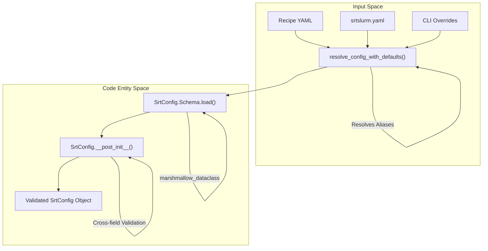
Sources: [src/srtctl/core/config.py:81-156](), [src/srtctl/core/schema.py:54-153]()

### The SrtConfig Schema

The core of the configuration system is the `SrtConfig` dataclass. It is defined using `marshmallow_dataclass` to provide strict type-safe validation and serialization. All configuration classes are `frozen=True` to ensure immutability once the job execution begins.

| Component | Code Entity | Responsibility |
| :--- | :--- | :--- |
| **Model** | `ModelConfig` | Path to weights, container image, and numerical precision (fp8, fp4, etc.). |
| **Resources** | `ResourceConfig` | GPU type, node counts, and worker-to-node mapping (Aggregated vs. Disaggregated). |
| **Backend** | `BackendConfig` | Polymorphic config for SGLang, vLLM, or TRT-LLM. |
| **Frontend** | `FrontendConfig` | Routing settings, Nginx load balancing, and ulimit overrides. |
| **Benchmark** | `BenchmarkConfig` | Throughput/Latency settings (ISL, OSL, concurrency). |

For a full field reference, see [SrtConfig Schema Reference](#2.1).

### Overrides and Parameter Sweeps

To support rapid experimentation, `srtctl` supports a "base + override" pattern within a single YAML file. This allows a user to define a shared configuration and then list multiple variants to be submitted as separate SLURM jobs.

*   **`override_*`**: Deep-merges a specific block with the `base` config.
*   **`zip_override_*`**: Generates $N$ jobs by zipping list-valued fields (e.g., sweeping across different Tensor Parallel sizes).
*   **`sweep:`**: Supports Cartesian product generation for large-scale parameter studies.

Title: Override Expansion Logic
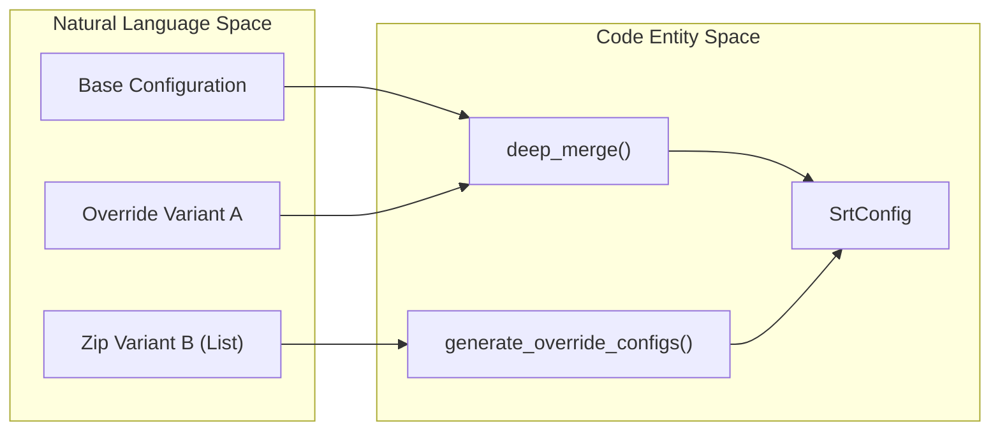
Sources: [src/srtctl/core/config.py:13-26](), [src/srtctl/cli/submit.py:40-45](), [tests/test_override.py:26-50]()

For details on syntax and merging rules, see [Config Overrides & Parameter Sweeps](#2.2).

### Validation and Preflight

Before any code is executed on the cluster, `srtctl` performs extensive validation:
1.  **Schema Validation**: Ensures types match and required fields are present via `marshmallow`.
2.  **Semantic Validation**: Performed in `__post_init__`, checking that node counts match worker counts and that requested GPU types are compatible with the backend.
3.  **Preflight Checks**: The `preflight_config_variants` function verifies that local paths exist and (optionally) that container images are accessible in the registry before the SLURM job is even queued.

Sources: [src/srtctl/core/validation.py:56-57](), [src/srtctl/core/schema.py:31-33](), [tests/test_configs.py:15-48]()

---

# Page: SrtConfig Schema Reference

# SrtConfig Schema Reference

<details>
<summary>Relevant source files</summary>

The following files were used as context for generating this wiki page:

- [docs/config-reference.md](docs/config-reference.md)
- [src/srtctl/core/schema.py](src/srtctl/core/schema.py)
- [src/srtctl/core/validation.py](src/srtctl/core/validation.py)
- [src/srtctl/mcp/server.py](src/srtctl/mcp/server.py)
- [src/srtctl/mcp/spec_tools.py](src/srtctl/mcp/spec_tools.py)
- [tests/test_configs.py](tests/test_configs.py)
- [tests/test_mcp_spec.py](tests/test_mcp_spec.py)
- [tests/test_validation.py](tests/test_validation.py)

</details>


The `SrtConfig` system provides a type-safe, validated, and hierarchical configuration framework for defining LLM serving jobs. It uses `marshmallow_dataclass` to bridge YAML-based recipes with Python dataclasses, enforcing strict schema validation and providing cross-field consistency checks via `__post_init__`.

## Architecture Overview

The configuration system is designed to be immutable (`frozen=True`) after loading, ensuring that the job state remains deterministic throughout the orchestration lifecycle.

### Configuration Data Flow
The following diagram illustrates how a raw YAML recipe is transformed into a validated `SrtConfig` object.

**Recipe to Code Entity Mapping**
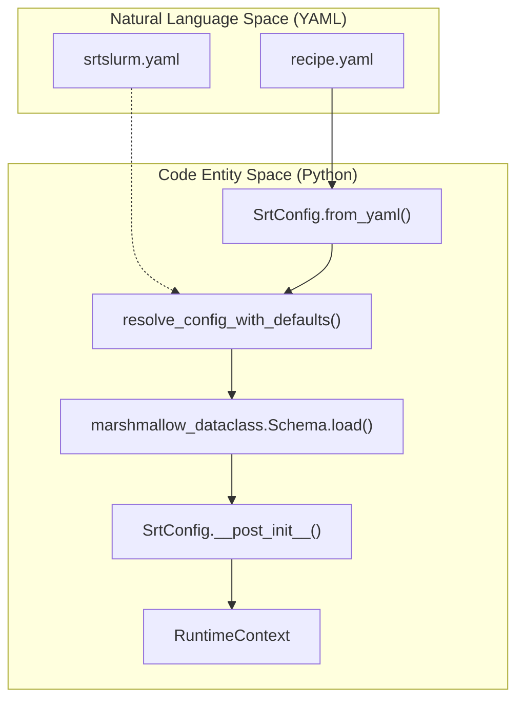
Sources: [src/srtctl/core/schema.py:1-32](), [src/srtctl/core/config.py:23-26](), [src/srtctl/mcp/spec_tools.py:108-117]()

## Core Config Classes

### SrtConfig (Root)
The root container for all job settings. It defines the high-level identity and includes sub-configs for every subsystem.
*   **Implementation**: `src/srtctl/core/schema.py`
*   **Key Fields**: `name`, `model`, `resources`, `backend`, `frontend`, `benchmark`.

### ModelConfig
Defines the model weights, container environment, and numerical precision.
*   **Fields**: 
    *   `path`: Local path or alias (e.g., `hf:repo/id`).
    *   `container`: Path to `.sqsh` or Docker URI.
    *   `precision`: String literal (e.g., `fp8`, `bf16`).

### ResourceConfig
Manages the physical allocation of GPUs and nodes. It supports both aggregated (single pool) and disaggregated (split prefill/decode) topologies.
*   **Validation**: `__post_init__` ensures that if `prefill_nodes` > 0, `decode_nodes` is also defined or defaults to 0.
*   **Logic**: `is_disaggregated` property returns `True` if `prefill_nodes` or `decode_nodes` are set [src/srtctl/core/schema.py:53-72]().

### BackendConfig (Polymorphic)
`BackendConfig` is a polymorphic base class that resolves to specific backend implementations:
*   **SGLangProtocol**: Configures `--dist-init-addr` and node ranks.
*   **VLLMProtocol**: Configures DP+EP modes and `kv_transfer_config`.
*   **TRTLLMProtocol**: Manages MPI-style launches and engine arguments.

**Backend Hierarchy**
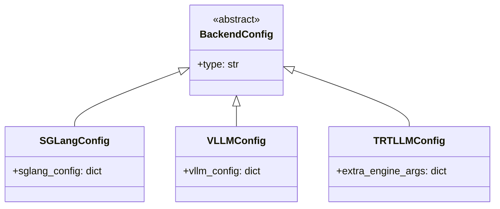
Sources: [src/srtctl/core/schema.py:34-40](), [src/srtctl/backends/__init__.py]()

## Validation & Preflight Checks

The schema employs a two-stage validation process: structural validation (via Marshmallow) and semantic/environmental validation (via the `validation` module).

### Structural Validation
`marshmallow_dataclass` ensures that types match (e.g., `int` vs `str`) and that required fields are present.

### Semantic Validation (`run_all_validations`)
The `srtctl.core.validation` module performs deeper checks that cannot be captured by types alone:
1.  **Topology Checks**: Validates that worker counts match GPU counts and that nodes are correctly assigned [src/srtctl/mcp/spec_tools.py:122-124]().
2.  **Local Path Probing**: `validate_local_path` checks if model directories or container images exist on the host filesystem [src/srtctl/core/validation.py:28-50]().
3.  **Remote Probing**: `validate_hf_model` and `validate_docker_image` perform non-blocking HTTP HEAD requests to verify remote availability [src/srtctl/core/validation.py:56-171]().

### Cross-Field Constraints
The `ResourceConfig` class performs internal arithmetic to ensure valid allocations:
*   **TP Calculation**: If `gpus_per_prefill` is not provided, it is calculated as `(prefill_nodes * gpus_per_node) / prefill_workers` [src/srtctl/core/schema.py:73-94]().
*   **Worker Inheritance**: When `decode_nodes=0` (shared nodes), `gpus_per_decode` inherits its value from the prefill TP configuration [src/srtctl/core/schema.py:73-88]().

## Specialized Config Blocks

| Config Class | Purpose | Key Fields |
| :--- | :--- | :--- |
| `FrontendConfig` | Routing and Load Balancing | `type` (dynamo/sglang), `nginx_raise_ulimit` |
| `BenchmarkConfig` | Load generation parameters | `type`, `isl`, `osl`, `concurrency` |
| `ProfilingConfig` | Performance tracing | `type` (nsys/torch), `start_step`, `duration` |
| `InfraConfig` | Orchestration services | `nats_port`, `etcd_port`, `mooncake_config` |
| `DynamoConfig` | Runtime versioning | `version`, `hash`, `wheel` |
| `IdentityConfig` | Runtime verification | `model.repo`, `frameworks` (dict) |

### FormattablePath
The `FormattablePath` field allows for dynamic string expansion in recipes. It supports templates like `{job_id}`, `{srtctl_root}`, and `{output_dir}`, which are resolved at runtime by the `RuntimeContext` [src/srtctl/core/formatting.py:41-44]().

## MCP Introspection
The `srtctl-mcp` server provides tools to inspect the schema programmatically.
*   **`explain_field(path)`**: Uses Python's `get_type_hints` and `dataclasses.fields` to provide technical details for any nested config path [src/srtctl/mcp/spec_tools.py:37-49]().
*   **`schema_summary()`**: Returns the top-level structure of `SrtConfig` [src/srtctl/mcp/spec_tools.py:29-34]().

Sources: [src/srtctl/core/schema.py:1-210](), [src/srtctl/core/validation.py:1-200](), [src/srtctl/mcp/spec_tools.py:1-150](), [tests/test_configs.py:1-120]()

---

# Page: Config Overrides & Parameter Sweeps

# Config Overrides & Parameter Sweeps

<details>
<summary>Relevant source files</summary>

The following files were used as context for generating this wiki page:

- [.github/workflows/ci.yaml](.github/workflows/ci.yaml)
- [docs/README.md](docs/README.md)
- [docs/SUMMARY.md](docs/SUMMARY.md)
- [docs/analyzing.md](docs/analyzing.md)
- [docs/installation.md](docs/installation.md)
- [docs/overrides.md](docs/overrides.md)
- [docs/profiling.md](docs/profiling.md)
- [examples/example-override.yaml](examples/example-override.yaml)
- [src/srtctl/cli/submit.py](src/srtctl/cli/submit.py)
- [src/srtctl/core/config.py](src/srtctl/core/config.py)
- [src/srtctl/core/sweep.py](src/srtctl/core/sweep.py)
- [tests/test_formatting.py](tests/test_formatting.py)
- [tests/test_override.py](tests/test_override.py)
- [tests/test_profiling.py](tests/test_profiling.py)

</details>


`srtctl` provides a powerful configuration system for managing multi-variant experiments without duplicating YAML files. This is achieved through three primary mechanisms: manual deep-merged overrides (`override_*`), parallel zipped sweeps (`zip_override_*`), and the `sweep:` section for Cartesian product generation.

## Multi-Variant Configuration Model

An override-capable YAML file is defined by a `base` top-level key containing the shared configuration, followed by one or more variant blocks.

| Key Prefix | Variant Type | Behavior |
| :--- | :--- | :--- |
| `base` | Shared Foundation | The root configuration used as a template for all variants. |
| `override_<name>` | Manual Variant | Generates **one** job. Fields are deep-merged into the `base`. |
| `zip_override_<name>` | Parallel Zip | Generates **N** jobs. List-valued leaves are zipped in parallel (like Python's `zip()`). |

### Deep-Merge Semantics
The merging logic is implemented in `srtctl.core.config.deep_merge` [src/srtctl/core/config.py:18-50](). It follows these rules:
*   **Dictionaries**: Merged recursively. Unmentioned keys in the override are preserved from the base [tests/test_override.py:29-50]().
*   **Lists**: Fully replaced by the override, not appended [tests/test_override.py:38-38]().
*   **Scalars**: The override value replaces the base value [tests/test_override.py:37-37]().
*   **Nulls**: Setting a key to `null` in an override deletes it from the resulting configuration [tests/test_override.py:41-41]().

### Comment-Aware YAML Handling
To preserve user intent and documentation within YAML files, `srtctl` uses `ruamel.yaml` for "comment-aware" merging via `comment_aware_merge` [src/srtctl/core/yaml_utils.py:19-20](). This ensures that when configs are resolved or written to disk, the original comments from the `base` and the specific `override` blocks are maintained in the output [tests/test_override.py:14-20]().

**Sources:** [src/srtctl/core/config.py:18-50](), [tests/test_override.py:27-61](), [docs/overrides.md:92-98]()

---

## Zip Overrides & Sweeps

`zip_override_*` blocks allow for efficient parameter sweeps where multiple related variables must change together (e.g., increasing TP size while simultaneously adjusting node counts).

### Zip Rules
1.  **List Leaf**: Becomes a zip dimension. Every variant $i$ receives the $i$-th element [examples/example-override.yaml:83-83]().
2.  **Length-1 List**: Broadcasts the single element to all $N$ variants [examples/example-override.yaml:84-84]().
3.  **Scalar**: Broadcasts the value unchanged to all variants [examples/example-override.yaml:86-86]().
4.  **List-of-Lists**: To pass a literal list as a value (e.g., `concurrencies: [[1, 2], [4, 8]]`), wrap it in an outer list [examples/example-override.yaml:85-85]().

### Implementation Data Flow
The `generate_override_configs` function orchestrates the expansion of these blocks.

**Config Expansion Logic**
Title: Configuration Expansion Data Flow
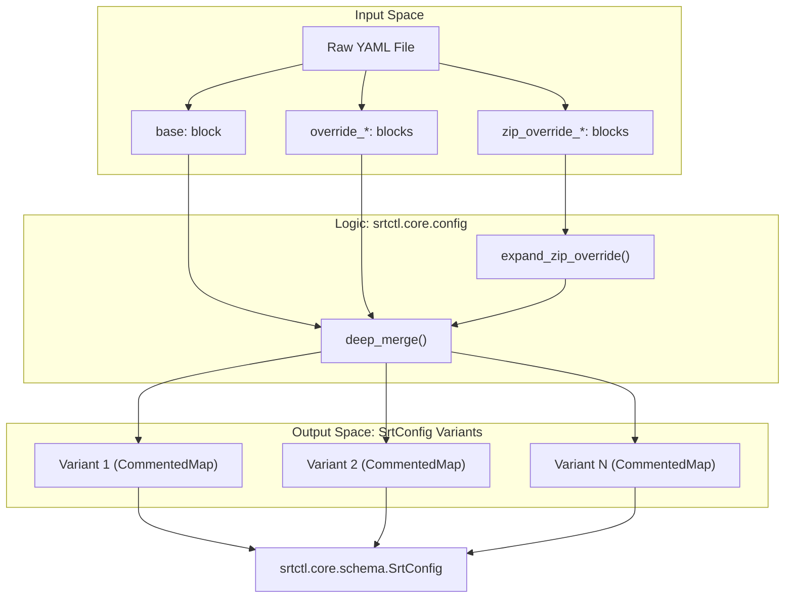
**Sources:** [src/srtctl/core/config.py:13-18](), [tests/test_override.py:105-149](), [examples/example-override.yaml:79-88]()

---

## CLI Usage & Selectors

The `srtctl` CLI provides tools to manage these multi-variant files using a colon-based selector syntax: `path/to/config.yaml:selector`.

### Selectors
*   **`:base`**: Submits only the base configuration [docs/overrides.md:31-31]().
*   **`:override_name`**: Submits a specific manual override [docs/overrides.md:193-193]().
*   **`:zip_override_group`**: Submits all variants within that zip group [docs/overrides.md:196-196]().
*   **`:zip_override_group[N]`**: Submits only the $N$-th variant of a zip group [docs/overrides.md:199-199]().
*   **Glob Patterns**: `srtctl apply -f config.yaml:override_tp*` will match all overrides starting with "tp" [docs/overrides.md:203-217]().

### Commands for Debugging Overrides
1.  **`srtctl resolve-override`**: Expands the override file and prints the resulting fully-merged YAML to stdout. Useful for verifying merge logic before submission [docs/overrides.md:257-258]().
2.  **`srtctl dry-run`**: Performs full validation (schema, cluster paths, and model availability) for all matched variants without submitting to SLURM [src/srtctl/cli/submit.py:187-220]().

**CLI Interaction with Code Entities**
Title: CLI Selector Resolution
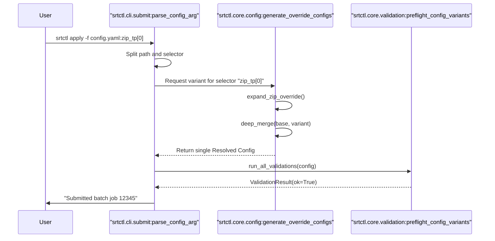
**Sources:** [src/srtctl/cli/submit.py:16-57](), [tests/test_override.py:67-80](), [docs/overrides.md:184-222]()

---

## Parameter Sweeps (Cartesian Product)

While `zip_override` is for parallel lists, the `sweep:` section (handled by the `SweepOrchestrator`) is designed for Cartesian product generation. This is typically used for grid searches across ISL, OSL, and concurrency levels.

### Sweep Generation Logic
The `SweepOrchestrator` [src/srtctl/core/sweep.py]() processes a `sweep:` block to generate a matrix of jobs.
*   **Input**: A single `SrtConfig` with list values in the `benchmark` or `resources` section.
*   **Output**: Multiple job submissions where every combination of parameters is exercised.

**Implementation Note**: The `srtctl dry-run --sweep` flag is essential when using this mode to visualize the total number of jobs that will be generated [src/srtctl/cli/submit.py:13-14]().

**Sources:** [src/srtctl/cli/submit.py:11-14](), [docs/README.md:21-21](), [docs/SUMMARY.md:12-12]()

---

# Page: Cluster Configuration (srtslurm.yaml)

# Cluster Configuration (srtslurm.yaml)

<details>
<summary>Relevant source files</summary>

The following files were used as context for generating this wiki page:

- [.github/workflows/ci.yaml](.github/workflows/ci.yaml)
- [docs/overrides.md](docs/overrides.md)
- [examples/example-override.yaml](examples/example-override.yaml)
- [recipes/gb200-fp4/1k1k-dsv4/README.md](recipes/gb200-fp4/1k1k-dsv4/README.md)
- [recipes/gb200-fp4/1k1k-dsv4/agg-2n-low-latency.yaml](recipes/gb200-fp4/1k1k-dsv4/agg-2n-low-latency.yaml)
- [recipes/gb200-fp4/1k1k-dsv4/agg-2n-nomtp.yaml](recipes/gb200-fp4/1k1k-dsv4/agg-2n-nomtp.yaml)
- [src/srtctl/cli/submit.py](src/srtctl/cli/submit.py)
- [src/srtctl/core/config.py](src/srtctl/core/config.py)
- [srtslurm.yaml.example](srtslurm.yaml.example)
- [tests/test_override.py](tests/test_override.py)

</details>


The `srtslurm.yaml` file serves as the cluster-level configuration layer for `srtctl`. It defines the environmental context of the SLURM cluster, providing defaults for resource allocation, mapping logical aliases to physical paths or container images, and configuring global features like AI-powered failure analysis.

### Purpose and Discovery

The cluster configuration decouples the generic job recipe (which describes *what* to run) from the cluster-specific infrastructure (which describes *where* and *how* to run it). This allows the same recipe to be portable across different hardware clusters by simply updating the local `srtslurm.yaml`.

`srtctl` discovers this file using a hierarchical search strategy implemented in `find_cluster_config_path()` [src/srtctl/core/config.py:30-52]():

1.  **Environment Variable**: If `SRTSLURM_CONFIG` is set, it takes absolute precedence [src/srtctl/core/config.py:33-40]().
2.  **Directory Hierarchy**: The system searches the Current Working Directory (`cwd`), followed by its parent, and finally its grandparent [src/srtctl/core/config.py:42-46]().

### Configuration Discovery and Loading Flow

The following diagram illustrates how `srtctl` locates, validates, and merges the cluster configuration into the job execution context.

**Configuration Resolution Pipeline**
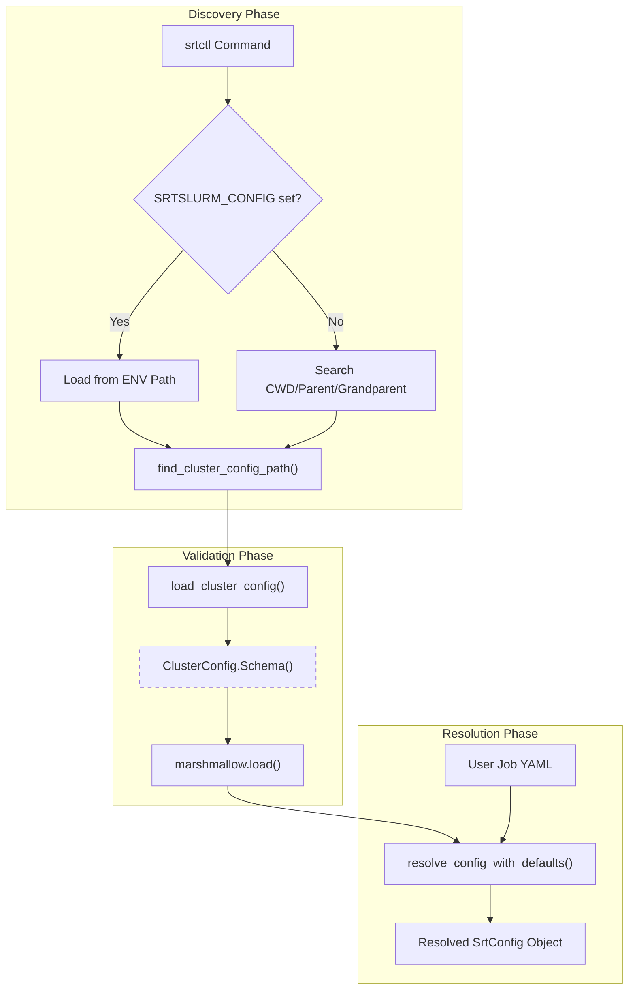
**Sources:** [src/srtctl/core/config.py:30-81](), [src/srtctl/core/schema.py:25-25]()

---

### Core Configuration Sections

#### 1. SLURM Defaults and Compatibility
The file provides fallback values for SLURM directives. If a job recipe omits `account` or `partition`, `srtctl` injects these defaults during the resolution phase [src/srtctl/core/config.py:104-115]().

It also manages hardware-specific directive compatibility via flags:
*   `use_gpus_per_node_directive`: Toggles `--gpus-per-node` vs generic resource requests [srtslurm.yaml.example:16-16]().
*   `use_segment_sbatch_directive`: Enables/disables segment-based scheduling [srtslurm.yaml.example:18-18]().
*   `use_exclusive_sbatch_directive`: Controls the injection of the `--exclusive` flag [srtslurm.yaml.example:20-20]().

#### 2. Alias Resolution (Containers & Models)
To prevent hardcoding absolute paths in shared recipes, `srtslurm.yaml` supports an alias system. This is processed in `resolve_config_with_defaults()` [src/srtctl/core/config.py:81-200]().

| Alias Category | Source Field in Recipe | Cluster Config Map | Description |
| :--- | :--- | :--- | :--- |
| **Containers** | `model.container` | `containers:` | Maps short names (e.g., `sglang-dev`) to `.sqsh` or URI paths. |
| **Models** | `model.path` | `model_paths:` | Maps model names (e.g., `dsv4-pro`) to host filesystem paths. |
| **Frontends** | `frontend.nginx_container` | `containers:` | Resolves Nginx images for load balancing. |
| **Telemetry** | `telemetry.container_image` | `containers:` | Resolves Prometheus/DCGM scraper images. |

**Sources:** [src/srtctl/core/config.py:117-183](), [srtslurm.yaml.example:23-49]()

#### 3. AI-Powered Analysis
The `ai_analysis` block configures automated post-job failure inspection. When enabled, `srtctl` uses the Claude Code CLI (via OpenRouter) to analyze logs and cross-reference GitHub PRs [srtslurm.yaml.example:50-72]().

*   **Implementation**: Managed by `PostProcessStageMixin` during the orchestration cleanup phase.
*   **Data Flow**: Failure logs $\rightarrow$ Claude $\rightarrow$ `ai_analysis.md` report.

---

### Technical Implementation: Deep Merging

The merging of `srtslurm.yaml` into a user config is not a simple dictionary update. It follows specific semantic rules implemented in `resolve_config_with_defaults` and `deep_merge` [src/srtctl/core/config.py:81-101]().

**Data Flow: From File to Runtime Object**
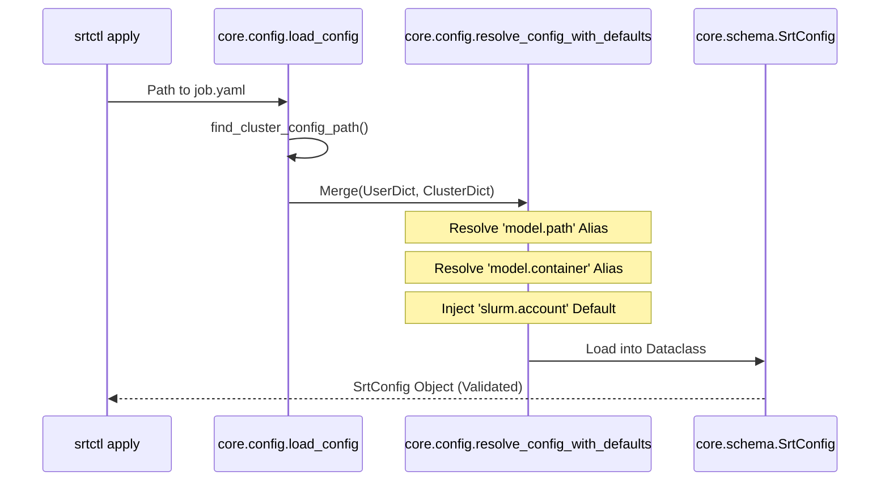
**Sources:** [src/srtctl/core/config.py:81-150](), [src/srtctl/cli/submit.py:41-45]()

### Data Structure Reference

The `ClusterConfig` schema (defined via `marshmallow_dataclass`) enforces the following structure for `srtslurm.yaml`:

| Key | Type | Role |
| :--- | :--- | :--- |
| `default_account` | `str` | Default SLURM account string [srtslurm.yaml.example:10-10]() |
| `default_partition` | `str` | Default SLURM partition [srtslurm.yaml.example:11-11]() |
| `containers` | `dict[str, str]` | Registry of container alias mappings [srtslurm.yaml.example:23-23]() |
| `model_paths` | `dict[str, str]` | Registry of model path mappings [srtslurm.yaml.example:41-41]() |
| `default_mounts` | `dict[str, str]` | Host:Container mounts applied to all jobs [src/srtctl/cli/submit.py:206-211]() |
| `nginx_raise_ulimit` | `int` | Global override for Nginx file descriptors [src/srtctl/core/config.py:152-155]() |

**Sources:** [src/srtctl/core/config.py:103-183](), [srtslurm.yaml.example:1-50]()

---

# Page: CLI Reference

# CLI Reference

<details>
<summary>Relevant source files</summary>

The following files were used as context for generating this wiki page:

- [.github/workflows/ci.yaml](.github/workflows/ci.yaml)
- [docs/cli.md](docs/cli.md)
- [docs/monitoring.md](docs/monitoring.md)
- [docs/overrides.md](docs/overrides.md)
- [examples/example-override.yaml](examples/example-override.yaml)
- [src/srtctl/cli/__init__.py](src/srtctl/cli/__init__.py)
- [src/srtctl/cli/monitor.py](src/srtctl/cli/monitor.py)
- [src/srtctl/cli/submit.py](src/srtctl/cli/submit.py)
- [src/srtctl/core/config.py](src/srtctl/core/config.py)
- [tests/test_monitor.py](tests/test_monitor.py)
- [tests/test_override.py](tests/test_override.py)

</details>


The `srtctl` CLI is the primary interface for interacting with the SLURM Runtime Control system. It provides a unified set of commands for job submission, configuration validation, and real-time cluster monitoring. The CLI is designed to handle both single-job applications and complex parameter sweeps with minimal manual intervention.

### Command Overview

The CLI is structured into several functional groups:
*   **Submission & Validation**: `apply`, `dry-run`, `resolve-override`, and `preflight`.
*   **Monitoring**: `monitor` (TUI dashboard).
*   **Interactive**: `srtctl` (or `srtctl -i`) launches a TUI for recipe browsing and parameter modification.

### CLI to Code Mapping

The following diagram maps CLI commands to their implementation entry points and core logic within the `srtctl` codebase.

**CLI Entry Point Mapping**
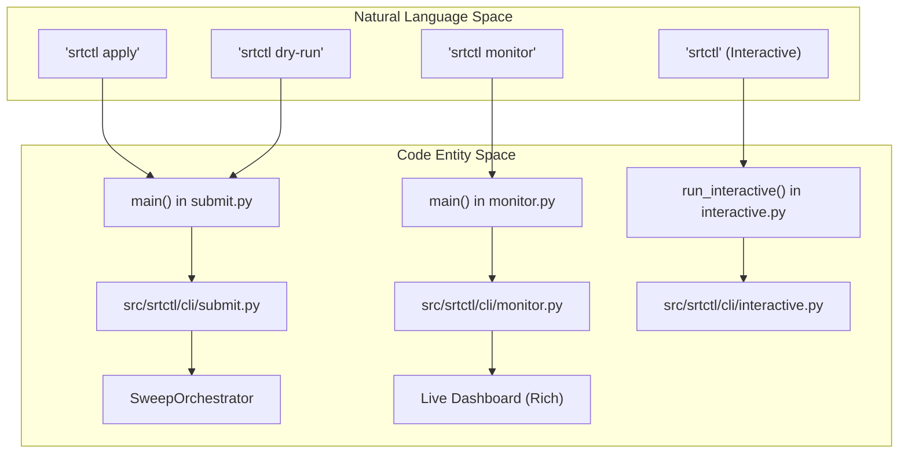
Sources: [src/srtctl/cli/submit.py:6-14](), [src/srtctl/cli/monitor.py:5-18](), [src/srtctl/cli/__init__.py:7-12]()

---

## Job Submission & Management

Job submission is handled primarily through the `srtctl apply` command. It processes YAML recipes, resolves cluster-level defaults from `srtslurm.yaml`, and generates the necessary `sbatch` scripts for SLURM.

| Command | Purpose | Key Flags |
| :--- | :--- | :--- |
| `apply` | Submits jobs to SLURM. | `-f` (file), `-o` (output dir), `--tags`, `--yes` |
| `dry-run` | Previews configuration and `sbatch` scripts without submitting. | `-f`, `--sweep` |
| `resolve-override` | Expands override/zip-sweep YAMLs into standalone configs. | `-f`, `-o` |
| `preflight` | Runs semantic validation (path checks, HF ID checks). | `-f` |

### The Submission Pipeline
The submission process follows a multi-stage pipeline from raw YAML to a running SLURM job.

**Submission Logic Flow**
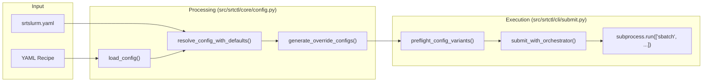
Sources: [src/srtctl/cli/submit.py:39-56](), [src/srtctl/core/config.py:9-11](), [src/srtctl/core/config.py:81-96]()

For more details on selectors, tags, and the `sbatch` generation process, see [Job Submission Commands](#3.1).

---

## Interactive TUI

Running `srtctl` without arguments (or with `-i`) launches an interactive TUI. This mode is designed for rapid experimentation and recipe discovery.

*   **Recipe Browser**: Scans the `recipes/` directory and groups them by hardware/backend [docs/cli.md:60-75]().
*   **Parameter Modification**: Allows interactive editing of `name`, `prefill_workers`, `decode_workers`, `isl`, and `osl` before submission [docs/cli.md:144-166]().
*   **Previews**: Built-in syntax-highlighted viewers for generated `sbatch` scripts and sweep expansion tables [docs/cli.md:126-142]().

---

## Monitoring Dashboard

The `srtctl monitor` command provides a live, `rich`-powered dashboard for tracking job lifecycles. It aggregates data from SLURM's `squeue` and the internal orchestration logs.

### Key Features:
*   **Lifecycle Stages**: Tracks jobs through `Starting` → `Head Ready` → `Workers` → `Benchmarking` → `Completed/Failed` [src/srtctl/cli/monitor.py:80-88]().
*   **Worker Readiness**: Displays real-time counts of ready prefill and decode workers (e.g., `2/4P 4/4D`) [src/srtctl/cli/monitor.py:90-97]().
*   **Detail View**: Split-pane view with the main orchestrator log on the left and worker/benchmark logs on the right [docs/monitoring.md:58-67]().

For keyboard shortcuts and session management details, see [Job Monitoring Dashboard](#3.2).

Sources: [src/srtctl/cli/monitor.py:9-18](), [docs/monitoring.md:15-26](), [docs/monitoring.md:42-42]()

---

## Configuration Overrides & Sweeps

The CLI supports advanced YAML patterns for generating multiple job variants from a single file:
1.  **`override_*`**: Deep-merges a variant block with the `base` configuration [docs/overrides.md:39-41]().
2.  **`zip_override_*`**: Generates N jobs by zipping list-valued leaves in parallel, similar to Python's `zip()` function [docs/overrides.md:101-103]().
3.  **Selector Syntax**: Target specific variants using `file.yaml:selector` or glob patterns (e.g., `srtctl apply -f sweep.yaml:zip_override_tp*`) [docs/overrides.md:184-215]().

Sources: [src/srtctl/core/config.py:13-26](), [tests/test_override.py:27-51](), [examples/example-override.yaml:1-15]()

---

# Page: Job Submission Commands

# Job Submission Commands

<details>
<summary>Relevant source files</summary>

The following files were used as context for generating this wiki page:

- [.github/workflows/ci.yaml](.github/workflows/ci.yaml)
- [docs/cli.md](docs/cli.md)
- [docs/monitoring.md](docs/monitoring.md)
- [docs/overrides.md](docs/overrides.md)
- [examples/example-override.yaml](examples/example-override.yaml)
- [src/srtctl/cli/__init__.py](src/srtctl/cli/__init__.py)
- [src/srtctl/cli/interactive.py](src/srtctl/cli/interactive.py)
- [src/srtctl/cli/monitor.py](src/srtctl/cli/monitor.py)
- [src/srtctl/cli/submit.py](src/srtctl/cli/submit.py)
- [src/srtctl/core/config.py](src/srtctl/core/config.py)
- [tests/test_monitor.py](tests/test_monitor.py)
- [tests/test_override.py](tests/test_override.py)

</details>


The `srtctl` CLI provides a unified interface for submitting, validating, and dry-running benchmark jobs on a SLURM cluster. It manages the transformation of high-level YAML recipes into concrete `sbatch` scripts and handles complex multi-job expansions like sweeps and overrides.

## Command Overview

The primary entry point for job submission is `srtctl apply`, supported by several utility commands for validation and local inspection.

| Command | Purpose | Key Flags |
| :--- | :--- | :--- |
| `apply` | Submits one or more jobs to SLURM. | `-f`, `--tags`, `--yes`, `--json`, `--mock` |
| `dry-run` | Previews configuration and `sbatch` generation without submitting. | `-f`, `--sweep` |
| `resolve-override` | Expands override/zip files into standard YAML. | `-f`, `-o` |
| `preflight` | Runs semantic and environment validations. | `-f` |
| `diff` | Compares a local config against a remote job's lockfile. | `-f`, `--job-id` |
| `interactive` | Launches the TUI for recipe browsing and submission. | `-i` |

**Sources:** [src/srtctl/cli/submit.py:10-14](), [docs/cli.md:17-20]()

---

## Submission Pipeline

The submission process follows a structured pipeline from raw YAML to a scheduled SLURM job.

### 1. Configuration Resolution
When a file is passed via `-f`, `srtctl` first identifies if it is a standard config, an override config (containing a `base` key), or a sweep config [src/srtctl/cli/submit.py:39-45](). It then merges cluster-level defaults from `srtslurm.yaml` [src/srtctl/core/config.py:81-96]().

### 2. Job ID and Output Directory
Each job is assigned a unique SLURM ID upon submission. `srtctl` creates an output directory following the pattern: `outputs/<job_id>_<prefill>P_<decode>D_<timestamp>/` [docs/monitoring.md:99-102]().

### 3. Sbatch Generation
The system generates a minimal `sbatch` script that acts as a wrapper. Instead of containing the logic itself, it invokes `python -m srtctl.cli.do_sweep` [src/srtctl/cli/__init__.py:7-12](). This allows the orchestration logic to remain in Python while respecting SLURM resource allocations.

### Data Flow: From YAML to SLURM
The following diagram illustrates the transformation of a configuration through the submission system.

**Submission Logic Flow**
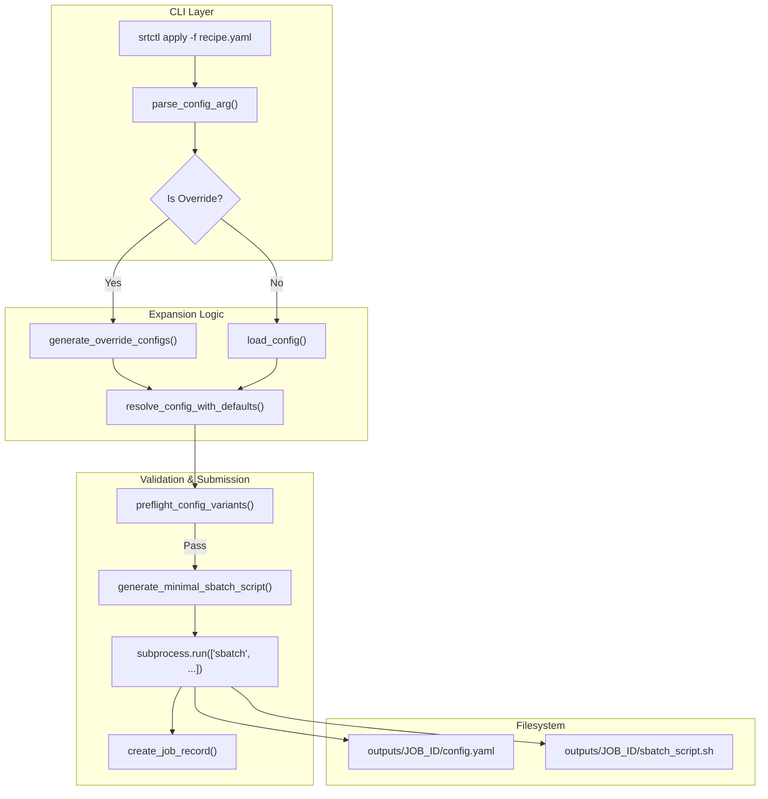
**Sources:** [src/srtctl/cli/submit.py:78-86](), [src/srtctl/core/config.py:81-96](), [src/srtctl/cli/interactive.py:204-209]()

---

## File and Selector Syntax

`srtctl` uses a `file:selector` syntax to target specific variants within a multi-job YAML file.

*   **`config.yaml`**: Submits all `override_*` and `zip_override_*` variants, but excludes `base` [docs/overrides.md:29-35]().
*   **`config.yaml:base`**: Submits only the base configuration [docs/overrides.md:31]().
*   **`config.yaml:override_name`**: Submits a specific deep-merged variant [docs/overrides.md:193]().
*   **`config.yaml:zip_override_name[N]`**: Submits the N-th variant of a zipped group [docs/overrides.md:199]().
*   **`config.yaml:pattern*`**: Supports glob matching against variant keys [docs/overrides.md:202-211]().

**Sources:** [src/srtctl/cli/submit.py:11-13](), [docs/overrides.md:184-217](), [tests/test_override.py:68-75]()

---

## Command Reference

### srtctl apply
The primary submission command. It performs preflight checks, generates the `sbatch` script, and submits to the SLURM queue.
*   `--tags`: Attaches metadata tags to the job for filtering in the dashboard or analysis [src/srtctl/cli/submit.py:604]().
*   `--json`: Outputs a JSON object per submitted job, useful for CI/CD integration [src/srtctl/cli/submit.py:61-63]().
*   `--mock`: Stubs out the `sbatch` call and spawns a local `mock_worker` to simulate the orchestration lifecycle without consuming cluster resources [src/srtctl/cli/submit.py:88-126]().

### srtctl dry-run
Validates the configuration and prints the effective resource requirements and container mounts.
*   **Implementation**: Calls `show_config_details()` to render tables of container paths, environment variables, and resolved model paths [src/srtctl/cli/submit.py:187-210]().
*   Use `--sweep` to see the full expansion of a Cartesian product sweep [src/srtctl/cli/submit.py:13]().

### srtctl interactive (TUI)
A `questionary` and `rich` powered interface for users who prefer guided submission.
*   **Recipe Browser**: Scans the `recipes/` directory and groups files by their parent folder [src/srtctl/cli/interactive.py:48-60]().
*   **Parameter Modification**: Allows interactive overrides of `name`, `prefill_workers`, `decode_workers`, `isl`, and `osl` before final submission [src/srtctl/cli/interactive.py:212-223]().

**Code Entity Association: Interactive Mode**
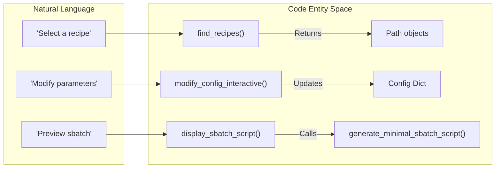
**Sources:** [src/srtctl/cli/interactive.py:48-60](), [src/srtctl/cli/interactive.py:118-123](), [src/srtctl/cli/interactive.py:212-223]()

---

## Output Directory Structure

Every successful `apply` results in a dedicated output directory. This directory is the source of truth for the `monitor` and `analysis` tools.

| File | Description |
| :--- | :--- |
| `config.yaml` | The fully resolved job configuration (defaults applied) [docs/monitoring.md:109](). |
| `sbatch_script.sh` | The exact script sent to `sbatch` [docs/monitoring.md:111](). |
| `log.out` / `log.err` | The primary orchestrator logs [docs/monitoring.md:115-116](). |
| `recipe.lock.yaml` | A reproducibility lockfile containing environment fingerprints [docs/monitoring.md:163](). |
| `*.out` / `*.err` | Per-node worker logs (e.g., `node0_prefill_w0.err`) [docs/monitoring.md:120-127](). |

**Sources:** [docs/monitoring.md:106-135](), [src/srtctl/cli/submit.py:135-150]()

---

# Page: Job Monitoring Dashboard

# Job Monitoring Dashboard

<details>
<summary>Relevant source files</summary>

The following files were used as context for generating this wiki page:

- [docs/cli.md](docs/cli.md)
- [docs/monitoring.md](docs/monitoring.md)
- [src/srtctl/cli/__init__.py](src/srtctl/cli/__init__.py)
- [src/srtctl/cli/monitor.py](src/srtctl/cli/monitor.py)
- [tests/test_monitor.py](tests/test_monitor.py)

</details>


The `srtctl monitor` command provides a live, interactive Terminal User Interface (TUI) for tracking the lifecycle of SLURM jobs submitted via `srtctl`. It consolidates SLURM queue states, orchestration logs, worker readiness, and benchmark performance metrics into a single unified view.

## Overview

The monitoring dashboard is designed to replace manual `squeue` polling and `tail -f` log tracking. It operates by scanning the `outputs/` directory and querying the SLURM scheduler to reconstruct the state of active and historical jobs.

### Key Capabilities
*   **Live Updates**: Auto-refreshing view of job stages (default 5s interval) [src/srtctl/cli/monitor.py:12]().
*   **Lifecycle Tracking**: Infers job progress (e.g., "Head Ready", "Awaiting Workers", "Benchmarking") by parsing `log.out` patterns [src/srtctl/cli/monitor.py:80-88]().
*   **Worker Readiness**: Displays the count of active vs. expected prefill and decode workers [src/srtctl/cli/monitor.py:90-97]().
*   **Metrics Extraction**: Real-time parsing of throughput (tok/s) and latency (TTFT/TPOT) from benchmark logs [src/srtctl/cli/monitor.py:101-106]().
*   **Detail View**: A split-pane interface for tailing orchestration logs, worker logs, and benchmark results simultaneously [src/srtctl/cli/monitor.py:534-566]().

**Sources:** [src/srtctl/cli/monitor.py:5-18](), [docs/monitoring.md:15-28]()

---

## Technical Implementation

### Data Flow & Architecture
The dashboard follows a reactive pattern where a background loop gathers data from the filesystem and SLURM, updates a mutable `_State` object, and triggers a `rich.live.Live` render.

#### State Management and Data Gathering
The `_State` class [src/srtctl/cli/monitor.py:124-142]() maintains the UI state, including the currently selected job, scroll offsets, and active panels. Data gathering is strictly read-only [tests/test_monitor.py:4-5]() and occurs in `_gather_all()` [src/srtctl/cli/monitor.py:284-307]().

**Data Flow Diagram:**
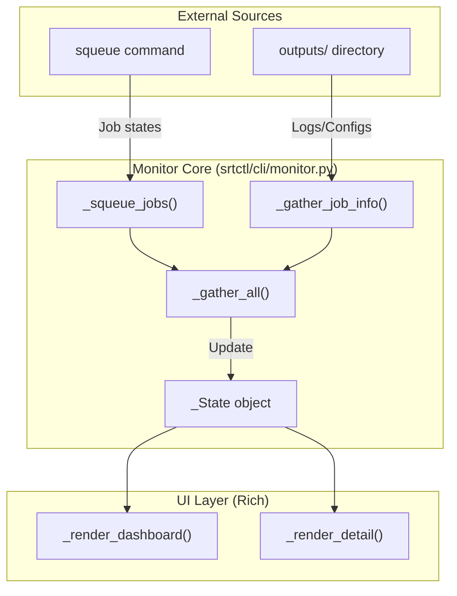
**Sources:** [src/srtctl/cli/monitor.py:148-167](), [src/srtctl/cli/monitor.py:236-282](), [src/srtctl/cli/monitor.py:284-307]()

### Job Lifecycle Detection
The `_detect_stage` function [src/srtctl/cli/monitor.py:191-213]() uses regex patterns to determine the current execution phase. Stages are categorized into terminal, in-progress, or active states to drive UI coloring and status indicators.

| Stage Name | Regex Pattern Source | UI Color |
| :--- | :--- | :--- |
| **Benchmarking** | `Running \S+ benchmark` | `bright_green` |
| **Awaiting Workers** | `Waiting for server health` | `cyan` |
| **Starting Workers** | `Starting backend workers` | `yellow` |
| **Head Ready** | `etcd is ready\|NATS is ready` | `yellow` |
| **Starting Infra** | `Starting infrastructure services` | `dim yellow` |

**Sources:** [src/srtctl/cli/monitor.py:80-88](), [src/srtctl/cli/monitor.py:108-110]()

---

## Detailed View & Log Tailing

When a user selects a job and presses `Enter`, the dashboard enters a detail view [src/srtctl/cli/monitor.py:534](). This view implements a split-pane layout using `rich.layout.Layout` [src/srtctl/cli/monitor.py:41]().

### Log Pane Logic
1.  **Sweep Log (Left)**: Tails the main orchestration log (`log.out`) [src/srtctl/cli/monitor.py:545]().
2.  **Worker/Bench Log (Right)**: Toggles between worker stderr (SGLang/vLLM logs) and benchmark output [src/srtctl/cli/monitor.py:548-554]().
3.  **Automatic Rotation**: Users can cycle through different worker nodes using `Left`/`Right` arrow keys [src/srtctl/cli/monitor.py:133-135]().

**Log Navigation Logic:**
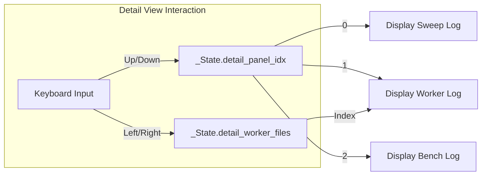
**Sources:** [src/srtctl/cli/monitor.py:124-142](), [src/srtctl/cli/monitor.py:543-566]()

---

## Usage and Shortcuts

### Command Line Options
*   `--all`: Includes older jobs from the `outputs/` directory that are no longer in the SLURM queue [src/srtctl/cli/monitor.py:10]().
*   `--resume <KEY>`: Restores a previous monitoring session, including the set of tracked job IDs [src/srtctl/cli/monitor.py:25]().
*   `--interval <SEC>`: Sets the refresh rate (default is 5 seconds) [src/srtctl/cli/monitor.py:12]().

### Keyboard Shortcuts

#### Main Dashboard
| Key | Action | Implementation |
| :--- | :--- | :--- |
| `↑` / `↓` | Navigate job list | `_State.selected_idx` adjustment |
| `Enter` | Open Detail View | Sets `_State.detail_job_id` |
| `c` | Toggle Concurrency | Flips `_State.show_all_concurrencies` |
| `d` | Delete/Cancel | Triggers `scancel` or `rm -rf` with confirmation |
| `y` | View Config | Opens `config.yaml` in `vi` |

#### Detail View
| Key | Action | Implementation |
| :--- | :--- | :--- |
| `←` / `→` | Switch Worker | Increments `_State.detail_worker_idx` |
| `r` | Toggle Refresh | Flips `_State.detail_auto_refresh` |
| `Esc` | Close Detail | Resets `_State.detail_job_id` |

**Sources:** [src/srtctl/cli/monitor.py:15-18](), [docs/monitoring.md:44-67]()

---

## Session Management

The dashboard supports session persistence. Upon exit, it saves the current state to `/tmp/srt-dash-<user>.json` [docs/monitoring.md:76](). This JSON blob stores the `seen_job_ids`, allowing users to resume monitoring a specific set of jobs even after they have finished and cleared from the active SLURM queue.

**Sources:** [src/srtctl/cli/monitor.py:615-635](), [docs/monitoring.md:68-76]()

---

# Page: Core Architecture

# Core Architecture

<details>
<summary>Relevant source files</summary>

The following files were used as context for generating this wiki page:

- [.gitignore](.gitignore)
- [CLAUDE.md](CLAUDE.md)
- [Makefile](Makefile)
- [README.md](README.md)
- [docs/mooncake-kv-store.md](docs/mooncake-kv-store.md)
- [src/srtctl/README.md](src/srtctl/README.md)
- [src/srtctl/backends/base.py](src/srtctl/backends/base.py)
- [src/srtctl/backends/sglang.py](src/srtctl/backends/sglang.py)
- [src/srtctl/cli/do_sweep.py](src/srtctl/cli/do_sweep.py)
- [src/srtctl/core/slurm.py](src/srtctl/core/slurm.py)
- [src/srtctl/core/topology.py](src/srtctl/core/topology.py)
- [src/srtctl/frontends/dynamo.py](src/srtctl/frontends/dynamo.py)
- [src/srtctl/templates/job_script_minimal.j2](src/srtctl/templates/job_script_minimal.j2)
- [tests/test_dry_run.py](tests/test_dry_run.py)
- [tests/test_e2e.py](tests/test_e2e.py)
- [tests/test_endpoint_allocation.py](tests/test_endpoint_allocation.py)
- [tests/test_slurm.py](tests/test_slurm.py)

</details>


The `srtctl` system operates on a **two-phase execution model** designed to bridge the gap between high-level declarative YAML configurations and the low-level complexities of SLURM multi-node orchestration. 

1.  **Submission Phase (Host/Login Node):** The CLI (e.g., `srtctl apply`) resolves overrides, validates the configuration, and generates a persistent output directory. It then submits a primary `sbatch` job using a Jinja2 template [src/srtctl/templates/job_script_minimal.j2:1-32]().
2.  **Orchestration Phase (Compute Node):** The SLURM-allocated "head" node executes the `SweepOrchestrator` [src/srtctl/cli/do_sweep.py:54-68](). This orchestrator runs on the host OS to maintain access to `srun`, while spawning all infrastructure, backends, and frontends as containerized processes across the allocated nodes.

### System Overview Diagram

This diagram maps high-level orchestration concepts to the specific Python classes and SLURM entities that implement them.

```mermaid
graph TD
    subgraph "Phase 1: Submission (Local/Login)"
        A["SrtConfig (YAML)"] --> B["submit.py"]
        B --> C["sbatch job_script.j2"]
    end

    subgraph "Phase 2: Orchestration (SLURM Head Node)"
        C --> D["SweepOrchestrator (Host Process)"]
        D --> E["RuntimeContext (Single Source of Truth)"]
        
        subgraph "Process Management"
            D --> F["ProcessRegistry"]
            F --> G["ManagedProcess (srun wrapper)"]
        end

        subgraph "Topology Mapping"
            E --> H["Endpoint (Logical Worker)"]
            H --> I["Process (Physical GPU/Node Bind)"]
        end
    end

    subgraph "Distributed Execution (Cluster Nodes)"
        G --> J["Infra Node (NATS/etcd)"]
        G --> K["Worker Nodes (SGLang/vLLM/TRT-LLM)"]
        G --> L["Frontend Nodes (Dynamo/Router)"]
    end
```
**Sources:** [src/srtctl/cli/do_sweep.py:54-100](), [src/srtctl/templates/job_script_minimal.j2:115-131](), [src/srtctl/core/processes.py:37-42]()

---

### Key Abstractions

The architecture relies on four primary abstractions to manage the complexity of distributed inference:

#### 1. RuntimeContext
The `RuntimeContext` is the immutable "source of truth" for a specific job execution. It resolves SLURM environment variables into concrete values, such as the `head_node_ip`, the list of available worker nodes, and the final container mount strings [src/srtctl/core/runtime.py:43-43](). It ensures that every component in the system uses consistent paths and network addresses.
*   **For details, see [RuntimeContext & Node Topology](#4.1)**

#### 2. Endpoint & Process
The system distinguishes between **logical** and **physical** topology:
*   **`Endpoint`**: Represents a logical serving unit (e.g., a Tensor Parallel rank-4 prefill worker). It defines *what* needs to run [src/srtctl/core/topology.py:47-47]().
*   **`Process`**: Represents a physical execution unit on a specific node with specific GPU indices and ports. One `Endpoint` might map to one or more `Process` entities depending on the backend's launch requirements [src/srtctl/core/topology.py:47-47]().
*   **For details, see [Endpoint & Process Allocation](#4.2)**

#### 3. SweepOrchestrator & Stage Mixins
The `SweepOrchestrator` uses a mixin-based architecture to organize the job lifecycle into discrete stages [src/srtctl/cli/do_sweep.py:54-60]():
*   **`WorkerStageMixin`**: Handles `srun` logic for inference backends.
*   **`FrontendStageMixin`**: Deploys routers and load balancers.
*   **`BenchmarkStageMixin`**: Orchestrates health checks and client execution.
*   **`PostProcessStageMixin`**: Manages log cleanup, S3 syncing, and AI analysis.
*   **For details, see [SweepOrchestrator & Stage Mixins](#4.3)**

#### 4. ProcessRegistry
The `ProcessRegistry` tracks every `ManagedProcess` spawned during the job [src/srtctl/core/processes.py:37-42](). It provides centralized signal handling (SIGINT/SIGTERM) and ensures that if a critical process (like a NATS server or a lead rank worker) fails, the entire sweep is shut down cleanly to avoid "zombie" SLURM allocations.

---

### Orchestration Lifecycle

The `SweepOrchestrator.run()` method executes a strictly ordered sequence to ensure dependencies are met before proceeding to the next stage.

| Stage | Action | Code Entity |
| :--- | :--- | :--- |
| **Infra** | Start NATS, etcd, and Mooncake Master | `start_head_infrastructure` [src/srtctl/cli/do_sweep.py:101]() |
| **Workers** | Launch backend processes (Prefill/Decode/Agg) | `WorkerStageMixin.start_workers` [src/srtctl/cli/mixins/worker_stage.py]() |
| **Frontends** | Launch Dynamo or SGLang Routers | `FrontendStageMixin.start_frontends` [src/srtctl/frontends/dynamo.py:62]() |
| **Health** | Poll `/health` or ports until workers are ready | `wait_for_port` [src/srtctl/core/health.py:35]() |
| **Benchmark** | Execute benchmark client (SA-Bench, etc.) | `BenchmarkStageMixin.run_benchmarks` [src/srtctl/cli/mixins/benchmark_stage.py]() |
| **Cleanup** | Terminate all processes in the `ProcessRegistry` | `ProcessRegistry.stop_all` [src/srtctl/core/processes.py]() |

### Infrastructure Services
By default, infrastructure services like NATS (port 4222) and etcd (port 2379) run on the head node. For large-scale runs, `srtctl` can be configured to use a dedicated `infra_node` to prevent interference with inference performance [src/srtctl/cli/do_sweep.py:101-110]().
*   **For details, see [Infrastructure Services (NATS, etcd, Mooncake)](#4.4)**

**Sources:** [src/srtctl/cli/do_sweep.py:7-13](), [src/srtctl/cli/do_sweep.py:101-163](), [src/srtctl/core/slurm.py:150-170]()

---

# Page: RuntimeContext & Node Topology

# RuntimeContext & Node Topology

<details>
<summary>Relevant source files</summary>

The following files were used as context for generating this wiki page:

- [CLAUDE.md](CLAUDE.md)
- [configs/aime/run.sh](configs/aime/run.sh)
- [docs/accuracy.md](docs/accuracy.md)
- [docs/mooncake-kv-store.md](docs/mooncake-kv-store.md)
- [examples/example.yaml](examples/example.yaml)
- [src/srtctl/benchmarks/__init__.py](src/srtctl/benchmarks/__init__.py)
- [src/srtctl/benchmarks/lm_eval.py](src/srtctl/benchmarks/lm_eval.py)
- [src/srtctl/benchmarks/scripts/lm-eval/bench.sh](src/srtctl/benchmarks/scripts/lm-eval/bench.sh)
- [src/srtctl/cli/setup_head.py](src/srtctl/cli/setup_head.py)
- [src/srtctl/core/ip_utils/get_node_ip.sh](src/srtctl/core/ip_utils/get_node_ip.sh)
- [src/srtctl/core/runtime.py](src/srtctl/core/runtime.py)
- [src/srtctl/core/slurm.py](src/srtctl/core/slurm.py)
- [src/srtctl/core/yaml_utils.py](src/srtctl/core/yaml_utils.py)
- [tests/test_benchmarks.py](tests/test_benchmarks.py)
- [tests/test_dry_run.py](tests/test_dry_run.py)
- [tests/test_e2e.py](tests/test_e2e.py)
- [tests/test_ip_utils.py](tests/test_ip_utils.py)
- [tests/test_slurm.py](tests/test_slurm.py)

</details>


The `RuntimeContext` serves as the single source of truth for all runtime values within the `srt-slurm` ecosystem [src/srtctl/core/runtime.py:7-9](). It centralizes configuration, network topology, and filesystem paths into a typed Python object, replacing scattered environment variables and complex shell scripting.

## RuntimeContext Overview

`RuntimeContext` is an immutable, frozen dataclass created at job startup via the `from_config` factory method [src/srtctl/core/runtime.py:81-129](). It computes all absolute paths, resolves node IP addresses, and prepares container mount strings once, ensuring consistency across all orchestration stages.

### Key Responsibilities
*   **Path Resolution**: Expands environment variables in model and container paths, resolving them to absolute filesystem locations [src/srtctl/core/runtime.py:164-190]().
*   **IP Resolution**: Maps SLURM hostnames to routable IP addresses for inter-node communication [src/srtctl/core/runtime.py:149-150]().
*   **Mount Construction**: Automatically generates the mapping between host paths and container internal paths [src/srtctl/core/runtime.py:111-112]().
*   **Topology Mapping**: Maintains the `Nodes` object which defines the roles of every node in the allocation [src/srtctl/core/runtime.py:93-94]().

### Data Flow: Config to Runtime
The following diagram illustrates how the static `SrtConfig` (loaded from YAML) is transformed into a live `RuntimeContext` using SLURM environment data.

**Runtime Initialization Flow**
```mermaid
graph TD
    subgraph "Input Space"
        A["SrtConfig (YAML)"]
        B["SLURM Env (NODELIST/JOB_ID)"]
    end

    subgraph "Code Entity Space"
        C["RuntimeContext.from_config()"]
        D["Nodes.from_slurm()"]
        E["get_hostname_ip()"]
        F["FormattablePath Expansion"]
    end

    subgraph "Output Space"
        G["RuntimeContext Object"]
        H["Absolute Paths"]
        I["Node IPs"]
        J["Container Mounts"]
    end

    A --> C
    B --> D
    D --> C
    C --> E
    C --> F
    E --> I
    F --> H
    C --> G
    G --> J
```
Sources: [src/srtctl/core/runtime.py:82-129](), [src/srtctl/core/slurm.py:49-54]()

---

## Node Topology & Role Assignment

The `Nodes` class manages the allocation of hostnames to specific functional roles within a SLURM job [src/srtctl/core/runtime.py:24-38]().

### Node Roles
| Role | Description | Placement Logic |
| :--- | :--- | :--- |
| **Head** | Runs `nginx` and frontend routers. | Typically the first node in the list [src/srtctl/core/runtime.py:73](). |
| **Bench** | Runs the benchmark client (e.g., `sa-bench`). | Defaults to Head node, but can be isolated [src/srtctl/core/runtime.py:68-69](). |
| **Infra** | Runs `NATS`, `etcd`, and `mooncake_master`. | Defaults to Head node unless `etcd_nats_dedicated_node` is True [src/srtctl/core/runtime.py:58-64](). |
| **Worker** | Runs the actual inference engine processes. | Includes all nodes in the allocation [src/srtctl/core/runtime.py:76](). |

### Nodes.from_slurm()
This method parses the `SLURM_NODELIST` (using `scontrol show hostnames` for expansion) and partitions the nodes based on configuration flags [src/srtctl/core/runtime.py:40-78](), [src/srtctl/core/slurm.py:49-71]().

*   **Standard Mode**: The first node acts as Head, Bench, and Infra. All nodes (including the first) act as Workers.
*   **Dedicated Infra Mode**: Enabled via `infra.etcd_nats_dedicated_node`. The first node is reserved strictly for Infra; the second node becomes the Head/Bench [src/srtctl/core/runtime.py:58-64]().
*   **Separate Benchmark Mode**: The first node is reserved for the benchmark client to prevent CPU/Network interference with the inference frontend [src/srtctl/core/runtime.py:65-71]().

Sources: [src/srtctl/core/runtime.py:24-80](), [src/srtctl/core/slurm.py:49-71]()

---

## Network Resolution Utilities

Accurate IP resolution is critical for distributed inference backends (like SGLang or vLLM) that require a `dist-init-addr` or `master_addr`.

### get_hostname_ip()
Located in `srtctl.core.slurm`, this function uses a multi-tiered strategy to find a routable IP [src/srtctl/core/slurm.py:78-118]():
1.  **SLURM Context**: If a `SLURM_JOB_ID` exists, it executes the `get_node_ip.sh` script via `srun` on the target node to find the actual IP on the requested interface [src/srtctl/core/slurm.py:94-98]().
2.  **Socket Fallback**: Falls back to `socket.gethostbyname(hostname)` if not in a SLURM job [src/srtctl/core/slurm.py:105-114]().

### get_node_ip.sh
A specialized shell utility [src/srtctl/core/ip_utils/get_node_ip.sh]() used to probe network interfaces inside the SLURM allocation. It prioritizes the interface specified in `network_interface` (from `srtslurm.yaml`) or finds the first non-loopback private IP address [src/srtctl/cli/setup_head.py:29-110]().

**IP Resolution Logic**
```mermaid
graph TD
    A["Call get_hostname_ip(hostname)"] --> B{"Inside SLURM Job?"}
    B -- "Yes" --> C["srun -w hostname get_node_ip.sh"]
    B -- "No" --> D["socket.gethostbyname()"]
    C --> E{"Interface Specified?"}
    E -- "Yes" --> F["Filter IP by Interface"]
    E -- "No" --> G["Find First Routable Private IP"]
    F --> H["Return IP"]
    G --> H
    D --> H
```
Sources: [src/srtctl/core/slurm.py:78-118](), [src/srtctl/core/ip_utils/get_node_ip.sh](), [src/srtctl/cli/setup_head.py:29-110]()

---

## Container Mount Construction

The `RuntimeContext` automatically constructs the `--container-mounts` string required by `srun` (Pyxis/Enroot) [src/srtctl/core/runtime.py:111-112]().

### Mount Sources
1.  **Implicit Mounts**:
    *   `model_path` → `/model` [src/srtctl/core/runtime.py:175-179]()
    *   `log_dir` → `/logs` [src/srtctl/core/runtime.py:152-162]()
2.  **Cluster Mounts**: Defined in `srtslurm.yaml` under `default_mounts` [tests/test_dry_run.py:70-79]().
3.  **Recipe Mounts**: Defined in the job YAML under `extra_mount` using the `host:container` syntax [tests/test_dry_run.py:60-69]().

### FormattablePath Expansion
The system uses `FormattablePath` to allow template expansion in YAML configurations. This allows paths to include dynamic tokens like `${SRTCTL_SOURCE_DIR}` or `${USER}`, which are resolved during the `RuntimeContext` creation [src/srtctl/core/runtime.py:164-166](), [src/srtctl/core/slurm.py:27-36]().

Sources: [src/srtctl/core/runtime.py:111-112](), [src/srtctl/core/slurm.py:206-235](), [tests/test_dry_run.py:50-105]()

---

# Page: Endpoint & Process Allocation

# Endpoint & Process Allocation

<details>
<summary>Relevant source files</summary>

The following files were used as context for generating this wiki page:

- [CLAUDE.md](CLAUDE.md)
- [docs/mooncake-kv-store.md](docs/mooncake-kv-store.md)
- [src/srtctl/README.md](src/srtctl/README.md)
- [src/srtctl/backends/base.py](src/srtctl/backends/base.py)
- [src/srtctl/backends/sglang.py](src/srtctl/backends/sglang.py)
- [src/srtctl/cli/do_sweep.py](src/srtctl/cli/do_sweep.py)
- [src/srtctl/core/slurm.py](src/srtctl/core/slurm.py)
- [src/srtctl/core/topology.py](src/srtctl/core/topology.py)
- [tests/test_dry_run.py](tests/test_dry_run.py)
- [tests/test_e2e.py](tests/test_e2e.py)
- [tests/test_endpoint_allocation.py](tests/test_endpoint_allocation.py)
- [tests/test_slurm.py](tests/test_slurm.py)

</details>


This section describes how `srtctl` maps logical inference workers to physical SLURM nodes and GPUs. The system replaces complex Jinja2/Bash arithmetic with a typed Python topology engine that handles Tensor Parallelism (TP) spanning multiple nodes, packing multiple workers per node, and automatic network port arbitration.

## Topology Concepts

The allocation logic distinguishes between logical units of serving and physical execution units:

| Entity | Code Class | Description |
| :--- | :--- | :--- |
| **Endpoint** | `Endpoint` | A logical worker (e.g., "Prefill Worker 0"). Can span multiple nodes if its TP degree exceeds GPUs per node. |
| **Process** | `Process` | A physical execution unit. Usually one per node per endpoint. Holds specific GPU indices and ports. |
| **Allocator** | `NodePortAllocator` | Tracks and increments port assignments per node to prevent collisions when multiple workers share a host. |

**Sources:** [src/srtctl/core/topology.py:98-111](), [src/srtctl/core/topology.py:141-158](), [src/srtctl/core/topology.py:30-52]()

## Allocation Logic (`allocate_endpoints`)

The `allocate_endpoints()` function is the core of the topology engine. It takes resource requirements and a list of available nodes to produce a deterministic mapping.

### Mapping Strategy
1.  **Sequential Packing**: Workers are allocated in order: Prefill → Decode → Aggregated. [src/srtctl/core/topology.py:182-210]()
2.  **TP Spanning**: If `gpus_per_worker` > `gpus_per_node`, the endpoint is assigned multiple nodes. [src/srtctl/core/topology.py:101-103]()
3.  **Worker Packing**: If `gpus_per_worker` < `gpus_per_node`, multiple endpoints are packed onto the same node until GPUs are exhausted. [src/srtctl/README.md:120-129]()
4.  **Role Isolation**: Prefill and Decode workers are strictly prevented from sharing the same physical node to ensure performance isolation in disaggregated deployments. [src/srtctl/core/topology.py:228-234]()

### Endpoint-to-Process Conversion
Once `Endpoint` objects are created, the backend's `endpoints_to_processes()` method converts them into physical `Process` objects. For most backends (SGLang, vLLM), this results in one process per node per endpoint. [src/srtctl/backends/base.py:91-95]()

### Natural Language to Code Entity Mapping: Topology
The following diagram bridges the high-level request for resources to the internal code structures.

**Title: Resource to Topology Mapping**
```mermaid
graph TD
    subgraph "Natural Language / YAML Space"
        R["resources: prefill_workers: 2, gpus_per_prefill: 8"]
    end

    subgraph "Code Entity Space (core/topology.py)"
        AE["allocate_endpoints()"]
        EP["Endpoint (mode='prefill', index=0)"]
        PROC["Process (node='node01', gpu_indices={0..7})"]
        NPA["NodePortAllocator"]
    end

    R -->|Input| AE
    AE -->|Creates| EP
    EP -->|Backend Logic| PROC
    NPA -->|Assigns Ports| PROC
```
**Sources:** [src/srtctl/core/topology.py:182-191](), [src/srtctl/backends/base.py:91-95]()

## Port Allocation (`NodePortAllocator`)

When multiple processes reside on the same node, `NodePortAllocator` ensures they do not collide by incrementing ports from specific base ranges.

| Port Type | Base Port | Increment | Description |
| :--- | :--- | :--- | :--- |
| **HTTP** | 30000 | +1000 | Inference API serving port. |
| **Bootstrap** | 31000 | +1 | P/D coordination (Prefill leaders only). |
| **KV Events** | 5550 | +1 | ZMQ publisher port (Globally unique). |
| **NIXL** | 6550 | +1 | Side channel for vLLM KV transfers. |

**Sources:** [src/srtctl/core/topology.py:54-62](), [src/srtctl/core/topology.py:64-94]()

## Process Implementation Details

### SGLang Disaggregated Allocation
For SGLang, the allocation includes specific support for Mooncake (RDMA-based KV cache transfer). The orchestrator launches a `mooncake_master` on the infrastructure node (port 50051) and injects the master's IP and port into every worker process via the `MOONCAKE_MASTER` environment variable. [src/srtctl/cli/do_sweep.py:164-200](), [src/srtctl/backends/sglang.py:158-180]()

### Launch Configuration (`SrunConfig`)
Backends define how `srun` should treat these processes via `get_srun_config()`. 
- **SGLang/vLLM**: Use `launch_per_endpoint=False`, meaning `srtctl` triggers one `srun` per node/process. [src/srtctl/backends/sglang.py:121-125]()
- **TRT-LLM**: Uses MPI-style launching (`mpi="pmix"`) where a single `srun` may manage multiple ranks across nodes. [src/srtctl/backends/base.py:30-45]()

### Natural Language to Code Entity Mapping: Execution
This diagram shows how the logical `Process` becomes a physical `srun` command.

**Title: Process Execution Flow**
```mermaid
graph TD
    subgraph "Code Entity Space (core/slurm.py)"
        PROC["Process Object"]
        BWC["Backend.build_worker_command()"]
        SSP["start_srun_process()"]
    end

    subgraph "System Space (SLURM)"
        SRUN["srun --nodelist=node01 --overlap ..."]
        CONT["Apptainer/Enroot Container"]
    end

    PROC -->|Metadata| BWC
    BWC -->|Full Command| SSP
    SSP -->|Subprocess| SRUN
    SRUN -->|Launches| CONT
```
**Sources:** [src/srtctl/backends/base.py:99-107](), [src/srtctl/core/slurm.py:150-169]()

## Summary Table: Resource Fields vs. Allocation

| YAML Field | Impact on `Endpoint` | Impact on `Process` |
| :--- | :--- | :--- |
| `gpus_per_node` | Determines node capacity for packing. | Sets default `gpu_indices` range. |
| `gpus_per_prefill` | Determines `num_nodes` per endpoint. | Determines `CUDA_VISIBLE_DEVICES`. |
| `prefill_nodes` | Implicitly calculated if not provided. | Limits the total `nodelist` available. |
| `kv_events_config` | N/A | Triggers allocation of `kv_events_port`. |

**Sources:** [src/srtctl/core/topology.py:116-118](), [src/srtctl/core/topology.py:177-179](), [src/srtctl/backends/sglang.py:106-109]()

---

# Page: SweepOrchestrator & Stage Mixins

# SweepOrchestrator & Stage Mixins

<details>
<summary>Relevant source files</summary>

The following files were used as context for generating this wiki page:

- [docs/architecture.md](docs/architecture.md)
- [docs/sglang-router.md](docs/sglang-router.md)
- [recipes/dsv4-pro/sglang/gb300-fp4/1k1k/disagg/stp/max-tpt.yaml](recipes/dsv4-pro/sglang/gb300-fp4/1k1k/disagg/stp/max-tpt.yaml)
- [recipes/mocker/kimi-trace-agg.yaml](recipes/mocker/kimi-trace-agg.yaml)
- [src/srtctl/README.md](src/srtctl/README.md)
- [src/srtctl/backends/base.py](src/srtctl/backends/base.py)
- [src/srtctl/backends/sglang.py](src/srtctl/backends/sglang.py)
- [src/srtctl/cli/do_sweep.py](src/srtctl/cli/do_sweep.py)
- [src/srtctl/cli/mixins/benchmark_stage.py](src/srtctl/cli/mixins/benchmark_stage.py)
- [src/srtctl/cli/mixins/frontend_stage.py](src/srtctl/cli/mixins/frontend_stage.py)
- [src/srtctl/cli/mixins/postprocess_stage.py](src/srtctl/cli/mixins/postprocess_stage.py)
- [src/srtctl/cli/mixins/worker_stage.py](src/srtctl/cli/mixins/worker_stage.py)
- [src/srtctl/core/fingerprint.py](src/srtctl/core/fingerprint.py)
- [src/srtctl/core/lockfile.py](src/srtctl/core/lockfile.py)
- [src/srtctl/core/topology.py](src/srtctl/core/topology.py)
- [src/srtctl/templates/nginx.conf.j2](src/srtctl/templates/nginx.conf.j2)
- [tests/test_endpoint_allocation.py](tests/test_endpoint_allocation.py)
- [tests/test_fingerprint.py](tests/test_fingerprint.py)
- [tests/test_frontend_topology.py](tests/test_frontend_topology.py)
- [tests/test_lockfile.py](tests/test_lockfile.py)
- [tests/test_postprocess.py](tests/test_postprocess.py)

</details>


The `SweepOrchestrator` is the central coordination class of the `srtctl` system. It executes within a SLURM job allocation and manages the end-to-end lifecycle of a benchmark sweep, from infrastructure setup to post-processing. Its implementation relies on a mixin-based architecture where discrete pipeline stages are encapsulated in specialized classes.

## SweepOrchestrator Overview

The `SweepOrchestrator` [src/srtctl/cli/do_sweep.py:53-60]() integrates multiple stage mixins to form a complete execution pipeline. It uses the `RuntimeContext` as its source of truth for node topologies and the `SrtConfig` for workload definitions.

### Key Responsibilities
1.  **Infrastructure Startup**: Launches NATS and etcd services required for worker coordination [src/srtctl/cli/do_sweep.py:101-162]().
2.  **Topology Resolution**: Resolves logical endpoints into physical processes using the backend protocol [src/srtctl/cli/do_sweep.py:79-99]().
3.  **Process Management**: Tracks all sub-processes (workers, frontends, infra) via a `ProcessRegistry` to ensure critical failures trigger a job-wide shutdown [src/srtctl/cli/do_sweep.py:216-240]().
4.  **Stage Coordination**: Sequences the execution of worker, frontend, benchmark, and post-process stages.

### Orchestration Lifecycle
The `run()` method [src/srtctl/cli/do_sweep.py:216-291]() executes the following sequence:
1.  Initialize `ProcessRegistry` and setup signal handlers.
2.  Start `infra_services` (NATS/etcd) on the designated infra node.
3.  Launch backend workers (Prefill/Decode/Aggregated) via `WorkerStageMixin`.
4.  Launch the frontend layer (Nginx/Routers) via `FrontendStageMixin`.
5.  Execute the benchmark suite via `BenchmarkStageMixin`.
6.  Perform cleanup and trigger `PostProcessStageMixin`.

**Sources:** [src/srtctl/cli/do_sweep.py:53-291](), [src/srtctl/core/processes.py:37-42]()

---

## Stage Mixins Architecture

The pipeline is decomposed into five primary mixins, each handling a specific domain of the job lifecycle.

### 1. WorkerStageMixin
Handles the deployment of inference backend processes. It translates the `backend_processes` list into `srun` commands.

*   **Preamble Injection**: Generates a bash preamble to handle custom setup scripts and optional Dynamo installation [src/srtctl/cli/mixins/worker_stage.py:61-92]().
*   **Environment Composition**: Merges global environment variables (e.g., `HEAD_NODE_IP`, `NATS_SERVER`) with backend-specific and mode-specific (prefill vs. decode) variables [src/srtctl/cli/mixins/worker_stage.py:155-180]().
*   **Process Launching**: Uses `start_srun_process` to launch containers on specific nodes, often mapping ports deterministically based on endpoint indices [src/srtctl/cli/mixins/worker_stage.py:123-153]().

### 2. FrontendStageMixin
Manages the request entry point, including optional load balancing via Nginx.

*   **Topology Calculation**: Determines if Nginx is required. If `enable_multiple_frontends` is true and >1 node is available, it places Nginx on the head node and distributes routers across worker nodes [src/srtctl/cli/mixins/frontend_stage.py:72-118]().
*   **Nginx Configuration**: Renders `nginx.conf.j2` using Jinja2, dynamically populating upstream blocks with the resolved IPs of frontend routers [src/srtctl/cli/mixins/frontend_stage.py:166-182]().
*   **Service Launch**: Starts the frontend (e.g., `sglang_router` or `dynamo.frontend`) and monitors their health [src/srtctl/cli/mixins/frontend_stage.py:184-214]().

### 3. BenchmarkStageMixin
Coordinates the execution of the actual benchmark runner (e.g., SA-Bench).

*   **Health Checks**: Executes `wait_for_model` to ensure the frontend and all required workers (prefill/decode counts) are ready before starting traffic [src/srtctl/cli/mixins/benchmark_stage.py:61-96]().
*   **Identity Verification**: Compares the container/model fingerprint of running workers against the recipe's `identity` block to ensure reproducibility [src/srtctl/cli/mixins/benchmark_stage.py:99-119]().
*   **Runner Execution**: Fetches the appropriate `BenchmarkRunner` from the registry and executes its command [src/srtctl/cli/mixins/benchmark_stage.py:143-170]().

### 4. PostProcessStageMixin
Handles artifact collection and analysis after the benchmark completes.

*   **Rollup & Normalization**: Runs `rollup.py` to standardize raw benchmark outputs into a common JSON format [src/srtctl/cli/mixins/postprocess_stage.py:174]().
*   **S3 Synchronization**: Syncs the log directory to S3 if configured in `srtslurm.yaml` [src/srtctl/cli/mixins/postprocess_stage.py:192-205]().
*   **AI Failure Analysis**: If a job fails, it can optionally invoke the Claude Code CLI to analyze logs and suggest fixes [src/srtctl/cli/mixins/postprocess_stage.py:207-220]().

**Sources:** [src/srtctl/cli/mixins/worker_stage.py:32-180](), [src/srtctl/cli/mixins/frontend_stage.py:48-214](), [src/srtctl/cli/mixins/benchmark_stage.py:33-170](), [src/srtctl/cli/mixins/postprocess_stage.py:46-220]()

---

## Data Flow & Process Lifecycle

The following diagrams illustrate how the Orchestrator moves from logical configuration to physical process management.

### Orchestrator Pipeline Flow
This diagram bridges the natural language stages to the internal class methods and entities.

```mermaid
graph TD
    subgraph "Natural Language Stage"
        A["1. Infra Setup"]
        B["2. Worker Launch"]
        C["3. Frontend Setup"]
        D["4. Benchmarking"]
        E["5. Post-Processing"]
    end

    subgraph "Code Entity Space"
        A -->|calls| A1["start_head_infrastructure()"]
        A1 -->|starts| A2["setup_head.py (NATS/etcd)"]
        
        B -->|calls| B1["WorkerStageMixin.start_workers()"]
        B1 -->|uses| B2["backend.build_worker_command()"]
        B2 -->|executes| B3["srun (Worker Process)"]
        
        C -->|calls| C1["FrontendStageMixin.start_frontend()"]
        C1 -->|renders| C2["nginx.conf.j2"]
        C1 -->|starts| C3["nginx + FrontendProtocol"]
        
        D -->|calls| D1["BenchmarkStageMixin.run_benchmark()"]
        D1 -->|calls| D2["wait_for_model()"]
        D1 -->|executes| D3["BenchmarkRunner.build_command()"]
        
        E -->|calls| E1["PostProcessStageMixin.run_postprocess()"]
        E1 -->|writes| E2["recipe.lock.yaml"]
        E1 -->|executes| E3["aws s3 sync"]
    end
```
**Sources:** [src/srtctl/cli/do_sweep.py:216-291](), [src/srtctl/cli/mixins/worker_stage.py:123-153](), [src/srtctl/cli/mixins/frontend_stage.py:184-214](), [src/srtctl/cli/mixins/postprocess_stage.py:145-220]()

### Process Registry Lifecycle Management
The `ProcessRegistry` ensures that if a critical process (like a GPU worker) dies, the entire job is terminated to avoid hung resources.

```mermaid
sequenceDiagram
    participant O as SweepOrchestrator
    participant R as ProcessRegistry
    participant M as ManagedProcess
    participant S as SLURM (srun)

    O->>R: register(ManagedProcess)
    Note over R: critical=True
    R->>S: start_process_monitor() thread
    loop Health Check
        R->>M: popen.poll()
        alt Process Exited (Non-Zero)
            R->>O: registry.check_failures() -> True
            O->>R: stop_all()
            R->>S: kill -TERM to all PIDs
            O->>O: exit(1)
        end
    end
```
**Sources:** [src/srtctl/core/processes.py:37-142](), [src/srtctl/cli/do_sweep.py:245-280]()

---

## Implementation Details

### Endpoint to Process Translation
The `SweepOrchestrator` computes the physical layout using two cached properties:
1.  `endpoints`: Logical units of inference (e.g., a 4-GPU SGLang instance) [src/srtctl/cli/do_sweep.py:79-94]().
2.  `backend_processes`: The actual `srun` commands required to realize those endpoints [src/srtctl/cli/do_sweep.py:96-99]().

### Frontend Topology Rules
The system automatically adapts the frontend architecture based on the scale of the job:
| Scenario | Topology | Port |
| :--- | :--- | :--- |
| **Single Node** | Direct frontend on head node | 8000 |
| **Multi-Node** | Nginx on head -> Multiple routers on workers | 8000 (public) / 8180 (internal) |

**Sources:** [src/srtctl/cli/mixins/frontend_stage.py:72-118](), [tests/test_frontend_topology.py:84-177]()

### Infrastructure Services
NATS and etcd are launched on a dedicated node (if configured) or the head node. The orchestrator waits for ports `4222` (NATS) and `2379` (etcd) to be available before proceeding [src/srtctl/cli/do_sweep.py:152-160]().

**Sources:** [src/srtctl/cli/do_sweep.py:101-162]()

---

# Page: Infrastructure Services (NATS, etcd, Mooncake)

# Infrastructure Services (NATS, etcd, Mooncake)

<details>
<summary>Relevant source files</summary>

The following files were used as context for generating this wiki page:

- [.gitignore](.gitignore)
- [CLAUDE.md](CLAUDE.md)
- [Makefile](Makefile)
- [README.md](README.md)
- [docs/mooncake-kv-store.md](docs/mooncake-kv-store.md)
- [src/srtctl/cli/setup_head.py](src/srtctl/cli/setup_head.py)
- [src/srtctl/core/ip_utils/get_node_ip.sh](src/srtctl/core/ip_utils/get_node_ip.sh)
- [src/srtctl/core/slurm.py](src/srtctl/core/slurm.py)
- [src/srtctl/frontends/dynamo.py](src/srtctl/frontends/dynamo.py)
- [src/srtctl/templates/job_script_minimal.j2](src/srtctl/templates/job_script_minimal.j2)
- [tests/test_dry_run.py](tests/test_dry_run.py)
- [tests/test_e2e.py](tests/test_e2e.py)
- [tests/test_ip_utils.py](tests/test_ip_utils.py)
- [tests/test_slurm.py](tests/test_slurm.py)

</details>


Infrastructure services provide the communication and storage backbone for distributed inference. `srtctl` manages these services by launching them on a designated "infra" node (typically the head node of the SLURM allocation) to facilitate worker discovery, state synchronization, and RDMA-based KV cache transfers.

## Overview of Infrastructure Services

The orchestrator ensures these services are running and healthy before any backend workers or frontends are launched.

| Service | Default Port | Role | Backend Support |
| :--- | :--- | :--- | :--- |
| **NATS** | `4222` | Message broker for request/response cycles and control plane events. | Dynamo (SGLang/vLLM) |
| **etcd** | `2379` | Key-value store for worker registration and configuration discovery. | Dynamo (SGLang/vLLM) |
| **Mooncake** | `50051` | Master process for RDMA-based disaggregated KV cache transfers. | SGLang |

Sources: `[src/srtctl/cli/setup_head.py:21-25]()`, `[CLAUDE.md:152-160]()`

## Implementation: `setup_head.py`

The infrastructure is bootstrapped by `src/srtctl/cli/setup_head.py`. This script is executed by the orchestrator inside the container on the infra node. It performs local IP resolution and spawns the service binaries downloaded during `make setup`.

### Service Lifecycle Flow

Title: Infrastructure Bootstrap Sequence
```mermaid
sequenceDiagram
    participant O as SweepOrchestrator
    participant S as setup_head.py
    participant N as NATS Server
    participant E as etcd Server
    participant M as Mooncake Master

    O->>S: srun --nodelist=head setup_head.py
    activate S
    S->>S: get_local_ip()
    S->>N: start_nats(binary="/configs/nats-server")
    S->>E: start_etcd(binary="/configs/etcd")
    Note over S,E: Uses /tmp for fast local storage
    
    alt Mooncake Enabled
        S->>M: start_mooncake_master()
    end

    S->>S: wait_for_service(4222, "NATS")
    S->>S: wait_for_service(2379, "etcd")
    S-->>O: Infrastructure Ready (Exit 0)
    deactivate S
```
Sources: `[src/srtctl/cli/setup_head.py:122-164]()`, `[src/srtctl/cli/setup_head.py:167-217]()`, `[src/srtctl/cli/setup_head.py:219-230]()`

### Key Functions
*   **`get_local_ip()`**: Attempts multiple strategies (`hostname -I`, `ip route`, `socket`) to find a routable private IP, avoiding loopback addresses that would prevent cross-node communication `[src/srtctl/cli/setup_head.py:29-110]()`.
*   **`start_nats()`**: Launches the NATS binary. It configures `max_payload` (essential for large KV transfers) and uses `/tmp/nats` for JetStream storage to avoid slow network filesystems `[src/srtctl/cli/setup_head.py:122-164]()`.
*   **`start_etcd()`**: Launches etcd with `--advertise-client-urls` set to the resolved host IP. It maps data to `/tmp/etcd` to prevent Raft consensus timeouts on network storage `[src/srtctl/cli/setup_head.py:167-217]()`.

## NATS and etcd Management

For backends using the **Dynamo** frontend (e.g., disaggregated SGLang or vLLM), `srtctl` automatically injects connection environment variables into all spawned processes.

Title: Dynamo Worker Discovery via Infrastructure
```mermaid
graph TD
    subgraph InfraNode ["Infra Node (Head)"]
        NATS["nats-server (Port 4222)"]
        ETCD["etcd (Port 2379)"]
    end

    subgraph FrontendNode ["Frontend Node"]
        DF["dynamo.frontend"]
    end

    subgraph WorkerNodes ["Worker Nodes"]
        W1["Backend Worker 0"]
        W2["Backend Worker 1"]
    end

    W1 -- "Register" --> ETCD
    W2 -- "Register" --> ETCD
    DF -- "Watch Workers" --> ETCD
    DF -- "Dispatch Requests" --> NATS
    NATS -- "Stream Tasks" --> W1
    NATS -- "Stream Tasks" --> W2

    style NATS stroke-dasharray: 5 5
    style ETCD stroke-dasharray: 5 5
```
Sources: `[src/srtctl/frontends/dynamo.py:82-87]()`, `[CLAUDE.md:143-150]()`

### Dedicated Infra Node
By default, infrastructure services run on the first node of the allocation. The `InfraConfig` allows reserving a dedicated node solely for these services:
```yaml
infra:
  etcd_nats_dedicated_node: true
```
Sources: `[CLAUDE.md:143-150]()`

## Mooncake KV Store Master

Mooncake is used for RDMA-accelerated KV cache transfers in disaggregated SGLang deployments. When enabled in the `BackendConfig`, `srtctl` manages the `mooncake_master` process.

### Implementation Details
*   **Master Placement**: The `mooncake_master` is launched on the same node as NATS and etcd `[CLAUDE.md:152-157]()`.
*   **Environment Injection**: `srtctl` automatically computes `MOONCAKE_MASTER` using the infra node's IP and port `50051`. It also sets `MOONCAKE_LOCAL_HOSTNAME` for each worker to its specific NIC IP to ensure peer-to-peer RDMA transfers work correctly `[CLAUDE.md:177-179]()`.
*   **Validation**: The system rejects configurations where `mooncake_kv_store` is defined but the SGLang backend is not configured with `disaggregation-transfer-backend: mooncake` `[CLAUDE.md:181-182]()`.

### Mooncake Configuration Example
```yaml
backend:
  type: sglang
  mooncake_kv_store:
    container: nvcr.io/nvidia/mooncake:latest
    env:
      MOONCAKE_PROTOCOL: rdma
      MOONCAKE_DEVICE: mlx5_0
```
Sources: `[CLAUDE.md:159-167]()`

## Port Allocation Summary

Infrastructure ports are static and must be reachable across the cluster fabric.

| Service | Port | Protocol | Config Reference |
| :--- | :--- | :--- | :--- |
| NATS | `4222` | TCP | `NATS_PORT` `[src/srtctl/cli/setup_head.py:23]()` |
| etcd Client | `2379` | TCP | `ETCD_CLIENT_PORT` `[src/srtctl/cli/setup_head.py:21]()` |
| etcd Peer | `2380` | TCP | `ETCD_PEER_PORT` `[src/srtctl/cli/setup_head.py:22]()` |
| Mooncake Master | `50051` | gRPC/TCP | `MOONCAKE_MASTER` `[CLAUDE.md:156]()` |

Sources: `[src/srtctl/cli/setup_head.py:21-23]()`, `[CLAUDE.md:156]()`

---

# Page: Backends

# Backends

<details>
<summary>Relevant source files</summary>

The following files were used as context for generating this wiki page:

- [src/srtctl/README.md](src/srtctl/README.md)
- [src/srtctl/backends/base.py](src/srtctl/backends/base.py)
- [src/srtctl/backends/sglang.py](src/srtctl/backends/sglang.py)
- [src/srtctl/backends/trtllm.py](src/srtctl/backends/trtllm.py)
- [src/srtctl/backends/vllm.py](src/srtctl/backends/vllm.py)
- [src/srtctl/benchmarks/mooncake_router.py](src/srtctl/benchmarks/mooncake_router.py)
- [src/srtctl/benchmarks/scripts/mooncake-router/bench.sh](src/srtctl/benchmarks/scripts/mooncake-router/bench.sh)
- [src/srtctl/cli/do_sweep.py](src/srtctl/cli/do_sweep.py)
- [src/srtctl/core/topology.py](src/srtctl/core/topology.py)
- [tests/fixtures/trace_replay_sample.jsonl](tests/fixtures/trace_replay_sample.jsonl)
- [tests/test_endpoint_allocation.py](tests/test_endpoint_allocation.py)
- [tests/test_frontends.py](tests/test_frontends.py)

</details>


The `srtctl` system uses a provider-based architecture to support multiple inference engines. Each backend implementation is responsible for translating high-level resource requirements into physical SLURM processes, generating engine-specific CLI commands, and managing distributed coordination (e.g., Tensor Parallelism across nodes).

## BackendProtocol Interface

All backends must implement the `BackendProtocol` defined in [src/srtctl/backends/base.py:47-112](). This protocol ensures that the `SweepOrchestrator` [src/srtctl/cli/do_sweep.py:54-60]() can interact with any inference engine (SGLang, vLLM, or TRT-LLM) using a unified set of methods.

### Key Responsibilities

| Method | Role |
| :--- | :--- |
| `allocate_endpoints` | Maps logical workers (Prefill/Decode/Aggregated) to physical GPU indices and nodes [src/srtctl/backends/base.py:77-89](). |
| `endpoints_to_processes` | Converts logical units into individual process definitions with unique system ports [src/srtctl/backends/base.py:91-97](). |
| `build_worker_command` | Generates the specific shell command (e.g., `python -m sglang.launch_server`) to start the engine [src/srtctl/backends/base.py:99-109](). |
| `get_srun_config` | Defines SLURM launch parameters, such as whether to use MPI (`pmix`) or launch per-process [src/srtctl/backends/base.py:62-67](). |

### Logical to Physical Mapping

The transition from a user's `SrtConfig` to running SLURM tasks follows a structured pipeline:

```mermaid
graph TD
    subgraph "Natural Language / Config Space"
        Config["SrtConfig (YAML)"]
    end

    subgraph "Code Entity Space"
        Protocol["BackendProtocol (Interface)"]
        Endpoints["Endpoint (Logical Worker)"]
        Proc["Process (Physical Unit)"]
        Srun["start_srun_process (SLURM Task)"]
    end

    Config -->|backend.type| Protocol
    Protocol -->|allocate_endpoints| Endpoints
    Endpoints -->|endpoints_to_processes| Proc
    Proc -->|build_worker_command| Srun
```
Sources: [src/srtctl/backends/base.py:47-112](), [src/srtctl/core/topology.py:98-170](), [src/srtctl/cli/do_sweep.py:73-99]()

---

## Supported Backends

### SGLang Backend
The SGLang backend implements the `SGLangProtocol` [src/srtctl/backends/sglang.py:76-80](). It specializes in Prefill/Decode disaggregation and supports advanced features like Mooncake RDMA KV-cache transfers and Multi-Token Prediction (MTP).

*   **Launching:** Uses per-process `srun` launching [src/srtctl/backends/sglang.py:121-125]().
*   **Coordination:** Handles multi-node Tensor Parallelism (TP) via `--dist-init-addr` and `--node-rank` [src/srtctl/backends/sglang.py:246-251]().
*   **KV-Events:** Configures ZMQ-based event publishing for disaggregated coordination [src/srtctl/backends/sglang.py:106-109]().

For details, see [SGLang Backend](#5.1).

### vLLM Backend
The vLLM backend implements the `VLLMProtocol` [src/srtctl/backends/vllm.py:53-57](). It is designed for high-throughput serving and integrates with `dynamo` for disaggregated KV transfers.

*   **Mode:** Supports Data Parallel + Expert Parallel (DP+EP) patterns where each GPU runs its own process [src/srtctl/backends/vllm.py:178-185]().
*   **KV-Transfer:** Translates connector settings into complex `--kv-transfer-config` JSON payloads [src/srtctl/backends/vllm.py:59-60]().
*   **Ports:** Manages unique `DYN_VLLM_KV_EVENT_PORT` and `VLLM_NIXL_SIDE_CHANNEL_PORT` per worker [src/srtctl/backends/vllm.py:132-141]().

For details, see [vLLM Backend](#5.2).

### TensorRT-LLM Backend
The TRT-LLM backend implements the `TRTLLMProtocol` [src/srtctl/backends/trtllm.py:39-43](). It focuses on maximum performance via specialized engine builds and MPI-based orchestration.

*   **Launching:** Uses MPI-style launching with `srun --mpi=pmix` and `oversubscribe=True` [src/srtctl/backends/trtllm.py:73-81]().
*   **Config:** Generates YAML configuration files on-the-fly to pass via `--extra-engine-args` [src/srtctl/backends/trtllm.py:170-175]().
*   **Load Balancing:** Injects `TRTLLM_EPLB_SHM_NAME` UUIDs to coordinate Expert Parallel Load Balancing [src/srtctl/backends/trtllm.py:96-106]().

For details, see [TensorRT-LLM Backend](#5.3).

---

## Process Topology & Port Allocation

To avoid conflicts when multiple workers share a single SLURM node, `srtctl` uses a `NodePortAllocator` [src/srtctl/core/topology.py:30-52]().

### Port Ranges
| Service | Range | Scope |
| :--- | :--- | :--- |
| **HTTP Port** | 30000+ | Per-node [src/srtctl/core/topology.py:54]() |
| **Bootstrap Port** | 31000+ | Per-node [src/srtctl/core/topology.py:55]() |
| **KV Events (ZMQ)** | 5550+ | Globally Unique [src/srtctl/core/topology.py:56]() |
| **NIXL Side Channel** | 6550+ | Globally Unique [src/srtctl/core/topology.py:57]() |

### Topology Entity Diagram

```mermaid
classDiagram
    class Endpoint {
        +WorkerMode mode
        +int index
        +tuple nodes
        +frozenset gpu_indices
        +str leader_node
    }
    class Process {
        +str node
        +int node_rank
        +int http_port
        +int? kv_events_port
        +str cuda_visible_devices
    }
    Endpoint "1" *-- "many" Process : contains
```
Sources: [src/srtctl/core/topology.py:98-170]()

---

# Page: SGLang Backend

# SGLang Backend

<details>
<summary>Relevant source files</summary>

The following files were used as context for generating this wiki page:

- [src/srtctl/README.md](src/srtctl/README.md)
- [src/srtctl/backends/base.py](src/srtctl/backends/base.py)
- [src/srtctl/backends/sglang.py](src/srtctl/backends/sglang.py)
- [src/srtctl/cli/do_sweep.py](src/srtctl/cli/do_sweep.py)
- [src/srtctl/cli/mixins/benchmark_stage.py](src/srtctl/cli/mixins/benchmark_stage.py)
- [src/srtctl/cli/mixins/worker_stage.py](src/srtctl/cli/mixins/worker_stage.py)
- [src/srtctl/core/topology.py](src/srtctl/core/topology.py)
- [tests/test_endpoint_allocation.py](tests/test_endpoint_allocation.py)

</details>


The SGLang backend implementation in `srtctl` provides a robust orchestration layer for the [SGLang](https://github.com/sgl-project/sglang) inference engine. It supports both aggregated and disaggregated (Prefill/Decode) execution modes, multi-node Tensor Parallelism (TP), and advanced features like Multi-Token Prediction (MTP) and Mooncake-based disaggregated KV cache transfers.

The implementation is centered around the `SGLangProtocol` class [src/srtctl/backends/sglang.py:76-115](), which implements the `BackendProtocol` [src/srtctl/backends/base.py:47-111]() to define how SGLang processes are allocated, configured, and launched across a SLURM cluster.

## Implementation Overview

SGLang integration follows a per-process `srun` launching strategy [src/srtctl/backends/sglang.py:121-125](). Unlike MPI-based backends, each node in a multi-node SGLang endpoint is launched as an individual `srun` command by the `SweepOrchestrator` [src/srtctl/cli/mixins/worker_stage.py:123-153]().

### Data Flow and Coordination
The backend manages coordination between nodes using several key mechanisms:
1.  **Distributed Init**: Multi-node TP groups coordinate via `--dist-init-addr`, which points to the IP of the leader node (rank 0) within the endpoint [src/srtctl/backends/sglang.py:284-288]().
2.  **Bootstrap Ports**: For disaggregated prefill workers, a unique bootstrap port is allocated per process to facilitate the handshake between prefill and decode instances [src/srtctl/backends/sglang.py:290-293]().
3.  **KV Events**: SGLang can publish KV cache events via ZMQ. `srtctl` automatically allocates unique ZMQ ports and generates the `--kv-events-config` JSON payload [src/srtctl/backends/sglang.py:202-243]().

### Natural Language to Code Entity Mapping

The following diagram maps high-level SGLang concepts to their specific implementations within the `srtctl` codebase.

**Concept to Code Entity Map**
```mermaid
graph TD
    subgraph "Natural Language Concepts"
        A["Prefill/Decode Disaggregation"]
        B["Multi-Node Coordination"]
        C["KV Cache Transfer"]
        D["Multi-Token Prediction"]
    end

    subgraph "Code Entities (srtctl)"
        A1["WorkerMode (prefill, decode, agg)"]
        A2["allocate_endpoints()"]
        
        B1["dist-init-addr"]
        B2["NodePortAllocator.next_bootstrap_port()"]
        
        C1["MooncakeKVStoreConfig"]
        C2["SGLangProtocol.get_kv_events_config_for_mode()"]
        
        D1["--speculative-algorithm mtp"]
        D2["SGLangProtocol.build_worker_command()"]
    end

    A --- A1
    A --- A2
    B --- B1
    B --- B2
    C --- C1
    C --- C2
    D --- D1
    D --- D2
```
Sources: [src/srtctl/backends/sglang.py:31-31](), [src/srtctl/backends/sglang.py:37-52](), [src/srtctl/backends/sglang.py:196-199](), [src/srtctl/core/topology.py:72-78](), [src/srtctl/core/topology.py:182-195]()

## Topology and Port Allocation

The `NodePortAllocator` [src/srtctl/core/topology.py:30-52]() ensures that multiple SGLang workers co-located on the same physical node do not have port collisions.

| Port Type | Base Port | Scope | Purpose |
| :--- | :--- | :--- | :--- |
| `http_port` | 30000 | Per Node | SGLang HTTP server port [src/srtctl/core/topology.py:64-70]() |
| `bootstrap_port` | 31000 | Per Node | Disaggregated P/D handshake [src/srtctl/core/topology.py:72-78]() |
| `kv_events_port` | 5550 | Global | ZMQ publisher for KV events [src/srtctl/core/topology.py:80-86]() |

### Multi-Node Process Topology
When an endpoint spans multiple nodes (e.g., TP=16 on 8-GPU nodes), `srtctl` calculates the `node_rank` and sets the appropriate `--nnodes` and `--node-rank` flags [src/srtctl/backends/sglang.py:279-283]().

**Process Allocation Flow**
```mermaid
sequenceDiagram
    participant O as SweepOrchestrator
    participant B as SGLangProtocol
    participant T as Topology (allocate_endpoints)
    participant S as SLURM (srun)

    O->>T: allocate_endpoints(num_prefill, num_decode)
    T-->>O: List[Endpoint]
    O->>B: endpoints_to_processes(endpoints)
    B-->>O: List[Process]
    loop For each Process
        O->>B: build_worker_command(process)
        B->>B: Resolve --dist-init-addr (Leader IP)
        B->>B: Assign --http-port & --bootstrap-port
        B-->>O: cmd_list
        O->>S: start_srun_process(cmd_list)
    end
```
Sources: [src/srtctl/cli/do_sweep.py:79-99](), [src/srtctl/backends/sglang.py:245-305](), [src/srtctl/core/topology.py:182-195]()

## Module Selection: Dynamo vs. SGLang Native

The backend dynamically selects the entry point based on the `frontend` configuration in the `SrtConfig`.

1.  **dynamo.sglang**: Used when `config.frontend.type == "dynamo"`. This launches SGLang within the Dynamo orchestration framework [src/srtctl/backends/sglang.py:255-257]().
2.  **sglang.launch_server**: Used for native SGLang frontends or standalone benchmarking [src/srtctl/backends/sglang.py:259-260]().

The backend also handles the installation of Dynamo dependencies if `config.dynamo.install` is enabled, injecting the necessary commands into the worker preamble [src/srtctl/cli/mixins/worker_stage.py:84-87]().

## Disaggregated KV Cache Support

### Mooncake Integration
For disaggregated deployments using RDMA-based KV cache transfers, `srtctl` manages the `mooncake_master` service:
*   **Master Launch**: The orchestrator starts `mooncake_master` on the infrastructure node (port 50051) [src/srtctl/cli/do_sweep.py:164-203]().
*   **Environment Injection**: The backend injects `MOONCAKE_MASTER` (pointing to the infra node) and `MOONCAKE_LOCAL_HOSTNAME` (worker IP) into all worker processes [src/srtctl/backends/sglang.py:158-180]().

### KV Events (ZMQ)
If `kv_events_config` is enabled in the YAML, `srtctl` generates a JSON configuration for SGLang's `--kv-events-config` flag.
*   **Prefill**: Configured as a ZMQ `publisher` [src/srtctl/backends/sglang.py:218-223]().
*   **Decode**: Configured as a ZMQ `subscriber` [src/srtctl/backends/sglang.py:225-230]().
*   The system automatically bridges these using the leader node's IP and the allocated `kv_events_port`.

## Multi-Token Prediction (MTP)
SGLang MTP support is handled by detecting the `speculative-algorithm: mtp` flag within the `sglang_config` [src/srtctl/backends/sglang.py:61-73](). When MTP is active, the backend ensures that the model configuration is correctly passed to the server CLI, often involving specific `--speculative-model` and `--speculative-num-candidates` arguments defined in the recipe YAML [src/srtctl/backends/sglang.py:87-93]().

Sources:
- [src/srtctl/backends/sglang.py:1-305]()
- [src/srtctl/core/topology.py:26-195]()
- [src/srtctl/cli/do_sweep.py:73-203]()
- [src/srtctl/cli/mixins/worker_stage.py:32-153]()
- [src/srtctl/backends/base.py:47-111]()

---

# Page: vLLM Backend

# vLLM Backend

<details>
<summary>Relevant source files</summary>

The following files were used as context for generating this wiki page:

- [configs/patches/vllm-container-deps.sh](configs/patches/vllm-container-deps.sh)
- [configs/patches/vllm_numa_bind_hash_fix.py](configs/patches/vllm_numa_bind_hash_fix.py)
- [recipes/vllm/deepseek-v4-pro/GB200/8k1k/disagg-gb200-1p1d-dep8-dep8-16-c256-c512-c1024-offload.yaml](recipes/vllm/deepseek-v4-pro/GB200/8k1k/disagg-gb200-1p1d-dep8-dep8-16-c256-c512-c1024-offload.yaml)
- [recipes/vllm/deepseek-v4-pro/GB200/8k1k/disagg-gb200-1p4d-dep8-tp8-c256-c512-offload.yaml](recipes/vllm/deepseek-v4-pro/GB200/8k1k/disagg-gb200-1p4d-dep8-tp8-c256-c512-offload.yaml)
- [recipes/vllm/deepseek-v4-pro/GB200/8k1k/disagg-gb200-1p8d-dep8-tp8-c8-c16-c32-c64-c128-c256-offload.yaml](recipes/vllm/deepseek-v4-pro/GB200/8k1k/disagg-gb200-1p8d-dep8-tp8-c8-c16-c32-c64-c128-c256-offload.yaml)
- [recipes/vllm/deepseek-v4-pro/GB200/8k1k/disagg-gb200-2p1d-dep8-dep8-c4096-offload.yaml](recipes/vllm/deepseek-v4-pro/GB200/8k1k/disagg-gb200-2p1d-dep8-dep8-c4096-offload.yaml)
- [recipes/vllm/deepseek-v4-pro/GB200/8k1k/disagg-gb200-3p1d-dep8-dep16-c4096-offload.yaml](recipes/vllm/deepseek-v4-pro/GB200/8k1k/disagg-gb200-3p1d-dep8-dep16-c4096-offload.yaml)
- [recipes/vllm/deepseek-v4-pro/GB200/8k1k/disagg-gb200-3p1d-dep8-dep8-c4096-offload.yaml](recipes/vllm/deepseek-v4-pro/GB200/8k1k/disagg-gb200-3p1d-dep8-dep8-c4096-offload.yaml)
- [src/srtctl/backends/trtllm.py](src/srtctl/backends/trtllm.py)
- [src/srtctl/backends/vllm.py](src/srtctl/backends/vllm.py)
- [src/srtctl/benchmarks/mooncake_router.py](src/srtctl/benchmarks/mooncake_router.py)
- [src/srtctl/benchmarks/scripts/mooncake-router/bench.sh](src/srtctl/benchmarks/scripts/mooncake-router/bench.sh)
- [tests/fixtures/trace_replay_sample.jsonl](tests/fixtures/trace_replay_sample.jsonl)
- [tests/test_frontends.py](tests/test_frontends.py)

</details>


The vLLM backend implements the `BackendProtocol` to support high-performance inference serving using the vLLM engine. It specifically targets advanced deployment patterns such as **Data Parallel + Expert Parallel (DP+EP)** offloading and **Prefill/Decode Disaggregation** using various KV transfer connectors (NIXL, LMCache).

## Overview

The `VLLMProtocol` class manages the lifecycle, configuration, and command-line generation for vLLM workers. It supports three primary operational modes: `prefill`, `decode`, and `aggregated` (combined prefill and decode) [src/srtctl/backends/vllm.py:33-34]().

Key features include:
*   **DP+EP Mode**: Support for running one process per GPU when `data-parallel-size` is specified, facilitating Expert Parallelism [src/srtctl/backends/vllm.py:178-185]().
*   **Disaggregated KV Transfer**: Automated generation of `--kv-transfer-config` JSON payloads for connectors like NIXL and LMCache [src/srtctl/backends/vllm.py:89-92]().
*   **Multi-node Coordination**: Orchestration of `VLLM_HOST_IP` and `master-addr` for distributed initialization across Slurm nodes [src/srtctl/backends/vllm.py:284-300]().
*   **Headless Operation**: Automatic injection of the `--headless` flag for non-leader ranks in multi-node configurations [src/srtctl/backends/vllm.py:326-328]().

**Sources:** [src/srtctl/backends/vllm.py:1-92](), [src/srtctl/backends/vllm.py:178-185]()

---

## Configuration Schema

The backend configuration is structured to allow global settings with per-mode overrides.

### VLLMProtocol Fields
| Field | Type | Description |
| :--- | :--- | :--- |
| `type` | `Literal["vllm"]` | Discriminator for the backend factory. |
| `vllm_config` | `VLLMServerConfig` | Dictionary of CLI flags for `prefill`, `decode`, and `aggregated` modes. |
| `connector` | `str` | Default KV connector (e.g., `"nixl"`, `"lmcache"`). |
| `prefill_environment` | `dict[str, str]` | Environment variables applied only to prefill workers. |
| `decode_environment` | `dict[str, str]` | Environment variables applied only to decode workers. |

### KV Transfer Configuration
For disaggregated deployments, the `connector` field is translated into a complex JSON payload passed via `--kv-transfer-config`. If the `connector` is set to `"nixl"`, the backend automatically configures:
*   `kv_connector`: `NixlConnector`
*   `kv_role`: Based on worker mode (`kv_producer` for prefill, `kv_consumer` for decode)
*   `kv_rank` and `kv_parallel_size`

**Sources:** [src/srtctl/backends/vllm.py:52-94](), [src/srtctl/backends/vllm.py:237-270]()

---

## Data Flow & Implementation

The following diagram illustrates how the `VLLMProtocol` transforms a high-level `SrtConfig` into specific Slurm execution commands and environment variables.

### Logic Flow: Config to Execution
```mermaid
graph TD
    subgraph "Natural Language Space"
        Config["SrtConfig (YAML)"]
        Mode["Worker Mode (Prefill/Decode)"]
    end

    subgraph "Code Entity Space: src/srtctl/backends/vllm.py"
        Protocol["VLLMProtocol Class"]
        EP_Proc["endpoints_to_processes()"]
        BuildCmd["build_worker_command()"]
        GetEnv["get_process_environment()"]
    end

    subgraph "Execution Output"
        Cmd["python3 -m vllm.entrypoints.openai.api_server"]
        Env["DYN_VLLM_KV_EVENT_PORT=555x"]
    end

    Config --> Protocol
    Protocol --> EP_Proc
    EP_Proc --> Mode
    Mode --> BuildCmd
    Mode --> GetEnv
    BuildCmd --> Cmd
    GetEnv --> Env
```
**Sources:** [src/srtctl/backends/vllm.py:53-57](), [src/srtctl/backends/vllm.py:192-210](), [src/srtctl/backends/vllm.py:212-235]()

---

## Data Parallel + Expert Parallel (DP+EP) Mode

vLLM deployments on hardware like GB200 often utilize a DP+EP pattern where each GPU runs a separate process rather than using Tensor Parallelism (TP) across the node. 

The `VLLMProtocol` detects this mode by checking for `data-parallel-size` in the `vllm_config` [src/srtctl/backends/vllm.py:178-185](). When active:
1.  **Process per GPU**: `endpoints_to_processes` creates a unique `Process` for every allocated GPU [src/srtctl/backends/vllm.py:204-207]().
2.  **Unique Ports**: Each process is assigned unique ports (HTTP, KV events, NIXL side-channel) [src/srtctl/backends/vllm.py:129-141]().
3.  **NUMA Binding**: Recipes typically include `numa-bind: true` to ensure memory locality for these per-GPU processes [recipes/vllm/deepseek-v4-pro/GB200/8k1k/disagg-gb200-1p1d-dep8-dep8-16-c256-c512-c1024-offload.yaml:83]().

### DP Consistency Hotfix
Because vLLM ranks on different NUMA nodes might auto-detect different configurations, a patch script `vllm_numa_bind_hash_fix.py` is provided to exclude NUMA-specific fields from the DP consistency hash, preventing `RuntimeError: Configuration mismatch` during startup [configs/patches/vllm_numa_bind_hash_fix.py:8-18]().

**Sources:** [src/srtctl/backends/vllm.py:178-185](), [recipes/vllm/deepseek-v4-pro/GB200/8k1k/disagg-gb200-1p1d-dep8-dep8-16-c256-c512-c1024-offload.yaml:61-83](), [configs/patches/vllm_numa_bind_hash_fix.py:1-22]()

---

## Multi-Node Coordination

For large models requiring multi-node TP or DP, `srtctl` coordinates the bootstrap process:

```mermaid
sequenceDiagram
    participant L as Leader Process (Rank 0)
    participant W as Worker Process (Rank N)
    participant R as RuntimeContext

    R->>L: Assigns master-addr (Leader Node IP)
    R->>W: Assigns master-addr (Leader Node IP)
    Note over L,W: srtctl injects --master-addr and --master-port
    W->>W: Injects --headless flag
    L->>L: Starts API Server (Port 8000+)
    W-->>L: Connects for Distributed Init
```

The backend handles the following distributed environment variables:
*   `VLLM_HOST_IP`: Set to the local node IP for communication [src/srtctl/backends/vllm.py:284-286]().
*   `master-addr`: Points to the leader node of the specific endpoint group [src/srtctl/backends/vllm.py:293-300]().

**Sources:** [src/srtctl/backends/vllm.py:284-300](), [src/srtctl/backends/vllm.py:326-328]()

---

## Key Functions

### `build_worker_command`
Constructs the `python3 -m vllm.entrypoints.openai.api_server` command. It handles:
*   **Model Pathing**: Resolves local mounts (`/model`) vs. HuggingFace IDs [src/srtctl/backends/vllm.py:226-231]().
*   **KV Transfer**: Generates the `--kv-transfer-config` JSON [src/srtctl/backends/vllm.py:237-270]().
*   **Port Mapping**: Maps logical ports to physical host ports [src/srtctl/backends/vllm.py:302-306]().

### `get_process_environment`
Provides the critical environment variables for vLLM/Dynamo integration:
*   `DYN_VLLM_KV_EVENT_PORT`: ZMQ port for KV events [src/srtctl/backends/vllm.py:137-138]().
*   `VLLM_NIXL_SIDE_CHANNEL_PORT`: Port for NIXL transfers [src/srtctl/backends/vllm.py:139-140]().

**Sources:** [src/srtctl/backends/vllm.py:129-141](), [src/srtctl/backends/vllm.py:212-330]()

---

# Page: TensorRT-LLM Backend

# TensorRT-LLM Backend

<details>
<summary>Relevant source files</summary>

The following files were used as context for generating this wiki page:

- [recipes/trtllm/gpt-oss-120b/b200-fp4/1k1k/agg-tp1.yaml](recipes/trtllm/gpt-oss-120b/b200-fp4/1k1k/agg-tp1.yaml)
- [recipes/trtllm/gpt-oss-120b/b200-fp4/1k8k/agg-tp1.yaml](recipes/trtllm/gpt-oss-120b/b200-fp4/1k8k/agg-tp1.yaml)
- [recipes/trtllm/gpt-oss-120b/b200-fp4/8k1k/agg-tp1.yaml](recipes/trtllm/gpt-oss-120b/b200-fp4/8k1k/agg-tp1.yaml)
- [src/srtctl/backends/trtllm.py](src/srtctl/backends/trtllm.py)
- [src/srtctl/backends/vllm.py](src/srtctl/backends/vllm.py)
- [src/srtctl/benchmarks/mooncake_router.py](src/srtctl/benchmarks/mooncake_router.py)
- [src/srtctl/benchmarks/scripts/mooncake-router/bench.sh](src/srtctl/benchmarks/scripts/mooncake-router/bench.sh)
- [tests/fixtures/trace_replay_sample.jsonl](tests/fixtures/trace_replay_sample.jsonl)
- [tests/test_frontends.py](tests/test_frontends.py)

</details>


This page details the implementation of the `TRTLLMProtocol` for integrating TensorRT-LLM as an inference backend within `srtctl`. It covers how `srtctl` launches TensorRT-LLM workers, manages their configuration, and handles specific features like Expert Parallel Load Balancing (EPLB) and profiling.

## TRTLLMProtocol Implementation

The `TRTLLMProtocol` class [src/srtctl/backends/trtllm.py:39-67]() is a frozen dataclass that both holds configuration for TensorRT-LLM and implements the `BackendProtocol` methods. This design allows `srtctl` to manage the lifecycle and configuration of TensorRT-LLM workers.

### Configuration (`TRTLLMServerConfig`)

The `TRTLLMServerConfig` dataclass [src/srtctl/backends/trtllm.py:23-35]() allows specifying different configurations for prefill, decode, and aggregated worker modes. These configurations are passed as arguments to the TensorRT-LLM server.

```python
@dataclass(frozen=True)
class TRTLLMServerConfig:
    """SGLang server CLI configuration per mode (prefill/decode/aggregated).

    Each mode can have its own configuration dict that gets converted
    to CLI flags when starting the worker.
    """

    prefill: dict[str, Any] | None = None
    decode: dict[str, Any] | None = None
    aggregated: dict[str, Any] | None = None

    Schema: ClassVar[type[Schema]] = Schema
```

An example of how this configuration is used in a recipe can be seen in [recipes/trtllm/gpt-oss-120b/b200-fp4/1k1k/agg-tp1.yaml:33-41]():
```yaml
  trtllm_config:
    aggregated:
      backend: "pytorch"
      tensor_parallel_size: 1
      moe_expert_parallel_size: 1
      max_batch_size: 512
      max_num_tokens: 20000
      max_seq_len: 2248
      trust_remote_code: true
```

Sources:
- [src/srtctl/backends/trtllm.py:23-35]()
- [recipes/trtllm/gpt-oss-120b/b200-fp4/1k1k/agg-tp1.yaml:33-41]()

### MPI-style Launching with `srun --mpi=pmix`

TensorRT-LLM workers are launched using an MPI-style approach with `srun --mpi=pmix`. This is configured in the `get_srun_config` method of `TRTLLMProtocol` [src/srtctl/backends/trtllm.py:72-81](). The `oversubscribe=True` and `launch_per_endpoint=True` settings indicate that `srun` will launch one process per endpoint, and these processes can share resources if necessary. The `cpu_bind="verbose,none"` ensures that CPU binding is not enforced, allowing the scheduler more flexibility.

```python
    def get_srun_config(self) -> "SrunConfig":
        """TRTLLM uses MPI-style launching (one srun per endpoint with all nodes)."""
        from srtctl.backends.base import SrunConfig

        return SrunConfig(
            mpi="pmix",
            oversubscribe=True,
            launch_per_endpoint=True,
            cpu_bind="verbose,none",
        )
```

Sources:
- [src/srtctl/backends/trtllm.py:72-81]()

### `trtllm-llmapi-launch` Command

The actual command to start a TensorRT-LLM worker is constructed in the `build_worker_command` method [src/srtctl/backends/trtllm.py:155-208](). This method uses the `trtllm-llmapi-launch` executable, which is a wrapper around the Python `dynamo.trtllm` module.

The command includes:
*   `python3 -m dynamo.trtllm`: The Python module for the TensorRT-LLM backend.
*   `--model-path`: Specifies the path to the model. This can be a HuggingFace model ID (e.g., `hf:openai/gpt-oss-120b`) or a mounted local path (`/model`) [src/srtctl/backends/trtllm.py:177-178]().
*   `--served-model-name`: The name under which the model is served.
*   `--disaggregation-mode`: Set to `prefill` or `decode` for disaggregated setups, not used for `agg` mode [src/srtctl/backends/trtllm.py:193-195]().
*   `--extra-engine-args`: This crucial argument points to a dynamically generated YAML configuration file.
*   `--request-plane nats`: Indicates that NATS is used for the request plane.
*   `--publish-events-and-metrics`: Enables publishing of events and metrics.

Sources:
- [src/srtctl/backends/trtllm.py:155-208]()
- [src/srtctl/backends/trtllm.py:177-178]()
- [src/srtctl/backends/trtllm.py:193-195]()

### YAML Config File Generation for `--extra-engine-args`

Before launching a worker, `srtctl` generates a YAML configuration file on the host filesystem (within the job's `log_dir`) based on the `trtllm_config` specified in the recipe [src/srtctl/backends/trtllm.py:168-172](). This file is then passed to the `trtllm-llmapi-launch` command via the `--extra-engine-args` flag, using its container path (`/logs/<config_filename>`). This allows dynamic configuration of TensorRT-LLM engine parameters.

```python
        # Write config to host path (log_dir)
        config_filename = f"trtllm_config_{mode}.yaml"
        host_config_path = runtime.log_dir / config_filename
        host_config_path.write_text(yaml.safe_dump(config))

        # Use container paths for the command (log_dir is mounted to /logs)
        container_config_path = Path("/logs") / config_filename
```

Sources:
- [src/srtctl/backends/trtllm.py:168-172]()

### `TRTLLM_EPLB_SHM_NAME` UUID for Expert Parallel Load Balancing

For Expert Parallel Load Balancing (EPLB), `srtctl` sets the `TRTLLM_EPLB_SHM_NAME` environment variable [src/srtctl/backends/trtllm.py:96-107](). This variable is assigned a unique UUID (`uuid.uuid4().hex`) prefixed with `moe_shared_`. This ensures that different runs or different sets of workers use distinct shared memory segments for EPLB coordination, preventing interference.

```python
    def get_environment_for_mode(self, mode: WorkerMode) -> dict[str, str]:
        eplb_prefix = f"moe_shared_{uuid.uuid4().hex}"

        env_by_mode: dict[WorkerMode, dict[str, str]] = {
            "prefill": self.prefill_environment,
            "decode": self.decode_environment,
            "agg": self.aggregated_environment,
        }
        base_env = env_by_mode.get(mode)
        if base_env is None:
            return {}
        return {**base_env, "TRTLLM_EPLB_SHM_NAME": eplb_prefix}
```

Sources:
- [src/srtctl/backends/trtllm.py:96-107]()

### Nsys Profiling Triggers

`srtctl` supports Nsys (NVIDIA Nsight Systems) profiling for TensorRT-LLM. The `nsys_prefix` argument in `build_worker_command` [src/srtctl/backends/trtllm.py:182]() allows `srtctl` to prepend the `nsys` command to the worker launch command. The specific profiling triggers (iteration-based vs. time-based) are managed by the `ProfilingConfig` and `get_nsys_prefix()` utility, as detailed in the [7.3. Profiling Integration]() page. For TensorRT-LLM, the `TLLM_PROFILE_START_STOP` environment variable can be used to control profiling start/stop points.

Sources:
- [src/srtctl/backends/trtllm.py:182]()

### Data Flow and Component Interaction

The following diagram illustrates the interaction between `srtctl` components and the TensorRT-LLM backend during worker launch.

```mermaid
graph TD
    A[SrtConfig] --> B{TRTLLMProtocol.build_worker_command()};
    B --> C{TRTLLMProtocol.get_config_for_mode()};
    C --> D[TRTLLMServerConfig];
    D -- "Extracts mode-specific config" --> E[Python dict];
    E -- "yaml.safe_dump()" --> F[trtllm_config_<mode>.yaml (host)];
    F -- "Mounted to /logs in container" --> G[trtllm_config_<mode>.yaml (container)];
    B --> H{TRTLLMProtocol.get_environment_for_mode()};
    H -- "Generates UUID" --> I[TRTLLM_EPLB_SHM_NAME env var];
    B --> J[nsys_prefix (optional)];
    B --> K[trtllm-llmapi-launch command];
    K -- "Includes --extra-engine-args <container_config_path>" --> G;
    K -- "Includes TRTLLM_EPLB_SHM_NAME" --> I;
    K -- "Prepended with nsys_prefix" --> J;
    K --> L[srun --mpi=pmix ...];
    L --> M[TensorRT-LLM Worker Process];

    subgraph srtctl
        A
        B
        C
        D
        H
        J
        L
    end

    subgraph Host Filesystem
        F
    end

    subgraph Container Environment
        G
        I
        K
        M
    end
```
**Diagram: TensorRT-LLM Worker Launch Data Flow**

Sources:
- [src/srtctl/backends/trtllm.py:39-67]()
- [src/srtctl/backends/trtllm.py:23-35]()
- [src/srtctl/backends/trtllm.py:155-208]()
- [src/srtctl/backends/trtllm.py:168-172]()
- [src/srtctl/backends/trtllm.py:96-107]()

### Endpoint and Process Allocation

The `allocate_endpoints` method [src/srtctl/backends/trtllm.py:132-143]() and `endpoints_to_processes` method [src/srtctl/backends/trtllm.py:145-154]() delegate to the common topology allocation functions `srtctl.core.topology.allocate_endpoints` and `srtctl.core.topology.endpoints_to_processes`. This ensures consistent resource allocation across different backends.

Sources:
- [src/srtctl/backends/trtllm.py:132-143]()
- [src/srtctl/backends/trtllm.py:145-154]()

### Example TRT-LLM Recipe

The following snippet from a TRT-LLM recipe demonstrates how the backend is configured:

```yaml
# recipes/trtllm/gpt-oss-120b/b200-fp4/1k1k/agg-tp1.yaml
backend:
  type: trtllm

  aggregated_environment:
    PYTHONUNBUFFERED: "1"
    DYN_HEALTH_CHECK_ENABLED: "false"
    TRTLLM_ENABLE_PDL: "1"
    TRTLLM_SERVER_DISABLE_GC: "1"
    TRTLLM_WORKER_DISABLE_GC: "1"
    TLLM_LOG_LEVEL: "INFO"

  trtllm_config:
    aggregated:
      backend: "pytorch"
      tensor_parallel_size: 1
      moe_expert_parallel_size: 1
      max_batch_size: 512
      max_num_tokens: 20000
      max_seq_len: 2248
      trust_remote_code: true
```

This recipe configures an aggregated TensorRT-LLM worker with specific environment variables and `trtllm_config` parameters, including `tensor_parallel_size` and `moe_expert_parallel_size`.

Sources:
- [recipes/trtllm/gpt-oss-120b/b200-fp4/1k1k/agg-tp1.yaml:24-41]()
- [recipes/trtllm/gpt-oss-120b/b200-fp4/8k1k/agg-tp1.yaml:24-41]()
- [recipes/trtllm/gpt-oss-120b/b200-fp4/1k8k/agg-tp1.yaml:24-41]()

---

# Page: Frontends

# Frontends

<details>
<summary>Relevant source files</summary>

The following files were used as context for generating this wiki page:

- [docs/architecture.md](docs/architecture.md)
- [docs/sglang-router.md](docs/sglang-router.md)
- [recipes/dsv4-pro/sglang/gb300-fp4/1k1k/disagg/stp/max-tpt.yaml](recipes/dsv4-pro/sglang/gb300-fp4/1k1k/disagg/stp/max-tpt.yaml)
- [src/srtctl/backends/trtllm.py](src/srtctl/backends/trtllm.py)
- [src/srtctl/backends/vllm.py](src/srtctl/backends/vllm.py)
- [src/srtctl/benchmarks/mooncake_router.py](src/srtctl/benchmarks/mooncake_router.py)
- [src/srtctl/benchmarks/scripts/mooncake-router/bench.sh](src/srtctl/benchmarks/scripts/mooncake-router/bench.sh)
- [src/srtctl/cli/mixins/frontend_stage.py](src/srtctl/cli/mixins/frontend_stage.py)
- [src/srtctl/templates/nginx.conf.j2](src/srtctl/templates/nginx.conf.j2)
- [tests/fixtures/trace_replay_sample.jsonl](tests/fixtures/trace_replay_sample.jsonl)
- [tests/test_frontend_topology.py](tests/test_frontend_topology.py)
- [tests/test_frontends.py](tests/test_frontends.py)

</details>


The Frontend layer in `srtctl` acts as the request coordinator and load balancer for distributed inference. It implements the `FrontendProtocol` to manage how requests are routed to backend workers, particularly in disaggregated prefill/decode (PD) setups.

## FrontendProtocol Interface

All frontend implementations must adhere to the `FrontendProtocol` (conceptually defined and implemented in `src/srtctl/frontends/`). This interface ensures that the orchestration layer can launch, monitor, and configure different routing solutions interchangeably.

### Key Responsibilities
*   **Command Construction**: Generating the `srun` command to launch the router process [src/srtctl/frontends/sglang.py:118-125]().
*   **Argument Parsing**: Converting YAML configuration dictionaries into CLI flags [tests/test_frontends.py:76-84]().
*   **Health Monitoring**: Defining specific health check endpoints (e.g., `/health` for Dynamo or `/workers` for SGLang) [tests/test_frontends.py:60-69]().

### Frontend Type Mapping
| Type | Class | Primary Use Case |
| :--- | :--- | :--- |
| `dynamo` | `DynamoFrontend` | Default for NATS/etcd-based coordination and KV-aware routing. |
| `sglang` | `SGLangFrontend` | Native `sglang_router` for SGLang-specific PD disaggregation. |

Sources: [src/srtctl/frontends/sglang.py:11-30](), [tests/test_frontends.py:11-40]()

## Request Routing & Topology

Request routing is managed by the `FrontendStageMixin` within the `SweepOrchestrator`. It determines the physical placement of frontend processes and optional Nginx load balancers based on the cluster size and configuration.

### Topology Selection Logic
The system automatically selects a topology based on the number of nodes and the `enable_multiple_frontends` flag:

1.  **Single Node / Single Frontend**: The frontend runs on the head node at port `8000`. No Nginx is used [src/srtctl/cli/mixins/frontend_stage.py:86-93]().
2.  **Multi-Node / Distributed Frontends**: Nginx runs on the head node (port `8000`) and load balances across multiple router instances running on other worker nodes (port `8180`) [src/srtctl/cli/mixins/frontend_stage.py:95-118]().

### Natural Language to Code Entity Mapping: Routing

```mermaid
graph TD
    subgraph "Natural Language Space"
        A["Load Balancer"]
        B["Request Router"]
        C["Backend Workers"]
    end

    subgraph "Code Entity Space"
        A1["nginx.conf.j2"]
        B1["FrontendProtocol"]
        B2["sglang_router / dynamo.frontend"]
        C1["VLLMProtocol / SGLangProtocol"]
    end

    A --- A1
    B --- B1
    B --- B2
    C --- C1

    A1 -- "proxies to" --> B2
    B2 -- "coordinates" --> C1
```
Sources: [src/srtctl/cli/mixins/frontend_stage.py:29-47](), [src/srtctl/templates/nginx.conf.j2:1-20]()

## Nginx Load Balancing

When `enable_multiple_frontends` is true, `srtctl` deploys an Nginx container to provide a single entry point for benchmarks.

*   **Configuration**: Nginx is configured via a Jinja2 template (`nginx.conf.j2`) which populates an `upstream` block with the IP addresses of all launched frontend processes [src/srtctl/templates/nginx.conf.j2:12-16]().
*   **Ulimit Management**: The `nginx_raise_ulimit` flag allows the orchestrator to attempt raising `worker_rlimit_nofile` to `1048576` for high-concurrency workloads [src/srtctl/cli/mixins/frontend_stage.py:138-143]().

Sources: [src/srtctl/cli/mixins/frontend_stage.py:120-164](), [src/srtctl/templates/nginx.conf.j2:1-31]()

## Implementation Details

The following diagram illustrates the relationship between the Orchestrator and the Frontend entities.

```mermaid
classDiagram
    class SweepOrchestrator {
        +start_frontend(registry)
        +_compute_frontend_topology()
        +_start_nginx(topology)
    }
    class FrontendProtocol {
        <<interface>>
        +type: str
        +health_endpoint: str
        +build_frontend_command()
    }
    class DynamoFrontend {
        +type: "dynamo"
        +health_endpoint: "/health"
    }
    class SGLangFrontend {
        +type: "sglang"
        +health_endpoint: "/workers"
    }
    class FrontendTopology {
        +nginx_node: str
        +frontend_nodes: list[str]
        +public_port: int
        +uses_nginx: bool
    }

    SweepOrchestrator ..> FrontendProtocol : uses
    FrontendProtocol <|.. DynamoFrontend : implements
    FrontendProtocol <|.. SGLangFrontend : implements
    SweepOrchestrator ..> FrontendTopology : creates
```
Sources: [src/srtctl/cli/mixins/frontend_stage.py:28-118](), [tests/test_frontends.py:47-70]()

---

## Child Pages

*   **[Dynamo Frontend](#6.1)**: Details on the `DynamoFrontend` implementation, including NATS/etcd discovery, health checks for disaggregated workers, and OpenTelemetry integration.
*   **[SGLang Router Frontend & Nginx Load Balancing](#6.2)**: Details on `SGLangFrontend`, the native `sglang_router`, and the specifics of Nginx template rendering and port management.

---

# Page: Dynamo Frontend

# Dynamo Frontend

<details>
<summary>Relevant source files</summary>

The following files were used as context for generating this wiki page:

- [.gitignore](.gitignore)
- [Makefile](Makefile)
- [README.md](README.md)
- [docs/architecture.md](docs/architecture.md)
- [docs/sglang-router.md](docs/sglang-router.md)
- [recipes/dsv4-pro/sglang/gb300-fp4/1k1k/disagg/stp/max-tpt.yaml](recipes/dsv4-pro/sglang/gb300-fp4/1k1k/disagg/stp/max-tpt.yaml)
- [src/srtctl/cli/mixins/frontend_stage.py](src/srtctl/cli/mixins/frontend_stage.py)
- [src/srtctl/frontends/dynamo.py](src/srtctl/frontends/dynamo.py)
- [src/srtctl/templates/job_script_minimal.j2](src/srtctl/templates/job_script_minimal.j2)
- [src/srtctl/templates/nginx.conf.j2](src/srtctl/templates/nginx.conf.j2)
- [tests/test_frontend_topology.py](tests/test_frontend_topology.py)

</details>


The `DynamoFrontend` is the default frontend implementation in `srtctl`, designed to coordinate requests between prefill and decode workers using a NATS-based message bus and etcd for service discovery. It leverages the `dynamo.frontend` module to provide a high-performance, KV-aware routing layer for disaggregated inference.

## Overview and Purpose

In a disaggregated architecture, the frontend serves as the entry point for HTTP requests (OpenAI-compatible). The `DynamoFrontend` implementation manages the lifecycle of `dynamo.frontend` processes, configures their connection to the infrastructure services (NATS/etcd), and integrates with the `srtctl` health check system to ensure workers are ready before benchmarking begins.

### Key Capabilities
- **Worker Discovery**: Automatically discovers prefill and decode workers via etcd [src/srtctl/frontends/dynamo.py:27-31]().
- **Health Validation**: Validates that the exact number of expected prefill and decode workers have registered with the frontend [src/srtctl/frontends/dynamo.py:41-48]().
- **Observability**: Built-in support for OpenTelemetry (OTEL) via `build_otel_env` [src/srtctl/frontends/dynamo.py:90]().
- **Scalability**: Supports multi-frontend topologies load-balanced by Nginx [src/srtctl/cli/mixins/frontend_stage.py:29-46]().

---

## Architecture and Data Flow

The `DynamoFrontend` operates within the `FrontendStageMixin` of the `SweepOrchestrator`. It interacts with the `RuntimeContext` to retrieve infrastructure IPs and the `ProcessRegistry` to manage the resulting `ManagedProcess` handles.

### Frontend Topology and Code Mapping

The following diagram illustrates how the `FrontendStageMixin` maps the logical `FrontendTopology` to physical processes on the SLURM cluster.

**Frontend Process Topology**
```mermaid
graph TD
    subgraph "Head Node (RuntimeContext.nodes.head)"
        NGINX["nginx (ManagedProcess)"]
    end

    subgraph "Compute Node 1"
        FE1["dynamo.frontend (ManagedProcess 0)"]
    end

    subgraph "Compute Node N"
        FEN["dynamo.frontend (ManagedProcess N)"]
    end

    subgraph "Infrastructure (RuntimeContext.nodes.infra)"
        NATS["NATS Server (:4222)"]
        ETCD["etcd (:2379)"]
    end

    NGINX -- "Round Robin (nginx.conf.j2)" --> FE1
    NGINX -- "Round Robin (nginx.conf.j2)" --> FEN
    FE1 -- "Discovery" --> ETCD
    FE1 -- "Request Plane" --> NATS
    FEN -- "Discovery" --> ETCD
    FEN -- "Request Plane" --> NATS
```
Sources: [src/srtctl/cli/mixins/frontend_stage.py:29-46](), [src/srtctl/frontends/dynamo.py:75-87]()

---

## Implementation Details

### Process Launching (`start_frontends`)
The `start_frontends` method in `DynamoFrontend` constructs the `srun` command and environment required to launch the `dynamo.frontend` module.

1.  **Command Construction**: Launches `python3 -m dynamo.frontend` with the specified `--http-port` [src/srtctl/frontends/dynamo.py:79]().
2.  **Environment Setup**: Configures `ETCD_ENDPOINTS` and `NATS_SERVER` using the `infra` node IP from `RuntimeContext` [src/srtctl/frontends/dynamo.py:82-87]().
3.  **OTEL Integration**: Injects OpenTelemetry environment variables using `build_otel_env` to enable tracing and metrics [src/srtctl/frontends/dynamo.py:90]().
4.  **Bash Preamble**: Executes a preamble that includes custom setup scripts and the `dynamo` installation commands if `config.dynamo.install` is enabled [src/srtctl/frontends/dynamo.py:101-154]().

### Health Check Logic
`DynamoFrontend` implements the `parse_health` method, which delegates to `check_dynamo_health`. This check is critical for ensuring the cluster is fully initialized before the benchmark starts.

| Metric | Description | Source |
| :--- | :--- | :--- |
| **Endpoint** | `/health` | [src/srtctl/frontends/dynamo.py:38-39]() |
| **Prefill Count** | Validates `response_json` contains the expected number of prefill workers. | [src/srtctl/frontends/dynamo.py:41-48]() |
| **Decode Count** | Validates `response_json` contains the expected number of decode workers. | [src/srtctl/frontends/dynamo.py:41-48]() |

### Frontend Topology Rules
The `FrontendStageMixin` determines the distribution of frontend processes based on the `FrontendConfig` [src/srtctl/cli/mixins/frontend_stage.py:72-81]():

-   **Single Node**: If only one worker node exists, a single frontend runs on the head node at port 8000, and Nginx is bypassed [src/srtctl/cli/mixins/frontend_stage.py:87-93]().
-   **Multi-Node**: If `enable_multiple_frontends` is true, Nginx is launched on the head node (port 8000) and load-balances across multiple `dynamo.frontend` instances running on worker nodes (port 8180) [src/srtctl/cli/mixins/frontend_stage.py:95-118]().

---

## Configuration and Arguments

The frontend behavior is customized via the `args` and `env` blocks in the recipe YAML.

### CLI Arguments Mapping
The `get_frontend_args_list` method converts a dictionary of arguments into CLI flags [src/srtctl/frontends/dynamo.py:50-60]().

**Example Configuration:**
```yaml
frontend:
  type: dynamo
  args:
    router-mode: "kv"
    router-reset-states: true
  env:
    DYN_LOG_LEVEL: "DEBUG"
```
Sources: [docs/sglang-router.md:61-69](), [src/srtctl/frontends/dynamo.py:97-99]()

### Nginx Load Balancing
When multiple frontends are active, `srtctl` generates an `nginx.conf` from the `nginx.conf.j2` template. This configuration sets up an `upstream` block containing the IPs of all nodes running `dynamo.frontend` [src/srtctl/cli/mixins/frontend_stage.py:166-182]().

**Nginx Configuration Logic**
```mermaid
graph LR
    subgraph "FrontendStageMixin._generate_nginx_config"
        T[nginx.conf.j2] -->|Render| C[nginx.conf]
    end
    C -->|Mount| P[ManagedProcess: nginx]
    P -->|Listen| L[Public Port 8000]
    P -->|Proxy| B[Internal Port 8180]
```
Sources: [src/srtctl/cli/mixins/frontend_stage.py:120-144](), [src/srtctl/templates/nginx.conf.j2:10-31]()

---

## Key Functions and Classes

| Entity | Role | File Reference |
| :--- | :--- | :--- |
| `DynamoFrontend` | Implementation of `FrontendProtocol` for Dynamo. | [src/srtctl/frontends/dynamo.py:26]() |
| `FrontendTopology` | Dataclass describing Nginx and Frontend node assignments. | [src/srtctl/cli/mixins/frontend_stage.py:29]() |
| `start_frontends` | Orchestrates the `srun` launch of frontend processes. | [src/srtctl/frontends/dynamo.py:62]() |
| `_compute_frontend_topology` | Logic for distributing frontends across the cluster. | [src/srtctl/cli/mixins/frontend_stage.py:72]() |
| `check_dynamo_health` | Validates worker registration via the `/health` endpoint. | [src/srtctl/frontends/dynamo.py:14]() |
| `build_otel_env` | Generates environment variables for OpenTelemetry. | [src/srtctl/core/schema.py:15]() |

Sources: `src/srtctl/frontends/dynamo.py`, `src/srtctl/cli/mixins/frontend_stage.py`

---

# Page: SGLang Router Frontend & Nginx Load Balancing

# SGLang Router Frontend & Nginx Load Balancing

<details>
<summary>Relevant source files</summary>

The following files were used as context for generating this wiki page:

- [docs/architecture.md](docs/architecture.md)
- [docs/sglang-router.md](docs/sglang-router.md)
- [recipes/dsv4-pro/sglang/gb300-fp4/1k1k/disagg/stp/max-tpt.yaml](recipes/dsv4-pro/sglang/gb300-fp4/1k1k/disagg/stp/max-tpt.yaml)
- [src/srtctl/backends/trtllm.py](src/srtctl/backends/trtllm.py)
- [src/srtctl/backends/vllm.py](src/srtctl/backends/vllm.py)
- [src/srtctl/benchmarks/mooncake_router.py](src/srtctl/benchmarks/mooncake_router.py)
- [src/srtctl/benchmarks/scripts/mooncake-router/bench.sh](src/srtctl/benchmarks/scripts/mooncake-router/bench.sh)
- [src/srtctl/cli/mixins/frontend_stage.py](src/srtctl/cli/mixins/frontend_stage.py)
- [src/srtctl/templates/nginx.conf.j2](src/srtctl/templates/nginx.conf.j2)
- [tests/fixtures/trace_replay_sample.jsonl](tests/fixtures/trace_replay_sample.jsonl)
- [tests/test_frontend_topology.py](tests/test_frontend_topology.py)
- [tests/test_frontends.py](tests/test_frontends.py)

</details>


This page details the implementation of the SGLang Router frontend within `srtctl`, focusing on its role in prefill-decode (PD) disaggregation and its integration with Nginx for load balancing in multi-frontend topologies.

## SGLang Router Frontend Implementation

The `SGLangFrontend` class [src/srtctl/frontends/sglang.py:30-30]() implements the `FrontendProtocol` for SGLang's native router. This provides an alternative to the default Dynamo frontend for coordinating prefill and decode workers, particularly for PD disaggregation.

### PD Disaggregation with `sglang_router`

When `frontend.type` is set to `sglang` in the configuration, `srtctl` launches the `sglang_router` process [src/srtctl/frontends/sglang.py:260-260]() instead of the Dynamo frontend. This router is responsible for directing incoming requests to the appropriate prefill or decode workers.

The `sglang_router` is configured with various arguments, which can be passed via the `frontend.args` section in the `SrtConfig` [docs/sglang-router.md:48-61](). These arguments are converted into CLI flags by the `get_frontend_args_list` method [src/srtctl/frontends/base.py:100-130]().

### `--pd-disaggregation` Flag

A key aspect of SGLang's disaggregation is the `--pd-disaggregation` flag [src/srtctl/frontends/sglang.py:264-264](). This flag is automatically added to the `sglang_router` command when the backend configuration indicates disaggregation (i.e., `backend.sglang_config.prefill` or `backend.sglang_config.decode` are present). This tells the router to operate in a disaggregated mode, expecting separate prefill and decode workers.

### Bootstrap Port Handshake

For disaggregated SGLang deployments, the router needs to connect to the prefill workers using a "bootstrap port". This port is specified by the `disaggregation-bootstrap-port` argument in the SGLang backend configuration for both prefill and decode workers [docs/sglang-router.md:161-174](). The `SGLangFrontend` ensures that the `sglang_router` is launched with the correct `--disaggregation-bootstrap-port` argument, which is retrieved from the `RuntimeContext` [src/srtctl/frontends/sglang.py:265-265](). This port facilitates the initial handshake and discovery of prefill workers by the router.

### gRPC vs HTTP Scheme Selection

The `sglang_router` can communicate with workers using either gRPC or HTTP. The `SGLangFrontend` determines the appropriate scheme based on the `backend.sglang_config.prefill.enable-grpc-request` setting [src/srtctl/frontends/sglang.py:231-231](). If gRPC is enabled for prefill workers, the router will use gRPC; otherwise, it defaults to HTTP. This scheme is passed to the router via the `--scheme` argument [src/srtctl/frontends/sglang.py:266-266]().

```mermaid
graph TD
    A[User SrtConfig] --> B{frontend.type == "sglang"?};
    B -- Yes --> C[SGLangFrontend.build_command()];
    C --> D{Backend Config has disaggregation?};
    D -- Yes --> E[Add --pd-disaggregation flag];
    C --> F{Backend Config has enable-grpc-request?};
    F -- Yes --> G[Add --scheme grpc];
    F -- No --> H[Add --scheme http];
    C --> I[Get disaggregation-bootstrap-port from RuntimeContext];
    I --> J[Add --disaggregation-bootstrap-port <port>];
    E & G & H & J --> K[Construct sglang_router command];
    K --> L[Launch sglang_router via srun];
```

**Diagram: SGLang Router Command Construction**

Sources:
* [src/srtctl/frontends/sglang.py:30-30]()
* [src/srtctl/frontends/sglang.py:260-260]()
* [src/srtctl/frontends/sglang.py:264-264]()
* [src/srtctl/frontends/sglang.py:265-265]()
* [src/srtctl/frontends/sglang.py:266-266]()
* [src/srtctl/frontends/sglang.py:231-231]()
* [src/srtctl/frontends/base.py:100-130]()
* [docs/sglang-router.md:48-61]()
* [docs/sglang-router.md:161-174]()

## Multi-Frontend Topology with Nginx Load Balancing

`srtctl` supports deploying multiple frontend instances (either Dynamo or SGLang routers) and using Nginx as a load balancer to distribute requests among them. This is managed by the `FrontendStageMixin` [src/srtctl/cli/mixins/frontend_stage.py:49-56]().

### `_compute_frontend_topology`

The `_compute_frontend_topology` method [src/srtctl/cli/mixins/frontend_stage.py:80-118]() determines the deployment strategy for frontends and Nginx.

*   **Single Node / Multiple Frontends Disabled**: If there's only one worker node or `frontend.enable_multiple_frontends` is `false`, a single frontend runs on the head node, and Nginx is not used. The frontend listens directly on port `8000` [src/srtctl/cli/mixins/frontend_stage.py:87-93]().
*   **Multiple Nodes / Multiple Frontends Enabled**: If there are multiple worker nodes and `frontend.enable_multiple_frontends` is `true` (the default for SGLang router [docs/sglang-router.md:113-116]()), Nginx is deployed on the head node, and multiple frontend instances are distributed across other available nodes.
    *   Nginx listens on the public port `8000` [src/srtctl/cli/mixins/frontend_stage.py:116-116]().
    *   Frontends listen on an internal port `8180` [src/srtctl/cli/mixins/frontend_stage.py:115-115](), behind Nginx.
    *   The number of frontend instances is controlled by `frontend.num_additional_frontends` [src/srtctl/cli/mixins/frontend_stage.py:99-104](), which specifies additional frontends beyond the first.

```mermaid
graph TD
    A[Start Frontend Stage] --> B{_compute_frontend_topology()};
    B --> C{Single Node OR enable_multiple_frontends: false?};
    C -- Yes --> D[Single Frontend on Head Node];
    D --> E[Frontend Port: 8000];
    D --> F[Public Port: 8000];
    D --> G[No Nginx];
    C -- No --> H[Nginx on Head Node];
    H --> I[Multiple Frontends on Other Nodes];
    I --> J[Frontend Port: 8180 (Internal)];
    I --> K[Public Port: 8000 (Nginx)];
    G & K --> L[Return FrontendTopology];
```

**Diagram: Frontend Topology Computation**

Sources:
* [src/srtctl/cli/mixins/frontend_stage.py:49-56]()
* [src/srtctl/cli/mixins/frontend_stage.py:80-118]()
* [src/srtctl/cli/mixins/frontend_stage.py:87-93]()
* [src/srtctl/cli/mixins/frontend_stage.py:99-104]()
* [src/srtctl/cli/mixins/frontend_stage.py:115-115]()
* [src/srtctl/cli/mixins/frontend_stage.py:116-116]()
* [docs/sglang-router.md:113-116]()

### Nginx Configuration Template Rendering

When Nginx is used, `srtctl` dynamically generates an `nginx.conf` file using a Jinja2 template [src/srtctl/cli/mixins/frontend_stage.py:166-182](). The template, `nginx.conf.j2` [src/srtctl/templates/nginx.conf.j2:1-56](), defines an `upstream` block with all the frontend instances and a `server` block that listens on the public port and proxies requests to the `upstream` servers.

The `_generate_nginx_config` method [src/srtctl/cli/mixins/frontend_stage.py:166-182]() populates the template with:
*   `frontend_hosts`: A list of IP addresses for the nodes running frontend instances [src/srtctl/cli/mixins/frontend_stage.py:175-175]().
*   `backend_port`: The internal port (`8180`) on which frontends listen [src/srtctl/cli/mixins/frontend_stage.py:178-178]().
*   `listen_port`: The public port (`8000`) on which Nginx listens [src/srtctl/cli/mixins/frontend_stage.py:179-179]().
*   `nginx_raise_ulimit`: A boolean flag to conditionally set `worker_rlimit_nofile` in Nginx config [src/srtctl/cli/mixins/frontend_stage.py:180-180]().

```mermaid
graph TD
    A[FrontendStageMixin.start_frontend()] --> B{topology.uses_nginx?};
    B -- Yes --> C[FrontendStageMixin._start_nginx()];
    C --> D[FrontendStageMixin._generate_nginx_config()];
    D --> E[Load nginx.conf.j2 template];
    E --> F[Get frontend_hosts IPs];
    E --> G[Get backend_port (8180)];
    E --> H[Get listen_port (8000)];
    E --> I[Get nginx_raise_ulimit];
    F & G & H & I --> J[Render template with Jinja2];
    J --> K[Write nginx.conf to log_dir];
    K --> L[Launch Nginx via srun];
```

**Diagram: Nginx Configuration and Launch**

Sources:
* [src/srtctl/cli/mixins/frontend_stage.py:166-182]()
* [src/srtctl/cli/mixins/frontend_stage.py:175-175]()
* [src/srtctl/cli/mixins/frontend_stage.py:178-178]()
* [src/srtctl/cli/mixins/frontend_stage.py:179-179]()
* [src/srtctl/cli/mixins/frontend_stage.py:180-180]()
* [src/srtctl/templates/nginx.conf.j2:1-56]()

### `ulimit` Management

Nginx, especially when handling a large number of concurrent connections, benefits from a high open-file limit (`ulimit -n`). The `frontend.nginx_raise_ulimit` configuration option [src/srtctl/cli/mixins/frontend_stage.py:138-141]() controls whether `srtctl` attempts to raise this limit for the Nginx process.

If `nginx_raise_ulimit` is `true`, the Nginx command is prefixed with `ulimit -n 1048576` [src/srtctl/cli/mixins/frontend_stage.py:138-141](). This is also reflected in the `nginx.conf.j2` template, which conditionally includes `worker_rlimit_nofile 1048576;` [src/srtctl/templates/nginx.conf.j2:6-8](). The `srun` command for Nginx uses `use_bash_wrapper=False` to ensure the `ulimit` command is executed directly within the container's shell [src/srtctl/cli/mixins/frontend_stage.py:152-152]().

Sources:
* [src/srtctl/cli/mixins/frontend_stage.py:138-141]()
* [src/srtctl/cli/mixins/frontend_stage.py:152-152]()
* [src/srtctl/templates/nginx.conf.j2:6-8]()

### Internal Port 8180 vs Public Port 8000

As described in the topology section, when Nginx is used:
*   **Public Port 8000**: This is the port exposed by Nginx to the outside world, where clients send their requests [src/srtctl/cli/mixins/frontend_stage.py:116-116]().
*   **Internal Port 8180**: This is the port on which the individual frontend (SGLang router) instances listen. Nginx forwards requests to these internal ports [src/srtctl/cli/mixins/frontend_stage.py:115-115](). This separation allows Nginx to handle load balancing and potentially other features (like SSL termination, though not configured here) while the frontends focus on request processing.

Sources:
* [src/srtctl/cli/mixins/frontend_stage.py:115-115]()
* [src/srtctl/cli/mixins/frontend_stage.py:116-116]()

---

# Page: Benchmarking

# Benchmarking

<details>
<summary>Relevant source files</summary>

The following files were used as context for generating this wiki page:

- [configs/aime/run.sh](configs/aime/run.sh)
- [docs/accuracy.md](docs/accuracy.md)
- [examples/example.yaml](examples/example.yaml)
- [src/srtctl/benchmarks/__init__.py](src/srtctl/benchmarks/__init__.py)
- [src/srtctl/benchmarks/base.py](src/srtctl/benchmarks/base.py)
- [src/srtctl/benchmarks/gpqa.py](src/srtctl/benchmarks/gpqa.py)
- [src/srtctl/benchmarks/lm_eval.py](src/srtctl/benchmarks/lm_eval.py)
- [src/srtctl/benchmarks/longbenchv2.py](src/srtctl/benchmarks/longbenchv2.py)
- [src/srtctl/benchmarks/mmlu.py](src/srtctl/benchmarks/mmlu.py)
- [src/srtctl/benchmarks/router.py](src/srtctl/benchmarks/router.py)
- [src/srtctl/benchmarks/scripts/gpqa/bench.sh](src/srtctl/benchmarks/scripts/gpqa/bench.sh)
- [src/srtctl/benchmarks/scripts/lm-eval/bench.sh](src/srtctl/benchmarks/scripts/lm-eval/bench.sh)
- [src/srtctl/benchmarks/scripts/longbenchv2/bench.sh](src/srtctl/benchmarks/scripts/longbenchv2/bench.sh)
- [src/srtctl/benchmarks/scripts/mmlu/bench.sh](src/srtctl/benchmarks/scripts/mmlu/bench.sh)
- [src/srtctl/core/runtime.py](src/srtctl/core/runtime.py)
- [src/srtctl/core/yaml_utils.py](src/srtctl/core/yaml_utils.py)
- [tests/test_benchmarks.py](tests/test_benchmarks.py)

</details>


The `srt-slurm` benchmarking system provides a unified interface for executing performance and accuracy evaluations across different inference backends. It utilizes a registry-based architecture where specialized runners translate high-level `BenchmarkConfig` settings into containerized execution commands.

### Benchmark Architecture

The system is built around the `BenchmarkRunner` abstract base class, which defines the lifecycle for any benchmark type. Each runner is responsible for validating its specific configuration requirements and constructing the final shell command executed on the `bench` node.

#### Code Entity Mapping
The following diagram illustrates how the `BenchmarkRunner` registry connects high-level configuration to specific code implementations.

**Benchmark Registry Logic**
```mermaid
graph TD
    subgraph "Natural Language Space"
        A["User Config (YAML)"]
        B["Benchmark Type"]
    end

    subgraph "Code Entity Space (srtctl.benchmarks)"
        C["SrtConfig.benchmark"] --> D["get_runner(benchmark_type)"]
        D --> E["_BENCHMARK_RUNNERS (Registry)"]
        
        E -- "sa-bench" --> F["SABenchRunner"]
        E -- "mmlu" --> G["MMLURunner"]
        E -- "lm-eval" --> H["LMEvalRunner"]
        E -- "router" --> I["RouterRunner"]
        E -- "custom" --> J["CustomBenchmarkRunner"]
        
        F -.-> K["/srtctl-benchmarks/sa_bench/bench.sh"]
        G -.-> L["/srtctl-benchmarks/mmlu/bench.sh"]
        H -.-> M["/srtctl-benchmarks/lm-eval/bench.sh"]
    end

    A -- "type: sa-bench" --> C
    F -- "build_command()" --> K
```
Sources: [src/srtctl/benchmarks/base.py:21-133](), [src/srtctl/benchmarks/__init__.py:1-44](), [tests/test_benchmarks.py:12-37]()

### Supported Benchmark Types

The framework supports a wide variety of benchmarks, ranging from raw throughput measurement to complex reasoning evaluations.

| Category | Type Name | Implementation Class | Description |
| :--- | :--- | :--- | :--- |
| **Performance** | `sa-bench` | `SABenchRunner` | SemiAnalysis benchmark for TTFT, TPOT, and ITL metrics. |
| **Performance** | `router` | `RouterRunner` | Tests `sglang-router` performance with prefix caching. |
| **Performance** | `trace-replay` | `TraceReplayRunner` | Replays real-world traffic traces. |
| **Accuracy** | `mmlu` | `MMLURunner` | Massive Multitask Language Understanding evaluation. |
| **Accuracy** | `gpqa` | `GPQARunner` | Graduate-level Google-Proof Q&A benchmark. |
| **Accuracy** | `lm-eval` | `LMEvalRunner` | Bridge to EleutherAI `lm-evaluation-harness`. |
| **Accuracy** | `longbenchv2` | `LongBenchV2Runner` | Evaluation for long-context models (128K+ tokens). |
| **Extensibility**| `custom` | `CustomBenchmarkRunner` | Allows arbitrary shell commands in custom containers. |

Sources: [src/srtctl/benchmarks/__init__.py:7-44](), [src/srtctl/benchmarks/base.py:93-109](), [docs/accuracy.md:3-19]()

### Execution Flow

Benchmarks are orchestrated by the `BenchmarkStageMixin` within the `SweepOrchestrator`. The process follows a strict sequence to ensure the inference backend is ready before traffic starts.

**Benchmark Orchestration Lifecycle**
```mermaid
sequenceDiagram
    participant O as SweepOrchestrator
    participant R as RuntimeContext
    participant B as BenchmarkRunner
    participant S as SLURM (srun)

    O->>R: Resolve head_node_ip and frontend_port
    O->>B: validate_config(SrtConfig)
    O->>O: Wait for /health endpoint success
    O->>B: build_command(config, runtime)
    B-->>O: Command List (e.g., bash bench.sh http://...)
    O->>S: srun --nodes=1 --nodelist=bench_node <command>
    S-->>O: Exit Code & Logs
    O->>O: Rollup results to benchmark-rollup.json
```
Sources: [src/srtctl/core/runtime.py:82-129](), [src/srtctl/benchmarks/base.py:46-60](), [src/srtctl/benchmarks/sa_bench.py:45-75]()

### Detailed Evaluation Subsystems

For in-depth technical details on specific benchmarking suites, refer to the following child pages:

#### [Performance Benchmarks (SA-Bench, Trace Replay, Mooncake Router)](#7.1)
Covers the `SABenchRunner` implementation, including asyncio request loops, concurrency control via semaphores, and the calculation of metrics like TTFT (Time to First Token) and TPOT (Time per Output Token). Details on `router` benchmarks for disaggregated topologies are also found here.

#### [Accuracy Benchmarks (lm-eval, MMLU, GPQA, AIME, GSM8K)](#7.2)
Explains the accuracy evaluation framework. This includes the `LMEvalRunner` bridge to InferenceX/EleutherAI, reasoning-specific evaluations like AIME using the NeMo Skills container, and how topology metadata is passed to scripts to ensure accurate scoring.

#### [Profiling Integration](#7.3)
Details how to use `ProfilingConfig` to trigger Nsight Systems (`nsys`) and PyTorch Profiler captures during benchmark runs. This includes iteration-based triggers for TRT-LLM and time-based captures for SGLang/vLLM.

Sources: [docs/accuracy.md:26-37](), [src/srtctl/benchmarks/lm_eval.py:18-58](), [src/srtctl/benchmarks/router.py:17-74]()

---

# Page: Performance Benchmarks (SA-Bench, Trace Replay, Mooncake Router)

# Performance Benchmarks (SA-Bench, Trace Replay, Mooncake Router)

<details>
<summary>Relevant source files</summary>

The following files were used as context for generating this wiki page:

- [src/srtctl/backends/trtllm.py](src/srtctl/backends/trtllm.py)
- [src/srtctl/backends/vllm.py](src/srtctl/backends/vllm.py)
- [src/srtctl/benchmarks/mooncake_router.py](src/srtctl/benchmarks/mooncake_router.py)
- [src/srtctl/benchmarks/sa_bench.py](src/srtctl/benchmarks/sa_bench.py)
- [src/srtctl/benchmarks/scripts/lib/profiling_trtllm.sh](src/srtctl/benchmarks/scripts/lib/profiling_trtllm.sh)
- [src/srtctl/benchmarks/scripts/mooncake-router/bench.sh](src/srtctl/benchmarks/scripts/mooncake-router/bench.sh)
- [src/srtctl/benchmarks/scripts/sa-bench/bench.sh](src/srtctl/benchmarks/scripts/sa-bench/bench.sh)
- [src/srtctl/benchmarks/scripts/sa-bench/benchmark_dataset.py](src/srtctl/benchmarks/scripts/sa-bench/benchmark_dataset.py)
- [src/srtctl/benchmarks/scripts/sa-bench/benchmark_serving.py](src/srtctl/benchmarks/scripts/sa-bench/benchmark_serving.py)
- [src/srtctl/benchmarks/scripts/sa-bench/sa_bench_tokenizers/__init__.py](src/srtctl/benchmarks/scripts/sa-bench/sa_bench_tokenizers/__init__.py)
- [src/srtctl/benchmarks/scripts/sa-bench/sa_bench_tokenizers/_sglang_encoding_dsv4.py](src/srtctl/benchmarks/scripts/sa-bench/sa_bench_tokenizers/_sglang_encoding_dsv4.py)
- [src/srtctl/benchmarks/scripts/sa-bench/sa_bench_tokenizers/sglang_deepseek_v4.py](src/srtctl/benchmarks/scripts/sa-bench/sa_bench_tokenizers/sglang_deepseek_v4.py)
- [src/srtctl/benchmarks/scripts/trace-replay/bench.sh](src/srtctl/benchmarks/scripts/trace-replay/bench.sh)
- [src/srtctl/benchmarks/trace_replay.py](src/srtctl/benchmarks/trace_replay.py)
- [tests/fixtures/trace_replay_sample.jsonl](tests/fixtures/trace_replay_sample.jsonl)
- [tests/test_frontends.py](tests/test_frontends.py)

</details>


This page details the performance benchmarks available in `srtctl`, focusing on `SA-Bench`, `Trace Replay`, and `Mooncake Router`. These benchmarks are designed to measure the throughput and latency characteristics of LLM serving systems under various workloads and configurations. They provide critical metrics such as Time To First Token (TTFT), Time Per Output Token (TPOT), Inter-Token Latency (ITL), and goodput, enabling comprehensive performance analysis.

## SA-Bench (SABenchRunner)

SA-Bench is a throughput and latency benchmark that tests the serving performance of LLMs at various concurrency levels. It is implemented by the `SABenchRunner` class [src/srtctl/benchmarks/sa_bench.py:18-32]() and executed via the `bench.sh` script [src/srtctl/benchmarks/scripts/sa-bench/bench.sh:1-18]() within the benchmark container.

### Implementation Details

The core of SA-Bench is an asynchronous request loop implemented in `benchmark_serving.py` [src/srtctl/benchmarks/scripts/sa-bench/benchmark_serving.py:1-73](). This script uses `asyncio` to send requests concurrently to the LLM serving endpoint.

#### Dataset Types

SA-Bench supports several dataset types for generating prompts:
*   **`random`**: Generates prompts with random input and output lengths within specified ranges (`isl` and `osl`). This is the default behavior [src/srtctl/benchmarks/sa_bench.py:91]().
    *   The `random-input-len`, `random-output-len`, and `random-range-ratio` arguments control the length distribution [src/srtctl/benchmarks/scripts/sa-bench/bench.sh:104-106]().
    *   Parallel random prompt generation is supported via `--random-num-workers` [src/srtctl/benchmarks/scripts/sa-bench/bench.sh:107-109]().
*   **`sharegpt`**: Samples real-world conversations from the ShareGPT dataset [src/srtctl/benchmarks/scripts/sa-bench/benchmark_serving.py:128-167]().
*   **`sonnet`**: Generates prompts based on sonnet texts, allowing for controlled prefix lengths [src/srtctl/benchmarks/scripts/sa-bench/benchmark_serving.py:195-212]().
*   **`custom`**: Allows users to provide their own JSONL dataset via `benchmark.dataset_path` [src/srtctl/benchmarks/sa_bench.py:29-30](). The `benchmark_dataset.py` script handles loading and processing these custom datasets.
*   **`burstgpt`**: Samples requests from the BurstGPT dataset [src/srtctl/benchmarks/scripts/sa-bench/benchmark_serving.py:169-193]().

#### Concurrency Control

The benchmark sweeps through a list of concurrency levels specified by `benchmark.concurrencies` [src/srtctl/benchmarks/sa_bench.py:23](). For each concurrency level, `benchmark_serving.py` uses `asyncio.Semaphore` to limit the number of simultaneous in-flight requests, ensuring controlled load generation.

#### Metrics

SA-Bench collects and reports various performance metrics:
*   **TTFT (Time To First Token)**: Latency until the first token is received.
*   **TPOT (Time Per Output Token)**: Average time taken to generate each output token.
*   **ITL (Inter-Token Latency)**: Latency between consecutive output tokens.
*   **E2EL (End-to-End Latency)**: Total time from sending a request to receiving the complete response [src/srtctl/benchmarks/scripts/sa-bench/benchmark_serving.py:118-120]().
*   **Request Throughput**: Requests completed per second.
*   **Output Throughput**: Output tokens generated per second.
*   **Total Token Throughput**: Total (input + output) tokens processed per second.
*   **Goodput**: A measure of "useful" throughput, often defined by requests meeting specific latency thresholds.

These metrics are reported with mean, median, standard deviation, and percentiles [src/srtctl/benchmarks/scripts/sa-bench/benchmark_serving.py:106-124]().

#### Peak Throughput Calculation

The benchmark iterates through specified concurrency levels. For each level, it performs a warmup phase followed by the actual measurement [src/srtctl/benchmarks/scripts/sa-bench/bench.sh:160-180](). The results are then used to determine the peak throughput achieved by the system.

#### PyTorch Benchmark Format Output

The results are converted into a PyTorch benchmark format for easier integration with analysis tools [src/srtctl/benchmarks/scripts/sa-bench/benchmark_serving.py:69](). This standardized format facilitates comparison across different benchmarks and systems.

#### DeepSeek-V4 Tokenizer Adapters

For models like DeepSeek-V4, which require specific chat template handling, SA-Bench includes custom tokenizer adapters. These adapters ensure that the client-side tokenization matches the server's internal processing, especially for complex prompt formats like DeepSeek-V4's DSML (DeepSeek Markup Language) [src/srtctl/benchmarks/scripts/sa-bench/bench.sh:77-92](). The `sa_bench_tokenizers` package [src/srtctl/benchmarks/scripts/sa-bench/sa_bench_tokenizers/__init__.py:1-5]() contains these specialized tokenizers, such as `SGLangDeepseekV4Tokenizer` [src/srtctl/benchmarks/scripts/sa-bench/sa_bench_tokenizers/sglang_deepseek_v4.py]() and `VLLMDeepseekV4Tokenizer`. The `load_tokenizer` function in `benchmark_serving.py` handles loading these custom adapters [src/srtctl/benchmarks/scripts/sa-bench/benchmark_serving.py:74-94]().

### SA-Bench Data Flow

```mermaid
graph TD
    subgraph "srtctl Host"
        A[SrtConfig] --> B(SABenchRunner.build_command)
        B --> C{bench.sh arguments}
    end

    subgraph "Benchmark Container"
        C --> D(bench.sh)
        D -- "Installs deps (uv, pip)" --> E[Python venv]
        D -- "Warmup requests" --> F(benchmark_serving.py)
        D -- "Concurrency loop" --> F
        F -- "Asyncio request loop" --> G(LLM Frontend)
        G -- "HTTP/JSON" --> H(LLM Backend)
        H -- "Generates responses" --> G
        G -- "Streams responses" --> F
        F -- "Collects metrics (TTFT, TPOT, ITL, Goodput)" --> I(BenchmarkMetrics)
        I -- "Converts to PyTorch format" --> J(JSON Results)
        J --> K[Output: /logs/sa-bench_*.json]
    end

    style A fill:#ace,stroke:#333,stroke-width:2px
    style B fill:#ace,stroke:#333,stroke-width:2px
    style C fill:#ace,stroke:#333,stroke-width:2px
    style D fill:#ace,stroke:#333,stroke-width:2px
    style E fill:#ace,stroke:#333,stroke-width:2px
    style F fill:#ace,stroke:#333,stroke-width:2px
    style G fill:#ace,stroke:#333,stroke-width:2px
    style H fill:#ace,stroke:#333,stroke-width:2px
    style I fill:#ace,stroke:#333,stroke-width:2px
    style J fill:#ace,stroke:#333,stroke-width:2px
    style K fill:#ace,stroke:#333,stroke-width:2px
```
**Diagram 7.1.1: SA-Bench Data Flow**
Sources: [src/srtctl/benchmarks/scripts/sa-bench/bench.sh:1-18](), [src/srtctl/benchmarks/scripts/sa-bench/bench.sh:160-180](), [src/srtctl/benchmarks/scripts/sa-bench/benchmark_serving.py:1-73](), [src/srtctl/benchmarks/scripts/sa-bench/benchmark_serving.py:69](), [src/srtctl/benchmarks/scripts/sa-bench/benchmark_serving.py:106-124](), [src/srtctl/benchmarks/scripts/sa-bench/benchmark_serving.py:74-94](), [src/srtctl/benchmarks/sa_bench.py:18-32](), [src/srtctl/benchmarks/sa_bench.py:23](), [src/srtctl/benchmarks/sa_bench.py:29-30](), [src/srtctl/benchmarks/sa_bench.py:91]()

## Trace Replay Benchmark

The Trace Replay benchmark uses `aiperf` to replay a user-provided JSONL trace dataset. This allows for benchmarking with realistic, recorded request patterns, including session IDs, input/output lengths, and inter-request delays. It is implemented by `TraceReplayRunner` [src/srtctl/benchmarks/trace_replay.py:25-39]().

### Implementation Details

The `bench.sh` script [src/srtctl/benchmarks/scripts/trace-replay/bench.sh:1-17]() for trace replay sets up an isolated `aiperf` environment using `uv` [src/srtctl/benchmarks/scripts/trace-replay/bench.sh:109-111]() and then executes `aiperf profile` commands.

#### Dataset Format

The trace file is expected to be a JSONL file in a format compatible with `aiperf`'s `mooncake_trace` custom dataset type. This format typically includes `session_id`, `input_length`, `output_length`, `hash_ids`, and `delay` for each request. An example can be found in `tests/fixtures/trace_replay_sample.jsonl`.

#### Concurrency Sweeps

Similar to SA-Bench, this benchmark can sweep through multiple concurrency levels, specified as a comma-separated string in `benchmark.concurrencies` [src/srtctl/benchmarks/trace_replay.py:76-78](). For each concurrency, `aiperf` simulates the specified number of concurrent requests.

#### Metrics and Goodput

`aiperf` collects standard latency metrics (TTFT, ITL) and can evaluate "goodput" based on user-defined thresholds for these metrics [src/srtctl/benchmarks/scripts/trace-replay/bench.sh:161-162](). This helps in understanding the percentage of requests that meet specific performance targets.

#### Profiling Integration

The trace replay script integrates with the `srtctl` profiling system, allowing `nsys` or other profilers to be triggered during the benchmark run [src/srtctl/benchmarks/scripts/trace-replay/bench.sh:24-30](). This is particularly useful for detailed performance analysis of the backend.

### Trace Replay Data Flow

```mermaid
graph TD
    subgraph "srtctl Host"
        A[SrtConfig] --> B(TraceReplayRunner.build_command)
        B --> C{bench.sh arguments}
    end

    subgraph "Benchmark Container"
        C --> D(bench.sh)
        D -- "Installs aiperf (uv, pip)" --> E[Python venv with aiperf]
        D -- "Warmup requests" --> F(aiperf profile)
        D -- "Concurrency loop" --> F
        F -- "Reads trace_file.jsonl" --> G[User-provided Trace File]
        F -- "Replays requests" --> H(LLM Frontend)
        H -- "HTTP/JSON" --> I(LLM Backend)
        I -- "Generates responses" --> H
        H -- "Streams responses" --> F
        F -- "Collects metrics (TTFT, ITL, Goodput)" --> J(aiperf JSON Results)
        J --> K[Output: /logs/artifacts/...]
    end

    style A fill:#ace,stroke:#333,stroke-width:2px
    style B fill:#ace,stroke:#333,stroke-width:2px
    style C fill:#ace,stroke:#333,stroke-width:2px
    style D fill:#ace,stroke:#333,stroke-width:2px
    style E fill:#ace,stroke:#333,stroke-width:2px
    style F fill:#ace,stroke:#333,stroke-width:2px
    style G fill:#ace,stroke:#333,stroke-width:2px
    style H fill:#ace,stroke:#333,stroke-width:2px
    style I fill:#ace,stroke:#333,stroke-width:2px
    style J fill:#ace,stroke:#333,stroke-width:2px
    style K fill:#ace,stroke:#333,stroke-width:2px
```
**Diagram 7.1.2: Trace Replay Data Flow**
Sources: [src/srtctl/benchmarks/scripts/trace-replay/bench.sh:1-17](), [src/srtctl/benchmarks/scripts/trace-replay/bench.sh:24-30](), [src/srtctl/benchmarks/scripts/trace-replay/bench.sh:109-111](), [src/srtctl/benchmarks/scripts/trace-replay/bench.sh:161-162](), [src/srtctl/benchmarks/trace_replay.py:25-39](), [src/srtctl/benchmarks/trace_replay.py:76-78]()

## Mooncake Router Benchmark

The Mooncake Router benchmark specifically evaluates the performance of KV-aware routing mechanisms, often comparing aggregated (round-robin) versus disaggregated (KV-aware) routing. It uses `aiperf` to replay conversation traces from the Mooncake dataset, which are designed to highlight the benefits of prefix caching and KV-aware routing. This benchmark is implemented by `MooncakeRouterRunner` [src/srtctl/benchmarks/mooncake_router.py:29-49]().

### Implementation Details

The `bench.sh` script [src/srtctl/benchmarks/scripts/mooncake-router/bench.sh:1-10]() for this benchmark downloads specific Mooncake trace datasets (e.g., `conversation`, `synthetic`, `toolagent`) if not already present [src/srtctl/benchmarks/scripts/mooncake-router/bench.sh:58-71](). It then uses `aiperf profile` with `--custom-dataset-type mooncake_trace` and `--fixed-schedule` to replay requests at their original timestamps, simulating real-world traffic patterns [src/srtctl/benchmarks/scripts/mooncake-router/bench.sh:103-105]().

#### Workload Types

The benchmark supports different Mooncake workload types, such as `mooncake`, `conversation`, `synthetic`, and `toolagent`, each representing different conversation patterns and cache efficiency potentials [src/srtctl/benchmarks/mooncake_router.py:68-71](). The `conversation` trace, for example, features 12,031 requests over ~59 minutes with high prefix sharing potential [src/srtctl/benchmarks/mooncake_router.py:36-39]().

#### Goodput Thresholds

Similar to the Trace Replay benchmark, it uses `aiperf`'s goodput feature with configurable TTFT and ITL thresholds to assess the quality of service [src/srtctl/benchmarks/scripts/mooncake-router/bench.sh:111]().

### Mooncake Router Data Flow

```mermaid
graph TD
    subgraph "srtctl Host"
        A[SrtConfig] --> B(MooncakeRouterRunner.build_command)
        B --> C{bench.sh arguments}
    end

    subgraph "Benchmark Container"
        C --> D(bench.sh)
        D -- "Installs aiperf (uv, pip)" --> E[Python venv with aiperf]
        D -- "Downloads Mooncake trace" --> F[Mooncake Trace File (e.g., conversation_trace.jsonl)]
        D -- "Warmup requests" --> G(aiperf profile)
        D -- "Fixed schedule replay" --> G
        G -- "Reads trace file" --> F
        G -- "Replays requests" --> H(LLM Frontend)
        H -- "HTTP/JSON" --> I(LLM Backend)
        I -- "Generates responses" --> H
        H -- "Streams responses" --> G
        G -- "Collects metrics (TTFT, ITL, Goodput)" --> J(aiperf JSON Results)
        J --> K[Output: /logs/artifacts/...]
    end

    style A fill:#ace,stroke:#333,stroke-width:2px
    style B fill:#ace,stroke:#333,stroke-width:2px
    style C fill:#ace,stroke:#333,stroke-width:2px
    style D fill:#ace,stroke:#333,stroke-width:2px
    style E fill:#ace,stroke:#333,stroke-width:2px
    style F fill:#ace,stroke:#333,stroke-width:2px
    style G fill:#ace,stroke:#333,stroke-width:2px
    style H fill:#ace,stroke:#333,stroke-width:2px
    style I fill:#ace,stroke:#333,stroke-width:2px
    style J fill:#ace,stroke:#333,stroke-width:2px
    style K fill:#ace,stroke:#333,stroke-width:2px
```
**Diagram 7.1.3: Mooncake Router Data Flow**
Sources: [src/srtctl/benchmarks/scripts/mooncake-router/bench.sh:1-10](), [src/srtctl/benchmarks/scripts/mooncake-router/bench.sh:58-71](), [src/srtctl/benchmarks/scripts/mooncake-router/bench.sh:103-105](), [src/srtctl/benchmarks/scripts/mooncake-router/bench.sh:111](), [src/srtctl/benchmarks/mooncake_router.py:29-49](), [src/srtctl/benchmarks/mooncake_router.py:36-39](), [src/srtctl/benchmarks/mooncake_router.py:68-71]()

Sources: [src/srtctl/benchmarks/scripts/sa-bench/bench.sh:1-18](), [src/srtctl/benchmarks/scripts/sa-bench/bench.sh:77-92](), [src/srtctl/benchmarks/scripts/sa-bench/bench.sh:104-106](), [src/srtctl/benchmarks/scripts/sa-bench/bench.sh:107-109](), [src/srtctl/benchmarks/scripts/sa-bench/bench.sh:160-180](), [src/srtctl/benchmarks/scripts/sa-bench/benchmark_serving.py:1-73](), [src/srtctl/benchmarks/scripts/sa-bench/benchmark_serving.py:69](), [src/srtctl/benchmarks/scripts/sa-bench/benchmark_serving.py:74-94](), [src/srtctl/benchmarks/scripts/sa-bench/benchmark_serving.py:106-124](), [src/srtctl/benchmarks/scripts/sa-bench/benchmark_serving.py:118-120](), [src/srtctl/benchmarks/scripts/sa-bench/benchmark_serving.py:128-167](), [src/srtctl/benchmarks/scripts/sa-bench/benchmark_serving.py:169-193](), [src/srtctl/benchmarks/scripts/sa-bench/benchmark_serving.py:195-212](), [src/srtctl/benchmarks/scripts/sa-bench/sa_bench_tokenizers/__init__.py:1-5](), [src/srtctl/benchmarks/scripts/sa-bench/sa_bench_tokenizers/_sglang_encoding_dsv4.py:1-17](), [src/srtctl/benchmarks/scripts/mooncake-router/bench.sh:1-10](), [src/srtctl/benchmarks/scripts/mooncake-router/bench.sh:58-71](), [src/srtctl/benchmarks/scripts/mooncake-router/bench.sh:103-105](), [src/srtctl/benchmarks/scripts/mooncake-router/bench.sh:111](), [src/srtctl/benchmarks/scripts/trace-replay/bench.sh:1-17](), [src/srtctl/benchmarks/scripts/trace-replay/bench.sh:24-30](), [src/srtctl/benchmarks/scripts/trace-replay/bench.sh:109-111](), [src/srtctl/benchmarks/scripts/trace-replay/bench.sh:161-162](), [src/srtctl/benchmarks/sa_bench.py:18-32](), [src/srtctl/benchmarks/sa_bench.py:23](), [src/srtctl/benchmarks/sa_bench.py:29-30](), [src/srtctl/benchmarks/sa_bench.py:91](), [src/srtctl/benchmarks/mooncake_router.py:29-49](), [src/srtctl/benchmarks/mooncake_router.py:36-39](), [src/srtctl/benchmarks/mooncake_router.py:68-71](), [src/srtctl/benchmarks/trace_replay.py:25-39](), [src/srtctl/benchmarks/trace_replay.py:76-78]()

---

# Page: Accuracy Benchmarks (lm-eval, MMLU, GPQA, AIME, GSM8K)

# Accuracy Benchmarks (lm-eval, MMLU, GPQA, AIME, GSM8K)

<details>
<summary>Relevant source files</summary>

The following files were used as context for generating this wiki page:

- [configs/aime/run.sh](configs/aime/run.sh)
- [docs/README.md](docs/README.md)
- [docs/SUMMARY.md](docs/SUMMARY.md)
- [docs/accuracy.md](docs/accuracy.md)
- [docs/analyzing.md](docs/analyzing.md)
- [docs/installation.md](docs/installation.md)
- [docs/profiling.md](docs/profiling.md)
- [examples/example.yaml](examples/example.yaml)
- [src/srtctl/benchmarks/__init__.py](src/srtctl/benchmarks/__init__.py)
- [src/srtctl/benchmarks/base.py](src/srtctl/benchmarks/base.py)
- [src/srtctl/benchmarks/gpqa.py](src/srtctl/benchmarks/gpqa.py)
- [src/srtctl/benchmarks/gsm8k.py](src/srtctl/benchmarks/gsm8k.py)
- [src/srtctl/benchmarks/lm_eval.py](src/srtctl/benchmarks/lm_eval.py)
- [src/srtctl/benchmarks/longbenchv2.py](src/srtctl/benchmarks/longbenchv2.py)
- [src/srtctl/benchmarks/mmlu.py](src/srtctl/benchmarks/mmlu.py)
- [src/srtctl/benchmarks/router.py](src/srtctl/benchmarks/router.py)
- [src/srtctl/benchmarks/scripts/gpqa/bench.sh](src/srtctl/benchmarks/scripts/gpqa/bench.sh)
- [src/srtctl/benchmarks/scripts/gsm8k/bench.sh](src/srtctl/benchmarks/scripts/gsm8k/bench.sh)
- [src/srtctl/benchmarks/scripts/lm-eval/bench.sh](src/srtctl/benchmarks/scripts/lm-eval/bench.sh)
- [src/srtctl/benchmarks/scripts/longbenchv2/bench.sh](src/srtctl/benchmarks/scripts/longbenchv2/bench.sh)
- [src/srtctl/benchmarks/scripts/mmlu/bench.sh](src/srtctl/benchmarks/scripts/mmlu/bench.sh)
- [src/srtctl/core/runtime.py](src/srtctl/core/runtime.py)
- [src/srtctl/core/yaml_utils.py](src/srtctl/core/yaml_utils.py)
- [tests/test_benchmarks.py](tests/test_benchmarks.py)
- [tests/test_profiling.py](tests/test_profiling.py)

</details>


The `srt-slurm` framework provides a standardized suite of accuracy benchmarks to evaluate LLM performance on logic, mathematics, and general knowledge tasks. These benchmarks are integrated into the `BenchmarkRunner` registry and can be invoked via the `benchmark` section of a job configuration.

## Accuracy Evaluation Framework

The system uses a registry-based architecture where specific benchmark runners (e.g., `MMLURunner`, `GSM8KRunner`) implement a common interface to bridge high-level configurations to containerized execution scripts.

### Core Architecture and Data Flow

When a job is submitted with an accuracy benchmark type, the `SweepOrchestrator` uses the `get_runner` factory to retrieve the appropriate implementation [src/srtctl/benchmarks/__init__.py:22-24](). The runner then constructs a command that typically executes a bash script within the model's container or a dedicated evaluation container.

### Natural Language to Code Entity Space: Accuracy Flow

The following diagram illustrates how user-defined benchmark types in YAML map to specific Python classes and their corresponding shell scripts.

**Accuracy Benchmark Mapping**
```mermaid
graph TD
    subgraph "Natural Language / YAML Space"
        Y_MMLU["type: mmlu"]
        Y_GPQA["type: gpqa"]
        Y_GSM8K["type: gsm8k"]
        Y_LMEVAL["type: lm-eval"]
        Y_AIME["type: custom (AIME)"]
    end

    subgraph "Code Entity Space (Python)"
        R_MMLU["MMLURunner (src/srtctl/benchmarks/mmlu.py)"]
        R_GPQA["GPQARunner (src/srtctl/benchmarks/gpqa.py)"]
        R_GSM8K["GSM8KRunner (src/srtctl/benchmarks/gsm8k.py)"]
        R_LMEVAL["LMEvalRunner (src/srtctl/benchmarks/lm_eval.py)"]
        R_CUST["CustomBenchmarkRunner (src/srtctl/benchmarks/custom.py)"]
    end

    subgraph "Execution Space (Shell Scripts)"
        S_MMLU["/srtctl-benchmarks/mmlu/bench.sh"]
        S_GPQA["/srtctl-benchmarks/gpqa/bench.sh"]
        S_GSM8K["/srtctl-benchmarks/gsm8k/bench.sh"]
        S_LMEVAL["/srtctl-benchmarks/lm-eval/bench.sh"]
        S_AIME["/configs/aime/run.sh"]
    end

    Y_MMLU --> R_MMLU --> S_MMLU
    Y_GPQA --> R_GPQA --> S_GPQA
    Y_GSM8K --> R_GSM8K --> S_GSM8K
    Y_LMEVAL --> R_LMEVAL --> S_LMEVAL
    Y_AIME --> R_CUST --> S_AIME
```
Sources: [src/srtctl/benchmarks/__init__.py:7-19](), [src/srtctl/benchmarks/mmlu.py:38-39](), [src/srtctl/benchmarks/gsm8k.py:38-39](), [docs/accuracy.md:41-43]()

---

## Supported Benchmarks

### lm-eval (EleutherAI Harness)
The `LMEvalRunner` serves as a bridge to the `lm-evaluation-harness`. It allows running a wide variety of tasks by passing them through the `tasks` configuration field.
*   **Implementation**: `LMEvalRunner` in `src/srtctl/benchmarks/lm_eval.py`.
*   **Key Parameters**: `tasks` (comma-separated list), `num_fewshot`, and `batch_size`.

### MMLU & GPQA
These runners evaluate general knowledge and graduate-level reasoning.
*   **MMLU Implementation**: `MMLURunner` [src/srtctl/benchmarks/mmlu.py:17]().
*   **GPQA Implementation**: `GPQARunner` [src/srtctl/benchmarks/gpqa.py:17]().
*   **Scoring**: Computes mean scores and standard deviations across multiple repetitions if `repeat > 1` is specified [docs/accuracy.md:144-148]().

### GSM8K
Evaluates multi-step mathematical reasoning using the Grade School Math 8K dataset.
*   **Runner**: `GSM8KRunner` [src/srtctl/benchmarks/gsm8k.py:18]().
*   **Command Generation**: The `build_command` method constructs the call to `sglang.test.run_eval` with parameters for `num_examples`, `max_tokens`, and `num_shots` [src/srtctl/benchmarks/gsm8k.py:56-77]().

### AIME (American Invitational Mathematics Examination)
AIME is handled via a `custom` benchmark type rather than a dedicated runner class. It utilizes the **NeMo Skills** container.
*   **Container**: `nvcr.io/nvidia/eval-factory/nemo-skills:26.03` [docs/accuracy.md:40-41]().
*   **Logic**: Executed via `configs/aime/run.sh` [docs/accuracy.md:42-43]().
*   **Metric**: Primarily uses the **Pass@k** metric, where the model generates $k$ samples and is scored on whether at least one is correct [docs/accuracy.md:33-35]().

---

## Topology and Metadata Passing

A critical feature of the accuracy framework is how it communicates the underlying cluster topology to the evaluation scripts. This is essential for benchmarks that need to correlate accuracy with specific serving configurations (e.g., Disaggregated vs. Aggregated).

### Metadata Injection
The `RuntimeContext` captures the node topology [src/srtctl/core/runtime.py:93-96](). When benchmarks are executed, metadata such as `PREFILL_TP`, `DECODE_DP_ATTN`, and worker counts are passed as environment variables or command-line arguments to the evaluation scripts.

**Topology Metadata Flow**
```mermaid
graph LR
    subgraph "Configuration (SrtConfig)"
        C_RES["ResourceConfig"]
        C_BACK["BackendConfig"]
    end

    subgraph "Orchestration (srtctl)"
        RC["RuntimeContext (src/srtctl/core/runtime.py)"]
        ALLOC["allocate_endpoints()"]
    end

    subgraph "Benchmark Execution"
        B_RUN["BenchmarkRunner.build_command()"]
        ENV["Environment Variables: <br/>PREFILL_TP<br/>DECODE_TP<br/>ENABLE_DP_ATTN"]
    end

    C_RES --> RC
    C_BACK --> RC
    RC --> ALLOC
    ALLOC --> B_RUN
    B_RUN --> ENV
```
Sources: [src/srtctl/core/runtime.py:82-122](), [docs/accuracy.md:77-91]()

### EVAL_ONLY Mode
For scenarios where the model server is already running, the framework supports an `EVAL_ONLY` (or `manual`) mode. In this mode, the orchestrator skips the backend launch sequence and proceeds directly to the `BenchmarkStageMixin` to execute accuracy scripts against an existing endpoint [docs/README.md:33-37]().

---

## Configuration Reference

The following table details the common fields used across accuracy benchmarks in the `benchmark` section of the YAML:

| Field | Type | Description |
| :--- | :--- | :--- |
| `type` | `str` | The benchmark identifier (e.g., `mmlu`, `gsm8k`, `custom`). |
| `num_examples` | `int` | Number of samples to evaluate from the dataset. |
| `max_tokens` | `int` | Maximum output tokens allowed per response. |
| `repeat` | `int` | Number of times to repeat the evaluation for variance analysis. |
| `num_threads` | `int` | Client-side concurrency for sending requests. |
| `temperature` | `float` | Sampling temperature for the model. |

Sources: [src/srtctl/benchmarks/gsm8k.py:23-31](), [docs/accuracy.md:128-134]()

### Example: MMLU Configuration
```yaml
benchmark:
  type: "mmlu"
  num_examples: 200
  max_tokens: 2048
  repeat: 8
  num_threads: 512
```
Sources: [docs/accuracy.md:126-134]()

---

# Page: Profiling Integration

# Profiling Integration

<details>
<summary>Relevant source files</summary>

The following files were used as context for generating this wiki page:

- [docs/README.md](docs/README.md)
- [docs/SUMMARY.md](docs/SUMMARY.md)
- [docs/analyzing.md](docs/analyzing.md)
- [docs/installation.md](docs/installation.md)
- [docs/profiling.md](docs/profiling.md)
- [examples/enable-profiling.yaml](examples/enable-profiling.yaml)
- [examples/example-sweep.yaml](examples/example-sweep.yaml)
- [src/srtctl/benchmarks/scripts/lib/profiling.sh](src/srtctl/benchmarks/scripts/lib/profiling.sh)
- [src/srtctl/benchmarks/scripts/profiling/profile.sh](src/srtctl/benchmarks/scripts/profiling/profile.sh)
- [src/srtctl/benchmarks/scripts/sglang-bench/bench.sh](src/srtctl/benchmarks/scripts/sglang-bench/bench.sh)
- [src/srtctl/benchmarks/sglang_bench.py](src/srtctl/benchmarks/sglang_bench.py)
- [tests/README.md](tests/README.md)
- [tests/test_profiling.py](tests/test_profiling.py)

</details>


`srtctl` provides built-in integration for performance analysis using **NVIDIA Nsight Systems (nsys)** and the **PyTorch Profiler (torch)**. It orchestrates the lifecycle of profiling sessions across distributed nodes, ensuring that capture windows are synchronized with benchmark traffic.

## Profiling Configuration

The `ProfilingConfig` dataclass defines how profiling is executed. It supports different configurations for disaggregated (prefill/decode) and aggregated serving modes.

### Profiling Modes
| Mode | `type` | Description | Implementation Detail |
| :--- | :--- | :--- | :--- |
| **None** | `none` | Default serving mode. | Uses `dynamo.sglang` module [docs/profiling.md:100](). |
| **Torch** | `torch` | PyTorch Profiler for Python and CUDA kernels. | Uses `sglang.launch_server` [docs/profiling.md:105](). |
| **Nsys** | `nsys` | Nsight Systems for low-overhead GPU analysis. | Wraps worker process with `nsys profile` [docs/profiling.md:112-119](). |

### Configuration Schema and Validation
The configuration requires specific fields based on the resource topology:
*   **Disaggregated Mode**: Requires both `prefill` and `decode` sections in `ProfilingPhaseConfig` [tests/test_profiling.py:127-156]().
*   **Aggregated Mode**: Requires the `aggregated` section to be set [tests/test_profiling.py:158-179]().

Sources: `[docs/profiling.md:43-88]()`, `[tests/test_profiling.py:12-123]()`

---

## Nsight Systems (nsys) Integration

When `type: "nsys"` is selected, `srtctl` uses `get_nsys_prefix()` to wrap the backend execution command.

### Command Wrapping
The `get_nsys_prefix()` function generates the CLI string for `nsys`. Key features include:
*   **Frontend Specifics**: If the frontend is `dynamo`, the flag `--trace-fork-before-exec=true` is added to ensure child processes are captured [tests/test_profiling.py:44-46]().
*   **TRT-LLM Support**: For the `trtllm` backend, the prefix honors `extra_nsys_args` and places them before the output `-o` flag [tests/test_profiling.py:70-81]().
*   **Custom Arguments**: Users can pass arbitrary flags (e.g., `["--stats=true", "--trace=osrt"]`) via `extra_nsys_args` [tests/test_profiling.py:50-69]().

### Data Flow: Configuration to CLI
The following diagram illustrates how the YAML configuration transforms into a wrapped shell command.

**Profiling Command Generation**
```mermaid
graph TD
    subgraph "SrtConfig Space"
        A["ProfilingConfig(type='nsys')"] --> B["extra_nsys_args: ['--stats=true']"]
        A --> C["Frontend: 'dynamo'"]
    end

    subgraph "Code Logic (get_nsys_prefix)"
        D["Base: nsys profile -t cuda,nvtx"]
        E["Add --trace-fork-before-exec (if dynamo)"]
        F["Inject extra_nsys_args"]
        G["Append -o {path}"]
    end

    A --> D
    C --> E
    B --> F
    D & E & F --> G
    G --> H["Final Command: nsys profile ... python3 -m sglang.launch_server"]
```
Sources: `[tests/test_profiling.py:38-81]()`, `[docs/profiling.md:112-119]()`

---

## PyTorch Profiler (torch) Integration

The PyTorch profiler integration relies on environment variables and step-based triggers.

### Step-Based Capture
Unlike time-based capture, `srtctl` uses iteration/step counts to trigger the profiler. This is controlled by `ProfilingPhaseConfig` which specifies `start_step` and `stop_step` [tests/test_profiling.py:84-90]().

### Environment Variables
The `get_env_vars()` method translates the config into variables recognized by the worker processes:
*   `PROFILE_TYPE`: Set to `torch`.
*   `PROFILE_PREFILL_START_STEP` / `PROFILE_PREFILL_STOP_STEP`: Defines the window for prefill workers [tests/test_profiling.py:96-101]().
*   `PROFILE_DECODE_START_STEP` / `PROFILE_DECODE_STOP_STEP`: Defines the window for decode workers [tests/test_profiling.py:104-107]().
*   `SGLANG_TORCH_PROFILER_DIR`: The destination for Chrome trace JSON files [tests/test_profiling.py:102]().

Sources: `[tests/test_profiling.py:82-123]()`, `[src/srtctl/benchmarks/scripts/lib/profiling.sh:137-142]()`

---

## The `profiling.sh` Library

The core logic for interacting with worker REST APIs during a benchmark is contained in `src/srtctl/benchmarks/scripts/lib/profiling.sh`.

### Key Functions
*   **`profiling_init_from_env`**: Initializes local shell variables from the environment passed by the orchestrator [src/srtctl/benchmarks/scripts/lib/profiling.sh:124-145]().
*   **`start_all_profiling`**: Iterates through `PROFILE_PREFILL_ENDPOINTS`, `PROFILE_DECODE_ENDPOINTS`, and `PROFILE_AGG_ENDPOINTS` to send POST requests to the workers' `/start_profile` endpoint [src/srtctl/benchmarks/scripts/lib/profiling.sh:147-203]().
*   **`profiling__start_profile_on_worker`**: Constructs the JSON payload (including `activities` like `["CPU", "GPU"]`) and performs the `curl` call [src/srtctl/benchmarks/scripts/lib/profiling.sh:45-92]().

### API Path Resolution
The library detects the `SRTCTL_FRONTEND_TYPE` to determine the correct API endpoint:
*   **Dynamo**: `/engine/start_profile` [src/srtctl/benchmarks/scripts/lib/profiling.sh:79]()
*   **SGLang**: `/start_profile` [src/srtctl/benchmarks/scripts/lib/profiling.sh:80]()

Sources: `[src/srtctl/benchmarks/scripts/lib/profiling.sh:1-122]()`

---

## Runtime Execution Flow

When a profiling job is submitted, the `SGLangBenchRunner` (or other runners) coordinates the startup of workers and the execution of the benchmark script.

**Profiling Orchestration Lifecycle**
```mermaid
sequenceDiagram
    participant B as SGLangBenchRunner
    participant S as bench.sh
    participant L as profiling.sh
    participant W as Worker (sglang.launch_server)

    B->>S: Execute with PROFILE_TYPE=torch
    S->>L: source profiling.sh
    S->>L: start_all_profiling()
    L->>W: POST /start_profile (start_step, stop_step)
    S->>S: python3 -m sglang.bench_serving (Traffic)
    W->>W: Internal Step Counter == start_step
    W->>W: Capture Trace
    W->>W: Internal Step Counter == stop_step
    W->>W: Save to /logs/profiles/
    S->>L: stop_all_profiling()
    L->>W: POST /stop_profile
```

### TRT-LLM Profiling
For TensorRT-LLM backends, `srtctl` utilizes the `TLLM_PROFILE_START_STOP` environment variable logic to signal the iteration-based capture mechanism within the TRT-LLM runtime.

Sources: `[src/srtctl/benchmarks/scripts/sglang-bench/bench.sh:31-48]()`, `[src/srtctl/benchmarks/scripts/profiling/profile.sh:118-127]()`, `[docs/profiling.md:180-202]()`

---

# Page: Reproducibility & Post-Processing

# Reproducibility & Post-Processing

<details>
<summary>Relevant source files</summary>

The following files were used as context for generating this wiki page:

- [recipes/mocker/kimi-trace-agg.yaml](recipes/mocker/kimi-trace-agg.yaml)
- [src/srtctl/cli/mixins/postprocess_stage.py](src/srtctl/cli/mixins/postprocess_stage.py)
- [src/srtctl/core/fingerprint.py](src/srtctl/core/fingerprint.py)
- [src/srtctl/core/lockfile.py](src/srtctl/core/lockfile.py)
- [tests/test_fingerprint.py](tests/test_fingerprint.py)
- [tests/test_lockfile.py](tests/test_lockfile.py)
- [tests/test_postprocess.py](tests/test_postprocess.py)

</details>


The `srt-slurm` system includes a comprehensive reproducibility and post-processing framework designed to ensure that benchmark results are verifiable, comparable across different cluster environments, and enriched with automated analysis. This system bridges the gap between raw SLURM execution and actionable engineering insights.

## High-Level Architecture

The reproducibility pipeline operates in two main phases: environment capture during execution and artifact generation after completion.

### 1. Environment Fingerprinting
Fingerprinting is the process of probing the actual state of a container environment to record exactly what software and hardware were used for a run. This prevents "silent" environment drifts (e.g., a container image being updated under the same tag) from corrupting benchmark comparisons.

*   **Probing**: The `capture_fingerprint()` function executes a series of fault-tolerant probes for GPU drivers, CUDA versions, NCCL versions, and pip packages [src/srtctl/core/fingerprint.py:226-250]().
*   **Remote Injection**: For multi-node jobs, `generate_capture_script()` creates a standalone bash script that can be injected into remote containers to capture their state without requiring the full `srtctl` package to be installed [src/srtctl/core/fingerprint.py:31-34]().
*   **Comparison**: The `diff_fingerprints()` utility allows developers to compare a current run against a reference, highlighting mismatches in package versions or hardware capabilities [src/srtctl/core/fingerprint.py:27-30]().

For details, see [Environment Fingerprinting](#8.1).

### 2. Lockfiles & Reproduction Reports
A lockfile is a "frozen" version of a job recipe that contains both the original configuration and the captured runtime metadata.

*   **Two-Phase Write**: Lockfiles are written at submission (to capture SLURM context) and again at completion (to capture fingerprints and metrics) [src/srtctl/core/lockfile.py:202-213]().
*   **Integrity**: The system uses SHA256 hashes to verify that the recipe has not been tampered with since the lock was generated [src/srtctl/core/lockfile.py:27-30]().
*   **Format**: The `recipe.lock.yaml` is a valid recipe that can be re-submitted using `srtctl apply`. When re-run, `srtctl` automatically verifies the new environment against the locked fingerprints [src/srtctl/core/lockfile.py:12-21]().

For details, see [Lockfiles & Reproduction Reports](#8.2).

### 3. Post-Processing Pipeline
The `PostProcessStageMixin` defines the lifecycle of a job after the benchmark binary finishes. This pipeline is designed to be fault-tolerant; optional stages like AI analysis or S3 syncing can fail without marking the entire job as a failure.

*   **Rollup**: Normalizes raw benchmark outputs into a standard `benchmark-rollup.json` format [src/srtctl/cli/mixins/postprocess_stage.py:172-174]().
*   **S3 Sync**: Uploads logs, configs, and results to a central bucket for long-term storage and dashboarding [src/srtctl/cli/mixins/postprocess_stage.py:86-109]().
*   **AI Analysis**: If a job fails, the system can automatically trigger an AI-powered root cause analysis using Claude Code via OpenRouter, searching relevant GitHub repositories for similar issues [src/srtctl/cli/mixins/postprocess_stage.py:46-55]().

For details, see [Post-Processing Pipeline (Rollup, S3 Sync, AI Analysis)](#8.3).

## System Data Flow

The following diagram illustrates how runtime data is transformed into reproducibility artifacts.

### Data Flow: Runtime to Artifacts
```mermaid
graph TD
    subgraph "Execution Phase (Natural Language Space)"
        A["SLURM Job Start"] --> B["Worker Containers"]
        B --> C["Benchmark Run"]
    end

    subgraph "Code Entity Space"
        B -- "capture_fingerprint()" --> D["fingerprint_*.json"]
        C -- "PostProcessStageMixin" --> E["benchmark-rollup.json"]
        
        D --> F["write_lockfile()"]
        E --> F
        
        F --> G["recipe.lock.yaml"]
        G -- "contains" --> H["lock: section"]
        
        H -- "slurm" --> I["collect_slurm_context()"]
        H -- "fingerprints" --> J["collect_worker_fingerprints()"]
    end

    subgraph "Storage & Analysis"
        G --> K["S3 Bucket"]
        E -- "AIAnalysisConfig" --> L["Claude Code CLI"]
        L --> M["ai_analysis.md"]
    end
```
**Sources:** [src/srtctl/core/lockfile.py:5-21](), [src/srtctl/cli/mixins/postprocess_stage.py:145-168](), [src/srtctl/core/fingerprint.py:7-15]()

## Class Relationships

The post-processing logic is integrated into the `SweepOrchestrator` via mixins, allowing it to access both the configuration and the runtime context.

### Reproducibility Class Diagram
```mermaid
classDiagram
    class SweepOrchestrator {
        +config: SrtConfig
        +runtime: RuntimeContext
    }
    class PostProcessStageMixin {
        +run_postprocess(exit_code)
        -_generate_rollup()
        -_run_ai_analysis()
    }
    class SrtConfig {
        +identity: IdentityConfig
        +reporting: ReportingConfig
    }
    class FingerprintDiff {
        +field_changes: dict
        +package_diffs: list
    }
    class PackageDiff {
        +package: str
        +status: CheckStatus
        +version_a: str
        +version_b: str
    }

    SweepOrchestrator <|-- PostProcessStageMixin
    PostProcessStageMixin ..> SrtConfig : reads
    FingerprintDiff *-- PackageDiff : contains
```
**Sources:** [src/srtctl/cli/mixins/postprocess_stage.py:46-60](), [src/srtctl/core/fingerprint.py:86-110](), [recipes/mocker/kimi-trace-agg.yaml:51-60]()

## Key Files & Entities

| Entity | File Path | Role |
| :--- | :--- | :--- |
| `capture_fingerprint` | [src/srtctl/core/fingerprint.py:251-270]() | Entry point for environment probing. |
| `write_lockfile` | [src/srtctl/core/lockfile.py:202-230]() | Orchestrates the two-phase lockfile writing. |
| `PostProcessStageMixin` | [src/srtctl/cli/mixins/postprocess_stage.py:46-60]() | Mixin providing post-run pipeline logic. |
| `AIAnalysisConfig` | [src/srtctl/core/schema.py:31-31]() | Schema for configuring automated failure analysis. |
| `UNAVAILABLE` | [src/srtctl/core/fingerprint.py:41-41]() | Sentinel used when a probe fails to return data. |

**Sources:** [src/srtctl/core/fingerprint.py:1-21](), [src/srtctl/core/lockfile.py:1-21](), [src/srtctl/cli/mixins/postprocess_stage.py:1-15]()

---

# Page: Environment Fingerprinting

# Environment Fingerprinting

<details>
<summary>Relevant source files</summary>

The following files were used as context for generating this wiki page:

- [recipes/mocker/kimi-trace-agg.yaml](recipes/mocker/kimi-trace-agg.yaml)
- [src/srtctl/cli/mixins/benchmark_stage.py](src/srtctl/cli/mixins/benchmark_stage.py)
- [src/srtctl/cli/mixins/postprocess_stage.py](src/srtctl/cli/mixins/postprocess_stage.py)
- [src/srtctl/cli/mixins/worker_stage.py](src/srtctl/cli/mixins/worker_stage.py)
- [src/srtctl/core/fingerprint.py](src/srtctl/core/fingerprint.py)
- [src/srtctl/core/lockfile.py](src/srtctl/core/lockfile.py)
- [tests/test_fingerprint.py](tests/test_fingerprint.py)
- [tests/test_lockfile.py](tests/test_lockfile.py)
- [tests/test_postprocess.py](tests/test_postprocess.py)

</details>


Environment Fingerprinting is the mechanism used by `srtctl` to capture, verify, and compare the software and hardware state of containers across distributed SLURM nodes. It ensures reproducibility by recording exactly which versions of CUDA, NCCL, and Python packages were active during a benchmark run, storing this metadata in the job's lockfile.

## Overview and Purpose

The fingerprinting system serves three primary functions:
1.  **Capture**: Probing a running container to generate a deterministic JSON representation of its environment [src/srtctl/core/fingerprint.py:11-13]().
2.  **Verification**: Comparing the captured environment against the `identity` block defined in a recipe to ensure the runtime matches the user's expectations [src/srtctl/core/fingerprint.py:14-14]().
3.  **Auditability**: Providing a structured diff between two environments (e.g., comparing a successful run to a failed one) [src/srtctl/core/fingerprint.py:13-13]().

### Key Design Principles
*   **Fault Tolerance**: Every probe (e.g., `nvidia-smi`, `pip list`) is isolated. If one fails, it returns a sentinel value (`UNAVAILABLE`) rather than crashing the orchestrator [src/srtctl/core/fingerprint.py:17-17]().
*   **Determinism**: Fields and package lists are sorted canonically to ensure that identical environments produce identical fingerprints, enabling clean text diffs [src/srtctl/core/fingerprint.py:18-18]().
*   **Performance**: A full capture typically completes in under 2 seconds [src/srtctl/core/fingerprint.py:19-19]().

---

## Technical Implementation

### Fingerprint Structure
A fingerprint is an ordered dictionary containing hardware specifications, OS details, and the full Python environment.

| Field | Description | Source |
| :--- | :--- | :--- |
| `hostname` | The network name of the node | `socket.gethostname()` |
| `gpu` | Name, driver version, and total memory | `nvidia-smi` |
| `cuda_version` | Active CUDA runtime version | `nvcc` or `nvidia-smi` |
| `nccl_version` | NCCL library version | `/usr/include/nccl.h` or `find` |
| `frameworks` | Versions of `vllm`, `sglang`, `torch`, etc. | `pip` package mapping |
| `pip_packages` | Complete list of installed packages | `pip list` |

**Sources:** [src/srtctl/core/fingerprint.py:118-136](), [src/srtctl/core/fingerprint.py:45-50]()

### Logic Flow: From Container to Lockfile

The diagram below illustrates how `srtctl` injects fingerprinting logic into remote SLURM tasks and aggregates the results.

**Fingerprint Data Flow**
```mermaid
graph TD
    subgraph "Orchestrator (Head Node)"
        A["SweepOrchestrator"] --> B["generate_capture_script()"]
        B --> C["srun --ntasks=1 ... bash capture.sh"]
    end

    subgraph "Worker Container (Compute Node)"
        C --> D["capture_fingerprint()"]
        D --> E["Probes: GPU, CUDA, Pip, etc."]
        E --> F["fingerprint_worker_0.json"]
    end

    subgraph "Post-Processing"
        F --> G["collect_worker_fingerprints()"]
        G --> H["write_lockfile()"]
        H --> I["recipe.lock.yaml"]
    end

    style D font-weight:bold
    style G font-weight:bold
```
**Sources:** [src/srtctl/cli/mixins/worker_stage.py:123-143](), [src/srtctl/core/lockfile.py:112-130](), [src/srtctl/core/fingerprint.py:311-320]()

---

## Core Components

### 1. The Probing Engine
The engine uses a registry of probe functions. Each function returns a `ProbeResult` object, which encapsulates the value and any error messages [src/srtctl/core/fingerprint.py:69-74]().

*   **`capture_fingerprint()`**: Iterates through `_PROBES`, executing each within a try-except block to ensure total system stability [src/srtctl/core/fingerprint.py:157-174]().
*   **`UNAVAILABLE` Sentinel**: If a command like `nvidia-smi` times out or is missing, the field is populated with the string `"unavailable"` instead of being omitted [src/srtctl/core/fingerprint.py:41-41]().

### 2. Remote Injection
Since fingerprints must be captured *inside* the specific container environment used for the job, `srtctl` generates a standalone bash/python script via `generate_capture_script()` [src/srtctl/core/fingerprint.py:311-315]().

This script is executed via `srun` during the `WorkerStage` before the benchmark begins. The output is written to the job's log directory as `fingerprint_{worker_name}.json` [src/srtctl/cli/mixins/worker_stage.py:131-132]().

### 3. Identity Verification
Recipes can include an `identity` block specifying required versions.
```yaml
identity:
  frameworks:
    sglang: "0.4.6"
    torch: "2.6.0"
```
The `verify_identity()` function compares these requirements against the actual `ProbeResult` values [src/srtctl/core/fingerprint.py:440-455](). Results are logged to the console and saved in the `lock:verification` section of the lockfile [src/srtctl/core/lockfile.py:151-176]().

---

## Comparison and Diffing

`srtctl` provides a structured way to compare two fingerprints via `diff_fingerprints()`. This is used when a user runs a lockfile to ensure the new environment matches the original recorded one.

### Diff Logic Entity Mapping
The following diagram maps the logical comparison process to the code entities responsible for the diff.

**Diffing Entity Map**
```mermaid
classDiagram
    class FingerprintDiff {
        +dict field_changes
        +list package_diffs
        +int packages_matched
    }
    class PackageDiff {
        +str package
        +CheckStatus status
        +str version_a
        +str version_b
    }
    class CheckStatus {
        <<enumeration>>
        OK
        MISMATCH
        MISSING
        EXTRA
    }

    FingerprintDiff "1" *-- "many" PackageDiff : contains
    PackageDiff --> CheckStatus : uses
    
    fn_diff_fingerprints ..> FingerprintDiff : creates
    fn_compare_packages ..> PackageDiff : creates
```
**Sources:** [src/srtctl/core/fingerprint.py:58-110](), [src/srtctl/core/fingerprint.py:350-370]()

### Canonical Ordering
To prevent false positives in diffs, the `_ordered_fingerprint()` function enforces a strict key sequence:
1.  Identity (Hostname, Timestamp)
2.  Hardware (Arch, GPU)
3.  Core Versions (Python, CUDA, NCCL)
4.  Frameworks
5.  Pip Packages (always last, sorted alphabetically)

**Sources:** [src/srtctl/core/fingerprint.py:118-149]()

---

## Usage in Post-Processing

After a benchmark completes, the `PostProcessStageMixin` triggers the collection of these fingerprints.

1.  **Collection**: `collect_worker_fingerprints()` scans the log directory for all `fingerprint_*.json` files [src/srtctl/core/lockfile.py:112-115]().
2.  **Aggregation**: These are merged into a single dictionary keyed by worker ID (e.g., `prefill_w0`, `decode_w1`) [src/srtctl/core/lockfile.py:127-128]().
3.  **Persistence**: The aggregated data is written into the `recipe.lock.yaml` under the `lock.fingerprints` key [src/srtctl/core/lockfile.py:194-195]().

**Sources:** [src/srtctl/cli/mixins/postprocess_stage.py:184-190](), [src/srtctl/core/lockfile.py:202-208]()

---

# Page: Lockfiles & Reproduction Reports

# Lockfiles & Reproduction Reports

<details>
<summary>Relevant source files</summary>

The following files were used as context for generating this wiki page:

- [recipes/mocker/kimi-trace-agg.yaml](recipes/mocker/kimi-trace-agg.yaml)
- [src/srtctl/cli/mixins/postprocess_stage.py](src/srtctl/cli/mixins/postprocess_stage.py)
- [src/srtctl/core/fingerprint.py](src/srtctl/core/fingerprint.py)
- [src/srtctl/core/lockfile.py](src/srtctl/core/lockfile.py)
- [tests/test_fingerprint.py](tests/test_fingerprint.py)
- [tests/test_lockfile.py](tests/test_lockfile.py)
- [tests/test_postprocess.py](tests/test_postprocess.py)

</details>


This page details the `recipe.lock.yaml` format, its two-phase writing process, the SHA256 integrity hash, the `verify_lock_integrity()` function, and how reproduction reports are generated by comparing fingerprints and metrics across runs. It also explains how to re-run a job from a lockfile.

The lockfile serves as a comprehensive record of a benchmark run, capturing not only the original recipe but also the exact environment and results. This ensures that future runs can be compared against a known baseline for reproducibility and debugging.

## The `recipe.lock.yaml` Format

The `recipe.lock.yaml` file is essentially the original recipe YAML with an additional `lock:` section appended. This `lock:` section contains all the metadata necessary to understand and reproduce a specific benchmark run.

The structure of a lockfile includes:
- **Original Recipe**: The unmodified YAML content of the recipe used for the run.
- **`lock.version`**: An integer indicating the lockfile format version [src/srtctl/core/lockfile.py:44-44](). This is incremented if the structure of the `lock:` section changes.
- **`lock.generated_at`**: A UTC timestamp indicating when the lockfile was generated [src/srtctl/core/lockfile.py:187-187]().
- **`lock.slurm`**: Details about the SLURM job context, such as `job_id`, `account`, `partition`, `nodelist`, `user`, `cwd`, and the `srtctl` commit hash [src/srtctl/core/lockfile.py:76-109]().
- **`lock.resolved`**: The actual paths and values that aliases in the recipe resolved to, such as `model_path` and `container_path` [src/srtctl/core/lockfile.py:178-184](). It also includes the `log_dir` where artifacts are stored.
- **`lock.verification`**: A summary of identity checks performed during the run, indicating whether declared identities (e.g., model repo, container image, framework versions) matched the runtime environment [src/srtctl/core/lockfile.py:150-176]().
- **`lock.fingerprints`**: Per-worker runtime environment fingerprints, including GPU information, Python version, CUDA/NCCL versions, framework versions, and installed pip packages [src/srtctl/core/lockfile.py:135-136]().
- **`lock.results`**: Benchmark metrics (e.g., throughput, latency) extracted from the run [src/srtctl/core/lockfile.py:198-198]().

An example of a lockfile's `lock:` section might look like this (simplified):

```yaml
# ============================================================================
# Lock section — generated by srtctl after a run. DO NOT edit manually.
# ...
# ============================================================================
lock:
  version: 2
  generated_at: "2026-04-09T14:30:00Z"
  slurm:
    job_id: "12345"
    user: "testuser"
    cwd: "/home/testuser/srt-slurm"
    srtctl_commit: "abcdef12345"
  resolved:
    model_path: "/lustre/models/kimi-k25-nvfp4"
    container_path: "/lustre/containers/trtllm-runtime.sqsh"
    log_dir: "/home/testuser/srt-slurm/outputs/kimi-k25-mocker-trace-agg-12345"
  verification:
    result: "1 verified, 1 declared, 0 FAILED"
    verified: 1
    declared: 1
    failed: 0
    checks:
      - field: "frameworks.dynamo"
        status: "OK"
        message: "Dynamo version 1.0.0 matches"
  fingerprints:
    prefill_w0:
      hostname: "node-001"
      arch: "aarch64"
      gpu:
        available: true
        driver: "570.86.15"
        gpus:
          - name: "GB200"
            driver: "570.86.15"
            memory: "192 GiB"
      python_version: "3.11.9"
      pip_packages:
        - "ai-dynamo==1.0.0"
        - "numpy==1.26.4"
        - "sglang==0.4.6.post1"
  results:
    throughput_tok_s: 12345.67
    latency_p99_ms: 123.45
```
Sources: [src/srtctl/core/lockfile.py:44-44](), [src/srtctl/core/lockfile.py:76-109](), [src/srtctl/core/lockfile.py:135-136](), [src/srtctl/core/lockfile.py:150-176](), [src/srtctl/core/lockfile.py:178-184](), [src/srtctl/core/lockfile.py:187-187](), [src/srtctl/core/lockfile.py:198-198]()

## Two-Phase Write (Submission + Completion)

The lockfile is written in two distinct phases during a job's lifecycle to ensure that critical information is captured even if a job fails prematurely.

### Phase 1: Submission
When a job is submitted, `srtctl` first writes a preliminary version of the `recipe.lock.yaml` file. This initial write includes:
- The original recipe content.
- The `lock.slurm` section, capturing SLURM job context (e.g., `SLURM_JOB_ID`, `SLURM_JOB_ACCOUNT`) [src/srtctl/core/lockfile.py:188-189]().
- The `lock.resolved` section, containing the resolved paths for models and containers [src/srtctl/core/lockfile.py:188-189]().

This ensures that even if the job fails immediately after submission (e.g., due to a misconfiguration that prevents workers from starting), there's a record of what was attempted and under what SLURM context.

### Phase 2: Completion
After the benchmark run completes (successfully or with failure), the `PostProcessStageMixin`'s `run_postprocess` method is called [src/srtctl/cli/mixins/postprocess_stage.py:145-145](). During this phase, the lockfile is updated with additional, more detailed information:
- **Worker Fingerprints**: The `collect_worker_fingerprints` function gathers environment fingerprints from each worker process's log directory [src/srtctl/core/lockfile.py:112-131](). These fingerprints include detailed information about the container environment, GPU, CUDA, NCCL, Python, and installed packages [src/srtctl/core/fingerprint.py:1-21]().
- **Identity Verification**: If identity checks were performed (e.g., comparing declared framework versions in the recipe's `identity:` block against the actual runtime environment), the `lock.verification` section is populated with the results [src/srtctl/core/lockfile.py:150-176]().
- **Benchmark Results**: The `lock.results` section is populated with key benchmark metrics extracted from the run [src/srtctl/core/lockfile.py:198-198]().

The `write_lockfile` function [src/srtctl/core/lockfile.py:202-214]() handles this two-phase update, rewriting the file with the enriched data.

```mermaid
graph TD
    A[Job Submission] --> B{srtctl apply};
    B --> C[Initial Lockfile Write];
    C -- Includes: --> C1[Original Recipe];
    C -- Includes: --> C2[lock.slurm];
    C -- Includes: --> C3[lock.resolved];
    C --> D{Job Execution};
    D -- Success/Failure --> E[PostProcessStageMixin.run_postprocess];
    E --> F[Collect Worker Fingerprints];
    E --> G[Perform Identity Verification];
    E --> H[Extract Benchmark Results];
    F & G & H --> I[Final Lockfile Rewrite];
    I -- Updates with: --> I1[lock.fingerprints];
    I -- Updates with: --> I2[lock.verification];
    I -- Updates with: --> I3[lock.results];
    I --> J[Complete Lockfile];

    subgraph "Lockfile Content"
        C1; C2; C3; I1; I2; I3;
    end
```
**Diagram: Two-Phase Lockfile Write Process**
Sources: [src/srtctl/cli/mixins/postprocess_stage.py:145-145](), [src/srtctl/core/lockfile.py:112-131](), [src/srtctl/core/lockfile.py:150-176](), [src/srtctl/core/lockfile.py:188-189](), [src/srtctl/core/lockfile.py:198-198](), [src/srtctl/core/lockfile.py:202-214]()

## SHA256 Integrity Hash

To ensure the integrity of the lockfile and detect any accidental or malicious modifications, a SHA256 hash of the original recipe content (excluding the `lock:` section) is stored within the `lock:` section itself.

The `_strip_lock_section` function [src/srtctl/core/lockfile.py:240-250]() is responsible for parsing the YAML, removing the `lock:` block, and returning the remaining content as a string. This stripped content is then hashed using SHA256.

The `write_lockfile` function calculates this hash and stores it as `lock.recipe_sha256` [src/srtctl/core/lockfile.py:260-261]().

### `verify_lock_integrity()`

The `verify_lock_integrity()` function [src/srtctl/core/lockfile.py:300-320]() is used to check if the recipe portion of a lockfile has been altered since it was generated.
1. It reads the lockfile.
2. It extracts the `lock.recipe_sha256` value.
3. It then re-calculates the SHA256 hash of the recipe content (after stripping the `lock:` section).
4. If the re-calculated hash matches the stored `lock.recipe_sha256`, the integrity check passes. Otherwise, it indicates that the recipe has been modified.

This mechanism is crucial for ensuring that when a lockfile is used for reproduction or comparison, the underlying recipe configuration remains consistent with the original run.
Sources: [src/srtctl/core/lockfile.py:240-250](), [src/srtctl/core/lockfile.py:260-261](), [src/srtctl/core/lockfile.py:300-320]()

## Reproduction Report Generation

The lockfile's primary purpose is to enable reproducibility and provide a detailed record for debugging. The `generate_reproduction_report` function [src/srtctl/core/lockfile.py:323-390]() leverages the information within lockfiles to compare two runs.

This function takes two lockfiles (a "reference" and a "current" run) and generates a human-readable report highlighting differences in:
- **Fingerprints**: It compares the `lock.fingerprints` section of both lockfiles. This involves using `diff_fingerprints` [src/srtctl/core/fingerprint.py:309-349]() to identify changes in hardware, OS, Python, CUDA, NCCL, framework versions, and individual pip packages between the two environments.
- **Metrics**: It compares key benchmark results from the `lock.results` section.
- **SLURM Context**: Differences in SLURM job parameters (e.g., `job_id`, `partition`, `nodelist`) are reported.
- **Resolved Paths**: Any discrepancies in how model or container aliases resolved to actual paths are noted.
- **Verification Status**: Changes in the `lock.verification` status are highlighted.

The report is formatted to clearly show what changed, making it easy to pinpoint potential causes for performance regressions or unexpected behavior.

```mermaid
graph TD
    A[Reference Lockfile] --> B{generate_reproduction_report};
    C[Current Lockfile] --> B;

    B --> D[Compare lock.fingerprints];
    D -- Uses --> D1[diff_fingerprints];
    B --> E[Compare lock.results];
    B --> F[Compare lock.slurm];
    B --> G[Compare lock.resolved];
    B --> H[Compare lock.verification];

    D1 -- Outputs --> D2[Fingerprint Differences];
    E -- Outputs --> E1[Metric Differences];
    F -- Outputs --> F1[SLURM Context Differences];
    G -- Outputs --> G1[Resolved Path Differences];
    H -- Outputs --> H1[Verification Status Differences];

    D2 & E1 & F1 & G1 & H1 --> I[Formatted Reproduction Report];
```
**Diagram: Reproduction Report Generation**
Sources: [src/srtctl/core/fingerprint.py:309-349](), [src/srtctl/core/lockfile.py:323-390]()

## How to Re-run from a Lockfile

A key design principle of the lockfile is that it remains a valid `srtctl` recipe. This means you can directly use a lockfile to re-run a job.

To re-run a job from a lockfile:
```bash
srtctl apply -f path/to/recipe.lock.yaml
```

When `srtctl` processes a lockfile for submission:
1. It will parse the entire file, including the `lock:` section.
2. It will extract the original recipe configuration from the top-level keys.
3. During the preflight and submission stages, `srtctl` will compare the current environment and configuration against the `lock.fingerprints` and `lock.resolved` sections within the lockfile.
4. Any significant discrepancies (e.g., different GPU driver versions, missing pip packages, different resolved model paths) will be flagged as warnings or errors, depending on the severity and configuration. This proactive check helps prevent running a "reproduction" in an environment that is fundamentally different from the original.
5. The new run will generate its own `recipe.lock.yaml` (or update the existing one if run in the same output directory), allowing for a direct comparison between the original and the "reproduced" run using `generate_reproduction_report`.

This capability allows users to easily verify the impact of environment changes, test new `srtctl` versions, or debug performance issues by comparing a current run against a known good baseline.
Sources: [src/srtctl/core/lockfile.py:19-20]()

---

# Page: Post-Processing Pipeline (Rollup, S3 Sync, AI Analysis)

# Post-Processing Pipeline (Rollup, S3 Sync, AI Analysis)

<details>
<summary>Relevant source files</summary>

The following files were used as context for generating this wiki page:

- [recipes/mocker/kimi-trace-agg.yaml](recipes/mocker/kimi-trace-agg.yaml)
- [recipes/qwen3-32b/basic-b300/disagg-kv-dynamo.yaml](recipes/qwen3-32b/basic-b300/disagg-kv-dynamo.yaml)
- [src/srtctl/benchmarks/scripts/mooncake-router/rollup.py](src/srtctl/benchmarks/scripts/mooncake-router/rollup.py)
- [src/srtctl/benchmarks/scripts/sa-bench/rollup.py](src/srtctl/benchmarks/scripts/sa-bench/rollup.py)
- [src/srtctl/cli/mixins/__init__.py](src/srtctl/cli/mixins/__init__.py)
- [src/srtctl/cli/mixins/postprocess_stage.py](src/srtctl/cli/mixins/postprocess_stage.py)
- [src/srtctl/core/fingerprint.py](src/srtctl/core/fingerprint.py)
- [src/srtctl/core/lockfile.py](src/srtctl/core/lockfile.py)
- [tests/test_fingerprint.py](tests/test_fingerprint.py)
- [tests/test_lockfile.py](tests/test_lockfile.py)
- [tests/test_postprocess.py](tests/test_postprocess.py)
- [tests/test_sa_bench_rollup.py](tests/test_sa_bench_rollup.py)

</details>


The post-processing pipeline is the final stage of the `SweepOrchestrator` lifecycle, managed by the `PostProcessStageMixin` [src/srtctl/cli/mixins/postprocess_stage.py:46-55](). It transforms raw benchmark artifacts into structured data, ensures long-term storage via S3, and provides automated failure diagnostics using AI.

A critical design principle of this pipeline is **fault tolerance**: failures in optional stages (like S3 sync or AI analysis) do not cause the overall SLURM job to fail [src/srtctl/cli/mixins/postprocess_stage.py:145-168]().

## Overview of Post-Processing Lifecycle

The pipeline executes immediately after the benchmark process exits. It follows a sequence of normalization, persistence, and analysis.

### Data Flow Diagram: Raw Logs to Structured Results

This diagram maps the transition from raw output files produced by benchmarks and workers into the final structured formats.

```mermaid
graph TD
    subgraph "Raw Artifacts Space"
        A["Worker .out/.err Logs"]
        B["sa-bench/results_*.json"]
        C["config.yaml"]
    end

    subgraph "Post-Processing Entities"
        D["rollup.py"]
        E["PostProcessStageMixin._generate_rollup()"]
        F["write_lockfile()"]
        G["_run_postprocess_container()"]
    end

    subgraph "Code Entity Space"
        H["benchmark-rollup.json"]
        I["recipe.lock.yaml"]
        J["S3 Bucket / Parquet"]
    end

    A --> E
    B --> D
    D --> H
    C --> F
    F --> I
    H --> G
    G --> J
```
**Sources:** [src/srtctl/cli/mixins/postprocess_stage.py:145-168](), [src/srtctl/benchmarks/scripts/sa-bench/rollup.py:199-210](), [src/srtctl/core/lockfile.py:202-214]()

---

## 1. Benchmark Rollup & Normalization

Because different benchmarks (e.g., `sa-bench`, `mooncake-router`, `trace-replay`) produce varying output formats, the pipeline uses a `rollup.py` script specific to each benchmark type to normalize results into a standard `benchmark-rollup.json` [src/srtctl/benchmarks/scripts/sa-bench/rollup.py:5-7]().

### SA-Bench Rollup Logic
For `sa-bench`, the rollup script:
1.  **Aggregates Results**: Scans `results_*.json` for multiple concurrency runs [src/srtctl/benchmarks/scripts/sa-bench/rollup.py:201-205]().
2.  **Calculates Derived Metrics**: Computes "Output Token Throughput per User" and "Total Token Throughput per GPU" [src/srtctl/benchmarks/scripts/sa-bench/rollup.py:180-195]().
3.  **Log Mining**: For SGLang disaggregated runs, it parses worker logs to compute the **P90 Decode Running Requests** [src/srtctl/benchmarks/scripts/sa-bench/rollup.py:112-151]().
4.  **Metadata Injection**: Merges SLURM resource metadata (e.g., total GPU counts) into the final report [src/srtctl/benchmarks/scripts/sa-bench/rollup.py:77-110]().

**Sources:** [src/srtctl/benchmarks/scripts/sa-bench/rollup.py:1-210](), [src/srtctl/benchmarks/scripts/mooncake-router/rollup.py:1-43]()

---

## 2. Lockfile Generation & Fingerprinting

The pipeline finalizes the `recipe.lock.yaml` file, which serves as the ultimate record of reproducibility.

*   **Fingerprint Collection**: The `collect_worker_fingerprints` function gathers `fingerprint_*.json` files generated by each worker container during the `BenchmarkStage` [src/srtctl/core/lockfile.py:112-130](). These contain the exact `pip` package versions, CUDA versions, and GPU hardware IDs used [src/srtctl/core/fingerprint.py:118-136]().
*   **Identity Verification**: If an `identity:` block was provided in the recipe, the pipeline records whether the runtime environment actually matched the declarations [src/srtctl/core/lockfile.py:151-175]().
*   **Integrity**: The lockfile includes the original recipe and a `lock:` section containing SLURM job metadata, resolved paths, and the normalized benchmark results [src/srtctl/core/lockfile.py:185-199]().

**Sources:** [src/srtctl/core/lockfile.py:1-214](), [src/srtctl/core/fingerprint.py:4-21]()

---

## 3. S3 Synchronization & Parquet Generation

If `reporting.s3` is configured in `srtslurm.yaml`, the pipeline launches an ephemeral container to sync artifacts to object storage [src/srtctl/cli/mixins/postprocess_stage.py:86-110]().

### The Post-Process Container
The `_run_postprocess_container` method uses `srun` to launch a container (typically `amazon/aws-cli`) to perform the following:
1.  **S3 Sync**: Uploads the entire `logs/` directory (containing worker logs, `benchmark-rollup.json`, and `recipe.lock.yaml`) to the configured S3 bucket [src/srtctl/cli/mixins/postprocess_stage.py:125-144]().
2.  **srtlog Generation**: Converts raw logs into Parquet format for efficient analysis in the Streamlit dashboard [src/srtctl/cli/mixins/postprocess_stage.py:9-10]().

**Sources:** [src/srtctl/cli/mixins/postprocess_stage.py:86-110](), [src/srtctl/cli/mixins/postprocess_stage.py:145-168]()

---

## 4. AI-Powered Failure Analysis

When a job fails (`exit_code != 0`), the pipeline can trigger an automated diagnostic analysis using **Claude Code** [src/srtctl/cli/mixins/postprocess_stage.py:158-168]().

### Implementation via Claude Code CLI
The `_run_ai_analysis` function executes the `claude` CLI in headless mode (`-p`) [src/srtctl/cli/mixins/postprocess_stage.py:13](). 

*   **Authentication**: Uses OpenRouter for API access [src/srtctl/cli/mixins/postprocess_stage.py:14]().
*   **Context Injection**: The AI is given the path to the local log directory and instructed to search relevant GitHub repositories (e.g., `sgl-project/sglang`, `ai-dynamo/dynamo`) for recent PRs or issues that match the observed error patterns [tests/test_postprocess.py:27-28]().
*   **Output**: The analysis is saved as `ai_analysis.md` within the job's output directory [tests/test_postprocess.py:97-98]().

### Logic Flow: AI Analysis Stage
```mermaid
graph TD
    subgraph "PostProcessStageMixin._run_ai_analysis()"
        A["Check exit_code != 0"]
        B["Load AIAnalysisConfig"]
        C["Resolve OpenRouter API Key"]
        D["Construct Prompt with {log_dir}"]
        E["Exec: 'claude -p prompt'"]
        F["Write ai_analysis.md"]
    end

    subgraph "External Dependencies"
        G["OpenRouter API"]
        H["GitHub CLI / API"]
    end

    A --> B
    B --> C
    C --> D
    D --> E
    E <--> G
    E <--> H
    E --> F
```
**Sources:** [src/srtctl/cli/mixins/postprocess_stage.py:61-85](), [tests/test_postprocess.py:49-80]()

---

## Configuration Reference

Post-processing settings are defined in the cluster-level `srtslurm.yaml` under the `reporting` section.

| Field | Description | Source |
| :--- | :--- | :--- |
| `reporting.s3.bucket` | Destination S3 bucket for logs and Parquet files. | [src/srtctl/cli/mixins/postprocess_stage.py:86-110]() |
| `reporting.ai_analysis.enabled` | Whether to trigger Claude Code on failure. | [tests/test_postprocess.py:24]() |
| `reporting.ai_analysis.repos_to_search` | List of GitHub repos for the AI to cross-reference. | [tests/test_postprocess.py:27]() |
| `reporting.ai_analysis.prompt` | Custom Jinja2-style template for the AI instructions. | [tests/test_postprocess.py:58-62]() |

**Sources:** [src/srtctl/cli/mixins/postprocess_stage.py:61-110](), [tests/test_postprocess.py:17-46]()

---

# Page: Results Analysis

# Results Analysis

<details>
<summary>Relevant source files</summary>

The following files were used as context for generating this wiki page:

- [analysis/dashboard/app.py](analysis/dashboard/app.py)
- [analysis/dashboard/components.py](analysis/dashboard/components.py)
- [analysis/dashboard/node_metrics_tab.py](analysis/dashboard/node_metrics_tab.py)
- [analysis/dashboard/rate_match_tab.py](analysis/dashboard/rate_match_tab.py)
- [analysis/requirements-dashboard.txt](analysis/requirements-dashboard.txt)
- [analysis/requirements.txt](analysis/requirements.txt)
- [analysis/srtlog/cluster_config.py](analysis/srtlog/cluster_config.py)
- [analysis/srtlog/config_reader.py](analysis/srtlog/config_reader.py)
- [analysis/srtlog/export_node_metrics.py](analysis/srtlog/export_node_metrics.py)
- [analysis/srtlog/log_parser.py](analysis/srtlog/log_parser.py)
- [analysis/srtlog/models.py](analysis/srtlog/models.py)
- [analysis/srtlog/run_loader.py](analysis/srtlog/run_loader.py)
- [docs/sweeps.md](docs/sweeps.md)
- [src/srtctl/benchmarks/scripts/sa-bench/backend_request_func.py](src/srtctl/benchmarks/scripts/sa-bench/backend_request_func.py)

</details>


Analyzing benchmark results is crucial for understanding performance characteristics, identifying bottlenecks, and comparing different configurations. The `srt-slurm` codebase provides a robust set of tools for parsing raw benchmark outputs and visualizing them effectively. This page offers a high-level overview of these analysis capabilities, with links to dedicated child pages for in-depth details.

The analysis pipeline generally involves two main stages:
1.  **Log Parsing and Data Transformation**: Raw log files and benchmark outputs generated by `srtctl` jobs are parsed and transformed into structured data, primarily using the `srtlog` Python library. This process extracts key performance metrics, node-level statistics, and configuration details.
2.  **Interactive Visualization**: The structured data is then fed into a Streamlit-based dashboard, providing an interactive interface for filtering, comparing, and visualizing benchmark results.

## Analysis Tooling Overview

The `srt-slurm` analysis tooling is designed to handle the diverse outputs of benchmark runs, from high-level performance metrics to granular, time-series node statistics.

### Log Parsing & `srtlog` Library

The `srtlog` Python library is the backbone of the data processing pipeline. It provides utilities to:
*   Scan `outputs/` directories for completed benchmark runs.
*   Parse various log files (`.err`, `.out`, `.json`) to extract structured data.
*   Flatten complex benchmark results into easily consumable Pandas DataFrames.
*   Cache parsed data to speed up subsequent analysis.

For a detailed explanation of the `srtlog` library, its components like `RunLoader` and `NodeAnalyzer`, and how it processes benchmark outputs, see [Log Parsing & srtlog Library](#9.1).

Sources:
- [analysis/srtlog/log_parser.py:1-199]()
- [analysis/srtlog/run_loader.py]()
- [analysis/srtlog/models.py:1-186]()
- [analysis/srtlog/export_node_metrics.py:1-199]()
- [analysis/srtlog/config_reader.py:1-199]()

### Streamlit Analysis Dashboard

The Streamlit dashboard provides an interactive web interface for visualizing and comparing the processed benchmark results. It allows users to:
*   Filter runs based on various criteria (GPU type, topology, ISL/OSL, tags).
*   Visualize key performance indicators like Output TPS, latency (TTFT, TPOT, ITL).
*   Inspect node-level metrics such as KV cache utilization, request queue depth, and transfer queue activity.
*   Analyze rate matching between prefill and decode stages in disaggregated deployments.

For a comprehensive guide on using the Streamlit dashboard, its features, and how to interpret the visualizations, see [Streamlit Analysis Dashboard](#9.2).

Sources:
- [analysis/dashboard/app.py:1-217]()
- [analysis/dashboard/components.py:1-230]()
- [analysis/dashboard/node_metrics_tab.py:1-160]()
- [analysis/dashboard/rate_match_tab.py:1-190]()

## Analysis Workflow

The typical workflow for analyzing results involves:

1.  **Running Benchmarks**: Execute `srtctl` jobs, potentially with parameter sweeps, to generate `outputs/` directories containing benchmark results and logs.
    Sources:
    - [docs/sweeps.md:1-125]()
2.  **Loading Data**: The Streamlit dashboard, via `RunLoader` [analysis/dashboard/components.py:78-80](), automatically scans the `outputs/` directory (defaulting to `project_root/outputs` [analysis/dashboard/components.py:162-166]()) and loads available benchmark runs.
3.  **Parsing Node Metrics**: For detailed node-level analysis, the `NodeAnalyzer` [analysis/srtlog/log_parser.py:21-26]() class parses `.err` and `.out` files from individual worker nodes to extract time-series metrics. This process is cached using `CacheManager` [analysis/srtlog/log_parser.py:68-70]() to optimize performance.
4.  **Filtering and Visualization**: Users interact with the Streamlit dashboard to filter runs and explore various performance and node-level graphs.

### Analysis Data Flow
```mermaid
graph TD
    A[srtctl apply] --> B(Benchmark Runs)
    B --> C{outputs/ directory}
    C -- "benchmark-rollup.json" --> D[RunLoader.load_all_with_skipped()]
    C -- "*.err, *.out" --> E[NodeAnalyzer.parse_run_logs()]
    D -- "BenchmarkRun objects" --> F[Streamlit Dashboard]
    E -- "NodeMetrics objects" --> F
    F -- "User Interaction" --> G[Visualizations & Comparisons]

    subgraph "analysis/srtlog"
        D
        E
    end

    subgraph "analysis/dashboard"
        F
        G
    end

    style A fill:#f9f,stroke:#333,stroke-width:2px
    style B fill:#bbf,stroke:#333,stroke-width:2px
    style C fill:#f9f,stroke:#333,stroke-width:2px
    style D fill:#bbf,stroke:#333,stroke-width:2px
    style E fill:#bbf,stroke:#333,stroke-width:2px
    style F fill:#f9f,stroke:#333,stroke-width:2px
    style G fill:#bbf,stroke:#333,stroke-width:2px
```
Title: Analysis Data Flow
Sources:
- [analysis/srtlog/log_parser.py:53-85]()
- [analysis/srtlog/run_loader.py]()
- [analysis/dashboard/components.py:78-80]()
- [analysis/dashboard/components.py:83-97]()
- [analysis/dashboard/app.py:209-210]()

### Key Components and Their Roles

```mermaid
graph TD
    subgraph "Data Ingestion & Processing (analysis/srtlog)"
        RL[RunLoader] -- "Scans outputs/ for runs" --> BR[BenchmarkRun]
        NA[NodeAnalyzer] -- "Parses *.err/*.out for node metrics" --> NM[NodeMetrics]
        CM[CacheManager] -- "Caches parsed data (Parquet)" --> RL
        CM -- "Caches parsed data (Parquet)" --> NA
    end

    subgraph "Dashboard (analysis/dashboard)"
        APP[app.py] -- "Main Streamlit entry point" --> SB[Sidebar Filters]
        SB -- "Filters runs" --> FT[Filtered Runs]
        FT -- "Passes to tabs" --> PT[Pareto Frontier Tab]
        FT -- "Passes to tabs" --> LT[Latency Tab]
        FT -- "Passes to tabs" --> NMT[Node Metrics Tab]
        FT -- "Passes to tabs" --> RMT[Rate Match Tab]
        NMT -- "Loads node metrics" --> NA
        RMT -- "Loads node metrics" --> NA
    end

    BR -- "Aggregated results" --> PT
    BR -- "Aggregated results" --> LT
    NM -- "Time-series node data" --> NMT
    NM -- "Time-series node data" --> RMT

    style RL fill:#bbf,stroke:#333,stroke-width:2px
    style BR fill:#f9f,stroke:#333,stroke-width:2px
    style NA fill:#bbf,stroke:#333,stroke-width:2px
    style NM fill:#f9f,stroke:#333,stroke-width:2px
    style CM fill:#bbf,stroke:#333,stroke-width:2px
    style APP fill:#f9f,stroke:#333,stroke-width:2px
    style SB fill:#bbf,stroke:#333,stroke-width:2px
    style FT fill:#f9f,stroke:#333,stroke-width:2px
    style PT fill:#bbf,stroke:#333,stroke-width:2px
    style LT fill:#bbf,stroke:#333,stroke-width:2px
    style NMT fill:#bbf,stroke:#333,stroke-width:2px
    style RMT fill:#bbf,stroke:#333,stroke-width:2px
```
Title: Key Analysis Components
Sources:
- [analysis/srtlog/run_loader.py]()
- [analysis/srtlog/log_parser.py:21-26]()
- [analysis/srtlog/cache_manager.py]()
- [analysis/srtlog/models.py:10-186]()
- [analysis/dashboard/app.py:20-26]()
- [analysis/dashboard/app.py:40-210]()
- [analysis/dashboard/pareto_tab.py]()
- [analysis/dashboard/latency_tab.py]()
- [analysis/dashboard/node_metrics_tab.py:11-22]()
- [analysis/dashboard/rate_match_tab.py:11-13]()

---

# Page: Log Parsing & srtlog Library

# Log Parsing & srtlog Library

<details>
<summary>Relevant source files</summary>

The following files were used as context for generating this wiki page:

- [analysis/dashboard/app.py](analysis/dashboard/app.py)
- [analysis/dashboard/components.py](analysis/dashboard/components.py)
- [analysis/dashboard/node_metrics_tab.py](analysis/dashboard/node_metrics_tab.py)
- [analysis/dashboard/rate_match_tab.py](analysis/dashboard/rate_match_tab.py)
- [analysis/requirements-dashboard.txt](analysis/requirements-dashboard.txt)
- [analysis/requirements.txt](analysis/requirements.txt)
- [analysis/srtlog/cluster_config.py](analysis/srtlog/cluster_config.py)
- [analysis/srtlog/config_reader.py](analysis/srtlog/config_reader.py)
- [analysis/srtlog/export_node_metrics.py](analysis/srtlog/export_node_metrics.py)
- [analysis/srtlog/log_parser.py](analysis/srtlog/log_parser.py)
- [analysis/srtlog/models.py](analysis/srtlog/models.py)
- [analysis/srtlog/run_loader.py](analysis/srtlog/run_loader.py)
- [docs/sweeps.md](docs/sweeps.md)
- [src/srtctl/benchmarks/scripts/sa-bench/backend_request_func.py](src/srtctl/benchmarks/scripts/sa-bench/backend_request_func.py)

</details>


The `srtlog` Python library provides tools for analyzing benchmark results and node-level metrics generated by `srtctl` runs. It includes utilities for scanning output directories, flattening benchmark results into DataFrames, parsing worker logs for time-series metrics, and caching parsed data for performance.

## RunLoader: Scanning Output Directories

The `RunLoader` class [analysis/srtlog/run_loader.py]() is responsible for discovering and loading benchmark results from the `outputs/` directory. It scans for job directories, parses metadata, and extracts benchmark results.

### Key Functionality

*   **`__init__(self, logs_dir: str)`** [analysis/srtlog/run_loader.py:29-31](): Initializes the `RunLoader` with the root directory containing job outputs.
*   **`load_all_with_skipped(self) -> tuple[list[BenchmarkRun], list[tuple[str, str, str]]]`** [analysis/srtlog/run_loader.py:33-35](): This is the primary method for loading all benchmark runs. It returns a tuple containing a list of successfully loaded `BenchmarkRun` objects and a list of skipped runs (with reasons for skipping).
*   **`_load_run(self, run_dir: str) -> BenchmarkRun | None`** [analysis/srtlog/run_loader.py:50-50](): Attempts to load a single benchmark run from a given directory. It reads the `jobid.json` metadata file and the `benchmark-rollup.json` results file.
*   **`_load_metadata(self, run_dir: str) -> RunMetadata | None`** [analysis/srtlog/run_loader.py:100-100](): Parses the `jobid.json` file into a `RunMetadata` object. It handles both old and new metadata formats [analysis/srtlog/models.py:53-107]().
*   **`_load_profiler_results(self, run_dir: str) -> ProfilerResults | None`** [analysis/srtlog/run_loader.py:120-120](): Loads the `benchmark-rollup.json` file, which contains aggregated profiler results, into a `ProfilerResults` object.

### Data Flow

The `RunLoader` starts by iterating through subdirectories in the `logs_dir`. For each subdirectory, it attempts to load the `jobid.json` and `benchmark-rollup.json` files. The `jobid.json` provides `RunMetadata` [analysis/srtlog/models.py:15-154]() (job ID, run date, container, node counts, etc.), while `benchmark-rollup.json` contains `ProfilerResults` [analysis/srtlog/models.py:157-229]() (throughput, latency metrics). These are combined with any associated tags into a `BenchmarkRun` object [analysis/srtlog/models.py:232-240]().

```mermaid
graph TD
    A[logs_dir] --> B{Iterate subdirectories};
    B --> C{run_dir};
    C --> D[Read run_dir/jobid.json];
    D --> E{Parse RunMetadata};
    C --> F[Read run_dir/benchmark-rollup.json];
    F --> G{Parse ProfilerResults};
    C --> H[Read run_dir/tags.json (optional)];
    H --> I{Parse Tags};
    E & G & I --> J{Create BenchmarkRun object};
    J --> K[List of BenchmarkRun objects];
    B --> L[List of skipped runs];
    K & L --> M[load_all_with_skipped() result];
```
**Diagram: RunLoader Data Flow**

Sources:
- [analysis/srtlog/run_loader.py]()
- [analysis/srtlog/models.py:15-154]()
- [analysis/srtlog/models.py:157-229]()
- [analysis/srtlog/models.py:232-240]()

## `to_dataframe()` for Flattening Benchmark Results

The `to_dataframe()` method, typically found within the `BenchmarkRun` class or a utility function, converts a list of `BenchmarkRun` objects into a flattened Pandas DataFrame. This is crucial for analysis and visualization tools like the Streamlit dashboard.

The flattening process involves:
1.  Extracting metadata from `RunMetadata` (e.g., `job_id`, `gpu_type`, `topology_label`).
2.  Extracting profiler results from `ProfilerResults` (e.g., `output_tps`, `mean_ttft_ms`). Since profiler results often contain lists of values (one per concurrency level), these are expanded into multiple rows in the DataFrame.
3.  Including any associated tags.

This results in a DataFrame where each row represents a specific benchmark configuration (e.g., a unique combination of job, concurrency, ISL/OSL).

Sources:
- [analysis/srtlog/models.py]()

## NodeAnalyzer: Parsing Worker Logs

The `NodeAnalyzer` class [analysis/srtlog/log_parser.py:21-21]() is designed to parse `.err` and `.out` log files generated by individual worker processes. These logs contain time-series metrics about the worker's operation, such as KV cache utilization, queue depth, and transfer queue status.

### Key Functionality

*   **`parse_run_logs(self, run_path: str, return_dicts: bool = False) -> list`** [analysis/srtlog/log_parser.py:52-52](): The main entry point for parsing logs within a `run_path`. It iterates through all relevant log files and calls `parse_single_log` for each. It leverages `CacheManager` for performance.
*   **`_iter_prefill_decode_log_paths(self, run_path: str)`** [analysis/srtlog/log_parser.py:35-35](): Yields absolute paths to `*prefill*` and `*decode*` `.err` and `.out` files within `run_path` and `run_path/logs`.
*   **`parse_single_log(self, filepath: str)`** [analysis/srtlog/log_parser.py:122-122](): Parses a single log file, extracting `BatchMetrics` [analysis/srtlog/models.py:243-266](), `MemoryMetrics` [analysis/srtlog/models.py:269-280](), and configuration details.
*   **`_parse_prefill_batch_line(self, line: str) -> dict | None`** [analysis/srtlog/log_parser.py:190-190](): Uses regular expressions to extract prefill batch metrics from a log line.
*   **`_parse_decode_batch_line(self, line: str) -> dict | None`** [analysis/srtlog/log_parser.py:209-209](): Uses regular expressions to extract decode batch metrics from a log line.
*   **`_parse_memory_line(self, line: str) -> dict | None`** [analysis/srtlog/log_parser.py:228-228](): Uses regular expressions to extract memory usage metrics.
*   **`_parse_config_line(self, line: str) -> dict | None`** [analysis/srtlog/log_parser.py:247-247](): Extracts configuration parameters from log lines.

### Extracted Metrics

The `NodeAnalyzer` extracts various time-series metrics, which are then encapsulated in `NodeMetrics` objects [analysis/srtlog/models.py:283-290]():

*   **KV Cache Utilization**: Tracked via `token_usage` in `BatchMetrics` [analysis/srtlog/models.py:243-266]().
*   **Queue Depth**: `queue_req` in `BatchMetrics` [analysis/srtlog/models.py:243-266]() indicates the number of requests waiting in the queue.
*   **Transfer Queue**: `transfer_req` in `BatchMetrics` [analysis/srtlog/models.py:243-266]() (for disaggregated setups) indicates requests in the transfer queue.
*   **Input Throughput**: `input_throughput` in `BatchMetrics` [analysis/srtlog/models.py:243-266]() (tokens/s).
*   **Generation Throughput**: `gen_throughput` in `BatchMetrics` [analysis/srtlog/models.py:243-266]() (tokens/s).
*   **Memory Usage**: `avail_mem_gb`, `mem_usage_gb`, `kv_cache_gb`, `kv_tokens` from `MemoryMetrics` [analysis/srtlog/models.py:269-280]().

```mermaid
graph TD
    A[run_path] --> B{_iter_prefill_decode_log_paths};
    B --> C{filepath (e.g., node1_prefill_0.err)};
    C --> D[parse_single_log(filepath)];
    D --> E{Read line by line};
    E --> F{_parse_prefill_batch_line};
    E --> G{_parse_decode_batch_line};
    E --> H{_parse_memory_line};
    E --> I{_parse_config_line};
    F & G --> J[BatchMetrics];
    H --> K[MemoryMetrics];
    I --> L[Config Dict];
    J & K & L --> M[NodeMetrics object];
    M --> N[List of NodeMetrics];
    N --> O[parse_run_logs() result];
```
**Diagram: NodeAnalyzer Log Parsing Flow**

Sources:
- [analysis/srtlog/log_parser.py:21-21]()
- [analysis/srtlog/log_parser.py:52-52]()
- [analysis/srtlog/log_parser.py:35-35]()
- [analysis/srtlog/log_parser.py:122-122]()
- [analysis/srtlog/log_parser.py:190-190]()
- [analysis/srtlog/log_parser.py:209-209]()
- [analysis/srtlog/log_parser.py:228-228]()
- [analysis/srtlog/log_parser.py:247-247]()
- [analysis/srtlog/models.py:243-266]()
- [analysis/srtlog/models.py:269-280]()
- [analysis/srtlog/models.py:283-290]()

## CacheManager Parquet Caching Strategy

The `srtlog` library employs a caching strategy using Parquet files to speed up subsequent loads of parsed data. This is managed by the `CacheManager` class [analysis/srtlog/cache_manager.py]().

### How it Works

1.  **Cache Location**: For a given `run_path`, the cache is stored in a `.srtlog_cache` subdirectory within that `run_path`.
2.  **Cache Key**: The cache uses a key (e.g., "node\_metrics") to identify the type of data being cached.
3.  **Source Patterns**: When data is cached, `source_patterns` (e.g., `*.err`, `*.out`) are provided. The `CacheManager` computes a hash of the contents of all files matching these patterns.
4.  **`is_cache_valid(self, cache_key: str, source_patterns: list[str]) -> bool`**: Before parsing, `NodeAnalyzer` calls this method. It checks if a cached Parquet file exists for the `cache_key` and if the hash of the source files matches the hash stored in the cache metadata. If both conditions are met, the cache is considered valid.
5.  **`load_from_cache(self, cache_key: str) -> pd.DataFrame | None`**: If the cache is valid, this method loads the data from the Parquet file into a Pandas DataFrame.
6.  **`save_to_cache(self, cache_key: str, df: pd.DataFrame, source_patterns: list[str])`**: After successful parsing, `NodeAnalyzer` calls this to save the resulting DataFrame to a Parquet file and store the current source file hash.

This strategy ensures that logs are only re-parsed if the underlying source files have changed, significantly reducing analysis time for repeated operations.

Sources:
- [analysis/srtlog/cache_manager.py]()
- [analysis/srtlog/log_parser.py:68-72]()

## `export_node_metrics`

The `export_node_metrics` function [analysis/srtlog/export_node_metrics:126-126]() provides a command-line utility to parse node logs from a `run_path` and export the extracted batch metrics into CSV files.

### Functionality

*   **Input**: Takes a `run_path` (directory containing `srtctl` job outputs) and an optional `output_dir`.
*   **Parsing**: Uses `NodeAnalyzer` to parse all `*prefill*.err`, `*decode*.err`, `*prefill*.out`, and `*decode*.out` files.
*   **Per-Node CSVs**: For each `NodeMetrics` object parsed, it generates a CSV file named `{node}_{worker_type}_{worker_id}.csv`. These files contain only batch-relevant columns [analysis/srtlog/export_node_metrics:38-57]().
*   **`gen_throughput.csv`**: Additionally, it creates a `gen_throughput.csv` file that summarizes generation throughput across all nodes. This summary groups data by `running_req` and calculates the count, mean, and median of `gen_throughput`.
*   **Output Location**: By default, CSVs are written to `<run_path>/logs/node_metrics/`.

### Usage

```bash
PYTHONPATH=. python -m analysis.srtlog.export_node_metrics /path/to/run_dir
```

This command will generate CSV files in `/path/to/run_dir/logs/node_metrics/`.

Sources:
- [analysis/srtlog/export_node_metrics:126-126]()
- [analysis/srtlog/export_node_metrics:38-57]()
- [analysis/srtlog/export_node_metrics:100-123]()
- [analysis/srtlog/export_node_metrics:176-198]()

## Integration with Streamlit Dashboard

The `srtlog` library is a foundational component for the Streamlit analysis dashboard (`analysis/dashboard/app.py`).

*   **`load_data(logs_dir, _dir_fingerprint=None)`** [analysis/dashboard/components.py:63-63](): This cached function uses `RunLoader` to load all benchmark runs, providing the core data for the dashboard.
*   **`load_node_metrics(run_path: str, _cache_version: int = 2)`** [analysis/dashboard/components.py:83-83](): This cached function uses `NodeAnalyzer` to parse node-level metrics from log files, which are then displayed in the "Node Metrics" and "Rate Match Analysis" tabs.
*   **Visualization Functions**: The dashboard uses functions like `create_node_throughput_graph` [analysis/dashboard/components.py:171-183](), `create_kv_cache_utilization_graph` [analysis/dashboard/components.py:187-202](), and `create_queue_depth_graph` [analysis/dashboard/components.py:206-220]() from `analysis.srtlog.visualizations` to render interactive plots based on the parsed node metrics.

The caching mechanisms (`@st.cache_data` decorator) in the Streamlit components [analysis/dashboard/components.py:63-63, analysis/dashboard/components.py:83-83] ensure that data loading and parsing are efficient, even when navigating between different views or re-running the dashboard.

Sources:
- [analysis/dashboard/app.py]()
- [analysis/dashboard/components.py:63-63]()
- [analysis/dashboard/components.py:83-83]()
- [analysis/dashboard/components.py:171-183]()
- [analysis/dashboard/components.py:187-202]()
- [analysis/dashboard/components.py:206-220]()
- [analysis/dashboard/node_metrics_tab.py]()
- [analysis/dashboard/rate_match_tab.py]()

---

# Page: Streamlit Analysis Dashboard

# Streamlit Analysis Dashboard

<details>
<summary>Relevant source files</summary>

The following files were used as context for generating this wiki page:

- [analysis/__init__.py](analysis/__init__.py)
- [analysis/dashboard/__init__.py](analysis/dashboard/__init__.py)
- [analysis/dashboard/app.py](analysis/dashboard/app.py)
- [analysis/dashboard/components.py](analysis/dashboard/components.py)
- [analysis/dashboard/config_tab.py](analysis/dashboard/config_tab.py)
- [analysis/dashboard/latency_tab.py](analysis/dashboard/latency_tab.py)
- [analysis/dashboard/node_metrics_tab.py](analysis/dashboard/node_metrics_tab.py)
- [analysis/dashboard/pareto_tab.py](analysis/dashboard/pareto_tab.py)
- [analysis/dashboard/rate_match_tab.py](analysis/dashboard/rate_match_tab.py)
- [analysis/srtlog/__init__.py](analysis/srtlog/__init__.py)
- [analysis/srtlog/cache_manager.py](analysis/srtlog/cache_manager.py)
- [analysis/srtlog/cluster_config.py](analysis/srtlog/cluster_config.py)
- [analysis/srtlog/config_reader.py](analysis/srtlog/config_reader.py)
- [analysis/srtlog/run_loader.py](analysis/srtlog/run_loader.py)
- [analysis/srtlog/visualizations.py](analysis/srtlog/visualizations.py)
- [docs/README.md](docs/README.md)
- [docs/SUMMARY.md](docs/SUMMARY.md)
- [docs/analyzing.md](docs/analyzing.md)
- [docs/installation.md](docs/installation.md)
- [docs/profiling.md](docs/profiling.md)
- [docs/sweeps.md](docs/sweeps.md)
- [tests/test_profiling.py](tests/test_profiling.py)

</details>


The Streamlit Analysis Dashboard provides an interactive web interface for visualizing and comparing benchmark results generated by `srtctl`. It allows users to explore performance metrics, node-level statistics, and disaggregation efficiency through various filters and visualizations. This page details how to launch the dashboard, its filtering capabilities, and the different analysis tabs available.

## Launching the Dashboard

The dashboard can be launched directly from the project root using `uv` (a fast Python package installer and runner) or `make`:

```bash
uv run streamlit run analysis/dashboard/app.py
# or using make
make dashboard
```

Once launched, the dashboard will typically open in your web browser at `http://localhost:8501`.
Sources: [analysis/dashboard/app.py:3-5](), [docs/analyzing.md:153-156]()

## Dashboard Interface and Filters

The dashboard's interface is divided into a main content area and a left sidebar for configuration and filtering.

### Sidebar Filters

The sidebar [analysis/dashboard/app.py:43-220]() provides powerful options to narrow down the benchmark runs displayed in the main content area. These filters help in comparing specific configurations or identifying trends across different experimental setups.

#### Logs Directory Path
The dashboard defaults to loading data from the `outputs/` directory in the project root. This path can be configured in the sidebar if your job logs are stored elsewhere.
Sources: [analysis/dashboard/components.py:162-166]()

#### GPU Type Filter
This filter allows selecting runs based on the GPU hardware used (e.g., "H100", "GB200"). This is useful for comparing performance across different hardware generations.
Sources: [analysis/dashboard/app.py:60-81](), [docs/analyzing.md:171-173]()

#### Topology Filter
Runs can be filtered by their worker configuration, such as "1P/4D" for one prefill node and four decode nodes (disaggregated mode), or "8A" for eight aggregated workers.
Sources: [analysis/dashboard/app.py:83-102](), [docs/analyzing.md:175-178]()

#### ISL/OSL Filter
This filter allows selecting runs based on the Input Sequence Length (ISL) and Output Sequence Length (OSL) combinations (e.g., "1024/1024", "2048/512").
Sources: [analysis/dashboard/app.py:104-123](), [docs/analyzing.md:180-182]()

#### Container Filter
Users can filter runs by the container image version used, which is helpful for comparing the impact of software updates or different container builds.
Sources: [analysis/dashboard/app.py:125-149](), [docs/analyzing.md:184-186]()

#### Tags Filter
Custom tags assigned during job submission (using `srtctl apply --tags tag1,tag2` [docs/installation.md:209-211]()) can be used to filter runs. This helps organize and compare experiments, such as "baseline", "optimized", or "production" configurations.
Sources: [analysis/dashboard/app.py:151-171](), [docs/analyzing.md:188-191]()

### Run Selection
After applying filters, the remaining runs are displayed in a multiselect box. Users can select specific runs to compare, and the dashboard will generate formatted labels for each run, including job ID, topology, ISL/OSL, and GPU type.
Sources: [analysis/dashboard/app.py:175-203]()

### Diagram: Dashboard Data Flow and Filtering

```mermaid
graph TD
    subgraph "User Interface (Streamlit)"
        A[User Interaction] --> B{Sidebar Filters};
        B -- "Selected Filters" --> C[Run Selection Multiselect];
        C -- "Selected Runs" --> D[Dashboard Tabs];
    end

    subgraph "Backend (Python)"
        E[logs_dir (outputs)] --> F[RunLoader.load_all_with_skipped()];
        F -- "All BenchmarkRun Objects" --> G{Apply Filters};
        G -- "Filtered BenchmarkRun Objects" --> H[DataFrame Conversion];
        H -- "Processed DataFrames" --> I[Visualization Functions];
        I --> D;
    end

    B -- "GPU Type, Topology, ISL/OSL, Container, Tags" --> G;
    G -- "Sorted by Date" --> C;

    style A fill:#fff,stroke:#333,stroke-width:2px
    style B fill:#fff,stroke:#333,stroke-width:2px
    style C fill:#fff,stroke:#333,stroke-width:2px
    style D fill:#fff,stroke:#333,stroke-width:2px
    style E fill:#fff,stroke:#333,stroke-width:2px
    style F fill:#fff,stroke:#333,stroke-width:2px
    style G fill:#fff,stroke:#333,stroke-width:2px
    style H fill:#fff,stroke:#333,stroke-width:2px
    style I fill:#fff,stroke:#333,stroke-width:2px
```
Title: "Dashboard Data Flow and Filtering"
Sources: [analysis/dashboard/app.py:43-220](), [analysis/dashboard/components.py:63-75](), [analysis/srtlog/run_loader.py]()

## Dashboard Tabs

The main content area of the dashboard features several tabs, each dedicated to a specific aspect of performance analysis.

### 1. Pareto Frontier Tab

**Purpose**: This tab visualizes the trade-off between throughput per GPU and throughput per user, helping to identify optimal configurations.
Sources: [analysis/dashboard/pareto_tab.py:22-29](), [docs/analyzing.md:195-196]()

**Metrics**:
*   **X-axis: Output TPS/User**: Represents the token generation rate experienced by each user, calculated as `1000 / Mean TPOT (ms)`.
*   **Y-axis: Output TPS/GPU** or **Total TPS/GPU**: Measures GPU utilization efficiency.
    *   `Output TPS/GPU = Total Output Throughput (tokens/s) / Total Number of GPUs`
    *   `Total TPS/GPU = Total Throughput (tokens/s) / Total Number of GPUs`
Sources: [analysis/dashboard/pareto_tab.py:30-36](), [analysis/dashboard/pareto_tab.py:158-169](), [docs/analyzing.md:214-218]()

**Key Features**:
*   **Y-axis toggle**: Switch between "Output TPS/GPU" (decode tokens only) and "Total TPS/GPU" (input + output tokens).
*   **TPS/User cutoff line**: A configurable vertical line to mark target throughput requirements.
*   **Pareto Frontier**: Highlights configurations where no other configuration is strictly better in both metrics. The `calculate_pareto_frontier` function [analysis/srtlog/visualizations.py:409-426]() identifies these points.
*   **Point Comparison**: Users can select two points on the graph to compare their performance metrics, including percentage change.
Sources: [analysis/dashboard/pareto_tab.py:25-29](), [analysis/dashboard/pareto_tab.py:46-52](), [analysis/dashboard/pareto_tab.py:67-120](), [docs/analyzing.md:203-207]()

The `create_pareto_graph` function [analysis/srtlog/visualizations.py:429-509]() is responsible for generating the Plotly graph.

### 2. Latency Analysis Tab

**Purpose**: This tab provides detailed analysis of latency metrics, including Time To First Token (TTFT), Time Per Output Token (TPOT), and Inter-Token Latency (ITL).
Sources: [analysis/dashboard/latency_tab.py:10-11](), [docs/analyzing.md:222-223]()

**Metrics**:
*   **TTFT (Time To First Token)**: Time taken to generate the first token.
*   **TPOT (Time Per Output Token)**: Average time between consecutive output tokens.
*   **ITL (Inter-Token Latency)**: Similar to TPOT, often used interchangeably or for specific internal measurements.
Sources: [docs/analyzing.md:111-113]()

**Visualizations**:
*   **Latency Distribution Histograms**: Shows the distribution of TTFT, TPOT, and ITL across requests.
*   **Latency vs. Concurrency Graphs**: Plots how these latency metrics change with increasing concurrency.
Sources: [analysis/dashboard/latency_tab.py:20-21](), [analysis/dashboard/latency_tab.py:30-31]()

### 3. Node Metrics Tab

**Purpose**: This tab visualizes runtime metrics extracted from worker log files, providing insights into the behavior of individual nodes and workers.
Sources: [analysis/dashboard/node_metrics_tab.py:33-34](), [docs/analyzing.md:229-230]()

**Data Source**: Metrics are parsed from `.err` and `.out` log files generated by each worker process. The `NodeAnalyzer` class [analysis/srtlog/run_loader.py:170-171]() is responsible for this parsing.
Sources: [analysis/dashboard/node_metrics_tab.py:85-87](), [docs/analyzing.md:127-128]()

**Key Metrics and Visualizations**:
*   **KV Cache Utilization**: Shows the percentage of KV cache memory used over time. The `create_kv_cache_utilization_graph` function [analysis/dashboard/components.py:186-202]() generates this graph.
*   **Queue Depth**: Visualizes the number of requests queued at workers over time. The `create_queue_depth_graph` function [analysis/dashboard/components.py:205-219]() generates this graph.
*   **Input Throughput**: Displays the input token throughput (tokens/s) over time. The `create_node_throughput_graph` function [analysis/dashboard/components.py:170-184]() generates this graph.
*   **Inflight Requests**: Shows the number of requests currently being processed.
*   **Generation Throughput**: For decode nodes, this shows the output token generation rate.
*   **Preallocated Requests**: For decode nodes, this shows the number of preallocated requests.
*   **Transfer Requests**: For disaggregated setups, this shows the number of KV cache transfer requests.
Sources: [analysis/dashboard/node_metrics_tab.py:166-171](), [analysis/dashboard/node_metrics_tab.py:173-178](), [analysis/dashboard/node_metrics_tab.py:180-185](), [analysis/dashboard/node_metrics_tab.py:190-195](), [analysis/dashboard/node_metrics_tab.py:197-202](), [analysis/dashboard/node_metrics_tab.py:204-209]()

**Aggregation Modes**:
The tab offers three aggregation modes for node metrics:
1.  **Show individual nodes**: Displays a separate line for each worker node.
2.  **Group by DP rank (average per DP)**: Averages metrics across workers belonging to the same Data Parallel (DP) rank. The `group_nodes_by_dp` function [analysis/srtlog/visualizations.py:140-219]() performs this aggregation.
3.  **Aggregate all nodes (single averaged line)**: Averages metrics across all nodes for a given run. The `aggregate_all_nodes` function [analysis/srtlog/visualizations.py:45-137]() performs this aggregation.
Sources: [analysis/dashboard/node_metrics_tab.py:100-110]()

### 4. Rate Match Analysis Tab

**Purpose**: This tab is specifically designed for disaggregated setups to compare the prefill input rate against the decode generation rate. It helps in identifying bottlenecks and verifying proper node ratios.
Sources: [analysis/dashboard/rate_match_tab.py:22-25](), [docs/analyzing.md:232-233]()

**Visualization**: A line graph plots the average prefill input rate (tokens/s or requests/s) and decode generation rate (tokens/s or requests/s) over time.
Sources: [analysis/dashboard/rate_match_tab.py:115-157](), [analysis/dashboard/rate_match_tab.py:160-202]()

**Key Insights**:
*   **Balanced System**: Lines should align, indicating that prefill and decode stages are well-matched.
*   **Decode Bottleneck**: If the decode rate is consistently below the prefill rate, more decode nodes might be needed.
*   **Prefill Bottleneck**: If the decode rate is above the prefill rate, prefill nodes might be underutilized.
Sources: [analysis/dashboard/rate_match_tab.py:35-39]()

The `_create_rate_match_graph` function [analysis/dashboard/rate_match_tab.py:104-202]() generates this graph. It can optionally convert token rates to request rates using ISL/OSL values.
Sources: [analysis/dashboard/rate_match_tab.py:28-31]()

### 5. Disaggregation Flow Funnel Visualization (Not explicitly detailed in provided content, but implied by "disaggregation flow funnel visualization" in prompt)

While the provided code snippets do not contain a dedicated tab for a "disaggregation flow funnel visualization," the presence of `rate_match_tab.py` and the focus on disaggregated metrics suggest its importance. Such a visualization would typically illustrate the flow of requests and tokens through different stages of a disaggregated system (e.g., frontend, prefill, decode, KV cache transfer), highlighting where bottlenecks or drops in throughput occur. This could involve:
*   **Stages**: Representing frontend, prefill, KV cache, and decode as distinct segments.
*   **Metrics**: Showing throughput (tokens/s or requests/s) at each stage.
*   **Flow**: Arrows indicating the movement of data, with widths proportional to throughput.
*   **Bottlenecks**: Narrowing sections indicating reduced throughput.

This visualization would likely draw data from the same node metrics (`input_throughput`, `gen_throughput`, `transfer_req`, `queue_req`) used in the Node Metrics and Rate Match tabs, but present them in a flow-oriented manner.

### Diagram: Dashboard Tab Structure and Key Functions

```mermaid
graph TD
    A[Streamlit Dashboard] --> B(Sidebar Filters);
    A --> C(Main Content Area);

    C --> C1[Pareto Frontier Tab];
    C --> C2[Latency Analysis Tab];
    C --> C3[Node Metrics Tab];
    C --> C4[Rate Match Analysis Tab];
    C --> C5[Disaggregation Flow Funnel Visualization];

    B -- "Filtered Runs" --> C1;
    B -- "Filtered Runs" --> C2;
    B -- "Filtered Runs" --> C3;
    B -- "Filtered Runs" --> C4;
    B -- "Filtered Runs" --> C5;

    C1 -- "df, selected_runs, pareto_options" --> F1[analysis/dashboard/pareto_tab.py::render];
    F1 -- "df, y_axis_metric" --> G1[analysis/srtlog/visualizations.py::create_pareto_graph];
    G1 -- "df, y_axis_metric" --> H1[analysis/srtlog/visualizations.py::calculate_pareto_frontier];

    C2 -- "df, selected_runs" --> F2[analysis/dashboard/latency_tab.py::render];
    F2 -- "df" --> G2[analysis/srtlog/visualizations.py::create_latency_distribution_graph];
    F2 -- "df" --> G3[analysis/srtlog/visualizations.py::create_latency_vs_concurrency_graph];

    C3 -- "filtered_runs, logs_dir" --> F3[analysis/dashboard/node_metrics_tab.py::render];
    F3 -- "run_path" --> G4[analysis/dashboard/components.py::load_node_metrics];
    G4 -- "node_metrics_list" --> H2[analysis/srtlog/visualizations.py::aggregate_all_nodes];
    G4 -- "node_metrics_list" --> H3[analysis/srtlog/visualizations.py::group_nodes_by_dp];
    F3 -- "node_metrics_list" --> G5[analysis/dashboard/components.py::create_kv_cache_utilization_graph];
    F3 -- "node_metrics_list" --> G6[analysis/dashboard/components.py::create_queue_depth_graph];
    F3 -- "node_metrics_list" --> G7[analysis/dashboard/components.py::create_node_throughput_graph];

    C4 -- "filtered_runs, logs_dir" --> F4[analysis/dashboard/rate_match_tab.py::render];
    F4 -- "run_path" --> G8[analysis/dashboard/components.py::load_node_metrics];
    F4 -- "prefill_nodes, decode_nodes" --> G9[analysis/dashboard/rate_match_tab.py::_create_rate_match_graph];

    G4 -- "NodeAnalyzer" --> I1[analysis/srtlog/run_loader.py::NodeAnalyzer::parse_run_logs];

    style A fill:#fff,stroke:#333,stroke-width:2px
    style B fill:#fff,stroke:#333,stroke-width:2px
    style C fill:#fff,stroke:#333,stroke-width:2px
    style C1 fill:#fff,stroke:#333,stroke-width:2px
    style C2 fill:#fff,stroke:#333,stroke-width:2px
    style C3 fill:#fff,stroke:#333,stroke-width:2px
    style C4 fill:#fff,stroke:#333,stroke-width:2px
    style C5 fill:#fff,stroke:#333,stroke-width:2px
    style F1 fill:#fff,stroke:#333,stroke-width:2px
    style F2 fill:#fff,stroke:#333,stroke-width:2px
    style F3 fill:#fff,stroke:#333,stroke-width:2px
    style F4 fill:#fff,stroke:#333,stroke-width:2px
    style G1 fill:#fff,stroke:#333,stroke-width:2px
    style G2 fill:#fff,stroke:#333,stroke-width:2px
    style G3 fill:#fff,stroke:#333,stroke-width:2px
    style G4 fill:#fff,stroke:#333,stroke-width:2px
    style G5 fill:#fff,stroke:#333,stroke-width:2px
    style G6 fill:#fff,stroke:#333,stroke-width:2px
    style G7 fill:#fff,stroke:#333,stroke-width:2px
    style G8 fill:#fff,stroke:#333,stroke-width:2px
    style G9 fill:#fff,stroke:#333,stroke-width:2px
    style H1 fill:#fff,stroke:#333,stroke-width:2px
    style H2 fill:#fff,stroke:#333,stroke-width:2px
    style H3 fill:#fff,stroke:#333,stroke-width:2px
    style I1 fill:#fff,stroke:#333,stroke-width:2px
```
Title: "Streamlit Dashboard Tab Structure and Key Functions"
Sources: [analysis/dashboard/app.py:22-24](), [analysis/dashboard/pareto_tab.py:13-14](), [analysis/dashboard/latency_tab.py:10-11](), [analysis/dashboard/node_metrics_tab.py:11-12](), [analysis/dashboard/rate_match_tab.py:11-12](), [analysis/dashboard/components.py:83-97](), [analysis/srtlog/visualizations.py:45-137](), [analysis/srtlog/visualizations.py:140-219](), [analysis/srtlog/visualizations.py:429-509](), [analysis/srtlog/run_loader.py:170-171]()

Sources:
- [analysis/dashboard/app.py:3-5]()
- [analysis/dashboard/app.py:22-24]()
- [analysis/dashboard/app.py:43-220]()
- [analysis/dashboard/components.py:63-75]()
- [analysis/dashboard/components.py:83-97]()
- [analysis/dashboard/components.py:162-166]()
- [analysis/dashboard/components.py:170-184]()
- [analysis/dashboard/components.py:186-202]()
- [analysis/dashboard/components.py:205-219]()
- [analysis/dashboard/latency_tab.py:10-11]()
- [analysis/dashboard/latency_tab.py:20-21]()
- [analysis/dashboard/latency_tab.py:30-31]()
- [analysis/dashboard/node_metrics_tab.py:11-12]()
- [analysis/dashboard/node_metrics_tab.py:33-34]()
- [analysis/dashboard/node_metrics_tab.py:85-87]()
- [analysis/dashboard/node_metrics_tab.py:100-110]()
- [analysis/dashboard/node_metrics_tab.py:166-171]()
- [analysis/dashboard/node_metrics_tab.py:173-178]()
- [analysis/dashboard/node_metrics_tab.py:180-185]()
- [analysis/dashboard/node_metrics_tab.py:190-195]()
- [analysis/dashboard/node_metrics_tab.py:197-202]()
- [analysis/dashboard/node_metrics_tab.py:204-209]()
- [analysis/dashboard/pareto_tab.py:13-14]()
- [analysis/dashboard/pareto_tab.py:22-29]()
- [analysis/dashboard/pareto_tab.py:25-29]()
- [analysis/dashboard/pareto_tab.py:30-36]()
- [analysis/dashboard/pareto_tab.py:46-52]()
- [analysis/dashboard/pareto_tab.py:67-120]()
- [analysis/dashboard/pareto_tab.py:158-169]()
- [analysis/dashboard/rate_match_tab.py:11-12]()
- [analysis/dashboard/rate_match_tab.py:22-25]()
- [analysis/dashboard/rate_match_tab.py:28-31]()
- [analysis/dashboard/rate_match_tab.py:35-39]()
- [analysis/dashboard/rate_match_tab.py:104-202]()
- [analysis/dashboard/rate_match_tab.py:115-157]()
- [analysis/dashboard/rate_match_tab.py:160-202]()
- [analysis/srtlog/run_loader.py]()
- [analysis/srtlog/run_loader.py:170-171]()
- [analysis/srtlog/visualizations.py:45-137]()
- [analysis/srtlog/visualizations.py:140-219]()
- [analysis/srtlog/visualizations.py:409-426]()
- [analysis/srtlog/visualizations.py:429-509]()
- [docs/analyzing.md:111-113]()
- [docs/analyzing.md:153-156]()
- [docs/analyzing.md:171-173]()
- [docs/analyzing.md:175-178]()
- [docs/analyzing.md:180-182]()
- [docs/analyzing.md:184-186]()
- [docs/analyzing.md:188-191]()
- [docs/analyzing.md:195-196]()
- [docs/analyzing.md:203-207]()
- [docs/analyzing.md:214-218]()
- [docs/analyzing.md:222-223]()
- [docs/analyzing.md:229-230]()
- [docs/analyzing.md:232-233]()
- [docs/analyzing.md:127-128]()
- [docs/installation.md:209-211]()

---

# Page: Recipes & Hardware Configurations

# Recipes & Hardware Configurations

<details>
<summary>Relevant source files</summary>

The following files were used as context for generating this wiki page:

- [configs/install-nixl-dsv4.sh](configs/install-nixl-dsv4.sh)
- [recipes/dsv4-pro/README.md](recipes/dsv4-pro/README.md)
- [recipes/dsv4-pro/sglang/gb300-fp4/1k1k/agg/mtp/agg-2n-low-latency.yaml](recipes/dsv4-pro/sglang/gb300-fp4/1k1k/agg/mtp/agg-2n-low-latency.yaml)
- [recipes/dsv4-pro/sglang/gb300-fp4/1k1k/agg/mtp/agg-balanced-tep.yaml](recipes/dsv4-pro/sglang/gb300-fp4/1k1k/agg/mtp/agg-balanced-tep.yaml)
- [recipes/dsv4-pro/sglang/gb300-fp4/1k1k/agg/mtp/agg-low-latency-chat.yaml](recipes/dsv4-pro/sglang/gb300-fp4/1k1k/agg/mtp/agg-low-latency-chat.yaml)
- [recipes/dsv4-pro/sglang/gb300-fp4/1k1k/agg/mtp/agg-low-latency.yaml](recipes/dsv4-pro/sglang/gb300-fp4/1k1k/agg/mtp/agg-low-latency.yaml)
- [recipes/dsv4-pro/sglang/gb300-fp4/1k1k/agg/stp/agg-2n-nomtp.yaml](recipes/dsv4-pro/sglang/gb300-fp4/1k1k/agg/stp/agg-2n-nomtp.yaml)
- [recipes/dsv4-pro/sglang/gb300-fp4/1k1k/agg/stp/agg-max-tpt-tep.yaml](recipes/dsv4-pro/sglang/gb300-fp4/1k1k/agg/stp/agg-max-tpt-tep.yaml)
- [recipes/dsv4-pro/sglang/gb300-fp4/1k1k/agg/stp/agg-nomtp.yaml](recipes/dsv4-pro/sglang/gb300-fp4/1k1k/agg/stp/agg-nomtp.yaml)
- [recipes/dsv4-pro/sglang/gb300-fp4/1k1k/disagg/stp/disagg-1p1d-dep4-mega-moe.yaml](recipes/dsv4-pro/sglang/gb300-fp4/1k1k/disagg/stp/disagg-1p1d-dep4-mega-moe.yaml)
- [recipes/dsv4-pro/sglang/gb300-fp4/1k1k/disagg/stp/disagg-1p1d-tp4-mxfp4.yaml](recipes/dsv4-pro/sglang/gb300-fp4/1k1k/disagg/stp/disagg-1p1d-tp4-mxfp4.yaml)
- [recipes/gb200-fp4/1k1k-dsv4/README.md](recipes/gb200-fp4/1k1k-dsv4/README.md)
- [recipes/gb200-fp4/1k1k-dsv4/agg-2n-low-latency.yaml](recipes/gb200-fp4/1k1k-dsv4/agg-2n-low-latency.yaml)
- [recipes/gb200-fp4/1k1k-dsv4/agg-2n-nomtp.yaml](recipes/gb200-fp4/1k1k-dsv4/agg-2n-nomtp.yaml)
- [recipes/gb300-fp8/1k1k/stp/low-latency.yaml](recipes/gb300-fp8/1k1k/stp/low-latency.yaml)
- [recipes/gb300-fp8/1k1k/stp/max.yaml](recipes/gb300-fp8/1k1k/stp/max.yaml)
- [recipes/gb300-fp8/1k1k/stp/mid.yaml](recipes/gb300-fp8/1k1k/stp/mid.yaml)
- [recipes/gb300-fp8/1k8k/stp/low-latency.yaml](recipes/gb300-fp8/1k8k/stp/low-latency.yaml)
- [recipes/gb300-fp8/1k8k/stp/max.yaml](recipes/gb300-fp8/1k8k/stp/max.yaml)
- [recipes/gb300-fp8/1k8k/stp/mid.yaml](recipes/gb300-fp8/1k8k/stp/mid.yaml)
- [recipes/gb300-fp8/8k1k/stp/low-latency.yaml](recipes/gb300-fp8/8k1k/stp/low-latency.yaml)
- [recipes/gb300-fp8/8k1k/stp/max.yaml](recipes/gb300-fp8/8k1k/stp/max.yaml)
- [recipes/gb300-fp8/8k1k/stp/mid.yaml](recipes/gb300-fp8/8k1k/stp/mid.yaml)
- [recipes/h200/8k1k/bs128-1p1d-dep.yaml](recipes/h200/8k1k/bs128-1p1d-dep.yaml)
- [recipes/h200/8k1k/bs128-agg-tp.yaml](recipes/h200/8k1k/bs128-agg-tp.yaml)
- [recipes/h200/8k1k/bs16-1p3d.yaml](recipes/h200/8k1k/bs16-1p3d.yaml)
- [recipes/h200/8k1k/bs4-1p7d.yaml](recipes/h200/8k1k/bs4-1p7d.yaml)
- [recipes/h200/8k1k/bs64-2p3d.yaml](recipes/h200/8k1k/bs64-2p3d.yaml)
- [recipes/h200/8k1k/bs8-1p6d.yaml](recipes/h200/8k1k/bs8-1p6d.yaml)
- [recipes/vllm/deepseek-r1/disagg-h100-16gpu.yaml](recipes/vllm/deepseek-r1/disagg-h100-16gpu.yaml)
- [recipes/vllm/qwen3-32b/agg-round-robin.yaml](recipes/vllm/qwen3-32b/agg-round-robin.yaml)
- [recipes/vllm/qwen3-32b/disagg-kv-router.yaml](recipes/vllm/qwen3-32b/disagg-kv-router.yaml)
- [recipes/vllm/test/qwen3-0.6b-single-gpu.yaml](recipes/vllm/test/qwen3-0.6b-single-gpu.yaml)
- [srtslurm.yaml.example](srtslurm.yaml.example)

</details>


This page provides an overview of the pre-built recipe library within the `srt-slurm` codebase, organized by GPU hardware and model. These recipes are YAML configuration files that define specific job parameters for running LLM inference benchmarks. We'll explain the naming conventions used for these recipes, such as ISL/OSL patterns, topology labels, and precision suffixes, and how to use and customize them for various hardware targets.

The `srt-slurm` project includes a comprehensive set of recipes designed to test different hardware configurations and software backends. These recipes are located in the `recipes/` directory and are structured to make it easy to find configurations relevant to your specific needs. Each recipe is a YAML file that specifies the model, hardware resources, backend (SGLang, vLLM, or TRT-LLM), and benchmark parameters.

For detailed information on specific recipe types and hardware configurations, please refer to the child pages:
- [SGLang Recipes (GB200, GB300, H100, H200, B200)](#10.1)
- [TRT-LLM Recipes](#10.2)
- [vLLM Recipes](#10.3)

## Recipe Naming Conventions

The recipe filenames and their `name` fields follow a consistent convention to quickly convey key characteristics of the configuration. This helps in identifying the target hardware, model, input/output sequence lengths, and parallelism strategy at a glance.

### ISL/OSL Patterns

Many recipes incorporate "ISL" (Input Sequence Length) and "OSL" (Output Sequence Length) values directly into their directory structure or name. These values are crucial for benchmarking LLM performance, as they define the workload characteristics. For example, `8k1k` indicates an Input Sequence Length of 8192 tokens and an Output Sequence Length of 1024 tokens.

Example:
- `recipes/h200/8k1k/bs64-2p3d.yaml` [recipes/h200/8k1k/bs64-2p3d.yaml:1]() specifies `isl: 8192` and `osl: 1024` [recipes/h200/8k1k/bs64-2p3d.yaml:105-106]().
- `recipes/gb300-fp8/1k8k/stp/max.yaml` [recipes/gb300-fp8/1k8k/stp/max.yaml:170-171]() specifies `isl: 1024` and `osl: 8192`.

### Topology Labels

Topology labels describe the distribution of prefill and decode workers across nodes. Common patterns include:
- `1p4d`: 1 prefill node, 4 decode nodes.
- `2p3d`: 2 prefill nodes, 3 decode nodes.
- `agg`: Aggregated workers, where prefill and decode workers run on the same nodes.

These labels are typically found in the recipe name and correspond to the `resources.prefill_nodes`, `resources.decode_nodes`, `resources.prefill_workers`, and `resources.decode_workers` fields in the YAML.

Example:
- `bs64-2p3d-h200-fp8` [recipes/h200/8k1k/bs64-2p3d.yaml:1]() uses `prefill_nodes: 2` and `decode_nodes: 3` [recipes/h200/8k1k/bs64-2p3d.yaml:13-16]().
- `bs8-1p6d-h200-fp8` [recipes/h200/8k1k/bs8-1p6d.yaml:1]() uses `prefill_nodes: 1` and `decode_nodes: 6` [recipes/h200/8k1k/bs8-1p6d.yaml:13-16]().

### Precision Suffixes

Recipes often include suffixes like `fp8` or `fp4` to indicate the floating-point precision used for model weights and KV cache. This is a critical performance and memory characteristic. `mtp` (Multi-Token Prediction) indicates recipes optimized for generating multiple tokens per decode step.

Example:
- `gb300-8k1k-fp8-mid` [recipes/gb300-fp8/8k1k/stp/mid.yaml:3]() uses `precision: "fp8"` [recipes/gb300-fp8/8k1k/stp/mid.yaml:8]() and `kv-cache-dtype: "fp8_e4m3"` [recipes/gb300-fp8/8k1k/stp/mid.yaml:75]().
- Recipes for DeepSeek-V4-Pro on GB300 often specify `fp4` precision, such as those found in `recipes/dsv4-pro/sglang/gb300-fp4/`.

### Operating Points

For a given hardware and model, recipes might be categorized by their operating point:
- `low-latency`: Optimized for minimal Time To First Token (TTFT).
- `mid`: Balanced performance.
- `max`: Optimized for maximum throughput (tokens per second).

Example:
- `gb300-8k1k-fp8-low-latency` [recipes/gb300-fp8/8k1k/stp/low-latency.yaml:1]()
- `gb300-8k1k-fp8-mid` [recipes/gb300-fp8/8k1k/stp/mid.yaml:3]()
- `gb300-8k1k-fp8-max` [recipes/gb300-fp8/8k1k/stp/max.yaml:3]()

### Diagram: Recipe Naming Convention Breakdown

```mermaid
graph TD
    A[Recipe Name] --> B[Hardware Type]
    A --> C[ISL/OSL Pattern]
    A --> D[Precision]
    A --> E[Topology Label]
    A --> F[Operating Point]

    B[Hardware Type] --> B_H100("h100")
    B[Hardware Type] --> B_H200("h200")
    B[Hardware Type] --> B_GB200("gb200")
    B[Hardware Type] --> B_GB300("gb300")
    B[Hardware Type] --> B_B200("b200")

    C[ISL/OSL Pattern] --> C_8k1k("8k1k (ISL=8192, OSL=1024)")
    C[ISL/OSL Pattern] --> C_1k8k("1k8k (ISL=1024, OSL=8192)")
    C[ISL/OSL Pattern] --> C_1k1k("1k1k (ISL=1024, OSL=1024)")

    D[Precision] --> D_FP8("fp8")
    D[Precision] --> D_FP4("fp4")
    D[Precision] --> D_MTP("mtp (Multi-Token Prediction)")

    E[Topology Label] --> E_1p4d("1p4d (1 Prefill Node, 4 Decode Nodes)")
    E[Topology Label] --> E_2p3d("2p3d (2 Prefill Nodes, 3 Decode Nodes)")
    E[Topology Label] --> E_Agg("agg (Aggregated Workers)")
    E[Topology Label] --> E_Disagg("disagg (Disaggregated Workers)")

    F[Operating Point] --> F_LL("low-latency")
    F[Operating Point] --> F_Mid("mid")
    F[Operating Point] --> F_Max("max-throughput")

    style B_H100 fill:#fff,stroke:#333,stroke-width:2px
    style B_H200 fill:#fff,stroke:#333,stroke-width:2px
    style B_GB200 fill:#fff,stroke:#333,stroke-width:2px
    style B_GB300 fill:#fff,stroke:#333,stroke-width:2px
    style B_B200 fill:#fff,stroke:#333,stroke-width:2px
    style C_8k1k fill:#fff,stroke:#333,stroke-width:2px
    style C_1k8k fill:#fff,stroke:#333,stroke-width:2px
    style C_1k1k fill:#fff,stroke:#333,stroke-width:2px
    style D_FP8 fill:#fff,stroke:#333,stroke-width:2px
    style D_FP4 fill:#fff,stroke:#333,stroke-width:2px
    style D_MTP fill:#fff,stroke:#333,stroke-width:2px
    style E_1p4d fill:#fff,stroke:#333,stroke-width:2px
    style E_2p3d fill:#fff,stroke:#333,stroke-width:2px
    style E_Agg fill:#fff,stroke:#333,stroke-width:2px
    style E_Disagg fill:#fff,stroke:#333,stroke-width:2px
    style F_LL fill:#fff,stroke:#333,stroke-width:2px
    style F_Mid fill:#fff,stroke:#333,stroke-width:2px
    style F_Max fill:#fff,stroke:#333,stroke-width:2px
```
Sources:
- [recipes/h200/8k1k/bs64-2p3d.yaml:1-106]()
- [recipes/gb300-fp8/1k8k/stp/max.yaml:1-171]()
- [recipes/h200/8k1k/bs8-1p6d.yaml:1-107]()
- [recipes/gb300-fp8/8k1k/stp/mid.yaml:1-172]()
- [recipes/gb300-fp8/8k1k/stp/low-latency.yaml:1-122]()

## Using and Customizing Recipes

Recipes are YAML files that define the `SrtConfig` for a job. You can use them directly with `srtctl apply <recipe_file.yaml>` or customize them using config overrides and parameter sweeps.

### Base Recipes and Overrides

The `recipes/` directory contains base configurations. You can create an `override_*.yaml` file to modify specific parameters without altering the original recipe. This is particularly useful for adjusting `benchmark` parameters like `concurrencies` or `req_rate`, or `resources` like `prefill_nodes` or `decode_nodes`.

For example, to change the concurrency for a `gb300-8k1k-fp8-mid` recipe, you could create an override file:
```yaml
# override_my_concurrency.yaml
benchmark:
  concurrencies: [1024, 2048]
```
Then apply it with `srtctl apply recipes/gb300-fp8/8k1k/stp/mid.yaml --override override_my_concurrency.yaml`.
For more details on overrides, see [Config Overrides & Parameter Sweeps](#2.2).

### Model and Container Aliases

The `srtslurm.yaml` cluster configuration file allows defining aliases for frequently used model paths and container images [srtslurm.yaml.example:40-49](). This simplifies recipes by letting you refer to models and containers by short names instead of full paths.

Example `srtslurm.yaml` aliases:
```yaml
# srtslurm.yaml
containers:
  sglang-latest: "/shared/containers/sglang-v0.4.sqsh"
  dsv4-blackwell: "/shared/containers/sglang-deepseek-v4-blackwell.sqsh"
model_paths:
  deepseek-r1: "/shared/models/deepseek/DeepSeek-R1"
  dsv4-pro: "/shared/models/deepseek/DeepSeek-V4-Pro"
```
A recipe can then use these aliases:
```yaml
# my_recipe.yaml
model:
  path: "dsv4-pro"         # Resolves to /shared/models/deepseek/DeepSeek-V4-Pro
  container: "dsv4-blackwell" # Resolves to /shared/containers/sglang-deepseek-v4-blackwell.sqsh
```
Sources:
- [srtslurm.yaml.example:40-49]()
- [srtslurm.yaml.example:73-77]()

### Diagram: Recipe Customization Flow

```mermaid
graph TD
    A[User] --> B[Select Base Recipe]
    B --> C{recipes/gb300-fp8/8k1k/stp/mid.yaml}
    C --> D[Define Override File]
    D --> E{override_my_concurrency.yaml}
    E --> F[Apply with srtctl]
    F --> G["srtctl apply recipes/gb300-fp8/8k1k/stp/mid.yaml --override override_my_concurrency.yaml"]
    G --> H[Resolved SrtConfig]
    H --> I[Job Submission]

    subgraph "Recipe Content"
        C
        E
    end

    subgraph "srtctl CLI"
        F
        G
    end

    style C fill:#fff,stroke:#333,stroke-width:2px
    style E fill:#fff,stroke:#333,stroke-width:2px
    style G fill:#fff,stroke:#333,stroke-width:2px
```
Sources:
- [recipes/gb300-fp8/8k1k/stp/mid.yaml]()

## Backend-Specific Recipes

The `srt-slurm` project supports multiple LLM inference backends, each with its own set of optimized recipes.

### SGLang Recipes

SGLang recipes are available for various hardware generations, including GB200/GB300 NVL racks, H100/H200 Hopper, and B200 Blackwell. These recipes cover both aggregated and disaggregated topologies, different precisions (fp8/fp4), and Multi-Token Prediction (MTP) variants. They also include configurations for low-latency, max-throughput, and mid-curve operating points, as well as specific DeepSeek-V4-Pro recipes.
For details, see [SGLang Recipes (GB200, GB300, H100, H200, B200)](#10.1).

### TRT-LLM Recipes

TensorRT-LLM recipes are provided for B200/B300, GB200/GB300, and H100/H200 hardware, supporting fp8 and fp4 precision. These recipes often feature aggregated Tensor Parallel (TP) configurations and may include Expert Parallel Load Balancing (EPLB) settings. Examples include recipes for the gpt-oss-120b model.
For details, see [TRT-LLM Recipes](#10.2).

### vLLM Recipes

vLLM-based recipes are available for models like DeepSeek-R1 on H100 (disaggregated) and DeepSeek-V4-Pro on GB200 (with DP+EP offload). They also include configurations for Qwen3-32B in both aggregated round-robin and disaggregated KV router modes. Some vLLM recipes may require specific patch scripts, such as `vllm-container-deps.sh`.
For details, see [vLLM Recipes](#10.3).

---

# Page: SGLang Recipes (GB200, GB300, H100, H200, B200)

# SGLang Recipes (GB200, GB300, H100, H200, B200)

<details>
<summary>Relevant source files</summary>

The following files were used as context for generating this wiki page:

- [configs/install-nixl-dsv4.sh](configs/install-nixl-dsv4.sh)
- [configs/setup-router-and-deepep.sh](configs/setup-router-and-deepep.sh)
- [recipes/dsv4-pro/README.md](recipes/dsv4-pro/README.md)
- [recipes/dsv4-pro/sglang/gb300-fp4/1k1k/agg/mtp/agg-2n-low-latency.yaml](recipes/dsv4-pro/sglang/gb300-fp4/1k1k/agg/mtp/agg-2n-low-latency.yaml)
- [recipes/dsv4-pro/sglang/gb300-fp4/1k1k/agg/mtp/agg-balanced-tep.yaml](recipes/dsv4-pro/sglang/gb300-fp4/1k1k/agg/mtp/agg-balanced-tep.yaml)
- [recipes/dsv4-pro/sglang/gb300-fp4/1k1k/agg/mtp/agg-low-latency-chat.yaml](recipes/dsv4-pro/sglang/gb300-fp4/1k1k/agg/mtp/agg-low-latency-chat.yaml)
- [recipes/dsv4-pro/sglang/gb300-fp4/1k1k/agg/mtp/agg-low-latency.yaml](recipes/dsv4-pro/sglang/gb300-fp4/1k1k/agg/mtp/agg-low-latency.yaml)
- [recipes/dsv4-pro/sglang/gb300-fp4/1k1k/agg/stp/agg-2n-nomtp.yaml](recipes/dsv4-pro/sglang/gb300-fp4/1k1k/agg/stp/agg-2n-nomtp.yaml)
- [recipes/dsv4-pro/sglang/gb300-fp4/1k1k/agg/stp/agg-max-tpt-tep.yaml](recipes/dsv4-pro/sglang/gb300-fp4/1k1k/agg/stp/agg-max-tpt-tep.yaml)
- [recipes/dsv4-pro/sglang/gb300-fp4/1k1k/agg/stp/agg-nomtp.yaml](recipes/dsv4-pro/sglang/gb300-fp4/1k1k/agg/stp/agg-nomtp.yaml)
- [recipes/dsv4-pro/sglang/gb300-fp4/1k1k/disagg/stp/disagg-1p1d-dep4-mega-moe.yaml](recipes/dsv4-pro/sglang/gb300-fp4/1k1k/disagg/stp/disagg-1p1d-dep4-mega-moe.yaml)
- [recipes/dsv4-pro/sglang/gb300-fp4/1k1k/disagg/stp/disagg-1p1d-tp4-mxfp4.yaml](recipes/dsv4-pro/sglang/gb300-fp4/1k1k/disagg/stp/disagg-1p1d-tp4-mxfp4.yaml)
- [recipes/gb200-fp8/1k1k/low-latency-mtp.yaml](recipes/gb200-fp8/1k1k/low-latency-mtp.yaml)
- [recipes/gb200-fp8/1k8k/low-latency-mtp.yaml](recipes/gb200-fp8/1k8k/low-latency-mtp.yaml)
- [recipes/gb200-fp8/8k1k/low-latency-mtp.yaml](recipes/gb200-fp8/8k1k/low-latency-mtp.yaml)
- [recipes/gb300-fp8/1k1k/mtp/low-latency.yaml](recipes/gb300-fp8/1k1k/mtp/low-latency.yaml)
- [recipes/gb300-fp8/1k1k/stp/low-latency.yaml](recipes/gb300-fp8/1k1k/stp/low-latency.yaml)
- [recipes/gb300-fp8/1k1k/stp/max.yaml](recipes/gb300-fp8/1k1k/stp/max.yaml)
- [recipes/gb300-fp8/1k1k/stp/mid.yaml](recipes/gb300-fp8/1k1k/stp/mid.yaml)
- [recipes/gb300-fp8/1k8k/mtp/low-latency.yaml](recipes/gb300-fp8/1k8k/mtp/low-latency.yaml)
- [recipes/gb300-fp8/1k8k/stp/low-latency.yaml](recipes/gb300-fp8/1k8k/stp/low-latency.yaml)
- [recipes/gb300-fp8/1k8k/stp/max.yaml](recipes/gb300-fp8/1k8k/stp/max.yaml)
- [recipes/gb300-fp8/1k8k/stp/mid.yaml](recipes/gb300-fp8/1k8k/stp/mid.yaml)
- [recipes/gb300-fp8/8k1k/mtp/low-latency.yaml](recipes/gb300-fp8/8k1k/mtp/low-latency.yaml)
- [recipes/gb300-fp8/8k1k/stp/low-latency.yaml](recipes/gb300-fp8/8k1k/stp/low-latency.yaml)
- [recipes/gb300-fp8/8k1k/stp/max.yaml](recipes/gb300-fp8/8k1k/stp/max.yaml)
- [recipes/gb300-fp8/8k1k/stp/mid.yaml](recipes/gb300-fp8/8k1k/stp/mid.yaml)
- [recipes/h200/1k1k/bs128-agg-tp.yaml](recipes/h200/1k1k/bs128-agg-tp.yaml)
- [recipes/h200/1k1k/bs256-1p6d-dep.yaml](recipes/h200/1k1k/bs256-1p6d-dep.yaml)
- [recipes/h200/1k1k/bs256-1p6d-tp.yaml](recipes/h200/1k1k/bs256-1p6d-tp.yaml)
- [recipes/h200/1k1k/low-latency-1p9d.yaml](recipes/h200/1k1k/low-latency-1p9d.yaml)
- [recipes/h200/8k1k/bs128-1p1d-dep.yaml](recipes/h200/8k1k/bs128-1p1d-dep.yaml)
- [recipes/h200/8k1k/bs128-agg-tp.yaml](recipes/h200/8k1k/bs128-agg-tp.yaml)
- [recipes/h200/8k1k/bs16-1p3d.yaml](recipes/h200/8k1k/bs16-1p3d.yaml)
- [recipes/h200/8k1k/bs4-1p7d.yaml](recipes/h200/8k1k/bs4-1p7d.yaml)
- [recipes/h200/8k1k/bs64-2p3d.yaml](recipes/h200/8k1k/bs64-2p3d.yaml)
- [recipes/h200/8k1k/bs8-1p6d.yaml](recipes/h200/8k1k/bs8-1p6d.yaml)
- [recipes/qwen3.5/fp8/disagg/mooncake/stp_prefix_off/wideep-1p1d-dep16-dpep-ccsweep.yaml](recipes/qwen3.5/fp8/disagg/mooncake/stp_prefix_off/wideep-1p1d-dep16-dpep-ccsweep.yaml)
- [recipes/qwen3.5/fp8/disagg/mooncake/stp_prefix_off/wideep-1p1d-dep32-dpep-ccsweep.yaml](recipes/qwen3.5/fp8/disagg/mooncake/stp_prefix_off/wideep-1p1d-dep32-dpep-ccsweep.yaml)
- [recipes/qwen3.5/fp8/disagg/mooncake/stp_prefix_off/wideep-1p1d-dep8-dpep-ccsweep.yaml](recipes/qwen3.5/fp8/disagg/mooncake/stp_prefix_off/wideep-1p1d-dep8-dpep-ccsweep.yaml)
- [recipes/qwen3.5/fp8/disagg/mooncake/stp_prefix_off/wideep-2p1d-dep16-dpep-cc2048x4096.yaml](recipes/qwen3.5/fp8/disagg/mooncake/stp_prefix_off/wideep-2p1d-dep16-dpep-cc2048x4096.yaml)
- [recipes/qwen3.5/fp8/disagg/mooncake/stp_prefix_off/wideep-2p1d-dep32-dpep-cc1024x2048.yaml](recipes/qwen3.5/fp8/disagg/mooncake/stp_prefix_off/wideep-2p1d-dep32-dpep-cc1024x2048.yaml)
- [recipes/qwen3.5/fp8/disagg/mooncake/stp_prefix_off/wideep-3p1d-dep32-dpep-cc4096.yaml](recipes/qwen3.5/fp8/disagg/mooncake/stp_prefix_off/wideep-3p1d-dep32-dpep-cc4096.yaml)
- [recipes/qwen3.5/fp8/disagg/mooncake/stp_prefix_off/wideep-6p1d-dep32-dpep-cc8192.yaml](recipes/qwen3.5/fp8/disagg/mooncake/stp_prefix_off/wideep-6p1d-dep32-dpep-cc8192.yaml)

</details>


This page serves as a comprehensive reference for SGLang-based inference recipes across various NVIDIA hardware generations, including GB200/GB300 NVL racks, H100/H200 Hopper, and B200 Blackwell. It details configurations for different precision levels (fp8/fp4), explores aggregated versus disaggregated topologies, covers Multi-Token Prediction (MTP) variants, and outlines recipes optimized for low-latency, maximum-throughput, and mid-curve operating points. Special attention is given to DeepSeek-V4-Pro recipes.

## SGLang Configuration Overview

SGLang recipes are defined in YAML files, typically located under `recipes/`. These files specify the model, hardware resources, and detailed SGLang backend configurations for both prefill and decode stages.

A typical SGLang recipe YAML file includes:
*   `name`: A unique identifier for the recipe.
*   `setup_script`: An optional script to run before SGLang workers start, often used for environment setup or patching.
*   `model`: Specifies the model path, container image, and precision (e.g., `fp8`, `fp4`).
*   `resources`: Defines the hardware allocation, including `gpu_type`, `gpus_per_node`, `prefill_nodes`, `decode_nodes`, `prefill_workers`, and `decode_workers`.
*   `backend`: Contains SGLang-specific configurations, separated into `prefill_environment`, `decode_environment`, and `sglang_config` for prefill and decode stages.
*   `benchmark`: Details the benchmarking parameters, such as `type` (e.g., `sa-bench`), `isl` (input sequence length), `osl` (output sequence length), and `concurrencies`.

### SGLang Backend Configuration (`sglang_config`)

The `sglang_config` section is crucial for tuning SGLang's behavior. It is divided into `prefill` and `decode` subsections, allowing for distinct configurations for each stage of the inference process.

Key parameters include:
*   `served-model-name`, `model-path`, `quantization`, `kv-cache-dtype`, `trust-remote-code`: Model-specific settings.
*   `tensor-parallel-size` (`tp-size`), `data-parallel-size` (`dp-size`), `expert-parallel-size` (`ep-size`): Control model parallelism.
*   `attention-backend`: Specifies the attention mechanism (e.g., `trtllm_mha`, `flashinfer`).
*   `moe-runner-backend`, `moe-a2a-backend`, `deepep-mode`, `ep-dispatch-algorithm`, `eplb-algorithm`: MoE (Mixture of Experts) specific settings, particularly relevant for DeepSeek-V4-Pro.
*   `disaggregation-mode`, `disaggregation-bootstrap-port`, `disaggregation-transfer-backend`: Parameters for disaggregated deployments.
*   `mem-fraction-static`, `max-total-tokens`, `chunked-prefill-size`, `max-mamba-cache-size`, `max-running-requests`, `cuda-graph-max-bs`: Memory management and batching parameters.
*   `speculative-algorithm`, `speculative-num-steps`, `speculative-eagle-topk`, `speculative-num-draft-tokens`: Parameters for Multi-Token Prediction (MTP) or speculative decoding.

Sources:
*   [recipes/qwen3.5/fp8/disagg/mooncake/stp_prefix_off/wideep-6p1d-dep32-dpep-cc8192.yaml:1-151]()
*   [recipes/qwen3.5/fp8/disagg/mooncake/stp_prefix_off/wideep-1p1d-dep32-dpep-ccsweep.yaml:1-152]()
*   [recipes/qwen3.5/fp8/disagg/mooncake/stp_prefix_off/wideep-2p1d-dep16-dpep-cc2048x4096.yaml:1-152]()
*   [recipes/qwen3.5/fp8/disagg/mooncake/stp_prefix_off/wideep-2p1d-dep32-dpep-cc1024x2048.yaml:1-151]()
*   [recipes/qwen3.5/fp8/disagg/mooncake/stp_prefix_off/wideep-1p1d-dep8-dpep-ccsweep.yaml:1-158]()
*   [recipes/qwen3.5/fp8/disagg/mooncake/stp_prefix_off/wideep-1p1d-dep16-dpep-ccsweep.yaml:1-153]()
*   [recipes/qwen3.5/fp8/disagg/mooncake/stp_prefix_off/wideep-3p1d-dep32-dpep-cc4096.yaml:1-151]()
*   [recipes/h200/8k1k/bs64-2p3d.yaml:1-110]()
*   [recipes/gb200-fp8/1k1k/low-latency-mtp.yaml:1-129]()
*   [recipes/gb300-fp8/8k1k/stp/mid.yaml:1-172]()
*   [recipes/gb300-fp8/8k1k/stp/max.yaml:1-171]()

### SGLang Recipe Structure

The following diagram illustrates the typical structure of an SGLang recipe YAML file and its key components.

```mermaid
graph TD
    A[SGLang Recipe YAML] --> B{name: "recipe-name"}
    A --> C{setup_script: "script.sh"}
    A --> D[model]
    A --> E[resources]
    A --> F[backend]
    A --> G[benchmark]

    D --> D1{path: "model-id"}
    D --> D2{container: "image"}
    D --> D3{precision: "fp8" | "fp4"}

    E --> E1{gpu_type: "gb200" | "h100"}
    E --> E2{gpus_per_node: N}
    E --> E3{prefill_nodes: N}
    E --> E4{decode_nodes: N}
    E --> E5{prefill_workers: N}
    E --> E6{decode_workers: N}

    F --> F1[prefill_environment]
    F --> F2[decode_environment]
    F --> F3[sglang_config]

    F1 --> F1a{ENV_VAR: "value"}
    F2 --> F2a{ENV_VAR: "value"}

    F3 --> F3a[prefill]
    F3 --> F3b[decode]

    F3a --> F3a1{served-model-name: "..."}
    F3a --> F3a2{model-path: "..."}
    F3a --> F3a3{quantization: "fp8"}
    F3a --> F3a4{kv-cache-dtype: "fp8_e4m3"}
    F3a --> F3a5{tensor-parallel-size: N}
    F3a --> F3a6{disaggregation-mode: "prefill"}
    F3a --> F3a7{mem-fraction-static: 0.8}
    F3a --> F3a8{attention-backend: "trtllm_mha"}
    F3a --> F3a9{moe-runner-backend: "flashinfer_trtllm"}
    F3a --> F3a10{speculative-algorithm: "EAGLE"}

    F3b --> F3b1{served-model-name: "..."}
    F3b --> F3b2{model-path: "..."}
    F3b --> F3b3{quantization: "fp8"}
    F3b --> F3b4{kv-cache-dtype: "fp8_e4m3"}
    F3b --> F3b5{tensor-parallel-size: N}
    F3b --> F3b6{disaggregation-mode: "decode"}
    F3b --> F3b7{mem-fraction-static: 0.8}
    F3b --> F3b8{attention-backend: "trtllm_mha"}
    F3b --> F3b9{moe-runner-backend: "deep_gemm"}
    F3b --> F3b10{moe-a2a-backend: "deepep"}
    F3b --> F3b11{deepep-mode: "low_latency"}
    F3b --> F3b12{speculative-algorithm: "EAGLE"}

    G --> G1{type: "sa-bench"}
    G --> G2{isl: N}
    G --> G3{osl: N}
    G --> G4{concurrencies: "X" | "[X,Y,Z]"}
```
Sources:
*   [recipes/qwen3.5/fp8/disagg/mooncake/stp_prefix_off/wideep-6p1d-dep32-dpep-cc8192.yaml:1-151]()
*   [recipes/qwen3.5/fp8/disagg/mooncake/stp_prefix_off/wideep-1p1d-dep32-dpep-ccsweep.yaml:1-152]()
*   [recipes/qwen3.5/fp8/disagg/mooncake/stp_prefix_off/wideep-2p1d-dep16-dpep-cc2048x4096.yaml:1-152]()
*   [recipes/qwen3.5/fp8/disagg/mooncake/stp_prefix_off/wideep-2p1d-dep32-dpep-cc1024x2048.yaml:1-151]()
*   [recipes/qwen3.5/fp8/disagg/mooncake/stp_prefix_off/wideep-1p1d-dep8-dpep-ccsweep.yaml:1-158]()
*   [recipes/qwen3.5/fp8/disagg/mooncake/stp_prefix_off/wideep-1p1d-dep16-dpep-ccsweep.yaml:1-153]()
*   [recipes/qwen3.5/fp8/disagg/mooncake/stp_prefix_off/wideep-3p1d-dep32-dpep-cc4096.yaml:1-151]()
*   [recipes/h200/8k1k/bs64-2p3d.yaml:1-110]()
*   [recipes/gb200-fp8/1k1k/low-latency-mtp.yaml:1-129]()
*   [recipes/gb300-fp8/8k1k/stp/mid.yaml:1-172]()
*   [recipes/gb300-fp8/8k1k/stp/max.yaml:1-171]()

## Hardware Generations and Precision

### GB200/GB300 NVL Racks (fp8/fp4)

GB200 and GB300 systems leverage NVLink for high-bandwidth inter-GPU communication, enabling large-scale distributed inference. Recipes for these platforms often utilize disaggregated topologies to optimize resource utilization.

*   **Precision**: Both `fp8` and `fp4` are supported. `kv-cache-dtype: "fp8_e4m3"` is common for FP8.
*   **Disaggregated Topologies**: Many recipes for GB200/GB300 are disaggregated, meaning prefill and decode operations run on separate sets of nodes/workers.
    *   `disaggregation-mode: "prefill"` for prefill workers.
    *   `disaggregation-mode: "decode"` for decode workers.
    *   `disaggregation-bootstrap-port`: A common port (e.g., `31000`) is used for coordination between prefill and decode workers.
    *   `disaggregation-transfer-backend: nixl` is used for efficient KV cache transfer.
*   **DeepEP (Deep Expert Parallelism)**: For MoE models like DeepSeek-V4-Pro, DeepEP is frequently used.
    *   `moe-a2a-backend: "deepep"`
    *   `deepep-mode`: Can be `low_latency` or `normal`.
    *   `ep-dispatch-algorithm`: `static` or `dynamic`.
    *   `eplb-algorithm: "deepseek"` for DeepSeek-specific load balancing.
    *   Environment variables like `SGLANG_DEEPEP_NUM_MAX_DISPATCH_TOKENS_PER_RANK` are used to tune DeepEP behavior.
*   **Memory Management**: `mem-fraction-static` is crucial for preventing Out-Of-Memory (OOM) errors, especially with large `expert-parallel-size` values. For example, `mem-fraction-static: 0.75` is seen in DEP32 configurations to avoid OOM during graph capture [recipes/qwen3.5/fp8/disagg/mooncake/stp_prefix_off/wideep-1p1d-dep32-dpep-ccsweep.yaml:126]().
*   **Example Recipes**:
    *   `recipes/qwen3.5/fp8/disagg/mooncake/stp_prefix_off/wideep-1p1d-dep32-dpep-ccsweep.yaml`: Demonstrates a disaggregated setup for Qwen3.5-397B-A17B-FP8 on GB200, with 1 prefill node (4 GPUs, DEP4) and 8 decode nodes (32 GPUs, DEP32). It includes a concurrency sweep for benchmarking.
    *   `recipes/gb300-fp8/8k1k/stp/mid.yaml`: A mid-throughput configuration for DeepSeek-R1 on GB300, using 10 prefill nodes and 8 decode nodes. It specifies `tp-size: 8`, `dp-size: 8`, `ep-size: 8` for prefill and `tp-size: 32`, `dp-size: 32`, `ep-size: 32` for decode.
    *   `recipes/gb300-fp8/8k1k/stp/max.yaml`: A max-throughput configuration for DeepSeek-R1 on GB300, with 12 prefill nodes and 6 decode nodes.

Sources:
*   [recipes/qwen3.5/fp8/disagg/mooncake/stp_prefix_off/wideep-6p1d-dep32-dpep-cc8192.yaml:1-151]()
*   [recipes/qwen3.5/fp8/disagg/mooncake/stp_prefix_off/wideep-1p1d-dep32-dpep-ccsweep.yaml:1-152]()
*   [recipes/qwen3.5/fp8/disagg/mooncake/stp_prefix_off/wideep-2p1d-dep16-dpep-cc2048x4096.yaml:1-152]()
*   [recipes/qwen3.5/fp8/disagg/mooncake/stp_prefix_off/wideep-2p1d-dep32-dpep-cc1024x2048.yaml:1-151]()
*   [recipes/qwen3.5/fp8/disagg/mooncake/stp_prefix_off/wideep-1p1d-dep8-dpep-ccsweep.yaml:1-158]()
*   [recipes/qwen3.5/fp8/disagg/mooncake/stp_prefix_off/wideep-1p1d-dep16-dpep-ccsweep.yaml:1-153]()
*   [recipes/qwen3.5/fp8/disagg/mooncake/stp_prefix_off/wideep-3p1d-dep32-dpep-cc4096.yaml:1-151]()
*   [recipes/gb300-fp8/8k1k/stp/mid.yaml:1-172]()
*   [recipes/gb300-fp8/8k1k/stp/max.yaml:1-171]()

### H100/H200 Hopper (fp8)

Hopper-based systems (H100, H200) also support SGLang with `fp8` precision. These recipes often focus on optimizing for specific latency or throughput targets.

*   **Precision**: Primarily `fp8`.
*   **Disaggregated Topologies**: Similar to GB200/GB300, disaggregated setups are common.
    *   `disaggregation-transfer-backend: nixl` is used for efficient KV cache transfer [recipes/h200/8k1k/bs64-2p3d.yaml:62]().
*   **Attention Backend**: `attention-backend: "flashinfer"` is frequently used [recipes/h200/8k1k/bs64-2p3d.yaml:47]().
*   **Example Recipes**:
    *   `recipes/h200/8k1k/bs64-2p3d.yaml`: A disaggregated recipe for DeepSeek-R1 on H200, with 2 prefill nodes and 3 decode nodes. It uses `tp-size: 8` for both prefill and decode.
    *   `recipes/h200/1k1k/low-latency-1p9d.yaml`: A low-latency configuration for H200.

Sources:
*   [recipes/h200/8k1k/bs64-2p3d.yaml:1-110]()

### B200 Blackwell (fp8/fp4)

Blackwell (B200) is the next generation of NVIDIA GPUs, offering enhanced performance. SGLang recipes for B200 will leverage its capabilities, supporting both `fp8` and `fp4`.

*   **Precision**: Both `fp8` and `fp4` are expected to be widely used.
*   **DeepSeek-V4-Pro**: Recipes for DeepSeek-V4-Pro on B200 are available, often utilizing `fp4` precision.
    *   `recipes/dsv4-pro/sglang/gb300-fp4/1k1k/agg/mtp/agg-low-latency-chat.yaml`: An aggregated, low-latency MTP recipe for DeepSeek-V4-Pro on GB300 (which shares architecture with B200 for SGLang purposes).
    *   `recipes/dsv4-pro/sglang/gb300-fp4/1k1k/disagg/stp/disagg-1p1d-dep4-mega-moe.yaml`: A disaggregated recipe for DeepSeek-V4-Pro, showcasing DeepEP with `mega-moe` configuration.
    *   `recipes/dsv4-pro/sglang/gb300-fp4/1k1k/agg/stp/agg-max-tpt-tep.yaml`: An aggregated max-throughput recipe with TEP (Tensor Expert Parallelism).

Sources:
*   `recipes/dsv4-pro/sglang/gb300-fp4/1k1k/agg/mtp/agg-low-latency-chat.yaml`
*   `recipes/dsv4-pro/sglang/gb300-fp4/1k1k/disagg/stp/disagg-1p1d-dep4-mega-moe.yaml`
*   `recipes/dsv4-pro/sglang/gb300-fp4/1k1k/agg/stp/agg-max-tpt-tep.yaml`

## Aggregated vs. Disaggregated Topologies

SGLang supports both aggregated and disaggregated inference topologies.

### Aggregated Topologies

In aggregated setups, prefill and decode operations typically run on the same set of workers or nodes. This simplifies deployment but might not offer the same level of resource optimization as disaggregated setups for certain workloads.

*   **Characteristics**:
    *   `prefill_nodes` and `decode_nodes` might be the same or closely related.
    *   `disaggregation-mode` might not be explicitly set or defaults to a unified mode.
*   **Example**: `recipes/dsv4-pro/sglang/gb300-fp4/1k1k/agg/mtp/agg-low-latency-chat.yaml`

Sources:
*   `recipes/dsv4-pro/sglang/gb300-fp4/1k1k/agg/mtp/agg-low-latency-chat.yaml`

### Disaggregated Topologies

Disaggregated topologies separate prefill and decode workers onto different nodes or groups of GPUs. This allows for independent scaling and optimization of each stage, which is particularly beneficial for large models and high-throughput scenarios.

*   **Characteristics**:
    *   `prefill_nodes` and `decode_nodes` are distinct.
    *   `disaggregation-mode: "prefill"` for prefill workers and `disaggregation-mode: "decode"` for decode workers.
    *   Requires a `disaggregation-bootstrap-port` for communication.
    *   Often uses `disaggregation-transfer-backend: nixl` for efficient KV cache transfer.
*   **Example**: `recipes/qwen3.5/fp8/disagg/mooncake/stp_prefix_off/wideep-1p1d-dep32-dpep-ccsweep.yaml` [recipes/qwen3.5/fp8/disagg/mooncake/stp_prefix_off/wideep-1p1d-dep32-dpep-ccsweep.yaml:86, 118]()

Sources:
*   [recipes/qwen3.5/fp8/disagg/mooncake/stp_prefix_off/wideep-1p1d-dep32-dpep-ccsweep.yaml:86, 118]()

## Multi-Token Prediction (MTP) Variants

Multi-Token Prediction (MTP), also known as speculative decoding, aims to accelerate inference by predicting multiple tokens at once. SGLang supports MTP through various configurations.

*   **Speculative Decoding Parameters**:
    *   `speculative-algorithm`: (e.g., `EAGLE`) [recipes/gb200-fp8/1k1k/low-latency-mtp.yaml:89, 118]()
    *   `speculative-num-steps`: Number of speculative steps.
    *   `speculative-eagle-topk`: Top-K tokens considered for EAGLE.
    *   `speculative-num-draft-tokens`: Number of draft tokens generated.
*   **Example**: `recipes/gb200-fp8/1k1k/low-latency-mtp.yaml` demonstrates a low-latency MTP configuration for DeepSeek-R1 on GB200.

Sources:
*   [recipes/gb200-fp8/1k1k/low-latency-mtp.yaml:89, 118]()

## Operating Points: Low-Latency, Max-Throughput, Mid-Curve

Recipes are often tuned for specific operating points to meet different application requirements.

### Low-Latency Recipes

These recipes prioritize minimizing the time to first token (TTFT) and inter-token latency (ITL).

*   **Characteristics**:
    *   Lower `max-running-requests` or `concurrencies`.
    *   Aggressive `mem-fraction-static` to maximize KV cache.
    *   Potentially smaller `chunked-prefill-size`.
    *   `deepep-mode: "low_latency"` for DeepEP configurations.
*   **Example**: `recipes/gb200-fp8/1k1k/low-latency-mtp.yaml` [recipes/gb200-fp8/1k1k/low-latency-mtp.yaml:1]()

Sources:
*   [recipes/gb200-fp8/1k1k/low-latency-mtp.yaml:1]()

### Max-Throughput Recipes

These recipes aim to maximize the total output tokens per second (Goodput).

*   **Characteristics**:
    *   Higher `max-running-requests` and `concurrencies`.
    *   Larger `chunked-prefill-size`.
    *   Optimized `cuda-graph-max-bs` for larger batch sizes.
    *   `deepep-mode: "normal"` or `dynamic` dispatch for DeepEP.
*   **Example**: `recipes/gb300-fp8/8k1k/stp/max.yaml` [recipes/gb300-fp8/8k1k/stp/max.yaml:1]()

Sources:
*   [recipes/gb300-fp8/8k1k/stp/max.yaml:1]()

### Mid-Curve Operating Points

These recipes strike a balance between latency and throughput, suitable for general-purpose workloads.

*   **Characteristics**:
    *   Intermediate values for `max-running-requests`, `concurrencies`, and `chunked-prefill-size`.
    *   Often used for initial performance characterization.
*   **Example**: `recipes/gb300-fp8/8k1k/stp/mid.yaml` [recipes/gb300-fp8/8k1k/stp/mid.yaml:1]()

Sources:
*   [recipes/gb300-fp8/8k1k/stp/mid.yaml:1]()

## DeepSeek-V4-Pro Recipes

DeepSeek-V4-Pro is a Mixture-of-Experts (MoE) model that benefits significantly from specialized SGLang configurations, particularly on GB200/GB300 systems.

*   **Key Features**:
    *   **FP4 Precision**: Many DeepSeek-V4-Pro recipes utilize `fp4` quantization for reduced memory footprint and increased throughput.
    *   **DeepEP Integration**: Deep Expert Parallelism (DeepEP) is critical for efficient MoE execution.
        *   `moe-a2a-backend: "deepep"`
        *   `eplb-algorithm: "deepseek"`
        *   `ep-num-redundant-experts`: Configures redundancy for expert dispatch.
        *   `deepep-config: "/configs/deepep_config.json"`: Specifies a custom DeepEP configuration file.
    *   **Mega-MoE**: Some disaggregated recipes are specifically tuned for "mega-moe" configurations, indicating very large MoE setups.
*   **Example Recipes**:
    *   `recipes/dsv4-pro/sglang/gb300-fp4/1k1k/agg/mtp/agg-low-latency-chat.yaml`: Aggregated, low-latency MTP for chat applications.
    *   `recipes/dsv4-pro/sglang/gb300-fp4/1k1k/disagg/stp/disagg-1p1d-dep4-mega-moe.yaml`: Disaggregated, single prefill node, single decode node with DEP4 and mega-MoE.
    *   `recipes/dsv4-pro/sglang/gb300-fp4/1k1k/agg/stp/agg-max-tpt-tep.yaml`: Aggregated, max-throughput with Tensor Expert Parallelism (TEP).

Sources:
*   `recipes/dsv4-pro/sglang/gb300-fp4/1k1k/agg/mtp/agg-low-latency-chat.yaml`
*   `recipes/dsv4-pro/sglang/gb300-fp4/1k1k/disagg/stp/disagg-1p1d-dep4-mega-moe.yaml`
*   `recipes/dsv4-pro/sglang/gb300-fp4/1k1k/agg/stp/agg-max-tpt-tep.yaml`

## Setup Scripts and Environment Variables

Many SGLang recipes utilize `setup_script` and environment variables to fine-tune the SGLang runtime.

### `setup-router-and-deepep.sh`

This script is a common `setup_script` used in many SGLang recipes, particularly those involving DeepEP.

```mermaid
graph TD
    A[setup-router-and-deepep.sh] --> B["Install sglang-router==0.3.2"]
    A --> C["Patch flashinfer ensure_symlink for idempotency"]
    A --> D["Rebuild DeepEP"]
    A --> E["Seed node-local DeepGEMM cache"]

    C --> C1["Remove stale flashinfer cubin symlinks"]
    C --> C2["Modify cubin_loader.py to handle FileExistsError during symlink creation"]

    E --> E1["Create /tmp/deepgemm-cache if not exists"]
    E --> E2["Copy cached kernels from /configs/deepgemm-cache to /tmp/deepgemm-cache"]
```
Sources:
*   [configs/setup-router-and-deepep.sh:1-57]()

The script performs several critical steps:
1.  **Installs `sglang-router`**: Ensures the correct version of the SGLang router is installed [configs/setup-router-and-deepep.sh:8-9]().
2.  **Patches `flashinfer`**: Modifies `flashinfer/jit/cubin_loader.py` to make `ensure_symlink` idempotent. This prevents race conditions when multiple Data Parallel (DP) workers try to create the same symlink concurrently, which can lead to `FileExistsError` [configs/setup-router-and-deepep.sh:13-37]().
3.  **Rebuilds DeepEP**: Executes `rebuild-deepep.sh` to rebuild the DeepEP library, often with specific configurations like `kNumMaxTopK=16` [configs/setup-router-and-deepep.sh:41]().
4.  **Seeds DeepGEMM Cache**: Copies DeepGEMM kernels from a shared NFS location (`/configs/deepgemm-cache`) to a node-local writable cache (`/tmp/deepgemm-cache`). This prevents race conditions and crashes that can occur when multiple nodes JIT-compile the same kernels to a shared NFS directory [configs/setup-router-and-deepep.sh:44-55]().

### Environment Variables

Numerous environment variables are used to control SGLang's behavior, especially in disaggregated and MoE setups.

*   `SGLANG_DISAGGREGATION_HEARTBEAT_MAX_FAILURE`, `SGLANG_DISAGGREGATION_BOOTSTRAP_TIMEOUT`, `SGLANG_DISAGGREGATION_WAITING_TIMEOUT`: Control the robustness and timeouts for disaggregated communication [recipes/qwen3.5/fp8/disagg/mooncake/stp_prefix_off/wideep-6p1d-dep32-dpep-cc8192.yaml:36-38]().
*   `SGLANG_MOONCAKE_CUSTOM_MEM_POOL`: Enables custom memory pooling for Mooncake [recipes/qwen3.5/fp8/disagg/mooncake/stp_prefix_off/wideep-6p1d-dep32-dpep-cc8192.yaml:39]().
*   `SGLANG_USE_MESSAGE_QUEUE_BROADCASTER`: Controls the use of message queue for broadcasting [recipes/qwen3.5/fp8/disagg/mooncake/stp_prefix_off/wideep-6p1d-dep32-dpep-cc8192.yaml:40]().
*   `SGLANG_DISABLE_TP_MEMORY_INBALANCE_CHECK`: Disables memory imbalance checks for Tensor Parallelism [recipes/qwen3.5/fp8/disagg/mooncake/stp_prefix_off/wideep-6p1d-dep32-dpep-cc8192.yaml:41]().
*   `SGLANG_DG_CACHE_DIR`, `FLASHINFER_WORKSPACE_BASE`: Specify cache directories for DeepGEMM and FlashInfer [recipes/qwen3.5/fp8/disagg/mooncake/stp_prefix_off/wideep-6p1d-dep32-dpep-cc8192.yaml:34-35]().
*   `MC_FORCE_MNNVL`, `NCCL_MNNVL_ENABLE`, `NCCL_CUMEM_ENABLE`: Related to NVIDIA NVLink and CUDA memory management [recipes/qwen3.5/fp8/disagg/mooncake/stp_prefix_off/wideep-6p1d-dep32-dpep-cc8192.yaml:31-33]().
*   `SGLANG_DEEPEP_NUM_MAX_DISPATCH_TOKENS_PER_RANK`: Specific to DeepEP, controlling token dispatch per rank [recipes/qwen3.5/fp8/disagg/mooncake/stp_prefix_off/wideep-6p1d-dep32-dpep-cc8192.yaml:63]().

Sources:
*   [configs/setup-router-and-deepep.sh:1-57]()
*   [recipes/qwen3.5/fp8/disagg/mooncake/stp_prefix_off/wideep-6p1d-dep32-dpep-cc8192.yaml:27-44]()
*   [recipes/qwen3.5/fp8/disagg/mooncake/stp_prefix_off/wideep-6p1d-dep32-dpep-cc8192.yaml:45-67]()

---

# Page: TRT-LLM Recipes

# TRT-LLM Recipes

<details>
<summary>Relevant source files</summary>

The following files were used as context for generating this wiki page:

- [recipes/gb300-fp4/128k8k/highthroughput-ctx5_pp4_gen1_dep16_batch16_eplb0_mtp0.yaml](recipes/gb300-fp4/128k8k/highthroughput-ctx5_pp4_gen1_dep16_batch16_eplb0_mtp0.yaml)
- [recipes/gb300-fp4/128k8k/maxthroughput-ctx3_pp4_gen1_dep8_batch32_eplb0_mtp0.yaml](recipes/gb300-fp4/128k8k/maxthroughput-ctx3_pp4_gen1_dep8_batch32_eplb0_mtp0.yaml)
- [recipes/gb300-fp4/128k8k/middlecurve-ctx8_pp4_gen1_dep32_batch8_eplb0_mtp0.yaml](recipes/gb300-fp4/128k8k/middlecurve-ctx8_pp4_gen1_dep32_batch8_eplb0_mtp0.yaml)
- [recipes/gb300-fp4/128k8k/minttft-ctx1_pp4_gen1_tp4_eplb0_mtp0-chunked-32k-dynchunk.yaml](recipes/gb300-fp4/128k8k/minttft-ctx1_pp4_gen1_tp4_eplb0_mtp0-chunked-32k-dynchunk.yaml)
- [recipes/gb300-fp4/128k8k_mtp/highthroughput-ctx3_pp4_gen1_dep8_batch16_eplb0_mtp1.yaml](recipes/gb300-fp4/128k8k_mtp/highthroughput-ctx3_pp4_gen1_dep8_batch16_eplb0_mtp1.yaml)
- [recipes/gb300-fp4/128k8k_mtp/midcurve-ctx5_pp4_gen1_dep16_batch8_eplb0_mtp2.yaml](recipes/gb300-fp4/128k8k_mtp/midcurve-ctx5_pp4_gen1_dep16_batch8_eplb0_mtp2.yaml)
- [recipes/trtllm/gpt-oss-120b/b200-fp4/1k1k/agg-tp1.yaml](recipes/trtllm/gpt-oss-120b/b200-fp4/1k1k/agg-tp1.yaml)
- [recipes/trtllm/gpt-oss-120b/b200-fp4/1k8k/agg-tp1.yaml](recipes/trtllm/gpt-oss-120b/b200-fp4/1k8k/agg-tp1.yaml)
- [recipes/trtllm/gpt-oss-120b/b200-fp4/8k1k/agg-tp1.yaml](recipes/trtllm/gpt-oss-120b/b200-fp4/8k1k/agg-tp1.yaml)

</details>


This page provides a reference for TensorRT-LLM (TRT-LLM) inference recipes supported by `srtctl`. These recipes cover various hardware configurations including B200/B300, GB200/GB300, and H100/H200 GPUs, with a focus on `fp8` and `fp4` precision. The recipes demonstrate aggregated Tensor Parallel (TP) configurations, and for certain models, Expert Parallel Load Balancing (EPLB). Specifically, this page details recipes for the `gpt-oss-120b` model.

## TRT-LLM Backend Configuration

The `trtllm` backend is configured within the `backend` section of the `SrtConfig` YAML. Key parameters include `aggregated_environment` for setting environment variables specific to the TRT-LLM server, and `trtllm_config` for specifying model-specific parameters like `tensor_parallel_size`, `moe_expert_parallel_size`, and `max_seq_len`.

A typical TRT-LLM backend configuration looks like this:
```yaml
backend:
  type: trtllm

  aggregated_environment:
    PYTHONUNBUFFERED: "1"
    DYN_HEALTH_CHECK_ENABLED: "false"
    TRTLLM_ENABLE_PDL: "1"
    TRTLLM_SERVER_DISABLE_GC: "1"
    TRTLLM_WORKER_DISABLE_GC: "1"
    TLLM_LOG_LEVEL: "INFO"

  trtllm_config:
    aggregated:
      backend: "pytorch"
      tensor_parallel_size: 1
      moe_expert_parallel_size: 1
      max_batch_size: 512
      max_num_tokens: 20000
      max_seq_len: 2248
      trust_remote_code: true
```
Sources: [recipes/trtllm/gpt-oss-120b/b200-fp4/1k1k/agg-tp1.yaml:22-41]()

### Environment Variables

The `aggregated_environment` section allows setting various environment variables that influence the TRT-LLM server's behavior. Some common ones include:
*   `PYTHONUNBUFFERED`: Ensures Python output is unbuffered.
*   `DYN_HEALTH_CHECK_ENABLED`: Controls health check behavior.
*   `TRTLLM_ENABLE_PDL`: Enables Paged Attention.
*   `TRTLLM_SERVER_DISABLE_GC`, `TRTLLM_WORKER_DISABLE_GC`: Disables garbage collection for server and worker processes, respectively.
*   `TLLM_LOG_LEVEL`: Sets the logging level for TRT-LLM.

### TRT-LLM Specific Configuration (`trtllm_config`)

The `trtllm_config` block contains parameters directly passed to the TRT-LLM engine.
*   `backend`: Specifies the backend for model loading, typically "pytorch".
*   `tensor_parallel_size`: Defines the number of GPUs used for Tensor Parallelism.
*   `moe_expert_parallel_size`: Specifies the number of GPUs used for Expert Parallelism in Mixture-of-Experts (MoE) models.
*   `max_batch_size`: Maximum number of requests processed in a single batch.
*   `max_num_tokens`: Maximum total number of tokens (input + output) across all requests in a batch.
*   `max_seq_len`: Maximum sequence length supported by the model.
*   `trust_remote_code`: Allows execution of remote code for model loading.

## GPT-OSS-120B Recipes on B200 (FP4)

These recipes demonstrate running the `gpt-oss-120b` model on B200 GPUs using `fp4` precision. They focus on aggregated Tensor Parallel (TP) configurations.

### Aggregated TP1 Configuration

The `agg-tp1.yaml` recipes configure a single GPU for both Tensor Parallelism and Expert Parallelism (`tensor_parallel_size: 1`, `moe_expert_parallel_size: 1`).

#### 1k1k ISL/OSL
This recipe is configured for an Input Sequence Length (ISL) of 1024 and an Output Sequence Length (OSL) of 1024.
*   **Name**: `gpt-oss-120b-trtllm-agg-b200-tp1-1k1k`
*   **Model Path**: `hf:openai/gpt-oss-120b`
*   **Container**: `nvcr.io/nvidia/ai-dynamo/tensorrtllm-runtime:1.1.0-dev.3`
*   **Precision**: `fp4`
*   **Resources**: 1 B200 GPU, 1 aggregated node, 1 aggregated worker.
*   **TRT-LLM Config**: `max_seq_len: 2248`
*   **Benchmark**: SA-Bench with `isl: 1024`, `osl: 1024`, `concurrencies: 256`.
Sources: [recipes/trtllm/gpt-oss-120b/b200-fp4/1k1k/agg-tp1.yaml:1-52]()

#### 8k1k ISL/OSL
This recipe is configured for an Input Sequence Length (ISL) of 8192 and an Output Sequence Length (OSL) of 1024.
*   **Name**: `gpt-oss-120b-trtllm-agg-b200-tp1-8k1k`
*   **Model Path**: `hf:openai/gpt-oss-120b`
*   **Container**: `nvcr.io/nvidia/ai-dynamo/tensorrtllm-runtime:1.1.0-dev.3`
*   **Precision**: `fp4`
*   **Resources**: 1 B200 GPU, 1 aggregated node, 1 aggregated worker.
*   **TRT-LLM Config**: `max_seq_len: 9416`
*   **Benchmark**: SA-Bench with `isl: 8192`, `osl: 1024`, `concurrencies: 256`.
Sources: [recipes/trtllm/gpt-oss-120b/b200-fp4/8k1k/agg-tp1.yaml:1-52]()

#### 1k8k ISL/OSL
This recipe is configured for an Input Sequence Length (ISL) of 1024 and an Output Sequence Length (OSL) of 8192.
*   **Name**: `gpt-oss-120b-trtllm-agg-b200-tp1-1k8k`
*   **Model Path**: `hf:openai/gpt-oss-120b`
*   **Container**: `nvcr.io/nvidia/ai-dynamo/tensorrtllm-runtime:1.1.0-dev.3`
*   **Precision**: `fp4`
*   **Resources**: 1 B200 GPU, 1 aggregated node, 1 aggregated worker.
*   **TRT-LLM Config**: `max_seq_len: 9416`
*   **Benchmark**: SA-Bench with `isl: 1024`, `osl: 8192`, `concurrencies: 256`.
Sources: [recipes/trtllm/gpt-oss-120b/b200-fp4/1k8k/agg-tp1.yaml:1-52]()

### Diagram: TRT-LLM Aggregated TP1 Configuration
```mermaid
graph TD
    subgraph "SLURM Job"
        Job["srtctl apply <recipe.yaml>"] --> SbatchScript[("sbatch script")]
        SbatchScript --> HeadNode[("Head Node")]
    end

    subgraph "Head Node Processes"
        HeadNode --> DynamoFrontend[Frontend: "dynamo.frontend"]
        DynamoFrontend --> TRTLLMServer[Backend: "trtllm-llmapi-launch"]
    end

    subgraph "TRT-LLM Server (Aggregated)"
        TRTLLMServer --> TRTLLM_Process_0["TRT-LLM Worker (GPU 0)"]
        TRTLLM_Process_0 -- "tensor_parallel_size: 1" --> GPU_0["GPU 0 (B200)"]
        TRTLLM_Process_0 -- "moe_expert_parallel_size: 1" --> GPU_0
    end

    subgraph "Benchmark"
        DynamoFrontend --> SABench[Benchmark: "sa-bench"]
    end

    style Job fill:#f9f,stroke:#333,stroke-width:2px
    style SbatchScript fill:#bbf,stroke:#333,stroke-width:2px
    style HeadNode fill:#ccf,stroke:#333,stroke-width:2px
    style DynamoFrontend fill:#afa,stroke:#333,stroke-width:2px
    style TRTLLMServer fill:#faa,stroke:#333,stroke-width:2px
    style TRTLLM_Process_0 fill:#add8e6,stroke:#333,stroke-width:2px
    style GPU_0 fill:#ffc,stroke:#333,stroke-width:2px
    style SABench fill:#f9f,stroke:#333,stroke-width:2px
```
Sources: [recipes/trtllm/gpt-oss-120b/b200-fp4/1k1k/agg-tp1.yaml:1-52](), [recipes/trtllm/gpt-oss-120b/b200-fp4/8k1k/agg-tp1.yaml:1-52](), [recipes/trtllm/gpt-oss-120b/b200-fp4/1k8k/agg-tp1.yaml:1-52]()

## Expert Parallel Load Balancing (EPLB)

While the `gpt-oss-120b` recipes shown above use `moe_expert_parallel_size: 1`, TRT-LLM supports Expert Parallel Load Balancing (EPLB) for Mixture-of-Experts (MoE) models. This is typically configured via the `moe_expert_parallel_size` parameter in `trtllm_config` and potentially specific environment variables.

For example, in SGLang recipes that leverage TRT-LLM as an attention backend, you might see configurations like `expert-parallel-size: 8` or `expert-parallel-size: 32` for decode workers, along with environment variables such as `SGLANG_DEEPEP_NUM_MAX_DISPATCH_TOKENS_PER_RANK` and `SGLANG_MOE_NVFP4_DISPATCH`. These settings are crucial for distributing the workload of experts across multiple GPUs.

```yaml
  decode_environment:
    # ...
    SGLANG_DEEPEP_NUM_MAX_DISPATCH_TOKENS_PER_RANK: "1024"
    SGLANG_MOE_NVFP4_DISPATCH: "1"
    # ...
  sglang_config:
    decode:
      # ...
      expert-parallel-size: 8
      moe-a2a-backend: deepep
      deepep-mode: low_latency
      # ...
```
Sources: [recipes/gb300-fp4/128k8k/maxthroughput-ctx3_pp4_gen1_dep8_batch32_eplb0_mtp0.yaml:38-39](), [recipes/gb300-fp4/128k8k/maxthroughput-ctx3_pp4_gen1_dep8_batch32_eplb0_mtp0.yaml:82-84]()

### Diagram: TRT-LLM with Expert Parallelism (Conceptual)
```mermaid
graph TD
    subgraph "TRT-LLM Backend with EPLB"
        TRTLLMServer_EPLB[("TRT-LLM Server")] --> RequestRouter[("Request Router")]
        RequestRouter --> ExpertWorker_1["Expert Worker (GPU 0)"]
        RequestRouter --> ExpertWorker_2["Expert Worker (GPU 1)"]
        RequestRouter --> ExpertWorker_N["Expert Worker (GPU N-1)"]

        ExpertWorker_1 -- "moe_expert_parallel_size: N" --> GPU_0_EPLB["GPU 0"]
        ExpertWorker_2 -- "moe_expert_parallel_size: N" --> GPU_1_EPLB["GPU 1"]
        ExpertWorker_N -- "moe_expert_parallel_size: N" --> GPU_N_EPLB["GPU N-1"]
    end

    style TRTLLMServer_EPLB fill:#faa,stroke:#333,stroke-width:2px
    style RequestRouter fill:#add8e6,stroke:#333,stroke-width:2px
    style ExpertWorker_1 fill:#add8e6,stroke:#333,stroke-width:2px
    style ExpertWorker_2 fill:#add8e6,stroke:#333,stroke-width:2px
    style ExpertWorker_N fill:#add8e6,stroke:#333,stroke-width:2px
    style GPU_0_EPLB fill:#ffc,stroke:#333,stroke-width:2px
    style GPU_1_EPLB fill:#ffc,stroke:#333,stroke-width:2px
    style GPU_N_EPLB fill:#ffc,stroke:#333,stroke-width:2px
```
Sources: [recipes/gb300-fp4/128k8k/maxthroughput-ctx3_pp4_gen1_dep8_batch32_eplb0_mtp0.yaml:82-84]()

## Multi-Token Prediction (MTP) with TRT-LLM

Some recipes, particularly those leveraging SGLang with TRT-LLM as an attention backend, incorporate Multi-Token Prediction (MTP) for improved generation throughput. This is enabled through specific environment variables and `sglang_config` parameters.

For example, MTP-enabled recipes on GB300 might include:
*   `SGLANG_CUTEDSL_MOE_NVFP4_DISPATCH: "1"`
*   `SGLANG_ENABLE_SPEC_V2: "1"`
*   `speculative-algorithm: "EAGLE"`
*   `speculative-num-steps: 2`
*   `speculative-num-draft-tokens: 3`

These settings configure speculative decoding using the EAGLE algorithm, allowing the model to predict multiple tokens at once, which can significantly boost performance.
Sources: [recipes/gb300-fp4/128k8k_mtp/midcurve-ctx5_pp4_gen1_dep16_batch8_eplb0_mtp2.yaml:43-45](), [recipes/gb300-fp4/128k8k_mtp/midcurve-ctx5_pp4_gen1_dep16_batch8_eplb0_mtp2.yaml:103-108]()

## General TRT-LLM Recipe Structure

All TRT-LLM recipes follow the general `SrtConfig` structure, defining `model`, `resources`, `frontend`, `backend`, and `benchmark` sections.

*   **`model`**: Specifies the model path (e.g., HuggingFace ID), the container image to use, and the desired precision (`fp4`, `fp8`).
*   **`resources`**: Defines the hardware configuration, including `gpu_type`, `gpus_per_node`, and the number of `agg_nodes` and `agg_workers` for aggregated setups, or `prefill_nodes`/`decode_nodes` for disaggregated setups.
*   **`frontend`**: Typically `type: dynamo` for TRT-LLM recipes, managing request routing.
*   **`backend`**: Set to `type: trtllm`, containing the `aggregated_environment` and `trtllm_config` as detailed above.
*   **`benchmark`**: Defines the benchmarking strategy, usually `type: "sa-bench"`, with parameters like `isl` (input sequence length), `osl` (output sequence length), `concurrencies`, and `req_rate`.

This consistent structure allows for easy modification and extension of existing recipes to new hardware or model configurations.
Sources: [recipes/trtllm/gpt-oss-120b/b200-fp4/1k1k/agg-tp1.yaml:3-52]()

---

# Page: vLLM Recipes

# vLLM Recipes

<details>
<summary>Relevant source files</summary>

The following files were used as context for generating this wiki page:

- [configs/patches/vllm-container-deps.sh](configs/patches/vllm-container-deps.sh)
- [configs/patches/vllm_numa_bind_hash_fix.py](configs/patches/vllm_numa_bind_hash_fix.py)
- [recipes/vllm/deepseek-r1/disagg-h100-16gpu.yaml](recipes/vllm/deepseek-r1/disagg-h100-16gpu.yaml)
- [recipes/vllm/deepseek-v4-pro/GB200/8k1k/disagg-gb200-1p1d-dep8-dep8-16-c256-c512-c1024-offload.yaml](recipes/vllm/deepseek-v4-pro/GB200/8k1k/disagg-gb200-1p1d-dep8-dep8-16-c256-c512-c1024-offload.yaml)
- [recipes/vllm/deepseek-v4-pro/GB200/8k1k/disagg-gb200-1p4d-dep8-tp8-c256-c512-offload.yaml](recipes/vllm/deepseek-v4-pro/GB200/8k1k/disagg-gb200-1p4d-dep8-tp8-c256-c512-offload.yaml)
- [recipes/vllm/deepseek-v4-pro/GB200/8k1k/disagg-gb200-1p8d-dep8-tp8-c8-c16-c32-c64-c128-c256-offload.yaml](recipes/vllm/deepseek-v4-pro/GB200/8k1k/disagg-gb200-1p8d-dep8-tp8-c8-c16-c32-c64-c128-c256-offload.yaml)
- [recipes/vllm/deepseek-v4-pro/GB200/8k1k/disagg-gb200-2p1d-dep8-dep8-c4096-offload.yaml](recipes/vllm/deepseek-v4-pro/GB200/8k1k/disagg-gb200-2p1d-dep8-dep8-c4096-offload.yaml)
- [recipes/vllm/deepseek-v4-pro/GB200/8k1k/disagg-gb200-3p1d-dep8-dep16-c4096-offload.yaml](recipes/vllm/deepseek-v4-pro/GB200/8k1k/disagg-gb200-3p1d-dep8-dep16-c4096-offload.yaml)
- [recipes/vllm/deepseek-v4-pro/GB200/8k1k/disagg-gb200-3p1d-dep8-dep8-c4096-offload.yaml](recipes/vllm/deepseek-v4-pro/GB200/8k1k/disagg-gb200-3p1d-dep8-dep8-c4096-offload.yaml)
- [recipes/vllm/qwen3-32b/agg-round-robin.yaml](recipes/vllm/qwen3-32b/agg-round-robin.yaml)
- [recipes/vllm/qwen3-32b/disagg-kv-router.yaml](recipes/vllm/qwen3-32b/disagg-kv-router.yaml)
- [recipes/vllm/test/qwen3-0.6b-single-gpu.yaml](recipes/vllm/test/qwen3-0.6b-single-gpu.yaml)

</details>


This page provides a reference for vLLM-based recipes within the `srt-slurm` framework. It covers various configurations, including disaggregated setups for DeepSeek-R1 on H100, DeepSeek-V4-Pro on GB200 with Data Parallel (DP) and Expert Parallel (EP) offload, and Qwen3-32B in both aggregated round-robin and disaggregated KV router modes. It also details the `vllm-container-deps.sh` patch scripts used for specific vLLM optimizations.

Sources:
- [recipes/vllm/qwen3-32b/agg-round-robin.yaml]()
- [recipes/vllm/deepseek-r1/disagg-h100-16gpu.yaml]()
- [recipes/vllm/test/qwen3-0.6b-single-gpu.yaml]()
- [recipes/vllm/qwen3-32b/disagg-kv-router.yaml]()
- [configs/patches/vllm-container-deps.sh]()
- [recipes/vllm/deepseek-v4-pro/GB200/8k1k/disagg-gb200-1p1d-dep8-dep8-16-c256-c512-c1024-offload.yaml]()
- [recipes/vllm/deepseek-v4-pro/GB200/8k1k/disagg-gb200-1p8d-dep8-tp8-c8-c16-c32-c64-c128-c256-offload.yaml]()
- [recipes/vllm/deepseek-v4-pro/GB200/8k1k/disagg-gb200-2p1d-dep8-dep8-c4096-offload.yaml]()
- [recipes/vllm/deepseek-v4-pro/GB200/8k1k/disagg-gb200-3p1d-dep8-dep16-c4096-offload.yaml]()
- [configs/patches/vllm_numa_bind_hash_fix.py]()
- [recipes/vllm/deepseek-v4-pro/GB200/8k1k/disagg-gb200-3p1d-dep8-dep8-c4096-offload.yaml]()
- [recipes/vllm/deepseek-v4-pro/GB200/8k1k/disagg-gb200-1p4d-dep8-tp8-c256-c512-offload.yaml]()

## DeepSeek-R1 Disaggregated on H100

The DeepSeek-R1 model can be run in a disaggregated configuration on H100 GPUs using vLLM. This setup leverages Data Parallel (DP) and Expert Parallel (EP) modes, where each GPU runs its own vLLM process without tensor parallelism across GPUs. Workers communicate via NCCL for expert routing.

A typical configuration for DeepSeek-R1 on 16 H100 GPUs (2 nodes) involves:
*   1 prefill endpoint utilizing 16 GPUs, resulting in 16 prefill processes.
*   1 decode endpoint utilizing 16 GPUs, resulting in 16 decode processes.
*   Total: 32 GPUs across 4 nodes for the entire setup.

The `deepseek-r1-vllm-disagg-h100-16gpu` recipe [recipes/vllm/deepseek-r1/disagg-h100-16gpu.yaml]() demonstrates this configuration. Key parameters include:
*   `model.path`: "deepseek-r1-fp8"
*   `model.container`: "nvcr.io/nvidia/ai-dynamo/vllm-runtime:0.8.0"
*   `resources.gpu_type`: "h100"
*   `resources.gpus_per_node`: 8
*   `resources.prefill_nodes`: 2, `resources.decode_nodes`: 2
*   `resources.gpus_per_prefill`: 16, `resources.gpus_per_decode`: 16
*   `backend.connector`: `nixl`
*   `vllm_config.prefill` and `vllm_config.decode` specify `all2all-backend`, `data-parallel-size`, `enable-expert-parallel`, `enable-dbo`, and `enable-eplb` for optimal performance.
*   `VLLM_MOE_DP_CHUNK_SIZE`: "192" is set in the `decode_environment` for H100 80GB HBM, reduced from 384 for H200 141GB. [recipes/vllm/deepseek-r1/disagg-h100-16gpu.yaml:52]()

### DeepSeek-R1 Disaggregated Configuration Flow

```mermaid
graph TD
    A[User Submits Job] --> B{srtctl apply deepseek-r1-vllm-disagg-h100-16gpu.yaml};
    B --> C[SrtConfig Loaded];
    C --> D[Resource Allocation];
    D -- "prefill_nodes: 2, decode_nodes: 2" --> E[Node Assignment];
    E -- "16 GPUs for Prefill, 16 GPUs for Decode" --> F[vLLM Process Launch];

    subgraph Prefill Workers
        F_P1[vLLM Prefill Process 1 (GPU0)]
        F_P2[vLLM Prefill Process 2 (GPU1)]
        ...
        F_P16[vLLM Prefill Process 16 (GPU15)]
    end

    subgraph Decode Workers
        F_D1[vLLM Decode Process 1 (GPU0)]
        F_D2[vLLM Decode Process 2 (GPU1)]
        ...
        F_D16[vLLM Decode Process 16 (GPU15)]
    end

    F_P1 --> G[NCCL for Expert Routing];
    F_D1 --> G;
    G --> H[Dynamo Frontend];
    H --> I[Benchmark Execution];
    I --> J[Results];

    style F_P1 fill:#f9f,stroke:#333,stroke-width:2px
    style F_P2 fill:#f9f,stroke:#333,stroke-width:2px
    style F_P16 fill:#f9f,stroke:#333,stroke-width:2px
    style F_D1 fill:#ccf,stroke:#333,stroke-width:2px
    style F_D2 fill:#ccf,stroke:#333,stroke-width:2px
    style F_D16 fill:#ccf,stroke:#333,stroke-width:2px
```
Title: DeepSeek-R1 Disaggregated vLLM Workflow
Sources:
- [recipes/vllm/deepseek-r1/disagg-h100-16gpu.yaml]()

## DeepSeek-V4-Pro on GB200 with DP+EP Offload

Recipes for DeepSeek-V4-Pro on GB200 hardware utilize Data Parallel (DP) and Expert Parallel (EP) configurations with offloading. These recipes are designed for specific input/output sequence lengths (e.g., 8k1k) and concurrency levels.

Common characteristics across these recipes include:
*   `setup_script`: "vllm-container-deps.sh" [recipes/vllm/deepseek-v4-pro/GB200/8k1k/disagg-gb200-1p1d-dep8-dep8-16-c256-c512-c1024-offload.yaml:2]()
*   `model.path`: "deepseekv4-fp4"
*   `model.container`: "vllm/vllm-openai:v0.20.0-ubuntu2404@sha256:46da022ce07aae43e4ffae844aeab467a223437e071abadf566555699fbf16c3"
*   `model.precision`: "fp4"
*   `resources.gpu_type`: "gb200"
*   `backend.connector`: `null` (indicating direct vLLM communication)
*   `vllm_config.prefill` and `vllm_config.decode` both specify `kv-transfer-config: '{"kv_connector": "NixlConnector", "kv_role": "kv_both"}'` [recipes/vllm/deepseek-v4-pro/GB200/8k1k/disagg-gb200-1p1d-dep8-dep8-16-c256-c512-c1024-offload.yaml:63](), `served-model-name`, `kv-cache-dtype: "fp8"`, `tensor-parallel-size: 1`, `pipeline-parallel-size: 1`, `data-parallel-size`, `data-parallel-rpc-port`, `enable-expert-parallel: true`, `numa-bind: true`, and `offload-group-size`, `offload-num-in-group`, `offload-prefetch-step` for offloading.
*   Extensive environment variables are set for both prefill and decode, such as `TILELANG_CLEANUP_TEMP_FILES`, `VLLM_USE_NCCL_SYMM_MEM`, `NCCL_CUMEM_ENABLE`, `NCCL_MNNVL_ENABLE`, `NCCL_NVLS_ENABLE`, `UCX_MEMTYPE_CACHE`, `UCX_MEMTYPE_REG_WHOLE`, `UCX_TLS`, `UCX_CUDA_IPC_ENABLE_MNNVL`, and `NCCL_P2P_LEVEL` to optimize communication and memory usage on GB200. [recipes/vllm/deepseek-v4-pro/GB200/8k1k/disagg-gb200-1p1d-dep8-dep8-16-c256-c512-c1024-offload.yaml:32-46]()

Examples of these recipes include:
*   `disagg-gb200-1p1d-dep8-dep8-16-c256-c512-c1024-offload.yaml`: 1 prefill worker, 1 decode worker, both with DP8 and EP8. [recipes/vllm/deepseek-v4-pro/GB200/8k1k/disagg-gb200-1p1d-dep8-dep8-16-c256-c512-c1024-offload.yaml]()
*   `disagg-gb200-1p4d-dep8-tp8-c256-c512-offload.yaml`: 1 prefill worker (DP8), 4 decode workers (TP8). [recipes/vllm/deepseek-v4-pro/GB200/8k1k/disagg-gb200-1p4d-dep8-tp8-c256-c512-offload.yaml]()
*   `disagg-gb200-1p8d-dep8-tp8-c8-c16-c32-c64-c128-c256-offload.yaml`: 1 prefill worker (DP8), 8 decode workers (TP8). [recipes/vllm/deepseek-v4-pro/GB200/8k1k/disagg-gb200-1p8d-dep8-tp8-c8-c16-c32-c64-c128-c256-offload.yaml]()
*   `disagg-gb200-2p1d-dep8-dep8-c4096-offload.yaml`: 2 prefill workers (DP8), 1 decode worker (DP8). [recipes/vllm/deepseek-v4-pro/GB200/8k1k/disagg-gb200-2p1d-dep8-dep8-c4096-offload.yaml]()
*   `disagg-gb200-3p1d-dep8-dep8-c4096-offload.yaml`: 3 prefill workers (DP8), 1 decode worker (DP8). [recipes/vllm/deepseek-v4-pro/GB200/8k1k/disagg-gb200-3p1d-dep8-dep8-c4096-offload.yaml]()
*   `disagg-gb200-3p1d-dep8-dep16-c4096-offload.yaml`: 3 prefill workers (DP8), 1 decode worker (DP16). [recipes/vllm/deepseek-v4-pro/GB200/8k1k/disagg-gb200-3p1d-dep8-dep16-c4096-offload.yaml]()

Sources:
- [recipes/vllm/deepseek-v4-pro/GB200/8k1k/disagg-gb200-1p1d-dep8-dep8-16-c256-c512-c1024-offload.yaml]()
- [recipes/vllm/deepseek-v4-pro/GB200/8k1k/disagg-gb200-1p8d-dep8-tp8-c8-c16-c32-c64-c128-c256-offload.yaml]()
- [recipes/vllm/deepseek-v4-pro/GB200/8k1k/disagg-gb200-2p1d-dep8-dep8-c4096-offload.yaml]()
- [recipes/vllm/deepseek-v4-pro/GB200/8k1k/disagg-gb200-3p1d-dep8-dep16-c4096-offload.yaml]()
- [recipes/vllm/deepseek-v4-pro/GB200/8k1k/disagg-gb200-3p1d-dep8-dep8-c4096-offload.yaml]()
- [recipes/vllm/deepseek-v4-pro/GB200/8k1k/disagg-gb200-1p4d-dep8-tp8-c256-c512-offload.yaml]()

## Qwen3-32B Aggregated Round-Robin

The `qwen3-32b-vllm-agg-rr` recipe [recipes/vllm/qwen3-32b/agg-round-robin.yaml]() configures Qwen3-32B in an aggregated round-robin fashion using vLLM. This setup is designed for 16x H100 GPUs across 2 nodes.

Key configuration details:
*   `model.path`: "qwen3-32b-fp8"
*   `model.container`: "nvcr.io/nvidia/ai-dynamo/vllm-runtime:0.8.0"
*   `resources.gpu_type`: "h100"
*   `resources.gpus_per_node`: 8
*   `resources.agg_nodes`: 2
*   `resources.agg_workers`: 8 (meaning 8 aggregated workers, each with TP2)
*   `resources.gpus_per_agg`: 2
*   `frontend.type`: `dynamo` with `router-reset-states: true`
*   `backend.type`: `vllm`
*   `backend.connector`: `nixl`
*   `vllm_config.aggregated` specifies `tensor-parallel-size: 2`, `gpu-memory-utilization: 0.90`, `async-scheduling: true`, `block-size: 64`, and `hf-overrides` for `rope_scaling` and `max_position_embeddings`.

### Qwen3-32B Aggregated Round-Robin Architecture

```mermaid
graph TD
    A[Client Requests] --> B[Dynamo Frontend];
    B -- "Round-Robin Routing" --> C{vLLM Aggregated Workers};

    subgraph Node 1
        C1[vLLM Worker 1 (GPU0, TP2)]
        C2[vLLM Worker 2 (GPU1, TP2)]
        C3[vLLM Worker 3 (GPU2, TP2)]
        C4[vLLM Worker 4 (GPU3, TP2)]
    end

    subgraph Node 2
        C5[vLLM Worker 5 (GPU0, TP2)]
        C6[vLLM Worker 6 (GPU1, TP2)]
        C7[vLLM Worker 7 (GPU2, TP2)]
        C8[vLLM Worker 8 (GPU3, TP2)]
    end

    C --> D[Model Inference (Qwen3-32B)];
    D --> E[Response to Client];

    style C1 fill:#f9f,stroke:#333,stroke-width:2px
    style C2 fill:#f9f,stroke:#333,stroke-width:2px
    style C3 fill:#f9f,stroke:#333,stroke-width:2px
    style C4 fill:#f9f,stroke:#333,stroke-width:2px
    style C5 fill:#f9f,stroke:#333,stroke-width:2px
    style C6 fill:#f9f,stroke:#333,stroke-width:2px
    style C7 fill:#f9f,stroke:#333,stroke-width:2px
    style C8 fill:#f9f,stroke:#333,stroke-width:2px
```
Title: Qwen3-32B Aggregated Round-Robin vLLM Architecture
Sources:
- [recipes/vllm/qwen3-32b/agg-round-robin.yaml]()

## Qwen3-32B Disaggregated KV Router

For a disaggregated setup with KV-aware routing, the `qwen3-32b-vllm-disagg-kv` recipe [recipes/vllm/qwen3-32b/disagg-kv-router.yaml]() is used. This configuration separates prefill and decode workers, allowing for specialized resource allocation.

Configuration specifics:
*   `model.path`: "qwen3-32b-fp8"
*   `model.container`: "nvcr.io/nvidia/ai-dynamo/vllm-runtime:0.8.0"
*   `resources.gpu_type`: "h100"
*   `resources.gpus_per_node`: 8
*   `resources.prefill_nodes`: 2, `resources.decode_nodes`: 0 (decode workers are co-located or dynamically assigned)
*   `resources.prefill_workers`: 6 (each TP2, totaling 12 GPUs)
*   `resources.decode_workers`: 2 (each TP2, totaling 4 GPUs)
*   Total: 16 GPUs across 2 nodes.
*   `frontend.type`: `dynamo` with `router-mode: "kv"` and `router-reset-states: true`.
*   `backend.type`: `vllm`
*   `backend.connector`: `nixl`
*   `vllm_config.prefill` and `vllm_config.decode` both specify `tensor-parallel-size: 2`, `gpu-memory-utilization: 0.90`, `async-scheduling: true`, `block-size: 64`, `disable-log-requests: true`, `no-enable-prefix-caching: true`, and `hf-overrides`.

Sources:
- [recipes/vllm/qwen3-32b/disagg-kv-router.yaml]()

## vLLM Container Dependency Patch Scripts

The `srt-slurm` framework includes patch scripts to address specific issues or optimize vLLM behavior within the containerized environment.

### `vllm-container-deps.sh`

This script is executed as part of the `setup_script` for certain vLLM recipes, particularly those involving DeepSeek-V4-Pro on GB200. [recipes/vllm/deepseek-v4-pro/GB200/8k1k/disagg-gb200-1p1d-dep8-dep8-16-c256-c512-c1024-offload.yaml:2]()

The script performs the following actions:
1.  Updates `apt-get` and installs `numactl` to manage NUMA (Non-Uniform Memory Access) policies. [configs/patches/vllm-container-deps.sh:7]()
2.  Installs the `msgpack` Python package. [configs/patches/vllm-container-deps.sh:9]()
3.  Conditionally executes `vllm_numa_bind_hash_fix.py` if it exists at `/configs/patches/vllm_numa_bind_hash_fix.py`. [configs/patches/vllm-container-deps.sh:11-13]()

Sources:
- [configs/patches/vllm-container-deps.sh]()

### `vllm_numa_bind_hash_fix.py`

This Python script addresses a specific issue in vLLM's Data Parallel (DP) consistency check when NUMA binding is enabled.

**Symptom:** `RuntimeError: Configuration mismatch detected for engine X. All DP workers must have identical configurations for parameters that affect collective communication...` [configs/patches/vllm_numa_bind_hash_fix.py:8-10]()

**Root Cause:** When `numa-bind` is enabled in vLLM, each DP rank automatically detects and stores its own per-rank NUMA node in `ParallelConfig.numa_bind_nodes`. These per-rank values are included in `ParallelConfig.compute_hash()`, causing ranks on different NUMA nodes to produce different hashes and fail the DP startup check. [configs/patches/vllm_numa_bind_hash_fix.py:12-17]()

**Solution:** The script patches the `vllm/config/parallel.py` file to exclude `numa_bind`, `numa_bind_nodes`, and `numa_bind_cpus` from the `ignored_factors` set within the `ParallelConfig.compute_hash()` method. This is safe because NUMA binding affects host-side memory locality, not collective communication semantics. [configs/patches/vllm_numa_bind_hash_fix.py:17-22]()

The script checks for idempotency by looking for a `MARKER` string (`"numa_bind",`) and ensures the `OLD` anchor string is found exactly once before applying the `NEW` patch. [configs/patches/vllm_numa_bind_hash_fix.py:29-74]()

```mermaid
graph TD
    A[vLLM Process Startup] --> B{ParallelConfig.compute_hash()};
    B -- "Includes numa_bind_nodes" --> C{Hash Calculation};
    C -- "Different hashes for different NUMA nodes" --> D[DP Consistency Check Fails];
    D -- "RuntimeError" --> E[Job Fails];

    subgraph Patching Process
        F[vllm-container-deps.sh] --> G{Check for vllm_numa_bind_hash_fix.py};
        G -- "If exists" --> H[Execute vllm_numa_bind_hash_fix.py];
        H -- "Reads vllm/config/parallel.py" --> I{Checks for existing patch (MARKER)};
        I -- "If not patched" --> J{Locates OLD anchor in compute_hash()};
        J -- "Replaces OLD with NEW" --> K[Patched vllm/config/parallel.py];
    end

    K --> L[vLLM Process Startup (Patched)];
    L --> M{ParallelConfig.compute_hash()};
    M -- "Excludes numa_bind_nodes" --> N{Hash Calculation};
    N -- "Identical hashes for all DP workers" --> O[DP Consistency Check Passes];
    O --> P[Job Proceeds Successfully];

    style D fill:#fcc,stroke:#333,stroke-width:2px
    style E fill:#fcc,stroke:#333,stroke-width:2px
    style P fill:#cfc,stroke:#333,stroke-width:2px
```
Title: vLLM NUMA Bind Hash Fix Workflow
Sources:
- [configs/patches/vllm_numa_bind_hash_fix.py]()
- [configs/patches/vllm-container-deps.sh]()

---

# Page: Validation, Status API & MCP Server

# Validation, Status API & MCP Server

<details>
<summary>Relevant source files</summary>

The following files were used as context for generating this wiki page:

- [docs/status-api-spec.md](docs/status-api-spec.md)
- [src/srtctl/core/status.py](src/srtctl/core/status.py)
- [src/srtctl/core/validation.py](src/srtctl/core/validation.py)
- [src/srtctl/mcp/server.py](src/srtctl/mcp/server.py)
- [src/srtctl/mcp/spec_tools.py](src/srtctl/mcp/spec_tools.py)
- [src/srtctl/mock.py](src/srtctl/mock.py)
- [tests/test_apply_json.py](tests/test_apply_json.py)
- [tests/test_apply_mock.py](tests/test_apply_mock.py)
- [tests/test_mcp_spec.py](tests/test_mcp_spec.py)
- [tests/test_status.py](tests/test_status.py)
- [tests/test_validation.py](tests/test_validation.py)

</details>


This page provides a high-level overview of `srtctl`'s mechanisms for ensuring configuration correctness, reporting job status externally, and facilitating AI-assisted recipe authoring. These systems enhance reliability, observability, and user experience by catching issues early, providing real-time updates, and simplifying complex configuration tasks.

## Config Validation & Preflight Checks

`srtctl` incorporates a robust validation framework to ensure that job configurations (`SrtConfig`) are syntactically and semantically correct before submission. This framework includes various checks, from verifying local file paths to validating external registry references and ensuring the logical consistency of resource allocations. These validations are designed to be fault-tolerant, meaning network errors or missing resources will not block job submission but will instead report issues.

The core validation logic is encapsulated in functions like `run_all_validations()` and `preflight_config_variants()`. These functions perform checks such as:
*   **Local Path Existence:** Verifying that paths specified for models or containers exist on the local filesystem.
*   **HuggingFace Model ID Verification:** Checking if a given HuggingFace model ID resolves via the HuggingFace API.
*   **Docker Registry Manifest Checks:** Confirming the existence and optionally the digest of Docker images in registries.
*   **Topology Semantic Validation:** Ensuring that resource configurations (e.g., `prefill_nodes`, `decode_nodes`, `agg_nodes`) are consistent with aggregated or disaggregated deployment patterns.

The results of these checks are captured in `ValidationResult` and `PreflightResult` data structures, providing clear feedback on any identified issues. For details, see [Config Validation & Preflight Checks](#11.1).

```mermaid
graph TD
    A[User Submits Job] --> B{srtctl apply / preflight};
    B --> C{Load SrtConfig};
    C --> D[Generate Config Variants];
    D --> E{For Each Variant};
    E --> F[Validate Local Paths];
    E --> G[Validate HuggingFace Model ID];
    E --> H[Validate Docker Image];
    E --> I[Validate Topology Semantics];
    F & G & H & I --> J{Collect ValidationResult / PreflightIssue};
    J --> K[Aggregate PreflightResult];
    K --> L[Report to User];

    style A fill:#f9f,stroke:#333,stroke-width:2px
    style B fill:#bbf,stroke:#333,stroke-width:2px
    style C fill:#bbf,stroke:#333,stroke-width:2px
    style D fill:#bbf,stroke:#333,stroke-width:2px
    style E fill:#bbf,stroke:#333,stroke-width:2px
    style F fill:#ccf,stroke:#333,stroke-width:1px
    style G fill:#ccf,stroke:#333,stroke-width:1px
    style H fill:#ccf,stroke:#333,stroke-width:1px
    style I fill:#ccf,stroke:#333,stroke-width:1px
    style J fill:#bbf,stroke:#333,stroke-width:2px
    style K fill:#bbf,stroke:#333,stroke-width:2px
    style L fill:#f9f,stroke:#333,stroke-width:2px
```
**Diagram: High-Level Validation Flow**
Sources: [src/srtctl/core/validation.py:1-10](), [tests/test_validation.py:17-21]()

## Status Reporting API & Contract

`srtctl` includes an optional external status reporting system that provides real-time updates on job lifecycle events. This system is designed to be fire-and-forget, meaning that failures in reporting do not block or fail the job execution itself. It's configured via the `reporting.status` section in `srtslurm.yaml` or the job recipe.

The `StatusReporter` class manages sending updates to one or more configured API endpoints. Key interactions include:
*   **`POST /api/jobs`**: Sent at job submission to create an initial job record.
*   **`PUT /api/jobs/{job_id}`**: Used to send lifecycle updates (e.g., `submitted`, `workers`, `benchmark`, `completed`, `failed`) as the job progresses through its stages.

The API contract, including request/response payloads and status/stage enums, is formally defined in the `srtctl.contract` module. A mock status server is also available for testing purposes. For details, see [Status Reporting API & Contract](#11.2).

```mermaid
graph TD
    A[srtctl CLI] --> B{submit_cli.main()};
    B --> C[StatusReporter.from_config()];
    C --> D{reporter.report_started()};
    D -- POST /api/jobs --> E[External Status API];
    E --> F[Job Record Created];

    subgraph Job Execution (SweepOrchestrator)
        G[Job Stages] --> H{reporter.report(status, stage)};
        H -- PUT /api/jobs/{job_id} --> E;
        H --> I[Job Lifecycle Updates];
    end

    I --> J{reporter.report_completed()};
    J -- PUT /api/jobs/{job_id} --> E;
    J --> K[Job Status: Completed/Failed];

    style A fill:#f9f,stroke:#333,stroke-width:2px
    style B fill:#bbf,stroke:#333,stroke-width:2px
    style C fill:#bbf,stroke:#333,stroke-width:2px
    style D fill:#bbf,stroke:#333,stroke-width:2px
    style E fill:#f9f,stroke:#333,stroke-width:2px
    style F fill:#f9f,stroke:#333,stroke-width:2px
    style G fill:#bbf,stroke:#333,stroke-width:2px
    style H fill:#bbf,stroke:#333,stroke-width:2px
    style I fill:#f9f,stroke:#333,stroke-width:2px
    style J fill:#bbf,stroke:#333,stroke-width:2px
    style K fill:#f9f,stroke:#333,stroke-width:2px
```
**Diagram: Status Reporting Flow**
Sources: [src/srtctl/core/status.py:70-100](), [src/srtctl/core/status.py:127-154](), [src/srtctl/core/status.py:156-198](), [docs/status-api-spec.md:19-70]()

## MCP Server (srtctl-mcp)

The `srtctl-mcp` server provides a Model Context Protocol (MCP) interface, enabling AI-assisted authoring and validation of `srtctl` recipes. It exposes a set of tools that allow external agents (like LLMs) to interact with the `srtctl` configuration schema and documentation.

The `FastMCP` server, defined in `src/srtctl/mcp/server.py` and implemented via `spec_tools.py`, offers several key functionalities:
*   `schema_summary()`: Provides a compact overview of top-level `SrtConfig` fields.
*   `get_config_reference()`: Searches the `config-reference.md` documentation for relevant snippets.
*   `explain_field()`: Combines schema introspection with documentation to explain a specific configuration field.
*   `validate_config()`: Validates a given configuration against the `SrtConfig` schema, including topology checks.
*   `preflight_config()`: Performs local path checks for models and containers, without relying on cluster-specific `srtslurm.yaml` settings.
*   `resolve_config()`: Applies schema-only defaults to a configuration, without considering host-side `srtslurm.yaml`.

A crucial concept is the "operator boundary," which distinguishes between checks that can be performed client-side (e.g., schema validation) and those requiring compute-side context (e.g., actual cluster resource availability). The MCP server explicitly avoids using host-side `srtslurm.yaml` for cluster defaults, ensuring that its responses are consistent regardless of where the server is run. For details, see [MCP Server (srtctl-mcp)](#11.3).

```mermaid
graph TD
    A[AI Agent / User] --> B{FastMCP Server (srtctl-mcp)};
    B -- /schema_summary --> C[schema_summary_impl()];
    B -- /get_config_reference --> D[get_config_reference_impl()];
    B -- /explain_field --> E[explain_field_impl()];
    B -- /validate_config --> F[validate_config_impl()];
    B -- /preflight_config --> G[preflight_config_impl()];
    B -- /resolve_config --> H[resolve_config_impl()];

    C --> I[SrtConfig Dataclass Introspection];
    D --> J[docs/config-reference.md];
    E --> I & J;
    F --> K[SrtConfig.Schema().load()];
    F --> L[validate_topology()];
    G --> M[preflight_config_variants()];
    H --> N[resolve_config_with_defaults()];

    subgraph "Code Entity Space"
        I["srtctl.core.schema.SrtConfig"]
        J["docs/config-reference.md"]
        K["srtctl.core.schema.SrtConfig.Schema().load()"]
        L["srtctl.core.validation.validate_topology()"]
        M["srtctl.core.validation.preflight_config_variants()"]
        N["srtctl.core.config.resolve_config_with_defaults()"]
        C["srtctl.mcp.spec_tools.schema_summary()"]
        D["srtctl.mcp.spec_tools.get_config_reference()"]
        E["srtctl.mcp.spec_tools.explain_field()"]
        F["srtctl.mcp.spec_tools.validate_config()"]
        G["srtctl.mcp.spec_tools.preflight_config()"]
        H["srtctl.mcp.spec_tools.resolve_config()"]
    end

    style A fill:#f9f,stroke:#333,stroke-width:2px
    style B fill:#bbf,stroke:#333,stroke-width:2px
    style C fill:#ccf,stroke:#333,stroke-width:1px
    style D fill:#ccf,stroke:#333,stroke-width:1px
    style E fill:#ccf,stroke:#333,stroke-width:1px
    style F fill:#ccf,stroke:#333,stroke-width:1px
    style G fill:#ccf,stroke:#333,stroke-width:1px
    style H fill:#ccf,stroke:#333,stroke-width:1px
    style I fill:#ccf,stroke:#333,stroke-width:1px
    style J fill:#ccf,stroke:#333,stroke-width:1px
    style K fill:#ccf,stroke:#333,stroke-width:1px
    style L fill:#ccf,stroke:#333,stroke-width:1px
    style M fill:#ccf,stroke:#333,stroke-width:1px
    style N fill:#ccf,stroke:#333,stroke-width:1px
```
**Diagram: MCP Server Functionality**
Sources: [src/srtctl/mcp/server.py:9-28](), [src/srtctl/mcp/spec_tools.py:29-187]()

---

# Page: Config Validation & Preflight Checks

# Config Validation & Preflight Checks

<details>
<summary>Relevant source files</summary>

The following files were used as context for generating this wiki page:

- [.github/workflows/ci.yaml](.github/workflows/ci.yaml)
- [docs/overrides.md](docs/overrides.md)
- [examples/example-override.yaml](examples/example-override.yaml)
- [src/srtctl/cli/submit.py](src/srtctl/cli/submit.py)
- [src/srtctl/core/config.py](src/srtctl/core/config.py)
- [src/srtctl/core/validation.py](src/srtctl/core/validation.py)
- [src/srtctl/mcp/server.py](src/srtctl/mcp/server.py)
- [src/srtctl/mcp/spec_tools.py](src/srtctl/mcp/spec_tools.py)
- [tests/test_mcp_spec.py](tests/test_mcp_spec.py)
- [tests/test_override.py](tests/test_override.py)
- [tests/test_validation.py](tests/test_validation.py)

</details>


This page details the configuration validation and preflight check mechanisms within `srtctl`. These checks ensure that job configurations are syntactically correct, semantically valid, and that external resources (like model paths, HuggingFace models, and Docker images) are accessible before a job is submitted to SLURM. The system is designed to be fault-tolerant, providing informative feedback without blocking job submission in all cases.

## Validation Data Structures

The validation system uses specific data structures to report the outcomes of checks:

*   `ValidationResult`: Represents the outcome of a single validation check. It includes a `check` identifier, a boolean `ok` indicating success or failure, and a `message` providing details. [src/srtctl/core/validation.py:37-43]()
*   `PreflightIssue`: Describes a specific problem found during preflight checks, including a `code`, the `field` it relates to, and a `message`. [src/srtctl/core/validation.py:46-50]()
*   `PreflightResolution`: Details how a configuration field (like a model path or container image) was resolved, including its `raw` value, `resolved` value, `source` of resolution (e.g., literal, alias), `ok` status, and a `message`. [src/srtctl/core/validation.py:53-60]()
*   `PreflightResult`: Aggregates the results for a specific configuration variant, including its `variant` name, overall `ok` status, `model` and `container` resolution details, and a list of `errors`. [src/srtctl/core/validation.py:63-69]()

## Core Validation Functions

### `run_all_validations()`

The `run_all_validations()` function orchestrates a series of checks on a given `SrtConfig` object. It is designed to be fault-tolerant, meaning it will always return a list of `ValidationResult` objects, even if the configuration is severely malformed. [tests/test_validation.py:177-192]()

This function performs checks such as:
*   **Local Path Existence**: Verifies that local file paths specified in the configuration (e.g., for models or containers) actually exist on the filesystem.
*   **HuggingFace Model ID Verification**: For model paths prefixed with `hf:`, it attempts to verify the model ID against the HuggingFace API.
*   **Docker Registry Manifest Checks**: For container images, it attempts to verify the image's existence and optionally its digest against a Docker registry.
*   **Topology Semantic Validation**: Ensures that the resource configuration (e.g., `prefill_nodes`, `decode_nodes`, `agg_nodes`) is semantically consistent, preventing invalid combinations like mixing disaggregated and aggregated topology definitions. [src/srtctl/core/validation.py:229-230]()

Sources: [src/srtctl/core/validation.py:173-230](), [tests/test_validation.py:177-192]()

### `preflight_config_variants()`

The `preflight_config_variants()` function is a higher-level entry point for validating potentially multiple configuration variants (e.g., from an override file). It takes a raw configuration dictionary and an optional cluster configuration, then generates and validates each variant. [src/srtctl/core/validation.py:233-244]()

This function leverages `generate_override_configs()` to expand `base`, `override_*`, and `zip_override_*` sections into individual configuration variants. For each variant, it resolves the configuration with cluster defaults and then performs detailed preflight checks on the model path and container image. [src/srtctl/core/validation.py:233-244]()

Sources: [src/srtctl/core/validation.py:233-244](), [src/srtctl/core/config.py:290-300]()

#### Preflight Check Flow

The preflight checks for model paths and container images follow a specific resolution and validation logic:

1.  **Path Expansion**: Environment variables and user home directories are expanded in paths using `_expand_path()`. [src/srtctl/core/validation.py:81-82]()
2.  **Model Path Resolution (`_preflight_model`)**:
    *   Checks if `model.path` is defined. If not, it reports an error. [src/srtctl/core/validation.py:105-121]()
    *   If the path starts with `hf:`, it's treated as a HuggingFace model ID and marked as `ok` (runtime will handle the download). [src/srtctl/core/validation.py:129-139]()
    *   Otherwise, it checks if the resolved path exists on the local filesystem and is a directory using `_check_path()`. [src/srtctl/core/validation.py:142-154]()
    *   If the path was an alias from `srtslurm.yaml:model_paths` but doesn't exist, a specific warning is issued. [src/srtctl/core/validation.py:156-161]()
3.  **Container Image Resolution (`_preflight_container`)**:
    *   Checks if `model.container` is defined. If not, it reports an error. [src/srtctl/core/validation.py:194-210]()
    *   If the container string does not start with `/` or `./` and contains a `:`, it's treated as a remote container URI (e.g., `nvcr.io/nvidia/sglang:latest`). These are marked as `ok` as `srun --container-image` handles their pulling. [src/srtctl/core/validation.py:218-227]()
    *   Otherwise, it checks if the resolved path exists on the local filesystem and is a file using `_check_path()`. [src/srtctl/core/validation.py:229-230]()

Sources: [src/srtctl/core/validation.py:95-227]()

### Topology Semantic Validation (`validate_topology`)

This function ensures that the `resources` section of the configuration defines a valid and unambiguous topology. It specifically checks for:
*   **Mixed Aggregated/Disaggregated Definitions**: Prevents configurations that simultaneously define `prefill_nodes`/`decode_nodes` (disaggregated) and `agg_nodes` (aggregated), as these are mutually exclusive. [src/srtctl/core/validation.py:250-257]()
*   **Zero Workers/Nodes**: Ensures that if a disaggregated topology is specified, both prefill and decode nodes/workers are greater than zero. Similarly, for aggregated topologies, `agg_nodes` and `agg_workers` must be greater than zero. [src/srtctl/core/validation.py:259-280]()
*   **Worker/Node Consistency**: Checks that `prefill_workers` is not greater than `prefill_nodes` and `decode_workers` is not greater than `decode_nodes`. [src/srtctl/core/validation.py:282-289]()

Sources: [src/srtctl/core/validation.py:247-289](), [tests/test_mcp_spec.py:102-169]()

## Background Validation Threading

To avoid blocking the main submission process, `srtctl` can run validations in a background thread. The `run_validations_background()` function spawns a new thread to execute `run_all_validations()`. This allows the CLI to provide immediate feedback to the user while more time-consuming checks (like network calls to HuggingFace or Docker registries) complete asynchronously. [src/srtctl/core/validation.py:292-300]()

The results of these background checks are logged, but they do not prevent the job from being submitted. This design prioritizes user experience and allows `srtctl` to function even in environments with limited external network access.

Sources: [src/srtctl/core/validation.py:292-300]()

## `srtctl preflight` Command

The `srtctl preflight` CLI command allows users to explicitly run these checks without submitting a job. This is useful for debugging and verifying configurations before a full submission. [src/srtctl/cli/submit.py:56]()

```bash
srtctl preflight -f my_config.yaml
```

This command will output the `PreflightResult` for each configuration variant, detailing the resolution of model paths and container images, and any errors found.

Sources: [src/srtctl/cli/submit.py:56]()

## Integration with MCP Server

The MCP (Model Context Protocol) server (`srtctl-mcp`) also exposes `preflight_config` as a tool. This allows external clients (like AI assistants) to perform preflight checks on configurations without direct filesystem access or cluster context. The MCP's `preflight_config` explicitly states its scope is "explicit-local-paths" and does not apply cluster defaults or perform checks that require host-side `srtslurm.yaml` or network access to private registries. [src/srtctl/mcp/server.py:76-86]()

Sources: [src/srtctl/mcp/server.py:76-86](), [src/srtctl/mcp/spec_tools.py:134-154](), [tests/test_mcp_spec.py:74-100]()

## Diagram: Preflight Check Data Flow

```mermaid
graph TD
    subgraph "User Interaction"
        A[srtctl apply -f config.yaml] --> B{Load Raw Config}
        C[srtctl preflight -f config.yaml] --> B
    end

    subgraph "Configuration Processing"
        B --> D{Generate Config Variants}
        D -- "List of (variant_name, raw_config_dict)" --> E[Resolve Config with Cluster Defaults]
        E -- "List of (variant_name, resolved_config_dict)" --> F{Preflight Each Variant}
    end

    subgraph "Per-Variant Preflight"
        F --> G[Validate Model Path]
        F --> H[Validate Container Image]
        F --> I[Validate Topology Semantics]

        G -- "model.path" --> G1{Is HF ID?}
        G1 -- Yes --> G2[Mark OK (runtime handles)]
        G1 -- No --> G3[Check Local Path Existence]

        H -- "model.container" --> H1{Is Remote URI?}
        H1 -- Yes --> H2[Mark OK (srun handles)]
        H1 -- No --> H3[Check Local Path Existence]

        I --> I1[Check Aggregated/Disaggregated Consistency]
        I --> I2[Check Worker/Node Counts]
    end

    subgraph "Results Aggregation"
        G2 & G3 & H2 & H3 & I1 & I2 --> J[Aggregate PreflightResult for Variant]
        J --> K{All Variants Processed?}
        K -- Yes --> L[Return List of PreflightResult]
    end

    subgraph "Output"
        L --> M[Display to User (CLI)]
        L --> N[Log to File]
        L --> O[MCP Server Response]
    end

    style A fill:#ace,stroke:#333,stroke-width:2px
    style C fill:#ace,stroke:#333,stroke-width:2px
    style M fill:#ace,stroke:#333,stroke-width:2px
    style N fill:#ace,stroke:#333,stroke-width:2px
    style O fill:#ace,stroke:#333,stroke-width:2px
```
**Diagram 1: Preflight Check Data Flow**

Sources: [src/srtctl/cli/submit.py:56](), [src/srtctl/core/config.py:290-300](), [src/srtctl/core/validation.py:95-289](), [src/srtctl/mcp/server.py:76-86]()

## Diagram: Code Entity Relationship for Validation

```mermaid
graph TD
    subgraph "CLI & MCP Entry Points"
        A[srtctl.cli.submit.py::submit_single] --> B(srtctl.core.validation::preflight_config_variants)
        C[srtctl.cli.submit.py::submit_override] --> B
        D[srtctl.cli.submit.py::preflight_cmd] --> B
        E[srtctl.mcp.server.py::preflight_config] --> F(srtctl.mcp.spec_tools::preflight_config)
        F --> B
    end

    subgraph "Core Validation Logic"
        B --> G(srtctl.core.config::generate_override_configs)
        B --> H(srtctl.core.config::resolve_config_with_defaults)
        B --> I(srtctl.core.validation::run_all_validations)

        I --> J(srtctl.core.validation::validate_local_path)
        I --> K(srtctl.core.validation::validate_hf_model)
        I --> L(srtctl.core.validation::validate_docker_image)
        I --> M(srtctl.core.validation::validate_topology)
        I --> N(srtctl.core.validation::run_validations_background)
    end

    subgraph "Data Structures"
        O[srtctl.core.validation::ValidationResult]
        P[srtctl.core.validation::PreflightIssue]
        Q[srtctl.core.validation::PreflightResolution]
        R[srtctl.core.validation::PreflightResult]
    end

    J & K & L & M --> O
    J & K & L & M --> P
    J & K & L & M --> Q
    O & P & Q --> R
    I --> R
    B --> R

    N -- "Spawns Thread" --> I
```
**Diagram 2: Code Entity Relationship for Validation**

Sources: [src/srtctl/cli/submit.py:56](), [src/srtctl/core/config.py:290-300](), [src/srtctl/core/validation.py:37-69](), [src/srtctl/core/validation.py:95-289](), [src/srtctl/core/validation.py:292-300](), [src/srtctl/mcp/server.py:76-86](), [src/srtctl/mcp/spec_tools.py:134-154]()

---

# Page: Status Reporting API & Contract

# Status Reporting API & Contract

<details>
<summary>Relevant source files</summary>

The following files were used as context for generating this wiki page:

- [docs/status-api-spec.md](docs/status-api-spec.md)
- [src/srtctl/contract/__init__.py](src/srtctl/contract/__init__.py)
- [src/srtctl/contract/enums.py](src/srtctl/contract/enums.py)
- [src/srtctl/contract/requests.py](src/srtctl/contract/requests.py)
- [src/srtctl/contract/responses.py](src/srtctl/contract/responses.py)
- [src/srtctl/core/status.py](src/srtctl/core/status.py)
- [src/srtctl/mock.py](src/srtctl/mock.py)
- [tests/mock_status_server.py](tests/mock_status_server.py)
- [tests/test_apply_json.py](tests/test_apply_json.py)
- [tests/test_apply_mock.py](tests/test_apply_mock.py)
- [tests/test_status.py](tests/test_status.py)

</details>


This page details the optional external status reporting system within `srtctl`. It covers the API contract for submitting new jobs and updating their lifecycle status, the `StatusReporter`'s fire-and-forget design, the `srtctl.contract` module defining requests, responses, and enums, and the mock status server used for testing.

## Overview of the Status Reporting System

`srtctl` can optionally report job status to one or more external HTTP API endpoints. This allows for integration with external job tracking or monitoring systems. The reporting mechanism is designed to be fire-and-forget, meaning that `srtctl` operations silently continue even if status reporting fails or endpoints are unreachable [src/srtctl/core/status.py:6-8, 72-76]().

The system uses two primary API calls:
*   `POST /api/jobs`: Called when a job is initially submitted [docs/status-api-spec.md:19-20]().
*   `PUT /api/jobs/{job_id}`: Called throughout the job's lifecycle to update its status and stage [docs/status-api-spec.md:45-46]().

### Configuration

Status reporting is configured in `srtslurm.yaml` or a job recipe YAML under the `reporting.status` section [src/srtctl/core/status.py:11-29]().

```yaml
reporting:
  status:
    # Single endpoint (backward-compatible)
    endpoint: "https://status.example.com"
    # Multiple endpoints (merged and deduplicated with 'endpoint' if both are present)
    endpoints:
      - "https://status2.example.com"
      - "https://status3.example.com"
```
If no endpoints are configured, status reporting is disabled [src/srtctl/core/status.py:75-76, 87-97]().

Sources:
*   [src/srtctl/core/status.py:6-29, 72-76, 87-97]()
*   [docs/status-api-spec.md:19-20, 45-46]()

## StatusReporter Implementation

The `StatusReporter` class [src/srtctl/core/status.py:70-84]() is responsible for sending status updates. It's initialized with a `job_id` and a tuple of API endpoints [src/srtctl/core/status.py:81-82]().

### Initialization and Endpoint Resolution

The `StatusReporter.from_config` class method [src/srtctl/core/status.py:86-100]() creates an instance based on the `ReportingConfig`. It uses the `_resolve_endpoints` helper function [src/srtctl/core/status.py:48-67]() to merge and deduplicate endpoints specified in `endpoint` and `endpoints` fields, also stripping any trailing slashes [src/srtctl/core/status.py:62-64]().

```mermaid
graph TD
    A[ReportingConfig] --> B{StatusReporter.from_config(reporting, job_id)}
    B --> C{_resolve_endpoints(reporting.status)}
    C -- "endpoint: str | None" --> D[Strip trailing slash]
    C -- "endpoints: list[str] | None" --> E[Strip trailing slash for each]
    D --> F{Deduplicate and merge}
    E --> F
    F --> G[tuple[str, ...]]
    G --> H{StatusReporter(job_id, api_endpoints=G)}
    H -- "enabled = len(api_endpoints) > 0" --> I[StatusReporter instance]
```
**Figure 1: StatusReporter Initialization Flow**

Sources:
*   [src/srtctl/core/status.py:48-67, 70-84, 86-100]()
*   [tests/test_status.py:21-54, 61-127]()

### Reporting Lifecycle

The `StatusReporter` provides methods to report different stages of a job's lifecycle:
*   `report(status, stage, message)`: Sends a `PUT` request to update the job's general status, stage, and an optional message [src/srtctl/core/status.py:128-154]().
*   `report_started(config, runtime)`: Sends a `PUT` request with initial job metadata when the job starts [src/srtctl/core/status.py:156-197]().
*   `report_completed(exit_code, logs_url)`: Sends a `PUT` request when the job finishes, including the exit code and a URL to logs [src/srtctl/core/status.py:199-214]().
*   `report_failed(message, logs_url)`: Sends a `PUT` request when the job fails [src/srtctl/core/status.py:216-229]().

All reporting methods internally call the `_put` method [src/srtctl/core/status.py:111-126](), which iterates through all configured `api_endpoints` and sends the payload. It uses a 5-second timeout for each request [src/srtctl/core/status.py:83, 117]() and logs failures at the `DEBUG` level, ensuring that job execution is not blocked [src/srtctl/core/status.py:122-124]().

```mermaid
sequenceDiagram
    participant S as srtctl
    participant SR as StatusReporter
    participant E as External Status API Endpoint(s)

    S->>SR: StatusReporter.from_config(config, job_id)
    SR->>SR: _resolve_endpoints()
    SR-->>S: reporter instance (enabled/disabled)

    alt If reporter.enabled
        S->>SR: reporter.report_started(config, runtime)
        SR->>SR: _now_iso()
        SR->>SR: Build JobUpdatePayload (status=STARTING, stage=STARTING, metadata)
        SR->>SR: _put(payload)
        loop For each api_endpoint
            SR->>E: PUT /api/jobs/{job_id} (payload)
            alt Success (HTTP 200)
                E-->>SR: HTTP 200 OK
                SR->>SR: Log debug "Status reported"
            else Failure (non-200 or exception)
                E-->>SR: HTTP Error / Exception
                SR->>SR: Log debug "Status report failed/error (ignored)"
        end
        SR-->>S: True (if any endpoint succeeded) / False

        S->>SR: reporter.report(JobStatus.WORKERS, JobStage.WORKERS)
        SR->>SR: _now_iso()
        SR->>SR: Build JobUpdatePayload (status=WORKERS, stage=WORKERS)
        SR->>SR: _put(payload)
        SR-->>S: True / False

        S->>SR: reporter.report_completed(exit_code, logs_url)
        SR->>SR: _now_iso()
        SR->>SR: Build JobUpdatePayload (status=COMPLETED, exit_code, logs_url)
        SR->>SR: _put(payload)
        SR-->>S: True / False
    else If reporter.disabled
        S->>SR: reporter.report(...)
        SR-->>S: False (no action taken)
    end
```
**Figure 2: StatusReporter Interaction Flow**

Sources:
*   [src/srtctl/core/status.py:83, 111-126, 128-154, 156-197, 199-214, 216-229]()
*   [tests/test_status.py:130-175]()

## Status API Contract (`srtctl.contract`)

The `srtctl.contract` module [src/srtctl/contract/__init__.py:1-16]() defines the canonical Pydantic models and enums for the Status API. This module has zero internal dependencies, relying only on `pydantic` [src/srtctl/contract/__init__.py:8](). This ensures that both `srtctl` and any external status server can use the same definitions for requests and responses.

### Enums

*   `JobStatus` [src/srtctl/contract/enums.py:9-24](): Defines the possible states of a job, such as `submitted`, `starting`, `workers`, `frontend`, `benchmark`, `completed`, `failed`, and `timeout`. These represent the status when *entering* a stage, not when it's complete.
*   `JobStage` [src/srtctl/contract/enums.py:27-35](): Defines the execution stages that align with the `do_sweep.py` flow, including `starting`, `head_infrastructure`, `workers`, `frontend`, `benchmark`, and `cleanup`.

```mermaid
classDiagram
    direction LR
    class JobStatus {
        <<Enum>>
        +SUBMITTED
        +STARTING
        +WORKERS
        +FRONTEND
        +BENCHMARK
        +COMPLETED
        +FAILED
        +TIMEOUT
    }
    class JobStage {
        <<Enum>>
        +STARTING
        +HEAD_INFRASTRUCTURE
        +WORKERS
        +FRONTEND
        +BENCHMARK
        +CLEANUP
    }
```
**Figure 3: JobStatus and JobStage Enums**

### Request Payloads

*   `JobCreatePayload` [src/srtctl/contract/requests.py:9-17](): Used for `POST /api/jobs` at submission time. It includes `job_id`, `job_name`, `submitted_at`, `cluster`, `recipe`, and `metadata`.
*   `JobUpdatePayload` [src/srtctl/contract/requests.py:20-33](): Used for `PUT /api/jobs/{job_id}` to update job status. It includes `status`, `updated_at`, `stage`, `message`, `started_at`, `completed_at`, `exit_code`, `logs_url`, `benchmark_results`, and `metadata`.

```mermaid
classDiagram
    direction LR
    class JobCreatePayload {
        +job_id: str
        +job_name: str
        +submitted_at: str
        +cluster: str | None
        +recipe: str | None
        +metadata: dict | None
    }
    class JobUpdatePayload {
        +status: str
        +updated_at: str
        +stage: str | None
        +message: str | None
        +started_at: str | None
        +completed_at: str | None
        +exit_code: int | None
        +logs_url: str | None
        +benchmark_results: dict | None
        +metadata: dict | None
    }
```
**Figure 4: Request Payload Models**

### Response Models

*   `JobResponse` [src/srtctl/contract/responses.py:9-14](): A simple response for `POST /api/jobs` and `PUT /api/jobs/{job_id}` operations, containing `job_id` and `status`.
*   `JobSummary` [src/srtctl/contract/responses.py:17-25](): Provides a summary view of a job for list endpoints, including `job_id`, `job_name`, `status`, `stage`, `cluster`, `submitted_at`, and `updated_at`.
*   `JobDetail` [src/srtctl/contract/responses.py:28-45](): Offers a detailed view of a job, including all fields from `JobSummary` plus `recipe`, `message`, `started_at`, `completed_at`, `exit_code`, `logs_url`, `benchmark_results`, `metadata`, and `events`.
*   `JobListResponse` [src/srtctl/contract/responses.py:48-54](): A wrapper for paginated lists of `JobSummary` objects, including `jobs`, `total`, `page`, and `per_page`.

```mermaid
classDiagram
    direction LR
    class JobResponse {
        +job_id: str
        +status: str
    }
    class JobSummary {
        +job_id: str
        +job_name: str
        +status: str
        +stage: str | None
        +cluster: str | None
        +submitted_at: str
        +updated_at: str
    }
    class JobDetail {
        +job_id: str
        +job_name: str
        +status: str
        +stage: str | None
        +cluster: str | None
        +recipe: str | None
        +message: str | None
        +submitted_at: str
        +started_at: str | None
        +completed_at: str | None
        +updated_at: str
        +exit_code: int | None
        +logs_url: str | None
        +benchmark_results: dict | None
        +metadata: dict | None
        +events: list[dict] | None
    }
    class JobListResponse {
        +jobs: list~JobSummary~
        +total: int
        +page: int
        +per_page: int
    }
```
**Figure 5: Response Models**

Sources:
*   [src/srtctl/contract/__init__.py:1-16]()
*   [src/srtctl/contract/enums.py:9-35]()
*   [src/srtctl/contract/requests.py:9-33]()
*   [src/srtctl/contract/responses.py:9-54]()
*   [docs/status-api-spec.md:119-134]()

## Mock Status Server for Testing

The `tests/mock_status_server.py` [tests/mock_status_server.py:1-60]() provides a FastAPI-based mock server for integration testing. It uses the shared contract models to validate incoming payloads and stores all job data and events in-memory.

Key features:
*   `reset()`: Clears all stored data between tests [tests/mock_status_server.py:28-31]().
*   `POST /api/jobs`: Implements job creation, storing the job data and an event record [tests/mock_status_server.py:34-41]().
*   `PUT /api/jobs/{job_id}`: Implements job updates, validating the `job_id` and updating the stored job data [tests/mock_status_server.py:44-52]().
*   `create_test_client()`: Returns a `TestClient` instance for interacting with the mock server in tests [tests/mock_status_server.py:55-59]().

This mock server is crucial for testing the `StatusReporter`'s behavior without requiring a live external service. For example, the `srtctl.mock` module uses a `_StatusSink` [src/srtctl/mock.py:154-175]() to replace `requests.put`/`post` calls, directing status reports to local files (`status.json` and `status_events.jsonl`) within the job's output directory [src/srtctl/mock.py:198-200](). This allows end-to-end tests of the `SweepOrchestrator` to verify status reporting artifacts [tests/test_apply_mock.py:115-117]().

Sources:
*   [tests/mock_status_server.py:1-60]()
*   [src/srtctl/mock.py:154-175, 198-200]()
*   [tests/test_apply_mock.py:115-117]()

---

# Page: MCP Server (srtctl-mcp)

# MCP Server (srtctl-mcp)

<details>
<summary>Relevant source files</summary>

The following files were used as context for generating this wiki page:

- [src/srtctl/core/validation.py](src/srtctl/core/validation.py)
- [src/srtctl/mcp/__init__.py](src/srtctl/mcp/__init__.py)
- [src/srtctl/mcp/server.py](src/srtctl/mcp/server.py)
- [src/srtctl/mcp/spec_tools.py](src/srtctl/mcp/spec_tools.py)
- [tests/test_mcp_spec.py](tests/test_mcp_spec.py)
- [tests/test_validation.py](tests/test_validation.py)

</details>


The MCP Server, exposed via the `srtctl-mcp` binary, is a critical component in the srtctl ecosystem designed to facilitate AI-assisted recipe authoring for SLURM Runtime Control. This server implements the FastMCP protocol providing a suite of tools focused on introspection, validation, and schema-driven assistance for SrtConfig configurations.

This page documents the full technical details of the MCP Server, including its tools such as `schema_summary()`, `get_config_reference()`, `explain_field()`, `validate_config()`, `preflight_config()`, and `resolve_config()`. It thoroughly covers the design concept of the *operator boundary* — the distinction between compute-side and MCP-side operations — and explains the underlying implementation mechanisms like configuration parsing, schema introspection on dataclasses, and documentation extraction from markdown.

---

## Purpose and Scope

`srtctl-mcp` acts as the "FastMCP" server providing an interactive specification interface to clients such as IDEs or other tools that assist users in crafting and validating AI model deployment recipes.

Key capabilities include:

- Offering top-level summaries of the SrtConfig schema
- Searching and extracting marked-up documentation snippets from `config-reference.md`
- Schema-based explanation of individual config fields including type and default values
- Syntax and semantic validation of recipe YAMLs without cluster or host environment dependencies
- Preflight checking of explicit local filesystem paths (model and container), without accessing cluster state
- Resolving configuration variants while applying only schema-level defaults, excluding host cluster defaults

This boundary between *compute-side* and *MCP-side* responsibilities enables fast, local validation in user environments without requiring cluster access or mutable host-side configs.

---

## Operator Boundary: Compute-side vs MCP-side

The MCP Server follows a strict operator boundary, wherein:

- **Compute-side operations** have access to the cluster configuration (`srtslurm.yaml`), local file systems, network calls to container registries, HuggingFace APIs, and can perform comprehensive validations involving cluster state and host provisioning details.
- **MCP-side operations** (the MCP Server itself) deliberately *do not* read host-side cluster configuration files or attempt live environment queries beyond very minimal, explicit local path checks. This keeps the MCP Server lightweight, portable, and decoupled from cluster state.

This operator boundary is enforced strictly. Attempts to apply or use host-side cluster defaults in MCP tools raise explicit errors to avoid misuse.

The typical usage is that clients run MCP tools to perform fast, schema-level validation and explanation locally, then submit jobs which perform cluster-side validations during the actual orchestration phase.

This separation is summarized by this operator hint returned by the MCP tools:

> _"Host-side srtslurm.yaml is not used by srtctl MCP. For cluster defaults, aliases, containers, model paths, filesystem checks, or dry-run behavior, run srtctl on the compute side or use IBAR remote_preflight/remote_dry_run/cluster_aliases with the target compute profile."_

---

## Core MCP Tools and Their Implementations

The MCP Server exposes its functionality via RPC tools implemented on top of the FastMCP protocol. These are registered via the `@mcp.tool()` decorator.

### 1. schema_summary()

- Returns a compact summary of the top-level fields in the `SrtConfig` dataclass schema.
- Uses Python `dataclasses.fields` introspection to enumerate fields with their names, types, and defaults.
- Useful for clients to quickly present available top-level config options.

### 2. get_config_reference(query: str | None, max_matches: int = 5)

- Searches the `docs/config-reference.md` markdown file for headings and snippets matching the query string.
- Parses out text snippets providing the user with rich, human-readable documentation excerpts.
- Supports no query (returns top-level headings) or focused queries to return relevant sections.
- Results are sorted by textual relevance to the query.
- If no text matches, attempts fallback to returning schema leaf info.

### 3. explain_field(path: str)

- Resolves a dot-separated config field path (e.g., `"resources.gpu_type"`) against the `SrtConfig` dataclass schema.
- Returns schema metadata including type annotation, default values, and leaf node info.
- Augments this schema info by attaching documentation snippet results from `get_config_reference()`.
- Provides clients an integrated explanation combining precise schema typing and human documentation.

### 4. validate_config(config: dict | None, config_yaml: str | None, apply_cluster_defaults: bool = False)

- Validates a given config dictionary or YAML string against the `SrtConfig` marshmallow schema.
- Checks cross-field semantic constraints such as valid topologies and mutual exclusivity of disaggregated vs aggregated resource fields.
- Supports multi-variant configurations using override blocks.
- Crucially, disallows cluster default application by raising on `apply_cluster_defaults=True`, enforcing the compute vs MCP boundary.
- Returns a result including validity, error messages, normalized configs, and operator boundary hints.

### 5. preflight_config(config: dict | None, config_yaml: str | None, apply_cluster_defaults: bool)

- Performs preflight checks on explicit local paths referenced in the config (`model.path` and `model.container`).
- Ensures local filesystem presence where applicable but *does not* check against host-side cluster model aliases.
- Also disallows cluster default application on MCP side.
- Returns results for all variants including details of resolutions and missing items.
- Errors indicate missing containers or models but only in the explicitly provided paths.

### 6. resolve_config(config: dict | None, config_yaml: str | None, apply_cluster_defaults: bool)

- Resolves only schema-level defaults and multi-variant overrides without reading any host cluster configuration.
- Produces fully normalized variants from the input recipe without cluster-side effects.
- Also enforces the operator boundary rejecting attempts to apply cluster defaults.

---

## Implementation and Data Flow

The MCP Server implementation is primarily located in:

- `src/srtctl/mcp/server.py`
- `src/srtctl/mcp/spec_tools.py` (core logic for all tools)
- Documentation is parsed from `docs/config-reference.md`.

### Server Initialization (`server.py`)

- The MCP Server is instantiated as a `FastMCP` object with name `"srtctl-spec"`, default host `"127.0.0.1"` and port `18082` (env vars override).
- Tools are registered using `@mcp.tool()` decorators which wrap the implementations from `spec_tools.py`.
- The server supports two transports: default stdio versus `"streamable-http"` for HTTP-based RPC.

### Spec Tools (`spec_tools.py`)

- Implements detailed introspection on the `SrtConfig` dataclass using Python dataclasses APIs (`fields()`, `is_dataclass()`, type hints).
- Parses configuration documentation by dividing the markdown into sections based on headings and searching text matches.
- Resolves dotted field paths by recursively matching dataclass attributes and extracting leaf type, defaults, and nested structure.
- Validates config using marshmallow schema classes from `srtctl.core.schema`.
- Runs preflight checks which only check explicitly provided local paths by looking for directories/files (no cluster state lookup).
- Strongly disallows cluster default application by raising `ValueError` if that flag is set (`_reject_cluster_defaults`).
- Generates variants by processing overrides according to the srtctl config model to support multi-variant job configurations.

---

## Data Flow Diagram: From Client Request to MCP Tool Execution

```mermaid
graph LR
    A[Client (IDE / CLI)] -->|RPC Tool Call| B(FastMCP Server: srtctl-mcp)
    B --> C{Dispatch Tool}
    C --> D[schema_summary()]
    C --> E[get_config_reference(query)]
    C --> F[explain_field(path)]
    C --> G[validate_config(config, yaml)]
    C --> H[preflight_config(config, yaml)]
    C --> I[resolve_config(config, yaml)]

    E --> J[Parse docs/config-reference.md]
    F --> K[Schema path resolution via dataclass introspection]
    G --> L[Marshmallow schema validation & topology checks]
    H --> M[Local path existence checks]
    I --> N[Override config expansion, schema defaults resolution]

    style B fill:#f9f,stroke:#333,stroke-width:1px
    style J fill:#ccf,stroke:#333,stroke-width:1px
    style K fill:#ccf,stroke:#333,stroke-width:1px
    style L fill:#ccf,stroke:#333,stroke-width:1px
    style M fill:#ccf,stroke:#333,stroke-width:1px
    style N fill:#ccf,stroke:#333,stroke-width:1px
```

---

## Data Structure Bridge: SrtConfig Schema to MCP Tool Outputs

```mermaid
classDiagram
    class SrtConfig {
        <<dataclass>>
        +model
        +resources
        +benchmark
        +reporting
        ...
    }
    class FieldSummary {
        +name: str
        +type: str
        +default: Any
        +leaf: bool
    }
    class ConfigReference {
        +heading: str
        +snippet: str
        +score: int
    }
    class ValidationResult {
        +ok: bool
        +errors: list[str]
    }
    class PreflightResult {
        +ok: bool
        +variants: list[dict]
    }

    SrtConfig --> FieldSummary : introspect fields
    FieldSummary --> ConfigReference : link docs snippet
    SrtConfig --> ValidationResult : validate via marshmallow
    SrtConfig --> PreflightResult : preflight explicit path checks
```

---

## Explanation of `spec_tools.py` Key Functions

- `_resolve_field_path(path: str)`  
  Recursively resolves a dotted config path into nested dataclass fields, constructing a detailed dict describing types, defaults, and children.

- `_parse_doc_sections()`  
  Parses `docs/config-reference.md` into a list of sections, each with a heading and body for text lookup.

- `schema_summary()`  
  Uses `fields(SrtConfig)` to list all top-level fields with concise metadata.

- `get_config_reference(query, max_matches)`  
  Performs case-insensitive substring matching in doc sections, returns snippets and headings sorted by relevance.

- `explain_field(path)`  
  Combines resolved schema metadata and documentation snippets for detailed field explanation.

- `validate_config(...)`  
  Loads configs via Marshmallow schema, checks semantic rules including valid GPU topology and aggregated/disaggregated flags.

- `preflight_config(...)`  
  Checks only explicit local paths in model and container fields; operates without cluster context or aliases.

- `resolve_config(...)`  
  Resolves schema defaults and expands variant overrides, disallowing cluster default usage in MCP context.

---

## Example Usage Scenario

A user editing a model recipe YAML can interact with an IDE plugin connected to the MCP Server. They can:

- Request `schema_summary()` to list configurable recipe options
- Query `explain_field("resources.gpus_per_node")` to get type info and docs
- Use `validate_config()` on the current YAML content to catch schema errors without submitting to cluster
- Run `preflight_config()` to detect missing containers or local model paths early
- Resolve variants with `resolve_config()` to preview expanded config permutations

This speeds up authoring and debugging of complex AI model deployment recipes offline without a full SLURM environment.

---

## Summary of the MCP Server Roles

| MCP Server Tool     | Purpose / Role                                             | Restrictions                               |
|---------------------|------------------------------------------------------------|--------------------------------------------|
| `schema_summary()`  | Report compact schema info for SrtConfig                   | Schema only, no config reading              |
| `get_config_reference()` | Query config-reference.md docs for human-readable help | Static docs, no side effects                 |
| `explain_field()`   | Show schema type + docs for a single config path           | Schema introspection only                    |
| `validate_config()` | Schema syntax and semantic validation without cluster data | Disallows cluster defaults, multi-variant support |
| `preflight_config()`| Check explicit local model and container paths exist after expansion | No cluster aliases or defaults               |
| `resolve_config()`  | Apply schema default values and override expansions         | No host cluster config involved              |

---

## References in Code

- MCP Server implementation and tool registration: `src/srtctl/mcp/server.py:1-115`  
- Core MCP tools logic (schema introspection, doc parsing, validation, preflight, resolve): `src/srtctl/mcp/spec_tools.py:1-251`  
- Validation logic emphasizing fault-tolerant path and remote checks: `src/srtctl/core/validation.py:1-172`  
- Tests verifying MCP tools behavior and operator boundary enforcement: `tests/test_mcp_spec.py:1-222`  

---

# Conclusion

The MCP Server (`srtctl-mcp`) is a well-factored, schema-driven RPC server designed to offload recipe authoring assistance and static validation from the compute cluster to a lightweight tool that can run anywhere. Its strict operator boundary isolating cluster state-dependent logic to the compute side enables fast, safe user feedback during AI model recipe development without requiring cluster access or dependencies.

---

# Summary Diagram: Natural Language to Code Mappings in MCP Server

```mermaid
graph TD
    NLClient["Natural Language Client (IDE, CLI)"] --> |calls tool| FastMCP["FastMCP Server (srtctl-mcp)"]

    FastMCP --> |@mcp.tool schema_summary()| schema_summary_impl["schema_summary()"]
    FastMCP --> |@mcp.tool get_config_reference()| get_config_reference_impl["get_config_reference()"]
    FastMCP --> |@mcp.tool explain_field()| explain_field_impl["explain_field()"]
    FastMCP --> |@mcp.tool validate_config()| validate_config_impl["validate_config()"]
    FastMCP --> |@mcp.tool preflight_config()| preflight_config_impl["preflight_config()"]
    FastMCP --> |@mcp.tool resolve_config()| resolve_config_impl["resolve_config()"]

    schema_summary_impl --> SrtConfigFields["Python dataclasses.fields(SrtConfig) in spec_tools.py"]
    get_config_reference_impl --> ConfigReferenceDoc["Parsed config-reference.md text"]
    explain_field_impl --> SchemaIntrospection["Recursive dataclass + typing introspection"]
    validate_config_impl --> SchemaValidation["Marshmallow schema + topology validation"]
    preflight_config_impl --> PreflightChecks["Local path checks (model/container)"]
    resolve_config_impl --> OverrideExpansion["Override configs + defaults, no cluster defaults"]

    style schema_summary_impl fill:#e6e6e6,stroke:#000,stroke-width:1px
    style get_config_reference_impl fill:#e6e6e6,stroke:#000,stroke-width:1px
    style explain_field_impl fill:#e6e6e6,stroke:#000,stroke-width:1px
    style validate_config_impl fill:#e6e6e6,stroke:#000,stroke-width:1px
    style preflight_config_impl fill:#e6e6e6,stroke:#000,stroke-width:1px
    style resolve_config_impl fill:#e6e6e6,stroke:#000,stroke-width:1px
```

---

Sources:  
- `src/srtctl/mcp/server.py:1-115`  
- `src/srtctl/mcp/spec_tools.py:1-251`  
- `src/srtctl/core/validation.py:1-172`  
- `tests/test_mcp_spec.py:1-222`

---

# Page: Glossary

# Glossary

<details>
<summary>Relevant source files</summary>

The following files were used as context for generating this wiki page:

- [.gitignore](.gitignore)
- [Makefile](Makefile)
- [README.md](README.md)
- [configs/aime/run.sh](configs/aime/run.sh)
- [docs/accuracy.md](docs/accuracy.md)
- [docs/config-reference.md](docs/config-reference.md)
- [examples/example.yaml](examples/example.yaml)
- [recipes/mocker/kimi-trace-agg.yaml](recipes/mocker/kimi-trace-agg.yaml)
- [src/srtctl/README.md](src/srtctl/README.md)
- [src/srtctl/backends/base.py](src/srtctl/backends/base.py)
- [src/srtctl/backends/sglang.py](src/srtctl/backends/sglang.py)
- [src/srtctl/backends/trtllm.py](src/srtctl/backends/trtllm.py)
- [src/srtctl/backends/vllm.py](src/srtctl/backends/vllm.py)
- [src/srtctl/benchmarks/__init__.py](src/srtctl/benchmarks/__init__.py)
- [src/srtctl/benchmarks/lm_eval.py](src/srtctl/benchmarks/lm_eval.py)
- [src/srtctl/benchmarks/mooncake_router.py](src/srtctl/benchmarks/mooncake_router.py)
- [src/srtctl/benchmarks/sa_bench.py](src/srtctl/benchmarks/sa_bench.py)
- [src/srtctl/benchmarks/scripts/lm-eval/bench.sh](src/srtctl/benchmarks/scripts/lm-eval/bench.sh)
- [src/srtctl/benchmarks/scripts/mooncake-router/bench.sh](src/srtctl/benchmarks/scripts/mooncake-router/bench.sh)
- [src/srtctl/benchmarks/scripts/sa-bench/bench.sh](src/srtctl/benchmarks/scripts/sa-bench/bench.sh)
- [src/srtctl/benchmarks/scripts/sa-bench/benchmark_dataset.py](src/srtctl/benchmarks/scripts/sa-bench/benchmark_dataset.py)
- [src/srtctl/benchmarks/scripts/sa-bench/benchmark_serving.py](src/srtctl/benchmarks/scripts/sa-bench/benchmark_serving.py)
- [src/srtctl/cli/do_sweep.py](src/srtctl/cli/do_sweep.py)
- [src/srtctl/cli/mixins/postprocess_stage.py](src/srtctl/cli/mixins/postprocess_stage.py)
- [src/srtctl/core/fingerprint.py](src/srtctl/core/fingerprint.py)
- [src/srtctl/core/lockfile.py](src/srtctl/core/lockfile.py)
- [src/srtctl/core/runtime.py](src/srtctl/core/runtime.py)
- [src/srtctl/core/schema.py](src/srtctl/core/schema.py)
- [src/srtctl/core/topology.py](src/srtctl/core/topology.py)
- [src/srtctl/core/yaml_utils.py](src/srtctl/core/yaml_utils.py)
- [src/srtctl/frontends/dynamo.py](src/srtctl/frontends/dynamo.py)
- [src/srtctl/templates/job_script_minimal.j2](src/srtctl/templates/job_script_minimal.j2)
- [tests/fixtures/trace_replay_sample.jsonl](tests/fixtures/trace_replay_sample.jsonl)
- [tests/test_benchmarks.py](tests/test_benchmarks.py)
- [tests/test_configs.py](tests/test_configs.py)
- [tests/test_endpoint_allocation.py](tests/test_endpoint_allocation.py)
- [tests/test_fingerprint.py](tests/test_fingerprint.py)
- [tests/test_frontends.py](tests/test_frontends.py)
- [tests/test_lockfile.py](tests/test_lockfile.py)
- [tests/test_postprocess.py](tests/test_postprocess.py)

</details>


This page defines key terms, abbreviations, and concepts specific to the `srtctl` codebase. It aims to provide an onboarding engineer with a comprehensive understanding of the system's terminology, linking concepts to their implementation in the code.

## Core Concepts

### `SrtConfig`
The central configuration object for any `srtctl` job. It's a frozen dataclass that encapsulates all parameters for a benchmark run, including model details, resource allocation, backend specifics, frontend settings, benchmarking parameters, and profiling options. `SrtConfig` instances are loaded from YAML files, validated, and then used to drive the entire job orchestration process.

*   **Implementation:** `src/srtctl/core/schema.py` defines the `SrtConfig` dataclass and its nested configuration classes (e.g., `ModelConfig`, `ResourceConfig`, `BackendConfig`).
*   **Usage:** `SrtConfig.from_yaml()` is used to load configurations from YAML files [src/srtctl/core/schema.py:700-700]().
*   **Validation:** `marshmallow_dataclass` is used for type-safe configuration with validation [src/srtctl/core/schema.py:8-9]().

Sources:
* `src/srtctl/core/schema.py`

### `srtslurm.yaml`
The cluster-level configuration file for `srtctl`. This YAML file defines default settings for a specific SLURM cluster, such as `default_account`, `default_partition`, `model_paths` aliases, `containers` aliases, and `default_mounts`. It can also include settings for `reporting` (e.g., `ai_analysis`, `s3` upload). `srtctl` discovers this file by checking the `SRTSLURM_CONFIG` environment variable or by searching up the directory hierarchy.

*   **Implementation:** The `ClusterConfig` dataclass in `src/srtctl/core/schema.py` defines the schema for `srtslurm.yaml` [src/srtctl/core/schema.py:180-210]().
*   **Discovery:** `srtctl` searches for `srtslurm.yaml` in a specific order [docs/config-reference.md:87-94]().
*   **Example:** A `srtslurm.yaml` file is created during the `make setup` process [Makefile:105-140]().

Sources:
* `src/srtctl/core/schema.py`
* `docs/config-reference.md`
* `Makefile`

### `RuntimeContext`
A central object that acts as the single source of truth for all runtime-specific values during a job's execution. This includes resolved paths, IP addresses of nodes, container mounts, and node roles (head, bench, infra, worker). It's constructed from the `SrtConfig` and SLURM environment variables.

*   **Implementation:** Defined in `src/srtctl/core/runtime.py`.
*   **Creation:** `RuntimeContext.from_config()` is used to initialize it [src/srtctl/cli/do_sweep.py:65-65]().
*   **Key attributes:** Contains `nodes` (topology), `container_image`, `log_dir`, `model_path`, etc.

Sources:
* `src/srtctl/cli/do_sweep.py`

### `SweepOrchestrator`
The main class responsible for orchestrating the entire lifecycle of a benchmark sweep. It coordinates starting infrastructure services (NATS, etcd), launching backend workers, deploying frontends (Nginx), running benchmarks, and performing post-processing steps. It uses a mixin-based architecture to organize these stages.

*   **Implementation:** The `SweepOrchestrator` class is defined in `src/srtctl/cli/do_sweep.py` [src/srtctl/cli/do_sweep.py:54-60]().
*   **Stages:** Inherits from `WorkerStageMixin`, `FrontendStageMixin`, `TelemetryStageMixin`, `BenchmarkStageMixin`, and `PostProcessStageMixin` [src/srtctl/cli/do_sweep.py:54-60]().
*   **Execution:** The `run()` method drives the orchestration [src/srtctl/cli/do_sweep.py:67-67]().

Sources:
* `src/srtctl/cli/do_sweep.py`

### `ProcessRegistry`
A component that manages the lifecycle of all `ManagedProcess` instances launched by the `SweepOrchestrator`. It keeps track of running processes, monitors their health, and ensures proper cleanup upon job completion or failure.

*   **Implementation:** Defined in `src/srtctl/core/processes.py`.
*   **Usage:** Passed to various stage mixins to register and manage processes [src/srtctl/cli/do_sweep.py:101-101]().

Sources:
* `src/srtctl/cli/do_sweep.py`

## Infrastructure & Services

### NATS
A high-performance, lightweight messaging system used as a message broker within `srtctl`. It facilitates communication between different components, particularly for worker discovery and event propagation.

*   **Role:** Used for worker discovery and event propagation.
*   **Port:** Typically runs on port `4222` [src/srtctl/cli/do_sweep.py:153-153]().
*   **Installation:** Downloaded and installed during `make setup` [Makefile:53-75]().
*   **Starting:** Started by `SweepOrchestrator.start_head_infrastructure()` [src/srtctl/cli/do_sweep.py:101-163]().

Sources:
* `src/srtctl/cli/do_sweep.py`
* `Makefile`

### etcd
A distributed key-value store used by `srtctl` for configuration sharing and service discovery. It provides a reliable way for different parts of the distributed system to store and retrieve small amounts of critical data.

*   **Role:** Key-value store for configuration and service discovery.
*   **Port:** Typically runs on port `2379` [src/srtctl/cli/do_sweep.py:157-157]().
*   **Installation:** Downloaded and installed during `make setup` [Makefile:78-91]().
*   **Starting:** Started by `SweepOrchestrator.start_head_infrastructure()` [src/srtctl/cli/do_sweep.py:101-163]().

Sources:
* `src/srtctl/cli/do_sweep.py`
* `Makefile`

### Mooncake KV Store
An optional, RDMA-based key-value store used specifically with the SGLang backend for disaggregated KV cache transfers. When configured, `srtctl` launches a `mooncake_master` process on the infra node.

*   **Implementation:** Configured via `MooncakeKVStoreConfig` in `src/srtctl/backends/sglang.py` [src/srtctl/backends/sglang.py:38-57]().
*   **Starting:** `SweepOrchestrator.start_mooncake_master()` launches the `mooncake_master` process [src/srtctl/cli/do_sweep.py:165-202]().
*   **Port:** `MOONCAKE_MASTER_PORT` is `50051` [src/srtctl/backends/sglang.py:33-33]().

Sources:
* `src/srtctl/backends/sglang.py`
* `src/srtctl/cli/do_sweep.py`

## Backends

### `BackendProtocol`
An interface (Python `Protocol`) that defines the contract for all LLM inference backends supported by `srtctl`. Each backend (SGLang, vLLM, TRT-LLM) implements this protocol, providing methods for allocating endpoints, converting endpoints to processes, and generating srun commands.

*   **Implementation:** Defined in `src/srtctl/backends/base.py`.
*   **Implementations:** `SGLangProtocol` [src/srtctl/backends/sglang.py:76-76](), `VLLMProtocol` [src/srtctl/backends/vllm.py:76-76](), `TRTLLMProtocol` [src/srtctl/backends/trtllm.py:76-76]().

Sources:
* `src/srtctl/backends/sglang.py`

### SGLang Backend
An implementation of `BackendProtocol` for the SGLang inference engine. It supports prefill/decode disaggregation and can integrate with the Mooncake KV store for RDMA-based KV cache transfers.

*   **Implementation:** `SGLangProtocol` in `src/srtctl/backends/sglang.py` [src/srtctl/backends/sglang.py:76-76]().
*   **Configuration:** Uses `SGLangServerConfig` for per-mode (prefill/decode/aggregated) CLI configurations [src/srtctl/backends/sglang.py:60-72]().
*   **Disaggregation:** Supports `kv_events_config` for enabling ZMQ-based KV events [src/srtctl/backends/sglang.py:107-109]().

Sources:
* `src/srtctl/backends/sglang.py`

### vLLM Backend
An implementation of `BackendProtocol` for the vLLM inference engine. It supports Data Parallel (DP) and Expert Parallel (EP) modes, including disaggregated KV transfer via connectors like NIXL, LMCache, or KVBM.

*   **Implementation:** `VLLMProtocol` in `src/srtctl/backends/vllm.py`.
*   **Disaggregation:** Uses `kv_transfer_config` for disaggregated KV transfer.

Sources:
* `src/srtctl/backends/vllm.py`

### TensorRT-LLM (TRT-LLM) Backend
An implementation of `BackendProtocol` for the NVIDIA TensorRT-LLM inference engine. It typically uses MPI-style launching with `srun --mpi=pmix` and supports features like Expert Parallel Load Balancing (EPLB).

*   **Implementation:** `TRTLLMProtocol` in `src/srtctl/backends/trtllm.py`.
*   **Launching:** Uses `srun --mpi=pmix` for launching [src/srtctl/templates/job_script_minimal.j2:6-8]().

Sources:
* `src/srtctl/templates/job_script_minimal.j2`
* `src/srtctl/backends/trtllm.py`

## Frontends

### `FrontendProtocol`
An interface that defines the contract for request routing frontends. Frontends are responsible for receiving incoming requests and forwarding them to the appropriate backend workers.

*   **Implementation:** Defined in `src/srtctl/frontends/base.py`.

Sources:
* `src/srtctl/frontends/base.py`

### Dynamo Frontend
A specific implementation of `FrontendProtocol` that uses `dynamo.frontend` for request routing. It discovers workers via NATS/etcd, performs health checks, and integrates with OpenTelemetry.

*   **Implementation:** `DynamoFrontend` in `src/srtctl/frontends/dynamo.py`.
*   **Worker Discovery:** Uses NATS/etcd for worker discovery.

Sources:
* `src/srtctl/frontends/dynamo.py`

### SGLang Router Frontend
A frontend specifically designed for SGLang, particularly for PD (Prefill/Decode) disaggregation. It handles bootstrap port handshakes and can use either gRPC or HTTP schemes.

*   **Implementation:** `SGLangFrontend` in `src/srtctl/frontends/sglang.py`.
*   **Disaggregation:** Supports `--pd-disaggregation` flag.

Sources:
* `src/srtctl/frontends/sglang.py`

### Nginx Load Balancing
Used to provide load balancing across multiple frontend instances. `srtctl` generates an `nginx.conf` file from a Jinja2 template and manages `ulimit` settings for the Nginx process.

*   **Configuration:** `nginx.conf.j2` template is used for rendering.
*   **Ulimit:** `nginx_raise_ulimit` setting in `srtslurm.yaml` controls the `ulimit` for Nginx [docs/config-reference.md:120-120]().

Sources:
* `docs/config-reference.md`

## Benchmarking

### `BenchmarkRunner`
A registry pattern that allows `srtctl` to dynamically discover and execute different types of benchmarks. Each benchmark type (e.g., SA-Bench, lm-eval) has its own `BenchmarkRunner` implementation.

*   **Implementation:** The base `BenchmarkRunner` and registry are in `src/srtctl/benchmarks/base.py`.
*   **Discovery:** `get_runner()` and `list_benchmarks()` are used to interact with the registry [tests/test_benchmarks.py:8-8]().

Sources:
* `tests/test_benchmarks.py`

### SA-Bench
A performance benchmark designed to measure throughput, latency (TTFT, TPOT, ITL, E2EL), and goodput of LLM serving systems. It supports various dataset types (ShareGPT, Sonnet, Random, Custom JSONL) and concurrency controls.

*   **Implementation:** `SABenchRunner` in `src/srtctl/benchmarks/sa_bench.py`.
*   **Script:** The core logic is in `src/srtctl/benchmarks/scripts/sa-bench/bench.sh` [src/srtctl/benchmarks/scripts/sa-bench/bench.sh:1-1]().
*   **Metrics:** Calculates TTFT (Time To First Token), TPOT (Time Per Output Token), ITL (Inter-Token Latency), E2EL (End-to-End Latency), and Goodput [src/srtctl/benchmarks/scripts/sa-bench/benchmark_serving.py:101-126]().

Sources:
* `src/srtctl/benchmarks/sa_bench.py`
* `src/srtctl/benchmarks/scripts/sa-bench/bench.sh`
* `src/srtctl/benchmarks/scripts/sa-bench/benchmark_serving.py`

### lm-eval
A benchmark runner that integrates with the EleutherAI `lm-evaluation-harness` for accuracy evaluations.

*   **Implementation:** `LMEvalRunner` in `src/srtctl/benchmarks/lm_eval.py`.
*   **Script:** The evaluation script is `src/srtctl/benchmarks/scripts/lm-eval/bench.sh`.

Sources:
* `src/srtctl/benchmarks/lm_eval.py`
* `src/srtctl/benchmarks/scripts/lm-eval/bench.sh`

### Profiling (nsys, torch)
`srtctl` integrates with NVIDIA Nsight Systems (`nsys`) and PyTorch Profiler for detailed performance analysis. Configuration options allow for iteration-based or time-based capture, and specific environment variables (`TLLM_PROFILE_START_STOP`, `PROFILE_PREFILL_START_STEP`) control profiling triggers.

*   **Configuration:** `ProfilingConfig` in `src/srtctl/core/schema.py`.
*   **Integration:** `get_nsys_prefix()` command wrapping, `--trace-fork-before-exec` for Dynamo frontend.
*   **Scripts:** `profiling.sh` library provides shared helpers [src/srtctl/benchmarks/scripts/sa-bench/bench.sh:125-126]().

Sources:
* `src/srtctl/core/schema.py`
* `src/srtctl/benchmarks/scripts/sa-bench/bench.sh`

## Reproducibility & Post-Processing

### Fingerprinting
The process of capturing detailed environment information (GPU, CUDA, NCCL, pip packages) within the container where a job runs. This fingerprint is used to ensure reproducibility and to identify environmental differences between runs.

*   **Implementation:** `capture_fingerprint()` and `generate_capture_script()` in `src/srtctl/core/fingerprint.py`.
*   **Comparison:** `diff_fingerprints()` is used to compare environments.

Sources:
* `src/srtctl/core/fingerprint.py`

### Lockfiles (`recipe.lock.yaml`)
A YAML file generated after a job completes, containing the exact `SrtConfig` used, environment fingerprints, and a SHA256 integrity hash. It serves as a record of a specific run, enabling exact reproduction.

*   **Format:** `recipe.lock.yaml` format [src/srtctl/core/lockfile.py:1-1]().
*   **Generation:** `write_lockfile()` creates the lockfile [src/srtctl/cli/mixins/postprocess_stage.py:185-190]().
*   **Verification:** `verify_lock_integrity()` checks the integrity.

Sources:
* `src/srtctl/core/lockfile.py`
* `src/srtctl/cli/mixins/postprocess_stage.py`

### Reproduction Report
A report generated by comparing fingerprints and metrics across different runs, often using lockfiles. It highlights environmental and performance differences, aiding in debugging and reproducibility.

*   **Generation:** `generate_reproduction_report()` in `src/srtctl/core/lockfile.py`.

Sources:
* `src/srtctl/core/lockfile.py`

### Rollup
A post-processing step that normalizes benchmark results into a standardized `benchmark-rollup.json` format. This makes it easier to compare results across different benchmarks and analyze them.

*   **Implementation:** `rollup.py` script.
*   **Execution:** Part of the `PostProcessStageMixin` [src/srtctl/cli/mixins/postprocess_stage.py:172-174]().

Sources:
* `src/srtctl/cli/mixins/postprocess_stage.py`

### `srtlog`
A Python library and data format used for parsing and analyzing job logs. It can convert raw worker logs into time-series node metrics (e.g., KV cache utilization, queue depth) and export them as Parquet files.

*   **Library:** `srtlog` Python library.
*   **Components:** `RunLoader` for scanning output directories, `to_dataframe()` for flattening results, `NodeAnalyzer` for parsing logs.

Sources:
* `src/srtctl/analysis/srtlog.py`

### AI Analysis
An optional feature that uses AI (specifically Claude Code via OpenRouter) to analyze benchmark failure logs. It identifies root causes, suggests next steps, and searches GitHub PRs for related changes.

*   **Configuration:** `AIAnalysisConfig` in `src/srtctl/core/schema.py` [src/srtctl/core/schema.py:108-154]().
*   **Execution:** Part of the `PostProcessStageMixin` [src/srtctl/cli/mixins/postprocess_stage.py:158-160]().
*   **Prompt:** Uses `DEFAULT_AI_ANALYSIS_PROMPT` [src/srtctl/core/schema.py:84-104]().

Sources:
* `src/srtctl/core/schema.py`
* `src/srtctl/cli/mixins/postprocess_stage.py`

## Topology & Allocation

### Endpoint
A logical representation of a worker instance, specifying its role (prefill, decode, aggregated), GPU assignment, and network ports. Endpoints are allocated based on the `ResourceConfig` and then converted into physical `Process` objects.

*   **Implementation:** Defined in `src/srtctl/core/topology.py`.
*   **Allocation:** `BackendProtocol.allocate_endpoints()` is responsible for this [src/srtctl/cli/do_sweep.py:81-94]().

Sources:
* `src/srtctl/core/topology.py`
* `src/srtctl/cli/do_sweep.py`

### Process
A physical representation of a running program, including its command, environment variables, node, and GPU assignment. `Process` objects are derived from `Endpoint` objects and are ultimately launched via `srun`.

*   **Implementation:** Defined in `src/srtctl/core/topology.py`.
*   **Conversion:** `BackendProtocol.endpoints_to_processes()` converts endpoints to processes [src/srtctl/cli/do_sweep.py:97-99]().

Sources:
* `src/srtctl/core/topology.py`
* `src/srtctl/cli/do_sweep.py`

### Node Roles (head, bench, infra, worker)
`srtctl` assigns specific roles to SLURM nodes within a job allocation:
*   **Head Node:** The node where the `SweepOrchestrator` runs and manages the job.
*   **Bench Node:** A dedicated node for running benchmarks.
*   **Infra Node:** A dedicated node for infrastructure services like NATS and etcd (if `etcd_nats_dedicated_node` is enabled).
*   **Worker Nodes:** Nodes where backend inference workers (prefill, decode, aggregated) run.

*   **Assignment:** `Nodes.from_slurm()` determines node roles.
*   **Infra Node:** `infra_node` is used to start NATS and etcd [src/srtctl/cli/do_sweep.py:107-107]().

Sources:
* `src/srtctl/core/runtime.py`
* `src/srtctl/cli/do_sweep.py`

## Diagrams

### `SrtConfig` Structure and Data Flow

```mermaid
graph TD
    subgraph "User Input"
        A[YAML Config File] --> B(srtctl apply -f config.yaml)
    end

    subgraph "Configuration Loading & Validation"
        B --> C{load_config(config_path)}
        C --> D[SrtConfig.from_yaml()]
        D -- "Marshmallow Schema Validation" --> E[SrtConfig Object]
        E -- "Nested Dataclasses" --> F[ModelConfig]
        E -- "Nested Dataclasses" --> G[ResourceConfig]
        E -- "Nested Dataclasses" --> H[BackendConfig (Polymorphic)]
        E -- "Nested Dataclasses" --> I[FrontendConfig]
        E -- "Nested Dataclasses" --> J[BenchmarkConfig]
        E -- "Nested Dataclasses" --> K[ProfilingConfig]
        E -- "Nested Dataclasses" --> L[InfraConfig]
        E -- "Nested Dataclasses" --> M[DynamoConfig]
        E -- "Nested Dataclasses" --> N[IdentityConfig]
        E -- "Nested Dataclasses" --> O[FormattablePath]
    end

    subgraph "Cluster Configuration"
        P[srtslurm.yaml] --> Q{load_cluster_config()}
        Q --> R[ClusterConfig Object]
        R -- "Default Values" --> E
    end

    subgraph "Runtime Context Creation"
        E & R --> S[RuntimeContext.from_config(SrtConfig, job_id)]
    end

    subgraph "Orchestration"
        S --> T[SweepOrchestrator(SrtConfig, RuntimeContext)]
    end

    style A fill:#ace,stroke:#333,stroke-width:2px
    style B fill:#ace,stroke:#333,stroke-width:2px
    style C fill:#f9f,stroke:#333,stroke-width:2px
    style D fill:#f9f,stroke:#333,stroke-width:2px
    style E fill:#f9f,stroke:#333,stroke-width:2px
    style F fill:#f9f,stroke:#333,stroke-width:2px
    style G fill:#f9f,stroke:#333,stroke-width:2px
    style H fill:#f9f,stroke:#333,stroke-width:2px
    style I fill:#f9f,stroke:#333,stroke-width:2px
    style J fill:#f9f,stroke:#333,stroke-width:2px
    style K fill:#f9f,stroke:#333,stroke-width:2px
    style L fill:#f9f,stroke:#333,stroke-width:2px
    style M fill:#f9f,stroke:#333,stroke-width:2px
    style N fill:#f9f,stroke:#333,stroke-width:2px
    style O fill:#f9f,stroke:#333,stroke-width:2px
    style P fill:#ace,stroke:#333,stroke-width:2px
    style Q fill:#f9f,stroke:#333,stroke-width:2px
    style R fill:#f9f,stroke:#333,stroke-width:2px
    style S fill:#f9f,stroke:#333,stroke-width:2px
    style T fill:#f9f,stroke:#333,stroke-width:2px
```
Sources:
* `src/srtctl/core/schema.py`
* `src/srtctl/cli/do_sweep.py`
* `docs/config-reference.md`

### Job Orchestration Flow

```mermaid
graph TD
    A[srtctl apply -f config.yaml] --> B{SLURM sbatch}
    B --> C[job_script_minimal.j2]
    C --> D[uv run srtctl.cli.do_sweep]

    subgraph "SweepOrchestrator (Host)"
        D --> E[SweepOrchestrator.run()]
        E -- "start_head_infrastructure()" --> F[NATS (4222) & etcd (2379) on Infra Node]
        E -- "start_mooncake_master()" --> G[Mooncake Master (50051) on Infra Node (if SGLang + Mooncake)]
        E -- "allocate_endpoints()" --> H[Logical Endpoints (Prefill, Decode, Agg)]
        E -- "endpoints_to_processes()" --> I[Physical Processes (Command, Env, Node, GPU)]
        E -- "launch_workers()" --> J[Backend Workers (srun containerized)]
        E -- "launch_frontends()" --> K[Frontend (Dynamo/SGLang) & Nginx (srun containerized)]
        E -- "run_benchmark()" --> L[Benchmark Runner (srun containerized)]
        E -- "run_postprocess()" --> M[Rollup, Lockfile, S3 Upload, AI Analysis]
        M --> N[Job Completion/Failure]
    end

    subgraph "SLURM Compute Nodes"
        J -- "NATS/etcd for discovery" --> K
        K -- "HTTP/gRPC requests" --> J
        L -- "HTTP/gRPC requests" --> K
    end

    style A fill:#ace,stroke:#333,stroke-width:2px
    style B fill:#ace,stroke:#333,stroke-width:2px
    style C fill:#ace,stroke:#333,stroke-width:2px
    style D fill:#ace,stroke:#333,stroke-width:2px
    style E fill:#f9f,stroke:#333,stroke-width:2px
    style F fill:#f9f,stroke:#333,stroke-width:2px
    style G fill:#f9f,stroke:#333,stroke-width:2px
    style H fill:#f9f,stroke:#333,stroke-width:2px
    style I fill:#f9f,stroke:#333,stroke-width:2px
    style J fill:#f9f,stroke:#333,stroke-width:2px
    style K fill:#f9f,stroke:#333,stroke-width:2px
    style L fill:#f9f,stroke:#333,stroke-width:2px
    style M fill:#f9f,stroke:#333,stroke-width:2px
    style N fill:#f9f,stroke:#333,stroke-width:2px
```
Sources:
* `src/srtctl/cli/do_sweep.py`
* `src/srtctl/templates/job_script_minimal.j2`
* `src/srtctl/backends/sglang.py`
* `src/srtctl/core/topology.py`
* `src/srtctl/cli/mixins/postprocess_stage.py`

### BackendProtocol Implementations

```mermaid
classDiagram
    direction LR
    class BackendProtocol {
        <<interface>>
        +allocate_endpoints(num_prefill, num_decode, num_agg, ...)
        +endpoints_to_processes(endpoints)
        +get_srun_config()
        +get_process_command(process, runtime)
        +get_process_environment(process)
        +get_served_model_name(default)
        +get_kv_events_config_for_mode(mode)
    }

    class SGLangProtocol {
        +type: "sglang"
        +prefill_environment: dict
        +decode_environment: dict
        +sglang_config: SGLangServerConfig
        +kv_events_config: bool | dict
        +mooncake_kv_store: MooncakeKVStoreConfig
        +get_config_for_mode(mode)
        +get_environment_for_mode(mode)
        +get_mooncake_worker_env(infra_ip, local_hostname)
        +is_grpc_mode(mode)
    }

    class VLLMProtocol {
        +type: "vllm"
        +vllm_config: VLLMServerConfig
        +kv_transfer_config: KVTransferConfig
        +get_kv_transfer_env(process)
        +get_vllm_worker_env(process)
    }

    class TRTLLMProtocol {
        +type: "trtllm"
        +trtllm_config: TRTLLMServerConfig
        +extra_engine_args: dict
        +get_trtllm_worker_env(process)
        +get_trtllm_engine_args_file(runtime)
    }

    BackendProtocol <|-- SGLangProtocol
    BackendProtocol <|-- VLLMProtocol
    BackendProtocol <|-- TRTLLMProtocol
```
Sources:
* `src/srtctl/backends/base.py`
* `src/srtctl/backends/sglang.py`
* `src/srtctl/backends/vllm.py`
* `src/srtctl/backends/trtllm.py`

### BenchmarkRunner Registry

```mermaid
graph TD
    subgraph "Benchmark Registry"
        A[BenchmarkRunner] -- "Registry" --> B{get_runner(type)}
        B --> C[SABenchRunner]
        B --> D[LMEvalRunner]
        B --> E[CustomBenchmarkRunner]
        B --> F[MooncakeRouterRunner]
        B --> G[...]
    end

    subgraph "SABenchRunner Details"
        C -- "script_path" --> H[src/srtctl/benchmarks/scripts/sa-bench/bench.sh]
        C -- "validate_config()" --> I[Checks for isl, osl, dataset_path]
        C -- "build_command()" --> J[Generates bash command for benchmark_serving.py]
    end

    subgraph "LMEvalRunner Details"
        D -- "script_path" --> K[src/srtctl/benchmarks/scripts/lm-eval/bench.sh]
        D -- "validate_config()" --> L[Checks for dataset, model_args]
        D -- "build_command()" --> M[Generates bash command for lm_eval.py]
    end

    subgraph "CustomBenchmarkRunner Details"
        E -- "validate_config()" --> N[Requires benchmark.command]
        E -- "build_command()" --> O[Executes user-defined command]
    end

    style A fill:#f9f,stroke:#333,stroke-width:2px
    style B fill:#ace,stroke:#333,stroke-width:2px
    style C fill:#f9f,stroke:#333,stroke-width:2px
    style D fill:#f9f,stroke:#333,stroke-width:2px
    style E fill:#f9f,stroke:#333,stroke-width:2px
    style F fill:#f9f,stroke:#333,stroke-width:2px
    style G fill:#f9f,stroke:#333,stroke-width:2px
    style H fill:#ace,stroke:#333,stroke-width:2px
    style I fill:#f9f,stroke:#333,stroke-width:2px
    style J fill:#f9f,stroke:#333,stroke-width:2px
    style K fill:#ace,stroke:#333,stroke-width:2px
    style L fill:#f9f,stroke:#333,stroke-width:2px
    style M fill:#f9f,stroke:#333,stroke-width:2px
    style N fill:#f9f,stroke:#333,stroke-width:2px
    style O fill:#f9f,stroke:#333,stroke-width:2px
```
Sources:
* `src/srtctl/benchmarks/__init__.py`
* `src/srtctl/benchmarks/base.py`
* `src/srtctl/benchmarks/sa_bench.py`
* `src/srtctl/benchmarks/lm_eval.py`
* `src/srtctl/benchmarks/custom.py`
* `src/srtctl/benchmarks/mooncake_router.py`
* `tests/test_benchmarks.py`