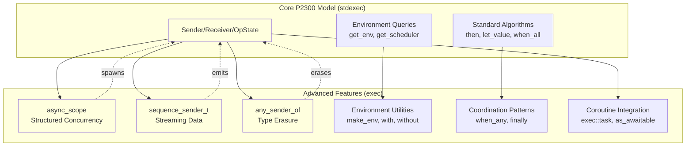
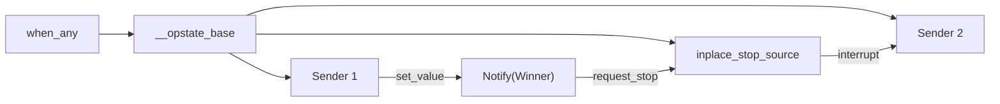

<!-- source: DeepWiki mcp.deepwiki.com · repo NVIDIA/stdexec · page 7 Advanced Features · fetched 2026-10-26 -->

# Advanced Features

Relevant source files

The following files were used as context for generating this wiki page:

- [include/exec/async_scope.hpp](include/exec/async_scope.hpp)
- [include/exec/at_coroutine_exit.hpp](include/exec/at_coroutine_exit.hpp)
- [include/exec/env.hpp](include/exec/env.hpp)
- [include/exec/finally.hpp](include/exec/finally.hpp)
- [include/exec/materialize.hpp](include/exec/materialize.hpp)
- [include/exec/on_coro_disposition.hpp](include/exec/on_coro_disposition.hpp)
- [include/exec/task.hpp](include/exec/task.hpp)
- [include/exec/when_any.hpp](include/exec/when_any.hpp)
- [test/exec/test_at_coroutine_exit.cpp](test/exec/test_at_coroutine_exit.cpp)
- [test/exec/test_task.cpp](test/exec/test_task.cpp)

This page provides an overview of advanced utilities and patterns built on top of the core P2300 execution model. These features enable sophisticated asynchronous workflows including structured concurrency, coroutine integration, runtime polymorphism, and complex coordination patterns. For basic sender/receiver concepts and standard algorithms, see [Core Execution Model](#3) and [Standard Algorithms](#4).

## Scope and Organization

The advanced features documented in this section fall into several categories:

- **Structured Concurrency** ([Async Scope and Structured Concurrency](#7.1)): Task lifetime management with `exec::async_scope`, `nest`, `spawn`, and `spawn_future`.
- **Coroutine Integration** ([Coroutine Integration](#7.2)): Bridging senders with C++20 coroutines via `exec::task`, `as_awaitable`, and `at_coroutine_exit`.
- **Sequence Processing** ([Sequence Senders](#7.3)): Streaming data through asynchronous sequences with `sequence_sender_t`, `set_next`, and `subscribe`.
- **Type Erasure** ([Type Erasure with any_sender](#7.4)): Runtime polymorphism with `any_sender_of`, `any_receiver_ref`, and `any_scheduler`.
- **Environment Utilities** ([Environment Utilities](#7.5)): Context manipulation with `make_env`, `with`, `without`, and `read_with_default`.
- **Coordination Algorithms** ([Additional Algorithms](#7.6)): `when_any`, `finally`, `materialize`, and `dematerialize`.

These features are primarily located in the `include/exec/` directory, extending the core `include/stdexec/` facilities.

## Conceptual Architecture

**Sources:** [include/exec/async_scope.hpp:30-40](), [include/exec/when_any.hpp:27-31](), [include/exec/finally.hpp:22-28](), [include/exec/env.hpp:23-28](), [include/exec/task.hpp:41-45]()

## Feature Categories and Use Cases

### Lifetime Management and Structured Concurrency

`exec::async_scope` [include/exec/async_scope.hpp:39-39]() provides a mechanism to manage the lifetime of multiple asynchronous operations. It uses an internal `__impl` structure containing a mutex, an atomic counter `__active_` for tracking outstanding tasks, and a queue of `__waiters_` [include/exec/async_scope.hpp:56-69]().

- `nest(sndr)`: Wraps a sender to track its execution within the scope [include/exec/async_scope.hpp:144-151]().
- `when_empty()`: Returns a sender that completes only when all nested operations have finished [include/exec/async_scope.hpp:111-113](). It uses `__when_empty_opstate` to queue itself as a waiter if the scope is active [include/exec/async_scope.hpp:74-98]().

For details, see [Async Scope and Structured Concurrency](#7.1).

### Coroutine Integration

The `exec::task<T>` [include/exec/task.hpp:143-213]() implementation bridges the gap between C++20 coroutines and senders. It supports:
- **Scheduler Affinity**: Tasks can be "sticky" to a specific scheduler, ensuring they resume on the same context they were started on [include/exec/task.hpp:116-140]().
- **Cleanup Actions**: `at_coroutine_exit` allows registering asynchronous cleanup logic that runs when a coroutine finishes [include/exec/at_coroutine_exit.hpp:132-185]().
- **Disposition-based logic**: `on_coroutine_stopped`, `on_coroutine_succeeded`, and `on_coroutine_failed` provide fine-grained control over cleanup based on the coroutine's exit state [include/exec/on_coro_disposition.hpp:205-220]().

For details, see [Coroutine Integration](#7.2).

### Runtime Polymorphism (Type Erasure)

`any_sender_of<Sigs...>` [include/exec/any_sender_of.hpp:37-38]() allows storing any sender that matches a set of completion signatures. This is critical for APIs where the specific sender type cannot be known at compile time.
- **VTable Dispatch**: It uses a vtable to erase `connect` and environment query operations [include/exec/any_sender_of.hpp:158-170]().
- **any_scheduler**: Erases the specific scheduler type, allowing runtime selection of execution contexts [include/exec/task.hpp:64-84]().

For details, see [Type Erasure with any_sender](#7.4).

### Environment Manipulation

The library provides functional utilities for creating and modifying execution environments [include/exec/env.hpp:91-93]():
- `with(tag, value)`: Creates a property pair [include/exec/env.hpp:30-37]().
- `without(env, query)`: Returns a new environment with a specific query masked [include/exec/env.hpp:40-53]().
- `read_with_default(tag, default)`: A sender that queries the environment and returns a default value if the query is not supported [include/exec/env.hpp:161-195]().

For details, see [Environment Utilities](#7.5).

## Coordination Algorithms

### when_any: Race Coordination

`when_any` [include/exec/when_any.hpp:29-30]() starts multiple senders and completes as soon as the first one finishes. It manages an `inplace_stop_source` to automatically request stop for all other participating senders once a winner is determined [include/exec/when_any.hpp:106-115]().

**Sources:** [include/exec/when_any.hpp:77-166]()

### materialize and dematerialize

These algorithms reify completion signals into value signals [include/exec/materialize.hpp:132-132]():
- `materialize` converts `set_value(args...)`, `set_error(err)`, and `set_stopped()` into a single `set_value(CompletionTag, args...)` [include/exec/materialize.hpp:37-56]().
- `dematerialize` performs the inverse, taking the reified signal and invoking the original receiver CPO [include/exec/materialize.hpp:148-164]().

For details, see [Additional Algorithms](#7.6).

## Code Location Map

| Feature Area | Primary File | Key Entities |
| :--- | :--- | :--- |
| **Async Scope** | `include/exec/async_scope.hpp` | `async_scope`, `nest`, `when_empty` |
| **Tasks** | `include/exec/task.hpp` | `task`, `__default_task_context_impl` |
| **Cleanup** | `include/exec/at_coroutine_exit.hpp` | `at_coroutine_exit`, `__task` |
| **Coordination** | `include/exec/when_any.hpp` | `when_any`, `__opstate_base` |
| **Environments** | `include/exec/env.hpp` | `make_env`, `with`, `without` |
| **Materialize** | `include/exec/materialize.hpp` | `materialize`, `dematerialize` |

**Sources:** [include/exec/async_scope.hpp:39-40](), [include/exec/task.hpp:143-143](), [include/exec/at_coroutine_exit.hpp:33-40](), [include/exec/when_any.hpp:28-32](), [include/exec/env.hpp:91-93](), [include/exec/materialize.hpp:132-132]()

---

