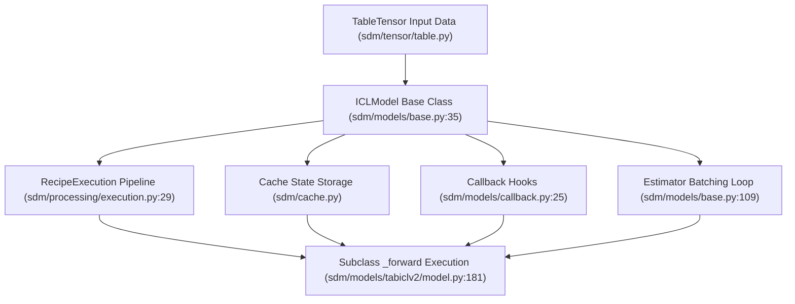
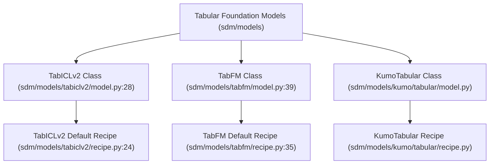

<!-- source: DeepWiki mcp.deepwiki.com · repo NVIDIA/structured-data-models · page 4 Model Framework · fetched 2026-10-26 -->

# Model Framework

Relevant source files

The following files were used as context for generating this wiki page:

- [README.md](README.md)
- [docs/source/api/models.rst](docs/source/api/models.rst)
- [sdm/models/__init__.py](sdm/models/__init__.py)
- [sdm/models/base.py](sdm/models/base.py)
- [sdm/models/kumo/__init__.py](sdm/models/kumo/__init__.py)
- [sdm/models/kumo/relational/__init__.py](sdm/models/kumo/relational/__init__.py)
- [sdm/models/kumo/timeseries/__init__.py](sdm/models/kumo/timeseries/__init__.py)
- [sdm/models/kumo/timeseries/anomaly/__init__.py](sdm/models/kumo/timeseries/anomaly/__init__.py)
- [sdm/models/kumo/timeseries/forecast/__init__.py](sdm/models/kumo/timeseries/forecast/__init__.py)
- [sdm/models/tabfm/model.py](sdm/models/tabfm/model.py)
- [sdm/models/tabiclv2/model.py](sdm/models/tabiclv2/model.py)
- [test/models/tabfm/test_model.py](test/models/tabfm/test_model.py)
- [test/models/test_base.py](test/models/test_base.py)

The purpose of this page is to provide a high-level overview of the `ICLModel` framework and the model zoo within `structured-data-models` (`sdm`). The framework unifies in-context learning (ICL) foundation models across tabular, time-series, and relational domains under a common interface featuring fit/predict caching, estimator ensembling, plug-in callback hooks, and automated recipe execution. 

For deep technical details, implementation specifics, and per-model architectures, refer to the dedicated child pages linked throughout this overview.

Sources: `sdm/models/base.py:35-46`, `README.md:18-23`

---

## Overview of the Model Architecture

All foundation models in the library inherit from the abstract base class `ICLModel`, which orchestrates data normalization, sequence preprocessing via `RecipeExecution`, caching of in-context representations, and execution batching.

Title: ICLModel Framework and Inference Lifecycle Execution

Sources: `sdm/models/base.py:35-146`, `sdm/cache.py`, `sdm/models/callback.py`

---

## 4.1. ICLModel Base Class and Inference Lifecycle

The `ICLModel` class provides the unified API for all in-context models, defining standard lifecycle methods including `forward()`, `fit()`, `predict()`, and `clear()` [sdm/models/base.py:35-113]. It supports key/value caching to avoid re-encoding in-context examples during iterative query evaluation, estimator batching via `estimator_batch_size` to control VRAM usage during ensembling [sdm/models/base.py:134-137], and modular execution of `Callback` sequences [sdm/models/callback.py]. 

For detailed information on state management, ECOC multi-class decomposition, context-only columns, and HuggingFace checkpoint loading utilities, see [ICLModel Base Class and Inference Lifecycle](#4.1).

Sources: `sdm/models/base.py:35-173`, `sdm/models/callback.py`

---

## 4.2. Tabular Models

The tabular model zoo encompasses foundation models designed to process mixed-type tabular datasets using in-context learning paradigms. These models leverage column-wise, row-wise, and dataset-wise attention mechanisms to perform zero-shot and in-context predictions.

Title: Tabular Model Hierarchy and Class Mapping

For comprehensive details on individual tabular foundation model architectures, checkpoint checkpoints, and embedding layers, see [Tabular Models](#4.2).

Sources: `README.md:42-49`, `sdm/models/tabiclv2/model.py:28-119`, `sdm/models/tabfm/model.py:39-74`, `sdm/models/kumo/__init__.py:12-21`

---

## 4.3. Time-Series Models

Time-series foundation models within `sdm` specialize in multivariate forecasting and anomaly detection. They combine patch-based tokenization, reversible instance normalization (`RevIN`), and specialized cross-attention or diffusion blocks.

For complete coverage of forecasting heads, anomaly scoring, and model weights, see [Time-Series Models](#4.3).

Sources: `README.md:54-58`, `sdm/models/kumo/timeseries/forecast/model.py:6`, `sdm/models/timesfm3/`

---

## 4.4. KumoRelational Model

`KumoRelational` extends in-context learning to multi-table relational databases. It constructs a `TaskGraph` across tables and applies `InvariantGNN` message passing to aggregate features and generate multi-table row embeddings before feeding them into the foundational ICL architecture.

For technical details on relational task graphs, neighbor sampling, and message-passing layers, see [KumoRelational Model](#4.4).

Sources: `README.md:50-53`, `sdm/models/kumo/relational/model.py:6`

---

