# Page: Overview

# Overview

<details>
<summary>Relevant source files</summary>

The following files were used as context for generating this wiki page:

- [LICENSE](LICENSE)
- [README.md](README.md)

</details>


This document provides an introduction to NVIDIA's PyTorch implementation of Tacotron 2, a state-of-the-art neural text-to-speech (TTS) system. This implementation follows the architecture described in the paper ["Natural TTS Synthesis By Conditioning Wavenet On Mel Spectrogram Predictions"](https://arxiv.org/pdf/1712.05884.pdf), with modifications for improved performance and scalability.

## Purpose and Scope

The NVIDIA Tacotron 2 repository provides a complete framework for training and using neural text-to-speech models. This implementation focuses on the Tacotron 2 architecture for converting text to mel-spectrograms, while integrating with WaveGlow (instead of WaveNet) as a vocoder for transforming mel-spectrograms into audible waveforms.

Key features of this implementation include:
- Complete PyTorch implementation of the Tacotron 2 architecture
- Distributed training support for multi-GPU environments
- Automatic mixed precision (AMP) support for faster training
- Integration with the LJSpeech dataset
- TensorBoard logging for training visualization

For detailed installation instructions, refer to [Installation & Requirements](#2). For in-depth exploration of system components, see [System Architecture](#3). For training procedures, see [Training](#4), and for inference details, see [Inference](#5).

Sources: [README.md:1-14]()

## High-Level Architecture

The NVIDIA Tacotron 2 implementation consists of several interconnected components that together form a complete text-to-speech pipeline:

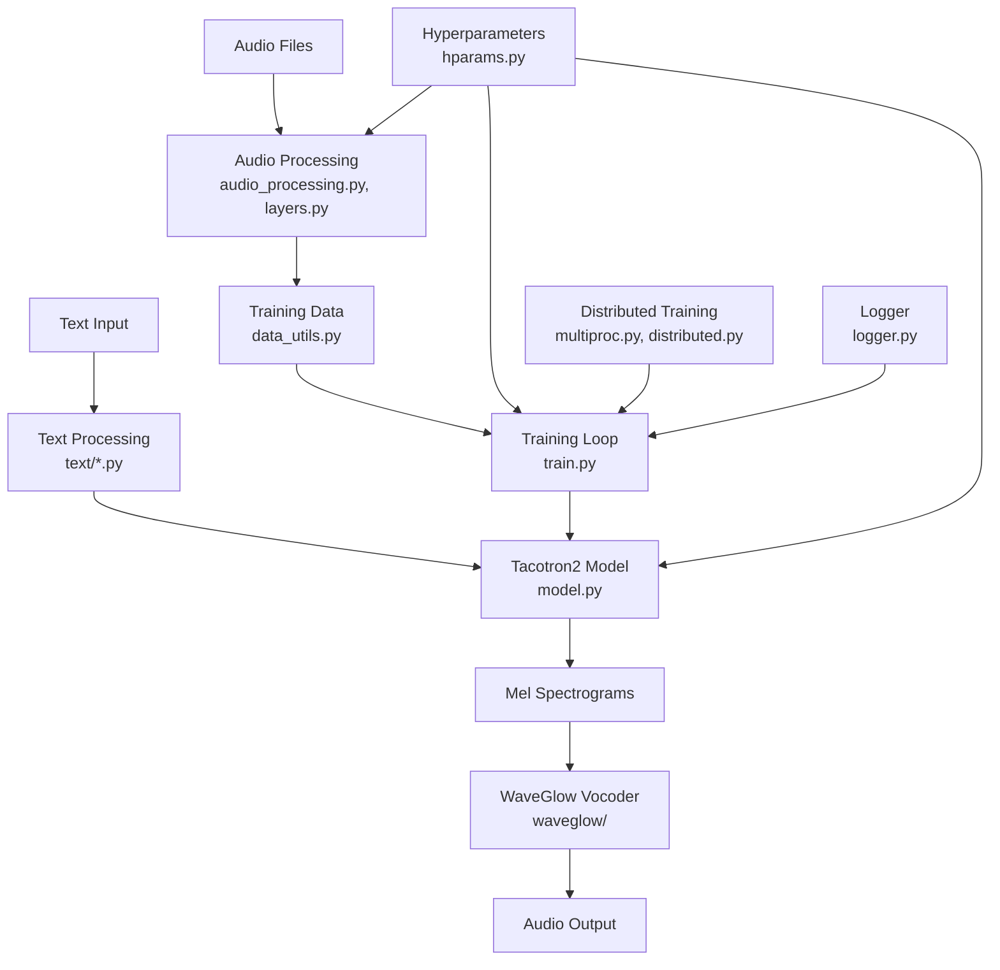

The system comprises three main subsystems:

1. **Text-to-Mel Generation**: Converts text to mel-spectrograms using the Tacotron 2 neural network
2. **Vocoder**: Transforms mel-spectrograms into audio waveforms using WaveGlow
3. **Training Infrastructure**: Handles data preparation, model training, and performance monitoring

Sources: [model.py](), [train.py](), [hparams.py](), [data_utils.py](), [audio_processing.py](), [layers.py](), [text/](), [waveglow/](), [multiproc.py](), [distributed.py](), [logger.py]()

## Code Structure and Components

The repository is organized into several key components, each handling specific aspects of the text-to-speech pipeline:

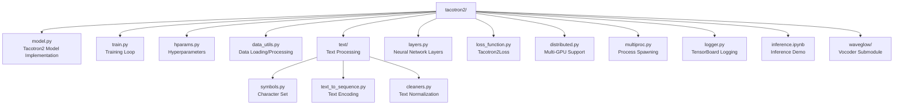

Each component serves a specific purpose:

| Component | File(s) | Purpose |
|-----------|---------|---------|
| Tacotron 2 Model | model.py | Core neural network architecture for text-to-mel conversion |
| Training Loop | train.py | Manages the training process |
| Hyperparameters | hparams.py | Configurable settings for model and training |
| Data Processing | data_utils.py | Loads and processes text and audio data |
| Text Processing | text/*.py | Converts text to numerical representations |
| Audio Processing | layers.py, audio_processing.py | Handles audio feature extraction |
| Loss Function | loss_function.py | Defines the optimization objective |
| Distributed Training | distributed.py, multiproc.py | Enables multi-GPU training |
| Logging | logger.py | Visualizes training progress |
| Inference | inference.ipynb | Demonstrates model usage |
| Vocoder | waveglow/ | Converts mel-spectrograms to audio |

Sources: [README.md:17-54]()

## Tacotron 2 Model Architecture

The Tacotron 2 model implemented in `model.py` is an encoder-decoder architecture with attention, designed to convert text sequences into mel-spectrograms:

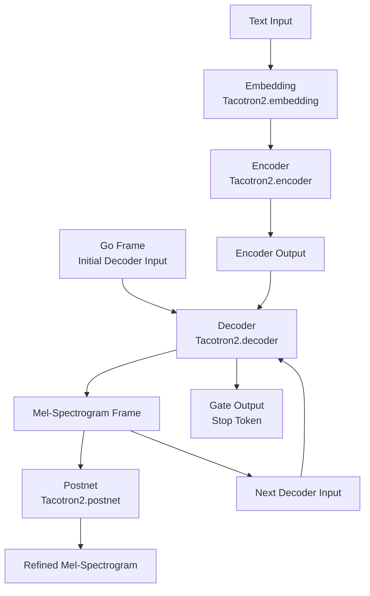

The key components of the model architecture include:

1. **Encoder**: Processes input text through an embedding layer, convolutional layers, and a bidirectional LSTM to create a text encoding
2. **Decoder**: Generates mel-spectrogram frames using an attention mechanism to focus on relevant parts of the encoded text
3. **Attention**: Location-sensitive attention that aligns decoder steps with encoder outputs
4. **Postnet**: Refines the generated mel-spectrogram with a series of convolutional layers
5. **Gate Layer**: Predicts when to stop generating frames

Sources: [model.py]()

## Training Pipeline

The training pipeline orchestrates the flow of data from raw text and audio files to model training:

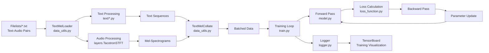

During training:

1. `TextMelLoader` loads filelists containing paths to audio files and their transcriptions
2. Text is processed through text cleaners and converted to numerical sequences
3. Audio files are processed to extract mel-spectrograms
4. `TextMelCollate` batches the data for efficient processing
5. The model generates predicted mel-spectrograms that are compared to the targets
6. The loss is calculated and the model parameters are updated
7. Training progress is monitored through TensorBoard

Sources: [data_utils.py](), [train.py](), [model.py](), [loss_function.py](), [logger.py]()

## Distributed Training

The implementation supports distributed training across multiple GPUs for faster model development:

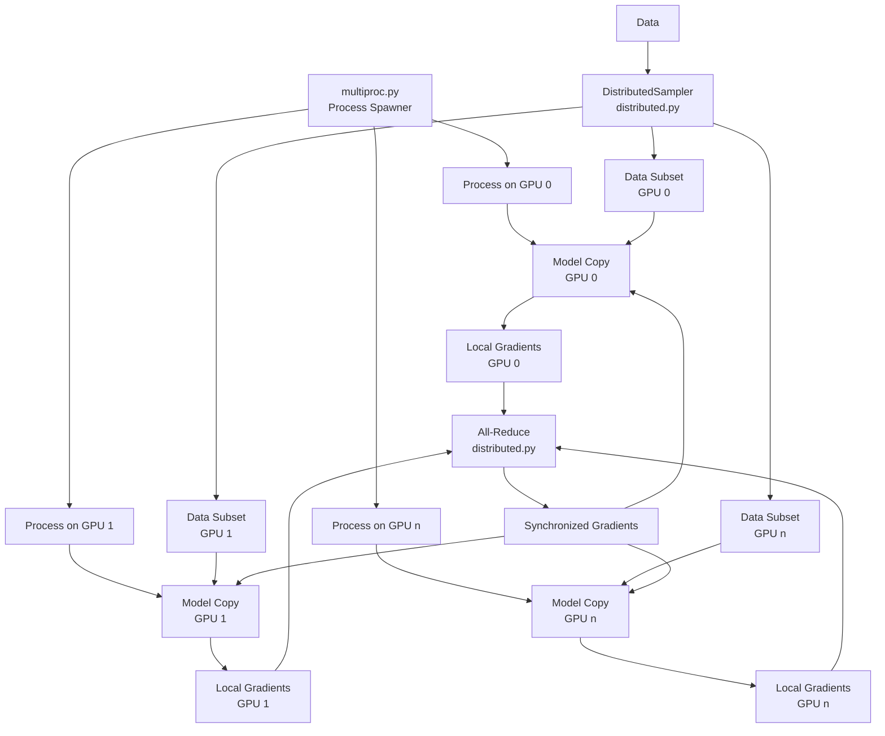

The distributed training system:

1. Uses `multiproc.py` to spawn a separate process for each available GPU
2. Distributes data across GPUs using `DistributedSampler`
3. Computes forward and backward passes locally on each GPU
4. Synchronizes gradients across all GPUs using all-reduce operations
5. Updates model parameters consistently across all processes

Sources: [multiproc.py](), [distributed.py](), [train.py:33-34]()

## Inference

For inference (generating speech from text), the repository provides a Jupyter notebook (`inference.ipynb`) that demonstrates the complete pipeline:

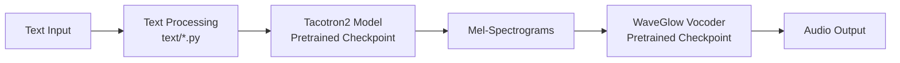

The inference process:

1. Input text is processed using the same text processing pipeline as during training
2. The trained Tacotron 2 model generates mel-spectrograms
3. The WaveGlow vocoder converts the mel-spectrograms to audio waveforms
4. The resulting audio can be played or saved to a file

Sources: [inference.ipynb](), [README.md:46-54]()

## Additional Features

The NVIDIA Tacotron 2 implementation includes several advanced features that enhance its functionality and performance:

1. **Automatic Mixed Precision**: Speeds up training by using lower precision (FP16) where possible while maintaining model accuracy
2. **TensorBoard Integration**: Visualizes training metrics, mel-spectrograms, attention alignments, and audio samples
3. **Warm Start Training**: Supports training from pre-trained models for faster convergence
4. **Checkpoint Saving/Loading**: Saves and loads model states for training continuation and inference

Sources: [README.md:36-42](), [train.py](), [logger.py]()

## License and Acknowledgements

This implementation is released under the BSD 3-Clause License and acknowledges contributions from various sources:

- Keith Ito's Tacotron implementation
- Prem Seetharaman's PyTorch STFT implementation
- Ryuchi Yamamoto's PyTorch Tacotron implementation
- The original Tacotron 2 paper authors

Sources: [LICENSE](), [README.md:63-72]()

---

# Page: Installation & Requirements

# Installation & Requirements

<details>
<summary>Relevant source files</summary>

The following files were used as context for generating this wiki page:

- [LICENSE](LICENSE)
- [README.md](README.md)
- [requirements.txt](requirements.txt)

</details>


This document provides detailed instructions for installing and setting up the NVIDIA Tacotron2 system, including hardware requirements, software dependencies, and dataset preparation. For information about the overall system architecture, see [System Architecture](#3), and for training instructions after installation, see [Training](#4).

## Hardware Requirements

To run NVIDIA Tacotron2, you will need the following hardware:

- NVIDIA GPU with CUDA support
- CUDA and cuDNN drivers properly installed
- Sufficient GPU memory (8GB or more recommended for training)
- Adequate system RAM (16GB or more recommended)

Sources: [README.md:17-18]()

## Software Dependencies

### Core Components

The Tacotron2 system relies on several key software components:

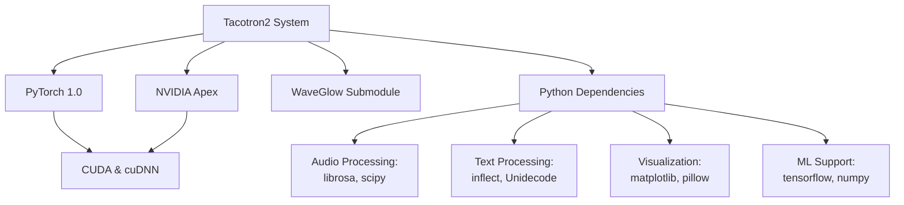

Title: Tacotron2 Software Dependency Architecture

### Python Package Requirements

The following Python packages are required as specified in requirements.txt:

| Package | Version | Purpose |
|---------|---------|---------|
| matplotlib | 2.1.0 | Visualization and plotting |
| tensorflow | 1.15.2 | TensorBoard logging support |
| numpy | 1.13.3 | Numerical processing |
| inflect | 0.2.5 | Text normalization |
| librosa | 0.6.0 | Audio processing |
| scipy | 1.0.0 | Scientific computing |
| Unidecode | 1.0.22 | Unicode text conversion |
| pillow | latest | Image processing |

Sources: [requirements.txt:1-8]()

## Installation Process

The following diagram outlines the installation process for Tacotron2:

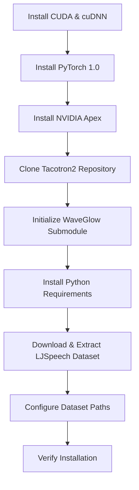

Title: Tacotron2 Installation Workflow

### 1. Setting Up CUDA and cuDNN

Ensure CUDA and cuDNN are properly installed on your system. Tacotron2 is compatible with CUDA 9.0+ and corresponding cuDNN versions.

Sources: [README.md:17-18]()

### 2. Installing PyTorch

Install PyTorch 1.0 following the official instructions:

```bash
pip install torch==1.0.0
```

Sources: [README.md:27](), [README.md:77]()

### 3. Installing NVIDIA Apex

Apex is required for distributed training and automatic mixed precision support:

```bash
git clone https://github.com/nvidia/apex
cd apex
pip install -v --no-cache-dir --global-option="--cpp_ext" --global-option="--cuda_ext" ./
```

Sources: [README.md:28](), [README.md:80-81]()

### 4. Cloning the Tacotron2 Repository

Clone the repository to your local machine:

```bash
git clone https://github.com/NVIDIA/tacotron2.git
cd tacotron2
```

Sources: [README.md:22-23]()

### 5. Initializing the WaveGlow Submodule

The repository uses WaveGlow as a submodule for vocoding:

```bash
git submodule init
git submodule update
```

Sources: [README.md:24]()

### 6. Installing Python Requirements

Install all required Python packages:

```bash
pip install -r requirements.txt
```

Sources: [README.md:30](), [requirements.txt:1-8]()

## Dataset Preparation

Tacotron2 is designed to work with the LJSpeech dataset. The following diagram shows how the dataset integrates with the codebase:

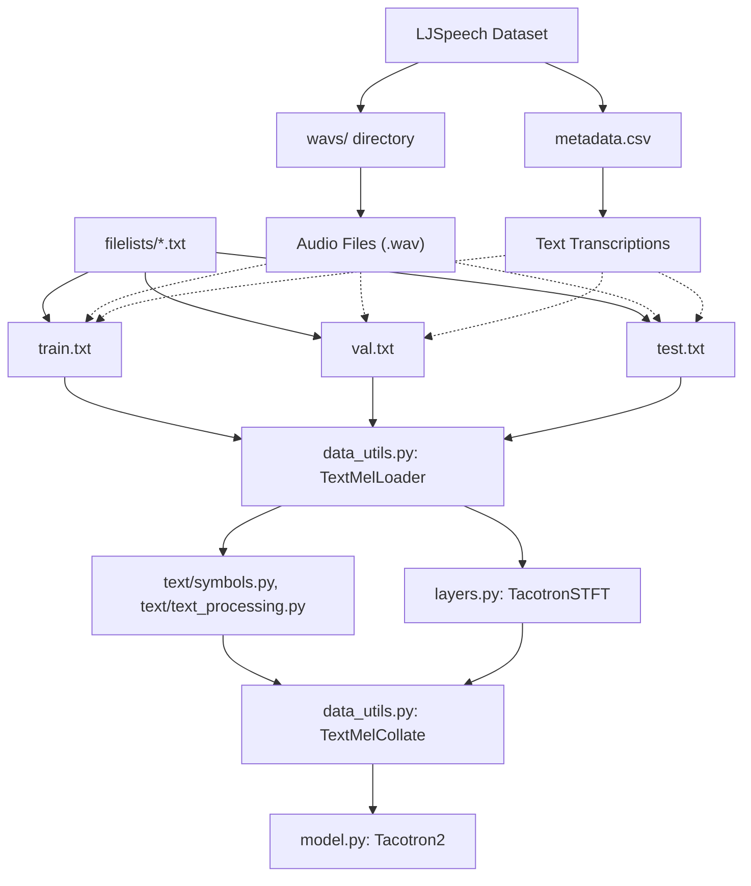

Title: Tacotron2 Dataset Integration with Codebase

### 1. Downloading the LJSpeech Dataset

Download and extract the LJSpeech dataset from the official source: [LJ Speech Dataset](https://keithito.com/LJ-Speech-Dataset).

Sources: [README.md:21]()

### 2. Configuring Dataset Paths

Update the paths in the filelists to point to your dataset's location:

```bash
sed -i -- 's,DUMMY,/path/to/ljs_dataset_folder/wavs,g' filelists/*.txt
```

Alternatively, if you prefer to use pre-computed mel-spectrograms:

1. Set `load_mel_from_disk=True` in `hparams.py`
2. Update the mel-spectrogram paths in the filelists

Sources: [README.md:25-26]()

## Code Architecture

The following diagram maps the high-level components of Tacotron2 to their specific code implementations:

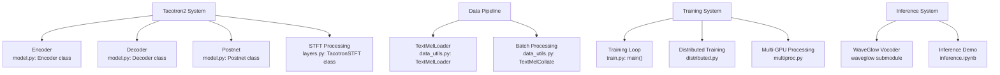

Title: Tacotron2 Code Component Architecture

Sources: [README.md:33-34](), [README.md:43-44](), [README.md:46-50]()

## Verification and Next Steps

To verify your installation, run an inference test using pre-trained models:

1. Download the pre-trained models:
   - [Tacotron 2 Model](https://drive.google.com/file/d/1c5ZTuT7J08wLUoVZ2KkUs_VdZuJ86ZqA/view?usp=sharing)
   - [WaveGlow Model](https://drive.google.com/open?id=1rpK8CzAAirq9sWZhe9nlfvxMF1dRgFbF)

2. Start the Jupyter notebook:
   ```bash
   jupyter notebook --ip=127.0.0.1 --port=31337
   ```

3. Open `inference.ipynb` and follow the instructions to synthesize speech

Sources: [README.md:46-50]()

After successful installation, you can proceed to:

- Training a model from scratch: See [Training](#4)
- Running inference with pre-trained models: See [Inference](#5)
- Understanding distributed training: See [Distributed Training](#4.3)

## Troubleshooting Common Issues

### CUDA Version Compatibility

Ensure that your PyTorch installation matches your CUDA version. You may need to install a specific PyTorch version compatible with your CUDA installation.

### WaveGlow Submodule Issues

If you encounter issues with the WaveGlow submodule, try reinitializing it:

```bash
git submodule deinit --all
git submodule init
git submodule update
```

### Dataset Path Configuration

If the system cannot find audio files during training, double-check the paths in the filelist files to ensure they correctly point to your dataset location.

Sources: [README.md:25-26]()

### Mixed Precision Training Issues

If you encounter issues with mixed precision training (fp16_run=True), ensure that Apex is correctly installed with CUDA extensions.

Sources: [README.md:44](), [README.md:80-81]()

---

# Page: System Architecture

# System Architecture

<details>
<summary>Relevant source files</summary>

The following files were used as context for generating this wiki page:

- [.gitmodules](.gitmodules)
- [LICENSE](LICENSE)
- [README.md](README.md)
- [model.py](model.py)

</details>


## Purpose and Scope

This document provides a detailed overview of the NVIDIA Tacotron2 system architecture. It describes the core components, their interactions, and how they work together to implement the text-to-speech synthesis system outlined in the paper [Natural TTS Synthesis By Conditioning Wavenet On Mel Spectrogram Predictions](https://arxiv.org/pdf/1712.05884.pdf). 

This page focuses on the overall system architecture and component interactions. For details about specific components, see:
- For detailed Tacotron2 model architecture, see [Tacotron2 Model](#3.1)
- For WaveGlow vocoder integration, see [WaveGlow Integration](#3.2)
- For training process details, see [Training](#4)
- For inference functionality, see [Inference](#5)

## High-Level System Architecture

The following diagram illustrates the high-level architecture of the NVIDIA Tacotron2 system:

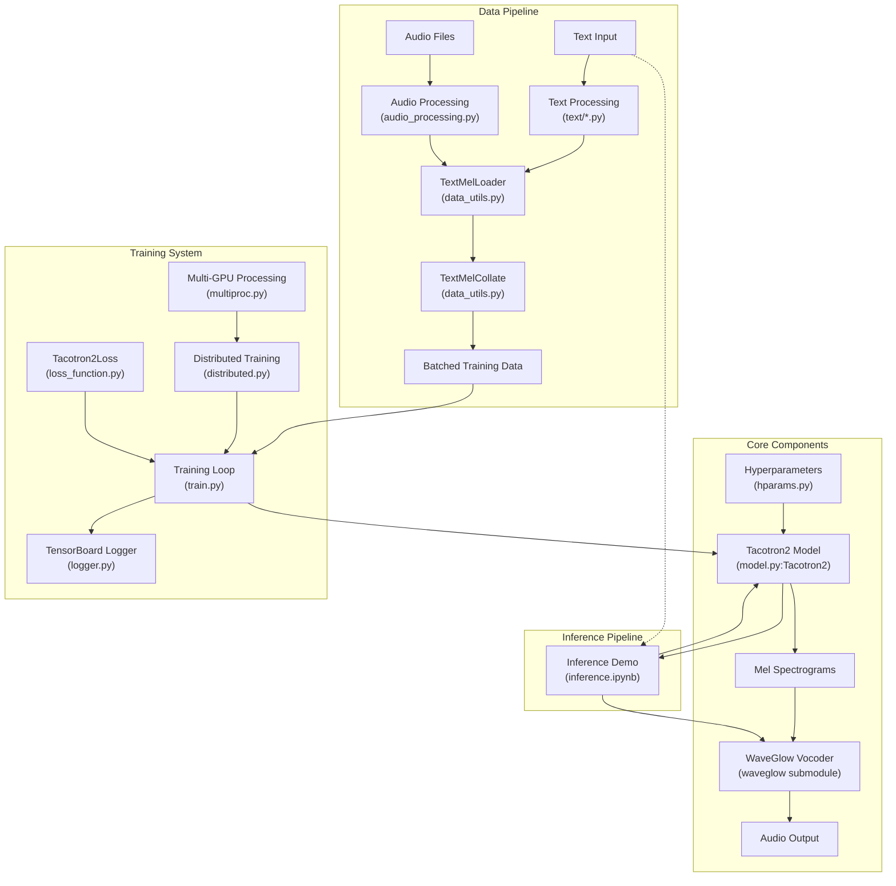

Sources: [README.md:1-81](), [model.py:457-530](), [.gitmodules:1-5]()

## Core Components

The Tacotron2 implementation consists of several key components that work together to convert text to speech:

1. **Tacotron2 Model**: The core sequence-to-sequence model that converts text to mel spectrograms
2. **WaveGlow Vocoder**: A flow-based generative network that converts mel spectrograms to audio waveforms
3. **Data Processing Pipeline**: Components for processing text and audio data
4. **Training System**: Manages the training process, including distributed training and logging

### Tacotron2 Model Structure

The Tacotron2 model is defined in `model.py` and consists of several submodules:

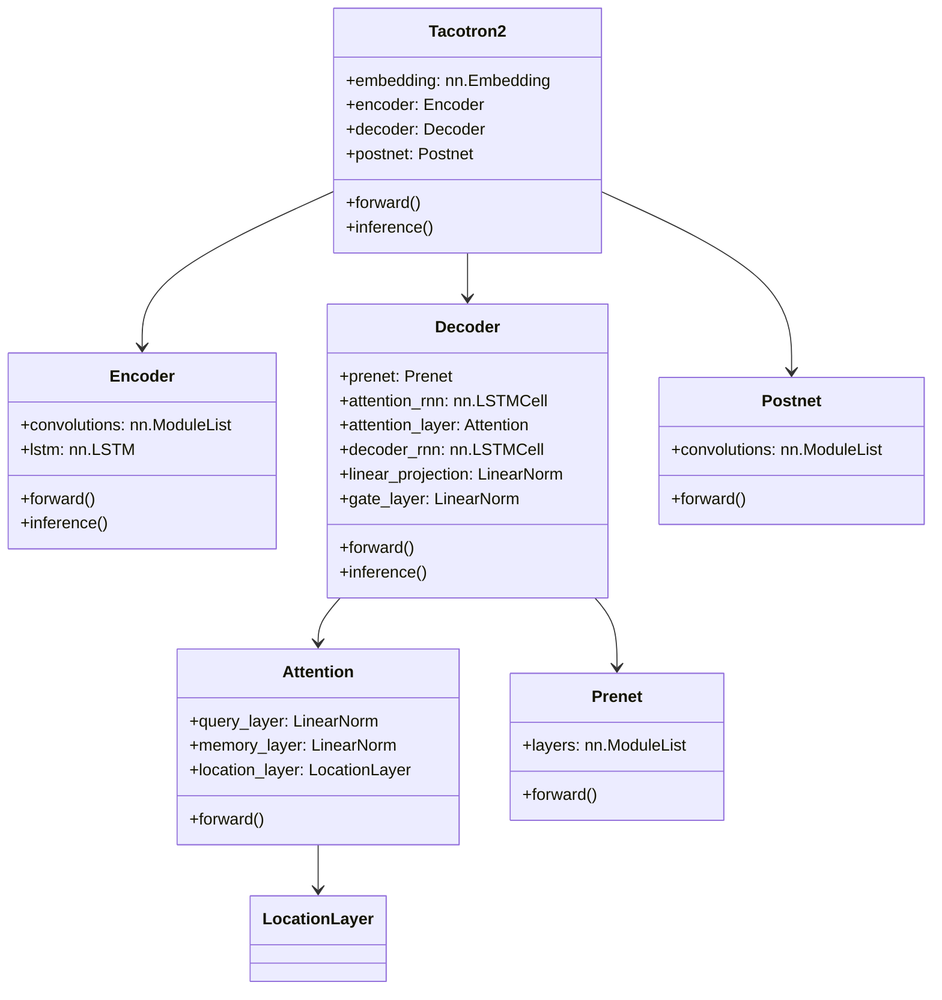

Sources: [model.py:10-530]()

## Data Flow Pipeline

The following diagram illustrates the flow of data through the Tacotron2 system, from input text to output audio:

```mermaid
flowchart LR
    subgraph "Input Processing"
        Text["Text Input"] --> TextSymbols["Symbol Encoding<br>(text/symbols.py)"]
        TextSymbols --> TextEmbedding["Text Embedding<br>(model.py:Tacotron2.embedding)"]
    end

    subgraph "Tacotron2 Model"
        TextEmbedding --> T2Encoder["Encoder<br>(model.py:Encoder)"]
        T2Encoder --> T2Decoder["Decoder<br>(model.py:Decoder)"]
        T2Decoder --> MelOut["Mel Outputs"]
        MelOut --> T2Postnet["Postnet<br>(model.py:Postnet)"]
        T2Postnet --> RefinedMelOut["Refined Mel Outputs"]
    end

    subgraph "Vocoder"
        RefinedMelOut --> WGVocoder["WaveGlow Vocoder<br>(waveglow submodule)"]
        WGVocoder --> AudioOut["Audio Output"]
    end
```

Sources: [model.py:149-529]()

## Component Descriptions

### Text Embedding and Encoder

The text processing pipeline begins with converting input text into a sequence of symbols, which are then embedded into a continuous vector space by the embedding layer. The encoder processes these embeddings to create a representation that captures the text content.

The encoder consists of:
- A series of convolutional layers (usually 3) with ReLU activations and dropout
- A bidirectional LSTM that processes the outputs of the convolutional layers

```
Text Input → Symbol Encoding → Embedding → Convolutional Layers → Bidirectional LSTM → Encoder Outputs
```

Sources: [model.py:149-201](), [model.py:457-505]()

### Attention Mechanism

The attention mechanism is a critical component that allows the decoder to focus on relevant parts of the encoder output when generating each frame of the mel spectrogram. It implements location-sensitive attention:

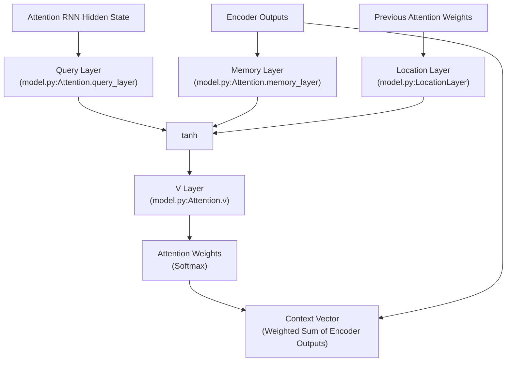

Sources: [model.py:10-86]()

### Decoder Structure

The decoder generates mel spectrogram frames autoregressively, using an attention mechanism to focus on relevant parts of the encoder output:

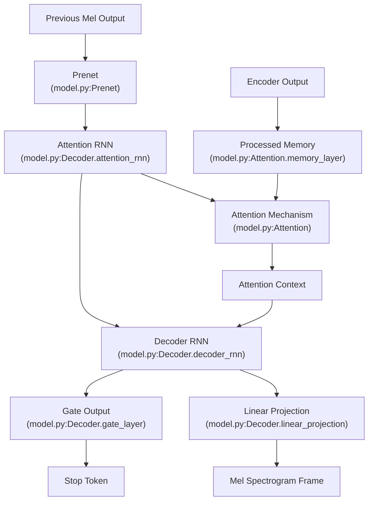

Sources: [model.py:204-454]()

### Postnet Refinement

The Postnet refines the mel spectrogram outputs from the decoder, improving their quality:

```
Decoder Mel Outputs → 5 Convolutional Layers → Residual Connection → Refined Mel Outputs
```

The Postnet consists of 5 convolutional layers with tanh activation functions and dropout. The output of the Postnet is added to the original decoder output (residual connection).

Sources: [model.py:103-146](), [model.py:510-511]()

## Training System Architecture

The training system supports both single-GPU and distributed multi-GPU training:

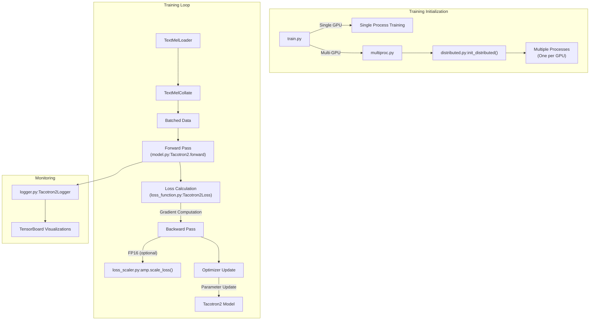

Sources: [README.md:32-44]()

## Inference Process

During inference, the system takes input text and produces audio output:

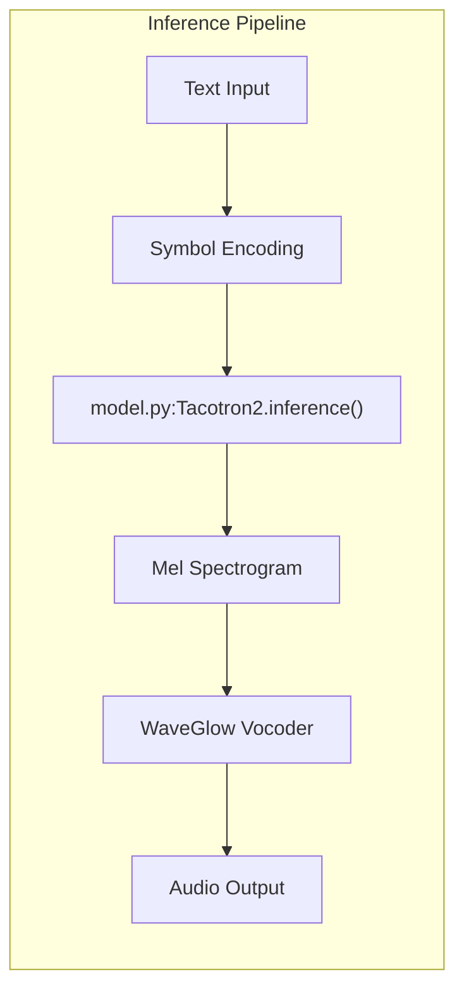

The inference process is implemented in `inference.ipynb` and uses the trained Tacotron2 model and WaveGlow vocoder to generate speech from text.

Sources: [model.py:517-529](), [README.md:46-54]()

## Integration with WaveGlow

The Tacotron2 system integrates with the WaveGlow neural vocoder, which is included as a Git submodule. WaveGlow is responsible for converting the mel spectrograms generated by Tacotron2 into audio waveforms.

The integration is fairly simple:
1. Tacotron2 generates mel spectrograms
2. These mel spectrograms are passed to WaveGlow
3. WaveGlow converts the mel spectrograms to audio waveforms

For detailed information about WaveGlow, see [WaveGlow Integration](#3.2).

Sources: [.gitmodules:1-5](), [README.md:11-12]()

## System Requirements and Dependencies

The Tacotron2 implementation has the following requirements:

- NVIDIA GPU with CUDA and cuDNN
- PyTorch 1.0 or later
- Apex for distributed training and automatic mixed precision
- LJSpeech dataset for training

For detailed installation instructions, see [Installation & Requirements](#2).

Sources: [README.md:17-30]()

---

# Page: Tacotron2 Model

# Tacotron2 Model

<details>
<summary>Relevant source files</summary>

The following files were used as context for generating this wiki page:

- [layers.py](layers.py)
- [model.py](model.py)

</details>


This document provides a detailed technical explanation of the Tacotron2 model implemented in NVIDIA's repository. It covers the model architecture, components, data flow, and operation modes. For information about the WaveGlow vocoder that converts the mel spectrograms to audio waveforms, see [WaveGlow Integration](#3.2).

## 1. Model Overview

Tacotron2 is a neural text-to-speech model that generates mel spectrograms from text input. It implements a sequence-to-sequence architecture with attention, consisting of an encoder that processes text embeddings, an attention-based decoder that generates mel spectrogram frames, and a postnet that refines the generated mel spectrograms.

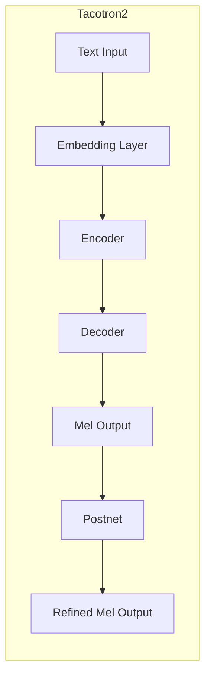

Sources: [model.py:457-529]()

## 2. Model Components

The Tacotron2 model consists of several key components, each implemented as separate classes in the codebase:

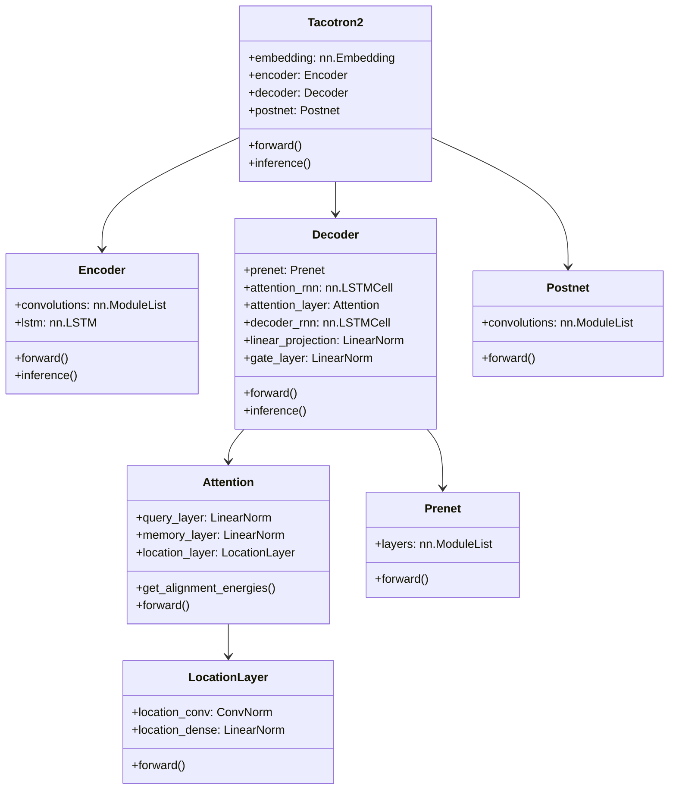

Sources: [model.py:10-529]()

## 3. Detailed Architecture

### 3.1. Encoder

The encoder transforms input text embeddings into a sequence of hidden features. It consists of convolutional layers followed by a bidirectional LSTM.

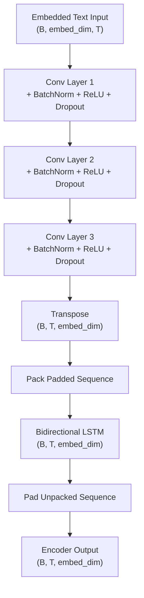

The encoder processes character embeddings through:
1. Multiple 1D convolutional layers (`hparams.encoder_n_convolutions`) with ReLU activation, batch normalization, and dropout
2. A bidirectional LSTM that captures sequential information

Sources: [model.py:149-201]()

### 3.2. Decoder

The decoder generates mel spectrogram frames using an autoregressive approach with attention.

```mermaid
flowchart TD
    subgraph "Decoder Components"
        direction LR
        PrenetBlock["Prenet<br>FC Layers + Dropout"]
        AttRNN["Attention RNN<br>(LSTMCell)"]
        AttMech["Attention Mechanism"]
        DecRNN["Decoder RNN<br>(LSTMCell)"]
        LinProj["Linear Projection<br>to Mel Channels"]
        GateOut["Gate Output<br>Stop Token Prediction"]
    end
    
    PrevMel["Previous Mel Output"] --> PrenetBlock
    PrenetBlock --> Concat1["Concatenate"]
    PrevAttContext["Previous Attention Context"] --> Concat1
    Concat1 --> AttRNN
    
    AttRNN --> AttMech
    EncOutput["Encoder Output<br>(Memory)"] --> AttMech
    PrevAttWeights["Previous Attention Weights"] --> AttMech
    CumAttWeights["Cumulative Attention Weights"] --> AttMech
    
    AttMech --> |"Context Vector"| Concat2["Concatenate"]
    AttRNN --> Concat2
    Concat2 --> DecRNN
    
    DecRNN --> Concat3["Concatenate"]
    AttMech --> |"Context Vector"| Concat3
    
    Concat3 --> LinProj
    Concat3 --> GateOut
    
    LinProj --> MelOutput["Mel Output"]
    GateOut --> StopToken["Stop Token"]
```

The decoder's key components are:

1. **Prenet**: A bottleneck of fully connected layers with dropout applied during both training and inference
2. **Attention RNN**: A unidirectional LSTM cell that processes the prenet output and previous attention context
3. **Attention Mechanism**: A location-sensitive attention that focuses on relevant parts of the encoder output
4. **Decoder RNN**: A unidirectional LSTM cell that processes the attention RNN output and attention context
5. **Linear Projection**: Maps decoder RNN output to mel spectrogram frames
6. **Gate Layer**: Predicts the stop token to determine when to end generation

Sources: [model.py:204-454]()

### 3.3. Attention Mechanism

```mermaid
flowchart LR
    Query["Query from<br>Attention RNN"] --> QueryProj["Query Projection"]
    Memory["Memory from<br>Encoder"] --> MemoryProj["Memory Projection"]
    PrevAtt["Previous Attention<br>Weights"] --> Concatenate["Concatenate with<br>Cumulative Weights"]
    CumAtt["Cumulative Attention<br>Weights"] --> Concatenate
    
    Concatenate --> LocLayer["Location Layer<br>(ConvNorm + LinearNorm)"]
    
    QueryProj --> Sum(("+"))
    MemoryProj --> Sum
    LocLayer --> Sum
    
    Sum --> Tanh["tanh"]
    Tanh --> VProj["v Projection"]
    VProj --> Energies["Alignment Energies"]
    Energies --> Mask["Apply Mask<br>(if provided)"]
    Mask --> Softmax["Softmax"]
    Softmax --> AttWeights["Attention Weights"]
    
    AttWeights --> BMM["Batch Matrix<br>Multiplication"]
    Memory --> BMM
    BMM --> Context["Attention Context"]
```

The attention mechanism implements location-sensitive attention:
1. Processes the query from the attention RNN
2. Processes the memory from the encoder
3. Processes the previous and cumulative attention weights through a location layer
4. Combines these processed features to calculate alignment energies
5. Converts alignment energies to attention weights using softmax
6. Uses attention weights to compute a weighted sum of encoder outputs (context)

Sources: [model.py:29-86](), [model.py:10-26]()

### 3.4. Postnet

```mermaid
flowchart LR
    MelInput["Decoder Mel Output<br>(B, n_mel, T)"] --> Conv1["Conv Layer 1<br>+ BatchNorm + Tanh + Dropout"]
    Conv1 --> Conv2["Conv Layer 2<br>+ BatchNorm + Tanh + Dropout"]
    Conv2 --> Conv3["Conv Layer 3<br>+ BatchNorm + Tanh + Dropout"]
    Conv3 --> Conv4["Conv Layer 4<br>+ BatchNorm + Tanh + Dropout"]
    Conv4 --> Conv5["Conv Layer 5<br>+ BatchNorm + Dropout"]
    Conv5 --> Residual["Residual Connection"]
    MelInput --> Residual
    Residual --> RefinedMel["Refined Mel Output<br>(B, n_mel, T)"]
```

The postnet consists of 5 convolutional layers with batch normalization and dropout:
1. First 4 layers use tanh activation
2. The final layer has no activation
3. The output is added to the original decoder output (residual connection)

Sources: [model.py:103-146]()

## 4. Data Flow

### 4.1. Training Flow

```mermaid
flowchart TD
    TextInput["Text Input<br>(B, T_text)"] --> Embedding["Embedding Layer<br>(B, T_text, embed_dim)"]
    Embedding --> Transpose1["Transpose<br>(B, embed_dim, T_text)"]
    Transpose1 --> Encoder["Encoder"]
    
    Encoder --> EncoderOutputs["Encoder Outputs<br>(B, T_text, encoder_dim)"]
    
    MelTarget["Target Mel Spectrograms<br>(B, n_mel, T_mel)"] --> Parse["Parse Decoder Inputs"]
    GoFrame["Go Frame<br>(Zeros)"] --> Concat1["Concatenate"]
    Parse --> Concat1
    
    Concat1 --> Prenet["Prenet"]
    Prenet --> DecoderLoop["Decoder Autoregressive Loop"]
    EncoderOutputs --> DecoderLoop
    
    DecoderLoop --> MelOutputs["Mel Outputs<br>(B, n_mel, T_mel)"]
    DecoderLoop --> GateOutputs["Gate Outputs<br>(B, T_mel)"]
    DecoderLoop --> Alignments["Attention Alignments<br>(B, T_mel, T_text)"]
    
    MelOutputs --> Postnet["Postnet"]
    Postnet --> PostnetOut["Postnet Output"]
    
    MelOutputs --> Add(("+"))
    PostnetOut --> Add
    Add --> RefinedMel["Refined Mel Output<br>(B, n_mel, T_mel)"]
```

During training:
1. Text inputs are embedded and passed through the encoder
2. Target mel spectrograms are processed to create teacher-forced decoder inputs
3. The decoder generates mel outputs autoregressively, but using teacher forcing
4. The postnet refines the decoder's mel outputs
5. The model outputs include:
   - Initial mel outputs
   - Refined mel outputs (after postnet)
   - Gate outputs (stop token predictions)
   - Attention alignments

Sources: [model.py:499-515]()

### 4.2. Inference Flow

```mermaid
flowchart TD
    TextInput["Text Input<br>(B, T_text)"] --> Embedding["Embedding Layer<br>(B, T_text, embed_dim)"]
    Embedding --> Transpose1["Transpose<br>(B, embed_dim, T_text)"]
    Transpose1 --> Encoder["Encoder.inference()"]
    
    Encoder --> EncoderOutputs["Encoder Outputs<br>(B, T_text, encoder_dim)"]
    
    GoFrame["Go Frame<br>(Zeros)"] --> DecoderLoop["Decoder.inference()<br>Autoregressive Loop"]
    EncoderOutputs --> DecoderLoop
    
    DecoderLoop --> |"Until stop token<br>or max steps"| MelOutputs["Mel Outputs<br>(B, n_mel, T_mel)"]
    DecoderLoop --> GateOutputs["Gate Outputs<br>(B, T_mel)"]
    DecoderLoop --> Alignments["Attention Alignments<br>(B, T_mel, T_text)"]
    
    MelOutputs --> Postnet["Postnet"]
    Postnet --> PostnetOut["Postnet Output"]
    
    MelOutputs --> Add(("+"))
    PostnetOut --> Add
    Add --> RefinedMel["Refined Mel Output<br>(B, n_mel, T_mel)"]
```

During inference:
1. Text inputs are embedded and passed through the encoder
2. The decoder generates mel outputs autoregressively, using previous outputs as inputs
3. Generation stops when the gate output exceeds the threshold or maximum steps are reached
4. The postnet refines the decoder's mel outputs
5. The model outputs include:
   - Initial mel outputs
   - Refined mel outputs (after postnet)
   - Gate outputs (stop token predictions)
   - Attention alignments

Sources: [model.py:517-529](), [model.py:418-454]()

## 5. Key Parameters and Hyperparameters

The Tacotron2 model behavior is controlled by various hyperparameters that are passed to its constructor.

| Component | Parameter | Description |
|-----------|-----------|-------------|
| Embedding | `n_symbols` | Size of the character vocabulary |
| Embedding | `symbols_embedding_dim` | Dimension of character embeddings |
| Encoder | `encoder_embedding_dim` | Dimension of encoder outputs |
| Encoder | `encoder_n_convolutions` | Number of encoder convolution layers |
| Encoder | `encoder_kernel_size` | Kernel size for encoder convolutions |
| Decoder | `n_frames_per_step` | Number of frames to generate per decoder step |
| Decoder | `attention_rnn_dim` | Dimension of attention RNN |
| Decoder | `decoder_rnn_dim` | Dimension of decoder RNN |
| Decoder | `prenet_dim` | Dimension of prenet layers |
| Decoder | `max_decoder_steps` | Maximum number of decoder steps during inference |
| Decoder | `gate_threshold` | Threshold for stopping generation |
| Attention | `attention_dim` | Dimension of attention system |
| Attention | `attention_location_n_filters` | Number of filters in location layer |
| Attention | `attention_location_kernel_size` | Kernel size for location layer |
| Postnet | `postnet_embedding_dim` | Dimension of postnet layers |
| Postnet | `postnet_kernel_size` | Kernel size for postnet convolutions |
| Postnet | `postnet_n_convolutions` | Number of postnet convolution layers |
| General | `n_mel_channels` | Number of mel spectrogram channels |
| General | `mask_padding` | Whether to mask padding in loss calculation |
| General | `fp16_run` | Whether to use FP16 precision |

Sources: [model.py:457-471]()

## 6. Core Building Blocks

Tacotron2 uses several custom neural network building blocks:

### 6.1. LinearNorm

A linear layer with Xavier uniform initialization, used throughout the model.

```mermaid
flowchart LR
    Input["Input<br>(B, *, in_dim)"] --> Linear["nn.Linear<br>+ Xavier Initialization"] 
    Linear --> Output["Output<br>(B, *, out_dim)"]
```

Sources: [layers.py:8-18]()

### 6.2. ConvNorm

A 1D convolutional layer with Xavier uniform initialization, used in encoder and postnet.

```mermaid
flowchart LR
    Input["Input<br>(B, in_channels, T)"] --> Conv["nn.Conv1d<br>+ Xavier Initialization"] 
    Conv --> Output["Output<br>(B, out_channels, T)"]
```

Sources: [layers.py:21-39]()

## 7. Forward and Inference Modes

The Tacotron2 model operates in two modes:

### 7.1 Forward Mode (Training)

This mode is used during training with teacher forcing:
1. Text inputs are embedded and encoded
2. Target mel spectrograms guide the decoder (teacher forcing)
3. A "go" frame of zeros initiates the sequence
4. Loss is computed based on the difference between generated and target mel spectrograms

Sources: [model.py:499-515]()

### 7.2 Inference Mode

This mode is used for generation:
1. Text inputs are embedded and encoded
2. A "go" frame of zeros initiates the sequence
3. The decoder autoregressively generates mel frames
4. Generation stops when the gate output exceeds the threshold or maximum steps are reached

Sources: [model.py:517-529](), [model.py:418-454]()

## 8. Summary

The NVIDIA Tacotron2 implementation follows the architecture described in the "Natural TTS Synthesis by Conditioning WaveNet on Mel Spectrogram Predictions" paper, with an encoder-decoder architecture using location-sensitive attention. The model generates mel spectrograms from text input, which can then be converted to audio using the WaveGlow vocoder (covered in [WaveGlow Integration](#3.2)). The implementation supports both training and inference modes, with various hyperparameters to control model behavior and performance.

---

# Page: WaveGlow Integration

# WaveGlow Integration

<details>
<summary>Relevant source files</summary>

The following files were used as context for generating this wiki page:

- [.gitmodules](.gitmodules)
- [LICENSE](LICENSE)
- [README.md](README.md)

</details>


## Purpose and Scope

This document explains how the WaveGlow neural vocoder is integrated into the Tacotron2 text-to-speech system. It covers the role of WaveGlow in the overall architecture, how to set up and use WaveGlow with Tacotron2, and how data flows between these components. For information about the Tacotron2 model itself, see [Tacotron2 Model](#3.1). For details on audio processing techniques used in the system, see [Audio Processing](#3.3).

## Introduction to WaveGlow

WaveGlow is a flow-based generative network for speech synthesis developed by NVIDIA. In the Tacotron2 system, WaveGlow serves as the vocoder component that transforms mel spectrograms (produced by the Tacotron2 model) into high-quality audio waveforms.

```mermaid
graph LR
    subgraph "Text-to-Speech Pipeline"
        TextInput["Text Input"] --> Tacotron2["Tacotron2 Model"]
        Tacotron2 --> MelSpecs["Mel Spectrograms"]
        MelSpecs --> WaveGlow["WaveGlow Vocoder"]
        WaveGlow --> Audio["Audio Output"]
    end
```

Sources: [README.md:3-4](), [README.md:57-58]()

## Repository Structure and Setup

WaveGlow is included in the Tacotron2 repository as a git submodule:

```mermaid
graph TD
    subgraph "Repository Structure"
        Repo["tacotron2/"] --> Tacotron["Tacotron2 Source Code"]
        Repo --> WaveGlow["waveglow/ (submodule)"]
        Repo --> Inference["inference.ipynb"]
    end
```

To set up WaveGlow after cloning the Tacotron2 repository:

1. Initialize and update the submodule:
   ```
   git submodule init
   git submodule update
   ```

2. Download the pre-trained WaveGlow model mentioned in the README.

Sources: [.gitmodules:1-4](), [README.md:24]()

## Integration Architecture

The integration between Tacotron2 and WaveGlow forms a two-stage pipeline:

```mermaid
flowchart TD
    subgraph "Stage 1: Text to Mel Spectrogram"
        Text["Text Input"] --> TextEnc["Text Encoding"]
        TextEnc --> TacEncoder["Tacotron2 Encoder"]
        TacEncoder --> TacDecoder["Tacotron2 Decoder"]
        TacDecoder --> TacPostnet["Tacotron2 Postnet"]
        TacPostnet --> MelSpec["Mel Spectrogram"]
    end
    
    subgraph "Stage 2: Mel Spectrogram to Audio"
        MelSpec --> WGProcess["WaveGlow Processing"]
        WGProcess --> WGInvert["WaveGlow Flow Inversion"]
        WGInvert --> Audio["Audio Waveform"]
    end
```

This two-stage approach separates text-to-spectrogram conversion from spectrogram-to-audio synthesis, allowing each component to be optimized independently.

Sources: [README.md:3-4](), [README.md:52-53]()

## Data Flow Between Components

The primary data interface between Tacotron2 and WaveGlow is the mel spectrogram format:

```mermaid
graph TD
    subgraph "Tacotron2 Output"
        Tacotron2["Tacotron2 Model"] --> MelSpec["Mel Spectrogram<br>Format: [batch_size, n_mel_channels, time_steps]"]
    end
    
    subgraph "WaveGlow Input"
        MelSpecInput["Mel Spectrogram<br>Format: [batch_size, n_mel_channels, time_steps]"] --> WaveGlow["WaveGlow Vocoder"]
    end
    
    MelSpec --> MelSpecInput
```

**Critical compatibility note**: As stated in the README, "When performing Mel-Spectrogram to Audio synthesis, make sure Tacotron2 and the Mel decoder were trained on the same mel-spectrogram representation." This means the mel spectrogram parameters (such as number of mel bands, frequency range, etc.) must be consistent between both models.

Sources: [README.md:52-53]()

## Using WaveGlow for Inference

The primary use of WaveGlow with Tacotron2 is during inference. The repository provides an inference Jupyter notebook for this purpose:

1. Download the pre-trained Tacotron2 model
2. Download the pre-trained WaveGlow model
3. Run the inference notebook:
   ```
   jupyter notebook --ip=127.0.0.1 --port=31337
   ```
4. Load `inference.ipynb`

The inference notebook demonstrates the complete pipeline from text input to audio output, using both Tacotron2 and WaveGlow models.

| Component | Input | Output | Pre-trained Model Link |
|-----------|-------|--------|------------------------|
| Tacotron2 | Text | Mel Spectrogram | [Tacotron 2 Model](https://drive.google.com/file/d/1c5ZTuT7J08wLUoVZ2KkUs_VdZuJ86ZqA/view?usp=sharing) |
| WaveGlow | Mel Spectrogram | Audio Waveform | [WaveGlow Model](https://drive.google.com/open?id=1rpK8CzAAirq9sWZhe9nlfvxMF1dRgFbF) |

Sources: [README.md:47-50](), [README.md:75-76]()

## Summary

WaveGlow serves as the vocoder component in the Tacotron2 text-to-speech pipeline, converting mel spectrograms into high-quality audio waveforms. It's integrated as a git submodule and primarily used during inference through the provided Jupyter notebook. When using these components together, ensuring compatibility in the mel spectrogram representation is essential for successful integration.

---

# Page: Audio Processing

# Audio Processing

<details>
<summary>Relevant source files</summary>

The following files were used as context for generating this wiki page:

- [audio_processing.py](audio_processing.py)
- [layers.py](layers.py)

</details>


This document describes the audio processing subsystem in Tacotron2, which handles the conversion between raw audio waveforms and mel spectrograms. Audio processing is a critical component of the overall text-to-speech pipeline, working primarily during data preparation for training and during the final synthesis step when converting generated spectrograms back to audio. For text processing components, see [Text Processing](#3.4).

## Overview and Purpose

The audio processing subsystem serves two main purposes in the Tacotron2 architecture:

1. **For Training**: Converts input audio waveforms into mel spectrograms that serve as target outputs for the Tacotron2 model
2. **For Inference**: Enables transformation of the predicted mel spectrograms back into audio waveforms

```mermaid
flowchart LR
    subgraph "Audio Processing Pipeline"
        direction LR
        Audio["Raw Audio\nWaveform"] --> STFT["Short-Time\nFourier Transform\n(STFT)"]
        STFT --> Magnitudes["Magnitude\nSpectrogram"]
        Magnitudes --> MelFilter["Mel Filter Bank\nApplication"]
        MelFilter --> MelSpec["Mel\nSpectrogram"]
        MelSpec --> DRC["Dynamic Range\nCompression"]
        DRC --> NormalizedMel["Normalized\nMel Spectrogram"]
        
        NormalizedMel -.-> DRD["Dynamic Range\nDecompression"]
        DRD -.-> DecompressedMel["Decompressed\nMel Spectrogram"]
        DecompressedMel -.-> GriffinLim["Griffin-Lim\nAlgorithm"]
        GriffinLim -.-> AudioOut["Reconstructed\nAudio"]
        
        classDef mainPath fill:#fff,stroke:#000
        classDef optionalPath fill:#fff,stroke:#000,stroke-dasharray: 5 5
        class Audio,STFT,Magnitudes,MelFilter,MelSpec,DRC,NormalizedMel mainPath
        class DRD,DecompressedMel,GriffinLim,AudioOut optionalPath
    end
```

Sources: [audio_processing.py:1-94](), [layers.py:42-80]()

## Key Components

### TacotronSTFT

The central class for audio processing is `TacotronSTFT`, which encapsulates the functionality for converting between audio waveforms and mel spectrograms.

```mermaid
classDiagram
    class TacotronSTFT {
        +int filter_length
        +int hop_length
        +int win_length
        +int n_mel_channels
        +int sampling_rate
        +float mel_fmin
        +float mel_fmax
        +STFT stft_fn
        +Tensor mel_basis
        +spectral_normalize(magnitudes)
        +spectral_de_normalize(magnitudes)
        +mel_spectrogram(y)
    }
    
    class STFT {
        +transform(input)
        +inverse(magnitudes, phases)
    }
    
    TacotronSTFT --> STFT : uses
```

Sources: [layers.py:42-80]()

The `TacotronSTFT` class is initialized with the following parameters:

| Parameter | Default | Description |
|-----------|---------|-------------|
| filter_length | 1024 | Number of FFT points |
| hop_length | 256 | Number of audio samples between adjacent STFT columns |
| win_length | 1024 | Length of the windowed signal |
| n_mel_channels | 80 | Number of mel bands |
| sampling_rate | 22050 | Audio sampling rate in Hz |
| mel_fmin | 0.0 | Lowest frequency (in Hz) |
| mel_fmax | 8000.0 | Highest frequency (in Hz) |

Sources: [layers.py:42-53]()

## Audio Processing Pipeline

### 1. Short-Time Fourier Transform (STFT)

The STFT is the first step in the audio processing pipeline. It transforms the time-domain audio signal into time-frequency domain representation.

```python
magnitudes, phases = self.stft_fn.transform(y)
```

The implementation uses the `STFT` class which performs:
- Windowing of the signal
- FFT computation
- Magnitude and phase extraction

Sources: [layers.py:76]()

### 2. Mel Filter Bank Application

After obtaining the magnitude spectrogram from STFT, the system applies a mel filter bank to convert the linear frequency scale to the mel scale, which better approximates human auditory perception.

```python
mel_output = torch.matmul(self.mel_basis, magnitudes)
```

The mel basis is created during initialization using Librosa's `mel` function:

```python
mel_basis = librosa_mel_fn(
    sampling_rate, filter_length, n_mel_channels, mel_fmin, mel_fmax)
```

Sources: [layers.py:50-53](), [layers.py:78]()

### 3. Dynamic Range Compression

The mel spectrogram is then compressed using logarithmic compression to reduce the dynamic range:

```python
mel_output = self.spectral_normalize(mel_output)
```

The spectral normalization function calls `dynamic_range_compression`:

```python
def dynamic_range_compression(x, C=1, clip_val=1e-5):
    return torch.log(torch.clamp(x, min=clip_val) * C)
```

This logarithmic compression makes the spectrograms more suitable for neural network training.

Sources: [layers.py:55-57](), [layers.py:79](), [audio_processing.py:78-84]()

### 4. Griffin-Lim Algorithm (for Audio Reconstruction)

For converting spectrograms back to audio (used during inference or for evaluation), the system employs the Griffin-Lim algorithm for phase reconstruction.

```mermaid
flowchart TD
    subgraph "Griffin-Lim Algorithm"
        Magnitudes["Magnitude\nSpectrogram"] --> RandomPhase["Initialize with\nRandom Phase"]
        RandomPhase --> Loop["Iterative\nRefinement Loop"]
        Loop --> |"STFT"| NewPhase["Extract New\nPhase"]
        NewPhase --> |"ISTFT"| ReconstructedSignal["Reconstructed\nSignal"]
        ReconstructedSignal --> |"Repeat for\nn_iters"| Loop
    end
```

The Griffin-Lim algorithm iteratively refines the phase information to reconstruct a signal whose magnitude spectrogram closely matches the input:

1. Initialize with random phase
2. Reconstruct signal using inverse STFT
3. Compute STFT of the reconstructed signal
4. Replace magnitude with the target magnitude, keep the new phase
5. Repeat steps 2-4 for a fixed number of iterations

Sources: [audio_processing.py:59-75]()

## Audio Processing Utility Functions

### Dynamic Range Compression and Decompression

These functions handle the logarithmic compression and decompression of spectrograms:

```python
def dynamic_range_compression(x, C=1, clip_val=1e-5):
    return torch.log(torch.clamp(x, min=clip_val) * C)

def dynamic_range_decompression(x, C=1):
    return torch.exp(x) / C
```

The compression factor `C` can be adjusted to control the amount of compression.

Sources: [audio_processing.py:78-93]()

### Window Sum-Square

This utility function computes the sum-square envelope of a window function at a given hop length, which is used to estimate modulation effects induced by windowing in STFTs:

```python
def window_sumsquare(window, n_frames, hop_length=200, win_length=800,
                     n_fft=800, dtype=np.float32, norm=None):
    # Implementation details...
```

Sources: [audio_processing.py:7-56]()

## Integration with the Tacotron2 System

The audio processing subsystem integrates with the rest of Tacotron2 in the following ways:

```mermaid
flowchart TB
    subgraph "Training Pipeline"
        AudioFile["Audio Files"] --> TacotronSTFT["TacotronSTFT\nlayers.py"]
        TacotronSTFT --> MelSpec["Mel Spectrograms"]
        MelSpec --> TextMelLoader["TextMelLoader\ndata_utils.py"]
        TextMelLoader --> TrainingModel["Tacotron2 Training"]
    end
    
    subgraph "Inference Pipeline"
        TacotronModel["Tacotron2 Model"] --> PredictedMelSpec["Predicted\nMel Spectrograms"]
        PredictedMelSpec --> DRD["Dynamic Range\nDecompression"]
        DRD --> WaveGlow["WaveGlow Vocoder"]
        WaveGlow --> AudioOutput["Audio Output"]
    end
```

Sources: [layers.py:42-80](), [audio_processing.py:87-93]()

During training:
1. Raw audio files are processed into mel spectrograms using `TacotronSTFT`
2. The spectrograms are fed to the data loader as targets
3. The Tacotron2 model learns to predict these spectrograms from text input

During inference:
1. The Tacotron2 model generates mel spectrograms from text
2. The spectrograms are decompressed using `dynamic_range_decompression`
3. The WaveGlow vocoder (or alternatively Griffin-Lim) converts the spectrograms back to audio

## Common Parameters and Configuration

The audio processing parameters can significantly impact the quality of the generated audio and the training of the model. Here are the key parameters:

| Parameter | Purpose | Typical Value | Impact |
|-----------|---------|---------------|--------|
| filter_length | FFT size | 1024 | Controls frequency resolution |
| hop_length | Frame shift | 256 | Affects time resolution and overlap |
| win_length | Window size | 1024 | Controls the trade-off between time and frequency resolution |
| n_mel_channels | Number of mel bands | 80 | Determines spectrogram dimensionality |
| sampling_rate | Audio sample rate | 22050 Hz | Affects frequency range |
| mel_fmin | Minimum frequency | 0 Hz | Filters out low frequencies |
| mel_fmax | Maximum frequency | 8000 Hz | Filters out high frequencies |

Sources: [layers.py:42-53]()

## Conclusion

The audio processing subsystem in Tacotron2 provides the critical functionality of converting between audio waveforms and mel spectrograms. It uses techniques like STFT, mel filtering, and dynamic range compression to create representations suitable for neural network training. For inference, it can employ the Griffin-Lim algorithm for phase reconstruction, although the Tacotron2 system typically uses the WaveGlow vocoder for higher-quality audio synthesis (see [WaveGlow Integration](#3.2) for details).

---

# Page: Text Processing

# Text Processing

<details>
<summary>Relevant source files</summary>

The following files were used as context for generating this wiki page:

- [text/__init__.py](text/__init__.py)
- [text/cleaners.py](text/cleaners.py)
- [text/cmudict.py](text/cmudict.py)
- [text/numbers.py](text/numbers.py)
- [text/symbols.py](text/symbols.py)

</details>


## Purpose and Scope

This document provides a detailed explanation of the text processing system in NVIDIA's Tacotron2 implementation. The text processing pipeline converts raw text input into numerical sequences that can be fed into the neural network model. This is a critical component that bridges human-readable text with the numerical representations required by the Tacotron2 model.

For information about how audio data is processed in the system, please see [Audio Processing](#3.3).

## Text Processing Pipeline Overview

The text processing system transforms natural language text into sequences of numerical IDs that represent symbols the model recognizes. This process handles text normalization, cleaning, pronunciation control, and symbol-to-ID conversion.

```mermaid
flowchart LR
    RawText["Raw Text Input"] --> Cleaners["Text Cleaners"]
    Cleaners --> ARPADetect["ARPAbet Detection"]
    ARPADetect -->|"Standard Text"| SymbolsToSeq["Symbols to Sequence"]
    ARPADetect -->|"ARPAbet Text"| ARPAbetToSeq["ARPAbet to Sequence"]
    SymbolsToSeq --> Sequence["Numerical Sequence"]
    ARPAbetToSeq --> Sequence
    Sequence --> Tacotron["Tacotron2 Model"]
```

Sources: [text/__init__.py:15-40]()

## Symbol System

Tacotron2 operates on a defined set of symbols that the model can process. These symbols are organized into categories and mapped to numerical IDs for model input.

```mermaid
graph TD
    subgraph "Symbol Categories"
        Pad["Padding: '_'"]
        Punctuation["Punctuation: '!\'(),.:;? '"]
        Special["Special: '-'"]
        Letters["Letters: 'A-Za-z'"]
        ARPAbet["ARPAbet Phonemes: '@' + phoneme"]
    end
    
    subgraph "Mapping System"
        Pad & Punctuation & Special & Letters & ARPAbet --> SymbolsList["symbols list"]
        SymbolsList --> SymToID["_symbol_to_id Dictionary"]
        SymbolsList --> IDToSym["_id_to_symbol Dictionary"]
    end
    
    SymToID --> TextToSeq["text_to_sequence()"]
    IDToSym --> SeqToText["sequence_to_text()"]
```

The symbol system consists of:
- A padding symbol (`_`)
- Punctuation marks (`!\'(),.:;? `)
- Special characters (`-`)
- Standard English letters (`A-Z`, `a-z`)
- ARPAbet phonetic symbols (prefixed with `@` for uniqueness)

These symbols are defined in [text/symbols.py:9-18]() and two dictionaries handle the mapping between symbols and their numerical IDs:
- `_symbol_to_id`: Maps symbols to numerical IDs [text/__init__.py:8]()
- `_id_to_symbol`: Maps numerical IDs back to symbols [text/__init__.py:9]()

Sources: [text/symbols.py:1-19](), [text/__init__.py:7-9]()

## Text Cleaning and Normalization

The system provides several text cleaner functions to preprocess and normalize input text. These are defined in [text/cleaners.py]() and are selected by passing cleaner names to the `text_to_sequence` function.

```mermaid
flowchart TD
    subgraph "Available Cleaners"
        Basic["basic_cleaners()"]
        Trans["transliteration_cleaners()"]
        English["english_cleaners()"]
    end
    
    subgraph "english_cleaners Pipeline"
        Raw["Raw Text"] --> ASCII["convert_to_ascii()"]
        ASCII --> Lower["lowercase()"]
        Lower --> Numbers["expand_numbers()"]
        Numbers --> Abbrev["expand_abbreviations()"]
        Abbrev --> WhiteSpace["collapse_whitespace()"]
        WhiteSpace --> Clean["Cleaned Text"]
    end
    
    English --> CleanProcess["_clean_text() Function"]
    Basic --> CleanProcess
    Trans --> CleanProcess
    
    CleanProcess --> TextToSeq["text_to_sequence() Function"]
```

The system includes three main cleaner pipelines:

1. **basic_cleaners**: Simple pipeline that lowercases text and normalizes whitespace
2. **transliteration_cleaners**: For non-English text that needs transliteration to ASCII
3. **english_cleaners**: Most comprehensive pipeline for English text that includes:
   - Converting to ASCII using `unidecode`
   - Lowercasing all text
   - Expanding numbers (e.g., "123" → "one hundred twenty-three")
   - Expanding abbreviations (e.g., "Dr." → "doctor")
   - Normalizing whitespace

Number expansion is handled by a set of functions in [text/numbers.py]() which use regular expressions to identify different number formats and the `inflect` library to convert them to words.

Sources: [text/cleaners.py:1-90](), [text/numbers.py:1-71]()

## Pronunciation Handling with ARPAbet

Tacotron2 supports precise pronunciation control through ARPAbet, a phonetic notation system used in the CMU Pronouncing Dictionary.

```mermaid
graph TD
    Text["Input Text"] --> CurlyCheck{"Contains Curly Braces?"}
    CurlyCheck -->|"Yes"| Parse["Parse with _curly_re"]
    CurlyCheck -->|"No"| Direct["Process Entire Text"]
    
    Parse --> TextBefore["Process Text Before Braces"]
    Parse --> ARPAbet["Extract ARPAbet From Braces"]
    Parse --> TextAfter["Process Remaining Text"]
    
    TextBefore --> CleanBefore["Clean Text"]
    ARPAbet --> ConvertARPA["_arpabet_to_sequence()"]
    TextAfter --> Recurse["Recursive Processing"]
    
    CleanBefore --> SymToSeq1["_symbols_to_sequence()"]
    Direct --> Clean["_clean_text()"]
    Clean --> SymToSeq2["_symbols_to_sequence()"]
    
    SymToSeq1 & ConvertARPA & Recurse --> Combine["Combined Sequence"]
    SymToSeq2 --> Final["Final Sequence"]
    Combine --> Final
```

Key features of the ARPAbet handling system:

1. **Embedded Pronunciation**: Users can embed specific pronunciations in text by enclosing ARPAbet symbols in curly braces:
   ```
   Turn left on {HH AW1 S S T AH0 N} Street.
   ```

2. **Detection and Processing**: The system uses a regular expression (`_curly_re`) defined in [text/__init__.py:12]() to detect and extract text within curly braces.

3. **Symbol Prefixing**: ARPAbet symbols are prefixed with `@` in the internal representation to avoid conflicts with regular text symbols [text/symbols.py:15]().

4. **CMU Dictionary Integration**: The system includes a wrapper for the CMU Pronouncing Dictionary in [text/cmudict.py]() which defines valid ARPAbet symbols and provides dictionary lookups.

Sources: [text/__init__.py:11-40](), [text/cmudict.py:1-65]()

## Text-to-Sequence Conversion Process

The main function for converting text to sequences is `text_to_sequence()` in [text/__init__.py:15-40](). Here's a detailed look at the conversion process:

```mermaid
flowchart TD
    Text["Input Text"] --> Cleaners["Apply Cleaners"]
    Cleaners --> ARPACheck{"Contains ARPAbet?"}
    
    ARPACheck -->|"No ARPAbet"| Clean["_clean_text()"]
    Clean --> SymbolMap["Map Symbols to IDs\n_symbols_to_sequence()"]
    
    ARPACheck -->|"Has ARPAbet"| Split["Split Text at Curly Braces"]
    Split --> CleanRegular["Clean Regular Text"]
    Split --> ProcessARPA["Process ARPAbet"]
    
    CleanRegular --> SymToID["_symbols_to_sequence()"]
    ProcessARPA --> ArpToID["_arpabet_to_sequence()"]
    
    SymToID & ArpToID --> Combine["Combine Sequences"]
    SymbolMap & Combine --> Final["Final ID Sequence"]
```

The conversion process follows these key steps:

1. The input text is analyzed for ARPAbet pronunciations enclosed in curly braces
2. Text without ARPAbet is cleaned using the specified cleaner functions
3. Text with ARPAbet is split, with parts before/after curly braces processed normally and the ARPAbet sections converted to their corresponding IDs
4. Regular text symbols are converted to IDs using `_symbols_to_sequence()` [text/__init__.py:65-66]()
5. ARPAbet symbols are converted to IDs using `_arpabet_to_sequence()` [text/__init__.py:69-70]()
6. All sequences are combined into the final numerical sequence

For debugging purposes, the system also provides `sequence_to_text()` [text/__init__.py:43-53]() which converts numerical sequences back to human-readable text.

Sources: [text/__init__.py:15-74]()

## Integration with the Tacotron2 System

The text processing pipeline integrates with the rest of the Tacotron2 system in both training and inference workflows.

```mermaid
graph TD
    subgraph "Training Flow"
        TrainText["Training Text"] --> TxtProc1["text_to_sequence()"]
        TxtProc1 --> Seq1["Symbol ID Sequence"]
        Seq1 --> DataLoader["TextMelLoader"]
        DataLoader --> Collate["TextMelCollate"]
        Collate --> Batch["Batched Data"]
        Batch --> TrainLoop["Training Loop"]
    end
    
    subgraph "Inference Flow"
        UserText["User Input Text"] --> TxtProc2["text_to_sequence()"]
        TxtProc2 --> Seq2["Symbol ID Sequence"]
        Seq2 --> Model["Tacotron2 Model"]
        Model --> MelSpec["Mel Spectrogram"]
        MelSpec --> Vocoder["WaveGlow Vocoder"]
        Vocoder --> Audio["Audio Output"]
    end
```

Important integration aspects:

1. **Consistent Processing**: The same text processing pipeline is used in both training and inference to ensure consistency.

2. **Training Integration**: During training, the `TextMelLoader` class processes text from the dataset files using the text processing functions.

3. **Inference Integration**: During inference (as shown in the inference notebook), user-provided text is processed through the same pipeline before being fed to the model.

4. **Symbol Handling**: The symbol set defined in [text/symbols.py]() must remain consistent between training and inference to ensure the model can correctly interpret the input sequences.

Sources: [text/__init__.py:15-53]()

## Conclusion

The text processing system in Tacotron2 serves as a critical bridge between natural language text and the numerical representations required by the neural network model. By providing consistent text normalization, cleaning, and symbol-to-ID conversion, it enables the model to learn effective mappings between text and speech. The inclusion of ARPAbet support allows for precise pronunciation control when needed, making the system flexible for various text-to-speech applications.

---

# Page: Training

# Training

<details>
<summary>Relevant source files</summary>

The following files were used as context for generating this wiki page:

- [LICENSE](LICENSE)
- [README.md](README.md)
- [hparams.py](hparams.py)

</details>


This document provides a comprehensive explanation of the training process for NVIDIA's Tacotron2 implementation. It covers data preparation, single-GPU and multi-GPU training workflows, hyperparameter configuration, and training monitoring. For information about inference using a trained model, see [Inference](#5), and for details about the model architecture itself, see [Tacotron2 Model](#3.1).

## Training Overview

Tacotron2 training is managed by the `train.py` script, which handles the training loop, loss calculation, gradient updates, checkpointing, and logging. The implementation supports both single-GPU and distributed multi-GPU training, as well as mixed precision training for improved performance.

```mermaid
graph TD
    subgraph "Training Setup"
        hparams["hparams.py<br>Configuration"] --> TrainLoader["data_utils.py<br>TextMelLoader/TextMelCollate"]
        TrainLoader --> train["train.py<br>Training Loop"]
    end
    
    subgraph "Training Process"
        train --> tacotron2["model.py<br>Tacotron2"]
        tacotron2 --> loss["loss_function.py<br>Tacotron2Loss"]
        loss --> Optimizer["torch.optim.Adam"]
        Optimizer --> train
    end
    
    subgraph "Training Modes"
        DistributedTraining["distributed.py<br>Distributed Training"] --> train
        FP16["amp<br>Mixed Precision"] --> train
        WarmStart["Warm Start<br>Pre-trained Model"] --> train
    end
    
    subgraph "Monitoring"
        train --> Logger["logger.py<br>Tacotron2Logger"]
        Logger --> Tensorboard["TensorBoard<br>Visualization"]
    end
```

Sources: [train.py](), [hparams.py](), [model.py](), [loss_function.py](), [distributed.py]()

## Training Configuration

Training is configured through the hyperparameters defined in `hparams.py`. These parameters control all aspects of the training process and model architecture.

Key hyperparameter categories include:

| Category | Description | Examples |
|----------|-------------|----------|
| Experiment Parameters | Control training process | epochs, checkpointing, seed |
| Data Parameters | Specify training data | file paths, text cleaners |
| Audio Parameters | Configure audio processing | sampling rate, mel specs settings |
| Model Parameters | Define model architecture | embedding dims, RNN sizes |
| Optimization Parameters | Control optimization | learning rate, batch size |

You can override default hyperparameters by passing them as command-line arguments when starting training.

Sources: [hparams.py:4-95]()

## Data Preparation and Loading

Before training, the LJSpeech dataset must be downloaded and preprocessed. The training scripts expect a file list in a specific format that maps audio file paths to their transcriptions.

```mermaid
flowchart LR
    subgraph "Data Sources"
        filelist["filelists/*.txt<br>Audio-Text Mapping"]
        wavfiles["Audio WAV Files"]
    end
    
    subgraph "Data Loading Classes"
        TextMelLoader["data_utils.py<br>TextMelLoader"] --> TextMelCollate["data_utils.py<br>TextMelCollate"]
    end
    
    subgraph "Processing Components"
        text_process["text/*.py<br>Text Processing"]
        audio_process["layers.py<br>TacotronSTFT"]
    end
    
    filelist --> TextMelLoader
    wavfiles --> audio_process
    text_process --> TextMelLoader
    audio_process --> TextMelLoader
    TextMelCollate --> train["train.py<br>Training Loop"]
```

The `TextMelLoader` class:
- Loads text and audio pairs from the filelist
- Processes text using the specified text cleaners
- Either loads pre-computed mel spectrograms or computes them on-the-fly
- Returns text and mel spectrogram pairs for training

The `TextMelCollate` class:
- Collects individual samples into batches
- Handles variable-length sequences through padding
- Creates input and target tensors for the model

Sources: [data_utils.py](), [layers.py](), [hparams.py:24-30]()

## Basic Training Flow

The standard training process follows these steps:

1. Parse command-line arguments and initialize hyperparameters
2. Set up the model, optimizer, and learning rate scheduler
3. Load training and validation data
4. For each epoch:
   - Process batches of data
   - Compute model outputs
   - Calculate loss
   - Update model parameters
   - Log metrics and examples
   - Save checkpoints periodically

```mermaid
flowchart TD
    init["Initialize<br>Hyperparameters"] --> model["Create Tacotron2 Model"]
    model --> optimizer["Setup Optimizer"]
    optimizer --> dataload["Load Training Data"]
    dataload --> epoch{"For each epoch"}
    epoch --> batch{"For each batch"}
    batch --> forward["Forward Pass<br>Model Prediction"]
    forward --> loss["Calculate Loss<br>Tacotron2Loss"]
    loss --> backward["Backward Pass<br>Gradient Computation"]
    backward --> update["Update Parameters<br>Optimizer Step"]
    update --> batch
    batch --> validate["Validate Model<br>Compute Validation Loss"]
    validate --> checkpoint["Save Checkpoint<br>If iteration % checkpoint_freq == 0"]
    checkpoint --> log["Log Metrics<br>TensorBoard"]
    log --> epoch
```

Sources: [train.py](), [model.py](), [loss_function.py]()

## Distributed Training

Tacotron2 supports distributed training across multiple GPUs using PyTorch's DistributedDataParallel. This is handled by `multiproc.py` which spawns multiple processes, each training on a subset of the data.

```mermaid
flowchart TD
    multiproc["multiproc.py<br>Process Spawner"] --> spawn["Spawn N Processes<br>One per GPU"]
    
    spawn --> proc1["Process on GPU 0"]
    spawn --> proc2["Process on GPU 1"]
    spawn --> procN["Process on GPU N"]
    
    subgraph "Each GPU Process"
        train["train.py<br>with distributed=True"] --> init["Initialize Process Group<br>NCCL Backend"]
        init --> model["Create Model<br>DistributedDataParallel"]
        model --> data["Setup DataLoader<br>DistributedSampler"]
        data --> loop["Training Loop"]
        loop --> sync["Synchronize Gradients<br>All-Reduce Operation"]
    end
    
    proc1 --> train
    proc2 --> train
    procN --> train
```

To enable distributed training, set the `distributed_run` parameter to `True` and use `multiproc.py` to launch the training script:

```bash
python -m multiproc train.py --output_directory=outdir --log_directory=logdir --hparams=distributed_run=True
```

The distributed training setup:
- Divides the dataset among available GPUs
- Each process trains with its portion of data
- Gradients are synchronized across processes
- All models stay in sync with identical parameters

Sources: [multiproc.py](), [distributed.py](), [train.py](), [hparams.py:17-19]()

## Mixed Precision Training

Tacotron2 supports Automatic Mixed Precision (AMP) training, which uses a mix of FP16 (half-precision) and FP32 (single-precision) computations to speed up training without sacrificing accuracy.

To enable mixed precision training, set the `fp16_run` parameter to `True`:

```bash
python train.py --output_directory=outdir --log_directory=logdir --hparams=fp16_run=True
```

The implementation uses NVIDIA's Apex library for AMP, which:
- Automatically casts parts of the model to FP16 for faster computation
- Keeps a master copy of weights in FP32 for numerical stability
- Uses dynamic loss scaling to prevent underflow in gradients

Combined with distributed training:

```bash
python -m multiproc train.py --output_directory=outdir --log_directory=logdir --hparams=distributed_run=True,fp16_run=True
```

Sources: [train.py](), [hparams.py:15-16](), [loss_scaler.py]()

## Training Monitoring and Visualization

Training progress is monitored using the `Tacotron2Logger` class, which logs metrics and visualizations to TensorBoard:

```mermaid
flowchart LR
    train["train.py<br>Training Loop"] --> logger["logger.py<br>Tacotron2Logger"]
    logger --> metrics["Training Metrics<br>Loss Values"]
    logger --> alignments["Alignment Plots<br>Attention Maps"]
    logger --> spectrograms["Spectrograms<br>Predicted vs Ground Truth"]
    logger --> audio["Audio Samples<br>Ground Truth and Synthesized"]
    
    metrics & alignments & spectrograms & audio --> tensorboard["TensorBoard<br>Visualization Interface"]
```

The logger tracks:
- Training and validation loss values
- Alignment maps (attention weights)
- Mel spectrograms (predicted vs. ground truth)
- Audio samples (when available)

To start TensorBoard during training:

```bash
tensorboard --logdir=outdir/logdir
```

Visualization helps monitor:
- Whether the model is converging
- If alignments are being learned correctly
- Quality of predicted spectrograms
- Overall training progress

Sources: [logger.py](), [train.py](), [README.md:32-34]()

## Training with Pre-trained Models (Warm Start)

Tacotron2 supports training from a pre-trained model, which can lead to faster convergence. By default, the text embedding layers are ignored during warm start to accommodate different datasets.

To train using a pre-trained model:

```bash
python train.py --output_directory=outdir --log_directory=logdir -c tacotron2_statedict.pt --warm_start
```

The warm start process:
1. Loads the state dict from the checkpoint
2. Ignores specified layers (by default, the embedding layer)
3. Initializes the rest of the model with pre-trained weights
4. Continues training from this starting point

This is particularly useful when:
- Fine-tuning for a new speaker
- Adapting to a different dataset
- Continuing interrupted training

Sources: [train.py](), [hparams.py:22](), [README.md:36-41]()

## Command-Line Examples

Here are common training scenarios with their command-line invocations:

### Basic Single-GPU Training
```bash
python train.py --output_directory=outdir --log_directory=logdir
```

### Multi-GPU Distributed Training
```bash
python -m multiproc train.py --output_directory=outdir --log_directory=logdir --hparams=distributed_run=True
```

### Mixed Precision Training
```bash
python train.py --output_directory=outdir --log_directory=logdir --hparams=fp16_run=True
```

### Combined Distributed and Mixed Precision
```bash
python -m multiproc train.py --output_directory=outdir --log_directory=logdir --hparams=distributed_run=True,fp16_run=True
```

### Training with Custom Hyperparameters
```bash
python train.py --output_directory=outdir --log_directory=logdir --hparams=batch_size=32,learning_rate=1e-4
```

### Training from a Pre-trained Model
```bash
python train.py --output_directory=outdir --log_directory=logdir -c tacotron2_statedict.pt --warm_start
```

Sources: [README.md:32-44](), [train.py]()

---

# Page: Configuration & Hyperparameters

# Configuration & Hyperparameters

<details>
<summary>Relevant source files</summary>

The following files were used as context for generating this wiki page:

- [hparams.py](hparams.py)

</details>


This document explains the configuration system and hyperparameters used in the NVIDIA Tacotron2 implementation. It covers how hyperparameters are defined, organized, and passed to different components of the system. For information about training procedures, see [Training](#4), and for details on data loading, see [Data Loading & Processing](#4.2).

## Configuration System Overview

The Tacotron2 implementation uses a centralized hyperparameter management system through TensorFlow's `HParams` class. All model, training, and audio processing parameters are defined in a single location, making it easy to configure and experiment with different settings.

```mermaid
flowchart TD
    subgraph "Configuration System"
        hparams["create_hparams()
        hparams.py"] --> HParamsObject["tf.contrib.training.HParams Object"]
        CLI["Command Line Arguments"] -->|"parsed via hparams.parse()"| HParamsObject
    end

    subgraph "Consumers"
        HParamsObject --> Model["Tacotron2 Model Configuration"]
        HParamsObject --> Training["Training Loop Parameters"]
        HParamsObject --> Audio["Audio Processing Parameters"]
        HParamsObject --> Data["Data Loading Parameters"]
    end
```

**Diagram: Hyperparameter Configuration Flow**

Sources: [hparams.py:5-95]()

## Hyperparameter Definition

All hyperparameters are defined in the `create_hparams` function in `hparams.py`. This function creates a TensorFlow `HParams` object with default values for all parameters. The function also accepts an optional `hparams_string` parameter that allows overriding defaults via command-line arguments.

```mermaid
classDiagram
    class HParams {
        // Experiment Parameters
        epochs: 500
        iters_per_checkpoint: 1000
        seed: 1234
        dynamic_loss_scaling: true
        fp16_run: false
        distributed_run: false
        
        // Data Parameters
        load_mel_from_disk: false
        training_files: "filelists/ljs_audio_text_train_filelist.txt"
        text_cleaners: ["english_cleaners"]
        
        // Audio Parameters
        sampling_rate: 22050
        filter_length: 1024
        n_mel_channels: 80
        
        // Model Parameters
        n_symbols: len(symbols)
        symbols_embedding_dim: 512
        encoder_n_convolutions: 3
        decoder_rnn_dim: 1024
        
        // Optimization Parameters
        learning_rate: 1e-3
        weight_decay: 1e-6
        batch_size: 64
    }
```

**Diagram: Main Hyperparameter Categories**

Sources: [hparams.py:8-86]()

## Hyperparameter Categories

The hyperparameters are organized into logical categories, each controlling a specific aspect of the Tacotron2 system.

### Experiment Parameters

These parameters control the overall training experiment and execution environment.

| Parameter | Default | Description |
|-----------|---------|-------------|
| `epochs` | 500 | Total number of training epochs |
| `iters_per_checkpoint` | 1000 | Iterations between model checkpoints |
| `seed` | 1234 | Random seed for reproducibility |
| `dynamic_loss_scaling` | True | Whether to use dynamic loss scaling for mixed precision training |
| `fp16_run` | False | Whether to use 16-bit floating point precision |
| `distributed_run` | False | Whether to use distributed training |
| `dist_backend` | "nccl" | Backend for distributed training |
| `dist_url` | "tcp://localhost:54321" | URL for distributed training |
| `cudnn_enabled` | True | Whether to use cuDNN for GPU acceleration |
| `cudnn_benchmark` | False | Whether to use cuDNN benchmarking |
| `ignore_layers` | ['embedding.weight'] | Layers to ignore when loading checkpoints |

Sources: [hparams.py:8-22]()

### Data Parameters

These parameters control data loading and processing.

| Parameter | Default | Description |
|-----------|---------|-------------|
| `load_mel_from_disk` | False | Whether to load pre-computed mel spectrograms |
| `training_files` | 'filelists/ljs_audio_text_train_filelist.txt' | Path to training filelist |
| `validation_files` | 'filelists/ljs_audio_text_val_filelist.txt' | Path to validation filelist |
| `text_cleaners` | ['english_cleaners'] | Text cleaning functions to apply |

Sources: [hparams.py:24-30]()

### Audio Parameters

These parameters control audio processing, including mel spectrogram extraction.

| Parameter | Default | Description |
|-----------|---------|-------------|
| `max_wav_value` | 32768.0 | Maximum WAV amplitude value |
| `sampling_rate` | 22050 | Audio sampling rate in Hz |
| `filter_length` | 1024 | STFT filter length |
| `hop_length` | 256 | STFT hop length |
| `win_length` | 1024 | STFT window length |
| `n_mel_channels` | 80 | Number of mel channels |
| `mel_fmin` | 0.0 | Minimum frequency for mel filter |
| `mel_fmax` | 8000.0 | Maximum frequency for mel filter |

Sources: [hparams.py:32-42]()

### Model Parameters

These parameters define the architecture of the Tacotron2 model.

```mermaid
flowchart LR
    subgraph "Model Parameters Mapping"
        direction TB
        Text[/"Text Input"/] --> Embedding["Embedding Layer
        (symbols_embedding_dim: 512)"]
        
        subgraph "Encoder"
            Embedding --> EncoderConv["Convolutional Layers
            (encoder_n_convolutions: 3
            encoder_kernel_size: 5)"]
            EncoderConv --> EncoderRNN["Bidirectional LSTM
            (encoder_embedding_dim: 512)"]
        end
        
        subgraph "Decoder"
            direction TB
            Prenet["Prenet
            (prenet_dim: 256)"]
            AttentionRNN["Attention RNN
            (attention_rnn_dim: 1024)"]
            LocationLayer["Location Layer
            (attention_location_n_filters: 32
            attention_location_kernel_size: 31)"]
            DecoderRNN["Decoder RNN
            (decoder_rnn_dim: 1024)"]
            Gate["Gate Layer
            (gate_threshold: 0.5)"]
        end
        
        EncoderRNN --> AttentionCalc["Attention Calculation
        (attention_dim: 128)"]
        
        Prenet --> AttentionRNN
        AttentionRNN --> LocationLayer
        LocationLayer --> AttentionCalc
        AttentionCalc --> DecoderRNN
        DecoderRNN --> Gate
        DecoderRNN --> MelOutput["Mel Output"]
        
        MelOutput --> Postnet["Postnet
        (postnet_embedding_dim: 512
        postnet_kernel_size: 5
        postnet_n_convolutions: 5)"]
        
        Postnet --> FinalMel["Final Mel Spectrogram"]
    end
```

**Diagram: Model Parameter Integration with Tacotron2 Architecture**

Sources: [hparams.py:44-75]()

#### General Model Parameters

| Parameter | Default | Description |
|-----------|---------|-------------|
| `n_symbols` | len(symbols) | Number of text symbols |
| `symbols_embedding_dim` | 512 | Dimension of symbol embeddings |
| `n_frames_per_step` | 1 | Frames per decoder step (only 1 is supported) |

#### Encoder Parameters

| Parameter | Default | Description |
|-----------|---------|-------------|
| `encoder_kernel_size` | 5 | Kernel size of encoder convolutions |
| `encoder_n_convolutions` | 3 | Number of encoder convolutions |
| `encoder_embedding_dim` | 512 | Dimension of encoder embedding |

#### Decoder Parameters

| Parameter | Default | Description |
|-----------|---------|-------------|
| `decoder_rnn_dim` | 1024 | Dimension of decoder RNN |
| `prenet_dim` | 256 | Dimension of prenet layers |
| `max_decoder_steps` | 1000 | Maximum number of decoder steps |
| `gate_threshold` | 0.5 | Threshold for decoder gate output |
| `p_attention_dropout` | 0.1 | Attention dropout probability |
| `p_decoder_dropout` | 0.1 | Decoder dropout probability |

#### Attention Parameters

| Parameter | Default | Description |
|-----------|---------|-------------|
| `attention_rnn_dim` | 1024 | Dimension of attention RNN |
| `attention_dim` | 128 | Dimension of attention |
| `attention_location_n_filters` | 32 | Number of location-sensitive attention filters |
| `attention_location_kernel_size` | 31 | Kernel size of location-sensitive attention |

#### Postnet Parameters

| Parameter | Default | Description |
|-----------|---------|-------------|
| `postnet_embedding_dim` | 512 | Dimension of postnet embeddings |
| `postnet_kernel_size` | 5 | Kernel size of postnet convolutions |
| `postnet_n_convolutions` | 5 | Number of postnet convolutions |

Sources: [hparams.py:44-75]()

### Optimization Hyperparameters

These parameters control the optimization process during training.

| Parameter | Default | Description |
|-----------|---------|-------------|
| `use_saved_learning_rate` | False | Whether to use saved learning rate from checkpoint |
| `learning_rate` | 1e-3 | Initial learning rate |
| `weight_decay` | 1e-6 | Weight decay coefficient |
| `grad_clip_thresh` | 1.0 | Gradient clipping threshold |
| `batch_size` | 64 | Batch size for training |
| `mask_padding` | True | Whether to mask padded values in loss calculation |

Sources: [hparams.py:77-85]()

## Using Hyperparameters in the System

The hyperparameters are passed to various components of the system, controlling their behavior. Here's how they flow through the system:

```mermaid
flowchart TD
    subgraph "Configuration"
        hparams["create_hparams()
        hparams.py"] --> HParamsObject["HParams Object"]
    end
    
    subgraph "Audio Processing"
        HParamsObject --> STFT["TacotronSTFT
        filter_length, hop_length,
        win_length, n_mel_channels,
        sampling_rate, mel_fmin, mel_fmax"]
    end
    
    subgraph "Data Pipeline"
        HParamsObject --> TextMelLoader["TextMelLoader
        load_mel_from_disk, text_cleaners"]
        HParamsObject --> TextMelCollate["TextMelCollate
        n_frames_per_step"]
    end
    
    subgraph "Model Architecture"
        HParamsObject --> Tacotron2["Tacotron2
        All model parameters"]
        Tacotron2 --> Encoder["Encoder
        encoder_n_convolutions,
        encoder_kernel_size,
        encoder_embedding_dim"]
        Tacotron2 --> Decoder["Decoder
        attention_rnn_dim, decoder_rnn_dim,
        prenet_dim, max_decoder_steps,
        attention parameters"]
        Tacotron2 --> Postnet["Postnet
        postnet_embedding_dim,
        postnet_kernel_size,
        postnet_n_convolutions"]
    end
    
    subgraph "Training Loop"
        HParamsObject --> TrainingLoop["train.py
        fp16_run, dynamic_loss_scaling,
        epochs, learning_rate, batch_size"]
    end
```

**Diagram: Hyperparameter Flow Through the System**

Sources: [hparams.py:5-95]()

## Modifying Hyperparameters

Hyperparameters can be modified in two ways:

1. **Edit the defaults in `hparams.py`**: This is useful for permanent changes.
2. **Command-line overrides**: Pass a string of comma-separated key-value pairs to `create_hparams()` via the `hparams_string` parameter. This is processed by the `parse()` method of the `HParams` object.

Example command-line override:
```
--hparams="batch_size=32,learning_rate=0.0005"
```

This would set the batch size to 32 and the learning rate to 0.0005, overriding the defaults.

Sources: [hparams.py:88-93]()

## Recommended Hyperparameter Values

The default hyperparameter values provided in `hparams.py` have been tuned for the LJ Speech dataset and generally produce good results. However, depending on your specific use case, you might want to adjust certain parameters:

- For different datasets, you may need to adjust `text_cleaners`, `sampling_rate`, and `mel_fmax`.
- For training on GPUs with less memory, reducing `batch_size` or `decoder_rnn_dim` can help.
- For faster convergence, you can experiment with different `learning_rate` values.

## Hyperparameter Impact on Model Performance

Different hyperparameters affect different aspects of model performance:

- **Model Size and Capacity**: `encoder_embedding_dim`, `decoder_rnn_dim`, `attention_rnn_dim`, and `postnet_embedding_dim` control the capacity of the model. Larger values may improve quality but increase memory usage.
- **Training Speed**: `batch_size`, `fp16_run`, and `distributed_run` affect training speed and resource utilization.
- **Audio Quality**: `n_mel_channels`, `filter_length`, and various model dimensions impact audio quality.
- **Convergence**: `learning_rate`, `weight_decay`, and `grad_clip_thresh` affect how quickly and stably the model converges.

Sources: [hparams.py:8-86]()

---

# Page: Data Loading & Processing

# Data Loading & Processing

<details>
<summary>Relevant source files</summary>

The following files were used as context for generating this wiki page:

- [data_utils.py](data_utils.py)
- [filelists/ljs_audio_text_test_filelist.txt](filelists/ljs_audio_text_test_filelist.txt)
- [filelists/ljs_audio_text_train_filelist.txt](filelists/ljs_audio_text_train_filelist.txt)
- [filelists/ljs_audio_text_val_filelist.txt](filelists/ljs_audio_text_val_filelist.txt)

</details>


## Purpose and Scope

This page documents the data loading and processing system in the Tacotron2 repository. The system is responsible for loading text-audio pairs from disk, processing text into sequences of tokens, computing or loading mel spectrograms from audio files, and batching data efficiently for training. 

For information about audio processing techniques used for spectrograms, see [Audio Processing](#3.3). For details on text processing and tokenization, see [Text Processing](#3.4).

Sources: [data_utils.py:1-5]()

## Data Flow Overview

The Tacotron2 data pipeline transforms raw text and audio files into batched tensor data suitable for training the neural network model.

```mermaid
flowchart TD
    subgraph "Input Data"
        Files["Filelists/*.txt"] --> |"Load paths & text"| TextMelLoader["TextMelLoader"]
        Audio["Audio Files"] --> |"Load audio"| TextMelLoader
    end
    
    subgraph "Processing"
        TextMelLoader --> |"get_text()"| TextProc["Text Processing"]
        TextMelLoader --> |"get_mel()"| AudioProc["Audio Processing"]
        TextProc --> |"text_to_sequence()"| TextSeq["Text Sequences"]
        AudioProc --> |"TacotronSTFT"| MelSpec["Mel Spectrograms"]
    end
    
    subgraph "Batching"
        TextSeq --> |"Combined as"| Samples["(text, mel) Pairs"]
        MelSpec --> |"Combined as"| Samples
        Samples --> |"torch DataLoader"| TMCollate["TextMelCollate"]
        TMCollate --> |"Sort & Pad"| BatchedData["Batched Training Data"]
    end
    
    BatchedData --> Model["Tacotron2 Model"]
```

Sources: [data_utils.py:11-64](), [filelists/ljs_audio_text_train_filelist.txt:1-100]()

## Data Sources and File Format

The repository uses plain text files to specify audio paths and their corresponding transcriptions. Each line in these files follows this format:

```
path/to/audio.wav|The transcription text for this audio file
```

Three separate filelists are provided for training, validation, and testing:
- `ljs_audio_text_train_filelist.txt`: Training data
- `ljs_audio_text_val_filelist.txt`: Validation data
- `ljs_audio_text_test_filelist.txt`: Test data

Sources: [filelists/ljs_audio_text_train_filelist.txt:1-10](), [filelists/ljs_audio_text_val_filelist.txt:1-10](), [filelists/ljs_audio_text_test_filelist.txt:1-10]()

## TextMelLoader: The Dataset Implementation

`TextMelLoader` is a PyTorch Dataset class that handles loading and processing of individual text-audio pairs.

```mermaid
classDiagram
    class TextMelLoader {
        +audiopaths_and_text: list
        +text_cleaners: list
        +max_wav_value: float
        +sampling_rate: int
        +load_mel_from_disk: bool
        +stft: TacotronSTFT
        +__init__(audiopaths_and_text, hparams)
        +get_mel_text_pair(audiopath_and_text)
        +get_mel(filename)
        +get_text(text)
        +__getitem__(index)
        +__len__()
    }
```

### Initialization

When initialized, `TextMelLoader`:
1. Loads the file paths and text from the provided filelist using `load_filepaths_and_text`
2. Sets up text cleaning functions from `hparams.text_cleaners`
3. Configures audio normalization with `hparams.max_wav_value`
4. Creates a `TacotronSTFT` instance for audio processing
5. Shuffles the dataset with a fixed seed for reproducibility

Sources: [data_utils.py:17-28]()

### Text Processing

The `get_text` method converts raw text to sequences of integers:

1. Takes a raw text string as input
2. Passes it through `text_to_sequence` with the configured text cleaners
3. Returns the result as a PyTorch `IntTensor`

Sources: [data_utils.py:56-58]()

### Mel Spectrogram Processing

The `get_mel` method has two operating modes controlled by the `load_mel_from_disk` parameter:

1. **Compute from audio** (`load_mel_from_disk=False`):
   - Loads audio using `load_wav_to_torch`
   - Verifies the sampling rate
   - Normalizes audio by dividing by `max_wav_value`
   - Computes mel spectrogram using `TacotronSTFT.mel_spectrogram`

2. **Load from disk** (`load_mel_from_disk=True`):
   - Loads a pre-computed mel spectrogram from a NumPy file
   - Verifies the mel dimension matches the expected value

Sources: [data_utils.py:37-53]()

### Dataset Interface

The class implements the standard PyTorch Dataset interface:
- `__getitem__(index)`: Returns a (text, mel) pair for the requested index
- `__len__()`: Returns the number of samples in the dataset

Sources: [data_utils.py:60-64]()

## TextMelCollate: Batching and Padding

The `TextMelCollate` class creates batches of samples by padding variable-length sequences to the same length within a batch.

```mermaid
classDiagram
    class TextMelCollate {
        +n_frames_per_step: int
        +__init__(n_frames_per_step)
        +__call__(batch)
    }
```

### Batching Process

The batching process in `__call__` follows these steps:

1. Determine the longest text sequence in the batch
2. Sort samples by text length in descending order
3. Pad text sequences to the maximum length
4. Find the longest mel spectrogram in the batch
5. Pad mel spectrograms to the maximum length (ensuring it's a multiple of `n_frames_per_step`)
6. Create gate tensors with 1s after the end of each mel spectrogram (used as stop tokens)
7. Return a tuple of (text_padded, input_lengths, mel_padded, gate_padded, output_lengths)

Sources: [data_utils.py:67-111]()

## Sequence of Operations

The complete data loading and processing sequence:

```mermaid
sequenceDiagram
    participant F as "Filelists"
    participant TML as "TextMelLoader"
    participant TPC as "Text Processing"
    participant APC as "Audio Processing"
    participant TMC as "TextMelCollate"
    participant DL as "DataLoader"
    participant M as "Model"
    
    F->>TML: Load paths and texts
    
    loop For each sample
        TML->>TPC: Process text
        TPC-->>TML: Return text sequence
        TML->>APC: Load/process audio
        APC-->>TML: Return mel spectrogram
        TML-->>DL: Return (text, mel) pair
    end
    
    DL->>TMC: Batch samples
    TMC->>TMC: Sort by text length
    TMC->>TMC: Pad text sequences
    TMC->>TMC: Pad mel spectrograms
    TMC->>TMC: Create gate tensors
    TMC-->>DL: Return batched data
    
    DL-->>M: Feed model with batched data
```

Sources: [data_utils.py:11-111]()

## Configuration Parameters

The data loading and processing system is configured through hyperparameters defined in `hparams.py`:

| Parameter | Description | Used By |
|-----------|-------------|---------|
| `text_cleaners` | Text normalization functions | `TextMelLoader.get_text` |
| `max_wav_value` | Audio normalization factor | `TextMelLoader.get_mel` |
| `sampling_rate` | Expected audio sample rate | `TextMelLoader.get_mel` |
| `load_mel_from_disk` | Whether to load pre-computed mels | `TextMelLoader.get_mel` |
| `filter_length` | STFT window length | `TacotronSTFT` |
| `hop_length` | STFT hop length | `TacotronSTFT` |
| `win_length` | STFT window size | `TacotronSTFT` |
| `n_mel_channels` | Number of mel channels | `TacotronSTFT` |
| `mel_fmin` | Minimum mel filter frequency | `TacotronSTFT` |
| `mel_fmax` | Maximum mel filter frequency | `TacotronSTFT` |
| `n_frames_per_step` | Frames per decoder step | `TextMelCollate` |

Sources: [data_utils.py:17-28](), [data_utils.py:70-71]()

## Integration with Training Loop

During training, the data loading components are used as follows:

1. Create a `TextMelLoader` instance with the training filelist and hyperparameters
2. Create a `TextMelCollate` instance with `n_frames_per_step`
3. Create a PyTorch `DataLoader` with the dataset and collate function
4. Iterate through batches of the DataLoader in the training loop
5. Feed batched data to the model and compute the loss

The use of PyTorch's data loading infrastructure enables efficient multi-process data loading with automatic batching and shuffling.

Sources: [data_utils.py:11-111]()

---

# Page: Distributed Training

# Distributed Training

<details>
<summary>Relevant source files</summary>

The following files were used as context for generating this wiki page:

- [distributed.py](distributed.py)
- [multiproc.py](multiproc.py)

</details>


## Purpose and Scope

This document details the distributed training system in NVIDIA's Tacotron2 implementation. It covers how the codebase leverages multiple GPUs to accelerate training through data parallelism. This page explains the internal architecture of the distributed training system, how processes are spawned across multiple GPUs, and how gradient synchronization is implemented.

For information about the overall training process, see [Training](#4). For details about data loading within the training process, see [Data Loading & Processing](#4.2).

## Distributed Training Architecture

The distributed training system in Tacotron2 follows a data-parallel approach where:
- The same model is replicated across multiple GPUs
- Each GPU processes a different batch of data
- Gradients are synchronized across all GPUs before model updates

```mermaid
flowchart TD
    multiproc["multiproc.py
    Spawns Processes"] --> |"Creates Process"| GPU1["Process on GPU 0
    (Master Process)"]
    multiproc --> |"Creates Process"| GPU2["Process on GPU 1"]
    multiproc --> |"Creates Process"| GPU3["Process on GPU N-1"]

    subgraph "Data Parallelism"
        GPU1 --> |"Processes Batch 1"| Model1["Model Copy 1"]
        GPU2 --> |"Processes Batch 2"| Model2["Model Copy 2"]
        GPU3 --> |"Processes Batch 3"| Model3["Model Copy N"]
        
        Model1 --> |"Forward & Backward"| Grad1["Local Gradients 1"]
        Model2 --> |"Forward & Backward"| Grad2["Local Gradients 2"]
        Model3 --> |"Forward & Backward"| Grad3["Local Gradients N"]
        
        Grad1 & Grad2 & Grad3 --> AllReduce["All-Reduce
        (Gradient Synchronization)"]
        
        AllReduce --> |"Synchronized Gradients"| Update1["Update Model 1"]
        AllReduce --> |"Synchronized Gradients"| Update2["Update Model 2"]
        AllReduce --> |"Synchronized Gradients"| Update3["Update Model N"]
        
        Update1 --> Model1
        Update2 --> Model2
        Update3 --> Model3
    end
```

**Diagram 1: Distributed Training Architecture**

Sources: [distributed.py:41-50](), [multiproc.py:1-24]()

## Process Spawning with multiproc.py

The distributed training process begins with `multiproc.py`, which:
1. Detects the number of available GPUs using `torch.cuda.device_count()`
2. Creates a unique job ID based on the current timestamp
3. Spawns a separate Python process for each GPU
4. Passes rank information and other parameters to each process
5. Sets up logging for each process (except rank 0, which outputs to stdout)

```mermaid
sequenceDiagram
    participant User
    participant multiproc as multiproc.py
    participant Python as Python Processes
    participant train as train.py

    User->>multiproc: Execute with arguments
    Note over multiproc: Count available GPUs
    Note over multiproc: Generate unique job ID
    
    loop For each GPU i
        multiproc->>Python: Spawn process for GPU i
        Note right of Python: Args: --rank=i<br>--n_gpus=N<br>--group_name=group_ID
        Python->>train: Execute train.py with args
        Note right of train: Set torch.cuda.device(i)<br>Initialize distributed<br>Load data subset
    end
    
    Note over train: All processes train in parallel<br>with synchronized gradients
```

**Diagram 2: Process Spawning Workflow**

Sources: [multiproc.py:6-23]()

## Distributed Training Implementation

### DistributedDataParallel

The core of distributed training is implemented in `distributed.py` through the `DistributedDataParallel` class or the `apply_gradient_allreduce` function. They provide two approaches to the same functionality:

1. `DistributedDataParallel`: A module wrapper that handles gradient synchronization
2. `apply_gradient_allreduce`: Modifies an existing model to perform gradient all-reduce without changing its class

Both approaches follow these steps:
1. **Parameter Broadcast**: Parameters from rank 0 (master process) are broadcast to all other processes during initialization to ensure models start with identical weights
2. **Forward Pass**: Each process performs a forward pass with its own batch of data
3. **Backward Pass**: Local gradients are computed independently
4. **Gradient All-Reduce**: Gradients are synchronized across all processes
5. **Model Update**: Each process updates its model using the synchronized gradients

```mermaid
flowchart TD
    Init["Initialization"] --> Broadcast["Broadcast Parameters
    from Rank 0 to All Processes"]
    
    Broadcast --> Forward["Forward Pass
    (Independent on Each GPU)"]
    
    Forward --> Backward["Backward Pass
    (Compute Local Gradients)"]
    
    Backward --> GradSync["Gradient Synchronization"]
    
    subgraph "Gradient All-Reduce"
        GradBucket["Group Gradients by Dtype"] --> Flatten["Flatten Gradients
        _flatten_dense_tensors()"]
        Flatten --> AllReduce["All-Reduce Operation
        dist.all_reduce()"]
        AllReduce --> Average["Average Gradients
        coalesced /= world_size"]
        Average --> Unflatten["Unflatten Gradients
        _unflatten_dense_tensors()"]
    end
    
    GradSync --> GradBucket
    Unflatten --> Update["Update Model Parameters
    (Independent on Each GPU)"]
```

**Diagram 3: Gradient Synchronization Process**

Sources: [distributed.py:51-103](), [distributed.py:126-173]()

### Parameter Synchronization

When the distributed model is initialized, parameters from the rank 0 process (master) are broadcast to all other processes to ensure all model copies start with identical weights:

```python
# Initial parameter synchronization
for p in self.module.state_dict().values():
    if not torch.is_tensor(p):
        continue
    dist.broadcast(p, 0)  # Broadcast from rank 0 to all processes
```

Sources: [distributed.py:63-66](), [distributed.py:132-135]()

### Gradient All-Reduce

The key to distributed training is the synchronization of gradients across all processes. This is implemented through an all-reduce operation that:

1. Groups parameters by data type (to optimize communication)
2. Flattens gradient tensors into a contiguous buffer
3. Performs an all-reduce operation (sum gradients across processes)
4. Averages the gradients by dividing by the world size
5. Unflattens the buffer back to original gradient shapes

| Step | Purpose | Implementation |
|------|---------|----------------|
| Grouping | Optimize communication by type | Create buckets of parameters by dtype |
| Flattening | Create contiguous buffer | `_flatten_dense_tensors()` |
| All-reduce | Sum gradients across processes | `dist.all_reduce(coalesced)` |
| Averaging | Get mean gradient | `coalesced /= dist.get_world_size()` |
| Unflattening | Restore original shapes | `_unflatten_dense_tensors()` |

Sources: [distributed.py:68-92](), [distributed.py:137-161]()

## Usage Guide

To use distributed training with Tacotron2, follow these steps:

1. **Run training using multiproc.py**:
   ```bash
   python multiproc.py train.py --output_directory=outdir --log_directory=logdir [other training arguments]
   ```

2. **In train.py, initialize distributed training**:
   ```python
   # Example from train.py (not actual code)
   if args.distributed_run:
       torch.cuda.set_device(args.rank)
       torch.distributed.init_process_group(
           backend='nccl',
           init_method='tcp://localhost:54321',
           world_size=args.n_gpus,
           rank=args.rank,
           group_name=args.group_name)
   ```

3. **Prepare the model for distributed training**:
   ```python
   # Using DistributedDataParallel
   if args.distributed_run:
       model = DistributedDataParallel(model)
   
   # Or using apply_gradient_allreduce
   if args.distributed_run:
       model = apply_gradient_allreduce(model)
   ```

4. **Use DistributedSampler for data loading**:
   ```python
   if args.distributed_run:
       train_sampler = DistributedSampler(trainset)
       shuffle = False
   else:
       train_sampler = None
       shuffle = True
   
   train_loader = DataLoader(
       trainset, sampler=train_sampler, shuffle=shuffle,
       batch_size=args.batch_size, ...)
   ```

Sources: [distributed.py:42-50](), [multiproc.py:1-24]()

## Performance Considerations

### Backend Selection

The distributed training implementation supports different communication backends:

- **NCCL**: Recommended for GPU-to-GPU communication, especially for half-precision (FP16) training
- **GLOO**: More compatible but significantly slower for half-precision parameters

The code warns users when using GLOO with half-precision parameters:

```python
if module.warn_on_half:
    if torch.cuda.HalfTensor in buckets:
        print("WARNING: gloo dist backend for half parameters may be extremely slow." +
              " It is recommended to use the NCCL backend in this case.")
        module.warn_on_half = False
```

Sources: [distributed.py:77-83](), [distributed.py:147-152]()

### Tensor Flattening and Coalescing

To optimize communication performance, gradient tensors are flattened into contiguous buffers before all-reduce operations:

```mermaid
flowchart LR
    grad1["Gradient 1
    (Shape A)"] --> flatten["_flatten_dense_tensors()"]
    grad2["Gradient 2
    (Shape B)"] --> flatten
    grad3["Gradient 3
    (Shape C)"] --> flatten
    
    flatten --> buffer["Contiguous 1D Buffer"]
    buffer --> allreduce["dist.all_reduce()"]
    allreduce --> reduced["Reduced Buffer"]
    
    reduced --> unflatten["_unflatten_dense_tensors()"]
    unflatten --> out1["Updated Gradient 1
    (Shape A)"]
    unflatten --> out2["Updated Gradient 2
    (Shape B)"]
    unflatten --> out3["Updated Gradient 3
    (Shape C)"]
```

**Diagram 4: Tensor Flattening for Efficient Communication**

Sources: [distributed.py:6-39](), [distributed.py:85-92](), [distributed.py:154-161]()

## Summary

The distributed training system in Tacotron2 enables efficient multi-GPU training through:

1. **Process spawning**: Using `multiproc.py` to create a separate process for each GPU
2. **Data parallelism**: Each GPU processes different batches of data
3. **Parameter synchronization**: Initial parameters are broadcast from the master process
4. **Gradient all-reduce**: Gradients are synchronized across all processes
5. **Optimized communication**: Tensors are flattened and grouped by data type for efficient communication

This approach allows the Tacotron2 model to scale training across multiple GPUs with near-linear speedup, significantly reducing training time for this computationally intensive text-to-speech model.

---

# Page: Training Monitoring & Visualization

# Training Monitoring & Visualization

<details>
<summary>Relevant source files</summary>

The following files were used as context for generating this wiki page:

- [logger.py](logger.py)

</details>


This page documents the monitoring and visualization system used for tracking Tacotron2 training progress. It covers how the system logs training metrics, model parameters, and generates visual representations of model outputs via TensorBoard integration. For information about the training process itself, see [Training](#4), and for details on loss functions used during training, see [Loss Functions & Optimization](#4.5).

## Monitoring System Overview

The Tacotron2 system implements a custom logging infrastructure that extends TensorBoard's functionality to provide specific visualizations relevant to speech synthesis. This allows researchers and practitioners to effectively monitor the training progress and diagnose potential issues with model performance.

```mermaid
flowchart TD
    subgraph "Training Loop"
        trainpy["train.py"]
        model["Tacotron2 Model"]
        trainpy --> |"Forward Pass"| model
        model --> |"Compute Loss"| trainpy
        trainpy --> |"Backward Pass"| model
    end

    subgraph "Monitoring System"
        logger["Tacotron2Logger<br>(logger.py)"]
        plotting["plotting_utils.py"]
        logger --> |"Uses"| plotting
        trainpy --> |"log_training()<br>log_validation()"| logger
    end

    subgraph "TensorBoard"
        tb["TensorBoard Server"]
        scalar["Scalar Metrics<br>(loss, lr, etc)"]
        hist["Parameter Histograms"]
        images["Visualizations<br>(mel specs, alignments)"]
        
        logger --> tb
        tb --> scalar
        tb --> hist
        tb --> images
    end

    user["User/Researcher"] --> |"Views"| tb
```

Sources: [logger.py:8-48]()

## Tacotron2Logger Class

The `Tacotron2Logger` class extends TensorBoard's `SummaryWriter` to provide specialized logging functionality for Tacotron2 training. It implements methods for logging both training and validation metrics, as well as visualizing model outputs.

```mermaid
classDiagram
    class SummaryWriter {
        +add_scalar(tag, value, iteration)
        +add_histogram(tag, values, iteration)
        +add_image(tag, img_tensor, iteration)
    }
    
    class Tacotron2Logger {
        +__init__(logdir)
        +log_training(reduced_loss, grad_norm, learning_rate, duration, iteration)
        +log_validation(reduced_loss, model, y, y_pred, iteration)
    }
    
    SummaryWriter <|-- Tacotron2Logger
```

Sources: [logger.py:8-11]()

## Types of Monitored Data

The monitoring system captures several types of data during training, each providing different insights into the model's performance and behavior.

### Training Metrics

During training, the system logs the following scalar metrics at each logged iteration:

| Metric | Description | Logging Method |
|--------|-------------|---------------|
| Training Loss | The reduced (average) loss value for the current batch | `add_scalar("training.loss", reduced_loss, iteration)` |
| Gradient Norm | The norm of the gradient, which helps monitor training stability | `add_scalar("grad.norm", grad_norm, iteration)` |
| Learning Rate | The current learning rate, useful for tracking learning rate schedules | `add_scalar("learning.rate", learning_rate, iteration)` |
| Duration | Time taken for the current iteration | `add_scalar("duration", duration, iteration)` |

Sources: [logger.py:12-17]()

### Validation Metrics and Visualizations

During validation, more comprehensive data is logged:

1. **Validation Loss**: The average loss computed on the validation set
2. **Parameter Distributions**: Histograms of all model parameters
3. **Visual Representations**: 
   - Attention alignments
   - Target mel spectrograms
   - Predicted mel spectrograms
   - Gate outputs (stop token predictions)

The system automatically selects a random sample from the batch for generating visualizations, ensuring that different examples are visualized over time.

Sources: [logger.py:19-48]()

## Visual Representations

The logger generates several important visualizations that are critical for monitoring Tacotron2 training:

### Attention Alignments

Attention alignments visualize how the model's attention mechanism focuses on different parts of the input text when generating each frame of the output mel spectrogram. A good alignment typically shows a clear diagonal pattern, indicating that the model is properly advancing through the text as it generates the audio.

```mermaid
graph TD
    subgraph "Attention Visualization"
        align["Attention Matrix<br>shape: [text_length, mel_length]"]
        alignpy["plot_alignment_to_numpy()"]
        tensor["Tensor to Image Conversion"]
        tb["TensorBoard Image"]
        
        align --> alignpy
        alignpy --> tensor
        tensor --> tb
    end
```

Sources: [logger.py:30-34]()

### Mel Spectrograms

Both target (ground truth) and predicted mel spectrograms are visualized, allowing for direct comparison between what the model should produce and what it actually produces.

```mermaid
graph TD
    subgraph "Mel Spectrogram Visualization"
        target["Target Mel<br>shape: [mel_channels, time]"]
        pred["Predicted Mel<br>shape: [mel_channels, time]"]
        plotfn["plot_spectrogram_to_numpy()"]
        tb1["TensorBoard Image<br>(Target)"]
        tb2["TensorBoard Image<br>(Predicted)"]
        
        target --> plotfn --> tb1
        pred --> plotfn --> tb2
    end
```

Sources: [logger.py:35-42]()

### Gate Outputs

Gate outputs indicate when the model predicts it should stop generating mel frames. The visualization shows both the target gate values (binary) and the predicted gate probabilities (after sigmoid activation).

```mermaid
graph TD
    subgraph "Gate Output Visualization"
        targetGate["Target Gate<br>(0s and 1s)"]
        predGate["Predicted Gate<br>(sigmoid probabilities)"]
        plotfn["plot_gate_outputs_to_numpy()"]
        tb["TensorBoard Image"]
        
        targetGate --> plotfn
        predGate --> plotfn
        plotfn --> tb
    end
```

Sources: [logger.py:43-48]()

## Using TensorBoard to View Training Progress

To view the logged data, you'll need to start a TensorBoard server pointing to the logging directory used when initializing the `Tacotron2Logger`:

```bash
tensorboard --logdir=<path_to_log_directory>
```

Once the server is running, you can access TensorBoard through a web browser, typically at `http://localhost:6006`.

### TensorBoard Dashboards

TensorBoard organizes the logged data into several dashboards:

1. **Scalars**: Shows training and validation loss curves, learning rate, and other scalar metrics over time
2. **Images**: Displays the mel spectrograms, attention alignments, and gate outputs
3. **Distributions** and **Histograms**: Show how model parameter distributions evolve during training

### Interpreting Visualizations

Here are some key patterns to look for in the visualizations:

#### Attention Alignments

- **Good alignment**: Clear diagonal pattern from top-left to bottom-right
- **Problems to watch for**:
  - Vertical lines (attention stuck on one character)
  - Horizontal lines (repeating the same sound)
  - Multiple diagonal lines (repeating text)
  - Scattered patterns (chaotic attention)

#### Mel Spectrograms

- As training progresses, the predicted mel spectrograms should increasingly resemble the target spectrograms
- Watch for:
  - Sharp formant structures appearing (indicating clear speech)
  - Reduction in noise or unwanted artifacts
  - Accurate representation of silences between phonemes

#### Gate Outputs

- The predicted gate outputs should align with the target gate outputs
- Watch for:
  - False positives (prematurely ending generation)
  - False negatives (continuing generation too long)

## Best Practices for Monitoring

1. **Regular monitoring**: Check TensorBoard visualizations periodically during training
2. **Compare checkpoints**: Save visualizations from different checkpoints to track improvement
3. **Attention debugging**: If synthesis quality is poor, attention alignments often reveal the underlying issue
4. **Loss correlation**: Correlate visual improvements with changes in loss values

Sources: [logger.py:8-48]()

## Implementation Notes

The visualization functionality relies on utility functions in `plotting_utils.py` that convert model tensors to NumPy arrays formatted for visualization. The logger randomly selects samples from each batch to visualize, ensuring variety in the monitored examples.

The logger is integrated into the training loop and automatically logs data at specified intervals (configured in the training script). This ensures consistent monitoring throughout the training process without manual intervention.

---

# Page: Loss Functions & Optimization

# Loss Functions & Optimization

<details>
<summary>Relevant source files</summary>

The following files were used as context for generating this wiki page:

- [loss_function.py](loss_function.py)
- [loss_scaler.py](loss_scaler.py)

</details>


This page explains the loss functions, optimization strategy, and mixed-precision training techniques used in the NVIDIA Tacotron2 implementation. We'll cover how the model calculates loss during training and how the system handles numerical stability issues when using mixed-precision training. For information about the training process itself, see [Training](#4) and for details on training monitoring, see [Training Monitoring & Visualization](#4.4).

## Loss Function

Tacotron2 uses a combination of losses to optimize both the mel-spectrogram prediction and the stop token prediction. This is implemented in the `Tacotron2Loss` class.

```mermaid
flowchart TD
    subgraph "Model Output"
        MelOut["mel_out"]
        MelOutPostnet["mel_out_postnet"]
        GateOut["gate_out"]
    end
    
    subgraph "Targets"
        MelTarget["mel_target"]
        GateTarget["gate_target"]
    end
    
    MelOut --> |"MSE Loss"| MelLoss1["Mel Loss 1"]
    MelTarget --> MelLoss1
    
    MelOutPostnet --> |"MSE Loss"| MelLoss2["Mel Loss 2"]
    MelTarget --> MelLoss2
    
    MelLoss1 --> |"+"| MelLossTotal["Total Mel Loss"]
    MelLoss2 --> MelLossTotal
    
    GateOut --> |"BCE Loss"| GateLoss["Gate Loss"]
    GateTarget --> GateLoss
    
    MelLossTotal --> |"+"| TotalLoss["Total Loss"]
    GateLoss --> TotalLoss
```

The loss function consists of two main components:

1. **Mel-Spectrogram Loss**: Mean Squared Error (MSE) between:
   - The initial mel output (`mel_out`) and the target mel-spectrogram
   - The post-processed mel output (`mel_out_postnet`) and the target mel-spectrogram

2. **Gate Loss**: Binary Cross-Entropy (BCE) loss between:
   - The predicted stop tokens (`gate_out`)
   - The target stop tokens (`gate_target`)

The final loss is the sum of the mel-spectrogram loss and the gate loss.

Sources: [loss_function.py:1-19]()

### Implementation Details

The `Tacotron2Loss` class is defined in `loss_function.py`:

```python
class Tacotron2Loss(nn.Module):
    def __init__(self):
        super(Tacotron2Loss, self).__init__()

    def forward(self, model_output, targets):
        mel_target, gate_target = targets[0], targets[1]
        mel_target.requires_grad = False
        gate_target.requires_grad = False
        gate_target = gate_target.view(-1, 1)

        mel_out, mel_out_postnet, gate_out, _ = model_output
        gate_out = gate_out.view(-1, 1)
        mel_loss = nn.MSELoss()(mel_out, mel_target) + \
            nn.MSELoss()(mel_out_postnet, mel_target)
        gate_loss = nn.BCEWithLogitsLoss()(gate_out, gate_target)
        return mel_loss + gate_loss
```

Key features of the implementation:
- The target tensors are detached from the computation graph with `requires_grad = False`
- Gate outputs and targets are reshaped to match the expected shape for the BCE loss
- The total loss is a simple sum of the mel and gate losses, with no weighting parameters

Sources: [loss_function.py:4-19]()

## Mixed-Precision Training

The repository includes support for mixed-precision training, which combines FP16 (half-precision) and FP32 (single-precision) operations to improve performance while maintaining numerical stability. This is implemented through loss scaling techniques.

```mermaid
flowchart TD
    Input["Model Input"] --> FP16Model["Model in FP16"]
    FP16Model --> |"Forward Pass"| Loss["Loss"]
    Loss --> |"Scale Loss"| ScaledLoss["Scaled Loss"]
    ScaledLoss --> |"Backward Pass"| FP16Gradients["FP16 Gradients"]
    
    FP16Gradients --> CheckOverflow{"Check for Overflow?"}
    CheckOverflow -->|"Yes"| Skip["Skip Update\nReduce Scale"]
    CheckOverflow -->|"No"| Unscale["Unscale Gradients"]
    Unscale --> |"Apply Gradients"| UpdateModel["Update Model"]
    UpdateModel --> |"Maybe Increase Scale"| NextIter["Next Iteration"]
    Skip --> NextIter
```

### Loss Scaling

Loss scaling is a technique to prevent underflow in gradient calculations when using FP16 arithmetic. By scaling the loss value up before backpropagation and scaling the gradients back down before the optimizer step, the system prevents small gradient values from becoming zeros.

The repository implements two scaling approaches:

1. **Static Loss Scaling** (`LossScaler`): Uses a fixed scaling factor
2. **Dynamic Loss Scaling** (`DynamicLossScaler`): Automatically adjusts the scaling factor during training

Sources: [loss_scaler.py:3-30]()

### Dynamic Loss Scaler

The dynamic loss scaler adjusts the scaling factor based on whether gradient overflow occurs:

```mermaid
flowchart TB
    Start["Start with large\ninitial scale factor"] --> TrainingLoop["Training Loop"]
    TrainingLoop --> ScaleLoss["Scale Loss\nL' = L × scale_factor"]
    ScaleLoss --> Backward["Backward Pass"]
    Backward --> CheckOverflow{"Check for\nInf/NaN?"}
    
    CheckOverflow -->|"Overflow"| ReduceScale["Reduce Scale Factor\nscale /= scale_factor"]
    CheckOverflow -->|"No Overflow"| CounterCheck{"Window\nReached?"}
    
    CounterCheck -->|"Yes"| IncreaseScale["Increase Scale Factor\nscale *= scale_factor"]
    CounterCheck -->|"No"| Continue["Continue"]
    
    ReduceScale --> NextIteration["Next Iteration"]
    IncreaseScale --> NextIteration
    Continue --> NextIteration
    
    NextIteration --> TrainingLoop
```

Key features of the `DynamicLossScaler`:

- **Initial scale**: Starts with a large value (default: 2^32)
- **Scale factor**: Factor to increase/decrease scale (default: 2.0)
- **Scale window**: Number of iterations before increasing scale (default: 1000)
- **Overflow detection**: Checks for infinities or NaNs in gradients
- **Adaptation**: Reduces scale after overflow, increases scale after successful window

Sources: [loss_scaler.py:31-80]()

### Implementation Details

The `DynamicLossScaler` class provides methods for scaling the loss, checking for gradient overflow, and updating the scale factor:

1. **Initialization**: Sets up the initial scale and tracking variables
   ```python
   def __init__(self, init_scale=2**32, scale_factor=2., scale_window=1000):
       self.cur_scale = init_scale
       self.cur_iter = 0
       self.last_overflow_iter = -1
       self.scale_factor = scale_factor
       self.scale_window = scale_window
   ```

2. **Overflow Detection**: Checks gradients for Inf/NaN values
   ```python
   def has_overflow(self, params):
       for p in params:
           if p.grad is not None and DynamicLossScaler._has_inf_or_nan(p.grad.data):
               return True
       return False
   ```

3. **Scale Update**: Adjusts the scale factor based on overflow status
   ```python
   def update_scale(self, overflow):
       if overflow:
           self.cur_scale = max(self.cur_scale/self.scale_factor, 1)
           self.last_overflow_iter = self.cur_iter
       else:
           if (self.cur_iter - self.last_overflow_iter) % self.scale_window == 0:
               self.cur_scale *= self.scale_factor
       self.cur_iter += 1
   ```

4. **Backward Pass**: Scales the loss before backpropagation
   ```python
   def backward(self, loss):
       scaled_loss = loss*self.loss_scale
       scaled_loss.backward()
   ```

Sources: [loss_scaler.py:31-80](), [loss_scaler.py:85-130]()

## Integration with Training Loop

Below is a conceptual diagram showing how loss calculation and optimization integrate with the training loop:

```mermaid
flowchart TD
    subgraph "Training Loop"
        InputData["Batch Data"] --> ForwardPass["Forward Pass\nTacotron2 Model"]
        ForwardPass --> |"Model Output"| LossCalc["Loss Calculation\nTacotron2Loss"]
        LossCalc --> |"Loss"| ScaleLoss["Scale Loss\nDynamicLossScaler"]
        ScaleLoss --> Backward["Backward Pass"]
        Backward --> CheckOverflow{"Check Overflow"}
        
        CheckOverflow -->|"No Overflow"| UnscaleGrads["Unscale Gradients"]
        UnscaleGrads --> OptimizerStep["Optimizer Step"]
        
        CheckOverflow -->|"Overflow"| SkipStep["Skip Optimizer Step"]
        
        OptimizerStep --> UpdateScaler["Update Loss Scaler"]
        SkipStep --> UpdateScaler
        
        UpdateScaler --> NextBatch["Next Batch"]
    end
```

The integration involves:

1. Calculate the model loss using `Tacotron2Loss`
2. Scale the loss using the loss scaler
3. Perform backpropagation
4. Check for gradient overflow
5. If no overflow:
   - Unscale the gradients
   - Update the model parameters with the optimizer
6. Update the loss scaler
7. Continue to the next batch

Sources: [loss_scaler.py:85-130](), [loss_function.py:1-19]()

## Summary

Tacotron2's training uses:

1. A composite loss function combining:
   - MSE loss for mel-spectrogram prediction
   - BCE loss for stop token prediction

2. Mixed-precision training with dynamic loss scaling to:
   - Improve computational efficiency with FP16 operations
   - Maintain numerical stability with dynamic adjustment of scaling factors
   - Handle gradient overflow by skipping problematic updates

These components work together to enable efficient and effective training of the Tacotron2 model on modern GPUs.

---

# Page: Inference

# Inference

<details>
<summary>Relevant source files</summary>

The following files were used as context for generating this wiki page:

- [.gitmodules](.gitmodules)
- [LICENSE](LICENSE)
- [README.md](README.md)
- [model.py](model.py)

</details>


This document explains how to use the Tacotron 2 model for inference - generating speech from text input. The inference system converts text to mel spectrograms using the trained Tacotron 2 model, which are then converted to audio using the WaveGlow vocoder.

## Inference Process Overview

The inference process in Tacotron 2 involves converting text input into speech through a series of steps:

```mermaid
flowchart LR
    subgraph "Input"
        TextInput["Text Input"]
    end
    
    subgraph "Tacotron2"
        TextInput --> TextProcessing["Text Processing"]
        TextProcessing --> Encoder["Encoder.inference()"]
        Encoder --> Decoder["Decoder.inference()"]
        Decoder --> MelOutput["Mel Spectrograms"]
        MelOutput --> Postnet["Postnet"]
        Postnet --> RefinedMel["Refined Mel Spectrograms"]
    end
    
    subgraph "WaveGlow"
        RefinedMel --> Vocoder["WaveGlow Vocoder"]
        Vocoder --> AudioOutput["Audio Output"]
    end
```

Sources: [model.py:517-529](), [README.md:46-50]()

## Inference Components

### Text Processing and Embedding

Before the inference process begins, text input is converted to a numerical representation:

```mermaid
flowchart LR
    Text["Text Input"] --> TextEncoding["Text Encoding"]
    TextEncoding --> Embedding["Embedding Layer"]
    Embedding --> EncoderInput["Transposed Embedded Input"]
```

The text is first encoded into a sequence of integers. These integers are then passed through an embedding layer which converts them to dense vector representations suitable for processing by the encoder.

Sources: [model.py:517-518]()

### Tacotron2 Model Inference

The Tacotron2 model's inference process consists of three main components:

```mermaid
flowchart TB
    subgraph "Tacotron2.inference()"
        Input["Input Text"] --> Embedding["self.embedding()"]
        Embedding --> EncoderInference["self.encoder.inference()"]
        EncoderInference --> DecoderInference["self.decoder.inference()"]
        DecoderInference --> Postnet["self.postnet()"]
        DecoderInference --> |"Mel Outputs"| MelAdd["Add"]
        Postnet --> MelAdd
        MelAdd --> |"Refined Mel Outputs"| ParseOutput["self.parse_output()"]
        DecoderInference --> |"Gate Outputs,\nAlignments"| ParseOutput
        ParseOutput --> Outputs["Final Outputs"]
    end
```

The inference method handles the entire process from text to mel spectrograms:

1. Embedding: Converts text indices to dense vectors
2. Encoder: Processes embedded text through convolutional layers and LSTM 
3. Decoder: Generates mel spectrograms autogressively
4. Postnet: Refines the mel spectrograms for better quality

Sources: [model.py:517-529]()

### Encoder Inference

The encoder processes the embedded text to create a sequence of context vectors:

```mermaid
flowchart TB
    subgraph "Encoder.inference()"
        EmbeddedInput["Embedded Input"] --> ConvStack["Convolutional Stack"]
        ConvStack --> Transpose["Transpose(1, 2)"]
        Transpose --> LSTM["Bidirectional LSTM"]
        LSTM --> EncoderOutputs["Encoder Outputs"]
    end
```

The encoder consists of:
- A stack of convolutional layers with ReLU activations and dropout
- A bidirectional LSTM that captures contextual information

Sources: [model.py:192-201]()

### Decoder Inference

The decoder generates mel spectrograms frame by frame in an autoregressive manner:

```mermaid
flowchart TB
    subgraph "Decoder.inference()"
        Memory["Encoder Memory"] --> GetGoFrame["get_go_frame()"]
        Memory --> InitializeStates["initialize_decoder_states()"]
        GetGoFrame --> DecoderLoop["Decoding Loop"]
        InitializeStates --> DecoderLoop
        
        subgraph "DecoderLoop"
            PrenetProcess["prenet()"] --> DecodeStep["decode()"]
            DecodeStep --> |"Mel Output"| GateCheck["Gate Check"]
            DecodeStep --> |"Save"| MelOutputs["mel_outputs"]
            DecodeStep --> |"Save"| GateOutputs["gate_outputs"]
            DecodeStep --> |"Save"| Alignments["alignments"]
            GateCheck --> |"gate > threshold\nOR max steps reached"| Exit["Exit Loop"]
            GateCheck --> |"continue"| FeedBack["Feed Output as Next Input"]
            FeedBack --> PrenetProcess
        end
        
        DecoderLoop --> ParseOutputs["parse_decoder_outputs()"]
        ParseOutputs --> FinalOutputs["Final Outputs"]
    end
```

Key points about the decoder inference:
- It starts with a "go frame" (all zeros) as the initial input
- It initializes all decoder states (attention weights, RNN states, etc.)
- It loops until a stopping condition is met (gate prediction exceeds threshold or maximum steps reached)
- In each step, it runs the current frame through the prenet, processes it with the attention mechanism, and generates the next frame
- The generated frame is fed back as input for the next step
- Finally, it parses all the accumulated outputs into the proper format

Sources: [model.py:418-454]()

## Using the Inference System

### Setup for Inference

To use the Tacotron 2 model for inference, follow these steps:

1. Download the pre-trained models:
   - Tacotron 2 model
   - WaveGlow model

2. Use the inference notebook:

```
jupyter notebook --ip=127.0.0.1 --port=31337
```

3. Open the `inference.ipynb` notebook

Sources: [README.md:46-50]()

### Inference Parameters

The inference process is controlled by several parameters defined in the model:

| Parameter | Description | Location |
|-----------|-------------|----------|
| `max_decoder_steps` | Maximum number of mel frames to generate | [model.py:213]() |
| `gate_threshold` | Threshold to stop generation when gate output exceeds it | [model.py:214]() |
| `n_frames_per_step` | Number of frames generated in each decoder step | [model.py:208]() |
| `n_mel_channels` | Number of mel spectrogram channels | [model.py:207]() |

Sources: [model.py:207-214]()

## Implementation Details

### Inference Method in Tacotron2

The main inference method in the Tacotron2 class:

```python
def inference(self, inputs):
    embedded_inputs = self.embedding(inputs).transpose(1, 2)
    encoder_outputs = self.encoder.inference(embedded_inputs)
    mel_outputs, gate_outputs, alignments = self.decoder.inference(
        encoder_outputs)

    mel_outputs_postnet = self.postnet(mel_outputs)
    mel_outputs_postnet = mel_outputs + mel_outputs_postnet

    outputs = self.parse_output(
        [mel_outputs, mel_outputs_postnet, gate_outputs, alignments])

    return outputs
```

This method performs the following steps:
1. Embeds the input text and transposes the result
2. Passes the embedded inputs to the encoder's inference method
3. Passes the encoder outputs to the decoder's inference method
4. Processes the mel outputs through the postnet and adds the result to the original mel outputs
5. Parses and returns the outputs

Sources: [model.py:517-529]()

### Decoder Inference Process

The decoder inference process is particularly important as it generates mel spectrograms frame by frame:

```mermaid
flowchart TB
    subgraph "decode() method"
        Input["Decoder Input"] --> CatWithContext["Concatenate with Attention Context"]
        CatWithContext --> AttentionRNN["Attention RNN"]
        AttentionRNN --> AttentionMechanism["Attention Mechanism"]
        AttentionMechanism --> |"New Context"| UpdateContext["Update Attention Context"]
        UpdateContext --> DecoderRNN["Decoder RNN"]
        DecoderRNN --> LinearProjection["Linear Projection"]
        DecoderRNN --> GateLayer["Gate Layer"]
        LinearProjection --> MelOutput["Mel Output"]
        GateLayer --> GatePrediction["Gate Prediction"]
    end
```

In each decoding step:
1. The current input (previous output or go frame) is processed by the prenet
2. The prenet output and attention context are fed to the attention RNN
3. The attention mechanism calculates attention weights over encoder outputs
4. The attention context is computed as a weighted sum of encoder outputs
5. The decoder RNN generates features for the current step
6. The linear projection layer converts these features to mel spectrogram frames
7. The gate layer predicts whether to stop generation

Sources: [model.py:340-379](), [model.py:418-454]()

## Performance Considerations

When running inference with Tacotron 2, consider the following:

1. **Batch Processing**: The model is designed to handle batched inputs for efficient processing. Even when generating a single utterance, the input is processed as a batch of size 1.

2. **GPU Memory**: Inference requires less memory than training but still benefits from GPU acceleration.

3. **Generation Speed**: The autoregressive nature of the decoder means that generation happens one frame at a time, which can be slower than parallel processing.

4. **Model Size**: The complete system (Tacotron 2 + WaveGlow) requires significant memory. Ensure your system has adequate resources.

5. **Maximum Decoder Steps**: By default, the model has a maximum limit on the number of decoder steps to prevent excessively long generations. This is controlled by the `max_decoder_steps` parameter.

Sources: [model.py:213-214](), [model.py:418-454]()

## Integration with WaveGlow

While Tacotron 2 generates mel spectrograms, WaveGlow is needed to convert these to actual audio:

```mermaid
flowchart LR
    subgraph "Tacotron2 Inference"
        Text["Text Input"] --> Tacotron2["Tacotron2.inference()"]
        Tacotron2 --> MelSpecs["Mel Spectrograms"]
    end
    
    subgraph "WaveGlow Inference"
        MelSpecs --> WaveGlow["WaveGlow.infer()"]
        WaveGlow --> Audio["Audio Waveform"]
    end
```

The WaveGlow model is included as a submodule in the repository. After generating mel spectrograms with Tacotron 2, they are passed to WaveGlow for conversion to audio waveforms.

Sources: [.gitmodules:1-4](), [README.md:46-50]()