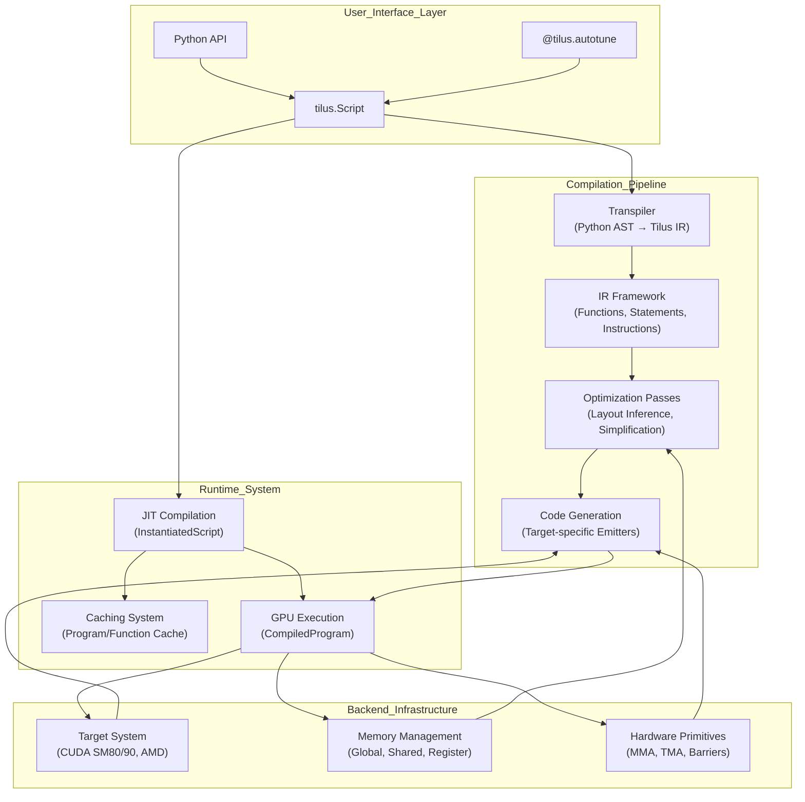
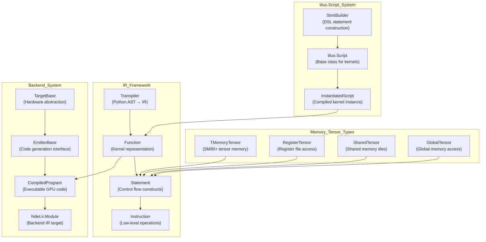

<!-- source: DeepWiki mcp.deepwiki.com · repo NVIDIA/tilus · page 1 Overview · fetched 2026-10-26 -->

# Overview

Relevant source files

The following files were used as context for generating this wiki page:

- [.gitignore](.gitignore)
- [LICENSE](LICENSE)
- [README.md](README.md)
- [docs/source/_static/custom.css](docs/source/_static/custom.css)
- [docs/source/conf.py](docs/source/conf.py)
- [docs/source/getting-started/install.rst](docs/source/getting-started/install.rst)
- [docs/source/getting-started/tutorials/.gitignore](docs/source/getting-started/tutorials/.gitignore)
- [docs/source/getting-started/tutorials/__init__.rst](docs/source/getting-started/tutorials/__init__.rst)
- [docs/source/getting-started/tutorials/matmul.rst](docs/source/getting-started/tutorials/matmul.rst)
- [pyproject.toml](pyproject.toml)

## Purpose and Scope

This document provides a comprehensive overview of Tilus, a tile-level GPU kernel programming language designed for high-performance GPU computing. It covers the system's architecture, core components, and compilation pipeline. For specific implementation details about individual subsystems, see the [Core Systems](#3) section. For practical programming examples, refer to the [Programming Guide](#5).

## What is Tilus?

Tilus is a domain-specific language (DSL) for GPU programming that operates at thread-block granularity using tensors as the primary data type. Unlike other GPU programming frameworks, Tilus provides explicit control over GPU memory hierarchies while maintaining a Pythonic interface for ease of development.

### Key Characteristics

| Feature | Description |
|---------|-------------|
| **Granularity** | Thread-block-level programming with tile-based computation |
| **Memory Control** | Explicit management of shared memory and register tensors |
| **Precision Support** | Low-precision types with arbitrary bit-widths (1-8 bits) |
| **Interface** | Python-based DSL with automatic tuning and caching |
| **Backend** | Built on Hidet IR with CUDA/HIP target support |

The system is pronounced "tie-lus" (/ˈtaɪləs) and is inspired by research into tile-level GPGPU programming for low-precision computation.

**Sources:** [README.md:1-55](), [pyproject.toml:5-32]()

## System Architecture Overview

The following diagram illustrates Tilus's layered architecture and data flow:

This architecture demonstrates how user-defined kernels flow through compilation and optimization stages before execution on GPU hardware.

**Sources:** [README.md:4-10](), [pyproject.toml:28-32]()

## Core Components and Code Entities

The following diagram maps high-level system concepts to specific code entities in the Tilus codebase:

This diagram shows the relationship between user-facing classes like `tilus.Script` and internal implementation components like `InstantiatedScript` and `CompiledProgram`.

**Sources:** [README.md:4-8](), [pyproject.toml:29]()

## Compilation Flow

Tilus transforms user-written Python scripts into optimized GPU kernels through a multi-stage compilation pipeline:

```mermaid
flowchart LR
    subgraph "Frontend_Processing"
        UserScript["User Script\n(@tilus.autotune\nclass MyKernel)"]
        ASTTranspiler["AST Transpiler\n(Python → Tilus IR)"]
        FunctionIR["Function IR\n(Parameters, Body, Metadata)"]
    end
    
    subgraph "IR_Optimization"
        LayoutInference["Layout Inference\n(Memory access patterns)"]
        ScalarAnalysis["Scalar Analysis\n(Bounds, divisibility)"]
        LoopOptimization["Loop Optimization\n(Invariant hoisting)"]
    end
    
    subgraph "Code_Generation"
        EmitterSystem["Emitter System\n(Target-specific)"]
        HidetIRModule["hidet.ir.Module\n(Backend representation)"]
        CompiledKernel["Compiled Kernel\n(GPU executable)"]
    end
    
    UserScript --> ASTTranspiler
    ASTTranspiler --> FunctionIR
    FunctionIR --> LayoutInference
    LayoutInference --> ScalarAnalysis
    ScalarAnalysis --> LoopOptimization
    LoopOptimization --> EmitterSystem
    EmitterSystem --> HidetIRModule
    HidetIRModule --> CompiledKernel
```

The compilation process preserves semantic correctness while applying GPU-specific optimizations at each stage.

**Sources:** [README.md:51-52]()

## Key Features and Capabilities

### Memory Hierarchy Management

Tilus provides explicit control over GPU memory hierarchies through distinct tensor types:

| Tensor Type | Memory Domain | Characteristics |
|-------------|---------------|-----------------|
| `GlobalTensor` | Global Memory | Large capacity, high latency |
| `SharedTensor` | Shared Memory | Fast access, block-scoped |
| `RegisterTensor` | Register File | Lowest latency, thread-local |
| `TMemoryTensor` | Tensor Memory | SM90+ hardware acceleration |

### Low-Precision Computing

The system supports arbitrary bit-width types from 1 to 8 bits, enabling efficient quantized computations for machine learning workloads.

### Automatic Optimization

Tilus includes built-in optimization capabilities:
- Layout inference for optimal memory access patterns
- Auto-tuning with parameter space exploration
- JIT compilation with intelligent caching
- Hardware-specific code generation

**Sources:** [README.md:6-10](), [pyproject.toml:29]()

## Dependencies and Infrastructure

Tilus builds upon several key dependencies:

| Component | Purpose | Version |
|-----------|---------|---------|
| `hidet` | Backend IR and runtime system | 0.6.1 |
| `torch` | PyTorch integration and tensor operations | Latest |
| `cuda-python` | CUDA runtime API bindings | <13 for older drivers |

The system is distributed through PyPI and includes comprehensive development infrastructure with testing, documentation, and CI/CD workflows.

**Sources:** [pyproject.toml:28-32](), [README.md:16-26](), [docs/source/conf.py:17-19]()

---

