# Page: Overview

# Overview

<details>
<summary>Relevant source files</summary>

The following files were used as context for generating this wiki page:

- [.gitignore](.gitignore)
- [LICENSE](LICENSE)
- [README.md](README.md)
- [docs/source/_static/custom.css](docs/source/_static/custom.css)
- [docs/source/conf.py](docs/source/conf.py)
- [docs/source/getting-started/install.rst](docs/source/getting-started/install.rst)
- [docs/source/getting-started/tutorials/.gitignore](docs/source/getting-started/tutorials/.gitignore)
- [docs/source/getting-started/tutorials/__init__.rst](docs/source/getting-started/tutorials/__init__.rst)
- [docs/source/getting-started/tutorials/matmul.rst](docs/source/getting-started/tutorials/matmul.rst)
- [pyproject.toml](pyproject.toml)

</details>


## Purpose and Scope

This document provides a comprehensive overview of Tilus, a tile-level GPU kernel programming language designed for high-performance GPU computing. It covers the system's architecture, core components, and compilation pipeline. For specific implementation details about individual subsystems, see the [Core Systems](#3) section. For practical programming examples, refer to the [Programming Guide](#5).

## What is Tilus?

Tilus is a domain-specific language (DSL) for GPU programming that operates at thread-block granularity using tensors as the primary data type. Unlike other GPU programming frameworks, Tilus provides explicit control over GPU memory hierarchies while maintaining a Pythonic interface for ease of development.

### Key Characteristics

| Feature | Description |
|---------|-------------|
| **Granularity** | Thread-block-level programming with tile-based computation |
| **Memory Control** | Explicit management of shared memory and register tensors |
| **Precision Support** | Low-precision types with arbitrary bit-widths (1-8 bits) |
| **Interface** | Python-based DSL with automatic tuning and caching |
| **Backend** | Built on Hidet IR with CUDA/HIP target support |

The system is pronounced "tie-lus" (/ˈtaɪləs) and is inspired by research into tile-level GPGPU programming for low-precision computation.

**Sources:** [README.md:1-55](), [pyproject.toml:5-32]()

## System Architecture Overview

The following diagram illustrates Tilus's layered architecture and data flow:

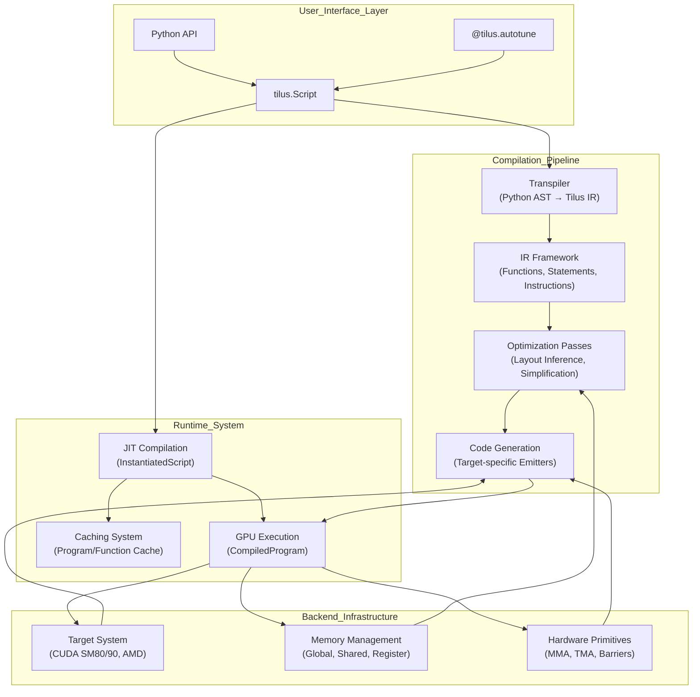

This architecture demonstrates how user-defined kernels flow through compilation and optimization stages before execution on GPU hardware.

**Sources:** [README.md:4-10](), [pyproject.toml:28-32]()

## Core Components and Code Entities

The following diagram maps high-level system concepts to specific code entities in the Tilus codebase:

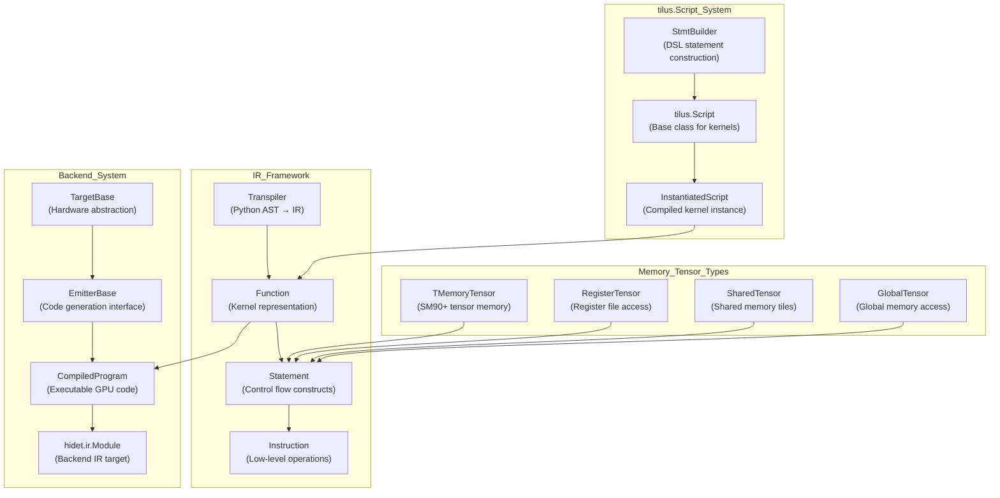

This diagram shows the relationship between user-facing classes like `tilus.Script` and internal implementation components like `InstantiatedScript` and `CompiledProgram`.

**Sources:** [README.md:4-8](), [pyproject.toml:29]()

## Compilation Flow

Tilus transforms user-written Python scripts into optimized GPU kernels through a multi-stage compilation pipeline:

```mermaid
flowchart LR
    subgraph "Frontend_Processing"
        UserScript["User Script\n(@tilus.autotune\nclass MyKernel)"]
        ASTTranspiler["AST Transpiler\n(Python → Tilus IR)"]
        FunctionIR["Function IR\n(Parameters, Body, Metadata)"]
    end
    
    subgraph "IR_Optimization"
        LayoutInference["Layout Inference\n(Memory access patterns)"]
        ScalarAnalysis["Scalar Analysis\n(Bounds, divisibility)"]
        LoopOptimization["Loop Optimization\n(Invariant hoisting)"]
    end
    
    subgraph "Code_Generation"
        EmitterSystem["Emitter System\n(Target-specific)"]
        HidetIRModule["hidet.ir.Module\n(Backend representation)"]
        CompiledKernel["Compiled Kernel\n(GPU executable)"]
    end
    
    UserScript --> ASTTranspiler
    ASTTranspiler --> FunctionIR
    FunctionIR --> LayoutInference
    LayoutInference --> ScalarAnalysis
    ScalarAnalysis --> LoopOptimization
    LoopOptimization --> EmitterSystem
    EmitterSystem --> HidetIRModule
    HidetIRModule --> CompiledKernel
```

The compilation process preserves semantic correctness while applying GPU-specific optimizations at each stage.

**Sources:** [README.md:51-52]()

## Key Features and Capabilities

### Memory Hierarchy Management

Tilus provides explicit control over GPU memory hierarchies through distinct tensor types:

| Tensor Type | Memory Domain | Characteristics |
|-------------|---------------|-----------------|
| `GlobalTensor` | Global Memory | Large capacity, high latency |
| `SharedTensor` | Shared Memory | Fast access, block-scoped |
| `RegisterTensor` | Register File | Lowest latency, thread-local |
| `TMemoryTensor` | Tensor Memory | SM90+ hardware acceleration |

### Low-Precision Computing

The system supports arbitrary bit-width types from 1 to 8 bits, enabling efficient quantized computations for machine learning workloads.

### Automatic Optimization

Tilus includes built-in optimization capabilities:
- Layout inference for optimal memory access patterns
- Auto-tuning with parameter space exploration
- JIT compilation with intelligent caching
- Hardware-specific code generation

**Sources:** [README.md:6-10](), [pyproject.toml:29]()

## Dependencies and Infrastructure

Tilus builds upon several key dependencies:

| Component | Purpose | Version |
|-----------|---------|---------|
| `hidet` | Backend IR and runtime system | 0.6.1 |
| `torch` | PyTorch integration and tensor operations | Latest |
| `cuda-python` | CUDA runtime API bindings | <13 for older drivers |

The system is distributed through PyPI and includes comprehensive development infrastructure with testing, documentation, and CI/CD workflows.

**Sources:** [pyproject.toml:28-32](), [README.md:16-26](), [docs/source/conf.py:17-19]()

---

# Page: Getting Started

# Getting Started

<details>
<summary>Relevant source files</summary>

The following files were used as context for generating this wiki page:

- [.gitignore](.gitignore)
- [docs/source/_static/custom.css](docs/source/_static/custom.css)
- [docs/source/conf.py](docs/source/conf.py)
- [docs/source/getting-started/install.rst](docs/source/getting-started/install.rst)
- [docs/source/index.rst](docs/source/index.rst)
- [docs/source/programming-guides/control-flow.rst](docs/source/programming-guides/control-flow.rst)
- [docs/source/programming-guides/thread-group.rst](docs/source/programming-guides/thread-group.rst)
- [docs/source/python-api/tilus-script.rst](docs/source/python-api/tilus-script.rst)
- [pyproject.toml](pyproject.toml)
- [tests/lang/test_thread_group.py](tests/lang/test_thread_group.py)

</details>


This page provides installation instructions and basic examples to help you start programming GPU kernels with Tilus. It covers system requirements, installation, and walks through creating your first kernel to understand the fundamental workflow from Python script to GPU execution.

For detailed programming guides and advanced features, see [Programming Guide](#5). For comprehensive API documentation, see [Core Systems](#3).

## Overview and Workflow

Tilus enables GPU programming through a Python-based domain-specific language built around the `tilus.Script` class. The system follows a clear workflow from high-level Python code to optimized GPU kernels.

### User Programming Workflow

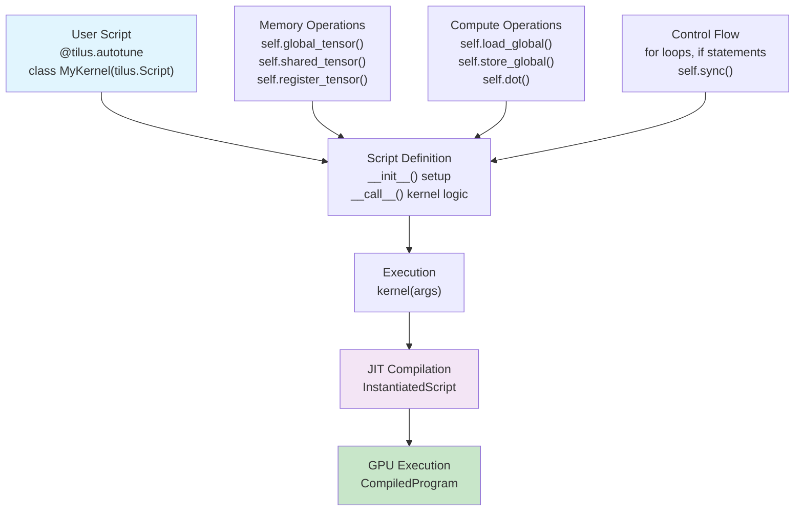

**Sources:** [pyproject.toml:1-123](), [docs/source/python-api/tilus-script.rst:1-123]()

### System Architecture Components

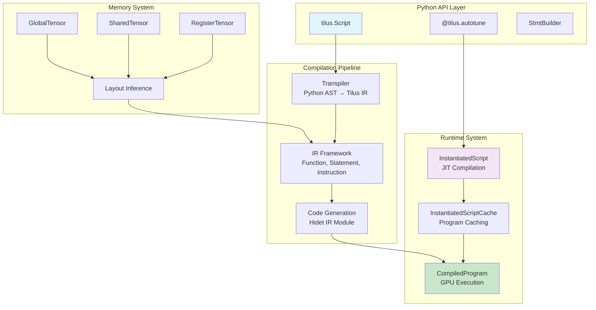

**Sources:** [docs/source/python-api/tilus-script.rst:10-27](), [tests/lang/test_thread_group.py:21-50]()

## Installation

### System Requirements

Tilus requires:
- Python 3.10 or higher
- NVIDIA GPU with CUDA support
- Compatible CUDA driver (version 580.65.06 or newer recommended)

### Standard Installation

Install Tilus from PyPI using pip:

```bash
pip install tilus
```

### Development Installation

For development or to access the latest features:

```bash
git clone git@github.com:NVIDIA/tilus.git
cd tilus
pip install -e .
```

The `-e` flag enables editable installation, allowing immediate reflection of source code changes without reinstalling.

### CUDA Driver Compatibility

For older GPU drivers (prior to 580.65.06), install a compatible version of `cuda-python`:

```bash
pip install tilus "cuda-python<13"
```

**Sources:** [docs/source/getting-started/install.rst:1-28](), [pyproject.toml:28-32]()

## Dependencies and Build System

| Component | Version | Purpose |
|-----------|---------|---------|
| `hidet` | 0.6.1 | Backend compilation framework |
| `torch` | Latest | Tensor operations and GPU memory management |
| `tabulate` | Latest | Table formatting for output |

### Development Dependencies

| Tool | Version | Purpose |
|------|---------|---------|
| `ruff` | 0.11.0 | Code linting and formatting |
| `mypy` | 1.15.0 | Static type checking |
| `pytest` | Latest | Testing framework |
| `sphinx` | Latest | Documentation generation |

**Sources:** [pyproject.toml:28-55]()

## First Kernel Example

Here's a simple vector addition kernel that demonstrates the basic Tilus programming model:

### Basic Vector Addition

```python
import tilus
from tilus import float32, int32

class VectorAdd(tilus.Script):
    def __init__(self, block_size: int = 256):
        super().__init__()
        self.block_size = block_size
    
    def __call__(self, n: int32, a_ptr: ~float32, b_ptr: ~float32, c_ptr: ~float32):
        # Set execution configuration
        self.attrs.blocks = (n + self.block_size - 1) // self.block_size
        self.attrs.warps = self.block_size // 32
        
        # Create global tensor views
        a = self.global_view(a_ptr, dtype=float32, shape=[n])
        b = self.global_view(b_ptr, dtype=float32, shape=[n])
        c = self.global_view(c_ptr, dtype=float32, shape=[n])
        
        # Calculate thread block offset
        offset = self.blockIdx.x * self.block_size
        
        # Load data from global memory
        a_data = self.load_global(a, offsets=[offset], shape=[self.block_size])
        b_data = self.load_global(b, offsets=[offset], shape=[self.block_size])
        
        # Perform computation
        result = a_data + b_data
        
        # Store result back to global memory
        self.store_global(c, result, offsets=[offset])

# Usage
import torch

# Create input tensors
n = 1024
a = torch.randn(n, dtype=torch.float32, device="cuda")
b = torch.randn(n, dtype=torch.float32, device="cuda")
c = torch.zeros(n, dtype=torch.float32, device="cuda")

# Execute kernel
kernel = VectorAdd(block_size=256)
kernel(n, a, b, c)

# Verify result
expected = a + b
torch.testing.assert_close(c, expected)
```

### Key Programming Concepts

| Concept | API Method | Purpose |
|---------|------------|---------|
| **Script Definition** | `class MyKernel(tilus.Script)` | Define GPU kernel class |
| **Execution Config** | `self.attrs.blocks`, `self.attrs.warps` | Set grid and block dimensions |
| **Memory Views** | `self.global_view()` | Create views of global memory |
| **Data Loading** | `self.load_global()` | Load data from global memory |
| **Data Storing** | `self.store_global()` | Store data to global memory |
| **Thread Indexing** | `self.blockIdx.x` | Access block index |

**Sources:** [tests/lang/test_thread_group.py:21-50](), [docs/source/python-api/tilus-script.rst:80-107]()

## Compilation and Execution Flow

### JIT Compilation Process

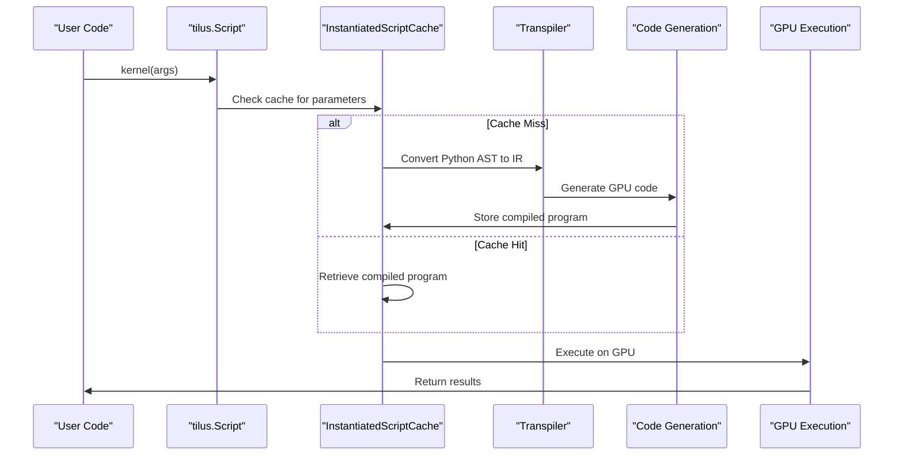

**Sources:** [docs/source/python-api/tilus-script.rst:22-26]()

### Memory Hierarchy Usage

The example above demonstrates Tilus's memory model:

1. **Global Memory**: Input/output tensors accessed via `global_view()`
2. **Register Memory**: Intermediate computations stored in registers automatically
3. **Thread Block**: Execution organized by block and warp configuration

For shared memory usage and advanced memory optimization, see [Memory Model and Tensor Types](#3.3).

## Next Steps

### Learning Path

1. **Basic Concepts**: Review [Script System](#3.1) for detailed DSL documentation
2. **Memory Management**: Study [Memory Model and Tensor Types](#3.3) for optimization
3. **Examples**: Explore [Basic Matrix Multiplication](#5.1) for progressive optimization techniques
4. **Advanced Features**: Learn [FlashAttention Implementation](#5.2) for complex kernels

### Key Resources

| Resource | Location | Purpose |
|----------|----------|---------|
| **API Reference** | [Core Systems](#3) | Comprehensive class and method documentation |
| **Programming Examples** | [Programming Guide](#5) | Step-by-step tutorials and examples |
| **Advanced Features** | [GPU Programming Features](#6) | Hardware-specific optimizations |

### Common Next Examples

- **Shared Memory Usage**: Implement tiled matrix multiplication
- **Auto-tuning**: Use `@tilus.autotune` for parameter optimization  
- **Thread Groups**: Fine-grained thread control for complex algorithms
- **Async Operations**: Overlap memory transfers with computation

**Sources:** [docs/source/index.rst:13-44](), [docs/source/programming-guides/control-flow.rst:1-99](), [docs/source/programming-guides/thread-group.rst:1-162]()

---

# Page: Core Systems

# Core Systems

<details>
<summary>Relevant source files</summary>

The following files were used as context for generating this wiki page:

- [python/tilus/ir/builders/stmt_builder.py](python/tilus/ir/builders/stmt_builder.py)
- [python/tilus/lang/script.py](python/tilus/lang/script.py)

</details>


This page documents the fundamental systems that form the foundation of the Tilus GPU programming framework. These core systems provide the essential infrastructure for defining, compiling, and executing GPU kernels through a high-level Python DSL.

The core systems consist of the Script DSL interface, the statement building infrastructure, the memory and tensor model, and the compilation pipeline. For detailed information about specific aspects, see [Script System](#3.1), [JIT Compilation and Autotuning](#3.2), [Memory Model and Tensor Types](#3.3), and [Target System](#3.4).

## System Architecture Overview

The Tilus core systems form a layered architecture where user-defined scripts are processed through multiple abstraction levels to generate optimized GPU code.

**Core System Architecture**

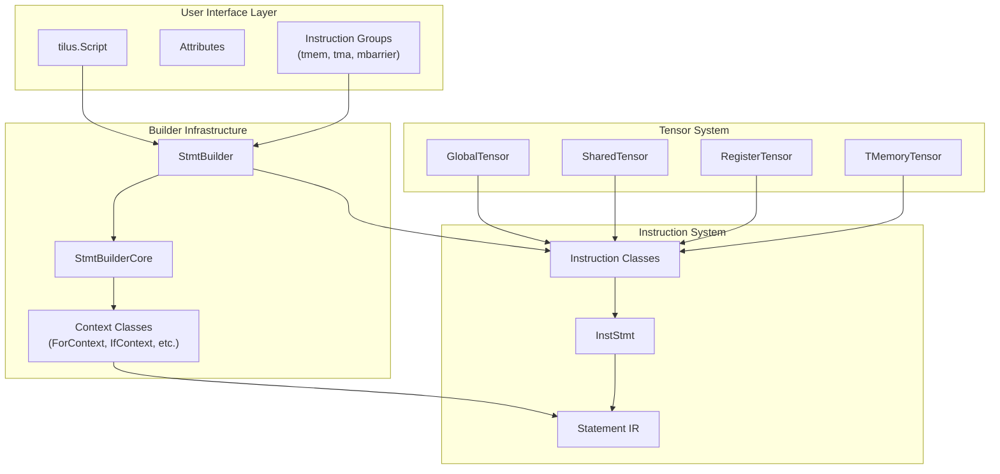

**Sources:** [python/tilus/lang/script.py:599-649](), [python/tilus/ir/builders/stmt_builder.py:279-370]()

## Script DSL System

The `Script` class serves as the primary interface for users to define GPU kernels using a Python-based domain-specific language.

**Script System Components**

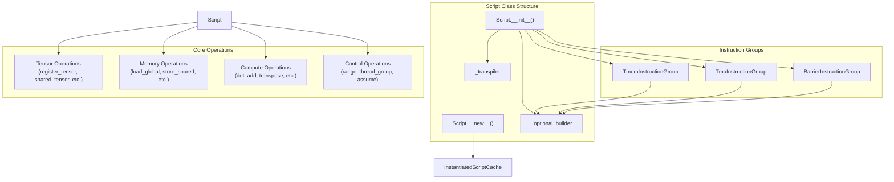

The `Script` class provides methods for tensor allocation, memory operations, mathematical computations, and control flow. Key components include:

| Component | Purpose | Key Methods |
|-----------|---------|-------------|
| Tensor Allocation | Create tensors in different memory spaces | `register_tensor()`, `shared_tensor()`, `global_tensor()` |
| Memory Operations | Transfer data between memory hierarchies | `load_global()`, `store_shared()`, `copy_async()` |
| Compute Operations | Mathematical operations on tensors | `dot()`, `add()`, `transpose()`, `cast()` |
| Control Flow | Program structure and synchronization | `range()`, `thread_group()`, `assume()` |

**Sources:** [python/tilus/lang/script.py:599-649](), [python/tilus/lang/script.py:903-955](), [python/tilus/lang/script.py:1358-1433]()

## Statement Builder Infrastructure

The `StmtBuilder` system translates high-level DSL calls into intermediate representation statements and instructions.

**Statement Builder Hierarchy**

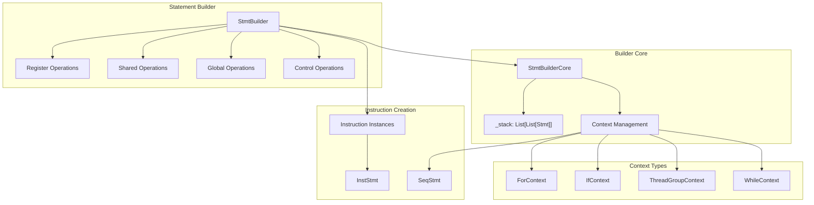

The builder system uses a stack-based approach to manage nested contexts and generates structured IR. Context managers handle control flow constructs like loops and conditionals.

**Sources:** [python/tilus/ir/builders/stmt_builder.py:128-144](), [python/tilus/ir/builders/stmt_builder.py:146-179](), [python/tilus/ir/builders/stmt_builder.py:371-391]()

## Memory Hierarchy and Tensor System

Tilus provides explicit tensor types for each level of the GPU memory hierarchy, enabling fine-grained control over data placement and movement.

**Tensor Type Hierarchy**

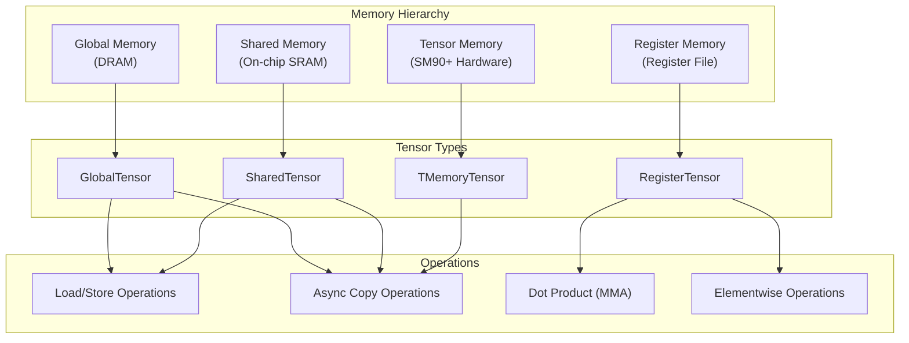

Each tensor type supports specific operations optimized for its memory location:

| Tensor Type | Memory Space | Key Operations | Performance Characteristics |
|-------------|--------------|----------------|----------------------------|
| `GlobalTensor` | Global DRAM | Load, store, async copy | High capacity, high latency |
| `SharedTensor` | On-chip SRAM | Load, store, async copy | Medium capacity, low latency |
| `RegisterTensor` | Register file | Compute, elementwise ops | Low capacity, no latency |
| `TMemoryTensor` | Tensor cores | MMA operations | Specialized for matrix operations |

**Sources:** [python/tilus/lang/script.py:956-999](), [python/tilus/lang/script.py:1001-1027](), [python/tilus/lang/script.py:903-955]()

## Instruction and Control Flow System

The instruction system provides fine-grained control over GPU execution through specialized instruction groups and control flow constructs.

**Instruction Group Organization**

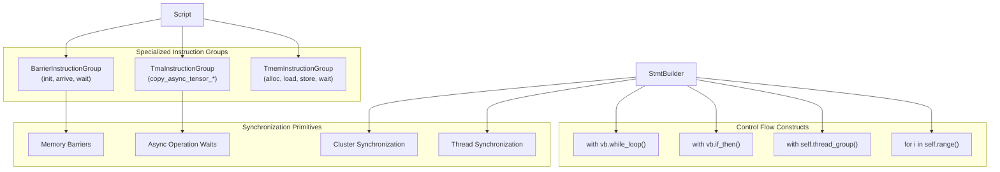

Control flow in Tilus is managed through context managers that generate structured IR. The system supports nested scoping and proper resource management.

**Sources:** [python/tilus/lang/script.py:110-156](), [python/tilus/lang/script.py:158-284](), [python/tilus/lang/script.py:491-597](), [python/tilus/ir/builders/stmt_builder.py:284-313]()

## Compilation Flow Integration

The core systems work together to transform user scripts into executable GPU code through a structured compilation pipeline.

**Core System Interaction Flow**

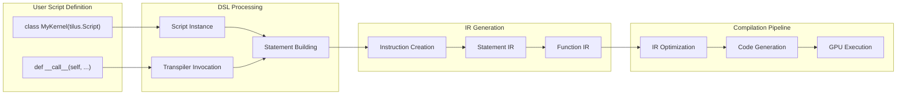

The core systems provide the foundation for Tilus's ability to express complex GPU computations in a high-level Python interface while maintaining fine-grained control over hardware resources.

**Sources:** [python/tilus/lang/script.py:617-624](), [python/tilus/ir/builders/stmt_builder.py:348-368]()

---

# Page: Script System

# Script System

<details>
<summary>Relevant source files</summary>

The following files were used as context for generating this wiki page:

- [docs/source/index.rst](docs/source/index.rst)
- [docs/source/programming-guides/control-flow.rst](docs/source/programming-guides/control-flow.rst)
- [docs/source/programming-guides/thread-group.rst](docs/source/programming-guides/thread-group.rst)
- [docs/source/python-api/tilus-script.rst](docs/source/python-api/tilus-script.rst)
- [python/tilus/ir/builders/stmt_builder.py](python/tilus/ir/builders/stmt_builder.py)
- [python/tilus/lang/script.py](python/tilus/lang/script.py)
- [tests/lang/test_thread_group.py](tests/lang/test_thread_group.py)

</details>


## Purpose and Scope

The Script System provides the primary user interface for defining GPU kernels in Tilus through a Python-based Domain-Specific Language (DSL). At its core is the `tilus.Script` class that users inherit from to write block-level computational logic, supported by the `StmtBuilder` infrastructure that translates high-level operations into Tilus IR instructions. This system enables developers to write GPU kernels with explicit control over memory hierarchies, tensor layouts, and hardware-specific operations while maintaining a Pythonic interface.

The Script System serves as the entry point for the Tilus compilation pipeline, bridging natural language programming constructs with precise GPU programming semantics.

For information about how Script instances are instantiated and compiled, see [JIT Compilation and Autotuning](#3.2). For details about the transpilation process that converts Script methods to IR, see [Transpilation](#4.1).

## System Architecture

The Script System operates as a multi-layer architecture with specialized instruction groups and context management:

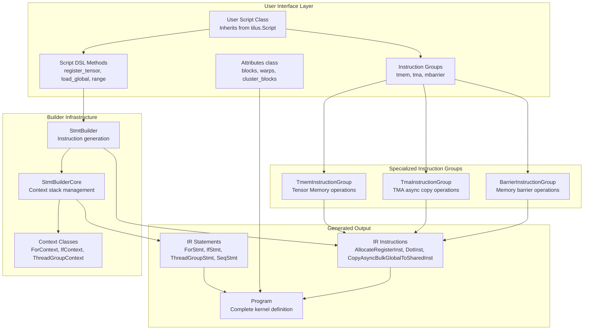

Sources: [python/tilus/lang/script.py:44-94](), [python/tilus/lang/script.py:95-157](), [python/tilus/lang/script.py:630-633](), [python/tilus/ir/builders/stmt_builder.py:127-276]()

## Script Class Design

The `Script` class implements a sophisticated instantiation pattern that intercepts object creation and delegates to the instantiated script cache system:

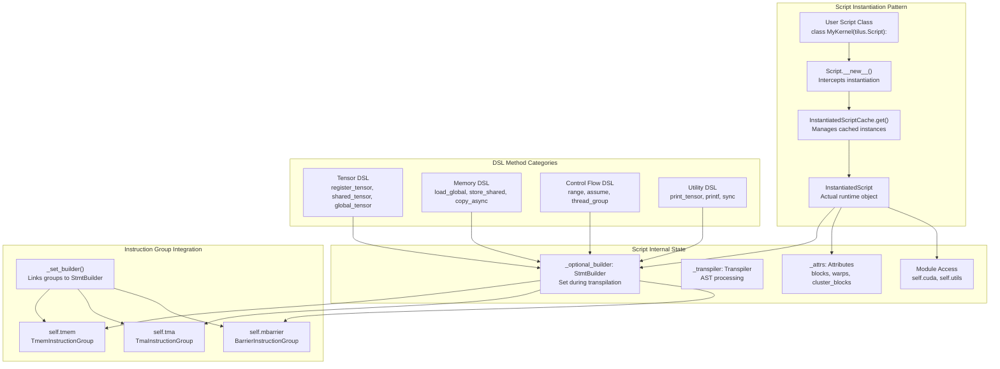

Sources: [python/tilus/lang/script.py:608-616](), [python/tilus/lang/script.py:617-633](), [python/tilus/lang/script.py:638-649]()

## StmtBuilder Architecture

The `StmtBuilder` manages instruction generation and maintains a context stack for nested control flow constructs:

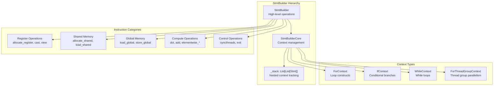

Sources: [python/tilus/ir/builders/stmt_builder.py:327-881](), [python/tilus/ir/builders/stmt_builder.py:248-325]()

## Script DSL Methods

The Script class provides a comprehensive Domain-Specific Language through delegated methods to `StmtBuilder`. These methods form the core vocabulary for GPU kernel development:

### Tensor Allocation Methods

| Method | Purpose | Memory Space | Implementation |
|--------|---------|--------------|----------------|
| `register_tensor()` | Allocate register tensor with optional initialization | Register | Delegates to `StmtBuilder.allocate_register()` |
| `shared_tensor()` | Allocate shared memory tensor | Shared | Delegates to `StmtBuilder.allocate_shared()` |
| `global_tensor()` | Allocate global memory tensor | Global | Delegates to `StmtBuilder.allocate_global()` |
| `global_view()` | Create view of existing global memory | Global | Creates `GlobalTensor` from pointer |

### Memory Transfer Operations

| Method | Source → Destination | Key Features | Implementation |
|--------|---------------------|---------------|----------------|
| `load_global()` | Global → Register | Layout inference, bounds checking | `StmtBuilder.load_global()` |
| `store_global()` | Register → Global | Vectorization support | `StmtBuilder.store_global()` |
| `load_shared()` | Shared → Register | Bank conflict avoidance | `StmtBuilder.load_shared()` |
| `store_shared()` | Register → Shared | Coalescing optimization | `StmtBuilder.store_shared()` |
| `copy_async()` | Global → Shared | Asynchronous copy with barriers | `StmtBuilder.copy_async()` |

### Computational Operations

| Method Category | Core Methods | Advanced Methods | Features |
|----------------|--------------|------------------|----------|
| Linear Algebra | `dot()` | `load_matrix()` | MMA unit utilization, layout-aware |
| Element-wise | `add()`, `sub()`, `mul()`, `div()` | `maximum()`, `where()`, `clip()` | Broadcasting, type promotion |
| Reductions | `sum()`, `max()`, `min()` | Custom reduction functions | Thread group coordination |
| Transforms | `cast()`, `view()`, `transpose()` | `squeeze()`, `unsqueeze()` | Layout preservation |
| Math Functions | `exp()`, `log()`, `sqrt()`, `abs()` | `exp2()`, `round()`, `neg()` | Hardware intrinsics when available |

### Control Flow and Synchronization

| Method | Purpose | Context Management | Features |
|--------|---------|-------------------|----------|
| `range()` | Loop iteration | Returns `Iterable[Var]` | Unroll hints, step control |
| `assume()` | Compiler hints | Condition analysis | Divisibility, bounds assumptions |
| `thread_group()` | Thread partitioning | `ThreadGroupContext` | Nested groups, size specification |
| `sync()` | Thread synchronization | Current thread group | Barrier insertion |

Sources: [python/tilus/lang/script.py:286-647](), [python/tilus/lang/script.py:709-844](), [python/tilus/ir/builders/stmt_builder.py:371-881]()

## Control Flow and Context Management

The Script system implements control flow through a sophisticated context stack system managed by `StmtBuilderCore`:

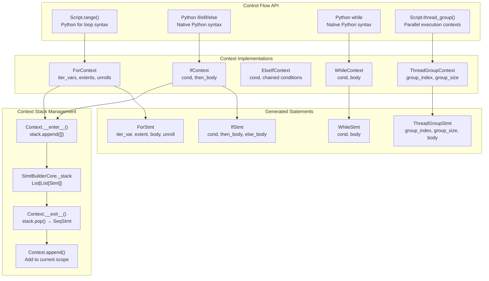

Sources: [python/tilus/lang/script.py:709-774](), [python/tilus/ir/builders/stmt_builder.py:127-276](), [python/tilus/ir/builders/stmt_builder.py:283-312]()

## Specialized Instruction Groups

The Script system provides access to hardware-specific operations through specialized instruction groups that encapsulate complex GPU primitives:

### Tensor Memory (TMemory) Operations

The `TmemInstructionGroup` provides access to SM90+ Tensor Memory hardware:

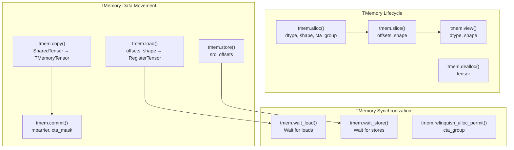

### Tensor Memory Access (TMA) Operations

The `TmaInstructionGroup` provides asynchronous global-shared memory transfers:

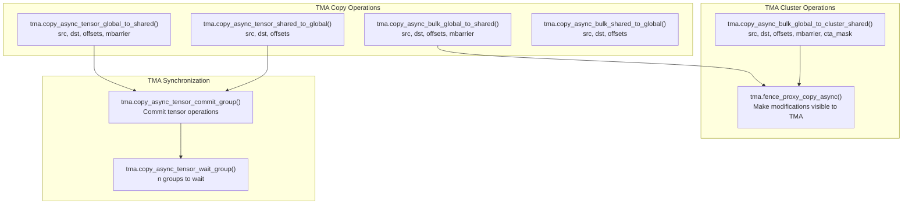

### Memory Barrier Operations

The `BarrierInstructionGroup` manages thread synchronization and asynchronous operation coordination:

| Method | Purpose | Parameters | Behavior |
|--------|---------|------------|----------|
| `mbarrier.init()` | Initialize barrier | `barrier, count` | Sets up barrier state machine |
| `mbarrier.arrive()` | Signal arrival | `barrier` | Decrements pending arrivals |
| `mbarrier.arrive_remote()` | Remote arrival | `barrier, remote_block` | Cross-block arrival signaling |
| `mbarrier.wait()` | Wait for phase | `barrier, phase` | Blocks until phase completion |

Sources: [python/tilus/lang/script.py:110-156](), [python/tilus/lang/script.py:158-489](), [python/tilus/lang/script.py:491-597]()

## Integration with Compilation Pipeline

The Script system interfaces with the broader Tilus compilation infrastructure through well-defined boundaries:

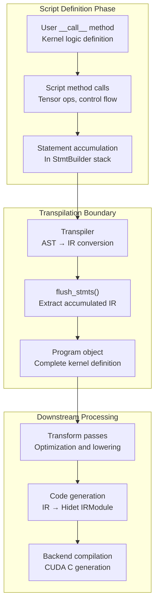

Sources: [python/tilus/ir/builders/stmt_builder.py:311-324](), [python/tilus/lang/script.py:103-116]()

---

# Page: JIT Compilation and Autotuning

# JIT Compilation and Autotuning

<details>
<summary>Relevant source files</summary>

The following files were used as context for generating this wiki page:

- [python/tilus/ir/analyzers/grid_analyzer.py](python/tilus/ir/analyzers/grid_analyzer.py)
- [python/tilus/lang/instantiated_script.py](python/tilus/lang/instantiated_script.py)
- [python/tilus/lang/modules/cuda.py](python/tilus/lang/modules/cuda.py)
- [python/tilus/transforms/layout_inference.py](python/tilus/transforms/layout_inference.py)
- [tests/kernels/matmul/test_matmul_v0.py](tests/kernels/matmul/test_matmul_v0.py)
- [tests/lang/test_simple_mma_matmul.py](tests/lang/test_simple_mma_matmul.py)

</details>


This document covers Tilus's Just-In-Time (JIT) compilation system and automatic performance tuning infrastructure. The JIT system compiles GPU kernels on-demand based on runtime parameters, while the autotuning system automatically explores different implementation strategies to find optimal configurations for specific workloads.

For information about the Script DSL that defines kernels, see [Script System](#3.1). For details about the compilation pipeline that transforms scripts into executable code, see [Compilation Pipeline](#4).

## Overview

The JIT compilation and autotuning system provides several key capabilities:

- **Parameter-sensitive compilation**: Different parameter values trigger different optimizations and code paths
- **Automatic schedule exploration**: Multiple implementation variants are generated and benchmarked
- **Intelligent caching**: Compiled programs are cached to avoid recompilation
- **Performance-driven selection**: The best-performing implementation is automatically chosen for each parameter configuration

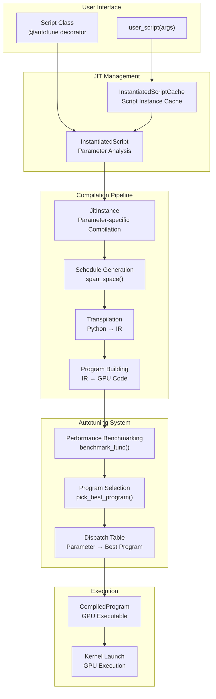

Sources: [python/tilus/lang/instantiated_script.py:1-830](), [python/tilus/lang/script.py]()

## Parameter Classification and Key Generation

The JIT system categorizes function parameters into three types based on their impact on compilation and performance:

| Parameter Type | Description | JIT Impact | Tuning Impact |
|---------------|-------------|------------|---------------|
| **Constant Parameters** | Python builtin types (`int`, `float`, `str`, `bool`) | Triggers new JIT compilation | No impact |
| **Kernel Parameters** | Hidet IR types (tensors, pointers) | No JIT impact | No impact |
| **Tuning Parameters** | Integer Hidet types (`int32`, `int64`) | Divisibility affects JIT | Value affects tuning choice |

```mermaid
graph TB
    subgraph "Parameter Analysis"
        CallParams["CallParameters<br/>extract_params()"]
        Signature["Function Signature<br/>inspect.signature()"]
        Types["Type Annotations<br/>const_params, kernel_params, tuning_params"]
    end
    
    subgraph "Key Generation"
        Args["Runtime Arguments<br/>user call args"]
        Extract["extract_keys()<br/>const_params, tuning_params"]
        JitKey["JitKey<br/>Constants + Divisibility"]
        TuningKey["TuningKey<br/>Rounded Parameter Values"]
    end
    
    subgraph "Dispatch Logic"
        Lookup["dispatch_table lookup<br/>(JitKey, TuningKey) → CompiledFunction"]
        Cache["Function Cache<br/>Fast Path Execution"]
    end
    
    Signature --> CallParams
    CallParams --> Types
    Args --> Extract
    Types --> Extract
    Extract --> JitKey
    Extract --> TuningKey
    JitKey --> Lookup
    TuningKey --> Lookup
    Lookup --> Cache
```

The key generation process uses divisibility information for tuning parameters to enable efficient caching while maintaining performance sensitivity:

- **JIT Key**: Contains constant parameter values and divisibility factors for tuning parameters
- **Tuning Key**: Contains rounded values of tuning parameters to group similar workload sizes

Sources: [python/tilus/lang/instantiated_script.py:164-298](), [python/tilus/lang/instantiated_script.py:234-287]()

## InstantiatedScript and Caching

The `InstantiatedScript` class manages the lifecycle of compiled scripts and provides the main execution interface:

```mermaid
graph LR
    subgraph "Script Instantiation"
        ScriptClass["Script Class<br/>User-defined kernel"]
        InstCache["InstantiatedScriptCache<br/>get()"]
        InstScript["InstantiatedScript<br/>__init__()"]
    end
    
    subgraph "Schedule Management"
        AutotuneSpace["_autotune_space<br/>Parameter ranges"]
        Schedules["generate_schedules()<br/>Parameter combinations"]
        CallParams["CallParameters<br/>Function signature analysis"]
    end
    
    subgraph "Execution Interface"
        UserCall["__call__(*args, **kwargs)<br/>Main execution entry"]
        KeyExtract["extract_keys()<br/>JitKey, TuningKey"]
        DispatchTable["dispatch_table<br/>(JitKey, TuningKey) → CompiledFunction"]
    end
    
    ScriptClass --> InstCache
    InstCache --> InstScript
    InstScript --> AutotuneSpace
    AutotuneSpace --> Schedules
    InstScript --> CallParams
    UserCall --> KeyExtract
    KeyExtract --> DispatchTable
    CallParams --> KeyExtract
```

The caching system operates at multiple levels:

1. **Script-level caching**: `InstantiatedScriptCache` caches script instances based on class and initialization parameters
2. **JIT-level caching**: Each `InstantiatedScript` maintains a cache of `JitInstance` objects for different JIT keys
3. **Function-level caching**: Compiled functions are cached in the dispatch table for fast lookup

Sources: [python/tilus/lang/instantiated_script.py:692-782](), [python/tilus/lang/instantiated_script.py:784-830]()

## JIT Instance Management

`JitInstance` handles compilation for a specific combination of constant and divisibility parameters:

```mermaid
graph TB
    subgraph "JIT Instance Creation"
        JitKey["JitKey<br/>Parameter signature"]
        Schedules["Schedule List<br/>Parameter combinations"]
        BuildOpts["BuildOptions<br/>Compilation settings"]
        JitInst["JitInstance<br/>__init__()"]
    end
    
    subgraph "Parallel Transpilation"
        Jobs["Scheduling Jobs<br/>_instantiate_schedule"]
        Parallel["parallel_imap()<br/>Multiprocess execution"]
        Programs["Transpiled Programs<br/>Program objects"]
        Failed["Failed Scheduling<br/>Error tracking"]
    end
    
    subgraph "Parallel Building"
        BuildJobs["Building Jobs<br/>_build_program"]
        BuildParallel["parallel_imap()<br/>Multiprocess building"]
        ValidPrograms["Valid Programs<br/>Successfully compiled"]
        CompiledProgs["Compiled Programs<br/>GPU executables"]
    end
    
    subgraph "Cache Management"
        CacheDir["Cache Directory<br/>Program artifacts"]
        Metadata["meta.json<br/>Parameter information"]
        SourceCode["source.txt<br/>Original script"]
        DispatchTable["dispatch_table.pickle<br/>Performance results"]
    end
    
    JitKey --> JitInst
    Schedules --> JitInst
    BuildOpts --> JitInst
    JitInst --> Jobs
    Jobs --> Parallel
    Parallel --> Programs
    Parallel --> Failed
    Programs --> BuildJobs
    BuildJobs --> BuildParallel
    BuildParallel --> ValidPrograms
    ValidPrograms --> CompiledProgs
    JitInst --> CacheDir
    CacheDir --> Metadata
    CacheDir --> SourceCode
    CacheDir --> DispatchTable
```

The JIT instance creation process includes:

1. **Schedule instantiation**: Converting parameter combinations into actual script objects
2. **Parallel transpilation**: Converting scripts to IR programs using multiprocessing
3. **Parallel building**: Compiling IR programs to GPU executables
4. **Error handling**: Tracking and reporting compilation failures
5. **Cache organization**: Storing results and metadata for future use

Sources: [python/tilus/lang/instantiated_script.py:300-391](), [python/tilus/lang/instantiated_script.py:431-506](), [python/tilus/lang/instantiated_script.py:512-607]()

## Autotuning Process

The autotuning system automatically benchmarks different implementations and selects the best-performing one:

```mermaid
graph TB
    subgraph "Autotuning Space"
        AutotuneDecorator["@autotune decorator<br/>Parameter space definition"]
        SpaceDict["_autotune_space<br/>parameter: [values]"]
        SpanSpace["span_space()<br/>Cartesian product expansion"]
    end
    
    subgraph "Schedule Generation"
        ParamCombos["Parameter Combinations<br/>All valid schedules"]
        ScriptInit["Script Initialization<br/>Bind parameters to __init__"]
        ValidSchedules["Valid Schedules<br/>Successfully instantiated"]
    end
    
    subgraph "Performance Evaluation"
        TuningKey["TuningKey<br/>Runtime parameters"]
        Benchmark["benchmark_func()<br/>GPU kernel timing"]
        Latency["Latency Results<br/>Performance measurements"]
        BestChoice["Best Program Selection<br/>Minimum latency"]
    end
    
    subgraph "Dispatch Table Update"
        TableUpdate["dispatch_table update<br/>Cache best choice"]
        Reports["Tuning Reports<br/>Performance analysis"]
        CacheWrite["Cache Persistence<br/>Future lookups"]
    end
    
    AutotuneDecorator --> SpaceDict
    SpaceDict --> SpanSpace
    SpanSpace --> ParamCombos
    ParamCombos --> ScriptInit
    ScriptInit --> ValidSchedules
    TuningKey --> Benchmark
    ValidSchedules --> Benchmark
    Benchmark --> Latency
    Latency --> BestChoice
    BestChoice --> TableUpdate
    TableUpdate --> Reports
    Reports --> CacheWrite
```

The autotuning process operates on-demand when a new parameter combination is encountered:

1. **Space expansion**: Convert parameter ranges into concrete combinations
2. **Schedule validation**: Ensure all parameter combinations can instantiate valid scripts
3. **Performance measurement**: Benchmark all valid implementations
4. **Result caching**: Store the best choice for future use
5. **Report generation**: Create detailed performance analysis

Sources: [python/tilus/lang/instantiated_script.py:50-161](), [python/tilus/lang/instantiated_script.py:608-690]()

## Performance Optimization Features

The JIT system includes several performance optimization features:

### Divisibility-Based Optimization

```python
# Example from extract_keys function
def extract_keys(args, const_params, tuning_params):
    for i in tuning_params:
        arg: int = args[i]
        jit_key.append(divisibility_key[arg % 32])  # Divisibility info
        block = 1 << max((arg.bit_length() - 2), 0)
        tuning_key.append((arg + block - 1) // block * block)  # Rounded value
```

The system uses divisibility information to enable compiler optimizations while grouping similar parameter values for tuning efficiency.

### Multiprocess Compilation

Both transpilation and building phases use multiprocessing to compile multiple schedules in parallel, significantly reducing compilation time for large autotuning spaces.

### Intelligent Caching

- **File-based locking**: Prevents race conditions in multi-process environments
- **Hash-based cache keys**: Ensures cache validity across code changes
- **Incremental updates**: Only recompiles when necessary
- **Metadata preservation**: Maintains debugging and analysis information

### Launch Optimization

```python
# Fast path execution
compiled_func = self.dispatch_table.get(keys, None)
if compiled_func is None:
    # Slow path: JIT compilation and tuning
    ...
else:
    # Fast path: Direct execution
    return compiled_func(*kernel_args)
```

The dispatch table provides O(1) lookup for previously tuned parameter combinations, enabling fast execution for repeated calls.

Sources: [python/tilus/lang/instantiated_script.py:711-749](), [python/tilus/lang/instantiated_script.py:256-287](), [python/tilus/utils/multiprocess.py]()

---

# Page: Memory Model and Tensor Types

# Memory Model and Tensor Types

<details>
<summary>Relevant source files</summary>

The following files were used as context for generating this wiki page:

- [python/tilus/ir/layout/register_layout.py](python/tilus/ir/layout/register_layout.py)
- [python/tilus/ir/tensor.py](python/tilus/ir/tensor.py)

</details>


## Purpose and Scope

This page documents Tilus's three-tier memory hierarchy and the corresponding tensor types that form the foundation of GPU kernel programming. The memory model distinguishes between global, shared, and register memory spaces, each with different performance characteristics and access patterns. Each memory tier has a corresponding tensor type that encapsulates both data and layout information.

For specific memory layout implementations and transformations, see [Memory Layout System](#6.2). For the instruction system that operates on these tensors, see [Instruction System](#6.3).

## Three-Tier Memory Hierarchy

Tilus organizes GPU memory into three distinct tiers, each optimized for different access patterns and performance requirements:

```mermaid
graph TB
    subgraph "Memory Hierarchy"
        Global["Global Memory<br/>- Large capacity<br/>- High latency<br/>- Cross-block persistent<br/>- DRAM-based"]
        Shared["Shared Memory<br/>- Medium capacity<br/>- Low latency<br/>- Block-local<br/>- On-chip SRAM"]
        Register["Register Memory<br/>- Small capacity<br/>- Lowest latency<br/>- Thread-local<br/>- Register file"]
    end
    
    subgraph "Performance Characteristics"
        GlobalPerf["~400-800 cycles<br/>~1TB capacity"]
        SharedPerf["~20-30 cycles<br/>~100KB capacity"]
        RegisterPerf["1-2 cycles<br/>~64KB capacity"]
    end
    
    subgraph "Access Patterns"
        GlobalAccess["Coalesced reads/writes<br/>Async copy operations"]
        SharedAccess["Bank conflict avoidance<br/>Swizzled layouts"]
        RegisterAccess["Spatial distribution<br/>Thread coordination"]
    end
    
    Global --> GlobalPerf
    Shared --> SharedPerf
    Register --> RegisterPerf
    
    Global --> GlobalAccess
    Shared --> SharedAccess
    Register --> RegisterAccess
```

**Sources:** [python/tilus/ir/tensor.py:352-419]()

## Tensor Type System

Tilus provides a unified tensor type system where each tensor encapsulates both data type information and memory tier-specific layout details:

```mermaid
graph TB
    subgraph "Base Tensor Class"
        Tensor["Tensor<br/>dtype: DataType"]
    end
    
    subgraph "Memory-Specific Tensor Types"
        RegisterTensor["RegisterTensor<br/>+ shape: tuple[int, ...]<br/>+ optional_layout: RegisterLayout<br/>+ local_size: int"]
        SharedTensor["SharedTensor<br/>+ shape: tuple[int, ...]<br/>+ optional_layout: SharedLayout<br/>+ size: int<br/>+ nbytes: int"]
        GlobalTensor["GlobalTensor<br/>+ layout: GlobalLayout<br/>+ shape: tuple[Expr, ...]<br/>+ size: Expr"]
        TMemoryTensor["TMemoryTensor<br/>+ shape: tuple[int, int]<br/>+ first_lane: int<br/>SM90+ Hardware"]
    end
    
    subgraph "Type Casting Methods"
        CastMethods["as_register_tensor()<br/>as_shared_tensor()<br/>as_global_tensor()<br/>as_tmemory_tensor()<br/>as_register_or_shared_tensor()"]
    end
    
    subgraph "Layout Integration"
        RegisterLayout["RegisterLayout<br/>spatial_modes, local_modes<br/>mode_shape, grouped_modes"]
        SharedLayout["SharedLayout<br/>Swizzled patterns<br/>Bank conflict avoidance"]
        GlobalLayout["GlobalLayout<br/>Offset + strides<br/>Linear addressing"]
        NoLayout["No Layout<br/>Hardware-managed<br/>TMA operations"]
    end
    
    Tensor --> RegisterTensor
    Tensor --> SharedTensor
    Tensor --> GlobalTensor
    Tensor --> TMemoryTensor
    
    Tensor --> CastMethods
    
    RegisterTensor --> RegisterLayout
    SharedTensor --> SharedLayout
    GlobalTensor --> GlobalLayout
    TMemoryTensor --> NoLayout
```

**Sources:** [python/tilus/ir/tensor.py:30-58](), [python/tilus/ir/tensor.py:452-464](), [python/tilus/ir/layout/register_layout.py:34-54]()

### Base Tensor Class

The `Tensor` base class provides common functionality and type casting methods:

| Method | Purpose | Returns |
|--------|---------|---------|
| `as_register_tensor()` | Cast to RegisterTensor | `RegisterTensor` |
| `as_shared_tensor()` | Cast to SharedTensor | `SharedTensor` |
| `as_global_tensor()` | Cast to GlobalTensor | `GlobalTensor` |
| `as_tmemory_tensor()` | Cast to TMemoryTensor | `TMemoryTensor` |
| `as_register_or_shared_tensor()` | Cast to register or shared | `RegisterTensor \| SharedTensor` |

**Sources:** [python/tilus/ir/tensor.py:42-61]()

### RegisterTensor

Register tensors represent data distributed across thread registers with optional layout specifications:

```mermaid
graph LR
    subgraph "RegisterTensor Properties"
        Shape["shape: tuple[int, ...]<br/>Logical tensor dimensions"]
        OptLayout["optional_layout: RegisterLayout<br/>spatial_modes + local_modes"]
        LocalSize["local_size: int<br/>Elements per thread"]
    end
    
    subgraph "Creation Methods"
        Create["RegisterTensor.create()<br/>+ dtype, shape, optional_layout"]
        WithLayout["with_layout(layout)<br/>Returns new tensor with layout"]
        HasLayout["has_layout()<br/>Returns bool"]
    end
    
    subgraph "Arithmetic Operations"
        Add["__add__(other)<br/>Element-wise addition"]
        Sub["__sub__(other)<br/>Element-wise subtraction"]
        Mul["__mul__(other)<br/>Element-wise multiplication"]
        Div["__truediv__(other)<br/>Element-wise division"]
        Neg["__neg__()<br/>Unary negation"]
    end
    
    subgraph "Tensor Operations"
        Squeeze["squeeze(dim)<br/>Remove unit dimensions"]
        Unsqueeze["unsqueeze(dim)<br/>Add unit dimensions"]
        Transpose["transpose()<br/>Matrix transpose"]
        Cast["to(dtype)<br/>Type conversion"]
    end
    
    Shape --> Create
    OptLayout --> Create
    LocalSize --> Create
    
    Create --> WithLayout
    Create --> HasLayout
```

**Sources:** [python/tilus/ir/tensor.py:64-361](), [python/tilus/ir/tensor.py:186-360]()

### SharedTensor

Shared tensors manage block-local memory with layout-aware size calculations:

```mermaid
graph LR
    subgraph "SharedTensor Properties"
        Shape["shape: tuple[int, ...]<br/>Logical tensor dimensions"]
        OptLayout["optional_layout: SharedLayout<br/>Memory layout pattern"]
        Size["size: int<br/>Storage elements"]
        Nbytes["nbytes: int<br/>Storage bytes"]
    end
    
    subgraph "SharedTensor Methods"
        Create["SharedTensor.create()<br/>+ dtype, shape, optional_layout"]
        GetItem["__getitem__(index)<br/>Tensor slicing"]
        WithLayout["with_layout(layout)<br/>Layout assignment"]
        HasLayout["has_layout()<br/>Layout check"]
    end
    
    Shape --> Create
    OptLayout --> Size
    Size --> Nbytes
    
    Create --> GetItem
    Create --> WithLayout
    Create --> HasLayout
```

**Sources:** [python/tilus/ir/tensor.py:362-450](), [python/tilus/ir/tensor.py:380-449]()

### GlobalTensor

Global tensors represent data in device memory with mandatory layout information:

```mermaid
graph LR
    subgraph "GlobalTensor Properties"
        Layout["layout: GlobalLayout<br/>Required layout specification"]
        Shape["shape: tuple[Expr, ...]<br/>Symbolic dimensions"]
        Size["size: Expr<br/>Symbolic storage size"]
    end
    
    subgraph "GlobalTensor Methods"
        Create["GlobalTensor.create()<br/>+ dtype, layout"]
        GetItem["__getitem__(indices)<br/>Element access"]
        WithLayout["with_layout(layout)<br/>Layout modification"]
    end
    
    Layout --> Shape
    Layout --> Size
    
    Create --> GetItem
    Create --> WithLayout
```

**Sources:** [python/tilus/ir/tensor.py:466-536](), [python/tilus/ir/tensor.py:485-535]()

### TMemoryTensor

TMemoryTensor represents data in tensor memory, available on SM90+ hardware:

```mermaid
graph LR
    subgraph "TMemoryTensor Properties"
        Shape2D["shape: tuple[int, int]<br/>2D tensor only"]
        FirstLane["first_lane: int<br/>Lane 0-127 inclusive"]
        HardwareManaged["Hardware-managed<br/>TMA operations"]
    end
    
    subgraph "TMemoryTensor Methods"
        Create["TMemoryTensor.create()<br/>+ dtype, shape, first_lane"]
        Validation["2D shape validation<br/>Required for creation"]
    end
    
    Shape2D --> Create
    FirstLane --> Create
    Create --> Validation
```

**Sources:** [python/tilus/ir/tensor.py:452-464]()

## Memory Operations and Data Movement

The tensor type system supports data movement between memory tiers through specialized operations:

```mermaid
graph TB
    subgraph "Global Memory Operations"
        LoadGlobal["load_global<br/>Global → Register<br/>Coalesced access"]
        StoreGlobal["store_global<br/>Register → Global<br/>Coalesced write"]
        CopyAsync["copy_async<br/>Global → Shared<br/>Asynchronous transfer"]
    end
    
    subgraph "Shared Memory Operations"
        LoadShared["load_shared<br/>Shared → Register<br/>Bank-aware access"]
        StoreShared["store_shared<br/>Register → Shared<br/>Bank-aware write"]
    end
    
    subgraph "Register Operations"
        RegArithmetic["Arithmetic Operations<br/>__add__, __sub__, __mul__, __truediv__<br/>Element-wise compute"]
        RegTransform["Tensor Transforms<br/>squeeze, unsqueeze<br/>transpose, to"]
        RegComparison["Comparison Operations<br/>__ge__, __le__, __gt__, __lt__, __eq__<br/>Boolean results"]
    end
    
    subgraph "TMemory Operations"
        TMALoad["TMA Load<br/>Global → TMemory<br/>Hardware async"]
        TMAStore["TMA Store<br/>TMemory → Global<br/>Hardware async"]
    end
    
    subgraph "Memory Tier Interaction"
        GlobalTensor --> LoadGlobal
        LoadGlobal --> RegisterTensor
        RegisterTensor --> StoreGlobal
        StoreGlobal --> GlobalTensor
        
        GlobalTensor --> CopyAsync
        CopyAsync --> SharedTensor
        
        SharedTensor --> LoadShared
        LoadShared --> RegisterTensor
        RegisterTensor --> StoreShared
        StoreShared --> SharedTensor
        
        GlobalTensor --> TMALoad
        TMALoad --> TMemoryTensor
        TMemoryTensor --> TMAStore
        TMAStore --> GlobalTensor
        
        RegisterTensor --> RegArithmetic
        RegisterTensor --> RegTransform
        RegisterTensor --> RegComparison
    end
```

**Sources:** [python/tilus/ir/tensor.py:186-330](), [python/tilus/ir/tensor.py:332-360](), [python/tilus/ir/tensor.py:380-381](), [python/tilus/ir/tensor.py:512-530]()

## Layout System Integration

Each tensor type integrates with its corresponding layout system to manage memory access patterns and performance optimizations:

| Tensor Type | Layout Type | Key Features |
|-------------|-------------|--------------|
| `RegisterTensor` | `RegisterLayout` | `spatial_modes`, `local_modes`, `mode_shape`, thread distribution |
| `SharedTensor` | `SharedLayout` | Bank conflict avoidance, swizzled patterns, storage optimization |
| `GlobalTensor` | `GlobalLayout` | Stride-based addressing, offset calculations, symbolic shapes |
| `TMemoryTensor` | Hardware-managed | No explicit layout, TMA operations, first lane addressing |

### RegisterLayout Details

The `RegisterLayout` class provides sophisticated thread data distribution:

```mermaid
graph TB
    subgraph "RegisterLayout Components"
        Shape["shape: tuple[int, ...]<br/>Logical tensor dimensions"]
        ModeShape["mode_shape: tuple[int, ...]<br/>Size of each mode"]
        SpatialModes["spatial_modes: tuple[int, ...]<br/>Thread-distributed modes"]
        LocalModes["local_modes: tuple[int, ...]<br/>Thread-local modes"]
    end
    
    subgraph "Layout Operations"
        Local["local(*shape)<br/>Add local modes"]
        Spatial["spatial(*shape)<br/>Add spatial modes"]
        ColumnSpatial["column_spatial(*shape)<br/>Column-major spatial"]
        ColumnLocal["column_local(*shape)<br/>Column-major local"]
        ReduceTo["reduce_to(shape)<br/>Reduce dimensions"]
    end
    
    subgraph "Index Computation"
        GetSpatial["get_spatial(indices)<br/>Thread indices"]
        GetLocal["get_local(indices)<br/>Local element index"]
        GetGlobal["get_global(spatial, local)<br/>Global indices"]
        SpatialMFunction["spatial_mfunction()<br/>MultiFunction mapping"]
    end
    
    Shape --> Local
    ModeShape --> Spatial
    SpatialModes --> GetSpatial
    LocalModes --> GetLocal
    
    Local --> ColumnLocal
    Spatial --> ColumnSpatial
    GetSpatial --> GetGlobal
    GetLocal --> GetGlobal
```

The layout system ensures that:
- Register tensors distribute data efficiently using `spatial_modes` and `local_modes`
- Shared tensors avoid memory bank conflicts through swizzling
- Global tensors support efficient coalesced memory access patterns
- TMemory tensors leverage hardware-managed addressing via TMA

**Sources:** [python/tilus/ir/tensor.py:26](), [python/tilus/ir/layout/register_layout.py:34-54](), [python/tilus/ir/layout/register_layout.py:183-219](), [python/tilus/ir/layout/register_layout.py:114-180]()

## Tensor Creation and Validation

The tensor type system provides factory methods with comprehensive validation:

```mermaid
graph TB
    subgraph "Tensor Creation Flow"
        UserInput["User Input<br/>dtype, shape, layout"]
        Validation["Input Validation<br/>Shape-layout compatibility<br/>Required parameters"]
        Creation["Tensor Creation<br/>Immutable dataclass instances"]
        LayoutInference["Layout Inference<br/>Automatic layout assignment<br/>Compiler passes"]
    end
    
    subgraph "Validation Rules"
        ShapeCheck["Shape Compatibility<br/>tensor.shape == layout.shape"]
        RequiredParams["Required Parameters<br/>GlobalTensor: layout mandatory<br/>Others: shape or layout"]
        LayoutOptional["Optional Layouts<br/>RegisterTensor, SharedTensor<br/>Can defer layout assignment"]
    end
    
    UserInput --> Validation
    Validation --> ShapeCheck
    Validation --> RequiredParams
    Validation --> LayoutOptional
    
    Validation --> Creation
    Creation --> LayoutInference
```

**Sources:** [python/tilus/ir/tensor.py:78-109](), [python/tilus/ir/tensor.py:284-299](), [python/tilus/ir/tensor.py:366-368]()

---

# Page: Target System

# Target System

<details>
<summary>Relevant source files</summary>

The following files were used as context for generating this wiki page:

- [python/tilus/target.py](python/tilus/target.py)
- [python/tilus/testing/requires.py](python/tilus/testing/requires.py)
- [tests/conftest.py](tests/conftest.py)
- [tests/ir/test_targets.py](tests/ir/test_targets.py)

</details>


The Target System defines GPU target architectures, manages hardware capability detection, and provides target-specific compilation support. This system enables Tilus to compile kernels for different GPU architectures (NVIDIA CUDA, AMD HIP) while ensuring compatibility and optimal hardware utilization.

For information about compilation pipeline integration, see [Compilation Pipeline](#4). For memory hierarchy specifics, see [Memory Model and Tensor Types](#3.3).

## Core Target Architecture

The Target System is built around two primary classes that define GPU architectures and their capabilities.

```mermaid
classDiagram
    class Target {
        +string kind
        +string arch
        +TargetProperties properties
        +__str__() string
        +is_nvgpu() bool
        +is_amdgpu() bool
        +supports(Target) bool
    }
    
    class TargetProperties {
        +tuple compute_capability
        +string feature_suffix
        +int shared_memory_per_block
    }
    
    Target *-- TargetProperties
    
    class "Predefined Targets" {
        +nvgpu_sm80
        +nvgpu_sm90
        +nvgpu_sm90a
        +amdgpu_gfx1100
        +gpgpu_any
    }
    
    "Predefined Targets" --> Target : "instances"
```

The `Target` class represents a specific GPU architecture with three key components: the vendor kind (`nvgpu`, `amdgpu`, `gpgpu`), the architecture identifier (`sm80`, `gfx1100`), and detailed properties including compute capability and hardware-specific features.

Sources: [python/tilus/target.py:20-81]()

## Target Properties and Capabilities

Target properties encode hardware-specific information that drives compilation decisions and optimization strategies.

| Property | Purpose | Example Values |
|----------|---------|----------------|
| `compute_capability` | CUDA/HIP compute capability tuple | `(8, 0)`, `(9, 0)`, `(11, 0)` |
| `feature_suffix` | Architecture variant identifier | `None`, `"a"`, `"f"` |
| `shared_memory_per_block` | Maximum shared memory per thread block | `96 * 1024`, `227 * 1024` |

The feature suffix system provides fine-grained architecture support:
- **No suffix**: Base architecture support
- **`"f"` suffix**: Family variant with broader compatibility 
- **`"a"` suffix**: Architecture-specific variant with precise feature matching

```mermaid
flowchart TD
    SM90["nvgpu_sm90<br/>Base SM 9.0"] 
    SM90A["nvgpu_sm90a<br/>SM 9.0 Arch-specific"]
    SM100["nvgpu_sm100<br/>Base SM 10.0"]
    SM100F["nvgpu_sm100f<br/>SM 10.0 Family"]
    SM100A["nvgpu_sm100a<br/>SM 10.0 Arch-specific"]
    
    SM90A -->|"supports"| SM90
    SM90A -->|"supports"| SM90A
    SM100F -->|"supports"| SM100
    SM100F -->|"supports"| SM100F
    SM100A -->|"supports"| SM100
    SM100A -->|"supports"| SM100F
    SM100A -->|"supports"| SM100A
```

Sources: [python/tilus/target.py:20-25](), [python/tilus/target.py:164-241]()

## GPU Architecture Support

Tilus supports multiple GPU vendors and architectures through predefined target definitions.

### NVIDIA GPU Targets

```mermaid
graph TD
    subgraph "NVIDIA Architectures"
        SM70["nvgpu_sm70<br/>Volta (7.0)"]
        SM75["nvgpu_sm75<br/>Turing (7.5)"]
        SM80["nvgpu_sm80<br/>Ampere (8.0)"]
        SM86["nvgpu_sm86<br/>Ampere (8.6)"]
        SM90["nvgpu_sm90<br/>Hopper (9.0)"]
        SM90A["nvgpu_sm90a<br/>Hopper Arch"]
        SM100["nvgpu_sm100<br/>Blackwell (10.0)"]
        SM100F["nvgpu_sm100f<br/>Blackwell Family"]
        SM100A["nvgpu_sm100a<br/>Blackwell Arch"]
    end
    
    subgraph "Memory Capabilities"
        MEM96["96 KB Shared Memory"]
        MEM163["163 KB Shared Memory"] 
        MEM227["227 KB Shared Memory"]
    end
    
    SM70 --> MEM96
    SM75 --> MEM96
    SM80 --> MEM163
    SM86 --> MEM96
    SM90 --> MEM227
    SM90A --> MEM227
    SM100 --> MEM227
    SM100F --> MEM227
    SM100A --> MEM227
```

The system includes comprehensive NVIDIA GPU support from SM 7.0 (Volta) through SM 12.1 (future architectures), with architecture-specific shared memory configurations and feature variations.

### AMD GPU Targets

AMD GPU support includes modern RDNA architectures with standardized shared memory configurations:

- `amdgpu_gfx1100`: RX 7900 XTX and similar (compute capability 11.0, 64KB shared memory)
- `amdgpu_any`: Generic AMD GPU target for broad compatibility

Sources: [python/tilus/target.py:99-241]()

## Target Selection and Management

The target selection system automatically detects available hardware and selects appropriate compilation targets.

```mermaid
flowchart TD
    START["get_current_target()"]
    CACHED{"_target cached?"}
    GETDEFAULT["get_default_target()"]
    CHECKGPU["Check GPU availability"]
    NVIDIA{"NVIDIA GPU?"}
    AMD{"AMD GPU?"}
    GETCUDA["cuda.compute_capability()"]
    GETHIP["hip.compute_capability()"]
    BUILDMAP["Build target_map"]
    SELECTARCH["Select best target<br/>1. Architecture-specific (a)<br/>2. Family variant (f)<br/>3. Base architecture"]
    RETURN["Return Target"]
    ERROR["RuntimeError"]
    
    START --> CACHED
    CACHED -->|"Yes"| RETURN
    CACHED -->|"No"| GETDEFAULT
    GETDEFAULT --> CHECKGPU
    CHECKGPU --> NVIDIA
    CHECKGPU --> AMD
    NVIDIA -->|"Yes"| GETCUDA
    AMD -->|"Yes"| GETHIP
    NVIDIA -->|"No"| AMD
    AMD -->|"No"| ERROR
    GETCUDA --> BUILDMAP
    GETHIP --> BUILDMAP
    BUILDMAP --> SELECTARCH
    SELECTARCH --> RETURN
```

The target selection follows a priority hierarchy for NVIDIA GPUs:
1. **Architecture-specific variant** (`"a"` suffix): Most precise feature matching
2. **Family variant** (`"f"` suffix): Broader compatibility within major version
3. **Base architecture** (no suffix): Minimum compatibility guarantee

Sources: [python/tilus/target.py:264-383]()

## Target Compatibility System

The `supports()` method implements sophisticated compatibility checking that considers compute capabilities and feature suffixes.

### Compatibility Rules

| Self Target | Supports Target | Result | Reason |
|-------------|----------------|--------|---------|
| `nvgpu_sm90` | `nvgpu_sm80` | ✓ | Higher compute capability |
| `nvgpu_sm80` | `nvgpu_sm90` | ✗ | Insufficient capability |
| `nvgpu_sm90a` | `nvgpu_sm90` | ✓ | Architecture includes base |
| `nvgpu_sm90` | `nvgpu_sm90a` | ✗ | Base excludes architecture-specific |
| `nvgpu_sm100f` | `nvgpu_sm100` | ✓ | Family includes base |
| `nvgpu_sm100a` | `nvgpu_sm100f` | ✓ | Architecture includes family |

```mermaid
flowchart TD
    SUPPORTS["target.supports(other)"]
    GPGPU{"other == gpgpu_any?"}
    KIND{"same kind?"}
    SUFFIX{"other has suffix?"}
    NONE["No suffix:<br/>compare compute_capability"]
    FAMILY["'f' suffix:<br/>same major, minor >= target,<br/>self suffix in ('a', 'f')"]
    ARCH["'a' suffix:<br/>exact major.minor match,<br/>self suffix == 'a'"]
    TRUE["Return True"]
    FALSE["Return False"]
    
    SUPPORTS --> GPGPU
    GPGPU -->|"Yes"| TRUE
    GPGPU -->|"No"| KIND
    KIND -->|"No"| FALSE
    KIND -->|"Yes"| SUFFIX
    SUFFIX -->|"None"| NONE
    SUFFIX -->|"'f'"| FAMILY
    SUFFIX -->|"'a'"| ARCH
    NONE --> TRUE
    NONE --> FALSE
    FAMILY --> TRUE
    FAMILY --> FALSE
    ARCH --> TRUE
    ARCH --> FALSE
```

Sources: [python/tilus/target.py:42-81](), [tests/ir/test_targets.py:55-176]()

## Testing Integration

The target system integrates with the testing framework through architecture-specific requirement decorators.

```mermaid
graph LR
    TEST["@requires.nvgpu_sm90<br/>def test_function()"]
    DECORATOR["_requires(nvgpu_sm90)"]
    CHECK["get_current_target()"]
    SUPPORTS["current.supports(required)"]
    SKIP["pytest.mark.skip"]
    RUN["Execute Test"]
    
    TEST --> DECORATOR
    DECORATOR --> CHECK
    CHECK --> SUPPORTS
    SUPPORTS -->|"False"| SKIP
    SUPPORTS -->|"True"| RUN
```

The `requires` class provides convenient decorators for GPU architecture requirements:
- `@requires.nvgpu_sm90`: Requires SM 9.0 or higher
- `@requires.nvgpu_sm80`: Requires SM 8.0 or higher  
- `@requires.nvgpu_sm100`: Requires SM 10.0 or higher

Tests are automatically skipped when the current GPU doesn't meet the architecture requirements, enabling comprehensive testing across different hardware configurations.

Sources: [python/tilus/testing/requires.py:22-57](), [tests/conftest.py:34-60]()

## Target Matching and Selection

The `match_target()` function provides advanced target selection from available options, enabling flexible compilation strategies.

```python
def match_target(target: Target, target_templates: Sequence[Target]) -> Optional[Target]:
    supported_targets = [tt for tt in target_templates if target.supports(tt)]
    if len(supported_targets) == 0:
        return None
    return max(supported_targets, 
               key=lambda tt: (tt.properties.compute_capability[0], 
                             tt.properties.compute_capability[1]))
```

This function filters available targets by compatibility and selects the highest compute capability target, enabling optimal hardware utilization while maintaining compatibility guarantees.

Sources: [python/tilus/target.py:385-394]()

---

# Page: Compilation Pipeline

# Compilation Pipeline

<details>
<summary>Relevant source files</summary>

The following files were used as context for generating this wiki page:

- [python/tilus/backends/emitters/cuda/ldmatrix.py](python/tilus/backends/emitters/cuda/ldmatrix.py)
- [python/tilus/backends/emitters/debug.py](python/tilus/backends/emitters/debug.py)
- [python/tilus/drivers.py](python/tilus/drivers.py)
- [python/tilus/extensions/hidet/backend/codegen.py](python/tilus/extensions/hidet/backend/codegen.py)
- [python/tilus/lang/transpiler.py](python/tilus/lang/transpiler.py)
- [tests/lang/test_copy_async_bulk.py](tests/lang/test_copy_async_bulk.py)
- [tests/lang/test_copy_async_tensor.py](tests/lang/test_copy_async_tensor.py)

</details>


The compilation pipeline is the core system that transforms user-written Python scripts using the Tilus DSL into optimized GPU executable code. This process involves multiple stages of transformation, from Python AST parsing to low-level code generation, with extensive optimization at each level.

For detailed information about the transpilation process from Python to Tilus IR, see [Transpilation](#4.1). For comprehensive documentation of the Tilus IR system, see [Intermediate Representation](#4.2). For backend code generation details, see [Code Generation and Backend](#4.3).

## Compilation Flow Overview

The compilation pipeline follows a multi-stage transformation process that converts high-level Python scripts into efficient GPU kernels:

```mermaid
flowchart TD
    Script["User Script<br/>@tilus.autotune<br/>class MyKernel(tilus.Script)"] --> Parse["AST Parsing<br/>inspect.getsourcelines()"]
    Parse --> Transpile["Transpiler<br/>transpiler.transpile()"]
    Transpile --> TilusIR["Tilus IR<br/>Function, Stmt, Inst"]
    TilusIR --> Optimize["Optimization Passes<br/>optimize_program()"]
    Optimize --> CodeGen["Code Generation<br/>generate_ir_module()"]
    CodeGen --> HidetIR["Hidet IR Module<br/>IRModule"]
    HidetIR --> LowerOpt["Lower Optimization<br/>optimize_ir_module()"]
    LowerOpt --> CUDAGen["CUDA Code Generation<br/>codegen()"]
    CUDAGen --> Compile["Source Compilation<br/>compile_source()"]
    Compile --> Executable["Compiled Program<br/>lib.so + metadata"]
```

**Compilation Pipeline Stages**
Sources: [python/tilus/drivers.py:249-318](), [python/tilus/lang/transpiler.py:204-254]()

## Key Pipeline Components

The compilation pipeline consists of several core components that work together to transform and optimize the code:

```mermaid
graph TB
    subgraph "Frontend Processing"
        Transpiler["Transpiler<br/>python/tilus/lang/transpiler.py"]
        ScopeStack["ScopeStack<br/>Variable binding"]
        IRBuilder["IRBuilder<br/>Statement construction"]
    end
    
    subgraph "IR Framework"
        Function["Function<br/>tilus.ir.func.Function"]
        Stmt["Statement Types<br/>ForStmt, IfStmt, InstStmt"]
        Inst["Instruction Types<br/>LoadMatrixInst, CopyAsyncInst"]
    end
    
    subgraph "Optimization Engine"
        PassContext["PassContext<br/>tilus.transforms"]
        DefaultPasses["get_default_passes()"]
        PrintDebug["inject_print_instruction_pass()"]
    end
    
    subgraph "Backend Generation"
        GenerateIR["generate_ir_module()<br/>tilus.backends.codegen"]
        HidetOpt["optimize_ir_module()<br/>Hidet transforms"]
        Emitters["Instruction Emitters<br/>tilus.backends.emitters"]
    end
    
    Transpiler --> Function
    ScopeStack --> Transpiler
    IRBuilder --> Transpiler
    Function --> Stmt
    Stmt --> Inst
    Function --> PassContext
    PassContext --> DefaultPasses
    DefaultPasses --> GenerateIR
    GenerateIR --> HidetOpt
    HidetOpt --> Emitters
```

**Core Pipeline Components**
Sources: [python/tilus/lang/transpiler.py:154-168](), [python/tilus/drivers.py:65-97](), [python/tilus/backends/codegen.py]()

## Transpilation Phase

The transpilation phase converts Python source code into Tilus IR through AST analysis and scope management:

| Component | File Location | Purpose |
|-----------|---------------|---------|
| `Transpiler` | [python/tilus/lang/transpiler.py:154]() | Main AST visitor that converts Python to Tilus IR |
| `Scope` | [python/tilus/lang/transpiler.py:65]() | Manages variable bindings and statement collection |
| `ScopeStack` | [python/tilus/lang/transpiler.py:116]() | Hierarchical scope management for nested contexts |
| `LambdaProxy` | [python/tilus/lang/transpiler.py:130]() | Handles lambda function calls within kernels |

The transpiler performs several key operations:
- Extracts source code using `inspect.getsourcelines()` and `inspect.getsourcefile()`
- Parses Python AST using `ast.parse()`
- Resolves variable bindings and type annotations
- Converts Python statements to Tilus IR statements
- Manages kernel attributes like block dimensions and warp counts

Sources: [python/tilus/lang/transpiler.py:204-254](), [python/tilus/lang/transpiler.py:380-461]()

## Optimization Phases

The compilation pipeline includes two distinct optimization phases that target different abstraction levels:

### High-Level Tilus IR Optimization

```mermaid
flowchart LR
    Program["Program<br/>tilus.ir.prog.Program"] --> DefaultPasses["get_default_passes()<br/>tilus.transforms"]
    DefaultPasses --> LayoutInference["Layout Inference<br/>Memory optimization"]
    LayoutInference --> ScalarAnalysis["Scalar Analysis<br/>Bounds & divisibility"]
    ScalarAnalysis --> LoopOpt["Loop Optimization<br/>Hoist invariants"]
    LoopOpt --> OptProgram["Optimized Program"]
    
    DebugBlock["debug_block option"] --> PrintInject["inject_print_instruction_pass()"]
    PrintInject --> OptProgram
```

**High-Level Optimization Pipeline**
Sources: [python/tilus/drivers.py:65-97](), [python/tilus/transforms/__init__.py]()

### Low-Level Hidet IR Optimization

The low-level optimization phase applies Hidet's comprehensive transformation pipeline:

| Pass Category | Key Transforms | Purpose |
|---------------|----------------|---------|
| Register Lowering | `inline_register_tensor_pass()` | Inline register tensor operations |
| Type Lowering | `lower_subbyte_type_pass()` | Handle sub-byte data types |
| Loop Optimization | `hoist_loop_invariants_pass()` | Move invariant computations |
| Simplification | `rule_based_simplify_pass()` | Apply algebraic simplifications |
| Code Generation | `generate_launch_func_pass()` | Create kernel launch functions |

Sources: [python/tilus/drivers.py:99-199](), [python/tilus/extensions/hidet/transforms/]()

## Code Generation and Compilation

The final phase generates executable GPU code through a multi-step process:

```mermaid
flowchart TD
    OptimizedIR["Optimized Hidet IR<br/>IRModule"] --> CodeGen["CUDA Code Generation<br/>UpdatedCUDACodeGen"]
    CodeGen --> SourceFile["CUDA Source<br/>source.cu"]
    SourceFile --> Compile["Source Compilation<br/>compile_source()"]
    Compile --> Library["Shared Library<br/>lib.so"]
    
    IRModule --> FuncTypes["Function Types<br/>write_function_types()"]
    FuncTypes --> Metadata["func_types.pickle"]
    
    Library --> CompiledProgram["CompiledProgram<br/>Executable + Metadata"]
    Metadata --> CompiledProgram
```

**Code Generation Pipeline**
Sources: [python/tilus/drivers.py:296-318](), [python/tilus/extensions/hidet/backend/codegen.py:158-186]()

## Caching and Build Management

The compilation pipeline includes sophisticated caching to avoid redundant compilation:

| Component | Purpose | Implementation |
|-----------|---------|----------------|
| `get_cache_dir()` | Generate unique cache directory based on program hash | [python/tilus/drivers.py:202-246]() |
| `compiled_program_exists()` | Check if program already compiled | [python/tilus/runtime.py]() |
| `FileLock` | Prevent concurrent compilation of same program | [python/tilus/drivers.py:284]() |
| `BuildOptions` | Configurable compilation parameters | [python/tilus/drivers.py:37-63]() |

The caching system uses SHA256 hashing of the program text and build options to create unique cache directories, ensuring that different versions or configurations don't interfere with each other.

Sources: [python/tilus/drivers.py:202-287]()

## Debug and Instrumentation Support

The compilation pipeline provides extensive debugging capabilities:

- **IR Dumping**: When `debug.dump_ir` option is enabled, intermediate representations are saved at each transformation stage
- **Print Injection**: Debug blocks can be specified to inject print statements for specific GPU blocks
- **Pass Instrumentation**: Timing and profiling information for each optimization pass
- **Source Preservation**: Original Python source and intermediate files are cached for debugging

```mermaid
graph LR
    DebugOptions["Debug Options<br/>tilus.option"] --> DumpIR["dump_ir<br/>Save IR at each stage"]
    DebugOptions --> DebugBlock["debug_block<br/>Print specific blocks"]
    DumpIR --> CacheDir["Cache Directory<br/>ir/ subdirectory"]
    DebugBlock --> PrintPass["inject_print_instruction_pass()"]
```

**Debug Infrastructure**
Sources: [python/tilus/drivers.py:89-95](), [python/tilus/drivers.py:193-196]()

---

# Page: Transpilation

# Transpilation

<details>
<summary>Relevant source files</summary>

The following files were used as context for generating this wiki page:

- [python/tilus/lang/transpiler.py](python/tilus/lang/transpiler.py)

</details>


## Purpose and Scope

The transpilation system is responsible for converting Python source code written using the Tilus DSL into Tilus Intermediate Representation (IR). This system bridges the gap between high-level Python syntax and the structured IR that can be optimized and compiled to GPU code.

The transpiler analyzes Python Abstract Syntax Trees (AST) and transforms them into Tilus IR constructs including functions, statements, instructions, and tensor operations. For information about the resulting IR structures, see [Intermediate Representation](#4.2). For details about the compilation stages that follow transpilation, see [Code Generation and Backend](#4.3).

## Transpilation Overview

The transpilation process converts user-written `tilus.Script` classes into executable `Function` objects that contain structured IR. This transformation handles scope management, type inference, and the mapping of Python constructs to GPU-specific operations.

**Transpilation Flow**

```mermaid
graph TD
    A["Script.__call__"] --> B["Transpiler.transpile()"]
    B --> C["inspect.getsourcelines()"]
    C --> D["ast.parse()"]
    D --> E["visit_Module()"]
    E --> F["visit_FunctionDef()"]
    F --> G["Process Parameters"]
    G --> H["Process Function Body"]
    H --> I["Scope.flush_stmts()"]
    I --> J["Function.create()"]
    
    K["Environment Setup"] --> B
    L["Type Annotations"] --> G
    M["Constants & Divisibility"] --> G
    
    style A fill:#e1f5fe
    style J fill:#c8e6c9
    style F fill:#fff3e0
```

Sources: [python/tilus/lang/transpiler.py:204-254]()

## Core Components

### Transpiler Class

The `Transpiler` class serves as the main engine for AST-to-IR conversion. It inherits from `PythonAstFunctor` and implements visitor methods for each Python AST node type.

```mermaid
graph TB
    subgraph "Transpiler Structure"
        A["Transpiler"] --> B["PythonAstFunctor"]
        A --> C["IRBuilder ib"]
        A --> D["ScopeStack scope_stack"]
        A --> E["Script _script"]
    end
    
    subgraph "Key Methods"
        F["transpile()"] --> G["visit_Module()"]
        G --> H["visit_FunctionDef()"]
        H --> I["visit_Assign()"]
        I --> J["process_assign()"]
        K["visit_Call()"] --> L["visit_Attribute()"]
        L --> M["visit_Name()"]
    end
    
    A --> F
    
    style A fill:#e1f5fe
    style F fill:#fff3e0
```

The transpiler maintains several key attributes:
- `ib`: An `IRBuilder` for constructing IR nodes
- `scope_stack`: A `ScopeStack` for managing variable scopes
- `type_annotations`: Dictionary mapping parameter names to types
- `name2consts`: Constants provided at instantiation time
- `name2divisibility`: Divisibility constraints for optimization

Sources: [python/tilus/lang/transpiler.py:154-167]()

### Scope Management System

The scope system tracks variable bindings, tensor values, and host variables throughout the transpilation process. Each scope can contain three types of bindings:

```mermaid
graph LR
    subgraph "Scope Contents"
        A["name2var: dict[str, Var]"] 
        B["name2value: dict[str, Tensor]"]
        C["name2host_var: dict[str, Any]"]
        D["stmts: list[Stmt]"]
        E["attributes: dict[str, Any]"]
    end
    
    subgraph "ScopeStack"
        F["Scope (parent=None)"] --> G["Scope (nested)"]
        G --> H["Scope (nested)"]
    end
    
    I["bind()"] --> A
    I --> B
    I --> C
    J["lookup()"] --> A
    J --> B 
    J --> C
    K["append()"] --> D
    
    style F fill:#e1f5fe
    style I fill:#fff3e0
```

The `ScopeStack` provides context manager functionality for creating nested scopes during transpilation. The default top-level scope includes bindings for built-in constructs like `range`.

Sources: [python/tilus/lang/transpiler.py:65-128]()

## AST Node Processing

### Assignment Processing

The `process_assign` method handles the complex logic of Python assignment statements, supporting multiple assignment patterns and type annotations.

| Assignment Type | Example | Processing Logic |
|-----------------|---------|------------------|
| Simple Variable | `x = value` | Create `DeclareStmt` or `AssignStmt` |
| Tensor Assignment | `a = b` (RegisterTensor) | Create `AssignInst` |
| Attribute Assignment | `self.attrs.blocks = 16` | Set script attributes |
| Tuple Unpacking | `a, b = c, d` | Process each element separately |

```mermaid
graph TD
    A["process_assign()"] --> B{"lhs type?"}
    B -->|ast.Name| C["Simple Variable"]
    B -->|ast.Attribute| D["Attribute Access"]
    B -->|ast.Subscript| E["Subscript (Not Implemented)"]
    
    C --> F{"Variable exists?"}
    F -->|No| G{"RHS type?"}
    F -->|Yes| H["Create AssignStmt/AssignInst"]
    
    G -->|hidet_ir.Expr| I["Create DeclareStmt"]
    G -->|Tensor| J["Bind to scope"]
    G -->|Other + Annotation| K["Process type annotation"]
    G -->|Other| L["Bind as host var"]
    
    D --> M{"Target is self.attrs?"}
    M -->|Yes| N["Set script attribute"]
    M -->|No| O["Error"]
    
    style A fill:#e1f5fe
    style H fill:#c8e6c9
    style N fill:#c8e6c9
```

Sources: [python/tilus/lang/transpiler.py:256-348]()

### Function Call Processing

Function calls in Tilus scripts are categorized into several types, each handled differently:

1. **Inlined kernel procedures**: Methods of the user-defined `Script` subclass
2. **Tensor methods**: Operations on `GlobalTensor`, `SharedTensor`, or `RegisterTensor`
3. **Python builtin functions**: Mathematical operations like `max`, `min`
4. **Other function calls**: General Python function calls

```mermaid
graph TD
    A["visit_Call()"] --> B["Process func, args, kwargs"]
    B --> C{"Function type?"}
    
    C -->|types.MethodType| D{"Is Script method?"}
    C -->|types.FunctionType| E["Direct call"]
    C -->|types.BuiltinFunctionType| F["Builtin mapping"]
    C -->|Other| G["Direct call"]
    
    D -->|Yes| H["Inline procedure"]
    D -->|No| I{"Tensor method?"}
    
    H --> J["Create new scope"]
    J --> K["Bind parameters"]
    K --> L["Process body"]
    L --> M["Flush statements"]
    
    I -->|Yes| N["Call tensor operation"]
    I -->|No| O["Direct call"]
    
    F --> P["Map to hidet primitives"]
    
    style A fill:#e1f5fe
    style H fill:#fff3e0
    style N fill:#fff3e0
```

Sources: [python/tilus/lang/transpiler.py:480-708]()

### Expression and Statement Visitors

The transpiler implements visitor methods for all supported Python AST node types:

| AST Node | Visitor Method | Purpose |
|----------|----------------|---------|
| `ast.Module` | `visit_Module` | Entry point for transpilation |
| `ast.FunctionDef` | `visit_FunctionDef` | Process function definition |
| `ast.Assign` | `visit_Assign` | Handle assignment statements |
| `ast.Call` | `visit_Call` | Process function calls |
| `ast.For` | `visit_For` | Convert for loops to IR |
| `ast.If` | `visit_If` | Convert if statements to IR |
| `ast.BinOp` | `visit_BinOp` | Handle binary operations |
| `ast.Compare` | `visit_Compare` | Handle comparison operations |
| `ast.Subscript` | `visit_Subscript` | Handle tensor indexing/slicing |

Sources: [python/tilus/lang/transpiler.py:350-461](), [python/tilus/lang/transpiler.py:875-1281]()

## Type System Integration

### Parameter Type Processing

The transpiler processes function parameter type annotations to create properly typed `Var` objects in the IR:

```mermaid
graph LR
    A["Type Annotation"] --> B{"Annotation type?"}
    B -->|BaseType| C["Use directly"]
    B -->|bool/int/float| D["Convert to DataType"]
    B -->|str| E["Error: String annotations not supported"]
    B -->|Other| F["Error: Invalid annotation"]
    
    C --> G["Create Var with type"]
    D --> G
    
    style G fill:#c8e6c9
    style E fill:#ffcdd2
    style F fill:#ffcdd2
```

The transpiler also handles divisibility information for optimization, tracking which parameters have known divisibility constraints.

Sources: [python/tilus/lang/transpiler.py:357-378](), [python/tilus/lang/transpiler.py:392-426]()

### Tensor Type Handling

Different tensor types require different processing during transpilation:

- **GlobalTensor**: Support indexing and slicing operations
- **SharedTensor**: Support indexing and slicing operations  
- **RegisterTensor**: Support element-wise operations and method calls
- **TMemoryTensor**: Hardware-specific tensor memory operations

Sources: [python/tilus/lang/transpiler.py:875-940]()

## Error Handling and Diagnostics

The transpiler provides comprehensive error reporting through `TilusProgramError`, which extends `HidetProgramError` with source location information:

```mermaid
graph TD
    A["AST Node Processing"] --> B{"Exception occurred?"}
    B -->|InstructionError| C["Convert to TilusProgramError"]
    B -->|HidetProgramError| D["Re-raise"]
    B -->|Other Exception| E["Wrap in TilusProgramError"]
    B -->|No Exception| F["Continue processing"]
    
    C --> G["Include source location"]
    E --> G
    G --> H["Provide user-friendly message"]
    
    style C fill:#ffcdd2
    style E fill:#ffcdd2
    style G fill:#fff3e0
```

Common error cases include:
- Unsupported AST node types
- Invalid type annotations
- Assignment to incompatible types
- Missing function parameter annotations
- Invalid tensor operations

Sources: [python/tilus/lang/transpiler.py:169-189](), [python/tilus/lang/transpiler.py:61-62]()

## Lambda Expression Support

The transpiler handles lambda expressions through the `LambdaProxy` class, which defers evaluation until the lambda is called:

```mermaid
graph LR
    A["ast.Lambda"] --> B["LambdaProxy"]
    B --> C["__call__()"]
    C --> D["Create lambda scope"]
    D --> E["Bind arguments"]
    E --> F["visit(lambda.body)"]
    F --> G["Return result"]
    
    style B fill:#e1f5fe
    style F fill:#fff3e0
```

This allows lambda expressions to be used in contexts where they are later evaluated with specific arguments, maintaining proper scope isolation.

Sources: [python/tilus/lang/transpiler.py:130-152](), [python/tilus/lang/transpiler.py:872-873]()

---

# Page: Intermediate Representation

# Intermediate Representation

<details>
<summary>Relevant source files</summary>

The following files were used as context for generating this wiki page:

- [python/tilus/backends/emitters/cast.py](python/tilus/backends/emitters/cast.py)
- [python/tilus/backends/emitters/cuda/cp_async_base.py](python/tilus/backends/emitters/cuda/cp_async_base.py)
- [python/tilus/backends/emitters/cuda/mbarrier.py](python/tilus/backends/emitters/cuda/mbarrier.py)
- [python/tilus/ir/analyzers/scalar_analyzer.py](python/tilus/ir/analyzers/scalar_analyzer.py)
- [python/tilus/ir/builders/func_builder.py](python/tilus/ir/builders/func_builder.py)
- [python/tilus/ir/func.py](python/tilus/ir/func.py)
- [python/tilus/ir/functors/functor.py](python/tilus/ir/functors/functor.py)
- [python/tilus/ir/instructions/__init__.py](python/tilus/ir/instructions/__init__.py)
- [python/tilus/ir/instructions/cuda/__init__.py](python/tilus/ir/instructions/cuda/__init__.py)
- [python/tilus/ir/instructions/cuda/mbarrier.py](python/tilus/ir/instructions/cuda/mbarrier.py)
- [python/tilus/ir/stmt.py](python/tilus/ir/stmt.py)
- [python/tilus/ir/tools/printer.py](python/tilus/ir/tools/printer.py)
- [python/tilus/ir/utils/normalize.py](python/tilus/ir/utils/normalize.py)
- [python/tilus/lang/constructs/contexts.py](python/tilus/lang/constructs/contexts.py)
- [python/tilus/testing/__init__.py](python/tilus/testing/__init__.py)
- [python/tilus/transforms/bound_aware_simplify.py](python/tilus/transforms/bound_aware_simplify.py)
- [python/tilus/transforms/lower_param_only_expr.py](python/tilus/transforms/lower_param_only_expr.py)
- [scripts/sign-commits.sh](scripts/sign-commits.sh)
- [tests/lang/test_blocks_per_cluster.py](tests/lang/test_blocks_per_cluster.py)

</details>


The Intermediate Representation (IR) system forms the core of Tilus's compilation pipeline, providing a structured representation of GPU kernels that enables analysis, optimization, and code generation. The IR captures GPU-specific concepts like memory hierarchy, tensor operations, and execution metadata while maintaining a level of abstraction suitable for optimization passes.

This page covers the IR data structures, analysis framework, and traversal patterns. For information about converting Python code to IR, see [Transpilation](#4.1). For information about generating executable code from IR, see [Code Generation and Backend](#4.3).

## IR Architecture Overview

The Tilus IR is organized as a hierarchical structure with four main component types: Programs, Functions, Statements, and Instructions. This design enables fine-grained control over GPU kernel compilation while supporting sophisticated analysis and transformation passes.

```mermaid
graph TD
    subgraph "IR Hierarchy"
        A["Program"] --> B["Function"]
        B --> C["Stmt"]
        C --> D["Instruction"]
    end
    
    subgraph "Core Components"
        E["Function"] --> F["Metadata"]
        E --> G["params: tuple[Var]"]
        E --> H["body: Stmt"]
        
        F --> I["grid_blocks"]
        F --> J["cluster_blocks"] 
        F --> K["num_warps"]
        F --> L["Analysis"]
    end
    
    subgraph "Statement Types"
        M["ForStmt"] --> C
        N["IfStmt"] --> C
        O["InstStmt"] --> C
        P["SeqStmt"] --> C
        Q["LetStmt"] --> C
    end
    
    subgraph "Instruction Categories"
        R["LoadInst"] --> D
        S["StoreInst"] --> D
        T["DotInst"] --> D
        U["CopyAsyncInst"] --> D
    end
```

**IR Hierarchy and Component Relationships**

Sources: [python/tilus/ir/prog.py](), [python/tilus/ir/func.py:81-110](), [python/tilus/ir/stmt.py:27-146](), [python/tilus/ir/inst.py]()

## Core IR Components

### Functions and Metadata

Functions represent complete GPU kernels with execution parameters and analysis information. The `Function` class encapsulates the kernel parameters, body statements, and GPU-specific metadata.

```mermaid
graph LR
    subgraph "Function Structure"
        A["Function"] --> B["name: str"]
        A --> C["params: tuple[Var]"]
        A --> D["body: Stmt"]
        A --> E["metadata: Metadata"]
    end
    
    subgraph "Metadata Components"
        E --> F["grid_blocks: tuple[Expr, Expr, Expr]"]
        E --> G["cluster_blocks: tuple[int, int, int]"]
        E --> H["block_indices: tuple[Var, Var, Var]"]
        E --> I["num_warps: int"]
        E --> J["param2divisibility: frozendict"]
        E --> K["analysis: Analysis"]
    end
    
    subgraph "Analysis Information"
        K --> L["divisibility: frozendict[Var, int]"]
        K --> M["lower_bound: frozendict[Var, int]"]
        K --> N["upper_bound: frozendict[Var, int]"]
    end
```

**Function and Metadata Structure**

The metadata captures GPU execution configuration and scalar analysis results that enable optimization passes.

| Component | Purpose | Example |
|-----------|---------|---------|
| `grid_blocks` | Grid dimensions for kernel launch | `(cdiv(M, 128), cdiv(N, 128), 1)` |
| `cluster_blocks` | Thread block clustering (SM90+) | `(2, 2, 1)` |
| `num_warps` | Warps per thread block | `4` |
| `analysis` | Scalar value bounds and divisibility | Used for loop optimization |

Sources: [python/tilus/ir/func.py:81-110](), [python/tilus/ir/func.py:28-76]()

### Statement Hierarchy

Statements represent control flow and variable bindings in the IR. The statement hierarchy supports both imperative constructs and functional programming patterns.

```mermaid
graph TD
    subgraph "Statement Types"
        A["Stmt"] --> B["SeqStmt"]
        A --> C["ForStmt"] 
        A --> D["IfStmt"]
        A --> E["LetStmt"]
        A --> F["InstStmt"]
        A --> G["DeclareStmt"]
        A --> H["AssignStmt"]
        A --> I["ThreadGroupStmt"]
        A --> J["TensorElemPtrStmt"]
    end
    
    subgraph "Control Flow"
        C --> K["iter_var: Var"]
        C --> L["extent: Expr"]
        C --> M["body: Stmt"]
        C --> N["unroll_factor: Optional[int]"]
        
        D --> O["cond: Expr"]
        D --> P["then_body: Stmt"]
        D --> Q["else_body: Optional[Stmt]"]
    end
    
    subgraph "Variable Binding"
        E --> R["bind_vars: tuple[Var]"]
        E --> S["bind_values: tuple[Expr]"]
        E --> T["body: Stmt"]
        
        F --> U["inst: Instruction"]
    end
```

**Statement Type Hierarchy and Key Properties**

Sources: [python/tilus/ir/stmt.py:27-146]()

### Instruction System

Instructions represent atomic operations on tensors and scalars. The instruction system is extensible and target-specific, supporting both generic operations and hardware-specific primitives.

```mermaid
graph LR
    subgraph "Instruction Categories"
        A["Instruction"] --> B["AllocateInst"]
        A --> C["LoadInst"]
        A --> D["StoreInst"]
        A --> E["CopyAsyncInst"]
        A --> F["DotInst"]
        A --> G["ElementwiseInst"]
    end
    
    subgraph "Memory Operations"
        B --> H["AllocateRegisterInst"]
        B --> I["AllocateSharedInst"]
        B --> J["AllocateGlobalInst"]
        
        C --> K["LoadGlobalInst"]
        C --> L["LoadSharedInst"]
        C --> M["LoadGlobalGenericInst"]
    end
    
    subgraph "Compute Operations"
        F --> N["SimtDotInst"]
        F --> O["TensorCoreDotInst"]
        
        G --> P["AddInst"]
        G --> Q["MulInst"]
        G --> R["CastInst"]
    end
    
    subgraph "CUDA-Specific"
        S["CopyAsyncCommitGroupInst"] --> E
        T["LoadMatrixInst"] --> C
        U["InitBarrierInst"] --> A
    end
```

**Instruction Type System and Specializations**

Instructions encapsulate both generic tensor operations and target-specific hardware primitives like CUDA's `cp.async` and tensor core operations.

Sources: [python/tilus/ir/instructions/__init__.py:15-80](), [python/tilus/ir/inst.py]()

### Tensor Types and Memory Hierarchy

The IR explicitly models GPU memory hierarchy through distinct tensor types, each with associated layout specifications that enable memory access optimization.

```mermaid
graph TD
    subgraph "Tensor Type Hierarchy"
        A["Tensor"] --> B["GlobalTensor"]
        A --> C["SharedTensor"]
        A --> D["RegisterTensor"]
        A --> E["TMemoryTensor"]
    end
    
    subgraph "Layout System"
        B --> F["GlobalLayout"]
        C --> G["SharedLayout"]
        D --> H["RegisterLayout"]
        E --> I["No explicit layout"]
    end
    
    subgraph "Layout Properties"
        F --> J["shape: tuple[Expr]"]
        F --> K["axes: tuple[Var]"]
        F --> L["offset: Expr"]
        F --> M["size: Expr"]
        
        G --> N["shape: tuple[int]"]
        G --> O["axes: tuple[Var]"]
        G --> P["offset: Expr"]
        G --> Q["size: int"]
        
        H --> R["spatial_modes"]
        H --> S["local_modes"]
        H --> T["local_size: int"]
    end
```

**Tensor Types and Associated Layout System**

| Tensor Type | Memory Space | Layout Type | Purpose |
|-------------|--------------|-------------|---------|
| `GlobalTensor` | Global Memory | `GlobalLayout` | Large datasets, parameter tensors |
| `SharedTensor` | Shared Memory | `SharedLayout` | Block-level data sharing, tiling |
| `RegisterTensor` | Register Memory | `RegisterLayout` | Thread-local computation |
| `TMemoryTensor` | Tensor Memory | None | SM90+ hardware-managed memory |

Sources: [python/tilus/ir/tensor.py](), [python/tilus/ir/layout.py]()

## Analysis Framework

The IR includes a comprehensive analysis framework that computes scalar value properties to enable optimization passes. The analysis system tracks divisibility, bounds, and other properties through the computation graph.

```mermaid
graph LR
    subgraph "Analysis Pipeline"
        A["Function"] --> B["ScalarAnalyzer"]
        B --> C["ScalarSet"]
        C --> D["Analysis"]
        D --> E["Optimized Function"]
    end
    
    subgraph "ScalarSet Properties"
        C --> F["divisibility: int"]
        C --> G["lower_bound: Optional[int]"]
        C --> H["upper_bound: Optional[int]"]
    end
    
    subgraph "Analysis Applications"
        D --> I["BoundAwareSimplifier"]
        D --> J["LayoutInference"]
        D --> K["LoopOptimization"]
    end
    
    subgraph "Scalar Operations"
        L["ScalarSet.__add__"] --> C
        M["ScalarSet.__mul__"] --> C
        N["ScalarSet.__floordiv__"] --> C
        O["ScalarSet.__mod__"] --> C
    end
```

**Scalar Analysis Framework and Applications**

The analysis framework uses abstract interpretation to track possible values of scalar expressions, enabling optimizations like loop unrolling and bound checking elimination.

Sources: [python/tilus/ir/analyzers/scalar_analyzer.py:79-565](), [python/tilus/transforms/bound_aware_simplify.py:22-199]()

## Traversal and Transformation System

The IR provides a powerful functor-based system for traversing and transforming IR trees. This system supports both immutable transformations and mutable analysis passes.

```mermaid
graph TD
    subgraph "Functor Base Classes"
        A["IRFunctor"] --> B["IRRewriter"]
        A --> C["IRVisitor"]
        A --> D["Custom Functors"]
    end
    
    subgraph "Traversal Patterns"
        B --> E["visit_Function"]
        B --> F["visit_ForStmt"] 
        B --> G["visit_Instruction"]
        B --> H["visit_Tensor"]
        
        C --> I["visit_Function"]
        C --> J["visit_ForStmt"]
        C --> K["visit_Instruction"]
        C --> L["visit_Tensor"]
    end
    
    subgraph "Transformation Examples"
        M["BoundAwareSimplifyRewriter"] --> B
        N["LowerParamOnlyExprRewriter"] --> B
        O["LayoutInferenceRewriter"] --> B
    end
    
    subgraph "Analysis Examples"
        P["ScalarSetAnalyzer"] --> C
        Q["GridAnalyzer"] --> C
        R["MemoryAnalyzer"] --> C
    end
```

**IR Functor System for Traversal and Transformation**

The functor system provides:
- **Memoization**: Automatic caching of traversal results
- **Type Dispatch**: Automatic method dispatch based on node type
- **Immutable Updates**: Structural sharing for unchanged subtrees
- **Extensibility**: Support for custom node types

```python
# Example usage pattern from IRRewriter
def visit_ForStmt(self, stmt: ForStmt) -> Stmt:
    extent = self.visit(stmt.extent)  # Transform extent expression
    body = self.visit(stmt.body)      # Transform body statements
    if extent is stmt.extent and body is stmt.body:
        return stmt                   # Return original if unchanged
    else:
        return ForStmt(stmt.iter_var, extent, body, stmt.unroll_factor)
```

Sources: [python/tilus/ir/functors/functor.py:47-563]()

## Printer and Debugging Support

The IR includes comprehensive printing and debugging facilities that generate human-readable representations of the IR structure.

```mermaid
graph LR
    subgraph "Printer System"
        A["IRPrinter"] --> B["visit_Function"]
        A --> C["visit_Instruction"]
        A --> D["visit_Tensor"]
        A --> E["visit_Layout"]
    end
    
    subgraph "Output Format"
        B --> F["Function signature"]
        B --> G["Metadata comments"]
        B --> H["Body statements"]
        
        C --> I["Instruction name"]
        C --> J["Input/output tensors"]
        C --> K["Attributes"]
        
        D --> L["Tensor type annotation"]
        D --> M["Shape information"]
        D --> N["Layout details"]
    end
    
    subgraph "Features"
        O["Variable naming"] --> A
        P["Comment generation"] --> A
        Q["Layout compression"] --> A
        R["Type annotations"] --> A
    end
```

**IR Printer System and Output Format**

The printer generates Python-like syntax with type annotations and metadata comments, making IR inspection and debugging straightforward.

Example output:
```python
def matrix_multiply(A: pointer<float16[4096, 4096]>, B: pointer<float16[4096, 4096]>):
    # grid_blocks = [32, 32, 1]
    # cluster_blocks = [1, 1, 1] 
    # num_warps = 4
    
    %s0 = AllocateShared(dtype=float16, shape=[128, 128])  # shared memory allocation
    %r0 = LoadGlobal(%g0, axes=[u0, u1])                  # register tensor load
    %r1 = Dot(%r0, %r1, config=MmaConfig(...))            # tensor core operation
```

Sources: [python/tilus/ir/tools/printer.py:54-513]()

---

# Page: Code Generation and Backend

# Code Generation

<details>
<summary>Relevant source files</summary>

The following files were used as context for generating this wiki page:

- [python/tilus/backends/codegen.py](python/tilus/backends/codegen.py)
- [python/tilus/backends/emitters/cuda/ldmatrix.py](python/tilus/backends/emitters/cuda/ldmatrix.py)
- [python/tilus/backends/emitters/debug.py](python/tilus/backends/emitters/debug.py)
- [python/tilus/drivers.py](python/tilus/drivers.py)
- [python/tilus/extensions/hidet/backend/codegen.py](python/tilus/extensions/hidet/backend/codegen.py)
- [tests/lang/test_copy_async_bulk.py](tests/lang/test_copy_async_bulk.py)
- [tests/lang/test_copy_async_tensor.py](tests/lang/test_copy_async_tensor.py)

</details>


This document covers the code generation phase of the Tilus compilation pipeline, which transforms high-level Tilus IR (`Program` objects) into low-level Hidet `IRModule` representations that can be compiled into executable GPU kernels. For information about the preceding stages, see [Transpilation](#4.1) and [IR Transform Passes](#4.2).

The code generation system is responsible for:
- Converting Tilus statements and instructions into Hidet IR constructs
- Managing GPU memory allocation (shared, global, and register memory)
- Generating target-specific instruction sequences through emitters
- Creating launch functions with proper workspace allocation
- Optimizing memory layouts and synchronization patterns

## Code Generation Architecture

The code generation system follows the visitor pattern through the `IRFunctor` base class, with specialized emitters for different instruction types and memory management subsystems.

```mermaid
graph TB
    subgraph "Input"
        Program["Program<br/>(High-level Tilus IR)"]
        Function["Function<br/>(Tilus statements)"]
        Instructions["Instructions<br/>(Tensor operations)"]
    end
    
    subgraph "Core Code Generation"
        ProgramCodegen["ProgramCodegen<br/>(Entry point)"]
        Codegen["Codegen<br/>(IRFunctor implementation)"]
        IRFunctor["IRFunctor<br/>(Visitor pattern base)"]
    end
    
    subgraph "Instruction Processing"
        EmitterRegistry["BaseInstEmitter.REGISTRY<br/>(Instruction → Emitter mapping)"]
        BaseInstEmitter["BaseInstEmitter<br/>(StmtBuilder base class)"]
        TargetEmitters["Target-specific emitters<br/>(CUDA, AMD implementations)"]
    end
    
    subgraph "Memory Management"
        SharedMemAllocator["SharedMemoryAllocator<br/>(Shared memory allocation)"]
        GlobalMemManager["Global memory tracking<br/>(gmem_allocated, gmem_clean_allocated)"]
        TensorMapping["tensor2var mapping<br/>(Tensor → Hidet Var)"]
    end
    
    subgraph "Output"
        IRModule["IRModule<br/>(Hidet low-level IR)"]
        LaunchFunction["Launch function<br/>(Kernel entry point)"]
        KernelFunction["Kernel function<br/>(GPU executable)"]
    end
    
    Program --> ProgramCodegen
    ProgramCodegen --> Codegen
    Codegen --> IRFunctor
    Function --> Codegen
    Instructions --> EmitterRegistry
    EmitterRegistry --> BaseInstEmitter
    BaseInstEmitter --> TargetEmitters
    
    Codegen --> SharedMemAllocator
    Codegen --> GlobalMemManager
    Codegen --> TensorMapping
    
    Codegen --> IRModule
    IRModule --> LaunchFunction
    IRModule --> KernelFunction
    
    TargetEmitters --> Codegen
```

**Sources:** [python/tilus/backends/codegen.py:265-636](), [python/tilus/ir/functors/functor.py:46-230]()

## The Codegen Class and IRFunctor Pattern

The `Codegen` class is the central component that transforms Tilus IR into Hidet IR using the visitor pattern. It inherits from `IRFunctor` and implements visit methods for each type of IR node.

```mermaid
graph LR
    subgraph "IRFunctor Methods"
        visitFunction["visit_Function<br/>(Creates HidetFunction)"]
        visitSeqStmt["visit_SeqStmt<br/>(Sequential statements)"]
        visitForStmt["visit_ForStmt<br/>(Loop constructs)"]
        visitInstStmt["visit_InstStmt<br/>(Instruction dispatch)"]
        visitInstruction["visit_Instruction<br/>(Emitter resolution)"]
    end
    
    subgraph "Codegen State"
        FunctionBuilder["_builder: FunctionBuilder<br/>(Hidet function construction)"]
        TensorMapping["tensor2var: Dict[Tensor, Var]<br/>(Value mapping)"]
        ThreadGroups["thread_groups: ThreadGroups<br/>(GPU thread hierarchy)"]
        MemoryState["Memory allocators<br/>(SharedMemoryAllocator, gmem tracking)"]
    end
    
    subgraph "Processing Flow"
        ASTNodes["Tilus IR Nodes<br/>(Stmt, Instruction)"]
        HidetIR["Hidet IR Constructs<br/>(Function, StmtBuilder)"]
    end
    
    ASTNodes --> visitFunction
    visitFunction --> visitSeqStmt
    visitSeqStmt --> visitForStmt
    visitForStmt --> visitInstStmt
    visitInstStmt --> visitInstruction
    
    visitFunction --> FunctionBuilder
    visitInstruction --> TensorMapping
    visitFunction --> ThreadGroups
    visitInstruction --> MemoryState
    
    FunctionBuilder --> HidetIR
    TensorMapping --> HidetIR
    ThreadGroups --> HidetIR
    MemoryState --> HidetIR
```

The `Codegen` class maintains several critical pieces of state during code generation:

| Component | Purpose | Key Fields |
|-----------|---------|------------|
| Function Builder | Constructs Hidet function IR | `_builder: FunctionBuilder` |
| Tensor Mapping | Maps Tilus tensors to Hidet variables | `tensor2var: Dict[Tensor, Var]` |
| Memory Management | Tracks memory allocation | `smem_allocator`, `gmem_allocated` |
| Thread Groups | Manages GPU thread hierarchy | `thread_groups: ThreadGroups` |

**Sources:** [python/tilus/backends/codegen.py:265-310](), [python/tilus/ir/functors/functor.py:46-75]()

## Instruction Emitter System

The instruction emitter system provides a registry-based approach to generate target-specific code for different instruction types. Each instruction class can have multiple emitters for different GPU targets.

```mermaid
graph TB
    subgraph "Emitter Registry"
        REGISTRY["BaseInstEmitter.REGISTRY<br/>Dict[Type[Instruction], Dict[Target, Type[BaseInstEmitter]]]"]
        RegisterEmitter["@register_emitter<br/>(Decorator for emitter registration)"]
        ResolveEmitter["resolve_inst_emitter<br/>(Target-aware emitter lookup)"]
    end
    
    subgraph "Base Emitter"
        BaseInstEmitter["BaseInstEmitter<br/>(StmtBuilder + codegen access)"]
        EmitMethod["emit(inst: Instruction)<br/>(Abstract method)"]
        SyncMethods["sync(), sync_reduce()<br/>(Thread synchronization)"]
        MemoryMethods["get_or_allocate_var()<br/>(Tensor → Var mapping)"]
    end
    
    subgraph "Target Emitters"
        CUDAEmitters["CUDA Emitters<br/>(NVIDIA GPU implementations)"]
        AMDEmitters["AMD Emitters<br/>(AMD GPU implementations)"]
        GenericEmitters["Generic Emitters<br/>(Cross-platform implementations)"]
    end
    
    subgraph "Code Generation"
        InstructionCode["Generated Code<br/>(Hidet IR statements)"]
        SyncCode["Synchronization<br/>(syncthreads, barriers)"]
        MemoryCode["Memory Operations<br/>(Load/store, allocation)"]
    end
    
    RegisterEmitter --> REGISTRY
    ResolveEmitter --> REGISTRY
    REGISTRY --> BaseInstEmitter
    
    BaseInstEmitter --> EmitMethod
    BaseInstEmitter --> SyncMethods
    BaseInstEmitter --> MemoryMethods
    
    BaseInstEmitter --> CUDAEmitters
    BaseInstEmitter --> AMDEmitters
    BaseInstEmitter --> GenericEmitters
    
    CUDAEmitters --> InstructionCode
    AMDEmitters --> InstructionCode
    GenericEmitters --> InstructionCode
    
    SyncMethods --> SyncCode
    MemoryMethods --> MemoryCode
```

The emitter registration process allows for target-specific optimizations:

1. **Registration**: Emitters are registered using the `@register_emitter` decorator
2. **Resolution**: `resolve_inst_emitter` finds the best emitter for the current target
3. **Emission**: The selected emitter generates Hidet IR statements
4. **Integration**: Generated code is integrated into the function builder

**Sources:** [python/tilus/backends/codegen.py:76-205](), [python/tilus/backends/codegen.py:171-190]()

## Memory Management

The code generation system implements sophisticated memory management for GPU's three-tier memory hierarchy: global, shared, and register memory.

### Shared Memory Allocation

The `SharedMemoryAllocator` manages dynamic allocation of shared memory with alignment and fragmentation handling:

```mermaid
graph LR
    subgraph "SharedMemoryAllocator"
        FreeSlots["free_slots: List[Tuple[int, int]]<br/>(Available memory ranges)"]
        Addr2Nbytes["addr2nbytes: Dict[int, int]<br/>(Allocation tracking)"]
        AllocateMethod["allocate(nbytes: int) -> int<br/>(128-byte aligned allocation)"]
        FreeMethod["free(addr: int)<br/>(Deallocation with merging)"]
    end
    
    subgraph "Allocation State"
        Allocated["allocated: int<br/>(Current allocation)"]
        MaxAllocated["maximum_allocated: int<br/>(Peak usage)"]
        Fragmentation["Fragmentation handling<br/>(Slot merging on free)"]
    end
    
    subgraph "Integration"
        TensorMapping["shared_value_allocator_addr<br/>Dict[SharedTensor, int]"]
        SharedSpace["shared_tensor_shared_space_addr<br/>Dict[SharedTensor, Var]"]
        Workspace["smem_workspace: SharedTensor<br/>(Temporary workspace)"]
    end
    
    AllocateMethod --> FreeSlots
    FreeMethod --> FreeSlots
    AllocateMethod --> Addr2Nbytes
    FreeMethod --> Addr2Nbytes
    
    AllocateMethod --> Allocated
    AllocateMethod --> MaxAllocated
    FreeMethod --> Fragmentation
    
    AllocateMethod --> TensorMapping
    TensorMapping --> SharedSpace
    AllocateMethod --> Workspace
```

### Global Memory Management

Global memory allocation tracks workspace requirements and generates proper launch function setup:

| Memory Type | Base Pointer | Allocated Counter | Purpose |
|-------------|--------------|-------------------|---------|
| General Workspace | `gmem_base_ptr` | `gmem_allocated` | Temporary storage |
| Clean Workspace | `gmem_clean_base_ptr` | `gmem_clean_allocated` | Zero-initialized storage |

**Sources:** [python/tilus/backends/codegen.py:207-258](), [python/tilus/backends/codegen.py:287-347]()

## IR Module Generation

The final stage converts the generated Hidet function into a complete `IRModule` with proper launch function setup.

```mermaid
graph TB
    subgraph "Function Generation"
        FunctionBuilder["FunctionBuilder<br/>(Hidet function construction)"]
        KernelAttrs["Kernel attributes<br/>(grid_dim, block_dim, dynamic_smem)"]
        FunctionMetadata["Function metadata<br/>(num_blocks, num_warps)"]
    end
    
    subgraph "Launch Function Generation"
        LaunchFunc["Launch function<br/>(Entry point wrapper)"]
        WorkspaceSetup["Workspace allocation<br/>(request_cuda_workspace)"]
        SymbolInstantiation["Symbol instantiation<br/>(InstantiateSymbolsRewriter)"]
    end
    
    subgraph "Memory Validation"
        SmemValidation["Shared memory validation<br/>(vs device limits)"]
        AllocationCheck["Allocation consistency<br/>(allocated == 0 at end)"]
        MemoryCleanup["Memory cleanup<br/>(Free workspace tensors)"]
    end
    
    subgraph "Output Module"
        IRModule["IRModule<br/>(Complete executable module)"]
        KernelFunction["Kernel function<br/>(GPU execution)"]
        LaunchFunction["Launch function<br/>(Host interface)"]
    end
    
    FunctionBuilder --> KernelAttrs
    FunctionMetadata --> KernelAttrs
    KernelAttrs --> LaunchFunc
    
    LaunchFunc --> WorkspaceSetup
    WorkspaceSetup --> SymbolInstantiation
    SymbolInstantiation --> LaunchFunction
    
    FunctionBuilder --> SmemValidation
    SmemValidation --> AllocationCheck
    AllocationCheck --> MemoryCleanup
    
    MemoryCleanup --> IRModule
    IRModule --> KernelFunction
    IRModule --> LaunchFunction
```

The launch function generation process includes:

1. **Workspace Setup**: Allocates GPU memory workspaces based on tracked requirements
2. **Symbol Resolution**: Instantiates symbolic references like `__gmem_workspace`
3. **Parameter Mapping**: Maps program parameters to launch function parameters
4. **Target Selection**: Chooses appropriate runtime functions (`request_cuda_workspace` vs `request_hip_workspace`)

**Sources:** [python/tilus/backends/codegen.py:375-491](), [python/tilus/backends/codegen.py:437-491]()

## Program-Level Code Generation

The `ProgramCodegen` class orchestrates the generation of complete modules from Tilus programs containing multiple functions.

The `generate_ir_module` function serves as the main entry point:

```python
def generate_ir_module(prog: Program) -> IRModule
```

This function:
1. Creates a `ProgramCodegen` instance
2. Processes each function in the program using individual `Codegen` instances
3. Merges the resulting `IRModule` objects
4. Adds a default launch function if only one public function exists
5. Verifies the final IR module

The verification step ensures the generated Hidet IR is well-formed and ready for compilation to executable GPU code.

**Sources:** [python/tilus/backends/codegen.py:585-636](), [python/tilus/backends/codegen.py:616-636]()

---

# Page: Programming Guide

# Programming Guide

<details>
<summary>Relevant source files</summary>

The following files were used as context for generating this wiki page:

- [examples/matmul/matmul_v0.py](examples/matmul/matmul_v0.py)
- [examples/matmul/matmul_v1.py](examples/matmul/matmul_v1.py)
- [examples/matmul/matmul_v2.py](examples/matmul/matmul_v2.py)
- [examples/matmul/matmul_v3.py](examples/matmul/matmul_v3.py)
- [examples/matmul/matmul_v4.py](examples/matmul/matmul_v4.py)
- [examples/matmul/matmul_v5.py](examples/matmul/matmul_v5.py)

</details>


This document provides practical guidance for implementing high-performance GPU kernels using the Tilus programming framework. It covers the core programming patterns, memory management strategies, optimization techniques, and auto-tuning approaches needed to write efficient GPU code.

For step-by-step tutorials on specific kernel implementations, see [Basic Matrix Multiplication](#5.1), [FlashAttention Implementation](#5.2), [Quantized Computing](#5.3), and [Advanced Kernel Examples](#5.4). For detailed documentation of the underlying systems, see [Script System](#3.1), [Memory Model and Tensor Types](#3.3), and [JIT Compilation and Autotuning](#3.2).

## Core Programming Model

Tilus kernels are implemented by subclassing the `tilus.Script` class and defining two key methods: `__init__` for compile-time hyperparameters and `__call__` for the kernel computation logic. The programming model follows a block-level approach where operations are executed by all threads in a thread block.

**Kernel Structure Pattern**

```mermaid
flowchart TD
    subgraph "tilus.Script Subclass"
        A["__init__()"]
        B["__call__()"]
    end
    
    subgraph "Compilation-time"
        C["Hyperparameters"]
        D["block_m, block_n, block_k"]
        E["num_warps, num_stages"]
    end
    
    subgraph "Runtime Parameters"
        F["Tensor Pointers"]
        G["Dimension Sizes"]
        H["Runtime Scalars"]
    end
    
    subgraph "Kernel Body"
        I["attrs.blocks = [...]"]
        J["attrs.warps = ..."]
        K["Memory Allocation"]
        L["Computation Loop"]
        M["Result Storage"]
    end
    
    A --> C
    C --> D
    C --> E
    B --> F
    B --> G
    B --> H
    B --> I
    I --> J
    J --> K
    K --> L
    L --> M
    
    style A fill:#f9f9f9
    style B fill:#f9f9f9
    style I fill:#e8f5e8
    style J fill:#e8f5e8
```

The `__init__` method processes compile-time known hyperparameters like tile sizes and thread configurations, while `__call__` defines the actual computation using runtime parameters. The kernel execution configuration is set via `attrs.blocks` and `attrs.warps` attributes.

Sources: [examples/matmul/matmul_v0.py:24-36](), [examples/matmul/matmul_v0.py:48-70]()

## Memory Hierarchy and Tensor Management

Tilus provides explicit control over the GPU memory hierarchy through distinct tensor types. The memory model mirrors the hardware architecture with three main memory domains: global memory (large, high latency), shared memory (fast, block-scoped), and register memory (fastest, thread-local).

**Memory Operations and Data Flow**

```mermaid
flowchart LR
    subgraph "Global Memory"
        A["global_view()"]
        B["load_global()"]
        C["store_global()"]
    end
    
    subgraph "Shared Memory"
        D["shared_tensor()"]
        E["load_shared()"]
        F["store_shared()"]
        G["free_shared()"]
    end
    
    subgraph "Register Memory"
        H["register_tensor()"]
        I["Computation"]
        J["cast()"]
    end
    
    subgraph "Async Operations"
        K["copy_async()"]
        L["copy_async_wait_all()"]
        M["copy_async_commit_group()"]
    end
    
    A --> B
    B --> H
    D --> E
    E --> H
    H --> I
    I --> J
    J --> F
    F --> D
    H --> C
    A --> K
    K --> D
    K --> L
    L --> M
    
    style H fill:#e8f5e8
    style I fill:#f3e5f5
    style K fill:#fff3e0
```

The typical data flow involves loading data from global memory into shared memory buffers, then loading into registers for computation. Results are stored back through the hierarchy. Asynchronous copy operations enable overlapping memory transfers with computation for better performance.

Sources: [examples/matmul/matmul_v0.py:77-104](), [examples/matmul/matmul_v1.py:45-89](), [examples/matmul/matmul_v3.py:80-105]()

## Progressive Optimization Patterns

The matrix multiplication examples demonstrate a systematic approach to GPU kernel optimization, with each version introducing new techniques that build upon previous optimizations.

| Version | Optimization Technique | Key Instructions | Performance Impact |
|---------|----------------------|------------------|-------------------|
| v0 | Naive Implementation | `load_global`, `dot`, `store_global` | Baseline |
| v1 | Shared Memory Tiling | `shared_tensor`, `store_shared`, `sync` | Reduced global memory traffic |
| v2 | Auto-tuning | `@tilus.autotune` decorator | Optimal hyperparameter search |
| v3 | Async Copy | `copy_async`, `copy_async_wait_all` | Overlapped memory operations |
| v4 | Software Pipelining | Multi-stage buffers, `copy_async_commit_group` | Computation-memory overlap |
| v5 | Split-K Reduction | `global_tensor`, `lock_semaphore`, `release_semaphore` | Better parallelization |

**Optimization Progression Flow**

```mermaid
flowchart TD
    subgraph "v0: Naive"
        A["Direct global memory access"]
        B["Sequential load-compute-store"]
    end
    
    subgraph "v1: Shared Memory"
        C["shared_tensor allocation"]
        D["Tile-based computation"]
        E["Thread synchronization"]
    end
    
    subgraph "v2: Auto-tuning"
        F["@tilus.autotune decorators"]
        G["Hyperparameter search space"]
        H["Automatic configuration selection"]
    end
    
    subgraph "v3: Async Copy"
        I["copy_async operations"]
        J["Hardware async units"]
        K["Reduced register pressure"]
    end
    
    subgraph "v4: Software Pipelining"
        L["Multi-stage shared buffers"]
        M["Overlapped load-compute"]
        N["Pipeline unrolling"]
    end
    
    subgraph "v5: Split-K"
        O["3D thread block grid"]
        P["Semaphore synchronization"]
        Q["Partial result aggregation"]
    end
    
    A --> C
    B --> D
    D --> F
    E --> G
    G --> I
    H --> J
    J --> L
    K --> M
    M --> O
    N --> P
    
    style F fill:#e8f5e8
    style I fill:#fff3e0
    style L fill:#f3e5f5
    style O fill:#e1f5fe
```

Each optimization targets specific performance bottlenecks: memory bandwidth, latency hiding, parameter tuning, and parallelization efficiency.

Sources: [examples/matmul/matmul_v0.py:48-104](), [examples/matmul/matmul_v1.py:45-89](), [examples/matmul/matmul_v2.py:54-122](), [examples/matmul/matmul_v3.py:84-105](), [examples/matmul/matmul_v4.py:89-131](), [examples/matmul/matmul_v5.py:84-187]()

## Auto-tuning and Performance Optimization

The `@tilus.autotune` decorator enables automatic hyperparameter optimization by defining search spaces for kernel configurations. The system compiles and benchmarks all configurations to select the optimal parameters for given input sizes and hardware targets.

**Auto-tuning Configuration**

```mermaid
flowchart TD
    subgraph "Search Space Definition"
        A["@tilus.autotune('num_warps', [4, 8])"]
        B["@tilus.autotune('block_m, block_n', [(128,128), (64,128)])"]
        C["@tilus.autotune('block_k', [16, 32])"]
    end
    
    subgraph "Compilation Process"
        D["Generate all combinations"]
        E["Compile each configuration"]
        F["Create cached variants"]
    end
    
    subgraph "Runtime Selection"
        G["Benchmark all variants"]
        H["Measure performance"]
        I["Cache best configuration"]
        J["Use optimal kernel"]
    end
    
    A --> D
    B --> D
    C --> D
    D --> E
    E --> F
    F --> G
    G --> H
    H --> I
    I --> J
    
    style D fill:#e8f5e8
    style G fill:#f3e5f5
    style I fill:#fff3e0
```

The auto-tuning process occurs transparently during the first kernel invocation. Subsequent calls use the cached optimal configuration, eliminating tuning overhead in production workloads.

**Common Auto-tuning Parameters**

| Parameter | Purpose | Typical Values | Impact |
|-----------|---------|----------------|---------|
| `num_warps` | Thread block size | 1, 2, 4, 8, 16 | Resource utilization |
| `block_m`, `block_n` | Output tile dimensions | 32-256 | Memory coalescing |
| `block_k` | Reduction dimension tile | 8-64 | Register pressure |
| `num_stages` | Pipeline depth | 2-8 | Latency hiding |
| `split_k_factor` | K-dimension splitting | 1, 4, 8, 16 | Parallelism |

Sources: [examples/matmul/matmul_v2.py:54-56](), [examples/matmul/matmul_v4.py:51-54](), [examples/matmul/matmul_v5.py:53-57]()

## Advanced Synchronization and Communication

Complex kernels require sophisticated synchronization patterns for coordinating thread blocks and managing shared resources. Tilus provides hardware-accelerated primitives for efficient inter-block communication.

**Synchronization Primitives**

| Instruction | Scope | Purpose | Usage Pattern |
|-------------|-------|---------|---------------|
| `sync()` | Thread block | Barrier synchronization | Memory consistency |
| `lock_semaphore()` | Global | Acquire exclusive access | Inter-block coordination |
| `release_semaphore()` | Global | Release exclusive access | Resource management |
| `copy_async_wait_group()` | Thread block | Wait for async operations | Pipeline synchronization |

**Split-K Synchronization Pattern**

The split-K optimization in `MatmulV5` demonstrates advanced inter-block coordination using semaphores. Multiple thread blocks compute partial results for the same output tile, then use semaphores to serialize the aggregation process.

```mermaid
sequenceDiagram
    participant TB0 as "Thread Block 0"
    participant TB1 as "Thread Block 1"
    participant TB2 as "Thread Block 2"
    participant SEM as "Semaphore"
    participant GM as "Global Memory"
    
    TB0->>GM: Store partial result
    TB0->>SEM: Release (value=1)
    
    TB1->>SEM: Lock (value=1)
    TB1->>GM: Load + accumulate
    TB1->>GM: Store accumulated result
    TB1->>SEM: Release (value=2)
    
    TB2->>SEM: Lock (value=2)
    TB2->>GM: Load + accumulate
    TB2->>GM: Store final result
    TB2->>SEM: Release (value=0)
```

This pattern ensures correct aggregation order while maintaining high parallelism for the compute-intensive portion of the kernel.

Sources: [examples/matmul/matmul_v5.py:163-186](), [examples/matmul/matmul_v4.py:95-124]()

## Type System and Kernel Interfaces

Tilus uses a specialized type system to distinguish between compile-time and runtime parameters, enabling efficient code generation and optimization.

**Parameter Type Annotations**

| Type | Description | JIT Behavior | Usage |
|------|-------------|--------------|-------|
| `int` | Compile-time integer | Triggers recompilation | Tile sizes, constants |
| `int32` | Runtime 32-bit integer | Runtime parameter | Dynamic dimensions |
| `~float16` | Pointer to float16 data | Runtime parameter | Tensor pointers |
| `float16`, `float32` | Scalar data types | Type inference | Tensor element types |

The type system enables the JIT compiler to specialize kernels for specific parameter combinations while maintaining flexibility for runtime inputs. Compile-time parameters become constants in the generated code, enabling aggressive optimization.

Sources: [examples/matmul/matmul_v0.py:59-64](), [examples/matmul/matmul_v0.py:108-114]()

---

# Page: Basic Matrix Multiplication

# Basic Matrix Multiplication

<details>
<summary>Relevant source files</summary>

The following files were used as context for generating this wiki page:

- [examples/matmul/matmul_v0.py](examples/matmul/matmul_v0.py)
- [examples/matmul/matmul_v1.py](examples/matmul/matmul_v1.py)
- [examples/matmul/matmul_v2.py](examples/matmul/matmul_v2.py)
- [examples/matmul/matmul_v3.py](examples/matmul/matmul_v3.py)
- [examples/matmul/matmul_v4.py](examples/matmul/matmul_v4.py)
- [examples/matmul/matmul_v5.py](examples/matmul/matmul_v5.py)

</details>


This document walks through a complete step-by-step tutorial series showing progressive optimization techniques for matrix multiplication in Tilus. The five versions (v0-v5) demonstrate fundamental concepts from basic kernel structure to advanced GPU optimizations including async memory operations, software pipelining, and split-K decomposition.

Each version builds upon the previous one, introducing new Tilus instructions and optimization patterns that are essential for high-performance GPU kernels.

## Complete Matrix Multiplication Progression

The Tilus codebase provides five progressive implementations of matrix multiplication that demonstrate core concepts and advanced optimizations:

```mermaid
graph LR
    subgraph "MatmulV0"
        V0["MatmulV0<br/>Naive Implementation"]
        V0_Features["- register_tensor only<br/>- load_global, store_global<br/>- Fixed hyperparameters"]
    end
    
    subgraph "MatmulV1" 
        V1["MatmulV1<br/>Shared Memory"]
        V1_Features["- shared_tensor allocation<br/>- store_shared, load_shared<br/>- sync() synchronization"]
    end
    
    subgraph "MatmulV2"
        V2["MatmulV2<br/>Autotuning"]
        V2_Features["- @tilus.autotune decorators<br/>- Parameter search space<br/>- InstantiatedScriptCache"]
    end
    
    subgraph "MatmulV3"
        V3["MatmulV3<br/>Async Copy"]
        V3_Features["- copy_async instruction<br/>- copy_async_wait_all<br/>- No register intermediate"]
    end
    
    subgraph "MatmulV4"
        V4["MatmulV4<br/>Software Pipelining"]
        V4_Features["- copy_async_commit_group<br/>- copy_async_wait_group<br/>- num_stages pipeline"]
    end
    
    subgraph "MatmulV5"
        V5["MatmulV5<br/>Split-K"]
        V5_Features["- global_tensor semaphores<br/>- lock_semaphore, release_semaphore<br/>- split_k_factor optimization"]
    end
    
    V0 --> V1
    V1 --> V2
    V2 --> V3
    V3 --> V4
    V4 --> V5
    
    V0_Features -.-> V0
    V1_Features -.-> V1
    V2_Features -.-> V2
    V3_Features -.-> V3
    V4_Features -.-> V4
    V5_Features -.-> V5
```

Sources: [examples/matmul/matmul_v0.py](), [examples/matmul/matmul_v1.py](), [examples/matmul/matmul_v2.py](), [examples/matmul/matmul_v3.py](), [examples/matmul/matmul_v4.py](), [examples/matmul/matmul_v5.py]()

## Naive Implementation (MatmulV0)

The `MatmulV0` class demonstrates the basic structure of a Tilus kernel using only register tensors and direct global memory access.

### Script Structure

```mermaid
graph TD
    subgraph "MatmulV0 Class Structure"
        Init["`__init__(self)
        - block_m = 64
        - block_n = 64  
        - block_k = 16`"]
        
        Call["`__call__(self, m_size, n_size, k_size, a_ptr, b_ptr, c_ptr)
        Main kernel logic`"]
        
        Attrs["`self.attrs.blocks
        self.attrs.warps
        Grid configuration`"]
        
        Tensors["`register_tensor(acc)
        global_view(ga, gb, gc)
        Tensor creation`"]
        
        Loop["`for k in range(cdiv(k_size, block_k))
        K-dimension iteration`"]
        
        Compute["`load_global → dot → store_global
        Core computation`"]
    end
    
    Init --> Call
    Call --> Attrs
    Call --> Tensors
    Call --> Loop
    Loop --> Compute
```

Sources: [examples/matmul/matmul_v0.py:48-105]()

### Memory Operations Flow

The naive implementation uses a simple memory access pattern:

```mermaid
graph LR
    subgraph "Global Memory"
        GA["`ga: GlobalTensor
        Matrix A [m_size, k_size]`"]
        GB["`gb: GlobalTensor  
        Matrix B [k_size, n_size]`"]
        GC["`gc: GlobalTensor
        Matrix C [m_size, n_size]`"]
    end
    
    subgraph "Register Memory"
        A["`a: RegisterTensor
        A tile [block_m, block_k]`"]
        B["`b: RegisterTensor
        B tile [block_k, block_n]`"] 
        ACC["`acc: RegisterTensor
        Accumulator [block_m, block_n]`"]
    end
    
    GA -->|"load_global"| A
    GB -->|"load_global"| B
    A -->|"dot(a, b, acc)"| ACC
    B -->|"dot(a, b, acc)"| ACC
    ACC -->|"cast + store_global"| GC
```

Sources: [examples/matmul/matmul_v0.py:76-104]()

Key instructions used in the naive implementation:

| Instruction | Purpose | Line Reference |
|-------------|---------|----------------|
| `global_view` | Create tensor views of input matrices | [examples/matmul/matmul_v0.py:77-78]() |
| `register_tensor` | Allocate accumulator tensor | [examples/matmul/matmul_v0.py:81-83]() |
| `load_global` | Load matrix tiles into registers | [examples/matmul/matmul_v0.py:91-96]() |
| `dot` | Perform matrix multiplication | [examples/matmul/matmul_v0.py:99]() |
| `cast` | Convert float32 to float16 | [examples/matmul/matmul_v0.py:102]() |
| `store_global` | Write results back to global memory | [examples/matmul/matmul_v0.py:104]() |

## Shared Memory Optimization (MatmulV1)

The `MatmulV1` class introduces shared memory to optimize data reuse across threads within a block.

### Enhanced Memory Hierarchy

```mermaid
graph TD
    subgraph "Global Memory"
        GA1["`ga: GlobalTensor
        Input Matrix A`"]
        GB1["`gb: GlobalTensor
        Input Matrix B`"]
        GC1["`gc: GlobalTensor
        Output Matrix C`"]
    end
    
    subgraph "Shared Memory"
        SA["`sa: SharedTensor
        A tile [block_m, block_k]`"]
        SB["`sb: SharedTensor
        B tile [block_k, block_n]`"]
    end
    
    subgraph "Register Memory"
        A1["`a: RegisterTensor
        From shared memory`"]
        B1["`b: RegisterTensor
        From shared memory`"]
        ACC1["`acc: RegisterTensor
        Accumulator`"]
    end
    
    GA1 -->|"load_global"| LDA["`lda: RegisterTensor
    Loaded tile`"]
    GB1 -->|"load_global"| LDB["`ldb: RegisterTensor
    Loaded tile`"]
    
    LDA -->|"store_shared"| SA
    LDB -->|"store_shared"| SB
    
    SA -->|"load_shared"| A1
    SB -->|"load_shared"| B1
    
    A1 -->|"dot"| ACC1
    B1 -->|"dot"| ACC1
    
    ACC1 -->|"cast + store_global"| GC1
```

Sources: [examples/matmul/matmul_v1.py:46-89]()

### Synchronization Pattern

The shared memory implementation requires careful thread synchronization:

```mermaid
graph TD
    LoadGlobal["`load_global(ga/gb)
    Load tiles from global memory`"]
    
    StoreShared["`store_shared(sa/sb)
    Store in shared memory`"]
    
    Sync1["`sync()
    Wait for all threads`"]
    
    LoadShared["`load_shared(sa/sb)
    Load from shared memory`"]
    
    Dot["`dot(a, b, acc)
    Matrix multiplication`"]
    
    Sync2["`sync()
    Wait before next iteration`"]
    
    LoadGlobal --> StoreShared
    StoreShared --> Sync1
    Sync1 --> LoadShared
    LoadShared --> Dot
    Dot --> Sync2
    Sync2 -->|"Next k iteration"| LoadGlobal
```

Sources: [examples/matmul/matmul_v1.py:54-82]()

New instructions introduced in `MatmulV1`:

| Instruction | Purpose | Line Reference |
|-------------|---------|----------------|
| `shared_tensor` | Allocate shared memory | [examples/matmul/matmul_v1.py:46-47]() |
| `store_shared` | Store register data to shared memory | [examples/matmul/matmul_v1.py:62,72]() |
| `load_shared` | Load shared memory to registers | [examples/matmul/matmul_v1.py:78-79]() |
| `sync` | Synchronize all threads in block | [examples/matmul/matmul_v1.py:75,82]() |
| `free_shared` | Release shared memory allocation | [examples/matmul/matmul_v1.py:84-85]() |

## Autotuning (MatmulV2)

The `MatmulV2` class adds automatic parameter optimization using the `@tilus.autotune` decorator system.

### Autotune Configuration Space

```mermaid
graph TD
    subgraph "Autotune Decorators"
        Warps["`@tilus.autotune('num_warps', [4, 8])
        Warp configurations`"]
        
        Blocks["`@tilus.autotune('block_m, block_n', 
        [(128, 128), (128, 64), (64, 128)])
        Block size combinations`"]
        
        BlockK["`@tilus.autotune('block_k', [16, 32])
        K-dimension block sizes`"]
    end
    
    subgraph "Configuration Space"
        Space["`Total: 2 × 3 × 2 = 12 configurations
        Cartesian product of all parameters`"]
    end
    
    subgraph "Optimization Process"
        Compile["`Parallel compilation
        All configurations built`"]
        Benchmark["`Performance benchmarking
        Each configuration tested`"]
        Select["`Best configuration selected
        Cached for future use`"]
    end
    
    Warps --> Space
    Blocks --> Space  
    BlockK --> Space
    
    Space --> Compile
    Compile --> Benchmark
    Benchmark --> Select
```

Sources: [examples/matmul/matmul_v2.py:54-56]()

### JIT Compilation Flow

The autotuning process integrates with Tilus's JIT compilation system:

```mermaid
graph LR
    subgraph "User Code"
        Instantiate["`matmul = MatmulV2()
        Create kernel instance`"]
        
        Call["`matmul(m, n, k, a, b, c)
        First kernel invocation`"]
    end
    
    subgraph "JIT System"
        Cache["`Check InstantiatedScriptCache
        for existing compilation`"]
        
        Autotune["`Autotune all configurations
        if cache miss`"]
        
        Dispatch["`Select best configuration
        from benchmarking`"]
    end
    
    subgraph "Compilation"
        Multiple["`Compile all 12 configurations
        in parallel`"]
        
        Benchmark["`Benchmark each on
        actual input data`"]
        
        Store["`Cache best result
        for future calls`"]
    end
    
    Instantiate --> Call
    Call --> Cache
    Cache -->|"Cache miss"| Autotune
    Autotune --> Multiple
    Multiple --> Benchmark
    Benchmark --> Store
    Store --> Dispatch
    Cache -->|"Cache hit"| Dispatch
```

Sources: [examples/matmul/matmul_v2.py:144,150]()

## Key Programming Concepts

### Parameter Type Annotations

Tilus uses specific type annotations to control compilation behavior:

| Annotation | Meaning | JIT Behavior | Example Usage |
|------------|---------|--------------|---------------|
| `int32` | Runtime integer | No recompilation | `m_size: int32` |
| `int` | Compile-time integer | Triggers JIT | `n_size: int` |
| `~float16` | Pointer type | Runtime value | `a_ptr: ~float16` |

Sources: [examples/matmul/matmul_v0.py:59-64](), [examples/matmul/matmul_v0.py:108-114]()

### Block-Level Semantics

All Tilus instructions operate with block-level semantics, meaning they are executed by all threads in a thread block:

```mermaid
graph TD
    subgraph "Thread Block Organization"
        Grid["`Grid Layout
        [cdiv(m, block_m), cdiv(n, block_n)]`"]
        
        Block["`Single Thread Block
        Processes [block_m, block_n] output tile`"]
        
        Threads["`Multiple Warps
        self.attrs.warps configuration`"]
    end
    
    subgraph "Block Execution Model"
        BlockIdx["`self.blockIdx.x, self.blockIdx.y
        Block coordinates`"]
        
        Offsets["`offset_m, offset_n
        Computed from block indices`"]
        
        Collective["`Block-level operations
        All threads execute together`"]
    end
    
    Grid --> Block
    Block --> Threads
    BlockIdx --> Offsets
    Offsets --> Collective
```

Sources: [examples/matmul/matmul_v0.py:66-74](), [examples/matmul/matmul_v0.py:127-128]()

---

# Page: FlashAttention Implementation

# FlashAttention Implementation

<details>
<summary>Relevant source files</summary>

The following files were used as context for generating this wiki page:

- [examples/attention/flash_attention_v1.py](examples/attention/flash_attention_v1.py)
- [examples/attention/flash_attention_v2.py](examples/attention/flash_attention_v2.py)
- [examples/attention/flash_attention_v3.py](examples/attention/flash_attention_v3.py)
- [python/tilus/extensions/hidet/transforms/hoist_loop_invariants.py](python/tilus/extensions/hidet/transforms/hoist_loop_invariants.py)

</details>


This page documents the FlashAttention implementation in Tilus, which serves as a sophisticated example of advanced GPU kernel programming using Tilus's memory hierarchy and optimization features. The FlashAttention algorithm demonstrates efficient attention computation for transformer models while managing GPU memory constraints through tiled computation and online algorithms.

For basic kernel programming concepts, see [Basic Matrix Multiplication](#5.1). For advanced optimization techniques like software pipelining, see [Advanced Optimization Techniques](#5.3).

## FlashAttention Class Architecture

The FlashAttention implementation is structured as a `tilus.Script` class with extensive autotuning capabilities. The class demonstrates the progression from simple to highly optimized implementations across three versions.

```mermaid
graph TB
    subgraph "FlashAttention Class Hierarchy"
        TilusScript["tilus.Script<br/>Base class"]
        FlashV1["FlashAttention v1<br/>Basic implementation"]
        FlashV2["FlashAttention v2<br/>With async copies"]
        FlashV3["FlashAttention v3<br/>Split-K optimization"]
    end
    
    subgraph "Autotuning Parameters"
        NumWarps["@autotune('num_warps')<br/>[2, 4, 8]"]
        BlockQ["@autotune('block_q')<br/>[32, 64, 128]"]
        BlockKV["@autotune('block_kv')<br/>[32, 64, 128]"]
        SplitKV["@autotune('split_kv')<br/>[-1, 512, 1024, 4096]"]
        KeepQInRegs["@autotune('keep_q_in_regs')<br/>[False, True]"]
    end
    
    subgraph "Core Methods"
        Init["__init__<br/>Configuration setup"]
        Call["__call__<br/>Kernel entry point"]
        MainLoop["main_loop<br/>Attention computation"]
        AttentionIter["attention_iteration<br/>Per-tile processing"]
        SoftmaxRescale["softmax_rescale<br/>Online softmax"]
        StoreBack["store_back<br/>Result handling"]
    end
    
    TilusScript --> FlashV1
    TilusScript --> FlashV2  
    TilusScript --> FlashV3
    
    NumWarps --> FlashV3
    BlockQ --> FlashV3
    BlockKV --> FlashV3
    SplitKV --> FlashV3
    KeepQInRegs --> FlashV3
    
    Init --> Call
    Call --> MainLoop
    MainLoop --> AttentionIter
    AttentionIter --> SoftmaxRescale
    Call --> StoreBack
```

Sources: [examples/attention/flash_attention_v3.py:25-47](), [examples/attention/flash_attention_v2.py:26-46](), [examples/attention/flash_attention_v1.py:20-46]()

## Memory Management Strategy

FlashAttention demonstrates sophisticated memory management using Tilus's three-tier memory hierarchy. The implementation carefully orchestrates data movement between global memory, shared memory, and registers to maximize performance.

```mermaid
graph LR
    subgraph "Global Memory"
        GQ["GlobalTensor gq<br/>Query: [bs, seqlen, num_heads, head_size]"]
        GK["GlobalTensor gk<br/>Key: [bs, seqlen, num_heads_kv, head_size]"]
        GV["GlobalTensor gv<br/>Value: [bs, seqlen, num_heads_kv, head_size]"]
        GO["GlobalTensor go<br/>Output: [bs, seqlen, num_heads, head_size]"]
    end
    
    subgraph "Shared Memory"
        SQ["SharedTensor sq<br/>Query tile: [block_q, head_size]"]
        SK["SharedTensor sk<br/>Key tile: [block_kv, head_size]"]
        SV["SharedTensor sv<br/>Value tile: [block_kv, head_size]"]
        SO["SharedTensor so<br/>Output tile: [block_q, head_size]"]
    end
    
    subgraph "Register Memory"
        RQ["RegisterTensor rq<br/>Query registers: [block_q, head_size]"]
        RK["RegisterTensor rk<br/>Key registers: [block_kv, head_size]"]
        RV["RegisterTensor rv<br/>Value registers: [block_kv, head_size]"]
        O["RegisterTensor o<br/>Accumulator: [block_q, head_size]"]
        M["RegisterTensor m<br/>Row max: [block_q, 1]"]
        L["RegisterTensor l<br/>Row sum: [block_q, 1]"]
    end
    
    GQ -->|"copy_async"| SQ
    GK -->|"copy_async"| SK
    GV -->|"copy_async"| SV
    
    SQ -->|"load_shared"| RQ
    SK -->|"load_shared"| RK
    SV -->|"load_shared"| RV
    
    O -->|"store_shared"| SO
    SO -->|"store_global"| GO
```

Sources: [examples/attention/flash_attention_v3.py:175-179](), [examples/attention/flash_attention_v3.py:400-408](), [examples/attention/flash_attention_v3.py:260-264]()

## Asynchronous Memory Pipeline

The FlashAttention implementation uses sophisticated asynchronous memory operations to overlap computation with data movement, achieving high memory bandwidth utilization.

```mermaid
sequenceDiagram
    participant GPU as "GPU Compute"
    participant Async as "Async Copy Engine"
    participant Global as "Global Memory"
    participant Shared as "Shared Memory"
    
    Note over GPU: Initialize accumulators (o, m, l)
    
    GPU->>Async: copy_async(gk -> sk, offset=0)
    Async->>Global: Load K tile 0
    GPU->>GPU: copy_async_commit_group()
    
    loop For each KV tile
        GPU->>GPU: copy_async_wait_group(0)
        GPU->>GPU: sync()
        Global->>Shared: K tile ready in sk
        
        GPU->>Async: copy_async(gv -> sv, current_offset)
        Async->>Global: Load V tile
        GPU->>GPU: copy_async_commit_group()
        
        GPU->>GPU: rk = load_shared(sk)
        GPU->>GPU: score = dot(rq, rk.transpose())
        GPU->>GPU: apply_mask(score) if needed
        
        GPU->>GPU: copy_async_wait_group(0)
        GPU->>GPU: sync()
        Global->>Shared: V tile ready in sv
        
        GPU->>Async: copy_async(gk -> sk, next_offset)
        Async->>Global: Load next K tile
        GPU->>GPU: copy_async_commit_group()
        
        GPU->>GPU: rv = load_shared(sv)
        GPU->>GPU: rp = softmax_rescale(score, m, l, o)
        GPU->>GPU: cur_o = dot(rp, rv)
        GPU->>GPU: o += cur_o
    end
    
    GPU->>GPU: copy_async_wait_group(0)
    GPU->>GPU: sync()
```

Sources: [examples/attention/flash_attention_v3.py:114-124](), [examples/attention/flash_attention_v3.py:133-143](), [examples/attention/flash_attention_v3.py:193-195]()

## Online Softmax Algorithm

The core innovation of FlashAttention is the online softmax algorithm that maintains running statistics to compute attention weights without materializing the full attention matrix.

```mermaid
graph TD
    subgraph "Online Softmax State"
        M_old["m (old row max)<br/>f32[block_q, 1]"]
        L_old["l (old row sum)<br/>f32[block_q, 1]"]
        O_old["o (old output)<br/>f32[block_q, head_size]"]
    end
    
    subgraph "Current Tile Processing"
        Score["score = dot(q, k^T)<br/>f32[block_q, block_kv]"]
        CurM["cur_m = max(score, dim=1)<br/>f32[block_q, 1]"]
        NewM["new_m = max(m, cur_m)<br/>f32[block_q, 1]"]
    end
    
    subgraph "Softmax Rescaling"
        Rp["rp = exp2(score * scale - new_m)<br/>f32[block_q, block_kv]"]
        MScale["m_scale = exp2(m - new_m)<br/>f32[block_q, 1]"]
        UpdateO["o = o * m_scale<br/>f32[block_q, head_size]"]
        UpdateL["l = l * m_scale + sum(rp, dim=1)<br/>f32[block_q, 1]"]
    end
    
    subgraph "Output Update"
        CurO["cur_o = dot(rp, v)<br/>f32[block_q, head_size]"]
        FinalO["o = o + cur_o<br/>f32[block_q, head_size]"]
    end
    
    M_old --> NewM
    L_old --> UpdateL
    O_old --> UpdateO
    Score --> CurM
    CurM --> NewM
    NewM --> Rp
    NewM --> MScale
    MScale --> UpdateO
    MScale --> UpdateL
    Rp --> CurO
    CurO --> FinalO
```

Sources: [examples/attention/flash_attention_v3.py:84-93](), [examples/attention/flash_attention_v3.py:148-154]()

## Performance Optimizations

The FlashAttention implementation incorporates several advanced optimization techniques that demonstrate Tilus's capabilities for high-performance GPU programming.

| Optimization | Implementation | File Reference |
|--------------|----------------|----------------|
| **Autotuning** | Multiple parameter spaces for warps, block sizes, and split-K | [examples/attention/flash_attention_v3.py:20-24]() |
| **Split-K Decomposition** | Parallel processing of attention computation across K/V sequence | [examples/attention/flash_attention_v3.py:167-223]() |
| **Register Optimization** | `keep_q_in_regs` to avoid shared memory roundtrips | [examples/attention/flash_attention_v3.py:112-113](), [examples/attention/flash_attention_v3.py:189-191]() |
| **Async Memory Pipeline** | Overlapping computation with memory transfers | [examples/attention/flash_attention_v3.py:114-143]() |
| **Layout Annotations** | Explicit layout control for matrix operations | [examples/attention/flash_attention_v3.py:153]() |
| **Semaphore Synchronization** | Global synchronization for split-K reduction | [examples/attention/flash_attention_v3.py:299-364]() |

### Layout Configuration

The implementation uses CUDA-specific matrix multiplication configurations to optimize memory access patterns:

```mermaid
graph LR
    subgraph "DOT Configuration Resolution"
        SvConfig["sv_config = cuda.resolve_dot_config<br/>dtype=f16, acc_dtype=f32<br/>m=block_q, n=head_size, k=block_kv<br/>warp_m=num_warps, warp_n=1"]
        QkConfig["qk_config = cuda.resolve_dot_config<br/>dtype=f16, acc_dtype=f32<br/>m=block_q, n=block_kv, k=head_size<br/>warp_m=num_warps, warp_n=1"]
    end
    
    subgraph "Matrix Operations"
        QKDot["score = dot(rq, rk.transpose())<br/>Q×K^T → [block_q, block_kv]"]
        PVDot["cur_o = dot(rp, rv)<br/>P×V → [block_q, head_size]"]
    end
    
    QkConfig --> QKDot
    SvConfig --> PVDot
```

Sources: [examples/attention/flash_attention_v3.py:66-68](), [examples/attention/flash_attention_v2.py:49-67]()

## Implementation Variants

The codebase includes three progressively sophisticated implementations that demonstrate the evolution of optimization techniques:

### Version 1: Basic Implementation
- Simple tiled attention with synchronous memory operations
- Inline softmax computation without rescaling optimization
- Basic causal masking

### Version 2: Asynchronous Pipeline
- Introduction of `copy_async` operations for memory pipeline
- Separation of query loading and computation phases
- Improved memory bandwidth utilization

### Version 3: Advanced Optimizations
- Split-K decomposition for parallel processing
- Configurable register vs. shared memory usage
- Global synchronization with semaphores
- Complete async memory pipeline with prefetching

```mermaid
graph TD
    subgraph "Evolution Timeline"
        V1["FlashAttention v1<br/>Synchronous, Basic"]
        V2["FlashAttention v2<br/>Async Pipeline"]
        V3["FlashAttention v3<br/>Split-K + Advanced"]
    end
    
    subgraph "Key Features Added"
        SyncOps["Synchronous Operations<br/>load_global, store_global"]
        AsyncOps["Asynchronous Operations<br/>copy_async, copy_async_wait"]
        SplitK["Split-K Decomposition<br/>Parallel KV processing"]
        Semaphores["Semaphore Synchronization<br/>lock_semaphore, release_semaphore"]
    end
    
    V1 --> V2
    V2 --> V3
    
    V1 -.-> SyncOps
    V2 -.-> AsyncOps
    V3 -.-> SplitK
    V3 -.-> Semaphores
```

Sources: [examples/attention/flash_attention_v1.py:69-235](), [examples/attention/flash_attention_v2.py:164-311](), [examples/attention/flash_attention_v3.py:367-412]()

---

# Page: Quantized Computing

# Quantized Computing

<details>
<summary>Relevant source files</summary>

The following files were used as context for generating this wiki page:

- [examples/quantization/matmul_a16wx.py](examples/quantization/matmul_a16wx.py)
- [python/tilus/extensions/hidet/transforms/lower_subbyte_type.py](python/tilus/extensions/hidet/transforms/lower_subbyte_type.py)

</details>


This document covers Tilus's support for low-precision quantized matrix operations, specifically the A16Wx quantization scheme where activations use 16-bit precision and weights use variable bit-width quantization (1-8 bits). The system enables efficient GPU kernels for quantized linear layers with group-wise symmetric quantization and custom data type support.

For general matrix multiplication techniques, see [Basic Matrix Multiplication](#5.1). For advanced optimization patterns, see [Advanced Optimization Techniques](#5.3).

## Overview

Tilus provides a complete quantized computing system built around the A16Wx quantization paradigm. The system supports activations in `float16` or `bfloat16` formats while enabling weights to use various low-precision formats ranging from 1 to 8 bits, including both integer and custom floating-point representations.

The quantized computing pipeline consists of three main operational phases: weight layout transformation for optimal memory access, quantized matrix multiplication with group-wise scaling, and integration with PyTorch through a high-level module interface.

**Quantized Computing System Architecture**

```mermaid
graph TB
    subgraph "User Interface"
        QuantizedLinear["QuantizedLinear<br/>PyTorch Module"]
        UserWeight["Original Weights<br/>float16/bfloat16"]
    end
    
    subgraph "Quantization Pipeline"
        LoadQuantize["load_and_quantize()"]
        GroupQuantization["Group-wise Quantization<br/>Symmetric scaling"]
        LayoutChange["QuantizedMatmulChangeLayout<br/>Memory layout optimization"]
    end
    
    subgraph "Storage Format"
        QuantizedWeights["quantized_weight<br/>uint8 Parameter"]
        ScaleFactors["scales<br/>Per-group scaling factors"]
        TileLayout["Tiled Memory Layout<br/>16x16 weight tiles"]
    end
    
    subgraph "Inference Kernels"
        QuantizedMatmul["QuantizedMatmul<br/>Main computation kernel"]
        LoadMatrix["LoadMatrixInst<br/>Optimized memory access"]
        MMAOps["Tensor Core Operations<br/>Mixed-precision GEMM"]
    end
    
    subgraph "Data Types"
        CustomFloat["Custom Float Types<br/>float3_e1m1, float4_e2m1"]
        SubByteInt["Sub-byte Integers<br/>int3b, int6b"]
        StandardTypes["Standard Types<br/>int8, float8_e5m2"]
    end
    
    UserWeight --> LoadQuantize
    LoadQuantize --> GroupQuantization
    GroupQuantization --> LayoutChange
    LayoutChange --> QuantizedWeights
    LayoutChange --> ScaleFactors
    
    QuantizedLinear --> QuantizedMatmul
    QuantizedWeights --> QuantizedMatmul
    ScaleFactors --> QuantizedMatmul
    TileLayout --> LoadMatrix
    LoadMatrix --> MMAOps
    QuantizedMatmul --> MMAOps
    
    CustomFloat --> GroupQuantization
    SubByteInt --> GroupQuantization
    StandardTypes --> GroupQuantization
    
    style QuantizedLinear fill:#e1f5fe
    style QuantizedMatmul fill:#fff3e0
    style LoadMatrix fill:#f3e5f5
    style TileLayout fill:#e8f5e8
```

Sources: [examples/quantization/matmul_a16wx.py:33-440]()

## Quantization Schemes and Data Types

The quantized computing system supports symmetric quantization with group-wise scaling factors. Weights are quantized within configurable group sizes, with each group having its own scaling factor to maintain numerical precision across the weight matrix.

| Data Type | Bits | Type | Min Value | Max Value | Use Case |
|-----------|------|------|-----------|-----------|----------|
| `float8_e5m2` | 8 | Float | -57344 | 57344 | High precision weights |
| `float6_e3m2` | 6 | Float | -28 | 28 | Balanced precision/size |
| `float4_e2m1` | 4 | Float | -6 | 6 | Aggressive compression |
| `float3_e1m1` | 3 | Float | -2 | 2 | Ultra-low precision |
| `int8` | 8 | Integer | -128 | 127 | Standard quantization |
| `int6b` | 6 | Integer | -32 | 31 | Sub-byte integer |
| `int4b` | 4 | Integer | -8 | 7 | Popular 4-bit format |
| `int3b` | 3 | Integer | -4 | 3 | Extreme compression |

The quantization formula applies symmetric scaling per group:
```
quantized_value = clamp(weight / scale, min_value, max_value)
scale = max(abs(group_weights)) / max_quantized_value
```

Sources: [examples/quantization/matmul_a16wx.py:11-24](), [examples/quantization/matmul_a16wx.py:558-571](), [examples/quantization/matmul_a16wx.py:469-500]()

## Kernel Architecture

The quantized matrix multiplication system consists of four main kernel components that work together to provide efficient quantized inference.

**Kernel Component Relationships**

```mermaid
graph TB
    subgraph "Base Classes"
        QuantizedMatmulCommon["QuantizedMatmulCommon<br/>Shared configuration and layouts"]
    end
    
    subgraph "Layout Management"
        ChangeLayout["QuantizedMatmulChangeLayout<br/>Weight preprocessing"]
        RestoreLayout["QuantizedMatmulRestoreLayout<br/>Debug/validation helper"]
    end
    
    subgraph "Computation Kernel"
        QuantizedMatmul["QuantizedMatmul<br/>Main inference kernel"]
        AutotuneParams["@autotune parameters<br/>warp_spatial, warp_repeat"]
    end
    
    subgraph "Memory Layouts"
        TileLayout["tile_layout<br/>16x16 weight tiles"]
        FlattenLayout["flatten_tile_layout<br/>Byte-packed representation"]
        MMALayout["atomic_mma<br/>Tensor Core configuration"]
    end
    
    subgraph "Shared Memory Management"
        LayoutSA["layout_sa<br/>Activation shared memory"]
        LayoutSB["layout_sb<br/>Weight shared memory"]
        LayoutSS["layout_ss<br/>Scale shared memory"]
    end
    
    QuantizedMatmulCommon --> ChangeLayout
    QuantizedMatmulCommon --> RestoreLayout
    QuantizedMatmulCommon --> QuantizedMatmul
    
    QuantizedMatmulCommon --> TileLayout
    TileLayout --> FlattenLayout
    MMALayout --> TileLayout
    
    QuantizedMatmul --> AutotuneParams
    QuantizedMatmul --> LayoutSA
    QuantizedMatmul --> LayoutSB
    QuantizedMatmul --> LayoutSS
    
    style QuantizedMatmulCommon fill:#e1f5fe
    style QuantizedMatmul fill:#fff3e0
    style TileLayout fill:#f3e5f5
    style AutotuneParams fill:#e8f5e8
```

### QuantizedMatmulCommon Base Class

The `QuantizedMatmulCommon` class establishes shared configuration and memory layouts used across all quantized matrix multiplication kernels. It configures tensor core operations based on activation data type and calculates optimized memory access patterns for sub-byte weight data.

Key responsibilities include:
- Atomic MMA configuration selection (`m16n8k16_f16_f32` or `m16n8k16_bf16_f32`)
- Weight tile layout computation for 16x16 tiles
- Flattened byte layout for efficient sub-byte packing
- Bit-to-byte alignment validation

Sources: [examples/quantization/matmul_a16wx.py:33-66]()

### Layout Transformation Kernels

The `QuantizedMatmulChangeLayout` and `QuantizedMatmulRestoreLayout` kernels handle weight data layout transformations. The change layout kernel preprocesses weights from standard row-major format into an optimized tiled format that enables efficient memory coalescing during inference.

The transformation process:
1. Load weights in original layout using `tile_layout`
2. View as packed bytes using `flatten_tile_layout`
3. Store in tiled format for optimal access patterns

Sources: [examples/quantization/matmul_a16wx.py:68-135]()

### Main Computation Kernel

The `QuantizedMatmul` kernel implements the core quantized matrix multiplication with extensive autotuning support. It uses a multi-stage pipeline with async memory copies and software pipelining for optimal performance.

**Quantized GEMM Pipeline**

```mermaid
graph LR
    subgraph "Global Memory"
        GA["Activation Matrix A<br/>float16/bfloat16"]
        GB["Quantized Weights B<br/>uint8 packed"]
        GS["Scale Factors<br/>Per-group scaling"]
        GC["Output Matrix C<br/>float16"]
    end
    
    subgraph "Shared Memory Pipeline"
        SA["Shared A<br/>layout_sa[stages]"]
        SB["Shared B<br/>layout_sb[stages]"]
        SS["Shared S<br/>layout_ss[stages]"]
    end
    
    subgraph "Register Operations"
        LoadA["Load A<br/>mma.la layout"]
        LoadB["Load & Unpack B<br/>mma.lb layout"]
        LoadS["Load Scale<br/>Broadcast"]
        Scale["B = unpack(B) * S"]
        Compute["Tensor Core MMA<br/>A @ B -> ACC"]
    end
    
    subgraph "Accumulation"
        ACC["Accumulator<br/>float32 precision"]
        Cast["Cast to float16"]
        Store["Store Result"]
    end
    
    GA --> SA
    GB --> SB
    GS --> SS
    
    SA --> LoadA
    SB --> LoadB
    SS --> LoadS
    
    LoadB --> Scale
    LoadS --> Scale
    LoadA --> Compute
    Scale --> Compute
    Compute --> ACC
    ACC --> Cast
    Cast --> Store
    Store --> GC
    
    style GA fill:#e1f5fe
    style LoadB fill:#fff3e0
    style Scale fill:#f3e5f5
    style Compute fill:#e8f5e8
```

The kernel features:
- Multi-stage async pipeline with configurable `num_stages`
- Autotuned parameters: `warp_spatial`, `warp_repeat`, `split_k_factor`
- Group-wise scaling applied during computation
- Split-K reduction for large problem sizes
- Semaphore-based synchronization for split-K accumulation

Sources: [examples/quantization/matmul_a16wx.py:137-392]()

## Optimized Memory Access

The quantized computing system leverages specialized memory access patterns and the `LoadMatrixInst` for optimal performance on modern GPUs. The system automatically detects when shared memory loads can be lowered to efficient `ldmatrix` instructions.

### LoadMatrix Optimization

The `LowerToLoadMatrixPass` analyzes memory access patterns and converts eligible `LoadSharedInst` operations to `LoadMatrixInst` when specific conditions are met:

1. **Data Type Compatibility**: Register tensor must use supported data types
2. **Layout Divisibility**: Register layout must be divisible by `ldmatrix_layout`
3. **Memory Alignment**: Shared memory addresses must be 16-byte aligned
4. **Contiguity**: Memory rows must be contiguous for efficient vectorized access

**LoadMatrix Configuration Matrix**

| nbytes | trans | ldmatrix_layout | Description |
|--------|-------|-----------------|-------------|
| 1 | false | `spatial(8,4).local(1,4)` | 1-byte elements, 4 elements per thread |
| 2 | false | `spatial(8,4).local(1,2)` | 2-byte elements, 2 elements per thread |
| 4 | false | `spatial(8,4)` | 4-byte elements, 1 element per thread |
| 2 | true | `column_spatial(4,8).local(2,1)` | Transposed 2-byte access |

The transformation analyzes memory access patterns using grid analysis to determine alignment and contiguity properties, enabling automatic optimization of quantized weight loading operations.

Sources: [python/tilus/transforms/lower_to_load_matrix.py:46-124](), [python/tilus/ir/instructions/cuda/ldmatrix.py:50-64]()

## PyTorch Integration

The `QuantizedLinear` module provides seamless integration with PyTorch, encapsulating the entire quantized inference pipeline in a familiar `nn.Module` interface.

**QuantizedLinear Architecture**

```mermaid
graph TB
    subgraph "PyTorch Module Interface"
        QuantizedLinear["QuantizedLinear"]
        Parameters["Module Parameters"]
    end
    
    subgraph "Weight Management"
        LoadQuantize["load_and_quantize()<br/>Weight preprocessing"]
        QuantizedWeight["quantized_weight<br/>nn.Parameter[uint8]"]
        Scales["scales<br/>nn.Parameter[activation_dtype]"]
    end
    
    subgraph "Kernel Integration"
        ChangeLayoutKernel["change_layout_kernel<br/>QuantizedMatmulChangeLayout"]
        RestoreLayoutKernel["restore_layout_kernel<br/>QuantizedMatmulRestoreLayout"]
        MatmulKernel["quantized_matmul_kernel<br/>QuantizedMatmul"]
    end
    
    subgraph "Inference Pipeline"
        Forward["forward(x)<br/>Inference method"]
        KernelCall["Kernel invocation<br/>Direct pointer passing"]
        Output["torch.Tensor<br/>Result"]
    end
    
    QuantizedLinear --> Parameters
    Parameters --> QuantizedWeight
    Parameters --> Scales
    
    QuantizedLinear --> ChangeLayoutKernel
    QuantizedLinear --> RestoreLayoutKernel
    QuantizedLinear --> MatmulKernel
    
    LoadQuantize --> ChangeLayoutKernel
    LoadQuantize --> Scales
    
    Forward --> MatmulKernel
    MatmulKernel --> KernelCall
    KernelCall --> Output
    
    style QuantizedLinear fill:#e1f5fe
    style LoadQuantize fill:#fff3e0
    style MatmulKernel fill:#f3e5f5
    style Forward fill:#e8f5e8
```

### Weight Quantization Process

The `load_and_quantize` method implements the complete weight preprocessing pipeline:

1. **Shape Transformation**: Convert weights from `[out_features, in_features]` to `[in_features, out_features]`
2. **Group Reshaping**: Reorganize into `[in_features//group_size, group_size, out_features]`
3. **Scale Computation**: Calculate per-group maximum absolute values and scaling factors
4. **Quantization**: Apply scaling and clamp to target data type range
5. **Layout Transformation**: Convert to optimized memory layout using `change_layout_kernel`

The quantization maintains numerical precision through symmetric scaling while achieving significant memory reduction through low-precision weight representation.

### Runtime Inference

The `forward` method provides efficient inference through direct kernel invocation:
- Zero-copy tensor data access via `data_ptr()`
- Direct GPU memory pointer passing to Tilus kernels
- Automatic output tensor allocation with proper device placement
- Integration with PyTorch's autograd system (gradients disabled for quantized weights)

Sources: [examples/quantization/matmul_a16wx.py:394-534]()

## Performance Characteristics

The quantized computing system demonstrates significant memory savings and competitive performance across various precision levels. The implementation supports problem sizes from small batch inference (m=1) to large training workloads (m=4096+) with automatic performance optimization through autotuning.

Benchmark results show effective utilization of GPU tensor cores with custom data types, achieving high throughput for quantized inference workloads while maintaining acceptable numerical accuracy through group-wise symmetric quantization.

Sources: [examples/quantization/matmul_a16wx.py:537-612]()

---

# Page: Advanced Kernel Examples

# Advanced Kernel Examples

<details>
<summary>Relevant source files</summary>

The following files were used as context for generating this wiki page:

- [examples/flash_attention_decode/main.py](examples/flash_attention_decode/main.py)
- [examples/flash_attention_decode/tilus_kernel.py](examples/flash_attention_decode/tilus_kernel.py)
- [examples/flash_attention_decode/torch_kernel.py](examples/flash_attention_decode/torch_kernel.py)
- [examples/flash_attention_decode/triton_kernel.py](examples/flash_attention_decode/triton_kernel.py)
- [python/tilus/ir/layout/inference/__init__.py](python/tilus/ir/layout/inference/__init__.py)

</details>


This section demonstrates sophisticated GPU kernel implementations that showcase advanced Tilus features including recurrent computations, complex gating mechanisms, and stateful operations. These examples go beyond basic matrix operations to illustrate real-world neural network components with intricate data flow patterns and numerical stability requirements.

For basic matrix multiplication tutorials, see [Basic Matrix Multiplication](#5.1). For attention mechanism implementations, see [FlashAttention Implementation](#5.2). For quantization techniques, see [Quantized Computing](#5.3).

## Overview of Advanced Examples

The advanced kernel examples focus on recurrent neural network operations that combine multiple computational patterns within single, highly optimized kernels. These implementations demonstrate Tilus's capability to handle complex control flow, persistent state management, and multi-precision arithmetic.

```mermaid
graph TB
    subgraph "Advanced Kernel Examples"
        A["FusedGdnGatingKernel"]
        B["FusedRecurrentGatedDeltaRuleUpdateFwdKernel"] 
        C["FusedSigmoidGatingDeltaRuleUpdateKernel"]
    end
    
    subgraph "Core Computational Patterns"
        D["Exponential & Softplus Operations"]
        E["Recurrent State Management"]
        F["Delta Rule Learning"]
        G["L2 Normalization"]
        H["Sigmoid Gating"]
    end
    
    subgraph "Advanced Features"
        I["Multi-precision Arithmetic"]
        J["Numerical Stability"]
        K["State Persistence"]
        L["Auto-tuning Parameters"]
    end
    
    A --> D
    A --> J
    B --> E
    B --> F
    B --> G
    B --> I
    B --> K
    B --> L
    C --> A
    C --> B
    C --> H
```

**Sources:** [examples/flash_attention_decode/tilus_kernel.py:12-431](), [examples/flash_attention_decode/main.py:23-274]()

## Fused GDN Gating Kernel

The `FusedGdnGatingKernel` implements a gating computation that combines exponential decay with softplus activation, commonly used in gated neural network architectures. The kernel computes: `g = -exp(A_log) * softplus(a + dt_bias)` with numerical stability optimizations.

```mermaid
graph LR
    subgraph "Input Tensors"
        A_log["A_log[num_heads]"]
        a_input["a[batch, num_heads]"] 
        dt_bias["dt_bias[num_heads]"]
    end
    
    subgraph "FusedGdnGatingKernel Processing"
        add["x = a + dt_bias"]
        softplus["softplus(beta * x)"]
        exp_op["exp(A_log)"]
        final["g = -exp(A_log) * softplus"]
    end
    
    subgraph "Output"
        g_output["g[batch, num_heads]"]
    end
    
    A_log --> exp_op
    a_input --> add
    dt_bias --> add
    add --> softplus
    exp_op --> final
    softplus --> final
    final --> g_output
```

The kernel uses block-level parallelization with configurable `block_heads` parameter and implements numerical stability through conditional softplus evaluation. The implementation handles both 2D and 3D input tensors dynamically.

**Sources:** [examples/flash_attention_decode/tilus_kernel.py:12-75](), [examples/flash_attention_decode/torch_kernel.py:6-42]()

## Fused Recurrent Gated Delta Rule Update

The `FusedRecurrentGatedDeltaRuleUpdateFwdKernel` implements a complex recurrent operation that combines exponential gating, delta rule learning, and state persistence. This kernel demonstrates advanced state management and multi-head processing capabilities.

### Computational Flow

```mermaid
flowchart TD
    subgraph "Input Loading"
        q_load["Load q[B,T,H,K]"]
        k_load["Load k[B,T,H,K]"] 
        v_load["Load v[B,T,HV,V]"]
        state_load["Load h_state[K,V]"]
    end
    
    subgraph "Normalization & Scaling"
        l2_norm["L2 Normalize q,k"]
        scale_q["q *= scale"]
    end
    
    subgraph "State Update"
        decay["h *= exp(g)"]
        predict["p = sum(h * k)"]
        delta["v' = v - p"]
        gate["v'' = beta * v'"]
        update["h' = h + k ⊗ v''"]
    end
    
    subgraph "Output Generation"
        output["o = sum(h' * q)"]
        store_out["Store o[B,T,HV,V]"]
        store_state["Store h'[K,V]"]
    end
    
    q_load --> l2_norm
    k_load --> l2_norm
    l2_norm --> scale_q
    scale_q --> predict
    state_load --> decay
    decay --> predict
    v_load --> delta
    predict --> delta
    delta --> gate
    gate --> update
    update --> output
    output --> store_out
    update --> store_state
```

The kernel operates on tensor blocks with configurable `BV` parameter for value dimension blocking and supports multi-head attention patterns with head broadcasting. State management includes initial state loading and final state persistence through `initial_state_source` and `initial_state_indices` tensors.

**Sources:** [examples/flash_attention_decode/tilus_kernel.py:77-194](), [examples/flash_attention_decode/torch_kernel.py:45-135]()

### Key Implementation Features

| Feature | Description | Tilus Implementation |
|---------|-------------|---------------------|
| **Multi-head Broadcasting** | Maps `HV` heads to `H` query/key heads | `i_h = i_hv // (HV // H)` |
| **L2 Normalization** | Optional query/key normalization | `USE_QK_L2NORM_IN_KERNEL` flag |
| **State Persistence** | Maintains hidden state across timesteps | `initial_state_source` tensor |
| **Auto-tuning** | Optimizes warp count and block size | `@tilus.autotune` decorators |
| **Mixed Precision** | Uses `float32` for computation, `bfloat16` for I/O | Type conversions in kernel |

## Sigmoid Gating Delta Rule Update

The `FusedSigmoidGatingDeltaRuleUpdateKernel` combines the previous two kernels into a single, fully-fused operation. This demonstrates Tilus's ability to merge complex computational graphs for optimal performance.

### Fused Operation Architecture

```mermaid
graph TB
    subgraph "Gating Computation Branch"
        A_log_in["A_log[HV]"]
        a_in["a[T,HV]"]
        dt_bias_in["dt_bias[HV]"]
        gating_calc["GDN Gating Calculation"]
        g_val["g = -exp(A_log) * softplus(a + dt_bias)"]
    end
    
    subgraph "Beta Generation Branch"
        b_in["b[T,HV]"]
        sigmoid_op["sigmoid(b)"]
        beta_val["beta = sigmoid(b)"]
    end
    
    subgraph "Recurrent Update Core"
        qkv_in["q[B,T,H,K], k[B,T,H,K], v[B,T,HV,V]"]
        state_in["initial_state[MAX_T,HV,K,V]"]
        recurrent_op["Delta Rule Update"]
        output_gen["o[B,T,HV,V]"]
    end
    
    A_log_in --> gating_calc
    a_in --> gating_calc
    dt_bias_in --> gating_calc
    gating_calc --> g_val
    
    b_in --> sigmoid_op
    sigmoid_op --> beta_val
    
    qkv_in --> recurrent_op
    state_in --> recurrent_op
    g_val --> recurrent_op
    beta_val --> recurrent_op
    recurrent_op --> output_gen
```

This fused kernel eliminates intermediate tensor storage and memory bandwidth overhead by computing all operations within a single GPU kernel launch. The fusion pattern demonstrates advanced kernel composition techniques.

**Sources:** [examples/flash_attention_decode/tilus_kernel.py:282-431](), [examples/flash_attention_decode/triton_kernel.py:257-293]()

## Multi-Framework Implementation Comparison

The advanced examples provide implementations across three frameworks to demonstrate performance characteristics and implementation complexity differences.

### Framework Comparison Matrix

| Aspect | Tilus | Triton | PyTorch |
|--------|-------|--------|---------|
| **Kernel Definition** | `@tilus.autotune` class-based | `@triton.jit` function-based | Pure Python functions |
| **Memory Management** | `global_view`, `register_tensor` | Pointer arithmetic | Automatic tensor operations |
| **Auto-tuning** | Built-in parameter search | Manual heuristics | Not applicable |
| **Type System** | Explicit dtype annotations | Runtime type inference | Dynamic typing |
| **Performance** | Optimized for target hardware | Good GPU utilization | CPU reference only |

### Performance Benchmarking

The examples include comprehensive benchmarking infrastructure that compares implementations across varying problem sizes and validates numerical correctness.

```mermaid
graph LR
    subgraph "Benchmark Pipeline"
        params["Problem Size Parameters"]
        torch_ref["PyTorch Reference"]
        triton_impl["Triton Implementation"]
        tilus_impl["Tilus Implementation"]
        validation["Correctness Validation"]
        perf_measure["Performance Measurement"]
    end
    
    params --> torch_ref
    params --> triton_impl
    params --> tilus_impl
    
    torch_ref --> validation
    triton_impl --> validation
    tilus_impl --> validation
    
    validation --> perf_measure
    triton_impl --> perf_measure
    tilus_impl --> perf_measure
```

**Sources:** [examples/flash_attention_decode/main.py:23-274](), [examples/flash_attention_decode/main.py:78-91]()

## Advanced Auto-tuning Features

The kernels demonstrate sophisticated auto-tuning capabilities that optimize multiple parameters simultaneously for different hardware configurations.

### Auto-tuning Parameter Space

| Kernel | Tuned Parameters | Search Space | Impact |
|--------|------------------|--------------|---------|
| **FusedGdnGatingKernel** | `num_warps`, `block_heads` | `[1]`, `[4]` | Thread block utilization |
| **FusedRecurrentGatedDeltaRuleUpdateFwdKernel** | `num_warps`, `BV` | `[1,2,4]`, `[2,4,8,16,32,64,128]` | Memory coalescing |
| **FusedSigmoidGatingDeltaRuleUpdateKernel** | `num_warps`, `BV` | `[1,2,4]`, `[2,4,8,16,32,64,128]` | Register pressure optimization |

The auto-tuning system explores the parameter space systematically and caches optimal configurations for different problem sizes and hardware targets.

**Sources:** [examples/flash_attention_decode/tilus_kernel.py:12-13](), [examples/flash_attention_decode/tilus_kernel.py:77-78](), [examples/flash_attention_decode/tilus_kernel.py:282-283]()

---

# Page: GPU Programming Features

# GPU Programming Features

<details>
<summary>Relevant source files</summary>

The following files were used as context for generating this wiki page:

- [python/tilus/extensions/hidet/ir/primitives/cuda/tcgen05.py](python/tilus/extensions/hidet/ir/primitives/cuda/tcgen05.py)
- [python/tilus/ir/instructions/cuda/tmem.py](python/tilus/ir/instructions/cuda/tmem.py)
- [python/tilus/ir/layout/inference/inference_rules/__init__.py](python/tilus/ir/layout/inference/inference_rules/__init__.py)
- [python/tilus/ir/layout/inference/inference_rules/mma_dot.py](python/tilus/ir/layout/inference/inference_rules/mma_dot.py)
- [python/tilus/ir/layout/inference/inference_rules/tmem_ldst.py](python/tilus/ir/layout/inference/inference_rules/tmem_ldst.py)
- [python/tilus/ir/layout/inference/order.py](python/tilus/ir/layout/inference/order.py)
- [python/tilus/ir/layout/inference/validation_rules/always_ok.py](python/tilus/ir/layout/inference/validation_rules/always_ok.py)
- [tests/ir/layout/register_layout/test_layout_divide.py](tests/ir/layout/register_layout/test_layout_divide.py)

</details>


This document covers the GPU-specific programming features and optimizations available in Tilus. It focuses on the low-level primitives, memory management, instruction system, and layout inference that enable efficient GPU kernel development. For high-level kernel programming patterns, see [Programming Guide](#5). For memory layout specifics, see [Memory Layout System](#6.1). For instruction implementation details, see [Instruction System](#6.2).

## Memory Hierarchy and Tensor Types

Tilus provides explicit support for the GPU memory hierarchy through distinct tensor types that correspond to different memory spaces. Each tensor type has specific characteristics and usage patterns optimized for its memory domain.

### Tensor Type System

```mermaid
graph TB
    subgraph "Memory Domains"
        A[GlobalTensor] --> A1["Global Memory<br/>Large capacity<br/>High latency<br/>Cross-device access"]
        B[SharedTensor] --> B1["Shared Memory<br/>Fast access<br/>Block-scoped<br/>Bank conflicts possible"]
        C[RegisterTensor] --> C1["Register Memory<br/>Fastest access<br/>Thread-local<br/>Limited capacity"]
        D[TMemoryTensor] --> D1["Tensor Memory<br/>SM90+ hardware<br/>128 lanes<br/>TCGEN05 operations"]
    end
    
    subgraph "Layout Systems"
        E[GlobalLayout] --> E1["Strided access patterns"]
        F[SharedLayout] --> F1["Bank conflict avoidance<br/>Swizzling patterns"]
        G[RegisterLayout] --> G1["Spatial/Local modes<br/>Thread distribution"]
        H[TMemoryLayout] --> H1["Hardware-defined<br/>128-lane structure"]
    end
    
    A --> E
    B --> F
    C --> G
    D --> H
```

**Memory Hierarchy Architecture**

Sources: [python/tilus/ir/tensor.py](), [python/tilus/ir/layout/](), [python/tilus/ir/instructions/cuda/tmem.py:24-25]()

### Memory Operations and Data Movement

The system provides optimized operations for moving data between memory hierarchies:

```mermaid
graph LR
    subgraph "Async Copy Operations"
        A[CopyAsyncGenericInst] --> A1["Generic async copy"]
        B[CopyAsyncInst] --> B1["Standard async copy"]
        C[CopyAsyncBulkGlobalToSharedInst] --> C1["Bulk global→shared"]
        D[CopyAsyncBulkSharedToGlobalInst] --> D1["Bulk shared→global"]
        E[CopyAsyncTensorGlobalToSharedInst] --> E1["Tensor global→shared"]
        F[CopyAsyncTensorSharedToGlobalInst] --> F1["Tensor shared→global"]
    end
    
    subgraph "Load/Store Operations"
        G[LoadGlobalInst] --> G1["Global memory load"]
        H[StoreGlobalInst] --> H1["Global memory store"]
        I[LoadSharedInst] --> I1["Shared memory load"]
        J[StoreSharedInst] --> J1["Shared memory store"]
        K[TMemoryLoadInst] --> K1["Tensor memory load"]
        L[TMemoryStoreInst] --> L1["Tensor memory store"]
    end
```

**Memory Operation Instruction Types**

Sources: [python/tilus/ir/layout/inference/validation_rules/always_ok.py:15-43](), [python/tilus/ir/instructions/cuda/tmem.py:89-114]()

## Layout Inference System

Tilus employs a sophisticated layout inference system that automatically determines optimal memory layouts for tensors based on their usage patterns and hardware constraints.

### Layout Inference Rules Architecture

```mermaid
graph TB
    subgraph "Rule Categories"
        A[MmaDotRule] --> A1["Tensor core operations<br/>MMA layout constraints"]
        B[TMemoryLoadRule] --> B1["TCGEN05 operations<br/>128-lane patterns"]
        C[LoadGlobalRule] --> C1["Global memory access<br/>Coalescing optimization"]
        D[BinaryRule] --> D1["Element-wise operations<br/>Broadcasting patterns"]
        E[ReduceRule] --> E1["Reduction operations<br/>Warp-level primitives"]
        F[TransposeRule] --> F1["Matrix transpose<br/>Layout transformation"]
    end
    
    subgraph "Inference Order"
        G["Priority 0: MMA Operations"] --> H["Priority 1: TMemory Operations"]
        H --> I["Priority 2: Binary/Unary Operations"]
        I --> J["Priority 3: Global Memory"]
        J --> K["Priority 4: Shared Memory"]
        K --> L["Priority 5: Transform Operations"]
    end
    
    A --> G
    B --> H
    C --> J
    D --> I
```

**Layout Inference Priority System**

The inference system processes rules in a specific order to ensure hardware constraints are satisfied first, followed by optimization opportunities.

Sources: [python/tilus/ir/layout/inference/order.py:42-61](), [python/tilus/ir/layout/inference/inference_rules/]()

### Validation Rules System

```mermaid
graph LR
    subgraph "Validation Framework"
        A[LayoutValidationRule] --> B[register_rule]
        B --> C[AlwaysOkayRule]
        C --> D["validate() method"]
    end
    
    subgraph "Instruction Coverage"
        E[TMemoryLoadInst] --> F[AlwaysOkayRule]
        G[CopyAsyncInst] --> F
        H[LoadGlobalInst] --> F
        I[StoreSharedInst] --> F
        J[MMA operations] --> K["Dedicated rules"]
    end
```

**Layout Validation Architecture**

Sources: [python/tilus/ir/layout/inference/validation_rules/always_ok.py:47-82]()

## CUDA-Specific Hardware Primitives

Tilus provides direct access to CUDA hardware primitives for maximum performance, particularly on modern GPU architectures.

### Tensor Core (MMA) Operations

```mermaid
graph TB
    subgraph "MMA Configuration System"
        A[DotInst] --> B[AtomicMmaConfig]
        B --> C["operand_type<br/>acc_type<br/>num_warps"]
        C --> D["la: A operand layout<br/>lb: B operand layout<br/>lc: accumulator layout"]
    end
    
    subgraph "Layout Inference"
        E["MmaDotRule.generate_default_layouts()"] --> F["cuda.resolve_dot_config()"]
        F --> G["Hardware-optimal layouts"]
        G --> H["Warp-level distribution"]
    end
    
    subgraph "Validation Process"
        I["get_atom_config_from_layout_d()"] --> J["divide(layout, config.layout)"]
        J --> K["Layout compatibility check"]
    end
    
    A --> E
    B --> I
```

**MMA Operation Configuration**

Sources: [python/tilus/ir/layout/inference/inference_rules/mma_dot.py:23-98](), [python/tilus/ir/instructions/cuda/mma_dot.py]()

### TCGEN05 Tensor Memory Operations

TCGEN05 provides advanced tensor memory capabilities on SM90+ hardware:

```mermaid
graph TB
    subgraph "TCGEN05 Operations"
        A[tcgen05_alloc] --> A1["Memory allocation<br/>CTA group: 1 or 2"]
        B[tcgen05_dealloc] --> B1["Memory deallocation<br/>Address + columns"]
        C[tcgen05_load] --> C1["Tensor load<br/>Multiple shapes/formats"]
        D[tcgen05_store] --> D1["Tensor store<br/>Register to TMemory"]
        E[tcgen05_copy] --> E1["Direct copy<br/>Multicast support"]
        F[tcgen05_commit] --> F1["Barrier commit<br/>Cluster synchronization"]
    end
    
    subgraph "Shape Configurations"
        G[R16x64B] --> G1["16 rows × 64 bits"]
        H[R16x128B] --> H1["16 rows × 128 bits"]
        I[R16x256B] --> I1["16 rows × 256 bits"]
        J[R32x32B] --> J1["32 rows × 32 bits"]
    end
    
    subgraph "Advanced Features"
        K[Multicast] --> K1["WARP_X2_02_13<br/>WARP_X2_01_23<br/>WARP_X4"]
        L[Pack] --> L1["PACK_16B<br/>Register optimization"]
        M[CTA_Group] --> M1["Single CTA: .cta_group::1<br/>Dual CTA: .cta_group::2"]
    end
    
    C --> G
    C --> H
    C --> I
    C --> J
    
    E --> K
    C --> L
    A --> M
```

**TCGEN05 Hardware Primitive System**

Sources: [python/tilus/extensions/hidet/ir/primitives/cuda/tcgen05.py:27-498]()

### TMemory Layout Inference

```mermaid
graph LR
    subgraph "TMemory Layout Process"
        A[TMemoryTensor] --> B[TMemoryLdstRule]
        B --> C["get_register_layout()"]
        C --> D["Shape analysis<br/>R16x64B, R16x128B, etc."]
        D --> E["Thread distribution<br/>intra_warp/inter_warp"]
        E --> F["get_ldst_layout()"]
        F --> G["Final RegisterLayout"]
    end
    
    subgraph "Layout Components"
        H["local(1, columns_repeat)"] --> I["spatial(inter_warp_rows, 1)"]
        I --> J["local(intra_warp_rows, 1)"]
        J --> K["atom layout * vectorization"]
    end
    
    C --> H
```

**TMemory Layout Inference Process**

Sources: [python/tilus/ir/layout/inference/inference_rules/tmem_ldst.py:29-109]()

## Instruction System Architecture

The instruction system provides a hierarchical organization of GPU operations, from generic memory operations to hardware-specific primitives.

### Instruction Hierarchy

| Instruction Category | Examples | Purpose |
|---------------------|----------|---------|
| Memory Allocation | `AllocateSharedInst`, `TMemoryAllocInst` | Resource management |
| Data Movement | `LoadGlobalInst`, `StoreSharedInst`, `CopyAsyncInst` | Memory hierarchy operations |
| Compute Operations | `DotInst`, MMA instructions | Mathematical computations |
| Hardware Primitives | TCGEN05 instructions, barriers | Low-level hardware access |
| Control Flow | Synchronization, barriers | Thread coordination |

### CUDA-Specific Instruction Extensions

```mermaid
graph TB
    subgraph "Base Instructions"
        A[Instruction] --> B[LoadGlobalInst]
        A --> C[StoreSharedInst]
        A --> D[DotInst]
    end
    
    subgraph "CUDA Extensions"
        E[CopyAsyncBulkGlobalToSharedInst] --> F["Bulk async copy<br/>Hardware-accelerated"]
        G[TMemoryLoadInst] --> H["TCGEN05 load<br/>128-lane access"]
        I[Tcgen05CopyInst] --> J["Direct tensor copy<br/>Multicast capable"]
    end
    
    subgraph "Hardware Features"
        K["Async Operations"] --> L["Non-blocking transfers<br/>Pipeline overlap"]
        M["Tensor Cores"] --> N["MMA operations<br/>Mixed precision"]
        O["TMA (Tensor Memory)"] --> P["SM90+ hardware<br/>Cluster operations"]
    end
    
    E --> K
    G --> O
    D --> M
```

**CUDA Instruction Extension Architecture**

Sources: [python/tilus/ir/instructions/](), [python/tilus/ir/instructions/cuda/]()

## Layout Operation Framework

Tilus provides a comprehensive set of layout operations for manipulating tensor memory patterns.

### Core Layout Operations

```mermaid
graph LR
    subgraph "Layout Operations"
        A[divide] --> A1["Layout division<br/>Pattern extraction"]
        B[spatial] --> B1["Spatial dimensions<br/>Thread distribution"]
        C[local] --> C1["Local dimensions<br/>Per-thread data"]
        D[reduce_to] --> D1["Dimension reduction<br/>Layout simplification"]
    end
    
    subgraph "Layout Types"
        E[RegisterLayout] --> E1["Thread-local patterns<br/>Spatial + Local modes"]
        F[SharedLayout] --> F1["Block-shared patterns<br/>Swizzling support"]
        G[GlobalLayout] --> G1["Strided access<br/>Memory coalescing"]
    end
    
    subgraph "Operations"
        H["lhs / rhs → divide(lhs, rhs)"] --> I["spatial(2,4) / spatial(1,2) → spatial(2,2)"]
        J["local(1, k) * config.la"] --> K["Layout composition"]
    end
```

**Layout Operation System**

Sources: [tests/ir/layout/register_layout/test_layout_divide.py:19-36](), [python/tilus/ir/layout/ops.py]()

## Performance Optimization Features

### Hardware-Aware Optimizations

1. **Memory Coalescing**: Automatic layout inference ensures optimal global memory access patterns
2. **Bank Conflict Avoidance**: Shared memory layouts use swizzling to minimize bank conflicts  
3. **Tensor Core Utilization**: MMA operations automatically select optimal tensor core configurations
4. **Async Pipeline**: Non-blocking memory transfers enable computation/communication overlap
5. **Register Optimization**: Layout system minimizes register pressure through efficient data distribution

### Target-Specific Features

| GPU Architecture | Supported Features |
|-----------------|-------------------|
| SM80 | Tensor cores, async copy, shared memory optimization |
| SM90 | All SM80 features + TCGEN05, tensor memory, cluster operations |
| Future architectures | Extensible through target system |

The GPU programming features in Tilus provide a comprehensive foundation for implementing high-performance GPU kernels while maintaining code clarity and optimization opportunities through automatic layout inference and hardware-specific primitive access.

Sources: [python/tilus/ir/layout/](), [python/tilus/ir/instructions/](), [python/tilus/extensions/hidet/ir/primitives/cuda/]()

---

# Page: Memory Layout System

# Memory Layout System

<details>
<summary>Relevant source files</summary>

The following files were used as context for generating this wiki page:

- [python/tilus/extensions/hidet/ir/primitives/cuda/tcgen05.py](python/tilus/extensions/hidet/ir/primitives/cuda/tcgen05.py)
- [python/tilus/ir/instructions/cuda/tmem.py](python/tilus/ir/instructions/cuda/tmem.py)
- [python/tilus/ir/layout/inference/inference_rules/__init__.py](python/tilus/ir/layout/inference/inference_rules/__init__.py)
- [python/tilus/ir/layout/inference/inference_rules/mma_dot.py](python/tilus/ir/layout/inference/inference_rules/mma_dot.py)
- [python/tilus/ir/layout/inference/inference_rules/tmem_ldst.py](python/tilus/ir/layout/inference/inference_rules/tmem_ldst.py)
- [python/tilus/ir/layout/inference/order.py](python/tilus/ir/layout/inference/order.py)
- [python/tilus/ir/layout/inference/validation_rules/always_ok.py](python/tilus/ir/layout/inference/validation_rules/always_ok.py)
- [tests/ir/layout/register_layout/test_layout_divide.py](tests/ir/layout/register_layout/test_layout_divide.py)

</details>


## Purpose and Scope

The Memory Layout System is Tilus's sophisticated framework for inferring, validating, and optimizing memory access patterns across GPU memory hierarchies. This system automatically determines optimal data layouts for tensors stored in different memory domains (global, shared, register, and tensor memory) to maximize performance while ensuring correctness.

The system handles layout inference through a rule-based approach that considers hardware constraints, memory access patterns, and instruction requirements. For information about the broader compilation pipeline that uses these layouts, see [Compilation Pipeline](#4). For details about tensor types and memory domains, see [Memory Model and Tensor Types](#3.3).

## System Architecture

The Memory Layout System consists of several interconnected components that work together to optimize memory access patterns:

```mermaid
graph TB
    subgraph "Layout Inference Engine"
        A["LayoutInferenceContext"]
        B["inference_order"]
        C["LayoutInferenceRule"]
        D["rule2order"]
    end
    
    subgraph "Inference Rules"
        E["MmaDotRule"]
        F["TMemoryLoadRule"]
        G["LoadGlobalRule"]
        H["StoreSharedSwizzleRule"]
        I["CopyAsyncRule"]
        J["ReduceRule"]
    end
    
    subgraph "Validation System"
        K["LayoutValidationRule"]
        L["AlwaysOkayRule"]
        M["register_rule"]
    end
    
    subgraph "Layout Operations"
        N["divide"]
        O["local"]
        P["spatial"]
        Q["RegisterLayout"]
    end
    
    subgraph "Memory Domains"
        R["GlobalTensor"]
        S["SharedTensor"]
        T["RegisterTensor"]
        U["TMemoryTensor"]
    end
    
    A --> B
    B --> C
    C --> E
    C --> F
    C --> G
    C --> H
    C --> I
    C --> J
    
    E --> N
    F --> N
    G --> N
    
    K --> L
    M --> K
    
    N --> O
    N --> P
    O --> Q
    P --> Q
    
    Q --> R
    Q --> S
    Q --> T
    Q --> U
```

**Sources:** [python/tilus/ir/layout/inference/order.py:42-61](), [python/tilus/ir/layout/inference/rule.py](), [python/tilus/ir/layout/inference/validation_rules/always_ok.py:71-74]()

## Layout Inference Pipeline

The layout inference process follows a carefully orchestrated sequence of rules applied in priority order:

```mermaid
flowchart TD
    A["Instruction Analysis"] --> B["Rule Selection"]
    B --> C["MmaDotRule"]
    C --> D["TMemoryLoadRule/TMemoryStoreRule"]
    D --> E["TMemoryCopyRule"]
    E --> F["BinaryRule/UnaryRule"]
    F --> G["LoadGlobalRule"]
    G --> H["ReduceRule"]
    H --> I["TransposeRule/SqueezeRule/UnsqueezeRule"]
    I --> J["WhereRule"]
    J --> K["AssignRule"]
    K --> L["StoreGlobalRule"]
    L --> M["EmptyRule"]
    M --> N["SharedMemoryRules"]
    N --> O["LoadSharedInferSwizzledSharedRule"]
    O --> P["SharedSliceRule"]
    P --> Q["CopyAsyncRule"]
    Q --> R["LoadSharedInferRegisterRule"]
    R --> S["LoadSharedInferRowMajorSharedRule"]
    S --> T["AllocateSharedRule"]
    
    T --> U["Layout Validation"]
    U --> V["Layout Assignment"]
```

**Sources:** [python/tilus/ir/layout/inference/order.py:42-61](), [python/tilus/ir/layout/inference/inference_rules/__init__.py:15-33]()

## Memory Domain Layout Specialization

Different memory domains require specialized layout handling based on their hardware characteristics:

```mermaid
graph LR
    subgraph "Global Memory"
        A["GlobalTensor"]
        B["LoadGlobalRule"]
        C["StoreGlobalRule"]
        D["RowMajorLayout"]
    end
    
    subgraph "Shared Memory"
        E["SharedTensor"]
        F["StoreSharedSwizzleRule"]
        G["LoadSharedInferSwizzledSharedRule"]
        H["SwizzledLayout"]
        I["BankConflictAvoidance"]
    end
    
    subgraph "Register Memory"
        J["RegisterTensor"]
        K["MmaDotRule"]
        L["RegisterLayout"]
        M["SpatialLocalModes"]
    end
    
    subgraph "Tensor Memory"
        N["TMemoryTensor"]
        O["TMemoryLoadRule"]
        P["TMemoryStoreRule"]
        Q["Tcgen05Layouts"]
    end
    
    A --> B
    A --> C
    B --> D
    C --> D
    
    E --> F
    E --> G
    F --> H
    G --> H
    H --> I
    
    J --> K
    K --> L
    L --> M
    
    N --> O
    N --> P
    O --> Q
    P --> Q
```

**Sources:** [python/tilus/ir/layout/inference/inference_rules/ldst_global.py](), [python/tilus/ir/layout/inference/inference_rules/store_shared.py](), [python/tilus/ir/layout/inference/inference_rules/tmem_ldst.py:29-110]()

## MMA Layout Inference

The MMA (Matrix Multiply Accumulate) instruction requires sophisticated layout inference to ensure optimal tensor core utilization:

| Component | Purpose | Implementation |
|-----------|---------|----------------|
| `AtomicMmaConfig` | Defines MMA instruction layouts | Hardware-specific configurations |
| `generate_default_layouts` | Creates default MMA layouts | Based on tensor shapes and warp count |
| `get_atom_config_from_layout_d` | Infers config from output layout | Validates layout compatibility |
| Layout Division | Computes outer layouts | Uses `divide` operation for layout decomposition |

**Sources:** [python/tilus/ir/layout/inference/inference_rules/mma_dot.py:24-98]()

## Tensor Memory Layout System

Tensor Memory (TMemory) introduces hardware-accelerated memory operations that require specialized layout handling:

```mermaid
graph TB
    subgraph "TMemory Layout Inference"
        A["TMemoryTensor"]
        B["Tcgen05LoadStoreShapeKind"]
        C["get_ldst_layout"]
        D["RegisterLayout"]
    end
    
    subgraph "Shape Kinds"
        E["R32x32B"]
        F["R16x64B"]
        G["R16x128B"]
        H["R16x256B"]
    end
    
    subgraph "Layout Calculation"
        I["rows_repeat"]
        J["columns_repeat"]
        K["intra_warp_rows_repeat"]
        L["inter_warp_rows_repeat"]
    end
    
    A --> B
    B --> E
    B --> F
    B --> G
    B --> H
    
    E --> I
    F --> I
    G --> I
    H --> I
    
    I --> J
    J --> K
    K --> L
    L --> C
    C --> D
```

**Sources:** [python/tilus/ir/layout/inference/inference_rules/tmem_ldst.py:31-64](), [python/tilus/extensions/hidet/ir/primitives/cuda/tcgen05.py:42-83]()

## Layout Operations

The layout system provides fundamental operations for manipulating and combining layouts:

### Layout Division

The `divide` operation is central to layout inference, allowing decomposition of complex layouts:

```python
# Examples from test cases:
spatial(2, 4) / spatial(1, 2) = spatial(2, 2)
spatial(2, 4).local(2, 1) / local(2, 1) = spatial(2, 4)
spatial(32, 1).local(1, 32) / spatial(32, 1) = local(1, 32)
```

### Spatial and Local Modes

| Mode | Purpose | Usage |
|------|---------|-------|
| `spatial` | Inter-thread layout | Distributes data across threads |
| `local` | Intra-thread layout | Organizes data within each thread |

**Sources:** [tests/ir/layout/register_layout/test_layout_divide.py:19-36](), [python/tilus/ir/layout/ops.py]()

## Validation System

The layout validation system ensures that inferred layouts are compatible with hardware constraints:

```mermaid
graph LR
    A["Instruction"] --> B["LayoutValidationRule"]
    B --> C["validate"]
    C --> D["AlwaysOkayRule"]
    C --> E["SpecializedRules"]
    
    subgraph "Validation Results"
        F["Valid Layout"]
        G["Validation Error"]
    end
    
    D --> F
    E --> F
    E --> G
```

The current implementation includes temporary fallback rules for instructions that don't yet have specialized validation:

| Instruction Type | Validation Rule | Status |
|------------------|----------------|---------|
| `TMemoryLoadInst` | `AlwaysOkayRule` | Temporary (needs dedicated rule) |
| `CopyAsyncInst` | `AlwaysOkayRule` | Temporary (needs dedicated rule) |
| `LoadGlobalInst` | `AlwaysOkayRule` | Validated |
| `StoreSharedInst` | `AlwaysOkayRule` | Validated |

**Sources:** [python/tilus/ir/layout/inference/validation_rules/always_ok.py:47-82]()

## CUDA Hardware Integration

The layout system integrates tightly with CUDA hardware features, particularly for SM90+ architectures:

### Tcgen05 Instructions

The system supports advanced CUDA instructions for tensor memory operations:

| Instruction Family | Purpose | Layout Requirements |
|-------------------|---------|-------------------|
| `tcgen05.ld` | Tensor memory load | Specific shape and alignment |
| `tcgen05.st` | Tensor memory store | Compatible register layouts |
| `tcgen05.cp` | Tensor memory copy | Descriptor-based addressing |

### Memory Descriptors

Tensor memory operations use hardware descriptors that encode layout information:

```python
# Descriptor encoding includes:
# - smem_addr: 14 bits
# - lbo (leading batch offset): 14 bits  
# - sbo (stride batch offset): 14 bits
# - mbo (major batch offset): 3 bits
# - stride_mode: 1 bit
# - swizzle_mode: 3 bits
```

**Sources:** [python/tilus/extensions/hidet/ir/primitives/cuda/tcgen05.py:394-412](), [python/tilus/ir/instructions/cuda/tmem.py:27-141]()

## Layout Inference Context

The `LayoutInferenceContext` provides essential information for layout decisions:

| Context Information | Purpose | Usage |
|--------------------|---------|-------|
| `num_threads` | Total thread count | Determines parallelism level |
| `thread_begin/end` | Thread range | Maps to hardware lanes |
| Target architecture | Hardware capabilities | Selects appropriate layouts |

**Sources:** [python/tilus/ir/layout/inference/rule.py](), [python/tilus/ir/layout/inference/inference_rules/tmem_ldst.py:67-110]()

---

# Page: Instruction System

# Instruction System

<details>
<summary>Relevant source files</summary>

The following files were used as context for generating this wiki page:

- [python/tilus/backends/emitters/cuda/mbarrier.py](python/tilus/backends/emitters/cuda/mbarrier.py)
- [python/tilus/ir/instructions/__init__.py](python/tilus/ir/instructions/__init__.py)
- [python/tilus/ir/instructions/cuda/__init__.py](python/tilus/ir/instructions/cuda/__init__.py)
- [python/tilus/ir/instructions/cuda/mbarrier.py](python/tilus/ir/instructions/cuda/mbarrier.py)
- [python/tilus/testing/__init__.py](python/tilus/testing/__init__.py)
- [scripts/sign-commits.sh](scripts/sign-commits.sh)
- [tests/lang/test_blocks_per_cluster.py](tests/lang/test_blocks_per_cluster.py)

</details>


The Instruction System forms the core operational layer of Tilus's intermediate representation (IR), providing a comprehensive set of low-level operations that can be executed on GPU hardware. This system defines atomic operations for memory management, data movement, computation, synchronization, and hardware-specific primitives, serving as the bridge between high-level script constructs and target-specific code generation.

For information about the broader IR framework including functions and statements, see [Intermediate Representation](#4.2). For details on how instructions are compiled to target code, see [Code Generation and Backend](#4.3).

## Instruction Hierarchy

The instruction system is built around a base `Instruction` class with specialized implementations for different operation categories and hardware targets.

```mermaid
graph TD
    A["Instruction"] --> B["Generic Instructions"]
    A --> C["CUDA Instructions"] 
    A --> D["Annotation Instructions"]
    
    B --> E["Memory Operations"]
    B --> F["Arithmetic Operations"]
    B --> G["Tensor Operations"]
    B --> H["Synchronization Operations"]
    B --> I["Control Flow Operations"]
    
    C --> J["Async Copy Operations"]
    C --> K["Matrix Operations"]
    C --> L["Barrier Operations"]
    C --> M["Semaphore Operations"]
    C --> N["Cluster Operations"]
    
    E --> O["AllocateGlobalInst"]
    E --> P["LoadGlobalInst"]
    E --> Q["StoreSharedInst"]
    
    F --> R["AddInst"]
    F --> S["MulInst"]
    F --> T["ElementwiseBinaryInst"]
    
    J --> U["CopyAsyncInst"]
    J --> V["CopyAsyncBulkGlobalToSharedInst"]
    
    L --> W["InitBarrierInst"]
    L --> X["WaitBarrierInst"]
```

Sources: [python/tilus/ir/instructions/__init__.py:15-79]()

## Base Instruction Structure

All instructions inherit from the base `Instruction` class and follow a consistent pattern:

- **Dataclass Design**: Instructions are immutable dataclasses with `frozen=True, eq=False`
- **Factory Methods**: Each instruction provides a static `create` method for construction
- **Input/Output Tracking**: Instructions maintain references to their inputs and outputs
- **Type Safety**: Strong typing for all instruction parameters

```mermaid
classDiagram
    class Instruction {
        +output: Optional[Expr]
        +inputs: Tuple[Expr, ...]
        +create() Instruction
    }
    
    class InitBarrierInst {
        +barrier: Expr
        +count: Optional[Expr]
        +create(barrier, count) InitBarrierInst
    }
    
    class LoadGlobalInst {
        +src: Expr
        +mask: Optional[Expr]
        +create(src, mask) LoadGlobalInst
    }
    
    Instruction <|-- InitBarrierInst
    Instruction <|-- LoadGlobalInst
```

Sources: [python/tilus/ir/instructions/cuda/mbarrier.py:26-33]()

## Generic Instructions

Generic instructions provide fundamental operations that work across all GPU targets.

### Memory Management Instructions

| Instruction | Purpose | Key Parameters |
|-------------|---------|----------------|
| `AllocateGlobalInst` | Allocate global memory tensor | `shape`, `dtype`, `layout` |
| `AllocateSharedInst` | Allocate shared memory tensor | `shape`, `dtype`, `layout` |
| `AllocateRegisterInst` | Allocate register memory tensor | `shape`, `dtype`, `layout` |
| `FreeSharedInst` | Free shared memory allocation | `tensor` |

### Load/Store Instructions

| Instruction | Purpose | Memory Type |
|-------------|---------|-------------|
| `LoadGlobalInst` | Load from global memory | Global |
| `LoadSharedInst` | Load from shared memory | Shared |
| `LoadGlobalGenericInst` | Generic global load with vectorization | Global |
| `LoadSharedGenericInst` | Generic shared load with vectorization | Shared |
| `StoreGlobalInst` | Store to global memory | Global |
| `StoreSharedInst` | Store to shared memory | Shared |
| `StoreGlobalGenericInst` | Generic global store with vectorization | Global |
| `StoreSharedGenericInst` | Generic shared store with vectorization | Shared |

### Arithmetic Instructions

| Instruction | Operation | Type |
|-------------|-----------|------|
| `AddInst` | Element-wise addition | Binary |
| `SubInst` | Element-wise subtraction | Binary |
| `MulInst` | Element-wise multiplication | Binary |
| `DivInst` | Element-wise division | Binary |
| `ModInst` | Element-wise modulo | Binary |
| `ElementwiseBinaryInst` | Generic binary operation | Binary |
| `ElementwiseUnaryInst` | Generic unary operation | Unary |

### Tensor Manipulation Instructions

| Instruction | Purpose |
|-------------|---------|
| `ViewInst` | Reshape tensor without data movement |
| `TransposeInst` | Transpose tensor dimensions |
| `SqueezeInst` | Remove singleton dimensions |
| `UnsqueezeInst` | Add singleton dimensions |
| `RepeatInst` | Repeat tensor along dimensions |
| `RepeatInterleaveInst` | Interleave tensor repetitions |
| `GlobalSliceInst` | Slice global memory tensor |
| `SharedSliceInst` | Slice shared memory tensor |
| `GlobalViewInst` | Create view of global memory tensor |

Sources: [python/tilus/ir/instructions/__init__.py:37-79]()

## CUDA-Specific Instructions

CUDA instructions provide access to hardware-specific features and optimizations.

```mermaid
graph TD
    A["CUDA Instructions"] --> B["Async Copy"]
    A --> C["Matrix Operations"]  
    A --> D["Synchronization"]
    A --> E["Cluster Operations"]
    
    B --> F["CopyAsyncInst"]
    B --> G["CopyAsyncGenericInst"]
    B --> H["CopyAsyncBulkGlobalToSharedInst"]
    B --> I["CopyAsyncBulkSharedToGlobalInst"]
    B --> J["CopyAsyncCommitGroupInst"]
    B --> K["CopyAsyncWaitGroupInst"]
    
    C --> L["LoadMatrixInst"]
    C --> M["DotInst"]
    C --> N["SimtDotInst"]
    
    D --> O["InitBarrierInst"]
    D --> P["ArriveBarrierInst"]
    D --> Q["WaitBarrierInst"]
    D --> R["LockSemaphoreInst"]
    D --> S["ReleaseSemaphoreInst"]
    
    E --> T["ClusterSyncThreadsInst"]
    E --> U["ArriveRemoteBarrierInst"]
```

### Asynchronous Copy Instructions

The async copy system enables efficient data movement with hardware acceleration:

| Instruction | Purpose | Hardware Requirement |
|-------------|---------|---------------------|
| `CopyAsyncInst` | Basic async copy operation | SM80+ |
| `CopyAsyncGenericInst` | Generic async copy with vectorization | SM80+ |
| `CopyAsyncBulkGlobalToSharedInst` | Bulk transfer global→shared | SM90+ |
| `CopyAsyncBulkSharedToGlobalInst` | Bulk transfer shared→global | SM90+ |
| `CopyAsyncBulkGlobalToClusterSharedInst` | Bulk transfer global→cluster shared | SM90+ |
| `CopyAsyncBulkSharedToClusterSharedInst` | Bulk transfer shared→cluster shared | SM90+ |
| `CopyAsyncCommitGroupInst` | Commit async copy group | SM80+ |
| `CopyAsyncWaitGroupInst` | Wait for async copy group | SM80+ |
| `CopyAsyncWaitAllInst` | Wait for all async copies | SM80+ |

### Matrix Operation Instructions

| Instruction | Purpose | Hardware |
|-------------|---------|----------|
| `LoadMatrixInst` | Load matrix for tensor core operations | SM80+ |
| `DotInst` | Tensor core matrix multiplication | SM80+ |
| `SimtDotInst` | SIMT matrix multiplication | All |

### Barrier and Synchronization Instructions

Multi-barrier (mbarrier) instructions provide fine-grained synchronization:

| Instruction | Purpose | Target |
|-------------|---------|--------|
| `InitBarrierInst` | Initialize barrier with participant count | SM80+ |
| `ArriveBarrierInst` | Signal arrival at barrier | SM80+ |
| `ArriveRemoteBarrierInst` | Signal arrival from remote block | SM90+ |
| `WaitBarrierInst` | Wait for barrier completion | SM90+ |

Sources: [python/tilus/ir/instructions/__init__.py:18-36](), [python/tilus/ir/instructions/cuda/mbarrier.py:26-64]()

## Instruction Creation Patterns

Instructions follow consistent creation patterns that ensure type safety and proper initialization:

```mermaid
sequenceDiagram
    participant Client
    participant Factory as "Instruction.create()"
    participant Constructor as "Instruction.__init__()"
    participant Validation as "Type Validation"
    
    Client->>Factory: create(params...)
    Factory->>Validation: validate parameters
    Validation->>Factory: validated params
    Factory->>Constructor: __init__(output, inputs, ...)
    Constructor->>Client: instruction instance
```

### Example: Barrier Instruction Creation

The `InitBarrierInst` demonstrates the typical creation pattern:

```python
@staticmethod
def create(barrier: Expr, count: Optional[Expr]) -> InitBarrierInst:
    return InitBarrierInst(output=None, inputs=(), barrier=barrier, count=count)
```

### Example: Remote Barrier with Type Conversion

The `ArriveRemoteBarrierInst` shows automatic type conversion:

```python
@staticmethod
def create(barrier: Expr, remote_block: Expr | int) -> ArriveRemoteBarrierInst:
    remote_block = uint32(remote_block) if isinstance(remote_block, int) else remote_block
    return ArriveRemoteBarrierInst(output=None, inputs=(), barrier=barrier, remote_block=remote_block)
```

Sources: [python/tilus/ir/instructions/cuda/mbarrier.py:31-53]()

## Backend Code Generation

Instructions are translated to target-specific code through the emitter system, which provides hardware-specific implementations for each instruction type.

```mermaid
graph LR
    A["InitBarrierInst"] --> B["InitBarrierInstEmitter"]
    B --> C["mbarrier_init()"]
    B --> D["fence_view_async_shared()"]
    
    E["ArriveBarrierInst"] --> F["ArriveBarrierInstEmitter"]
    F --> G["mbarrier_arrive()"]
    
    H["WaitBarrierInst"] --> I["WaitBarrierInstEmitter"]
    I --> J["mbarrier_wait()"]
```

### Target-Specific Emitters

Each instruction type has emitters registered for specific GPU targets:

| Emitter | Instruction | Target | Generated Code |
|---------|-------------|--------|----------------|
| `InitBarrierInstEmitter` | `InitBarrierInst` | SM80+ | `mbarrier_init`, `fence_view_async_shared` |
| `ArriveBarrierInstEmitter` | `ArriveBarrierInst` | SM80+ | `mbarrier_arrive` |
| `WaitBarrierInstEmitter` | `WaitBarrierInst` | SM90+ | `mbarrier_wait` |

### Conditional Code Generation

Emitters can generate conditional code based on runtime conditions:

```python
def emit(self, inst: InitBarrierInst) -> None:
    with self.if_then(self.current_thread == 0):
        count = inst.count if inst.count is not None else int32(self.current_num_threads)
        self.append(mbarrier_init(inst.barrier, count))
        self.append(fence_view_async_shared())
```

Sources: [python/tilus/backends/emitters/cuda/mbarrier.py:29-59]()

## Instruction Categories Summary

The instruction system provides comprehensive coverage of GPU programming primitives:

| Category | Count | Purpose |
|----------|-------|---------|
| Memory Management | 4 | Allocate and free memory across memory hierarchy |
| Load/Store Operations | 8 | Data movement between memory spaces |
| Arithmetic Operations | 7 | Mathematical computations |
| Tensor Operations | 10 | Tensor manipulation and reshaping |
| Synchronization | 4 | Thread and block coordination |
| CUDA Async Copy | 9 | Hardware-accelerated data movement |
| CUDA Matrix Ops | 3 | Tensor core and matrix operations |
| CUDA Barriers | 4 | Multi-barrier synchronization primitives |
| CUDA Semaphores | 2 | Fine-grained locking mechanisms |
| CUDA Cluster Ops | 1 | Cross-block cluster coordination |

This comprehensive instruction set enables Tilus to generate highly optimized GPU kernels while maintaining a clean abstraction layer that hides hardware-specific complexity from higher-level script constructs.

Sources: [python/tilus/ir/instructions/__init__.py:17-79]()

---

# Page: Backend Emitters

# Backend Emitters

<details>
<summary>Relevant source files</summary>

The following files were used as context for generating this wiki page:

- [python/tilus/backends/contexts/__init__.py](python/tilus/backends/contexts/__init__.py)
- [python/tilus/backends/contexts/gmem.py](python/tilus/backends/contexts/gmem.py)
- [python/tilus/backends/contexts/smem.py](python/tilus/backends/contexts/smem.py)
- [python/tilus/backends/emitters/cuda/cp_async.py](python/tilus/backends/emitters/cuda/cp_async.py)
- [python/tilus/backends/emitters/cuda/cp_async_bulk.py](python/tilus/backends/emitters/cuda/cp_async_bulk.py)
- [python/tilus/backends/emitters/ldst.py](python/tilus/backends/emitters/ldst.py)
- [python/tilus/backends/emitters/reduce.py](python/tilus/backends/emitters/reduce.py)
- [python/tilus/backends/emitters/reduce_old.py](python/tilus/backends/emitters/reduce_old.py)

</details>


Backend emitters are responsible for generating target-specific GPU code from Tilus intermediate representation (IR) instructions. They form the final stage of the compilation pipeline, translating high-level IR operations into concrete hardware instructions for specific GPU architectures.

For information about the broader compilation pipeline context, see [Compilation Pipeline](#4). For details about IR instruction types that emitters consume, see [Instruction System](#6.2). For target-specific optimizations that emitters enable, see [CUDA Optimizations](#6.4).

## Emitter Architecture

```mermaid
graph TB
    subgraph "IR Instructions"
        A["ReduceInst"]
        B["LoadGlobalGenericInst"]
        C["StoreGlobalGenericInst"] 
        D["CopyAsyncGenericInst"]
        E["CopyAsyncBulkGlobalToSharedInst"]
        F["Other IR Instructions"]
    end
    
    subgraph "Emitter Registration"
        G["@register_emitter decorator"]
        H["Target-specific registration"]
        I["Instruction type mapping"]
    end
    
    subgraph "Base Emitter Infrastructure"
        J["BaseInstEmitter"]
        K["FunctionCodegen"]
        L["EmitContext system"]
    end
    
    subgraph "Target-Specific Emitters"
        M["ReduceInstEmitter"]
        N["LoadGlobalGenericInstEmitter"]
        O["CopyAysncInstEmitter"]
        P["BulkCopyAsyncEmitters"]
    end
    
    subgraph "Generated Code"
        Q["CUDA kernel code"]
        R["HIP kernel code"]
        S["Target-specific primitives"]
    end
    
    A --> G
    B --> G
    C --> G
    D --> G
    E --> G
    F --> G
    
    G --> H
    G --> I
    
    H --> M
    H --> N
    H --> O
    H --> P
    
    M --> J
    N --> J
    O --> J
    P --> J
    
    J --> K
    K --> L
    
    M --> Q
    N --> Q
    O --> Q
    P --> Q
    
    Q --> S
    R --> S
```

Sources: [python/tilus/backends/emitters/reduce.py:38-39](), [python/tilus/backends/emitters/ldst.py:97-101](), [python/tilus/backends/emitters/cuda/cp_async.py:39]()

## Emitter Registration System

The emitter system uses a decorator-based registration mechanism that maps IR instruction types to target-specific emitter implementations:

```mermaid
graph LR
    subgraph "Registration Decorators"
        A["@register_emitter(ReduceInst, target=nvgpu_any)"]
        B["@register_emitter(CopyAsyncGenericInst, target=nvgpu_sm80)"]
        C["@register_emitter(CopyAsyncBulkGlobalToSharedInst, target=nvgpu_sm90)"]
    end
    
    subgraph "Emitter Classes"
        D["ReduceInstEmitter"]
        E["CopyAysncInstEmitter"]
        F["BulkCopyAsyncGlobalToSharedInstEmitter"]
    end
    
    subgraph "Target Specialization"
        G["nvgpu_any - All NVIDIA GPUs"]
        H["nvgpu_sm80 - Ampere architecture"]
        I["nvgpu_sm90 - Hopper architecture"]
    end
    
    A --> D
    B --> E
    C --> F
    
    A --> G
    B --> H
    C --> I
```

Sources: [python/tilus/backends/emitters/reduce.py:38](), [python/tilus/backends/emitters/cuda/cp_async.py:39](), [python/tilus/backends/emitters/cuda/cp_async_bulk.py:142]()

## Core Emitter Types

### Load/Store Emitters

The `LoadStoreInstBaseEmitter` and `LoadGlobalGenericInstEmitter` handle memory access operations with sophisticated vectorization analysis:

| Emitter Class | Instruction Types | Key Features |
|---------------|------------------|--------------|
| `LoadGlobalGenericInstEmitter` | `LoadGlobalGenericInst`, `LoadSharedGenericInst`, `StoreGlobalGenericInst`, `StoreSharedGenericInst` | Vectorization analysis, memory coalescing |
| `LoadStoreInstBaseEmitter` | Base class | Common vectorization logic |

Key capabilities include:
- **Vectorization Analysis**: Determines optimal vector sizes for memory operations [python/tilus/backends/emitters/ldst.py:37-95]()
- **Memory Coalescing**: Ensures efficient memory access patterns
- **Sub-byte Support**: Handles quantized data types with sub-byte precision

Sources: [python/tilus/backends/emitters/ldst.py:36-101]()

### Reduction Emitters

The `ReduceInstEmitter` implements hierarchical reduction strategies across different GPU execution levels:

```mermaid
graph TD
    subgraph "Reduction Hierarchy"
        A["ReduceInstEmitter.efficient_reduce()"]
        B["intra_thread_reduce()"]
        C["intra_warp_reduce()"]
        D["inter_warp_reduce()"]
        E["intra_warp_broadcast()"]
    end
    
    subgraph "Reduction Techniques"
        F["Register-level reduction"]
        G["Warp shuffle operations"]
        H["Shared memory coordination"]
        I["Broadcast results"]
    end
    
    A --> B
    A --> C
    A --> D
    A --> E
    
    B --> F
    C --> G
    D --> H
    E --> I
```

The reduction emitter supports multiple reduction operations:
- **Sum reduction**: `op == "sum"`
- **Max reduction**: `op == "max"`  
- **Min reduction**: `op == "min"`

Sources: [python/tilus/backends/emitters/reduce.py:335-350](), [python/tilus/backends/emitters/reduce.py:40-60]()

### Asynchronous Copy Emitters

Copy async emitters handle efficient data movement between memory hierarchies:

| Emitter Class | Target | Instruction Type | Features |
|---------------|--------|------------------|----------|
| `CopyAysncInstEmitter` | SM80+ | `CopyAsyncGenericInst` | Standard cp.async operations |
| `BulkCopyAsyncGlobalToSharedInstEmitter` | SM90+ | `CopyAsyncBulkGlobalToSharedInst` | Bulk transfers with mbarrier |
| `CopyAsyncBulkSharedToClusterSharedEmitter` | SM90+ | `CopyAsyncBulkSharedToClusterSharedInst` | Cluster-level coordination |

Sources: [python/tilus/backends/emitters/cuda/cp_async.py:39-40](), [python/tilus/backends/emitters/cuda/cp_async_bulk.py:142-172]()

## Context Integration

Emitters operate within specialized context systems that manage resource allocation and coordination:

```mermaid
graph TB
    subgraph "Emitter Context System"
        A["BaseInstEmitter"]
        B["SharedMemoryAllocationContext"]
        C["GlobalMemoryAllocationContext"]
        D["InvariantTrackingContext"]
        E["GlobalTensorViewContext"]
    end
    
    subgraph "Resource Management"
        F["Shared memory allocation"]
        G["Global memory workspace"]
        H["Analysis caching"]
        I["Tensor view tracking"]
    end
    
    subgraph "Emitter Operations"
        J["register_emitter() registration"]
        K["emit() code generation"]
        L["Context-aware resource requests"]
    end
    
    A --> B
    A --> C
    A --> D
    A --> E
    
    B --> F
    C --> G
    D --> H
    E --> I
    
    F --> L
    G --> L
    H --> L
    I --> L
    
    J --> K
    K --> L
```

Key context integrations:
- **Shared Memory**: `SharedMemoryAllocationContext.current().request_shared_workspace()` [python/tilus/backends/emitters/reduce.py:275-279]()
- **Global Memory**: `GlobalMemoryAllocationContext` for large workspace allocation [python/tilus/backends/contexts/gmem.py:29-80]()
- **Analysis Caching**: Reuse of expensive analysis computations [python/tilus/backends/emitters/reduce.py:178-179]()

Sources: [python/tilus/backends/contexts/__init__.py:15-19](), [python/tilus/backends/contexts/smem.py:83-140](), [python/tilus/backends/contexts/gmem.py:28-80]()

## Code Generation Process

The emitter code generation follows a structured pattern:

```mermaid
flowchart TD
    subgraph "Emitter Dispatch"
        A["Instruction received"]
        B["Target-specific emitter lookup"]
        C["Context initialization"]
    end
    
    subgraph "Analysis Phase"
        D["Grid analysis"]
        E["Layout analysis"]
        F["Vectorization analysis"]
        G["Resource requirements"]
    end
    
    subgraph "Code Generation"
        H["Loop generation"]
        I["Memory operations"]
        J["Synchronization"]
        K["Hardware primitives"]
    end
    
    subgraph "Output"
        L["Hidet IR statements"]
        M["Target-specific code"]
    end
    
    A --> B
    B --> C
    C --> D
    
    D --> E
    E --> F
    F --> G
    
    G --> H
    H --> I
    I --> J
    J --> K
    
    K --> L
    L --> M
```

Example code generation patterns:
- **Loop Construction**: `self.for_range(extent=..., attr="u")` for unrolled loops [python/tilus/backends/emitters/ldst.py:117]()
- **Conditional Logic**: `self.if_then(mask)` for predicated execution [python/tilus/backends/emitters/ldst.py:138]()
- **Buffer Operations**: `self.buffer_store(buf, indices, value)` for memory writes [python/tilus/backends/emitters/reduce.py:71]()

Sources: [python/tilus/backends/emitters/ldst.py:102-161](), [python/tilus/backends/emitters/reduce.py:62-84]()

## Target Specialization

Emitters provide hardware-specific optimizations through target-aware registration:

| Target | Architecture | Specialized Features |
|--------|-------------|---------------------|
| `nvgpu_any` | All NVIDIA GPUs | Generic implementations |
| `nvgpu_sm80` | Ampere (A100) | cp.async, tensor cores |
| `nvgpu_sm90` | Hopper (H100) | cp.async.bulk, TMA, mbarrier |

Architecture-specific optimizations include:
- **SM80**: Standard asynchronous copy operations with `cp_async()` [python/tilus/backends/emitters/cuda/cp_async.py:161-171]()
- **SM90**: Bulk copy operations with `cp_async_bulk_global_to_shared()` [python/tilus/backends/emitters/cuda/cp_async_bulk.py:153-160]()
- **Cluster Operations**: Multi-CTA coordination for Hopper architecture [python/tilus/backends/emitters/cuda/cp_async_bulk.py:218-227]()

Sources: [python/tilus/backends/emitters/cuda/cp_async.py:39](), [python/tilus/backends/emitters/cuda/cp_async_bulk.py:142](), [python/tilus/target.py]()

---

# Page: CUDA Optimizations

# CUDA Optimizations

<details>
<summary>Relevant source files</summary>

The following files were used as context for generating this wiki page:

- [python/tilus/backends/emitters/cuda/cp_async.py](python/tilus/backends/emitters/cuda/cp_async.py)
- [python/tilus/backends/emitters/cuda/cp_async_bulk.py](python/tilus/backends/emitters/cuda/cp_async_bulk.py)
- [python/tilus/backends/emitters/cuda/mbarrier.py](python/tilus/backends/emitters/cuda/mbarrier.py)
- [python/tilus/backends/emitters/ldst.py](python/tilus/backends/emitters/ldst.py)
- [python/tilus/backends/emitters/reduce_old.py](python/tilus/backends/emitters/reduce_old.py)
- [python/tilus/ir/instructions/__init__.py](python/tilus/ir/instructions/__init__.py)
- [python/tilus/ir/instructions/cuda/__init__.py](python/tilus/ir/instructions/cuda/__init__.py)
- [python/tilus/ir/instructions/cuda/mbarrier.py](python/tilus/ir/instructions/cuda/mbarrier.py)
- [python/tilus/testing/__init__.py](python/tilus/testing/__init__.py)
- [scripts/sign-commits.sh](scripts/sign-commits.sh)
- [tests/lang/test_blocks_per_cluster.py](tests/lang/test_blocks_per_cluster.py)

</details>


This document covers CUDA-specific hardware optimizations and primitives provided by Tilus for efficient GPU kernel execution. Tilus implements advanced CUDA features including asynchronous memory operations, memory barriers, vectorized load/store instructions, and hardware-specific primitives for different SM architectures.

For general instruction concepts, see [Instruction System](#6.2). For backend code generation details, see [Backend Emitters](#6.3).

## Asynchronous Copy Operations

Tilus provides comprehensive support for CUDA's asynchronous copy operations, enabling overlapped computation and memory transfers. The system supports both traditional `cp.async` (SM80+) and the newer `cp.async.bulk` (SM90+) instructions.

**Copy Async Architecture**
```mermaid
graph TB
    subgraph "Copy Instruction Types"
        CopyAsyncGeneric["CopyAsyncGenericInst<br/>SM80+ cp.async"]
        CopyAsyncBulkGlobal["CopyAsyncBulkGlobalToSharedInst<br/>SM90+ bulk global→shared"]
        CopyAsyncBulkShared["CopyAsyncBulkSharedToGlobalInst<br/>SM90+ bulk shared→global"]
        CopyAsyncBulkCluster["CopyAsyncBulkGlobalToClusterSharedInst<br/>SM90+ cluster operations"]
    end
    
    subgraph "Synchronization Instructions"
        CommitGroup["CopyAsyncCommitGroupInst<br/>cp_async_commit_group"]
        WaitGroup["CopyAsyncWaitGroupInst<br/>cp_async_wait_group"]
        WaitAll["CopyAsyncWaitAllInst<br/>cp_async_wait_all"]
    end
    
    subgraph "Memory Barriers"
        InitBarrier["InitBarrierInst<br/>mbarrier_init"]
        ArriveBarrier["ArriveBarrierInst<br/>mbarrier_arrive"]
        WaitBarrier["WaitBarrierInst<br/>mbarrier_wait"]
    end
    
    CopyAsyncGeneric --> CommitGroup
    CopyAsyncBulkGlobal --> InitBarrier
    CopyAsyncBulkShared --> WaitBarrier
    CommitGroup --> WaitGroup
    WaitGroup --> WaitAll
    
    style CopyAsyncGeneric fill:#f9f9f9
    style CopyAsyncBulkGlobal fill:#f9f9f9
    style InitBarrier fill:#f9f9f9
```

### SM80+ Copy Async Implementation

The `CopyAysncInstEmitter` analyzes memory access patterns to optimize copy operations by determining the optimal copy size and vectorization strategy.

**Copy Size Selection Process:**
1. **Size Analysis**: Tests copy sizes of 16, 8, and 4 bytes based on alignment
2. **Continuity Check**: Verifies contiguous memory access patterns
3. **Divisibility Analysis**: Ensures proper alignment for vectorized operations
4. **Thread Distribution**: Optimizes for at least 32 threads when possible

```mermaid
graph TD
    subgraph "Copy Async Analysis Flow"
        AnalyzeLayout["analyze_grid()<br/>Global/shared/mask info"]
        FindContiguous["Find contiguous dimension<br/>Check 16/8/4 byte alignment"]
        ValidateAlignment["Validate alignment<br/>divisibility × dtype.nbits % nbits"]
        CheckThreads["Check thread utilization<br/>prefer 32+ threads"]
        SelectCpSize["Select cp_size<br/>16/8/4 bytes"]
        EmitInstruction["Emit cp_async<br/>with vectorization"]
    end
    
    AnalyzeLayout --> FindContiguous
    FindContiguous --> ValidateAlignment
    ValidateAlignment --> CheckThreads
    CheckThreads --> SelectCpSize
    SelectCpSize --> EmitInstruction
    
    style AnalyzeLayout fill:#f9f9f9
    style EmitInstruction fill:#f9f9f9
```

The emitter supports both single-element and multi-element copies based on the relationship between `cp_size` and `dtype.nbits`:
- **Multi-element copies**: When `cp_size * 8 % dtype.nbits == 0`
- **Multi-instruction copies**: When `dtype.nbits % (cp_size * 8) == 0`

**Sources:** [python/tilus/backends/emitters/cuda/cp_async.py:39-196]()

### SM90+ Bulk Copy Operations

The SM90 architecture introduces bulk copy operations with enhanced performance and cluster support. The `cp.async.bulk` instructions provide 128-bit minimum transfer sizes and integrated memory barrier synchronization.

```mermaid
graph TB
    subgraph "Bulk Copy Types"
        GlobalToShared["BulkCopyAsyncGlobalToSharedInstEmitter<br/>Global → Shared with mbarrier"]
        SharedToGlobal["CopyAysncBulkSharedToGlobalInstEmitter<br/>Shared → Global"]
        GlobalToClusterShared["CopyAsyncBulkGlobalToClusterSharedEmitter<br/>Global → Cluster Shared"]
        SharedToClusterShared["CopyAsyncBulkSharedToClusterSharedEmitter<br/>Shared → Cluster Shared"]
    end
    
    subgraph "Requirements"
        MinSize["128-bit minimum cp_size<br/>cp_size_bits % 128 == 0"]
        BarrierIntegration["mbarrier integration<br/>automatic synchronization"]
        ClusterMask["cta_mask for cluster ops<br/>multi-block coordination"]
    end
    
    GlobalToShared --> MinSize
    SharedToGlobal --> MinSize
    GlobalToClusterShared --> BarrierIntegration
    SharedToClusterShared --> ClusterMask
    
    style GlobalToShared fill:#f9f9f9
    style MinSize fill:#f9f9f9
```

The bulk copy operations automatically handle memory barrier coordination:
- **Barrier Expect**: `mbarrier_expect_tx_cta_shared` sets expected transaction bytes
- **Cluster Coordination**: Multi-block operations use `cta_mask` for selective participation
- **Remote Addressing**: `mapa_shared` converts addresses for cross-block access

**Sources:** [python/tilus/backends/emitters/cuda/cp_async_bulk.py:59-305]()

## Memory Barriers and Synchronization

Tilus provides comprehensive support for CUDA's memory barrier primitives, essential for coordinating asynchronous operations and multi-block cluster computing on SM90+ architectures.

**Memory Barrier Instruction Types**
```mermaid
graph TB
    subgraph "Barrier Instructions"
        InitBarrierInst["InitBarrierInst<br/>mbarrier_init + fence_view_async_shared"]
        ArriveBarrierInst["ArriveBarrierInst<br/>mbarrier_arrive"]
        ArriveRemoteBarrierInst["ArriveRemoteBarrierInst<br/>mbarrier_arrive with remote_block"]
        WaitBarrierInst["WaitBarrierInst<br/>mbarrier_wait with phase"]
        FenceProxyCopyAsync["FenceProxyCopyAsync<br/>fence_view_async_shared"]
    end
    
    subgraph "Target Support"
        SM80Support["SM80+ Support<br/>Basic barriers"]
        SM90Support["SM90+ Support<br/>Phase-based wait"]
        ClusterSupport["Cluster Support<br/>Remote barriers"]
    end
    
    InitBarrierInst --> SM80Support
    ArriveBarrierInst --> SM80Support
    ArriveRemoteBarrierInst --> ClusterSupport
    WaitBarrierInst --> SM90Support
    FenceProxyCopyAsync --> SM90Support
    
    style InitBarrierInst fill:#f9f9f9
    style SM90Support fill:#f9f9f9
```

### Barrier Initialization and Coordination

The `InitBarrierInstEmitter` coordinates barrier setup with thread 0 performing initialization and all threads observing the fence:

```mermaid
graph TD
    subgraph "Barrier Initialization Flow"
        CheckThread["if current_thread == 0"]
        InitBarrier["mbarrier_init(barrier, count)"]
        FenceAsync["fence_view_async_shared()"]
        AllThreadsSync["All threads observe fence"]
    end
    
    CheckThread --> InitBarrier
    InitBarrier --> FenceAsync
    FenceAsync --> AllThreadsSync
    
    style CheckThread fill:#f9f9f9
    style AllThreadsSync fill:#f9f9f9
```

The barrier count defaults to `current_num_threads` when not explicitly specified, ensuring all threads in the block participate in synchronization.

### Cluster Barrier Operations

For SM90+ cluster computing, `ArriveRemoteBarrierInst` enables cross-block coordination:

| Parameter | Type | Description |
|-----------|------|-------------|
| `barrier` | `Expr` | Shared memory barrier address |
| `remote_block` | `Expr` | Target block rank in cluster |
| `pred` | `Expr` | Predicate for conditional arrival (default: `boolean.true`) |

The remote barrier operations enable complex multi-block algorithms like cluster-wide reductions and distributed data movement.

**Sources:** [python/tilus/backends/emitters/cuda/mbarrier.py:29-60](), [python/tilus/ir/instructions/cuda/mbarrier.py:26-71]()

## Vectorized Load/Store Operations

Tilus automatically vectorizes memory operations to maximize bandwidth utilization. The `LoadStoreInstBaseEmitter` analyzes memory access patterns and generates optimal vectorized instructions.

**Vectorization Analysis Process**
```mermaid
graph TD
    subgraph "Vectorization Analysis"
        AnalyzePattern["analyze_vectorization()<br/>Pattern analysis"]
        CheckContinuity["Check memory continuity<br/>offset_info.continuity"]
        CheckDivisibility["Check alignment<br/>offset_info.divisibility"]
        CheckMask["Check mask constancy<br/>mask_info.constancy"]
        CheckLayout["Check register layout<br/>layout_info.continuity"]
        SelectVector["Select vector size<br/>gcd of all constraints"]
    end
    
    AnalyzePattern --> CheckContinuity
    CheckContinuity --> CheckDivisibility
    CheckDivisibility --> CheckMask
    CheckMask --> CheckLayout
    CheckLayout --> SelectVector
    
    style AnalyzePattern fill:#f9f9f9
    style SelectVector fill:#f9f9f9
```

### Vectorization Constraints

The vectorization system ensures safe and efficient vector operations by validating four key constraints:

1. **Single Thread Ownership**: Elements in each vector must belong to a single thread
2. **Memory Continuity**: Vector elements must be contiguous in memory
3. **Register Continuity**: Vector elements must be contiguous in thread-local storage
4. **Mask Consistency**: Load/store mask must be identical for all vector elements

```mermaid
graph LR
    subgraph "Constraint Validation"
        MemoryConstraint["Memory Continuity<br/>offset_info.continuity"]
        RegisterConstraint["Register Continuity<br/>layout_info.continuity"]
        AlignmentConstraint["Alignment<br/>offset_info.divisibility"]
        MaskConstraint["Mask Consistency<br/>mask_info.constancy"]
        LocalSizeConstraint["Local Storage<br/>layout.local_size"]
    end
    
    subgraph "Vector Size Calculation"
        GCDCalculation["gcd(all constraints)<br/>Maximum safe vector size"]
        ByteAlignment["vector_elements × dtype.nbits % 8 == 0<br/>Byte-aligned vectors"]
        VectorUnits["Split into 1/2/4/8/16-byte units<br/>Hardware-supported sizes"]
    end
    
    MemoryConstraint --> GCDCalculation
    RegisterConstraint --> GCDCalculation
    AlignmentConstraint --> GCDCalculation
    MaskConstraint --> GCDCalculation
    LocalSizeConstraint --> GCDCalculation
    
    GCDCalculation --> ByteAlignment
    ByteAlignment --> VectorUnits
    
    style GCDCalculation fill:#f9f9f9
    style VectorUnits fill:#f9f9f9
```

### Vector Unit Types and Emission

When vectorization is possible, the system splits vectors into hardware-supported units:

| Unit Size | Data Type | Usage |
|-----------|-----------|-------|
| 1 byte | `uint8` | Single-byte operations |
| 2 bytes | `uint16` | Half-precision, small vectors |
| 4 bytes | `uint32` | Standard word operations |
| 8 bytes | `uint32x2` | Double-word operations |
| 16 bytes | `uint32x4` | Quad-word operations |

The emission process handles both load and store operations with proper masking:
- **Load operations**: Apply mask to load valid data, zero-fill for invalid elements
- **Store operations**: Apply mask to conditionally store data

**Sources:** [python/tilus/backends/emitters/ldst.py:36-161]()

## Runtime Device Management

### Device Property Caching

The `cuda.runtime` module provides efficient access to CUDA device properties through caching:

```mermaid
graph TB
    subgraph "Runtime Property Management"
        GetProps["get_device_properties(device_id)<br/>Main interface"]
        Cache["_property_cache<br/>dict[int, cudaDeviceProp]"]
        CudaRT["cudart.cudaGetDeviceProperties()<br/>CUDA runtime API"]
    end
    
    subgraph "Usage Pattern"
        FirstCall["First call for device_id<br/>Cache miss"]
        SubsequentCalls["Subsequent calls<br/>Cache hit"]
        Properties["cudaDeviceProp<br/>Device capabilities"]
    end
    
    GetProps --> Cache
    Cache -->|miss| CudaRT
    Cache -->|hit| Properties
    CudaRT --> Cache
    
    FirstCall --> CudaRT
    SubsequentCalls --> Properties
    
    style Cache fill:#e8f4fd
    style Properties fill:#f0f8f0
```

The caching mechanism ensures device properties are queried only once per device, improving performance for repeated capability checks.

**Sources:** [python/tilus/lang/modules/cuda.py:74-83]()

## Integration with Register Layouts

The CUDA optimizations integrate closely with Tilus's register layout system to provide complete memory hierarchy optimization:

```mermaid
graph TB
    subgraph "CUDA Module Integration"
        CudaModule["cuda module<br/>CUDA-specific optimizations"]
        MmaConfigs["MMA configurations<br/>Hardware matrix ops"]
        SharedLayouts["Shared memory layouts<br/>Bank conflict avoidance"]
        RegisterLayouts["Register layouts<br/>Thread distribution"]
    end
    
    subgraph "RegisterLayout System"
        RegisterLayoutClass["RegisterLayout<br/>Core layout representation"]
        SpatialModes["spatial_modes<br/>Thread distribution"]
        LocalModes["local_modes<br/>Per-thread storage"]
        Operations["Layout operations<br/>compose, spatial, local"]
    end
    
    subgraph "Memory Hierarchy"
        GlobalMem["Global Memory<br/>Large, slow"]
        SharedMem["Shared Memory<br/>Fast, bank-aware"]
        RegisterMem["Register Memory<br/>Fastest, per-thread"]
    end
    
    CudaModule --> MmaConfigs
    CudaModule --> SharedLayouts
    CudaModule --> RegisterLayouts
    
    RegisterLayouts --> RegisterLayoutClass
    RegisterLayoutClass --> SpatialModes
    RegisterLayoutClass --> LocalModes
    RegisterLayoutClass --> Operations
    
    SharedLayouts --> SharedMem
    RegisterLayouts --> RegisterMem
    GlobalMem --> SharedMem
    SharedMem --> RegisterMem
    
    style CudaModule fill:#e8f4fd
    style RegisterLayoutClass fill:#f9f9f9
```

**Sources:** [python/tilus/lang/modules/cuda.py:1-418](), [python/tilus/ir/layout/register_layout.py:35-114]()

---

# Page: Development Infrastructure

# Development Infrastructure

<details>
<summary>Relevant source files</summary>

The following files were used as context for generating this wiki page:

- [.github/actions/setup-environment/action.yaml](.github/actions/setup-environment/action.yaml)
- [.github/copy-pr-bot.yaml](.github/copy-pr-bot.yaml)
- [.github/workflows/deploy-docs.yaml](.github/workflows/deploy-docs.yaml)
- [.github/workflows/deploy-wheel-to-pypi.yaml](.github/workflows/deploy-wheel-to-pypi.yaml)
- [.github/workflows/format-and-lint.yaml](.github/workflows/format-and-lint.yaml)
- [.github/workflows/tests.yaml](.github/workflows/tests.yaml)

</details>


This document covers the development infrastructure for contributors and maintainers of the Tilus project. It includes the continuous integration and deployment (CI/CD) systems, build processes, testing frameworks, and development tools that support the Tilus codebase.

For information about using Tilus as an end-user, see [Getting Started](#2). For details on the testing and CI/CD workflows specifically, see [Testing and CI/CD](#7.1). For the documentation build system, see [Documentation System](#7.2).

## CI/CD Pipeline Architecture

The Tilus project uses GitHub Actions for continuous integration and deployment. The CI/CD system is designed around GPU-enabled runners and includes smart change detection to optimize build times.

### CI/CD Workflow Overview

```mermaid
flowchart TD
    subgraph "Trigger Events"
        A["`Push to pull-request/*`"]
        B["`Manual Workflow Dispatch`"]
        C["`Release Published`"]
    end
    
    subgraph "Change Detection"
        D["`check-changes Job`"]
        E["`changed-files Action`"]
        F["`should_run_tests Output`"]
        G["`should_run_examples Output`"]
        H["`should_run_docs Output`"]
    end
    
    subgraph "Parallel Jobs"
        I["`tests Job`"]
        J["`examples Job`"]
        K["`docs Job`"]
        L["`format-and-lint Job`"]
    end
    
    subgraph "Deployment"
        M["`deploy-docs Workflow`"]
        N["`deploy-wheel-to-pypi Workflow`"]
    end
    
    A --> D
    B --> M
    C --> N
    A --> L
    D --> E
    E --> F
    E --> G
    E --> H
    F --> I
    G --> J
    H --> K
    
    I --> O["`all-functional-tests`"]
    J --> O
    K --> O
```

The system uses the `step-security/changed-files` action to detect changes in specific directories and only run relevant jobs when files have changed.

Sources: [.github/workflows/tests.yaml:1-157](), [.github/workflows/format-and-lint.yaml:1-30]()

### Environment Setup and Infrastructure

```mermaid
flowchart TD
    subgraph "Container Infrastructure"
        A["`nvidia/cuda:12.6.2-devel-ubuntu22.04`"]
        B["`GPU Runners`"]
        C["`linux-amd64-gpu-l4-latest-1`"]
    end
    
    subgraph "Setup Environment Action"
        D["`setup-environment Action`"]
        E["`install-tilus Action`"]
        F["`Python 3.10 Setup`"]
        G["`Git and CMake Install`"]
    end
    
    subgraph "Development Tools"
        H["`ruff Formatter/Linter`"]
        I["`mypy Type Checker`"]
        J["`pytest Test Runner`"]
        K["`sphinx Documentation`"]
    end
    
    subgraph "Dependencies"
        L["`hidet Package`"]
        M["`torch Package`"]
        N["`cuda-python Package`"]
        O["`flash-attn Package`"]
    end
    
    A --> D
    B --> A
    C --> B
    D --> E
    D --> F
    D --> G
    E --> L
    E --> M
    E --> N
    F --> H
    F --> I
    F --> J
    F --> K
    J --> O
```

The `setup-environment` action provides a reusable workflow component that standardizes the build environment across all jobs.

Sources: [.github/actions/setup-environment/action.yaml:1-56](), [.github/workflows/tests.yaml:74-79]()

## Build and Deployment System

### PyPI Deployment Pipeline

```mermaid
flowchart TD
    subgraph "Build Process"
        A["`build-wheel Job`"]
        B["`pyproject.toml Configuration`"]
        C["`Wheel Artifact Upload`"]
    end
    
    subgraph "Deployment Triggers"
        D["`Release Published Event`"]
        E["`workflow_dispatch Event`"]
    end
    
    subgraph "Deployment Pipeline"
        F["`deploy-to-pypi Job`"]
        G["`Trusted Publishing`"]
        H["`PyPI Environment`"]
    end
    
    subgraph "Artifacts"
        I["`tilus-wheel Artifact`"]
        J["`dist/*.whl Files`"]
    end
    
    D --> A
    E --> A
    A --> B
    A --> C
    C --> I
    I --> J
    A --> F
    F --> G
    G --> H
```

The deployment system uses GitHub's trusted publishing feature to securely deploy to PyPI without storing API tokens.

Sources: [.github/workflows/deploy-wheel-to-pypi.yaml:1-59]()

### Documentation Deployment

```mermaid
flowchart TD
    subgraph "Documentation Build"
        A["`make html Command`"]
        B["`sphinx Build System`"]
        C["`docs/build/html Output`"]
    end
    
    subgraph "GitHub Pages"
        D["`upload-pages-artifact Action`"]
        E["`deploy-pages Action`"]
        F["`GitHub Pages Environment`"]
    end
    
    subgraph "Infrastructure"
        G["`yaoyao-centml Runner`"]
        H["`GPU Container Access`"]
    end
    
    A --> B
    B --> C
    C --> D
    D --> E
    E --> F
    G --> H
    H --> A
```

Documentation builds require GPU access to execute example code and generate dynamic content.

Sources: [.github/workflows/deploy-docs.yaml:1-53]()

## Testing Infrastructure

### Test Execution Framework

The testing system is designed around GPU-specific requirements and includes comprehensive validation of examples and documentation.

| Test Category | Purpose | Runner Requirements | Key Files |
|---------------|---------|-------------------|-----------|
| Unit Tests | Core functionality validation | GPU-enabled containers | `tests/**` |
| Examples | Tutorial and example validation | GPU with flash-attn | `examples/**` |
| Documentation | Sphinx build validation | GPU for code execution | `docs/**` |
| Format/Lint | Code quality checks | Standard runners | `python/**` |

### Test Job Dependencies

```mermaid
flowchart TD
    subgraph "Test Dependencies"
        A["`pytest Framework`"]
        B["`GPU Requirements`"]
        C["`CUDA 12.6.2 Environment`"]
    end
    
    subgraph "Example Dependencies"
        D["`flash-attn Package`"]
        E["`--no-build-isolation Flag`"]
        F["`run-examples.sh Script`"]
    end
    
    subgraph "Format/Lint Tools"
        G["`ruff Formatter`"]
        H["`mypy Type Checker`"]
        I["`check-format-and-lint.sh Script`"]
    end
    
    subgraph "Execution Flow"
        J["`tests Job`"]
        K["`examples Job`"]
        L["`format-and-lint Job`"]
        M["`all-functional-tests Job`"]
    end
    
    A --> J
    B --> J
    C --> J
    D --> K
    E --> K
    F --> K
    G --> L
    H --> L
    I --> L
    J --> M
    K --> M
    L --> M
```

The `all-functional-tests` job aggregates results from all test categories and provides a single pass/fail status for the entire pipeline.

Sources: [.github/workflows/tests.yaml:56-156](), [.github/workflows/format-and-lint.yaml:12-30]()

## Development Tools and Quality Assurance

### Code Quality Pipeline

```mermaid
flowchart TD
    subgraph "Static Analysis"
        A["`ruff check`"]
        B["`ruff format`"]
        C["`mypy Type Checking`"]
    end
    
    subgraph "Configuration Files"
        D["`pyproject.toml`"]
        E["`ruff Configuration`"]
        F["`mypy Configuration`"]
    end
    
    subgraph "Execution"
        G["`check-format-and-lint.sh`"]
        H["`Version Display`"]
        I["`Error Reporting`"]
    end
    
    D --> E
    D --> F
    E --> A
    E --> B
    F --> C
    G --> H
    G --> A
    G --> B
    G --> C
    A --> I
    B --> I
    C --> I
```

The quality assurance system enforces consistent code formatting and type safety across the entire codebase.

Sources: [.github/workflows/format-and-lint.yaml:26-29]()

### Repository Configuration

| Component | Configuration File | Purpose |
|-----------|-------------------|---------|
| CI/CD Workflows | `.github/workflows/*.yaml` | Define automated build and test processes |
| Environment Setup | `.github/actions/setup-environment/action.yaml` | Standardize build environment |
| PR Bot | `.github/copy-pr-bot.yaml` | Automated PR synchronization |
| Package Config | `pyproject.toml` | Python package metadata and tool configuration |

The development infrastructure supports both internal NVIDIA development workflows and external open-source contributions through standardized tooling and comprehensive automation.

Sources: [.github/copy-pr-bot.yaml:1-5]()

---

# Page: Testing and CI/CD

# Testing and CI/CD

<details>
<summary>Relevant source files</summary>

The following files were used as context for generating this wiki page:

- [.github/actions/setup-environment/action.yaml](.github/actions/setup-environment/action.yaml)
- [.github/copy-pr-bot.yaml](.github/copy-pr-bot.yaml)
- [.github/workflows/deploy-docs.yaml](.github/workflows/deploy-docs.yaml)
- [.github/workflows/deploy-wheel-to-pypi.yaml](.github/workflows/deploy-wheel-to-pypi.yaml)
- [.github/workflows/format-and-lint.yaml](.github/workflows/format-and-lint.yaml)
- [.github/workflows/tests.yaml](.github/workflows/tests.yaml)

</details>


This document provides a comprehensive guide to Tilus's testing framework and continuous integration/continuous deployment (CI/CD) infrastructure. It covers the automated testing workflows, development processes, and deployment pipelines that ensure code quality and reliable releases.

For information about the documentation build system, see [Documentation System](#7.2).

## Overview

Tilus employs a sophisticated CI/CD infrastructure designed specifically for GPU-accelerated development. The system includes automated testing across multiple GPU architectures, code quality checks, documentation generation, and deployment to both GitHub Pages and PyPI. All GPU-dependent operations run on specialized NVIDIA runners with CUDA-enabled containers.

## CI/CD Pipeline Architecture

The following diagram illustrates the complete CI/CD pipeline structure:

```mermaid
flowchart TD
    subgraph "Trigger Events"
        A["Pull Request Push"]
        B["Release Published"]
        C["Manual Dispatch"]
    end
    
    subgraph "Quality Gates"
        D["format-and-lint.yaml"]
        E["Change Detection"]
        F["tests.yaml"]
    end
    
    subgraph "Test Execution"
        G["pytest ./tests"]
        H["make html (docs)"]
        I["run-examples.sh"]
    end
    
    subgraph "Deployment"
        J["deploy-docs.yaml"]
        K["deploy-wheel-to-pypi.yaml"]
        L["GitHub Pages"]
        M["PyPI Release"]
    end
    
    A --> D
    A --> E
    A --> F
    B --> K
    C --> J
    C --> K
    
    D --> G
    E --> F
    F --> G
    F --> H
    F --> I
    
    J --> L
    K --> M
    
    style D fill:#f9f9f9
    style F fill:#f9f9f9
    style J fill:#e8f5e8
    style K fill:#e8f5e8
```

**CI/CD Pipeline Architecture**

The pipeline implements intelligent change detection to optimize resource usage and execution time. Each workflow targets specific aspects of the codebase and runs only when relevant changes are detected.

Sources: [.github/workflows/tests.yaml:1-157](), [.github/workflows/format-and-lint.yaml:1-30](), [.github/workflows/deploy-docs.yaml:1-53](), [.github/workflows/deploy-wheel-to-pypi.yaml:1-59]()

## Test Workflow Components

### Change Detection System

The test workflow implements an intelligent change detection mechanism that determines which test suites need to run based on modified files:

```mermaid
flowchart LR
    subgraph "File Changes"
        A["tests/**<br/>python/**<br/>pyproject.toml"]
        B["python/**<br/>examples/**<br/>pyproject.toml"]
        C["python/**<br/>docs/**<br/>pyproject.toml"]
    end
    
    subgraph "Detection Jobs"
        D["changed-tests"]
        E["changed-examples"]
        F["changed-docs"]
    end
    
    subgraph "Test Execution"
        G["tests job"]
        H["examples job"]
        I["docs job"]
    end
    
    A --> D
    B --> E
    C --> F
    
    D --> G
    E --> H
    F --> I
    
    style D fill:#f9f9f9
    style E fill:#f9f9f9
    style F fill:#f9f9f9
```

**Change Detection Flow**

The system uses `step-security/changed-files@v46` to detect modifications and set output flags that control downstream job execution.

Sources: [.github/workflows/tests.yaml:13-55]()

### Test Environment Configuration

All GPU-dependent tests run in containerized environments with specific hardware requirements:

| Component | Configuration |
|-----------|---------------|
| **Runner** | `linux-amd64-gpu-l4-latest-1` |
| **Container** | `nvidia/cuda:12.6.2-devel-ubuntu22.04` |
| **GPU Access** | `--gpus all` |
| **Python Version** | `3.10` |
| **Concurrency** | Group by workflow and ref, cancel-in-progress |

The environment setup is handled by the reusable action `setup-environment` which standardizes Python installation, dependency management, and Tilus installation across all workflows.

Sources: [.github/workflows/tests.yaml:60-82](), [.github/actions/setup-environment/action.yaml:1-56]()

## Testing Framework

### Test Execution Structure

The main test suite execution follows this pattern:

```mermaid
flowchart TD
    subgraph "Environment Setup"
        A["setup-environment"]
        B["Install Dependencies"]
        C["Build Tilus Wheel"]
    end
    
    subgraph "Test Categories"
        D["Core Tests<br/>pytest ./tests"]
        E["Documentation Build<br/>make html"]
        F["Example Validation<br/>run-examples.sh"]
    end
    
    subgraph "Validation"
        G["GPU Target Detection"]
        H["Hardware Requirements"]
        I["Performance Benchmarks"]
    end
    
    A --> B
    B --> C
    C --> D
    C --> E
    C --> F
    
    D --> G
    E --> H
    F --> I
    
    style A fill:#f9f9f9
    style D fill:#e8f5e8
    style E fill:#e8f5e8
    style F fill:#e8f5e8
```

**Test Execution Flow**

The testing framework validates functionality across three dimensions: core library functionality, documentation accuracy, and example correctness.

Sources: [.github/workflows/tests.yaml:80-81](), [.github/workflows/tests.yaml:102-105](), [.github/workflows/tests.yaml:132-133]()

### GPU Target Requirements

Tilus tests include hardware-specific requirements that are validated at runtime. The testing framework supports multiple GPU architectures and automatically detects available hardware capabilities. Tests use decorators like `@requires.nvgpu_sm90` to specify minimum hardware requirements.

### Example Dependencies

The examples workflow includes additional dependencies required for comprehensive validation:

```bash
pip install wheel
pip install flash-attn --no-build-isolation
```

This ensures that complex examples like FlashAttention implementations can be validated against reference implementations.

Sources: [.github/workflows/tests.yaml:126-130]()

## Code Quality Pipeline

### Format and Lint Workflow

The format and lint pipeline runs on every pull request and enforces code quality standards:

```mermaid
flowchart LR
    subgraph "Code Quality Tools"
        A["ruff<br/>(formatting & linting)"]
        B["mypy<br/>(type checking)"]
    end
    
    subgraph "Execution"
        C["check-format-and-lint.sh"]
    end
    
    subgraph "Validation"
        D["Format Compliance"]
        E["Type Safety"]
        F["Import Organization"]
    end
    
    A --> C
    B --> C
    C --> D
    C --> E
    C --> F
    
    style A fill:#f9f9f9
    style B fill:#f9f9f9
```

**Code Quality Pipeline**

The pipeline uses modern Python tooling to maintain consistent code style and catch potential issues before they reach the main branch.

Sources: [.github/workflows/format-and-lint.yaml:26-29]()

## Deployment Infrastructure

### Documentation Deployment

Documentation deployment to GitHub Pages follows this workflow:

```mermaid
flowchart TD
    subgraph "Build Phase"
        A["yaoyao-centml runner"]
        B["CUDA Container"]
        C["Sphinx Build"]
        D["HTML Generation"]
    end
    
    subgraph "Deploy Phase"
        E["upload-pages-artifact"]
        F["deploy-pages"]
        G["GitHub Pages"]
    end
    
    A --> B
    B --> C
    C --> D
    D --> E
    E --> F
    F --> G
    
    style C fill:#e8f5e8
    style G fill:#c8e6c9
```

**Documentation Deployment Flow**

Documentation builds require GPU access to execute example code and generate accurate outputs, making the specialized runner necessary even for documentation.

Sources: [.github/workflows/deploy-docs.yaml:15-53]()

### PyPI Deployment

The PyPI deployment process is triggered by GitHub releases and includes wheel building and trusted publishing:

| Stage | Action | Environment |
|-------|--------|-------------|
| **Build** | Wheel creation on GPU runner | CUDA container |
| **Artifact** | Upload to GitHub Actions | 7-day retention |
| **Deploy** | Trusted publishing to PyPI | Release events only |

The deployment uses GitHub's trusted publishing mechanism with `id-token: write` permissions, eliminating the need for API tokens.

Sources: [.github/workflows/deploy-wheel-to-pypi.yaml:17-59]()

## Development Workflow

### Pull Request Process

The development workflow implements comprehensive validation for all pull requests:

1. **Automatic Triggering**: Pull requests to branches matching `pull-request/[0-9]+` trigger all validation workflows
2. **Concurrent Execution**: Tests, documentation, and examples run in parallel when changes are detected
3. **Failure Handling**: The `all-functional-tests` job aggregates results and fails if any component fails
4. **Resource Optimization**: Change detection prevents unnecessary execution of unaffected test suites

### Repository Configuration

The repository includes additional automation through the copy-pr-bot configuration, which enables automatic synchronization of pull requests in NVIDIA's internal development environment.

Sources: [.github/copy-pr-bot.yaml:1-5]()

## Reusable Actions

### Setup Environment Action

The `setup-environment` action provides a standardized foundation for all workflows:

```mermaid
flowchart TD
    subgraph "Infrastructure Setup"
        A["Docker Buildx"]
        B["Git & CMake"]
        C["Repository Checkout"]
    end
    
    subgraph "Python Environment"
        D["Python 3.10 Setup"]
        E["Proxy Cache Configuration"]
        F["Dependency Installation"]
    end
    
    subgraph "Tilus Installation"
        G["install-tilus action"]
        H["Wheel Building"]
        I["Environment Validation"]
    end
    
    A --> B
    B --> C
    C --> D
    D --> E
    E --> F
    F --> G
    G --> H
    H --> I
    
    style G fill:#e8f5e8
```

**Environment Setup Process**

This action encapsulates the complex setup required for GPU-accelerated development, including NVIDIA-specific optimizations like proxy caching for internal runners.

Sources: [.github/actions/setup-environment/action.yaml:15-56]()

The setup process handles both containerized and non-containerized environments, automatically detecting available sudo privileges and configuring the environment appropriately.

## Best Practices

### Contributing to Tests

When contributing to Tilus, developers should:

1. Ensure all new functionality includes appropriate test coverage
2. Use GPU target requirement decorators for hardware-specific tests
3. Validate that examples continue to work with code changes
4. Run format and lint checks locally before submitting pull requests

### GPU Resource Management

The CI/CD system is designed to optimize GPU resource usage through:

- Intelligent change detection to avoid unnecessary runs
- Concurrent job execution with proper resource allocation
- Container-based isolation for reproducible environments
- Specialized runner allocation for different workload types

This infrastructure ensures reliable validation while managing the computational costs associated with GPU-accelerated development.

---

# Page: Documentation System

# Documentation System

<details>
<summary>Relevant source files</summary>

The following files were used as context for generating this wiki page:

- [.gitignore](.gitignore)
- [docs/source/_static/custom.css](docs/source/_static/custom.css)
- [docs/source/conf.py](docs/source/conf.py)
- [docs/source/getting-started/install.rst](docs/source/getting-started/install.rst)
- [docs/source/index.rst](docs/source/index.rst)
- [docs/source/programming-guides/control-flow.rst](docs/source/programming-guides/control-flow.rst)
- [docs/source/programming-guides/thread-group.rst](docs/source/programming-guides/thread-group.rst)
- [docs/source/python-api/tilus-script.rst](docs/source/python-api/tilus-script.rst)
- [pyproject.toml](pyproject.toml)
- [tests/lang/test_thread_group.py](tests/lang/test_thread_group.py)

</details>


This document covers the Sphinx-based documentation system used to generate Tilus documentation, including configuration, content organization, and automated generation of API documentation and example galleries. For information about testing and CI/CD workflows that deploy this documentation, see [Testing and CI/CD](#7.1).

## System Architecture

The Tilus documentation system is built on Sphinx and organized into several interconnected components that automatically generate comprehensive documentation from source code, examples, and manually authored content.

### Documentation Pipeline

```mermaid
graph TB
    subgraph "Source Content"
        SourceCode["Source Code\n(tilus/*)"]
        Examples["Examples\n(examples/matmul/*)"]
        ManualDocs["Manual Documentation\n(docs/source/*.rst)"]
    end
    
    subgraph "Sphinx Configuration"
        ConfPy["conf.py\nMain configuration"]
        Extensions["Sphinx Extensions\n- autodoc\n- napoleon\n- sphinx_gallery"]
        Theme["sphinx_book_theme\nHTML theme"]
    end
    
    subgraph "Content Processing"
        Autodoc["autodoc\nAPI extraction"]
        Gallery["sphinx_gallery\nExample processing"]
        Napoleon["napoleon\nDocstring parsing"]
        Intersphinx["intersphinx\nCross-references"]
    end
    
    subgraph "Generated Content"
        APIPages["API Documentation\npython-api/*"]
        GalleryPages["Tutorial Gallery\nmatmul examples"]
        IndexPages["Manual Pages\nProgramming guides"]
    end
    
    subgraph "Output"
        HTMLSite["HTML Documentation\nGenerated website"]
        DownloadableExamples["Downloadable Examples\nZip archives"]
    end
    
    SourceCode --> Autodoc
    Examples --> Gallery
    ManualDocs --> IndexPages
    
    ConfPy --> Extensions
    Extensions --> Autodoc
    Extensions --> Gallery
    Extensions --> Napoleon
    Extensions --> Intersphinx
    
    Autodoc --> APIPages
    Gallery --> GalleryPages
    Napoleon --> APIPages
    
    APIPages --> HTMLSite
    GalleryPages --> HTMLSite
    IndexPages --> HTMLSite
    Gallery --> DownloadableExamples
    
    Theme --> HTMLSite
```

**Sources:** [docs/source/conf.py:1-74](), [docs/source/index.rst:1-43]()

### Configuration Architecture

```mermaid
graph TB
    subgraph "Core Configuration"
        Project["project = 'tilus'\ncopyright = '2025, NVIDIA'"]
        Extensions["extensions = [\n'sphinx.ext.napoleon',\n'sphinx.ext.autodoc',\n'sphinx_gallery.gen_gallery'\n]"]
    end
    
    subgraph "Autodoc Settings"
        TypeHints["autodoc_typehints = 'description'"]
        ClassContent["autoclass_content = 'class'"]
        MemberOrder["autodoc_member_order = 'alphabetical'"]
    end
    
    subgraph "Gallery Configuration"
        ExamplesDirs["examples_dirs = ['../../examples/matmul']"]
        GalleryDirs["gallery_dirs = ['getting-started/tutorials/matmul']"]
        FilenamePattern["filename_pattern = r'.*\.py'"]
        DownloadAll["download_all_examples = True"]
    end
    
    subgraph "HTML Theme"
        BookTheme["html_theme = 'sphinx_book_theme'"]
        RepoURL["repository_url = 'https://github.com/NVIDIA/tilus'"]
        NavbarDepth["show_navbar_depth = 1"]
        CustomCSS["html_css_files = ['custom.css']"]
    end
    
    Extensions --> TypeHints
    Extensions --> ClassContent
    Extensions --> MemberOrder
    
    Extensions --> ExamplesDirs
    Extensions --> GalleryDirs
    Extensions --> FilenamePattern
    Extensions --> DownloadAll
    
    BookTheme --> RepoURL
    BookTheme --> NavbarDepth
    BookTheme --> CustomCSS
```

**Sources:** [docs/source/conf.py:17-19](), [docs/source/conf.py:24-37](), [docs/source/conf.py:39-42](), [docs/source/conf.py:47-52](), [docs/source/conf.py:63-72]()

## Sphinx Extensions and Features

The documentation system uses multiple Sphinx extensions to provide comprehensive functionality:

| Extension | Purpose | Configuration |
|-----------|---------|---------------|
| `sphinx.ext.napoleon` | Parse Google/NumPy style docstrings | Automatic docstring processing |
| `sphinx.ext.autodoc` | Generate API docs from source code | `autodoc_typehints = "description"` |
| `sphinx.ext.autosummary` | Create summary tables of modules | Used with autodoc |
| `sphinx.ext.intersphinx` | Cross-reference external documentation | Currently disabled |
| `sphinx.ext.viewcode` | Add source code links | Automatic source linking |
| `sphinx.ext.coverage` | Track documentation coverage | Development tool |
| `sphinx.ext.todo` | Manage TODO items | Development tracking |
| `sphinx.ext.graphviz` | Render Graphviz diagrams | Diagram support |
| `sphinx.ext.doctest` | Test code examples | Documentation testing |
| `sphinx_copybutton` | Add copy buttons to code blocks | User experience |
| `autodocsumm` | Enhanced autodoc summaries | Extended API docs |
| `sphinx_gallery.gen_gallery` | Generate example galleries | Tutorial generation |

**Sources:** [docs/source/conf.py:24-37]()

## Content Organization

The documentation is structured into three main sections, each serving different user needs:

### Documentation Structure

```mermaid
graph TB
    subgraph "Getting Started"
        Install["install.rst\nInstallation guide"]
        Tutorials["tutorials/__init__.rst\nTutorial index"]
        MatMulGallery["tutorials/matmul/\nGenerated from examples"]
    end
    
    subgraph "Programming Guides"
        Overview["overview.rst\nTilus overview"]
        TilusScript["tilus-script.rst\nScript system"]
        TypeSystem["type-system/__init__.rst\nType system guide"]
        Instructions["instructions.rst\nInstruction reference"]
        ControlFlow["control-flow.rst\nControl structures"]
        Cache["cache.rst\nCaching system"]
        Autotuning["autotuning.rst\nAutotuning guide"]
        LayoutSystem["layout-system/__init__.rst\nMemory layouts"]
    end
    
    subgraph "Python API"
        TilusAPI["tilus.rst\nMain API reference"]
        TilusOption["tilus-option.rst\nOptions system"]
        TilusScriptAPI["tilus-script.rst\nScript API"]
        TilusIR["tilus-ir/__index__.rst\nIR system API"]
    end
    
    Install --> MatMulGallery
    MatMulGallery --> Overview
    Overview --> TilusScript
    TilusScript --> TilusAPI
```

**Sources:** [docs/source/index.rst:13-43]()

### Gallery System

The `sphinx_gallery` extension automatically processes example files to create interactive tutorials:

```python
sphinx_gallery_conf = {
    'examples_dirs': ['../../examples/matmul'],
    'gallery_dirs': ['getting-started/tutorials/matmul'],
    'filename_pattern': r'.*\.py',
    'download_all_examples': True,
}
```

This configuration:
- Scans `examples/matmul/` for Python files
- Generates gallery pages in `getting-started/tutorials/matmul/`
- Includes all `.py` files matching the pattern
- Creates downloadable archives of all examples

**Sources:** [docs/source/conf.py:47-52]()

## API Documentation Generation

The system uses `autodoc` to automatically generate API documentation from source code docstrings:

### Autodoc Configuration

| Setting | Value | Purpose |
|---------|-------|---------|
| `autodoc_typehints` | `"description"` | Include type hints in descriptions |
| `autoclass_content` | `"class"` | Show class docstring only |
| `autodoc_class_signature` | `"separated"` | Separate class signature |
| `autodoc_member_order` | `"alphabetical"` | Sort members alphabetically |

### API Documentation Structure

The API documentation is organized into logical modules:

- **tilus**: Main module with core functionality
- **tilus-option**: Configuration and options system  
- **tilus-script**: Script class and related functionality
- **tilus-ir**: Internal representation system

**Sources:** [docs/source/conf.py:39-42](), [docs/source/index.rst:37-42]()

## Theme and Presentation

The documentation uses the `sphinx_book_theme` with custom configuration:

```python
html_theme = 'sphinx_book_theme'
html_theme_options = {
    "repository_url": "https://github.com/NVIDIA/tilus",
    "use_repository_button": True,
    "show_navbar_depth": 1,
}
```

Additional presentation features:
- Custom CSS styling via `_static/custom.css`
- Copy buttons on code blocks (`sphinx_copybutton`)
- Permalink icons for sections
- GitHub repository integration

**Sources:** [docs/source/conf.py:63-73]()

## Build Process Integration

The documentation system integrates with the broader development infrastructure:

### Development Integration

```mermaid
graph LR
    subgraph "Source Control"
        GitRepo["Git Repository\ntilus codebase"]
        ExampleFiles["examples/matmul/*.py\nExample scripts"]
    end
    
    subgraph "Documentation Build"
        SphinxBuild["sphinx-build\nDocumentation generation"]
        GalleryGen["Gallery Generation\nExample processing"]
        AutodocGen["API Documentation\nSource code scanning"]
    end
    
    subgraph "Output Artifacts"
        HTMLDocs["HTML Documentation\nStatic website"]
        ExampleZips["Example Downloads\nProcessed examples"]
    end
    
    subgraph "Deployment"
        CIWorkflow["GitHub Actions\nAutomated deployment"]
        PublishedSite["Published Documentation\nGitHub Pages"]
    end
    
    GitRepo --> SphinxBuild
    ExampleFiles --> GalleryGen
    GitRepo --> AutodocGen
    
    SphinxBuild --> HTMLDocs
    GalleryGen --> ExampleZips
    AutodocGen --> HTMLDocs
    
    HTMLDocs --> CIWorkflow
    ExampleZips --> CIWorkflow
    CIWorkflow --> PublishedSite
```

The system supports:
- Automatic rebuilding when source files change
- Integration with version control for documentation versioning
- Deployment automation through CI/CD pipelines
- Cross-referencing between different documentation sections

**Sources:** [docs/source/conf.py:1-74](), [docs/source/index.rst:1-43]()