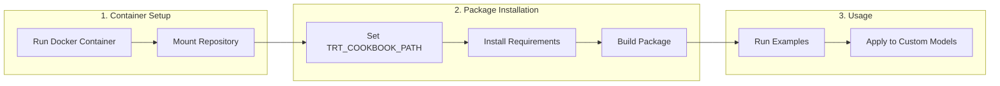
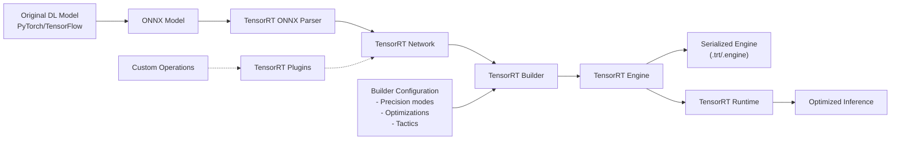
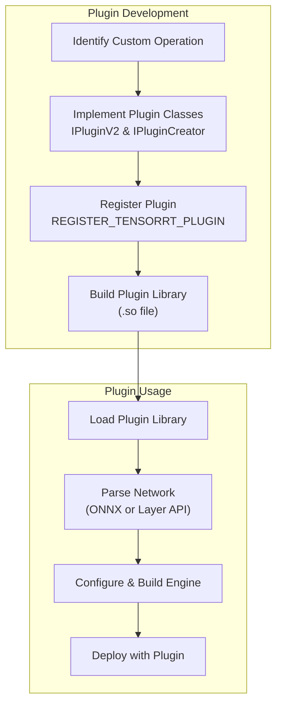

<!-- source: DeepWiki mcp.deepwiki.com · repo NVIDIA/trt-samples-for-hackathon-cn · page 2 TensorRT Cookbook · fetched 2026-10-26 -->

# TensorRT Cookbook

<details>
<summary>Relevant source files</summary>

The following files were used as context for generating this wiki page:

- [cookbook/.gitignore](cookbook/.gitignore)
- [cookbook/README.md](cookbook/README.md)

</details>


The TensorRT Cookbook is a comprehensive collection of code examples, tutorials, and reference materials designed to help developers learn and effectively use NVIDIA's TensorRT for deep learning inference optimization. It serves as a structured learning path from basic concepts to advanced optimization techniques.

For information about the TensorRT Hackathon competitions that apply these optimization techniques in competitive settings, see [TensorRT Hackathons](#3).

## Purpose and Scope

The TensorRT Cookbook aims to:

1. Provide practical, working examples of TensorRT features and workflows
2. Demonstrate integration with popular deep learning frameworks
3. Offer a progressive learning path from beginner to advanced concepts
4. Showcase custom plugin development and optimization techniques
5. Provide tools and utilities for working with TensorRT engines

The cookbook targets both TensorRT beginners and experienced developers seeking to deepen their understanding of specific TensorRT features and optimization approaches.

## Cookbook Structure and Organization

The TensorRT Cookbook is organized into nine main categories, each focusing on a different aspect of TensorRT:

```mermaid
graph TD
    CKB["TensorRT Cookbook"] --> SD["01-SimpleDemo<br>Basic examples"]
    CKB --> API["02-API<br>TensorRT API usage"]
    CKB --> WF["03-Workflow<br>Common workflows"]
    CKB --> FT["04-Feature<br>Advanced features"]
    CKB --> PL["05-Plugin<br>Plugin development"]
    CKB --> DF["06-DLFrameworkTRT<br>Framework integration"]
    CKB --> TL["07-Tool<br>Utility tools"]
    CKB --> AD["08-Advance<br>Advanced techniques"]
    CKB --> LLM["09-TRTLLM<br>TensorRT-LLM tools"]
    
    SD --> SD1["Basic network building"]
    SD --> SD2["Engine serialization"]
    SD --> SD3["Version-specific examples"]
    
    API --> API1["Layer API examples"]
    API --> API2["Builder API examples"]
    API --> API3["Config API examples"]
    
    PL --> PL1["Basic plugin examples"]
    PL --> PL2["Multi I/O plugins"]
    PL --> PL3["Custom datatype plugins"]
    
    TL --> TL1["EnginePrinter"]
    TL --> TL2["trtexec"]
    TL --> TL3["Netron"]
```



Sources: [cookbook/README.md:128-162]()

## Environment Setup and Installation

The cookbook is designed to work with NVIDIA's optimized Docker containers, which provide pre-configured environments with compatible versions of TensorRT, CUDA, and related libraries.

### Recommended Docker Images

The following Docker images are recommended for use with the cookbook:

| Docker Image | Python | CUDA | TensorRT | Notes |
|--------------|--------|------|----------|-------|
| nvcr.io/nvidia/pytorch:25.02-py3 | 3.10 | 12.8.0.038 | 10.8.0.43 | Preferred version |
| nvcr.io/nvidia/pytorch:24.04-py3 | 3.10 | 12.3.2 | 8.6.1.6 | Last with TensorRT 8.6 |
| nvcr.io/nvidia/pytorch:23.02-py3 | 3.8 | 12.0.1 | 8.5.3 | Last with PyTorch 1 |

Sources: [cookbook/README.md:29-38]()

### Setup Process



To start a container and set up the environment:

```bash
# Start container
docker run -it --gpus "device=0" --shm-size 16G \
    --name trt-cookbook -v <PathToRepo>:/trtcookbook \
    nvcr.io/nvidia/pytorch:25.02-py3 /bin/bash

# Inside container
cd <Path to cookbook repo>
export TRT_COOKBOOK_PATH=$(pwd)  # NECESSARY!
pip install -r requirements.txt

# For release usage
rm -rf build dist
python3 setup.py bdist_wheel
pip install dist/*.whl

# For development usage
pip install -e .
```

Sources: [cookbook/README.md:42-66]()

## TensorRT Development Workflow

The cookbook demonstrates the standard TensorRT optimization workflow across its various examples:



Sources: [cookbook/README.md:131-133]()

## Key Cookbook Sections

### 01-SimpleDemo: Basic Examples

Contains standalone examples demonstrating fundamental TensorRT usage:
- Basic network creation and execution
- Simple layer operations 
- Engine serialization and deserialization
- Version-specific examples for TensorRT 8.x, 9.x, and 10.x

Sources: [cookbook/README.md:130]()

### 02-API: TensorRT API Usage

Provides examples of TensorRT APIs in Python (with direct correspondence to C++ APIs):
- Layer APIs (Convolution, Shuffle, etc.)
- Builder API for network construction
- BuilderConfig API for optimization settings
- Network definition API

Sources: [cookbook/README.md:134]()

### 03-Workflow: Common TensorRT Workflows

Demonstrates common end-to-end processes for model optimization:
- PyTorch to ONNX to TensorRT conversion
- TensorFlow to TensorRT conversion
- Quantization workflows
- Profiling and performance optimization

Sources: [cookbook/README.md:138]()

### 04-Feature: Advanced Features

Covers advanced TensorRT features:
- Dynamic shapes
- Quantization techniques
- Tactics selection
- Memory optimization

Sources: [cookbook/README.md:142]()

### 05-Plugin: Custom Plugin Development

The plugin development workflow is a critical aspect of using TensorRT with operations not natively supported:



Examples include:
- Basic plugin implementation (AddScalarPlugin)
- Multi-input/output plugins (AddSubMulPlugin)
- Custom datatype plugins (Int and Bool types)
- Integration with ONNX models

Sources: [cookbook/README.md:146]()

### 06-DLFrameworkTRT: Framework Integration

Demonstrates TensorRT integration with popular deep learning frameworks:
- TensorFlow-TensorRT (TF-TRT) integration
- PyTorch-TensorRT integration
- Framework-specific optimization techniques

Sources: [cookbook/README.md:150]()

### 07-Tool: Utility Tools

Covers useful utilities for working with TensorRT:
- EnginePrinter: Tool for examining TensorRT engine details
- trtexec: Command-line tool for benchmarking and testing
- Netron: Visual tool for examining model graphs

Sources: [cookbook/README.md:154]()

### 08-Advance: Advanced Techniques

Covers sophisticated optimization techniques combining TensorRT with other CUDA and PyTorch features:
- Optimizing complex architectures
- Performance tuning for specific hardware
- Integration with other NVIDIA libraries

Sources: [cookbook/README.md:158]()

### 09-TRTLLM: TensorRT-LLM Tools

Focuses on tools and techniques specific to optimizing Large Language Models:
- LLM-specific optimizations
- TensorRT-LLM integration
- Transformer model optimization

Sources: [cookbook/README.md:162]()

## Recommended Learning Path for Beginners

If you're new to TensorRT, the following learning path is recommended:

1. **01-SimpleDemo/TensorRT10.0**: Start with basic TensorRT examples
2. **04-BuildEngineByONNXParser/pyTorch-ONNX-TensorRT**: Learn the common workflow
3. **07-Tool/Netron**: Learn to visualize and analyze model graphs
4. **07-Tool/trtexec**: Get familiar with benchmarking and testing
5. **05-Plugin/BasicExample**: Learn plugin development fundamentals
6. **05-Plugin/UseONNXParserAndPlugin-pyTorch**: See plugin integration with models

Sources: [cookbook/README.md:13-20]()

## Useful Resources

The cookbook is complemented by these resources:

- **Developer Guide**: [TensorRT Developer Guide](https://docs.nvidia.com/deeplearning/tensorrt/developer-guide/index.html)
- **API Documentation**: [C++ API](https://docs.nvidia.com/deeplearning/tensorrt/api/c_api) and [Python API](https://docs.nvidia.com/deeplearning/tensorrt/api/python_api)
- **Operators Documentation**: [TensorRT Operators](https://docs.nvidia.com/deeplearning/tensorrt/operators/docs)
- **Related Tools**:
  - [ONNX GraphSurgeon](https://docs.nvidia.com/deeplearning/tensorrt/onnx-graphsurgeon/docs/index.html)
  - [Polygraphy](https://docs.nvidia.com/deeplearning/tensorrt/polygraphy/docs/index.html)
  - [PyTorch-Quantization Toolkit](https://docs.nvidia.com/deeplearning/tensorrt/pytorch-quantization-toolkit/index.html)

Sources: [cookbook/README.md:92-122]()

## Recent Updates

The cookbook is actively maintained and updated for new TensorRT versions:

- **1st November 2024**: Updated to TensorRT 10.6, packaged as `tensorrt_cookbook.whl`
- **20th September 2024**: Updated to TensorRT 10.5
- **1st May 2024**: Updated to TensorRT 10.0 GA
- **12th February 2024**: Updated to TensorRT 9.X GA
- **18th June 2023**: Updated to TensorRT 8.6 GA

Sources: [cookbook/README.md:72-89]()

## Frequently Encountered Files

The cookbook examples generate various TensorRT-related files that you may encounter:

- **`.trt`**: Serialized TensorRT engines
- **`.onnx`**: ONNX model files
- **`.Int8Cache`**: INT8 calibration cache files
- **`.TimingCache`**: Timing cache for improved engine build times
- **`.Tacitc`**: Tactic records

Sources: [cookbook/.gitignore:9-20]()

By following the examples in the TensorRT Cookbook and exploring its resources, developers can gain comprehensive knowledge of TensorRT optimization techniques and apply them effectively to their own deep learning models.

---

