# Page: Overview

# Overview

<details>
<summary>Relevant source files</summary>

The following files were used as context for generating this wiki page:

- [Hackathon2022/README.md](Hackathon2022/README.md)
- [README.md](README.md)
- [cookbook/.gitignore](cookbook/.gitignore)
- [cookbook/README.md](cookbook/README.md)

</details>


## Purpose and Scope

This documentation covers the NVIDIA TensorRT samples repository, a comprehensive collection of resources for learning and applying NVIDIA's TensorRT optimization technology. The repository provides educational materials, code examples, and resources from annual Hackathon competitions, all aimed at helping developers optimize deep learning models for inference using TensorRT.

The repository serves multiple purposes:
- Providing learning resources for TensorRT beginners
- Offering code examples demonstrating TensorRT features and best practices
- Documenting optimization techniques from previous Hackathon competitions
- Serving as a reference for common TensorRT development workflows

For detailed information about specific components, see [TensorRT Cookbook](#2), [TensorRT Hackathons](#3), or [Model Optimization Techniques](#4).

Sources: [README.md:1-5](), [README.md:9-13]()

## Repository Structure

The repository is organized into three main sections:

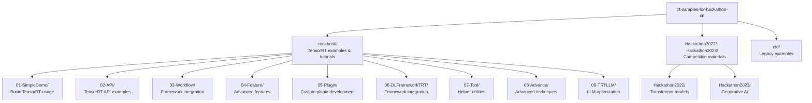

Sources: [README.md:7-13](), [cookbook/README.md:124-167]()

### Main Sections

1. **cookbook**: Collection of TensorRT code examples organized by topic, serving as a comprehensive cookbook for TensorRT techniques.
   
2. **Hackathon materials**: Annual TensorRT Hackathon competition resources, including problem descriptions, reference implementations, and winning solutions.
   
3. **old**: Legacy TensorRT examples that may be migrated to the cookbook in future updates.

Sources: [README.md:9-13]()

## TensorRT Development Workflow

The repository demonstrates the typical workflow for optimizing models with TensorRT, from model export to optimized inference:

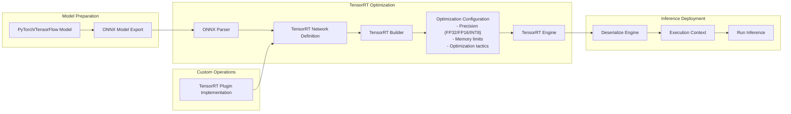

Sources: [cookbook/README.md:13-20]()

## Key Focus Areas

The repository focuses on optimizing several types of deep learning models:

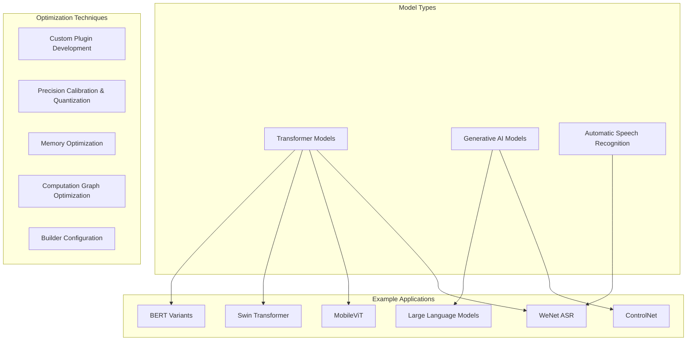

Sources: [Hackathon2022/README.md:1-41](), [cookbook/README.md:124-167]()

## Setup and Environment

The repository recommends using NVIDIA-optimized Docker containers for running the examples:

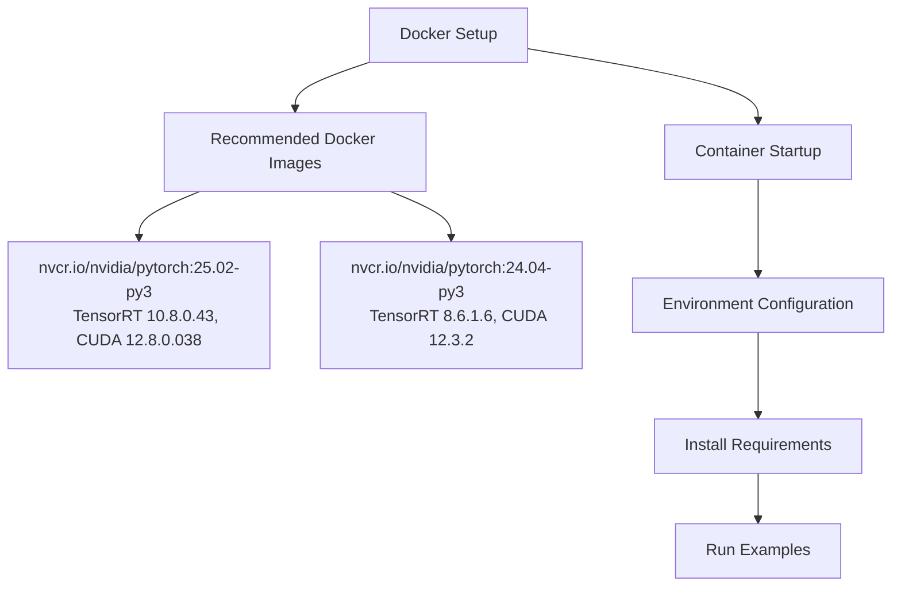

The repository provides detailed setup instructions for creating a suitable development environment with the necessary versions of TensorRT, CUDA, and Python packages.

Sources: [cookbook/README.md:24-70]()

## Available Resources

The repository includes a variety of additional resources:

| Resource Type | Description | Location |
|--------------|-------------|----------|
| Video Tutorials | TensorRT tutorial videos on Bilibili | Links in repository READMEs |
| Hackathon Slides | Presentation slides from competitions | Linked in Baidu Netdisk |
| Documentation Links | Links to official TensorRT documentation | In cookbook README |
| Example Datasets | Sample datasets for testing models | cookbook/00-Data |
| Reference Implementations | Optimized model implementations | Hackathon directories |

For more detailed information about specific repository components, consult the respective sections in the documentation: [TensorRT Cookbook](#2), [TensorRT Hackathons](#3), or [Model Optimization Techniques](#4).

Sources: [README.md:15-19](), [cookbook/README.md:5-11](), [cookbook/README.md:91-123]()

---

# Page: TensorRT Cookbook

# TensorRT Cookbook

<details>
<summary>Relevant source files</summary>

The following files were used as context for generating this wiki page:

- [cookbook/.gitignore](cookbook/.gitignore)
- [cookbook/README.md](cookbook/README.md)

</details>


The TensorRT Cookbook is a comprehensive collection of code examples, tutorials, and reference materials designed to help developers learn and effectively use NVIDIA's TensorRT for deep learning inference optimization. It serves as a structured learning path from basic concepts to advanced optimization techniques.

For information about the TensorRT Hackathon competitions that apply these optimization techniques in competitive settings, see [TensorRT Hackathons](#3).

## Purpose and Scope

The TensorRT Cookbook aims to:

1. Provide practical, working examples of TensorRT features and workflows
2. Demonstrate integration with popular deep learning frameworks
3. Offer a progressive learning path from beginner to advanced concepts
4. Showcase custom plugin development and optimization techniques
5. Provide tools and utilities for working with TensorRT engines

The cookbook targets both TensorRT beginners and experienced developers seeking to deepen their understanding of specific TensorRT features and optimization approaches.

## Cookbook Structure and Organization

The TensorRT Cookbook is organized into nine main categories, each focusing on a different aspect of TensorRT:

```mermaid
graph TD
    CKB["TensorRT Cookbook"] --> SD["01-SimpleDemo<br>Basic examples"]
    CKB --> API["02-API<br>TensorRT API usage"]
    CKB --> WF["03-Workflow<br>Common workflows"]
    CKB --> FT["04-Feature<br>Advanced features"]
    CKB --> PL["05-Plugin<br>Plugin development"]
    CKB --> DF["06-DLFrameworkTRT<br>Framework integration"]
    CKB --> TL["07-Tool<br>Utility tools"]
    CKB --> AD["08-Advance<br>Advanced techniques"]
    CKB --> LLM["09-TRTLLM<br>TensorRT-LLM tools"]
    
    SD --> SD1["Basic network building"]
    SD --> SD2["Engine serialization"]
    SD --> SD3["Version-specific examples"]
    
    API --> API1["Layer API examples"]
    API --> API2["Builder API examples"]
    API --> API3["Config API examples"]
    
    PL --> PL1["Basic plugin examples"]
    PL --> PL2["Multi I/O plugins"]
    PL --> PL3["Custom datatype plugins"]
    
    TL --> TL1["EnginePrinter"]
    TL --> TL2["trtexec"]
    TL --> TL3["Netron"]
```

Sources: [cookbook/README.md:128-162]()

## Environment Setup and Installation

The cookbook is designed to work with NVIDIA's optimized Docker containers, which provide pre-configured environments with compatible versions of TensorRT, CUDA, and related libraries.

### Recommended Docker Images

The following Docker images are recommended for use with the cookbook:

| Docker Image | Python | CUDA | TensorRT | Notes |
|--------------|--------|------|----------|-------|
| nvcr.io/nvidia/pytorch:25.02-py3 | 3.10 | 12.8.0.038 | 10.8.0.43 | Preferred version |
| nvcr.io/nvidia/pytorch:24.04-py3 | 3.10 | 12.3.2 | 8.6.1.6 | Last with TensorRT 8.6 |
| nvcr.io/nvidia/pytorch:23.02-py3 | 3.8 | 12.0.1 | 8.5.3 | Last with PyTorch 1 |

Sources: [cookbook/README.md:29-38]()

### Setup Process

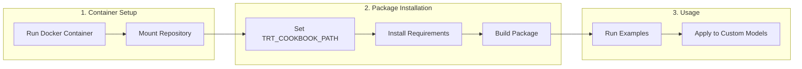

To start a container and set up the environment:

```bash
# Start container
docker run -it --gpus "device=0" --shm-size 16G \
    --name trt-cookbook -v <PathToRepo>:/trtcookbook \
    nvcr.io/nvidia/pytorch:25.02-py3 /bin/bash

# Inside container
cd <Path to cookbook repo>
export TRT_COOKBOOK_PATH=$(pwd)  # NECESSARY!
pip install -r requirements.txt

# For release usage
rm -rf build dist
python3 setup.py bdist_wheel
pip install dist/*.whl

# For development usage
pip install -e .
```

Sources: [cookbook/README.md:42-66]()

## TensorRT Development Workflow

The cookbook demonstrates the standard TensorRT optimization workflow across its various examples:

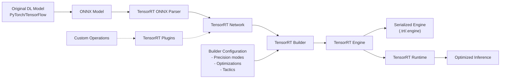

Sources: [cookbook/README.md:131-133]()

## Key Cookbook Sections

### 01-SimpleDemo: Basic Examples

Contains standalone examples demonstrating fundamental TensorRT usage:
- Basic network creation and execution
- Simple layer operations 
- Engine serialization and deserialization
- Version-specific examples for TensorRT 8.x, 9.x, and 10.x

Sources: [cookbook/README.md:130]()

### 02-API: TensorRT API Usage

Provides examples of TensorRT APIs in Python (with direct correspondence to C++ APIs):
- Layer APIs (Convolution, Shuffle, etc.)
- Builder API for network construction
- BuilderConfig API for optimization settings
- Network definition API

Sources: [cookbook/README.md:134]()

### 03-Workflow: Common TensorRT Workflows

Demonstrates common end-to-end processes for model optimization:
- PyTorch to ONNX to TensorRT conversion
- TensorFlow to TensorRT conversion
- Quantization workflows
- Profiling and performance optimization

Sources: [cookbook/README.md:138]()

### 04-Feature: Advanced Features

Covers advanced TensorRT features:
- Dynamic shapes
- Quantization techniques
- Tactics selection
- Memory optimization

Sources: [cookbook/README.md:142]()

### 05-Plugin: Custom Plugin Development

The plugin development workflow is a critical aspect of using TensorRT with operations not natively supported:

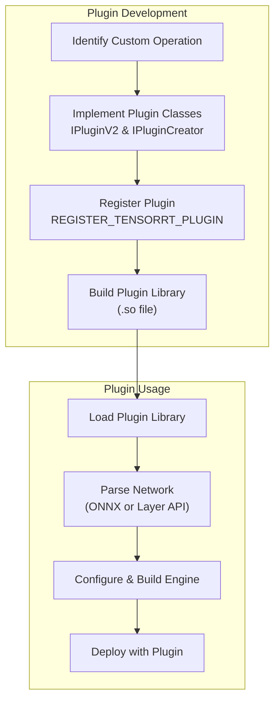

Examples include:
- Basic plugin implementation (AddScalarPlugin)
- Multi-input/output plugins (AddSubMulPlugin)
- Custom datatype plugins (Int and Bool types)
- Integration with ONNX models

Sources: [cookbook/README.md:146]()

### 06-DLFrameworkTRT: Framework Integration

Demonstrates TensorRT integration with popular deep learning frameworks:
- TensorFlow-TensorRT (TF-TRT) integration
- PyTorch-TensorRT integration
- Framework-specific optimization techniques

Sources: [cookbook/README.md:150]()

### 07-Tool: Utility Tools

Covers useful utilities for working with TensorRT:
- EnginePrinter: Tool for examining TensorRT engine details
- trtexec: Command-line tool for benchmarking and testing
- Netron: Visual tool for examining model graphs

Sources: [cookbook/README.md:154]()

### 08-Advance: Advanced Techniques

Covers sophisticated optimization techniques combining TensorRT with other CUDA and PyTorch features:
- Optimizing complex architectures
- Performance tuning for specific hardware
- Integration with other NVIDIA libraries

Sources: [cookbook/README.md:158]()

### 09-TRTLLM: TensorRT-LLM Tools

Focuses on tools and techniques specific to optimizing Large Language Models:
- LLM-specific optimizations
- TensorRT-LLM integration
- Transformer model optimization

Sources: [cookbook/README.md:162]()

## Recommended Learning Path for Beginners

If you're new to TensorRT, the following learning path is recommended:

1. **01-SimpleDemo/TensorRT10.0**: Start with basic TensorRT examples
2. **04-BuildEngineByONNXParser/pyTorch-ONNX-TensorRT**: Learn the common workflow
3. **07-Tool/Netron**: Learn to visualize and analyze model graphs
4. **07-Tool/trtexec**: Get familiar with benchmarking and testing
5. **05-Plugin/BasicExample**: Learn plugin development fundamentals
6. **05-Plugin/UseONNXParserAndPlugin-pyTorch**: See plugin integration with models

Sources: [cookbook/README.md:13-20]()

## Useful Resources

The cookbook is complemented by these resources:

- **Developer Guide**: [TensorRT Developer Guide](https://docs.nvidia.com/deeplearning/tensorrt/developer-guide/index.html)
- **API Documentation**: [C++ API](https://docs.nvidia.com/deeplearning/tensorrt/api/c_api) and [Python API](https://docs.nvidia.com/deeplearning/tensorrt/api/python_api)
- **Operators Documentation**: [TensorRT Operators](https://docs.nvidia.com/deeplearning/tensorrt/operators/docs)
- **Related Tools**:
  - [ONNX GraphSurgeon](https://docs.nvidia.com/deeplearning/tensorrt/onnx-graphsurgeon/docs/index.html)
  - [Polygraphy](https://docs.nvidia.com/deeplearning/tensorrt/polygraphy/docs/index.html)
  - [PyTorch-Quantization Toolkit](https://docs.nvidia.com/deeplearning/tensorrt/pytorch-quantization-toolkit/index.html)

Sources: [cookbook/README.md:92-122]()

## Recent Updates

The cookbook is actively maintained and updated for new TensorRT versions:

- **1st November 2024**: Updated to TensorRT 10.6, packaged as `tensorrt_cookbook.whl`
- **20th September 2024**: Updated to TensorRT 10.5
- **1st May 2024**: Updated to TensorRT 10.0 GA
- **12th February 2024**: Updated to TensorRT 9.X GA
- **18th June 2023**: Updated to TensorRT 8.6 GA

Sources: [cookbook/README.md:72-89]()

## Frequently Encountered Files

The cookbook examples generate various TensorRT-related files that you may encounter:

- **`.trt`**: Serialized TensorRT engines
- **`.onnx`**: ONNX model files
- **`.Int8Cache`**: INT8 calibration cache files
- **`.TimingCache`**: Timing cache for improved engine build times
- **`.Tacitc`**: Tactic records

Sources: [cookbook/.gitignore:9-20]()

By following the examples in the TensorRT Cookbook and exploring its resources, developers can gain comprehensive knowledge of TensorRT optimization techniques and apply them effectively to their own deep learning models.

---

# Page: API Usage Examples

# API Usage Examples

<details>
<summary>Relevant source files</summary>

The following files were used as context for generating this wiki page:

- [cookbook/.pre-commit-config.yaml](cookbook/.pre-commit-config.yaml)
- [cookbook/00-Data/README.md](cookbook/00-Data/README.md)
- [cookbook/00-Data/get_model_part2.py](cookbook/00-Data/get_model_part2.py)
- [cookbook/02-API/Builder/main.py](cookbook/02-API/Builder/main.py)
- [cookbook/02-API/BuilderConfig/main.py](cookbook/02-API/BuilderConfig/main.py)
- [cookbook/02-API/Layer/Constant/main.py](cookbook/02-API/Layer/Constant/main.py)
- [cookbook/02-API/Layer/Convolution/main.py](cookbook/02-API/Layer/Convolution/main.py)
- [cookbook/02-API/Layer/Cumulative/README.md](cookbook/02-API/Layer/Cumulative/README.md)
- [cookbook/02-API/Layer/Cumulative/main.py](cookbook/02-API/Layer/Cumulative/main.py)
- [cookbook/02-API/Layer/Cumulative/unit_test.sh](cookbook/02-API/Layer/Cumulative/unit_test.sh)
- [cookbook/02-API/Layer/Deconvolution/main.py](cookbook/02-API/Layer/Deconvolution/main.py)
- [cookbook/02-API/Layer/DynamicQuantize/README.md](cookbook/02-API/Layer/DynamicQuantize/README.md)
- [cookbook/02-API/Layer/DynamicQuantize/main.py](cookbook/02-API/Layer/DynamicQuantize/main.py)
- [cookbook/02-API/Layer/DynamicQuantize/unit_test.sh](cookbook/02-API/Layer/DynamicQuantize/unit_test.sh)
- [cookbook/02-API/Layer/Elementwise/main.py](cookbook/02-API/Layer/Elementwise/main.py)

</details>


This page provides a comprehensive guide to TensorRT API usage patterns demonstrated in the cookbook examples. It focuses on showing practical implementations of various TensorRT APIs, covering layer creation, network configuration, and engine building. For information about plugin development, see [Plugin Development](#2.2), and for details on utility tools, refer to [Tools and Utilities](#2.3).

## Purpose and Scope

The TensorRT API examples illustrate how to effectively use TensorRT's programming interfaces to build and optimize neural network inference engines. These examples demonstrate:

- Creating and configuring different layer types
- Building TensorRT networks programmatically
- Configuring engine parameters for optimal performance
- Working with different precision types and optimization settings

These examples serve as both learning resources and reusable code patterns for developers implementing TensorRT in their own applications.

## TensorRT API Component Overview

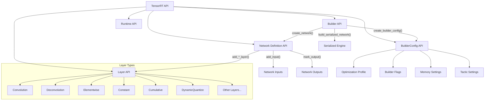

Sources: [cookbook/02-API/Builder/main.py](), [cookbook/02-API/BuilderConfig/main.py](), [cookbook/02-API/Layer/Convolution/main.py]()

## TensorRT Network Building Workflow

```mermaid
flowchart LR
    subgraph "Network Definition"
        CreateBuilder["Create Builder"] --> CreateNetwork["Create Network"]
        CreateNetwork --> AddInputs["Add Network Inputs"]
        AddInputs --> AddLayers["Add Layers"]
        AddLayers --> MarkOutputs["Mark Network Outputs"]
    end
    
    subgraph "Configuration"
        CreateBuilder --> CreateConfig["Create BuilderConfig"]
        CreateConfig --> SetFlags["Set Precision Flags"]
        SetFlags --> SetMemory["Set Memory Limits"]
        SetMemory --> AddProfiles["Add Optimization Profiles"]
    end
    
    subgraph "Engine Building"
        MarkOutputs --> BuildEngine["Build Engine"]
        AddProfiles --> BuildEngine
        BuildEngine --> Serialize["Serialize Engine"]
    end
    
    subgraph "Inference"
        Serialize --> Deserialize["Deserialize Engine"]
        Deserialize --> CreateContext["Create Execution Context"]
        CreateContext --> SetInputs["Set Input Buffers"]
        SetInputs --> Execute["Execute Inference"]
        Execute --> GetOutputs["Get Output Results"]
    end
```

Sources: [cookbook/02-API/Builder/main.py](), [cookbook/02-API/BuilderConfig/main.py]()

## Layer API Examples

The Layer API examples demonstrate how to create and configure various layer types in a TensorRT network. Each example follows a similar pattern:

1. Create a TensorRT wrapper (using the helper class `TRTWrapperV1`)
2. Define input tensors
3. Add the specific layer with appropriate parameters
4. Configure additional layer properties
5. Build and run the network

### Convolution Layer

The Convolution layer API provides functionalities to apply convolution operations on input tensors.

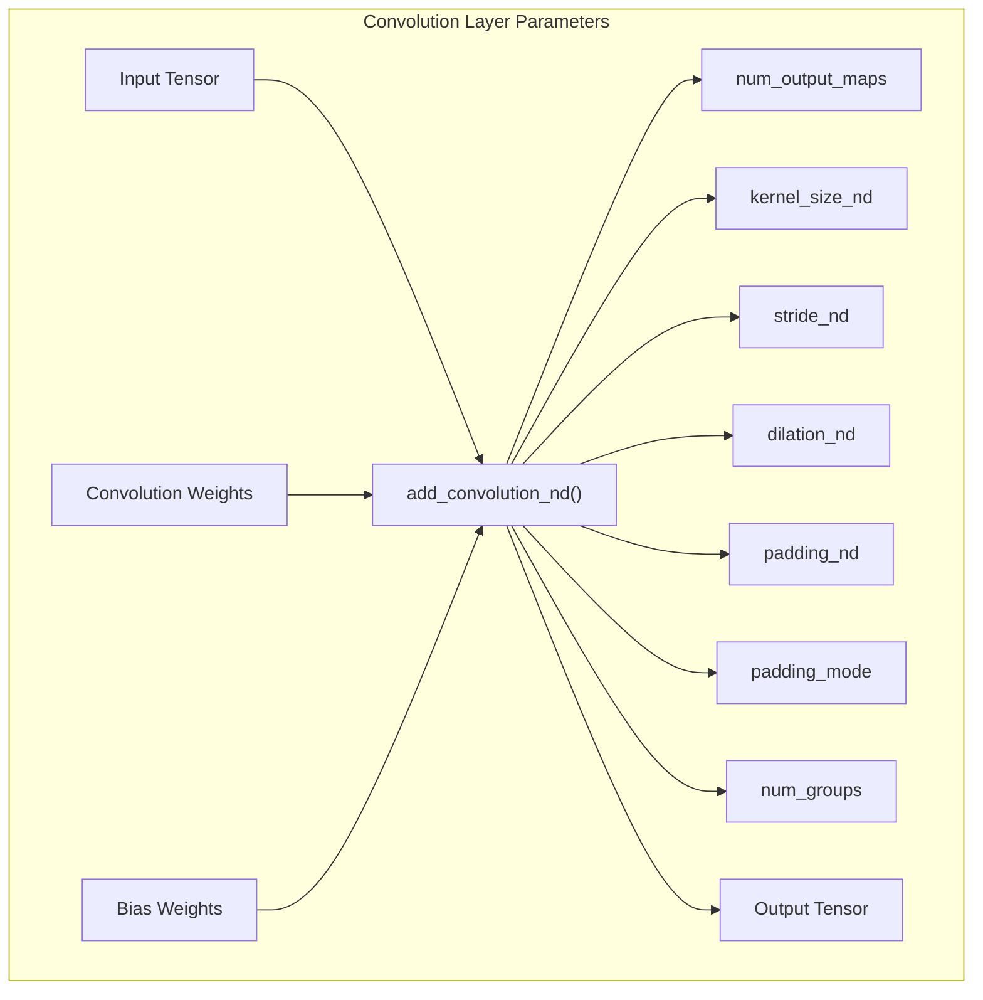

Key features demonstrated:
- Basic 2D convolution ([cookbook/02-API/Layer/Convolution/main.py:30-41]())
- Stride, dilation, and padding configurations ([cookbook/02-API/Layer/Convolution/main.py:44-61]())
- Group convolution ([cookbook/02-API/Layer/Convolution/main.py:64-78]())
- 3D convolution ([cookbook/02-API/Layer/Convolution/main.py:81-92]())
- Quantized INT8 convolution with QDQ nodes ([cookbook/02-API/Layer/Convolution/main.py:95-114]())

Sources: [cookbook/02-API/Layer/Convolution/main.py]()

### Deconvolution Layer

The Deconvolution layer API (transposed convolution) provides similar functionality to the Convolution layer but performs the inverse operation.

Key features demonstrated:
- Basic deconvolution configuration ([cookbook/02-API/Layer/Deconvolution/main.py:29-40]())
- Stride, dilation, and padding parameters ([cookbook/02-API/Layer/Deconvolution/main.py:43-60]())
- Group deconvolution ([cookbook/02-API/Layer/Deconvolution/main.py:63-77]())
- 3D deconvolution ([cookbook/02-API/Layer/Deconvolution/main.py:80-91]())
- INT8 quantized deconvolution ([cookbook/02-API/Layer/Deconvolution/main.py:93-113]())

Sources: [cookbook/02-API/Layer/Deconvolution/main.py]()

### Elementwise Layer

The Elementwise layer performs element-wise operations between two tensors.

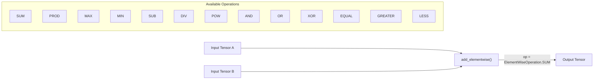

Key features demonstrated:
- Basic elementwise addition ([cookbook/02-API/Layer/Elementwise/main.py:26-35]())
- Element broadcasting across dimensions ([cookbook/02-API/Layer/Elementwise/main.py:38-51]())

Sources: [cookbook/02-API/Layer/Elementwise/main.py]()

### Constant Layer

The Constant layer adds a tensor with constant values to the network.

Key features demonstrated:
- Adding constant data to a network ([cookbook/02-API/Layer/Constant/main.py:41-49]())
- Working with reduced precision types like INT4 ([cookbook/02-API/Layer/Constant/main.py:52-63]())

Sources: [cookbook/02-API/Layer/Constant/main.py]()

### Cumulative Layer

The Cumulative layer performs operations like sum or product along a specified axis.

Key features demonstrated:
- Cumulative sum operation along a dimension ([cookbook/02-API/Layer/Cumulative/main.py:24-35]())
- Configuration options for exclusive/inclusive and forward/reverse computation

Sources: [cookbook/02-API/Layer/Cumulative/main.py]()

### DynamicQuantize Layer

The DynamicQuantize layer performs dynamic quantization of tensors to reduced precision formats.

Key features demonstrated:
- Dynamic quantization to reduced precision (FP4) ([cookbook/02-API/Layer/DynamicQuantize/main.py:24-38]())
- Configuration of quantization axis and block size
- Setting scale data type

Sources: [cookbook/02-API/Layer/DynamicQuantize/main.py]()

## Builder API Examples

The Builder API is the entry point for creating TensorRT networks and engines.

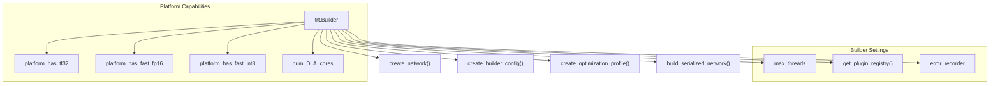

Key features demonstrated:
- Creating a builder with appropriate logging level ([cookbook/02-API/Builder/main.py:18-21]())
- Creating a network with explicit batch dimensions ([cookbook/02-API/Builder/main.py:25-29]())
- Querying platform capabilities for different precision types ([cookbook/02-API/Builder/main.py:37-42]())
- Setting maximum threads for build optimization ([cookbook/02-API/Builder/main.py:45]())
- Checking if a network is supported ([cookbook/02-API/Builder/main.py:46]())
- Accessing the plugin registry ([cookbook/02-API/Builder/main.py:47]())
- Building and serializing a network ([cookbook/02-API/Builder/main.py:51]())

Sources: [cookbook/02-API/Builder/main.py]()

## BuilderConfig API Examples

The BuilderConfig API allows configuration of various engine building parameters to control performance and precision.

```mermaid
flowchart TD
    Config["trt.BuilderConfig"] --> Flags["flags"]
    Config --> QuantizationFlags["quantization_flags"]
    Config --> MemoryLimits["memory_pool_limit"]
    Config --> Profiles["add_optimization_profile()"]
    
    subgraph "Device Settings"
        Config --> EngineCapability["engine_capability"]
        Config --> DeviceType["set_device_type()"]
        Config --> DLACore["DLA_core"]
    end
    
    subgraph "Precision Flags"
        Flags --> FP16["FP16"]
        Flags --> INT8["INT8"]
        Flags --> TF32["TF32"]
        Flags --> REFIT["REFIT"]
        Flags --> DEBUG["DEBUG"]
        Flags --> SAFETY_SCOPE["SAFETY_SCOPE"]
        Flags --> OBEY_PRECISION_CONSTRAINTS["OBEY_PRECISION_CONSTRAINTS"]
    end
    
    subgraph "Optimization Settings"
        Config --> TacticSources["set_tactic_sources()"]
        Config --> TimingCache["set_timing_cache()"]
        Config --> ProfileVerbosity["profiling_verbosity"]
        Config --> BuilderLevel["builder_optimization_level"]
    end
```

Key features demonstrated:
- Setting engine capability mode ([cookbook/02-API/BuilderConfig/main.py:33-37]())
- Managing device types (GPU vs. DLA) ([cookbook/02-API/BuilderConfig/main.py:38-48]())
- Configuring precision flags (FP16, INT8, TF32) ([cookbook/02-API/BuilderConfig/main.py:63-67]())
- Setting quantization flags ([cookbook/02-API/BuilderConfig/main.py:69-72]())
- Enabling preview features ([cookbook/02-API/BuilderConfig/main.py:75-76]())
- Setting memory limits for workspace and tactics ([cookbook/02-API/BuilderConfig/main.py:79-84]())
- Configuring optimization parameters ([cookbook/02-API/BuilderConfig/main.py:89-92]())
- Setting tactic sources ([cookbook/02-API/BuilderConfig/main.py:106-114]())
- Configuring profiling verbosity ([cookbook/02-API/BuilderConfig/main.py:116-120]())

Sources: [cookbook/02-API/BuilderConfig/main.py]()

## Working with Optimization Profiles

Optimization profiles are essential for handling dynamic shapes in TensorRT networks. The examples demonstrate:

1. Creating an optimization profile ([cookbook/02-API/BuilderConfig/main.py:21-22]())
2. Setting input tensor shapes with min, optimal, and max dimensions ([cookbook/02-API/BuilderConfig/main.py:26]())
3. Adding the profile to the builder configuration ([cookbook/02-API/BuilderConfig/main.py:27]())

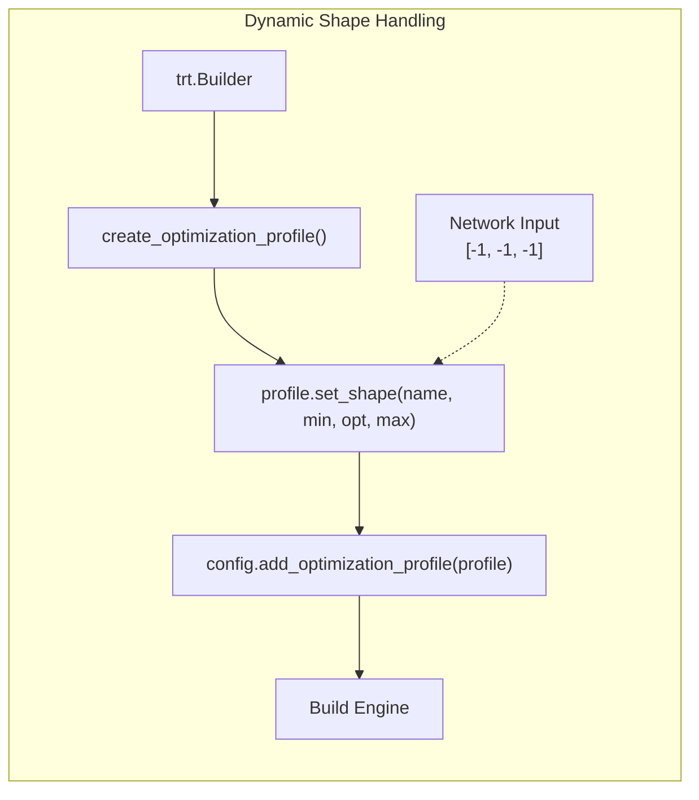

Sources: [cookbook/02-API/BuilderConfig/main.py]()

## Common Patterns and Best Practices

Based on the examples, several best practices emerge for working with TensorRT APIs:

| Best Practice | Description | Example Location |
|---------------|-------------|------------------|
| Appropriate logging | Set appropriate logging levels for different development stages | [cookbook/02-API/Builder/main.py:18]() |
| Explicit batch dimensions | Use explicit batch dimensions for more flexibility | [cookbook/02-API/Builder/main.py:25-29]() |
| Optimization profiles | Configure optimization profiles for dynamic shapes | [cookbook/02-API/BuilderConfig/main.py:21-27]() |
| Memory management | Set appropriate workspace memory limits | [cookbook/02-API/BuilderConfig/main.py:79-84]() |
| Precision selection | Select appropriate precision based on hardware capabilities | [cookbook/02-API/Builder/main.py:37-42](), [cookbook/02-API/BuilderConfig/main.py:63-67]() |
| Layer configuration | Configure layer parameters appropriately for the task | [cookbook/02-API/Layer/Convolution/main.py:51-57]() |
| QDQ patterns | Use proper QDQ (Quantize-Dequantize) patterns for INT8 precision | [cookbook/02-API/Layer/Convolution/main.py:95-114]() |

Sources: [cookbook/02-API/Builder/main.py](), [cookbook/02-API/BuilderConfig/main.py](), [cookbook/02-API/Layer/Convolution/main.py]()

## Conclusion

The TensorRT API examples in the cookbook provide practical demonstrations of key TensorRT functionalities. By studying these examples, developers can learn how to effectively use the TensorRT API to build and optimize deep learning inference engines for their applications.

For more advanced usage, including plugin development, see [Plugin Development](#2.2), and for tools to inspect and analyze TensorRT engines, see [Tools and Utilities](#2.3).

---

# Page: Plugin Development

# Plugin Development

<details>
<summary>Relevant source files</summary>

The following files were used as context for generating this wiki page:

- [cookbook/.gitattributes](cookbook/.gitattributes)
- [cookbook/05-Plugin/BasicExample/AddScalarPlugin.cu](cookbook/05-Plugin/BasicExample/AddScalarPlugin.cu)
- [cookbook/05-Plugin/BasicExample/AddScalarPlugin.h](cookbook/05-Plugin/BasicExample/AddScalarPlugin.h)
- [cookbook/05-Plugin/BasicExample/Makefile](cookbook/05-Plugin/BasicExample/Makefile)
- [cookbook/05-Plugin/BasicExample/README.md](cookbook/05-Plugin/BasicExample/README.md)

</details>


## Purpose and Scope

This document provides a comprehensive guide to developing custom plugins for NVIDIA TensorRT. Custom plugins allow you to extend TensorRT's functionality by implementing operations that aren't natively supported in the TensorRT core. This page covers the plugin architecture, implementation details, development workflow, and examples from the TensorRT cookbook repository.

## Plugin Architecture in TensorRT

TensorRT plugins follow a specific architecture with well-defined interfaces and components that enable the integration of custom operations into the TensorRT engine.

### Plugin Interfaces Hierarchy

```mermaid
classDiagram
    class "IPluginV3" {
        +getCapabilityInterface()
        +clone()
    }
    
    class "IPluginV3OneCore" {
        +getPluginName()
        +getPluginVersion()
        +getPluginNamespace()
    }
    
    class "IPluginV3OneBuild" {
        +configurePlugin()
        +getOutputDataTypes()
        +getOutputShapes()
        +supportsFormatCombination()
        +getNbOutputs()
        +getWorkspaceSize()
    }
    
    class "IPluginV3OneRuntime" {
        +setTactic()
        +onShapeChange()
        +enqueue()
        +attachToContext()
        +getFieldsToSerialize()
    }
    
    class "Custom Plugin Class" {
        -Plugin parameters
        -Implementation methods
    }
    
    class "Plugin Creator" {
        +getPluginName()
        +getPluginVersion()
        +getFieldNames()
        +createPlugin()
        +getPluginNamespace()
    }
    
    "IPluginV3" <|-- "IPluginV3OneCore"
    "IPluginV3" <|-- "IPluginV3OneBuild"
    "IPluginV3" <|-- "IPluginV3OneRuntime"
    "IPluginV3OneCore" <|-- "Custom Plugin Class"
    "IPluginV3OneBuild" <|-- "Custom Plugin Class"
    "IPluginV3OneRuntime" <|-- "Custom Plugin Class"
    "Plugin Creator" --> "Custom Plugin Class" : creates
```

Sources: [cookbook/05-Plugin/BasicExample/AddScalarPlugin.h:29-69]()

### Plugin Lifecycle

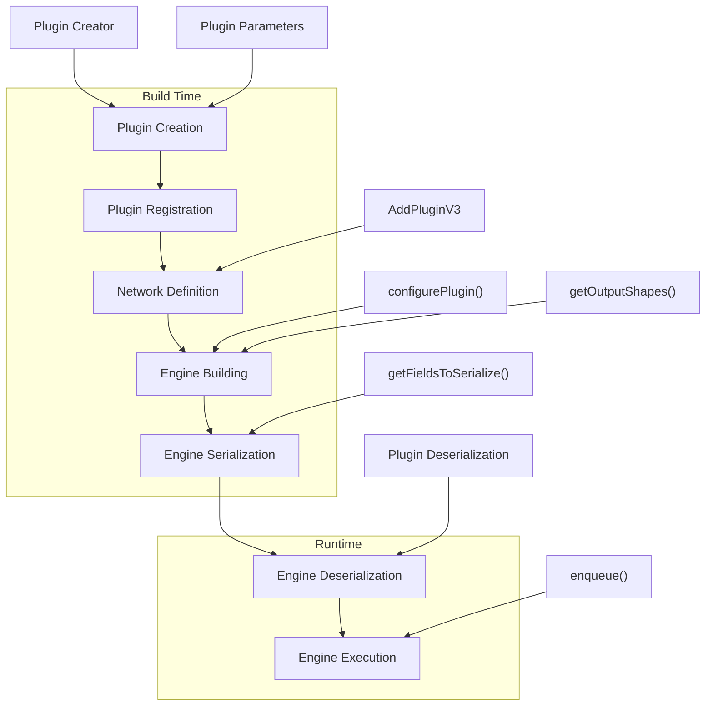

Sources: [cookbook/05-Plugin/BasicExample/AddScalarPlugin.h:29-69](), [cookbook/05-Plugin/BasicExample/AddScalarPlugin.cu:34-204]()

## Key Components of TensorRT Plugins

### 1. Plugin Class

The plugin class implements multiple interfaces that define its behavior during different phases of the TensorRT workflow:

- **IPluginV3**: Base interface for all plugins
- **IPluginV3OneCore**: Core plugin functionality
- **IPluginV3OneBuild**: Build-time functionality
- **IPluginV3OneRuntime**: Runtime functionality

Each plugin must implement various methods defined in these interfaces, such as shape calculation, data type handling, and the actual computation kernel.

Sources: [cookbook/05-Plugin/BasicExample/AddScalarPlugin.h:29-69]()

### 2. Plugin Creator Class

The plugin creator is responsible for:
- Defining the plugin's attributes
- Providing methods to create new instances of the plugin
- Registering the plugin with TensorRT

```mermaid
classDiagram
    class "IPluginCreatorV3One" {
        +getPluginName()
        +getPluginVersion()
        +getFieldNames()
        +createPlugin()
        +getPluginNamespace()
    }
    
    class "AddScalarPluginCreator" {
        -mFC: PluginFieldCollection
        -mPluginAttributes: vector<PluginField>
        +AddScalarPluginCreator()
        +getPluginName()
        +getPluginVersion()
        +getFieldNames()
        +createPlugin()
        +getPluginNamespace()
    }
    
    "IPluginCreatorV3One" <|-- "AddScalarPluginCreator"
```

Sources: [cookbook/05-Plugin/BasicExample/AddScalarPlugin.h:71-84](), [cookbook/05-Plugin/BasicExample/AddScalarPlugin.cu:206-253]()

### 3. Plugin Registration

Plugins must be registered with TensorRT using the `REGISTER_TENSORRT_PLUGIN` macro to make them available for use.

Sources: [cookbook/05-Plugin/BasicExample/AddScalarPlugin.cu:254]()

## Case Study: AddScalarPlugin Implementation

Let's examine a basic plugin example from the cookbook that adds a scalar value to each element of an input tensor.

### Plugin Implementation Overview

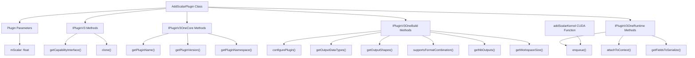

Sources: [cookbook/05-Plugin/BasicExample/AddScalarPlugin.h:29-69](), [cookbook/05-Plugin/BasicExample/AddScalarPlugin.cu:20-30](), [cookbook/05-Plugin/BasicExample/AddScalarPlugin.cu:34-204]()

### Key Method Implementations

#### Shape and Data Type Handling

The plugin must determine the output shapes and data types based on the input:

- `getOutputShapes()`: Determines the output tensor dimensions (matches the input dimensions)
- `getOutputDataTypes()`: Defines the output data type (same as input in this case)
- `supportsFormatCombination()`: Specifies which tensor formats and data types are supported

Sources: [cookbook/05-Plugin/BasicExample/AddScalarPlugin.cu:86-102](), [cookbook/05-Plugin/BasicExample/AddScalarPlugin.cu:104-121]()

#### Computation Kernel

The actual computation is implemented as a CUDA kernel that runs on the GPU:

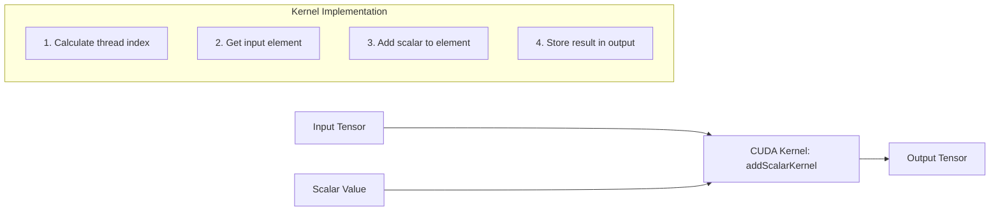

Sources: [cookbook/05-Plugin/BasicExample/AddScalarPlugin.cu:20-30](), [cookbook/05-Plugin/BasicExample/AddScalarPlugin.cu:177-188]()

#### Plugin Creator

The creator defines the plugin's attributes and creates instances of the plugin:

```mermaid
flowchart TD
    A["AddScalarPluginCreator"] --> B["Define Plugin Attributes"]
    B --> C["mPluginAttributes: vector<PluginField>"]
    B --> D["mFC: PluginFieldCollection"]
    A --> E["Plugin Creation Methods"]
    E --> F["createPlugin()"]
    F --> G["Parse scalar value from PluginFieldCollection"]
    G --> H["Create new AddScalarPlugin instance"]
```

Sources: [cookbook/05-Plugin/BasicExample/AddScalarPlugin.cu:206-246]()

## Plugin Development Workflow

### 1. Define Plugin Requirements

- Identify the operation you need to implement
- Determine input/output tensor shapes and data types
- Define any parameters required for the operation

### 2. Implement Plugin Classes

1. Create your plugin class implementing the required interfaces
2. Create a plugin creator class
3. Implement the CUDA kernel for your operation

```mermaid
flowchart TD
    A["1. Define Plugin Requirements"] --> B["2. Implement Plugin Classes"]
    B --> C["3. Compile and Build Plugin"]
    C --> D["4. Use Plugin in TensorRT Network"]
    D --> E["5. Build and Serialize Engine"]
    E --> F["6. Deploy and Execute"]
    
    B1["- Implement plugin interfaces<br>- Implement CUDA kernel<br>- Create plugin creator class<br>- Register plugin"] --> B
    C1["- Compile .cu files to .o<br>- Build shared library (.so)"] --> C
    D1["- Register plugin namespace<br>- Create plugin with createPlugin()<br>- Add plugin to network with addPluginV3()"] --> D
```

Sources: [cookbook/05-Plugin/BasicExample/Makefile:1-28]()

### 3. Build and Use the Plugin

The plugin must be compiled and built into a shared library that can be loaded by TensorRT:

1. Compile the plugin source files
2. Link into a shared library (.so file)
3. Load the plugin when building your TensorRT application

The example Makefile demonstrates this process:

Sources: [cookbook/05-Plugin/BasicExample/Makefile:7-16]()

## Plugin Examples in the Cookbook

The TensorRT cookbook repository includes several plugin examples that demonstrate different aspects of plugin development:

| Example | Description | Location |
|---------|-------------|----------|
| AddScalarPlugin | Basic plugin that adds a scalar value to a tensor | cookbook/05-Plugin/BasicExample |
| AddSubMulPlugin | Multi-input/output plugin that performs multiple operations | cookbook/05-Plugin/MultiIOExample |
| Custom DataType Plugin | Plugin that works with custom data types | cookbook/05-Plugin/DataTypeExample |

These examples demonstrate increasing levels of complexity in plugin development, from basic operations to advanced use cases.

Sources: [cookbook/05-Plugin/BasicExample/README.md:1-9]()

## Best Practices for Plugin Development

1. **Performance Optimization**:
   - Optimize your CUDA kernel for maximum performance
   - Minimize memory transfers between host and device
   - Use appropriate thread and block configurations

2. **Error Handling**:
   - Implement robust error checking in all interface methods
   - Handle edge cases for different input shapes and types

3. **Testing and Validation**:
   - Test your plugin with different input sizes and values
   - Validate against a reference implementation
   - Profile performance to identify bottlenecks

## Conclusion

TensorRT plugins provide a powerful mechanism to extend TensorRT's capabilities with custom operations. By following the plugin development process outlined in this document and studying the examples provided in the cookbook, you can implement custom operations that integrate seamlessly with TensorRT's optimization pipeline.

For more information about the TensorRT API usage that may be necessary when working with plugins, see [API Usage Examples](#2.1).

---

# Page: Tools and Utilities

# Tools and Utilities

<details>
<summary>Relevant source files</summary>

The following files were used as context for generating this wiki page:

- [cookbook/02-API/Layer/Shuffle/main.py](cookbook/02-API/Layer/Shuffle/main.py)
- [cookbook/07-Tool/EnginePrinter/main.py](cookbook/07-Tool/EnginePrinter/main.py)
- [cookbook/07-Tool/EnginePrinter/main.sh](cookbook/07-Tool/EnginePrinter/main.sh)

</details>


This page provides an overview of the utility tools available in the TensorRT cookbook for inspecting, analyzing, and working with TensorRT engines. These tools help developers understand the internal structure of TensorRT engines, extract information about the optimized network, and provide insights into how TensorRT processes deep learning models.

For information about TensorRT API usage, see [API Usage Examples](#2.1). For plugin development, see [Plugin Development](#2.2).

## TensorRT Engine Analysis Tools

The cookbook includes tools for analyzing TensorRT engines, allowing developers to inspect their structure and properties after optimization. These tools are particularly useful during the development and debugging process.

### EnginePrinter

The EnginePrinter is a utility that provides detailed information about TensorRT engines. It allows developers to:
- Extract and print comprehensive information about a TensorRT engine
- View input/output tensor specifications
- Export engine information to ONNX-like format for visualization

```mermaid
flowchart LR
    subgraph "EnginePrinter Workflow"
        A["TensorRT Engine (.trt)"] --> B["EnginePrinter"]
        C["Layer Info JSON"] --> B
        B --> D["Engine Information"]
        B --> E["I/O Tensor Details"]
        B --> F["ONNX-like Network"]
    end
```

Sources: [cookbook/07-Tool/EnginePrinter/main.py:16-58](). [cookbook/07-Tool/EnginePrinter/main.sh:20-35]()

### Key Functions

The EnginePrinter tool exposes three main functions through the TensorRT cookbook utility library:

```mermaid
classDiagram
    class "print_engine_information" {
        +Extract engine details
        +Display layer information
        +Show memory usage
    }
    
    class "print_engine_io_information" {
        +Display input tensor specs
        +Display output tensor specs
        +Show data types and dimensions
    }
    
    class "export_engine_as_onnx" {
        +Convert engine to ONNX format
        +Enable visualization
        +Preserve layer structure
    }

    "EnginePrinter Tool" --> "print_engine_information"
    "EnginePrinter Tool" --> "print_engine_io_information"
    "EnginePrinter Tool" --> "export_engine_as_onnx"
```

Sources: [cookbook/07-Tool/EnginePrinter/main.py:50-57]()

## Usage Examples

### Basic Engine Analysis

The following example demonstrates how to use EnginePrinter to analyze a TensorRT engine:

1. First, build a TensorRT engine from an ONNX model using `trtexec` with detailed profiling information
2. Use `print_engine_information` to extract and display engine details
3. Use `print_engine_io_information` to show input/output tensor specifications
4. Convert the engine to ONNX format using `export_engine_as_onnx` for visualization

```python
# Get engine meta data (engine itself is enough)
print_engine_information(trt_file=Path(model_name + ".trt"), plugin_file_list=[], device_index=0)

# Get engine input / output tensor data (engine itself is enough)
print_engine_io_information(trt_file=Path(model_name + ".trt"), plugin_file_list=[])

# Convert engine to a ONNX-like file (dumped json file is needed)
export_engine_as_onnx(engine_json=Path(model_name + ".json"), export_onnx_file=Path(model_name + "-network.onnx"))
```

Sources: [cookbook/07-Tool/EnginePrinter/main.py:50-57]()

### Command-Line Interface

The EnginePrinter tool can also be used from the command line through the `main.sh` script:

```bash
# Build a TensorRT engine and export layer information
trtexec \
    --onnx=$TRT_COOKBOOK_PATH/00-Data/model/model-trained.onnx \
    --profilingVerbosity=detailed \
    --exportLayerInfo=model-trained.json \
    --skipInference

# Run the EnginePrinter tool
python3 main.py
```

Sources: [cookbook/07-Tool/EnginePrinter/main.sh:23-35]()

## Integration with TensorRT Workflow

The EnginePrinter tools integrate into the typical TensorRT development workflow, providing valuable insights at the engine analysis stage.

```mermaid
flowchart TD
    subgraph "TensorRT Development Workflow"
        A["ML Model"] -->|"Export"| B["ONNX Model"]
        B -->|"Parse & Optimize"| C["TensorRT Engine"]
        
        subgraph "Engine Analysis with Tools"
            direction LR
            C -->|"Analyze"| D["EnginePrinter"]
            D --> E["Layer Information"]
            D --> F["I/O Tensor Specs"]
            D --> G["ONNX Visualization"]
        end
        
        C -->|"Deploy"| H["Inference Application"]
    end
```

Sources: [cookbook/07-Tool/EnginePrinter/main.py:20-58]()

## Supported Features and Use Cases

The EnginePrinter tools support various use cases in the TensorRT development process:

| Feature | Description | Use Case |
|---------|-------------|----------|
| Engine Information | Extract and display detailed information about each layer in the TensorRT engine | Debugging and optimization analysis |
| I/O Information | Display specifications of input and output tensors | Verifying correct tensor shapes and data types |
| Engine Export | Convert TensorRT engine to ONNX-like format | Visualizing the optimized network structure |
| Plugin Support | Handle custom plugins in TensorRT engines | Analyzing networks with custom operations |
| Dynamic Shapes | Support for engines with dynamic input shapes | Verifying profile configurations |

Sources: [cookbook/07-Tool/EnginePrinter/main.py:33-47](), [cookbook/07-Tool/EnginePrinter/main.sh:23-33]()

## Technical Details

The EnginePrinter tool works by parsing the serialized TensorRT engine file and extracting the internal structure. For a complete analysis, it requires:

1. A TensorRT engine file (`.trt`)
2. Optionally, a JSON file with layer information (generated using `trtexec --exportLayerInfo`)
3. Any plugin libraries needed to load custom plugins in the engine

```mermaid
flowchart TD
    subgraph "EnginePrinter Components"
        A["trtexec"] -->|"--exportLayerInfo"| B["Layer Info JSON"]
        C["ONNX Model"] -->|"--onnx"| A
        A -->|"--saveEngine"| D["TensorRT Engine"]
        
        B --> E["export_engine_as_onnx()"]
        D --> F["print_engine_information()"]
        D --> G["print_engine_io_information()"]
        
        E --> H["ONNX Network Visualization"]
        F --> I["Layer Structure & Properties"]
        G --> J["I/O Tensor Specifications"]
    end
```

Sources: [cookbook/07-Tool/EnginePrinter/main.py:20-58](), [cookbook/07-Tool/EnginePrinter/main.sh:23-33]()

## Example Output

When running the EnginePrinter, you can expect to see detailed information about:

1. **Engine Properties**: Version, precision settings, workspace size, etc.
2. **Layer Information**: Layer types, input/output connections, precision, etc.
3. **Tensor Specifications**: Names, shapes, data types of input and output tensors
4. **Memory Usage**: Memory requirements for activation tensors and weights
5. **Profiling Data**: Layer execution times (if available)

This information is invaluable for understanding how TensorRT has optimized your network and for diagnosing performance issues.

Sources: [cookbook/07-Tool/EnginePrinter/main.py:50-57]()

## Conclusion

The TensorRT cookbook provides powerful tools for analyzing and working with TensorRT engines. The EnginePrinter utility offers comprehensive features for inspecting engine properties, visualizing network structure, and understanding how TensorRT has optimized your deep learning model. These tools are essential for developers who need to debug, optimize, and understand their TensorRT implementations.

---

# Page: TensorRT Hackathons

# TensorRT Hackathons

<details>
<summary>Relevant source files</summary>

The following files were used as context for generating this wiki page:

- [Hackathon2022/README.md](Hackathon2022/README.md)
- [Hackathon2023/README.md](Hackathon2023/README.md)
- [Hackathon2023/controlnet/README.md](Hackathon2023/controlnet/README.md)
- [Hackathon2023/final_round.md](Hackathon2023/final_round.md)
- [Hackathon2023/preliminary_round.md](Hackathon2023/preliminary_round.md)
- [README.md](README.md)

</details>


This document provides an overview of NVIDIA's TensorRT Hackathon competition series, including their purpose, structure, and technical focus areas. For detailed information about specific model optimization techniques used in these hackathons, see [Model Optimization Techniques](#4).

## Purpose and Overview

TensorRT Hackathons are annual competitions organized by NVIDIA to encourage developers to optimize deep learning models using the TensorRT inference optimization library. These hackathons serve multiple purposes:

1. To promote effective use of TensorRT for AI inference acceleration
2. To provide hands-on experience with TensorRT development workflows
3. To demonstrate optimization techniques for state-of-the-art AI models
4. To build a community of TensorRT developers and experts

The hackathons follow a consistent structure with preliminary and final rounds, focusing on different model architectures each year, reflecting evolving trends in AI research and application.

Sources: [README.md:3-5](). [Hackathon2022/README.md:12-17](). [Hackathon2023/README.md:5-9]().

## Hackathon Competition Structure

```mermaid
flowchart TD
    subgraph "TensorRT Hackathon Framework"
        A["Registration Phase"] --> B["Preliminary Round"]
        B --> C["Final Round"]
        C --> D["Evaluation & Awards"]

        subgraph "Preliminary Round"
            B1["Fixed Challenge Model<br>Same for All Teams"]
            B2["Docker Environment<br>with TensorRT"]
            B3["Video Lectures & Tutorials"]
            B4["Optimization & Submission"]
            B5["Scoring: Performance + Accuracy"]
            
            B1 --> B2 --> B3 --> B4 --> B5
        end

        subgraph "Final Round"
            C1["Team Assigned Mentor"]
            C2["Model Selection Phase"]
            C3["Project Development"]
            C4["Mid-term Review"]
            C5["Final Submission<br>Code + Technical Report"]
            
            C1 --> C2 --> C3 --> C4 --> C5
        end
    end
```

TensorRT Hackathons follow a structured two-phase competition format that combines learning and practical application:

### Preliminary Round

The preliminary round serves as both a qualification phase and a learning opportunity:

- All teams work on the **same model optimization challenge**
- A standardized Docker environment with TensorRT and related tools is provided
- Educational resources, including video lectures and technical tutorials, are available
- Teams submit optimized implementations that are evaluated for both performance and accuracy

### Final Round

Qualified teams enter the final round, which has a more open-ended structure:

- Each team is assigned a mentor from NVIDIA's engineering team
- Teams select their own AI model (within the year's theme) to optimize
- Multiple checkpoints ensure steady progress:
  - Initial topic selection and approval
  - Mid-term review of implementation progress
  - Final code submission with technical report
- Optimization work must be fully documented in a standardized report format

Sources: [Hackathon2022/README.md:21-51](). [Hackathon2023/README.md:11-31](). [Hackathon2023/final_round.md:11-29]().

## Competition Timeline

```mermaid
gantt
    title "Typical TensorRT Hackathon Timeline"
    dateFormat  YYYY-MM-DD
    section Preliminary Round
    Registration Open      :a1, 2023-07-11, 35d
    Preliminary Deadline   :milestone, 2023-08-14, 0d
    Results Announcement   :2023-08-15, 3d
    section Final Round
    Mentor Assignment      :2023-08-17, 7d
    Topic Selection        :milestone, 2023-08-24, 0d
    Development Phase 1    :2023-08-24, 14d
    Mid-term Review        :milestone, 2023-09-07, 0d
    Development Phase 2    :2023-09-07, 14d
    Final Submission       :milestone, 2023-09-21, 0d
    Evaluation Period      :2023-09-21, 8d
    Results Announcement   :milestone, 2023-09-29, 0d
```

The hackathon typically spans two to three months, with roughly one month for the preliminary round and two months for the final round. Key milestones in the competition include:

1. **Registration & Preliminary Round**: 4-5 weeks for teams to complete the fixed challenge
2. **Mentor Assignment**: Qualified teams each receive a dedicated NVIDIA engineer as mentor
3. **Topic Selection**: Teams finalize their model choice and create project repositories
4. **Mid-term Review**: Checkpoint to ensure progress (typically requiring a working TensorRT implementation)
5. **Final Submission**: Complete code with comprehensive optimization report
6. **Results Announcement**: Winners in different categories are announced

Sources: [Hackathon2022/README.md:42-51](). [Hackathon2023/README.md:22-31]().

## Past Hackathons

### Hackathon 2022: Transformer Models

The 2022 hackathon focused on optimizing Transformer architecture models with TensorRT.

**Preliminary Round**: Participants optimized WeNet, an end-to-end Automatic Speech Recognition (ASR) model containing both encoder and decoder components based on Transformer architecture.

**Final Round**: Teams selected from various Transformer-based models, including:

| Category | Examples from Winning Teams |
|----------|----------------------------|
| Vision Transformers | MobileViT, Swin Transformer, LeViT |
| Detection Transformers | AnchorDETR, DAB-DETR |
| Segmentation Transformers | SegFormer, Mask2Former, Swin-Unet |
| Multi-modal Transformers | CLIP, ViLBERT, LayoutLMv3 |
| Image Processing | MST++, SwinIR, ELAN |
| Speech Processing | WeNet, espnet, 3M-ASR |

The top winning project implemented TensorRT optimization for MST++, an image restoration model based on Transformer architecture.

Sources: [Hackathon2022/README.md:21-40, 53-107]().

### Hackathon 2023: Generative AI Models

The 2023 hackathon focused on optimizing generative AI models, reflecting the rapid advancement in generative capabilities.

**Preliminary Round**: Participants optimized the ControlNet canny2image pipeline, a conditional Stable Diffusion implementation that uses edge detection to guide image generation.

```mermaid
flowchart LR
    subgraph "ControlNet canny2image Pipeline"
        A["Input Image"] --> B["Canny Edge Detection"]
        E["Text Prompt"] --> C["CLIP Text Encoder"]
        
        B --> D["ControlNet<br>Conditional Model"]
        C --> D
        C --> F["UNet<br>Diffusion Model"]
        D --> F
        
        F --> G["Denoising Loop<br>(Multiple Steps)"]
        G --> H["VAE Decoder"]
        H --> I["Generated Image"]
    end
```

**Final Round**: Teams had two primary options:

1. **TensorRT-LLM Track**: Implementing and optimizing models using NVIDIA's specialized library for large language model (LLM) inference
2. **Standard TensorRT Track**: Optimizing generative models with the core TensorRT library

Winning projects featured a diverse range of models:

| Rank | Team Name | Model | Technology |
|------|-----------|-------|------------|
| Special Contribution | "无声优化者（着）" | Qwen-7B | TensorRT-LLM |
| Second Prize | "蹦极不拴绳" | Qwen-7B | TensorRT-LLM |
| Second Prize | "NaN-emm" | minigpt4 | TensorRT |
| Third Prize | "xixixixixixi" | gpt2-medium | TensorRT-LLM |
| Third Prize | "iie" | Qwen-7B | TensorRT-LLM |
| Third Prize | "你的耳朵长不长？" | Qwen-7B | TensorRT-LLM |

The competition also introduced TensorRT-LLM, a specialized library for optimizing large language models, which became a central element of the final round.

Sources: [Hackathon2023/README.md:11-18, 33-73](). [Hackathon2023/preliminary_round.md:17-19](). [Hackathon2023/controlnet/README.md:1-3](). [Hackathon2023/final_round.md:1-8]().

## Technical Framework and Evaluation System

```mermaid
flowchart TD
    subgraph "TensorRT Hackathon Technical Framework"
        direction TB
        
        subgraph "Development Environment"
            A1["NVIDIA Docker Image<br>with TensorRT"]
            A2["GPU Hardware<br>(Local or Cloud)"]
            A3["Sample Code Repository"]
            A4["Educational Materials<br>Lectures & Tutorials"]
        end
        
        subgraph "Model Optimization Pipeline"
            B1["Original Model<br>(PyTorch/TensorFlow)"] --> B2["ONNX Export"]
            B2 --> B3["TensorRT Engine Building"]
            B3 --> B4["Optimized Inference"]
            B5["Custom Plugins"] --> B3
        end
        
        subgraph "Evaluation System"
            C1["Performance Metrics<br>Inference Time/Throughput"]
            C2["Accuracy Metrics<br>Numerical/Task-specific"]
            C3["Code Quality<br>Implementation & Documentation"]
            C4["Technical Innovation<br>Plugins & Optimizations"]
            
            C1 & C2 & C3 & C4 --> C5["Final Score"]
        end
    end
```

### Development Environment

For consistency and reproducibility, hackathons provide standardized Docker environments:

- TensorRT-optimized Docker images with necessary dependencies
- Specific version requirements (e.g., `registry.cn-hangzhou.aliyuncs.com/trt-hackathon/trt-hackathon:v2` for 2023)
- For the final round, cloud instances with NVIDIA GPUs (typically A10) are provided
- Environments include TensorRT libraries, CUDA tools, and other required components

### Evaluation Criteria

Submissions are evaluated on multiple dimensions:

1. **Performance Improvement**:
   - Inference speed compared to baseline implementation
   - Throughput for batch processing scenarios
   - Memory efficiency and resource utilization

2. **Accuracy Preservation**:
   - For preliminary rounds: numerical accuracy or task-specific metrics (e.g., Perceptual Distance)
   - For final rounds: task-appropriate metrics (e.g., ROUGE scores for language models)

3. **Technical Quality**:
   - Code quality and organization
   - Documentation completeness
   - Innovation in optimization approach

4. **Additional Factors** (Final Round):
   - Development of custom TensorRT plugins
   - Use of profiling tools (e.g., Nsight Systems)
   - Bug reports and contributions to TensorRT ecosystem

Sources: [Hackathon2023/preliminary_round.md:35-109](). [Hackathon2023/final_round.md:11-72]().

## Repository Organization for Hackathon Materials

```mermaid
flowchart TD
    subgraph "Repository Structure"
        Root["trt-samples-for-hackathon-cn"] --> H22["Hackathon2022"]
        Root --> H23["Hackathon2023"]
        Root --> CB["cookbook<br>TensorRT Examples"]
        
        H22 --> H22README["README.md<br>Competition Overview"]
        H22 --> H22SUBMISSIONS["Winning Submissions<br>Reference Implementations"]
        
        H23 --> H23README["README.md<br>Competition Overview"]
        H23 --> H23PRELIM["preliminary_round.md<br>Initial Round Rules"]
        H23 --> H23FINAL["final_round.md<br>Final Round Rules"]
        H23 --> H23CN["controlnet/<br>ControlNet Reference"]
    end
```

The hackathon materials in the repository are organized by year, with each hackathon directory containing:

1. **Competition Documentation**:
   - README files explaining the hackathon structure and rules
   - Detailed instructions for preliminary and final rounds
   - Evaluation criteria and submission guidelines

2. **Reference Implementations**:
   - Example optimized models from the hackathon
   - Code for processing and evaluating models

3. **Links to External Resources**:
   - Video lectures and tutorials
   - Winning team repositories

The hackathon materials complement the `cookbook` directory, which contains general TensorRT optimization examples that can be useful for hackathon participants.

Sources: [README.md:7-13](). [Hackathon2023/controlnet/README.md:1-15]().

## Participating in Future Hackathons

For developers interested in participating in future TensorRT Hackathons:

1. **Prerequisites**:
   - Experience with deep learning frameworks (PyTorch, TensorFlow)
   - Basic understanding of CUDA programming
   - Familiarity with model optimization concepts

2. **Preparation Resources**:
   - TensorRT cookbook examples in this repository
   - Documentation and video tutorials from previous hackathons
   - NVIDIA Developer resources on TensorRT

3. **Typical Technical Challenges**:
   - Converting complex model architectures to TensorRT
   - Implementing custom layers as TensorRT plugins
   - Optimizing for both throughput and accuracy
   - Debugging numerical precision issues

4. **Success Strategies**:
   - Start with smaller components before optimizing the entire model
   - Use profiling tools to identify bottlenecks
   - Experiment with different precision modes (FP32, FP16, INT8)
   - Document optimization approaches thoroughly

Sources: [Hackathon2023/preliminary_round.md:15-26](). [Hackathon2023/final_round.md:75-159]().

---

# Page: Hackathon 2022: Transformer Models

# Hackathon 2022: Transformer Models

<details>
<summary>Relevant source files</summary>

The following files were used as context for generating this wiki page:

- [Hackathon2022/README.md](Hackathon2022/README.md)
- [README.md](README.md)

</details>


## Purpose and Scope

This document details the 2022 NVIDIA TensorRT Hackathon competition that focused on optimizing Transformer-based models for inference. The hackathon provided a structured environment for developers to learn and apply TensorRT techniques specifically for accelerating transformer architectures. For information about the 2023 Hackathon focusing on Generative AI models, see [Hackathon 2023: Generative AI](#3.2).

## Overview

The 2022 TensorRT Hackathon was a technical competition hosted by NVIDIA in collaboration with Alibaba Tianchi. The competition challenged participants to optimize transformer-based deep learning models using NVIDIA TensorRT, with a focus on achieving maximum inference performance while maintaining accuracy.

```mermaid
flowchart TD
    subgraph "TensorRT Hackathon 2022 Structure"
        H2022["Hackathon 2022: Transformer Models"] --> Prelim["Preliminary Round (Fixed Challenge)"]
        H2022 --> Final["Final Round (Open Challenge)"]
        
        Prelim --> WeNet["WeNet ASR Model Optimization"]
        Prelim --> PrelimEval["Evaluation: Runtime & Accuracy"]
        
        Final --> ModelSelect["Participant-Selected Transformer Model"]
        Final --> MentorAssign["1:1 NVIDIA Expert Mentoring"]
        Final --> Report["Final Optimization Report"]
        Final --> FinalEval["Expert Panel Evaluation"]
    end
```

Sources: [Hackathon2022/README.md:11-21](), [Hackathon2022/README.md:25-40]()

## Competition Structure and Timeline

The competition was divided into two phases with a structured timeline to guide participants through the optimization process:

| Phase | Duration | Description | Deliverables |
|-------|----------|-------------|------------|
| Preliminary Round | April 2 - May 20, 2022 | Optimization of WeNet ASR model | Optimized model with runtime metrics |
| Mentor Assignment | May 23, 2022 | Start of final round | Team-mentor matching |
| Topic Selection | By May 27, 2022 | Selection of transformer model | Project setup and initial report |
| Mid-term Review | By June 13, 2022 | Initial TensorRT implementation | Running model on TensorRT |
| Final Submission | By June 27, 2022 | Completed optimization | Code and comprehensive report |
| Results Announcement | July 6, 2022 | Winners declared | - |

Sources: [Hackathon2022/README.md:42-51]()

## Preliminary Round: WeNet ASR Optimization

The preliminary round challenged participants to optimize the WeNet Automatic Speech Recognition model, which features a typical encoder-decoder transformer architecture.

```mermaid
flowchart LR
    subgraph "WeNet ASR Model Optimization Challenge"
        Input["Audio Input"] --> Encoder["Transformer Encoder"]
        Encoder --> Decoder["Transformer Decoder"]
        Decoder --> Output["Text Output"]
        
        subgraph "TensorRT Optimization Tasks"
            direction TB
            EncoderOpt["Encoder Optimization"] 
            DecoderOpt["Decoder Optimization"]
            RuntimeMeasure["Runtime Measurement"]
            AccuracyVerify["Accuracy Verification"]
        end
    end
```

Key aspects of the preliminary round included:
- Optimization of both encoder and decoder components
- Evaluation based on inference speed and accuracy preservation
- Technical discussions in a dedicated group chat
- Supporting lectures and resources provided by NVIDIA experts

Sources: [Hackathon2022/README.md:25-36]()

## Final Round: Open Transformer Models

The final round offered greater flexibility, allowing teams to select any publicly available transformer-based model to optimize with TensorRT.

```mermaid
flowchart TD
    subgraph "Final Round Process"
        ModelSelection["Model Selection"] --> GithubSetup["GitHub Project Setup"]
        GithubSetup --> InitialReport["Initial Report: Original Model"]
        InitialReport --> TRTImplementation["TensorRT Implementation"]
        TRTImplementation --> Optimization["Performance Optimization"]
        Optimization --> FinalReport["Final Report & Code"]
        
        MentorGuidance["NVIDIA Expert Mentor"] -.-> ModelSelection
        MentorGuidance -.-> TRTImplementation
        MentorGuidance -.-> Optimization
    end
```

The final round emphasized:
- One-on-one mentoring from NVIDIA experts
- Documenting the optimization process through detailed reports
- Progressive evaluation through multiple checkpoints
- Sharing knowledge through open-source implementations

Sources: [Hackathon2022/README.md:38-40](), [Hackathon2022/README.md:47-50]()

## Technical Resources

To support participants' learning, the organizers provided:
- Series of technical lectures on TensorRT optimization
- Video tutorials available on Bilibili
- TensorRT cookbook with code examples
- Initial model implementation for the preliminary round

Participants had access to the [cookbook](https://github.com/NVIDIA/trt-samples-for-hackathon-cn/tree/master/cookbook) directory in the repository, which contains numerous examples and techniques for TensorRT implementation.

Sources: [Hackathon2022/README.md:29-36](), [README.md:9-13]()

## Winning Teams and Projects

The competition showcased a wide variety of transformer model optimizations, with teams tackling different architectures and achieving significant performance improvements.

### First Prize Winner

| Team | Project | Original Model |
|------|---------|---------------|
| 美迪康AI Lab | [MST++ TensorRT](https://github.com/TRT2022/MST-plus-plus-TensorRT) | [MST++](https://github.com/caiyuanhao1998/MST-plus-plus) |

### Second Prize Winners

| Team | Project | Original Model |
|------|---------|---------------|
| ching | [WeNet TensorRT](https://github.com/dingyuqing05/trt2022_wenet) | [WeNet](https://github.com/wenet-e2e/wenet) |
| Quark | [MobileViT TensorRT](https://github.com/chenlamei/MobileVit_TensorRT) | [MobileViT](https://github.com/wilile26811249/MobileViT) |

### Third Prize Winners

| Team | Project | Original Model |
|------|---------|---------------|
| 错误代码114 | [AnchorDETR TensorRT](https://github.com/YukSing12/trt-hackathon-2022) | [AnchorDETR](https://github.com/megvii-research/AnchorDETR) |
| 试到秃头 | [WeNet TRT8](https://github.com/huismiling/wenet_trt8) | [WeNet](https://github.com/wenet-e2e/wenet) |
| 小小蜜蜂 | [LayoutLMv3 TensorRT](https://github.com/tuoeg/bee) | [LayoutLMv3](https://github.com/microsoft/unilm/tree/master/layoutlmv3) |

Additional notable projects from honorable mention teams included optimizations for:
- SwinIR, LeViT, and CLIP vision transformers
- Mask2Former and SegFormer for segmentation
- DAB-DETR and other detection transformers
- Swin Transformer V2 and other advanced architectures

Sources: [Hackathon2022/README.md:53-107]()

## Transformer Model Optimization Techniques

```mermaid
flowchart TD
    subgraph "TensorRT Transformer Optimization Pipeline"
        ModelExport["Export Model to ONNX"] --> GraphOptimization["TensorRT Graph Optimization"]
        GraphOptimization --> LayerFusion["Layer Fusion"]
        GraphOptimization --> PrecisionCalibration["Precision Calibration (FP16/INT8)"]
        GraphOptimization --> PluginDevelopment["Custom Plugin Development"]
        
        LayerFusion --> AttentionFusion["Self-Attention Mechanism Fusion"]
        LayerFusion --> MLPFusion["MLP/FFN Layer Fusion"]
        
        PluginDevelopment --> AttentionPlugin["Attention Mechanism Plugin"]
        PluginDevelopment --> LayerNormPlugin["LayerNorm Plugin"]
        PluginDevelopment --> CustomOps["Model-Specific Operations"]
        
        PrecisionCalibration --> QuantAwareTraining["Quantization-Aware Training"]
        PrecisionCalibration --> PTQ["Post-Training Quantization"]
        
        AttentionFusion --> EngineBuild["TensorRT Engine Build"]
        MLPFusion --> EngineBuild
        CustomOps --> EngineBuild
        PTQ --> EngineBuild
        QuantAwareTraining --> EngineBuild
        
        EngineBuild --> DeploymentOptimization["Deployment Optimization"]
        DeploymentOptimization --> BatchProcessing["Batch Processing"]
        DeploymentOptimization --> MemoryOptimization["Memory Usage Optimization"]
        DeploymentOptimization --> ThroughputLatency["Throughput/Latency Balancing"]
    end
```

The major optimization techniques used by participants in the competition included:

1. **Model Conversion and Graph Optimization**
   - Converting models to ONNX format for TensorRT parsing
   - Optimizing network structures for TensorRT execution
   - Removing unnecessary operations

2. **Custom Plugin Development**
   - Implementing specialized operators for transformer components
   - Creating optimized versions of attention mechanisms
   - Building efficient layer normalization implementations

3. **Precision Optimization**
   - FP16 and INT8 precision calibration
   - Mixed precision execution for optimal performance
   - Quantization-aware fine-tuning

4. **Memory and Runtime Optimization**
   - Optimizing memory usage patterns
   - Tuning batch sizes for throughput/latency trade-offs
   - Efficient implementation of inference pipelines

Sources: Combined information from the repository structure and winning team implementations

## Learning Resources and References

The Hackathon provided numerous learning resources for participants:

- Video lectures on Bilibili covering TensorRT fundamentals and optimization techniques
- Technical reviews of the preliminary round to share optimization insights
- Example implementations in the TensorRT cookbook
- One-on-one mentoring from NVIDIA experts

The knowledge and techniques demonstrated during this competition have been incorporated into the broader TensorRT samples repository as reference material for developers working with similar transformer models.

Sources: [Hackathon2022/README.md:31-36](), [README.md:9-13]()

## Conclusion

The 2022 TensorRT Hackathon successfully demonstrated the effectiveness of TensorRT in optimizing a wide range of transformer models. The competition not only resulted in significant performance improvements for the targeted models but also generated valuable reference implementations and optimization techniques that developers can learn from. The strong focus on transformer architectures prepared the ground for the subsequent Hackathon in 2023, which expanded to generative AI models.

---

# Page: Hackathon 2023: Generative AI

# Hackathon 2023: Generative AI

<details>
<summary>Relevant source files</summary>

The following files were used as context for generating this wiki page:

- [Hackathon2023/README.md](Hackathon2023/README.md)
- [Hackathon2023/controlnet/README.md](Hackathon2023/controlnet/README.md)
- [Hackathon2023/controlnet/canny2image_TRT.py](Hackathon2023/controlnet/canny2image_TRT.py)
- [Hackathon2023/controlnet/cldm/cldm.py](Hackathon2023/controlnet/cldm/cldm.py)
- [Hackathon2023/controlnet/models/cldm_v15.yaml](Hackathon2023/controlnet/models/cldm_v15.yaml)
- [Hackathon2023/final_round.md](Hackathon2023/final_round.md)
- [Hackathon2023/preliminary_round.md](Hackathon2023/preliminary_round.md)

</details>


## Purpose and Scope

This document provides a comprehensive overview of the NVIDIA TensorRT Hackathon 2023, which focused on optimizing generative AI models. The competition challenged participants to accelerate inference for state-of-the-art generative models using NVIDIA's TensorRT optimization tools. This page covers the competition structure, technical implementation details of the optimization tasks, and results of the hackathon. For information about TensorRT Cookbook examples, see [TensorRT Cookbook](#2), and for details about previous hackathons, see [Hackathon 2022: Transformer Models](#3.1).

## Competition Overview

The 2023 Hackathon focused on generative AI models, which have seen explosive growth in both capabilities and computational requirements. The competition was designed to help developers learn how to optimize these models for inference using TensorRT, ultimately improving performance while maintaining accuracy.

```mermaid
flowchart TB
    subgraph "Hackathon 2023 Structure"
        direction TB
        HackathonStart["NVIDIA TensorRT Hackathon 2023<br>Generative AI Model Optimization"]
        
        PreliminaryRound["Preliminary Round<br>Fixed Task: ControlNet Optimization"]
        FinalRound["Final Round<br>Open Task: Generative AI Model of Choice"]
        
        PrelimTasks["Task: Optimize ControlNet Stable Diffusion<br>canny2image pipeline with TensorRT"]
        FinalOptions["Options:<br>1. Use TensorRT<br>2. Use TensorRT-LLM"]
        
        PrelimEval["Evaluation:<br>• Performance (inference time)<br>• Accuracy (Perceptual Distance)"]
        FinalEval["Evaluation:<br>• Implementation quality<br>• Performance improvement<br>• Code & report quality"]
        
        HackathonStart --> PreliminaryRound
        HackathonStart --> FinalRound
        
        PreliminaryRound --> PrelimTasks --> PrelimEval
        FinalRound --> FinalOptions --> FinalEval
    end
```

Sources: [Hackathon2023/README.md:1-9](), [Hackathon2023/preliminary_round.md:1-32](), [Hackathon2023/final_round.md:1-37]()

## Preliminary Round: ControlNet Optimization

The preliminary round focused on optimizing a Stable Diffusion model with ControlNet for the canny2image task using TensorRT. Participants were required to convert PyTorch models to TensorRT engines and accelerate the entire inference pipeline.

### ControlNet Architecture and Pipeline

ControlNet is an extension to Stable Diffusion that allows for controlled image generation by incorporating additional input conditions (such as edge maps). The main components include:

```mermaid
flowchart TB
    subgraph "ControlNet Pipeline"
        direction LR
        Input["Input Image"] --> CannyDetector["Canny Edge Detector"]
        CannyDetector --> EdgeMap["Edge Map"]
        
        EdgeMap --> ControlNet["ControlNet"]
        Prompt["Text Prompt"] --> CLIPEncoder["CLIP Text Encoder"]
        CLIPEncoder --> TextEmbedding["Text Embedding"]
        
        TextEmbedding --> UNet["UNet Diffusion Model"]
        ControlNet --> ControlFeatures["Control Features"]
        ControlFeatures --> UNet
        
        NoiseLatent["Initial Noise Latent"] --> DiffusionLoop["Diffusion Loop<br>(Multiple Timesteps)"]
        
        UNet --> NoisePredictor["Noise Predictor"]
        NoisePredictor --> DiffusionLoop
        
        DiffusionLoop --> FinalLatent["Final Latent"]
        FinalLatent --> VAEDecoder["VAE Decoder"]
        VAEDecoder --> OutputImage["Output Image"]
    end
```

Sources: [Hackathon2023/controlnet/cldm/cldm.py:22-384](), [Hackathon2023/controlnet/canny2image_TRT.py:20-239](), [Hackathon2023/controlnet/models/cldm_v15.yaml:1-80]()

### TensorRT Implementation

The TensorRT optimization workflow involves identifying key model components, converting them to TensorRT engines, and implementing an optimized inference pipeline. The main components that needed optimization were:

```mermaid
graph TD
    subgraph "ControlNet TensorRT Implementation"
        direction TB
        PyTorchModel["PyTorch ControlNet Models"]
        
        subgraph "Model Conversion"
            PyTorchToONNX["PyTorch → ONNX Conversion"]
            ONNXToTRT["ONNX → TensorRT Engine"]
        end
        
        subgraph "TensorRT Engines"
            ClipEngine["CLIP Engine<br>(Text Encoding)"]
            HintEngine["Hint Engine<br>(Edge Processing)"]
            ControlEngine["ControlNet Engine"]
            EncoderEngine["SD Encoder Engine"]
            DecoderEngine["SD Decoder Engine"]
            VAEEngine["VAE Decoder Engine"]
        end
        
        subgraph "Optimized Pipeline"
            CUDAGraphs["CUDA Graphs<br>for Execution"]
            PipelineOrchestration["Pipeline Orchestration<br>with Stream Synchronization"]
            MemoryOptimization["Memory Management<br>and Optimization"]
        end
        
        PyTorchModel --> PyTorchToONNX --> ONNXToTRT
        
        ONNXToTRT --> ClipEngine
        ONNXToTRT --> HintEngine
        ONNXToTRT --> ControlEngine
        ONNXToTRT --> EncoderEngine
        ONNXToTRT --> DecoderEngine
        ONNXToTRT --> VAEEngine
        
        ClipEngine --> CUDAGraphs
        HintEngine --> CUDAGraphs
        ControlEngine --> CUDAGraphs
        EncoderEngine --> CUDAGraphs
        DecoderEngine --> CUDAGraphs
        VAEEngine --> CUDAGraphs
        
        CUDAGraphs --> PipelineOrchestration
        PipelineOrchestration --> MemoryOptimization
    end
```

Sources: [Hackathon2023/controlnet/canny2image_TRT.py:22-148](), [Hackathon2023/controlnet/README.md:1-15]()

### Code Implementation Details

The TensorRT implementation leverages several key techniques for optimizing the ControlNet pipeline:

1. **Engine Management**: The `hackathon` class manages multiple TensorRT engines for different model components.

2. **CUDA Graphs**: The implementation uses CUDA graphs to capture and replay the execution of TensorRT engines, reducing CPU overhead.

3. **Stream Synchronization**: Multiple CUDA streams are used with events for synchronization between dependent operations.

4. **DDIM Scheduler**: The implementation includes a custom DDIM scheduler for the diffusion process.

The main inference loop in `ddim_sampling` shows how these components are orchestrated:

```python
@torch.no_grad()
def ddim_sampling(self, batch_size):
    img = torch.randn((batch_size, 4, 32, 48), device="cuda").to(torch.float16)
    self.img.copy_(img)
    for i, step in enumerate(self.time_range):
        index = self.total_steps - i - 1
        self.index[:] = index
        self.step[:] = step

        # Run encoder and control networks in parallel streams
        self.sd_encoder_cudagraph.infer()
        cudart.cudaEventRecord(self.event, self.stream_1)
        self.sd_control_cudagraph.infer()

        # Synchronize streams before running decoder
        cudart.cudaStreamWaitEvent(self.stream_0, self.event, cudart.cudaEventWaitDefault)
        self.sd_decoder_cudagraph.infer()
        cudart.cudaStreamSynchronize(self.stream_0)

        # Update latent with scheduler step
        x = DDIM_scheduler.step(self.img, self.latent, index,
                              self.scheduler.ddim_alphas,
                              self.scheduler.ddim_alphas_prev,
                              self.scheduler.ddim_sqrt_one_minus_alphas)
        self.img.copy_(x)
    return self.img
```

Sources: [Hackathon2023/controlnet/canny2image_TRT.py:152-180]()

### Performance Evaluation

Participants' submissions were evaluated on two main criteria:

1. **Accuracy**: Measured using Perceptual Distance (PD) score, which calculates the difference between TensorRT-generated images and PyTorch FP32 reference images. Lower PD scores indicate better accuracy.

2. **Performance**: Measured by the end-to-end inference time for generating images.

The final score considered both factors, with a threshold of PD score ≤ 12 required to pass the accuracy check.

Sources: [Hackathon2023/preliminary_round.md:105-110]()

## Final Round: Open Model Optimization

The final round gave participants more freedom to choose their own generative AI model to optimize. They had two main options:

1. **Use TensorRT**: Optimize a model of their choice using standard TensorRT techniques
2. **Use TensorRT-LLM**: Implement or optimize a model using NVIDIA's specialized library for large language model inference

### TensorRT-LLM Overview

TensorRT-LLM is a specialized library built on top of TensorRT, designed specifically for optimizing large language models. It provides:

```mermaid
graph TD
    subgraph "TensorRT-LLM Architecture"
        direction TB
        TRTLLM["TensorRT-LLM"]
        
        subgraph "Core Components"
            ModelBuilder["Model Builder<br>(Network Definition)"]
            Plugins["Optimized Plugins<br>(MHA, LayerNorm, etc.)"]
            RuntimeOpt["Runtime Optimizations<br>(KV-Cache, etc.)"]
        end
        
        subgraph "Supported Features"
            Int8KVCache["INT8 KV-Cache"]
            InFlightBatching["In-flight Batching"]
            SmoothQuant["SmoothQuant"]
            GPTQ["GPTQ Quantization"]
        end
        
        subgraph "Supported Models"
            GPT["GPT Models"]
            LLaMA["LLaMA Models"]
            BLOOM["BLOOM Models"]
            Others["Other LLMs"]
        end
        
        TRTLLM --> ModelBuilder
        TRTLLM --> Plugins
        TRTLLM --> RuntimeOpt
        
        RuntimeOpt --> Int8KVCache
        RuntimeOpt --> InFlightBatching
        RuntimeOpt --> SmoothQuant
        RuntimeOpt --> GPTQ
        
        ModelBuilder --> GPT
        ModelBuilder --> LLaMA
        ModelBuilder --> BLOOM
        ModelBuilder --> Others
    end
```

Sources: [Hackathon2023/final_round.md:1-10](), [Hackathon2023/final_round.md:23-29]()

### Evaluation Criteria

The final round submissions were evaluated based on multiple criteria:

1. **Model Implementation**: For new models, completeness and correctness of implementation
2. **Performance Optimization**: Speed improvement while maintaining accuracy
3. **Feature Implementation**: Adding or enabling advanced features like quantization techniques
4. **Code Quality**: Clarity, organization, and documentation
5. **Report Quality**: Completeness and usefulness of the technical report

Participants using TensorRT-LLM received additional points due to the higher complexity and novelty of the framework.

Sources: [Hackathon2023/final_round.md:37-72]()

## Competition Results

The hackathon resulted in a range of impressive projects across different model types and optimization techniques.

### Winning Teams and Projects

```mermaid
graph TB
    subgraph "Hackathon 2023 Winners"
        direction LR
        
        subgraph "First Prize (Special Contribution)"
            Team9["Team 9: 无声优化者（着）"]
            Project9["Qwen-7B-Chat TensorRT-LLM"]
        end
        
        subgraph "Second Prize"
            Team5["Team 5: 蹦极不拴绳"]
            Project5["Qwen-7B TensorRT-LLM"]
            
            Team4["Team 4: NaN-emm"]
            Project4["MiniGPT4 Optimization"]
        end
        
        subgraph "Third Prize"
            Team2["Team 2: xixixixixixi"]
            Project2["GPT2-medium Optimization"]
            
            Team36["Team 36: iie"]
            Project36["Qwen-7B Optimization"]
            
            Team8["Team 8: 你的耳朵长不长？"]
            Project8["Qwen-7B Optimization"]
        end
        
        Team9 --- Project9
        Team5 --- Project5
        Team4 --- Project4
        Team2 --- Project2
        Team36 --- Project36
        Team8 --- Project8
    end
```

Sources: [Hackathon2023/README.md:33-55]()

### Model Diversity

The competition featured a wide range of generative AI models, showcasing the versatility of TensorRT and TensorRT-LLM:

1. **Large Language Models**:
   - Qwen-7B (most popular choice)
   - LLaMA/LLaMA-2
   - GPT2-medium
   - Galactica
   - Whisper
   - CPM-Bee

2. **Multimodal Models**:
   - MiniGPT4
   - SAM (Segment Anything Model)

3. **Generation Models**:
   - UniDiffuser
   - CoDeF

Sources: [Hackathon2023/README.md:38-78]()

## Technical Challenges and Solutions

Several common technical challenges were encountered during the hackathon:

1. **Memory Optimization**: Managing GPU memory efficiently for large models
2. **Pipeline Optimization**: Optimizing the end-to-end pipeline, not just individual components
3. **Precision Balancing**: Maintaining accuracy while using lower precision operations
4. **Model-Specific Optimizations**: Handling unique aspects of different model architectures

### ControlNet-Specific Optimizations

For the ControlNet preliminary round, key optimization techniques included:

1. **Parallel Execution**: Running ControlNet and UNet components in parallel
2. **CUDA Graphs**: Using CUDA graphs to reduce CPU overhead
3. **Memory Management**: Efficient allocation and reuse of GPU memory
4. **Plugin Development**: Custom plugins for specific operations
5. **Pipeline Orchestration**: Optimizing the interaction between components

Sources: [Hackathon2023/controlnet/canny2image_TRT.py:163-174]()

## Conclusion

The NVIDIA TensorRT Hackathon 2023 demonstrated the significant performance improvements that can be achieved for generative AI models through optimization with TensorRT and TensorRT-LLM. The competition showcased a diverse range of models and optimization techniques, highlighting both the challenges and opportunities in accelerating state-of-the-art generative AI inference.

Sources: [Hackathon2023/README.md:1-11]()

---

# Page: Model Optimization Techniques

# Model Optimization Techniques

<details>
<summary>Relevant source files</summary>

The following files were used as context for generating this wiki page:

- [Hackathon2022/README.md](Hackathon2022/README.md)
- [Hackathon2023/README.md](Hackathon2023/README.md)
- [Hackathon2023/controlnet/README.md](Hackathon2023/controlnet/README.md)
- [Hackathon2023/final_round.md](Hackathon2023/final_round.md)
- [Hackathon2023/preliminary_round.md](Hackathon2023/preliminary_round.md)
- [README.md](README.md)

</details>


## Purpose and Scope

This page provides an overview of optimization techniques for accelerating deep learning model inference using NVIDIA TensorRT. It covers common optimization strategies, best practices, and specific approaches for different model architectures. This document focuses on the general optimization methodology, while specific implementation details for transformer models and generative AI models are covered in [Transformer Model Optimization](#4.1) and [Generative AI Model Optimization](#4.2) respectively.

## TensorRT Optimization Overview

TensorRT offers various optimization techniques to accelerate deep learning model inference on NVIDIA GPUs. These optimizations happen at different levels, from precision calibration to kernel selection and execution planning.

```mermaid
flowchart TB
    subgraph "TensorRT Optimization Pipeline"
        A["Original Model<br>(PyTorch, TensorFlow, etc.)"] --> B["Model Export<br>(ONNX format)"]
        B --> C["TensorRT Parser"]
        C --> D["Network Definition"]
        D --> E["Network Optimization"]
        E --> F["Engine Building"]
        F --> G["Serialized Engine<br>(.plan file)"]
        G --> H["Runtime Execution"]
        
        subgraph "Optimization Phase"
            E1["Layer & Tensor Fusion"] --> E
            E2["Precision Calibration<br>(FP32/FP16/INT8)"] --> E
            E3["Kernel Auto-tuning"] --> E
            E4["Memory Optimization"] --> E
            E5["Custom Plugin Integration"] --> E
        end
    end
```

Sources: `README.md`, `Hackathon2022/README.md`, `Hackathon2023/README.md`

## Key Optimization Techniques

### Precision Optimization

TensorRT supports different precision modes to balance accuracy and performance. Reduced precision provides faster computation at the cost of potential accuracy loss.

| Precision | Description | Use Cases | Relative Performance |
|-----------|-------------|-----------|----------------------|
| FP32      | Full precision floating point | High precision requirements, baseline implementation | 1x (baseline) |
| FP16      | Half precision floating point | Most deep learning models, good balance of speed and accuracy | 1.5-3x |
| INT8      | 8-bit integer quantization | Production deployment, throughput-sensitive applications | 2-4x |
| INT4/INT8 (mixed) | Mixed low-precision quantization | LLM inference, memory-constrained environments | 3-5x |

Implementing precision calibration for TensorRT typically involves:

1. Gather calibration data representative of the expected inference data
2. Configure the builder for the target precision mode
3. Provide calibration data during engine building
4. Validate final model accuracy against the full-precision model

Sources: `Hackathon2023/final_round.md`, `Hackathon2022/README.md`

### Layer Fusion and Graph Optimization

TensorRT automatically fuses layers and operations to reduce memory operations and increase throughput. Common fusion patterns include:

```mermaid
flowchart LR
    subgraph "Before Optimization"
        A1["Convolution"] --> B1["Bias Add"]
        B1 --> C1["ReLU"]
        C1 --> D1["BatchNorm"]
    end
    
    subgraph "After Optimization"
        A2["Fused Conv+Bias+ReLU+BN<br>Single Kernel"]
    end
```

Optimizations to consider for better layer fusion:
- Avoid unnecessary reshapes and transposes
- Prefer supported layer combinations
- Use layer and tensor formats that facilitate fusion
- Eliminate unnecessary operations during model export

Sources: `Hackathon2023/preliminary_round.md`, `Hackathon2023/final_round.md`

### Memory Optimization

Effective memory usage is critical for optimal TensorRT performance, especially for large models like LLMs and diffusion models.

```mermaid
flowchart TB
    subgraph "Memory Optimization Techniques"
        A["Reduce Activation Memory"] --> A1["Reuse Buffers"]
        A --> A2["Layer Fusion"]
        A --> A3["Optimize Tensor Layout"]
        
        B["Reduce Model Size"] --> B1["Quantization"]
        B --> B2["Pruning"]
        B --> B3["Knowledge Distillation"]
        
        C["Runtime Optimization"] --> C1["Workspace Size Tuning"]
        C --> C2["Streaming Execution"]
        C --> C3["KV-Cache Optimization"]
    end
```

Key memory optimization techniques implemented in the Hackathon projects:
- For LLMs: KV-cache optimization to reduce memory usage during autoregressive generation
- For Diffusion models: Reusing memory buffers across diffusion steps
- For all models: Appropriate workspace size allocation and precision selection

Sources: `Hackathon2023/final_round.md`, `Hackathon2023/README.md`

### Custom Plugin Development

For operations not natively supported by TensorRT or to implement specialized optimizations, custom plugins are essential.

```mermaid
flowchart LR
    subgraph "Plugin Development Workflow"
        A["Identify Performance<br>Bottleneck or<br>Unsupported Operation"] --> B["Design Plugin<br>Interface"]
        B --> C["Implement CUDA<br>Kernels"]
        C --> D["Register Plugin<br>with TensorRT"]
        D --> E["Integrate Plugin<br>in Model"]
        E --> F["Benchmark &<br>Validate"]
    end
```

Common scenarios for plugin development:
1. Custom operations not supported in ONNX or TensorRT
2. Fusing multiple operations for better performance
3. Implementing model-specific optimizations
4. Supporting specialized algorithms or attention mechanisms

Sources: `Hackathon2023/final_round.md`, `Hackathon2022/README.md`

## Model-Specific Optimization Strategies

The optimization approach varies significantly based on model architecture. Here is a high-level overview of optimization strategies for different model types.

### Transformer Model Optimization

Transformer models (like WeNet, BERT, ViT) benefit from these specific optimizations:

```mermaid
flowchart TD
    subgraph "Transformer Optimization Focus Areas"
        A["Multi-Head Attention<br>Optimization"] --> A1["Attention Fusion"]
        A --> A2["Q/K/V Fusion"]
        A --> A3["Flash Attention"]
        
        B["Layer Normalization<br>Optimization"] --> B1["Pre-LayerNorm Fusion"]
        B --> B2["Post-LayerNorm Fusion"]
        
        C["Feed Forward Network<br>Optimization"] --> C1["GEMM Tuning"]
        C --> C2["Activation Fusion"]
        
        D["Embedding Optimization"] --> D1["Embedding Table Structure"]
        D --> D2["Position Embedding Fusion"]
    end
```

Key optimization techniques deployed in successful Hackathon 2022 projects:
- Q/K/V computation fusion in multi-head attention
- Optimizing layer normalization implementation
- Efficient handling of residual connections
- Specialized kernels for specific transformer blocks

Sources: `Hackathon2022/README.md`

### Generative AI Model Optimization

Generative models like ControlNet, Stable Diffusion, and LLMs require specialized optimization approaches:

```mermaid
flowchart TD
    subgraph "Generative AI Optimization Techniques"
        A["Diffusion Models"] --> A1["U-Net Optimization"]
        A --> A2["VAE Optimization"]
        A --> A3["Pipeline Parallelism"]
        
        B["Large Language Models"] --> B1["KV-Cache Management"]
        B --> B2["Attention Optimization"]
        B --> B3["Int8/Int4 Quantization"]
        B --> B4["Tensor Parallelism"]
        
        C["End-to-End Pipeline"] --> C1["Module Pipelining"]
        C --> C2["Batch Processing"]
        C --> C3["Memory Management"]
    end
```

Specific techniques from Hackathon 2023 for generative AI:
- Optimizing UNet and ControlNet modules in diffusion models
- Implementing efficient KV-cache for LLMs
- Pipeline-level optimizations for end-to-end generation
- Memory optimizations for long sequence generation

Sources: `Hackathon2023/README.md`, `Hackathon2023/controlnet/README.md`, `Hackathon2023/final_round.md`

## Performance Measurement and Validation

Proper performance measurement and accuracy validation are critical when optimizing models with TensorRT.

```mermaid
flowchart TB
    subgraph "Optimization Verification Process"
        A["Original Model<br>Inference"] --> B["Performance Baseline<br>Measurement"]
        A --> C["Generate Reference<br>Outputs"]
        
        D["TensorRT Optimized<br>Model Inference"] --> E["Performance<br>Measurement"]
        D --> F["Generate TensorRT<br>Outputs"]
        
        C --> G["Accuracy<br>Comparison"]
        F --> G
        
        B --> H["Acceleration<br>Calculation"]
        E --> H
        
        G --> I["Final Model<br>Validation"]
        H --> I
    end
```

Key metrics to measure:
- Latency: End-to-end processing time
- Throughput: Samples processed per second
- Accuracy: Comparison with reference model outputs
- Memory usage: Peak and average memory consumption

For different model types, specific accuracy metrics apply:
- Generative AI: Perceptual Distance (PD) score for image quality
- LLMs: ROUGE score for summarization tasks
- ASR models: Word Error Rate (WER)

Sources: `Hackathon2023/preliminary_round.md`, `Hackathon2023/final_round.md`

## TensorRT Workflow Integration

Successful TensorRT optimization involves integrating these techniques into a cohesive workflow:

```mermaid
flowchart LR
    subgraph "TensorRT Optimization Workflow"
        A["Model Analysis<br>& Profiling"] --> B["Network Creation<br>& Configuration"]
        B --> C["Precision<br>Calibration"]
        C --> D["Plugin<br>Development"]
        D --> E["Engine<br>Optimization"]
        E --> F["Performance<br>Validation"]
        F --> G["Deployment"]
        
        F -- "Issues" --> A
    end
```

Best practices for effective TensorRT integration:
1. Start by profiling the original model to identify bottlenecks
2. Target high-impact areas first (usually compute-intensive operations)
3. Validate accuracy after each major optimization
4. Measure performance consistently with representative inputs
5. Iterate optimization-validation cycle until goals are met

Sources: `Hackathon2022/README.md`, `Hackathon2023/README.md`

## Common Optimization Tools

The TensorRT ecosystem includes several essential tools for optimization:

| Tool | Purpose | Use Cases |
|------|---------|-----------|
| Polygraphy | ONNX graph manipulation, comparison | Troubleshooting model conversion issues |
| trtexec | Engine building and benchmarking | Quick performance measurement |
| Nsight Systems | System-level performance analysis | Identifying bottlenecks in end-to-end pipeline |
| Nsight Compute | Kernel-level performance analysis | Optimizing custom CUDA kernels |
| TensorRT-LLM | LLM-specific optimization toolkit | Building and optimizing large language models |

Sources: `Hackathon2023/final_round.md`

## Conclusion

Effective model optimization with TensorRT involves applying a combination of techniques tailored to the specific model architecture and deployment requirements. The Hackathon examples demonstrate that significant acceleration can be achieved while maintaining accuracy through careful application of precision tuning, custom plugins, and model-specific optimizations.

For more detailed information on optimizing specific model types, refer to the specialized guides for [Transformer Model Optimization](#4.1) and [Generative AI Model Optimization](#4.2).

---

# Page: Transformer Model Optimization

# Transformer Model Optimization

<details>
<summary>Relevant source files</summary>

The following files were used as context for generating this wiki page:

- [Hackathon2022/README.md](Hackathon2022/README.md)
- [README.md](README.md)

</details>


## Purpose and Scope

This document explains specific techniques and approaches for optimizing Transformer-based models with NVIDIA TensorRT. It covers common architectural patterns in Transformer models, optimization strategies, and practical implementation techniques to achieve maximum inference performance. For information about optimizing Generative AI models (which often use Transformer architectures), see [Generative AI Model Optimization](#4.2).

## Overview of Transformer Models in TensorRT

Transformer models present unique optimization challenges due to their complex attention mechanisms, layer structures, and computational patterns. TensorRT provides several approaches to accelerate these models, from automatic optimizations to custom plugin implementations.

```mermaid
flowchart TD
    subgraph "Transformer Architecture"
        IM["Input Embedding"] --> ME["Multi-Head Attention"]
        ME --> AN["Add & Norm"]
        AN --> FF["Feed Forward"]
        FF --> AN2["Add & Norm"]
        AN2 --> OUT["Output"]
    end

    subgraph "TensorRT Optimization Points"
        QKV["QKV Projection"] --> ATTN["Attention Mechanism"]
        ATTN --> ATTN_OUT["Attention Output Projection"]
        ATTN_OUT --> LN["Layer Normalization"]
        LN --> FFN["Feed-Forward Network"]
        FFN --> LN2["Layer Normalization"]
    end

    style QKV stroke-dasharray: 5 5
    style ATTN stroke-dasharray: 5 5
    style ATTN_OUT stroke-dasharray: 5 5
    style LN stroke-dasharray: 5 5
    style FFN stroke-dasharray: 5 5
    style LN2 stroke-dasharray: 5 5
```

Sources: Hackathon2022/README.md

## Key Optimization Challenges for Transformers

Transformer models present several specific optimization challenges:

1. **Attention Mechanism**: Computationally intensive with complex data dependencies
2. **Layer Structure**: Repeated blocks with potential for fusion optimization
3. **Dynamic Sequence Lengths**: Variable input handling requirements
4. **Large Model Size**: Memory constraints and optimization needs
5. **Mixed Precision Requirements**: Balance between accuracy and performance

### Common Transformer Variants

TensorRT optimization techniques apply to various Transformer architectures:

| Variant Type | Examples | Key Characteristics |
|--------------|----------|---------------------|
| NLP Transformers | BERT, GPT | Self-attention across text tokens |
| Vision Transformers | ViT, SwinTransformer, MobileViT | Image patches as tokens, specialized attention patterns |
| Multimodal Transformers | CLIP, ViLBERT | Cross-modal attention mechanisms |
| Speech Transformers | WeNet, Conformer | Time-sequence processing with attention |

Sources: Hackathon2022/README.md

## TensorRT Optimization Workflow for Transformers

```mermaid
flowchart LR
    subgraph "Transformer Optimization Workflow"
        OM["Original Model"] --> EXP["Export to ONNX"]
        EXP --> TRTNET["TensorRT Network Definition"]
        TRTNET --> ID["Identify Optimization Opportunities"]
        ID --> RESTR["Restructure Network"]
        RESTR --> OPT["Apply TensorRT Optimizations"]
        OPT --> PLG["Plugin Development (if necessary)"]
        PLG --> PROF["Profile & Benchmark"]
        PROF --> FIN["Finalize Engine"]
    end

    subgraph "Optimization Techniques"
        FUSION["Layer Fusion"]
        QUANT["Quantization"]
        PREC["Precision Calibration"]
        MEM["Memory Optimization"]
        PLUGIN["Custom Plugins"]
    end

    ID --> FUSION
    ID --> QUANT
    ID --> PREC
    ID --> MEM
    ID --> PLUGIN
```

Sources: Hackathon2022/README.md

## Key Optimization Techniques

### 1. Attention Mechanism Optimization

The attention mechanism is often the most computationally intensive part of Transformer models:

```mermaid
flowchart LR
    subgraph "Standard Attention Implementation"
        Q["Q Matrix"] & K["K Matrix"] --> QK["Matrix Multiplication"]
        QK --> SCALE["Scale"]
        SCALE --> MASK["Optional Masking"]
        MASK --> SOFT["Softmax"]
        SOFT & V["V Matrix"] --> AV["Matrix Multiplication"]
        AV --> AOUT["Attention Output"]
    end

    subgraph "TensorRT Optimized Attention"
        QO["Q Matrix"] & KO["K Matrix"] & VO["V Matrix"] --> FUSED["Fused QKV Attention Plugin"]
        FUSED --> OUTO["Optimized Output"]
    end
```

Optimization strategies:
- Fused attention implementation
- INT8 quantization for attention computation
- Custom plugin implementations for specific attention patterns
- Kernel selection optimization based on sequence length

Sources: Hackathon2022/README.md

### 2. Layer Normalization and Residual Connection Optimization

Layer normalization is common in Transformer models and can be accelerated through:

- Fusion of normalization with preceding or following operations
- Custom plugin implementation for specific normalization patterns
- Precision optimization (FP16 or INT8 where applicable)

### 3. Quantization Strategies

Quantization significantly improves Transformer performance:

| Precision | Benefits | Considerations |
|-----------|----------|----------------|
| FP16 | 2-3x speedup, minimal accuracy impact | Default for most transformers |
| INT8 | 4x+ speedup potential | Requires careful calibration |
| Mixed Precision | Optimal performance/accuracy | Identify precision-sensitive layers |

### 4. Plugin Development for Transformer Components

TensorRT plugins are essential for optimizing unique Transformer operations:

```mermaid
flowchart TD
    subgraph "Common Transformer Plugins"
        ATTN_PLG["Attention Plugin"]
        EMBED_PLG["Embedding Plugin"]
        LN_PLG["LayerNorm Plugin"]
        GELU_PLG["GELU Activation Plugin"]
        POS_PLG["Positional Encoding Plugin"]
    end

    subgraph "Plugin Creation Process"
        ID_OP["Identify Operation"]
        IMPL["Implement CUDA Kernel"]
        REG["Register Plugin"]
        OPT["Optimize Performance"]
        INT["Integrate into TensorRT Graph"]
    end
```

## Case Studies from Hackathon

### WeNet ASR Optimization

WeNet is an automatic speech recognition model with encoder and decoder components based on Transformer architecture:

```mermaid
flowchart TD
    subgraph "WeNet Model Architecture"
        FEAT["Feature Extraction"] --> ENC["Encoder (Transformer)"]
        ENC --> DEC["Decoder (Transformer)"]
        DEC --> OUT["Output Probabilities"]
    end

    subgraph "TensorRT Optimization Points"
        ATT_MASK["Attention Masking"] 
        CONF_ENC["Conformer Encoder"]
        BEAM["Beam Search Decoder"]
    end

    ENC --- CONF_ENC
    ENC --- ATT_MASK
    DEC --- BEAM
```

Key optimization techniques:
- Attention mask optimization
- Layer fusion in encoder blocks
- Optimized memory management for long sequences
- INT8 quantization for less sensitive components

Sources: Hackathon2022/README.md

### Vision Transformer Optimizations

Vision Transformers like MobileViT and Swin Transformer presented in the Hackathon highlight specific optimization approaches:

| Model | Key Optimization Techniques | Performance Gains |
|-------|----------------------------|------------------|
| MobileViT | Optimized patch embedding, attention fusion | Significant latency reduction |
| Swin Transformer | Window attention optimization, shifted window merging | Memory reduction, faster inference |
| SegFormer | Efficient encoder-decoder implementation | Real-time performance |

Sources: Hackathon2022/README.md

## Model-Specific Optimization Guidelines

### BERT and BERT Variants

For BERT-like models:
- Optimize embedding layers with custom implementations
- Fuse multi-head attention operations
- Apply layer normalization fusion
- Consider INT8 quantization with careful calibration

### Vision Transformers

For Vision Transformer variants:
- Optimize patch embedding pre-processing
- Implement efficient attention for spatial tokens
- Leverage custom CUDA kernels for specialized attention patterns (like window attention)
- Balance precision requirements across different components

### Encoder-Decoder Transformers

For Seq2Seq models:
- Optimize encoder attention mechanisms
- Implement efficient cross-attention between encoder and decoder
- Consider beam search optimization for decoder
- Manage memory carefully for long sequences

## Performance Measurement and Benchmarking

When optimizing Transformer models, establish clear performance metrics:

1. Latency (average and percentile measurements)
2. Throughput (batched inference)
3. Memory utilization
4. Accuracy compared to original model

Profile the model to identify bottlenecks:
- Attention computation time
- Memory transfer overhead
- Layer-by-layer execution profile

## Practical Optimization Tips

1. Start with FP16 precision before attempting INT8 quantization
2. Identify and focus on the most time-consuming operations first
3. Consider model architecture modifications that are TensorRT-friendly
4. Develop custom plugins only when necessary for significant performance gains
5. Optimize for specific batch sizes and sequence lengths based on deployment requirements
6. Consider using TensorRT-LLM for large language models (see [TensorRT-LLM](#2.2))

## Summary

Transformer model optimization with TensorRT requires understanding both the model architecture and TensorRT's capabilities. The most successful approaches combine automatic TensorRT optimizations with targeted manual interventions, particularly around attention mechanisms and layer fusion opportunities. By balancing precision requirements and leveraging appropriate plugins, significant performance improvements can be achieved without sacrificing model accuracy.

Sources: Hackathon2022/README.md, README.md

---

# Page: Generative AI Model Optimization

# Generative AI Model Optimization

<details>
<summary>Relevant source files</summary>

The following files were used as context for generating this wiki page:

- [Hackathon2023/README.md](Hackathon2023/README.md)
- [Hackathon2023/controlnet/README.md](Hackathon2023/controlnet/README.md)
- [Hackathon2023/controlnet/canny2image_TRT.py](Hackathon2023/controlnet/canny2image_TRT.py)
- [Hackathon2023/controlnet/cldm/cldm.py](Hackathon2023/controlnet/cldm/cldm.py)
- [Hackathon2023/controlnet/models/cldm_v15.yaml](Hackathon2023/controlnet/models/cldm_v15.yaml)
- [Hackathon2023/final_round.md](Hackathon2023/final_round.md)
- [Hackathon2023/preliminary_round.md](Hackathon2023/preliminary_round.md)

</details>


This page documents techniques and approaches for optimizing generative AI models using NVIDIA TensorRT. It focuses on accelerating inference for diffusion models, large language models (LLMs), and other generative architectures. For transformer model optimization, see [Transformer Model Optimization](#4.1).

## Introduction to Generative AI Optimization

Generative AI models produce new content based on learned patterns from training data. These models present unique optimization challenges due to their:

1. Iterative generation processes (e.g., diffusion steps, autoregressive generation)
2. Complex architectures with custom operations
3. Large memory requirements
4. Quality sensitivity to optimization changes

TensorRT offers a comprehensive toolkit for accelerating these models while maintaining generation quality.

### Generative AI Models in the Repository

This repository includes optimization techniques for several types of generative AI models:

```mermaid
graph TD
    GenAI["Generative AI Models"]
    DiffModels["Diffusion Models"]
    LLMs["Large Language Models"]
    
    GenAI --> DiffModels
    GenAI --> LLMs
    
    DiffModels --> SD["Stable Diffusion"]
    DiffModels --> CN["ControlNet"]
    
    LLMs --> GPT["GPT Models"]
    LLMs --> LLaMA["LLaMA Models"]
    LLMs --> Qwen["Qwen Models"]
    
    SD --> SDComponents["Components:<br/>- UNet<br/>- VAE<br/>- CLIP"]
    CN --> CNComponents["Components:<br/>- ControlNet<br/>- UNet<br/>- VAE<br/>- CLIP"]
    
    GPT --> GPTFeatures["Features:<br/>- KV Cache<br/>- Multi-head Attention"]
    LLaMA --> LLaMAFeatures["Features:<br/>- RoPE<br/>- RMSNorm"]
    Qwen --> QwenFeatures["Features:<br/>- Custom Attention<br/>- Tokenization"]
```

Sources: 
- [Hackathon2023/README.md]()
- [Hackathon2023/final_round.md]()

## ControlNet Optimization

ControlNet extends Stable Diffusion by incorporating conditioning inputs for controlled image generation. The NVIDIA TensorRT Hackathon 2023 preliminary round focused on optimizing the ControlNet canny2image pipeline.

### ControlNet Architecture

ControlNet consists of several key components that are optimized in the implementation:

```mermaid
graph TD
    subgraph "ControlNet Pipeline"
        Input["Input Image & Prompt"]
        Canny["Canny Edge Detection"]
        HintNet["Hint Network"]
        CLIP["CLIP Text Encoder"]
        Control["ControlNet"]
        UNet["UNet Diffusion Model"]
        DDIM["DDIM Sampler"]
        VAE["VAE Decoder"]
        Output["Output Image"]
        
        Input --> Canny
        Canny --> HintNet
        Input --> CLIP
        HintNet --> Control
        CLIP --> Control
        CLIP --> UNet
        Control --> UNet
        UNet --> DDIM
        DDIM --> VAE
        VAE --> Output
    end
    
    subgraph "Code Implementation"
        CannyImpl["CannyDetector Class"]
        HintImpl["hint_fp16.trt Engine"]
        CLIPImpl["clip_fp16.trt Engine"]
        ControlImpl["sd_control_fp16.trt Engine"]
        UNetImpl["sd_encoder_fp16.trt & sd_decoder_fp16.trt Engines"]
        DDIMImpl["DDIM_scheduler Class"]
        VAEImpl["decoder_fp16.trt Engine"]
    end
    
    Canny -.-> CannyImpl
    HintNet -.-> HintImpl
    CLIP -.-> CLIPImpl
    Control -.-> ControlImpl
    UNet -.-> UNetImpl
    DDIM -.-> DDIMImpl
    VAE -.-> VAEImpl
```

Sources: 
- [Hackathon2023/controlnet/canny2image_TRT.py]()
- [Hackathon2023/controlnet/cldm/cldm.py:69-335]()

The ControlNet implementation includes:

- `ControlNet` class - Extends UNet with conditioning capability
- `ControlLDM` class - LatentDiffusion with control signals 
- `ControlledUnetModel` class - Modified UNet for handling control inputs

### Optimization Workflow

The process of optimizing generative AI models like ControlNet follows this workflow:

```mermaid
flowchart LR
    subgraph "Model Conversion"
        PTModel["PyTorch Model"]
        ONNXModel["ONNX Model"]
        TRTEngine["TensorRT Engine"]
        
        PTModel -->|"Export<br/>(preprocess.sh)"| ONNXModel
        ONNXModel -->|"TensorRT Builder<br/>(preprocess.sh)"| TRTEngine
    end
    
    subgraph "Runtime Optimization"
        EngineLoad["Load TensorRT Engines"]
        CUDAGraph["CUDA Graph Creation"]
        Pipeline["Pipeline Execution"]
        
        EngineLoad -->|"initialize() method"| CUDAGraph
        CUDAGraph -->|"DDIM sampling"| Pipeline
    end
    
    TRTEngine --> EngineLoad
```

Sources:
- [Hackathon2023/controlnet/canny2image_TRT.py:22-149]()
- [Hackathon2023/preliminary_round.md]()

Key optimization steps:

1. **Model Conversion**: Converting PyTorch models to ONNX and then to TensorRT engines
2. **Engine Loading**: Loading serialized engines for each component
3. **CUDA Graph Creation**: Creating CUDA graphs for efficient execution
4. **Pipeline Optimization**: Implementing efficient DDIM sampling

### Implementation Details

The implementation in `canny2image_TRT.py` optimizes multiple components:

1. **Initialization and Engine Loading**:
   - Loading TensorRT engines for each component
   - Setting up CUDA streams and events for parallel execution

   ```python
   def load_all_engines(self, trt_engine_file_list):
       engine_table = {}
       for engine_file_name in trt_engine_file_list:
           with open(engine_file_name, "rb") as f:
               engine_str = f.read()
           engine = trt.Runtime(self.trt_logger).deserialize_cuda_engine(engine_str)
           context = engine.create_execution_context()
           engine_name = engine_file_name.split('.')[0]
           engine_table[engine_name] = (engine, context)
       return engine_table
   ```

2. **DDIM Sampling**:
   - Implementation of optimized DDIM sampling
   - Using both control and encoder outputs for generation
   - Concurrent execution using multiple CUDA streams

3. **Pipeline Execution**:
   - Processing canny edges through the hint network
   - CLIP text encoding
   - VAE decoding for final image generation

The optimization achieves significant speedup while maintaining image quality, measured using Perceptual Distance (PD) score.

Sources:
- [Hackathon2023/controlnet/canny2image_TRT.py]()
- [Hackathon2023/preliminary_round.md:82-85]()

## Large Language Model Optimization with TensorRT-LLM

The final round of the Hackathon 2023 focused on optimizing generative AI models, with special emphasis on LLMs using TensorRT-LLM.

### TensorRT-LLM Architecture

TensorRT-LLM provides a framework for optimizing large language models:

```mermaid
graph TD
    subgraph "TensorRT-LLM Framework"
        ModelDef["Model Definition<br/>(Python API)"]
        Builder["TensorRT Builder"]
        Plugins["Custom Plugins<br/>(C++/CUDA)"]
        Runtime["TensorRT-LLM Runtime"]
        
        ModelDef --> |"build.py"| Builder
        Plugins --> Builder
        Builder --> |"Generate .engine/.plan"| Runtime
    end
    
    subgraph "Optimization Features"
        KVCache["KV-Cache<br/>Optimization"]
        Quant["Quantization<br/>(INT8, GPTQ)"]
        BatchOpt["In-flight<br/>Batching"]
        MemOpt["Memory<br/>Optimization"]
        ParOpt["Model<br/>Parallelism"]
        
        Runtime --- KVCache
        Runtime --- Quant
        Runtime --- BatchOpt
        Runtime --- MemOpt
        Runtime --- ParOpt
    end
```

Sources:
- [Hackathon2023/final_round.md:4-8]()
- [Hackathon2023/final_round.md:42-66]()

### Optimization Techniques

TensorRT-LLM provides several optimization techniques for generative language models:

| Optimization Technique | Description | Use Case |
|------------------------|-------------|----------|
| INT8 KV-Cache | Stores attention key/value tensors in INT8 | Long context generation |
| SmoothQuant | Smooths activation distribution before quantization | Stable INT8 inference |
| GPTQ | Post-training weight-only quantization | Reducing model size |
| Inflight Batching | Dynamic batching for multiple requests | Serving scenarios |
| Model Parallelism | Splitting model across multiple GPUs | Large models |

Sources:
- [Hackathon2023/final_round.md:42-66]()

### Custom Plugin Development

For optimal performance in generative AI models, custom plugins may be developed:

1. Specialized attention mechanisms for different model architectures
2. Custom kernels for model-specific operations
3. Fused operations to reduce memory bandwidth requirements
4. Integration with external libraries like OpenAI Triton

TensorRT-LLM supports custom plugin development through C++ and CUDA interfaces, allowing optimization of model-specific operations that are not efficiently handled by default TensorRT operators.

## Hackathon 2023 Results

The Hackathon 2023 showcased various approaches to generative AI optimization, with teams achieving significant speedups while maintaining generation quality:

| Model Type | Teams | Optimization Techniques | Performance Improvement |
|------------|-------|-------------------------|-------------------------|
| Qwen-7B | 9 teams | TensorRT-LLM, custom plugins | Significant throughput gains |
| MinGPT4 | 1 team | Vision-language model optimization | Reduced latency |
| Whisper | 2 teams | Audio transcription acceleration | Faster processing time |
| UniDiffuser | 1 team | Diffusion model optimization | Enhanced generation speed |

Most winning teams focused on LLM optimization (particularly Qwen-7B) using TensorRT-LLM with techniques like INT8 quantization, custom plugins, and pipeline optimizations.

Sources:
- [Hackathon2023/README.md:33-80]()

## Performance Considerations

When optimizing generative AI models, several factors affect performance:

1. **Model Architecture**:
   - Diffusion models: Number of diffusion steps, U-Net complexity
   - LLMs: Model size, attention mechanism, context length

2. **Optimization Techniques**:
   - Precision (FP16, INT8) vs accuracy trade-offs
   - Memory management for large models
   - Pipeline optimization for multi-component systems

3. **Hardware Considerations**:
   - GPU memory bandwidth
   - Tensor core utilization
   - Multi-GPU scaling for large models

4. **Quality Metrics**:
   - For diffusion models: Perceptual Distance (PD) score
   - For LLMs: ROUGE score, perplexity, or application-specific metrics

## Conclusion

Optimizing generative AI models with TensorRT enables significant performance improvements while maintaining generation quality. The techniques demonstrated in this repository, especially those from the Hackathon 2023, provide a foundation for accelerating a wide range of generative models, from diffusion-based image generation to large language models.

Key takeaways:
1. TensorRT provides effective tools for optimizing complex generative models
2. TensorRT-LLM offers specialized optimizations for large language models
3. Balancing performance and quality is essential in generative AI optimization
4. Multi-component pipelines benefit from system-level optimizations like CUDA Graphs and stream parallelism

Sources:
- [Hackathon2023/README.md]()
- [Hackathon2023/final_round.md]()
- [Hackathon2023/preliminary_round.md]()

---

# Page: Repository Structure and Resources

# Repository Structure and Resources

<details>
<summary>Relevant source files</summary>

The following files were used as context for generating this wiki page:

- [.gitattributes](.gitattributes)
- [.gitignore](.gitignore)
- [Hackathon2022/README.md](Hackathon2022/README.md)
- [README.md](README.md)
- [cookbook/.gitignore](cookbook/.gitignore)
- [cookbook/README.md](cookbook/README.md)

</details>


This document provides a detailed overview of the TensorRT Samples Repository's organization, file structure, and available resources. It serves as a guide for navigating the codebase, understanding its components, and accessing the various learning materials and examples provided.

For information about specific model optimization techniques, see [Model Optimization Techniques](#4). For details about Hackathon competitions, see [TensorRT Hackathons](#3).

## Repository Overview

The TensorRT Samples Repository is organized into three main directories, each serving a specific purpose in helping developers learn and apply TensorRT optimization technology.

```mermaid
flowchart TD
    subgraph "Repository Structure"
        Root["trt-samples-for-hackathon-cn"]
        Root --> Cookbook["cookbook/"]
        Root --> Hackathon["Hackathon*/"]
        Root --> Old["old/"]
    end

    subgraph "Purpose and Content"
        Cookbook -.- CookbookContent["TensorRT Recipe with code examples:
        - API usage examples
        - Plugin development
        - Workflow examples
        - Tools and utilities"]
        
        Hackathon -.- HackathonContent["Annual China TensorRT Hackathon:
        - Competition information
        - Reference implementations
        - Optimization cases"]
        
        Old -.- OldContent["Legacy TensorRT samples:
        - To be gradually moved to cookbook"]
    end
```

Sources: [README.md:7-13]()

## Main Directory Structure

The repository is structured to provide a clear separation between educational materials, competition resources, and legacy code:

| Directory | Description | Contents |
|-----------|-------------|----------|
| `cookbook/` | TensorRT recipes and examples | Code examples for API usage, plugins, workflows, and tools |
| `Hackathon*/` | Hackathon competition materials | Competition information, topic resources, reference implementations |
| `old/` | Legacy sample code | Additional TensorRT samples to be migrated to cookbook |

Each of these main directories serves a specific purpose in the repository's goal of providing comprehensive TensorRT learning and reference materials for both beginners and experienced developers.

Sources: [README.md:7-13](), [cookbook/README.md:1-6]()

## TensorRT Cookbook Structure

The cookbook directory is the primary location for TensorRT code examples and learning resources. It's organized into categorical subdirectories, each focusing on specific aspects of TensorRT development.

```mermaid
flowchart TD
    CookbookRoot["cookbook/"]
    
    CookbookRoot --> SimpleDemo["01-SimpleDemo/"]
    CookbookRoot --> API["02-API/"]
    CookbookRoot --> Workflow["03-Workflow/"]
    CookbookRoot --> Feature["04-Feature/"]
    CookbookRoot --> Plugin["05-Plugin/"]
    CookbookRoot --> DLFrameworkTRT["06-DLFrameworkTRT/"]
    CookbookRoot --> Tool["07-Tool/"]
    CookbookRoot --> Advance["08-Advance/"]
    CookbookRoot --> TRTLLM["09-TRTLLM/"]
    
    SimpleDemo -.- SimpleDemoDesc["Basic examples of using TensorRT"]
    API -.- APIDesc["TensorRT API usage examples"]
    Workflow -.- WorkflowDesc["Common TensorRT workflows from DL frameworks"]
    Feature -.- FeatureDesc["Advanced feature APIs beyond basic workflow"]
    Plugin -.- PluginDesc["TensorRT plugin examples and development"]
    DLFrameworkTRT -.- DLFrameworkDesc["TensorRT APIs in other DL frameworks"]
    Tool -.- ToolDesc["Tools for using TensorRT outside APIs"]
    Advance -.- AdvanceDesc["TensorRT combined with CUDA/PyTorch features"]
    TRTLLM -.- TRTLLMDesc["Tools related to TensorRT-LLM"]
```

Sources: [cookbook/README.md:128-163]()

### Cookbook Subdirectories and Contents

Each subdirectory in the cookbook contains specific examples and resources targeted at different aspects of TensorRT development:

1. **01-SimpleDemo**: Contains standalone examples demonstrating basic TensorRT network building and inference.
2. **02-API**: Shows examples of TensorRT API usage, implemented in Python with one-to-one correspondence to C++.
3. **03-Workflow**: Presents common workflows for using TensorRT with deep learning frameworks.
4. **04-Feature**: Contains examples of advanced feature APIs not necessary in basic workflows.
5. **05-Plugin**: Provides examples and guidance for developing and using TensorRT plugins.
6. **06-DLFrameworkTRT**: Demonstrates TensorRT integration with other deep learning frameworks.
7. **07-Tool**: Contains utility tools for using TensorRT beyond direct API usage.
8. **08-Advance**: Provides advanced techniques combining TensorRT with CUDA or PyTorch features.
9. **09-TRTLLM**: Contains tools specifically related to TensorRT-LLM for large language model optimization.

Sources: [cookbook/README.md:128-163]()

### Recommended Learning Path

For newcomers to TensorRT, the repository authors recommend the following learning path through the cookbook:

1. Start with **01-SimpleDemo/TensorRT10.0** for basic concepts
2. Move to **04-BuildEngineByONNXParser/pyTorch-ONNX-TensorRT** to understand model conversion
3. Explore **07-Tool/Netron** and **07-Tool/trtexec** for model visualization and benchmarking
4. Learn basic plugin development with **05-Plugin/BasicExample**
5. Advance to **05-Plugin/UseONNXParserAndPlugin-pyTorch** for integrating plugins with PyTorch models

Sources: [cookbook/README.md:13-20]()

## Hackathon Materials

The repository contains materials from annual TensorRT Hackathon competitions, serving as valuable reference implementations and optimization examples:

```mermaid
flowchart TD
    HackathonRoot["Hackathon*/"]
    
    HackathonRoot --> Hackathon2022["Hackathon2022/"]
    HackathonRoot --> Hackathon2023["Hackathon2023/"]
    
    Hackathon2022 --> Prelim2022["Preliminary: WeNet ASR
    (encoder.onnx, decoder.onnx)"]
    Hackathon2022 --> Final2022["Finals: Transformer Models"]
    Hackathon2022 --> WinningProjects2022["Winning Projects:
    MST++, MobileViT, etc."]
    
    Hackathon2023 --> Prelim2023["Preliminary: ControlNet"]
    Hackathon2023 --> Final2023["Finals: Generative AI Models"]
```

Sources: [README.md:9-10](), [Hackathon2022/README.md:3-6](), [Hackathon2022/README.md:25-37](), [.gitattributes:1-3]()

### Hackathon 2022: Transformer Models

The 2022 Hackathon focused on optimizing Transformer-based models with TensorRT. The competition had two phases:

1. **Preliminary round**: Optimization of WeNet ASR model (with encoder and decoder components)
2. **Final round**: Open competition where participants chose public Transformer models to optimize

The repository contains reference implementations, winning projects, and supporting materials like lectures and tutorials.

Sources: [Hackathon2022/README.md:21-41](), [Hackathon2022/README.md:53-100]()

### Hackathon 2023: Generative AI

The 2023 Hackathon focused on Generative AI models, particularly:

1. **Preliminary round**: ControlNet optimization
2. **Final round**: Various Generative AI models with two tracks:
   - TensorRT-LLM track for large language models
   - Standard TensorRT track for other generative models

Sources: [cookbook/README.md:10-11]()

## External Resources

The repository provides access to various external resources for learning and development:

### Lecture Materials and Tutorials

External resources are available through Baidu Netdisk and Bilibili:

- **Baidu Netdisk Link**: [https://pan.baidu.com/s/14HNCFbySLXndumicFPD-Ww](https://pan.baidu.com/s/14HNCFbySLXndumicFPD-Ww) (Extraction code: gpq2)
  - TensorRT video tutorial slides
  - Hackathon competition files and information

- **Bilibili Video Tutorials**:
  - TensorRT-8.6.1: [https://www.bilibili.com/video/BV1jj411Z7wG/](https://www.bilibili.com/video/BV1jj411Z7wG)
  - TensorRT-8.2.3: [https://www.bilibili.com/video/BV15Y4y1W73E](https://www.bilibili.com/video/BV15Y4y1W73E)
  - Hackathon2022: [https://www.bilibili.com/video/BV1i3411G7vN](https://www.bilibili.com/video/BV1i3411G7vN)
  - Hackathon2023: [https://www.bilibili.com/video/BV1dw411r7X8/](https://www.bilibili.com/video/BV1dw411r7X8)

Sources: [README.md:15-19](), [cookbook/README.md:5-11]()

### Official TensorRT Documentation

The repository provides links to official TensorRT documentation and resources:

- Developer Guide
- API Documentation (C++ and Python)
- Support Matrix
- Operator Documentation
- Installation Guides
- ONNX GraphSurgeon API
- Polygraphy tools
- Quantization toolkits

Sources: [cookbook/README.md:92-112]()

### Additional Resources

The repository also links to related tools and frameworks:

- CUDA
- ONNX (Open Neural Network Exchange)
- ONNX Operators
- ONNX Model Zoo
- ONNX Runtime
- TREX (TensorRT Engine Explorer)
- TF-TRT (TensorFlow-TensorRT integration)
- Torch-TensorRT

Sources: [cookbook/README.md:113-123]()

## Environment Setup

The repository recommends using NVIDIA-optimized Docker containers to run the examples, providing setup instructions and recommended Docker images.

### Recommended Docker Images

| Docker Image | Python | CUDA | TensorRT | Comment |
|--------------|--------|------|----------|---------|
| nvcr.io/nvidia/tensorrt:19.12-py3 | 3.6 | 10.2.89 | 6.0.1 | Last version with TensorRT 6 |
| nvcr.io/nvidia/tensorrt:21.06-py3 | 3.8 | 11.3.1 | 7.2.3.4 | Last version with TensorRT 7 |
| nvcr.io/nvidia/pytorch:23.02-py3 | 3.8 | 12.0.1 | 8.5.3 | Last version with PyTorch 1 |
| nvcr.io/nvidia/pytorch:24.04-py3 | 3.10 | 12.3.2 | 8.6.1.6 | Last version with TensorRT 8.6 |
| nvcr.io/nvidia/pytorch:25.02-py3 | 3.10 | 12.8.0.038 | 10.8.0.43 | **Preferred version** |

Sources: [cookbook/README.md:26-39]()

### Container Setup and Installation

The repository provides detailed instructions for setting up the Docker container and installing required dependencies:

```bash
docker run \
    -it -e NVIDIA_VISIBLE_DEVICES=0 --gpus "device=0" \
    --shm-size 16G --ulimit memlock=-1 --ulimit stack=67108864 \
    --name trt-cookbook \
    -v <PathToRepo>:/trtcookbook \
    nvcr.io/nvidia/pytorch:25.02-py3 \
    /bin/bash
```

After starting the container, you need to:

```bash
cd <Path to the cookbook repo>
export TRT_COOKBOOK_PATH=$(pwd)  # NECESSARY!
pip install -r requirements.txt
pip install -e .  # For developer usage
```

Sources: [cookbook/README.md:42-66]()

## TensorRT Development Workflow

The repository supports the following general workflow for optimizing models with TensorRT:

```mermaid
flowchart LR
    subgraph "TensorRT Development Workflow"
        OrigModel["Original ML Model"] --> ONNXModel["ONNX Model"]
        ONNXModel --> TRTNetwork["TensorRT Network"]
        CustomOps["Custom Operators"] -.-> TRTPlugin["TensorRT Plugins"]
        TRTPlugin -.-> TRTNetwork
        TRTNetwork --> TRTEngine["TensorRT Engine"]
        TRTEngine --> Inference["Optimized Inference"]
        
        subgraph "Optimization Options"
            Precision["Precision Settings
            (FP32/FP16/INT8)"]
            MemOpt["Memory Optimization"]
            LayerOpt["Layer & Kernel Selection"]
            CudaGraph["CUDA Graph Integration"]
            Profiling["Performance Profiling"]
        end
        
        Optimization["Optimization Process"] -.- Precision
        Optimization -.- MemOpt
        Optimization -.- LayerOpt
        Optimization -.- CudaGraph
        Optimization -.- Profiling
        
        Optimization --> TRTNetwork
    end
```

Sources: [cookbook/README.md:128-130](), [cookbook/README.md:134-143]()

## Ignoring Generated Files

The repository uses `.gitignore` files to exclude certain file types from version control:

### Common Ignored Files

- Generated files: `*.exe`, `*.o`, `*.so`
- TensorRT-specific files: `*.trt`, `*.Int8Cache`, `*.TimingCache`, `*.Tacitc`  
- ML framework files: `*.onnx`, `*.pth`, `*.ts`, `*.pkl`
- Profiling data: `*.nsys-rep`, `*.qdrep`
- Build directories: `build/`, `dist/`
- Python artifacts: `__pycache__/`, `*.egg-info/`

These exclusions help keep the repository clean while allowing users to generate and work with these files locally.

Sources: [.gitignore:1-11](), [cookbook/.gitignore:1-42]()

## Updates and Versioning

The repository is regularly updated to support new TensorRT versions:

- **November 2024**: Updated to TensorRT 10.6, packaged as `tensorrt_cookbook.whl`
- **September 2024**: Updated to TensorRT 10.5
- **May 2024**: Updated to TensorRT 10.0 GA
- **February 2024**: Updated to TensorRT 9.X GA
- **June 2023**: Updated to TensorRT 8.6 GA
- **March 2023**: Freeze code of branch TensorRT-8.5
- **October 2022**: Updated to TensorRT 8.5 GA

Older versions are maintained in separate branches, allowing users to access examples compatible with specific TensorRT versions.

Sources: [cookbook/README.md:72-90]()