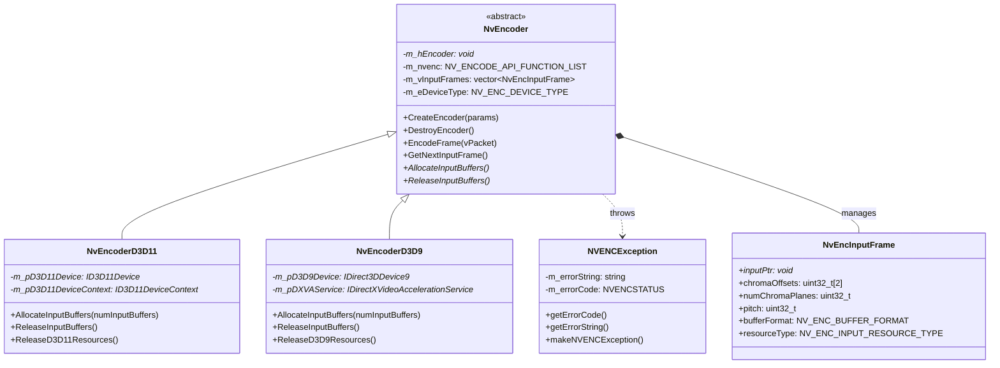
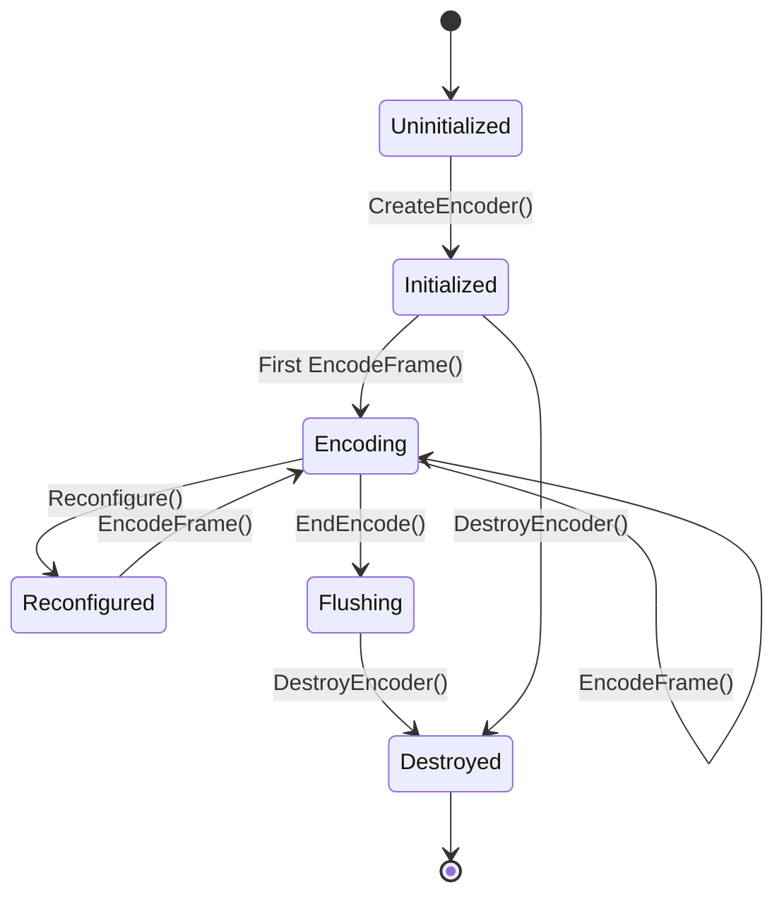
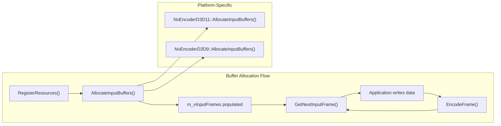
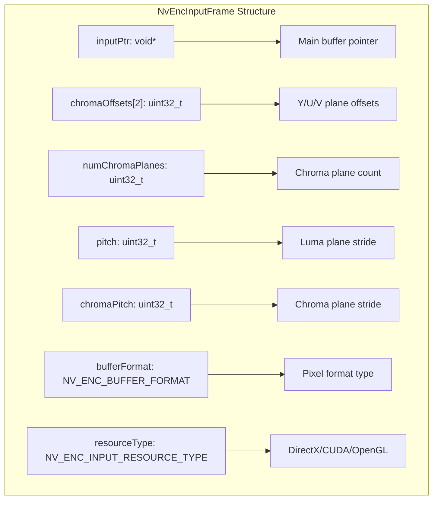

<!-- source: DeepWiki mcp.deepwiki.com · repo NVIDIA/video-sdk-samples · page 4 NVENC Framework · fetched 2026-10-26 -->

# NVENC Framework

<details>
<summary>Relevant source files</summary>

The following files were used as context for generating this wiki page:

- [nvEncBroadcastSample/nvEnc/nvCodec/nvEncoder/NvEncoder.h](nvEncBroadcastSample/nvEnc/nvCodec/nvEncoder/NvEncoder.h)
- [nvEncBroadcastSample/nvEnc/nvCodec/nvEncoder/NvEncoderD3D11.h](nvEncBroadcastSample/nvEnc/nvCodec/nvEncoder/NvEncoderD3D11.h)
- [nvEncBroadcastSample/nvEnc/nvCodec/nvEncoder/NvEncoderD3D9.h](nvEncBroadcastSample/nvEnc/nvCodec/nvEncoder/NvEncoderD3D9.h)

</details>


The NVENC Framework provides a unified C++ wrapper around NVIDIA's hardware video encoding API, offering platform-specific implementations for DirectX 9 and DirectX 11 integration. This framework abstracts the low-level NVENC hardware API into a more manageable object-oriented interface used by both sample applications in this repository.

For information about the underlying NVENC hardware API functions and data structures, see [NVENC Hardware API](#4.1). For usage examples in real applications, see [Desktop Capture Sample](#2) and [Broadcast Sample](#3).

## Framework Architecture

The NVENC Framework follows a base class design pattern with platform-specific derived classes that handle DirectX integration. The framework manages encoder sessions, input buffer allocation, and encoding operations while providing consistent error handling across all implementations.



**Framework Component Relationships**

Sources: [nvEncBroadcastSample/nvEnc/nvCodec/nvEncoder/NvEncoder.h:96-411](), [nvEncBroadcastSample/nvEnc/nvCodec/nvEncoder/NvEncoderD3D11.h:32-60](), [nvEncBroadcastSample/nvEnc/nvCodec/nvEncoder/NvEncoderD3D9.h:34-63]()

## Base Encoder Class

The `NvEncoder` class serves as the abstract base for all platform-specific encoder implementations. It manages the NVENC hardware session, provides encoding operations, and handles resource allocation through pure virtual functions implemented by derived classes.

### Core Operations

| Method | Purpose | Parameters |
|--------|---------|------------|
| `CreateEncoder` | Initialize encoder session | `NV_ENC_INITIALIZE_PARAMS*`, optional surface allocation |
| `DestroyEncoder` | Clean up encoder session | None |
| `EncodeFrame` | Encode a single frame | Output packet vector, picture parameters |
| `GetNextInputFrame` | Get available input buffer | Returns `NvEncInputFrame*` |
| `EndEncode` | Flush encoder queue | Output packet vector for remaining frames |
| `Reconfigure` | Dynamically change encoding parameters | `NV_ENC_RECONFIGURE_PARAMS*` |

### Encoder Session Management



**Encoder Session Lifecycle**

The encoder maintains state through member variables including `m_hEncoder` for the hardware session handle, `m_bEncoderInitialized` for initialization status, and `m_vInputFrames` for input buffer management.

Sources: [nvEncBroadcastSample/nvEnc/nvCodec/nvEncoder/NvEncoder.h:104-228](), [nvEncBroadcastSample/nvEnc/nvCodec/nvEncoder/NvEncoder.h:383-411]()

### Buffer Management

The base class manages input frames through the `NvEncInputFrame` structure and provides utilities for chroma plane calculations and format conversions. Input buffer allocation is delegated to platform-specific implementations through pure virtual functions.



**Input Buffer Management Flow**

Sources: [nvEncBroadcastSample/nvEnc/nvCodec/nvEncoder/NvEncoder.h:128-129](), [nvEncBroadcastSample/nvEnc/nvCodec/nvEncoder/NvEncoder.h:268-276](), [nvEncBroadcastSample/nvEnc/nvCodec/nvEncoder/NvEncoder.h:372-378]()

## Platform-Specific Implementations

### DirectX 11 Implementation

The `NvEncoderD3D11` class provides DirectX 11 integration by allocating `ID3D11Texture2D` resources for input buffers. It maintains references to the D3D11 device and device context for resource management.

**Key Components:**
- `m_pD3D11Device`: DirectX 11 device for resource creation
- `m_pD3D11DeviceContext`: Device context for resource operations
- `AllocateInputBuffers()`: Creates D3D11 textures for encoding input
- `ReleaseD3D11Resources()`: Cleanup for DirectX 11 specific resources

### DirectX 9 Implementation

The `NvEncoderD3D9` class handles DirectX 9 integration using `IDirect3DSurface9` surfaces for input data. It optionally supports DirectX Video Acceleration (DXVA) services for enhanced performance.

**Key Components:**
- `m_pD3D9Device`: DirectX 9 device for surface creation
- `m_pDXVAService`: Optional DXVA service for video acceleration
- `AllocateInputBuffers()`: Creates D3D9 surfaces for encoding input
- `ReleaseD3D9Resources()`: Cleanup for DirectX 9 specific resources

Sources: [nvEncBroadcastSample/nvEnc/nvCodec/nvEncoder/NvEncoderD3D11.h:35-60](), [nvEncBroadcastSample/nvEnc/nvCodec/nvEncoder/NvEncoderD3D9.h:37-63]()

## Error Handling

The framework implements comprehensive error handling through the `NVENCException` class and standardized error checking macros.

### Exception Infrastructure

```cpp
// Exception class definition from NvEncoder.h:37-52
class NVENCException : public std::exception {
    std::string m_errorString;
    NVENCSTATUS m_errorCode;
public:
    const char* what() const throw();
    NVENCSTATUS getErrorCode() const;
    static NVENCException makeNVENCException(/*...*);
};
```

### Error Checking Macros

| Macro | Purpose | Usage |
|-------|---------|-------|
| `NVENC_API_CALL` | Automatic error checking for NVENC API calls | Wraps any NVENC function call |
| `NVENC_THROW_ERROR` | Manual error throwing | Custom error conditions |

The `NVENC_API_CALL` macro automatically checks return codes and generates detailed error messages including function name, file, and line number for debugging.

Sources: [nvEncBroadcastSample/nvEnc/nvCodec/nvEncoder/NvEncoder.h:37-80]()

## Input Frame Structure

The `NvEncInputFrame` structure standardizes input data representation across all encoder implementations, supporting various pixel formats and resource types.

### Frame Data Layout



**Input Frame Data Structure**

### Format Support Utilities

The base class provides static utility functions for handling various YUV planar formats:

- `GetChromaSubPlaneOffsets()`: Calculate chroma plane memory offsets
- `GetChromaPitch()`: Determine chroma plane stride requirements  
- `GetNumChromaPlanes()`: Get number of chroma planes for format
- `GetChromaWidthInBytes()`: Calculate chroma plane width
- `GetChromaHeight()`: Calculate chroma plane height
- `GetWidthInBytes()`: Get frame width in bytes for any format

Sources: [nvEncBroadcastSample/nvEnc/nvCodec/nvEncoder/NvEncoder.h:82-91](), [nvEncBroadcastSample/nvEnc/nvCodec/nvEncoder/NvEncoder.h:234-262]()

---

