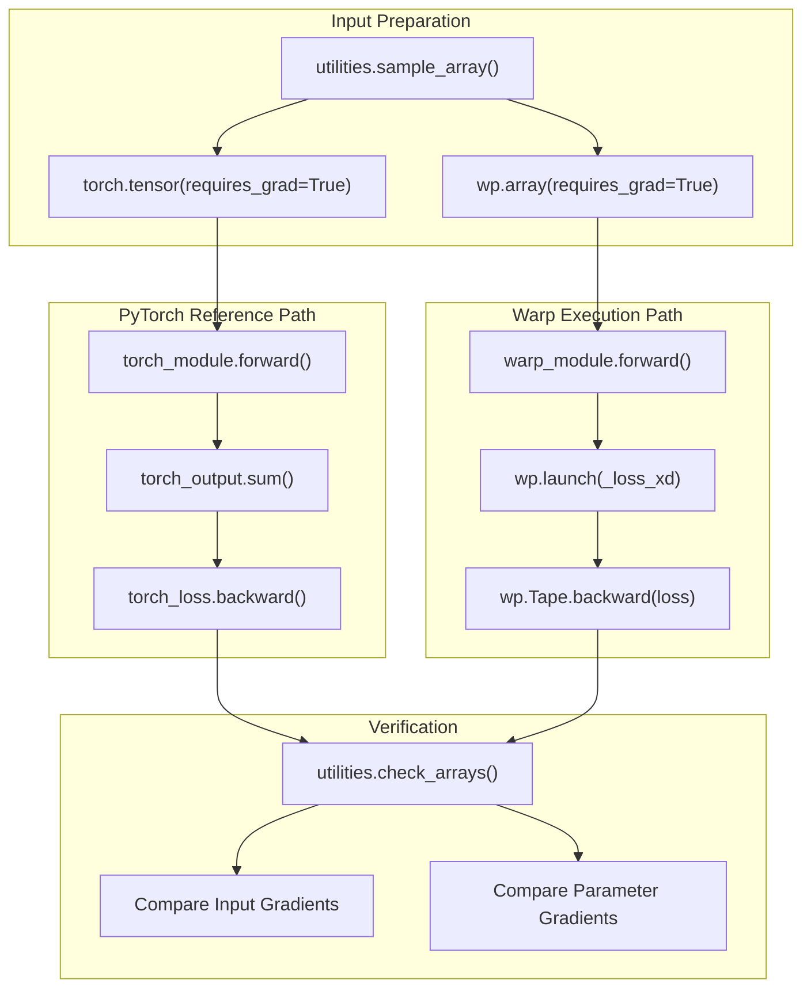
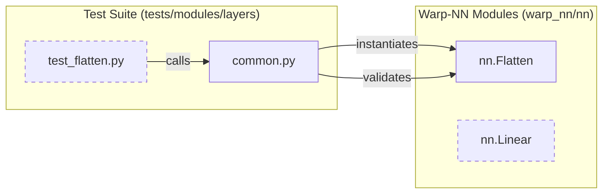

<!-- source: DeepWiki mcp.deepwiki.com · repo NVIDIA/warp-nn · page 8.1 Module and Layer Tests · fetched 2026-10-26 -->

# Module and Layer Tests

Relevant source files

The following files were used as context for generating this wiki page:

- [tests/modules/layers/common.py](tests/modules/layers/common.py)
- [tests/modules/layers/test_flatten.py](tests/modules/layers/test_flatten.py)

The `warp-nn` test suite ensures numerical parity between Warp-native modules and their PyTorch references. The testing infrastructure is located in the `tests/modules/` directory and utilizes a set of common verification functions to validate forward passes and gradient computations across various data types, devices, and tensor shapes.

## Testing Architecture

The test suite follows a standardized pattern: it instantiates both a `warp_nn` module and an equivalent `torch.nn` module, synchronizes their parameters, and compares their outputs.

### Comparison Workflow

The comparison logic is encapsulated in `tests/modules/layers/common.py` [tests/modules/layers/common.py:1-161](). It provides specialized helpers for standard layers and recurrent cells.

| Function | Purpose |
| :--- | :--- |
| `check_forward` | Validates that `warp_module(x)` matches `torch_module(x)` given identical inputs and weights. |
| `check_gradients` | Validates that `warp_input.grad` and `parameter.grad` match PyTorch's autograd results. |
| `check_forward_rnn_cell` | Specialized sequence-looping test for LSTM, GRU, and RNN cells. |

### Data Flow: Forward and Gradient Verification

The following diagram illustrates the data flow within `check_gradients` [tests/modules/layers/common.py:123-161]().

**Verification Data Flow**

**Sources:** [tests/modules/layers/common.py:123-161](), [tests/modules/layers/common.py:25-47]()

## Core Verification Helpers

### Forward Pass Validation
The `check_forward` function [tests/modules/layers/common.py:49-65]() performs the following steps:
1.  **Device Placement**: Moves both modules to the target device (CPU or CUDA) [tests/modules/layers/common.py:51-52]().
2.  **Parameter Synchronization**: Uses `utilities.init_parameters` to ensure weights and biases are identical in both frameworks [tests/modules/layers/common.py:54-55]().
3.  **Execution**: Runs the forward pass for both.
4.  **Assertion**: Compares results using `utilities.check_arrays` with configurable `rtol` and `atol` [tests/modules/layers/common.py:64]().

### Gradient Validation
The `check_gradients` function [tests/modules/layers/common.py:123-161]() validates the backward pass. Since Warp requires a scalar loss for `wp.Tape.backward()`, the test suite uses helper kernels (`_loss_1d` through `_loss_4d`) to sum the output tensor into a single scalar `loss` [tests/modules/layers/common.py:25-47]().

It verifies:
*   **Input Gradients**: `torch_input.grad` vs `warp_input.grad` [tests/modules/layers/common.py:153]().
*   **Parameter Gradients**: A flattened comparison of all module parameters (e.g., weights, biases) [tests/modules/layers/common.py:154-160]().

**Sources:** [tests/modules/layers/common.py:49-65](), [tests/modules/layers/common.py:123-161]()

## Parametrization and Coverage

Tests are heavily parametrized using `pytest.mark.parametrize` to ensure robustness across environments.

### Test Dimensions
A typical test, such as `test_forward` in `test_flatten.py` [tests/modules/test_flatten.py:42-45](), iterates over:
*   **DTypes**: `wp.float16`, `wp.float32`, `wp.float64`.
*   **Devices**: `"cpu"` and `"cuda"`.
*   **Shapes/Dimensions**: Variable ranks (e.g., `ndim` from 1 to 4).

### Entity Mapping: Test to Module
This diagram shows how specific test files target `warp_nn` entities using the `common.py` infrastructure.

**Test Entity Association**

**Sources:** [tests/modules/layers/test_flatten.py:22-25](), [tests/modules/layers/test_flatten.py:49-50]()

## Initializer Testing

Initializers (e.g., Kaiming, Xavier) are tested using **Hypothesis-based property tests**. This approach verifies that the statistical properties of the initialized `wp.array` (such as mean, variance, and bounds) match the expected mathematical distribution for a given `fan_in` or `fan_out`.

1.  **Fan Calculation**: Tests verify `compute_fans` correctly handles various tensor ranks.
2.  **Distribution Checks**: Initializers are run on large arrays, and the resulting values are checked against target variances.

**Sources:** [tests/modules/layers/common.py:54-55]() (referencing parameter initialization logic).

---

