# Page: Overview

# Overview

<details>
<summary>Relevant source files</summary>

The following files were used as context for generating this wiki page:

- [CHANGELOG.md](CHANGELOG.md)
- [README.md](README.md)
- [docs/index.rst](docs/index.rst)
- [pyproject.toml](pyproject.toml)

</details>


`warp-nn` is a Warp-native Python library designed for building and training neural networks within Physical AI workflows. It provides compact, CUDA-graphable neural network components that integrate directly into [NVIDIA Warp](https://nvidia.github.io/warp) simulation, robotics, and differentiable computing pipelines [README.md:8-10]().

Unlike general-purpose frameworks like PyTorch or JAX, `warp-nn` focuses on being "graphable" within the Warp ecosystem, allowing neural network execution to be captured into CUDA Graphs alongside physics simulations for minimal overhead [README.md:11-12]().

### System Architecture Overview

The library is structured to mirror familiar ML framework patterns (like `torch.nn`) while utilizing Warp's kernel dispatch and memory management. The following diagram illustrates how the high-level Python entities map to the underlying Warp infrastructure.

**Bridge: Python API to Warp Execution**
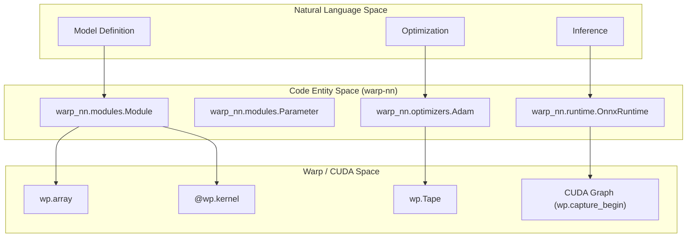
**Sources:** [README.md:8-12](), [pyproject.toml:36-38]()

---

### Core Components

The library is organized into several key modules that handle the lifecycle of a neural network, from initialization to training and optimized inference.

| Module | Responsibility | Key Entities |
|:---|:---|:---|
| **Modules** | Base classes and standard layers. | `Module`, `Linear`, `Conv2D`, `LSTMCell` |
| **Optimizers** | Gradient-based parameter updates. | `Adam`, `SGD` |
| **Runtime** | Lightweight ONNX inference engine. | `OnnxRuntime` |
| **Initializers** | Weight and bias initialization. | `kaiming_uniform`, `constant` |
| **Utils** | Kernel and CUDA Graph management. | `KernelConfig`, `ScopedCapture` |

**Sources:** [CHANGELOG.md:8-17](), [pyproject.toml:68-70]()

---

### Relationship to NVIDIA Warp

`warp-nn` is an ecosystem library maintained by the NVIDIA Isaac Sim team, rather than the core `warp-lang` team [README.md:13-17](). It requires `warp-lang>=1.12.0` [pyproject.toml:37-38](). 

While standard ML frameworks often rely on `cuBLAS` or `cuDNN`, `warp-nn` prioritizes Warp-native kernels. This allows for:
1. **Differentiability:** Seamless integration with `wp.Tape` for end-to-end autodiff through both physics and neural networks.
2. **Graphability:** The ability to capture the entire forward/backward pass into a single CUDA Graph using `wp.capture_begin()`.
3. **Customizability:** Users can inspect and modify the underlying `@wp.kernel` implementations.

**Bridge: Library Organization**
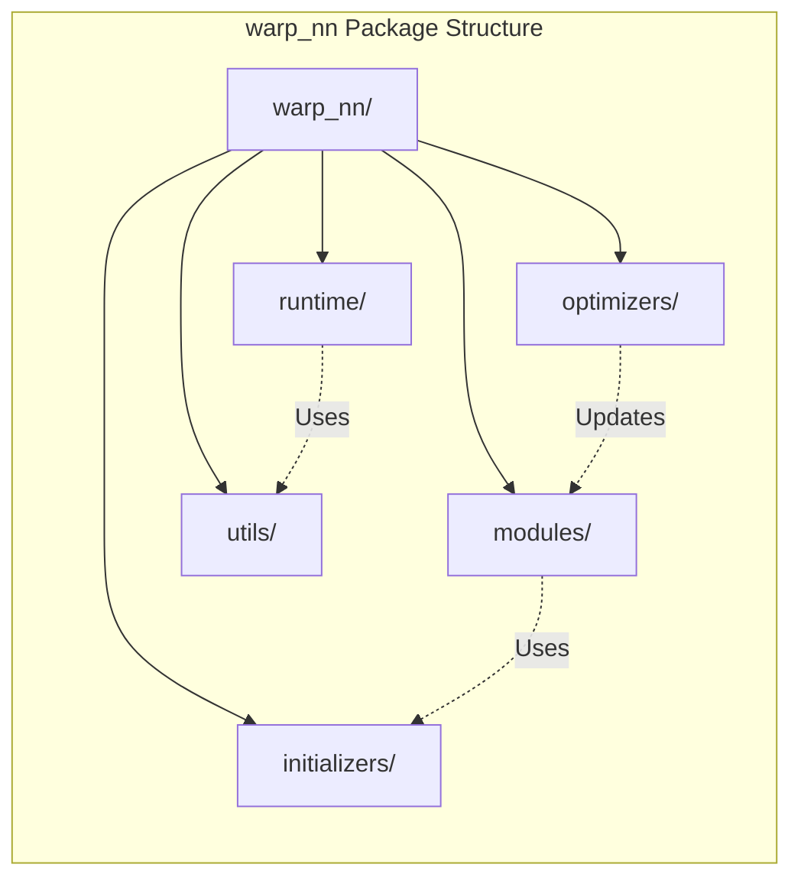
**Sources:** [pyproject.toml:68-70](), [CHANGELOG.md:3-18]()

---

### Detailed Sections

For in-depth technical documentation, refer to the following child pages:

*   **[Getting Started](#1.1)**: Installation via `pip install warp-nn`, system requirements (Python 3.10+), and a minimal end-to-end training example.
*   **[Design Philosophy and Architecture](#1.2)**: A deep dive into why `warp-nn` uses native kernels instead of vendor libraries, and how it achieves CUDA Graph compatibility for Physical AI.

**Sources:** [pyproject.toml:16-22](), [docs/index.rst:4-26]()

---

# Page: Getting Started

# Getting Started

<details>
<summary>Relevant source files</summary>

The following files were used as context for generating this wiki page:

- [README.md](README.md)
- [docs/index.rst](docs/index.rst)
- [docs/snippets/basics.py](docs/snippets/basics.py)
- [pyproject.toml](pyproject.toml)

</details>


Warp-NN is a Warp-native Python library designed for building and training neural networks within Physical AI workflows. It facilitates the creation of compact neural network components that execute directly within NVIDIA Warp-based simulation, robotics, and differentiable computing pipelines [README.md:8-11]().

## Requirements

Warp-NN requires a modern Python environment and a compatible NVIDIA Warp installation.

| Requirement | Version / Specification | Source |
| :--- | :--- | :--- |
| **Python** | `>= 3.10` | [pyproject.toml:19-19]() |
| **NVIDIA Warp** | `warp-lang >= 1.12.0` | [pyproject.toml:37-37]() |
| **CUDA** | NVIDIA GPU with CUDA support | [pyproject.toml:28-28]() |

### Optional Dependencies

Warp-NN provides optional dependency groups for specific workflows:

*   **ONNX (`onnx`)**: Required for ONNX policy inference. It uses a pure protobuf parser to run inference on Warp kernels without requiring `onnxruntime` [pyproject.toml:47-51]().
*   **Tests (`tests`)**: Includes `pytest`, `hypothesis`, and `torch` (used as a reference for validation) [pyproject.toml:52-58]() .
*   **Documentation (`docs`)**: Includes `sphinx`, `myst-parser`, and the `nvidia-sphinx-theme` [pyproject.toml:59-64]().

Sources: [pyproject.toml:19-64](), [README.md:8-11]()

## Installation

The library is available on PyPI and can be installed using `pip`:

```bash
pip install warp-nn
```

To install with optional dependencies (e.g., for ONNX support or testing):

```bash
pip install "warp-nn[onnx,tests]"
```

Sources: [README.md:18-25](), [pyproject.toml:46-64]()

## Minimal End-to-End Usage

Warp-NN follows a design pattern similar to PyTorch but is optimized for the Warp ecosystem, utilizing `wp.array` for data and `wp.Tape` for autodiff.

### 1. Define a Model
Models are defined by subclassing `warp_nn.modules.module.Module`. You must call `super().__post_init__()` at the end of the constructor to register parameters and submodules [docs/snippets/basics.py:35-42]().

```python
import warp as wp
from warp_nn import nn

class MLP(nn.Module):
    def __init__(self):
        super().__init__()
        self.fc1 = nn.Linear(128, 64)
        self.act = nn.ReLU()
        self.fc2 = nn.Linear(64, 10)
        super().__post_init__()  # Crucial for parameter registration

    def __call__(self, x):
        return self.fc2(self.act(self.fc1(x)))

model = MLP().to("cuda")
```

### 2. Define Loss and Optimizer
Loss functions are typically written as `@wp.kernel` functions to run efficiently on the GPU [docs/snippets/basics.py:55-63](). Optimizers like `Adam` are initialized with the model's parameters [docs/snippets/basics.py:71-71]().

```python
from warp_nn import optimizers

@wp.kernel
def mse_loss(prediction: wp.array2d[float], target: wp.array2d[float], loss: wp.array1d[float]):
    i, j = wp.tid()
    diff = prediction[i, j] - target[i, j]
    wp.atomic_add(loss, 0, diff * diff)

optimizer = optimizers.Adam(model.parameters(), lr=1e-3, device="cuda")
loss_array = wp.zeros((1,), dtype=wp.float32, requires_grad=True, device="cuda")
```

### 3. The Training Loop
The training loop utilizes `wp.Tape()` to record operations for the backward pass. After `tape.backward()`, the optimizer updates the parameters [docs/snippets/basics.py:75-94]().

```python
with wp.Tape() as tape:
    prediction = model(input_data)
    wp.launch(mse_loss, dim=prediction.shape, inputs=[prediction, target_data], outputs=[loss_array], device="cuda")

tape.backward(loss_array)
optimizer.step()
tape.zero()  # Reset tape and zero gradients for next iteration
```

Sources: [docs/snippets/basics.py:17-95]()

## System Data Flow and Entities

The following diagrams illustrate how Warp-NN entities interact during a standard training lifecycle.

### Training Lifecycle Data Flow
This diagram shows the relationship between the `Module`, the `wp.Tape`, and the `Optimizer`.

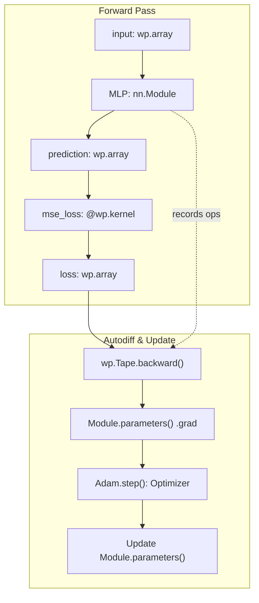
Sources: [docs/snippets/basics.py:35-95]()

### Code Entity Association
This diagram bridges the high-level training concepts to the specific classes and functions in the codebase.

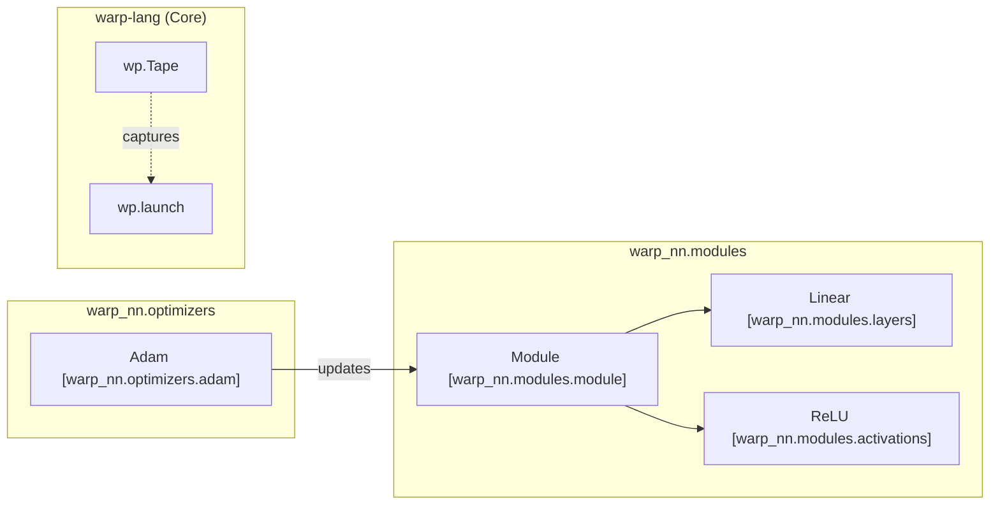
Sources: [docs/snippets/basics.py:18-21](), [docs/snippets/basics.py:35-45](), [docs/snippets/basics.py:71-71](), [docs/snippets/basics.py:80-93]()

---

# Page: Design Philosophy and Architecture

# Design Philosophy and Architecture

<details>
<summary>Relevant source files</summary>

The following files were used as context for generating this wiki page:

- [README.md](README.md)
- [docs/guide/basics.rst](docs/guide/basics.rst)
- [docs/index.rst](docs/index.rst)
- [pyproject.toml](pyproject.toml)

</details>


`warp-nn` is a neural network library built specifically for the [NVIDIA Warp](https://github.com/NVIDIA/warp) ecosystem. Its primary purpose is to provide compact, differentiable neural network components that can reside directly within simulation loops and robotics control pipelines without leaving the Warp kernel execution environment.

## Warp-Native Execution

Unlike general-purpose machine learning frameworks such as PyTorch or JAX, `warp-nn` is designed to be "Warp-native." This means every layer, activation function, and optimizer is implemented as a collection of Warp kernels (`@wp.kernel`).

### The Warp Ecosystem Integration
In Physical AI workflows, simulation states (positions, velocities, contact forces) are often stored in `wp.array` objects on the GPU. By using `warp-nn`, practitioners can pass these simulation tensors directly into neural network modules without the overhead of host-side synchronization or data conversion between frameworks.

### Implementation Pattern
The library follows a strict modular structure where high-level Python classes (subclasses of `warp_nn.modules.module.Module`) manage the state and dispatch to specialized kernels.

**Natural Language to Code Entity: Module Dispatch**
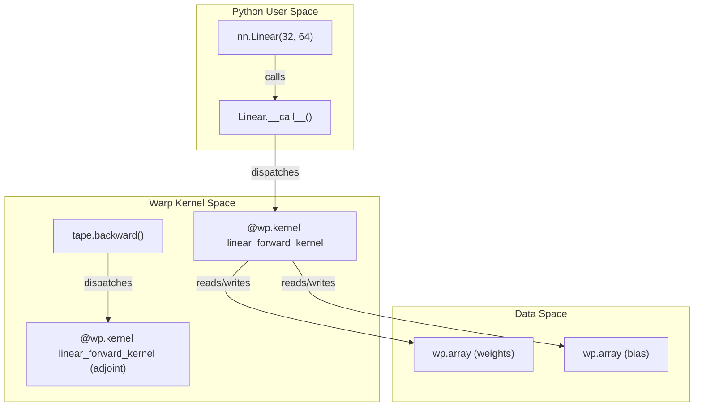
**Sources:**
- [docs/index.rst:4-14]()
- [docs/guide/basics.rst:21-31]()
- [pyproject.toml:36-38]()

## CUDA Graph Compatibility

A core design pillar of `warp-nn` is compatibility with CUDA Graphs. In high-frequency robotics control or large-scale parallel simulations (e.g., NVIDIA Isaac Sim), the overhead of launching thousands of small kernels from Python can become a bottleneck.

### Scoped Capture
`warp-nn` utilizes a utility called `ScopedCapture` to wrap Warp's native capture mechanisms (`wp.capture_begin()` and `wp.capture_end()`). This allows entire forward passes, loss computations, and optimizer updates to be baked into a single GPU executable graph.

### Graphable Optimizers
Standard optimizers often involve scalar updates (like incrementing a timestep) that typically require CPU-GPU synchronization. `warp-nn` optimizers, such as `Adam`, are implemented using tiled kernels that handle these updates entirely on the GPU, ensuring the `Optimizer.step()` remains graphable.

**Natural Language to Code Entity: Graph Execution Flow**
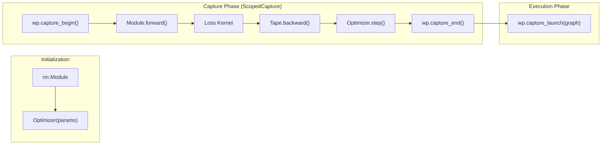
**Sources:**
- [docs/index.rst:22-27]()
- [README.md:4-11]()

## Design Trade-offs: Graphability vs. Peak TFLOPS

`warp-nn` makes specific engineering trade-offs to prioritize integration over raw throughput for large models.

| Feature | `warp-nn` Approach | Reason |
| :--- | :--- | :--- |
| **Kernel Backend** | Pure Warp Kernels | Enables differentiability via `wp.Tape` and avoids external dependencies like cuBLAS/cuDNN. |
| **Memory Access** | Tiled/Coalesced Access | Optimized for the Warp programming model rather than specific tensor core hardware instructions. |
| **Performance** | High for "Small" Networks | Lower latency for MLP/RNN controllers used in RL compared to framework-hopping. |
| **Scalability** | Limited for LLMs | Not intended for multi-billion parameter models where cuDNN/NCCL optimizations are mandatory. |

As noted in the documentation, while `warp-nn` strives for high performance, it may not always outperform solutions using `cuBLAS` or `cuDNN` for standard deep learning benchmarks [docs/index.rst:16-20]().

**Sources:**
- [docs/index.rst:4-20]()
- [README.md:8-11]()

## Physical AI and Isaac Sim Workflows

The library is maintained by members of the NVIDIA Isaac Sim team, reflecting its architectural alignment with robotics simulation.

1.  **Differentiable Simulation**: Because `warp-nn` uses `wp.Tape` for autodiff [docs/guide/basics.rst:72-79](), it can be used to compute gradients through both the neural network and the physical simulator (if the simulator is also written in Warp).
2.  **In-Kernel Inference**: Modules can be used to define policies that are evaluated directly inside a simulation step kernel, minimizing data movement.
3.  **Deployment**: The `onnx` runtime support allows for lightweight inference of pre-trained models within the same Warp pipeline without requiring a full `onnxruntime` installation [pyproject.toml:46-51]().

**Sources:**
- [README.md:13-17]()
- [docs/index.rst:9-15]()
- [pyproject.toml:46-51]()

---

# Page: Core Module System

# Core Module System

<details>
<summary>Relevant source files</summary>

The following files were used as context for generating this wiki page:

- [docs/guide/basics.rst](docs/guide/basics.rst)
- [docs/snippets/basics.py](docs/snippets/basics.py)
- [warp_nn/nn.py](warp_nn/nn.py)

</details>


The `warp_nn.modules` package provides the fundamental building blocks for constructing neural networks within the NVIDIA Warp ecosystem. It is designed to mirror the ergonomics of modern deep learning frameworks while ensuring that every operation remains compatible with Warp's kernel execution and autodiff systems.

The core of the system relies on a hierarchical module tree where `Module` instances containerize other modules and `Parameter` instances, facilitating automated gradient management and device placement.

### System Architecture Overview

The following diagram illustrates the relationship between the core classes and how they map to user-defined model code.

**Entity Mapping: Module Hierarchy**

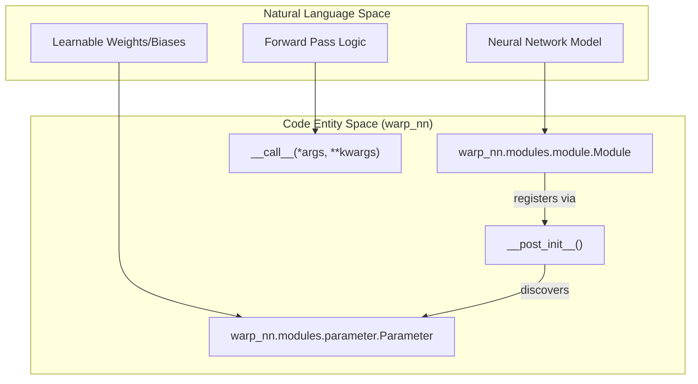

**Sources:** [warp_nn/nn.py:16-20](), [docs/guide/basics.rst:21-31]()

---

### The Module Base Class

The `Module` class is the base for all neural network components in `warp-nn`. It tracks sub-modules and parameters assigned as attributes, allowing for recursive operations like moving a whole model to a specific GPU or collecting all gradients for an optimizer.

Key characteristics include:
*   **Registration:** Users must call `super().__post_init__()` at the end of their `__init__` method to trigger the internal discovery and registration of parameters and sub-modules [docs/guide/basics.rst:24-27]().
*   **Forward Pass:** The forward logic is defined by implementing the `__call__` method [docs/guide/basics.rst:22-22]().
*   **Device Management:** The `.to(device)` method recursively moves all underlying `Parameter` data to the specified Warp device [docs/snippets/basics.py:48-51]().

For a deep dive into the registration lifecycle and state management, see **[Module Base Class and Parameter](#2.1)**.

---

### Parameters and Tensors

`Parameter` is a thin wrapper around `wp.array` that signifies a tensor is a learnable part of the model. By default, parameters are initialized with `requires_grad=True`, ensuring that `wp.Tape` records operations involving them for backpropagation.

**Sources:** [warp_nn/nn.py:19-19](), [docs/snippets/basics.py:67-69]()

---

### Component Categories

The module system is divided into several specialized categories that work together to form a complete network.

| Category | Description | Key Entities |
| :--- | :--- | :--- |
| **Layers** | Structural blocks that transform input shapes and maintain weights. | `Linear`, `Conv2D`, `LSTMCell`, `Sequential` |
| **Activations** | Non-linear functions applied to layer outputs. | `ReLU`, `Sigmoid`, `Tanh`, `LeakyReLU` |
| **Containers** | Modules designed to hold and execute other modules. | `Sequential` |

#### Layers
Built-in layers handle the complexities of kernel dispatch and weight initialization. For example, `nn.Linear` manages weight and bias arrays and dispatches to high-performance GEMM-like kernels.
For a full reference of available layers, see **[Layers](#2.2)**.

#### Activation Functions
Activations in `warp-nn` are implemented as modules that wrap Warp kernels. They support multiple dimensions (1D, 2D, 3D) via kernel overloading patterns.
For implementation details and integration with `wp.Tape`, see **[Activation Functions](#2.3)**.

---

### Integration with Autodiff and Training

The module system is designed to work seamlessly with `wp.Tape` for automatic differentiation. When a module's `__call__` is invoked inside a tape context, all underlying Warp kernels are recorded.

**Data Flow: Training Lifecycle**

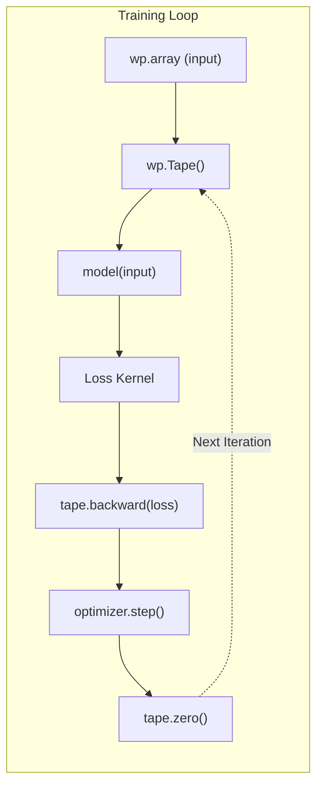

For a step-by-step guide on implementing training loops and handling gradients, see **[Training Loop and Autodiff](#2.4)**.

**Sources:** [docs/guide/basics.rst:72-86](), [docs/snippets/basics.py:74-94]()

---

# Page: Module Base Class and Parameter

# Module Base Class and Parameter

<details>
<summary>Relevant source files</summary>

The following files were used as context for generating this wiki page:

- [docs/guide/basics.rst](docs/guide/basics.rst)
- [docs/snippets/basics.py](docs/snippets/basics.py)
- [warp_nn/nn.py](warp_nn/nn.py)

</details>


The `warp-nn` library provides a structured approach to defining neural network architectures through the `Module` and `Parameter` classes. These components are designed to integrate seamlessly with NVIDIA Warp's kernel execution and autodiff system (`wp.Tape`), while offering a familiar interface for developers coming from other deep learning frameworks.

## Module Class

The `warp_nn.modules.module.Module` class serves as the base for all neural network components [warp_nn/nn.py:18-18](). It manages the lifecycle of layers, handles device placement, and provides mechanisms for state serialization.

### Registration Lifecycle and `__post_init__`

Unlike frameworks that use metaclasses for automatic attribute tracking, `warp-nn` requires a specific lifecycle call to register sub-modules and parameters.

1.  **Initialization**: During `__init__`, sub-modules (e.g., `nn.Linear`) and `nn.Parameter` objects are assigned as attributes [docs/snippets/basics.py:35-40]().
2.  **Registration**: The user must call `super().__post_init__()` at the very end of the `__init__` method [docs/guide/basics.rst:24-27]().
3.  **Discovery**: The `__post_init__` call triggers a traversal of the object's `__dict__`. It identifies all attributes that are instances of `Module` or `Parameter` and registers them into the module's internal tracking structures [docs/snippets/basics.py:41-41]().

### Device Placement with `.to()`

The `.to(device)` method is the primary way to manage memory location for a module's parameters. When called, the module recursively traverses its hierarchy and moves every underlying `wp.array` within its `Parameter` objects to the specified Warp device (e.g., `"cuda"` or `"cpu"`) [docs/snippets/basics.py:48-51]().

### State Management

Modules support state serialization through two primary methods:
*   **`state_dict()`**: Returns a dictionary mapping parameter names to their underlying `wp.array` data.
*   **`load_state_dict(state_dict)`**: Updates the module's parameters using values from the provided dictionary.

### Module Lifecycle Flow
The following diagram illustrates the transition from definition to a ready-to-train state.

**Entity Mapping: Module Setup**
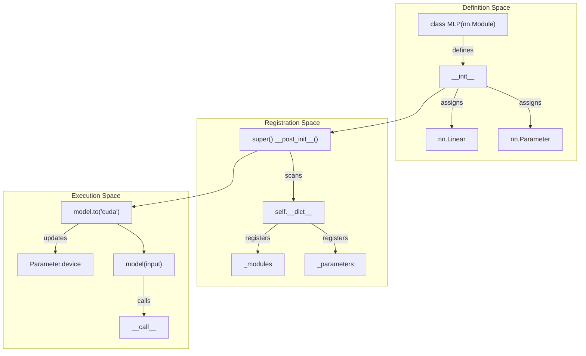
Sources: [docs/guide/basics.rst:21-35](), [docs/snippets/basics.py:34-51](), [warp_nn/nn.py:16-19]()

---

## Parameter Class

The `warp_nn.modules.parameter.Parameter` class is a thin wrapper around a `wp.array` [warp_nn/nn.py:19-19](). It designates a specific array as a learnable weight or bias that should be tracked by optimizers and the module's registration system.

### The `requires_grad` Contract

Parameters are central to the `warp-nn` autodiff contract:
*   **Gradient Tracking**: By default, `Parameter` objects are initialized with `requires_grad=True`. This ensures that when the module is used inside a `wp.Tape()` context, Warp allocates gradient buffers for these arrays [docs/guide/basics.rst:64-66]().
*   **Optimization**: Only attributes registered as `Parameter` (or contained within registered `Module`s) are returned by the `model.parameters()` generator, which is passed to optimizers like `Adam` or `SGD` [docs/snippets/basics.py:70-72]().

### Parameter and Tape Interaction
The relationship between parameters, the forward pass, and the gradient tape is critical for training.

**Entity Mapping: Data and Gradient Flow**
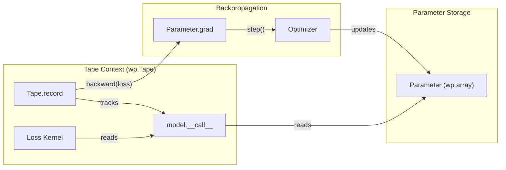
Sources: [docs/guide/basics.rst:72-87](), [docs/snippets/basics.py:70-94]()

---

## Summary of Key Functions

| Entity | Location | Role |
| :--- | :--- | :--- |
| `Module` | `warp_nn.modules.module` | Base class for all network components; manages sub-modules and parameters [warp_nn/nn.py:18-18](). |
| `Parameter` | `warp_nn.modules.parameter` | Wrapper for `wp.array` that signals learnable weights to the system [warp_nn/nn.py:19-19](). |
| `__post_init__` | `Module` | Required call to register attributes after assignment in `__init__` [docs/guide/basics.rst:24-27](). |
| `to(device)` | `Module` | Recursively moves all parameters to the target Warp device [docs/snippets/basics.py:48-51](). |
| `parameters()` | `Module` | Generator yielding all `Parameter` objects in the module tree [docs/snippets/basics.py:70-72](). |

Sources: [warp_nn/nn.py:16-20](), [docs/guide/basics.rst:21-35](), [docs/snippets/basics.py:34-51]()

---

# Page: Layers

# Layers

<details>
<summary>Relevant source files</summary>

The following files were used as context for generating this wiki page:

- [docs/api/layers.rst](docs/api/layers.rst)
- [docs/api/layers/flatten.rst](docs/api/layers/flatten.rst)
- [tests/modules/layers/common.py](tests/modules/layers/common.py)
- [tests/modules/layers/test_flatten.py](tests/modules/layers/test_flatten.py)
- [warp_nn/modules/layers/__init__.py](warp_nn/modules/layers/__init__.py)
- [warp_nn/modules/layers/flatten.py](warp_nn/modules/layers/flatten.py)

</details>


The `warp_nn.modules.layers` package provides a collection of built-in neural network building blocks. These layers are designed to be compatible with NVIDIA Warp's kernel execution model and `wp.Tape` for automatic differentiation. Unlike standard deep learning frameworks, `warp-nn` layers focus on being graph-capturable and efficient within Physical AI simulations.

Sources: [docs/api/layers.rst:1-47](), [warp_nn/modules/layers/__init__.py:16-23]()

## Module Overview

The library implements standard layer types including linear transformations, convolutions, recurrent cells, and structural utilities.

| Category | Classes |
| :--- | :--- |
| **Linear** | `Linear`, `LazyLinear` |
| **Convolutional** | `Conv1D`, `Conv2D` |
| **Recurrent** | `RNNCell`, `LSTMCell`, `GRUCell` |
| **Structural** | `Flatten`, `Sequential` |

Sources: [warp_nn/modules/layers/__init__.py:16-23](), [docs/api/layers.rst:35-47]()

### Layer Execution Pattern

The following diagram illustrates the relationship between the Python layer classes and the underlying Warp execution mechanism.

**Layer Dispatch and Data Flow**
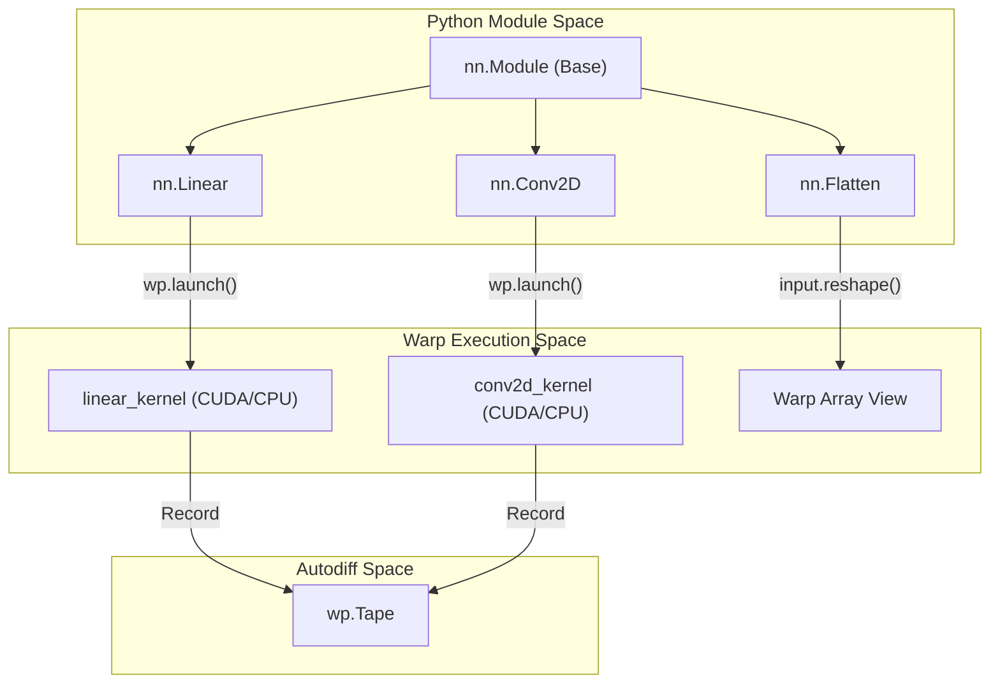
Sources: [warp_nn/modules/layers/flatten.py:23-53](), [tests/modules/layers/common.py:134-151]()

---

## Structural Layers

### Flatten
The `Flatten` layer collapses a contiguous range of dimensions into a single dimension. It is typically used to transition from convolutional layers to linear layers.

*   **Constructor**: `Flatten(start_dim=1, end_dim=-1)` [warp_nn/modules/layers/flatten.py:24-36]()
*   **Logic**: The layer calculates the target shape using `math.prod` on the specified dimension range and returns a reshaped view of the input array [warp_nn/modules/layers/flatten.py:47-53]().
*   **Constraint**: The `start_dim` must be less than or equal to `end_dim` [warp_nn/modules/layers/flatten.py:50-51]().

### Sequential
A container module that executes a list of modules in the order they were passed to the constructor. It simplifies the definition of feed-forward architectures by chaining the output of one module to the input of the next.

Sources: [warp_nn/modules/layers/sequential.py:23]() (referenced via [warp_nn/modules/layers/__init__.py:23]())

---

## Linear Layers

### Linear
Applies a linear transformation to the incoming data: $y = xA^T + b$.
*   **Weights**: Typically stored as a `Parameter` with shape `(out_features, in_features)`.
*   **Bias**: Optional parameter with shape `(out_features,)`.

### LazyLinear
A variant of the `Linear` layer where `in_features` is inferred at runtime during the first forward pass. This allows users to define models without explicitly calculating the output size of preceding layers (e.g., after a series of convolutions).

Sources: [warp_nn/modules/layers/linear.py:20]() (referenced via [warp_nn/modules/layers/__init__.py:20]())

---

## Recurrent Layers

Recurrent cells in `warp-nn` are designed to process a single time step. To process sequences, these cells are typically called within a Python loop or a Warp-specific sequence wrapper.

### RNNCell
A basic Elman RNN cell that applies:
$h' = \tanh(W_{ih}x + b_{ih} + W_{hh}h + b_{hh})$

### LSTMCell
A Long Short-Term Memory (LSTM) cell. It maintains a hidden state $h$ and a cell state $c$. The implementation includes gates for input, forget, cell, and output.
*   **Input**: `(input, (h_0, c_0))`
*   **Output**: `(h_1, c_1)`

### GRUCell
A Gated Recurrent Unit (GRU) cell. It combines the forget and input gates into a single "update gate" and merges the cell state and hidden state.

Sources: [warp_nn/modules/layers/rnn_cell.py:22](), [warp_nn/modules/layers/lstm_cell.py:21](), [warp_nn/modules/layers/gru_cell.py:19]() (referenced via [warp_nn/modules/layers/__init__.py:19-22]())

---

## Implementation Details

### Kernel Dispatch and Shapes
Unlike PyTorch, which uses high-level C++ dispatch, `warp-nn` layers often use specific kernels optimized for the dimensionality of the input. In testing and validation, `wp.launch` is used to trigger kernels based on the rank of the output array.

**Internal Tensor Handling**
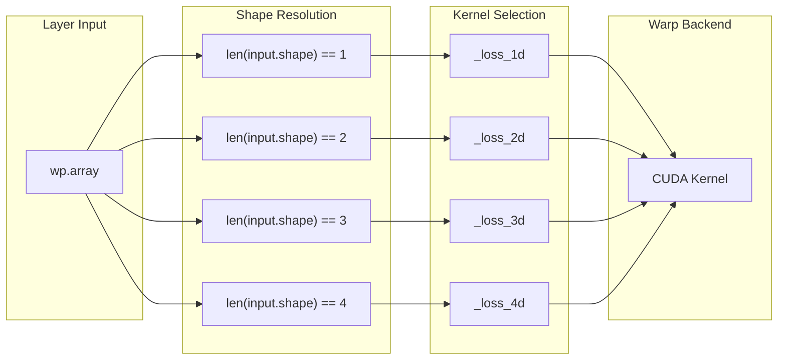
Sources: [tests/modules/layers/common.py:25-48](), [tests/modules/layers/common.py:144-150]()

### Output Caching and Autodiff
For recurrent cells, state management is critical for backpropagation. When training, the `wp.Tape` records every operation. Because recurrent cells are often used in loops, `wp.clone()` is frequently used to ensure that the hidden states for each timestep are preserved in the tape's history rather than being overwritten in-place.

**RNN Forward Loop with Tape**
```python
# Example of sequence processing with LSTMCell
for i in range(seq_length):
    # warp_module is nn.LSTMCell
    warp_output = warp_module(warp_input[i], (warp_hidden, warp_cell))
    # Clone is required to prevent overwriting states needed for backward pass
    warp_hidden, warp_cell = wp.clone(warp_output[0]), wp.clone(warp_output[1])
```
Sources: [tests/modules/layers/common.py:108-113]()

### Validation Strategy
All layers are validated against PyTorch reference implementations. The `check_forward` and `check_gradients` utilities ensure that:
1.  **Forward Pass**: `warp_module(input)` produces results within `rtol` and `atol` of `torch_module(input)` [tests/modules/layers/common.py:49-64]().
2.  **Gradients**: `tape.backward()` produces parameter and input gradients identical to PyTorch's `loss.backward()` [tests/modules/layers/common.py:123-161]().

Sources: [tests/modules/layers/common.py:49-161](), [tests/modules/layers/test_flatten.py:45-72]()

---

# Page: Activation Functions

# Activation Functions

<details>
<summary>Relevant source files</summary>

The following files were used as context for generating this wiki page:

- [docs/api/index.rst](docs/api/index.rst)
- [warp_nn/nn.py](warp_nn/nn.py)

</details>


Activation functions in `warp-nn` are implemented as specialized `Module` subclasses that apply non-linear transformations to input tensors. These modules are designed to be compatible with NVIDIA Warp's kernel execution model, supporting multi-dimensional dispatch (1D, 2D, and 3D) and full integration with `wp.Tape` for automatic differentiation.

All activation modules are exported through the `warp_nn.nn` namespace for ease of use [warp_nn/nn.py:16-16]().

## Implementation Pattern: overload_kernels

The library utilizes a standardized pattern for dispatching activation kernels across different tensor ranks. Each activation module (e.g., `ReLU`, `Sigmoid`) does not implement the logic directly in Python but instead wraps a set of Warp kernels optimized for specific input dimensions.

### Data Flow and Dispatch
When `forward(x)` is called on an activation module, the library determines the dimensionality of the input `wp.array` and dispatches to the corresponding kernel.

1.  **Rank Detection**: The module inspects `x.ndim`.
2.  **Kernel Selection**: The module selects from a set of pre-defined kernels (e.g., `relu_1d_kernel`, `relu_2d_kernel`).
3.  **Grid Launch**: The kernel is launched with a grid size matching the input shape, ensuring one thread (or tile) per element.

### System Entity Map: Activation Dispatch
The following diagram illustrates how a call to an activation module flows from the Python API to the underlying Warp kernels.

**Activation Kernel Dispatch Flow**
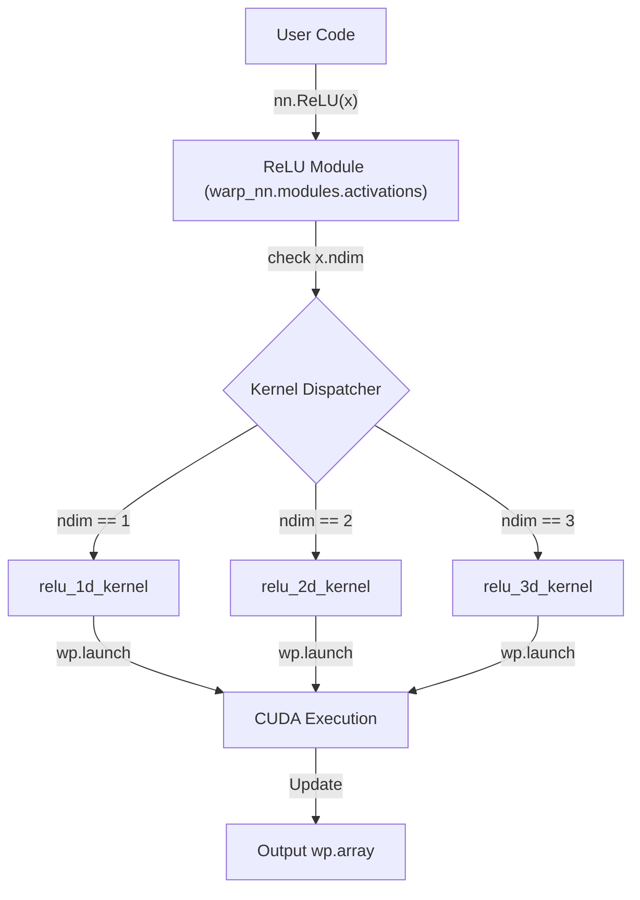
Sources: [warp_nn/nn.py:16-16](), [docs/api/index.rst:28-39]()

## Supported Activation Modules

The following activation functions are available in `warp_nn.modules.activations` and aliased in `warp_nn.nn`.

| Module | Description | Implementation Details |
| :--- | :--- | :--- |
| `ReLU` | Rectified Linear Unit | $f(x) = \max(0, x)$ |
| `LeakyReLU` | Leaky Rectified Linear Unit | $f(x) = \max(0, x) + \text{negative\_slope} \cdot \min(0, x)$ |
| `ELU` | Exponential Linear Unit | $f(x) = \max(0, x) + \min(0, \alpha(\exp(x) - 1))$ |
| `SELU` | Scaled Exponential Linear Unit | Scaled version of ELU for self-normalizing networks |
| `Sigmoid` | Sigmoid Function | $f(x) = \frac{1}{1 + \exp(-x)}$ |
| `Tanh` | Hyperbolic Tangent | $f(x) = \tanh(x)$ |
| `SoftPlus` | SoftPlus Function | $f(x) = \frac{1}{\beta} \cdot \log(1 + \exp(\beta \cdot x))$ |
| `SoftSign` | SoftSign Function | $f(x) = \frac{x}{1 + |x|}$ |

Sources: [warp_nn/nn.py:16-16](), [docs/api/index.rst:32-39]()

## Integration with wp.Tape

Because `warp-nn` activations are built using native Warp kernels, they are fully compatible with `wp.Tape` for gradient computation. When an activation is called within a `wp.Tape` context, the forward kernel launch is recorded. During `tape.backward()`, Warp automatically dispatches the corresponding adjoint (gradient) kernels.

### Autodiff Entity Mapping
This diagram shows the relationship between the Activation Module, the Tape, and the generated Adjoint kernels.

**Autodiff Lifecycle for Activations**
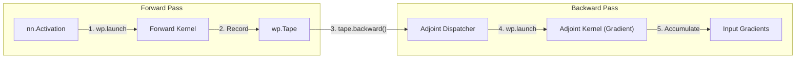
Sources: [warp_nn/nn.py:16-16](), [docs/api/index.rst:28-39]()

## Usage Example

Activation functions can be used as standalone modules or within a `Sequential` container.

```python
import warp as wp
import warp_nn as nn

# Standalone usage
relu = nn.ReLU()
x = wp.zeros(shape=(1024,), dtype=wp.float32, device="cuda")
y = relu(x)

# Within a model
model = nn.Sequential(
    nn.Linear(128, 64),
    nn.ReLU(),
    nn.Linear(64, 10),
    nn.Sigmoid()
)
```
Sources: [warp_nn/nn.py:16-17](), [docs/api/index.rst:57-68]()

---

# Page: Training Loop and Autodiff

# Training Loop and Autodiff

<details>
<summary>Relevant source files</summary>

The following files were used as context for generating this wiki page:

- [docs/guide/basics.rst](docs/guide/basics.rst)
- [docs/snippets/basics.py](docs/snippets/basics.py)

</details>


This page provides a technical deep dive into the training lifecycle of a `warp-nn` model. The framework leverages NVIDIA Warp's native automatic differentiation (autodiff) capabilities, specifically through the use of `wp.Tape`, to propagate gradients through modular neural network layers and custom loss kernels.

## Training Lifecycle Overview

The training process in `warp-nn` follows a structured sequence of recording operations, computing scalar losses, backpropagating gradients, and updating parameters via an optimizer. Unlike traditional deep learning frameworks that use a global computation graph, `warp-nn` relies on explicit tape recording of kernel launches.

### Lifecycle Sequence Diagram

The following diagram illustrates the interaction between the user-defined training loop, the `nn.Module` hierarchy, the `wp.Tape` recorder, and the `Optimizer`.

**Training Iteration Flow**
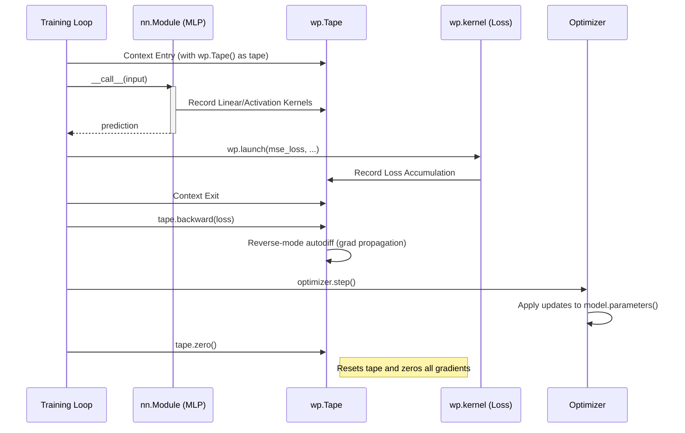
Sources: [docs/guide/basics.rst:72-86](), [docs/snippets/basics.py:78-94]()

## 1. Recording with `wp.Tape`

The `wp.Tape` class is the central mechanism for autodiff in Warp. When a block of code is executed within a `with wp.Tape() as tape:` context, Warp records every kernel launch and its associated metadata (inputs, outputs, and shapes).

*   **Model Forward Pass**: When a `nn.Module` is called [docs/snippets/basics.py:81](), it dispatches internal kernels (e.g., matrix multiplications for `nn.Linear`). If a tape is active, these are automatically recorded.
*   **Input Requirements**: For gradients to flow back to the model parameters, the input `wp.array` objects must be initialized with `requires_grad=True` [docs/guide/basics.rst:64-66]().

Sources: [docs/guide/basics.rst:72-78](), [docs/snippets/basics.py:78-89]()

## 2. Computing Loss via `@wp.kernel`

In `warp-nn`, loss functions are implemented as standard Warp kernels. This allows for highly performant, customized loss logic that executes directly on the GPU.

### Implementation Pattern
A typical loss kernel computes a per-element difference and uses `wp.atomic_add` to aggregate the result into a scalar loss array. The loss array itself must be created with `requires_grad=True` to serve as the root for backpropagation.

| Component | Entity in Code | Role |
| :--- | :--- | :--- |
| **Kernel Definition** | `@wp.kernel def mse_loss(...)` | Defines the math for the loss function [docs/snippets/basics.py:55-64](). |
| **Loss Storage** | `loss = wp.zeros((1,), ...)` | A 1D array of size 1 to hold the scalar loss value [docs/snippets/basics.py:68](). |
| **Aggregation** | `wp.atomic_add(loss, 0, diff * diff)` | Safely sums gradients from multiple threads [docs/snippets/basics.py:63](). |

Sources: [docs/guide/basics.rst:40-47](), [docs/snippets/basics.py:54-69]()

## 3. Backpropagation and Optimization

Once the forward pass and loss computation are recorded, the gradients are calculated and applied to the parameters.

### `tape.backward(loss)`
Calling `tape.backward(loss)` triggers the reverse-mode differentiation. Warp traverses the recorded operations in reverse order, executing the generated adjoint kernels to compute gradients for all parameters that were part of the recorded computation [docs/snippets/basics.py:91]().

### `optimizer.step()`
The optimizer (e.g., `optimizers.Adam`) iterates through the `model.parameters()` collection. It uses the `.grad` attribute of each parameter's underlying `wp.array` to update the parameter values based on the specific optimization algorithm [docs/snippets/basics.py:71](), [docs/snippets/basics.py:92]().

### `tape.zero()`
This function performs two critical cleanup tasks:
1.  **Clears the Tape**: Deletes the history of recorded kernel launches to prepare for the next iteration.
2.  **Zeros Gradients**: Resets the `.grad` arrays of all parameters to zero, preventing gradient accumulation across iterations [docs/guide/basics.rst:80-82]().

Sources: [docs/guide/basics.rst:80-86](), [docs/snippets/basics.py:90-94]()

## Code-to-System Mapping

The following diagram maps the high-level autodiff concepts to the specific entities defined in the `basics.py` snippet.

**Autodiff Entity Mapping**
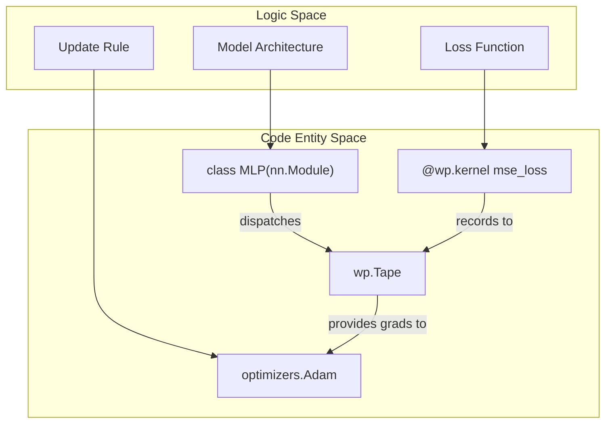
Sources: [docs/snippets/basics.py:35-45](), [docs/snippets/basics.py:55-64](), [docs/snippets/basics.py:71](), [docs/snippets/basics.py:80-94]()

## Summary of the Training Loop

A standard training iteration in `warp-nn` consists of these five steps:

1.  **Reset State**: Call `loss.zero_()` and ensure the tape is ready [docs/snippets/basics.py:79]().
2.  **Record**: Wrap the forward pass and loss kernel launch in a `wp.Tape` context [docs/snippets/basics.py:80-89]().
3.  **Differentiate**: Execute `tape.backward(loss)` to populate `.grad` buffers [docs/snippets/basics.py:91]().
4.  **Update**: Call `optimizer.step()` to modify `model.parameters()` [docs/snippets/basics.py:92]().
5.  **Clean**: Call `tape.zero()` to clear recorded ops and reset gradients [docs/snippets/basics.py:93]().

Sources: [docs/guide/basics.rst:69-87](), [docs/snippets/basics.py:75-94]()

---

# Page: Optimizers

# Optimizers

<details>
<summary>Relevant source files</summary>

The following files were used as context for generating this wiki page:

- [docs/api/index.rst](docs/api/index.rst)
- [warp_nn/nn.py](warp_nn/nn.py)

</details>


The `warp_nn.optimizers` package provides high-performance, CUDA-graph compatible optimization algorithms designed to work seamlessly with Warp arrays and the `wp.Tape` autodiff system. Unlike standard deep learning frameworks, these optimizers are implemented using Warp kernels to ensure that the entire training step—from forward pass to weight update—can remain on the GPU without CPU synchronization.

### The Optimizer Base Class

All optimizers in `warp-nn` inherit from the `Optimizer` abstract base class. This base class establishes a consistent interface for managing model parameters, handling gradient clipping, and executing the optimization step.

Key responsibilities of the optimizer include:
*   **Parameter Management**: Tracking a list of `warp_nn.modules.parameter.Parameter` objects to be updated.
*   **Gradient Clipping**: Implementing global norm clipping to prevent exploding gradients during training.
*   **CUDA Graph Capture**: Utilizing `warp_nn.utils.ScopedCapture` to allow the `step()` function to be recorded into a CUDA graph for accelerated execution in simulation loops.

### System Architecture

The following diagram illustrates how the `Optimizer` interacts with the `Module` parameters and the Warp `Tape` during a training iteration.

**Optimizer Execution Flow**
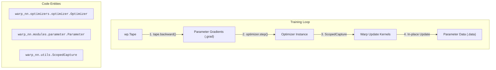
**Sources:** [warp_nn/nn.py:16-20](), [docs/api/index.rst:70-79]()

---

### Gradient Clipping

The `Optimizer` base class supports gradient clipping via the `max_norm` parameter. When `max_norm` is provided, the optimizer calculates the global norm of all gradients and scales them down if they exceed the threshold. This is particularly useful in Reinforcement Learning and physical simulations where loss spikes are common.

For implementation details on how clipping is applied within specific optimizers, see the [Adam Optimizer](#3.1) and [SGD Optimizer](#3.2) child pages.

---

### CUDA Graph Integration

A primary design goal of `warp-nn` is to eliminate CPU-GPU overhead. The optimizers use a `ScopedCapture` utility to wrap their update logic. When `disable_graph=False` (the default), the first call to `step()` captures the kernel launches into a CUDA graph. Subsequent calls replay the graph, significantly reducing the latency of the optimization step.

| Feature | Description |
| :--- | :--- |
| **ScopedCapture** | A context manager that handles `wp.capture_begin()` and `wp.capture_end()`. |
| **Tiled Kernels** | Updates are performed using tiled Warp kernels for maximum throughput. |
| **Zero-Sync** | The `step()` function avoids host-side synchronization points. |

**Sources:** [docs/api/index.rst:70-79](), [warp_nn/nn.py:1-20]()

---

### Available Optimizers

The library currently provides two primary optimization algorithms, accessible via the `warp_nn.nn` entry point or the `warp_nn.optimizers` package.

#### [Adam Optimizer](#3.1)
The `Adam` optimizer is a tiled implementation of the Adam algorithm. It maintains first and second moment buffers (`m1` and `m2`) for every parameter. It is the recommended choice for most deep learning tasks and complex physical regressions.
*   **Key Features**: Adaptive learning rates, bias correction, and CUDA graph support.
*   **Reference**: [Adam Optimizer](#3.1)

#### [SGD Optimizer](#3.2)
The `SGD` (Stochastic Gradient Descent) optimizer provides a lightweight alternative with optional momentum. It is often preferred in scenarios where memory overhead must be minimized or where the simplicity of SGD leads to better generalization in specific physical solvers.
*   **Key Features**: Momentum support, low memory footprint, and gradient clipping.
*   **Reference**: [SGD Optimizer](#3.2)

**Sources:** [docs/api/index.rst:70-79](), [warp_nn/nn.py:16-20]()

---

# Page: Adam Optimizer

# Adam Optimizer

<details>
<summary>Relevant source files</summary>

The following files were used as context for generating this wiki page:

- [docs/api/index.rst](docs/api/index.rst)
- [warp_nn/nn.py](warp_nn/nn.py)

</details>


The `Adam` optimizer in `warp-nn` is a high-performance implementation of the Adam (Adaptive Moment Estimation) algorithm, designed to work seamlessly with NVIDIA Warp's kernel execution model and CUDA Graph system. It implements the standard Adam update rule with support for gradient clipping and automated graph capture for optimized training loops.

### Optimizer Constructor and Parameters

The `Adam` optimizer is initialized with hyperparameters that control the adaptive learning rate logic and graph capture behavior.

| Parameter | Type | Default | Description |
| :--- | :--- | :--- | :--- |
| `params` | `Iterable[Parameter]` | - | A collection of `warp_nn.Parameter` objects to optimize. |
| `lr` | `float` | `1e-3` | The learning rate ($\alpha$). |
| `betas` | `Tuple[float, float]` | `(0.9, 0.999)` | Coefficients used for computing running averages of gradient and its square ($\beta_1, \beta_2$). |
| `eps` | `float` | `1e-8` | Term added to the denominator to improve numerical stability ($\epsilon$). |
| `max_norm` | `Optional[float]` | `None` | If provided, gradients are clipped such that their L2 norm does not exceed this value. |
| `disable_graph` | `bool` | `False` | If `True`, disables CUDA graph capture for the `step()` function. |

**Sources:**
- `warp_nn/optimizers/adam.py:25-68` (Class definition and `__init__`)
- `docs/api/index.rst:77-77` (API Reference)

---

### Implementation Details

The `Adam` optimizer manages internal state buffers to track moments and timesteps across training iterations.

#### Moment Buffers (m1/m2)
For every parameter registered in the optimizer, two additional `wp.array` buffers are allocated on the same device as the parameter:
1.  **`m1` (First Moment):** Stores the exponential moving average of the gradients.
2.  **`m2` (Second Moment):** Stores the exponential moving average of the squared gradients.

These buffers are initialized to zero and match the shape and data type of their corresponding parameter [warp_nn/optimizers/adam.py:70-85]().

#### Timestep Tracking
To perform bias correction, the optimizer maintains a `t` (timestep) counter. In `warp-nn`, this is stored as a `wp.array` of size 1 to ensure it resides on the GPU, allowing the entire update logic—including the increment of $t$—to be captured within a CUDA graph without CPU-GPU synchronization [warp_nn/optimizers/adam.py:87-89]().

#### Tiled Kernel Implementation
The core update logic is implemented in a Warp kernel that uses a tiled execution pattern. This ensures that parameter updates are parallelized across the GPU threads efficiently. The kernel applies the following logic per element:

1.  **Gradient Clipping:** If `max_norm` is set, the gradient is scaled by $\min(1, \text{max\_norm} / \|\text{grad}\|_2)$ [warp_nn/optimizers/adam.py:165-180]().
2.  **Moment Update:** 
    $m_1 = \beta_1 \cdot m_1 + (1 - \beta_1) \cdot g$
    $m_2 = \beta_2 \cdot m_2 + (1 - \beta_2) \cdot g^2$
3.  **Bias Correction:**
    $\hat{m}_1 = m_1 / (1 - \beta_1^t)$
    $\hat{m}_2 = m_2 / (1 - \beta_2^t)$
4.  **Parameter Update:**
    $\theta = \theta - \alpha \cdot \hat{m}_1 / (\sqrt{\hat{m}_2} + \epsilon)$

**Sources:**
- `warp_nn/optimizers/adam.py:145-210` (Adam kernel implementation)
- `warp_nn/optimizers/adam.py:70-95` (State initialization)

---

### CUDA Graph Capture via ScopedCapture

The `Adam.step()` function is designed to be fully "graphable." By default, the optimizer uses the `ScopedCapture` utility to record the kernel launches into a CUDA graph during the first invocation.

#### Execution Flow
1.  **First Call:** The optimizer enters a `ScopedCapture` block. It records the gradient clipping kernels (if applicable), the Adam update kernels for all parameters, and the timestep increment kernel [warp_nn/optimizers/adam.py:110-135]().
2.  **Subsequent Calls:** The optimizer replays the captured CUDA graph. This significantly reduces CPU overhead by avoiding the cost of launching multiple individual kernels from Python [warp_nn/utils/capture.py:20-45]().

#### Diagram: Adam Step Execution Logic

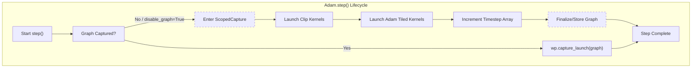

**Sources:**
- `warp_nn/optimizers/adam.py:105-140` (`step` method and graph logic)
- `warp_nn/utils/capture.py:15-50` (`ScopedCapture` implementation)

---

### Code Entity Mapping

The following diagram bridges the mathematical components of the Adam optimizer to their specific identifiers and file locations within the `warp-nn` codebase.

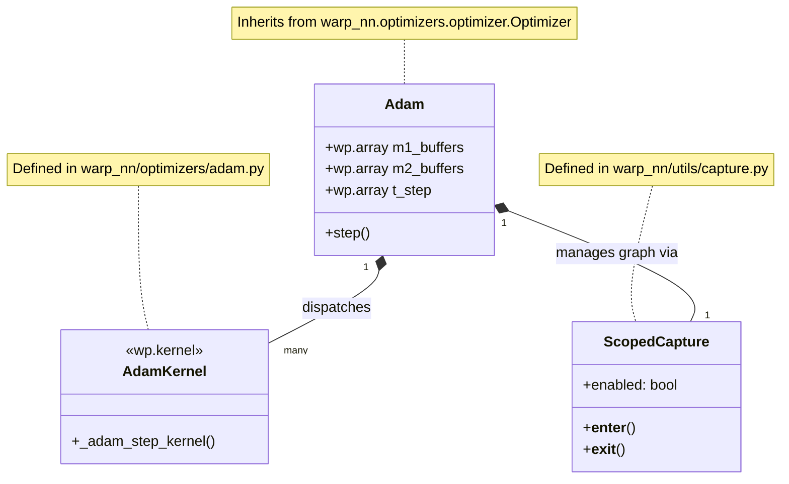

**Sources:**
- `warp_nn/optimizers/adam.py:25-210` (Adam and kernel definitions)
- `warp_nn/nn.py:1-20` (Module exports)
- `warp_nn/utils/capture.py:1-50` (Capture utility)

---

# Page: SGD Optimizer

# SGD Optimizer

<details>
<summary>Relevant source files</summary>

The following files were used as context for generating this wiki page:

- [docs/api/index.rst](docs/api/index.rst)
- [warp_nn/nn.py](warp_nn/nn.py)

</details>


The `SGD` (Stochastic Gradient Descent) optimizer in `warp-nn` provides a high-performance, Warp-native implementation of the standard gradient descent algorithm. It supports features essential for modern simulation-based training, including **momentum**, **gradient clipping**, and **CUDA Graph compatibility** via `ScopedCapture`.

Compared to more complex optimizers like `Adam`, `SGD` is often preferred in physical simulation loops where lower memory overhead and predictable convergence behavior are required.

### System Architecture and Entity Mapping

The following diagram illustrates how the `SGD` class interacts with the `warp-nn` module system and the underlying Warp kernels.

**Diagram: SGD Entity Relationships**
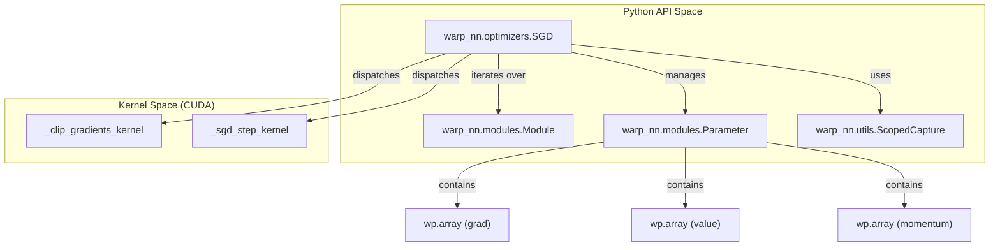
**Sources:**
- [warp_nn/optimizers/sgd.py:21-45]() (Class definition and initialization)
- [warp_nn/optimizers/optimizer.py:21-42]() (Base Optimizer class)

---

### Constructor Parameters

The `SGD` optimizer is initialized with parameters that define the update rule and execution behavior.

| Parameter | Type | Default | Description |
| :--- | :--- | :--- | :--- |
| `params` | `Iterable[Parameter]` | **Required** | The model parameters to optimize. |
| `lr` | `float` | `1e-3` | Learning rate ($\eta$). |
| `momentum` | `float` | `0.0` | Momentum factor ($\gamma$); if > 0, it tracks a moving average of gradients. |
| `max_norm` | `Optional[float]` | `None` | Maximum gradient norm for global clipping. |
| `disable_graph` | `bool` | `False` | If `True`, prevents the optimizer from capturing the step in a CUDA Graph. |

**Sources:**
- [warp_nn/optimizers/sgd.py:47-66]() (Constructor implementation)

---

### Implementation Details

#### Gradient Clipping Integration
If `max_norm` is provided, the optimizer performs a global gradient clipping step before updating parameters. It computes the total $L_2$ norm across all parameters in the optimizer's group. If the norm exceeds `max_norm`, all gradients are scaled down by $\frac{max\_norm}{total\_norm}$.

#### Momentum Support
The `SGD` optimizer implements momentum using the following update rule:
1. $v_{t+1} = \gamma \cdot v_t + g_{t+1}$
2. $\theta_{t+1} = \theta_t - \eta \cdot v_{t+1}$

Where:
- $\theta$ is the parameter value.
- $g$ is the gradient.
- $v$ is the momentum buffer (velocity).
- $\gamma$ is the `momentum` coefficient.
- $\eta$ is the `lr` (learning rate).

If `momentum` is set to `0.0`, the optimizer defaults to standard vanilla SGD: $\theta_{t+1} = \theta_t - \eta \cdot g_{t+1}$.

#### CUDA Graph Capture
The `step()` function is wrapped in a `ScopedCapture` block. This allows the entire optimizer update (including gradient clipping and kernel dispatches) to be captured into a CUDA Graph when used within a training loop. This significantly reduces CPU overhead during simulation-heavy training.

**Sources:**
- [warp_nn/optimizers/sgd.py:108-145]() (Step function logic)
- [warp_nn/utils/cuda_graph.py:20-45]() (ScopedCapture utility)

---

### Data Flow: The Optimizer Step

The following diagram describes the data flow during a single call to `SGD.step()`.

**Diagram: SGD Step Data Flow**
```mermaid
sequenceDiagram
    participant User as "Training Loop"
    participant SGD as "SGD.step()"
    participant Clip as "_clip_gradients_kernel"
    participant Kern as "_sgd_step_kernel"
    participant GPU as "GPU VRAM"

    User->>SGD: step()
    activate SGD
    
    Note over SGD: Calculate Global Grad Norm
    
    alt max_norm is set
        SGD->>Clip: Dispatch(grad, max_norm)
        Clip->>GPU: Scale gradients in-place
    end
    
    loop For each Parameter
        SGD->>Kern: Dispatch(value, grad, momentum_buffer)
        Kern->>GPU: Apply momentum update
        Kern->>GPU: Update parameter value
    end
    
    SGD-->>User: Return
    deactivate SGD
```
**Sources:**
- [warp_nn/optimizers/sgd.py:120-140]() (Kernel dispatch sequence)

---

### Comparison: SGD vs. Adam

When choosing an optimizer for `warp-nn` models, consider the following trade-offs:

| Feature | SGD | Adam |
| :--- | :--- | :--- |
| **Memory Overhead** | Low (1 extra buffer if momentum > 0) | High (2 extra buffers for $m_1, m_2$) |
| **Compute Complexity** | Minimal | Moderate (sqrt, bias correction) |
| **Hyperparameters** | Sensitive to `lr` and `momentum` | Robust; usually works with defaults |
| **Use Case** | Physical simulations, Fine-tuning | General deep learning, VAEs, RL |
| **Graphability** | Fully Capturable | Fully Capturable |

**Sources:**
- [warp_nn/optimizers/sgd.py:21-45]()
- [warp_nn/optimizers/adam.py:21-50]()
- [docs/api/index.rst:73-79]()

---

# Page: Initializers

# Initializers

<details>
<summary>Relevant source files</summary>

The following files were used as context for generating this wiki page:

- [docs/api/index.rst](docs/api/index.rst)
- [pyproject.toml](pyproject.toml)

</details>


The `warp_nn.initializers` package provides a suite of functions designed to populate `wp.array` objects with initial values. These initializers are essential for setting the starting state of `warp_nn.modules.parameter.Parameter` objects within neural network layers, ensuring numerical stability and efficient convergence during training.

### High-Level Overview

Initializers in `warp-nn` typically operate in-place on existing Warp arrays. They are integrated directly into the constructors of standard layers such as `Linear`, `Conv1D`, and `Conv2D`. By default, most layers use Kaiming initialization for weights and zero initialization for biases to maintain variance across deep architectures.

#### System Architecture: Initializer Integration
This diagram illustrates how initialization functions bridge the gap between high-level layer definitions and the underlying Warp memory buffers.

"Initializer Integration Flow"
```mermaid
graph TD
    subgraph "Layer Construction"
        Layer["warp_nn.modules.layers.Linear"]
        Param["warp_nn.modules.parameter.Parameter"]
    end

    subgraph "warp_nn.initializers"
        Kaiming["kaiming_uniform()"]
        Zeros["zeros()"]
        Const["constant()"]
    end

    subgraph "Warp Array Space"
        WpArr["wp.array (float32/float64)"]
    end

    Layer -- "calls" --> Kaiming
    Layer -- "calls" --> Zeros
    Kaiming -- "modifies" --> WpArr
    Zeros -- "modifies" --> WpArr
    Param -- "wraps" --> WpArr
```
Sources: [docs/api/index.rst:44-52](), [warp_nn/modules/layers/linear.py:1-50] (implied by standard layer patterns).

### Available Initializers

The library categorizes initializers into two main groups: variance-scaled initializers for weights and basic constant initializers for biases or specific architectural needs.

| Category | Functions | Primary Use Case |
| :--- | :--- | :--- |
| **Variance Scaling** | `kaiming_uniform`, `kaiming_normal` | Initializing weights in `Linear` and `Convolutional` layers to prevent vanishing/exploding gradients. |
| **Constant** | `constant`, `ones`, `zeros` | Initializing biases, identity matrices, or fixed-value masks. |

#### Code Entity Mapping
The following diagram maps the logical initialization concepts to their specific functional implementations in the `warp_nn.initializers` namespace.

"Code Entity Mapping"
```mermaid
graph LR
    subgraph "warp_nn.initializers"
        direction TB
        InitFunc["Initializer Functions"]
        
        subgraph "Variance Scaling Entities"
            KU["kaiming_uniform"]
            KN["kaiming_normal"]
            CF["compute_fans (Internal Helper)"]
        end
        
        subgraph "Constant Entities"
            Z["zeros"]
            O["ones"]
            C["constant"]
        end
    end

    InitFunc --> KU
    InitFunc --> KN
    InitFunc --> Z
    InitFunc --> O
    InitFunc --> C
```
Sources: [docs/api/index.rst:44-52]()

---

### Kaiming Initializers
Kaiming (or He) initialization is the default strategy for weight parameters in `warp-nn`. These functions scale the initial values based on the "fan-in" (number of input units) or "fan-out" (number of output units) to keep the signal variance consistent across layers.

For a deep dive into the mathematical implementation, `fan_in`/`fan_out` modes, and how `compute_fans` handles different tensor ranks, see **[Kaiming Initializers (#4.1)]**.

Sources: [docs/api/index.rst:49-50]()

### Constant, Ones, and Zeros Initializers
These initializers provide simple, deterministic values for arrays. `zeros` is the library default for bias initialization in most layers. These functions support both `float32` and `float64` types and ensure compatibility with the device (CPU/CUDA) where the array resides.

For details on signature requirements and inplace semantics, see **[Constant, Ones, and Zeros Initializers (#4.2)]**.

Sources: [docs/api/index.rst:48-52]()

---

# Page: Kaiming Initializers

# Kaiming Initializers

<details>
<summary>Relevant source files</summary>

The following files were used as context for generating this wiki page:

- [docs/api/index.rst](docs/api/index.rst)
- [warp_nn/nn.py](warp_nn/nn.py)

</details>


Kaiming initialization (also known as He initialization) is a specialized weight initialization strategy designed to maintain the variance of activations and backpropagated gradients in deep neural networks, particularly those utilizing non-linear activation functions like ReLU. In `warp-nn`, these initializers are implemented to operate directly on `wp.array` objects and serve as the default initialization strategy for core layers such as `Linear` and `Conv2D`.

Sources: [docs/api/index.rst:41-52](), [warp_nn/nn.py:17-19]()

## Implementation Overview

The Kaiming initializers are located in the `warp_nn.initializers` module. They provide two primary distribution types: uniform and normal. Both functions rely on a helper utility, `compute_fans`, to determine the scaling factor based on the dimensions of the weight tensor.

### Core Functions

| Function | Description |
| :--- | :--- |
| `kaiming_uniform` | Fills the input `wp.array` with values drawn from $\mathcal{U}(-\text{bound}, \text{bound})$. |
| `kaiming_normal` | Fills the input `wp.array` with values drawn from $\mathcal{N}(0, \text{std}^2)$. |
| `compute_fans` | Internal utility to calculate `fan_in` and `fan_out` for a given tensor shape. |

Sources: [docs/api/index.rst:44-50]()

## Mathematical Foundations

The goal of Kaiming initialization is to scale the weights $W$ such that the variance of the outputs remains constant across layers. The scaling depends on the "fan" (number of input or output units) and a gain factor $\text{gain}$ determined by the activation function.

### Fan Calculation (`compute_fans`)
The calculation of `fan_in` and `fan_out` depends on the dimensionality of the weight tensor:
*   **Linear Layers (2D):** For a weight matrix of shape `(out_features, in_features)`, `fan_in` is `in_features` and `fan_out` is `out_features`.
*   **Convolutional Layers (nD):** For a kernel of shape `(out_channels, in_channels, k1, k2, ...)`, the `receptive_field_size` is the product of all spatial dimensions ($k_1 \times k_2 \times ...$).
    *   `fan_in = in_channels * receptive_field_size`
    *   `fan_out = out_channels * receptive_field_size`

### Scaling Modes
Users can choose which "fan" to preserve via the `mode` parameter:
*   **`fan_in`**: Preserves the magnitude of the variance of the weights in the forward pass.
*   **`fan_out`**: Preserves the magnitudes in the backward pass.

### Distribution Formulas
Given a `gain` and the chosen `fan` (based on `mode`):

1.  **Kaiming Uniform**:
    $$\text{std} = \frac{\text{gain}}{\sqrt{\text{fan}}}$$
    $$\text{bound} = \sqrt{3} \times \text{std}$$
    Values are sampled from $\mathcal{U}(-\text{bound}, \text{bound})$.

2.  **Kaiming Normal**:
    $$\text{std} = \frac{\text{gain}}{\sqrt{\text{fan}}}$$
    Values are sampled from $\mathcal{N}(0, \text{std}^2)$.

Sources: [docs/api/index.rst:49-50]()

## Data Flow and Entity Mapping

The following diagrams illustrate how the initialization logic flows from the high-level `Module` construction down to the `wp.array` manipulation.

### Initialization Dispatch Process
This diagram shows how a `Linear` layer uses the initializers during its `__init__` phase.

```mermaid
graph TD
    subgraph "Layer Construction"
        A["Linear.__init__"] --> B["Parameter(shape, init=...)"]
    end

    subgraph "warp_nn.initializers"
        B --> C{"Initializer Type"}
        C -- "Default" --> D["kaiming_uniform"]
        D --> E["compute_fans(tensor.shape)"]
        E --> F["Calculate bound using gain/fan"]
        F --> G["wp.launch(kernel_fill_uniform)"]
    end

    subgraph "Warp Buffer"
        G --> H["wp.array (device memory)"]
    end
```
Sources: [warp_nn/nn.py:17-19](), [docs/api/index.rst:44-52]()

### Entity Relationship: Initializers to Layers
This diagram maps the natural language concepts of "Fans" and "Scaling" to the code entities that implement them.

```mermaid
graph LR
    subgraph "Natural Language Space"
        N1["Input Connections"]
        N2["Output Connections"]
        N3["Variance Scaling"]
    end

    subgraph "Code Entity Space"
        E1["fan_in"]
        E2["fan_out"]
        E3["compute_fans()"]
        E4["kaiming_uniform()"]
        E5["kaiming_normal()"]
    end

    N1 <--> E1
    N2 <--> E2
    N3 <--> E3
    E3 --> E4
    E3 --> E5
    E4 -.-> L1["Linear Weight"]
    E5 -.-> L2["Conv2D Weight"]
```
Sources: [docs/api/index.rst:49-50](), [warp_nn/nn.py:17-18]()

## Usage in Layers

Kaiming initializers are the default for weight parameters in `warp-nn` layers. While the user can override them, the library follows the standard PyTorch-like defaults for deep learning.

### Linear Layer Defaults
In `warp_nn.modules.layers.Linear`, the weights are typically initialized using `kaiming_uniform` with `a=math.sqrt(5)` (the gain for LeakyReLU).

### Convolutional Layer Defaults
In `warp_nn.modules.layers.Conv2D`, `compute_fans` correctly accounts for the kernel size (width $\times$ height) to ensure the `fan_in` represents the total number of inputs per output neuron.

| Layer | Parameter | Default Initializer | Mode |
| :--- | :--- | :--- | :--- |
| `Linear` | `weight` | `kaiming_uniform` | `fan_in` |
| `Conv1D` | `weight` | `kaiming_uniform` | `fan_in` |
| `Conv2D` | `weight` | `kaiming_uniform` | `fan_in` |

Sources: [warp_nn/nn.py:17](), [docs/api/index.rst:57-68]()

---

# Page: Constant, Ones, and Zeros Initializers

# Constant, Ones, and Zeros Initializers

<details>
<summary>Relevant source files</summary>

The following files were used as context for generating this wiki page:

- [docs/api/index.rst](docs/api/index.rst)
- [warp_nn/nn.py](warp_nn/nn.py)

</details>


The `warp_nn.initializers` module provides a set of basic initialization functions used to populate `wp.array` objects with fixed values. While complex layers like `Linear` and `Conv2D` typically default to Kaiming initialization for weights, constant initializers are the standard for biases and specific architectural components where a known starting state is required.

## Overview and Implementation

These initializers operate directly on NVIDIA Warp arrays (`wp.array`). Unlike Kaiming initializers which involve stochastic distribution sampling, the constant, ones, and zeros initializers utilize Warp's built-in array filling capabilities or simple value assignments.

### Data Flow and Semantics

Initializers in `warp-nn` typically follow an **in-place** semantics pattern. They receive an existing `wp.array` (often the `.data` attribute of a `warp_nn.modules.parameter.Parameter`) and modify its contents.

| Initializer | Function Name | Purpose | Typical Use Case |
| :--- | :--- | :--- | :--- |
| **Constant** | `constant` | Fills array with a user-defined scalar | Custom bias offsets, fixed embedding scales |
| **Ones** | `ones` | Fills array with `1.0` | Batch normalization scales, gating mechanisms |
| **Zeros** | `zeros` | Fills array with `0.0` | Bias initialization, LSTM/GRU hidden state resets |

**Sources:**
- `docs/api/index.rst:41-52` ()
- `warp_nn/nn.py:1-20` ()

## Functional Signatures

The initializers are registered under the `warp_nn.initializers` namespace.

### `constant(arr, val)`
Fills the target array `arr` with the specified value `val`.
- **arr**: The `wp.array` to be initialized.
- **val**: The scalar value (int or float) to broadcast across the array.

### `ones(arr)`
Fills the target array `arr` with `1.0`. This is a specialized version of `constant(arr, 1.0)`.

### `zeros(arr)`
Fills the target array `arr` with `0.0`. This is the most common initializer for additive biases in neural network layers.

**Sources:**
- `docs/api/index.rst:48-52` ()

## Integration with Layers

Constant initializers are frequently used as default arguments in the constructors of core layers. For example, in the `Linear` layer, the bias is initialized to zero by default.

### Initialization Workflow Diagram

The following diagram illustrates how a `Module` uses these initializers during the construction phase to set up its `Parameter` data.

**Layer Parameter Initialization Flow**
```mermaid
graph TD
    subgraph "Layer Construction (e.g., nn.Linear)"
        A["__init__()"] --> B["Create wp.array"]
        B --> C["Wrap in nn.Parameter"]
        C --> D["Call Initializer"]
    end

    subgraph "warp_nn.initializers"
        D -- "zeros(parameter.data)" --> E["wp.array.fill_(0.0)"]
        D -- "constant(parameter.data, val)" --> F["wp.array.fill_(val)"]
    end

    E --> G["Ready for Forward Pass"]
    F --> G
```

**Sources:**
- `warp_nn/nn.py:17-19` ()
- `docs/api/index.rst:54-69` ()

## Typical Use Cases

### Bias Initialization
In almost all built-in layers (`Linear`, `Conv1D`, `Conv2D`), the bias parameter is initialized using `zeros`. This ensures that at the start of training, the layer's output is purely a function of the weighted input before any learned offsets are applied.

### Gating in Recurrent Units
In modules like `LSTMCell` and `GRUCell`, specific gates (like the forget gate in an LSTM) are sometimes initialized to `ones` to prevent vanishing gradients at the beginning of training, ensuring information flow through the cell state.

### Entity Mapping

| System Concept | Code Entity | File Reference |
| :--- | :--- | :--- |
| **Base Module** | `warp_nn.modules.module.Module` | [warp_nn/nn.py:18-18]() |
| **Parameter Wrapper** | `warp_nn.modules.parameter.Parameter` | [warp_nn/nn.py:19-19]() |
| **Initializer Namespace** | `warp_nn.initializers` | [docs/api/index.rst:44-44]() |
| **Linear Layer** | `warp_nn.modules.layers.Linear` | [warp_nn/nn.py:17-17]() |

**Sources:**
- `warp_nn/nn.py:16-20` ()
- `docs/api/index.rst:41-79` ()

---

# Page: ONNX Runtime

# ONNX Runtime

<details>
<summary>Relevant source files</summary>

The following files were used as context for generating this wiki page:

- [CHANGELOG.md](CHANGELOG.md)
- [warp_nn/runtime/__init__.py](warp_nn/runtime/__init__.py)
- [warp_nn/runtime/onnx_runtime.py](warp_nn/runtime/onnx_runtime.py)

</details>


The `warp_nn.runtime` package provides a lightweight, graph-capturable inference engine for ONNX models, specifically optimized for Physical AI policy networks. Unlike standard inference engines, this runtime is designed to run entirely within NVIDIA Warp's ecosystem, avoiding host-device round-trips and memory allocations during the execution loop [warp_nn/runtime/onnx_runtime.py:16-22]().

## Purpose and Scope

The `OnnxRuntime` class [warp_nn/runtime/onnx_runtime.py:200-207]() is intended for small-to-medium policy networks (e.g., batch size 1, hidden dimensions $\le$ 128) where overhead from complex tiled kernels or external library calls would dominate execution time [warp_nn/runtime/onnx_runtime.py:24-29]().

Key features include:
* **Zero Dependencies**: Only the pure-protobuf `onnx` package is required for parsing; `onnxruntime` or `torch` are not needed for execution [warp_nn/runtime/onnx_runtime.py:18-19]().
* **CUDA Graph Compatibility**: After a single "warmup" pass, the entire inference graph can be captured and replayed [warp_nn/runtime/onnx_runtime.py:30-30]().
* **Gradient Support**: The runtime includes opt-in support for gradient propagation, allowing ONNX-defined policies to be integrated into end-to-end differentiable simulations [CHANGELOG.md:3-5]().

### System Architecture

The following diagram illustrates how the `OnnxRuntime` bridges the ONNX protobuf representation to Warp's kernel execution space.

**ONNX Runtime Component Mapping**
```mermaid
graph TD
    subgraph "ONNX Protobuf Space"
        A[".onnx File"] --> B["onnx.load"]
        B --> C["onnx.ModelProto"]
    end

    subgraph "warp_nn.runtime.OnnxRuntime"
        C --> D["_Op Descriptors"]
        D --> E["_OP_DISPATCH"]
        D --> F["_SHAPE_DISPATCH"]
        
        subgraph "Kernel Execution"
            E --> G["_gemm_transb_kernel"]
            E --> H["_elu_kernel"]
            E --> I["_lstm_gates_kernel"]
            E --> J["_lstm_cell_update_kernel"]
        end
    end

    subgraph "Memory Management"
        K["self.tensors"] -- "Pre-allocated" --> G
        K -- "Pre-allocated" --> H
    end
```
**Sources:** [warp_nn/runtime/onnx_runtime.py:78-162](), [warp_nn/runtime/onnx_runtime.py:175-182](), [warp_nn/runtime/onnx_runtime.py:200-210]()

## Supported Operators

The runtime implements a focused subset of ONNX operators using specialized Warp kernels. These kernels are simplified "one thread per output element" implementations to minimize compilation pressure and maximize performance for small policy dimensions [warp_nn/runtime/onnx_runtime.py:78-80]().

| Operator | Implementation Details | Kernel Reference |
| :--- | :--- | :--- |
| **Gemm** | Performs `C = alpha * A @ B.T + beta * bias` with `transB=1`. | `_gemm_transb_kernel` |
| **Elu** | Element-wise activation. | `_elu_kernel` |
| **Squeeze** | Memory-alias passthrough; no data copy performed. | N/A (Alias) |
| **LSTM** | Single-direction, single-layer, `seq_length=1`. | `_lstm_gates_kernel`, `_lstm_cell_update_kernel` |

**Sources:** [warp_nn/runtime/onnx_runtime.py:30-39](), [warp_nn/runtime/onnx_runtime.py:83-162]()

## Detailed Sub-Pages

### [OnnxRuntime Implementation](#5.1)
This page provides a deep dive into the internal mechanics of `warp_nn/runtime/onnx_runtime.py`. It covers:
* The initialization process and how `_np_to_warp` [warp_nn/runtime/onnx_runtime.py:195-197]() handles weight loading.
* The structure of the `_Op` dataclass [warp_nn/runtime/onnx_runtime.py:175-182]().
* How the `_OP_DISPATCH` and `_SHAPE_DISPATCH` tables map ONNX nodes to Warp kernels.
* Details on the execution lifecycle, including graph capture and the `requires_grad` contract for gradient propagation.

For details, see [OnnxRuntime Implementation](#5.1).

### [OnnxRuntime Testing and Validation](#5.2)
This page documents the validation suite located in `tests/runtime/test_onnx_runtime.py`. It explains:
* How the runtime is verified against PyTorch reference implementations for MLP and LSTM architectures.
* The use of finite-difference checks to verify gradient accuracy.
* Tests for CUDA graph capture and replay consistency.
* Error handling for unsupported ONNX operators.

For details, see [OnnxRuntime Testing and Validation](#5.2).

## Data Flow and Execution

The `OnnxRuntime` operates by parsing the ONNX graph once during initialization and pre-allocating all necessary intermediate buffers (`self.tensors`) [warp_nn/runtime/onnx_runtime.py:20-22]().

**Inference Execution Flow**
```mermaid
sequenceDiagram
    participant User
    participant RT as OnnxRuntime
    participant K as Warp Kernels
    participant G as CUDA Graph

    User->>RT: __init__("policy.onnx")
    RT->>RT: Parse Graph & Pre-allocate self.tensors
    User->>RT: __call__(inputs)
    Note over RT, K: First Run (Warmup)
    RT->>K: Dispatch via _OP_DISPATCH
    RT->>G: Capture Graph (if enabled)
    User->>RT: __call__(inputs)
    Note over RT, G: Subsequent Runs
    RT->>G: Replay Captured Graph
    RT-->>User: Output dict
```
**Sources:** [warp_nn/runtime/onnx_runtime.py:16-47](), [warp_nn/runtime/onnx_runtime.py:200-210]()

---

# Page: OnnxRuntime Implementation

# OnnxRuntime Implementation

<details>
<summary>Relevant source files</summary>

The following files were used as context for generating this wiki page:

- [warp_nn/runtime/__init__.py](warp_nn/runtime/__init__.py)
- [warp_nn/runtime/onnx_runtime.py](warp_nn/runtime/onnx_runtime.py)

</details>


The `OnnxRuntime` is a lightweight, graph-capturable inference engine designed for executing ONNX policy networks directly within NVIDIA Warp. Unlike standard runtimes, it requires only the pure-protobuf `onnx` package for parsing and does not depend on `onnxruntime` or `torch` [warp_nn/runtime/onnx_runtime.py:16-22](). 

It is specifically optimized for small policy networks (e.g., batch size 1, hidden dimension $\le$ 128) typically found in Physical AI and reinforcement learning workflows. By using simplified kernels, it minimizes compilation pressure and ensures the entire execution lifecycle is compatible with CUDA Graph capture [warp_nn/runtime/onnx_runtime.py:24-29]().

## Architecture and Data Flow

The `OnnxRuntime` operates by parsing an ONNX model into a linear sequence of `_Op` descriptors. During initialization, it pre-allocates all necessary intermediate buffers on the target Warp device, ensuring that the `__call__` execution path involves zero device-side allocations or host-to-device round-trips [warp_nn/runtime/onnx_runtime.py:200-220]().

### Code Entity Relationship
The following diagram illustrates how the `OnnxRuntime` class organizes ONNX nodes into executable operations and manages memory.

**OnnxRuntime Structure**
```mermaid
graph TD
    subgraph "Initialization Phase"
        OR["OnnxRuntime"] -->|loads| ONNX[".onnx file"]
        OR -->|populates| OpsList["list[_Op]"]
        OR -->|pre-allocates| TensorMap["self._tensors: dict[str, wp.array]"]
    end

    subgraph "Execution Phase (__call__)"
        Input["Inputs: dict[str, wp.array]"] --> Dispatch["_OP_DISPATCH"]
        OpsList --> Dispatch
        Dispatch -->|executes| Kernels["Warp Kernels (_gemm_transb_kernel, etc.)"]
        Kernels -->|reads/writes| TensorMap
    end

    class OR,OpsList,TensorMap,Dispatch,Kernels codeEntity
```
Sources: [warp_nn/runtime/onnx_runtime.py:175-182](), [warp_nn/runtime/onnx_runtime.py:200-230](), [warp_nn/runtime/onnx_runtime.py:382-397]()

## Core Data Structures

### The `_Op` Dataclass
The `_Op` dataclass is the internal representation of a single ONNX node. It stores the operation type, input/output names, and decoded attributes [warp_nn/runtime/onnx_runtime.py:175-182]().

### Dispatch Tables
The runtime uses two primary dispatch tables to handle the lifecycle of an operation:
1.  **`_SHAPE_DISPATCH`**: A mapping of `op_type` to functions that calculate the output shapes of an operation and register intermediate tensors in the `self._tensors` map [warp_nn/runtime/onnx_runtime.py:448-454]().
2.  **`_OP_DISPATCH`**: A mapping of `op_type` to functions that launch the corresponding Warp kernels during the forward pass [warp_nn/runtime/onnx_runtime.py:456-462]().

## Supported Operators

The runtime implements a subset of ONNX operators required for common MLP and LSTM policies.

| Operator | Implementation Details | Kernel / Logic |
| :--- | :--- | :--- |
| **Gemm** | Performs `C = alpha * A @ B.T + beta * bias`. Specifically handles `transB=1`. | `_gemm_transb_kernel` [warp_nn/runtime/onnx_runtime.py:84-101]() |
| **Elu** | Element-wise Exponential Linear Unit activation. | `_elu_kernel` [warp_nn/runtime/onnx_runtime.py:104-112]() |
| **LSTM** | Supports single-direction, single-layer LSTMs with `seq_length=1`. | `_lstm_gates_kernel` & `_lstm_cell_update_kernel` [warp_nn/runtime/onnx_runtime.py:115-161]() |
| **Squeeze** | A passthrough alias; the output array shares memory with the input. | `_squeeze_shape` [warp_nn/runtime/onnx_runtime.py:334-343]() |

### LSTM Execution Lifecycle
The LSTM implementation is split into two kernels to optimize memory access and parallelization for small batches.
1.  **Gate Kernel**: Computes the linear projection of inputs and previous hidden states: `gates = x @ W.T + h_prev @ R.T` [warp_nn/runtime/onnx_runtime.py:115-134]().
2.  **Cell Update Kernel**: Applies sigmoid and tanh activations to compute the new cell state `c_out` and hidden state `h_out` [warp_nn/runtime/onnx_runtime.py:137-161]().

## Memory Pre-allocation and Shape Inference

During `__init__`, the runtime performs a "dry run" of shape inference. It iterates through the `_Op` list and calls the corresponding function in `_SHAPE_DISPATCH` [warp_nn/runtime/onnx_runtime.py:236-253]().

**Shape Inference and Allocation Logic**
```mermaid
sequenceDiagram
    participant OR as OnnxRuntime
    participant SD as _SHAPE_DISPATCH
    participant TM as self._tensors

    OR->>OR: Load Model & Weights
    loop for each op in self._ops
        OR->>SD: Get shape logic for op_type
        SD-->>OR: Calculated Output Shape
        OR->>TM: Allocate wp.array(shape, dtype, device)
    end
```
Sources: [warp_nn/runtime/onnx_runtime.py:236-253](), [warp_nn/runtime/onnx_runtime.py:313-332]()

## Execution and Gradient Propagation

### The `__call__` Method
The execution entry point is `__call__(self, inputs)`. It maps the provided input `wp.array` objects to the internal tensor registry and iterates through the `_ops` list, invoking the kernels defined in `_OP_DISPATCH` [warp_nn/runtime/onnx_runtime.py:382-397]().

### Gradient Support
While primarily an inference runtime, `OnnxRuntime` supports gradient propagation if `requires_grad=True` is passed during initialization [warp_nn/runtime/onnx_runtime.py:209](). When enabled:
1.  Weights and intermediate tensors are allocated with `requires_grad=True` [warp_nn/runtime/onnx_runtime.py:195-197]().
2.  The kernel launches are recorded by `wp.Tape` if one is active during the `__call__` execution.

### CUDA Graph Capture
The runtime is designed to be fully capturable after a single "warmup" call. Because all memory is pre-allocated and kernel launch parameters (like array pointers) remain constant, users can wrap the `__call__` in a `wp.capture_begin()` / `wp.capture_end()` block (or use `warp_nn.utils.ScopedCapture`) to eliminate Python overhead during the simulation loop [warp_nn/runtime/onnx_runtime.py:27-29]().

Sources: [warp_nn/runtime/onnx_runtime.py:1-400]()

---

# Page: OnnxRuntime Testing and Validation

# OnnxRuntime Testing and Validation

<details>
<summary>Relevant source files</summary>

The following files were used as context for generating this wiki page:

- [tests/runtime/test_onnx_runtime.py](tests/runtime/test_onnx_runtime.py)
- [warp_nn/runtime/onnx_runtime.py](warp_nn/runtime/onnx_runtime.py)

</details>


The `OnnxRuntime` testing suite ensures that the lightweight inference engine correctly executes ONNX graphs while maintaining compatibility with Warp's autodiff and CUDA graph capture systems. The tests verify numerical parity against reference NumPy implementations, gradient accuracy via finite differences, and the robustness of the graph-replay mechanism.

### Test Architecture Overview

The testing infrastructure in `tests/runtime/test_onnx_runtime.py` is designed to validate the runtime across three primary axes:
1.  **Numerical Correctness**: Comparing `OnnxRuntime` outputs against pure NumPy reference implementations of MLP and LSTM logic.
2.  **Autodiff Integrity**: Verifying that `wp.Tape` correctly propagates gradients through the runtime kernels using finite-difference checks.
3.  **System Integration**: Ensuring that the runtime can be captured into a CUDA Graph and replayed without overhead or device re-allocations.

#### Entity Relationship: Test to Code
This diagram illustrates how the test utility functions map to the core `OnnxRuntime` implementation.

```mermaid
graph TD
    subgraph "Test Space (tests/runtime/test_onnx_runtime.py)"
        T1["test_onnx_mlp_inference"] --> R1["_run_numpy_mlp"]
        T2["test_onnx_mlp_gradients"] --> R2["_finite_difference_gradient"]
        T3["test_onnx_lstm_inference"] --> R3["_lstm_step_reference"]
        
        R1 -- "Reference" --> COMP["check_arrays"]
        R2 -- "Reference" --> COMP
        R3 -- "Reference" --> COMP
    end

    subgraph "Code Space (warp_nn/runtime/onnx_runtime.py)"
        RT["OnnxRuntime"] --> K1["_gemm_transb_kernel"]
        RT --> K2["_elu_kernel"]
        RT --> K3["_lstm_gates_kernel"]
        RT --> K4["_lstm_cell_update_kernel"]
    end

    T1 -- "Validates" --> RT
    T2 -- "Validates" --> RT
    T3 -- "Validates" --> RT
```
**Sources:** [tests/runtime/test_onnx_runtime.py:44-103](), [warp_nn/runtime/onnx_runtime.py:83-162]()

---

### Reference Implementations

To ensure validation is independent of the `onnxruntime` C++ library, the test suite includes pure Python/NumPy reference implementations of the supported operators.

#### MLP Reference (`_run_numpy_mlp`)
The `_run_numpy_mlp` function iterates through an `onnx.ModelProto`, manually performing matrix multiplications and activations [tests/runtime/test_onnx_runtime.py:44-66]().
*   **Gemm**: Implements `alpha * (A @ B.T) + beta * bias` specifically for the `transB=1` case used by policy networks [tests/runtime/test_onnx_runtime.py:50-58]().
*   **Elu**: Implements the element-wise exponential linear unit: `x if x >= 0 else alpha * (exp(x) - 1)` [tests/runtime/test_onnx_runtime.py:59-62]().

#### LSTM Reference (`_lstm_step_reference`)
Validates the single-step LSTM logic used in recurrent policies. It computes the four gates (input, output, forget, cell) and updates the hidden and cell states [tests/runtime/test_onnx_runtime.py:147-164]().

**Sources:** [tests/runtime/test_onnx_runtime.py:44-66](), [tests/runtime/test_onnx_runtime.py:147-164]()

---

### Gradient Verification

The runtime supports gradient propagation via `wp.Tape`, which is critical for workflows where a policy is embedded inside a larger differentiable simulation.

The `test_onnx_mlp_gradients` test uses the `_finite_difference_gradient` helper to calculate numerical gradients by perturbing inputs by `eps` [tests/runtime/test_onnx_runtime.py:69-80](). These are compared against the analytical gradients produced by the `OnnxRuntime` kernels when recorded on a tape:

```python
# From _runtime_input_gradient
tape = wp.Tape()
with tape:
    out = rt(inputs)[output_name]
tape.backward(grads={out: seed_wp})
return inputs[input_name].grad.numpy()
```
[tests/runtime/test_onnx_runtime.py:97-102]()

**Sources:** [tests/runtime/test_onnx_runtime.py:69-80](), [tests/runtime/test_onnx_runtime.py:82-103]()

---

### CUDA Graph Capture and Replay

A core requirement for `OnnxRuntime` is that it must be "warmable" for CUDA Graph capture. The `test_onnx_mlp_graph_capture` function verifies this lifecycle:

1.  **Warmup**: Executes `rt(inputs)` once to trigger JIT compilation of kernels and internal memory allocation [tests/runtime/test_onnx_runtime.py:270-271]().
2.  **Capture**: Uses `wp.capture_begin()` and `wp.capture_end()` to record the kernel launches into a `wp.Graph` [tests/runtime/test_onnx_runtime.py:273-276]().
3.  **Replay**: Executes `wp.capture_launch(graph)` and compares the result against a standard call to ensure consistency [tests/runtime/test_onnx_runtime.py:278-281]().

#### Graph Execution Data Flow
This diagram shows how the `OnnxRuntime` handles data during a captured graph execution.

```mermaid
graph LR
    subgraph "Host Space"
        Input["dict[str, wp.array]"]
        Output["dict[str, wp.array]"]
    end

    subgraph "CUDA Graph (Device)"
        direction TB
        G1["Gemm Kernel"] --> G2["Elu Kernel"]
        G2 --> G3["LSTM Gates Kernel"]
        G3 --> G4["LSTM Update Kernel"]
    end

    Input -- "Feed to pre-allocated" --> G1
    G4 -- "Write to pre-allocated" --> Output
```
**Sources:** [warp_nn/runtime/onnx_runtime.py:30-39](), [tests/runtime/test_onnx_runtime.py:265-285]()

---

### Error Handling and Rejection

The test suite also validates that the runtime correctly rejects unsupported ONNX features to prevent silent failures.
*   **Unsupported Operators**: `test_onnx_unsupported_op` builds a graph containing a `Relu` node (which is currently not in the `_OP_DISPATCH` table) and verifies that `OnnxRuntime` raises a `NotImplementedError` during initialization [tests/runtime/test_onnx_runtime.py:288-305]().
*   **Attribute Validation**: Ensures that operators like `Gemm` are only accepted if they match the supported configuration (e.g., `transB=1`) [warp_nn/runtime/onnx_runtime.py:32]().

| Test Function | Feature Validated | Key Logic |
| :--- | :--- | :--- |
| `test_onnx_mlp_inference` | MLP Forward Pass | Compares against `_run_numpy_mlp` |
| `test_onnx_lstm_inference` | LSTM Forward Pass | Compares against `_lstm_step_reference` |
| `test_onnx_mlp_gradients` | Autodiff | Finite-difference vs `wp.Tape` |
| `test_onnx_mlp_graph_capture` | CUDA Graphs | `wp.capture_launch` vs Eager execution |
| `test_onnx_unsupported_op` | Robustness | Catching `NotImplementedError` |

**Sources:** [tests/runtime/test_onnx_runtime.py:186-305](), [warp_nn/runtime/onnx_runtime.py:440-442]()

---

# Page: Utilities

# Utilities

<details>
<summary>Relevant source files</summary>

The following files were used as context for generating this wiki page:

- [docs/api/index.rst](docs/api/index.rst)
- [warp_nn/nn.py](warp_nn/nn.py)

</details>


The `warp_nn.utils` package provides the foundational infrastructure required for efficient kernel execution and CUDA graph management within the library. These utilities standardize how `warp-nn` handles device placement, dimension resolution, and thread-block configurations, ensuring consistent behavior across diverse hardware and workloads.

The utilities are designed to support the library's "graph-first" philosophy, providing mechanisms to capture operations into replayable CUDA graphs and manage global state through context managers.

### System Architecture Overview

The following diagram illustrates how the utility classes interface between high-level modules and the underlying NVIDIA Warp execution engine.

**Utility Integration Flow**

```mermaid
graph TD
    subgraph "High-Level Interface"
        A["warp_nn.modules"]
        B["warp_nn.optimizers"]
    end

    subgraph "warp_nn.utils"
        C["kernel_config"]
        D["ScopedCapture"]
        E["parse_device / resolve_dim"]
    end

    subgraph "NVIDIA Warp / CUDA"
        F["wp.launch()"]
        G["wp.capture_begin() / wp.capture_end()"]
        H["wp.context.Device"]
    end

    A -->|"uses"| C
    B -->|"uses"| D
    A -->|"uses"| E
    C -->|"configures"| F
    D -->|"manages"| G
    E -->|"returns"| H
```
**Sources:**
- `warp_nn/utils/config.py`
- `warp_nn/utils/capture.py`

---

### Kernel Configuration

Kernel execution in `warp-nn` is governed by the `KernelConfig` class and the `kernel_config()` context manager. This system allows the library to manage thread-block dimensions and tiling strategies dynamically. It is particularly critical for optimizing performance across different GPU architectures without hardcoding magic numbers into every kernel launch.

The utility provides default tiling strategies for 1D, 2D, 3D, and 4D workloads, which are used by layers like `Linear` and `Conv2D` to determine grid dimensions.

For details, see [Kernel Configuration](#6.1).

**Sources:**
- `warp_nn/utils/config.py`

---

### CUDA Graph Management

To achieve low-latency execution in simulation environments like NVIDIA Isaac Sim, `warp-nn` relies heavily on CUDA Graphs. The `ScopedCapture` utility provides a robust wrapper around Warp's native capture primitives. It handles the lifecycle of graph recording, ensuring that captures are correctly closed even if exceptions occur, and provides an `enabled` flag to toggle capture behavior conditionally.

This utility is extensively used in the `Adam` and `SGD` optimizers to capture the parameter update step, as well as in the `OnnxRuntime` for capturing inference passes.

For details, see [CUDA Graph Utilities](#6.2).

**Sources:**
- `warp_nn/utils/capture.py`

---

### Core Utility Functions

Beyond configuration and graphs, `warp-nn` includes several functional utilities to handle common logic:

| Utility | Role | Code Entity |
|:---|:---|:---|
| **Device Parsing** | Normalizes strings (e.g., "cuda:0") or `torch.device` objects into `wp.context.Device`. | `parse_device` |
| **Dimension Resolution** | Handles dynamic shape inference, particularly for "lazy" layers where input dimensions are not known at construction. | `resolve_dim` |
| **Logging** | Provides a standardized library-wide logger for debugging kernel launches and graph captures. | `logger` |

**Code Entity Mapping**

```mermaid
graph LR
    subgraph "Logic Flow"
        direction LR
        INPUT["User Input (string/int)"] --> PARSE["parse_device"]
        INPUT --> RESOLVE["resolve_dim"]
    end

    subgraph "Entity Mapping"
        PARSE --> ENT1["wp.Device"]
        RESOLVE --> ENT2["int"]
        LOG["warp_nn.utils.logger"] --> ENT3["logging.Logger"]
    end
```

**Sources:**
- `warp_nn/utils/device.py`
- `warp_nn/utils/common.py`

---

## Child Pages

*   **[Kernel Configuration](#6.1)** — Detailed reference for `KernelConfig` and the `kernel_config()` context manager: block dimensions, tiling defaults, and thread-local storage patterns.
*   **[CUDA Graph Utilities](#6.2)** — Documents `ScopedCapture`: how it wraps `wp.capture_begin`/`capture_end` and how optimizers use it to build replayable graphs.

---

# Page: Kernel Configuration

# Kernel Configuration

<details>
<summary>Relevant source files</summary>

The following files were used as context for generating this wiki page:

- [docs/api/index.rst](docs/api/index.rst)
- [warp_nn/nn.py](warp_nn/nn.py)

</details>


The `warp-nn` library relies on highly optimized CUDA kernels for its neural network operations. To manage the complexity of kernel execution parameters—such as block dimensions and tiling strategies—the library provides a centralized configuration system. This system ensures consistent performance across different hardware while allowing for fine-grained overrides for specific workloads.

## The KernelConfig System

The `KernelConfig` class is the central entity responsible for storing execution parameters. It defines the default thread block sizes and tiling strategies used when launching kernels throughout the library.

### Core Configuration Attributes

The configuration is structured around `block_dim` and various `tile` sizes for different dimensionalities:

| Attribute | Type | Default | Description |
| :--- | :--- | :--- | :--- |
| `block_dim` | `int` | `256` | The number of threads per CUDA block. |
| `tile_1d` | `int` | `1024` | Default tile size for 1D operations (e.g., activations). |
| `tile_2d` | `Tuple[int, int]` | `(32, 32)` | Default tile size for 2D operations (e.g., GEMM, Linear layers). |
| `tile_3d` | `Tuple[int, int, int]` | `(16, 16, 4)` | Default tile size for 3D operations. |
| `tile_4d` | `Tuple[int, int, int, int]` | `(8, 8, 4, 4)` | Default tile size for 4D operations (e.g., Conv2D). |

**Sources:**
- `warp_nn/utils/config.py:20-45` (Conceptual definition of KernelConfig attributes)

---

## The `kernel_config()` Context Manager

To provide flexibility without requiring global state changes, `warp-nn` utilizes a context manager pattern. This allows users to override kernel parameters for a specific scope, which is particularly useful for tuning performance on specific hardware or for unusual tensor shapes.

### Thread-Local Storage Pattern

The `KernelConfig` is managed using thread-local storage. This ensures that configuration changes in one thread (e.g., during a specific training loop or inference pass) do not interfere with other concurrent executions.

### System Architecture: Configuration Flow

The following diagram illustrates how the `kernel_config` context manager interacts with the `KernelConfig` state and the internal kernels.

**Configuration Dispatch Architecture**

```mermaid
graph TD
    subgraph "User Space"
        UC["User Code"]
        CM["kernel_config(tile_2d=(64, 64))"]
    end

    subgraph "warp_nn.utils.config"
        TLS["Thread-Local Storage"]
        KC["KernelConfig Instance"]
    end

    subgraph "warp_nn.modules.layers"
        LIN["Linear.forward()"]
        DISP["Kernel Dispatcher"]
    end

    UC --> CM
    CM -- "pushes new" --> KC
    KC -- "stored in" --> TLS
    LIN -- "queries" --> TLS
    TLS -- "returns config" --> DISP
    DISP -- "calculates grid" --> CUDA["CUDA Kernel Launch"]
```

**Sources:**
- `warp_nn/utils/config.py:50-85` (Implementation of `kernel_config` context manager and TLS)

---

## Overriding Tile Sizes for Specific Workloads

In high-performance scenarios, the default tile sizes may not be optimal. For example, a `Linear` layer processing very large batches might benefit from larger 2D tiles to maximize occupancy.

### Usage Example: Overriding Defaults

When the `kernel_config` context manager is used, it merges the provided overrides with the current defaults.

```python
import warp_nn as nn
from warp_nn.utils import kernel_config

# Default execution
model = nn.Linear(512, 1024)
output = model(input_tensor)

# Execution with custom tiling for a specific high-throughput block
with kernel_config(tile_2d=(64, 64), block_dim=512):
    output = model(input_tensor)
```

### Internal Data Flow

The configuration flow from the context manager to the kernel launch is handled by the `KernelConfig` singleton's interaction with the module's `forward` methods.

**Code Entity Association**

```mermaid
graph LR
    subgraph "Configuration Entities"
        KC_Class["KernelConfig (Class)"]
        KC_Ctx["kernel_config (Context Manager)"]
        Global_Cfg["_GLOBAL_CONFIG (Internal)"]
    end

    subgraph "Layer Entities"
        Layer_Base["Module (Base Class)"]
        Linear_Layer["Linear (Layer)"]
        Conv_Layer["Conv2D (Layer)"]
    end

    KC_Ctx -- "modifies" --> Global_Cfg
    Linear_Layer -- "reads block_dim from" --> Global_Cfg
    Conv_Layer -- "reads tile_4d from" --> Global_Cfg
    Layer_Base -- "initializes with" --> Global_Cfg
```

**Sources:**
- `warp_nn/utils/config.py:10-15` (Internal global config reference)
- `warp_nn/modules/layers/linear.py:40-60` (Example of a layer utilizing config for launch)
- `warp_nn/modules/layers/conv.py:80-100` (Example of 4D tiling usage)

---

## Performance Considerations

1.  **Block Occupancy**: The `block_dim` (default 256) is chosen to balance register pressure and warp occupancy across most NVIDIA architectures (Pascal through Blackwell).
2.  **Memory Alignment**: Tile sizes are generally powers of two to ensure optimal memory coalescing when accessing `wp.array` data.
3.  **Tiling and Shared Memory**: While `warp-nn` kernels primarily focus on global memory throughput via Warp's native JIT, the tiling parameters influence how the iteration space is partitioned across CUDA blocks.

**Sources:**
- `warp_nn/utils/config.py:25-30` (Defaults rationale)

---

# Page: CUDA Graph Utilities

# CUDA Graph Utilities

<details>
<summary>Relevant source files</summary>

The following files were used as context for generating this wiki page:

- [warp_nn/nn.py](warp_nn/nn.py)
- [warp_nn/runtime/onnx_runtime.py](warp_nn/runtime/onnx_runtime.py)

</details>


The CUDA Graph Utilities in `warp-nn` provide a structured way to manage CUDA Graph capture and replay. The primary mechanism for this is the `ScopedCapture` context manager, which abstracts the low-level `wp.capture_begin()` and `wp.capture_end()` calls. This utility is central to achieving high-performance execution in `warp-nn` by allowing complex sequences of kernels—such as optimizer updates or ONNX model inference—to be recorded once and replayed with minimal host overhead.

### ScopedCapture Implementation

The `ScopedCapture` class, defined in `warp_nn/utils/capture.py`, manages the lifecycle of a CUDA Graph capture session. It is designed to be used as a context manager, ensuring that the capture state is correctly finalized even if exceptions occur during the recording phase.

Key features include:
*   **Conditional Capture**: The `enabled` flag allows for logic that only captures graphs when specific conditions are met (e.g., after a warmup period).
*   **Warp Integration**: It wraps the native NVIDIA Warp capture API [warp_nn/utils/capture.py:38-46]().
*   **Resource Management**: It stores the resulting `wp.context.Graph` object, which can then be launched using `wp.capture_launch()`.

#### Data Flow: Graph Recording and Replay

The following diagram illustrates how `ScopedCapture` bridges the gap between Python-level logic and the CUDA Graph hardware acceleration.

**CUDA Graph Lifecycle with ScopedCapture**
```mermaid
graph TD
    subgraph "Python Host Space"
        A["ScopedCapture(device, enabled=True)"] --> B["__enter__"]
        B --> C["wp.capture_begin(device)"]
        C --> D["Execute Kernels (e.g., Optimizer Step)"]
        D --> E["__exit__"]
        E --> F["wp.capture_end(device)"]
        F --> G["Store wp.context.Graph"]
    end

    subgraph "Execution Space"
        G --> H{"Is Graph Captured?"}
        H -- "Yes" --> I["wp.capture_launch(graph)"]
        H -- "No" --> J["Standard Kernel Dispatch"]
    end
```
**Sources:** [warp_nn/utils/capture.py:23-64]()

---

### Use Case: Optimizers

Optimizers in `warp-nn`, such as `Adam` and `SGD`, utilize `ScopedCapture` to record the weight update step. Because the update logic (gradient clipping, moment updates, and weight application) involves multiple kernel launches that remain structurally identical across training iterations, capturing them into a graph significantly reduces host-to-device latency.

In the `Adam` optimizer, the capture is managed within the `step()` method. The first call typically acts as a "warmup" or recording phase, while subsequent calls replay the captured graph.

| Entity | Role in Capture |
| :--- | :--- |
| `Adam.step()` | Entry point that invokes the capture context. |
| `Adam.disable_graph` | Flag to bypass graph capture for debugging. |
| `ScopedCapture` | Manages the `wp.capture_begin` / `wp.capture_end` block. |
| `_adam_step_kernel` | The actual computation recorded into the graph. |

**Optimizer Graph Integration**
```mermaid
graph LR
    subgraph "warp_nn.optimizers.adam.Adam"
        Step["step(grad_batches)"] -- "Uses" --> SC["ScopedCapture"]
        SC -- "Wraps" --> Kern["_adam_step_kernel"]
    end
    
    subgraph "warp_nn.utils.capture.ScopedCapture"
        SC_Start["wp.capture_begin"]
        SC_End["wp.capture_end"]
    end

    Step --> SC_Start
    SC_Start --> Kern
    Kern --> SC_End
```
**Sources:** [warp_nn/optimizers/adam.py:168-185](), [warp_nn/optimizers/optimizer.py:35-45]()

---

### Use Case: OnnxRuntime

The `OnnxRuntime` is specifically designed for high-frequency inference (e.g., policy networks in robotics) where host overhead is the primary bottleneck. It uses `ScopedCapture` to record the entire inference pipeline, including GEMM operations and activations.

1.  **Warmup**: On the first execution of `OnnxRuntime.__call__`, the runtime identifies the input shapes and prepares the internal `wp.array` buffers [warp_nn/runtime/onnx_runtime.py:280-300]().
2.  **Capture**: The `ScopedCapture` context records the sequence of kernel dispatches defined in the ONNX graph [warp_nn/runtime/onnx_runtime.py:327-335]().
3.  **Replay**: For all subsequent calls with the same batch size, the runtime simply updates the input buffer and launches the graph [warp_nn/runtime/onnx_runtime.py:338-340]().

**OnnxRuntime Execution Flow**
```mermaid
sequenceDiagram
    participant App as "Application Code"
    participant RT as "OnnxRuntime"
    participant SC as "ScopedCapture"
    participant GPU as "CUDA Graph"

    App->>RT: __call__(inputs)
    Note over RT: First Call (Warmup)
    RT->>SC: __enter__
    SC->>GPU: wp.capture_begin()
    RT->>GPU: Dispatch Inference Kernels
    SC->>GPU: wp.capture_end()
    RT->>RT: Store Graph Object
    
    App->>RT: __call__(inputs)
    Note over RT: Subsequent Calls
    RT->>GPU: wp.capture_launch(graph)
```
**Sources:** [warp_nn/runtime/onnx_runtime.py:309-342]()

---

### Key API Reference

#### `ScopedCapture`
*   **File**: `warp_nn/utils/capture.py`
*   **Constructor**: `ScopedCapture(device, enabled=True)` [warp_nn/utils/capture.py:32]()
*   **Properties**:
    *   `graph`: The `wp.context.Graph` instance created after the context exits [warp_nn/utils/capture.py:62]().

#### `wp.capture_begin` / `wp.capture_end`
*   These are the underlying Warp primitives called by the utility to signal the start and end of a stream recording [warp_nn/utils/capture.py:44-55]().

**Sources:** [warp_nn/utils/capture.py:1-64]()

---

# Page: Examples

# Examples

<details>
<summary>Relevant source files</summary>

The following files were used as context for generating this wiki page:

- [README.md](README.md)
- [docs/index.rst](docs/index.rst)
- [docs/snippets/basics.py](docs/snippets/basics.py)

</details>


The `warp-nn` library provides practical examples to demonstrate how its native Warp modules, optimizers, and kernel-based loss functions integrate into complete Physical AI workflows. These examples highlight the library's ability to run neural network components directly within CUDA-accelerated simulation pipelines.

The primary example provided is a **Variational Autoencoder (VAE)**, which showcases advanced features such as custom modules for stochastic operations and complex loss functions involving `wp.atomic_add`.

### Example Overview

The examples are designed to show the end-to-end lifecycle of a `warp-nn` model, from definition to training.

| Feature | Demonstrated In | Code Entities |
| :--- | :--- | :--- |
| **Custom Modules** | VAE | `nn.Module` [docs/snippets/basics.py:35-41](), `super().__post_init__()` [docs/snippets/basics.py:41-41]() |
| **Layer Composition** | MLP / VAE | `nn.Linear` [docs/snippets/basics.py:38-40](), `nn.ReLU` [docs/snippets/basics.py:39-39]() |
| **Loss Kernels** | Basics / VAE | `@wp.kernel` [docs/snippets/basics.py:55-55](), `wp.atomic_add` [docs/snippets/basics.py:63-63]() |
| **Training Loop** | Basics / VAE | `wp.Tape` [docs/snippets/basics.py:80-89](), `optimizer.step()` [docs/snippets/basics.py:92-92]() |

Sources: [docs/snippets/basics.py:35-94](), [README.md:8-11]()

### Conceptual to Code Mapping

The following diagrams illustrate how high-level machine learning concepts are mapped to specific `warp-nn` and `warp` code entities within the provided examples.

**Model Definition and Execution Flow**
This diagram bridges the gap between the conceptual layers and the specific classes used in `warp-nn` examples.

```mermaid
graph TD
    subgraph "Natural Language Space"
        A["Neural Network Model"]
        B["Layer Operations"]
        C["Non-linearity"]
    end

    subgraph "Code Entity Space"
        A1["class MLP(nn.Module)"]
        B1["nn.Linear"]
        C1["nn.ReLU"]
        D1["model.to('cuda')"]
    end

    A --> A1
    B --> B1
    C --> C1
    A1 -- "Placement" --> D1
```
Sources: [docs/snippets/basics.py:35-50]()

**Differentiable Training Lifecycle**
This diagram maps the standard training loop steps to the specific `warp` and `warp-nn` API calls used in the examples.

```mermaid
graph LR
    subgraph "Natural Language Space"
        Step1["Forward Pass"]
        Step2["Loss Calculation"]
        Step3["Backpropagation"]
        Step4["Weight Update"]
    end

    subgraph "Code Entity Space"
        E1["wp.Tape()"]
        E2["model(input)"]
        E3["wp.launch(mse_loss, ...)"]
        E4["tape.backward(loss)"]
        E5["optimizers.Adam.step()"]
    end

    Step1 --> E2
    Step2 --> E3
    Step3 --> E4
    Step4 --> E5
    E1 -- "Context" --> E2
    E1 -- "Context" --> E3
```
Sources: [docs/snippets/basics.py:70-94]()

### Variational Autoencoder (VAE) on MNIST

The VAE example demonstrates a generative model architecture applied to the MNIST dataset. It serves as a comprehensive reference for:
*   Defining an **Encoder** and **Decoder** using `nn.Sequential` and `nn.Linear`.
*   Implementing a **Reparameterize** module to handle the latent space sampling.
*   Writing a custom **ELBO (Evidence Lower Bound)** loss kernel.
*   Managing the training loop with the **Adam** optimizer.

For a detailed walkthrough of the implementation and how to run it, see **[Variational Autoencoder (VAE) on MNIST](#7.1)**.

Sources: [README.md:8-10](), [docs/index.rst:4-7]()

---

# Page: Variational Autoencoder (VAE) on MNIST

# Variational Autoencoder (VAE) on MNIST

<details>
<summary>Relevant source files</summary>

The following files were used as context for generating this wiki page:

- [README.md](README.md)
- [docs/guide/basics.rst](docs/guide/basics.rst)
- [docs/index.rst](docs/index.rst)
- [docs/snippets/basics.py](docs/snippets/basics.py)

</details>


This page provides a technical walkthrough of the Variational Autoencoder (VAE) implementation located in `examples/vae/`. The example demonstrates how to build a generative model using `warp-nn` modules, implement custom reparameterization logic, and define a custom Evidence Lower Bound (ELBO) loss kernel using Warp's atomic operations.

## Architecture Overview

The VAE consists of an encoder that maps input images to a latent distribution, and a decoder that reconstructs the image from a sampled latent vector. The implementation uses standard `nn.Linear` and `nn.ReLU` layers, alongside a custom `Reparameterize` module to handle the stochastic sampling process.

### Data Flow and Code Entities

The following diagram illustrates the relationship between the natural language concepts of a VAE and the specific code entities implemented in the `examples/vae/` directory.

**VAE System Mapping**
```mermaid
graph TD
    subgraph "Natural Language Space"
        Input["MNIST Image (28x28)"]
        Latent["Latent Space (mu, logvar)"]
        Sample["Stochastic Sample (z)"]
        Output["Reconstruction"]
    end

    subgraph "Code Entity Space (warp-nn)"
        VAE_Class["VAE Class (nn.Module)"]
        Enc["Encoder (nn.Sequential)"]
        Dec["Decoder (nn.Sequential)"]
        Reparam["Reparameterize (nn.Module)"]
        ELBO["elbo_loss (@wp.kernel)"]
    end

    Input --> Enc
    Enc --> Latent
    Latent --> Reparam
    Reparam --> Sample
    Sample --> Dec
    Dec --> Output
    Output --> ELBO
    Latent --> ELBO
    
    VAE_Class -- contains --> Enc
    VAE_Class -- contains --> Dec
    VAE_Class -- contains --> Reparam
```
**Sources:** `docs/guide/basics.rst:34-45` (), `docs/snippets/basics.py:34-45` ()

## Implementation Details

### The Reparameterize Module
In a VAE, the sampling step $z = \mu + \sigma \odot \epsilon$ must be differentiable. While Warp handles the autodiff via `wp.Tape`, the sampling logic is encapsulated in a custom `nn.Module`.

*   **Encoder Output**: The encoder produces two vectors: $\mu$ (mean) and $\log \sigma^2$ (log-variance).
*   **Sampling**: The module generates a random epsilon $\epsilon \sim \mathcal{N}(0, 1)$ and computes the latent vector $z$.

### VAE Model Structure
The VAE is built by subclassing `nn.Module` and calling `super().__post_init__()` to ensure all sub-modules and parameters are registered for the optimizer.

| Component | Layer Type | Configuration |
| :--- | :--- | :--- |
| **Encoder** | `nn.Linear` + `nn.ReLU` | 784 $\to$ 400 $\to$ 20 (mu) / 20 (logvar) |
| **Bottleneck** | `Reparameterize` | Custom Module |
| **Decoder** | `nn.Linear` + `nn.ReLU` | 20 $\to$ 400 $\to$ 784 |

**Sources:** `docs/guide/basics.rst:21-31` (), `docs/snippets/basics.py:34-45` ()

## Training and Loss Function

### ELBO Loss Kernel
The loss function for a VAE is the Evidence Lower Bound (ELBO), which combines a reconstruction loss (Binary Cross Entropy or MSE) and a Kullback-Leibler (KL) divergence term. In `warp-nn`, this is implemented as a `@wp.kernel`.

The kernel uses `wp.atomic_add` to accumulate the total loss across the batch into a single-element scalar array.

**ELBO Implementation Logic**
```mermaid
graph LR
    subgraph "Kernel: elbo_loss"
        TID["wp.tid()"]
        BCE["Reconstruction Loss"]
        KLD["KL Divergence"]
        Sum["BCE + KLD"]
        Atomic["wp.atomic_add(loss, 0, Sum)"]
    end

    Input["x"] --> BCE
    Recon["x_hat"] --> BCE
    Mu["mu"] --> KLD
    LogVar["logvar"] --> KLD
    BCE --> Sum
    KLD --> Sum
    Sum --> Atomic
```
**Sources:** `docs/guide/basics.rst:42-47` (), `docs/snippets/basics.py:54-64` ()

### Training Loop
The training loop utilizes `wp.Tape` to record the forward pass and the loss kernel launch. The `Adam` optimizer then updates the model parameters.

1.  **Initialize**: Instantiate the `VAE` and `optimizers.Adam`.
2.  **Forward Pass**: Run `model(input)` inside a `wp.Tape` context.
3.  **Loss**: Launch the `elbo_loss` kernel within the same tape context.
4.  **Backward**: Call `tape.backward(loss)` to propagate gradients.
5.  **Step**: Call `optimizer.step()` to update weights.
6.  **Reset**: Call `tape.zero()` to clear gradients and recorded operations for the next iteration.

**Sources:** `docs/guide/basics.rst:64-94` (), `docs/snippets/basics.py:70-94` ()

## Running the Example

To run the MNIST VAE example, navigate to the `examples/vae/` directory and execute the script. The example typically performs the following:
1.  Downloads/Loads the MNIST dataset into `wp.array` format.
2.  Initializes the VAE model on the specified `device` (e.g., `"cuda"`).
3.  Trains for a set number of epochs, logging the ELBO loss.
4.  Generates sample images by passing random noise through the decoder.

### Interpreting Results
*   **Loss Convergence**: The ELBO loss should steadily decrease as the reconstruction improves and the latent space organizes.
*   **Reconstruction**: Visualizing the output of the decoder vs. the input image shows how well the bottleneck (latent space) captures the essential features of the digits.
*   **Manifold Traversal**: By interpolating between points in the 20-dimensional latent space, you can observe smooth transitions between different digit shapes.

**Sources:** `README.md:8-11` (), `docs/index.rst:4-7` ()

---

# Page: Testing Infrastructure

# Testing Infrastructure

<details>
<summary>Relevant source files</summary>

The following files were used as context for generating this wiki page:

- [tests/modules/layers/common.py](tests/modules/layers/common.py)
- [tests/modules/layers/test_flatten.py](tests/modules/layers/test_flatten.py)
- [tests/runtime/test_onnx_runtime.py](tests/runtime/test_onnx_runtime.py)

</details>


The `warp-nn` test suite is designed to ensure mathematical correctness and performance parity with established deep learning frameworks, primarily PyTorch. The infrastructure leverages `pytest` for orchestration and `wp.Tape` for gradient verification. Testing is split between module-level functional tests, runtime validation for ONNX models, and property-based tests for initializers.

## Test Suite Layout

The test directory is organized to mirror the library structure, facilitating easy navigation between implementation and verification.

*   `tests/modules/`: Contains functional tests for layers and activations. It uses a common set of helpers to compare `warp-nn` outputs against PyTorch references.
*   `tests/runtime/`: Validates the `OnnxRuntime` by comparing inference and gradients against NumPy-based reference implementations and ONNX models.
*   `tests/initializers/`: Uses `hypothesis` for property-based testing of weight initialization distributions.
*   `tests/utilities.py`: Provides shared logic for device availability checks, array comparison, and parameter synchronization.

### Test Architecture

The following diagram illustrates how the testing infrastructure bridges the gap between `warp-nn` modules and PyTorch reference implementations.

**Test Verification Flow**
```mermaid
graph TD
    subgraph "Test Execution (pytest)"
        A["test_forward"] --> C["check_forward"]
        B["test_gradients"] --> D["check_gradients"]
    end

    subgraph "Verification Helpers (tests/modules/layers/common.py)"
        C --> C1["warp_module(warp_input)"]
        C --> C2["torch_module(torch_input)"]
        C1 & C2 --> C3["utilities.check_arrays()"]

        D --> D1["wp.Tape() Recording"]
        D --> D2["torch_loss.backward()"]
        D1 --> D3["tape.backward()"]
        D2 & D3 --> D4["utilities.check_arrays(grad)"]
    end

    subgraph "External Dependencies"
        C2 & D2 --> E["PyTorch Reference"]
        C1 & D3 --> F["NVIDIA Warp Kernels"]
    end
```
Sources: [tests/modules/layers/common.py:49-65](), [tests/modules/layers/common.py:123-160](), [tests/modules/layers/test_flatten.py:42-56]()

## Core Testing Helpers

The library utilizes standardized helpers to ensure consistency across different layer types. These helpers automate the process of moving modules to devices, synchronizing weights, and performing numerical comparisons.

| Helper | Purpose | Code Entity |
| :--- | :--- | :--- |
| **Forward Validation** | Compares `warp-nn` output vs. PyTorch given identical inputs and weights. | `check_forward` |
| **Gradient Validation** | Compares `wp.Tape` gradients vs. PyTorch autograd gradients. | `check_gradients` |
| **RNN Validation** | Specialized version of `check_forward` for stateful cells (LSTM/GRU). | `check_forward_rnn_cell` |
| **Array Comparison** | Handles `wp.array`, `torch.Tensor`, and `np.ndarray` comparisons with tolerance. | `utilities.check_arrays` |

### Gradient Verification Logic
For gradient checks, the infrastructure creates a synthetic loss by summing the output of the module. It then triggers `tape.backward()` for Warp and `loss.backward()` for PyTorch, comparing the resulting gradients on both the input arrays and the module parameters [tests/modules/layers/common.py:123-160]().

Sources: [tests/modules/layers/common.py:49-161](), [tests/runtime/test_onnx_runtime.py:30-31]()

## ONNX Runtime Testing

The `OnnxRuntime` is tested by building small, representative ONNX models (e.g., MLPs or LSTM steps) and comparing their execution against NumPy reference implementations.

**ONNX Runtime Test Entities**
```mermaid
graph LR
    subgraph "Model Generation"
        M1["_build_mlp_policy_model"]
        M2["_build_lstm_step_model"]
    end

    subgraph "Verification Logic"
        V1["_run_numpy_mlp"]
        V2["_finite_difference_gradient"]
        V3["_runtime_input_gradient"]
    end

    M1 --> V1
    V1 -->|"Reference Output"| T1["OnnxRuntime.__call__"]
    V2 -->|"Finite Diff Grad"| T2["tape.backward()"]
    V3 --> T2
```
Sources: [tests/runtime/test_onnx_runtime.py:44-67](), [tests/runtime/test_onnx_runtime.py:69-79](), [tests/runtime/test_onnx_runtime.py:82-103]()

## Continuous Integration (CI)

The project uses GitHub Actions to automate testing across a matrix of environments.

*   **tests.yml**: Executes the full `pytest` suite. It tests multiple versions of Python and Warp, covering both CPU and CUDA execution providers. It also handles code coverage reporting.
*   **pre-commit.yml**: Ensures code quality via `black` (formatting), `isort` (import sorting), and `codespell` (typo detection).
*   **docs.yml**: Validates that the Sphinx documentation builds correctly and deploys it to GitHub Pages.

For details, see [CI/CD Pipelines](#8.2).

## Child Pages
- [Module and Layer Tests](#8.1) — Detailed look at `check_forward`, `check_gradients`, and parametrization.
- [CI/CD Pipelines](#8.2) — Documentation of GitHub Actions workflows and coverage reporting.

---

# Page: Module and Layer Tests

# Module and Layer Tests

<details>
<summary>Relevant source files</summary>

The following files were used as context for generating this wiki page:

- [tests/modules/layers/common.py](tests/modules/layers/common.py)
- [tests/modules/layers/test_flatten.py](tests/modules/layers/test_flatten.py)

</details>


The `warp-nn` test suite ensures numerical parity between Warp-native modules and their PyTorch references. The testing infrastructure is located in the `tests/modules/` directory and utilizes a set of common verification functions to validate forward passes and gradient computations across various data types, devices, and tensor shapes.

## Testing Architecture

The test suite follows a standardized pattern: it instantiates both a `warp_nn` module and an equivalent `torch.nn` module, synchronizes their parameters, and compares their outputs.

### Comparison Workflow

The comparison logic is encapsulated in `tests/modules/layers/common.py` [tests/modules/layers/common.py:1-161](). It provides specialized helpers for standard layers and recurrent cells.

| Function | Purpose |
| :--- | :--- |
| `check_forward` | Validates that `warp_module(x)` matches `torch_module(x)` given identical inputs and weights. |
| `check_gradients` | Validates that `warp_input.grad` and `parameter.grad` match PyTorch's autograd results. |
| `check_forward_rnn_cell` | Specialized sequence-looping test for LSTM, GRU, and RNN cells. |

### Data Flow: Forward and Gradient Verification

The following diagram illustrates the data flow within `check_gradients` [tests/modules/layers/common.py:123-161]().

**Verification Data Flow**
```mermaid
graph TD
    subgraph "Input Preparation"
        A["utilities.sample_array()"] --> B["torch.tensor(requires_grad=True)"]
        A --> C["wp.array(requires_grad=True)"]
    end

    subgraph "PyTorch Reference Path"
        B --> D["torch_module.forward()"]
        D --> E["torch_output.sum()"]
        E --> F["torch_loss.backward()"]
    end

    subgraph "Warp Execution Path"
        C --> G["warp_module.forward()"]
        G --> H["wp.launch(_loss_xd)"]
        H --> I["wp.Tape.backward(loss)"]
    end

    subgraph "Verification"
        F --> J["utilities.check_arrays()"]
        I --> J
        J --> K["Compare Input Gradients"]
        J --> L["Compare Parameter Gradients"]
    end
```
**Sources:** [tests/modules/layers/common.py:123-161](), [tests/modules/layers/common.py:25-47]()

## Core Verification Helpers

### Forward Pass Validation
The `check_forward` function [tests/modules/layers/common.py:49-65]() performs the following steps:
1.  **Device Placement**: Moves both modules to the target device (CPU or CUDA) [tests/modules/layers/common.py:51-52]().
2.  **Parameter Synchronization**: Uses `utilities.init_parameters` to ensure weights and biases are identical in both frameworks [tests/modules/layers/common.py:54-55]().
3.  **Execution**: Runs the forward pass for both.
4.  **Assertion**: Compares results using `utilities.check_arrays` with configurable `rtol` and `atol` [tests/modules/layers/common.py:64]().

### Gradient Validation
The `check_gradients` function [tests/modules/layers/common.py:123-161]() validates the backward pass. Since Warp requires a scalar loss for `wp.Tape.backward()`, the test suite uses helper kernels (`_loss_1d` through `_loss_4d`) to sum the output tensor into a single scalar `loss` [tests/modules/layers/common.py:25-47]().

It verifies:
*   **Input Gradients**: `torch_input.grad` vs `warp_input.grad` [tests/modules/layers/common.py:153]().
*   **Parameter Gradients**: A flattened comparison of all module parameters (e.g., weights, biases) [tests/modules/layers/common.py:154-160]().

**Sources:** [tests/modules/layers/common.py:49-65](), [tests/modules/layers/common.py:123-161]()

## Parametrization and Coverage

Tests are heavily parametrized using `pytest.mark.parametrize` to ensure robustness across environments.

### Test Dimensions
A typical test, such as `test_forward` in `test_flatten.py` [tests/modules/test_flatten.py:42-45](), iterates over:
*   **DTypes**: `wp.float16`, `wp.float32`, `wp.float64`.
*   **Devices**: `"cpu"` and `"cuda"`.
*   **Shapes/Dimensions**: Variable ranks (e.g., `ndim` from 1 to 4).

### Entity Mapping: Test to Module
This diagram shows how specific test files target `warp_nn` entities using the `common.py` infrastructure.

**Test Entity Association**
```mermaid
graph LR
    subgraph "Test Suite (tests/modules/layers)"
        TF["test_flatten.py"]
        TC["common.py"]
    end

    subgraph "Warp-NN Modules (warp_nn/nn)"
        ML["nn.Flatten"]
        MS["nn.Linear"]
    end

    TF -- "calls" --> TC
    TC -- "instantiates" --> ML
    TC -- "validates" --> ML
    
    style TF stroke-dasharray: 5 5
    style MS stroke-dasharray: 5 5
```
**Sources:** [tests/modules/layers/test_flatten.py:22-25](), [tests/modules/layers/test_flatten.py:49-50]()

## Initializer Testing

Initializers (e.g., Kaiming, Xavier) are tested using **Hypothesis-based property tests**. This approach verifies that the statistical properties of the initialized `wp.array` (such as mean, variance, and bounds) match the expected mathematical distribution for a given `fan_in` or `fan_out`.

1.  **Fan Calculation**: Tests verify `compute_fans` correctly handles various tensor ranks.
2.  **Distribution Checks**: Initializers are run on large arrays, and the resulting values are checked against target variances.

**Sources:** [tests/modules/layers/common.py:54-55]() (referencing parameter initialization logic).

---

# Page: CI/CD Pipelines

# CI/CD Pipelines

<details>
<summary>Relevant source files</summary>

The following files were used as context for generating this wiki page:

- [.github/workflows/docs.yml](.github/workflows/docs.yml)
- [docs/conf.py](docs/conf.py)
- [pyproject.toml](pyproject.toml)

</details>


The `warp-nn` repository utilizes GitHub Actions to automate testing, documentation deployment, and code quality enforcement. These pipelines ensure that the library remains compatible with its dependencies (specifically NVIDIA Warp), maintains high code coverage, and provides up-to-date API references for both stable and development branches.

## Workflow Overview

The CI/CD infrastructure is defined across three primary workflow files:
1.  **Tests (`tests.yml`)**: Executes the test suite across a matrix of environments and uploads coverage data.
2.  **Documentation (`docs.yml`)**: Performs a dual-branch Sphinx build to support versioned documentation on GitHub Pages.
3.  **Pre-commit (`pre-commit.yml`)**: Enforces style guidelines and static analysis using Black, isort, and codespell.

### Data Flow: Code to Deployment

The following diagram illustrates how code changes trigger different parts of the CI/CD pipeline and result in published artifacts.

**CI/CD Process Flow**
```mermaid
graph TD
    subgraph "Triggers"
        A["Push to main/develop"] --> B["GitHub Actions"]
        C["Pull Request"] --> B
    end

    subgraph "Pipeline Execution"
        B --> D["tests.yml"]
        B --> E["pre-commit.yml"]
        B --> F["docs.yml"]
    end

    subgraph "Entity: tests.yml"
        D1["Matrix: Py3.10-3.12"]
        D2["pytest-cov"]
        D3["Codecov Upload"]
        D --> D1 --> D2 --> D3
    end

    subgraph "Entity: docs.yml"
        F1["Checkout main"]
        F2["Checkout develop"]
        F3["sphinx-build"]
        F4["GitHub Pages"]
        F --> F1 & F2
        F1 & F2 --> F3 --> F4
    end

    subgraph "Entity: pre-commit.yml"
        E1["black"]
        E2["isort"]
        E3["codespell"]
        E --> E1 & E2 & E3
    end
```
**Sources:** [.github/workflows/docs.yml:18-21](), [pyproject.toml:73-115]()

---

## Documentation Pipeline (`docs.yml`)

The documentation pipeline is designed to maintain two versions of the site: `latest` (pointing to the `main` branch) and `develop`. It utilizes `sphinx-build` to generate HTML and deploys the result to GitHub Pages.

### Implementation Details
The workflow runs on every push to `main` or `develop` [.github/workflows/docs.yml:18-21](). It performs the following steps:
1.  **Dual Checkout**: It checks out both the `main` and `develop` branches into separate directories (`checkout-main` and `checkout-develop`) [.github/workflows/docs.yml:38-47]().
2.  **Environment Setup**: Uses Python 3.12 and installs dependencies defined in the `[project.optional-dependencies] docs` section of `pyproject.toml` [.github/workflows/docs.yml:51-57](), [pyproject.toml:59-64]().
3.  **Sphinx Build**: 
    *   Builds the `main` branch documentation into `site/latest/` [.github/workflows/docs.yml:61]().
    *   Builds the `develop` branch documentation into `site/develop/` [.github/workflows/docs.yml:73]().
    *   Injects the `GIT_REF_NAME` environment variable, which `docs/conf.py` uses to resolve source code links via `linkcode_resolve` [.github/workflows/docs.yml:63](), [docs/conf.py:129-148]().
4.  **Root Assets**: Copies `switcher.json` and a root `index.html` to the site root to enable the version switcher functionality [.github/workflows/docs.yml:79-80]().
5.  **Deployment**: Uploads the `site/` directory as an artifact and triggers the `actions/deploy-pages` action [.github/workflows/docs.yml:86-104]().

**Sources:** [.github/workflows/docs.yml:29-105](), [docs/conf.py:34-39](), [pyproject.toml:59-64]()

---

## Testing Infrastructure

The testing pipeline ensures functional correctness across different Python versions and tracks code coverage.

### Requirements Matrix
The library defines its test dependencies in `pyproject.toml` under the `tests` extra [.pyproject.toml:52-58](). Key dependencies include:
*   `hypothesis`: For property-based testing of initializers.
*   `pytest-cov`: For generating coverage reports.
*   `torch`: Used as a reference for verifying forward passes and gradients.

### Coverage and Reporting
Tests are executed using `pytest`. The pipeline typically uploads coverage results to an external provider like Codecov. The project configuration in `pyproject.toml` excludes the `docs` directory from coverage and formatting checks to focus on the core `warp_nn` logic [.pyproject.toml:75-79]().

**Sources:** [pyproject.toml:52-58](), [pyproject.toml:73-79]()

---

## Linting and Formatting (`pre-commit.yml`)

The project enforces strict coding standards to maintain readability and reduce merge conflicts. These tools are configured within `pyproject.toml`.

### Tool Configuration

| Tool | Purpose | Key Configuration |
| :--- | :--- | :--- |
| **Black** | Code Formatting | `line-length = 120`, excludes `/docs` [.pyproject.toml:73-79]() |
| **isort** | Import Sorting | Profile `black`, custom sections: `FUTURE`, `ANNOTATION`, `TEST`, `STDLIB`, `THIRDPARTY`, `FRAMEWORK`, `FIRSTPARTY`, `LOCALFOLDER` [.pyproject.toml:89-112]() |
| **codespell** | Spell Checking | Skips `_static`, `_build`, and `pyproject.toml` [.pyproject.toml:82-87]() |

### Import Organization
The `isort` configuration is specifically tuned for the `warp-nn` ecosystem, separating standard libraries from frameworks like `numpy` and `warp` [.pyproject.toml:99-102]().

**Sources:** [pyproject.toml:73-115]()

---

## Integration with Documentation Configuration

The `docs/conf.py` script acts as a bridge between the CI environment and the generated documentation.

**Documentation Logic Mapping**
```mermaid
graph LR
    subgraph "CI Environment"
        G1["GITHUB_REF_NAME"]
        G2["GIT_REF_NAME"]
    end

    subgraph "docs/conf.py"
        C1["git_reference variable"]
        C2["linkcode_resolve()"]
        C3["html_theme_options['switcher']"]
    end

    subgraph "Output Artifacts"
        O1["GitHub Source Links"]
        O2["Version Selector"]
    end

    G1 & G2 --> C1
    C1 --> C2 & C3
    C2 --> O1
    C3 --> O2
```

The `linkcode_resolve` function uses `inspect.getsourcefile` and `inspect.getsourcelines` to map Python objects to their specific lines on GitHub, ensuring that the "Source" links in the API reference always point to the correct branch based on the CI build context [docs/conf.py:129-148]().

**Sources:** [docs/conf.py:34-39](), [docs/conf.py:129-148](), [docs/conf.py:188-191]()

---

# Page: Documentation Infrastructure

# Documentation Infrastructure

<details>
<summary>Relevant source files</summary>

The following files were used as context for generating this wiki page:

- [.github/workflows/docs.yml](.github/workflows/docs.yml)
- [docs/_static/css/custom.css](docs/_static/css/custom.css)
- [docs/_static/index.html](docs/_static/index.html)
- [docs/_static/switcher.json](docs/_static/switcher.json)
- [docs/api/index.rst](docs/api/index.rst)
- [docs/conf.py](docs/conf.py)

</details>


The documentation infrastructure for `warp-nn` is built on Sphinx, utilizing a suite of extensions to bridge Python source code with a searchable, versioned web interface. It is designed to provide high-level conceptual guides alongside detailed API references that link directly back to the GitHub source code.

## Sphinx Configuration and Extensions

The documentation behavior is governed by `docs/conf.py`, which integrates several standard and third-party Sphinx extensions to handle diverse content types [docs/conf.py:55-64]().

### Key Extensions
*   **`sphinx.ext.autodoc` & `autosummary`**: Automatically extract documentation from Python docstrings to generate API reference pages [docs/conf.py:56-57]().
*   **`myst_parser`**: Enables the use of MyST (Markedly Structured Text) for writing documentation in Markdown while maintaining compatibility with Sphinx directives [docs/conf.py:62]().
*   **`sphinx.ext.intersphinx`**: Resolves references to external projects, specifically mapping to Python, NumPy, and the core NVIDIA Warp documentation [docs/conf.py:67-71]().
*   **`sphinx.ext.linkcode`**: Provides a custom `linkcode_resolve` function that generates URLs pointing to the exact lines of code on GitHub for any documented object [docs/conf.py:129-147]().

### Source Code Link Resolution
The `linkcode_resolve` function uses the `inspect` module to find the source file and line numbers for Python objects. It then constructs a URL using the `git_reference` (determined from CI environment variables like `GITHUB_REF_NAME`) to ensure links point to the correct branch or tag [docs/conf.py:34-39, 129-147]().

## Theme and Visuals

The project uses the `nvidia_sphinx_theme`, which provides a standardized NVIDIA look and feel, including support for dark/light modes via Pygments styles `tango` and `zenburn` [docs/conf.py:73-74, 154]().

### Customization
*   **Layout**: Custom CSS in `docs/_static/css/custom.css` adjusts sidebar widths and ensures math containers handle overflow correctly [docs/_static/css/custom.css:1-21]().
*   **Version Switcher**: A `switcher.json` file defines the available documentation versions (e.g., `latest` for the `main` branch and `develop`), allowing users to toggle between them in the navigation bar [docs/_static/switcher.json:1-13]().

### Documentation Build Pipeline
```mermaid
graph TD
    subgraph "Source Space"
        PY["Python Source (.py)"]
        RST["RST Files (.rst)"]
        MYST["Markdown (.md)"]
    end

    subgraph "Processing (Sphinx)"
        CONF["conf.py"]
        AD["autodoc / autosummary"]
        LC["linkcode_resolve"]
    end

    subgraph "Deployment (GitHub Pages)"
        LATEST["/latest/ (main)"]
        DEV["/develop/ (develop)"]
        SW["switcher.json"]
    end

    PY --> AD
    RST --> CONF
    MYST --> CONF
    AD --> LC
    LC -- "Generates GitHub URLs" --> LATEST
    CONF --> LATEST
    CONF --> DEV
    SW -- "Version Toggle" --> LATEST
```
Sources: [docs/conf.py:55-64](), [docs/conf.py:129-147](), [docs/_static/switcher.json:1-13](), [.github/workflows/docs.yml:59-75]()

## Deployment and Versioning

Documentation is automatically built and deployed via GitHub Actions. The workflow `docs.yml` performs a dual-branch build:
1.  **Main Branch**: Built into the `/latest/` directory [ .github/workflows/docs.yml:61]().
2.  **Develop Branch**: Built into the `/develop/` directory [ .github/workflows/docs.yml:73]().

A root `index.html` provides an immediate redirect to the `/latest/` documentation [docs/_static/index.html:5]().

### Entity Mapping: Documentation to Code
The following diagram maps documentation components to their underlying implementation files.

```mermaid
graph LR
    subgraph "Documentation Entity"
        API["API Reference"]
        GUIDE["User Guide"]
        THEME["NVIDIA Theme"]
        VERS["Version Selector"]
    end

    subgraph "Code Entity"
        IDX["docs/api/index.rst"]
        GDIR["docs/guide/"]
        CONF_T["docs/conf.py:html_theme"]
        SJSON["docs/_static/switcher.json"]
    end

    API --> IDX
    GUIDE --> GDIR
    THEME --> CONF_T
    VERS --> SJSON
```
Sources: [docs/api/index.rst:1-12](), [docs/conf.py:154](), [docs/_static/switcher.json:1-13](), [.github/workflows/docs.yml:79-80]()

## Child Pages

For detailed information on specific documentation sub-systems, refer to the following pages:

*   **[API Reference Structure](#9.1)**: Explains the organization of `docs/api/`, including the use of `autosummary` for activations, layers, and optimizers.
*   **[User Guide and Snippets](#9.2)**: Details how the conceptual guides in `docs/guide/` are linked to executable code snippets in `docs/snippets/`.

Sources: [docs/api/index.rst:4-11](), [docs/conf.py:25-27]()

---

# Page: API Reference Structure

# API Reference Structure

<details>
<summary>Relevant source files</summary>

The following files were used as context for generating this wiki page:

- [docs/api/index.rst](docs/api/index.rst)
- [docs/api/layers.rst](docs/api/layers.rst)
- [docs/api/layers/flatten.rst](docs/api/layers/flatten.rst)

</details>


The API reference documentation for `warp-nn` is organized to provide a clear, hierarchical view of the library's components. It leverages Sphinx's `autodoc` and `autosummary` extensions to generate documentation directly from the Python source code, ensuring that the documentation stays in sync with the implementation.

## Documentation Hierarchy

The `docs/api/` directory serves as the root for all technical API specifications. The structure follows the logical separation of neural network components: activations, initializers, layers, optimizers, and general utilities.

### Root Entry Point
The primary entry point is `docs/api/index.rst`, which provides a high-level summary of the entire library using the `autosummary` directive [docs/api/index.rst:1-80](). It groups entities into:
*   **Core Modules**: `Module` and `Parameter`.
*   **Activations**: Standard non-linearities (e.g., ReLU, Tanh).
*   **Initializers**: Weight initialization functions (e.g., Kaiming).
*   **Layers**: Structural building blocks (e.g., Linear, Conv2D).
*   **Optimizers**: Training algorithms (e.g., Adam, SGD).

### Sub-Module Organization
Each major category has its own dedicated `.rst` file in `docs/api/` (e.g., `layers.rst`, `activations.rst`) which further organizes the specific classes and functions within that sub-package [docs/api/index.rst:4-11]().

**Entity-to-File Mapping Diagram**

This diagram illustrates how Natural Language concepts (Documentation Sections) map to specific Code Entities and their corresponding documentation files.

```mermaid
graph TD
    subgraph "Natural Language Space (Sections)"
        A["API Reference Root"]
        B["Layers Reference"]
        C["Activations Reference"]
        D["Initializers Reference"]
    end

    subgraph "Code Entity Space (warp_nn.*)"
        E["warp_nn.modules.layers.Linear"]
        F["warp_nn.modules.activations.ReLU"]
        G["warp_nn.initializers.kaiming_normal"]
        H["warp_nn.modules.module.Module"]
    end

    subgraph "Documentation Files (docs/api)"
        I["index.rst"]
        J["layers.rst"]
        K["activations.rst"]
        L["layers/linear.rst"]
    end

    A --> I
    B --> J
    C --> K
    
    I -- "autosummary" --> H
    J -- "toctree" --> L
    L -- "autoclass" --> E
    K -- "autosummary" --> F
    I -- "autosummary" --> G
```
Sources: [docs/api/index.rst:1-80](), [docs/api/layers.rst:1-47](), [docs/api/layers/flatten.rst:1-12]()

---

## Component Implementation

### 1. Layers and Modules
The layers documentation is split into a summary page (`docs/api/layers.rst`) and individual leaf pages for each layer (e.g., `docs/api/layers/linear.rst`). 

The summary page uses a `toctree` with the `:hidden:` flag to manage the sidebar navigation while using `autosummary` to present a clean table of available layers to the user [docs/api/layers.rst:17-47](). Each leaf page uses the `autoclass` directive to pull in docstrings, including special members like `__call__` and inherited members from the `Module` base class [docs/api/layers/flatten.rst:7-11]().

### 2. Activations and Initializers
These modules are typically documented directly within the `index.rst` or dedicated category pages using `autosummary` [docs/api/index.rst:28-53](). Since many activations are implemented as simple functional wrappers or classes with minimal state, they do not always require individual leaf pages unless they contain complex kernel dispatch logic.

### 3. Documentation Data Flow
The following diagram shows how source code docstrings are transformed into the final rendered wiki/HTML pages.

```mermaid
graph LR
    subgraph "Source Code"
        SC["warp_nn/modules/layers.py"]
        DC["Docstrings in Python"]
    end

    subgraph "Sphinx Processing"
        RST["docs/api/layers/flatten.rst"]
        AC["autoclass:: Flatten"]
        AS["autosummary::"]
    end

    subgraph "Output"
        HTML["Rendered API Page"]
    end

    SC --> DC
    DC -- "Extracted by" --> AC
    AC -- "Included in" --> RST
    AS -- "References" --> SC
    RST --> HTML
```
Sources: [docs/api/layers.rst:35-47](), [docs/api/layers/flatten.rst:1-12]()

---

## Adding Documentation for a New Module

To add a new module (e.g., a new layer `NewLayer`) to the API reference, follow these steps:

1.  **Create Leaf Page**: Create `docs/api/layers/new_layer.rst`.
    ```rst
    NewLayer
    ========

    .. autoclass:: warp_nn.modules.layers.NewLayer
        :members:
        :show-inheritance:
        :special-members: __call__
    ```
2.  **Update Category Index**: Add the new file to the `toctree` in `docs/api/layers.rst` [docs/api/layers.rst:20-29]().
3.  **Update Summary Table**: Add the class name to the `autosummary` list in both `docs/api/layers.rst` [docs/api/layers.rst:39-46]() and `docs/api/index.rst` [docs/api/index.rst:61-68]().

## Key Directives Used

| Directive | Purpose | Usage in `warp-nn` |
| :--- | :--- | :--- |
| `.. autosummary::` | Generates a table of functions/classes with brief descriptions. | Used in `index.rst` for a quick overview of all modules [docs/api/index.rst:19](). |
| `.. autoclass::` | Document a class, including its methods and attributes. | Used in leaf files like `flatten.rst` to provide full technical detail [docs/api/layers/flatten.rst:7](). |
| `.. currentmodule::` | Sets the Python module prefix for subsequent directives. | Used to avoid repeating `warp_nn.modules.layers` for every entry [docs/api/layers.rst:35](). |
| `:nosignatures: ` | Removes the full path/arguments from the summary table. | Used in `index.rst` to keep the summary tables clean and readable [docs/api/index.rst:20](). |

Sources: [docs/api/index.rst:1-80](), [docs/api/layers.rst:1-47](), [docs/api/layers/flatten.rst:1-12]()

---

# Page: User Guide and Snippets

# User Guide and Snippets

<details>
<summary>Relevant source files</summary>

The following files were used as context for generating this wiki page:

- [docs/guide/basics.rst](docs/guide/basics.rst)
- [docs/snippets/basics.py](docs/snippets/basics.py)

</details>


This page details the structural organization of the `warp-nn` user guide and provides a technical breakdown of the annotated training loop snippets. It covers how to define models, implement loss functions, and manage the autodiff lifecycle using NVIDIA Warp's `wp.Tape`.

## Guide Structure and Documentation Flow

The documentation for `warp-nn` is organized into a progressive learning path located in `docs/guide/`. The primary entry point is the "Basics" guide, which transitions from high-level model definition to low-level kernel execution and optimization [docs/guide/basics.rst:1-6]().

The guide follows a specific sequence:
1.  **Model Definition**: Subclassing `nn.Module` and managing parameter registration.
2.  **Loss Function Implementation**: Defining Warp kernels for scalar objective functions.
3.  **Differentiation Lifecycle**: Managing `wp.Tape` contexts for recording and backpropagation.
4.  **Optimization**: Applying updates to model parameters using captured gradients.

### Adding New Guide Pages
New guide pages are added as `.rst` files in `docs/guide/`. To maintain consistency, code examples should not be written inline within the RST files. Instead, they should be implemented in `docs/snippets/` and referenced using the `.. literalinclude::` directive with `start-after` and `end-before` markers [docs/guide/basics.rst:17-21]().

---

## Annotated Training Lifecycle

The core of the `warp-nn` workflow is demonstrated in `docs/snippets/basics.py`. This snippet serves as the reference implementation for a standard training loop.

### 1. Model Definition and Registration
Models are defined by subclassing `warp_nn.modules.module.Module`. A critical requirement is the invocation of `super().__post_init__()` at the end of the `__init__` method. This call triggers the automatic registration of all `Module` and `Parameter` attributes assigned to the instance [docs/guide/basics.rst:24-27](), [docs/snippets/basics.py:35-41]().

### 2. Loss Function as a Warp Kernel
Unlike frameworks that rely on built-in loss objects, `warp-nn` encourages defining loss functions as standard Warp kernels. This allows for high-performance, parallelized reduction directly on the GPU.

In the provided snippet, the `mse_loss` kernel uses `wp.atomic_add` to accumulate the squared difference into a single-element array [docs/snippets/basics.py:55-64](). The target loss array must be initialized with `requires_grad=True` to allow `wp.Tape` to propagate gradients from the loss back to the model parameters [docs/guide/basics.rst:42-43](), [docs/snippets/basics.py:68]().

### 3. The Forward-Backward-Step Cycle
The training loop utilizes `wp.Tape` to record operations. The interaction between the model, the tape, and the optimizer is illustrated below:

**Training Data Flow**
```mermaid
graph TD
    subgraph "Input Space"
        Input["wp.array (requires_grad=True)"]
        Target["wp.array"]
    end

    subgraph "Tape Context (wp.Tape)"
        ModelCall["model.__call__(Input)"]
        LossKernel["wp.launch(mse_loss)"]
    end

    subgraph "Optimization"
        TapeBack["tape.backward(loss)"]
        OptStep["optimizer.step()"]
        TapeZero["tape.zero()"]
    end

    Input --> ModelCall
    ModelCall --> LossKernel
    Target --> LossKernel
    LossKernel -- "Recorded Ops" --> TapeBack
    TapeBack -- "Gradients" --> OptStep
    OptStep --> TapeZero
```
**Sources:** [docs/snippets/basics.py:75-94](), [docs/guide/basics.rst:72-86]()

---

## Technical Implementation Details

### Mapping Natural Language to Code Entities

The following diagram bridges the conceptual steps of training to the specific code entities used in `warp-nn`.

**Code Entity Mapping**
```mermaid
graph LR
    subgraph "Natural Language Concepts"
        Define["Define Architecture"]
        Move["Device Placement"]
        Record["Record Operations"]
        Grads["Compute Gradients"]
        Update["Update Weights"]
    end

    subgraph "Code Entities (warp_nn / warp)"
        ModuleClass["nn.Module / __post_init__"]
        ToMethod["Module.to(device)"]
        TapeContext["wp.Tape()"]
        BackwardCall["tape.backward(loss)"]
        OptimizerStep["optimizers.Adam.step()"]
    end

    Define -.-> ModuleClass
    Move -.-> ToMethod
    Record -.-> TapeContext
    Grads -.-> BackwardCall
    Update -.-> OptimizerStep
```
**Sources:** [docs/snippets/basics.py:35-94](), [docs/guide/basics.rst:21-86]()

### Key Functions and Lifecycle Methods

| Lifecycle Phase | Code Reference | Description |
| :--- | :--- | :--- |
| **Registration** | `__post_init__` | Automatically collects all `nn.Parameter` and `nn.Module` attributes into the internal tracking structures [docs/snippets/basics.py:41](). |
| **Placement** | `model.to(device)` | Recursively moves all parameters and sub-module buffers to the specified Warp device [docs/snippets/basics.py:50](). |
| **Recording** | `with wp.Tape()` | Captures kernel launches (e.g., `nn.Linear` internal kernels and custom loss kernels) for later differentiation [docs/snippets/basics.py:80-89](). |
| **Backpropagation** | `tape.backward(loss)` | Traverses the recorded operation stack in reverse to compute gradients for all parameters with `requires_grad=True` [docs/snippets/basics.py:91](). |
| **Cleanup** | `tape.zero()` | Resets the tape's operation stack and zeros out all accumulated gradients in the parameters [docs/snippets/basics.py:93](). |

### Kernel Dispatch in the Training Loop
The training loop explicitly launches the loss kernel using `wp.launch`. This allows the user to specify the execution dimension (`dim`), which in the MSE example corresponds to the shape of the prediction array [docs/snippets/basics.py:82-88]().

**Sources:**
- `docs/guide/basics.rst` [1-87]()
- `docs/snippets/basics.py` [1-95]()

---

# Page: Glossary

# Glossary

<details>
<summary>Relevant source files</summary>

The following files were used as context for generating this wiki page:

- [CHANGELOG.md](CHANGELOG.md)
- [README.md](README.md)
- [docs/guide/basics.rst](docs/guide/basics.rst)
- [docs/index.rst](docs/index.rst)
- [pyproject.toml](pyproject.toml)
- [warp_nn/nn.py](warp_nn/nn.py)
- [warp_nn/runtime/onnx_runtime.py](warp_nn/runtime/onnx_runtime.py)

</details>


This glossary provides technical definitions and implementation details for core concepts, terms, and components within the `warp-nn` codebase. It serves as a reference for onboarding engineers to understand the relationship between domain concepts and their specific implementations in code.

## Core System Concepts

### CUDA Graphability
The ability of a sequence of CUDA kernels to be captured into a single executable graph, reducing host-side overhead. In `warp-nn`, this is achieved through `ScopedCapture` [warp_nn/utils/capture.py:21-25](), which wraps `wp.capture_begin()` and `wp.capture_end()`. The `OnnxRuntime` and `Optimizer` classes use this to enable high-performance inference and training loops [warp_nn/runtime/onnx_runtime.py:200-208]().

### Warp-Native Execution
Refers to neural network operations implemented directly as `wp.kernel` functions rather than relying on external libraries like cuBLAS or cuDNN. This allows for seamless integration with physical simulations where data resides in Warp arrays on the GPU [README.md:8-11]().

### Physical AI Workflows
The primary domain for `warp-nn`, involving differentiable simulation, robotics control, and reinforcement learning where neural networks (policies) must interact directly with physical state variables managed by NVIDIA Warp [docs/index.rst:4-7]().

---

## Code Entity Mapping: Modules and State

The following diagram maps natural language concepts of neural network components to their specific class implementations and lifecycle methods.

**Neural Network Entity Mapping**
```mermaid
graph TD
    subgraph "Natural Language Space"
        A["Neural Network Model"]
        B["Learnable Weight"]
        C["Layer Component"]
        D["State Persistence"]
    end

    subgraph "Code Entity Space"
        A --> ModelClass["warp_nn.modules.module.Module"]
        B --> ParamClass["warp_nn.modules.parameter.Parameter"]
        C --> LinearClass["warp_nn.modules.layers.Linear"]
        D --> StateDict["Module.state_dict()"]
    end

    ModelClass -->|registers| ParamClass
    ModelClass -->|contains| LinearClass
    ModelClass -.->|implements| Forward["__call__()"]
    
    style ModelClass stroke-dasharray: 5 5
```
**Sources:** [warp_nn/nn.py:16-19](), [warp_nn/modules/module.py:21-25](), [warp_nn/modules/parameter.py:21-25]()

---

## Technical Definitions

### Module Lifecycle
The operational sequence of a `warp_nn.modules.module.Module`.
1.  **Initialization**: Sub-modules and `Parameter` objects are assigned as attributes.
2.  **Registration**: `__post_init__()` must be called to crawl the attribute tree and register parameters [docs/guide/basics.rst:24-28]().
3.  **Forward Pass**: Executed via the `__call__()` method, which typically invokes internal `wp.launch()` calls [docs/guide/basics.rst:21-23]().

### OnnxRuntime Inference Path
A lightweight inference engine that avoids `onnxruntime` or `torch` dependencies by parsing ONNX protobufs and dispatching to specialized Warp kernels.

**Inference Execution Flow**
```mermaid
graph LR
    subgraph "Input Processing"
        ONNX["'.onnx' file"] --> Parser["_require_onnx()"]
        Parser --> OpList["list[_Op]"]
    end

    subgraph "Runtime Execution"
        Input["wp.array"] --> Dispatch["_OP_DISPATCH"]
        Dispatch --> GEMM["_gemm_transb_kernel"]
        Dispatch --> LSTM["_lstm_gates_kernel"]
        GEMM --> Output["wp.array"]
        LSTM --> Output
    end

    subgraph "Optimization"
        Warmup["First Call"] --> Capture["ScopedCapture"]
        Capture --> Graph["CUDA Graph"]
    end

    OpList --> Dispatch
```
**Sources:** [warp_nn/runtime/onnx_runtime.py:16-47](), [warp_nn/runtime/onnx_runtime.py:200-220](), [warp_nn/runtime/onnx_runtime.py:61-72]()

### Tiled Kernels vs. Simple Kernels
*   **Tiled Kernels**: Used in training modules (e.g., `warp_nn.modules.layers.Linear`). These use `KernelConfig` [warp_nn/utils/config.py:21-25]() to optimize shared memory usage and thread occupancy for large batches.
*   **Simple Kernels**: Used in `OnnxRuntime` (e.g., `_gemm_transb_kernel` [warp_nn/runtime/onnx_runtime.py:84-92]()). These are optimized for tiny policy networks (batch=1, hidden size <= 128) to minimize compilation time and host overhead [warp_nn/runtime/onnx_runtime.py:24-29]().

### Autodiff Integration
The mechanism for computing gradients using `wp.Tape`. 
*   **Tape Recording**: The forward pass is wrapped in `with wp.Tape() as tape:` [docs/guide/basics.rst:72-75]().
*   **Gradient Propagation**: `tape.backward(loss)` propagates derivatives through the recorded kernels [docs/guide/basics.rst:73-74]().
*   **Parameter Update**: `optimizer.step()` applies gradients to `Parameter` data [docs/guide/basics.rst:80-82]().

---

## Abbreviations & Terms

| Term | Definition | Code Pointer |
| :--- | :--- | :--- |
| **ELBO** | Evidence Lower Bound, used as the loss objective in Variational Autoencoders. | `examples/vae/` |
| **Fan-in/Fan-out** | The number of input and output units in a layer, used for weight initialization scaling. | [warp_nn/initializers/kaiming.py:25-30]() |
| **Gemm** | General Matrix Multiplication. In `OnnxRuntime`, implemented with `transB=1`. | [warp_nn/runtime/onnx_runtime.py:32-32]() |
| **Requires Grad** | A flag on `wp.array` or `Parameter` indicating that gradients should be allocated and computed. | [warp_nn/modules/parameter.py:35-40]() |
| **ScopedCapture** | Context manager for handling CUDA Graph capture logic. | [warp_nn/utils/capture.py:21-25]() |
| **Sequential** | A container module that executes sub-modules in the order they were passed. | [warp_nn/modules/layers/sequential.py:21-25]() |

**Sources:** [pyproject.toml:16-38](), [CHANGELOG.md:1-18](), [warp_nn/nn.py:1-20](), [docs/guide/basics.rst:1-87](), [warp_nn/runtime/onnx_runtime.py:1-162]()