# Page: Overview

# Overview

<details>
<summary>Relevant source files</summary>

The following files were used as context for generating this wiki page:

- [README.md](README.md)

</details>


## Purpose and Scope

This document provides a high-level introduction to the Agentic RAG system, which combines retrieval-augmented generation with agentic workflows to improve answer accuracy and control hallucinations. This page covers the core concepts, system architecture, and usage modes. For detailed deployment instructions, see [Getting Started](#2). For technical implementation details, see [System Architecture](#3) and [Core Components](#4).

## What is Agentic RAG?

Agentic RAG extends traditional Retrieval-Augmented Generation by adding an intelligent agent layer that makes decisions about how to process queries and evaluate responses. Unlike standard RAG systems that simply retrieve and generate, this system:

- **Routes** queries intelligently between local document context and live web search
- **Evaluates** generated responses for relevance, accuracy, and hallucinations  
- **Iterates** through multiple evaluation and generation cycles until quality thresholds are met

The system addresses key limitations of traditional RAG by adding decision-making capabilities and quality control mechanisms.

Sources: [README.md:1-7]()

## Core System Architecture

The following diagram shows the main system components and their relationships, using actual code entity names from the implementation:

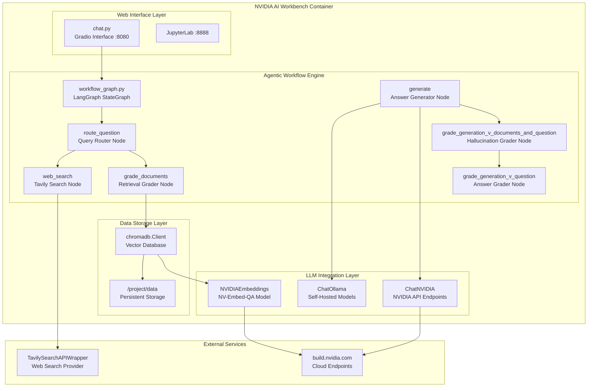

Sources: [README.md:3-6](), [README.md:74]()

## Agentic Workflow Process

The system implements a graph-based workflow that makes intelligent decisions at each step:

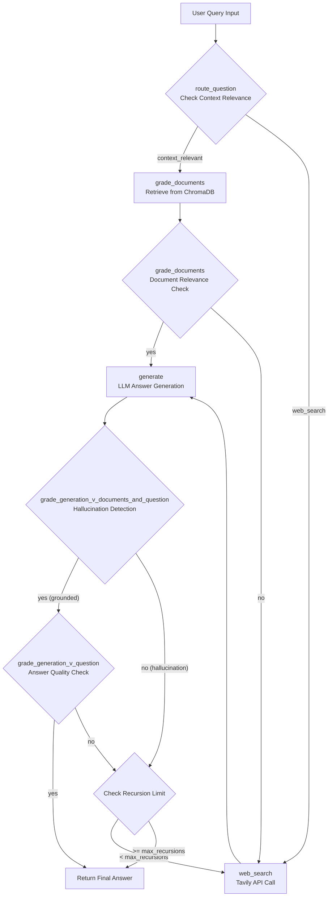

Sources: [README.md:3-6]()

## Usage Modes and Target Users

The system supports three distinct usage modes based on technical expertise and infrastructure requirements:

| Mode | Target User | Setup Time | Requirements | Key Features |
|------|-------------|------------|--------------|--------------|
| **Easy Mode** | End users, quick evaluation | < 5 minutes | NVIDIA AI Workbench, API keys | Cloud endpoints, pre-built UI, immediate usage |
| **Intermediate Mode** | Developers, researchers | 15-30 minutes | Git, VS Code, coding experience | Custom prompts, parameter tuning, UI modifications |
| **Advanced Mode** | Infrastructure teams, enterprises | Hours to days | Linux + GPU, container expertise | Self-hosted models, full control, custom endpoints |

### Easy Mode Architecture
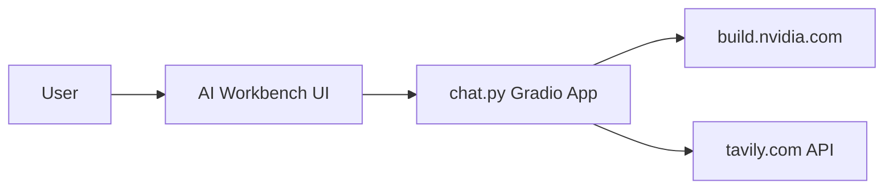

### Advanced Mode Architecture  
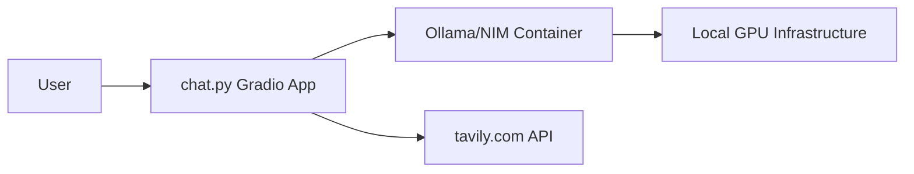

Sources: [README.md:19-23](), [README.md:31-37](), [README.md:96-102]()

## Technology Stack

The system is built on several key technology layers:

| Layer | Technologies | Purpose |
|-------|-------------|---------|
| **Orchestration** | LangGraph, LangChain | Agent workflow management and LLM abstraction |
| **Frontend** | Gradio | Web-based chat interface |
| **Vector Database** | ChromaDB | Document storage and similarity search |
| **Document Processing** | Unstructured, NLTK | PDF/text parsing and preprocessing |
| **LLM Providers** | NVIDIA AI Endpoints, OpenAI API, Ollama, NVIDIA NIM | Language model inference |
| **Embeddings** | NVIDIA NV-Embed-QA | Text-to-vector conversion |
| **Web Search** | Tavily Search API | Real-time web information retrieval |
| **Infrastructure** | NVIDIA AI Workbench, Docker, CUDA | Development platform and containerization |

## Key System Features

- **Intelligent Query Routing**: Automatically determines whether to use local context or web search
- **Multi-stage Evaluation**: Implements document relevance, hallucination detection, and answer quality assessment
- **Iterative Refinement**: Continues improving answers until quality thresholds are met or recursion limits are reached
- **Flexible Model Support**: Works with cloud endpoints, self-hosted models, and various LLM providers
- **Persistent Context**: Maintains document embeddings across sessions using ChromaDB
- **Configurable Parameters**: Allows tuning of recursion limits, evaluation thresholds, and model parameters

Sources: [README.md:3-15](), [README.md:76-88]()

---

# Page: Getting Started

# Getting Started

<details>
<summary>Relevant source files</summary>

The following files were used as context for generating this wiki page:

- [README.md](README.md)

</details>


This document provides a comprehensive guide to setting up and using the Agentic RAG system based on your technical requirements and expertise level. It covers three distinct usage modes, from immediate deployment to full infrastructure customization.

For detailed information about the system architecture and components, see [System Architecture](#3). For development and customization guidance, see [Development Guide](#6).

## Purpose and Scope

The Getting Started guide covers three primary usage modes:

- **Easy Mode**: Immediate deployment using NVIDIA AI Workbench with cloud endpoints
- **Intermediate Mode**: Code customization and application modification
- **Advanced Mode**: Self-hosted GPU infrastructure setup

This document focuses on initial setup and deployment decisions. For detailed configuration options, see [Configuration Reference](#7.1). For GPU compatibility and self-hosting details, see [GPU Compatibility and Self-Hosting](#6.2).

## System Overview and Mode Selection

The Agentic RAG system provides three distinct pathways based on your technical requirements and infrastructure preferences:

### Usage Mode Decision Matrix

| Mode | Time Investment | Technical Expertise | Infrastructure | Customization Level |
|------|-----------------|-------------------|----------------|-------------------|
| Easy | < 5 minutes | Minimal | Cloud endpoints | Pre-configured |
| Intermediate | Hours to days | Python/Git familiar | Cloud + local dev | Code modification |
| Advanced | Days to weeks | DevOps/GPU admin | Self-hosted GPUs | Full control |

### Mode-Specific Requirements and Outcomes

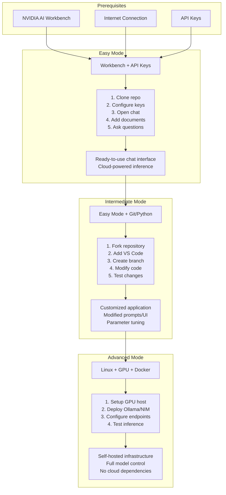

Sources: [README.md:19-23](), [README.md:31-37](), [README.md:73-103]()

## Prerequisites

All usage modes require these foundational components:

### Core Requirements

1. **NVIDIA AI Workbench**: Download and install from the [official documentation](https://docs.nvidia.com/ai-workbench/user-guide/latest/installation/overview.html)
2. **Internet Connection**: Required for document embedding via NVIDIA endpoints
3. **API Keys**: Two API keys are needed for full functionality

### Required API Keys

| API Key | Purpose | Generation Link | Usage |
|---------|---------|-----------------|-------|
| `NVIDIA_API_KEY` | LLM inference and embeddings | [NGC API Keys](https://org.ngc.nvidia.com/setup/api-keys) | Cloud model access |
| `TAVILY_API_KEY` | Web search capabilities | [Tavily API](https://tavily.com) | Agentic web search |

### Environment Configuration

The system uses environment variables configured through NVIDIA AI Workbench's [variable management system](https://docs.nvidia.com/ai-workbench/user-guide/latest/environment/variables.html#basic-usage-for-environment-variables).

Sources: [README.md:24-29](), [README.md:32-34]()

## Application Architecture and Entry Points

Understanding the system's structure helps in choosing the appropriate mode and customization approach:

### System Entry Points and Code Mapping

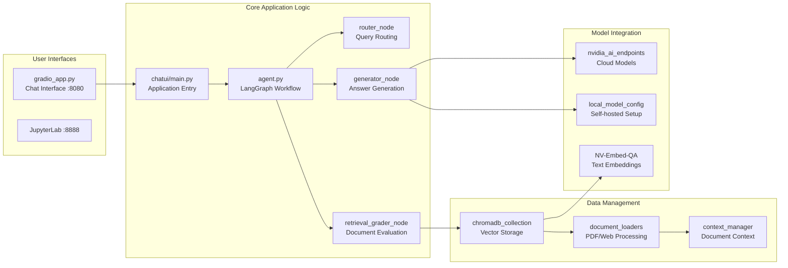

Sources: [README.md:1-16](), [code/chatui/](), [code/agent.py]()

## Mode-Specific Getting Started Paths

### Quick Mode Assessment

Use this decision tree to select your optimal starting path:

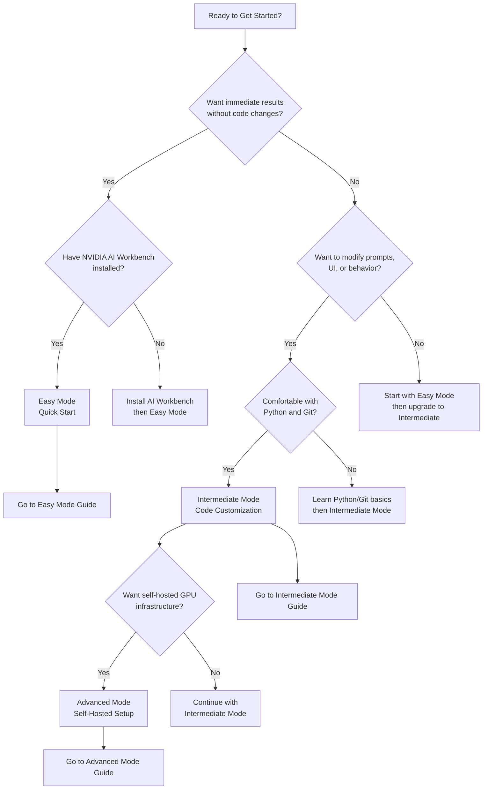

Sources: [README.md:19-23](), [README.md:76-89](), [README.md:97-103]()

### Easy Mode Overview

For users who want immediate functionality with minimal setup:

**Target Users**: Business users, researchers, quick prototyping
**Time Investment**: < 5 minutes after Workbench installation
**Technical Skills**: Basic computer usage

**Process Summary**:
1. Clone repository in AI Workbench
2. Configure API keys when prompted
3. Open chat interface via "Open Chat" button
4. Add documents through Document tab
5. Start querying the system

For complete Easy Mode instructions, see [Easy Mode - Quick Start](#2.1).

### Intermediate Mode Overview

For developers who want to customize the application:

**Target Users**: Python developers, ML engineers, prompt engineers
**Time Investment**: Hours to days
**Technical Skills**: Python, Git, basic LLM concepts

**Process Summary**:
1. Fork the repository to your GitHub account
2. Add VS Code to the Workbench project
3. Create experimental branches for safe development
4. Modify prompts, parameters, and UI components
5. Test and iterate on changes

For complete Intermediate Mode instructions, see [Intermediate Mode - Code Customization](#2.2).

### Advanced Mode Overview

For users requiring self-hosted infrastructure:

**Target Users**: DevOps engineers, organizations with data privacy requirements
**Time Investment**: Days to weeks
**Technical Skills**: Linux administration, Docker, GPU management

**Process Summary**:
1. Set up Linux host with NVIDIA GPU and Docker
2. Deploy Ollama or NVIDIA NIM containers
3. Configure application to use self-hosted endpoints
4. Optimize models and infrastructure for performance

For complete Advanced Mode instructions, see [Advanced Mode - Self-Hosted Infrastructure](#2.3).

Sources: [README.md:31-66](), [README.md:73-89](), [README.md:96-103]()

## Next Steps

Based on your selected mode:

- **Easy Mode**: Proceed to [Easy Mode - Quick Start](#2.1) for step-by-step instructions
- **Intermediate Mode**: Start with [Intermediate Mode - Code Customization](#2.2) for development setup
- **Advanced Mode**: Begin with [Advanced Mode - Self-Hosted Infrastructure](#2.3) for infrastructure planning

For technical reference and troubleshooting, see [Technical Reference](#7).

Sources: [README.md:39-107]()

---

# Page: Easy Mode - Quick Start

# Easy Mode - Quick Start

<details>
<summary>Relevant source files</summary>

The following files were used as context for generating this wiki page:

- [README.md](README.md)

</details>


## Purpose and Scope

This page provides step-by-step instructions for immediate usage of the Agentic RAG system through NVIDIA AI Workbench with cloud endpoints. Easy Mode is designed for users who want to start using the system within 5 minutes without any code modifications or infrastructure setup.

For code customization and prompt modification, see [Intermediate Mode - Code Customization](#2.2). For self-hosted GPU infrastructure setup, see [Advanced Mode - Self-Hosted Infrastructure](#2.3).

## Overview

Easy Mode leverages cloud-based NVIDIA API endpoints and the Tavily web search service to provide immediate access to the Agentic RAG system. No local GPU resources or model deployment is required - everything runs through external APIs while the core application logic executes within the NVIDIA AI Workbench container environment.

## Easy Mode User Flow

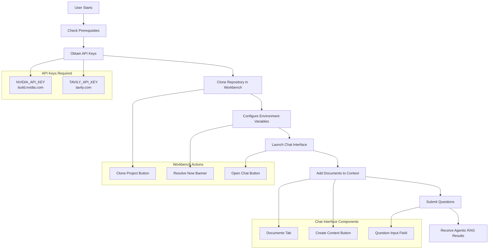

**Sources:** [README.md:31-38](), [README.md:45-56]()

## Prerequisites

| Requirement | Description | Installation Link |
|-------------|-------------|-------------------|
| **NVIDIA AI Workbench** | Container-based development environment | [Installation Guide](https://docs.nvidia.com/ai-workbench/user-guide/latest/installation/overview.html) |
| **Internet Connection** | Required for NVIDIA embeddings and API access | N/A |
| **Docker Desktop** | Container runtime (typically installed with Workbench) | Included with Workbench |

**Sources:** [README.md:24-30]()

## Step-by-Step Setup Instructions

### Step 1: Obtain Required API Keys

Two API keys are required for Easy Mode operation:

| API Key | Purpose | Generation Link | Usage |
|---------|---------|-----------------|-------|
| `NVIDIA_API_KEY` | LLM inference and embeddings | [Generate Key](https://org.ngc.nvidia.com/setup/api-keys) | Chat responses and document vectorization |
| `TAVILY_API_KEY` | Web search functionality | [Generate Key](https://tavily.com) | Live web search when RAG context insufficient |

**Sources:** [README.md:32-34]()

### Step 2: Clone Repository in AI Workbench

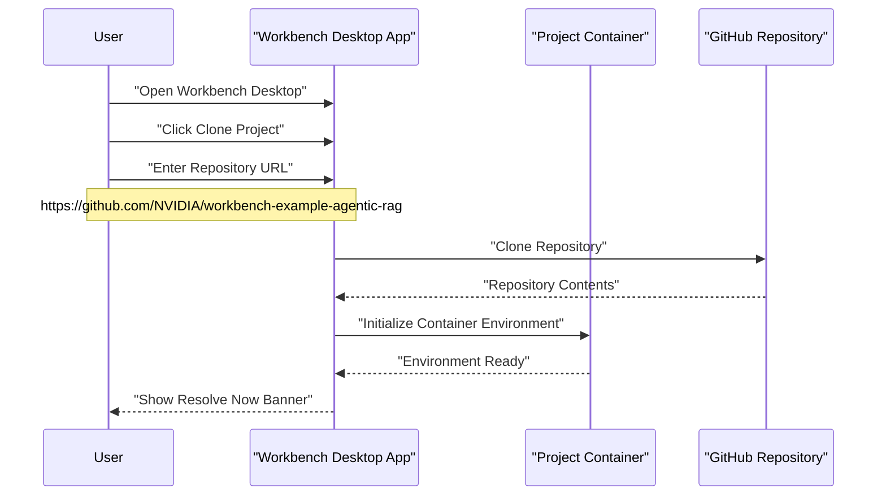

**Sources:** [README.md:35](), [README.md:51]()

### Step 3: Configure Environment Variables

When the project is first cloned, Workbench displays a "Resolve Now" banner for environment variable configuration:

1. Click **Resolve Now** when prompted
2. Enter your `NVIDIA_API_KEY` in the designated field
3. Enter your `TAVILY_API_KEY` in the designated field
4. Click **Save** or **Configure** to apply settings

Alternative configuration path: **Project Container > Variables > Configure**

**Sources:** [README.md:52](), [README.md:35]()

### Step 4: Launch Chat Interface

Click the **Open Chat** button in the Workbench interface. This launches the Gradio-based web application on port 8080 within the container environment.

## System Components Activated in Easy Mode

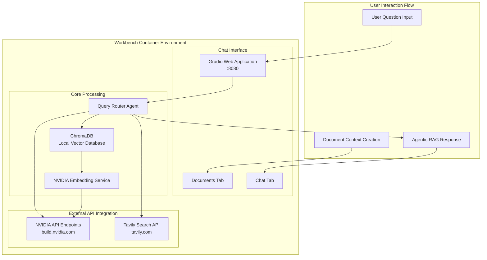

**Sources:** [README.md:3-6](), [README.md:13-15]()

### Step 5: Create Document Context

Navigate to the **Documents** tab in the chat interface:

1. **Default URLs**: The application includes pre-configured demonstration URLs
2. **Add to Context**: Click this button to process documents and create vector embeddings
3. **Custom Documents**: Replace default URLs with your own document sources
4. **Clear Context**: Remove existing document context to start fresh

The `Create Context` process triggers:
- Document loading via `WebBaseLoader` for URLs
- Text chunking with `RecursiveCharacterTextSplitter` 
- Embedding generation using NVIDIA's `NV-Embed-QA` model
- Storage in local ChromaDB vector database

**Sources:** [README.md:36](), [README.md:54]()

### Step 6: Submit Questions and Receive Responses

Type questions in the chat input field and press Enter. The system executes the following agentic workflow:

1. **Query Routing**: Determines if RAG context is sufficient or web search is needed
2. **Document Retrieval**: Searches vector database for relevant document chunks
3. **Web Search** (if needed): Queries Tavily API for current information
4. **Response Generation**: Uses NVIDIA LLM endpoints to generate answers
5. **Quality Evaluation**: Checks for hallucinations and response accuracy
6. **Iteration** (if needed): Refines response through multiple evaluation cycles

**Sources:** [README.md:37](), [README.md:3-6]()

## Common Troubleshooting Issues

| Issue | Cause | Solution | Reference |
|-------|-------|----------|-----------|
| Container won't start | Docker Desktop problems | See Workbench troubleshooting guide | [README.md:50]() |
| API key errors during context creation | Incorrect `NVIDIA_API_KEY` | Reconfigure via Project Container > Variables | [README.md:52]() |
| No responses to questions | Incorrect API keys | Verify both NVIDIA and Tavily keys | [README.md:55]() |
| "Resolve Now" banner missing | Environment variables not detected | Manually configure via Variables menu | [README.md:52]() |
| URLs can't be resolved | Invalid or inaccessible URLs | Replace with accessible document URLs | [README.md:64]() |

**Sources:** [README.md:48-66]()

## Technical Architecture for Easy Mode

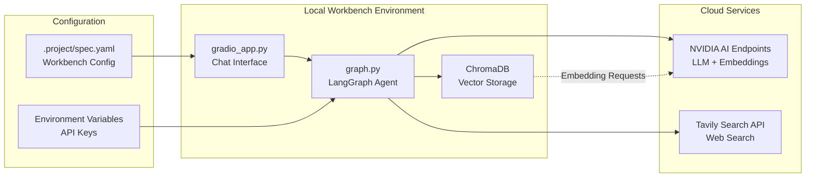

**Sources:** [README.md:13-15](), [README.md:29]()

This Easy Mode setup provides immediate access to the full Agentic RAG capabilities without requiring any code modifications, local model deployment, or GPU infrastructure. All compute-intensive operations are handled by cloud services while the application orchestration runs locally in the Workbench container.

---

# Page: Intermediate Mode - Code Customization

# Intermediate Mode - Code Customization

<details>
<summary>Relevant source files</summary>

The following files were used as context for generating this wiki page:

- [README.md](README.md)
- [agentic-rag-docs/.gitkeep](agentic-rag-docs/.gitkeep)
- [agentic-rag-docs/intermediate-edit-code.md](agentic-rag-docs/intermediate-edit-code.md)

</details>


This page covers code customization workflows for developers who want to modify the Agentic RAG application's behavior, appearance, and functionality. Intermediate Mode assumes basic Python knowledge and focuses on guided code modifications within a controlled development environment using NVIDIA AI Workbench.

For basic usage without code changes, see [Easy Mode - Quick Start](#2.1). For self-hosted infrastructure setup, see [Advanced Mode - Self-Hosted Infrastructure](#2.3). For comprehensive development practices, see [Development Guide](#6).

## Development Workflow Setup

Intermediate Mode uses a fork-and-branch development workflow to safely experiment with code changes while maintaining a stable main branch.

### Development Environment Configuration

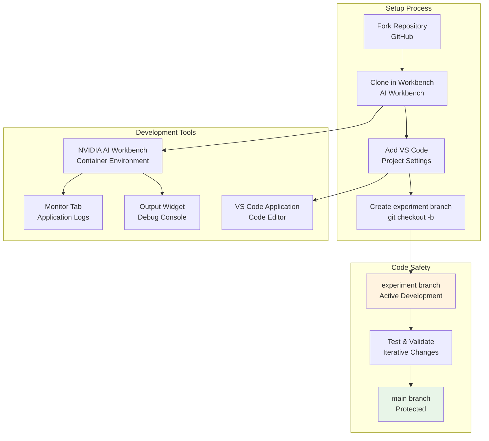

Sources: [README.md:80-88](), [agentic-rag-docs/intermediate-edit-code.md:1-33]()

### Required Development Tools

| Tool | Purpose | Configuration |
|------|---------|---------------|
| **GitHub Fork** | Personal repository copy | [Fork repository](https://docs.github.com/en/pull-requests/collaborating-with-pull-requests/working-with-forks/fork-a-repo#forking-a-repository) |
| **AI Workbench** | Container environment | Clone forked repository |
| **VS Code** | Code editor | [Add to project](https://docs.nvidia.com/ai-workbench/user-guide/latest/applications/vs-code.html) |
| **Git Branches** | Change isolation | `git checkout -b experiment` |

Sources: [README.md:80-88](), [agentic-rag-docs/intermediate-edit-code.md:1-4]()

## Core Customization Areas

### Model Integration and Configuration

The system provides multiple points for customizing language model integration, from adding new endpoints to modifying model parameters.

#### Model Configuration Mapping

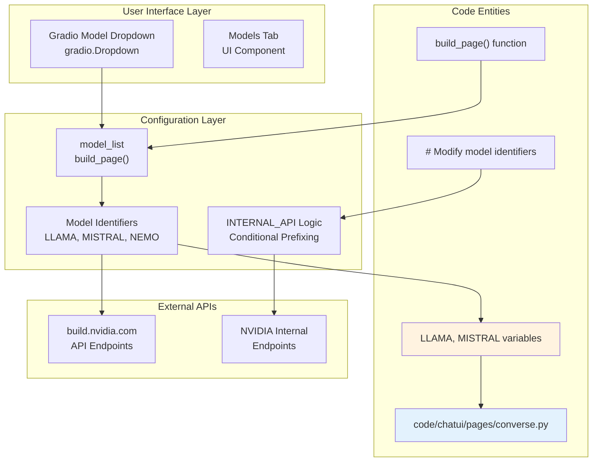

Sources: [agentic-rag-docs/intermediate-edit-code.md:36-94]()

#### Adding New NVIDIA Endpoints

To add new language models to the dropdown interface:

1. **Define Model Identifier** in [code/chatui/pages/converse.py:62-66]()
   - Add new variable: `NEMO = "nvidia/llama-3_1-nemotron-ultra-253b-v1"`
   - Follow existing pattern for `LLAMA` and `MISTRAL` variables

2. **Update Model List** in [code/chatui/pages/converse.py:70-74]()
   - Modify `model_list` in `build_page()` function
   - Add new model variable to list

3. **Configure Internal Endpoints** in [code/chatui/pages/converse.py:80-85]()
   - Update conditional logic for `INTERNAL_API` prefix
   - Required only for NVIDIA internal endpoints

Sources: [agentic-rag-docs/intermediate-edit-code.md:55-94]()

### Vector Database and Embedding Customization

#### Database Configuration Flow

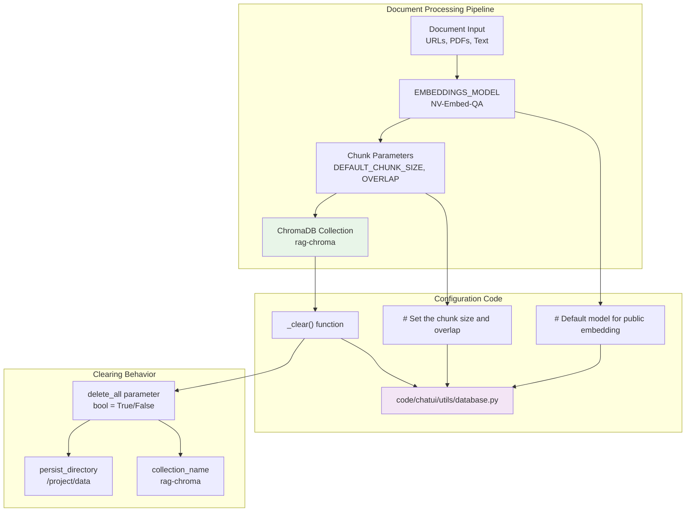

Sources: [agentic-rag-docs/intermediate-edit-code.md:95-169]()

#### Key Embedding Configuration Parameters

| Parameter | Location | Default Value | Purpose |
|-----------|----------|---------------|---------|
| `EMBEDDINGS_MODEL` | [code/chatui/utils/database.py:116-120]() | NV-Embed-QA | Text vectorization model |
| `DEFAULT_CHUNK_SIZE` | [code/chatui/utils/database.py:128]() | 250 | Document chunk size |
| `DEFAULT_CHUNK_OVERLAP` | [code/chatui/utils/database.py:129]() | 0 | Chunk overlap for context |
| `delete_all` | [code/chatui/utils/database.py:156-162]() | True | Vector DB clearing behavior |

Sources: [agentic-rag-docs/intermediate-edit-code.md:95-169]()

### Agent Behavior Configuration

#### Agent Parameter Control Flow

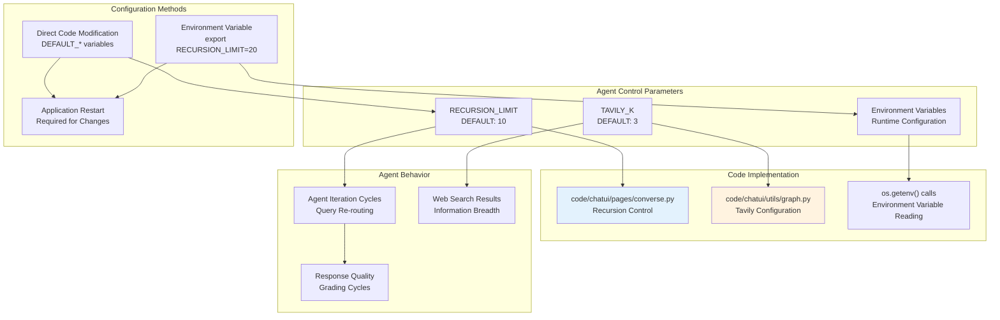

Sources: [agentic-rag-docs/intermediate-edit-code.md:170-280]()

#### Agent Parameter Modification

**Recursion Limit Configuration:**
- **Location**: [code/chatui/pages/converse.py:176-177]()
- **Environment Variable**: `export RECURSION_LIMIT=20`
- **Direct Modification**: `DEFAULT_RECURSION_LIMIT = 10`
- **Controls**: Agent iteration cycles, re-routing attempts, answer regeneration

**Tavily Search Configuration:**
- **Location**: [code/chatui/utils/graph.py:232-234]()
- **Environment Variable**: `export TAVILY_K=5`
- **Direct Modification**: `DEFAULT_TAVILY_K = 3`
- **Controls**: Number of web search results, information breadth

Sources: [agentic-rag-docs/intermediate-edit-code.md:170-280]()

### Logging and Monitoring Enhancements

#### Logging System Architecture

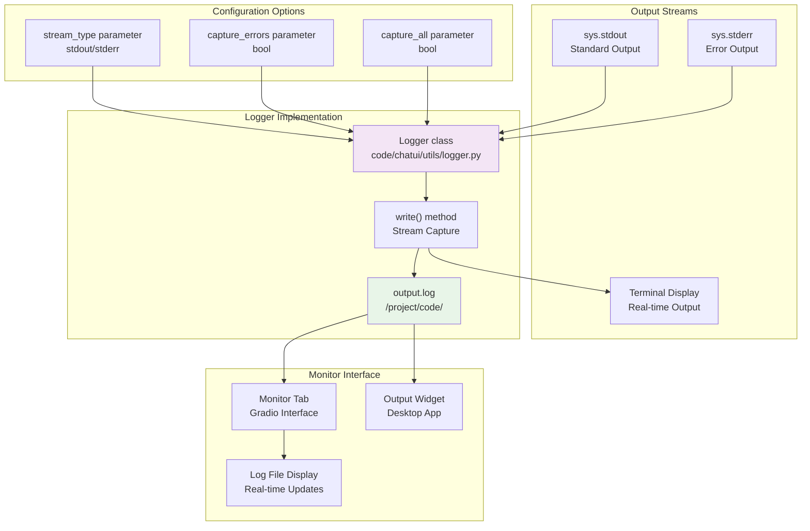

Sources: [agentic-rag-docs/intermediate-edit-code.md:281-353]()

#### Enhanced Error Capture Configuration

**Optional Error Capture** in [code/chatui/utils/logger.py:287-307]():
```python
class Logger:
    def __init__(self, filename, stream_type='stdout', capture_errors=False):
        # Error capture logic
```

**Complete Output Capture** in [code/chatui/utils/logger.py:318-338]():
```python
class Logger:
    def __init__(self, filename, stream_type='stdout', capture_all=False):
        # Complete output capture logic
```

**Logger Integration** in [code/chatui/pages/converse.py:309-314]():
- `sys.stdout` redirection to Logger instance
- `sys.stderr` redirection with optional error capture
- Log file location: `/project/code/output.log`

Sources: [agentic-rag-docs/intermediate-edit-code.md:281-353]()

## Development Best Practices

### Code Safety and Testing

| Practice | Implementation | Purpose |
|----------|----------------|---------|
| **Branch Protection** | Never modify `main` branch directly | Preserve stable codebase |
| **Experiment Branches** | `git checkout -b experiment` | Isolate changes |
| **Incremental Testing** | Test after each modification | Early error detection |
| **App Restart Required** | Environment variable changes | Configuration updates |
| **Error Monitoring** | Output Widget + Monitor Tab | Debug assistance |

### Common Customization Warnings

- **API Key Requirements**: New endpoints may require different authentication
- **Model Compatibility**: Embedding model changes require vector DB re-indexing
- **Parameter Boundaries**: Recursion limits and search results affect performance
- **Environment Variables**: Require container restart to take effect
- **Log File Growth**: Enhanced logging increases storage requirements

Sources: [agentic-rag-docs/intermediate-edit-code.md:1-33](), [agentic-rag-docs/intermediate-edit-code.md:217-225](), [agentic-rag-docs/intermediate-edit-code.md:347-352]()

---

# Page: Advanced Mode - Self-Hosted Infrastructure

# Advanced Mode - Self-Hosted Infrastructure

<details>
<summary>Relevant source files</summary>

The following files were used as context for generating this wiki page:

- [README.md](README.md)
- [agentic-rag-docs/self-host.md](agentic-rag-docs/self-host.md)

</details>


## Purpose and Scope

This page provides instructions for setting up self-hosted GPU infrastructure to run the Agentic RAG system using your own compute resources instead of cloud-based endpoints. Advanced mode enables you to deploy either Ollama or NVIDIA NIM containers on your own hardware for local inference.

This mode is intended for users who need:
- Complete control over their inference infrastructure
- Reduced latency through local deployment
- Data privacy and security through on-premises hosting
- Custom model optimization and configuration

For immediate usage with cloud endpoints, see [Easy Mode - Quick Start](#2.1). For code customization without infrastructure changes, see [Intermediate Mode - Code Customization](#2.2). For comprehensive deployment documentation, see [Deployment and Infrastructure](#5).

## Self-Hosted Infrastructure Options

The Agentic RAG system supports two primary self-hosted inference solutions, each with different complexity levels and resource requirements.

### Infrastructure Decision Matrix

| Feature | Ollama | NVIDIA NIM |
|---------|---------|------------|
| Setup Complexity | Intermediate | Advanced |
| GPU Memory Requirements | 8GB+ vRAM | 24GB+ vRAM |
| Performance Optimization | Standard | Production-optimized |
| Model Selection | Wide variety available | NVIDIA-optimized models |
| API Compatibility | Custom Ollama API | OpenAI-compatible |
| Use Case | Development/Experimentation | Production deployment |

### Self-Hosted Deployment Architecture

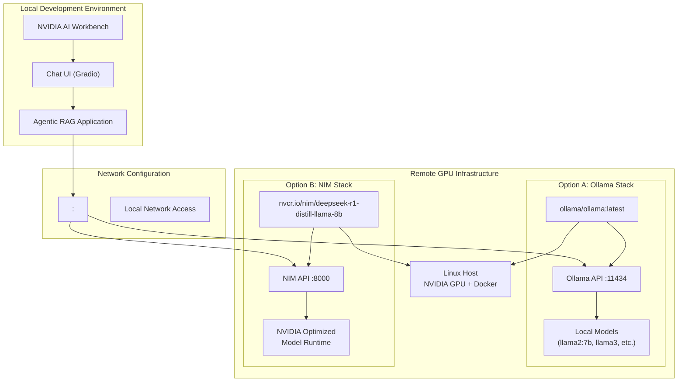

Sources: [agentic-rag-docs/self-host.md:26-44](), [README.md:94-103]()

## Prerequisites and System Requirements

### Remote GPU Host Requirements

The self-hosted infrastructure requires a dedicated Linux system with specific hardware and software components:

**Hardware Requirements:**
- NVIDIA GPU with sufficient VRAM (8GB minimum for Ollama, 24GB+ for NIM)
- Ubuntu 22.04 or Ubuntu 24.04 LTS (reference OS)
- Sufficient storage for container images and models
- Network connectivity with accessible TCP ports

**Software Prerequisites:**
- NVIDIA GPU drivers properly installed
- NVIDIA Container Toolkit configured
- Docker or Podman container runtime
- Root/sudo access for setup operations

**Network Configuration:**
- SSH access to remote host
- Open TCP port for inference API access
- Firewall rules configured for external connections

### Validation Commands

Before proceeding with deployment, verify your system meets the requirements:

```bash
# Verify GPU availability
nvidia-smi

# Check Docker/container runtime
docker --version
nvidia-container-runtime --version

# Verify network connectivity
curl -X GET http://<remote-ip>:<remote-port>/
```

Sources: [agentic-rag-docs/self-host.md:8-23](), [agentic-rag-docs/self-host.md:46-54]()

## Ollama Deployment Workflow

Ollama provides an intermediate-complexity solution for self-hosted inference with broad model support and straightforward container management.

### Ollama Container Deployment Process

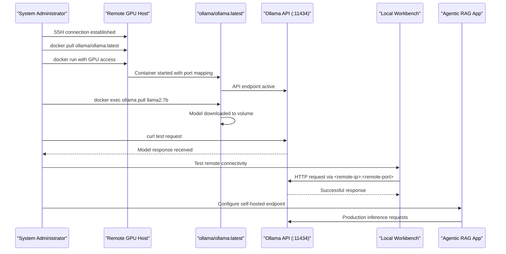

### Container Configuration Steps

1. **Deploy Ollama Container**
   ```bash
   docker pull ollama/ollama:latest
   
   docker run -d --name ollama \
     --gpus all --restart unless-stopped \
     -p <remote-port>:11434 \
     -v ollama_data:/root/.ollama \
     ollama/ollama:latest
   ```

2. **Load Model into Container**
   ```bash
   docker exec ollama ollama pull llama2:7b
   curl http://localhost:<remote-port>/api/tags
   ```

3. **Validate Model Functionality**
   ```bash
   curl -X POST http://localhost:<remote-port>/api/generate \
     -H "Content-Type: application/json" \
     -d '{"model": "llama2:7b", "prompt": "Test prompt", "stream": false}'
   ```

Sources: [agentic-rag-docs/self-host.md:55-128]()

## NVIDIA NIM Deployment Workflow

NVIDIA NIM provides production-optimized inference with enhanced performance characteristics and OpenAI-compatible APIs.

### NIM Container Architecture

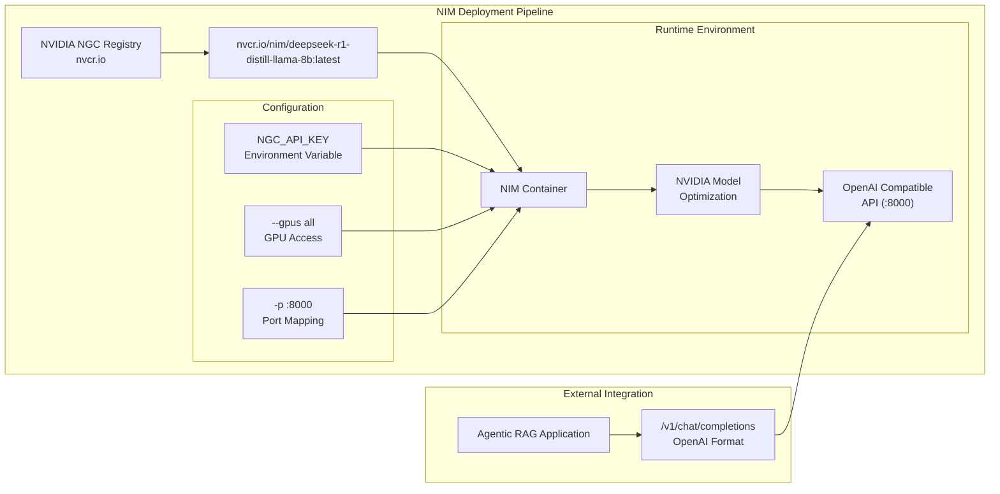

### NIM Setup Process

1. **Authenticate with NGC Registry**
   ```bash
   docker login nvcr.io
   # Username: $oauthtoken
   # Password: <your-ngc-api-key>
   ```

2. **Deploy NIM Container**
   ```bash
   docker pull nvcr.io/nim/deepseek-r1-distill-llama-8b:latest
   
   docker run -d --name nim \
     --gpus all --restart unless-stopped \
     -p <remote-port>:8000 \
     -e NGC_API_KEY=<your-ngc-api-key> \
     nvcr.io/nim/deepseek-r1-distill-llama-8b:latest
   ```

3. **Verify Deployment**
   ```bash
   docker logs nim
   
   curl -X POST http://localhost:<remote-port>/v1/chat/completions \
     -H "Content-Type: application/json" \
     -d '{"messages": [{"role": "user", "content": "Hello, NIM!"}]}'
   ```

Sources: [agentic-rag-docs/self-host.md:139-224]()

## Agentic RAG Application Configuration

Once your self-hosted infrastructure is deployed, configure the Agentic RAG application to use your endpoints instead of cloud-based services.

### Model Configuration Interface

The system provides a model selection interface within NVIDIA AI Workbench that allows configuration of self-hosted endpoints:

1. **Access Model Configuration**
   - Open the Agentic RAG project in AI Workbench
   - Navigate to the **Models** section
   - Select components to configure for self-hosted inference

2. **Configure Self-Hosted Endpoints**
   - Select **Self-Hosted Endpoint** option
   - Enter remote IP address: `<remote-ip>`
   - Specify port number: `<remote-port>`
   - Provide model name corresponding to deployed model

### Endpoint Validation Workflow

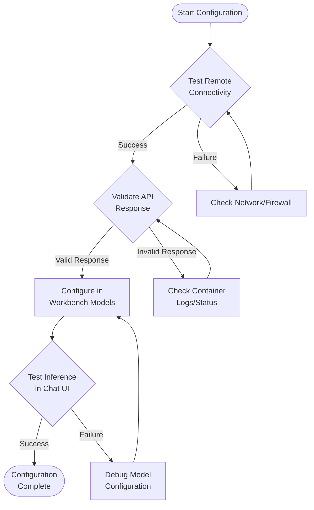

### Local Connectivity Testing

Before configuring the application, verify local access to your self-hosted endpoints:

**For Ollama:**
```bash
curl -X POST http://<remote-ip>:<remote-port>/api/generate \
  -H "Content-Type: application/json" \
  -d '{"model": "llama2:7b", "prompt": "Hello, Ollama!"}'
```

**For NIM:**
```bash
curl -X POST http://<remote-ip>:<remote-port>/v1/chat/completions \
  -H "Content-Type: application/json" \
  -d '{"messages": [{"role": "user", "content": "Hello, NIM!"}]}'
```

Sources: [agentic-rag-docs/self-host.md:114-128](), [agentic-rag-docs/self-host.md:194-217]()

## Troubleshooting and Validation

### Common Issues and Resolution

| Issue | Symptoms | Resolution |
|-------|----------|------------|
| GPU not accessible | Container fails to start | Verify `nvidia-smi` output and container toolkit |
| Port conflicts | Connection refused errors | Check port availability with `netstat -tlnp` |
| Model loading failure | API timeouts or errors | Monitor container logs with `docker logs <container>` |
| Network connectivity | Cannot reach remote endpoint | Verify firewall rules and network routing |
| Authentication failure | NGC login errors (NIM) | Verify NGC API key validity and permissions |

### Diagnostic Commands

```bash
# Check container status
docker ps | grep -E "(ollama|nim)"

# Monitor resource usage
nvidia-smi
docker stats

# Validate API endpoints
curl -X GET http://<remote-ip>:<remote-port>/
curl -X GET http://<remote-ip>:<remote-port>/api/tags  # Ollama
curl -X GET http://<remote-ip>:<remote-port>/v1/models  # NIM
```

### Performance Monitoring

For production deployments, implement monitoring to ensure optimal performance:

- **GPU Utilization**: Monitor through `nvidia-smi` or NVIDIA monitoring tools
- **Memory Usage**: Track container memory consumption and GPU VRAM usage
- **API Response Times**: Measure inference latency for performance optimization
- **Container Health**: Set up automated health checks and restart policies

Sources: [agentic-rag-docs/self-host.md:15-17](), [agentic-rag-docs/self-host.md:218-224]()

---

# Page: System Architecture

# System Architecture

<details>
<summary>Relevant source files</summary>

The following files were used as context for generating this wiki page:

- [.project/spec.yaml](.project/spec.yaml)
- [README.md](README.md)
- [requirements.txt](requirements.txt)

</details>


## Purpose and Scope

This document provides a comprehensive overview of the Agentic RAG system architecture, including the core components, technology stack, deployment model, and how the various subsystems interact. The system combines retrieval-augmented generation (RAG) with agentic workflows to provide accurate responses while controlling hallucinations through iterative evaluation and web search augmentation.

For detailed information about individual components, see [Core Components](#4). For deployment instructions, see [Getting Started](#2) and [Deployment and Infrastructure](#5). For technical configuration details, see [Technical Reference](#7).

## High-Level System Overview

The Agentic RAG system operates within an NVIDIA AI Workbench container environment, providing multiple interfaces for user interaction and a sophisticated backend processing pipeline.

### System Components Architecture

```mermaid
graph TB
    subgraph "NVIDIA AI Workbench Container"
        subgraph "User Interfaces"
            ChatUI["chatui module<br/>Gradio App :8080"]
            JupyterLab["jupyterlab :8888"]
            TensorBoard["tensorboard :6006"]
        end
        
        subgraph "Agentic Processing Pipeline"
            Router["query_router"]
            RetrieverGrader["retrieval_grader"]
            Generator["generate_answer"]
            HallucinationGrader["hallucination_grader"]
            AnswerGrader["answer_grader"]
            WebSearch["web_search_tool"]
        end
        
        subgraph "Data Layer"
            ChromaDB["ChromaDB Collection<br/>vectorstore"]
            ProjectData["/project/data<br/>Persistent Storage"]
        end
        
        subgraph "LLM Integration"
            NVIDIAEndpoints["langchain_nvidia_ai_endpoints<br/>ChatNVIDIA"]
            Embeddings["NVIDIAEmbeddings<br/>NV-Embed-QA"]
        end
    end
    
    subgraph "External Services"
        TavilyAPI["tavily_python<br/>TavilySearchAPIWrapper"]
        NVIDIACloud["NVIDIA API Endpoints<br/>build.nvidia.com"]
    end
    
    %% User interaction flows
    ChatUI --> Router
    Router --> RetrieverGrader
    Router --> WebSearch
    RetrieverGrader --> ChromaDB
    RetrieverGrader --> Generator
    Generator --> HallucinationGrader
    HallucinationGrader --> AnswerGrader
    WebSearch --> TavilyAPI
    
    %% Data flows
    ChromaDB --> ProjectData
    Generator --> NVIDIAEndpoints
    Embeddings --> NVIDIAEndpoints
    NVIDIAEndpoints --> NVIDIACloud
    TavilyAPI -.->|"Web Results"| Generator
    
    %% Configuration
    ChatUI -.->|"PROXY_PREFIX"| Router
```

**Sources:** [.project/spec.yaml:34-49](), [README.md:3-6](), [requirements.txt:2-8]()

## Technology Stack and Integration Layer

The system leverages a modern Python-based technology stack with specialized AI/ML libraries for document processing, vector storage, and language model integration.

### Technology Integration Architecture

```mermaid
graph TB
    subgraph "Application Layer"
        GradioApp["gradio==4.15.0<br/>Web Interface"]
        JupyterApp["jupyterlab>3.0<br/>Development Environment"]
    end
    
    subgraph "Orchestration and Agent Layer"
        LangGraph["langgraph==0.2.67<br/>Agent Workflow Engine"]
        LangChain["langchain==0.3.15<br/>LLM Abstraction Layer"]
        LangChainCommunity["langchain-community==0.3.15<br/>Tool Integrations"]
    end
    
    subgraph "LLM Provider Integration"
        NVIDIAEndpoints["langchain-nvidia-ai-endpoints==0.3.7<br/>ChatNVIDIA, NVIDIAEmbeddings"]
        OpenAIEndpoints["langchain-openai==0.3.2<br/>ChatOpenAI"]
    end
    
    subgraph "Document Processing Pipeline"
        Unstructured["unstructured[pdf]==0.16.17<br/>Document Loaders"]
        NLTK["nltk==3.8.1<br/>Text Processing"]
        BeautifulSoup["beautifulsoup4==4.12.2<br/>HTML Parsing"]
        LXML["lxml==5.2.2<br/>XML Processing"]
    end
    
    subgraph "Vector Database Layer"
        ChromaIntegration["langchain-chroma==0.2.0<br/>Vector Store Interface"]
        ChromaDB["ChromaDB<br/>Vector Database"]
    end
    
    subgraph "External API Integration"
        TavilySearch["tavily-python==0.3.5<br/>TavilySearchAPIWrapper"]
        FastAPI["fastapi==0.111.0<br/>API Framework"]
        Requests["requests<br/>HTTP Client"]
    end
    
    subgraph "Infrastructure Layer"
        ContainerBase["nvidia/ai-workbench/pytorch:1.0.2<br/>CUDA 12.2, Ubuntu 22.04"]
        ONNXRuntime["onnxruntime==1.18.0<br/>Model Inference"]
    end
    
    %% Integration flows
    GradioApp --> LangGraph
    LangGraph --> LangChain
    LangChain --> NVIDIAEndpoints
    LangChain --> OpenAIEndpoints
    LangChain --> ChromaIntegration
    ChromaIntegration --> ChromaDB
    
    LangChain --> TavilySearch
    Unstructured --> ChromaIntegration
    NLTK --> ChromaIntegration
    BeautifulSoup --> Unstructured
    
    ONNXRuntime --> ContainerBase
    GradioApp --> FastAPI
```

**Sources:** [requirements.txt:1-20](), [.project/spec.yaml:22-28](), [.project/spec.yaml:82-89]()

## Deployment Architecture

The system is deployed as a containerized application within NVIDIA AI Workbench, providing three distinct web applications and supporting multiple deployment modes.

### Container and Application Deployment

```mermaid
graph TB
    subgraph "Host Environment"
        DockerEngine["Docker Engine"]
        NVIDIAWorkbench["NVIDIA AI Workbench"]
    end
    
    subgraph "Container: project-agentic-rag"
        subgraph "Application Services"
            ChatApp["chat app<br/>python3 -m chatui<br/>Port 8080"]
            JupyterService["jupyterlab<br/>jupyter lab --allow-root<br/>Port 8888"]  
            TensorBoardService["tensorboard<br/>tensorboard --logdir<br/>Port 6006"]
        end
        
        subgraph "File System Mounts"
            ProjectMount["/project/<br/>rw mount"]
            TensorBoardLogs["/data/tensorboard/logs/<br/>volume mount"]
        end
        
        subgraph "Environment Configuration"
            APIKeys["NVIDIA_API_KEY<br/>TAVILY_API_KEY"]
            ProxyPrefix["PROXY_PREFIX"]
        end
        
        subgraph "Base Image Components"
            PyTorch["PyTorch 2.1"]
            CUDA["CUDA 12.2"]
            Ubuntu["Ubuntu 22.04"]
            SystemPackages["curl, git, git-lfs, vim"]
        end
    end
    
    subgraph "Storage Backend"
        GitStorage["Git Repository<br/>code/"]
        GitLFS["Git LFS<br/>models/, data/"]
        VolumeStorage["Docker Volume<br/>tensorboard-logs-volume"]
    end
    
    %% Deployment relationships
    NVIDIAWorkbench --> DockerEngine
    DockerEngine --> ChatApp
    DockerEngine --> JupyterService
    DockerEngine --> TensorBoardService
    
    ProjectMount --> GitStorage
    ProjectMount --> GitLFS
    TensorBoardLogs --> VolumeStorage
    
    APIKeys -.->|"Required for"| ChatApp
    ProxyPrefix -.->|"URL routing"| ChatApp
    
    ChatApp --> PyTorch
    PyTorch --> CUDA
    CUDA --> Ubuntu
```

**Sources:** [.project/spec.yaml:34-82](), [.project/spec.yaml:126-139](), [.project/spec.yaml:11-19]()

## Agentic Workflow Processing Architecture

The core agentic processing pipeline implements a graph-based workflow that routes queries, evaluates responses, and iterates for improved accuracy.

### Agent Workflow Graph

```mermaid
graph TD
    QueryInput["User Query Input"]
    
    QueryInput --> QueryRouter["query_router<br/>Route decision"]
    
    QueryRouter -->|"vectorstore"| VectorRetrieval["retrieve_documents<br/>ChromaDB query"]
    QueryRouter -->|"websearch"| WebSearchNode["web_search_tool<br/>TavilySearchAPIWrapper"]
    
    VectorRetrieval --> RetrievalGrader["retrieval_grader<br/>Document relevance check"]
    WebSearchNode --> WebSearchGrader["web_search_grader<br/>Search result relevance"]
    
    RetrievalGrader -->|"relevant"| GenerateAnswer["generate_answer<br/>ChatNVIDIA response"]
    RetrievalGrader -->|"not_relevant"| WebSearchNode
    WebSearchGrader -->|"relevant"| GenerateAnswer
    WebSearchGrader -->|"not_relevant"| GenerateAnswer
    
    GenerateAnswer --> HallucinationGrader["hallucination_grader<br/>Fact-checking against context"]
    
    HallucinationGrader -->|"grounded"| AnswerGrader["answer_grader<br/>Answer quality assessment"]
    HallucinationGrader -->|"hallucination"| GenerateAnswer
    
    AnswerGrader -->|"useful"| FinalAnswer["Final Response"]
    AnswerGrader -->|"not_useful"| IterationCheck["Check recursion_limit"]
    
    IterationCheck -->|"under_limit"| QueryRouter
    IterationCheck -->|"limit_exceeded"| FinalAnswer
    
    %% State management
    QueryRouter -.->|"update"| GraphState["GraphState<br/>question, generation, documents"]
    RetrievalGrader -.->|"update"| GraphState
    GenerateAnswer -.->|"update"| GraphState
    HallucinationGrader -.->|"update"| GraphState
    AnswerGrader -.->|"update"| GraphState
```

**Sources:** [README.md:3-6](), [README.md:74]()

## API and Environment Configuration

The system requires specific environment variables and API keys for operation, with support for multiple LLM providers and external services.

| Component | Configuration | Purpose |
|-----------|---------------|---------|
| `NVIDIA_API_KEY` | Required secret | Access to NVIDIA AI endpoints and embedding models |
| `TAVILY_API_KEY` | Required secret | Web search functionality via Tavily API |
| `PROXY_PREFIX` | Runtime variable | URL path prefix for containerized deployment |
| `ChatNVIDIA` | LLM provider | Primary language model for generation tasks |
| `NVIDIAEmbeddings` | Embedding model | Document vectorization using NV-Embed-QA |
| `TavilySearchAPIWrapper` | Search provider | External web search integration |

**Sources:** [.project/spec.yaml:126-130](), [README.md:32-34](), [requirements.txt:2](), [requirements.txt:8]()

---

# Page: Core Components

# Core Components

<details>
<summary>Relevant source files</summary>

The following files were used as context for generating this wiki page:

- [code/chatui/pages/converse.py](code/chatui/pages/converse.py)
- [code/chatui/utils/graph.py](code/chatui/utils/graph.py)

</details>


This document provides a comprehensive overview of the main components that comprise the Agentic RAG system and their interactions. It covers the architectural building blocks, data flow patterns, and integration points between components.

For detailed implementation of the chat interface, see [Chat User Interface](#4.1). For the agentic workflow logic, see [Agentic RAG Workflow](#4.2). For vector database operations, see [Vector Database Management](#4.3). For LLM provider integrations, see [Language Model Integration](#4.4).

## System Components Overview

The Agentic RAG system consists of five primary components that work together to provide intelligent question answering with hallucination detection and iterative refinement:

| Component | Purpose | Primary Code Location |
|-----------|---------|----------------------|
| **Chat User Interface** | Gradio-based web interface for user interactions | `code/chatui/pages/converse.py` |
| **Agentic RAG Workflow** | Graph-based workflow orchestration and routing | `code/chatui/utils/graph.py` |
| **Vector Database** | Document storage and retrieval using ChromaDB | `code/chatui/utils/database.py` |
| **Language Model Integration** | LLM provider abstraction and prompt management | `code/chatui/utils/nim.py` |
| **External Search Integration** | Web search capabilities via Tavily API | `code/chatui/utils/graph.py` |

### Core Component Interaction Flow

```mermaid
graph TB
    subgraph "User Interface Layer"
        ChatUI["build_page()"] 
        GradioComponents["chatbot, msg, settings_tabs"]
    end
    
    subgraph "Workflow Orchestration Layer"
        GraphState["GraphState"]
        WorkflowCompiler["compile.compile_graph()"]
        AppRunner["app.stream()"]
    end
    
    subgraph "Model Components"
        Router["route_question()"]
        Retrieval["grade_documents()"] 
        Generator["generate()"]
        Hallucination["grade_generation_v_documents_and_question()"]
        WebSearch["web_search()"]
    end
    
    subgraph "Data Layer"
        VectorDB["database.get_retriever()"]
        TavilyAPI["TavilySearchResults"]
        DocumentStore["ChromaDB Collection"]
    end
    
    subgraph "LLM Integration"
        ChatNVIDIA["ChatNVIDIA"]
        CustomNIM["nim.CustomChatOpenAI"]
        PromptTemplates["PromptTemplate"]
    end
    
    ChatUI --> AppRunner
    AppRunner --> GraphState
    GraphState --> Router
    Router --> Retrieval
    Router --> WebSearch
    Retrieval --> VectorDB
    WebSearch --> TavilyAPI
    Retrieval --> Generator
    Generator --> Hallucination
    
    Router --> ChatNVIDIA
    Retrieval --> ChatNVIDIA
    Generator --> ChatNVIDIA
    Hallucination --> ChatNVIDIA
    
    Router --> CustomNIM
    Retrieval --> CustomNIM
    Generator --> CustomNIM
    Hallucination --> CustomNIM
    
    VectorDB --> DocumentStore
    
    ChatNVIDIA --> PromptTemplates
    CustomNIM --> PromptTemplates
```

**Sources:** [code/chatui/pages/converse.py:145-161](), [code/chatui/utils/graph.py:41-96]()

## Agentic Workflow Components

The system implements a graph-based agentic workflow with five distinct model components, each with configurable prompts and model endpoints:

### Workflow Component Mapping

```mermaid
graph LR
    subgraph "GraphState Configuration"
        QuestionInput["question: str"]
        ModelConfigs["*_model_id: str<br/>*_use_nim: bool<br/>nim_*_ip: str<br/>nim_*_port: str"]
        PromptConfigs["prompt_*: str"]
    end
    
    subgraph "Router Component" 
        RouterFunc["route_question()"]
        RouterModel["router_model_id<br/>nim_router_*"]
        RouterPrompt["prompt_router"]
        RouterDecision["datasource: web_search|vectorstore"]
    end
    
    subgraph "Retrieval Grader Component"
        RetrievalFunc["grade_documents()"]
        RetrievalModel["retrieval_model_id<br/>nim_retrieval_*"] 
        RetrievalPrompt["prompt_retrieval"]
        RetrievalDecision["score: yes|no<br/>web_search: Yes|No"]
    end
    
    subgraph "Generator Component"
        GeneratorFunc["generate()"]
        GeneratorModel["generator_model_id<br/>nim_generator_*"]
        GeneratorPrompt["prompt_generator"] 
        GeneratorOutput["generation: str"]
    end
    
    subgraph "Hallucination Grader Component"
        HallucinationFunc["grade_generation_v_documents_and_question()"]
        HallucinationModel["hallucination_model_id<br/>nim_hallucination_*"]
        HallucinationPrompt["prompt_hallucination"]
        HallucinationDecision["useful|not useful|not supported"]
    end
    
    QuestionInput --> RouterFunc
    ModelConfigs --> RouterModel
    ModelConfigs --> RetrievalModel  
    ModelConfigs --> GeneratorModel
    ModelConfigs --> HallucinationModel
    
    PromptConfigs --> RouterPrompt
    PromptConfigs --> RetrievalPrompt
    PromptConfigs --> GeneratorPrompt
    PromptConfigs --> HallucinationPrompt
    
    RouterFunc --> RouterDecision
    RetrievalFunc --> RetrievalDecision
    GeneratorFunc --> GeneratorOutput
    HallucinationFunc --> HallucinationDecision
```

**Sources:** [code/chatui/utils/graph.py:244-277](), [code/chatui/utils/graph.py:152-199](), [code/chatui/utils/graph.py:122-149](), [code/chatui/utils/graph.py:311-372]()

## State Management and Data Flow

The system uses a comprehensive `GraphState` class to maintain workflow context and configuration across all components:

### GraphState Structure

| State Category | Fields | Purpose |
|----------------|--------|---------|
| **Core Data** | `question`, `generation`, `documents`, `web_search` | Query processing and results |
| **Model IDs** | `*_model_id` (router, retrieval, generator, hallucination, answer) | API endpoint model selection |
| **NIM Configuration** | `*_use_nim`, `nim_*_ip`, `nim_*_port`, `nim_*_id` | Self-hosted endpoint settings |
| **Prompt Templates** | `prompt_*` (router, retrieval, generator, hallucination, answer) | Component-specific prompts |

```mermaid
stateDiagram-v2
    [*] --> QuestionReceived: User input via msg.submit()
    
    QuestionReceived --> StateInitialized: _stream_predict() creates inputs dict
    
    StateInitialized --> RouterDecision: route_question() with GraphState
    
    RouterDecision --> VectorRetrieval: datasource == "vectorstore"
    RouterDecision --> WebSearch: datasource == "web_search"
    
    VectorRetrieval --> DocumentGrading: retrieve() returns documents
    WebSearch --> DocumentGrading: web_search() returns web results
    
    DocumentGrading --> GenerateDecision: grade_documents() 
    
    GenerateDecision --> Generation: web_search == "No"
    GenerateDecision --> WebSearch: web_search == "Yes"
    
    Generation --> HallucinationCheck: generate() creates generation
    
    HallucinationCheck --> FinalAnswer: grade == "useful"
    HallucinationCheck --> Generation: grade == "not supported" 
    HallucinationCheck --> Generation: grade == "not useful"
    
    FinalAnswer --> [*]: Return to chat interface
```

**Sources:** [code/chatui/utils/graph.py:41-96](), [code/chatui/pages/converse.py:1387-1476]()

## Component Integration Architecture

The system integrates multiple external services and internal components through well-defined interfaces:

### Model Provider Integration

```mermaid
graph TB
    subgraph "UI Configuration Layer"
        ModelDropdowns["model_router, model_retrieval<br/>model_generator, model_hallucination, model_answer"]
        NIMInputs["nim_*_ip, nim_*_port, nim_*_id"]
        UseNIMState["*_use_nim: gr.State()"]
    end
    
    subgraph "LLM Instantiation Logic"
        ConditionCheck["state['*_use_nim'] check"]
        NVIDIAEndpoint["ChatNVIDIA(model=state['*_model_id'])"]
        CustomNIM["nim.CustomChatOpenAI(custom_endpoint=state['nim_*_ip'])"]
    end
    
    subgraph "Prompt Chain Execution"
        PromptTemplate["PromptTemplate(template=state['prompt_*'])"]
        OutputParser["StrOutputParser() | JsonOutputParser()"]
        ChainExecution["prompt | llm | parser"]
    end
    
    ModelDropdowns --> ConditionCheck
    NIMInputs --> CustomNIM
    UseNIMState --> ConditionCheck
    
    ConditionCheck -->|False| NVIDIAEndpoint
    ConditionCheck -->|True| CustomNIM
    
    NVIDIAEndpoint --> PromptTemplate
    CustomNIM --> PromptTemplate
    PromptTemplate --> OutputParser
    OutputParser --> ChainExecution
```

### Database and Search Integration

| Integration Point | Implementation | Configuration |
|-------------------|----------------|---------------|
| **Vector Database** | `database.get_retriever()` | ChromaDB with persistent storage |
| **Web Search** | `TavilySearchResults(max_results=TAVILY_K)` | API key via environment variable |
| **Document Processing** | `database.upload()`, `database.upload_files()` | File upload and URL processing |
| **Context Management** | `database._clear()` | Vector store reset functionality |

**Sources:** [code/chatui/utils/graph.py:141-146](), [code/chatui/utils/graph.py:175-180](), [code/chatui/utils/graph.py:216-233](), [code/chatui/pages/converse.py:1010-1064]()

## Error Handling and Configuration

The system implements comprehensive error handling and configuration management:

### Error Management

- **Recursion Control**: `RECURSION_LIMIT` prevents infinite workflow loops [code/chatui/pages/converse.py:46-48]()
- **API Error Handling**: Custom `TavilyAPIError` for search failures [code/chatui/utils/graph.py:33-35]()
- **Validation Logic**: `valid_input()` checks for empty queries [code/chatui/pages/converse.py:1364-1365]()
- **Error Messages**: Structured error responses via `QUERY_ERROR_MESSAGES` [code/chatui/pages/converse.py:1369-1383]()

### Configuration Sources

- **Environment Variables**: `NVIDIA_API_KEY`, `TAVILY_API_KEY`, `INTERNAL_API`, `RECURSION_LIMIT`
- **Model Defaults**: `LLAMA`, `MISTRAL` constants with internal API support [code/chatui/pages/converse.py:52-61]()
- **UI State Management**: Gradio state variables for component configuration tracking

**Sources:** [code/chatui/pages/converse.py:36-38](), [code/chatui/pages/converse.py:169-176](), [code/chatui/utils/graph.py:29-35]()

---

# Page: Chat User Interface

# Chat User Interface

<details>
<summary>Relevant source files</summary>

The following files were used as context for generating this wiki page:

- [code/chatui/pages/converse.py](code/chatui/pages/converse.py)

</details>


## Purpose and Scope

The Chat User Interface serves as the primary web-based frontend for the Agentic RAG system, implemented using the Gradio framework. This interface allows users to interact with the agentic workflow through a conversational chat interface while providing comprehensive configuration options for all system components. The UI handles user queries, displays agent responses, and provides real-time monitoring of the underlying agentic processes.

For information about the underlying agentic workflow logic, see [Agentic RAG Workflow](#4.2). For details about vector database operations, see [Vector Database Management](#4.3). For language model integration specifics, see [Language Model Integration](#4.4).

## UI Architecture and Layout

The chat interface is built using Gradio and follows a two-column layout with collapsible settings panels. The main architecture consists of a chat area on the left and a tabbed settings panel on the right.

```mermaid
graph TB
    subgraph "GradioApp" ["Gradio Application (gr.Blocks)"]
        subgraph "LeftColumn" ["Left Column (Chat Interface)"]
            ChatBot["chatbot: gr.Chatbot"]
            MessageBox["msg: gr.Textbox"]
            ClearButton["gr.ClearButton"]
            SampleQueries["Sample Query Buttons"]
        end
        
        subgraph "RightColumn" ["Right Column (Settings)"]
            SettingsTabs["settings_tabs: gr.Tabs"]
            QuickstartTab["instructions_tab: TabItem"]
            ModelsTab["agent_settings: TabItem"]
            DocumentsTab["document_settings: TabItem"]
            MonitorTab["console_settings: TabItem"]
            HideTab["hide_all_settings: TabItem"]
        end
        
        subgraph "StateManagement" ["State Variables"]
            RouterNIM["router_use_nim: gr.State"]
            RetrievalNIM["retrieval_use_nim: gr.State"]
            GeneratorNIM["generator_use_nim: gr.State"]
            HallucinationNIM["hallucination_use_nim: gr.State"]
            AnswerNIM["answer_use_nim: gr.State"]
        end
    end
    
    subgraph "CoreFunctions" ["Core Functions"]
        BuildPage["build_page()"]
        StreamPredict["_stream_predict()"]
        UploadDocs["_upload_documents()"]
        ClearDocs["_clear_documents()"]
    end
    
    BuildPage --> GradioApp
    ChatBot --> StreamPredict
    MessageBox --> StreamPredict
    SampleQueries --> StreamPredict
    DocumentsTab --> UploadDocs
    DocumentsTab --> ClearDocs
```

**Sources:** [code/chatui/pages/converse.py:145-361]()

## Main Interface Components

### Chat Interface

The core chat functionality is implemented through several key Gradio components that handle user input and display responses.

```mermaid
graph LR
    subgraph "ChatInterface" ["Chat Interface Components"]
        UserInput["msg: gr.Textbox<br/>(placeholder: 'Enter text and press ENTER')"]
        ChatDisplay["chatbot: gr.Chatbot<br/>(height: 500)"]
        ClearBtn["gr.ClearButton<br/>(targets: [msg, chatbot])"]
        
        subgraph "SampleButtons" ["Sample Query Buttons"]
            Sample1["sample_query_1: 'How do I add an integration in the CLI?'"]
            Sample2["sample_query_2: 'How do I fix an inaccessible remote Location?'"]
            Sample3["sample_query_3: 'What are NVIDIA-provided default base environments?'"]
            Sample4["sample_query_4: 'How do I create a support bundle for troubleshooting?'"]
        end
    end
    
    subgraph "EventHandlers" ["Event Handlers"]
        MsgSubmit["msg.submit()"]
        SampleClicks["sample_query_*.click()"]
    end
    
    subgraph "ProcessingFunction" ["Query Processing"]
        StreamFunction["_my_build_stream = functools.partial(_stream_predict, client, app)"]
    end
    
    UserInput --> MsgSubmit
    Sample1 --> SampleClicks
    Sample2 --> SampleClicks
    Sample3 --> SampleClicks
    Sample4 --> SampleClicks
    
    MsgSubmit --> StreamFunction
    SampleClicks --> StreamFunction
    
    StreamFunction --> ChatDisplay
```

**Sources:** [code/chatui/pages/converse.py:187-210](), [code/chatui/pages/converse.py:1324-1357](), [code/chatui/pages/converse.py:1181-1322]()

### Model Configuration Interface

The Models tab provides granular configuration for each component of the agentic workflow, supporting both API endpoints and self-hosted NIM containers.

```mermaid
graph TB
    subgraph "ModelsTab" ["Models Tab Configuration"]
        subgraph "RouterConfig" ["Router Configuration"]
            RouterBtn["router_btn: gr.Button"]
            RouterGroup["group_router: gr.Group"]
            RouterTabs["router_tabs: gr.Tabs"]
            RouterAPI["router_api: API Endpoints"]
            RouterNIM["router_nim: Self-Hosted Endpoint"]
            RouterPrompt["prompt_router: gr.Textbox"]
        end
        
        subgraph "RetrievalConfig" ["Retrieval Grader Configuration"]
            RetrievalBtn["retrieval_btn: gr.Button"]
            RetrievalGroup["group_retrieval: gr.Group"]
            RetrievalTabs["retrieval_tabs: gr.Tabs"]
            RetrievalAPI["retrieval_api: API Endpoints"]
            RetrievalNIM["retrieval_nim: Self-Hosted Endpoint"]
            RetrievalPrompt["prompt_retrieval: gr.Textbox"]
        end
        
        subgraph "GeneratorConfig" ["Generator Configuration"]
            GeneratorBtn["generator_btn: gr.Button"]
            GeneratorGroup["group_generator: gr.Group"]
            GeneratorTabs["generator_tabs: gr.Tabs"]
            GeneratorAPI["generator_api: API Endpoints"]
            GeneratorNIM["generator_nim: Self-Hosted Endpoint"]
            GeneratorPrompt["prompt_generator: gr.Textbox"]
        end
        
        subgraph "HallucinationConfig" ["Hallucination Grader Configuration"]
            HallucinationBtn["hallucination_btn: gr.Button"]
            HallucinationGroup["group_hallucination: gr.Group"]
            HallucinationTabs["hallucination_tabs: gr.Tabs"]
            HallucinationAPI["hallucination_api: API Endpoints"]
            HallucinationNIM["hallucination_nim: Self-Hosted Endpoint"]
            HallucinationPrompt["prompt_hallucination: gr.Textbox"]
        end
        
        subgraph "AnswerConfig" ["Answer Grader Configuration"]
            AnswerBtn["answer_btn: gr.Button"]
            AnswerGroup["group_answer: gr.Group"]
            AnswerTabs["answer_tabs: gr.Tabs"]
            AnswerAPI["answer_api: API Endpoints"]
            AnswerNIM["answer_nim: Self-Hosted Endpoint"]
            AnswerPrompt["prompt_answer: gr.Textbox"]
        end
    end
    
    subgraph "ToggleFunctions" ["Toggle Functions"]
        ToggleModel["_toggle_model()"]
        ToggleHide["_toggle_hide_*()"]
        ToggleTab["_toggle_model_tab()"]
    end
    
    RouterBtn --> ToggleModel
    RetrievalBtn --> ToggleModel
    GeneratorBtn --> ToggleModel
    HallucinationBtn --> ToggleModel
    AnswerBtn --> ToggleModel
```

**Sources:** [code/chatui/pages/converse.py:302-674](), [code/chatui/pages/converse.py:1095-1177]()

### Self-Hosted Endpoint Configuration

Each model component supports self-hosted NIM configuration with IP address, port, and model name specification.

| Component | IP Field | Port Field | Model Field |
|-----------|----------|------------|-------------|
| Router | `nim_router_ip` | `nim_router_port` | `nim_router_id` |
| Retrieval Grader | `nim_retrieval_ip` | `nim_retrieval_port` | `nim_retrieval_id` |
| Generator | `nim_generator_ip` | `nim_generator_port` | `nim_generator_id` |
| Hallucination Grader | `nim_hallucination_ip` | `nim_hallucination_port` | `nim_hallucination_id` |
| Answer Grader | `nim_answer_ip` | `nim_answer_port` | `nim_answer_id` |

**Sources:** [code/chatui/pages/converse.py:334-355](), [code/chatui/pages/converse.py:409-430](), [code/chatui/pages/converse.py:483-504](), [code/chatui/pages/converse.py:557-578](), [code/chatui/pages/converse.py:631-652]()

## Document Management Interface

The Documents tab provides functionality for adding context to the RAG system through webpage URLs or file uploads.

```mermaid
graph TB
    subgraph "DocumentsTab" ["Documents Tab"]
        subgraph "WebpageUpload" ["Webpage Upload"]
            URLTextbox["url_docs: gr.Textbox<br/>(value: EXAMPLE_LINKS)"]
            URLUploadBtn["url_docs_upload: gr.Button<br/>('Add to Context')"]
            URLClearBtn["url_docs_clear: gr.Button<br/>('Clear Context')"]
        end
        
        subgraph "FileUpload" ["File Upload"]
            FileComponent["docs_upload: gr.File<br/>(file_types: ['.pdf', '.txt', '.csv', '.md'])"]
            FileClearBtn["docs_clear: gr.Button<br/>('Clear Context')"]
        end
    end
    
    subgraph "DocumentFunctions" ["Document Processing Functions"]
        UploadDocs["_upload_documents(docs: str)"]
        UploadFiles["_upload_documents_files(files)"]
        ClearDocs["_clear_documents()"]
    end
    
    subgraph "DatabaseOps" ["Database Operations"]
        DatabaseUpload["database.upload(docs_list)"]
        DatabaseUploadFiles["database.upload_files(files)"]
        DatabaseClear["database._clear()"]
    end
    
    URLUploadBtn --> UploadDocs
    FileComponent --> UploadFiles
    URLClearBtn --> ClearDocs
    FileClearBtn --> ClearDocs
    
    UploadDocs --> DatabaseUpload
    UploadFiles --> DatabaseUploadFiles
    ClearDocs --> DatabaseClear
```

**Sources:** [code/chatui/pages/converse.py:676-705](), [code/chatui/pages/converse.py:1010-1064]()

### Default Example URLs

The system includes predefined NVIDIA AI Workbench documentation URLs for demonstration purposes:

```mermaid
graph LR
    subgraph "ExampleURLs" ["Default Example URLs"]
        DocLinks["doc_links tuple<br/>(85 URLs total)"]
        ExampleLinks["EXAMPLE_LINKS<br/>(first 10 URLs)"]
        URLTextbox["url_docs: gr.Textbox"]
    end
    
    DocLinks --> ExampleLinks
    ExampleLinks --> URLTextbox
```

**Sources:** [code/chatui/pages/converse.py:64-89]()

## Monitoring and Debugging Interface

The Monitor tab provides real-time visibility into agent actions and response generation details.

```mermaid
graph TB
    subgraph "MonitorTab" ["Monitor Tab"]
        subgraph "ActionsConsole" ["Actions Console"]
            LogsTextbox["logs: gr.Textbox<br/>(lines: 18, interactive: False)"]
            LogsUpdate["page.load(logger.read_logs, None, logs, every=1)"]
        end
        
        subgraph "ResponseTrace" ["Response Trace"]
            ActionsJSON["actions: gr.JSON<br/>(elem_id: 'contextbox')"]
            ActionsUpdate["Updated via _stream_predict()"]
        end
    end
    
    subgraph "LoggingSystem" ["Logging System"]
        LoggerOutput["logger.Logger('/project/code/output.log')"]
        StdoutRedirect["sys.stdout = logger.Logger"]
    end
    
    LogsUpdate --> LoggerOutput
    ActionsUpdate --> ActionsJSON
    StdoutRedirect --> LogsTextbox
```

**Sources:** [code/chatui/pages/converse.py:707-726](), [code/chatui/pages/converse.py:731](), [code/chatui/pages/converse.py:143]()

## User Interaction Flow

The complete user interaction flow involves query submission, processing through the agentic workflow, and response display with monitoring capabilities.

```mermaid
sequenceDiagram
    participant User
    participant UI as "Gradio UI"
    participant StreamPredict as "_stream_predict()"
    participant AgenticGraph as "app (LangGraph)"
    participant Database as "ChromaDB"
    participant Monitor as "Monitor Tab"
    
    User->>UI: "Submit query via msg.submit() or sample button"
    UI->>StreamPredict: "Call _my_build_stream with all parameters"
    
    Note over StreamPredict: "Validate input with valid_input()"
    
    StreamPredict->>AgenticGraph: "app.stream(inputs, config=config)"
    
    loop "For each output in stream"
        AgenticGraph-->>StreamPredict: "Yield action updates"
        StreamPredict->>UI: "Update chatbot with 'Working on getting you the best answer...'"
        StreamPredict->>Monitor: "Update actions JSON with current state"
        UI-->>User: "Display progress"
    end
    
    AgenticGraph-->>StreamPredict: "Final generation result"
    StreamPredict->>UI: "Update chatbot with final answer"
    UI-->>User: "Display final response"
    
    Note over Monitor: "Continuous log updates via logger.read_logs()"
```

**Sources:** [code/chatui/pages/converse.py:1388-1476](), [code/chatui/pages/converse.py:1324-1357]()

## Query Processing and State Management

The `_stream_predict` function serves as the central processing hub that collects all UI state and forwards it to the agentic workflow.

```mermaid
graph TB
    subgraph "InputCollection" ["Input Collection"]
        UIState["All UI State Variables:<br/>- Model selections<br/>- Prompts<br/>- NIM configurations<br/>- Use NIM flags"]
        InputsDict["inputs dictionary<br/>(55+ parameters)"]
    end
    
    subgraph "Processing" ["Query Processing"]
        ValidInput["valid_input(question)"]
        ConfigSetup["RunnableConfig(recursion_limit=RECURSION_LIMIT)"]
        StreamLoop["for output in app.stream(inputs, config=config)"]
    end
    
    subgraph "ResponseHandling" ["Response Handling"]
        ActionUpdates["actions.update(output)"]
        ChatbotUpdate["chatbot display update"]
        JSONUpdate["actions JSON update"]
        FinalResponse["final_value['generation']"]
    end
    
    subgraph "ErrorHandling" ["Error Handling"]
        ExceptionCatch["try/except block"]
        ErrorMessages["_get_query_error_message(e)"]
        ErrorTypes["GraphRecursionError<br/>HTTPError<br/>TavilyAPIError<br/>Unknown"]
    end
    
    UIState --> InputsDict
    InputsDict --> ValidInput
    ValidInput --> ConfigSetup
    ConfigSetup --> StreamLoop
    StreamLoop --> ActionUpdates
    ActionUpdates --> ChatbotUpdate
    ActionUpdates --> JSONUpdate
    StreamLoop --> FinalResponse
    
    StreamLoop --> ExceptionCatch
    ExceptionCatch --> ErrorMessages
    ErrorMessages --> ErrorTypes
```

**Sources:** [code/chatui/pages/converse.py:1388-1476](), [code/chatui/pages/converse.py:1369-1383](), [code/chatui/pages/converse.py:1425-1455]()

## Configuration Constants and Model Support

The interface supports multiple model configurations and maintains various system constants for proper operation.

| Constant | Value | Purpose |
|----------|-------|---------|
| `LLAMA` | `meta/llama-3.1-70b-instruct` | Default Llama model identifier |
| `MISTRAL` | `mistralai/mixtral-8x22b-instruct-v0.1` | Default Mistral model identifier |
| `RECURSION_LIMIT` | `10` (configurable via env) | Maximum graph recursion depth |
| `OUTPUT_TOKENS` | `250` | Token limit for responses |
| `MAX_DOCS` | `5` | Maximum documents for retrieval |
| `EXAMPLE_LINKS_LEN` | `10` | Number of example URLs to display |

**Sources:** [code/chatui/pages/converse.py:47-99](), [code/chatui/pages/converse.py:52-62]()

## CSS Styling and Custom Components

The interface includes custom CSS for enhanced visual presentation and component behavior.

```mermaid
graph LR
    subgraph "StylingSystem" ["CSS Styling System"]
        KaizenTheme["kui_theme, kui_styles = assets.load_theme('kaizen')"]
        LocalCSS["_LOCAL_CSS<br/>(custom scrolling, tabs, accordion styling)"]
        CustomClasses["CSS Classes:<br/>- mode-banner<br/>- contextbox<br/>- rag-inputs"]
    end
    
    subgraph "StyledComponents" ["Styled Components"]
        ContextBox["#contextbox (overflow-y: scroll, max-height: 400px)"]
        ModeBanner[".mode-banner (colored borders, padding)"]
        ParamsTabs["#params .tabs (flex layout)"]
        RagInputs["#rag-inputs (green accent color)"]
    end
    
    KaizenTheme --> StyledComponents
    LocalCSS --> StyledComponents
    CustomClasses --> StyledComponents
```

**Sources:** [code/chatui/pages/converse.py:103-141](), [code/chatui/pages/converse.py:155-166]()

---

# Page: Agentic RAG Workflow

# Agentic RAG Workflow

<details>
<summary>Relevant source files</summary>

The following files were used as context for generating this wiki page:

- [README.md](README.md)
- [code/chatui/utils/graph.py](code/chatui/utils/graph.py)

</details>


This document covers the core agentic workflow engine that orchestrates the intelligent retrieval, evaluation, and generation process in the Agentic RAG system. The workflow is implemented as a graph-based state machine using LangGraph that automatically routes queries, evaluates document relevance, performs web searches when needed, generates responses, and validates output quality through multiple grading steps.

For information about the chat user interface that invokes this workflow, see [Chat User Interface](#4.1). For details about the vector database integration used by the retrieval nodes, see [Vector Database Management](#4.3). For language model configuration and prompt engineering, see [Language Model Integration](#4.4).

## Workflow Overview

The agentic workflow operates as a state machine where each node performs a specific function and edges determine the next step based on evaluation results. The system maintains a comprehensive state object throughout the execution and can iterate through multiple cycles to improve answer quality.

**Agentic Workflow State Machine**
```mermaid
flowchart TD
    Start([Start]) --> RouteQuestion["route_question()"]
    
    RouteQuestion --> |"vectorstore"| Retrieve["retrieve()"]
    RouteQuestion --> |"websearch"| WebSearch["web_search()"]
    
    Retrieve --> GradeDocuments["grade_documents()"]
    GradeDocuments --> DecideGenerate["decide_to_generate()"]
    
    DecideGenerate --> |"generate"| Generate["generate()"]
    DecideGenerate --> |"websearch"| WebSearch
    
    WebSearch --> Generate
    Generate --> GradeGeneration["grade_generation_v_documents_and_question()"]
    
    GradeGeneration --> |"useful"| End([End])
    GradeGeneration --> |"not useful"| Generate
    GradeGeneration --> |"not supported"| Generate
    
    style Start fill:#e8f5e8
    style End fill:#f8e8e8
    style RouteQuestion fill:#fff3e0
    style Generate fill:#e3f2fd
```

Sources: [code/chatui/utils/graph.py:244-372]()

## Core Workflow Nodes

Each workflow node is implemented as a standalone function that takes the current state and returns updated state information. The nodes can be categorized into retrieval, evaluation, generation, and search functions.

**Node Functions and Dependencies**
```mermaid
graph TB
    subgraph "Routing & Retrieval"
        RouteQuestionFunc["route_question()"]
        RetrieveFunc["retrieve()"]
        GradeDocsFunc["grade_documents()"]
    end
    
    subgraph "Search & Generation"
        WebSearchFunc["web_search()"]
        GenerateFunc["generate()"]
    end
    
    subgraph "Evaluation & Quality Control"
        DecideGenerateFunc["decide_to_generate()"]
        GradeGenerationFunc["grade_generation_v_documents_and_question()"]
    end
    
    subgraph "External Dependencies"
        DatabaseModule["database.get_retriever()"]
        NIMModule["nim.CustomChatOpenAI()"]
        ChatNVIDIA["ChatNVIDIA()"]
        TavilyTool["TavilySearchResults()"]
    end
    
    RouteQuestionFunc --> ChatNVIDIA
    RouteQuestionFunc --> NIMModule
    RetrieveFunc --> DatabaseModule
    GradeDocsFunc --> ChatNVIDIA
    GradeDocsFunc --> NIMModule
    WebSearchFunc --> TavilyTool
    GenerateFunc --> ChatNVIDIA
    GenerateFunc --> NIMModule
    GradeGenerationFunc --> ChatNVIDIA
    GradeGenerationFunc --> NIMModule
```

Sources: [code/chatui/utils/graph.py:103-371]()

### Retrieval Node

The `retrieve` function implements the core RAG retrieval functionality by querying the vector database for relevant documents based on the user's question.

| Function | Purpose | Inputs | Outputs |
|----------|---------|--------|---------|
| `retrieve()` | Retrieve documents from vectorstore | `question` from state | `documents`, `question` |

The function uses `database.get_retriever()` to obtain a retriever instance and invokes it with the user question to return relevant document chunks.

Sources: [code/chatui/utils/graph.py:103-119]()

### Document Grading Node

The `grade_documents` function evaluates the relevance of retrieved documents to the user's question and sets a flag for web search if insufficient relevant documents are found.

| Function | Purpose | Key Logic | Return Values |
|----------|---------|-----------|---------------|
| `grade_documents()` | Score document relevance | Filters docs with score "yes" | `filtered_docs`, `web_search` flag |

The function uses a specialized retrieval grader prompt and can operate with either NVIDIA AI endpoints or self-hosted NIM instances based on configuration.

Sources: [code/chatui/utils/graph.py:152-198]()

### Generation Node

The `generate` function creates responses using retrieval-augmented generation, combining the user's question with relevant document context.

| Function | Purpose | Template Variables | Model Configuration |
|----------|---------|-------------------|-------------------|
| `generate()` | RAG answer generation | `question`, `document` | Configurable via state (`generator_model_id`, `generator_use_nim`) |

The function constructs a RAG chain using `PromptTemplate`, the configured LLM, and `StrOutputParser` to produce the final generation.

Sources: [code/chatui/utils/graph.py:122-149]()

### Web Search Node

The `web_search` function performs live web searches using the Tavily API when the vector database lacks sufficient relevant content.

| Function | Purpose | API Integration | Error Handling |
|----------|---------|----------------|----------------|
| `web_search()` | Live web search | `TavilySearchResults` with configurable `TAVILY_K` | `TavilyAPIError` for validation |

The function appends web search results as Document objects to the existing documents list and includes comprehensive error handling for API failures.

Sources: [code/chatui/utils/graph.py:201-238]()

## State Management

The workflow maintains its state using the `GraphState` TypedDict, which contains all necessary information for routing, generation, and evaluation decisions.

**GraphState Schema Structure**
```mermaid
classDiagram
    class GraphState {
        +str question
        +str generation
        +str web_search
        +List[str] documents
        +str generator_model_id
        +str router_model_id
        +str retrieval_model_id
        +str hallucination_model_id
        +str answer_model_id
        +str prompt_generator
        +str prompt_router
        +str prompt_retrieval
        +str prompt_hallucination
        +str prompt_answer
        +bool router_use_nim
        +bool retrieval_use_nim
        +bool generator_use_nim
        +bool hallucination_use_nim
        +bool answer_use_nim
        +str nim_*_ip
        +str nim_*_port
        +str nim_*_id
        +Optional[str] nim_*_gpu_type
        +Optional[str] nim_*_gpu_count
    }
```

The state object includes configuration for five different model roles (router, retrieval grader, generator, hallucination grader, answer grader), each with independent model selection, endpoint configuration, and NIM deployment options.

Sources: [code/chatui/utils/graph.py:41-96]()

## Decision Logic and Conditional Edges

The workflow uses conditional edge functions to determine the next node based on evaluation results and current state.

### Question Routing Logic

The `route_question` function determines whether to use vector database retrieval or immediate web search based on question analysis.

| Decision Function | Input | Output Options | Implementation |
|------------------|-------|----------------|----------------|
| `route_question()` | User question | `"websearch"` or `"vectorstore"` | Router prompt + JsonOutputParser |

Sources: [code/chatui/utils/graph.py:244-276]()

### Generation Decision Logic

The `decide_to_generate` function determines whether sufficient relevant documents exist for generation or if web search is needed.

| Decision Function | Input | Output Options | Logic |
|------------------|-------|----------------|-------|
| `decide_to_generate()` | `web_search` flag, filtered documents | `"websearch"` or `"generate"` | Check if `web_search == "Yes"` |

Sources: [code/chatui/utils/graph.py:279-305]()

### Quality Evaluation Logic

The `grade_generation_v_documents_and_question` function performs two-stage evaluation of generated responses.

**Two-Stage Generation Evaluation**
```mermaid
flowchart TD
    GradeGen["grade_generation_v_documents_and_question()"] --> HallCheck["Hallucination Check"]
    HallCheck --> |"yes (grounded)"| AnswerCheck["Answer Quality Check"]
    HallCheck --> |"no (not grounded)"| NotSupported["Return: not supported"]
    
    AnswerCheck --> |"yes (addresses question)"| Useful["Return: useful"]
    AnswerCheck --> |"no (doesn't address)"| NotUseful["Return: not useful"]
    
    NotSupported --> Regenerate["Trigger Regeneration"]
    NotUseful --> Regenerate
    Useful --> Complete["Complete Workflow"]
```

| Evaluation Stage | Purpose | Model | Return Values |
|-----------------|---------|-------|---------------|
| Hallucination Grader | Check if generation is grounded in documents | `hallucination_model_id` | `"yes"` or `"no"` |
| Answer Grader | Check if generation addresses the question | `answer_model_id` | `"yes"` or `"no"` |

Sources: [code/chatui/utils/graph.py:311-371]()

## Integration Points

The workflow integrates with several external components and services to provide its functionality.

### Vector Database Integration

The workflow retrieves documents through the database module's retriever interface:
- Uses `database.get_retriever()` for vector similarity search
- Expects Document objects with `page_content` attribute
- Integrated with ChromaDB persistence layer

### Language Model Integration

The workflow supports dual model deployment modes:
- **Cloud Endpoints**: Uses `ChatNVIDIA` with NVIDIA AI endpoint models
- **Self-Hosted**: Uses `nim.CustomChatOpenAI` for local NIM or Ollama deployments

### External Search Integration

Web search capabilities are provided through:
- `TavilySearchResults` API integration
- Configurable result count via `TAVILY_K` environment variable (default: 3)
- Comprehensive error handling with `TavilyAPIError` exception class

Sources: [code/chatui/utils/graph.py:26-36](), [code/chatui/utils/graph.py:141-147](), [code/chatui/utils/graph.py:216-233]()

---

# Page: Vector Database Management

# Vector Database Management

<details>
<summary>Relevant source files</summary>

The following files were used as context for generating this wiki page:

- [code/chatui/utils/database.py](code/chatui/utils/database.py)

</details>


This document covers the vector database system implementation in the Agentic RAG codebase, focusing on ChromaDB integration, document processing pipelines, embedding generation, and data persistence. The vector database serves as the knowledge retrieval backbone for the RAG system, storing document embeddings and enabling semantic search capabilities.

For information about how the vector database integrates with the overall agentic workflow, see [Agentic RAG Workflow](#4.2). For details about the chat interface that consumes vector database results, see [Chat User Interface](#4.1).

## ChromaDB Integration Architecture

The system implements ChromaDB as the primary vector database solution, configured with NVIDIA embeddings for high-quality semantic search capabilities.

### ChromaDB Configuration

```mermaid
graph TB
    subgraph "Vector Database Stack"
        ChromaClient["Chroma Client"]
        Collection["rag-chroma Collection"]
        PersistDir["/project/data Directory"]
        
        ChromaClient --> Collection
        Collection --> PersistDir
    end
    
    subgraph "Embedding Configuration"
        EmbedModel["NVIDIAEmbeddings"]
        PublicModel["NV-Embed-QA"]
        InternalModel["nvdev/nvidia/nv-embedqa-e5-v5"]
        
        EmbedModel --> PublicModel
        EmbedModel --> InternalModel
    end
    
    subgraph "Environment Variables"
        InternalAPI["INTERNAL_API"]
        ChunkSize["CHUNK_SIZE"]
        ChunkOverlap["CHUNK_OVERLAP"]
    end
    
    ChromaClient --> EmbedModel
    InternalAPI --> EmbedModel
    ChunkSize --> TextSplitter["RecursiveCharacterTextSplitter"]
    ChunkOverlap --> TextSplitter
```

**Sources:** [code/chatui/utils/database.py:23-58]()

The vector database configuration supports both public and internal NVIDIA embedding models, with environment-driven selection based on the `INTERNAL_API` setting. The default configuration uses `NV-Embed-QA` for public deployments and `nvdev/nvidia/nv-embedqa-e5-v5` for internal NVIDIA usage.

## Document Processing Pipeline

The document processing pipeline handles multiple input types and transforms them into vector embeddings through a standardized workflow.

### Document Loading and Processing Flow

```mermaid
flowchart TD
    subgraph "Input Sources"
        URLs["URLs"]
        PDFFiles["PDF Files"]
        TextFiles["Text/Markdown Files"] 
        CSVFiles["CSV Files"]
    end
    
    subgraph "Document Loaders"
        WebBaseLoader["WebBaseLoader"]
        UnstructuredPDFLoader["UnstructuredPDFLoader"]
        TextLoader["TextLoader"]
        CSVLoader["CSVLoader"]
    end
    
    subgraph "Processing Pipeline"
        ValidationStep["is_valid_url / safe_load"]
        LoadStep["load_documents_from_files"]
        SplitStep["split_documents"]
        EmbedStep["embed_documents"]
    end
    
    subgraph "Text Processing"
        TextSplitter["RecursiveCharacterTextSplitter"]
        ChunkConfig["chunk_size=250, overlap=0"]
        TiktokenEncoder["tiktoken_encoder"]
    end
    
    subgraph "Vector Storage"
        ChromaFromDocs["Chroma.from_documents"]
        RagCollection["rag-chroma collection"]
        PersistDirectory["/project/data"]
    end
    
    URLs --> WebBaseLoader
    PDFFiles --> UnstructuredPDFLoader
    TextFiles --> TextLoader
    CSVFiles --> CSVLoader
    
    WebBaseLoader --> ValidationStep
    UnstructuredPDFLoader --> LoadStep
    TextLoader --> LoadStep
    CSVLoader --> LoadStep
    
    ValidationStep --> SplitStep
    LoadStep --> SplitStep
    SplitStep --> TextSplitter
    TextSplitter --> ChunkConfig
    TextSplitter --> TiktokenEncoder
    SplitStep --> EmbedStep
    
    EmbedStep --> ChromaFromDocs
    ChromaFromDocs --> RagCollection
    RagCollection --> PersistDirectory
```

**Sources:** [code/chatui/utils/database.py:100-135](), [code/chatui/utils/database.py:141-217]()

### Supported File Types and Loaders

| File Extension | Loader Class | Purpose |
|---|---|---|
| `.pdf` | `UnstructuredPDFLoader` | PDF document processing |
| `.txt` | `TextLoader` | Plain text files |
| `.md` | `TextLoader` | Markdown documents |
| `.csv` | `CSVLoader` | Structured data files |
| Web URLs | `WebBaseLoader` | Web page content extraction |

**Sources:** [code/chatui/utils/database.py:17-22](), [code/chatui/utils/database.py:148-153]()

## Text Chunking and Embedding Configuration

The system implements configurable text chunking with environment variable overrides for optimal performance across different document types.

### Chunking Parameters

```mermaid
graph LR
    subgraph "Configuration Variables"
        DefaultChunkSize["DEFAULT_CHUNK_SIZE = 250"]
        DefaultOverlap["DEFAULT_CHUNK_OVERLAP = 0"]
        EnvChunkSize["CHUNK_SIZE env var"]
        EnvOverlap["CHUNK_OVERLAP env var"]
    end
    
    subgraph "Text Splitter Configuration"
        RecursiveSplitter["RecursiveCharacterTextSplitter"]
        TiktokenConfig["from_tiktoken_encoder"]
        FinalChunkSize["chunk_size"]
        FinalOverlap["chunk_overlap"]
    end
    
    DefaultChunkSize --> FinalChunkSize
    DefaultOverlap --> FinalOverlap
    EnvChunkSize --> FinalChunkSize
    EnvOverlap --> FinalOverlap
    
    FinalChunkSize --> RecursiveSplitter
    FinalOverlap --> RecursiveSplitter
    TiktokenConfig --> RecursiveSplitter
```

**Sources:** [code/chatui/utils/database.py:41-46](), [code/chatui/utils/database.py:119-122](), [code/chatui/utils/database.py:172-176]()

The default chunk size of 250 characters with 0 overlap is optimized for the embedding model's context window while maintaining semantic coherence across document fragments.

## Data Persistence and Collection Management

The vector database implements persistent storage with collection lifecycle management capabilities.

### Collection Management Operations

```mermaid
stateDiagram-v2
    [*] --> Collection_Empty
    
    Collection_Empty --> Collection_Populated : upload() / upload_files()
    Collection_Populated --> Collection_Empty : _clear()
    Collection_Populated --> Collection_Updated : upload() / upload_files()
    Collection_Populated --> Retriever_Active : get_retriever()
    
    state Collection_Populated {
        Documents --> Embeddings
        Embeddings --> ChromaDB
        ChromaDB --> PersistDirectory
    }
    
    state Collection_Management {
        delete_collection
        create_collection
        clear_persist_directory
    }
    
    Collection_Empty --> Collection_Management : _clear()
    Collection_Populated --> Collection_Management : _clear()
```

**Sources:** [code/chatui/utils/database.py:222-257](), [code/chatui/utils/database.py:271-279]()

### Persistence Directory Structure

The vector database persists data to `/project/data` with the following management approach:

- **Collection Name**: `rag-chroma` (consistent across all operations)
- **Persistence Directory**: `/project/data` (mounted volume in container)
- **Cleanup Strategy**: Preserves hidden files (`.gitkeep`) and database files (`chroma.*`)
- **Shard Management**: Removes non-hidden directories and files during cleanup

**Sources:** [code/chatui/utils/database.py:128](), [code/chatui/utils/database.py:187](), [code/chatui/utils/database.py:223-225](), [code/chatui/utils/database.py:240-254]()

## API Functions and Integration Points

The vector database module exposes key functions for integration with the broader system architecture.

### Core API Functions

```mermaid
graph TB
    subgraph "URL Processing API"
        upload_func["upload(urls: List[str])"]
        is_valid_url_func["is_valid_url(url: str)"]
        safe_load_func["safe_load(url)"]
    end
    
    subgraph "File Processing API" 
        upload_files_func["upload_files(file_paths: List[str])"]
        load_documents_func["load_documents_from_files(file_paths)"]
        split_documents_func["split_documents(docs)"]
        embed_documents_func["embed_documents(doc_splits)"]
    end
    
    subgraph "Collection Management API"
        clear_func["_clear(persist_directory, collection_name, delete_all)"]
        get_retriever_func["get_retriever()"]
    end
    
    subgraph "Utility Functions"
        download_nltk_func["download_nltk_if_missing()"]
    end
    
    upload_func --> is_valid_url_func
    upload_func --> safe_load_func
    upload_files_func --> load_documents_func
    upload_files_func --> split_documents_func
    upload_files_func --> embed_documents_func
    
    clear_func --> get_retriever_func
```

**Sources:** [code/chatui/utils/database.py:81-135](), [code/chatui/utils/database.py:198-217](), [code/chatui/utils/database.py:222-279]()

### Function Interface Details

| Function | Parameters | Return Type | Purpose |
|---|---|---|---|
| `upload()` | `urls: List[str]` | `Chroma \| None` | Process URLs into vector store |
| `upload_files()` | `file_paths: List[str]` | `Chroma \| None` | Process files into vector store |
| `get_retriever()` | None | `VectorStoreRetriever` | Get retriever for similarity search |
| `_clear()` | `persist_directory`, `collection_name`, `delete_all` | None | Clear collection and optionally files |

**Sources:** [code/chatui/utils/database.py:100](), [code/chatui/utils/database.py:198](), [code/chatui/utils/database.py:271](), [code/chatui/utils/database.py:222]()

## NLTK Integration and Dependencies

The system includes automatic NLTK data management for text processing capabilities.

### NLTK Data Management

```mermaid
graph LR
    subgraph "NLTK Dependencies"
        punkt_tokenizer["punkt tokenizer"]
        pos_tagger["averaged_perceptron_tagger"]
    end
    
    subgraph "Auto-Download Logic"
        check_punkt["nltk.data.find('tokenizers/punkt')"]
        check_tagger["nltk.data.find('taggers/averaged_perceptron_tagger')"]
        download_punkt["nltk.download('punkt')"]
        download_tagger["nltk.download('averaged_perceptron_tagger')"]
    end
    
    check_punkt --> download_punkt
    check_tagger --> download_tagger
    download_punkt --> punkt_tokenizer
    download_tagger --> pos_tagger
```

**Sources:** [code/chatui/utils/database.py:61-74]()

The `download_nltk_if_missing()` function automatically ensures required NLTK data is available before document processing begins, preventing runtime errors during text analysis operations.

## Error Handling and Validation

The vector database implementation includes comprehensive error handling across all major operations.

### Error Handling Patterns

- **URL Validation**: `is_valid_url()` performs scheme and netloc validation using `urlparse`
- **Safe Loading**: `safe_load()` wraps WebBaseLoader with exception handling
- **File Processing**: Each document loader includes try-catch blocks with detailed error logging
- **Vectorstore Creation**: Embedding operations include fallback error handling with None returns

**Sources:** [code/chatui/utils/database.py:81-97](), [code/chatui/utils/database.py:132-134](), [code/chatui/utils/database.py:159-163](), [code/chatui/utils/database.py:191-193]()

The error handling strategy emphasizes graceful degradation, allowing the system to continue operating even when individual documents or URLs fail to process successfully.

---

# Page: Language Model Integration

# Language Model Integration

<details>
<summary>Relevant source files</summary>

The following files were used as context for generating this wiki page:

- [code/chatui/prompts/prompts_llama3.py](code/chatui/prompts/prompts_llama3.py)
- [code/chatui/prompts/prompts_mistral.py](code/chatui/prompts/prompts_mistral.py)
- [code/chatui/utils/nim.py](code/chatui/utils/nim.py)

</details>


## Purpose and Scope

This document covers the language model integration layer of the Agentic RAG system, including LLM provider abstraction, prompt engineering, and model-specific configurations. It details how the system supports multiple LLM providers ranging from cloud-based NVIDIA API endpoints to self-hosted inference solutions.

For information about the overall agentic workflow that uses these LLMs, see [Agentic RAG Workflow](#4.2). For deployment and infrastructure setup of self-hosted models, see [Deployment and Infrastructure](#5) and [GPU Compatibility and Self-Hosting](#6.2).

## LLM Provider Architecture

The system implements a flexible LLM provider architecture that abstracts different inference endpoints through a unified interface. This allows seamless switching between cloud and self-hosted models while maintaining consistent behavior across the agentic workflow.

### Provider Integration Overview

```mermaid
graph TB
    subgraph "LangChain Abstraction Layer"
        ChatModel["BaseChatModel"]
        ChatOpenAI["ChatOpenAI"]
        CustomChatOpenAI["CustomChatOpenAI"]
    end
    
    subgraph "Cloud Providers"
        NVIDIAEndpoints["NVIDIA AI Endpoints<br/>meta/llama3-70b-instruct<br/>mistralai/mixtral-8x7b-instruct-v0.1"]
        OpenAIAPI["OpenAI API<br/>gpt-4, gpt-3.5-turbo"]
    end
    
    subgraph "Self-Hosted Endpoints"
        NIMs["NVIDIA NIM<br/>localhost:8000/v1/"]
        Ollama["Ollama<br/>localhost:11434"]
        CustomEndpoint["Custom OpenAI-Compatible<br/>custom_endpoint:port/v1/"]
    end
    
    subgraph "Agentic Workflow Components"
        RouterAgent["router_prompt"]
        RetrievalGrader["retrieval_prompt"] 
        Generator["generator_prompt"]
        HallucinationGrader["hallucination_prompt"]
        AnswerGrader["answer_prompt"]
    end
    
    ChatModel --> ChatOpenAI
    ChatModel --> CustomChatOpenAI
    
    ChatOpenAI --> NVIDIAEndpoints
    ChatOpenAI --> OpenAIAPI
    
    CustomChatOpenAI --> NIMs
    CustomChatOpenAI --> Ollama
    CustomChatOpenAI --> CustomEndpoint
    
    ChatOpenAI --> RouterAgent
    ChatOpenAI --> RetrievalGrader
    ChatOpenAI --> Generator
    ChatOpenAI --> HallucinationGrader
    ChatOpenAI --> AnswerGrader
    
    CustomChatOpenAI --> RouterAgent
    CustomChatOpenAI --> RetrievalGrader
    CustomChatOpenAI --> Generator
    CustomChatOpenAI --> HallucinationGrader
    CustomChatOpenAI --> AnswerGrader
```

**Sources:** [code/chatui/utils/nim.py:24-94](), [code/chatui/prompts/prompts_llama3.py:18-76](), [code/chatui/prompts/prompts_mistral.py:18-62]()

### Provider Configuration Matrix

| Provider Type | Authentication | Endpoint Format | Model Examples |
|---------------|---------------|-----------------|----------------|
| NVIDIA API | `NVIDIA_API_KEY` | `https://integrate.api.nvidia.com/v1` | `meta/llama3-70b-instruct`, `mistralai/mixtral-8x7b-instruct-v0.1` |
| OpenAI | `OPENAI_API_KEY` | `https://api.openai.com/v1` | `gpt-4`, `gpt-3.5-turbo` |
| NVIDIA NIM | Optional API key | `http://localhost:8000/v1` | `meta/llama3-8b-instruct` |
| Ollama | None | `http://localhost:11434` | `llama3`, `mistral` |
| Custom | Varies | `http://custom_endpoint:port/v1` | Model-dependent |

**Sources:** [code/chatui/utils/nim.py:62-63]()

## Prompt Engineering System

The system implements model-specific prompt templates optimized for different instruction-following formats. Each model family uses tailored prompt structures to maximize response quality and consistency.

### Model-Specific Prompt Templates

```mermaid
graph LR
    subgraph "Prompt Template Selection"
        ModelDetection["Model Family Detection"]
        Llama3Format["Llama3 Format<br/><|begin_of_text|><|start_header_id|>"]
        MistralFormat["Mistral Format<br/><s>[INST]...[/INST]"]
    end
    
    subgraph "Agentic Workflow Prompts"
        RouterPrompt["router_prompt<br/>Question routing logic"]
        RetrievalPrompt["retrieval_prompt<br/>Document relevance grading"]
        GeneratorPrompt["generator_prompt<br/>Answer generation"]
        HallucinationPrompt["hallucination_prompt<br/>Fact grounding check"]
        AnswerPrompt["answer_prompt<br/>Answer quality assessment"]
    end
    
    ModelDetection --> Llama3Format
    ModelDetection --> MistralFormat
    
    Llama3Format --> RouterPrompt
    Llama3Format --> RetrievalPrompt
    Llama3Format --> GeneratorPrompt
    Llama3Format --> HallucinationPrompt
    Llama3Format --> AnswerPrompt
    
    MistralFormat --> RouterPrompt
    MistralFormat --> RetrievalPrompt
    MistralFormat --> GeneratorPrompt
    MistralFormat --> HallucinationPrompt
    MistralFormat --> AnswerPrompt
```

**Sources:** [code/chatui/prompts/prompts_llama3.py:18-76](), [code/chatui/prompts/prompts_mistral.py:18-62]()

### Router Prompt Implementation

The `router_prompt` determines whether to use vectorstore retrieval or web search based on query content. It includes specific keywords for NVIDIA AI Workbench domain expertise.

**Llama3 Format:**
```
<|begin_of_text|><|start_header_id|>system<|end_header_id|> 
You are an expert at routing a user question to a vectorstore or web search...
```

**Mistral Format:**
```
<s>[INST] You are an expert at routing a user question to a vectorstore or web search...
```

**Sources:** [code/chatui/prompts/prompts_llama3.py:18-25](), [code/chatui/prompts/prompts_mistral.py:18-22]()

### Grading Prompt Patterns

All grading prompts follow a consistent pattern requiring JSON responses with binary scores:

| Prompt Type | Input | Output Format | Purpose |
|-------------|-------|---------------|---------|
| `retrieval_prompt` | Document + Question | `{"score": "yes/no"}` | Document relevance assessment |
| `hallucination_prompt` | Facts + Generation | `{"score": "yes/no"}` | Fact grounding verification |
| `answer_prompt` | Question + Generation | `{"score": "yes/no"}` | Answer usefulness evaluation |

**Sources:** [code/chatui/prompts/prompts_llama3.py:27-76](), [code/chatui/prompts/prompts_mistral.py:24-62]()

## Custom Endpoint Integration

The `CustomChatOpenAI` class provides OpenAI-compatible API integration for self-hosted inference endpoints, including NVIDIA NIMs and Ollama instances.

### CustomChatOpenAI Implementation

```mermaid
graph TB
    subgraph "CustomChatOpenAI Class"
        CustomChatOpenAI["CustomChatOpenAI<br/>BaseChatModel"]
        Properties["Properties<br/>custom_endpoint: str<br/>port: str<br/>model_name: str<br/>temperature: float<br/>gpu_type: str<br/>gpu_count: str"]
        Methods["Methods<br/>_generate()<br/>_call_custom_endpoint()<br/>_create_chat_result()"]
    end
    
    subgraph "GPU Compatibility Check"
        GPUCompat["gpu_compatibility.get_compatible_models()"]
        CompatCheck["Model compatibility validation"]
        ErrorHandling["ValueError on incompatible configs"]
    end
    
    subgraph "OpenAI API Integration"
        OpenAIClient["openai.chat.completions.create()"]
        APIConfig["API Configuration<br/>base_url: http://endpoint:port/v1/<br/>model: model_name<br/>messages: formatted_messages<br/>temperature: temperature"]
        ResponseHandling["ChatResult generation"]
    end
    
    CustomChatOpenAI --> Properties
    CustomChatOpenAI --> Methods
    Properties --> GPUCompat
    GPUCompat --> CompatCheck
    CompatCheck --> ErrorHandling
    
    Methods --> OpenAIClient
    OpenAIClient --> APIConfig
    APIConfig --> ResponseHandling
```

**Sources:** [code/chatui/utils/nim.py:24-94]()

### Endpoint Configuration

The class supports flexible endpoint configuration through constructor parameters:

```python
CustomChatOpenAI(
    custom_endpoint="localhost",
    port="8000", 
    model_name="meta/llama3-8b-instruct",
    gpu_type=None,
    gpu_count=None,
    temperature=0.0
)
```

**Sources:** [code/chatui/utils/nim.py:34-48]()

## GPU Compatibility Integration

The system includes GPU compatibility checking to ensure model and hardware alignment for self-hosted deployments.

### Compatibility Validation Flow

```mermaid
sequenceDiagram
    participant Init as "CustomChatOpenAI.__init__()"
    participant GPUComp as "gpu_compatibility.get_compatible_models()"
    participant Validation as "Compatibility Validation"
    participant Error as "ValueError"
    participant Success as "Model Initialization"
    
    Init->>GPUComp: get_compatible_models(gpu_type, gpu_count)
    GPUComp-->>Init: compatibility dict
    Init->>Validation: Check warning_message
    
    alt Warning Message Exists
        Validation->>Error: Raise ValueError(warning_message)
    else Model Not Compatible
        Validation->>Error: Raise ValueError(incompatible model)
    else Compatible Configuration
        Validation->>Success: Initialize with validated config
    end
```

**Sources:** [code/chatui/utils/nim.py:37-42]()

### API Call Configuration

The `_call_custom_endpoint` method constructs OpenAI-compatible API calls with optional GPU configuration:

```python
config = {
    "model": self.model_name,
    "messages": formatted_messages,
    "temperature": self.temperature,
}

if self.gpu_type and self.gpu_count:
    config["gpu_config"] = {
        "type": self.gpu_type,
        "count": self.gpu_count
    }
```

**Sources:** [code/chatui/utils/nim.py:67-77]()

## Model Response Processing

The system standardizes response processing across different LLM providers through the `_create_chat_result` method, which converts provider-specific responses into LangChain's standard format.

### Response Standardization

```mermaid
graph LR
    subgraph "Provider Response"
        OpenAIResponse["openai.chat.completions.create()"]
        ResponseContent["response.choices[0].message.content"]
    end
    
    subgraph "LangChain Format"
        ChatMessage["ChatMessage<br/>content: str<br/>role: 'assistant'"]
        ChatGeneration["ChatGeneration<br/>message: ChatMessage"]
        ChatResult["ChatResult<br/>generations: List[ChatGeneration]"]
    end
    
    OpenAIResponse --> ResponseContent
    ResponseContent --> ChatMessage
    ChatMessage --> ChatGeneration
    ChatGeneration --> ChatResult
```

**Sources:** [code/chatui/utils/nim.py:87-93]()

This standardization ensures that all agentic workflow components receive consistent response formats regardless of the underlying LLM provider, enabling seamless provider switching and maintaining workflow reliability.

---

# Page: Deployment and Infrastructure

# Deployment and Infrastructure

<details>
<summary>Relevant source files</summary>

The following files were used as context for generating this wiki page:

- [.project/spec.yaml](.project/spec.yaml)
- [requirements.txt](requirements.txt)
- [variables.env](variables.env)

</details>


This document covers the containerization, service architecture, dependency management, and deployment strategies for the Agentic RAG system. It focuses on the technical infrastructure required to run the system in various environments from local development to self-hosted production deployments.

For information about specific configuration options and environment variables, see [Configuration Reference](#7.1). For details about GPU requirements and self-hosting infrastructure, see [GPU Compatibility and Self-Hosting](#6.2).

## Container Infrastructure

The system is built on NVIDIA AI Workbench using a PyTorch-based container image with CUDA 12.2 support. The base infrastructure is defined in the project specification file.

### Base Container Configuration

```mermaid
graph TB
    subgraph "Container Stack"
        BaseImage["nvcr.io/nvidia/ai-workbench/pytorch:1.0.2"]
        CUDARuntime["CUDA 12.2 Runtime"]
        PyTorchFramework["PyTorch 2.1"]
        Ubuntu["Ubuntu 22.04"]
    end
    
    subgraph "Package Managers"
        APTPackages["apt packages:<br/>curl, git, git-lfs, vim"]
        PipPackages["pip packages:<br/>jupyterlab==4.0.7"]
    end
    
    subgraph "Storage Mounts"
        ProjectMount["/project/ (rw)"]
        TensorBoardMount["/data/tensorboard/logs/"]
        GitStorage["Git Repository"]
        GitLFSStorage["Git LFS (data/, models)"]
    end
    
    BaseImage --> CUDARuntime
    CUDARuntime --> PyTorchFramework  
    PyTorchFramework --> Ubuntu
    Ubuntu --> APTPackages
    Ubuntu --> PipPackages
    
    ProjectMount --> GitStorage
    ProjectMount --> GitLFSStorage
    TensorBoardMount --> "tensorboard-logs-volume"
```

The container environment is configured with CUDA 12.2 for GPU acceleration and includes essential development tools. The project structure separates code, models, and data into different storage backends for optimal performance and version control.

**Sources:** [.project/spec.yaml:21-108]()

### Project Layout and Storage

The system uses a structured approach to data organization with different storage strategies for different content types:

| Directory | Type | Storage | Purpose |
|-----------|------|---------|---------|
| `code/` | Source Code | Git | Application logic and scripts |
| `models/` | Model Files | Git LFS | Large model binaries and checkpoints |
| `data/` | Data Files | Git LFS | Documents, datasets, and vector databases |

**Sources:** [.project/spec.yaml:10-19]()

## Service Architecture

The system deploys three primary web applications within the container, each serving a specific role in the development and operation workflow.

### Application Services

```mermaid
graph LR
    subgraph "Web Applications"
        ChatApp["chat<br/>Port: 8080<br/>Module: chatui"]
        JupyterApp["jupyterlab<br/>Port: 8888<br/>Module: jupyter"]
        TensorBoardApp["tensorboard<br/>Port: 6006<br/>Module: tensorboard"]
    end
    
    subgraph "Service Commands"
        ChatStart["python3 -m chatui"]
        ChatHealth["curl -f http://localhost:8080/"]
        ChatStop["pkill -f '^python3 -m chatui'"]
        
        JupyterStart["jupyter lab --allow-root --port 8888"]
        JupyterHealth["jupyter lab list health check"]
        JupyterStop["jupyter lab stop 8888"]
        
        TensorStart["tensorboard --logdir $TENSORBOARD_LOGS_DIRECTORY"]
        TensorHealth["curl http://localhost:$TENSORBOARD_PORT"]
        TensorStop["pkill tensorboard"]
    end
    
    ChatApp --> ChatStart
    ChatApp --> ChatHealth
    ChatApp --> ChatStop
    
    JupyterApp --> JupyterStart
    JupyterApp --> JupyterHealth
    JupyterApp --> JupyterStop
    
    TensorBoardApp --> TensorStart
    TensorBoardApp --> TensorHealth
    TensorBoardApp --> TensorStop
```

Each service includes comprehensive lifecycle management with start commands, health checks, and graceful shutdown procedures. The services support proxy configuration for secure access through NVIDIA AI Workbench.

**Sources:** [.project/spec.yaml:34-81]()

### Service Details

#### Chat Application
- **Module:** `chatui` 
- **Port:** 8080
- **Auto-launch:** Enabled
- **Proxy:** Prefix trimming enabled for clean URLs
- **Health Check:** HTTP GET to root endpoint

#### JupyterLab
- **Port:** 8888  
- **Configuration:** Allows root access, binds to all interfaces
- **Base URL:** Configurable via `$PROXY_PREFIX`
- **Health Check:** Validates running lab instances

#### TensorBoard
- **Port:** 6006
- **Log Directory:** `/data/tensorboard/logs/` (configurable via `$TENSORBOARD_LOGS_DIRECTORY`)
- **Proxy Support:** Path prefix configuration for workbench integration

**Sources:** [.project/spec.yaml:34-81](), [variables.env:5]()

## Dependency Management

The system requires a comprehensive set of Python packages spanning LLM integration, vector databases, web frameworks, and document processing capabilities.

### Core Dependencies

```mermaid
graph TB
    subgraph "LLM Integration"
        LangChain["langchain==0.3.15"]
        LangGraph["langgraph==0.2.67"] 
        NVIDIAEndpoints["langchain-nvidia-ai-endpoints==0.3.7"]
        OpenAILang["langchain-openai==0.3.2"]
        LangCommunity["langchain-community==0.3.15"]
    end
    
    subgraph "Vector Database"
        ChromaDB["langchain-chroma==0.2.0"]
    end
    
    subgraph "Web Framework"
        Gradio["gradio==4.15.0"]
        FastAPI["fastapi==0.111.0"]
        JupyterLab["jupyterlab>3.0"]
    end
    
    subgraph "Document Processing"
        Unstructured["unstructured[pdf]==0.16.17"]
        BeautifulSoup["beautifulsoup4==4.12.2"]
        LXML["lxml==5.2.2"]
        NLTK["nltk==3.8.1"]
    end
    
    subgraph "Search & Utilities"
        Tavily["tavily-python==0.3.5"]
        Requests["requests"]
        DataclassWizard["dataclass_wizard==0.22.2"]
    end
    
    subgraph "ML Runtime"
        ONNXRuntime["onnxruntime==1.18.0"]
        Tesseract["tesseract==0.1.3"]
    end
    
    LangChain --> LangGraph
    LangChain --> NVIDIAEndpoints
    LangChain --> OpenAILang
    LangChain --> LangCommunity
    LangCommunity --> ChromaDB
    
    Gradio --> FastAPI
    Unstructured --> BeautifulSoup
    Unstructured --> LXML
```

### Package Categories

| Category | Packages | Purpose |
|----------|----------|---------|
| **LLM Orchestration** | `langchain`, `langgraph`, `langchain-nvidia-ai-endpoints` | Agent workflows and model integration |
| **Vector Storage** | `langchain-chroma` | Document embeddings and similarity search |
| **Web Interface** | `gradio`, `fastapi`, `jupyterlab` | User interfaces and development environment |
| **Document Processing** | `unstructured`, `beautifulsoup4`, `lxml`, `nltk` | Text extraction and preprocessing |
| **External APIs** | `tavily-python`, `requests` | Web search and HTTP communication |
| **ML Runtime** | `onnxruntime`, `tesseract` | Model inference and OCR capabilities |

**Sources:** [requirements.txt:1-20]()

## Environment Configuration

The system uses environment variables for configuration management, supporting both development and production deployments.

### Required Secrets

```mermaid
graph LR
    subgraph "API Authentication"
        NVIDIAKey["NVIDIA_API_KEY<br/>Description: NVIDIA API Key for accessing the API catalog"]
        TavilyKey["TAVILY_API_KEY<br/>Description: Tavily Search API Key"]
    end
    
    subgraph "System Configuration"
        TensorBoardLogs["TENSORBOARD_LOGS_DIRECTORY<br/>Default: /data/tensorboard/logs/"]
        InternalAPI["INTERNAL_API<br/>Values: 'no' (public) | 'yes' (internal)"]
        ProxyPrefix["PROXY_PREFIX<br/>Set by Workbench for routing"]
    end
    
    NVIDIAKey --> "NVIDIA AI Endpoints"
    TavilyKey --> "Web Search API"
    TensorBoardLogs --> "Log Storage"
    InternalAPI --> "Endpoint Selection"
    ProxyPrefix --> "URL Routing"
```

### Environment Variables

| Variable | Required | Default | Purpose |
|----------|----------|---------|---------|
| `NVIDIA_API_KEY` | Yes | None | Authentication for NVIDIA AI model endpoints |
| `TAVILY_API_KEY` | Yes | None | Authentication for Tavily web search API |
| `TENSORBOARD_LOGS_DIRECTORY` | No | `/data/tensorboard/logs/` | TensorBoard log file location |
| `INTERNAL_API` | No | `no` | Toggle between public and internal NVIDIA endpoints |
| `PROXY_PREFIX` | No | Set by Workbench | URL prefix for proxy routing |

**Sources:** [.project/spec.yaml:126-130](), [variables.env:5-7]()

## Resource Requirements

### Compute Resources

The system is designed to work with varying hardware configurations depending on the deployment mode:

| Resource | Minimum | Recommended | Advanced Mode |
|----------|---------|-------------|---------------|
| **GPU** | None (cloud endpoints) | NVIDIA GPU with 8GB+ VRAM | Multiple GPUs for self-hosting |
| **RAM** | 8GB | 16GB | 32GB+ |
| **Disk** | 10GB | 50GB | 100GB+ |
| **Shared Memory** | 1024MB | 2048MB | 4096MB+ |

The container includes a configurable shared memory allocation of 1024MB, which can be increased for larger workloads.

**Sources:** [.project/spec.yaml:122-125]()

### GPU Configuration

```mermaid
graph TB
    subgraph "GPU Modes"
        NoGPU["No GPU Required<br/>Uses: Cloud Endpoints<br/>Models: NVIDIA API"]
        OptionalGPU["Optional GPU<br/>Uses: Hybrid Mode<br/>Models: Cloud + Local"]
        RequiredGPU["GPU Required<br/>Uses: Self-Hosted<br/>Models: Ollama/NIM"]
    end
    
    subgraph "CUDA Support"
        CUDA122["CUDA 12.2"]
        PyTorchGPU["PyTorch GPU Support"]
        NVIDIADrivers["NVIDIA Drivers"]
    end
    
    NoGPU --> "Easy Mode"
    OptionalGPU --> "Intermediate Mode"  
    RequiredGPU --> "Advanced Mode"
    
    RequiredGPU --> CUDA122
    CUDA122 --> PyTorchGPU
    PyTorchGPU --> NVIDIADrivers
```

**Sources:** [.project/spec.yaml:27]()

## Deployment Models

The system supports three distinct deployment patterns, each with different infrastructure requirements and configuration complexity.

### Deployment Pattern Comparison

```mermaid
graph TB
    subgraph "Easy Mode"
        EasyInfra["Infrastructure: NVIDIA AI Workbench<br/>Models: Cloud Endpoints<br/>Setup: Clone & Configure"]
        EasyReqs["Requirements:<br/>• NVIDIA_API_KEY<br/>• TAVILY_API_KEY<br/>• Internet Connection"]
    end
    
    subgraph "Intermediate Mode"
        InterInfra["Infrastructure: Workbench + VS Code<br/>Models: Cloud + Custom<br/>Setup: Fork & Customize"]
        InterReqs["Requirements:<br/>• API Keys<br/>• Development Tools<br/>• Code Modification"]
    end
    
    subgraph "Advanced Mode"
        AdvInfra["Infrastructure: Self-Hosted<br/>Models: Ollama/NIM<br/>Setup: Full Stack"]
        AdvReqs["Requirements:<br/>• GPU Hardware<br/>• Linux Server<br/>• Container Runtime"]
    end
    
    EasyInfra --> EasyReqs
    InterInfra --> InterReqs  
    AdvInfra --> AdvReqs
```

### Infrastructure Components by Mode

| Component | Easy Mode | Intermediate Mode | Advanced Mode |
|-----------|-----------|-------------------|---------------|
| **Container Runtime** | Workbench Managed | Workbench Managed | Docker/Podman |
| **Model Hosting** | NVIDIA Cloud | NVIDIA Cloud | Self-Hosted |
| **Development Tools** | Web UI Only | Web UI + VS Code | Full Stack |
| **Customization** | Configuration Only | Code Modification | Infrastructure Control |
| **GPU Requirements** | None | Optional | Required |

**Sources:** [.project/spec.yaml:112-121]()

The deployment architecture scales from simple cloud-based usage to complex self-hosted infrastructure, allowing users to choose the appropriate level of control and resource investment based on their specific requirements.

---

# Page: Development Guide

# Development Guide

<details>
<summary>Relevant source files</summary>

The following files were used as context for generating this wiki page:

- [agentic-rag-docs/.gitkeep](agentic-rag-docs/.gitkeep)
- [agentic-rag-docs/intermediate-edit-code.md](agentic-rag-docs/intermediate-edit-code.md)
- [agentic-rag-docs/self-host.md](agentic-rag-docs/self-host.md)

</details>


This guide provides a comprehensive overview for developers who want to extend, modify, or contribute to the Agentic RAG system. It covers the development workflow, code architecture, key extension points, and debugging strategies.

For specific code modification instructions, see [Code Customization](#6.1). For GPU infrastructure and self-hosting setup, see [GPU Compatibility and Self-Hosting](#6.2).

## Development Overview

The Agentic RAG system is designed with modularity and extensibility in mind. Developers can customize various aspects of the system including model endpoints, agent behavior, UI components, and data processing pipelines.

### Development Modes

The system supports three development approaches:

| Mode | Target Users | Modification Scope | Technical Requirements |
|------|--------------|-------------------|----------------------|
| **Easy Mode** | End users | Configuration only | NVIDIA AI Workbench |
| **Intermediate Mode** | Python developers | Code customization | Python knowledge, Git branching |
| **Advanced Mode** | Infrastructure engineers | Full stack deployment | GPU infrastructure, containerization |

### Key Development Principles

- **Branch-based development**: All modifications should be made in separate branches, never directly in `main`
- **Modular architecture**: Components are loosely coupled for independent modification
- **Environment-driven configuration**: Many settings can be controlled via environment variables
- **Gradio-based UI**: Interface components are built using Gradio for rapid prototyping

Sources: [agentic-rag-docs/intermediate-edit-code.md:1-33]()

## Code Architecture Overview

### Core System Components

```mermaid
graph TB
    subgraph "UI Layer"
        ConversePage["converse.py<br/>build_page()"]
        GradioInterface["Gradio Components<br/>gr.ChatInterface"]
        MonitorTab["Monitor Tab<br/>output.log reader"]
    end
    
    subgraph "Agent Workflow Layer"
        GraphUtils["graph.py<br/>create_agent_graph()"]
        RouteNode["route_question()"]
        RetrievalNode["retrieval_grader()"]
        GenerateNode["generate()"]
        HallucinationNode["hallucination_grader()"]
        AnswerNode["answer_grader()"]
        WebSearchNode["web_search()"]
    end
    
    subgraph "Data Processing Layer"
        DatabaseUtils["database.py<br/>DatabaseManager"]
        ChromaDB["ChromaDB Collection<br/>rag-chroma"]
        EmbeddingsModel["NVIDIA Embeddings<br/>NV-Embed-QA"]
        TextSplitter["RecursiveCharacterTextSplitter"]
    end
    
    subgraph "Model Integration Layer"
        LLMProviders["LLM Provider Classes"]
        NVIDIAEndpoints["NVIDIA API Endpoints"]
        SelfHostedEndpoints["Ollama/NIM Endpoints"]
        TavilySearch["TavilySearchAPIWrapper"]
    end
    
    subgraph "Configuration Layer"
        EnvVars["Environment Variables<br/>RECURSION_LIMIT, TAVILY_K"]
        ModelIdentifiers["Model Constants<br/>LLAMA, MISTRAL, NEMO"]
        LoggerUtils["logger.py<br/>Logger class"]
    end
    
    ConversePage --> GraphUtils
    ConversePage --> DatabaseUtils
    ConversePage --> LoggerUtils
    
    GraphUtils --> RouteNode
    GraphUtils --> RetrievalNode
    GraphUtils --> GenerateNode
    GraphUtils --> HallucinationNode
    GraphUtils --> AnswerNode
    GraphUtils --> WebSearchNode
    
    RouteNode --> TavilySearch
    RetrievalNode --> ChromaDB
    GenerateNode --> LLMProviders
    
    DatabaseUtils --> ChromaDB
    DatabaseUtils --> EmbeddingsModel
    DatabaseUtils --> TextSplitter
    
    LLMProviders --> NVIDIAEndpoints
    LLMProviders --> SelfHostedEndpoints
    
    EnvVars --> GraphUtils
    EnvVars --> ConversePage
    ModelIdentifiers --> ConversePage
```

Sources: [agentic-rag-docs/intermediate-edit-code.md:49-53](), [agentic-rag-docs/intermediate-edit-code.md:99-103](), [agentic-rag-docs/intermediate-edit-code.md:175-178](), [agentic-rag-docs/intermediate-edit-code.md:231-234]()

### File Organization and Key Classes

```mermaid
graph LR
    subgraph "code/chatui/"
        subgraph "pages/"
            ConversePy["converse.py<br/>- build_page()<br/>- _submit_fn()<br/>- model_list[]"]
        end
        
        subgraph "utils/"
            DatabasePy["database.py<br/>- DatabaseManager<br/>- _clear()<br/>- EMBEDDINGS_MODEL"]
            GraphPy["graph.py<br/>- create_agent_graph()<br/>- TAVILY_K<br/>- DEFAULT_RECURSION_LIMIT"]
            LoggerPy["logger.py<br/>- Logger class<br/>- write()<br/>- stream_type"]
        end
    end
    
    subgraph "Configuration Files"
        OutputLog["/project/code/output.log"]
        DataDir["/project/data/<br/>ChromaDB persistence"]
        EnvFile[".env<br/>API keys & settings"]
    end
    
    ConversePy --> DatabasePy
    ConversePy --> GraphPy
    ConversePy --> LoggerPy
    ConversePy --> OutputLog
    
    DatabasePy --> DataDir
    GraphPy --> EnvFile
    LoggerPy --> OutputLog
```

Sources: [agentic-rag-docs/intermediate-edit-code.md:99-103](), [agentic-rag-docs/intermediate-edit-code.md:142-146](), [agentic-rag-docs/intermediate-edit-code.md:175-178](), [agentic-rag-docs/intermediate-edit-code.md:283-315]()

## Development Workflow

### Branch Management Strategy

```mermaid
flowchart TD
    MainBranch["main branch<br/>(protected)"]
    FeatureBranch["feature branch<br/>(development)"]
    TestPhase["Testing Phase<br/>- Restart app<br/>- Check output.log<br/>- Verify functionality"]
    MergeBack["Merge to main<br/>(after testing)"]
    
    MainBranch --> FeatureBranch
    FeatureBranch --> TestPhase
    TestPhase --> MergeBack
    MergeBack --> MainBranch
    
    TestPhase -->|Issues Found| FeatureBranch
```

### Development Environment Setup

| Component | Access Method | Configuration Location |
|-----------|---------------|----------------------|
| **Chat Interface** | `localhost:8080` | [code/chatui/pages/converse.py:52-74]() |
| **JupyterLab** | `localhost:8888` | NVIDIA AI Workbench |
| **Output Monitoring** | Desktop App → Output → Chat | [code/chatui/utils/logger.py]() |
| **Vector Database** | `/project/data` | [code/chatui/utils/database.py:159-162]() |
| **Environment Variables** | Container terminal | [code/chatui/pages/converse.py:194-223]() |

Sources: [agentic-rag-docs/intermediate-edit-code.md:3-4](), [agentic-rag-docs/intermediate-edit-code.md:28-32]()

## Key Extension Points

### Model Integration Extensions

The system provides several extension points for integrating new models and endpoints:

#### Adding New NVIDIA Endpoints

Key modification points in [code/chatui/pages/converse.py]():

```
# Model identifiers section
NEMO = "nvidia/llama-3_1-nemotron-ultra-253b-v1"

# Dropdown model list in build_page()
model_list = [LLAMA, MISTRAL, NEMO]

# Internal endpoint logic (NVIDIA only)
if INTERNAL_API != '':
    NEMO = f'{INTERNAL_API}/nvidia/llama-3_1-nemotron-ultra-253b-v1'
```

#### Embedding Model Customization

Modification points in [code/chatui/utils/database.py]():

```
# Embedding model configuration
EMBEDDINGS_MODEL = 'your-embedding-model-name'

# Document processing parameters
DEFAULT_CHUNK_SIZE = 250
DEFAULT_CHUNK_OVERLAP = 0
```

Sources: [agentic-rag-docs/intermediate-edit-code.md:36-94](), [agentic-rag-docs/intermediate-edit-code.md:95-137]()

### Agent Behavior Customization

#### Recursion Control

Environment variable approach:
```bash
export RECURSION_LIMIT=20
```

Code modification in [code/chatui/pages/converse.py]():
```
DEFAULT_RECURSION_LIMIT = 10
RECURSION_LIMIT = int(os.getenv("RECURSION_LIMIT", DEFAULT_RECURSION_LIMIT))
```

#### Search Result Configuration

Environment variable approach:
```bash
export TAVILY_K=5
```

Code modification in [code/chatui/utils/graph.py]():
```
DEFAULT_TAVILY_K = 3
TAVILY_K = int(os.getenv("TAVILY_K", DEFAULT_TAVILY_K))
```

Sources: [agentic-rag-docs/intermediate-edit-code.md:170-225](), [agentic-rag-docs/intermediate-edit-code.md:226-280]()

### Data Management Extensions

#### Vector Database Behavior

The `_clear()` function in [code/chatui/utils/database.py:158-163]() can be modified to change data persistence:

```python
def _clear(
    persist_directory: str = "/project/data",
    collection_name: str = "rag-chroma", 
    delete_all: bool = False  # Change to False to preserve data
):
```

Sources: [agentic-rag-docs/intermediate-edit-code.md:138-169]()

## Testing and Debugging

### Error Monitoring and Logging

The system provides multiple levels of error visibility:

| Error Level | Access Method | Configuration |
|-------------|---------------|---------------|
| **Basic Output** | Desktop App → Output → Chat | Default behavior |
| **Error Capture** | Modify `Logger` class | [code/chatui/utils/logger.py:291-307]() |
| **Complete Output** | Enable `capture_all` | [code/chatui/utils/logger.py:322-338]() |

### Debug Configuration

Enhanced logging can be enabled by modifying the `Logger` class in [code/chatui/utils/logger.py]():

```python
# Optional error capture
sys.stderr = logger.Logger("/project/code/output.log", 'stderr', capture_errors=True)

# Complete output capture  
sys.stdout = logger.Logger("/project/code/output.log", 'stdout', capture_all=True)
sys.stderr = logger.Logger("/project/code/output.log", 'stderr', capture_all=True)
```

### Common Debugging Workflow

1. **Check Output Widget**: Desktop App → Output → Chat dropdown
2. **Examine Error Messages**: Look for stack traces and error patterns
3. **Monitor Agent Recursion**: Check for excessive recursion loops
4. **Validate API Connectivity**: Test model endpoints and search services
5. **Verify Environment Variables**: Ensure all required variables are set

Sources: [agentic-rag-docs/intermediate-edit-code.md:281-353]()

## Self-Hosted Infrastructure Development

For developers working on GPU infrastructure and model deployment, the system supports two primary self-hosting approaches:

### Ollama Integration

- **Use Case**: Development and experimentation
- **GPU Requirements**: 8GB+ VRAM
- **API Compatibility**: Custom Ollama API format
- **Container**: `ollama/ollama:latest`

### NVIDIA NIM Integration  

- **Use Case**: Production deployments
- **GPU Requirements**: 24GB+ VRAM
- **API Compatibility**: OpenAI-compatible format
- **Container**: `nvcr.io/nim/deepseek-r1-distill-llama-8b:latest`

Both approaches require configuring self-hosted endpoints in the Models tab of the Gradio interface.

Sources: [agentic-rag-docs/self-host.md:32-44](), [agentic-rag-docs/self-host.md:55-137](), [agentic-rag-docs/self-host.md:139-225]()

## Next Steps

For detailed implementation guidance:

- **Code Modifications**: See [Code Customization](#6.1) for step-by-step instructions on modifying system behavior
- **Infrastructure Setup**: See [GPU Compatibility and Self-Hosting](#6.2) for complete self-hosting deployment guides
- **Configuration Reference**: See [Configuration Reference](#7.1) for comprehensive configuration options
- **System Dependencies**: See [System Dependencies](#7.2) for technical requirements and package information

---

# Page: Code Customization

# Code Customization

<details>
<summary>Relevant source files</summary>

The following files were used as context for generating this wiki page:

- [agentic-rag-docs/.gitkeep](agentic-rag-docs/.gitkeep)
- [agentic-rag-docs/intermediate-edit-code.md](agentic-rag-docs/intermediate-edit-code.md)

</details>


This document provides detailed instructions for modifying the Agentic RAG system's behavior, including prompts, models, parameters, and UI components. It covers the primary customization patterns for developers who want to adapt the system for specific use cases or extend its functionality.

For information about setting up self-hosted infrastructure with custom GPU configurations, see [GPU Compatibility and Self-Hosting](#6.2). For basic usage without code modifications, see [Easy Mode - Quick Start](#2.1).

## Overview of Customization Areas

The Agentic RAG system provides several key areas for customization, each controlled by different configuration files and code modules. The system follows a modular architecture that allows targeted modifications without affecting other components.

### Customization Architecture

```mermaid
graph TB
    subgraph "UI Customization"
        converse["converse.py"]
        gradio_ui["Gradio Interface"]
        model_dropdown["Model Dropdown"]
    end
    
    subgraph "Agent Behavior"
        graph_py["graph.py"]
        recursion_limit["RECURSION_LIMIT"]
        tavily_k["TAVILY_K"]
        agentic_workflow["LangGraph Workflow"]
    end
    
    subgraph "Model Configuration"
        model_identifiers["Model Identifiers"]
        nvidia_endpoints["NVIDIA API Endpoints"]
        embedding_config["Embedding Models"]
    end
    
    subgraph "Database Management"
        database_py["database.py"]
        embeddings_model["EMBEDDINGS_MODEL"]
        chunk_config["Chunk Size/Overlap"]
        clear_behavior["Clear Behavior"]
    end
    
    subgraph "Error Handling"
        logger_py["logger.py"]
        output_log["output.log"]
        monitor_tab["Monitor Tab"]
    end
    
    converse --> model_identifiers
    converse --> recursion_limit
    graph_py --> tavily_k
    graph_py --> agentic_workflow
    database_py --> embeddings_model
    database_py --> chunk_config
    logger_py --> output_log
    output_log --> monitor_tab
```

**Sources:** agentic-rag-docs/intermediate-edit-code.md:48-53, agentic-rag-docs/intermediate-edit-code.md:99-103, agentic-rag-docs/intermediate-edit-code.md:230-234

## Model and LLM Configuration

### Adding New NVIDIA Endpoints

The system supports adding new language models to the dropdown interface by modifying the model configuration in `converse.py`. This process involves three key steps: defining model identifiers, updating the model list, and configuring internal endpoint logic.

```mermaid
graph LR
    subgraph "Model Configuration Flow"
        model_def["Model Definition"]
        internal_api["INTERNAL_API Logic"]
        dropdown_list["model_list"]
        ui_display["UI Dropdown"]
    end
    
    subgraph "Code Locations"
        converse_py["converse.py"]
        model_identifiers["Model identifiers with prefix"]
        modify_models["Modify model identifiers"]
        build_page["build_page()"]
    end
    
    model_def --> internal_api
    internal_api --> dropdown_list
    dropdown_list --> ui_display
    
    converse_py --> model_identifiers
    converse_py --> modify_models
    converse_py --> build_page
```

The model configuration process requires editing specific sections of [code/chatui/pages/converse.py:49-53]():

1. **Model Identifiers Section**: Define new model variables using NVIDIA endpoint paths
2. **Internal Endpoint Logic**: Configure endpoint prefixes for NVIDIA internal APIs
3. **Dropdown Model List**: Add models to the `model_list` in `build_page()` function

**Sources:** agentic-rag-docs/intermediate-edit-code.md:36-94

### Embedding Model Configuration

The embedding model used for document processing can be customized by modifying [code/chatui/utils/database.py:99-103](). The system uses the `EMBEDDINGS_MODEL` variable to configure which model processes documents into vector representations.

| Configuration Parameter | Default Value | Purpose |
|------------------------|---------------|---------|
| `EMBEDDINGS_MODEL` | nvidia/nv-embed-qa | Model for generating document embeddings |
| `DEFAULT_CHUNK_SIZE` | 250 | Size of text chunks for processing |
| `DEFAULT_CHUNK_OVERLAP` | 0 | Overlap between consecutive chunks |

**Sources:** agentic-rag-docs/intermediate-edit-code.md:95-137

## Agent Behavior Modification

### Recursion Limit Configuration

The agent's recursion behavior is controlled by the `RECURSION_LIMIT` parameter in [code/chatui/pages/converse.py:175-178](). This limit determines how many times the agent can iterate through its workflow when processing complex queries.

```mermaid
graph TD
    subgraph "Recursion Control Flow"
        query_input["Query Input"]
        agent_process["Agent Processing"]
        recursion_check["Recursion Count Check"]
        continue_process["Continue Processing"]
        return_result["Return Result"]
    end
    
    subgraph "Configuration Options"
        env_var["RECURSION_LIMIT Environment Variable"]
        default_limit["DEFAULT_RECURSION_LIMIT = 10"]
        code_config["Direct Code Modification"]
    end
    
    query_input --> agent_process
    agent_process --> recursion_check
    recursion_check -->|"Count < RECURSION_LIMIT"| continue_process
    recursion_check -->|"Count >= RECURSION_LIMIT"| return_result
    continue_process --> agent_process
    
    env_var --> recursion_check
    default_limit --> recursion_check
    code_config --> recursion_check
```

The recursion limit can be configured using either environment variables or direct code modification. Environment variable configuration is recommended as it doesn't require code changes:

```bash
export RECURSION_LIMIT=20  # Set custom limit
```

**Sources:** agentic-rag-docs/intermediate-edit-code.md:170-225

### Tavily Search Configuration

The Tavily web search functionality is controlled by the `TAVILY_K` parameter in [code/chatui/utils/graph.py:230-234](). This parameter determines how many search results are returned from web searches.

| Parameter | Default | Range | Impact |
|-----------|---------|-------|--------|
| `TAVILY_K` | 3 | 1-10+ | Number of web search results returned |

The configuration follows the same pattern as recursion limit, supporting both environment variables and direct code modification.

**Sources:** agentic-rag-docs/intermediate-edit-code.md:226-280

## Vector Database Customization

### Database Clearing Behavior

The vector database clearing behavior can be customized by modifying the `delete_all` parameter in the `_clear()` function within [code/chatui/utils/database.py:142-146]().

```mermaid
graph LR
    subgraph "Clear Function Behavior"
        clear_call["_clear() Function Call"]
        delete_all_check["delete_all Parameter"]
        basic_clear["Clear Collection Only"]
        full_clear["Clear Collection + Files"]
    end
    
    subgraph "Configuration States"
        delete_true["delete_all: bool = True"]
        delete_false["delete_all: bool = False"]
    end
    
    clear_call --> delete_all_check
    delete_all_check --> basic_clear
    delete_all_check --> full_clear
    
    delete_false --> basic_clear
    delete_true --> full_clear
```

The default behavior (`delete_all=True`) removes both the collection and associated files. Setting `delete_all=False` preserves files in the persist directory while still clearing the current collection.

**Sources:** agentic-rag-docs/intermediate-edit-code.md:138-169

## Error Handling and Debugging

### Enhanced Logging Configuration

The logging system can be customized to capture different types of output by modifying [code/chatui/utils/logger.py:283-284]() and [code/chatui/pages/converse.py:283-284]().

```mermaid
graph TD
    subgraph "Logging Architecture"
        stdout_stream["sys.stdout"]
        stderr_stream["sys.stderr"]
        logger_class["Logger Class"]
        output_log["output.log"]
        monitor_tab["Monitor Tab"]
    end
    
    subgraph "Capture Options"
        capture_errors["capture_errors Parameter"]
        capture_all["capture_all Parameter"]
        basic_logging["Basic stdout Only"]
    end
    
    stdout_stream --> logger_class
    stderr_stream --> logger_class
    logger_class --> output_log
    output_log --> monitor_tab
    
    capture_errors --> logger_class
    capture_all --> logger_class
    basic_logging --> logger_class
```

The `Logger` class supports multiple capture modes:

- **Basic Mode**: Captures only stdout messages (default)
- **Error Capture**: Optionally captures stderr messages with error prefixes
- **Full Capture**: Captures all output including debug messages

**Sources:** agentic-rag-docs/intermediate-edit-code.md:281-353

## Development Workflow

### Branch Management

All code modifications should follow a branch-based workflow to maintain system stability:

1. **Create Feature Branch**: Create a separate branch for each modification
2. **Make Changes**: Implement customizations in the appropriate files
3. **Test Changes**: Verify functionality before merging
4. **Merge to Main**: Integrate tested changes back to main branch

### Required Restart Procedures

Most configuration changes require application restart to take effect:

| Change Type | Restart Required | Additional Notes |
|-------------|------------------|------------------|
| Model Configuration | Yes | UI must reload model list |
| Environment Variables | Yes | Container environment must refresh |
| Database Settings | Yes | Database connections must reinitialize |
| Logging Configuration | Yes | Stream redirections must be updated |

**Sources:** agentic-rag-docs/intermediate-edit-code.md:1-33

---

# Page: GPU Compatibility and Self-Hosting

# GPU Compatibility and Self-Hosting

<details>
<summary>Relevant source files</summary>

The following files were used as context for generating this wiki page:

- [agentic-rag-docs/self-host.md](agentic-rag-docs/self-host.md)
- [code/chatui/utils/error_messages.py](code/chatui/utils/error_messages.py)
- [code/chatui/utils/gpu_compatibility.py](code/chatui/utils/gpu_compatibility.py)
- [code/nim_gpu_support_matrix.json](code/nim_gpu_support_matrix.json)

</details>


This document covers GPU requirements, compatibility matrices, and setting up self-hosted inference endpoints for the Agentic RAG system. It explains how the system determines model compatibility with different GPU configurations and provides detailed instructions for deploying inference services using Ollama or NVIDIA NIM.

For general deployment and infrastructure information, see [Deployment and Infrastructure](#5). For code customization beyond GPU setup, see [Code Customization](#6.1).

## GPU Compatibility Overview

The Agentic RAG system includes a comprehensive GPU compatibility checking system that matches available GPU resources with compatible language models. This ensures optimal performance and prevents memory allocation errors during inference.

```mermaid
graph TD
    UserConfig["User GPU Configuration"] --> GPUCompatibility["gpu_compatibility.py"]
    GPUCompatibility --> SupportMatrix["nim_gpu_support_matrix.json"]
    SupportMatrix --> ModelSelection["Compatible Model List"]
    
    GPUCompatibility --> get_compatible_models["get_compatible_models()"]
    GPUCompatibility --> load_gpu_support_matrix["load_gpu_support_matrix()"]
    GPUCompatibility --> get_gpu_types["get_gpu_types()"]
    
    get_compatible_models --> ModelCompatibility["ModelCompatibility TypedDict"]
    ModelCompatibility --> CompatibleModels["compatible_models: List[str]"]
    ModelCompatibility --> WarningMessage["warning_message: Optional[str]"]
    
    UserConfig --> GPUType["gpu_type: str"]
    UserConfig --> NumGPUs["num_gpus: str"]
```

**GPU Compatibility System Architecture**

Sources: [code/chatui/utils/gpu_compatibility.py:1-66](), [code/nim_gpu_support_matrix.json:1-675]()

## GPU Support Matrix

The system maintains a comprehensive compatibility matrix that defines which models can run on specific GPU configurations. The matrix is organized by GPU type and number of GPUs.

### Supported GPU Types

| GPU Type | Memory Capacity | Performance Tier | Typical Use Cases |
|----------|----------------|------------------|-------------------|
| `H100` | 80GB | Highest | Production, large models |
| `A100 80GB` | 80GB | High | Production, research |
| `A100 40GB` | 40GB | High | Production, medium models |
| `L40S` | 48GB | High | Production, inference |
| `A10G` | 24GB | Medium | Development, small-medium models |
| `RTX 6000 Ada` | 48GB | Medium | Workstation, development |
| `RTX 5090` | 32GB | Medium | Consumer, limited models |
| `RTX 5080` | 16GB | Medium | Consumer, limited models |
| `RTX 4090` | 24GB | Medium | Consumer, small models |
| `RTX 4080` | 16GB | Low | Consumer, small models |

### Model Compatibility Examples

```mermaid
graph LR
    subgraph "Single GPU Configs"
        H100_1["H100 x1"] --> Models_H100_1["8 models including<br/>llama-3.1-8b-instruct<br/>mistral-nemo-12b-instruct"]
        A100_1["A100 80GB x1"] --> Models_A100_1["8 models<br/>Same as H100 x1"]
        RTX4090_1["RTX 4090 x1"] --> Models_RTX4090_1["1 model<br/>llama-3.1-8b-instruct"]
    end
    
    subgraph "Multi-GPU Configs"
        H100_8["H100 x8"] --> Models_H100_8["18 models including<br/>llama-3.1-405b-instruct<br/>mixtral-8x22b-instruct"]
        H100_16["H100 x16"] --> Models_H100_16["19 models including<br/>deepseek-r1<br/>All H100 x8 models"]
    end
```

**GPU Configuration Model Support**

Sources: [code/nim_gpu_support_matrix.json:2-104](), [code/nim_gpu_support_matrix.json:567-647]()

## Self-Hosting Options

The system supports two primary self-hosting approaches for running inference on your own GPU infrastructure.

```mermaid
graph TB
    SelfHosting["Self-Hosting Decision"]
    
    SelfHosting --> Ollama["Option A: Ollama"]
    SelfHosting --> NIM["Option B: NVIDIA NIM"]
    
    subgraph "Ollama Characteristics"
        OllamaEase["Easier setup and management"]
        OllamaModels["Runs many models out of the box"]
        OllamaGPU["GPU requirement: 8GB+ vRAM"]
        OllamaUse["Good for experimentation"]
    end
    
    subgraph "NIM Characteristics"
        NIMPerf["Better performance and optimization"]
        NIMConfig["More configuration options"]
        NIMGPU["GPU requirement: 24GB+ vRAM"]
        NIMUse["Better for production use"]
    end
    
    Ollama --> OllamaEase
    Ollama --> OllamaModels
    Ollama --> OllamaGPU
    Ollama --> OllamaUse
    
    NIM --> NIMPerf
    NIM --> NIMConfig
    NIM --> NIMGPU
    NIM --> NIMUse
    
    subgraph "Common Prerequisites"
        Prerequisites["Remote GPU with SSH access"]
        Drivers["NVIDIA GPU drivers"]
        ContainerToolkit["NVIDIA Container Toolkit"]
        Runtime["Docker or Podman"]
    end
    
    Ollama --> Prerequisites
    NIM --> Prerequisites
```

**Self-Hosting Architecture Options**

Sources: [agentic-rag-docs/self-host.md:26-44](), [agentic-rag-docs/self-host.md:46-54]()

## Implementation Details

### GPU Compatibility Functions

The `gpu_compatibility.py` module provides the core functionality for GPU compatibility checking:

```mermaid
graph TD
    load_gpu_support_matrix --> JSONFile["nim_gpu_support_matrix.json"]
    JSONFile --> SupportMatrix["Support Matrix Dict"]
    
    get_compatible_models --> ValidateInputs["Validate gpu_type and num_gpus"]
    ValidateInputs --> CheckMatrix["Check support_matrix[gpu_type][num_gpus]"]
    CheckMatrix --> ReturnModels["Return ModelCompatibility"]
    
    get_gpu_types --> LoadMatrix["load_gpu_support_matrix()"]
    LoadMatrix --> ExtractKeys["Extract GPU type keys"]
    
    get_supported_gpu_counts --> ValidateGPU["Validate gpu_type exists"]
    ValidateGPU --> ExtractCounts["Extract supported GPU counts"]
    
    subgraph "Type Definitions"
        GPUConfig["GPUConfig TypedDict<br/>gpu_type: str<br/>num_gpus: int"]
        ModelCompatibility["ModelCompatibility TypedDict<br/>compatible_models: List[str]<br/>warning_message: Optional[str]"]
    end
```

**GPU Compatibility Function Flow**

Sources: [code/chatui/utils/gpu_compatibility.py:17-66]()

### Error Handling

The system includes comprehensive error handling for self-hosting scenarios:

| Error Type | Handling | User Message |
|------------|----------|--------------|
| `AuthenticationError` | NGC API key issues | Re-enter NVIDIA API key in Workbench |
| `HTTPError` | Remote API failures | Check configuration, try again |
| `Unknown` | Unexpected errors | Check Chat logs in Workbench |

Sources: [code/chatui/utils/error_messages.py:26-49]()

## Ollama Setup Process

### Container Deployment

The Ollama setup follows a three-step process managed through Docker containers:

```mermaid
sequenceDiagram
    participant User as "User (Remote Terminal)"
    participant Docker as "Docker Runtime"
    participant Ollama as "Ollama Container"
    participant Model as "Model Registry"
    participant Client as "Agentic RAG Client"
    
    User->>Docker: docker pull ollama/ollama:latest
    User->>Docker: docker run -d --name ollama --gpus all
    Docker->>Ollama: Start container on port 11434
    
    User->>Ollama: docker exec ollama ollama pull llama2:7b
    Ollama->>Model: Download model
    Model-->>Ollama: Model downloaded
    
    User->>Ollama: curl /api/tags (verify)
    Ollama-->>User: Model list returned
    
    User->>Ollama: curl /api/generate (test)
    Ollama-->>User: Test response
    
    Client->>Ollama: Configure as self-hosted endpoint
    Ollama-->>Client: Ready for inference
```

**Ollama Deployment Sequence**

### Key Commands

The essential Ollama deployment commands:

```bash
# Pull and run container
docker pull ollama/ollama:latest
docker run -d --name ollama --gpus all --restart unless-stopped \
  -p <remote-port>:11434 -v ollama_data:/root/.ollama ollama/ollama:latest

# Pull model and verify
docker exec ollama ollama pull llama2:7b
curl http://localhost:<remote-port>/api/tags
```

Sources: [agentic-rag-docs/self-host.md:69-112]()

## NVIDIA NIM Setup Process

### Container Configuration

NIM containers require additional authentication and configuration steps:

```mermaid
graph TD
    NGCLogin["docker login nvcr.io"] --> PullNIM["docker pull nvcr.io/nim/deepseek-r1-distill-llama-8b"]
    PullNIM --> RunContainer["docker run with NGC_API_KEY"]
    RunContainer --> AutoDownload["Automatic model download"]
    AutoDownload --> VerifyLogs["docker logs nim"]
    VerifyLogs --> TestAPI["curl /v1/chat/completions"]
    TestAPI --> ConfigureEndpoint["Configure in Agentic RAG"]
    
    subgraph "Required Environment"
        NGCKey["NGC_API_KEY environment variable"]
        GPUAccess["--gpus all flag"]
        PortMapping["-p <remote-port>:8000"]
    end
    
    RunContainer --> NGCKey
    RunContainer --> GPUAccess
    RunContainer --> PortMapping
```

**NIM Deployment Process**

### Key Commands

Essential NIM deployment commands:

```bash
# Authentication and deployment
docker login nvcr.io
docker pull nvcr.io/nim/deepseek-r1-distill-llama-8b:latest
docker run -d --name nim --gpus all --restart unless-stopped \
  -p <remote-port>:8000 -e NGC_API_KEY=<your-ngc-api-key> \
  nvcr.io/nim/deepseek-r1-distill-llama-8b:latest

# Verification
docker logs nim
curl -X POST http://localhost:<remote-port>/v1/chat/completions
```

Sources: [agentic-rag-docs/self-host.md:156-192]()

## Configuration Integration

### Endpoint Configuration

Both Ollama and NIM integrate with the Agentic RAG system through the same endpoint configuration interface:

1. Open the Agentic RAG project in AI Workbench
2. Select **Models**
3. For each component using self-hosted inference:
   - Select **Self-Hosted Endpoint**
   - Enter IP address: `<remote-ip>`
   - Enter port: `<remote-port>`
   - Enter model name

### API Compatibility

| Service | API Format | Port | Authentication |
|---------|------------|------|----------------|
| Ollama | Custom Ollama API | 11434 | None |
| NIM | OpenAI-compatible | 8000 | NGC API Key |

The system automatically handles the different API formats when configured as self-hosted endpoints.

Sources: [agentic-rag-docs/self-host.md:131-137](), [agentic-rag-docs/self-host.md:212-217]()

---

# Page: Technical Reference

# Technical Reference

<details>
<summary>Relevant source files</summary>

The following files were used as context for generating this wiki page:

- [.project/configpacks](.project/configpacks)
- [apt.txt](apt.txt)

</details>


## Purpose and Scope

This technical reference provides comprehensive documentation of the system's implementation details, configuration structures, and technical specifications. It serves as a reference for developers and system administrators who need to understand the technical architecture, troubleshoot issues, or maintain the Agentic RAG system.

For user-focused guides and getting started instructions, see [Getting Started](#2). For development and customization guidance, see [Development Guide](#6). For detailed configuration specifications, see [Configuration Reference](#7.1).

## System Implementation Overview

The Agentic RAG system is implemented as a containerized Python application built on NVIDIA AI Workbench. The system combines multiple components through a graph-based workflow orchestration layer.

### Core Technical Architecture

```mermaid
graph TB
    subgraph "Container_Environment" ["Container Environment (nvcr.io/pytorch)"]
        subgraph "Application_Layer" ["Application Layer"]
            gradio_app["gradio_app.py"]
            chat_interface["chat_with_pdf"]
            workflow_graph["agentic_rag_workflow"]
        end
        
        subgraph "Orchestration_Layer" ["Orchestration Layer"]
            langgraph_runtime["LangGraph Runtime"]
            langchain_core["LangChain Core"]
            agent_nodes["Agent Nodes"]
        end
        
        subgraph "Data_Layer" ["Data Layer"]
            chromadb_client["ChromaDB Client"]
            vector_collections["Vector Collections"]
            document_store["Document Store"]
        end
        
        subgraph "Model_Layer" ["Model Integration Layer"]
            nvidia_endpoints["NVIDIA API Endpoints"]
            openai_compatible["OpenAI Compatible APIs"]
            local_inference["Local Inference Engines"]
        end
    end
    
    subgraph "External_Dependencies" ["External Dependencies"]
        tavily_api["Tavily Search API"]
        nvidia_ngc["NVIDIA NGC Registry"]
        gpu_drivers["CUDA/GPU Drivers"]
    end
    
    gradio_app --> chat_interface
    chat_interface --> workflow_graph
    workflow_graph --> langgraph_runtime
    langgraph_runtime --> agent_nodes
    agent_nodes --> chromadb_client
    agent_nodes --> nvidia_endpoints
    agent_nodes --> tavily_api
    chromadb_client --> vector_collections
    vector_collections --> document_store
    
    nvidia_endpoints --> nvidia_ngc
    local_inference --> gpu_drivers
```

**Sources:** [.project/configpacks:1-14](), [apt.txt:1-7]()

### Technical Component Mapping

```mermaid
graph LR
    subgraph "Code_Entities" ["Code Entities"]
        chat_pdf["chat_with_pdf()"]
        create_agent["create_agentic_rag_agent()"]
        router_node["router_node()"]
        retrieval_grader["retrieval_grader()"]
        generate_node["generate()"]
        grade_generation["grade_generation()"]
        web_search["web_search_node()"]
        chroma_client["ChromaClient"]
        embedding_function["NVIDIAEmbeddings"]
    end
    
    subgraph "System_Functions" ["System Functions"]
        query_routing["Query Routing Logic"]
        document_retrieval["Document Retrieval"]
        answer_generation["Answer Generation"]
        hallucination_detection["Hallucination Detection"]
        web_search_integration["Web Search Integration"]
        vector_storage["Vector Storage Management"]
        embedding_processing["Embedding Processing"]
    end
    
    chat_pdf --> query_routing
    create_agent --> query_routing
    router_node --> query_routing
    retrieval_grader --> document_retrieval
    generate_node --> answer_generation
    grade_generation --> hallucination_detection
    web_search --> web_search_integration
    chroma_client --> vector_storage
    embedding_function --> embedding_processing
```

**Sources:** [.project/configpacks:1-14](), [apt.txt:1-7]()

## Container Configuration Structure

The system uses NVIDIA AI Workbench's configpack system for container configuration management. The configuration is modular and declarative.

### Configpack Architecture

| Configpack | Purpose | Technical Function |
|------------|---------|-------------------|
| `*defaults.ContainerUser` | User configuration | Sets container user permissions and environment |
| `*bash.PreBuild` | Pre-build scripts | Executes system preparation commands |
| `*defaults.CA` | Certificate authority | Configures SSL/TLS certificate handling |
| `*cuda.CUDA` | GPU acceleration | Enables CUDA runtime and GPU access |
| `*defaults.EnvVars` | Environment variables | Sets runtime environment configuration |
| `*apt.PackageManager` | System packages | Installs system-level dependencies |
| `*python.PipPackageManager` | Python packages | Manages Python package dependencies |
| `*jupyterlab.JupyterLab` | Jupyter environment | Configures JupyterLab development environment |
| `*vs_code.VSCode` | VS Code integration | Sets up VS Code server for development |
| `*tensorboard.Tensorboard` | Monitoring | Enables TensorBoard for metrics visualization |

**Sources:** [.project/configpacks:1-14]()

## System Dependencies

### Critical System Packages

The system requires specific system-level packages for document processing and OCR capabilities:

| Package | Purpose | Technical Requirement |
|---------|---------|----------------------|
| `poppler-utils` | PDF processing utilities | Required for PDF text extraction and conversion |
| `python3-pil` | Python Imaging Library | Image processing for document analysis |
| `tesseract-ocr` | OCR engine | Text extraction from images and scanned documents |
| `libtesseract-dev` | Tesseract development headers | Required for Python bindings compilation |
| `tesseract-ocr-eng` | English language model | English text recognition capabilities |
| `tesseract-ocr-script-latn` | Latin script model | Latin alphabet character recognition |

**Sources:** [apt.txt:1-7]()

### Package Installation Flow

```mermaid
sequenceDiagram
    participant Container as "Container Build"
    participant APT as "APT Package Manager"
    participant Tesseract as "Tesseract OCR"
    participant Python as "Python Environment"
    
    Container->>APT: "Install system packages"
    APT->>APT: "poppler-utils"
    APT->>APT: "python3-pil"
    APT->>Tesseract: "tesseract-ocr"
    APT->>Tesseract: "libtesseract-dev"
    APT->>Tesseract: "tesseract-ocr-eng"
    APT->>Tesseract: "tesseract-ocr-script-latn"
    Tesseract-->>Python: "OCR capabilities available"
    Python-->>Container: "Document processing ready"
```

**Sources:** [apt.txt:1-7](), [.project/configpacks:8]()

## Runtime Environment Configuration

### Service Port Allocation

The system exposes multiple services on different ports within the container environment:

| Service | Port | Protocol | Purpose |
|---------|------|----------|---------|
| Gradio Chat UI | 8080 | HTTP | Primary user interface for chat interactions |
| JupyterLab | 8888 | HTTP | Development and experimentation environment |
| TensorBoard | 6006 | HTTP | Metrics and monitoring dashboard |

### Environment Variable Structure

The system uses environment variables for configuration management, particularly for API keys and service endpoints. Critical environment variables include:

- `NVIDIA_API_KEY`: Authentication for NVIDIA AI endpoints
- `TAVILY_API_KEY`: Authentication for Tavily web search API
- `CHROMA_HOST`: ChromaDB service host configuration
- `CHROMA_PORT`: ChromaDB service port configuration

**Sources:** [.project/configpacks:5]()

## Error Handling and System Utilities

### Configuration Validation

The system implements configuration validation through the configpack system, ensuring all required dependencies and configurations are properly set before runtime.

### Service Health Monitoring

```mermaid
graph TD
    subgraph "Health_Check_Flow" ["Health Check Flow"]
        container_start["Container Start"]
        configpack_validation["Configpack Validation"]
        dependency_check["Dependency Check"]
        service_initialization["Service Initialization"]
        health_status["Health Status"]
    end
    
    container_start --> configpack_validation
    configpack_validation --> dependency_check
    dependency_check --> service_initialization
    service_initialization --> health_status
    
    subgraph "Validation_Points" ["Validation Points"]
        cuda_available["CUDA Available"]
        packages_installed["System Packages"]
        python_deps["Python Dependencies"]
        api_keys["API Key Configuration"]
        ports_available["Port Availability"]
    end
    
    dependency_check --> cuda_available
    dependency_check --> packages_installed
    dependency_check --> python_deps
    dependency_check --> api_keys
    service_initialization --> ports_available
```

**Sources:** [.project/configpacks:1-14]()

## Technical Specifications

### Container Base Image

- **Base Image**: `nvcr.io/nvidia/pytorch`
- **CUDA Version**: 12.2
- **Python Version**: 3.x (as provided by PyTorch container)
- **GPU Support**: NVIDIA GPU with CUDA compatibility

### Memory and Resource Requirements

- **Minimum RAM**: 8GB (recommended 16GB for optimal performance)
- **GPU Memory**: Minimum 4GB VRAM for local inference
- **Storage**: Minimum 10GB for system and dependencies
- **CPU**: Multi-core processor recommended for document processing

**Sources:** [.project/configpacks:4]()

## Integration Specifications

For detailed configuration file documentation, see [Configuration Reference](#7.1). For complete dependency specifications and version requirements, see [System Dependencies](#7.2). For data storage implementation details, see [Data Storage and Management](#7.3).

---

# Page: Configuration Reference

# Configuration Reference

<details>
<summary>Relevant source files</summary>

The following files were used as context for generating this wiki page:

- [.gitignore](.gitignore)
- [.project/configpacks](.project/configpacks)
- [variables.env](variables.env)

</details>


This document provides comprehensive technical documentation for all configuration files, environment variables, and project settings used in the Agentic RAG system. It covers the NVIDIA AI Workbench project configuration, environment variable setup, configuration packs, and file organization patterns.

For information about system dependencies and package management, see [System Dependencies](#7.2). For details about data storage implementation and Git LFS usage, see [Data Storage and Management](#7.3).

## Environment Variables Configuration

The system uses environment variables for runtime configuration, primarily managed through the `variables.env` file and additional API key configurations.

### Core Environment Variables

The primary environment configuration is defined in [variables.env:1-8]():

| Variable | Purpose | Default Value | Required |
|----------|---------|---------------|----------|
| `TENSORBOARD_LOGS_DIRECTORY` | Directory path for TensorBoard log storage | `/data/tensorboard/logs/` | Yes |
| `INTERNAL_API` | Controls API endpoint selection (public vs internal) | `no` | Yes |

### API Configuration Variables

Additional environment variables are required for external service integration:

| Variable | Purpose | Usage |
|----------|---------|-------|
| `NVIDIA_API_KEY` | Authentication for NVIDIA AI endpoints | LLM and embedding model access |
| `TAVILY_API_KEY` | Authentication for Tavily search API | Web search functionality in agentic workflow |

### Configuration File Structure

```mermaid
graph TD
    subgraph "Environment Configuration"
        variables_env["variables.env"]
        api_keys["API Keys<br/>(Runtime)")
        
        variables_env --> tensorboard_logs["TENSORBOARD_LOGS_DIRECTORY"]
        variables_env --> internal_api["INTERNAL_API"]
        
        api_keys --> nvidia_key["NVIDIA_API_KEY"]
        api_keys --> tavily_key["TAVILY_API_KEY"]
    end
    
    subgraph "Application Components"
        tensorboard["TensorBoard<br/>:6006"]
        llm_endpoints["LLM Endpoints"]
        web_search["Web Search"]
        
        tensorboard_logs --> tensorboard
        internal_api --> llm_endpoints
        nvidia_key --> llm_endpoints
        tavily_key --> web_search
    end
```

**Sources:** [variables.env:1-8]()

## NVIDIA AI Workbench Project Configuration

The project uses NVIDIA AI Workbench's configuration system through the `.project` directory structure and specification files.

### Project Specification

The core project configuration is managed through `.project/spec.yaml`, which defines:
- Container base image and runtime requirements
- Service port mappings (Gradio :8080, JupyterLab :8888, TensorBoard :6006)
- Volume mounts and data persistence
- GPU requirements and CUDA compatibility

### Configuration Packs

The system uses multiple configuration packs as defined in [.project/configpacks:1-14]():

```mermaid
graph LR
    subgraph "Configuration Pack Hierarchy"
        defaults["*defaults"]
        bash["*bash"]
        python["*python"]
        tools["Development Tools"]
        
        defaults --> ContainerUser["ContainerUser"]
        defaults --> CA["CA"]
        defaults --> EnvVars["EnvVars"]
        defaults --> Readme["Readme"]
        defaults --> Entrypoint["Entrypoint"]
        
        bash --> PreBuild["PreBuild"]
        bash --> PreLanguage["PreLanguage"]
        bash --> PostBuild["PostBuild"]
        
        python --> PipPackageManager["PipPackageManager"]
        
        tools --> JupyterLab["JupyterLab"]
        tools --> VSCode["VSCode"]
        tools --> Tensorboard["Tensorboard"]
    end
    
    subgraph "System Integration"
        CUDA["*cuda.CUDA"]
        PackageManager["*apt.PackageManager"]
        
        CUDA --> gpu_support["GPU Support"]
        PackageManager --> system_deps["System Dependencies"]
    end
```

### Configuration Pack Functions

| Configuration Pack | Purpose | Implementation |
|-------------------|---------|----------------|
| `*defaults.ContainerUser` | User permissions and access control | Container user setup |
| `*cuda.CUDA` | GPU acceleration and CUDA runtime | NVIDIA GPU support |
| `*python.PipPackageManager` | Python package management | pip-based dependency installation |
| `*jupyterlab.JupyterLab` | Jupyter notebook environment | Development interface at :8888 |
| `*tensorboard.Tensorboard` | Model training visualization | Monitoring interface at :6006 |
| `*vs_code.VSCode` | Integrated development environment | Code editing capabilities |

**Sources:** [.project/configpacks:1-14]()

## Data Storage Configuration

The system implements a hierarchical data storage structure with specific ignore patterns and persistence strategies.

### File Organization Pattern

```mermaid
graph TD
    subgraph "Project Root"
        project_dir["/project"]
        
        subgraph "Data Directory"
            data_dir["/project/data"]
            data_scratch["/project/data/scratch"]
            chroma_db["/project/data/chroma.sqlite3"]
            tensorboard_data["/project/data/tensorboard"]
        end
        
        subgraph "Code Directory"
            code_dir["/project/code"]
            output_log["/project/code/output.log"]
        end
        
        subgraph "Configuration"
            project_config["/project/.project"]
            gitignore["/project/.gitignore"]
            variables_env_file["/project/variables.env"]
        end
    end
    
    subgraph "Ignore Patterns"
        ignored_files["Ignored Files"]
        persistent_files["Persistent Files"]
        
        data_scratch -.-> ignored_files
        output_log -.-> ignored_files
        chroma_db -.-> ignored_files
        
        project_config -.-> persistent_files
        variables_env_file -.-> persistent_files
    end
```

### Git Ignore Configuration

The `.gitignore` file defines ignore patterns across several categories:

**Workbench-Specific Ignores** [.gitignore:1-4]():
- `.project/*` (except `spec.yaml` and `configpacks`)
- Preserves core project configuration while ignoring generated files

**Data and Runtime Ignores** [.gitignore:56-60]():
- `data/scratch/*` - Temporary data processing files
- `data/chroma.sqlite3` - Vector database file
- `data/` - General data directory
- `code/output.log` - Application logs

**Development Environment Ignores** [.gitignore:14-18]():
- `.ipynb_checkpoints` - Jupyter notebook checkpoints
- `.jupyter/` - Jupyter configuration
- `.local/` - Local user configuration

**Sources:** [.gitignore:1-60]()

## API and Model Configuration

The system supports multiple LLM provider configurations through environment-based switching and endpoint management.

### API Endpoint Configuration

```mermaid
graph TB
    subgraph "API Configuration Flow"
        internal_api_var["INTERNAL_API Environment Variable"]
        
        internal_api_var --> public_check{"INTERNAL_API = 'no'"}
        internal_api_var --> internal_check{"INTERNAL_API = 'yes'"}
        
        public_check --> public_endpoints["Public NVIDIA Endpoints"]
        internal_check --> internal_endpoints["Internal NVIDIA Endpoints"]
        
        public_endpoints --> nvidia_api_key["Requires NVIDIA_API_KEY"]
        internal_endpoints --> internal_auth["Internal Authentication"]
    end
    
    subgraph "Service Integration"
        tavily_integration["Web Search Integration"]
        tensorboard_integration["TensorBoard Logging"]
        
        tavily_integration --> tavily_api_key["Requires TAVILY_API_KEY"]
        tensorboard_integration --> tensorboard_logs_dir["TENSORBOARD_LOGS_DIRECTORY"]
    end
```

### Configuration Validation

The system performs runtime validation of configuration parameters:

1. **API Key Validation**: Checks for required API keys based on selected providers
2. **Endpoint Accessibility**: Validates network connectivity to configured endpoints  
3. **Directory Permissions**: Ensures write access to configured log and data directories
4. **GPU Availability**: Validates CUDA compatibility when GPU acceleration is enabled

**Sources:** [variables.env:6-7]()

## Project Structure Configuration

The project maintains specific structural requirements for proper operation within the NVIDIA AI Workbench environment.

### Required Configuration Files

| File Path | Purpose | Persistence |
|-----------|---------|-------------|
| `.project/spec.yaml` | Workbench project specification | Version controlled |
| `.project/configpacks` | Configuration pack definitions | Version controlled |
| `variables.env` | Environment variable definitions | Version controlled |
| `.gitignore` | File ignore patterns | Version controlled |

### Runtime Generated Files

| File Path | Purpose | Persistence |
|-----------|---------|-------------|
| `data/chroma.sqlite3` | Vector database storage | Ignored, runtime generated |
| `data/scratch/*` | Temporary processing files | Ignored, ephemeral |
| `code/output.log` | Application runtime logs | Ignored, runtime generated |

This configuration structure ensures proper separation between version-controlled project settings and runtime-generated data, while maintaining the necessary environment for the Agentic RAG system operation.

**Sources:** [.gitignore:2-4](), [.gitignore:56-60]()

---

# Page: System Dependencies

# System Dependencies

<details>
<summary>Relevant source files</summary>

The following files were used as context for generating this wiki page:

- [apt.txt](apt.txt)
- [requirements.txt](requirements.txt)

</details>


This document provides a comprehensive breakdown of all system dependencies required by the Agentic RAG system, including Python packages and system-level requirements. It covers dependency categorization, version specifications, and how these dependencies support the various system components.

For information about deployment and infrastructure setup, see [Deployment and Infrastructure](#5). For configuration files and environment variables, see [Configuration Reference](#7.1).

## Overview

The Agentic RAG system relies on a carefully curated set of dependencies to support its multi-modal document processing, agentic workflow orchestration, and language model integration capabilities. Dependencies are managed through two primary mechanisms: Python packages via `requirements.txt` and system-level packages via `apt.txt`.

**Sources:** [requirements.txt:1-20](), [apt.txt:1-7]()

## Python Package Dependencies

The Python dependencies are categorized by their primary function within the system architecture.

### Core LangChain Ecosystem

The system builds heavily on the LangChain ecosystem for LLM orchestration and agentic workflows:

| Package | Version | Purpose |
|---------|---------|---------|
| `langchain` | 0.3.15 | Core LLM abstraction framework |
| `langgraph` | 0.2.67 | Graph-based agentic workflow engine |
| `langchain-nvidia-ai-endpoints` | 0.3.7 | NVIDIA AI endpoint integration |
| `langchain-chroma` | 0.2.0 | ChromaDB vector database integration |
| `langchain-community` | 0.3.15 | Community extensions and integrations |
| `langchain-openai` | 0.3.2 | OpenAI API compatibility layer |

**Sources:** [requirements.txt:2-7]()

### Document Processing Pipeline

Document ingestion and processing capabilities are provided by:

| Package | Version | Purpose |
|---------|---------|---------|
| `unstructured[pdf]` | 0.16.17 | Multi-format document parsing with PDF support |
| `beautifulsoup4` | 4.12.2 | HTML/XML parsing for web content |
| `lxml` | 5.2.2 | XML/HTML processing backend |
| `nltk` | 3.8.1 | Natural language processing utilities |
| `tesseract` | 0.1.3 | OCR capabilities for image-based text |

**Sources:** [requirements.txt:9-10,14,16-17]()

### Machine Learning and Inference

AI/ML runtime support includes:

| Package | Version | Purpose |
|---------|---------|---------|
| `onnxruntime` | 1.18.0 | ONNX model inference runtime |

**Sources:** [requirements.txt:15]()

### Web Interface and APIs

User interface and external API integration:

| Package | Version | Purpose |
|---------|---------|---------|
| `gradio` | 4.15.0 | Web-based chat interface |
| `fastapi` | 0.111.0 | High-performance web API framework |
| `tavily-python` | 0.3.5 | Tavily search API client |
| `requests` | (latest) | HTTP client for API calls |

**Sources:** [requirements.txt:8,13,18-19]()

### Development and Utilities

Supporting packages for development and data handling:

| Package | Version | Purpose |
|---------|---------|---------|
| `jupyterlab` | >3.0 | Interactive development environment |
| `dataclass_wizard` | 0.22.2 | Dataclass serialization utilities |

**Sources:** [requirements.txt:1,12]()

## System-Level Dependencies

System packages are installed via APT and provide essential low-level functionality:

```mermaid
graph TD
    subgraph "Document Processing Dependencies"
        poppler["poppler-utils"]
        pil["python3-pil"]
    end
    
    subgraph "OCR Dependencies"
        tesseract["tesseract-ocr"]
        tessdev["libtesseract-dev"]
        tesseng["tesseract-ocr-eng"]
        tesslatn["tesseract-ocr-script-latn"]
    end
    
    subgraph "Supported Document Types"
        pdf["PDF Documents"]
        images["Image Files"]
        scanned["Scanned Documents"]
    end
    
    poppler --> pdf
    pil --> images
    tesseract --> scanned
    tessdev --> tesseract
    tesseng --> tesseract
    tesslatn --> tesseract
```

**APT Package Breakdown:**

| Package | Purpose |
|---------|---------|
| `poppler-utils` | PDF processing utilities for text extraction |
| `python3-pil` | Python Imaging Library system dependencies |
| `tesseract-ocr` | Core OCR engine |
| `libtesseract-dev` | Development headers for Tesseract integration |
| `tesseract-ocr-eng` | English language model for OCR |
| `tesseract-ocr-script-latn` | Latin script support for OCR |

**Sources:** [apt.txt:2-7]()

## Dependency Architecture Mapping

This diagram shows how dependencies map to system components:

```mermaid
graph TB
    subgraph "Chat Interface Layer"
        gradio_ui["gradio==4.15.0"]
        jupyterlab_env["jupyterlab>3.0"]
    end
    
    subgraph "Agentic Workflow Layer"
        langgraph_core["langgraph==0.2.67"]
        langchain_base["langchain==0.3.15"]
        dataclass_util["dataclass_wizard==0.22.2"]
    end
    
    subgraph "LLM Integration Layer"
        nvidia_endpoints["langchain-nvidia-ai-endpoints==0.3.7"]
        openai_compat["langchain-openai==0.3.2"]
        community_ext["langchain-community==0.3.15"]
    end
    
    subgraph "Document Processing Layer"
        unstructured_pdf["unstructured[pdf]==0.16.17"]
        beautifulsoup_web["beautifulsoup4==4.12.2"]
        lxml_parser["lxml==5.2.2"]
        nltk_nlp["nltk==3.8.1"]
    end
    
    subgraph "Vector Database Layer"
        chroma_db["langchain-chroma==0.2.0"]
    end
    
    subgraph "External Services Layer"
        tavily_search["tavily-python==0.3.5"]
        requests_http["requests"]
        fastapi_server["fastapi==0.111.0"]
    end
    
    subgraph "System Runtime Layer"
        onnx_runtime["onnxruntime==1.18.0"]
        tesseract_ocr["tesseract==0.1.3"]
        poppler_sys["poppler-utils (apt)"]
        tesseract_sys["tesseract-ocr (apt)"]
    end
    
    gradio_ui --> langgraph_core
    jupyterlab_env --> langchain_base
    langgraph_core --> nvidia_endpoints
    langgraph_core --> chroma_db
    langchain_base --> community_ext
    nvidia_endpoints --> onnx_runtime
    unstructured_pdf --> poppler_sys
    tesseract_ocr --> tesseract_sys
    beautifulsoup_web --> lxml_parser
    
    style gradio_ui fill:#e3f2fd
    style langgraph_core fill:#fff3e0
    style chroma_db fill:#f3e5f5
    style tavily_search fill:#fff8e1
```

**Sources:** [requirements.txt:1-20](), [apt.txt:1-7]()

## Version Management and Compatibility

### Pinned Versions

Most dependencies use exact version pinning to ensure reproducible builds:

- **LangChain ecosystem**: All components pinned to compatible versions (0.3.x series)
- **Document processing**: Critical packages like `unstructured[pdf]==0.16.17` pinned for stability
- **UI components**: `gradio==4.15.0` pinned for interface consistency

### Flexible Versioning

- `jupyterlab>3.0`: Minimum version constraint allowing updates
- `requests`: Latest version accepted for HTTP functionality

**Sources:** [requirements.txt:1-20]()

## Dependency Roles in System Components

```mermaid
graph LR
    subgraph "Core Components"
        chat_ui["Chat UI (Gradio)"]
        agentic_rag["Agentic RAG Workflow"]
        vector_db["Vector Database"]
        doc_processor["Document Processor"]
    end
    
    subgraph "Python Dependencies"
        gradio["gradio"]
        langgraph["langgraph"]
        langchain["langchain"]
        chroma["langchain-chroma"]
        unstructured["unstructured"]
        nvidia_api["langchain-nvidia-ai-endpoints"]
        tavily["tavily-python"]
    end
    
    subgraph "System Dependencies"
        poppler["poppler-utils"]
        tesseract_apt["tesseract-ocr"]
        pil["python3-pil"]
    end
    
    chat_ui --> gradio
    agentic_rag --> langgraph
    agentic_rag --> langchain
    agentic_rag --> nvidia_api
    agentic_rag --> tavily
    vector_db --> chroma
    doc_processor --> unstructured
    doc_processor --> poppler
    doc_processor --> tesseract_apt
    doc_processor --> pil
```

**Sources:** [requirements.txt:1-20](), [apt.txt:1-7]()

## Installation Order and Dependencies

The system dependencies must be installed in the correct order due to interdependencies:

1. **System packages** (via `apt.txt`) - Provides low-level libraries
2. **Python packages** (via `requirements.txt`) - Builds on system libraries
3. **Runtime initialization** - Downloads models and data as needed

The OCR stack exemplifies this layering:
- `tesseract-ocr` (system) → `tesseract` (Python) → `unstructured[pdf]` (application)

**Sources:** [requirements.txt:1-20](), [apt.txt:1-7]()

---

# Page: Data Storage and Management

# Data Storage and Management

<details>
<summary>Relevant source files</summary>

The following files were used as context for generating this wiki page:

- [.gitignore](.gitignore)
- [data/0324ea8b-1c7b-48db-bac0-2ba4a56ebd78/data_level0.bin](data/0324ea8b-1c7b-48db-bac0-2ba4a56ebd78/data_level0.bin)

</details>


This document covers the technical implementation of data storage, file organization, and persistence mechanisms in the Agentic RAG system. It details how documents, vector embeddings, and system data are stored, managed, and accessed throughout the application lifecycle.

For information about vector database operations and document processing, see [Vector Database Management](#4.3). For configuration files and environment variables, see [Configuration Reference](#7.1).

## Data Directory Structure

The Agentic RAG system organizes data storage using a structured directory layout with specific patterns for different data types. The primary data storage follows a hierarchical organization designed to separate user data, system data, and temporary files.

```mermaid
graph TD
    ProjectRoot["/project"]
    DataDir["/project/data"]
    ScratchDir["/project/data/scratch"]
    ChromaDir["/project/data/chroma_collections"]
    TempFiles["/project/data/temp"]
    
    ProjectRoot --> DataDir
    DataDir --> ScratchDir
    DataDir --> ChromaDir
    DataDir --> TempFiles
    DataDir --> ChromaDB["chroma.sqlite3"]
    DataDir --> LFSFiles["Git LFS Files"]
    
    ScratchDir --> UserDocs["User Documents"]
    ScratchDir --> ProcessedDocs["Processed Documents"]
    
    ChromaDir --> Collections["Vector Collections"]
    ChromaDir --> Embeddings["Embedding Data"]
    
    LFSFiles --> BinaryData["data_level0.bin"]
    LFSFiles --> Models["Large Model Files"]
    
    TempFiles --> Logs["Processing Logs"]
    TempFiles --> Cache["Temporary Cache"]
```

**Data Directory Organization**

| Directory | Purpose | Persistence | Git Tracking |
|-----------|---------|-------------|--------------|
| `/project/data/scratch/` | User-uploaded documents and temporary processing files | Session-based | Ignored |
| `/project/data/chroma_collections/` | ChromaDB vector collections and metadata | Persistent | Tracked via LFS |
| `/project/data/temp/` | Temporary processing artifacts | Ephemeral | Ignored |
| `/project/data/` | ChromaDB SQLite database file | Persistent | Ignored |

Sources: [.gitignore:56-60]()

## Git LFS Integration

The system utilizes Git Large File Storage (LFS) to manage binary data files that exceed typical Git repository size limits. This ensures efficient version control while maintaining access to necessary data assets.

```mermaid
graph LR
    GitRepo["Git Repository"]
    LFSPointer["LFS Pointer Files"]
    LFSStorage["Git LFS Storage"]
    LocalData["Local Data Files"]
    
    GitRepo --> LFSPointer
    LFSPointer --> LFSStorage
    LFSStorage --> LocalData
    
    subgraph "LFS Tracked Files"
        BinFiles["*.bin files"]
        ModelFiles["Model data"]
        EmbeddingFiles["Embedding data"]
    end
    
    LocalData --> BinFiles
    LocalData --> ModelFiles
    LocalData --> EmbeddingFiles
    
    subgraph "LFS Metadata"
        Version["version https://git-lfs.github.com/spec/v1"]
        OID["oid sha256:95042e844cfb77b20e578cf65635282a99d7c4dd20e589ac062f38bc389f8e58"]
        Size["size 4236000"]
    end
    
    BinFiles --> Version
    BinFiles --> OID
    BinFiles --> Size
```

**LFS File Structure**

The system tracks large binary files using Git LFS with specific metadata formatting:

- **Version**: LFS specification version identifier
- **OID**: SHA-256 hash for file integrity verification
- **Size**: Exact file size in bytes for validation

Sources: [data/0324ea8b-1c7b-48db-bac0-2ba4a56ebd78/data_level0.bin:1-4]()

## ChromaDB Persistence Strategy

ChromaDB data persistence is managed through a combination of SQLite database files and binary data collections. The system implements a dual-storage approach for different data types.

```mermaid
graph TB
    subgraph "ChromaDB Storage Architecture"
        SQLiteDB["chroma.sqlite3"]
        BinaryCollections["Binary Collection Data"]
        CollectionMetadata["Collection Metadata"]
        
        SQLiteDB --> CollectionMetadata
        BinaryCollections --> VectorData["Vector Embeddings"]
        BinaryCollections --> DocumentData["Document Chunks"]
        
        subgraph "Collection Structure"
            CollectionID["Collection UUID"]
            DataLevel["data_level0.bin"]
            IndexFiles["Index Files"]
        end
        
        CollectionID --> DataLevel
        CollectionID --> IndexFiles
        
        VectorData --> DataLevel
        DocumentData --> DataLevel
    end
    
    subgraph "Persistence Behavior"
        SessionData["Session Data"]
        PersistentData["Persistent Data"]
        TempData["Temporary Data"]
        
        SQLiteDB --> PersistentData
        BinaryCollections --> PersistentData
        SessionData --> TempData
    end
```

**ChromaDB File Management**

| Component | File Pattern | Purpose | Lifecycle |
|-----------|--------------|---------|-----------|
| `chroma.sqlite3` | SQLite database | Collection metadata, schemas | Persistent across sessions |
| `data_level0.bin` | Binary data files | Vector embeddings, document content | Persistent, managed by ChromaDB |
| Collection directories | UUID-based naming | Isolated collection storage | Created on collection initialization |

Sources: [.gitignore:58-59](), [data/0324ea8b-1c7b-48db-bac0-2ba4a56ebd78/data_level0.bin:1-4]()

## File Organization Patterns

The system implements specific file organization patterns to maintain data integrity and support different operational modes.

```mermaid
graph TD
    subgraph "Ignored Files Strategy"
        ProjectFiles[".project/*"]
        DataFiles["data/*"]
        ScratchFiles["data/scratch/*"]
        TempFiles["Temporary Files"]
        
        ProjectFiles --> SpecYAML[".project/spec.yaml"]
        ProjectFiles --> ConfigPacks[".project/configpacks"]
        
        DataFiles --> ChromaDB["chroma.sqlite3"]
        DataFiles --> Collections["Collection Data"]
        
        ScratchFiles --> GitKeep[".gitkeep"]
        
        TempFiles --> PythonCache["__pycache__/"]
        TempFiles --> JupyterCheckpoints[".ipynb_checkpoints"]
        TempFiles --> OutputLogs["code/output.log"]
    end
    
    subgraph "Tracking Status"
        Tracked["Git Tracked"]
        Ignored["Git Ignored"]
        LFSTracked["LFS Tracked"]
        
        SpecYAML --> Tracked
        ConfigPacks --> Tracked
        GitKeep --> Tracked
        
        ChromaDB --> Ignored
        Collections --> LFSTracked
        ScratchFiles --> Ignored
        TempFiles --> Ignored
        PythonCache --> Ignored
        JupyterCheckpoints --> Ignored
        OutputLogs --> Ignored
    end
```

**Git Ignore Categories**

| Pattern | Purpose | Rationale |
|---------|---------|-----------|
| `.project/*` | Workbench metadata | Preserve only essential configuration |
| `data/scratch/*` | User session data | Avoid committing temporary user files |
| `data/chroma.sqlite3` | Database files | Database should be rebuilt, not versioned |
| `__pycache__/` | Python bytecode | Generated files, environment-specific |
| `.ipynb_checkpoints` | Jupyter artifacts | Auto-generated, not source code |

Sources: [.gitignore:1-60]()

## Data Lifecycle Management

The system manages data through distinct lifecycle phases, each with specific storage and persistence characteristics.

```mermaid
stateDiagram-v2
    [*] --> DocumentIngestion
    DocumentIngestion --> Processing
    Processing --> VectorStorage
    VectorStorage --> Retrieval
    Retrieval --> [*]
    
    DocumentIngestion --> ScratchStorage : "Temporary storage"
    Processing --> TempFiles : "Processing artifacts"
    VectorStorage --> ChromaDB : "Persistent vectors"
    VectorStorage --> LFSStorage : "Large binary data"
    
    ScratchStorage --> Cleanup : "Session end"
    TempFiles --> Cleanup : "Process completion"
    Cleanup --> [*]
    
    ChromaDB --> PersistentState : "Cross-session"
    LFSStorage --> PersistentState : "Version controlled"
    PersistentState --> Retrieval : "Available for queries"
```

**Data Lifecycle Phases**

1. **Ingestion Phase**: Documents are temporarily stored in `data/scratch/` directory
2. **Processing Phase**: Text extraction and chunking create temporary artifacts
3. **Embedding Phase**: Vector generation and storage in ChromaDB collections
4. **Persistence Phase**: Binary data committed to Git LFS for version control
5. **Retrieval Phase**: Vectors accessed from persistent storage for query processing
6. **Cleanup Phase**: Temporary files removed, persistent data retained

Sources: [.gitignore:56-60]()

## Storage Configuration

Storage behavior is controlled through environment variables and configuration patterns that determine data persistence and cleanup strategies.

**Storage Environment Variables**

| Variable | Purpose | Default Behavior |
|----------|---------|------------------|
| `CHROMA_PERSIST_DIRECTORY` | ChromaDB storage location | `/project/data/` |
| `SCRATCH_DIRECTORY` | Temporary file location | `/project/data/scratch/` |
| `GIT_LFS_THRESHOLD` | File size threshold for LFS | System-dependent |

**Storage Cleanup Policies**

- **Session Data**: Removed on container shutdown
- **Scratch Files**: Cleaned on application restart
- **Vector Data**: Persisted across all sessions
- **Model Cache**: Maintained until manual cleanup

Sources: [.gitignore:1-60](), [data/0324ea8b-1c7b-48db-bac0-2ba4a56ebd78/data_level0.bin:1-4]()

---

# Page: Notebooks and Examples

# Notebooks and Examples

<details>
<summary>Relevant source files</summary>

The following files were used as context for generating this wiki page:

- [code/langgraph_rag_agent_llama3_nvidia_nim.ipynb](code/langgraph_rag_agent_llama3_nvidia_nim.ipynb)

</details>


This document covers the interactive examples and Jupyter notebooks provided within the Agentic RAG system. These materials demonstrate key system capabilities, provide hands-on tutorials for customization, and serve as starting points for development workflows.

The notebooks and examples are designed to complement the three usage modes of the system. For basic setup instructions, see [Getting Started](#2). For detailed component documentation, see [Core Components](#4). For customization guidance, see [Code Customization](#6.1).

## Jupyter Lab Environment

The system includes a fully configured JupyterLab environment accessible at port 8888 within the NVIDIA AI Workbench container. This environment provides an interactive development interface for exploring system components, testing modifications, and running example workflows.

```mermaid
graph TB
    subgraph "NVIDIA AI Workbench Container"
        JupyterLab["JupyterLab Server :8888"]
        
        subgraph "Notebook Categories"
            GettingStarted["Getting Started<br/>Basic Usage Examples"]
            DataIngestion["Data Ingestion<br/>Document Loading & Processing"]
            ModelConfig["Model Configuration<br/>LLM Provider Setup"]
            CustomWorkflows["Custom Workflows<br/>Agent Modification Examples"]
            Troubleshooting["Troubleshooting<br/>Debug & Diagnostics"]
        end
        
        subgraph "System Integration"
            ChatUI["Chat UI :8080"]
            ChromaDB["ChromaDB Vector Store"]
            AgenticWorkflow["LangGraph Workflow"]
        end
    end
    
    subgraph "External Resources"
        NVIDIAEndpoints["NVIDIA API Endpoints"]
        TavilyAPI["Tavily Search API"]
        ProjectData["/project/data<br/>Persistent Storage"]
    end
    
    JupyterLab --> GettingStarted
    JupyterLab --> DataIngestion
    JupyterLab --> ModelConfig
    JupyterLab --> CustomWorkflows
    JupyterLab --> Troubleshooting
    
    DataIngestion --> ChromaDB
    ModelConfig --> NVIDIAEndpoints
    CustomWorkflows --> AgenticWorkflow
    GettingStarted --> ChatUI
    
    ChromaDB --> ProjectData
    AgenticWorkflow --> TavilyAPI
```

The JupyterLab environment provides direct access to all system components and allows for real-time experimentation with the agentic workflow, model configurations, and data processing pipelines.

**Sources:** System architecture diagrams, container port configuration

## Example Categories

### Data Ingestion Examples

Examples demonstrating document loading, processing, and vector database population workflows. These notebooks show how to work with different data sources and file formats supported by the system.

```mermaid
graph LR
    subgraph "Data Sources"
        WebURLs["Web URLs<br/>WebBaseLoader"]
        PDFFiles["PDF Documents<br/>UnstructuredPDFLoader"]
        TextFiles["Text Files<br/>TextLoader"]
        CSVFiles["CSV Data<br/>CSVLoader"]
    end
    
    subgraph "Processing Pipeline"
        TextSplitter["RecursiveCharacterTextSplitter<br/>chunk_size=250"]
        NVEmbeddings["NVIDIA Embeddings<br/>NV-Embed-QA"]
        ChromaCollection["ChromaDB Collection<br/>Persistent Storage"]
    end
    
    subgraph "Example Notebooks"
        BasicIngestion["basic_data_ingestion.ipynb<br/>Simple Document Loading"]
        BatchProcessing["batch_processing.ipynb<br/>Multiple File Handling"]
        CustomLoaders["custom_loaders.ipynb<br/>Advanced Data Sources"]
    end
    
    WebURLs --> TextSplitter
    PDFFiles --> TextSplitter
    TextFiles --> TextSplitter
    CSVFiles --> TextSplitter
    
    TextSplitter --> NVEmbeddings
    NVEmbeddings --> ChromaCollection
    
    BasicIngestion --> TextSplitter
    BatchProcessing --> TextSplitter
    CustomLoaders --> TextSplitter
```

These examples demonstrate the document processing pipeline from raw data sources through embedding generation and vector storage.

**Sources:** Data ingestion architecture, document processing pipeline

### Model Configuration Examples

Notebooks showing how to configure different LLM providers, adjust model parameters, and switch between cloud and self-hosted endpoints.

| Example Type | Purpose | Key Components |
|--------------|---------|----------------|
| NVIDIA API Setup | Configure cloud endpoints | `NVIDIA_API_KEY`, model selection |
| Ollama Integration | Local model deployment | Model pulling, endpoint configuration |
| Custom Prompts | Modify system behavior | Prompt templates, persona configuration |
| Parameter Tuning | Optimize model performance | Temperature, top-p, max tokens |

### Agentic Workflow Customization

Interactive examples for modifying the LangGraph-based agentic workflow, including routing logic, grading functions, and iteration controls.

```mermaid
flowchart TD
    subgraph "Workflow Components"
        Router["router_function<br/>Query Classification"]
        RetrieverGrader["retrieval_grader<br/>Document Relevance"]
        Generator["generate_function<br/>Answer Generation"]
        HallGrader["hallucination_grader<br/>Fact Verification"]
        AnswerGrader["answer_grader<br/>Quality Assessment"]
    end
    
    subgraph "Customization Examples"
        RouterCustom["router_customization.ipynb<br/>Modify Query Routing"]
        GraderTuning["grader_tuning.ipynb<br/>Adjust Evaluation Criteria"]
        WorkflowMod["workflow_modification.ipynb<br/>Add New Agents"]
        IterationControl["iteration_control.ipynb<br/>Recursion Management"]
    end
    
    RouterCustom --> Router
    GraderTuning --> RetrieverGrader
    GraderTuning --> HallGrader
    GraderTuning --> AnswerGrader
    WorkflowMod --> Generator
    IterationControl --> Router
    
    Router --> RetrieverGrader
    RetrieverGrader --> Generator
    Generator --> HallGrader
    HallGrader --> AnswerGrader
```

These notebooks provide hands-on experience with modifying the core agentic logic and understanding how different components interact within the LangGraph framework.

**Sources:** Agentic RAG workflow architecture, LangGraph integration

## Mode-Specific Examples

### Easy Mode Examples

Simple notebooks that demonstrate basic usage without requiring code modifications. These focus on configuration changes and basic customization through parameters.

- **Quick Start Tutorial**: Step-by-step walkthrough of adding documents and asking questions
- **API Key Configuration**: Setting up NVIDIA and Tavily API credentials
- **Basic Document Upload**: Using the chat interface for document ingestion

### Intermediate Mode Examples

Development-focused notebooks for users who want to modify system behavior through code changes.

- **Prompt Engineering**: Customizing system prompts and response templates
- **UI Modifications**: Adjusting the Gradio interface components
- **Model Comparison**: Testing different LLM providers and configurations
- **Custom Grading Functions**: Implementing domain-specific evaluation criteria

### Advanced Mode Examples

Infrastructure and deployment examples for self-hosted setups.

- **Ollama Deployment**: Setting up local model serving with Ollama
- **NVIDIA NIM Integration**: Configuring self-hosted NVIDIA Inference Microservices
- **GPU Optimization**: Performance tuning for specific hardware configurations
- **Container Customization**: Modifying the Docker environment for specific requirements

## Development Workflow Integration

The notebooks integrate with the broader development workflow, providing testing environments for modifications before deploying changes to the main chat interface.

```mermaid
graph TB
    subgraph "Development Cycle"
        Explore["Explore Notebooks<br/>Understand Components"]
        Experiment["Experiment<br/>Test Modifications"]
        Validate["Validate Changes<br/>Check Functionality"]
        Deploy["Deploy to Chat UI<br/>Production Usage"]
    end
    
    subgraph "Notebook Environment"
        JupyterLab["JupyterLab Interface"]
        InteractiveKernel["Python Kernel<br/>Live Code Execution"]
        SystemAccess["Direct System Access<br/>Component Testing"]
    end
    
    subgraph "Chat Application"
        GradioUI["Gradio Chat Interface"]
        AgenticGraph["LangGraph Workflow"]
        VectorDB["ChromaDB Storage"]
    end
    
    Explore --> JupyterLab
    Experiment --> InteractiveKernel
    Validate --> SystemAccess
    Deploy --> GradioUI
    
    SystemAccess --> AgenticGraph
    SystemAccess --> VectorDB
    InteractiveKernel --> AgenticGraph
```

This workflow allows developers to iterate quickly on modifications while maintaining system stability.

**Sources:** Development workflow architecture, JupyterLab integration

## Troubleshooting and Diagnostics

Specialized notebooks for system diagnostics, performance analysis, and common issue resolution.

| Diagnostic Area | Notebook Purpose | Key Metrics |
|-----------------|------------------|-------------|
| Vector Database | ChromaDB health checks | Collection size, embedding quality |
| LLM Connectivity | API endpoint testing | Response times, error rates |
| Agentic Flow | Workflow execution analysis | Routing decisions, iteration counts |
| Memory Usage | Resource monitoring | Container memory, GPU utilization |

These diagnostic tools help identify and resolve common issues encountered during system operation and customization.

**Sources:** System monitoring requirements, container resource management