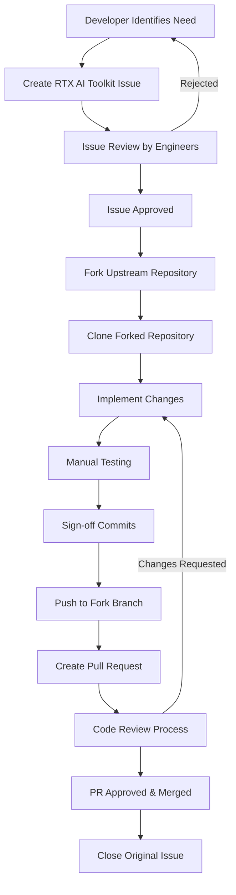
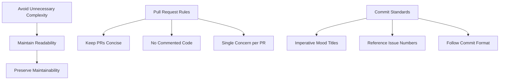
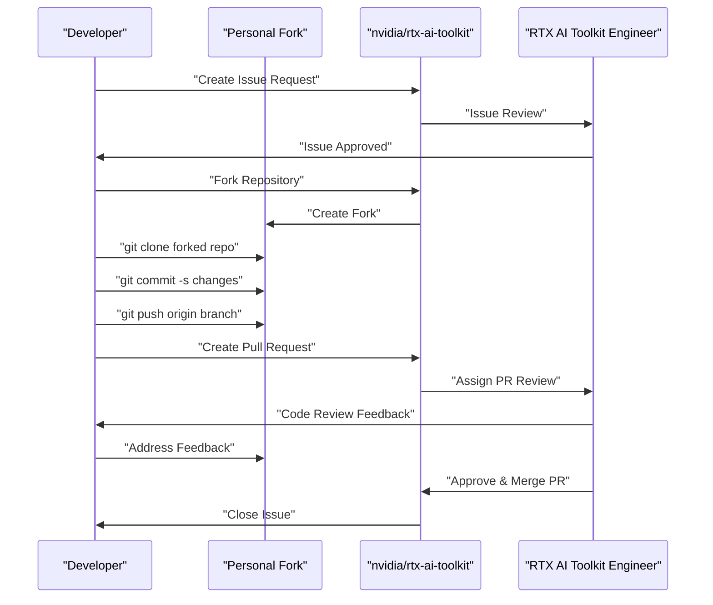
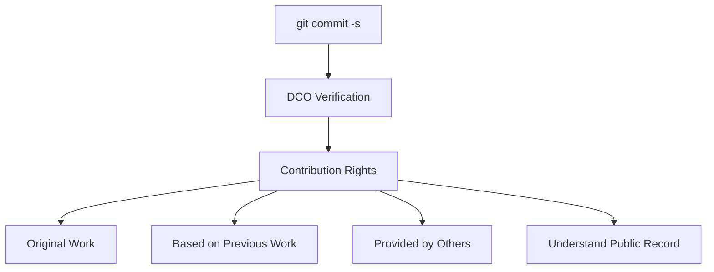

<!-- source: DeepWiki mcp.deepwiki.com · repo NVIDIA/workbench-llamafactory · page 7.1 Contribution Guidelines · fetched 2026-10-26 -->

# Contribution Guidelines

<details>
<summary>Relevant source files</summary>

The following files were used as context for generating this wiki page:

- [Contribution.md](Contribution.md)

</details>


This document outlines the contribution process, coding standards, and pull request workflow for the workbench-llamafactory project, which is part of the RTX AI Toolkit ecosystem. It covers all requirements and procedures for contributing code, documentation, and other improvements to the project.

For information about licensing and legal requirements, see [License & Legal](#7.2). For details about the repository structure and version control practices, see [Repository Structure](#6.2).

## Contribution Process Overview

The workbench-llamafactory project follows the RTX AI Toolkit's structured contribution process, which ensures all changes are properly reviewed, tested, and documented before integration.

### Contribution Workflow



**Sources:** [Contribution.md:1-115]()

### Issue Tracking Requirements

All contributions must begin with an RTX AI Toolkit Issue Request, which serves as the foundation for all development work.

| Requirement | Description |
|-------------|-------------|
| **Issue Creation** | Must create issue at `https://github.com/nvidia/rtx-ai-toolkit/issues` |
| **Engineer Review** | Issue must be reviewed and approved by RTX AI Toolkit engineers |
| **Approval Prerequisite** | No code review begins until issue is approved |

The issue tracking system ensures that all enhancements, bugfixes, and change requests are properly documented and aligned with project goals before development begins.

**Sources:** [Contribution.md:3-7]()

## Coding Standards

### Code Quality Guidelines

The project enforces several coding standards to maintain readability and maintainability:



**Sources:** [Contribution.md:9-23]()

### Commit Message Format

All commits must follow a standardized format that includes issue references:

```
#<Issue Number> - <Commit Title>

<Commit Body>
```

Commit titles should use imperative mood following [standard Git practices](https://chris.beams.io/posts/git-commit). Each commit must reference the corresponding issue number.

**Sources:** [Contribution.md:17-22]()

### Documentation and Testing Requirements

| Component | Requirement |
|-----------|-------------|
| **Documentation** | All OSS components must contain READMs describing functionality, dependencies, and known issues |
| **Testing** | All OSS components must have accompanying tests |
| **New Components** | Must provide test samples to verify functionality |
| **Reference** | See existing `README.md` files for reference examples |

**Sources:** [Contribution.md:24-31]()

## Pull Request Workflow

### Developer Fork Process

The contribution process uses a standard GitHub fork-based workflow:



**Sources:** [Contribution.md:37-59]()

### Pull Request Commands

The standard Git workflow for contributions:

```bash
# Fork the upstream repository via GitHub interface
git clone https://github.com/YOUR_USERNAME/YOUR_FORK.git 

# Checkout the targeted branch and commit changes
git commit -s -m "#<Issue Number> - <Commit Title>"

# Push the commits to a branch on the fork
git push -u origin <local-branch>:<remote-branch>
```

**Sources:** [Contribution.md:44-48]()

### Pull Request Guidelines

| Aspect | Requirement |
|--------|-------------|
| **Branch Selection** | Exercise caution when selecting source and target branches |
| **Versioned Releases** | Target `release/` branches for versioned releases |
| **Review Assignment** | At least one RTX AI Toolkit engineer will be assigned |
| **Work in Progress** | Prefix PR title with `[WIP]` during development |
| **Testing** | Manual testing required before acceptance |

**Sources:** [Contribution.md:51-58]()

## Code Signing Requirements

### Developer Certificate of Origin (DCO)

All contributions must be signed off using the Developer Certificate of Origin, which certifies the contributor's right to submit the code.



**Sources:** [Contribution.md:61-75]()

### Signing Commands

To sign off on commits, use the `--signoff` or `-s` option:

```bash
git commit -s -m "Add cool feature."
```

This appends the following to the commit message:
```
Signed-off-by: Your Name <your@email.com>
```

### DCO Certification

The Developer Certificate of Origin requires contributors to certify that:

- **(a)** The contribution was created in whole or part by the contributor with rights to submit under the open source license
- **(b)** The contribution is based on previous work under an appropriate open source license  
- **(c)** The contribution was provided by someone who certified (a), (b), or (c)
- **(d)** The contributor understands the public nature and permanent record of contributions

**Sources:** [Contribution.md:78-113]()

## Review and Acceptance Process

### Current Testing Approach

Since there is no automated CI/CD process in place, the project relies on manual testing and review:

| Stage | Responsibility |
|-------|----------------|
| **Development Testing** | Developer must test changes locally |
| **Review Testing** | RTX AI Toolkit engineer verifies functionality |
| **Acceptance Criteria** | Adequate manual testing must be completed |
| **Issue Closure** | Original issue closed only after successful testing |

### Review Requirements

- All contributions must pass engineer review
- PRs containing unsigned commits will not be accepted  
- Documentation and tests must accompany all new components
- Changes must not introduce unnecessary complexity
- Multiple PRs preferred over complex single PRs

**Sources:** [Contribution.md:58-59]()

---

