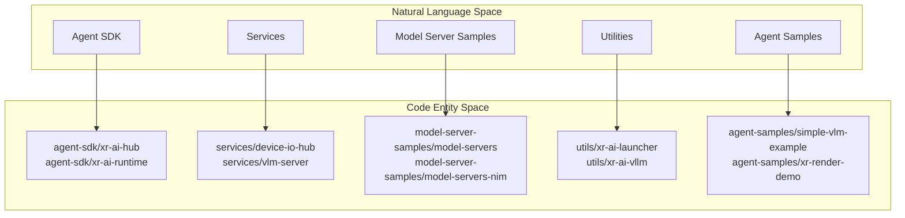
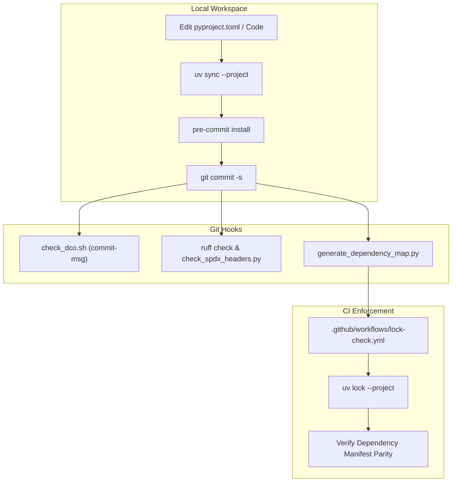
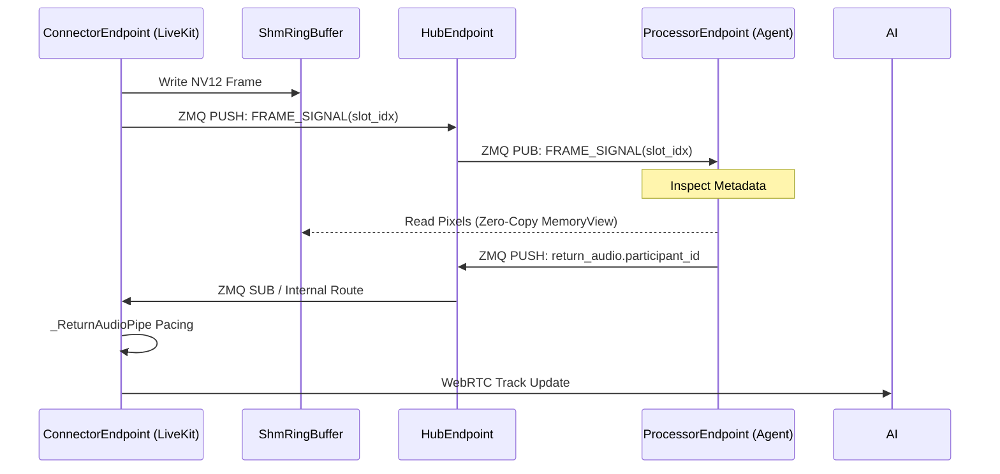
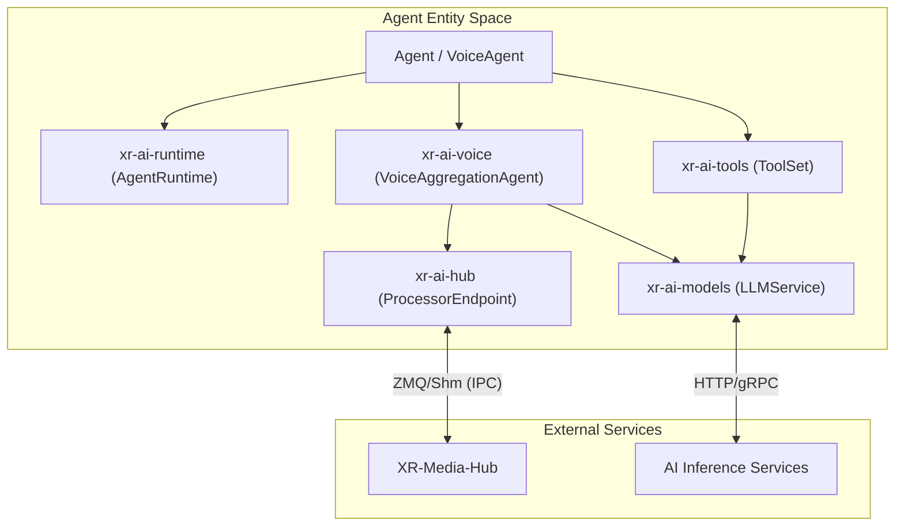
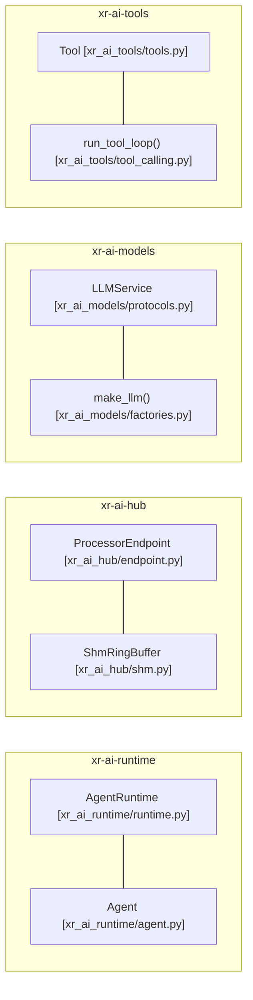
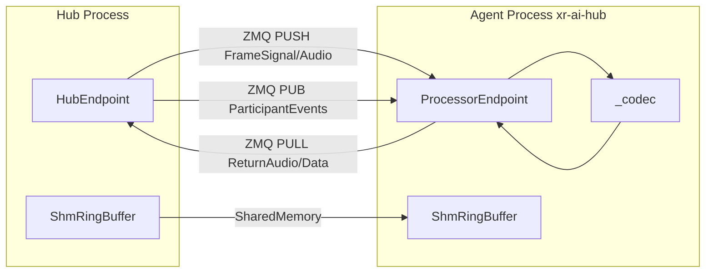
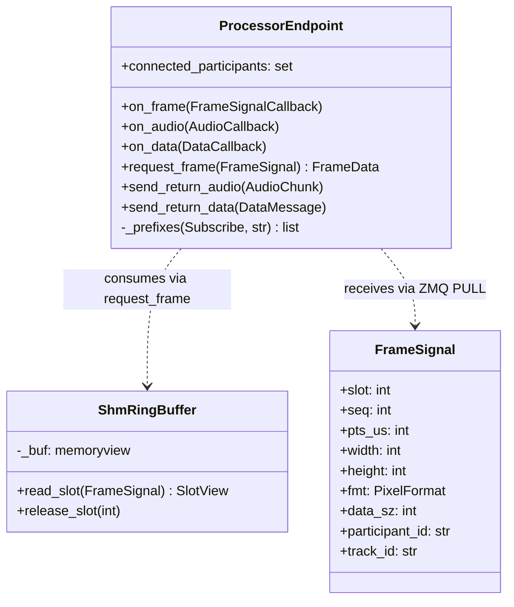
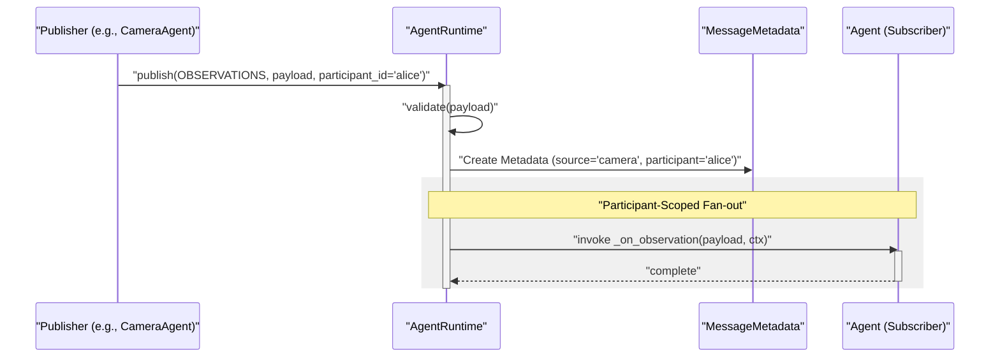
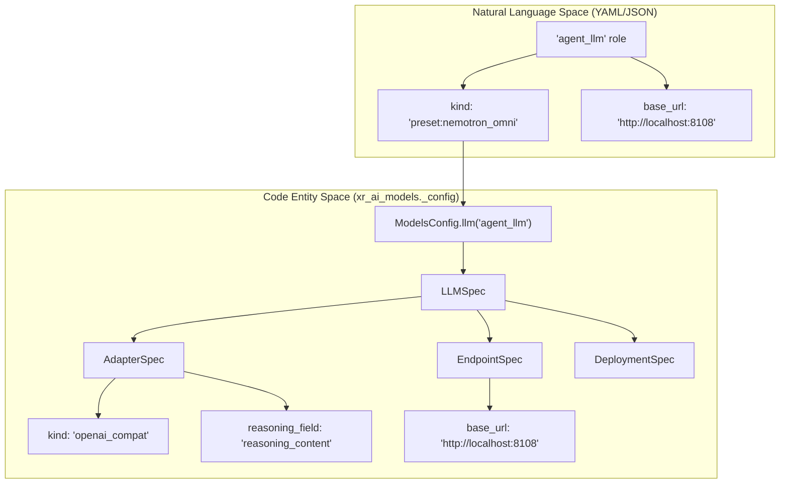
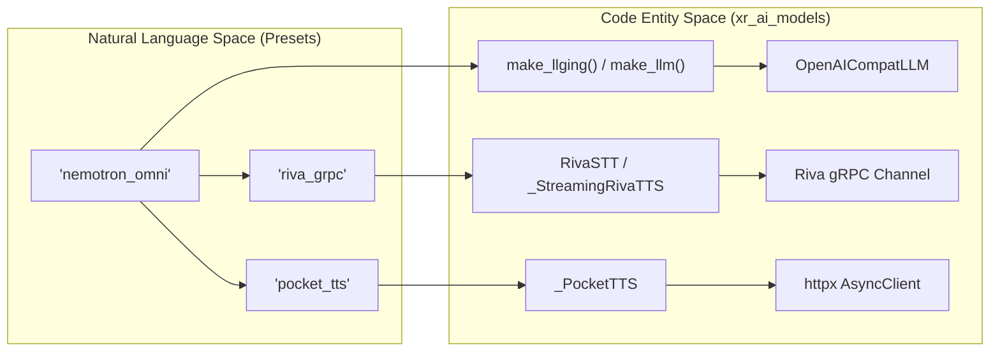

# Page: Overview

# Overview

<details>
<summary>Relevant source files</summary>

The following files were used as context for generating this wiki page:

- [AGENTS.md](AGENTS.md)
- [DEPENDENCIES.md](DEPENDENCIES.md)
- [README.md](README.md)
- [docs/source/_snippets/agent-setup-prompt.txt](docs/source/_snippets/agent-setup-prompt.txt)
- [docs/source/components/launcher-and-process-model.md](docs/source/components/launcher-and-process-model.md)
- [docs/source/getting_started/credentials.md](docs/source/getting_started/credentials.md)
- [docs/source/getting_started/index.md](docs/source/getting_started/index.md)
- [docs/source/getting_started/skills.md](docs/source/getting_started/skills.md)
- [docs/source/guides/adding-a-sample.md](docs/source/guides/adding-a-sample.md)
- [docs/source/guides/adding-cloudxr.md](docs/source/guides/adding-cloudxr.md)
- [docs/source/guides/spdx-headers.md](docs/source/guides/spdx-headers.md)
- [docs/source/index.md](docs/source/index.md)
- [docs/source/overview/architecture.md](docs/source/overview/architecture.md)
- [docs/source/reference/agent-sdk-tools.md](docs/source/reference/agent-sdk-tools.md)
- [docs/source/reference/simple-vlm-example.md](docs/source/reference/simple-vlm-example.md)
- [skills/getting-started/SKILL.md](skills/getting-started/SKILL.md)
- [skills/gh-manage-xr-ai-reviews/SKILL.md](skills/gh-manage-xr-ai-reviews/SKILL.md)
- [skills/gh-manage-xr-ai-reviews/agents/openai.yaml](skills/gh-manage-xr-ai-reviews/agents/openai.yaml)
- [skills/gh-review-xr-ai/SKILL.md](skills/gh-review-xr-ai/SKILL.md)
- [skills/gh-review-xr-ai/agents/openai.yaml](skills/gh-review-xr-ai/agents/openai.yaml)
- [tests/pyproject.toml](tests/pyproject.toml)
- [tests/test_launcher_stack.py](tests/test_launcher_stack.py)
- [tests/test_vllm_stop.py](tests/test_vllm_stop.py)
- [utils/xr-ai-launcher/xr_ai_launcher/_stack.py](utils/xr-ai-launcher/xr_ai_launcher/_stack.py)

</details>


XR-AI is an open-source developer stack for building agentic AI systems within the CloudXR ecosystem [README.md:8-9](). It enables the creation of multimodal agents that can see, hear, reason over live physical context, and respond in real-time across Web, iOS/visionOS, and XR headset platforms [README.md:8-14]().

The repository provides an end-to-end foundation for spatial computing, integrating media routing, participant isolation, and GPU-accelerated AI services [README.md:11-14]().

## Three-Tier Architecture

The project follows a modular three-tier architecture designed to separate transport, rendering, and AI logic, allowing each layer to evolve independently [README.md:11-14](), [docs/source/overview/architecture.md:37-38]().

```mermaid
graph TD
    subgraph "Agent SDK Tier"
        ["xr-ai-hub"] --> ["xr-ai-runtime"]
        ["xr-ai-runtime"] --> ["xr-ai-models"]
        ["xr-ai-runtime"] --> ["xr-ai-tools"]
        ["xr-ai-runtime"] --> ["xr-ai-voice"]
    end

    subgraph "Services Tier"
        ["device-io-hub"] --> ["vllm-server"]
        ["device-io-hub"] --> ["video-memory-service"]
    end

    subgraph "Utilities Tier"
        ["xr-ai-launcher"] --> ["xr-ai-logging"]
    end

    style ["xr-ai-hub"] stroke-dasharray: 5 5
    style ["device-io-hub"] stroke-dasharray: 5 5
    style ["xr-ai-launcher"] stroke-dasharray: 5 5
```
Sources: [README.md:60-72](), [docs/source/overview/architecture.md:20-47]()

### 1. Agent SDK (`agent-sdk/`)
The SDK is the primary interface for building agent logic. It is modularized to minimize dependency bloat, with the core IPC layer (`xr-ai-hub`) depending only on `pyzmq` and `msgpack` [AGENTS.md:35](), [DEPENDENCIES.md:108-116]().
- **xr-ai-hub**: The agent-facing IPC boundary using `ProcessorEndpoint` [agent-sdk/xr-ai-hub/](), [AGENTS.md:35-37]()
- **xr-ai-runtime**: Manages `Agent` registration and typed participant-scoped message fan-out [agent-sdk/xr-ai-runtime/](), [AGENTS.md:53-56]()
- **xr-ai-models**: Provides typed protocols and factory functions (e.g., `make_llm`, `make_vlm`) for interacting with AI services [agent-sdk/xr-ai-models/](), [AGENTS.md:42-47]()
- **xr-ai-tools**: A framework for native tools (e.g., `MarkerTrackingTool`) that agents can execute via model tool-calling loops [agent-sdk/xr-ai-tools/](), [AGENTS.md:51-52]()
- **xr-ai-voice**: A Pipecat-based pipeline for voice-enabled agents, handling VAD, STT, and streaming TTS [agent-sdk/xr-ai-voice/]()
- **xr-ai-web-events**: A telemetry viewer for monitoring agent events in a browser [agent-sdk/xr-ai-web-events/]()

Sources: [README.md:63](), [AGENTS.md:35-56](), [DEPENDENCIES.md:108-144]()

### 2. Services (`services/`)
Services provide the heavy-lifting capabilities for the stack, running as independent processes managed by the launcher [README.md:67](), [docs/source/overview/architecture.md:8-13]().
- **device-io-hub**: The central routing service handling transport connections, participant isolation, and media distribution [services/device-io-hub/](), [docs/source/overview/architecture.md:51-54]()
- **AI Inference Services**: Dockerized vLLM-backed servers for Vision-Language Models (VLM) and Large Language Models (LLM) [README.md:65](), [docs/source/overview/architecture.md:43-46]()
- **Capability Services**: Specialized RPC services like `video-memory-service` for frame history and `rag-service` for retrieval [tests/pyproject.toml:33-34](), [docs/source/overview/architecture.md:43-46]()

Sources: [README.md:67](), [docs/source/overview/architecture.md:8-16]()

### 3. Utilities (`utils/`)
Shared infrastructure used across the repository for process management, logging, and diagnostics [README.md:68]().
- **xr-ai-launcher**: A `stdlib`-only process manager that orchestrates the startup of the hub, workers, and model servers using the `--ready-file` protocol [utils/xr-ai-launcher/](), [AGENTS.md:90-94](), [docs/source/components/launcher-and-process-model.md:65-73]()
- **xr-ai-logging**: A unified logging sink based on `loguru` [utils/xr-ai-logging/](), [tests/test_launcher_stack.py:59-62]()

Sources: [README.md:68](), [utils/xr-ai-launcher/xr_ai_launcher/_stack.py:1-33](), [docs/source/components/launcher-and-process-model.md:65-81]()

## Natural Language to Code Entity Mapping

The following diagrams illustrate how high-level system concepts map to specific code entities and communication protocols across the architecture tiers.

**Agent-Hub Communication Flow**
```mermaid
graph LR
    subgraph "Client Space"
        ["StreamSession"] --> ["LiveKitBackend"]
    end

    subgraph "Service Space (device-io-hub)"
        ["LiveKitConnector"] -- "ZMQ PUSH/PULL" --> ["HubEndpoint"]
        ["HubEndpoint"] -- "ZMQ PUB/SUB" --> ["ProcessorEndpoint"]
    end

    subgraph "Agent SDK Space"
        ["ProcessorEndpoint"] --> ["AgentRuntime"]
        ["AgentRuntime"] --> ["AgentClass"]
    end

    style ["StreamSession"] stroke-dasharray: 5 5
    style ["AgentClass"] stroke-dasharray: 5 5
```
Sources: [README.md:11-14](), [docs/source/overview/architecture.md:28-47](), [AGENTS.md:33-40]()

**Multimodal Tool Execution Architecture**
```mermaid
graph TD
    subgraph "Agent Logic"
        ["Agent"] --> ["ToolSet"]
        ["ToolSet"] --> ["run_tool_loop"]
    end

    subgraph "Tools (xr-ai-tools)"
        ["run_tool_loop"] --> ["CurrentFrameTool"]
        ["run_tool_loop"] --> ["MarkerTrackingTool"]
    end

    subgraph "AI Services (xr-ai-models)"
        ["CurrentFrameTool"] -- "VLMService.request" --> ["vllm_backend"]
        ["Agent"] -- "LLMService.request" --> ["llama_nemotron_llm_server"]
    end

    style ["vllm_backend"] stroke-width:2px
    style ["llama_nemotron_llm_server"] stroke-width:2px
```
Sources: [AGENTS.md:51-54](), [DEPENDENCIES.md:119-144]()

## Getting Started

<a id="1.1"></a>

For new developers, XR AI provides step-by-step setup guides covering hardware and software requirements, installing `uv`, running model servers, launching `simple-vlm-example` and `xr-render-demo`, and connecting a client [README.md:18-31](), [docs/source/index.md:50-55]().

For details, see [Getting Started](#1.1) in the official documentation or child pages [README.md:20-25]().

Sources: [README.md:18-31](), [docs/source/index.md:50-55]()

## Repository Layout and Conventions

<a id="1.2"></a>

The repository top-level directory structure (`agent-sdk/`, `services/`, `model-server-samples/`, `utils/`, `agent-samples/`, `client-samples/`, `tests/`, `docs/`, `skills/`) organizes code by tier [README.md:58-72](), [AGENTS.md:15-29](). Coding conventions enforce strict SPDX header requirements [docs/source/guides/spdx-headers.md:8-18](), ruff linting, and Developer Certificate of Origin (DCO) sign-offs. Reusable agent playbooks are maintained under `skills/` [skills/getting-started/SKILL.md:1-20]().

For details, see [Repository Layout and Conventions](#1.2) and `AGENTS.md` [README.md:73-74](), [AGENTS.md:6-10]().

Sources: [README.md:58-74](), [AGENTS.md:6-29](), [docs/source/guides/spdx-headers.md:8-18]()

---

This wiki is divided into major sections corresponding to these architectural layers and workflows. For a complete list of terms and definitions, refer to the [Glossary](#6).

Sources: [README.md:18-31](), [docs/source/index.md:83-92]()

---

# Page: Getting Started

# Getting Started

<details>
<summary>Relevant source files</summary>

The following files were used as context for generating this wiki page:

- [docs/source/_snippets/agent-setup-prompt.txt](docs/source/_snippets/agent-setup-prompt.txt)
- [docs/source/components/ai-services.md](docs/source/components/ai-services.md)
- [docs/source/getting_started/index.md](docs/source/getting_started/index.md)
- [docs/source/getting_started/networking.md](docs/source/getting_started/networking.md)
- [docs/source/getting_started/quickstart.md](docs/source/getting_started/quickstart.md)
- [docs/source/getting_started/requirements.md](docs/source/getting_started/requirements.md)
- [docs/source/getting_started/skills.md](docs/source/getting_started/skills.md)
- [docs/source/guides/spdx-headers.md](docs/source/guides/spdx-headers.md)
- [docs/source/guides/troubleshooting.md](docs/source/guides/troubleshooting.md)
- [docs/source/index.md](docs/source/index.md)
- [services/device-io-hub/device_io_hub.yaml](services/device-io-hub/device_io_hub.yaml)
- [services/device-io-hub/device_io_hub/transport/livekit/config.py](services/device-io-hub/device_io_hub/transport/livekit/config.py)
- [skills/getting-started/SKILL.md](skills/getting-started/SKILL.md)
- [skills/gh-manage-xr-ai-reviews/SKILL.md](skills/gh-manage-xr-ai-reviews/SKILL.md)
- [skills/gh-manage-xr-ai-reviews/agents/openai.yaml](skills/gh-manage-xr-ai-reviews/agents/openai.yaml)
- [skills/gh-review-xr-ai/SKILL.md](skills/gh-review-xr-ai/SKILL.md)
- [skills/gh-review-xr-ai/agents/openai.yaml](skills/gh-review-xr-ai/agents/openai.yaml)
- [tests/test_integration_livekit.py](tests/test_integration_livekit.py)
- [tests/test_livekit_docker_config.py](tests/test_livekit_docker_config.py)
- [tests/test_livekit_tls_san.py](tests/test_livekit_tls_san.py)
- [tests/test_model_servers.py](tests/test_model_servers.py)
- [tests/test_return_audio_pacing.py](tests/test_return_audio_pacing.py)
- [tests/test_vlm_server_config.py](tests/test_vlm_server_config.py)

</details>


## Purpose and Scope

This page provides a step-by-step onboarding guide for developers setting up their local or cloud development environment for the `xr-ai` codebase. It covers hardware and software prerequisites, installing dependency tooling via `uv`, launching shared model inference servers, running reference samples (`simple-vlm-example` and `xr-render-demo`), connecting a client through the networking and TLS layer, and understanding the process orchestration mechanics provided by `xr-ai-launcher`.

Sources: [docs/source/getting_started/quickstart.md:19-33](), [docs/source/index.md:19-25]()

---

## Hardware and Software Requirements

The stack requires specific host capabilities to handle hardware-accelerated model serving and real-time WebRTC/CloudXR media streaming.

### Hardware Topologies
Pre-configured hardware profiles target high-memory NVIDIA architectures:
*   **DGX Spark**: Utilizes the unified memory architecture (UMA) profiles [docs/source/getting_started/requirements.md:10-15]().
*   **Blackwell (B200, RTX 6000 Ada)**: Targets the `96G_blackwell` profile variant [docs/source/getting_started/requirements.md:10-15]().
*   **Dual 48G Ada**: Targets the `dual_48G_ada` profile variant [docs/source/getting_started/requirements.md:10-15]().

### Software Prerequisites
| Requirement | Minimum Version | Notes |
| :--- | :--- | :--- |
| Operating System | Linux (Ubuntu 22.04 / 24.04) | WSL2 is not officially supported [docs/source/getting_started/requirements.md:33-36]() |
| Python | 3.11 or 3.12 | Managed per-sample via `uv` [docs/source/getting_started/requirements.md:33-36]() |
| `uv` | Latest | Dependency and virtual environment manager [docs/source/getting_started/requirements.md:33-37]() |
| NVIDIA Driver | 580+ | Required for CUDA 13 containers and NVENC/NVDEC codecs [docs/source/getting_started/requirements.md:33-38]() |
| Docker | 24+ | Required for vLLM and NIM container backends [docs/source/getting_started/requirements.md:33-39]() |
| NVIDIA Container Toolkit | Latest | Must register the `nvidia` runtime in Docker [docs/source/getting_started/requirements.md:33-40]() |

Sources: [docs/source/getting_started/requirements.md:8-42]()

---

## Installing `uv` and Environment Setup

1.  **Install `uv`**: If not already present on the host, install via the official script [docs/source/getting_started/requirements.md:43-48]()]:
    ```bash
    curl -LsSf https://astral.sh/uv/install.sh | sh
    ```
2.  **Configure Credentials**: Export `HF_TOKEN` for accessing gated model weights (such as Cosmos3 or Nemotron models) from Hugging Face. Set `NGC_API_KEY` if utilizing NVIDIA NIM containers [docs/source/getting_started/quickstart.md:72-94]()].
3.  **Sync Dependencies**:
    ```bash
    uv sync
    ```
    *Note for DGX Spark*: Ensure CPython development headers are installed prior to syncing: `sudo apt install python3-dev` [docs/source/guides/troubleshooting.md:53-65]().

Sources: [docs/source/getting_started/requirements.md:43-48](), [docs/source/getting_started/quickstart.md:72-94](), [docs/source/guides/troubleshooting.md:53-65]()

---

## Running Model Servers

Model services are operator-owned by a persistent orchestrator stack located under `model-server-samples/model-servers/` [docs/source/getting_started/quickstart.md:34-50](). They run independently so that application samples can reuse warm endpoints without reloading weights into VRAM.

### Starting the Shared Stack
Navigate to the model server orchestrator directory and start the default stack [docs/source/getting_started/quickstart.md:46-67]():
```bash
cd model-server-samples/model-servers
uv sync
uv run model_servers
```
The orchestrator automatically detects hardware capabilities (`detect_gpu_config`) and launches the profile processes [tests/test_model_servers.py:53-61]():
*   **STT Service**: Parakeet (`stt`, Port `8103`) [tests/test_model_servers.py:58-61]()
*   **TTS Service**: Pocket TTS (`tts`, Port `8105`) [tests/test_model_servers.py:58-61]()
*   **LLM/Omni Service**: Nemotron-3 Nano Omni (`omni`, Port `8108`) [tests/test_model_servers.py:58-61]()
*   **VLM Service**: Cosmos3 Nano Reasoner (`vlm`, Port `8100`) [tests/test_model_servers.py:58-61]()
*   **Embedding Service**: Llama Nemotron Embed (`embedding`, Port `8109`) [tests/test_model_servers.py:58-61]()

To stop all persistent model servers:
```bash
uv run model_servers --stop
```

Sources: [docs/source/getting_started/quickstart.md:34-100](), [tests/test_model_servers.py:53-67]()

---

## Launching Application Samples

Once model servers are running, launch end-to-end application samples from their respective directories.

### Simple VLM Example
The `simple-vlm-example` provides real-time multimodal Q&A over audio and video streams using `CurrentFrameTool` and VLM reasoning [docs/source/getting_started/quickstart.md:104-126]().

1.  Navigate to the sample directory:
    ```bash
    cd agent-samples/simple-vlm-example
    ```
2.  Install dependencies and start the application worker and hub:
    ```bash
    uv sync
    uv run simple_vlm_example
    ```
    The process launcher prints the WebRTC signaling URL, room name, token, and web client entry point once ready [docs/source/getting_started/quickstart.md:127-156]().

### XR Render Demo
The `xr-render-demo` sample integrates spatial tracking, OpenXR, and NVIDIA CloudXR streaming alongside agentic scene supervision [docs/source/index.md:19-24](). It requires the full ~55 GB model server allocation plus CloudXR runtime components [docs/source/getting_started/requirements.md:22-30]().

Sources: [docs/source/getting_started/quickstart.md:104-176](), [docs/source/getting_started/requirements.md:22-30]()

---

## Connecting a Client & Token Flow

Clients connect to the running sample stack via WebRTC using the StreamKit client library or a web browser.

### Web Client Connection
1.  Open `https://localhost:8080` in a browser [docs/source/getting_started/quickstart.md:157-160]().
2.  Accept the self-signed TLS development certificate warning (auto-generated under `~/.local/share/xr-ai/`) [docs/source/getting_started/quickstart.md:160-165]().
3.  Click **Connect** (the web app queries the hub's token endpoint automatically), then enable camera and microphone tracks [docs/source/getting_started/quickstart.md:166-170]().

### Diagram: Token and RTC Connection Flow (Code Space Mapping)
The following diagram maps natural language operations to concrete code entities involved in authentication and WebRTC session establishment:

```mermaid
graph TD
    subgraph "NaturalLanguageSpace ["Client Connection Session"]"
        A["Browser or XR Client"] --> B["Fetch Authentication Token"]
        B --> C["Establish WebRTC Media Session"]
    end

    subgraph "CodeEntitySpace ["DeviceIOHub and StreamKit Implementation"]"
        D["WebServer._handle_token"] --> E["make_client_token()"]
        E --> F["RoomClient.connect()"]
        F --> G["LiveKitConnector Room Instance"]
    end

    A -.-> D
    B -.-> E
    C -.-> F
    F -.-> G
```
Sources: [docs/source/getting_started/quickstart.md:157-170](), [docs/source/getting_started/networking.md:136-154](), [tests/test_integration_livekit.py:195-204]()

---

## Implementation Detail: Launcher Stack and Process Orchestration

Process management across model servers and samples is governed by `xr-ai-launcher` [utils/xr-ai-launcher/xr_ai_launcher/__init__.py:1-26](). The orchestrator manages service lifecycles, ready-file protocols, environment variable sanitization, and GPU topology detection.

### Diagram: Orchestration Architecture (Code Entity Mapping)
This diagram bridges the launcher conceptual model to Python classes and functions in the repository:

```mermaid
graph LR
    subgraph "NaturalLanguageSpace ["Launcher Orchestration"]"
        H["Detect GPU Hardware"] --> I["Build Process List"]
        I --> J["Spawn Parallel Process Stack"]
    end

    subgraph "CodeEntitySpace ["xr-ai-launcher Modules"]"
        K["detect_gpu_config()"] --> L["_build_processes()"]
        L --> M["Process Dataclass"]
        M --> N["run_stack()"]
    end

    H -.-> K
    I -.-> L
    I -.-> M
    J -.-> N
```

### Key Orchestration Entities
| Entity | Code Reference | Functional Role |
| :--- | :--- | :--- |
| `Process` | `utils/xr-ai-launcher/xr_ai_launcher/_stack.py` | Defines command arguments, working directory, and persistence mode (`own`, `persist`, `reuse`) |
| `run_stack` | `utils/xr-ai-launcher/xr_ai_launcher/_stack.py` | Spawns and supervises parallel child processes with ready-file handshakes |
| `detect_gpu_config` | `utils/xr-ai-launcher/xr_ai_launcher/_gpu.py` | Inspects system hardware to select configuration presets (`spark`, `dual_48G_ada`, `96G_blackwell`) |

Sources: [utils/xr-ai-launcher/xr_ai_launcher/__init__.py:1-57](), [tests/test_model_servers.py:53-76]()

---

# Page: Repository Layout and Conventions

# Repository Layout and Conventions

<details>
<summary>Relevant source files</summary>

The following files were used as context for generating this wiki page:

- [.github/scripts/generate_dependency_manifest.py](.github/scripts/generate_dependency_manifest.py)
- [.github/scripts/generate_dependency_map.py](.github/scripts/generate_dependency_map.py)
- [.github/workflows/lock-check.yml](.github/workflows/lock-check.yml)
- [.gitignore](.gitignore)
- [.pre-commit-config.yaml](.pre-commit-config.yaml)
- [CLAUDE.md](CLAUDE.md)
- [CODE_OF_CONDUCT.md](CODE_OF_CONDUCT.md)
- [CONTRIBUTING.md](CONTRIBUTING.md)
- [SECURITY.md](SECURITY.md)
- [THIRD_PARTY_NOTICES.md](THIRD_PARTY_NOTICES.md)
- [agent-samples/xr-render-demo/scene/scene_service.yaml](agent-samples/xr-render-demo/scene/scene_service.yaml)
- [agent-samples/xr-render-demo/scene/xr_render_scene/engine.py](agent-samples/xr-render-demo/scene/xr_render_scene/engine.py)
- [dependency-manifest/pyproject.toml](dependency-manifest/pyproject.toml)
- [dependency-manifest/uv.lock](dependency-manifest/uv.lock)
- [docs/source/_snippets/agent-setup-prompt.txt](docs/source/_snippets/agent-setup-prompt.txt)
- [docs/source/getting_started/index.md](docs/source/getting_started/index.md)
- [docs/source/getting_started/skills.md](docs/source/getting_started/skills.md)
- [docs/source/guides/contributing-and-conventions.md](docs/source/guides/contributing-and-conventions.md)
- [docs/source/guides/spdx-headers.md](docs/source/guides/spdx-headers.md)
- [docs/source/index.md](docs/source/index.md)
- [ruff.toml](ruff.toml)
- [skills/getting-started/SKILL.md](skills/getting-started/SKILL.md)
- [skills/gh-manage-xr-ai-reviews/SKILL.md](skills/gh-manage-xr-ai-reviews/SKILL.md)
- [skills/gh-manage-xr-ai-reviews/agents/openai.yaml](skills/gh-manage-xr-ai-reviews/agents/openai.yaml)
- [skills/gh-review-xr-ai/SKILL.md](skills/gh-review-xr-ai/SKILL.md)
- [skills/gh-review-xr-ai/agents/openai.yaml](skills/gh-review-xr-ai/agents/openai.yaml)
- [tests/test_dependency_manifest.py](tests/test_dependency_manifest.py)
- [tests/test_dependency_map.py](tests/test_dependency_map.py)
- [uv.toml](uv.toml)

</details>


This page details the organizational structure of the `xr-ai` repository, its coding standards, dependency management practices, agent playbooks, and the mechanical processes for contributing to the codebase. The repository is structured to support a multi-process AI architecture, separating core logic (SDK) from infrastructure (Services) and practical implementations (Samples).

## Top-Level Directory Structure

The repository follows a strict top-level directory convention to separate the core SDK, infrastructure services, model server samples, utilities, and applications.

| Directory | Purpose |
| :--- | :--- |
| `agent-sdk/` | Core Python libraries for building agents (IPC, Runtime, Models, Tools, Voice, Web Events). |
| `services/` | Standalone infrastructure processes (Device I/O Hub, VLM/LLM serving, Spatial RPCs). |
| `model-server-samples/` | Model server orchestrators and NIM deployment catalogs (`model-servers`, `model-servers-nim`) [dependency-manifest/pyproject.toml:34-37](). |
| `utils/` | Shared utilities and process orchestration (`xr-ai-launcher`, logging, VAD, voicegate) [dependency-manifest/pyproject.toml:104-108](). |
| `agent-samples/` | End-to-end reference implementations (`simple-vlm-example`, `xr-render-demo`, `lab-instrument-monitoring`, `tea-making-sample`). |
| `client-samples/` | Platform-specific client SDKs (iOS/visionOS, Android, Web, C++ StreamKit). |
| `tests/` | Centralized test suite for unit, integration, and GPU validation [THIRD_PARTY_NOTICES.md:18-19](). |
| `docs/` | Sphinx-based documentation source files and configuration [docs/source/guides/contributing-and-conventions.md:13-16](). |
| `skills/` | Reusable agent playbooks and skills for coding assistants (`skills/*/SKILL.md`). |

Each subproject within these directories is a self-contained Python project managed by `uv`, featuring its own `pyproject.toml` [docs/source/guides/contributing-and-conventions.md:21-22]().

**Directory Layout to Code Entity Mapping**

**Sources:** [dependency-manifest/pyproject.toml:28-61](), [docs/source/guides/contributing-and-conventions.md:18-24]()

## Coding Conventions and Quality

### SPDX License Headers
Every source file must begin with the NVIDIA SPDX copyright header [docs/source/guides/contributing-and-conventions.md:55-56](). The syntax varies by file type:
*   **Python/YAML/TOML**: Use `#` comment markers.
*   **Swift/Kotlin/JS/TS**: Use `//` comment markers.
*   **XML/HTML/Markdown**: Use `<!-- ... -->` markers.

The pre-commit hook automatically checks and inserts missing headers using `.github/scripts/check_spdx_headers.py` [._pre-commit-config.yaml:49-60]().

### Linting and Formatting
*   **Python**: The codebase uses `ruff` for linting and formatting under `ruff.toml` [ruff.toml:11-27](). Lint rules enforce error (`E`), fatal (`F`), warning (`W`), and isort (`I`) checks. Pre-commit hooks execute `ruff check` on modified files [CONTRIBUTING.md:40-42](), [._pre-commit-config.yaml:17-22]().
*   **Swift**: Follows Xcode's default formatting and the `swift-tools-version` pinned in each `Package.swift` [CONTRIBUTING.md:48-49]().
*   **Kotlin**: Uses official Kotlin style and versions defined in `gradle/libs.versions.toml` [CONTRIBUTING.md:50-51]().

**Sources:** [ruff.toml:11-27](), [._pre-commit-config.yaml:17-80](), [CONTRIBUTING.md:46-53]()

## Dependency Management and Lockfiles

Python dependencies are managed via `uv`. The root `uv.toml` file defines repository-wide policies, including an `exclude-newer` timestamp cutoff to ensure build reproducibility [docs/source/guides/contributing-and-conventions.md:58-64]().

*   **`pyproject.toml`**: Every subproject declares its dependencies and editable local workspace overrides under `[tool.uv.sources]` [dependency-manifest/pyproject.toml:67-108]().
*   **`DEPENDENCIES.md`**: A generated inventory of all Python projects and dependencies across the repository [THIRD_PARTY_NOTICES.md:16-20](). It is updated automatically via `.github/scripts/generate_dependency_map.py` [._pre-commit-config.yaml:37-48]().
*   **`dependency-manifest/`**: Aggregates all subprojects to build a repository-wide resolved `uv.lock` file that validates cross-package compatibility [dependency-manifest/pyproject.toml:5-14]().

**Sources:** [docs/source/guides/contributing-and-conventions.md:58-78](), [dependency-manifest/pyproject.toml:1-108](), [._pre-commit-config.yaml:23-48]()

## Agent Playbooks (`skills/`)

The `skills/` directory contains structured playbooks (`SKILL.md`) and configuration files designed for coding agents and AI assistants [._gitignore:235-240](). These playbooks provide automated instructions for repository tasks, such as managing reviews, navigating architecture constraints, and validating changes against project rules [docs/source/index.md:43-48]().

**Sources:** [docs/source/index.md:43-48](), [._gitignore:235-240]()

## Contribution Workflow and CI/CD

### Developer Certificate of Origin (DCO)
All contributions must certify compliance with the Developer Certificate of Origin 1.1 [CONTRIBUTING.md:68-79](). Every commit must include a `Signed-off-by` trailer, enforced by a `commit-msg` hook running `.github/scripts/check_dco.sh` [CONTRIBUTING.md:66-72](), [._pre-commit-config.yaml:81-90]().

```bash
git commit -s -m "feat: describe the change"
```

### Validation Pipeline
The repository uses pre-commit hooks and GitHub Actions workflows to validate dependencies, formatting, license headers, and DCO sign-offs prior to merge [._pre-commit-config.yaml:15-90](), [.github/workflows/lock-check.yml:1-108]().

**Dependency and Contribution Validation Flow**

**Sources:** [CONTRIBUTING.md:32-42](), [._pre-commit-config.yaml:15-90](), [.github/workflows/lock-check.yml:31-108]()

---

# Page: Core Architecture

# Core Architecture

<details>
<summary>Relevant source files</summary>

The following files were used as context for generating this wiki page:

- [docs/source/components/launcher-and-process-model.md](docs/source/components/launcher-and-process-model.md)
- [docs/source/components/server-runtime.md](docs/source/components/server-runtime.md)
- [docs/source/getting_started/credentials.md](docs/source/getting_started/credentials.md)
- [docs/source/guides/adding-a-sample.md](docs/source/guides/adding-a-sample.md)
- [docs/source/guides/adding-cloudxr.md](docs/source/guides/adding-cloudxr.md)
- [docs/source/overview/architecture.md](docs/source/overview/architecture.md)
- [docs/source/reference/agent-sdk-tools.md](docs/source/reference/agent-sdk-tools.md)
- [docs/source/reference/migrations.md](docs/source/reference/migrations.md)
- [docs/source/reference/simple-vlm-example.md](docs/source/reference/simple-vlm-example.md)
- [services/device-io-hub/device_io_hub/__main__.py](services/device-io-hub/device_io_hub/__main__.py)
- [services/device-io-hub/device_io_hub/ipc/_connector.py](services/device-io-hub/device_io_hub/ipc/_connector.py)
- [services/device-io-hub/device_io_hub/ipc/_hub.py](services/device-io-hub/device_io_hub/ipc/_hub.py)
- [services/device-io-hub/device_io_hub/transport/livekit/_room_client.py](services/device-io-hub/device_io_hub/transport/livekit/_room_client.py)
- [services/device-io-hub/device_io_hub/transport/livekit/connector.py](services/device-io-hub/device_io_hub/transport/livekit/connector.py)
- [tests/test_device_io_hub_startup.py](tests/test_device_io_hub_startup.py)
- [tests/test_launcher_stack.py](tests/test_launcher_stack.py)
- [tests/test_participant_events.py](tests/test_participant_events.py)
- [tests/test_vllm_stop.py](tests/test_vllm_stop.py)
- [utils/xr-ai-launcher/xr_ai_launcher/_stack.py](utils/xr-ai-launcher/xr_ai_launcher/_stack.py)

</details>


The XR-AI system is built on a hub-centric media routing model designed to bridge real-time spatial computing with multimodal AI agents. The architecture enforces strict boundaries between media transport, AI inference, and agent logic to ensure scalability across different hardware (from workstations to DGX Spark) and client platforms (Web, iOS, Android, XR headsets).

Sources: [docs/source/overview/architecture.md:8-16]()

## System Topology

The system follows a three-tier architecture where a central hub manages media and connectivity, specialized services handle heavy AI inference, and lightweight agents implement application logic.

### Media Routing and Isolation
The architecture centers on **DeviceIOHub**, which serves as the single point of entry for all clients [docs/source/components/server-runtime.md:8-12](). It manages an internal LiveKit transport and fans media out to agents via a high-performance IPC boundary [docs/source/components/server-runtime.md:8-12]().

*   **Participant Isolation**: The hub enforces a strict isolation contract: media from Participant A is never routed to Participant B [docs/source/components/server-runtime.md:51-60](). The only supported flow is `participant → hub → consumer (agent) → hub → same participant` [docs/source/components/server-runtime.md:57-60]().
*   **Zero-Copy Frames**: Video frames are managed via a shared-memory ring buffer (`ShmRingBuffer`), allowing agents to sample frames on-demand without the overhead of full-frame IPC serialization [docs/source/components/server-runtime.md:91-103]().

Sources: [docs/source/components/server-runtime.md:8-60]()

### Process Model
Applications are composed of multiple processes managed by a central launcher (`xr-ai-launcher`) [docs/source/components/launcher-and-process-model.md:16-18](). Each sample typically includes:
1.  **DeviceIOHub**: Handles WebRTC, TLS, and ZMQ dispatch [docs/source/components/server-runtime.md:8-12]().
2.  **AI Inference Services**: Independent processes for LLM, VLM, STT, and TTS [docs/source/overview/architecture.md:11-13]().
3.  **Agent Worker**: The application logic process using the Agent SDK [docs/source/components/launcher-and-process-model.md:16-18]().

Sources: [docs/source/components/launcher-and-process-model.md:12-18]()

### Data Flow Diagram: Client to Agent

Natural Language to Code Entity Mapping (Media Path)
```mermaid
graph LR
    subgraph ["Client Space (Remote)"]
        [iOS_App] --> ["wss://host:8080/rtc"]
    end

    subgraph ["DeviceIOHub (Service)"]
        [WebServer] --> [LiveKitConnector]
        [LiveKitConnector] -- "AudioChunk / FRAME_SIGNAL" --> [HubEndpoint]
    end

    subgraph ["Agent Space (Worker Process)"]
        [HubEndpoint] -- "ZMQ PUB/SUB" --> [ProcessorEndpoint]
        [ProcessorEndpoint] --> [AgentRuntime]
        [Agent_Class] --> [AgentRuntime]
    end

    style [iOS_App] stroke-dasharray: 5 5
    style [Agent_Class] stroke-width:4px
```
Sources: [docs/source/components/server-runtime.md:8-12](), [services/device-io-hub/device_io_hub/transport/livekit/connector.py:65-80]()

---

## Major Subsystems

### [Device I/O Hub](#2.1)
The core media server (`services/device-io-hub/`). It manages the `LiveKitConnector` for WebRTC transport, a TLS web server for token generation and proxying, and a ZMQ-based IPC hub (`HubEndpoint` / `ConnectorEndpoint`). It handles shared-memory ring buffers (`ShmRingBuffer`) for zero-copy frame access.
For details, see [Device I/O Hub](#2.1).

Sources: [docs/source/components/server-runtime.md:8-12](), [docs/source/reference/migrations.md:16-23]()

### [Agent SDK](#2.2)
A collection of six Python packages (`xr-ai-hub`, `xr-ai-runtime`, `xr-ai-models`, `xr-ai-tools`, `xr-ai-voice`, `xr-ai-web-events`) used to build agents. It abstracts ZMQ IPC, provides typed model protocols, and includes a Pipecat-based voice pipeline.
For details, see [Agent SDK](#2.2).

Sources: [docs/source/overview/architecture.md:73-74]()

### [Process Orchestration and Launcher](#2.3)
The `xr-ai-launcher` utility provides stack orchestration via `run_stack`, `Process`, and `Parallel` dataclasses, managing launch modes (`own`, `persist`, `reuse`), ready-file protocols, environment sanitization, and credential loading.
For details, see [Process Orchestration and Launcher](#2.3).

Sources: [docs/source/components/launcher-and-process-model.md:6-12](), [utils/xr-ai-launcher/xr_ai_launcher/_stack.py:66-134]()

### [AI Inference Services](#2.4)
Dedicated services for Vision-Language Models (VLM), Large Language Models (LLM), Speech-to-Text (STT), and Text-to-Speech (TTS), managed via `xr-ai-vllm` Docker/pip backends and model profiles.
For details, see [AI Inference Services](#2.4).

Sources: [docs/source/overview/architecture.md:75-76]()

### [XR Capability Services](#2.5)
Typed RPC services providing spatial and visual capabilities, including `video-memory-service`, `openxr-service`, `rag-service`, and `cloudxr-runtime`.
For details, see [XR Capability Services](#2.5).

Sources: [docs/source/overview/architecture.md:76-77]()

---

## IPC and Communication Contract

The system uses a hub-and-spoke model for IPC. The Hub binds two primary ZMQ sockets (`PULL` and `PUB`) to communicate with connectors and processors.

IPC Topology Diagram
```mermaid
graph TD
    subgraph ["Service Layer"]
        [ConnectorEndpoint] -- "ZMQ PUSH (ipc:///tmp/xr_hub_in)" --> [HubEndpoint_PULL]
    end

    subgraph ["Hub Process"]
        [HubEndpoint_PULL] --> [Dispatcher]
        [Dispatcher] --> [HubEndpoint_PUB]
    end

    subgraph ["Agent Layer"]
        [HubEndpoint_PUB] -- "ZMQ SUB (ipc:///tmp/xr_hub_pub)" --> [ProcessorEndpoint]
        [ProcessorEndpoint] -- "return_audio.{pid}" --> [HubEndpoint_PULL]
    end

    [Dispatcher] -- "FRAME_DATA" --> [ShmRingBuffer]
    [ProcessorEndpoint] -- "FRAME_REQUEST" --> [Dispatcher]
```
Sources: [docs/source/components/server-runtime.md:113-130](), [services/device-io-hub/device_io_hub/ipc/_hub.py:103-150]()

### Topic Convention
Messages are routed using a dot-notated topic scheme: `<type>.<participant_id>.<track_or_topic>`.
*   `audio.alice`: All audio from participant Alice.
*   `data.alice.chat`: Data messages on the "chat" channel from Alice.
*   `return_audio.alice`: Audio sent from an agent back to Alice.

Sources: [docs/source/components/server-runtime.md:135-145]()

---

# Page: Device I/O Hub

# Device I/O Hub

<details>
<summary>Relevant source files</summary>

The following files were used as context for generating this wiki page:

- [agent-sdk/xr-ai-hub/xr_ai_hub/_shm.py](agent-sdk/xr-ai-hub/xr_ai_hub/_shm.py)
- [docs/source/components/server-runtime.md](docs/source/components/server-runtime.md)
- [docs/source/getting_started/networking.md](docs/source/getting_started/networking.md)
- [docs/source/reference/migrations.md](docs/source/reference/migrations.md)
- [services/device-io-hub/device_io_hub.yaml](services/device-io-hub/device_io_hub.yaml)
- [services/device-io-hub/device_io_hub/__main__.py](services/device-io-hub/device_io_hub/__main__.py)
- [services/device-io-hub/device_io_hub/capture/_service.py](services/device-io-hub/device_io_hub/capture/_service.py)
- [services/device-io-hub/device_io_hub/ipc/_connector.py](services/device-io-hub/device_io_hub/ipc/_connector.py)
- [services/device-io-hub/device_io_hub/ipc/_hub.py](services/device-io-hub/device_io_hub/ipc/_hub.py)
- [services/device-io-hub/device_io_hub/ipc/_registration.py](services/device-io-hub/device_io_hub/ipc/_registration.py)
- [services/device-io-hub/device_io_hub/transport/livekit/_lk_proxy.py](services/device-io-hub/device_io_hub/transport/livekit/_lk_proxy.py)
- [services/device-io-hub/device_io_hub/transport/livekit/_room_client.py](services/device-io-hub/device_io_hub/transport/livekit/_room_client.py)
- [services/device-io-hub/device_io_hub/transport/livekit/_tls.py](services/device-io-hub/device_io_hub/transport/livekit/_tls.py)
- [services/device-io-hub/device_io_hub/transport/livekit/_web_server.py](services/device-io-hub/device_io_hub/transport/livekit/_web_server.py)
- [services/device-io-hub/device_io_hub/transport/livekit/config.py](services/device-io-hub/device_io_hub/transport/livekit/config.py)
- [services/device-io-hub/device_io_hub/transport/livekit/connector.py](services/device-io-hub/device_io_hub/transport/livekit/connector.py)
- [services/device-io-hub/pyproject.toml](services/device-io-hub/pyproject.toml)
- [tests/conftest.py](tests/conftest.py)
- [tests/test_connector_registration.py](tests/test_connector_registration.py)
- [tests/test_device_io_hub_startup.py](tests/test_device_io_hub_startup.py)
- [tests/test_integration_livekit.py](tests/test_integration_livekit.py)
- [tests/test_livekit_docker_config.py](tests/test_livekit_docker_config.py)
- [tests/test_livekit_tls_san.py](tests/test_livekit_tls_san.py)
- [tests/test_participant_events.py](tests/test_participant_events.py)
- [tests/test_return_audio_pacing.py](tests/test_return_audio_pacing.py)
- [tests/test_shm_ring_buffer.py](tests/test_shm_ring_buffer.py)

</details>


The **Device I/O Hub** (`services/device-io-hub/`) is the central orchestration service of the XR-AI repository. It acts as a high-performance media router that bridges external client transports (such as WebRTC via LiveKit) to internal agent logic using a zero-copy Inter-Process Communication (IPC) boundary. It manages participant lifecycles, enforces strict data isolation, paces return audio, and provides a unified TLS web entry point for cross-platform clients.

Sources: [docs/source/components/server-runtime.md:1-12](), [docs/source/reference/migrations.md:16-23]()

## System Architecture and Component Mapping

The hub operates as a single process (`device_io_hub`) managed via a configuration file (`device_io_hub.yaml`). It uses a hub-and-spoke model where inbound media from client connectors is fanned out to connected agent consumers, and return traffic is routed exclusively back to the originating participant.

### Code-to-Entity Mapping: Hub Subsystems
The diagram below bridges natural language descriptions of the hub architecture to the actual Python classes and modules implementing them.

Title: "DeviceIOHubComponentMapping"
```mermaid
graph TD
    subgraph "Transport Layer"
        LK["LiveKitConnector"] -- "manages" --> LKD["LiveKitDocker"]
        WS["WebServer"] -- "proxies" --> LKP["_lk_proxy"]
        TS["TokenServer"] -- "signs" --> JWT["_token.py"]
    end

    subgraph "IPC Layer"
        HE["HubEndpoint"] -- "binds pull/pub" --> SHM["ShmRingBuffer"]
        CE["ConnectorEndpoint"] -- "registers ring" --> HE
    end

    subgraph "Code Entities"
        LKD --> [services/device-io-hub/device_io_hub/transport/livekit/_docker.py:87-177]()
        LK --> [services/device-io-hub/device_io_hub/transport/livekit/connector.py:65-174]()
        HE --> [services/device-io-hub/device_io_hub/ipc/_hub.py:103-165]()
        CE --> [services/device-io-hub/device_io_hub/ipc/_connector.py:72-151]()
        WS --> [services/device-io-hub/device_io_hub/transport/livekit/_web_server.py:97-168]()
    end
```
Sources: [docs/source/components/server-runtime.md:31-49](), [services/device-io-hub/device_io_hub/transport/livekit/connector.py:65-174](), [services/device-io-hub/device_io_hub/ipc/_hub.py:103-165]()

## IPC Boundary and Data Flow

The hub and its connectors/consumers communicate over **ZeroMQ (ZMQ)** using **msgpack**-encoded messages for metadata, control, audio, and text/data messages. Video frames bypass ZMQ serialization entirely using a shared-memory ring buffer (`ShmRingBuffer`).

### Socket Topology
*   `PULL` on `ipc:///tmp/xr_hub_in`: Connectors push real-time media and participant lifecycle signals into the hub [docs/source/components/server-runtime.md:125-129]().
*   `PUB` on `ipc:///tmp/xr_hub_pub`: Consumers subscribe to receive fanned-out streams [docs/source/components/server-runtime.md:125-129]().
*   File IPC lane: Completed files use a separate bounded pair (`ipc:///tmp/xr_hub_file_in` via `PUSH` to hub `PULL`, then hub `PUB` to processor `SUB`) [docs/source/components/server-runtime.md:131-136]().

### Shared-Memory Video Path
Video frames are written into memory blocks shared between the connector and the hub:
1. The `LiveKitConnector` captures and decodes incoming video frames into shared memory slots [docs/source/components/server-runtime.md:97-106]().
2. A `FRAME_SIGNAL` containing metadata, timestamp (`pts_us`), and slot index is pushed over ZMQ [docs/source/components/server-runtime.md:126-133]().
3. Downstream agent processors receive the signal and map the memory segment for zero-copy access [docs/source/components/server-runtime.md:113-133]().

Title: "MediaDataFlowIPC"

Sources: [docs/source/components/server-runtime.md:113-148](), [services/device-io-hub/device_io_hub/ipc/_hub.py:103-135]()

## Internal LiveKit Transport and Room Client

`LiveKitConnector` (`services/device-io-hub/device_io_hub/transport/livekit/connector.py`) manages the end-to-end LiveKit transport lifecycle [docs/source/components/server-runtime.md:91-106]().

1. **Docker Container**: Automatically starts the `livekit/livekit-server` container in host-network mode, binding plaintext signaling on port 7880 and WebRTC media ports 7881/7882 [docs/source/components/server-runtime.md:91-96](). Hardware video codecs (NVENC and NVDEC) are verified at startup [docs/source/components/server-runtime.md:97-111]().
2. **Server Initialization**: Optionally boots the token server and FastAPI web server [docs/source/components/server-runtime.md:97-99]().
3. **IPC Handshake**: Creates its shared-memory ring buffer and registers with the hub as a `ConnectorEndpoint`, awaiting hub acknowledgement before proceeding [docs/source/components/server-runtime.md:97-99]().
4. **RoomClient**: Connects a subscribe-only Python `RoomClient` (`services/device-io-hub/device_io_hub/transport/livekit/_room_client.py`) to the room. It ingests inbound participant tracks and publishes per-participant return-audio tracks [docs/source/components/server-runtime.md:99-106]().

Sources: [docs/source/components/server-runtime.md:85-111](), [services/device-io-hub/device_io_hub/transport/livekit/connector.py:65-140]()

## Participant Isolation Contract

The hub enforces a strict isolation boundary: **the hub is not a general routing switch between client participants** [docs/source/components/server-runtime.md:51-59](). No supported path exists for participant A's media or data to reach participant B.

*   **Routing Rule**: All traffic follows the strict path: `participant → hub → agent consumer → hub → originating participant` [docs/source/components/server-runtime.md:55-60]().
*   **Validation**: Methods like `send_return_audio`, `send_return_data`, and `send_return_audio_flush` verify that the target participant is currently active and connected; messages addressed to unknown participants are dropped with a warning [docs/source/components/server-runtime.md:61-66]().
*   **Topic Scoping**: Return traffic topics (`return_audio.*`, `return_data.*`) are infrastructure-only and excluded from agents' default subscriptions [docs/source/components/server-runtime.md:66-70](). LiveKit transport restricts return audio track subscriptions to the specific target participant identity.

Sources: [docs/source/components/server-runtime.md:51-84](), [services/device-io-hub/device_io_hub/ipc/_hub.py:17-37]()

## Return-Audio Pacing

To prevent backpressure stalls when agents or TTS services stream audio chunks rapidly, the connector implements a per-participant pacing pipe (`_ReturnAudioPipe` in `services/device-io-hub/device_io_hub/transport/livekit/_room_client.py`) [services/device-io-hub/device_io_hub/transport/livekit/_room_client.py:71-107]().

*   **Non-Blocking Push**: IPC return audio handlers append frames to an internal queue without blocking the connector recv loop [services/device-io-hub/device_io_hub/transport/livekit/_room_client.py:108-136]().
*   **Duration Bounding**: Governed by `return_audio_max_buffer_s` (default `3.0` seconds) [services/device-io-hub/device_io_hub.yaml:37](). If queued audio exceeds this bound, the oldest queued frames are dropped to maintain a tight memory and latency ceiling [docs/source/reference/migrations.md:87-94]().
*   **Flushing**: `ReturnAudioFlush` messages immediately clear the local backlog and invoke `clear_queue()` on the underlying LiveKit `AudioSource` [services/device-io-hub/device_io_hub/transport/livekit/_room_client.py:144-149]().

Sources: [docs/source/reference/migrations.md:87-94](), [services/device-io-hub/device_io_hub/transport/livekit/_room_client.py:71-150]()

## TLS Web Server and Proxies

The FastAPI-based `WebServer` (`services/device-io-hub/device_io_hub/transport/livekit/_web_server.py`) provides the primary HTTPS/WSS client entry point on `web_server_port` (default `8080`) [docs/source/getting_started/networking.md:136-144]().

### Key Endpoints
*   `/token`: Generates signed LiveKit JWT tokens for client connection authentication, dynamically inspecting the `Host` header [services/device-io-hub/device_io_hub/transport/livekit/_web_server.py:66-76]().
*   `/rtc` Proxy: A same-origin WebSocket proxy (`_lk_proxy.py`) that forwards WebRTC signaling to the internal plaintext port `7880`, allowing browsers and mobile clients to bypass cross-origin restrictions [docs/source/getting_started/networking.md:136-144]().
*   `/cert`: Serves the active TLS root certificate for device profile installation [docs/source/getting_started/networking.md:146-156]().

### Certificate Generation
TLS is enabled by default (`web_server_tls: true`) [services/device-io-hub/device_io_hub.yaml:52](). On initial startup, the hub generates a stable development root CA and a server leaf certificate under `~/.local/share/xr-ai/` [docs/source/getting_started/networking.md:146-153](). The Subject Alternative Names (SAN) automatically cover `localhost`, local hostnames, and all local IPv4 interface addresses. Additional external IPs or DNS names can be injected via `web_server_extra_sans` in `device_io_hub.yaml` [docs/source/getting_started/networking.md:158-165]().

Sources: [docs/source/getting_started/networking.md:135-165](), [services/device-io-hub/device_io_hub.yaml:51-76]()

## Video Capture and Recording

The hub supports optional server-side video recording using hardware video encoding (`pynvvideocodec` via NVENC) [services/device-io-hub/device_io_hub.yaml:86-104]().

*   **Format**: Frames are encoded into H.264 Annex B chunks, where each chunk begins with an IDR frame and is independently decodable [services/device-io-hub/device_io_hub.yaml:87-90]().
*   **Storage & Eviction**: Output defaults to a tmpfs RAM path (`/dev/shm/xr-ai/recordings`) to eliminate disk latency [services/device-io-hub/device_io_hub.yaml:98-99](). A FIFO eviction policy triggers once total chunk storage across participants exceeds `max_total_bytes` (default `500 MB`) [services/device-io-hub/device_io_hub.yaml:91-93]().

Sources: [services/device-io-hub/device_io_hub.yaml:86-104](), [services/device-io-hub/device_io_hub/capture/_service.py]()

---

# Page: Agent SDK

# Agent SDK

<details>
<summary>Relevant source files</summary>

The following files were used as context for generating this wiki page:

- [agent-sdk/xr-ai-voice/README.md](agent-sdk/xr-ai-voice/README.md)
- [agent-sdk/xr-ai-voice/xr_ai_voice/_aggregation.py](agent-sdk/xr-ai-voice/xr_ai_voice/_aggregation.py)
- [docs/source/components/agent-sdk.md](docs/source/components/agent-sdk.md)
- [tests/test_voice_aggregation.py](tests/test_voice_aggregation.py)

</details>


The Agent SDK is a modular developer stack designed for building multimodal, real-time conversational AI agents within the CloudXR ecosystem [docs/source/components/agent-sdk.md:6-10](). It provides the necessary abstractions to connect agents to GPU-accelerated AI services, native tools, and the XR-Media-Hub for media routing [docs/source/components/agent-sdk.md:14-19]().

The SDK is split across six core packages, organized by dependency boundaries to allow developers to include only the components required for their specific agent implementation [docs/source/components/agent-sdk.md:8-10]().

### SDK Package Composition

The following diagram illustrates how the various SDK packages compose into a functional agent and interact with the broader system architecture.

**Agent Architecture and SDK Boundaries**

Sources: [docs/source/components/agent-sdk.md:12-20](), [agent-sdk/xr-ai-voice/xr_ai_voice/_aggregation.py:57-68]()

---

### Core Packages

#### 2.2.1 xr-ai-hub: IPC Client
The `xr-ai-hub` package (distribution name `xr-ai-hub-client`) is the minimal agent-facing boundary for communicating with the XR-Media-Hub [docs/source/components/agent-sdk.md:14](). It utilizes `pyzmq` and `msgpack` to handle low-level IPC, managing data messages, audio chunks, and frame signals [docs/source/components/agent-sdk.md:14]().

*   **Key Entity:** `ProcessorEndpoint` serves as the minimal agent-side hub boundary for receiving data, audio, frame signals, and participant events and sending participant-routed return traffic [docs/source/components/agent-sdk.md:80-83]().
*   **For details, see [xr-ai-hub: IPC Client](#2.2.1).**

Sources: [docs/source/components/agent-sdk.md:14](), [docs/source/components/agent-sdk.md:80-83]()

#### 2.2.2 xr-ai-runtime: Agent Runtime and Topics
The `xr-ai-runtime` package provides the event system for the SDK, enabling typed publish/subscribe patterns and participant-scoped fan-out [docs/source/components/agent-sdk.md:16](). It allows agents to communicate with each other and the system via a structured event system [docs/source/components/agent-sdk.md:34-39]().

*   **Key Entity:** `AgentRuntime` manages delivery tasks and participant isolation but does not own model loops, planning, memory, media, or agent-created work [docs/source/components/agent-sdk.md:34-39]().
*   **For details, see [xr-ai-runtime: Agent Runtime and Topics](#2.2.2).**

Sources: [docs/source/components/agent-sdk.md:16](), [docs/source/components/agent-sdk.md:34-39]()

#### 2.2.3 xr-ai-models: Model Service Protocols
`xr-ai-models` defines the protocols and factories for interacting with AI inference services [docs/source/components/agent-sdk.md:15](). It abstracts wire details of LLM, VLM, STT, and TTS services, providing unified protocols and OpenAI-compatible HTTP client wrappers [docs/source/components/agent-sdk.md:40-44]().

*   **Key Entity:** `LLMService`, `VLMService`, and associated protocol definitions paired with service factories [docs/source/components/agent-sdk.md:40-44]().
*   **For details, see [xr-ai-models: Model Service Protocols](#2.2.3).**

Sources: [docs/source/components/agent-sdk.md:15](), [docs/source/components/agent-sdk.md:40-44]()

#### 2.2.4 xr-ai-tools: Native Tool Framework
The `xr-ai-tools` package implements a framework for native, in-process tools [docs/source/components/agent-sdk.md:17](). It includes specialized tools for vision, image/polygon editing, capture, and marker tracking (QR/ArUco multi-scale detection) [docs/source/components/agent-sdk.md:17]().

*   **Key Entity:** `Tool` and `AsyncTool` base classes, `ToolSet`, and `run_tool_loop()` for bounded turns [docs/source/components/agent-sdk.md:31-34]().
*   **For details, see [xr-ai-tools: Native Tool Framework](#2.2.4).**

Sources: [docs/source/components/agent-sdk.md:17](), [docs/source/components/agent-sdk.md:31-34]()

#### 2.2.5 xr-ai-voice: Voice Pipeline
`xr-ai-voice` provides high-level agents for handling real-time voice interaction, readiness, hub transport, VAD/STT, voice gating, TTS, and multi-producer aggregation [agent-sdk/xr-ai-voice/README.md:8-10]().

*   **Key Entity:** `VoiceAgent` and `VoiceAggregationAgent` manage participant-scoped voice output aggregation, concurrency, and response coalescing [agent-sdk/xr-ai-voice/xr_ai_voice/_aggregation.py:57-68]().
*   **For details, see [xr-ai-voice: Voice Pipeline](#2.2.5).**

Sources: [agent-sdk/xr-ai-voice/README.md:8-10](), [agent-sdk/xr-ai-voice/xr_ai_voice/_aggregation.py:57-68]()

#### 2.2.6 xr-ai-web-events: Telemetry Viewer
The `xr-ai-web-events` package allows applications to publish selected compact payloads to `WEB_EVENT_TOPIC` for a `WebEventsAgent` to display in a browser viewer [docs/source/components/agent-sdk.md:55-60]().

*   **Key Entity:** `WebEventsAgent` and `WEB_EVENT_TOPIC` managing bounded live history and loopback HTTP polling [docs/source/components/agent-sdk.md:55-60]().
*   **For details, see [xr-ai-web-events: Telemetry Viewer](#2.2.6).**

Sources: [docs/source/components/agent-sdk.md:19](), [docs/source/components/agent-sdk.md:55-60]()

---

### Code Entity Mapping

The following diagram bridges the functional roles of the SDK to their specific code implementations and file locations.

**SDK Code Entity Mapping**

Sources: [docs/source/components/agent-sdk.md:31-39](), [agent-sdk/xr-ai-voice/xr_ai_voice/_aggregation.py:110-125]()

---

# Page: xr-ai-hub: IPC Client

# xr-ai-hub: IPC Client

<details>
<summary>Relevant source files</summary>

The following files were used as context for generating this wiki page:

- [agent-sdk/xr-ai-hub/xr_ai_hub/__init__.py](agent-sdk/xr-ai-hub/xr_ai_hub/__init__.py)
- [agent-sdk/xr-ai-hub/xr_ai_hub/_codec.py](agent-sdk/xr-ai-hub/xr_ai_hub/_codec.py)
- [agent-sdk/xr-ai-hub/xr_ai_hub/_processor.py](agent-sdk/xr-ai-hub/xr_ai_hub/_processor.py)
- [agent-sdk/xr-ai-hub/xr_ai_hub/_shm.py](agent-sdk/xr-ai-hub/xr_ai_hub/_shm.py)
- [agent-sdk/xr-ai-hub/xr_ai_hub/_types.py](agent-sdk/xr-ai-hub/xr_ai_hub/_types.py)
- [client-samples/ios-visionos/StreamKit/Sources/StreamKit/StreamError.swift](client-samples/ios-visionos/StreamKit/Sources/StreamKit/StreamError.swift)
- [services/device-io-hub/device_io_hub/ipc/__init__.py](services/device-io-hub/device_io_hub/ipc/__init__.py)
- [services/device-io-hub/device_io_hub/ipc/_registration.py](services/device-io-hub/device_io_hub/ipc/_registration.py)
- [tests/conftest.py](tests/conftest.py)
- [tests/test_agent_codec.py](tests/test_agent_codec.py)
- [tests/test_connector_registration.py](tests/test_connector_registration.py)
- [tests/test_shm_ring_buffer.py](tests/test_shm_ring_buffer.py)

</details>


The `xr-ai-hub` package provides the core agent-facing IPC (Inter-Process Communication) boundary for the `xr-ai` system. It facilitates high-throughput media and data exchange between agents and the `device-io-hub` service using a combination of ZeroMQ for signaling/control and Shared Memory (SHM) for zero-copy raw video frames.

Sources: `agent-sdk/xr-ai-hub/xr_ai_hub/__init__.py:4-19` []

---

## Architecture Overview

The IPC client is designed around a single-producer/multi-consumer model for media, and a bi-directional messaging model for data and control. The boundary is strictly isolated by participant identity to ensure that agents only receive traffic for participants they are authorized to process.

### ZMQ Socket Topology
The `ProcessorEndpoint` utilizes several ZMQ socket types to communicate with the hub:
*   **PULL (Inbound):** Receives `FrameSignal`, `AudioChunk`, `DataMessage`, and other real-time messages from the hub.
*   **PUSH (Outbound):** Sends `ReturnAudio`, `ReturnData`, and `FrameRequest` objects back to the hub.
*   **SUB (Broadcast):** Subscribes to `ParticipantEvent` (join/leave) and `ControlMessage` topics.

### Data Flow Diagram

The following diagram illustrates the relationship between code entities and the physical IPC mechanisms.

**Diagram: IPC Boundary and Data Flow**

Sources: `agent-sdk/xr-ai-hub/xr_ai_hub/_processor.py:40-50` [], `agent-sdk/xr-ai-hub/xr_ai_hub/_shm.py:88-117` []

---

## Shared Memory Ring Buffer

The `ShmRingBuffer` class in `xr_ai_hub._shm` is a fixed-slot shared-memory segment used exclusively for raw video frames to avoid the serialization overhead of ZMQ for large payloads.

### Memory Layout
The segment is partitioned into a global header followed by $N$ fixed-capacity slots:
1.  **GlobalHeader (24 bytes):** Packed with struct format `=IIQQ` containing magic bytes `0xC0FFEE01`, slot count, max frame size, and slot stride.
2.  **SlotHeader (64 bytes):** Packed with struct format `=IBBHQqIII28x` containing slot magic `0xF4A3E501`, state, pixel format, sequence number, presentation timestamp (`pts_us`), dimensions, and data size.
3.  **Frame Data:** Raw pixel bytes up to `max_frame_bytes`.

### Slot Lifecycle
Slots move through three explicit states managed by the producer and consumer:
*   `_STATE_FREE` (0): Available for writing.
*   `_STATE_WRITING` (1): Producer is currently copying pixels into the slot.
*   `_STATE_READY` (2): Pixels are fully written and ready for the consumer.

Agents access these frames via `read_slot()`, which returns a `SlotView` wrapping a zero-copy `memoryview` into the shared memory segment. Consumers **must** call `release_slot()` once processing is complete so the slot state returns to `_STATE_FREE`.

Sources: `agent-sdk/xr-ai-hub/xr_ai_hub/_shm.py:7-55` [], `agent-sdk/xr-ai-hub/xr_ai_hub/_shm.py:79-117` []

---

## Codec Layer

The `_codec` module provides a minimal extensible wire codec for serialization and deserialization. Every message on the wire is formatted as a 1-byte `MsgType` identifier followed by a `msgpack` payload.

### Primary Data Types

| Class | Description | Fields |
| :--- | :--- | :--- |
| `FrameSignal` | Metadata for a frame in shared memory | `slot`, `seq`, `pts_us`, `width`, `height`, `fmt`, `data_sz`, `participant_id`, `track_id` |
| `AudioChunk` | Inbound/Outbound PCM audio | `pts_us`, `sample_rate`, `channels`, `samples`, `data` (bytes), `participant_id`, `track_id` |
| `DataMessage` | Generic application data payload | `participant_id`, `topic`, `pts_us`, `data` (bytes) |
| `FileMessage` | Completed file or byte transfer | `participant_id`, `topic`, `pts_us`, `transfer_id`, `name`, `mime_type`, `attributes`, `data` |
| `ParticipantEvent` | Roster updates | `participant_id`, `joined` (bool), `pts_us`, `connector_id`, `participant_session_id` |

Sources: `agent-sdk/xr-ai-hub/xr_ai_hub/_codec.py:4-11` [], `agent-sdk/xr-ai-hub/xr_ai_hub/_types.py:31-180` []

---

## ProcessorEndpoint Implementation

`ProcessorEndpoint` manages the subscriber and publisher sockets connecting the agent to the hub.

### Participant Scoping and Subscription
Participants are the primary unit of subscription. By default, `ProcessorEndpoint` automatically subscribes to all participants who join and unsubscribes when they leave. Subscription categories can be filtered using the `Subscribe` flag enum (`Subscribe.DATA`, `Subscribe.AUDIO`, `Subscribe.VIDEO`, `Subscribe.FILE`).

### Key Functions and Callbacks
*   `on_frame(callback)`: Registers an asynchronous handler for `FrameSignal` metadata.
*   `on_audio(callback)`: Registers a handler for incoming `AudioChunk` audio.
*   `on_data(callback)`: Registers a handler for incoming `DataMessage` application payloads.
*   `request_frame(signal)`: Pulls pixel data on demand for a given frame signal if it remains cached by the hub.
*   `send_return_audio(chunk)`: Pushes generated audio back to the hub.
*   `send_return_data(msg)`: Pushes text or binary responses back to the hub.

### Code Entity Mapping

**Diagram: Code Entity Mapping**

Sources: `agent-sdk/xr-ai-hub/xr_ai_hub/_processor.py:40-143` [], `agent-sdk/xr-ai-hub/xr_ai_hub/_shm.py:88-152` [], `agent-sdk/xr-ai-hub/xr_ai_hub/_types.py:102-132` []

---

## Error Handling and Lifecycle

The IPC client incorporates several robustness and safety guarantees:
1.  **Strict Size and Layout Validation:** When attaching to shared memory segments or decoding messages, strict validations ensure header magic numbers (`_MAGIC_GLOBAL`, `_MAGIC_SLOT`) and strides match expected layouts.
2.  **Back-pressure Handling:** If a consumer is too slow to process frames, ring slots fill up, causing the producer to block or drop frames according to ring capacity limits.
3.  **Roster Replays:** Endpoints initialized mid-session dispatch a `RosterRequest` to receive replayed join events for currently active participants.

Sources: `agent-sdk/xr-ai-hub/xr_ai_hub/_shm.py:153-191` [], `tests/test_shm_ring_buffer.py:68-107` []

---

# Page: xr-ai-runtime: Agent Runtime and Topics

# xr-ai-runtime: Agent Runtime and Topics

<details>
<summary>Relevant source files</summary>

The following files were used as context for generating this wiki page:

- [.github/scripts/docs_release_policy.py](.github/scripts/docs_release_policy.py)
- [.github/scripts/select_latest_docs_release.py](.github/scripts/select_latest_docs_release.py)
- [.github/workflows/docs.yaml](.github/workflows/docs.yaml)
- [agent-samples/simple-vlm-example/yaml/device_io_hub.yaml](agent-samples/simple-vlm-example/yaml/device_io_hub.yaml)
- [agent-sdk/xr-ai-hub/README.md](agent-sdk/xr-ai-hub/README.md)
- [agent-sdk/xr-ai-runtime/README.md](agent-sdk/xr-ai-runtime/README.md)
- [agent-sdk/xr-ai-runtime/xr_ai_runtime/events.py](agent-sdk/xr-ai-runtime/xr_ai_runtime/events.py)
- [docs/Makefile](docs/Makefile)
- [docs/requirements.txt](docs/requirements.txt)
- [docs/source/_static/root-redirect.html](docs/source/_static/root-redirect.html)
- [docs/source/conf.py](docs/source/conf.py)
- [docs/source/reference/index.md](docs/source/reference/index.md)
- [services/video-memory-service/README.md](services/video-memory-service/README.md)
- [tests/test_docs_versions.py](tests/test_docs_versions.py)
- [tests/test_subscriptions.py](tests/test_subscriptions.py)

</details>


The `xr-ai-runtime` package provides the execution environment for agents within the XR-AI ecosystem. It defines the `Agent` base class, manages the `AgentRuntime` lifecycle, and implements a typed, participant-scoped event system based on `Topic` and `MessageMetadata`.

Sources: [agent-sdk/xr-ai-runtime/README.md:1-13]()

## Core Components

### Agent and Runtime
The `Agent` class serves as the fundamental building block for logic. It encapsulates a collection of tools and defines event handlers using the `@subscribe` decorator [agent-sdk/xr-ai-runtime/xr_ai_runtime/agent.py:15-18](). The `AgentRuntime` acts as the orchestrator, managing the registration of agents and the delivery of messages across the system [agent-sdk/xr-ai-runtime/xr_ai_runtime/runtime.py:25-30]().

Sources: [agent-sdk/xr-ai-runtime/xr_ai_runtime/agent.py:15-18](), [agent-sdk/xr-ai-runtime/xr_ai_runtime/runtime.py:25-30]()

### Typed Event System
Communication between agents is governed by the `Topic` class. A `Topic` pairs a stable string name with a Pydantic `BaseModel` to ensure type safety and validation during message exchange [agent-sdk/xr-ai-runtime/xr_ai_runtime/events.py:18-25]().

#### Message Metadata
Every published event is accompanied by `MessageMetadata`, which provides routing and trace context:
*   `message_id`: Unique identifier for the specific publication.
*   `correlation_id`: Shared ID for tracking logical operations across multiple events.
*   `participant_id`: The routing key used to scope events to specific XR users.
*   `source`: The name of the publishing agent or service.
*   `timestamp_us`: Unix microsecond timestamp of the publication.
[agent-sdk/xr-ai-runtime/xr_ai_runtime/events.py:44-65]()

Sources: [agent-sdk/xr-ai-runtime/xr_ai_runtime/events.py:18-65]()

## Implementation Detail: Fan-out and Scoping

The `AgentRuntime` implements a participant-scoped fan-out mechanism. When a message is published to a `Topic`, the runtime identifies all registered agents with methods decorated by `@subscribe(topic)` [agent-sdk/xr-ai-runtime/xr_ai_runtime/runtime.py:90-105]().

### Data Flow: Event Publication
The following diagram illustrates the path from a raw event to an agent's subscriber method.

Title: Event Routing and Execution Flow

Sources: [agent-sdk/xr-ai-runtime/xr_ai_runtime/runtime.py:82-120](), [agent-sdk/xr-ai-runtime/xr_ai_runtime/events.py:67-78]()

## Code Entity Mapping

The runtime bridges high-level agent concepts to specific code entities and Pydantic models. Below are two mapping diagrams linking natural language abstractions to exact code symbols.

Title: Architectural Concept to Code Entity Mapping
```mermaid
graph TD
    subgraph "Natural Language Space"
        Event[""Observation Event""]
        AgentLogic[""Agent Logic""]
        Routing[""Routing Context""]
    end

    subgraph "Code Entity Space"
        T[""Topic[ObservationModel]""]
        AC[""Agent Class""]
        RT[""AgentRuntime""]
        MM[""MessageMetadata""]
        SUB[""@subscribe decorator""]
    end

    Event -.-> T
    AgentLogic -.-> AC
    AgentLogic -.-> SUB
    Routing -.-> MM
    
    RT -- "manages" --> AC
    AC -- "uses" --> SUB
    SUB -- "references" --> T
    RT -- "injects" --> MM
```
Sources: [agent-sdk/xr-ai-runtime/xr_ai_runtime/agent.py:15-35](), [agent-sdk/xr-ai-runtime/xr_ai_runtime/events.py:18-43]()

Title: Event Bus and Subscription Mapping
```mermaid
graph TD
    subgraph "Domain Concept"
        PubSub[""Publish/Subscribe Bus""]
        Handlers[""Event Handlers""]
    end

    subgraph "Code Implementation"
        RuntimePub[""AgentRuntime.publish()""]
        RuntimeReg[""AgentRuntime.register()""]
        SubDecorator[""@subscribe""]
    end

    PubSub -.-> RuntimePub
    Handlers -.-> SubDecorator
    RuntimeReg -- "scans" --> SubDecorator
    RuntimePub -- "dispatches" --> RuntimeReg
```
Sources: [agent-sdk/xr-ai-runtime/xr_ai_runtime/runtime.py:58-95](), [agent-sdk/xr-ai-runtime/xr_ai_runtime/agent.py:15-18]()

## Key Classes and Functions

### AgentRuntime
The central registry and message bus.
*   `register(name, agent)`: Adds an agent to the runtime and scans for `@subscribe` handlers [agent-sdk/xr-ai-runtime/xr_ai_runtime/runtime.py:58-75]().
*   `publish(topic, message, ...)`: Validates the message against the `Topic` model and dispatches it to subscribers [agent-sdk/xr-ai-runtime/xr_ai_runtime/runtime.py:82-95]().
*   `__aenter__ / __aexit__`: Manages the lifecycle of all registered agents [agent-sdk/xr-ai-runtime/xr_ai_runtime/runtime.py:46-56]().

### Agent
The base class for all AI logic units.
*   `tools`: A tuple of `Tool` objects exposed by this agent [agent-sdk/xr-ai-runtime/xr_ai_runtime/agent.py:22-24]().
*   `on_start() / on_stop()`: Lifecycle hooks for initialization and cleanup [agent-sdk/xr-ai-runtime/xr_ai_runtime/agent.py:37]().

### Topic
Defines the contract for an event.
*   `validate(message)`: Uses Pydantic to ensure the payload matches the expected schema [agent-sdk/xr-ai-runtime/xr_ai_runtime/events.py:38-41]().

Sources: [agent-sdk/xr-ai-runtime/xr_ai_runtime/runtime.py:46-95](), [agent-sdk/xr-ai-runtime/xr_ai_runtime/agent.py:22-37](), [agent-sdk/xr-ai-runtime/xr_ai_runtime/events.py:38-41]()

## Example: Subscriber Implementation
Agents subscribe to topics by decorating methods. The runtime automatically injects a `RuntimeContext` containing the `MessageMetadata`.

```python
class VoiceOutputAgent(Agent):
    @subscribe(OBSERVATIONS)
    async def observe(self, event: ObservationModel, ctx: RuntimeContext) -> None:
        # Access participant info via metadata
        p_id = ctx.metadata.participant_id
        logger.info(f"Received observation for {p_id}: {event.labels}")
```
Sources: [tests/test_agent_runtime.py:165-178]()

## Telemetry and Tracing
The runtime integrates with tracing layers to provide observability. If a `Topic` is configured with `telemetry="full"`, the `AgentRuntime` automatically creates spans for both the publication and each individual agent delivery [agent-sdk/xr-ai-runtime/xr_ai_runtime/events.py:27-28](). This allows developers to trace the latency of a message from the source agent through the runtime to every subscriber [tests/test_agent_runtime.py:202-235]().

Sources: [agent-sdk/xr-ai-runtime/xr_ai_runtime/events.py:27-28](), [tests/test_agent_runtime.py:202-235]()

---

# Page: xr-ai-models: Model Service Protocols

# xr-ai-models: Model Service Protocols

<details>
<summary>Relevant source files</summary>

The following files were used as context for generating this wiki page:

- [agent-sdk/xr-ai-models/README.md](agent-sdk/xr-ai-models/README.md)
- [agent-sdk/xr-ai-models/xr_ai_models/_factory.py](agent-sdk/xr-ai-models/xr_ai_models/_factory.py)
- [agent-sdk/xr-ai-models/xr_ai_models/_openai_compat.py](agent-sdk/xr-ai-models/xr_ai_models/_openai_compat.py)
- [agent-sdk/xr-ai-models/xr_ai_models/_protocols.py](agent-sdk/xr-ai-models/xr_ai_models/_protocols.py)
- [agent-sdk/xr-ai-models/xr_ai_models/_riva_grpc.py](agent-sdk/xr-ai-models/xr_ai_models/_riva_grpc.py)
- [agent-sdk/xr-ai-models/xr_ai_models/presets/pocket_tts.py](agent-sdk/xr-ai-models/xr_ai_models/presets/pocket_tts.py)
- [docs/source/reference/agent-sdk-models.md](docs/source/reference/agent-sdk-models.md)
- [docs/source/reference/magpie-nim-tts.md](docs/source/reference/magpie-nim-tts.md)
- [services/README.md](services/README.md)
- [services/magpie-nim-tts/README.md](services/magpie-nim-tts/README.md)
- [services/magpie-nim-tts/magpie_nim_tts.yaml](services/magpie-nim-tts/magpie_nim_tts.yaml)
- [services/magpie-nim-tts/magpie_nim_tts/__init__.py](services/magpie-nim-tts/magpie_nim_tts/__init__.py)
- [services/magpie-nim-tts/magpie_nim_tts/__main__.py](services/magpie-nim-tts/magpie_nim_tts/__main__.py)
- [services/magpie-nim-tts/magpie_nim_tts/common.py](services/magpie-nim-tts/magpie_nim_tts/common.py)
- [services/pocket-tts/pocket_tts_server.yaml](services/pocket-tts/pocket_tts_server.yaml)
- [services/pocket-tts/pocket_tts_server/__main__.py](services/pocket-tts/pocket_tts_server/__main__.py)
- [tests/test_models_config.py](tests/test_models_config.py)
- [tests/test_models_openai_compat.py](tests/test_models_openai_compat.py)
- [tests/test_models_riva.py](tests/test_models_riva.py)

</details>


The `xr-ai-models` package provides a unified abstraction layer for interacting with AI inference services. It defines typed protocols for Large Language Models (LLM), Vision-Language Models (VLM), Speech-to-Text (STT), Text-to-Speech (TTS), and Embedding services. By using these protocols, agent code remains decoupled from specific backend implementations, model-specific wire quirks, and HTTP client details [agent-sdk/xr-ai-models/README.md:8-12]().

Sources: [agent-sdk/xr-ai-models/README.md:1-21]()

## Service Protocols

All model interactions in the XR-AI SDK are governed by structural protocols defined in `xr_ai_models._protocols`. These protocols ensure that worker code depends on interfaces rather than concrete implementations [agent-sdk/xr-ai-models/_protocols.py:6-11]().

### LLMService, VLMService, and EmbeddingService
These protocols handle text, multimodal chat interactions, and vector representations. They share a common `Capabilities` object that describes supported features like streaming, tool calling, and reasoning [agent-sdk/xr-ai-models/_protocols.py:141-158]().

*   **LLMService**: Focuses on text-based chat completions via `chat()` and `stream()` methods [agent-sdk/xr-ai-models/_protocols.py:161-208]().
*   **VLMService**: Extends capabilities to visual inputs. It provides convenience wrappers like `ask_image()` and `ask_images()` which wrap the underlying multimodal chat logic [agent-sdk/xr-ai-models/_protocols.py:211-285]().
*   **EmbeddingService**: Provides `embed()` for generating vector representations of text strings, supporting batching [agent-sdk/xr-ai-models/_protocols.py:340-363]().

### STTService and TTSService
*   **STTService**: Provides `transcribe()` for converting audio bytes into text [agent-sdk/xr-ai-models/_protocols.py:288-311]().
*   **TTSService**: Provides `synthesize()` and `stream()` for converting text into audio streams [agent-sdk/xr-ai-models/_protocols.py:314-337]().

### Data Structures
The protocols utilize standardized dataclasses for message passing:
*   `ChatMessage`: Represents a single turn with a role (`user`, `assistant`, `system`, `tool`) and content [agent-sdk/xr-ai-models/_protocols.py:104-118]().
*   `ContentPart`: A union of `TextPart`, `ImagePart`, and `VideoPart` for multimodal messages [agent-sdk/xr-ai-models/_protocols.py:59-60]().
*   `ChatResponse`: A normalized response containing generated text, tool calls, and model reasoning [agent-sdk/xr-ai-models/_protocols.py:121-138]().

Sources: [agent-sdk/xr-ai-models/_protocols.py:1-363](), [agent-sdk/xr-ai-models/README.md:1-21]()

## Model Profiles and Configuration

Model behavior is controlled via model profiles (JSON or YAML). A profile separates the model's logic (`AdapterSpec`), connectivity (`EndpointSpec`), and process lifecycle (`DeploymentSpec`) [agent-sdk/xr-ai-models/README.md:8-12]().

### Configuration Structure
| Component | Description | Code Entity |
| :--- | :--- | :--- |
| **Adapter** | Dialect (OpenAI vs Riva), model name, and reasoning field mapping. | `AdapterSpec` [tests/test_models_config.py:12-31]() |
| **Endpoint** | URL, API keys, timeouts, and readiness check paths. | `EndpointSpec` [tests/test_models_config.py:12-31]() |
| **Deployment** | Launch mode (`managed`, `reused`, `external`) for the orchestrator. | `DeploymentSpec` [tests/test_models_config.py:12-31]() |

### Model Logic to Code Mapping
The following diagram illustrates how a logical model role defined in a configuration file is mapped to the internal `ModelsConfig` and its constituent specifications, bridging natural language spaces to code entities.

**Model Configuration Entity Space**

Sources: [tests/test_models_config.py:1-224](), [agent-sdk/xr-ai-models/README.md:1-21]()

## Adapter Presets

To simplify configuration, `xr-ai-models` includes presets for common NVIDIA NIM and in-tree services. Presets encapsulate model-specific quirks like reasoning field names and default parameters [tests/test_models_config.py:35-58]().

### Key Presets
*   `nemotron_omni`: Default LLM; uses `reasoning_content` field; thinking disabled by default [tests/test_models_config.py:66-71]().
*   `cosmos3_nano_reasoner`: VLM configuration preset supporting image and video reasoning [tests/test_models_config.py:45-56]().
*   `riva_grpc`: Specialized adapter for Riva/NIM speech containers using gRPC instead of OpenAI HTTP [tests/test_models_riva.py:104-125]().
*   `pocket_tts`: Pocket TTS service preset for HTTP-based streaming text-to-speech [tests/test_models_openai_compat.py:34-58]().

### Preset Resolution to Code Mapping
The following diagram maps preset identifiers in configuration manifests to their respective instantiation pathways in the factory module.

**Preset Resolution Entity Space**

Sources: [tests/test_models_config.py:35-78](), [agent-sdk/xr-ai-models/xr_ai_models/_factory.py:1-162]()

## Concrete Implementations

### OpenAI-Compatible HTTP Client
The `OpenAICompat*` classes (e.g., `OpenAICompatLLM`, `OpenAICompatVLM`, `OpenAICompatSTT`, `OpenAICompatTTS`, `OpenAICompatEmbedding`) implement the protocols using `httpx`. They handle:
*   **Credential Security**: Bearer tokens are restricted to HTTPS or loopback HTTP [agent-sdk/xr-ai-models/xr_ai_models/_openai_compat.py:47-58]().
*   **Payload Normalization**: Merging `default_extras` from presets with per-call parameters like `enable_thinking` [agent-sdk/xr-ai-models/xr_ai_models/_openai_compat.py:6-10]().
*   **Reasoning Parsing**: Extracting reasoning from model-specific fields (e.g., `reasoning` vs `reasoning_content`) into the standard `ChatResponse.reasoning` field [agent-sdk/xr-ai-models/xr_ai_models/_openai_compat.py:147-150]().
*   **Multimodal Encoding**: Converting `ImageInput` (bytes, paths, or URLs) into base64 data URLs for the OpenAI wire format [agent-sdk/xr-ai-models/xr_ai_models/_openai_compat.py:200-213]().

### Riva gRPC Client
The `RivaSTT` and `_StreamingRivaTTS` classes provide specialized implementations for Riva-based speech services, supporting BCP-47 language codes and custom voice selection over gRPC [agent-sdk/xr-ai-models/xr_ai_models/_riva_grpc.py:100-204]().

Sources: [agent-sdk/xr-ai-models/xr_ai_models/_openai_compat.py:1-213](), [agent-sdk/xr-ai-models/xr_ai_models/_riva_grpc.py:1-204]()

## Factory Functions

The package provides factory functions to instantiate services from a `ModelsConfig` object. These functions resolve the `kind` (e.g., `openai_compat` vs `riva_grpc`) and return the appropriate protocol implementation [agent-sdk/xr-ai-models/xr_ai_models/_factory.py:4-17]().

*   `make_embedding(config, name)` [agent-sdk/xr-ai-models/xr_ai_models/_factory.py:19-37]()
*   `make_llm(config, name)` [agent-sdk/xr-ai-models/xr_ai_models/_factory.py:40-63]()
*   `make_vlm(config, name)` [agent-sdk/xr-ai-models/xr_ai_models/_factory.py:66-88]()
*   `make_stt(config, name)` [agent-sdk/xr-ai-models/xr_ai_models/_factory.py:91-122]()
*   `make_tts(config, name)` [agent-sdk/xr-ai-models/xr_ai_models/_factory.py:125-162]()

### Data Flow: Config to Service
The following diagram shows the data flow from a configuration file through the factory functions to a functional service client.

**Service Instantiation Flow**
```mermaid
graph LR
    subgraph "Configuration Loading"
        JSON["models.yaml"] --> LMC["load_models_config()"]
        LMC --> MC["ModelsConfig Instance"]
    end

    subgraph "Factory Dispatch"
        MC --> ML["make_llm(config, 'agent_llm')"]
        ML --> SPEC["config.llm('agent_llm')"]
        SPEC --> KIND{kind?}
    end

    subgraph "Client Implementation"
        KIND -- "openai_compat" --> OAI["OpenAICompatLLM"]
        KIND -- "riva_grpc" --> RIVA["RivaSTT/TTS"]
    end
    
    OAI -- "implements" --> PROTO["LLMService Protocol"]
    RIVA -- "implements" --> PROTO
```
Sources: [agent-sdk/xr-ai-models/xr_ai_models/_factory.py:1-162]()

---

# Page: xr-ai-tools: Native Tool Framework

# xr-ai-tools: Native Tool Framework

<details>
<summary>Relevant source files</summary>

The following files were used as context for generating this wiki page:

- [agent-samples/simple-vlm-example/yaml/media_capture.yaml](agent-samples/simple-vlm-example/yaml/media_capture.yaml)
- [agent-samples/xr-render-demo/yaml/media_capture.yaml](agent-samples/xr-render-demo/yaml/media_capture.yaml)
- [agent-sdk/xr-ai-hub/xr_ai_hub/_capture.py](agent-sdk/xr-ai-hub/xr_ai_hub/_capture.py)
- [agent-sdk/xr-ai-tools/README.md](agent-sdk/xr-ai-tools/README.md)
- [agent-sdk/xr-ai-tools/pyproject.toml](agent-sdk/xr-ai-tools/pyproject.toml)
- [agent-sdk/xr-ai-tools/xr_ai_tools/_vision.py](agent-sdk/xr-ai-tools/xr_ai_tools/_vision.py)
- [agent-sdk/xr-ai-tools/xr_ai_tools/capture.py](agent-sdk/xr-ai-tools/xr_ai_tools/capture.py)
- [agent-sdk/xr-ai-tools/xr_ai_tools/current_frame.py](agent-sdk/xr-ai-tools/xr_ai_tools/current_frame.py)
- [agent-sdk/xr-ai-tools/xr_ai_tools/image.py](agent-sdk/xr-ai-tools/xr_ai_tools/image.py)
- [agent-sdk/xr-ai-tools/xr_ai_tools/image_polygon.py](agent-sdk/xr-ai-tools/xr_ai_tools/image_polygon.py)
- [agent-sdk/xr-ai-tools/xr_ai_tools/marker_tracking.py](agent-sdk/xr-ai-tools/xr_ai_tools/marker_tracking.py)
- [agent-sdk/xr-ai-tools/xr_ai_tools/tool_calling.py](agent-sdk/xr-ai-tools/xr_ai_tools/tool_calling.py)
- [agent-sdk/xr-ai-tools/xr_ai_tools/tools.py](agent-sdk/xr-ai-tools/xr_ai_tools/tools.py)
- [agent-sdk/xr-ai-tools/xr_ai_tools/utilities/generate_marker.py](agent-sdk/xr-ai-tools/xr_ai_tools/utilities/generate_marker.py)
- [agent-sdk/xr-ai-tools/xr_ai_tools/vision.py](agent-sdk/xr-ai-tools/xr_ai_tools/vision.py)
- [tests/test_generate_marker_utility.py](tests/test_generate_marker_utility.py)
- [tests/test_image_polygon_tool.py](tests/test_image_polygon_tool.py)
- [tests/test_image_tools.py](tests/test_image_tools.py)
- [tests/test_marker_tracking_tool.py](tests/test_marker_tracking_tool.py)
- [tests/test_native_tools.py](tests/test_native_tools.py)
- [tests/test_tool_calling.py](tests/test_tool_calling.py)

</details>


`xr-ai-tools` provides a toolkit-independent native layer for defining and executing tools within the XR-AI ecosystem [agent-sdk/xr-ai-tools/README.md:8-11](). It offers a unified Pydantic-based interface for voice agents, background triggers, and model-driven loops, ensuring that all tool executions are managed by NeMo Relay for consistent telemetry and security [agent-sdk/xr-ai-tools/README.md:9-12]().

Sources: [agent-sdk/xr-ai-tools/README.md:1-18]()

---

## Core Tool Abstractions

The framework differentiates between finite, immediate-return tools and long-running streaming tools.

### Tool and AsyncTool
- **`Tool`**: Represents a finite operation that takes a typed `BaseModel` request and returns a typed `BaseModel` result (or `None` for side-effect-only tools) [agent-sdk/xr-ai-tools/README.md:15-16](), [agent-sdk/xr-ai-tools/xr_ai_tools/tools.py:15-20]().
- **`AsyncTool`**: Designed for streaming operations, yielding typed chunks via an `AsyncIterator`. This is typically used for operations like incremental VLM queries [agent-sdk/xr-ai-tools/README.md:18](), [agent-sdk/xr-ai-tools/xr_ai_tools/async_tools.py:16-22]().

### ToolSet and Namespacing
A `ToolSet` is a collection of finite `Tool` instances. It supports namespacing to prevent collision when composing tools from different domains [agent-sdk/xr-ai-tools/README.md:18]().

| Class | Purpose | Implementation Detail |
| :--- | :--- | :--- |
| `Tool` | Unary execution | Uses `execute()` for direct calls and `invoke()` for model strings [agent-sdk/xr-ai-tools/xr_ai_tools/tools.py:53-85](). |
| `AsyncTool` | Streaming execution | Uses `stream()` to yield typed Pydantic chunks [agent-sdk/xr-ai-tools/xr_ai_tools/async_tools.py:56-82](). |
| `ToolSet` | Cataloging | Manages tool registration and namespacing [agent-sdk/xr-ai-tools/xr_ai_tools/tools.py:116-140](). |

Sources: [agent-sdk/xr-ai-tools/README.md:1-18](), [agent-sdk/xr-ai-tools/xr_ai_tools/tools.py:1-140](), [agent-sdk/xr-ai-tools/xr_ai_tools/async_tools.py:1-82]()

---

## Model Tool Calling Loop

The `run_tool_loop` function provides a stateless, bounded runner for multi-turn tool interaction [agent-sdk/xr-ai-tools/README.md:18]().

### Data Flow: Natural Language to Tool Execution

This diagram illustrates how a user's natural language query is processed through the LLM and dispatched to native code entities.

```mermaid
graph TD
    User["UserQuery"] --> LLM["LLMService (call_model)"]
    LLM -->|"emits ToolCall"| Loop["run_tool_loop"]
    Loop -->|"validates"| Handle["handle_tool_call"]
    Handle -->|"resolves"| TSet["ToolSet.get"]
    TSet -->|"executes"| Native["Tool.invoke"]
    Native -->|"returns"| TResult["ToolCallResult"]
    TResult -->|"appends to"| Trans["ChatMessage list"]
    Trans --> LLM
```
Sources: [agent-sdk/xr-ai-tools/xr_ai_tools/tool_calling.py:133-181]()

### Safety and Validation
- **Iteration Limits**: The loop raises `ToolLoopIterationLimitError` if the model exceeds `max_iterations` without a final answer [agent-sdk/xr-ai-tools/xr_ai_tools/tool_calling.py:179-250]().
- **Direct Return**: If a tool is marked `return_direct=True`, the loop terminates immediately and returns the tool's result as the final answer [agent-sdk/xr-ai-tools/xr_ai_tools/tool_calling.py:260-265]().
- **Validation**: Tool arguments are validated against the `Tool.request_model` Pydantic schema. Errors are returned to the model for potential repair [agent-sdk/xr-ai-tools/README.md:18]().

Sources: [agent-sdk/xr-ai-tools/README.md:18](), [agent-sdk/xr-ai-tools/xr_ai_tools/tool_calling.py:154-280]()

---

## Vision and Image Management

Vision tools operate on image references stored in a centralized `ImageRegistry` to keep telemetry payloads small and manage memory lifecycles [agent-sdk/xr-ai-tools/README.md:18]().

### ImageRegistry
- **Opaque Handles**: Stores raw bytes and provides `xr-image://` URIs [agent-sdk/xr-ai-tools/xr_ai_tools/image.py:75-90]().
- **Ownership**: Images are associated with a `participant_id` or `owner`. Calling `release_owner()` purges all associated frames [agent-sdk/xr-ai-tools/xr_ai_tools/image.py:126-129]().
- **Redaction**: `image_sanitizer()` ensures that sensitive image locations (like local paths or internal URIs) are replaced with `<redacted:image>` in Relay telemetry [agent-sdk/xr-ai-tools/xr_ai_tools/_vision.py:31-41]().

### Vision Tools
- **`CurrentFrameTool`**: Captures the most recent frame for a participant from the `ProcessorEndpoint` [agent-sdk/xr-ai-tools/xr_ai_tools/current_frame.py:46-55]().
- **`StreamingImageQueryTool`**: An `AsyncTool` that streams VLM responses for a single image [agent-sdk/xr-ai-tools/xr_ai_tools/vision.py:230-245]().
- **`VideoQueryTool`**: Queries a chronological sequence of `TimedImage` frames, providing the VLM with estimated offsets and timestamps [agent-sdk/xr-ai-tools/xr_ai_tools/vision.py:303]().

### Code Entity Relationship: Vision Pipeline

```mermaid
graph LR
    subgraph "Image Management"
        Registry["ImageRegistry"]
        Ref["ImageReference"]
    end

    subgraph "Selection Tools"
        CF["CurrentFrameTool"]
    end

    subgraph "Inference Tools"
        SIQ["StreamingImageQueryTool"]
        VQ["VideoQueryTool"]
    end

    CF -->|"put"| Registry
    Registry -->|"resolve"| SIQ
    SIQ -->|"calls"| VLM["VLMService"]
    VQ -->|"calls"| VLM
```
Sources: [agent-sdk/xr-ai-tools/xr_ai_tools/image.py:52-129](), [agent-sdk/xr-ai-tools/xr_ai_tools/vision.py:34-85]()

---

## Image, Polygon Editing, and Capture Tools

- **Image and Polygon Editing**: Tools located in `xr_ai_tools.image_polygon` provide capabilities to manipulate images and outline geometric regions or bounding areas for downstream vision tasks.
- **Capture Tools**: Capture utilities in `xr_ai_tools.capture` enable agent-controlled frame captures and media persistence across sessions.

Sources: [agent-sdk/xr-ai-tools/pyproject.toml:21-22](), [agent-sdk/xr-ai-tools/xr_ai_tools/image_polygon.py:1-50]()

---

## Marker Tracking

The `MarkerTrackingTool` provides multi-scale detection for QR codes and ArUco markers within participant camera frames [agent-sdk/xr-ai-tools/xr_ai_tools/marker_tracking.py:4-6]().

### Implementation Details
- **Multi-Scale Detection**: To detect small markers in high-resolution frames, the tool performs scans at both native resolution and an enlarged scale (up to 6x) [agent-sdk/xr-ai-tools/xr_ai_tools/marker_tracking.py:137-168]().
- **Engines**: Uses `zxing-cpp` for QR codes and `opencv-contrib` for ArUco fiducials [agent-sdk/xr-ai-tools/xr_ai_tools/marker_tracking.py:16-18]().
- **Deduplication**: Markers found across different scales are merged using an Area-of-Overlap (IoU) check [agent-sdk/xr-ai-tools/xr_ai_tools/marker_tracking.py:204-225]().

### Marker Generation Utility
The `generate_marker` utility (`xr_ai_tools.utilities.generate_marker`) allows developers to create ArUco marker images for testing or physical placement [agent-sdk/xr-ai-tools/xr_ai_tools/utilities/generate_marker.py:1-25]().

Sources: [agent-sdk/xr-ai-tools/xr_ai_tools/marker_tracking.py:1-250](), [agent-sdk/xr-ai-tools/xr_ai_tools/utilities/generate_marker.py:1-50]()

---

# Page: xr-ai-voice: Voice Pipeline

# xr-ai-voice: Voice Pipeline

<details>
<summary>Relevant source files</summary>

The following files were used as context for generating this wiki page:

- [agent-samples/simple-vlm-example/yaml/voice_gate.yaml](agent-samples/simple-vlm-example/yaml/voice_gate.yaml)
- [agent-sdk/xr-ai-voice/README.md](agent-sdk/xr-ai-voice/README.md)
- [agent-sdk/xr-ai-voice/pyproject.toml](agent-sdk/xr-ai-voice/pyproject.toml)
- [agent-sdk/xr-ai-voice/xr_ai_voice/__init__.py](agent-sdk/xr-ai-voice/xr_ai_voice/__init__.py)
- [agent-sdk/xr-ai-voice/xr_ai_voice/_aggregation.py](agent-sdk/xr-ai-voice/xr_ai_voice/_aggregation.py)
- [agent-sdk/xr-ai-voice/xr_ai_voice/_frames.py](agent-sdk/xr-ai-voice/xr_ai_voice/_frames.py)
- [agent-sdk/xr-ai-voice/xr_ai_voice/_pipeline.py](agent-sdk/xr-ai-voice/xr_ai_voice/_pipeline.py)
- [agent-sdk/xr-ai-voice/xr_ai_voice/_processors/io.py](agent-sdk/xr-ai-voice/xr_ai_voice/_processors/io.py)
- [agent-sdk/xr-ai-voice/xr_ai_voice/_processors/streaming_tts.py](agent-sdk/xr-ai-voice/xr_ai_voice/_processors/streaming_tts.py)
- [agent-sdk/xr-ai-voice/xr_ai_voice/_processors/vad_stt.py](agent-sdk/xr-ai-voice/xr_ai_voice/_processors/vad_stt.py)
- [agent-sdk/xr-ai-voice/xr_ai_voice/_processors/voice_gate.py](agent-sdk/xr-ai-voice/xr_ai_voice/_processors/voice_gate.py)
- [agent-sdk/xr-ai-voice/xr_ai_voice/_runtime.py](agent-sdk/xr-ai-voice/xr_ai_voice/_runtime.py)
- [agent-sdk/xr-ai-voice/xr_ai_voice/_session.py](agent-sdk/xr-ai-voice/xr_ai_voice/_session.py)
- [agent-sdk/xr-ai-voice/xr_ai_voice/_transport.py](agent-sdk/xr-ai-voice/xr_ai_voice/_transport.py)
- [docs/source/components/agent-sdk.md](docs/source/components/agent-sdk.md)
- [docs/source/reference/agent-sdk-voice.md](docs/source/reference/agent-sdk-voice.md)
- [tests/test_voice_aggregation.py](tests/test_voice_aggregation.py)
- [tests/test_voice_pipeline.py](tests/test_voice_pipeline.py)
- [tests/test_voice_runtime.py](tests/test_voice_runtime.py)
- [tests/test_voice_session.py](tests/test_voice_session.py)
- [tests/test_xr_ai_voicegate.py](tests/test_xr_ai_voicegate.py)
- [utils/xr-ai-voicegate/xr_ai_voicegate/_phrases.py](utils/xr-ai-voicegate/xr_ai_voicegate/_phrases.py)
- [utils/xr-ai-voicegate/xr_ai_voicegate/config.py](utils/xr-ai-voicegate/xr_ai_voicegate/config.py)
- [utils/xr-ai-voicegate/xr_ai_voicegate/gate.py](utils/xr-ai-voicegate/xr_ai_voicegate/gate.py)

</details>


The `xr-ai-voice` package provides a participant-aware voice runtime for XR agents. It leverages [Pipecat](https://github.com/pipecat-ai/pipecat) to implement a modular media pipeline while exposing high-level XR concepts like participant lifecycle, voice-gating, and response aggregation to the application layer [agent-sdk/xr-ai-voice/README.md:8-16]().

## Purpose and Scope
This document details the internal architecture of `xr-ai-voice`, covering `VoiceAgent` and `VoiceAggregationAgent`, the Pipecat-based media pipeline (`VadSttProcessor` → `VoiceGateProcessor` → `_VoiceIOProcessor` → `StreamingTtsProcessor`), `HubVoiceTransport`, wake phrase handling via `xr-ai-voicegate`, incremental response streaming, participant lifecycle management, and timestamp anchoring.

Sources: [agent-sdk/xr-ai-voice/README.md:8-16]()

---

## Core Components: VoiceAgent and VoiceAggregationAgent

An XR agent uses `VoiceAgent` to manage its voice-facing input/output boundaries. 

* **`VoiceAgent`**: Owns application readiness, the hub transport, VAD and STT execution, voice gating, internal session state, TTS generation, and pipeline cleanup [agent-sdk/xr-ai-voice/README.md:16](). It publishes final pre-gate transcripts to `VOICE_TRANSCRIPT_TOPIC` (`[agent-sdk/xr-ai-voice/xr_ai_voice/_runtime.py:114-114]()`) and accepted queries to the configured `UserQuery` topic (`[agent-sdk/xr-ai-voice/xr_ai_voice/_runtime.py:39-50]()`).
* **`VoiceAggregationAgent`**: Used when an application has multiple speech producers (e.g., foreground conversational replies, background sensor monitors, and alerts). It subscribes to `VOICE_CONTRIBUTION_TOPIC` (`[agent-sdk/xr-ai-voice/xr_ai_voice/_aggregation.py:40-42]()`) and consolidates simultaneous or rapid updates per participant before publishing a single coherent stream to `VOICE_OUTPUT_TOPIC` (`[agent-sdk/xr-ai-voice/xr_ai_voice/_runtime.py:121-123]()`).

Sources: [agent-sdk/xr-ai-voice/README.md:16](), [agent-sdk/xr-ai-voice/xr_ai_voice/_runtime.py:114-123](), [agent-sdk/xr-ai-voice/xr_ai_voice/_aggregation.py:40-42]()

---

## Pipecat-Based Pipeline Architecture

The voice pipeline is assembled by `_build_voice_pipeline` (`[agent-sdk/xr-ai-voice/xr_ai_voice/_pipeline.py:31-111]()`) and run inside a `PipelineWorker` (`[agent-sdk/xr-ai-voice/xr_ai_voice/_pipeline.py:99-110]()`). It processes audio data sequentially through specialized `FrameProcessor` implementations.

### Pipeline Data Flow and Code Entity Mapping

```mermaid
graph TD
    subgraph "NaturalLanguageSpace"
        AudioIn["UserAudioInput"]
        Transcript["SpeechTranscript"]
        GatedQuery["IntentGatedQuery"]
        TTSOut["SynthesizedAudioOutput"]
    end
    subgraph "CodeEntitySpace"
        Trans["HubVoiceTransport"]
        VadStt["VadSttProcessor"]
        Gate["VoiceGateProcessor"]
        IOProc["_VoiceIOProcessor"]
        TTSProc["StreamingTtsProcessor"]
    end
    AudioIn --> Trans
    Trans -->|InputAudioRawFrame| VadStt
    VadStt -->|TranscriptionFrame| Gate
    Gate -->|GatedQueryFrame| IOProc
    IOProc -->|UserQuery| TTSProc
    TTSProc -->|OutputAudioRawFrame| Trans
```
Sources: [agent-sdk/xr-ai-voice/xr_ai_voice/_pipeline.py:87-94]()

### Pipeline Stages

1. **`HubVoiceTransport`**: Bridges ZMQ IPC from the Device I/O Hub into Pipecat frames (`[agent-sdk/xr-ai-voice/xr_ai_voice/_transport.py:103-104]()`).
2. **`VadSttProcessor`**: Consumes `InputAudioRawFrame`, manages per-participant `VadDetector` instances (`[agent-sdk/xr-ai-voice/xr_ai_voice/_processors/vad_stt.py:84-111]()`), executes early STT probes, and emits `TranscriptionFrame` objects (`[agent-sdk/xr-ai-voice/xr_ai_voice/_processors/vad_stt.py:8-13]()`).
3. **`VoiceGateProcessor`**: Wraps `VoiceGate` to apply wake-phrase matching, STOP intent detection, and participant greeting logic (`[agent-sdk/xr-ai-voice/xr_ai_voice/_processors/voice_gate.py:50-57]()`).
4. **`_VoiceIOProcessor`**: Bridges accepted queries and participant join/leave events to the `AgentRuntime` topic system (`[agent-sdk/xr-ai-voice/xr_ai_voice/_processors/io.py:28-45]()`).
5. **`StreamingTtsProcessor`**: Translates incoming text frames into `OutputAudioRawFrame` items using a `TTSService`, supporting stream interruption and chime observation (`[agent-sdk/xr-ai-voice/xr_ai_voice/_processors/streaming_tts.py:25-40]()`).

Sources: [agent-sdk/xr-ai-voice/xr_ai_voice/_processors/vad_stt.py:84-111](), [agent-sdk/xr-ai-voice/xr_ai_voice/_processors/voice_gate.py:50-57](), [agent-sdk/xr-ai-voice/xr_ai_voice/_processors/io.py:28-45](), [agent-sdk/xr-ai-voice/xr_ai_voice/_processors/streaming_tts.py:25-40]()

---

## Wake Phrases and xr-ai-voicegate

Wake phrase detection and conversation gating are powered by the `xr-ai-voicegate` library (`[utils/xr-ai-voicegate/xr_ai_voicegate/gate.py:38-75]()`). 

* **Sentence-Boundary Matcher**: `build_magic_pattern` (`[utils/xr-ai-voicegate/xr_ai_voicegate/_phrases.py:43-68]`) compiles a regex that matches configured magic phrases only at the start of a transcript or immediately following sentence-final punctuation (`.`, `?`, `!`) separated by whitespace or closing quotes. Mid-sentence mentions do not trigger the gate.
* **STOP Commands**: `STOP_RE` (`[utils/xr-ai-voicegate/xr_ai_voicegate/_phrases.py:15-40]`) matches a closed imperative grammar for speech interruption (e.g., "stop", "stop it", "be quiet", "shut up") with optional conversational prefixes.
* **Event Ladder**: `VoiceGate.feed` evaluates transcripts against a deterministic priority ladder: (1) STOP detection, (2) Fresh magic-phrase match, (3) Follow-up window continuation, (4) Phrase-only match (opening the follow-up window), and (5) Drop (`[utils/xr-ai-voicegate/xr_ai_voicegate/gate.py:41-58]()`).

Sources: [utils/xr-ai-voicegate/xr_ai_voicegate/gate.py:38-75](), [utils/xr-ai-voicegate/xr_ai_voicegate/_phrases.py:15-68]()

---

## HubVoiceTransport and Media Routing

`HubVoiceTransport` inherits from Pipecat's `BaseInputTransport` and `BaseOutputTransport` (`[agent-sdk/xr-ai-voice/xr_ai_voice/_transport.py:34-36]()`). It interfaces directly with `ProcessorEndpoint` (`[agent-sdk/xr-ai-voice/xr_ai_voice/_transport.py:108-116]()`).

* **Input Path**: Receives float32 PCM chunks from the hub, downmixes multi-channel audio to mono, resamples to 16 kHz, and converts them to `InputAudioRawFrame` objects stamped with the hub participant ID (`transport_source`) (`[agent-sdk/xr-ai-voice/xr_ai_voice/_transport.py:162-176]()`).
* **Output Path**: Converts int16 PCM chunks generated by TTS back into float32 `AudioChunk` structures and pushes them via `send_return_audio` (`[agent-sdk/xr-ai-voice/xr_ai_voice/_transport.py:350-380]()`).
* **Preroll and Pacing**: When a participant joins, the transport sends a short preroll of silence to initialize the return track before live speech or chimes begin (`[agent-sdk/xr-ai-voice/xr_ai_voice/_transport.py:64-68]()`).

Sources: [agent-sdk/xr-ai-voice/xr_ai_voice/_transport.py:34-68](), [agent-sdk/xr-ai-voice/xr_ai_voice/_transport.py:162-176]()

---

## Incremental Response Streaming and Interruption

Agents publish responses as `VoiceOutput` objects (`[agent-sdk/xr-ai-voice/xr_ai_voice/_runtime.py:81-112]()`). Incremental responses share a `response_id` across chunks and set `final=False` until the stream terminates (`[agent-sdk/xr-ai-voice/xr_ai_voice/_runtime.py:89-94]()`).

### Streaming and Interruption Mapping

```mermaid
graph TD
    subgraph "NaturalLanguageSpace"
        LLMStream["IncrementalLLMResponse"]
        InterruptEvent["UserStopOrUrgentAlert"]
    end
    subgraph "CodeEntitySpace"
        VOut["VoiceOutput"]
        RStream["_ResponseStream"]
        SStt["StreamingTtsProcessor"]
        VGate["VoiceGateProcessor"]
    end
    LLMStream --> VOut
    VOut --> RStream
    RStream --> SStt
    InterruptEvent --> VGate
    VGate -->|InterruptionFrame| SStt
```
Sources: [agent-sdk/xr-ai-voice/xr_ai_voice/_runtime.py:81-112](), [agent-sdk/xr-ai-voice/xr_ai_voice/_processors/streaming_tts.py:25-45]()

* **Stream Management**: `_ResponseStream` manages bounded queues (`[agent-sdk/xr-ai-voice/xr_ai_voice/_runtime.py:137-144]()`) for text fragments. Each `VoiceAgent` tracks recently closed stream keys to ignore duplicate or stale stream replays (`[agent-sdk/xr-ai-voice/README.md:16]()`).
* **Interruption**: Setting `interrupt=True` on a `VoiceOutput` or triggering a gate `on_stop` event emits an `InterruptionFrame` (`[agent-sdk/xr-ai-voice/xr_ai_voice/_processors/voice_gate.py:27-27]()`, `[agent-sdk/xr-ai-voice/README.md:16]()`), immediately flushing queued hub audio and cancelling active speech generation in `StreamingTtsProcessor` (`[agent-sdk/xr-ai-voice/xr_ai_voice/_processors/streaming_tts.py:40-60]()`).

Sources: [agent-sdk/xr-ai-voice/xr_ai_voice/_runtime.py:81-112](), [agent-sdk/xr-ai-voice/xr_ai_voice/_processors/streaming_tts.py:25-60](), [agent-sdk/xr-ai-voice/README.md:16]()

---

## Participant Lifecycle and Timestamp Anchoring

* **Participant Lifecycle**: `HubVoiceTransport` and `ProcessorEndpoint` monitor roster changes, emitting `ParticipantJoinedFrame` and `ParticipantLeftFrame` (`[agent-sdk/xr-ai-voice/xr_ai_voice/_transport.py:126-127]`, `[agent-sdk/xr-ai-voice/xr_ai_voice/_frames.py:1-20]()`). These propagate through the pipeline so processors can clean up per-participant buffers and detectors without leaking state over long sessions (`[agent-sdk/xr-ai-voice/xr_ai_voice/_processors/vad_stt.py:151-158]()`).
* **Timestamp Anchoring**: To ensure temporal consistency across multimodal inputs, `VadSttProcessor` captures the presentation timestamp (`pts`) of the audio frame at speech onset (`[agent-sdk/xr-ai-voice/xr_ai_voice/_processors/vad_stt.py:128-133]()`). This timestamp is propagated through `TranscriptionFrame` (`[agent-sdk/xr-ai-voice/xr_ai_voice/_processors/voice_gate.py:151-155]()`) into `UserQuery.timestamp_us` (`[agent-sdk/xr-ai-voice/xr_ai_voice/_runtime.py:47-49]()`), allowing downstream reasoning agents to accurately correlate voice commands with co-occurring video frames.

Sources: [agent-sdk/xr-ai-voice/xr_ai_voice/_processors/vad_stt.py:128-158](), [agent-sdk/xr-ai-voice/xr_ai_voice/_processors/voice_gate.py:151-155](), [agent-sdk/xr-ai-voice/xr_ai_voice/_runtime.py:47-49]()

---

## Pipeline Implementation Map

| Code Entity | System Role | File Path |
| :--- | :--- | :--- |
| `VoiceAgent` | Top-level Voice Orchestrator | `[agent-sdk/xr-ai-voice/xr_ai_voice/_runtime.py:198]()` |
| `VoiceAggregationAgent` | Multi-Producer Aggregator | `[agent-sdk/xr-ai-voice/xr_ai_voice/_aggregation.py:57]()` |
| `HubVoiceTransport` | ZMQ IPC to Pipecat Transport | `[agent-sdk/xr-ai-voice/xr_ai_voice/_transport.py:34]()` |
| `VadSttProcessor` | VAD, STT & Onset Anchoring | `[agent-sdk/xr-ai-voice/xr_ai_voice/_processors/vad_stt.py:84]()` |
| `VoiceGateProcessor` | Pipecat Gate Wrapper & Chime Sink | `[agent-sdk/xr-ai-voice/xr_ai_voice/_processors/voice_gate.py:50]()` |
| `VoiceGate` | Magic Phrase & STOP State Machine | `[utils/xr-ai-voicegate/xr_ai_voicegate/gate.py:38]()` |
| `_VoiceIOProcessor` | Runtime Topic Bridge (`UserQuery`) | `[agent-sdk/xr-ai-voice/xr_ai_voice/_processors/io.py:28]()` |
| `StreamingTtsProcessor` | TTS Generation & Interruption | `[agent-sdk/xr-ai-voice/xr_ai_voice/_processors/streaming_tts.py:25]()` |
| `_build_voice_pipeline` | Pipeline Assembly Factory | `[agent-sdk/xr-ai-voice/xr_ai_voice/_pipeline.py:31]()` |

Sources: [agent-sdk/xr-ai-voice/xr_ai_voice/_runtime.py:198](), [agent-sdk/xr-ai-voice/xr_ai_voice/_aggregation.py:57](), [agent-sdk/xr-ai-voice/xr_ai_voice/_transport.py:34](), [agent-sdk/xr-ai-voice/xr_ai_voice/_processors/vad_stt.py:84](), [agent-sdk/xr-ai-voice/xr_ai_voice/_processors/voice_gate.py:50](), [utils/xr-ai-voicegate/xr_ai_voicegate/gate.py:38](), [agent-sdk/xr-ai-voice/xr_ai_voice/_processors/io.py:28](), [agent-sdk/xr-ai-voice/xr_ai_voice/_processors/streaming_tts.py:25](), [agent-sdk/xr-ai-voice/xr_ai_voice/_pipeline.py:31]()

---

# Page: xr-ai-web-events: Telemetry Viewer

# xr-ai-web-events: Telemetry Viewer

<details>
<summary>Relevant source files</summary>

The following files were used as context for generating this wiki page:

- [agent-samples/tea-making-sample/worker/tea_making_worker/change_watch.py](agent-samples/tea-making-sample/worker/tea_making_worker/change_watch.py)
- [agent-samples/tea-making-sample/worker/tea_making_worker/prompts/change_watch_caption_prompt.txt](agent-samples/tea-making-sample/worker/tea_making_worker/prompts/change_watch_caption_prompt.txt)
- [agent-samples/tea-making-sample/worker/tea_making_worker/prompts/change_watch_event_prompt.txt](agent-samples/tea-making-sample/worker/tea_making_worker/prompts/change_watch_event_prompt.txt)
- [agent-samples/tea-making-sample/worker/tea_making_worker/prompts/transcript_summary_prompt.txt](agent-samples/tea-making-sample/worker/tea_making_worker/prompts/transcript_summary_prompt.txt)
- [agent-samples/tea-making-sample/worker/tea_making_worker/prompts/video_caption_prompt.txt](agent-samples/tea-making-sample/worker/tea_making_worker/prompts/video_caption_prompt.txt)
- [agent-samples/tea-making-sample/worker/tea_making_worker/prompts/video_delta_prompt.txt](agent-samples/tea-making-sample/worker/tea_making_worker/prompts/video_delta_prompt.txt)
- [agent-samples/tea-making-sample/worker/tea_making_worker/video_log.py](agent-samples/tea-making-sample/worker/tea_making_worker/video_log.py)
- [agent-samples/tea-making-sample/worker/tea_making_worker/web_events.py](agent-samples/tea-making-sample/worker/tea_making_worker/web_events.py)
- [agent-sdk/xr-ai-web-events/README.md](agent-sdk/xr-ai-web-events/README.md)
- [agent-sdk/xr-ai-web-events/pyproject.toml](agent-sdk/xr-ai-web-events/pyproject.toml)
- [agent-sdk/xr-ai-web-events/xr_ai_web_events/__init__.py](agent-sdk/xr-ai-web-events/xr_ai_web_events/__init__.py)
- [agent-sdk/xr-ai-web-events/xr_ai_web_events/_agent.py](agent-sdk/xr-ai-web-events/xr_ai_web_events/_agent.py)
- [agent-sdk/xr-ai-web-events/xr_ai_web_events/_models.py](agent-sdk/xr-ai-web-events/xr_ai_web_events/_models.py)
- [agent-sdk/xr-ai-web-events/xr_ai_web_events/_server.py](agent-sdk/xr-ai-web-events/xr_ai_web_events/_server.py)
- [agent-sdk/xr-ai-web-events/xr_ai_web_events/_store.py](agent-sdk/xr-ai-web-events/xr_ai_web_events/_store.py)
- [agent-sdk/xr-ai-web-events/xr_ai_web_events/static/app.js](agent-sdk/xr-ai-web-events/xr_ai_web_events/static/app.js)
- [agent-sdk/xr-ai-web-events/xr_ai_web_events/static/index.html](agent-sdk/xr-ai-web-events/xr_ai_web_events/static/index.html)
- [docs/source/reference/agent-sdk-web-events.md](docs/source/reference/agent-sdk-web-events.md)

</details>


The `xr-ai-web-events` package provides a read-only browser-based viewer for selected, typed runtime events. It allows developers to observe high-level agent logic and instrument readings without tailing logs or accessing low-level media streams [agent-sdk/xr-ai-web-events/README.md:8-12]().

Sources: [agent-sdk/xr-ai-web-events/README.md:8-12]()

## Overview

The system operates by subscribing to a specific topic, `WEB_EVENT_TOPIC`, and storing incoming messages in a bounded in-memory buffer [agent-sdk/xr-ai-web-events/xr_ai_web_events/_agent.py:153-155](). A lightweight HTTP server serves a static HTML/JS frontend that polls an API to visualize these events, grouped by participant and topic [agent-sdk/xr-ai-web-events/xr_ai_web_events/static/app.js:109-134]().

### Key Features
*   **Participant Awareness**: Events are automatically associated with their originating participant via `MessageMetadata` [agent-sdk/xr-ai-web-events/xr_ai_web_events/_store.py:29]().
*   **Security**: Includes built-in DNS-rebinding protection by validating the `Host` header against the listener address [agent-sdk/xr-ai-web-events/xr_ai_web_events/_server.py:71-84]().
*   **Performance**: Payloads are constrained to 16 KiB to ensure the in-memory store remains predictable [agent-sdk/xr-ai-web-events/xr_ai_web_events/_models.py:11-48]().

Sources: [agent-sdk/xr-ai-web-events/xr_ai_web_events/_agent.py:153-155](), [agent-sdk/xr-ai-web-events/xr_ai_web_events/_store.py:29](), [agent-sdk/xr-ai-web-events/xr_ai_web_events/_server.py:71-84](), [agent-sdk/xr-ai-web-events/xr_ai_web_events/_models.py:11-48]()

## Data Model and Constraints

The `WebEvent` class defines the schema for data sent to the viewer. It is validated using Pydantic [agent-sdk/xr-ai-web-events/xr_ai_web_events/_models.py:14-50]().

| Field | Type | Description |
| :--- | :--- | :--- |
| `topic` | `str` | Stable identifier used to group events into columns in the UI [agent-sdk/xr-ai-web-events/xr_ai_web_events/_models.py:19-20](). |
| `payload` | `dict` | JSON-compatible application data [agent-sdk/xr-ai-web-events/xr_ai_web_events/_models.py:22-23](). |
| `title` | `str \| None` | Optional human-readable title for the topic column [agent-sdk/xr-ai-web-events/xr_ai_web_events/_models.py:25-26](). |

### Constraints
*   **Payload Size**: Serialized UTF-8 bytes must not exceed 16,384 bytes (`_MAX_PAYLOAD_BYTES`) [agent-sdk/xr-ai-web-events/xr_ai_web_events/_models.py:11-48]().
*   **Numeric Safety**: The payload must not contain `NaN` or `Inf` values to ensure JSON compatibility [agent-sdk/xr-ai-web-events/xr_ai_web_events/_models.py:45]().
*   **Telemetry**: The `WEB_EVENT_TOPIC` is explicitly marked with `telemetry="none"` to avoid recursive logging of telemetry events [agent-sdk/xr-ai-web-events/xr_ai_web_events/_models.py:52]().

Sources: [agent-sdk/xr-ai-web-events/xr_ai_web_events/_models.py:11-52]()

## Implementation Detail

### WebEventsAgent and Event Capture
The `WebEventsAgent` is the primary entry point. It manages the lifecycle of the `_WebEventsServer` and handles the `WEB_EVENT_TOPIC` subscription [agent-sdk/xr-ai-web-events/xr_ai_web_events/_agent.py:20-53]().

Diagram: "Sequence: Event Capture and Retrieval"
```mermaid
sequenceDiagram
    participant ExternalAgent as "ExternalAgent"
    participant WebEventsAgent as "WebEventsAgent"
    participant EventStore as "_EventStore"
    participant WebEventsServer as "_WebEventsServer"
    participant BrowserFrontend as "BrowserFrontend"

    ExternalAgent->>WebEventsAgent: "publish(WEB_EVENT_TOPIC, WebEvent)"
    WebEventsAgent->>WebEventsAgent: "_capture(event, metadata)"
    WebEventsAgent->>EventStore: "append(event, metadata)"
    Note over EventStore: "Stores in deque with sequence ID"
    
    BrowserFrontend->>WebEventsServer: "GET /api/events?after=X"
    WebEventsServer->>EventStore: "after(X)"
    EventStore-->>WebEventsServer: "List of new _StoredEvent dicts"
    WebEventsServer-->>BrowserFrontend: "JSON {events, cursor, reset}"
```
Sources: [agent-sdk/xr-ai-web-events/xr_ai_web_events/_agent.py:153-155](), [agent-sdk/xr-ai-web-events/xr_ai_web_events/_store.py:45-54](), [agent-sdk/xr-ai-web-events/xr_ai_web_events/_server.py:147-161]()

### Event Storage
The `_EventStore` class provides a thread-safe, bounded buffer using `collections.deque` [agent-sdk/xr-ai-web-events/xr_ai_web_events/_store.py:39-43]().
*   **Cursor Tracking**: Each event is assigned a monotonic `sequence` number [agent-sdk/xr-ai-web-events/xr_ai_web_events/_store.py:53-54]().
*   **Rollover Recovery**: If a client's `after` parameter is older than the `oldest` event in the deque, the store sets `reset: True`, signaling the browser to clear its local state [agent-sdk/xr-ai-web-events/xr_ai_web_events/_store.py:60-68]().

Sources: [agent-sdk/xr-ai-web-events/xr_ai_web_events/_store.py:39-68]()

### HTTP Server and Security
The `_WebEventsServer` extends `ThreadingHTTPServer` and uses `_WebEventsHandler` to process requests [agent-sdk/xr-ai-web-events/xr_ai_web_events/_server.py:55-67]().

*   **DNS Rebinding Protection**: The `_host_is_allowed` method ensures that the `Host` header matches the listener's IP or "localhost" [agent-sdk/xr-ai-web-events/xr_ai_web_events/_server.py:71-84](). This prevents malicious websites from making requests to the local telemetry server via the user's browser.
*   **Security Headers**: Every response includes `Content-Security-Policy`, `X-Content-Type-Options: nosniff`, and `Cache-Control: no-store` [agent-sdk/xr-ai-web-events/xr_ai_web_events/_server.py:114-119]().
*   **Endpoints**:
    *   `/`: Serves `index.html` [agent-sdk/xr-ai-web-events/xr_ai_web_events/_server.py:20]().
    *   `/healthz`: Returns `{"status": "ok"}` [agent-sdk/xr-ai-web-events/xr_ai_web_events/_server.py:96-98]().
    *   `/api/events`: JSON endpoint for polling [agent-sdk/xr-ai-web-events/xr_ai_web_events/_server.py:99-101]().

Sources: [agent-sdk/xr-ai-web-events/xr_ai_web_events/_server.py:19-119]()

## Browser Frontend

The frontend is a vanilla JavaScript application that polls the server every 500ms [agent-sdk/xr-ai-web-events/xr_ai_web_events/static/app.js:132-134]().

Diagram: "Class and Entity Mapping for Web Events Viewer"
```mermaid
graph TD
    subgraph Browser ["Browser (xr_ai_web_events/static/app.js)"]
        UI["TopicGridUI"]
        Render["render()"]
        Poll["poll()"]
    end

    subgraph Server ["Server (xr_ai_web_events)"]
        Agent["WebEventsAgent"]
        Webserver["_WebEventsServer"]
        Store["_EventStore"]
        Handler["_WebEventsHandler"]
    end

    Poll -- "GET /api/events" --> Handler
    Handler -- "store.after(cursor)" --> Store
    Store -- "List[_StoredEvent]" --> Handler
    Handler -- "JSON" --> Poll
    Poll -- "events.push()" --> Render
    Render -- "DOM Manipulation" --> UI
    
    Agent -- "subscribe(WEB_EVENT_TOPIC)" --> Agent
    Agent -- "store.append()" --> Store
```
Sources: [agent-sdk/xr-ai-web-events/xr_ai_web_events/static/app.js:59-136](), [agent-sdk/xr-ai-web-events/xr_ai_web_events/_agent.py:153-155](), [agent-sdk/xr-ai-web-events/xr_ai_web_events/_server.py:87-112]()

### Presentation Logic
The browser uses a `presentation(event)` function to determine what to display in the primary event card. It searches the `payload` for keys like `text`, `message`, or `response`. If none are found, it defaults to the `record_type` or a stringified JSON [agent-sdk/xr-ai-web-events/xr_ai_web_events/static/app.js:32-40]().

Sources: [agent-sdk/xr-ai-web-events/xr_ai_web_events/static/app.js:32-40]()

---

# Page: Process Orchestration and Launcher

# Process Orchestration and Launcher

<details>
<summary>Relevant source files</summary>

The following files were used as context for generating this wiki page:

- [docs/source/components/launcher-and-process-model.md](docs/source/components/launcher-and-process-model.md)
- [docs/source/getting_started/credentials.md](docs/source/getting_started/credentials.md)
- [docs/source/guides/adding-a-sample.md](docs/source/guides/adding-a-sample.md)
- [docs/source/guides/adding-cloudxr.md](docs/source/guides/adding-cloudxr.md)
- [docs/source/overview/architecture.md](docs/source/overview/architecture.md)
- [docs/source/reference/agent-sdk-tools.md](docs/source/reference/agent-sdk-tools.md)
- [docs/source/reference/simple-vlm-example.md](docs/source/reference/simple-vlm-example.md)
- [tests/test_launcher_cloudxr_env.py](tests/test_launcher_cloudxr_env.py)
- [tests/test_launcher_credentials.py](tests/test_launcher_credentials.py)
- [tests/test_launcher_stack.py](tests/test_launcher_stack.py)
- [tests/test_vllm_stop.py](tests/test_vllm_stop.py)
- [utils/xr-ai-launcher/xr_ai_launcher/__init__.py](utils/xr-ai-launcher/xr_ai_launcher/__init__.py)
- [utils/xr-ai-launcher/xr_ai_launcher/_credentials.py](utils/xr-ai-launcher/xr_ai_launcher/_credentials.py)
- [utils/xr-ai-launcher/xr_ai_launcher/_processes.py](utils/xr-ai-launcher/xr_ai_launcher/_processes.py)
- [utils/xr-ai-launcher/xr_ai_launcher/_stack.py](utils/xr-ai-launcher/xr_ai_launcher/_stack.py)
- [utils/xr-ai-logging/xr_ai_logging/__init__.py](utils/xr-ai-logging/xr_ai_logging/__init__.py)

</details>


The `xr-ai-launcher` utility provides a unified mechanism for managing the lifecycle of the XR-AI stack. It is designed to be a lightweight, standard-library-centric orchestrator that handles process spawning, readiness synchronization, and graceful shutdown across the three-tier architecture.

## Overview and Purpose

Every sample in the repository is self-contained. Running a sample's orchestrator (e.g., `simple-vlm-example`) automatically starts the `xr-media-hub` and all required inference services [docs/source/components/launcher-and-process-model.md:8-9](). The launcher ensures that processes are started in dependency order and that the system only proceeds once each component is fully initialized [docs/source/components/launcher-and-process-model.md:66-70]().

### Key Orchestration Entities

| Entity | Role | Source |
| :--- | :--- | :--- |
| `Process` | A dataclass defining a single sub-project to run (project path, command, config, GPU placement). | [utils/xr-ai-launcher/xr_ai_launcher/_stack.py:65-107]() |
| `Parallel` | A container for a group of `Process` objects that should be spawned simultaneously. | [utils/xr-ai-launcher/xr_ai_launcher/_stack.py:110-132]() |
| `run_stack` | The main entry point that executes the sequence of `Process` and `Parallel` items. | [utils/xr-ai-launcher/xr_ai_launcher/_stack.py:374-459]() |

**Sources:** [utils/xr-ai-launcher/xr_ai_launcher/_stack.py:34-132](), [docs/source/components/launcher-and-process-model.md:1-48]()

---

## Process Readiness Protocol

The launcher uses a "ready-file" protocol to solve the problem of non-deterministic startup times (e.g., large model weights loading into VRAM).

1.  **Injection**: The launcher injects a `--ready-file <path>` argument into every spawned command [utils/xr-ai-launcher/xr_ai_launcher/_stack.py:24]().
2.  **Wait Loop**: The launcher blocks and prints a progress line every 5 seconds until the file at `<path>` exists [utils/xr-ai-launcher/xr_ai_launcher/_stack.py:25]().
3.  **Signaling**: The sub-process is responsible for calling `Path(path).touch()` only when it is fully ready to serve requests (e.g., after the HTTP server starts listening or the IPC socket connects) [utils/xr-ai-launcher/xr_ai_launcher/_stack.py:30-32]().
4.  **Fail-Fast**: If a process exits before creating the ready file, the launcher aborts the entire stack [docs/source/components/launcher-and-process-model.md:63]().

### Readiness Data Flow

```mermaid
sequenceDiagram
    participant O as Orchestrator (run_stack)
    participant L as xr-ai-launcher
    participant P as Sub-Process (e.g. vlm-server)

    O->>L: run_stack([Process("vlm", ...)])
    L->>P: uv run vlm_server --ready-file /tmp/ready_vlm
    Note over L: Enters _wait_ready loop
    P->>P: Load Model Weights (VRAM)
    P->>P: Start HTTP Server
    P->>L: touch /tmp/ready_vlm
    L->>O: Proceed to next Process
```
**Sources:** [utils/xr-ai-launcher/xr_ai_launcher/_stack.py:4-32](), [docs/source/components/launcher-and-process-model.md:111-120]()

---

## Launch Modes

The `launch_mode` attribute of a `Process` determines how it behaves during startup and shutdown [utils/xr-ai-launcher/xr_ai_launcher/_stack.py:86-92]():

*   **`own`** (Default): Spawned by the launcher; terminated (SIGTERM/SIGKILL) when the orchestrator exits [docs/source/components/launcher-and-process-model.md:123-125]().
*   **`persist`**: Spawned by the launcher but leaves it running at shutdown. Used for heavy model servers [docs/source/components/launcher-and-process-model.md:90-91]().
*   **`reuse`**: The launcher skips spawning this process, assuming it is already running (e.g., a persistent server from a previous run) [docs/source/components/launcher-and-process-model.md:91-92]().

### Shutdown Semantics
The launcher maintains a `no_kill` set for `persist` and `reuse` processes [utils/xr-ai-launcher/xr_ai_launcher/_stack.py:469](). However, if the stack is aborted **during startup** (e.g., via Ctrl-C before all processes are ready), the launcher performs a full cleanup, killing even `persist` processes to avoid leaving the system in a half-started state [tests/test_launcher_stack.py:147-167]().

**Sources:** [utils/xr-ai-launcher/xr_ai_launcher/_stack.py:86-92](), [docs/source/components/launcher-and-process-model.md:121-139](), [tests/test_launcher_stack.py:81-190]()

---

## Environment and GPU Management

### LD_LIBRARY_PATH Sanitization
To prevent system-level cuDNN libraries from shadowing the specific versions bundled in a project's `venv`, the launcher implements `_strip_conflicting_cudnn` [utils/xr-ai-launcher/xr_ai_launcher/_stack.py:168-212](). It scans `LD_LIBRARY_PATH` and removes any directories containing `libcudnn.so*`, ensuring PyTorch uses its internal, compatible version [utils/xr-ai-launcher/xr_ai_launcher/_stack.py:172-180]().

### GPU Detection
The launcher uses `detect_gpu_config()` to identify the hardware topology (e.g., `dual_48G_ada`, `spark`) [utils/xr-ai-launcher/xr_ai_launcher/_gpu.py:29-30](). This is used to resolve `config_variant` paths, allowing a single service to have different YAML configurations (ports, KV cache budgets) for different GPU profiles [utils/xr-ai-launcher/xr_ai_launcher/_config.py:39-48]().

### CloudXR Environment
The `load_cloudxr_env` function parses the `cloudxr.env` file (typically generated by the `cloudxr-runtime` service) and merges its exports into `os.environ` [utils/xr-ai-launcher/xr_ai_launcher/_cloudxr_env.py:63-79](). This allows agents to discover the `XR_RUNTIME_JSON` path and `NV_DEVICE_PROFILE` dynamically [utils/xr-ai-launcher/xr_ai_launcher/_cloudxr_env.py:23-29]().

**Sources:** [utils/xr-ai-launcher/xr_ai_launcher/_stack.py:168-212](), [utils/xr-ai-launcher/xr_ai_launcher/_cloudxr_env.py:1-79](), [docs/source/guides/adding-cloudxr.md:41-45]()

---

## Model Deployment and Credentials

The launcher provides a `ModelDeployment` dataclass to map high-level model roles (e.g., `vision`, `stt`) to specific services and their required credentials [utils/xr-ai-launcher/xr_ai_launcher/_models.py:18-33]().

### Profile Loading Logic
1.  **Worker Config**: `load_model_deployment` reads the `models_config` key from the worker's YAML [utils/xr-ai-launcher/xr_ai_launcher/_models.py:35-46]().
2.  **JSON Profiles**: It loads a structured JSON file (e.g., `models.local.json`) to determine if a service is `managed` (launcher starts it) or `reused` [utils/xr-ai-launcher/xr_ai_launcher/_models.py:49-60]().
3.  **Credential Discovery**: It extracts `api_key_env` fields from the profile to ensure required environment variables (like `HF_TOKEN` or `NVIDIA_API_KEY`) are present before launching [utils/xr-ai-launcher/xr_ai_launcher/_models.py:91-112]().

### Credential Management
The `xr-ai-launcher` includes utilities for managing API tokens like `HF_TOKEN` and `NGC_API_KEY`. These credentials are never stored in source files or YAML configurations [docs/source/getting_started/credentials.md:8-9]().

*   **Priority Order**: Credentials are resolved in a specific priority: `os.environ` > `~/.config/xr-ai/credentials.json` > `~/.cache/huggingface/token` (for `HF_TOKEN` only) [docs/source/getting_started/credentials.md:100-107]().
*   **`load_credentials()`**: Called by `run_stack` to inject any found tokens into every subprocess's environment [docs/source/getting_started/credentials.md:23-26]().
*   **`ensure_credentials()`**: Interactively prompts for missing values and saves them to `~/.config/xr-ai/credentials.json` [docs/source/getting_started/credentials.md:108-109]().
*   **`require_credentials()`**: Checks for a token and exits if it's missing [docs/source/getting_started/credentials.md:113-114]().
*   **`warn_if_missing()`**: Checks for a token and prints an actionable warning if missing, but continues execution [docs/source/getting_started/credentials.md:110-112]().

### Orchestration to Code Mapping

```mermaid
classDiagram
    class OrchestratorMain {
        +_build_processes()
        +run()
    }
    class xr_ai_launcher_stack {
        +run_stack(processes, base)
        +_spawn(proc, base, ready_file)
        +_wait_ready(name, ready_file)
        +_shutdown(procs, no_kill)
    }
    class Process {
        +name: str
        +project: Path
        +command: str
        +launch_mode: str
        +port: int
    }
    class ModelDeployment {
        +profile_path: Path
        +services: dict
        +required_credentials: tuple
    }
    class xr_ai_launcher_credentials {
        +load_credentials()
        +ensure_credentials()
        +require_credentials()
        +warn_if_missing()
    }

    OrchestratorMain --> xr_ai_launcher_stack : calls
    OrchestratorMain ..> Process : instantiates
    OrchestratorMain ..> ModelDeployment : loads via load_model_deployment()
    xr_ai_launcher_stack "1" *-- "many" Process : manages
    xr_ai_launcher_stack --> xr_ai_launcher_credentials : uses for subprocess env
```

**Sources:** [utils/xr-ai-launcher/xr_ai_launcher/_models.py:1-141](), [docs/source/getting_started/credentials.md:1-130](), [utils/xr-ai-launcher/xr_ai_launcher/_credentials.py:1-100](), [utils/xr-ai-launcher/xr_ai_launcher/_stack.py:65-132]()

---

# Page: AI Inference Services

# AI Inference Services

<details>
<summary>Relevant source files</summary>

The following files were used as context for generating this wiki page:

- [agent-sdk/xr-ai-models/xr_ai_models/_factory.py](agent-sdk/xr-ai-models/xr_ai_models/_factory.py)
- [agent-sdk/xr-ai-models/xr_ai_models/_riva_grpc.py](agent-sdk/xr-ai-models/xr_ai_models/_riva_grpc.py)
- [docs/source/components/ai-services.md](docs/source/components/ai-services.md)
- [docs/source/getting_started/quickstart.md](docs/source/getting_started/quickstart.md)
- [docs/source/getting_started/requirements.md](docs/source/getting_started/requirements.md)
- [docs/source/guides/troubleshooting.md](docs/source/guides/troubleshooting.md)
- [docs/source/reference/magpie-nim-tts.md](docs/source/reference/magpie-nim-tts.md)
- [services/README.md](services/README.md)
- [services/embedding-server/embedding_server/__main__.py](services/embedding-server/embedding_server/__main__.py)
- [services/embedding-server/pyproject.toml](services/embedding-server/pyproject.toml)
- [services/llama-nemotron-llm/pyproject.toml](services/llama-nemotron-llm/pyproject.toml)
- [services/magpie-nim-tts/README.md](services/magpie-nim-tts/README.md)
- [services/magpie-nim-tts/magpie_nim_tts.yaml](services/magpie-nim-tts/magpie_nim_tts.yaml)
- [services/magpie-nim-tts/magpie_nim_tts/__init__.py](services/magpie-nim-tts/magpie_nim_tts/__init__.py)
- [services/magpie-nim-tts/magpie_nim_tts/__main__.py](services/magpie-nim-tts/magpie_nim_tts/__main__.py)
- [services/magpie-nim-tts/magpie_nim_tts/common.py](services/magpie-nim-tts/magpie_nim_tts/common.py)
- [services/magpie-tts/pyproject.toml](services/magpie-tts/pyproject.toml)
- [services/nemotron-omni-llm/nemotron_omni_llm_server/__main__.py](services/nemotron-omni-llm/nemotron_omni_llm_server/__main__.py)
- [services/nemotron-omni-llm/pyproject.toml](services/nemotron-omni-llm/pyproject.toml)
- [services/nemotron3-nano-llm/pyproject.toml](services/nemotron3-nano-llm/pyproject.toml)
- [services/stt-server/pyproject.toml](services/stt-server/pyproject.toml)
- [services/vlm-server/pyproject.toml](services/vlm-server/pyproject.toml)
- [services/vlm-server/vlm_server/__main__.py](services/vlm-server/vlm_server/__main__.py)
- [tests/test_model_servers.py](tests/test_model_servers.py)
- [tests/test_models_riva.py](tests/test_models_riva.py)
- [tests/test_vlm_server_config.py](tests/test_vlm_server_config.py)

</details>


This page provides a technical overview of the model-serving infrastructure in the XR-AI repository. The system utilizes a pluggable backend architecture for Large Language Models (LLM), Vision-Language Models (VLM), Speech-to-Text (STT), and Text-to-Speech (TTS) services, supporting local execution via `pip` or `docker`, as well as integration with NVIDIA Inference Microservices (NIM).

## Overview of Model Services

Multiple reusable HTTP servers are available as peers to the `services/device-io-hub/`. All services expose an OpenAI-compatible REST API, allowing agent workers to interact with them using typed factories in `xr-ai-models` [docs/source/components/ai-services.md:12-14]().

### Service Registry and Default Ports

| Server | Command | Port | Default Model | Backend |
|---|---|---|---|---|
| `services/vlm-server/` | `vlm_server` | 8100 | Cosmos3 Nano Reasoner | vLLM (pip or docker) |
| `services/stt-server/` | `stt_server` | 8103 | parakeet-tdt-0.6b-v3 | NeMo ASR in-process |
| `services/magpie-tts/` | `magpie_tts_server` | 8104 | magpie_tts_multilingual_357m | NeMo TTS in-process |
| `services/magpie-nim-tts/` | `magpie_nim_tts` | 8105 | Magpie speech NIM | HTTP adapter over Riva gRPC |
| `services/pocket-tts/` | `pocket_tts_server` | 8105 | kyutai/pocket-tts | Pocket TTS in-process |
| `services/llama-nemotron-llm/` | `llama_nemotron_llm_server` | 8106 | Llama-3.1-Nemotron-Nano-8B-v1 | vLLM (pip or docker) |
| `services/nemotron3-nano-llm/` | `nemotron3_nano_llm_server` | 8107 | NVIDIA-Nemotron-3-Nano-30B-A3B-{NVFP4,FP8} | vLLM (pip or docker) |
| `services/nemotron-omni-llm/` | `nemotron_omni_llm_server` | 8108 | Nemotron-3-Nano-Omni-30B-A3B-Reasoning (NVFP4, FP8, or BF16, GPU-selected) | vLLM (pip or docker) — multimodal (text + video) |
| `services/embedding-server/` | `embedding_server` | 8109 | llama-nemotron-embed-1b-v2 | vLLM (pip or docker) |
| `services/nim-server/` | `nim_server` | configured per YAML | selected NVIDIA NIM | persistent Docker container |
| `services/video-memory-service/` | `video_memory_service` | 8310 | — | Typed recorded-video capability |
| `services/rag-service/` | `rag_service` | 8340 | — | Typed dense document retrieval capability |

**Sources:** [docs/source/components/ai-services.md:21-34]()

For detailed information on speech services, see [Speech Services (STT / TTS)](#2.4.2).

---

## The `xr-ai-vllm` Backend

The `xr-ai-vllm` package acts as a unified abstraction layer for services that rely on vLLM. It allows a service to toggle between running vLLM as a local Python process or within an NGC Docker container via the `vllm_backend` key in the service YAML [utils/xr-ai-vllm/xr_ai_vllm/__init__.py:7-14]().

### Docker Backend Implementation
The Docker backend (`_docker.py`) manages the lifecycle of `nvcr.io/nvidia/vllm` containers. Key features include:
*   **Foreground Execution:** Containers are run with `start_new_session=True` so they escape the launcher's process group and survive stack restarts if configured for persistence [utils/xr-ai-vllm/xr_ai_vllm/_docker.py:7-11]().
*   **Network & IPC:** Uses `--network host` to make the vLLM process visible to host-level port diagnostics and `--ipc host` to provide sufficient shared memory for KV cache shards [utils/xr-ai-vllm/xr_ai_vllm/_docker.py:120-124]().
*   **NVIDIA Runtime:** Uses the `--runtime nvidia` flag and `NVIDIA_VISIBLE_DEVICES` to ensure compatibility across both legacy and CDI toolkit modes [utils/xr-ai-vllm/xr_ai_vllm/_docker.py:134-135]().

### Launch Fingerprinting
To prevent silent reuse of containers with stale configurations, `xr-ai-vllm` generates a **launch fingerprint**. This is a SHA-256 digest of the container's "launch contract" (image, port, GPU placement, env, and vLLM argv) [utils/xr-ai-vllm/xr_ai_vllm/_docker.py:62-68]().

If a container exists on a requested port but its `xr-ai-vllm.config` label does not match the current fingerprint, the service will stop and replace the container [utils/xr-ai-vllm/xr_ai_vllm/_docker.py:118-119]().

### Data Flow: Model Server Launch
The following diagram illustrates how a service wrapper (e.g., `vlm_server`) utilizes the `xr-ai-vllm` entity to transition from a YAML configuration to a running inference process.

**Diagram: Service to Backend Mapping**
```mermaid
graph TD
    subgraph "Natural Language / Config Space"
        A["YAML Config (vllm_backend: 'docker')"]
        B["vllm_image: 'nvcr.io/nvidia/vllm:26.08-py3'"]
    end

    subgraph "Code Entity Space (xr-ai-vllm)"
        C["xr_ai_vllm.serve()"]
        D["_docker.run()"]
        E["_docker.build_run_argv()"]
        F["_docker.launch_fingerprint()"]
    end

    subgraph "Execution Space"
        G["docker run --label xr-ai-vllm.config=..."]
    end

    A --> C
    B --> C
    C --> D
    D --> E
    E --> F
    F --> G
```
**Sources:** [utils/xr-ai-vllm/xr_ai_vllm/__init__.py:66-115](), [utils/xr-ai-vllm/xr_ai_vllm/_docker.py:78-119](), [services/vlm-server/pyproject.toml:20](), [services/nemotron3-nano-llm/pyproject.toml:25](), [services/embedding-server/pyproject.toml:20](), [services/nemotron-omni-llm/pyproject.toml:20](), [services/llama-nemotron-llm/pyproject.toml:20]()

For a deep dive into `xr-ai-vllm`, see [xr-ai-vllm Backend](#2.4.1).

---

## Deployment and GPU Profiles

The `model-server-samples/model-servers/` orchestrator uses deployment profiles to manage groups of services. These profiles are often tailored to specific GPU hardware capacities.

### GPU Auto-Detection
The system inventories visible GPUs via `nvidia-smi`. It maps hardware topologies to specific profiles like `dual_48G_ada`, `spark`, or `96G_blackwell` [docs/source/getting_started/quickstart.md:49-55]().

### Persist vs. Own Mode
*   **`own` (Default):** The process is managed strictly by the sample stack and terminated on exit [utils/xr-ai-launcher/xr_ai_launcher/_stack.py:86-92]().
*   **`persist`:** The process is started by the launcher but left running after the orchestrator exits. This is critical for heavy model servers (like vLLM) to keep weights hot in VRAM [utils/xr-ai-launcher/xr_ai_launcher/_stack.py:89-91]().

### Fingerprint Parity
The `model-server-samples/model-servers/` orchestrator and individual sample workers (like `agent-samples/simple-vlm-example/`) share the same fingerprinting logic. This allows a sample worker to detect that a `persist` service is already running with the correct configuration and "reuse" it instead of attempting to launch a conflicting instance [docs/source/getting_started/quickstart.md:109-110]().

For more details on model server samples and GPU profiles, see [Model Server Samples and GPU Profiles](#2.4.3).

---

## NIM Integration

NVIDIA Inference Microservices (NIM) can be integrated by selecting specific deployment profiles, such as `vlm_llm_nim` [docs/source/getting_started/quickstart.md:62-64](). The `services/nim-server/` is a persistent Docker container that hosts selected NVIDIA NIMs [docs/source/components/ai-services.md:32]().

The `xr_ai_vllm.serve_nim` function handles the orchestration of NIM containers, which typically require an `NGC_API_KEY` for authentication [utils/xr-ai-vllm/xr_ai_vllm/__init__.py:55](). When using NIM, the local `vlm-server` wrapper essentially becomes a proxy or a lifecycle manager for the NIM container.

The `magpie-nim-tts` service specifically uses an HTTP adapter over Riva gRPC for speech NIM integration [docs/source/components/ai-services.md:26]().

**Diagram: NIM Integration Flow**
```mermaid
graph TD
    A["Agent (e.g., SimpleVlmAgent)"] --> B["xr-ai-models: make_llm/make_vlm"]
    B --> C{"Model Profile (e.g., vlm_llm_nim)"}
    C -- "NIM selected" --> D["xr-ai-vllm.serve_nim()"]
    D --> E["docker run (NIM Container)"]
    E -- "Requires NGC_API_KEY" --> F["NVIDIA NGC Registry"]
    C -- "Local vLLM selected" --> G["xr-ai-vllm.serve()"]
    G --> H["docker run (vLLM Container)"]
    H -- "Optional HF_TOKEN" --> I["Hugging Face Hub"]
```
**Sources:** [docs/source/components/ai-services.md:32](), [docs/source/getting_started/quickstart.md:62-64](), [utils/xr-ai-vllm/xr_ai_vllm/__init__.py:55](), [docs/source/components/ai-services.md:26](), [tests/test_model_servers.py:130-142]()

---

## Implementation Details: Readiness Protocol

All services follow the `--ready-file` protocol. The launcher injects a temporary file path into the service's command line arguments. The service must only `touch` this file once its internal state is ready to handle requests (e.g., after model weights are loaded into VRAM) [utils/xr-ai-launcher/xr_ai_launcher/_stack.py:111-120]().

**Diagram: Readiness Synchronization**
```mermaid
sequenceDiagram
    participant L as xr_ai_launcher._stack.run_stack
    participant S as Model Service (e.g. stt_server)
    participant V as Backend (e.g. NeMo / vLLM)

    L->>S: spawn with --ready-file /tmp/ready_123
    activate S
    S->>V: Load Model Weights
    activate V
    V-->>S: Weights Loaded (VRAM Hot)
    deactivate V
    S->>S: Start HTTP Server (Port 8103)
    S->>L: Path('/tmp/ready_123').touch()
    deactivate S
    L->>L: Continue to next Process in stack
```
**Sources:** [utils/xr-ai-launcher/xr_ai_launcher/_stack.py:21-32](), [docs/source/components/launcher-and-process-model.md:111-120]()

### Service Cleanup
Persistent services are not automatically killed by the stack launcher. To free VRAM, the `uv run model_servers --stop` command is used. This calls `xr_ai_vllm.stop_persistent_servers`, which:
1.  Identifies containers via the `xr-ai-vllm.port` label [utils/xr-ai-vllm/xr_ai_vllm/__init__.py:160-161]().
2.  Performs a `docker stop` followed by a `docker rm` to ensure fresh configuration on the next run [utils/xr-ai-vllm/xr_ai_vllm/__init__.py:183-188]().
3.  Falls back to `pid_on_port` and `SIGTERM` for pip-mode or in-process servers [utils/xr-ai-vllm/xr_ai_vllm/__init__.py:162-163]().

**Sources:** [utils/xr-ai-vllm/xr_ai_vllm/__init__.py:153-195](), [docs/source/getting_started/quickstart.md:77-83]()

---

# Page: xr-ai-vllm Backend

# xr-ai-vllm Backend

<details>
<summary>Relevant source files</summary>

The following files were used as context for generating this wiki page:

- [services/embedding-server/embedding_server.yaml](services/embedding-server/embedding_server.yaml)
- [services/llama-nemotron-llm/llama_nemotron_llm_server.yaml](services/llama-nemotron-llm/llama_nemotron_llm_server.yaml)
- [services/magpie-tts/magpie_tts_server/__main__.py](services/magpie-tts/magpie_tts_server/__main__.py)
- [services/nemotron-omni-llm/nemotron_omni_llm_server.yaml](services/nemotron-omni-llm/nemotron_omni_llm_server.yaml)
- [services/nemotron3-nano-llm/nemotron3_nano_llm_server.yaml](services/nemotron3-nano-llm/nemotron3_nano_llm_server.yaml)
- [services/stt-server/stt_server/__main__.py](services/stt-server/stt_server/__main__.py)
- [services/vlm-server/vlm_server.yaml](services/vlm-server/vlm_server.yaml)
- [tests/test_vllm_diagnostics.py](tests/test_vllm_diagnostics.py)
- [tests/test_vllm_docker.py](tests/test_vllm_docker.py)
- [tests/test_vllm_lifecycle.py](tests/test_vllm_lifecycle.py)
- [utils/xr-ai-vllm/xr_ai_vllm/__init__.py](utils/xr-ai-vllm/xr_ai_vllm/__init__.py)
- [utils/xr-ai-vllm/xr_ai_vllm/_config.py](utils/xr-ai-vllm/xr_ai_vllm/_config.py)
- [utils/xr-ai-vllm/xr_ai_vllm/_diagnostics.py](utils/xr-ai-vllm/xr_ai_vllm/_diagnostics.py)
- [utils/xr-ai-vllm/xr_ai_vllm/_docker.py](utils/xr-ai-vllm/xr_ai_vllm/_docker.py)

</details>


This page provides a deep dive into the `xr-ai-vllm` package, which serves as a pluggable backend for vLLM-based inference services within the XR-AI ecosystem. It details the two primary modes of operation: `pip` and `docker`, explaining their implementation, lifecycle management, and specific features like launch contract fingerprinting, container reuse, log streaming, and handling of DGX Spark UMA.

## Overview of `xr-ai-vllm`

The `xr-ai-vllm` package [utils/xr-ai-vllm/xr_ai_vllm/__init__.py:4-14]() offers a unified interface for launching vLLM inference servers, abstracting away the underlying execution environment. Services can choose between a `pip` backend, which runs vLLM from the wrapper's Python virtual environment, or a `docker` backend, which leverages NGC containers. This flexibility allows for consistent configuration across different deployment scenarios while optimizing for specific runtime requirements.

The core entry point for launching a vLLM server is the `serve` function [utils/xr-ai-vllm/xr_ai_vllm/__init__.py:66-84](). It takes parameters such as `backend` (`"pip"` or `"docker"`), `model`, `port`, `model_cache`, and `extra_serve_args` which are passed directly to the vLLM CLI.

```mermaid
graph TD
    A[xr-ai-vllm.serve()] --> B{backend == "pip"?};
    B -- Yes --> C[xr-ai-vllm._pip.run()];
    B -- No --> D{backend == "docker"?};
    D -- Yes --> E[xr-ai-vllm._docker.run()];
    D -- No --> F[Raise ValueError];

    C -- "Launches vLLM CLI in venv" --> G[vLLM Process];
    E -- "Launches docker run command" --> H[Docker Container];
    H -- "Runs vLLM CLI inside container" --> G;
```
**Diagram: `xr-ai-vllm.serve()` Backend Selection**

Sources:
- [utils/xr-ai-vllm/xr_ai_vllm/__init__.py:4-14]()
- [utils/xr-ai-vllm/xr_ai_vllm/__init__.py:66-84]()

## Pip Backend

The `pip` backend [utils/xr-ai-vllm/xr_ai_vllm/__init__.py:130-137]() executes the `vllm` CLI directly from the Python virtual environment where `xr-ai-vllm` is installed. This mode is suitable for local development and environments where Docker is not preferred or available.

### Lifecycle Management in Pip Mode

In `pip` mode, the `persistent` flag [utils/xr-ai-vllm/xr_ai_vllm/__init__.py:92-97]() controls the server's lifecycle:
*   If `persistent` is `True`, the vLLM process is started in a new session, allowing it to survive wrapper restarts. Cleanup is handled by `stop_persistent_servers` [utils/xr-ai-vllm/xr_ai_vllm/__init__.py:160-163]().
*   If `persistent` is `False`, the vLLM process terminates with its parent wrapper process.

The `_pip.run` function [utils/xr-ai-vllm/xr_ai_vllm/_pip.py:89]() is responsible for constructing the `vllm` command-line arguments and launching the process. It also handles log streaming and readiness checks.

Sources:
- [utils/xr-ai-vllm/xr_ai_vllm/__init__.py:92-97]()
- [utils/xr-ai-vllm/xr_ai_vllm/__init__.py:130-137]()
- [utils/xr-ai-vllm/xr_ai_vllm/__init__.py:160-163]()
- [utils/xr-ai-vllm/xr_ai_vllm/_pip.py:89]()

## Docker Backend

The `docker` backend [utils/xr-ai-vllm/xr_ai_vllm/__init__.py:138-153]() runs vLLM inside an NGC Docker container. This provides isolation, consistent environments, and leverages Docker's resource management capabilities. The `_docker.py` module [utils/xr-ai-vllm/xr_ai_vllm/_docker.py:4-17]() is dedicated to managing this backend.

### `build_run_argv`

The `build_run_argv` function [utils/xr-ai-vllm/xr_ai_vllm/_docker.py:101-113]() constructs the `docker run` command-line arguments. It includes various Docker-specific flags and environment variables to ensure proper operation:
*   `--name`: Assigns a stable name to the container for easier management.
*   `--label`: Adds labels for `xr-ai-vllm.port` and `xr-ai-vllm.config` to identify and fingerprint the container.
*   `--network host`: Allows the container to share the host's network stack, making the vLLM process visible to `ss(8)` on the host for PID-based cleanup.
*   `--ipc host`: Provides the container with the host's larger shared memory namespace, crucial for vLLM workers that communicate via `/dev/shm`.
*   `--runtime nvidia`: Requests GPUs via the NVIDIA container runtime, ensuring proper GPU access.
*   `-e NVIDIA_VISIBLE_DEVICES`: Specifies which GPUs are visible to the container.
*   `-e NVIDIA_DRIVER_CAPABILITIES`: Sets driver capabilities for CUDA compute.
*   `-e HF_HOME`, `-e TRANSFORMERS_CACHE`: Configures Hugging Face cache directories.
*   `-e HF_TOKEN`: Passes the Hugging Face token securely.

```mermaid
graph TD
    A[build_run_argv()] --> B{Input Parameters};
    B --> C[image];
    B --> D[container_name];
    B --> E[port];
    B --> F[model_cache];
    B --> G[hf_token];
    B --> H[cuda_visible_devices];
    B --> I[extra_env];
    B --> J[extra_pip];
    B --> K[vllm_argv];
    B --> L[prefetch_model];

    M[Construct Docker Arguments]
    C,D,E,F,G,H,I,J,K,L --> M;

    M --> N["docker run"];
    M --> O["--name container_name"];
    M --> P["--label xr-ai-vllm.port=port"];
    M --> Q["--label xr-ai-vllm.config=fingerprint"];
    M --> R["--network host"];
    M --> S["--ipc host"];
    M --> T["--runtime nvidia"];
    M --> U["-e NVIDIA_VISIBLE_DEVICES=..."];
    M --> V["-e NVIDIA_DRIVER_CAPABILITIES=compute,utility"];
    M --> W["-e HF_HOME=model_cache"];
    M --> X["-e HF_TOKEN=hf_token (if present)"];
    M --> Y["-e HF_XET_HIGH_PERFORMANCE=1"];
    M --> Z["-v model_cache:model_cache"];
    M --> AA["-v /tmp:/tmp"];
    M --> BB["-v /dev/shm:/dev/shm"];
    M --> CC["image"];
    M --> DD["vllm serve ..."];

    N & O & P & Q & R & S & T & U & V & W & X & Y & Z & AA & BB & CC & DD --> EE[Full docker run argv list];
```
**Diagram: `build_run_argv()` Construction Flow**

Sources:
- [utils/xr-ai-vllm/xr_ai_vllm/_docker.py:101-113]()
- [utils/xr-ai-vllm/xr_ai_vllm/_docker.py:135-136]()
- [utils/xr-ai-vllm/xr_ai_vllm/_docker.py:139-141]()
- [utils/xr-ai-vllm/xr_ai_vllm/_docker.py:157-162]()
- [utils/xr-ai-vllm/xr_ai_vllm/_docker.py:164-176]()
- [utils/xr-ai-vllm/xr_ai_vllm/_docker.py:178-181]()
- [utils/xr-ai-vllm/xr_ai_vllm/_docker.py:122-127]()

### Launch Contract Fingerprints and Container Reuse/Eviction

To ensure deterministic and safe container reuse, `xr-ai-vllm` employs a "launch contract fingerprint" [utils/xr-ai-vllm/xr_ai_vllm/_docker.py:86-98](). This fingerprint is a SHA256 digest of all parameters that define a container's launch configuration, including the image, port, model cache, GPU placement, environment variables, and vLLM arguments. It's stored as a Docker label (`xr-ai-vllm.config`) on the container.

When `_docker.run` [utils/xr-ai-vllm/xr_ai_vllm/_docker.py:200-201]() is called, it first checks if a container with the same `container_name` and a matching fingerprint already exists and is running [utils/xr-ai-vllm/xr_ai_vllm/_docker.py:202-203]().
*   If a matching container is found, it's reused.
*   If a container with the same name exists but has a different fingerprint (meaning its launch contract has changed), it is stopped and removed, and a new container is launched.
*   If no container with the given name exists, a new one is launched.

This mechanism prevents silent reuse of misconfigured containers and ensures that updates to the service configuration (e.g., a new vLLM image, different GPU settings) correctly trigger a container replacement. The `credential_digest` function [utils/xr-ai-vllm/xr_ai_vllm/_docker.py:71-82]() is used to include sensitive information like `hf_token` in the fingerprint without exposing the raw credential.

Sources:
- [utils/xr-ai-vllm/xr_ai_vllm/_docker.py:86-98]()
- [utils/xr-ai-vllm/xr_ai_vllm/_docker.py:71-82]()
- [utils/xr-ai-vllm/xr_ai_vllm/_docker.py:200-201]()
- [utils/xr-ai-vllm/xr_ai_vllm/_docker.py:202-203]()
- [tests/test_vllm_docker.py:153-160]()

### Log Streaming

The `_LogStreamer` class [utils/xr-ai-vllm/xr_ai_vllm/_docker.py:490-500]() is responsible for continuously reading and forwarding logs from the Docker container's `stdout` and `stderr` to the parent process's logging system. This ensures that all container output is captured and visible, aiding in debugging and monitoring. It runs in a separate thread and handles graceful shutdown.

Sources:
- [utils/xr-ai-vllm/xr_ai_vllm/_docker.py:490-500]()
- [tests/test_vllm_docker.py:20-21]()

### `stop_persistent_servers`

The `stop_persistent_servers` function [utils/xr-ai-vllm/xr_ai_vllm/__init__.py:160-163]() is a crucial part of the lifecycle management, especially for `persistent` servers. It iterates through a list of `(label, port)` tuples and attempts to stop the corresponding vLLM server.
1.  **Docker Container Check**: It first tries to find a Docker container labeled `xr-ai-vllm.port=<port>` [utils/xr-ai-vllm/xr_ai_vllm/__init__.py:183-184]() and stops it using `docker stop`.
2.  **PID-on-Port Fallback**: If no Docker container is found, it falls back to identifying the process listening on the given port (`pid_on_port` [utils/xr-ai-vllm/xr_ai_vllm/_docker.py:600-601]()) and sends a `SIGTERM` signal. This covers `pip` mode vLLM processes and other in-process servers.

This dual approach ensures that both Docker containers and standalone processes are gracefully terminated.

Sources:
- [utils/xr-ai-vllm/xr_ai_vllm/__init__.py:160-163]()
- [utils/xr-ai-vllm/xr_ai_vllm/__init__.py:183-184]()
- [utils/xr-ai-vllm/xr_ai_vllm/_docker.py:600-601]()
- [tests/test_vllm_docker.py:26]()

### DGX Spark UMA Handling

For DGX Spark systems, `xr-ai-vllm` includes specific handling for Unified Memory Architecture (UMA) to mitigate cold-start issues and optimize performance. This is enabled by setting `spark_uma: true` in the service configuration [services/nemotron-omni-llm/nemotron_omni_llm_server.yaml:61]().

The `_gpu_is_dgx_spark` function [utils/xr-ai-vllm/xr_ai_vllm/_config.py:134-155]() detects if the selected GPU is a GB10 in a DGX Spark system. If detected, the Docker backend performs several optimizations:
*   **Prefetching Hugging Face Snapshot**: Before CUDA initialization, the model snapshot is prefetched and synced to disk [utils/xr-ai-vllm/xr_ai_vllm/_docker.py:58-63](). This reduces the likelihood of CUDA driver allocation failures during startup.
*   **Bounded Restart**: If a container launched with `spark_uma` enabled fails due to a non-container-OOM CUDA driver allocation error, `xr-ai-vllm` attempts one bounded restart [utils/xr-ai-vllm/xr_ai_vllm/_docker.py:65-66](). This helps recover from transient UMA-related issues.

Sources:
- [utils/xr-ai-vllm/xr_ai_vllm/_docker.py:58-63]()
- [utils/xr-ai-vllm/xr_ai_vllm/_docker.py:65-66]()
- [utils/xr-ai-vllm/xr_ai_vllm/_config.py:134-155]()
- [services/nemotron-omni-llm/nemotron_omni_llm_server.yaml:61]()
- [tests/test_vllm_lifecycle.py:40-63]()

## Failure Diagnostics

`xr-ai-vllm` includes mechanisms to diagnose common startup failures, particularly those related to GPU memory allocation. The `_diagnostics` module [utils/xr-ai-vllm/xr_ai_vllm/_diagnostics.py]() provides utilities for this.

For instance, `_EARLY_CUDA_ALLOCATION_FAILURE` [tests/test_vllm_docker.py:30-36]() is a pattern used to detect specific CUDA out-of-memory errors during the early stages of vLLM initialization. When such an error is detected, the system can provide more targeted advice, such as adjusting `gpu_memory_utilization` or `max_num_seqs` in the configuration.

Sources:
- [utils/xr-ai-vllm/xr_ai_vllm/_diagnostics.py]()
- [tests/test_vllm_docker.py:30-36]()

## Configuration Loading and Environment Setup

The `_config.py` module [utils/xr-ai-vllm/xr_ai_vllm/_config.py:4-10]() provides shared helpers for loading YAML configurations, resolving model cache paths, and setting up environment variables.

*   `load_config` [utils/xr-ai-vllm/xr_ai_vllm/_config.py:53-77]() parses `--config` and `--ready-file` arguments, loads the YAML configuration, and reconfigures `stdout`/`stderr` for line-buffered logging.
*   `resolve_model_cache` [utils/xr-ai-vllm/xr_ai_vllm/_config.py:42-50]() determines the absolute path for the model cache, creating it if it doesn't exist.
*   `setup_hf_env` [utils/xr-ai-vllm/xr_ai_vllm/_config.py:81-110]() sets up Hugging Face and CUDA-related environment variables, respecting existing environment values over YAML configurations. This includes `CUDA_VISIBLE_DEVICES`, `HF_TOKEN`, `HF_HOME`, and `TRANSFORMERS_CACHE`.

Example YAML configurations for various services demonstrate the use of these settings:
*   `embedding_server.yaml` [services/embedding-server/embedding_server.yaml:40-45]()
*   `nemotron_omni_llm_server.yaml` [services/nemotron-omni-llm/nemotron_omni_llm_server.yaml:55-59]()
*   `vlm_server.yaml` [services/vlm-server/vlm_server.yaml:60-64]()
*   `nemotron3_nano_llm_server.yaml` [services/nemotron3-nano-llm/nemotron3_nano_llm_server.yaml:68-72]()
*   `llama_nemotron_llm_server.yaml` [services/llama-nemotron-llm/llama_nemotron_llm_server.yaml:39-43]()

Sources:
- [utils/xr-ai-vllm/xr_ai_vllm/_config.py:4-10]()
- [utils/xr-ai-vllm/xr_ai_vllm/_config.py:42-50]()
- [utils/xr-ai-vllm/xr_ai_vllm/_config.py:53-77]()
- [utils/xr-ai-vllm/xr_ai_vllm/_config.py:81-110]()
- [services/embedding-server/embedding_server.yaml:40-45]()
- [services/nemotron-omni-llm/nemotron_omni_llm_server.yaml:55-59]()
- [services/vlm-server/vlm_server.yaml:60-64]()
- [services/nemotron3-nano-llm/nemotron3_nano_llm_server.yaml:68-72]()
- [services/llama-nemotron-llm/llama_nemotron_llm_server.yaml:39-43]()
- [tests/test_vllm_lifecycle.py:65-139]()

---

# Page: Speech Services (STT / TTS)

# Speech Services (STT / TTS)

<details>
<summary>Relevant source files</summary>

The following files were used as context for generating this wiki page:

- [services/magpie-nim-tts/magpie_nim_tts/speech.py](services/magpie-nim-tts/magpie_nim_tts/speech.py)
- [services/magpie-nim-tts/magpie_nim_tts/streaming_speech.py](services/magpie-nim-tts/magpie_nim_tts/streaming_speech.py)
- [services/magpie-nim-tts/pyproject.toml](services/magpie-nim-tts/pyproject.toml)
- [tests/test_magpie_nim_lifecycle.py](tests/test_magpie_nim_lifecycle.py)
- [tests/test_magpie_nim_speech.py](tests/test_magpie_nim_speech.py)
- [tests/test_stt_server_endpoint.py](tests/test_stt_server_endpoint.py)

</details>


This page details the Speech-to-Text (STT) and Text-to-Speech (TTS) services within the XR-AI ecosystem. It covers `stt-server` (based on Parakeet), `magpie-tts`, `pocket-tts`, and `magpie-nim-tts` (which leverages Riva gRPC for streaming speech). We will explore their YAML configurations, exposed API endpoints, and the lifecycle tests that ensure their robustness and proper integration.

## STT Server (Parakeet)

The `stt-server` provides Speech-to-Text capabilities, primarily using NVIDIA's Parakeet models. It exposes an HTTP API for transcribing audio.

### Configuration

The `stt-server` is configured via a YAML file. Key configuration parameters include the model to use and the `startup_timeout_s` which dictates how long the server waits for the model to load and become healthy.

```yaml
# Example stt-server.yaml configuration
model: "nvidia/parakeet-rnnt-1.1b"
startup_timeout_s: 600
```
The `startup_timeout_s` is consistently set to `_DEFAULT_STARTUP_TIMEOUT_S` (600 seconds) across various deployment profiles to accommodate cold downloads of models [tests/test_stt_server_endpoint.py:76-84](). This value must be a finite number greater than zero [tests/test_stt_server_endpoint.py:86-93]().

Sources:
* [tests/test_stt_server_endpoint.py:76-84]()
* [tests/test_stt_server_endpoint.py:86-93]()

### Endpoints

The primary endpoint for `stt-server` is `/v1/audio/transcriptions`.

#### `POST /v1/audio/transcriptions`

This endpoint accepts audio files for transcription.

**Request:**
*   `files`: An audio file (e.g., `audio/wav`).
*   `data`: Optional form data, including `response_format` (e.g., "text" for plain text output).

**Response:**
*   **Success (200 OK):**
    *   `application/json`: `{"text": "transcribed text"}` (default)
    *   `text/plain`: `"transcribed text"` (if `response_format` is "text")
*   **Error (500 Internal Server Error):** `{"detail": "transcription failed"}`. Internal backend errors are not leaked to the client [tests/test_stt_server_endpoint.py:46-60]().

### Lifecycle and Error Handling

The `stt-server` manages its lifecycle, including starting and stopping persistent child processes.

#### Process Management

The `_start_persistent_server` function [tests/test_stt_server_endpoint.py:102]() is responsible for launching the STT server as a child process. It monitors the child process and waits for it to become healthy. If a signal (like `SIGINT` or `SIGTERM`) is received during startup, the child process is terminated, and the original signal handlers are restored [tests/test_stt_server_endpoint.py:111-141](). If the child process exits prematurely, a `RuntimeError` is raised [tests/test_stt_server_endpoint.py:176-185]().

```mermaid
graph TD
    A[stt_main._start_persistent_server] --> B{subprocess.Popen};
    B --> C{Signal Received?};
    C -- Yes --> D[Terminate Child Process];
    C -- Yes --> E[Restore Signal Handlers];
    C -- Yes --> F[Exit with Signal Code];
    C -- No --> G{_wait_until_healthy};
    G -- Child Exits --> H[Raise RuntimeError];
    G -- Healthy --> I[Return Child Process];
    D --> F;
    E --> F;
```
**Diagram: STT Server Persistent Process Startup Flow**

Sources:
* [tests/test_stt_server_endpoint.py:46-60]()
* [tests/test_stt_server_endpoint.py:102]()
* [tests/test_stt_server_endpoint.py:111-141]()
* [tests/test_stt_server_endpoint.py:176-185]()

## Magpie-TTS and Pocket-TTS

`magpie-tts` and `pocket-tts` are TTS services that provide HTTP APIs for synthesizing speech. `magpie-nim-tts` is a specific implementation of `magpie-tts` that uses NVIDIA Riva gRPC for streaming speech.

### Magpie-NIM-TTS

The `magpie-nim-tts` service exposes a Pocket-compatible HTTP speech API, leveraging the typed Riva client for speech synthesis [services/magpie-nim-tts/magpie_nim_tts/speech.py:4]().

#### Configuration

The `magpie-nim-tts` service is configured via a dictionary, which includes parameters like `sample_rate`, `language`, `voice`, `base_url` (for the Riva gRPC endpoint), and `post_synthesis_pause_ms`.

```python
# Example configuration snippet from build_app
config = {
    "sample_rate": 44100,
    "language": "en-US",
    "voice": "Magpie-Multilingual.EN-US.Aria",
    "base_url": "grpc_backend_url",
    "post_synthesis_pause_ms": 300
}
```
The `build_app` function [services/magpie-nim-tts/magpie_nim_tts/speech.py:54]() constructs the FastAPI application. It initializes a `TTSSpec` using an `AdapterSpec` of kind `riva_grpc` and an `EndpointSpec` with the provided `base_url` [services/magpie-nim-tts/magpie_nim_tts/speech.py:57-59](). A `generation_lock` (an `asyncio.Lock`) is used to prevent overlapping RPCs, especially during client disconnects [services/magpie-nim-tts/magpie_nim_tts/speech.py:62](). A `trailing_silence` is added to the audio output based on `post_synthesis_pause_ms` [services/magpie-nim-tts/magpie_nim_tts/speech.py:64-67]().

Sources:
* [services/magpie-nim-tts/magpie_nim_tts/speech.py:4]()
* [services/magpie-nim-tts/magpie_nim_tts/speech.py:54]()
* [services/magpie-nim-tts/magpie_nim_tts/speech.py:57-59]()
* [services/magpie-nim-tts/magpie_nim_tts/speech.py:62]()
* [services/magpie-nim-tts/magpie_nim_tts/speech.py:64-67]()

#### Endpoints

The `magpie-nim-tts` service exposes a single primary endpoint: `/v1/audio/speech`.

#### `POST /v1/audio/speech`

This endpoint synthesizes speech from text.

**Request:**
*   `input`: The text to synthesize.
*   `response_format`: "wav" or "pcm" (default "wav").
*   `stream`: Boolean, `True` for streaming response, `False` for buffered.

**Response:**
*   **Streaming (200 OK, `stream=True`):**
    *   `audio/pcm`: Raw PCM audio chunks. Headers include `X-Audio-Sample-Rate` and `X-Audio-Channels`.
    *   If the client disconnects, the ASGI request finishes without generating audio, returning a 204 No Content [services/magpie-nim-tts/magpie_nim_tts/speech.py:77-79]().
    *   Errors during streaming (e.g., gRPC `RpcError`, `TimeoutError`) are handled, returning appropriate HTTP status codes (504 for timeout, 502 for other failures) [services/magpie-nim-tts/magpie_nim_tts/streaming_speech.py:41-50](). If an error occurs after audio has started streaming, a `RuntimeError` is raised to abort the transport [services/magpie-nim-tts/magpie_nim_tts/streaming_speech.py:61-64]().
*   **Buffered (200 OK, `stream=False`):**
    *   `audio/wav` or `audio/pcm`: The complete audio data.
    *   If the client disconnects, a 204 No Content is returned [services/magpie-nim-tts/magpie_nim_tts/speech.py:77-79]().

### Streaming Implementation (`SpeechStreamResponse`)

The `SpeechStreamResponse` class [services/magpie-nim-tts/magpie_nim_tts/streaming_speech.py:15]() handles the streaming of PCM audio from the Riva backend. It ensures that the `generation_lock` is held throughout the RPC call, including during cancellation and worker cleanup, to prevent overlapping requests from disconnected clients [services/magpie-nim-tts/magpie_nim_tts/streaming_speech.py:19-21]().

The `audio()` asynchronous generator [services/magpie-nim-tts/magpie_nim_tts/streaming_speech.py:17]() yields audio chunks from `backend.stream(text)`. It also appends `trailing_silence` if audio was successfully generated [services/magpie-nim-tts/magpie_nim_tts/streaming_speech.py:29-30]().

The `stream_response` method [services/magpie-nim-tts/magpie_nim_tts/streaming_speech.py:37]() fetches the first audio chunk before sending HTTP 200 headers, allowing initial NIM failures to return their useful status codes [services/magpie-nim-tts/magpie_nim_tts/streaming_speech.py:39-40](). It also handles client disconnects by listening for `http.disconnect` events [services/magpie-nim-tts/magpie_nim_tts/streaming_speech.py:68-72]().

```mermaid
graph TD
    A[Client POST /v1/audio/speech] --> B{SpeechRequest.stream?};
    B -- Yes --> C[SpeechStreamResponse];
    C --> D{Acquire generation_lock};
    D --> E[backend.stream(text)];
    E -- Chunks --> F[Yield audio chunks];
    F -- Last Chunk --> G[Append trailing_silence];
    G --> H[Send HTTP 200 OK];
    H --> I[Stream audio to client];
    I -- Client Disconnects --> J[Cancel RPC, Release lock];
    E -- Error --> K[Handle gRPC/Timeout Error];
    K -- Before HTTP 200 --> L[Return 504/502];
    K -- After HTTP 200 --> M[Raise RuntimeError];
    B -- No --> N[_buffered_audio];
    N --> O{Acquire generation_lock};
    O --> P[backend.synthesize(text)];
    P -- Audio --> Q[Append trailing_silence];
    Q --> R{response_format?};
    R -- "wav" --> S[Wrap in WAV header];
    R -- "pcm" --> T[Return raw PCM];
    S --> U[Return HTTP 200 OK];
    T --> U;
    O -- Client Disconnects --> V[Return 204 No Content];
```
**Diagram: Magpie-NIM-TTS Speech Synthesis Flow**

Sources:
* [services/magpie-nim-tts/magpie_nim_tts/speech.py:77-79]()
* [services/magpie-nim-tts/magpie_nim_tts/streaming_speech.py:15]()
* [services/magpie-nim-tts/magpie_nim_tts/streaming_speech.py:19-21]()
* [services/magpie-nim-tts/magpie_nim_tts/streaming_speech.py:17]()
* [services/magpie-nim-tts/magpie_nim_tts/streaming_speech.py:29-30]()
* [services/magpie-nim-tts/magpie_nim_tts/streaming_speech.py:37]()
* [services/magpie-nim-tts/magpie_nim_tts/streaming_speech.py:39-40]()
* [services/magpie-nim-tts/magpie_nim_tts/streaming_speech.py:68-72]()
* [services/magpie-nim-tts/magpie_nim_tts/streaming_speech.py:41-50]()
* [services/magpie-nim-tts/magpie_nim_tts/streaming_speech.py:61-64]()

### Lifecycle Tests

The `magpie-nim-tts` service undergoes rigorous lifecycle tests to ensure correct behavior, especially concerning port ownership, process reuse, and graceful shutdown.

#### `test_magpie_nim_lifecycle.py`

This test suite [tests/test_magpie_nim_lifecycle.py:1]() verifies:
*   **Port Ownership and Reuse:** Multiple launches of the `magpie-nim-tts` service on the same port will reuse the existing listener process [tests/test_magpie_nim_lifecycle.py:150-151](). The `pid_on_port_checked` utility [tests/test_magpie_nim_lifecycle.py:153]() is used to confirm the PID owning the port.
*   **`--stop` Functionality:** The `stop_persistent_servers` function [tests/test_magpie_nim_lifecycle.py:166]() correctly terminates the running service, freeing the port for a new launch [tests/test_magpie_nim_lifecycle.py:173-174]().
*   **Ownership Markers:** The `has_xr_ai_ownership_marker` function [tests/test_magpie_nim_lifecycle.py:160]() checks for specific environment variables (`XR_AI_VLLM_MANAGED`, `XR_AI_VLLM_PORT`) that indicate a process is managed by the XR-AI system [tests/test_magpie_nim_lifecycle.py:91-92]().

```mermaid
graph TD
    A[Launch Service 1] --> B{Port Occupied?};
    B -- No --> C[Service 1 Starts Listener];
    B -- Yes --> D[Service 1 Reuses Listener];
    C --> E[pid_on_port_checked confirms Service 1 PID];
    D --> E;
    E --> F[Launch Service 2 on same port];
    F --> G[Service 2 detects existing listener];
    G --> H[Service 2 reuses Service 1's listener];
    H --> I[stop_persistent_servers called];
    I --> J[Service 1 and 2 terminate];
    J --> K[Port becomes free];
    K --> L[Launch Service 3 on same port];
    L --> M[Service 3 starts new listener];
```
**Diagram: Magpie-NIM-TTS Lifecycle Test Flow**

Sources:
* [tests/test_magpie_nim_lifecycle.py:1]()
* [tests/test_magpie_nim_lifecycle.py:150-151]()
* [tests/test_magpie_nim_lifecycle.py:153]()
* [tests/test_magpie_nim_lifecycle.py:166]()
* [tests/test_magpie_nim_lifecycle.py:173-174]()
* [tests/test_magpie_nim_lifecycle.py:160]()
* [tests/test_magpie_nim_lifecycle.py:91-92]()

#### `test_magpie_nim_speech.py`

This test suite [tests/test_magpie_nim_speech.py:1]() focuses on the HTTP streaming behavior against a controlled local Riva gRPC server.
*   **First PCM Chunk Delivery:** Verifies that the first PCM audio chunk reaches the HTTP client before the gRPC synthesis completes, ensuring low latency for streaming [tests/test_magpie_nim_speech.py:102-116]().
*   **Disconnect Cancellation:** Tests that client disconnects correctly cancel the underlying gRPC RPC and do not block subsequent requests, ensuring resource release and responsiveness [tests/test_magpie_nim_speech.py:123-149]().
*   **Buffered WAV/PCM:** Confirms that buffered requests (non-streaming) correctly wait for the full audio stream and preserve audio integrity [tests/test_magpie_nim_speech.py:153-158]().
*   **Error Handling:** Validates that gRPC errors (e.g., `UNAVAILABLE`, `INTERNAL`) are translated into appropriate HTTP status codes (504 for timeout, 502 for other failures) [services/magpie-nim-tts/magpie_nim_tts/streaming_speech.py:41-50]().

The `ControlledSpeech` class [tests/test_magpie_nim_speech.py:29]() is a mock gRPC servicer that allows precise control over the timing and content of synthesized speech, including introducing delays and failures, to thoroughly test the streaming logic.

Sources:
* [tests/test_magpie_nim_speech.py:1]()
* [tests/test_magpie_nim_speech.py:102-116]()
* [tests/test_magpie_nim_speech.py:123-149]()
* [tests/test_magpie_nim_speech.py:153-158]()
* [services/magpie-nim-tts/magpie_nim_tts/streaming_speech.py:41-50]()
* [tests/test_magpie_nim_speech.py:29]()

---

# Page: Model Server Samples and GPU Profiles

# Model Server Samples and GPU Profiles

<details>
<summary>Relevant source files</summary>

The following files were used as context for generating this wiki page:

- [.gitlab-ci.yml](.gitlab-ci.yml)
- [docs/source/components/ai-services.md](docs/source/components/ai-services.md)
- [docs/source/getting_started/quickstart.md](docs/source/getting_started/quickstart.md)
- [docs/source/getting_started/requirements.md](docs/source/getting_started/requirements.md)
- [docs/source/guides/troubleshooting.md](docs/source/guides/troubleshooting.md)
- [docs/source/reference/model-servers-nim.md](docs/source/reference/model-servers-nim.md)
- [model-server-samples/model-servers-nim/.gitignore](model-server-samples/model-servers-nim/.gitignore)
- [model-server-samples/model-servers-nim/README.md](model-server-samples/model-servers-nim/README.md)
- [model-server-samples/model-servers-nim/compatibility-adapter/nim_model_adapter/__init__.py](model-server-samples/model-servers-nim/compatibility-adapter/nim_model_adapter/__init__.py)
- [model-server-samples/model-servers-nim/compatibility-adapter/nim_model_adapter/__main__.py](model-server-samples/model-servers-nim/compatibility-adapter/nim_model_adapter/__main__.py)
- [model-server-samples/model-servers-nim/compatibility-adapter/nim_model_adapter/chat.py](model-server-samples/model-servers-nim/compatibility-adapter/nim_model_adapter/chat.py)
- [model-server-samples/model-servers-nim/compatibility-adapter/nim_model_adapter/common.py](model-server-samples/model-servers-nim/compatibility-adapter/nim_model_adapter/common.py)
- [model-server-samples/model-servers-nim/compatibility-adapter/nim_model_adapter/embedding.py](model-server-samples/model-servers-nim/compatibility-adapter/nim_model_adapter/embedding.py)
- [model-server-samples/model-servers-nim/compatibility-adapter/nim_model_adapter/stt.py](model-server-samples/model-servers-nim/compatibility-adapter/nim_model_adapter/stt.py)
- [model-server-samples/model-servers-nim/main.py](model-server-samples/model-servers-nim/main.py)
- [model-server-samples/model-servers/README.md](model-server-samples/model-servers/README.md)
- [model-server-samples/model-servers/yaml/96G_blackwell/embedding_server.yaml](model-server-samples/model-servers/yaml/96G_blackwell/embedding_server.yaml)
- [model-server-samples/model-servers/yaml/96G_blackwell/nemotron_omni_llm_server.yaml](model-server-samples/model-servers/yaml/96G_blackwell/nemotron_omni_llm_server.yaml)
- [model-server-samples/model-servers/yaml/96G_blackwell/vlm_server.yaml](model-server-samples/model-servers/yaml/96G_blackwell/vlm_server.yaml)
- [model-server-samples/model-servers/yaml/dual_48G_ada/embedding_server.yaml](model-server-samples/model-servers/yaml/dual_48G_ada/embedding_server.yaml)
- [model-server-samples/model-servers/yaml/dual_48G_ada/nemotron_omni_llm_server.yaml](model-server-samples/model-servers/yaml/dual_48G_ada/nemotron_omni_llm_server.yaml)
- [model-server-samples/model-servers/yaml/dual_48G_ada/vlm_server.yaml](model-server-samples/model-servers/yaml/dual_48G_ada/vlm_server.yaml)
- [model-server-samples/model-servers/yaml/spark/embedding_server.yaml](model-server-samples/model-servers/yaml/spark/embedding_server.yaml)
- [model-server-samples/model-servers/yaml/spark/nemotron_omni_llm_server.yaml](model-server-samples/model-servers/yaml/spark/nemotron_omni_llm_server.yaml)
- [model-server-samples/model-servers/yaml/spark/vlm_server.yaml](model-server-samples/model-servers/yaml/spark/vlm_server.yaml)
- [sonar-project.properties](sonar-project.properties)
- [tests/test_model_servers.py](tests/test_model_servers.py)
- [tests/test_vlm_server_config.py](tests/test_vlm_server_config.py)

</details>


This page details the `model-server-samples/` directory, focusing on the `model-servers` orchestrator and `model-servers-nim`. It covers deployment profiles, GPU profile auto-detection, the `_MODEL_SERVICES` registry, conflict resolution, and the `persist` launch mode. It also describes `model-servers-nim`, including its NIM YAML catalog, compatibility adapters for chat, embedding, and STT, and the Riva server integration.

## Model Servers Orchestrator (`model-server-samples/model-servers`)

The `model-servers` orchestrator is a specialized utility designed to manage a shared AI inference stack. It allows developers to launch a suite of model services (LLM, VLM, STT, TTS, Embedding) that remain resident in memory across different agent sessions. This "warm" state is achieved through the `persist` launch mode, which ensures model weights and KV caches stay loaded even after the orchestrator process exits [model-server-samples/model-servers/main.py:4-9]().

### System Architecture and Registry

The orchestrator manages a central registry of services, mapping them to their respective source projects and configuration baselines.

#### `_MODEL_SERVICES` Registry
The `_MODEL_SERVICES` dictionary defines the available stack components. The order of this dictionary dictates the launch sequence, ensuring that memory-intensive NIM containers or MoE (Mixture of Experts) JIT compilations occur in an optimal order to manage VRAM allocation [model-server-samples/model-servers/main.py:79-106]().

| Service Key | Project Path | Command | Config Baseline |
|:---|:---|:---|:---|
| `stt` | `../../services/stt-server` | `stt_server` | `stt_server.yaml` |
| `tts` | `../../services/pocket-tts` | `pocket_tts_server` | `pocket_tts_server.yaml` |
| `agent-llm` | `../../services/nemotron3-nano-llm` | `nemotron3_nano_llm_server` | `nemotron3_nano_llm_server.yaml` |
| `omni` | `../../services/nemotron-omni-llm` | `nemotron_omni_llm_server` | `nemotron_omni_llm_server.yaml` |
| `vlm` | `../../services/vlm-server` | `vlm_server` | `vlm_server.yaml` |
| `embedding`| `../../services/embedding-server` | `embedding_server` | `embedding_server.yaml` |

Sources: [model-server-samples/model-servers/main.py:79-106]()

#### Deployment Profile Logic
The orchestrator uses deployment profiles (JSON files) to determine which services should be "managed" (launched locally) versus "external" (hosted elsewhere).

1.  **Selection**: Profiles are loaded from `model-server-samples/model-servers/yaml/<gpu_profile>/models.json` [model-server-samples/model-servers/main.py:109-112]().
2.  **Filtering**: The `_build_processes` function iterates through `_MODEL_SERVICES` and only includes services where the profile specifies a `managed` deployment [model-server-samples/model-servers/main.py:129-158]().
3.  **Port Discovery**: Ports are extracted from YAML configurations using `_read_service_port` to ensure the launcher can track the health of the persistent process [model-server-samples/model-servers/main.py:115-127]().

Sources: [model-server-samples/model-servers/main.py:109-158]()

### GPU Profile Auto-Detection

To handle varying hardware capabilities (e.g., `dual_48G_ada`, `spark`, `96G_blackwell`), the orchestrator utilizes a profile-based configuration system. The `detect_gpu_config` function attempts to identify the GPU configuration and select the appropriate profile [model-server-samples/model-servers/main.py:138](). If a specific GPU profile is provided via the command line, it bypasses auto-detection [tests/test_model_servers.py:70-78]().

#### Configuration Resolution
The function `_resolve_config_variant` is used to select the most specific configuration file available for a given hardware profile and deployment key [model-server-samples/model-servers/main.py:146]().

**Search Priority:**
1.  `yaml/<gpu_profile>/<config_base>_<profile_key>.yaml` (e.g., `embedding_server_omni.yaml`)
2.  `yaml/<gpu_profile>/<config_base>.yaml` (e.g., `embedding_server.yaml`)

This allows the stack to automatically adjust `gpu_memory_utilization`, `cuda_visible_devices`, and `tensor_parallel_size` based on the detected GPU [model-server-samples/model-servers/yaml/dual_48G_ada/nemotron_omni_llm_server.yaml:12-16](), [model-server-samples/model-servers/yaml/spark/nemotron_omni_llm_server.yaml:16](). For example, the `dual_48G_ada` profile configures Nemotron Omni on `cuda_visible_devices: "1"` with `gpu_memory_utilization: 0.78` [model-server-samples/model-servers/yaml/dual_48G_ada/nemotron_omni_llm_server.yaml:12,19](), while the `spark` profile sets `gpu_memory_utilization: 0.25` [model-server-samples/model-servers/yaml/spark/nemotron_omni_llm_server.yaml:22]().

#### Code Entity Space: GPU Configuration Flow
The following diagram illustrates how the system moves from hardware detection to specific process arguments.

Title: GPU Configuration and Process Generation
```mermaid
graph TD
    subgraph "Natural Language Space"
        A["Hardware Detection"]
        B["Profile Selection"]
        C["Process Launch"]
    end

    subgraph "Code Entity Space"
        A1["detect_gpu_config()"]
        B1["load_deployment_profile()"]
        B2["_resolve_config_variant()"]
        C1["xr_ai_launcher.Process"]
        C2["run_stack(launch_mode='persist')"]
    end

    A1 -->|gpu_profile_name| B2
    B1 -->|profile_key| B2
    B2 -->|Path to .yaml| C1
    C1 --> C2
```
Sources: [model-server-samples/model-servers/main.py:138-157]()

### Fingerprint Parity

A critical feature of the `model-servers` stack is **Fingerprint Parity**. This ensures that if an agent sample (like `simple-vlm-example`) is launched, it can detect if a compatible model server is already running and "reuse" it instead of starting a new one.

#### Verification Mechanism
The system generates a unique fingerprint for every service based on its launch arguments (Docker image, model cache, environment variables, and vLLM arguments).

*   **Shared Configs**: On supported hardware, agent samples are programmed to resolve their local service configurations to the same YAML files used by the `model-servers` orchestrator [docs/source/getting_started/quickstart.md:113-116]().
*   **Testing**: Unit tests verify that the `_requested_fingerprint` generated by `xr_ai_vllm` matches between the shared stack and the sample workers [tests/test_model_servers.py:53-67]().

Title: Fingerprint Parity Check
```mermaid
sequenceDiagram
    participant MS as model-servers (Orchestrator)
    participant VLLM as xr_ai_vllm
    participant SVE as simple-vlm-example

    MS->>VLLM: _requested_fingerprint(argv)
    VLLM-->>MS: Fingerprint "A"
    MS->>MS: Launch with launch_mode="persist"

    Note over SVE: User starts sample
    SVE->>VLLM: _requested_fingerprint(argv)
    VLLM-->>SVE: Fingerprint "A"
    SVE->>SVE: Matches! Mode set to "reuse"
```
Sources: [tests/test_model_servers.py:53-67](), [docs/source/getting_started/quickstart.md:113-116]()

### Conflict Resolution and Cleanup

Since servers run in `persist` mode, they do not die when the orchestrator finishes. The orchestrator provides mechanisms to manage this lifecycle.

#### `_stop_unselected_services`
When starting a specific profile (e.g., `vlm_llm_nim`), the orchestrator identifies which services in the registry are *not* part of that profile. It then calls `_stop_unselected_services` to shut down any persistent containers or processes that might conflict with the new stack's VRAM or port requirements [model-server-samples/model-servers/main.py:181-193]().

#### Global Stop
The `--stop` flag triggers `_stop_models`, which uses a broad discovery mechanism to find all possible service ports defined across all GPU profiles and shuts them down [model-server-samples/model-servers/main.py:161-179]().

| Function | Role | Implementation |
|:---|:---|:---|
| `_known_service_ports` | Discovery | Scans `yaml/` subdirectories for all `port` or `http_port` values [model-server-samples/model-servers/main.py:161-171](). |
| `stop_persistent_servers` | Execution | Signals processes and stops Docker containers mapped to those ports [model-server-samples/model-servers/main.py:177](). |

Sources: [model-server-samples/model-servers/main.py:161-193]()

## NIM Model Servers (`model-server-samples/model-servers-nim`)

The `model-server-samples/model-servers-nim` directory provides an orchestrator specifically designed to launch NVIDIA NIM (NVIDIA Inference Microservices) models, often alongside local fallbacks. This allows for flexible deployment where some services might run as NIM containers and others as local processes.

### `_SERVICES` Registry for NIM

Similar to the main `model-servers` orchestrator, `model-servers-nim` uses a `_SERVICES` dictionary to define its components. This registry includes NIM-specific services and compatibility adapters.

| Service Key | Project Path | Command | Config Baseline |
|:---|:---|:---|:---|
| `stt` | `../../services/stt-server` | `stt_server` | `stt_server.yaml` |
| `stt-nim` | `riva-server` | `nim_riva_server` | `nim_stt_server.yaml` |
| `stt-adapter` | `compatibility-adapter` | `nim_model_adapter` | `stt_adapter.yaml` |
| `tts-nim` | `riva-server` | `nim_riva_server` | `nim_tts_server.yaml` |
| `tts-adapter` | `../../services/magpie-nim-tts` | `magpie_nim_tts` | `tts_adapter.yaml` |
| `embedding-nim` | `../../services/nim-server` | `nim_server` | `nim_embedding_server.yaml` |
| `embedding` | `compatibility-adapter` | `nim_model_adapter` | `embedding_adapter.yaml` |
| `llm-nim` | `../../services/nim-server` | `nim_server` | `nim_llm_server.yaml` |
| `llm-adapter` | `compatibility-adapter` | `nim_model_adapter` | `llm_adapter.yaml` |
| `vlm-nim` | `../../services/nim-server` | `nim_server` | `nim_vlm_server.yaml` |
| `vlm-adapter` | `compatibility-adapter` | `nim_model_adapter` | `vlm_adapter.yaml` |

Sources: [model-server-samples/model-servers-nim/main.py:29-43]()

### NIM YAML Catalog

The `model-servers-nim` orchestrator uses YAML files within `model-server-samples/model-servers-nim/yaml/<gpu_profile>/` to configure NIM services. These YAMLs specify the Docker image, environment variables, and other parameters for launching NIM containers.

For example, the `nim_vlm_server.yaml` files across different GPU profiles (e.g., `dual_48G_ada`, `spark`, `96G_blackwell`) consistently specify `nvcr.io/nim/nvidia/cosmos3-reasoner:1.7.0` as the image and `NIM_MODEL_SIZE: nano` [tests/test_model_servers.py:144-158](). Similarly, `nim_llm_server.yaml` files configure Nemotron-3-Nano-Omni with specific `gpu-memory-utilization` budgets and reasoning parsers [tests/test_model_servers.py:160-189]().

### Compatibility Adapters

The `compatibility-adapter` project within `model-server-samples/model-servers-nim` provides a `nim_model_adapter` that acts as a proxy for NIM services. This adapter ensures that NIM endpoints can be consumed by clients expecting a specific API format (e.g., OpenAI-compatible).

*   **Chat Adapter**: `nim_model_adapter/chat.py` handles chat-specific requests.
*   **Embedding Adapter**: `nim_model_adapter/embedding.py` processes embedding requests.
*   **STT Adapter**: `nim_model_adapter/stt.py` manages speech-to-text requests.

These adapters allow the `model-servers-nim` stack to seamlessly integrate NIM services into the existing `xr-ai` ecosystem.

### Riva Server Integration

The `model-servers-nim` orchestrator also supports launching Riva servers for STT and TTS. The `riva-server` project is referenced in the `_SERVICES` registry for `stt-nim` and `tts-nim` [model-server-samples/model-servers-nim/main.py:30-31](). This allows for streaming speech services via gRPC, with the `magpie_nim_tts` service acting as an HTTP adapter over Riva gRPC [docs/source/components/ai-services.md:25]().

Title: Model Server Samples Architecture
```mermaid
graph TD
    subgraph "model-server-samples/"
        A[("model-servers/main.py")] --> B{{"_MODEL_SERVICES" Registry}}
        A --> C{{"GPU Profile Auto-Detection"}}
        A --> D[("run_stack()")]

        B --> B1["LLM Services"]
        B --> B2["VLM Services"]
        B --> B3["STT Services"]
        B --> B4["TTS Services"]
        B --> B5["Embedding Services"]

        C --> C1["spark/"]
        C --> C2["dual_48G_ada/"]
        C --> C3["96G_blackwell/"]

        subgraph "model-servers-nim/"
            NIM_A[("main.py")] --> NIM_B{{"_SERVICES" Registry}}
            NIM_A --> NIM_C{{"NIM YAML Catalog"}}
            NIM_A --> NIM_D[("run_stack()")]

            NIM_B --> NIM_B1["NIM LLM"]
            NIM_B --> NIM_B2["NIM VLM"]
            NIM_B --> NIM_B3["NIM STT (Riva)"]
            NIM_B --> NIM_B4["NIM TTS (Riva)"]
            NIM_B --> NIM_B5["NIM Embedding"]

            NIM_B --> CA[("compatibility-adapter/")]
            CA --> CA1["chat.py"]
            CA --> CA2["embedding.py"]
            CA --> CA3["stt.py"]
            NIM_B3 --> RS[("riva-server")]
            NIM_B4 --> RS
        end

        D -- "Launches persistent processes" --> P[("Persistent Model Services")]
        NIM_D -- "Launches persistent NIM containers" --> P

        P -- "Reused by agent-samples" --> AS[("agent-samples/")]
    end
```
Sources: [model-server-samples/model-servers/main.py:79-106](), [model-server-samples/model-servers/main.py:138](), [model-server-samples/model-servers-nim/main.py:29-43](), [tests/test_model_servers.py:144-189](), [model-server-samples/model-servers-nim/compatibility-adapter/nim_model_adapter/chat.py](), [model-server-samples/model-servers-nim/compatibility-adapter/nim_model_adapter/embedding.py](), [model-server-samples/model-servers-nim/compatibility-adapter/nim_model_adapter/stt.py](), [docs/source/components/ai-services.md:25]()

---

# Page: XR Capability Services

# XR Capability Services

<details>
<summary>Relevant source files</summary>

The following files were used as context for generating this wiki page:

- [agent-samples/simple-vlm-example/yaml/device_io_hub.yaml](agent-samples/simple-vlm-example/yaml/device_io_hub.yaml)
- [agent-samples/xr-render-demo/scene/lovr/main.lua](agent-samples/xr-render-demo/scene/lovr/main.lua)
- [agent-samples/xr-render-demo/scene/xr_render_scene/__init__.py](agent-samples/xr-render-demo/scene/xr_render_scene/__init__.py)
- [agent-samples/xr-render-demo/scene/xr_render_scene/service.py](agent-samples/xr-render-demo/scene/xr_render_scene/service.py)
- [agent-samples/xr-render-demo/yaml/cloudxr_runtime.yaml](agent-samples/xr-render-demo/yaml/cloudxr_runtime.yaml)
- [agent-samples/xr-render-demo/yaml/openxr_service.yaml](agent-samples/xr-render-demo/yaml/openxr_service.yaml)
- [agent-sdk/xr-ai-hub/README.md](agent-sdk/xr-ai-hub/README.md)
- [agent-sdk/xr-ai-runtime/README.md](agent-sdk/xr-ai-runtime/README.md)
- [docs/source/_api_contract.py](docs/source/_api_contract.py)
- [docs/source/_api_reference_check.py](docs/source/_api_reference_check.py)
- [services/openxr-service/openxr_service.yaml](services/openxr-service/openxr_service.yaml)
- [services/openxr-service/openxr_service/__main__.py](services/openxr-service/openxr_service/__main__.py)
- [services/openxr-service/openxr_service/service.py](services/openxr-service/openxr_service/service.py)
- [services/video-memory-service/README.md](services/video-memory-service/README.md)
- [services/video-memory-service/video_memory_service/service.py](services/video-memory-service/video_memory_service/service.py)
- [services/video-memory-service/video_memory_service/store.py](services/video-memory-service/video_memory_service/store.py)
- [tests/test_api_documentation.py](tests/test_api_documentation.py)
- [tests/test_video_memory_functions.py](tests/test_video_memory_functions.py)
- [tests/test_xr_ai_vad.py](tests/test_xr_ai_vad.py)
- [tests/test_xr_tracking_functions.py](tests/test_xr_tracking_functions.py)
- [utils/xr-ai-launcher/xr_ai_launcher/_cloudxr_env.py](utils/xr-ai-launcher/xr_ai_launcher/_cloudxr_env.py)
- [utils/xr-ai-launcher/xr_ai_launcher/_models.py](utils/xr-ai-launcher/xr_ai_launcher/_models.py)
- [utils/xr-ai-vad/xr_ai_vad/detector.py](utils/xr-ai-vad/xr_ai_vad/detector.py)

</details>


XR Capability Services are typed RPC and streaming services that extend the core Agent SDK with spatial, visual, and memory capabilities. These services provide high-level APIs for frame history retrieval, head pose tracking, dense retrieval (RAG), and cloud-based rendering.

## Video Memory Service

The `video-memory-service` provides historical access to video streams recorded by the `XR-Media-Hub`. It manages a `ChunkStore` of H.264 fragments and provides an RPC interface for frame extraction and video segment retrieval.

### Data Flow and Storage
The service operates on the output of the `VideoRecorder` in the Media Hub [tests/test_gpu_video_recorder.py:5-10](). It organizes recordings by participant using a sanitized naming convention and an `.identity` sidecar file to map filesystem-safe names back to original `participant_id` strings [services/video-memory-service/video_memory_service/store.py:70-73]().

### Key Operations
The `VideoMemoryService` class implements the following RPC operations [services/video-memory-service/video_memory_service/service.py:87-130]():

| Operation | Description |
|---|---|
| `get_historical_frame` | Decodes a specific H.264 chunk and extracts the frame closest to a target timestamp [services/video-memory-service/video_memory_service/service.py:175-200](). |
| `get_latest_frames` | Samples a sequence of frames over a recent duration for visual reasoning [services/video-memory-service/video_memory_service/service.py:106-112](). |
| `get_video_stats` | Returns the temporal range (earliest/latest US) and storage size for a participant [services/video-memory-service/video_memory_service/service.py:95-98](). |
| `get_historical_video` | Concatenates H.264 chunks into a single file for a requested time window [services/video-memory-service/video_memory_service/service.py:116-122](). |

### Implementation Details
*   **Decoding:** Uses `PyNvVideoCodec` for hardware-accelerated H.264 decoding on NVIDIA GPUs [services/video-memory-service/video_memory_service/service.py:185-187]().
*   **Frame Selection:** The `select_decoded_frame` function calculates the best index within a decoded GOP based on linear interpolation of the chunk's declared start and end timestamps [services/video-memory-service/video_memory_service/service.py:28-49]().
*   **Path Safety:** The `ChunkStore` validates all requested paths to prevent directory traversal attacks [services/video-memory-service/video_memory_service/store.py:164]().

**Sources:** [services/video-memory-service/video_memory_service/service.py:1-130](), [services/video-memory-service/video_memory_service/store.py:1-100](), [tests/test_video_memory_functions.py:125-141]().

## OpenXR Service

The `openxr-service` provides head pose tracking data from an OpenXR runtime. It exposes an RPC interface for agents to query the latest head pose.

### Data Flow
The service initializes an OpenXR instance and session, then continuously polls for the latest head pose. This pose data is then made available via RPC.

### Key Operations
The `OpenXRService` class provides the `get_head_pose` RPC operation.
*   **`get_head_pose`**: Returns the latest head pose (position and orientation) from the OpenXR runtime.

### Implementation Details
*   **OpenXR Initialization**: The service handles the setup of the OpenXR instance and session, including selecting the appropriate OpenXR runtime.
*   **Pose Tracking**: It uses OpenXR APIs to query the head pose at regular intervals.

**Sources:** [services/openxr-service/openxr_service/__main__.py](), [services/openxr-service/openxr_service/service.py](), [agent-samples/xr-render-demo/yaml/openxr_service.yaml]().

## CloudXR Runtime Service

The `cloudxr-runtime` service manages the lifecycle of the NVIDIA CloudXR streaming compositor. It is responsible for initializing the environment required for spatial agents and OpenXR clients.

### Environment Management
The service writes a `cloudxr.env` file containing the `XR_RUNTIME_JSON` path, which tells OpenXR applications (like the `xr-render-demo` scene) how to connect to the CloudXR server [utils/xr-ai-launcher/xr_ai_launcher/_cloudxr_env.py:23-24]().

### Configuration
Configuration is handled via `cloudxr_runtime.yaml`, which defines:
*   `NV_DEVICE_PROFILE`: Selects between `auto-webrtc` (web) and `auto-native` (iOS/visionOS) [agent-samples/xr-render-demo/yaml/cloudxr_runtime.yaml:16-22]().
*   `gpu_index`: Pins the compositor to a specific physical GPU [agent-samples/xr-render-demo/yaml/cloudxr_runtime.yaml:28-28]().

**Sources:** [utils/xr-ai-launcher/xr_ai_launcher/_cloudxr_env.py:1-40](), [agent-samples/xr-render-demo/yaml/cloudxr_runtime.yaml:1-32]().

## VAD Detector Utility

The `xr-ai-vad` package provides the `VadDetector` class, a high-performance voice activity detector based on Silero VAD. It is used by the `VoiceAgent` to segment continuous audio streams into discrete utterances.

### Logic and Callbacks
The detector accepts raw int16 PCM audio and fires callbacks based on speech state [utils/xr-ai-vad/xr_ai_vad/detector.py:49-60]():
*   **`on_speech_start`**: Fired as soon as speech is detected (used for speculative LLM warmup) [utils/xr-ai-vad/xr_ai_vad/detector.py:135-140]().
*   **`on_utterance`**: Fired when a period of silence follows speech, providing the full audio buffer for STT [utils/xr-ai-vad/xr_ai_vad/detector.py:157-162]().

### Internal Processing
1.  **Resampling:** Inputs (e.g., 48kHz from WebRTC) are linearly resampled to 16kHz for the Silero model [utils/xr-ai-vad/xr_ai_vad/detector.py:164-180]().
2.  **Pre-roll:** Maintains a rolling buffer of ~320ms (`_PRE_ROLL_CHUNKS`) of audio before speech onset to ensure the start of words isn't clipped [utils/xr-ai-vad/xr_ai_vad/detector.py:39-40](), [utils/xr-ai-vad/xr_ai_vad/detector.py:124-128]().

**Sources:** [utils/xr-ai-vad/xr_ai_vad/detector.py:1-162]().

## System Architecture Diagrams

### RPC Service Communication
This diagram shows how a Worker Agent uses the `VideoMemoryTools` to interact with the `VideoMemoryService` via the `RPCServer`.

```mermaid
graph TD
    subgraph "Agent Process"
        A["VideoMemoryTools"] -- "execute(HistoricalFrameRequest)" --> B["RPCClient"]
    end

    subgraph "Video Memory Service Process"
        B -- "ZMQ/MessagePack" --> C["RPCServer"]
        C -- "dispatch('get_historical_frame')" --> D["VideoMemoryService"]
        D -- "read_bytes()" --> E["ChunkStore (.264/.json)"]
        D -- "decode_h264()" --> F["PyNvVideoCodec"]
    end

    D -- "save_png()" --> G["Temporary PNG File"]
    G -- "URI" --> A
```
**Sources:** [services/video-memory-service/video_memory_service/service.py:81-86](), [services/video-memory-service/video_memory_service/service.py:175-185](), [tests/test_video_memory_functions.py:113-122]().

### CloudXR Readiness and Environment Flow
This diagram maps the `xr-ai-launcher` entities to the CloudXR initialization sequence.

```mermaid
sequenceDiagram
    participant L as xr_ai_launcher._stack.run_stack
    participant C as services/cloudxr-runtime
    participant E as utils/xr-ai-launcher/_cloudxr_env.py
    participant S as Scene Agent (OpenXR)

    L->>C: Spawn Process("cloudxr")
    C->>C: Initialize EGL/Vulkan
    C->>C: Write cloudxr.env (XR_RUNTIME_JSON)
    C->>L: Touch --ready-file
    L->>S: Spawn Process("scene")
    S->>E: load_cloudxr_env(path)
    E->>S: Set os.environ["XR_RUNTIME_JSON"]
    S->>S: xrCreateInstance() -> Connects to CloudXR
```
**Sources:** [utils/xr-ai-launcher/xr_ai_launcher/_stack.py:21-33](), [utils/xr-ai-launcher/xr_ai_launcher/_cloudxr_env.py:63-79](), [docs/source/components/launcher-and-process-model.md:52-56]().

### VAD Detector Processing Flow
This diagram illustrates the internal processing and callback mechanism of the `VadDetector`.

```mermaid
graph TD
    A["Audio Input (int16 PCM)"] --> B{VadDetector.feed(pcm_int16, sample_rate)}
    B --> C{_classify(pcm_int16, sample_rate)}
    C -- "Resample to 16kHz" --> D["Silero VAD Model"]
    D -- "Speech Probability" --> E{Is Speech?}
    E -- "Yes" --> F["Accumulate Speech (buffer, speech_s)"]
    E -- "No" --> G["Accumulate Silence (silent_s)"]

    F -- "speech_s >= min_speech AND NOT speech_start_fired" --> H["on_speech_start()"]
    F -- "utt_s >= _MAX_UTT_S OR (speech_s >= min_speech AND silent_s >= silence_duration)" --> I["_finalize(sample_rate)"]
    I --> J["on_utterance(audio_bytes, sample_rate)"]

    subgraph "VadDetector Internal State"
        K["_buffer"]
        L["_speech_s"]
        M["_silent_s"]
        N["_speaking"]
        O["_speech_start_fired"]
        P["_pre_roll"]
    end
    F --> K
    F --> L
    G --> M
    E --> N
    H --> O
    G --> P
```
**Sources:** [utils/xr-ai-vad/xr_ai_vad/detector.py:49-162](), [utils/xr-ai-vad/xr_ai_vad/detector.py:164-180]().

## Service Orchestration

Services are managed by the `xr-ai-launcher` using the `Process` and `Parallel` dataclasses. The launcher ensures that services like `xr-media-hub` and `cloudxr-runtime` are ready before starting agent workers [docs/source/components/launcher-and-process-model.md:31-48]().

### Launch Modes
Services use specific `launch_mode` settings [utils/xr-ai-launcher/xr_ai_launcher/_stack.py:86-92]():
*   **`own`**: Default for most capability services.
*   **`persist`**: Used for heavy model servers (e.g., vLLM) that should survive orchestrator restarts [utils/xr-ai-vllm/xr_ai_vllm/__init__.py:98-102]().
*   **`reuse`**: Used when a service is already running externally [utils/xr-ai-launcher/xr_ai_launcher/_models.py:119-120]().

**Sources:** [utils/xr-ai-launcher/xr_ai_launcher/_stack.py:65-92](), [docs/source/components/launcher-and-process-model.md:121-140]().

---

# Page: Agent Samples

# Agent Samples

<details>
<summary>Relevant source files</summary>

The following files were used as context for generating this wiki page:

- [agent-samples/lab-instrument-monitoring/main.py](agent-samples/lab-instrument-monitoring/main.py)
- [agent-samples/lab-instrument-monitoring/yaml/models.json](agent-samples/lab-instrument-monitoring/yaml/models.json)
- [agent-samples/simple-vlm-example/main.py](agent-samples/simple-vlm-example/main.py)
- [agent-samples/simple-vlm-example/yaml/models.json](agent-samples/simple-vlm-example/yaml/models.json)
- [agent-samples/tea-making-sample/yaml/models.local.json](agent-samples/tea-making-sample/yaml/models.local.json)
- [agent-samples/xr-render-demo/main.py](agent-samples/xr-render-demo/main.py)
- [agent-samples/xr-render-demo/yaml/models.json](agent-samples/xr-render-demo/yaml/models.json)
- [docs/source/reference/xr-render-demo.md](docs/source/reference/xr-render-demo.md)
- [tests/test_cli_documentation.py](tests/test_cli_documentation.py)
- [tests/test_launcher_config.py](tests/test_launcher_config.py)
- [tests/test_nim_docker.py](tests/test_nim_docker.py)
- [tests/test_service_layout.py](tests/test_service_layout.py)

</details>


The XR-AI repository includes four end-to-end agent samples located in `agent-samples/`. These samples demonstrate the integration of the **Agent SDK**, **Device I/O Hub**, and various **AI Inference Services** to create multimodal, real-time spatial applications.

Each sample follows a consistent **Orchestrator + Worker** pattern. The orchestrator (typically `main.py`) uses `xr-ai-launcher` to manage the lifecycle of multiple processes, including the hub, model servers, and the agent worker itself [agent-samples/xr-render-demo/main.py:60-65]().

### The Orchestrator Pattern

Samples use a standard directory structure to separate process management from agent logic:

```mermaid
graph TD
    subgraph "Agent Sample Layout"
        A["main.py (Orchestrator)"] --> B["xr-ai-launcher"]
        A --> C["yaml/ (Configs)"]
        A --> D["worker/ (Agent Logic)"]
        D --> E["pyproject.toml"]
        D --> F["snake_name_worker/"]
    end

    B --> G["Process: device_io_hub"]
    B --> H["Process: model_servers (optional)"]
    B --> I["Process: agent_worker"]
```
*Sources: [agent-samples/xr-render-demo/main.py:60-65](), [agent-samples/simple-vlm-example/main.py:30-31](), [agent-samples/lab-instrument-monitoring/main.py:15-16]()*

### Included Samples

| Sample | Key Features | Deployment Focus |
| :--- | :--- | :--- |
| **[simple-vlm-example](#3.1)** | Voice-driven vision Q&A, ImageRegistry integration. | Standalone or NIM-hosted. |
| **[xr-render-demo](#3.2)** | Spatial reasoning, CloudXR rendering, tool-use for scene manipulation. | Remote rendering (LOVR). |
| **[lab-instrument-monitoring](#3.3)** | Marker tracking (QR/ArUco), stateful device monitoring. | Perception-heavy workloads. |
| **[tea-making-sample](#3.4)** | Deterministic evidence-aware workflows, RAG, background observers. | Workflow automation. |

---

## 3.1 simple-vlm-example
The `simple-vlm-example` provides a reference implementation for multimodal vision Q&A. It accepts audio via microphone or text via data channels, retrieves the latest video frame from the hub, and queries a VLM for a response [agent-samples/simple-vlm-example/main.py:9-13](). The orchestrator `main.py` launches the `device_io_hub` and the `simple_vlm_example_worker` processes [agent-samples/simple-vlm-example/main.py:63-75]().

*   **Multimodal Pipeline:** Uses `CurrentFrameTool` and `ImageRegistry` to bridge the gap between real-time video streams and VLM inference.
*   **Voice Integration:** Composes `SimpleVlmAgent` with `VoiceAgent` for incremental response streaming.
*   **Deployment:** The worker's `models.json` [agent-samples/simple-vlm-example/yaml/models.json:1-16]() specifies endpoints for STT, VLM, and TTS services, which are expected to be running externally.

For implementation details, see **[simple-vlm-example](#3.1)**.

*Sources: [agent-samples/simple-vlm-example/main.py:9-13](), [agent-samples/simple-vlm-example/main.py:63-75](), [agent-samples/simple-vlm-example/yaml/models.json:1-16]()*

---

## 3.2 xr-render-demo
This sample demonstrates an agent capable of reasoning about and manipulating a 3D spatial environment. It integrates with the **CloudXR** stack and the **LOVR** rendering engine. The `xr-render-demo` orchestrator launches several processes including `device_io_hub`, `cloudxr_runtime`, `video_memory_service`, `xr_render_scene`, `openxr_service`, and `xr_render_demo_worker` [agent-samples/xr-render-demo/main.py:107-120]().

*   **Spatial Reasoning:** Uses `Nemotron-Omni` for reasoning, as configured in `yaml/models.json` [agent-samples/xr-render-demo/yaml/models.json:3-10]().
*   **Tool-Use:** The worker's subagents call sample-local scene tools to read and mutate the XR scene [agent-samples/xr-render-demo/main.py:14]().
*   **Lifecycle:** Manages complex `XRSessionLifecycle` events and CloudXR session transitions. The orchestrator also handles auto-downloading LOVR and building the web vendor bundle [agent-samples/xr-render-demo/main.py:36-41]().

For implementation details, see **[xr-render-demo](#3.2)**.

*Sources: [agent-samples/xr-render-demo/main.py:107-120](), [agent-samples/xr-render-demo/yaml/models.json:3-10](), [agent-samples/xr-render-demo/main.py:14](), [agent-samples/xr-render-demo/main.py:36-41]()*

---

## 3.3 lab-instrument-monitoring
The `lab-instrument-monitoring` sample focuses on computer vision perception and stateful tracking of physical objects. The `main.py` orchestrator launches the `device_io_hub` and the `lab_instrument_monitoring_worker` [agent-samples/lab-instrument-monitoring/main.py:85-96]().

*   **Perception Pipeline:** Combines `MarkerTrackingTool` (QR/ArUco) with VLM queries to identify and monitor lab equipment. The worker's `models.json` [agent-samples/lab-instrument-monitoring/yaml/models.json:1-20]() specifies endpoints for LLM, VLM, STT, and TTS services.
*   **Stateful Tracking:** The `InstrumentMonitorAgent` maintains a `DeviceMap` to track discovery, state changes, or loss of visibility for instruments.
*   **Alerting:** Uses `VoiceAggregationAgent` to prioritize and coalesce spoken alerts based on instrument status changes. The worker configuration can expose web events [agent-samples/lab-instrument-monitoring/main.py:26-31]().

For implementation details, see **[lab-instrument-monitoring](#3.3)**.

*Sources: [agent-samples/lab-instrument-monitoring/main.py:85-96](), [agent-samples/lab-instrument-monitoring/yaml/models.json:1-20](), [agent-samples/lab-instrument-monitoring/main.py:26-31]()*

---

## 3.4 tea-making-sample
The `tea-making-sample` demonstrates a deterministic, evidence-aware workflow. This sample is not explicitly detailed in the provided `main.py` files but is listed as a sample in the `test_cli_documentation.py` [tests/test_cli_documentation.py:28](). Its `models.local.json` [agent-samples/tea-making-sample/yaml/models.local.json:1-34]() indicates reliance on LLM, VLM, STT, Embedding, and TTS services.

*   **Deterministic Workflow:** Implements a structured workflow for a specific task, such as tea making.
*   **Evidence-Aware:** The agent's actions are guided by observations and evidence from the environment.
*   **Background Observers:** Likely includes components for continuous monitoring and logging of events.
*   **RAG Documents:** Utilizes Retrieval Augmented Generation (RAG) for context-aware responses.

For implementation details, see **[tea-making-sample](#3.4)**.

*Sources: [tests/test_cli_documentation.py:28](), [agent-samples/tea-making-sample/yaml/models.local.json:1-34]()*

---

### Code Entity Mapping

The following diagram bridges the natural language concepts of "Deployment" and "Execution" to the specific classes and files that implement them.

```mermaid
graph LR
    subgraph "Natural Language Space"
        N1["Deployment Profile Selection"]
        N2["Process Orchestration"]
        N3["Model Configuration Loading"]
    end

    subgraph "Code Entity Space"
        C1["load_model_deployment()"]
        C2["run_stack()"]
        C3["load_models_config()"]

        F1["xr_ai_launcher/_config.py"]
        F2["xr_ai_launcher/__init__.py"]
        F3["xr_ai_models/__init__.py"]
    end

    N1 -- "selects profile via" --> C1
    N2 -- "manages processes via" --> C2
    N3 -- "loads configs via" --> C3

    C1 -.-> F1
    C2 -.-> F2
    C3 -.-> F3
```
*Sources: [tests/test_launcher_config.py:10](), [tests/test_launcher_config.py:13](), [xr_ai_launcher/_config.py:11-36](), [agent-samples/xr-render-demo/main.py:60-65](), [agent-samples/simple-vlm-example/main.py:30-31](), [agent-samples/lab-instrument-monitoring/main.py:15-16]()*

---

# Page: simple-vlm-example

# simple-vlm-example

<details>
<summary>Relevant source files</summary>

The following files were used as context for generating this wiki page:

- [agent-samples/lab-instrument-monitoring/main.py](agent-samples/lab-instrument-monitoring/main.py)
- [agent-samples/lab-instrument-monitoring/yaml/models.json](agent-samples/lab-instrument-monitoring/yaml/models.json)
- [agent-samples/simple-vlm-example/README.md](agent-samples/simple-vlm-example/README.md)
- [agent-samples/simple-vlm-example/worker/pyproject.toml](agent-samples/simple-vlm-example/worker/pyproject.toml)
- [agent-samples/simple-vlm-example/worker/simple_vlm_example_worker/app.py](agent-samples/simple-vlm-example/worker/simple_vlm_example_worker/app.py)
- [agent-samples/simple-vlm-example/yaml/models.json](agent-samples/simple-vlm-example/yaml/models.json)
- [agent-samples/simple-vlm-example/yaml/simple_vlm_example_worker.yaml](agent-samples/simple-vlm-example/yaml/simple_vlm_example_worker.yaml)
- [agent-samples/tea-making-sample/yaml/models.local.json](agent-samples/tea-making-sample/yaml/models.local.json)
- [agent-samples/xr-render-demo/README.md](agent-samples/xr-render-demo/README.md)
- [agent-samples/xr-render-demo/worker/pyproject.toml](agent-samples/xr-render-demo/worker/pyproject.toml)
- [agent-samples/xr-render-demo/worker/xr_render_demo_worker/supervisor.py](agent-samples/xr-render-demo/worker/xr_render_demo_worker/supervisor.py)
- [agent-samples/xr-render-demo/yaml/models.json](agent-samples/xr-render-demo/yaml/models.json)
- [agent-samples/xr-render-demo/yaml/xr_render_demo_worker.yaml](agent-samples/xr-render-demo/yaml/xr_render_demo_worker.yaml)
- [docs/source/guides/customizing-model-servers.md](docs/source/guides/customizing-model-servers.md)
- [tests/test_simple_vlm_example_worker.py](tests/test_simple_vlm_example_worker.py)
- [tests/test_xr_render_demo_supervisor.py](tests/test_xr_render_demo_supervisor.py)
- [tests/test_xr_render_demo_wire.py](tests/test_xr_render_demo_wire.py)

</details>


The `simple-vlm-example` is a reference implementation of a multimodal voice assistant that answers questions based on a participant's live camera feed. It demonstrates the composition of the `VoiceAgent` for speech handling and the `SimpleVlmAgent` for vision-based reasoning, utilizing a tool-based pipeline to bridge XR media streams with Vision-Language Models (VLMs) [agent-samples/simple-vlm-example/README.md:6-10]().

## System Composition

The example is structured as a worker package that integrates several SDK primitives to manage the turn lifecycle, from wake-phrase detection to streaming multimodal responses.

| Component | Responsibility |
| :--- | :--- |
| **`VoiceAgent`** | Manages STT, TTS, VAD, and the wake-phrase "voice gate". It publishes `UserQuery` events [agent-samples/simple-vlm-example/worker/simple_vlm_example_worker/app.py:129-148](). |
| **`SimpleVlmAgent`** | Subscribes to queries, triggers vision tools, and streams VLM output back to the voice pipeline [agent-samples/simple-vlm-example/worker/simple_vlm_example_worker/agent.py:38-42](). |
| **`CurrentFrameTool`** | Captures the latest image from the `XR-Media-Hub` via the `ProcessorEndpoint` [agent-samples/simple-vlm-example/worker/simple_vlm_example_worker/app.py:156-161](). |
| **`StreamingImageQueryTool`** | Sends the captured image and user query to the `VLMService` via the `nemo_relay` pipeline [agent-samples/simple-vlm-example/worker/simple_vlm_example_worker/app.py:162-166](). |
| **`ImageRegistry`** | An in-memory store that holds opaque references to image bytes, preventing large buffers from bloating telemetry [agent-samples/simple-vlm-example/worker/simple_vlm_example_worker/app.py:151-151]().

**Sources:** [agent-samples/simple-vlm-example/README.md:12-33](), [agent-samples/simple-vlm-example/worker/simple_vlm_example_worker/app.py:114-180]()

## Multimodal Request Pipeline

The pipeline follows a specific flow to ensure low-latency responses while maintaining privacy by redacting raw image data from logs.

### Natural Language to Vision Tool Flow

This diagram illustrates how a user's spoken intent is transformed into a VLM request involving specific code entities.

```mermaid
graph TD
    User["User Speech"] -- "AudioStream" --> VA["VoiceAgent (xr_ai_voice)"]
    VA -- "STT Transcript" --> VG["VoiceGateProcessor"]
    VG -- "UserQuery" --> SVA["SimpleVlmAgent (agent.py)"]
    
    subgraph VisionPipeline ["Vision Tool Pipeline"]
        SVA -- "execute()" --> CFT["CurrentFrameTool (xr_ai_tools.current_frame)"]
        CFT -- "request_frame()" --> PE["ProcessorEndpoint (xr_ai_hub)"]
        PE -- "FrameData" --> CFT
        CFT -- "put(bytes)" --> IR["ImageRegistry (xr_ai_tools.image)"]
        IR -- "ImageReference (URI)" --> SVA
        SVA -- "stream(ImageReference, query)" --> SIQT["StreamingImageQueryTool (xr_ai_tools.vision)"]
    end

    SIQT -- "llm.stream_execute()" --> Relay["nemo_relay"]
    Relay -- "stream_images()" --> VLM["VLMService (xr_ai_models)"]
```
**Sources:** [agent-samples/simple-vlm-example/README.md:20-33](), [agent-samples/simple-vlm-example/worker/simple_vlm_example_worker/agent.py:100-140](), [tests/test_simple_vlm_example_worker.py:48-57](), [tests/test_simple_vlm_example_worker.py:52-57]()

### Data Flow and Privacy
1.  **Frame Acquisition**: `CurrentFrameTool` retrieves a frame from the hub. The raw bytes are stored in the `ImageRegistry` [tests/test_simple_vlm_example_worker.py:142-143]().
2.  **Opaque Referencing**: The tool returns an `ImageReference` (e.g., `xr-image://...`) instead of raw pixels [tests/test_simple_vlm_example_worker.py:143]().
3.  **Relay Redaction**: During the VLM call, the `image_sanitizer` context manager is used. This ensures that in the `relay-events.jsonl` log, the `image_url` is replaced with `<redacted:image>` [agent-samples/simple-vlm-example/worker/simple_vlm_example_worker/app.py:87-112]().

**Sources:** [tests/test_simple_vlm_example_worker.py:142-143](), [agent-samples/simple-vlm-example/worker/simple_vlm_example_worker/app.py:87-112]()

## Turn Lifecycle and Cancellation

The agent manages concurrent turns and participant states to ensure responsiveness.

*   **Interruption**: If a user speaks while the agent is still responding, the `VoiceAgent` publishes to the `INTERRUPTED_TOPIC`. The `SimpleVlmAgent` subscribes to this to cancel pending VLM tasks [tests/test_simple_vlm_example_worker.py:39-42]().
*   **Superseding**: A new `UserQuery` for the same participant automatically cancels the previous turn's processing [agent-samples/simple-vlm-example/worker/simple_vlm_example_worker/app.py:145-146]().
*   **Cleanup**: When a participant leaves (`PARTICIPANT_LEFT_TOPIC`), the `SimpleVlmAgent` calls `ImageRegistry.release_owner()` to free cached frames [tests/test_simple_vlm_example_worker.py:40-42]().

**Sources:** [tests/test_simple_vlm_example_worker.py:39-42](), [agent-samples/simple-vlm-example/worker/simple_vlm_example_worker/app.py:145-146]()

## VLM Warmup

To avoid "first-token lag" caused by model initialization or CUDA kernel loading, the worker performs a warmup request during startup.

```python
# From agent-samples/simple-vlm-example/worker/simple_vlm_example_worker/app.py
async def _warm_vlm(vlm: VLMService) -> bool:
    # ...
    async for _ in vlm.stream_images(
        [_VLM_WARMUP_IMAGE],
        "What is the dominant color?",
        system_prompt="Answer with one word.",
        max_tokens=4,
        timeout=120.0,
    ):
        # ...
```
The `VoiceAgent` uses this as a readiness probe, delaying the announcement of the worker's availability until the VLM is responsive [agent-samples/simple-vlm-example/worker/simple_vlm_example_worker/app.py:139-139]().

**Sources:** [agent-samples/simple-vlm-example/worker/simple_vlm_example_worker/app.py:50-84](), [agent-samples/simple-vlm-example/README.md:17-18]()

## Deployment Profiles

The example supports different deployment modes, configured via `models.json` and worker YAML files.

### Worker YAML Configuration

The `simple_vlm_example_worker.yaml` file [agent-samples/simple-vlm-example/yaml/simple_vlm_example_worker.yaml]() defines key operational parameters for the `SimpleVlmAgent` and `VoiceAgent`.

```yaml
# agent-samples/simple-vlm-example/yaml/simple_vlm_example_worker.yaml
voice_gate_yaml: voice_gate.yaml

# Frame freshness — tune if the agent sees stale frames.
frame_max_age_s: 5.0   # frame older than this is considered stale
frame_timeout_s: 5.0   # give up waiting for a fresh frame after this many seconds

# Voice Activity Detection — Silero VAD (ONNX backend).
# Tune if STT triggers too early or misses speech.
silero_threshold:  0.5    # Silero speech-probability gate (0..1); lower = more sensitive
silence_duration:  0.4    # seconds of silence that ends an utterance
min_speech:        0.1    # minimum seconds of speech before STT is called

# Idle timeout
idle_timeout_secs: 0
```
This configuration allows tuning aspects like VAD sensitivity, frame freshness, and session idle timeouts [agent-samples/simple-vlm-example/yaml/simple_vlm_example_worker.yaml:14-30](). The `idle_timeout_secs` is `0` by default, disabling automatic session cancellation for quiet sessions [agent-samples/simple-vlm-example/yaml/simple_vlm_example_worker.yaml:29-30](), which is common for XR applications [tests/test_xr_render_demo_wire.py:170-173]().

**Sources:** [agent-samples/simple-vlm-example/yaml/simple_vlm_example_worker.yaml:1-30](), [tests/test_xr_render_demo_wire.py:170-173]()

### Model Configuration

The `models.json` file [agent-samples/simple-vlm-example/yaml/models.json]() specifies the model adapters and endpoints. The `simple-vlm-example` typically uses a `vlm` entry for vision capabilities.

```json
// agent-samples/simple-vlm-example/yaml/models.json
{
  "models": {
    "vlm": {
      "category": "vlm",
      "adapter": {
        "kind": "openai_compat",
        "model_name": "vlm",
        "capabilities": {
          "streaming": true,
          "vision": true
        }
      },
      "endpoint": {
        "base_url": "http://localhost:8100",
        "readiness": "health"
      },
      "deployment": {
        "ownership": "managed",
        "service": "vlm"
      }
    },
    // ... other models
  }
}
```
The `deployment` object within `models.json` indicates that the `vlm` service is "managed" by the `model-servers` launcher [docs/source/guides/customizing-model-servers.md:65-77](). This allows the `simple-vlm-example` to reuse shared model services.

**Sources:** [agent-samples/simple-vlm-example/yaml/models.json](), [docs/source/guides/customizing-model-servers.md:65-77]()

### Deployment Profiles (Local/Hosted/Omni)

The `model-servers` orchestrator [docs/source/guides/customizing-model-servers.md:11-12]() defines deployment profiles that determine which shared services are started and how they are configured.

| Profile | Description | VLM Backend |
| :--- | :--- | :--- |
| **`default`** | Runs STT, TTS, and VLM locally. VLM typically uses a standalone config for smaller GPUs [docs/source/guides/customizing-model-servers.md:37-39](). | `vllm_backend: docker` (default) |
| **`vlm_llm_nim`** | Uses NVIDIA NIM (hosted API) for the VLM, reducing local VRAM requirements [docs/source/guides/customizing-model-servers.md:40-42](). | NVIDIA NIM (HTTPS) |
| **Omni** | Reuses a shared `Nemotron-Omni` service instance, optimized for low-latency reasoning. This is typically configured as an `llm` or `agent_llm` role, but can also serve VLM if the model supports it [tests/test_xr_render_demo_wire.py:154-166](). | gRPC / HTTP (Port 8108) |

The `simple-vlm-example` worker's `models.json` will point to the endpoints provided by the selected `model-servers` deployment profile [docs/source/guides/customizing-model-servers.md:131-132]().

**Sources:** [docs/source/guides/customizing-model-servers.md:37-42](), [tests/test_xr_render_demo_wire.py:154-166]()

## Relay Event Log

The worker generates a compact lifecycle log at `relay-events.jsonl`. This log provides a unified view of the agent's internal operations without requiring an external telemetry server.

*   **Included**: Runtime publications, agent callbacks, turn lifetimes, and nested tool/VLM calls [agent-samples/simple-vlm-example/README.md:74-76]().
*   **Excluded**: Individual `llm.chunk` marks and raw audio/image bytes are omitted or summarized to keep the log readable [agent-samples/simple-vlm-example/README.md:76-81]().
*   **Implementation**: Uses the `nemo_relay.subscribers` API to filter and write events to disk [agent-samples/simple-vlm-example/worker/simple_vlm_example_worker/app.py:87-112]().

**Sources:** [agent-samples/simple-vlm-example/README.md:71-88](), [agent-samples/simple-vlm-example/worker/simple_vlm_example_worker/app.py:93-99]()

---

# Page: xr-render-demo

# xr-render-demo

<details>
<summary>Relevant source files</summary>

The following files were used as context for generating this wiki page:

- [agent-samples/simple-vlm-example/main.py](agent-samples/simple-vlm-example/main.py)
- [agent-samples/simple-vlm-example/worker/pyproject.toml](agent-samples/simple-vlm-example/worker/pyproject.toml)
- [agent-samples/simple-vlm-example/yaml/simple_vlm_example_worker.yaml](agent-samples/simple-vlm-example/yaml/simple_vlm_example_worker.yaml)
- [agent-samples/xr-render-demo/eval/README.md](agent-samples/xr-render-demo/eval/README.md)
- [agent-samples/xr-render-demo/eval/xr_render_demo_eval/harness.py](agent-samples/xr-render-demo/eval/xr_render_demo_eval/harness.py)
- [agent-samples/xr-render-demo/eval/xr_render_demo_eval/subagents.py](agent-samples/xr-render-demo/eval/xr_render_demo_eval/subagents.py)
- [agent-samples/xr-render-demo/eval/xr_render_demo_eval/supervisor.py](agent-samples/xr-render-demo/eval/xr_render_demo_eval/supervisor.py)
- [agent-samples/xr-render-demo/main.py](agent-samples/xr-render-demo/main.py)
- [agent-samples/xr-render-demo/worker/pyproject.toml](agent-samples/xr-render-demo/worker/pyproject.toml)
- [agent-samples/xr-render-demo/worker/xr_render_demo_worker/__main__.py](agent-samples/xr-render-demo/worker/xr_render_demo_worker/__main__.py)
- [agent-samples/xr-render-demo/worker/xr_render_demo_worker/agents/appearance/agent.py](agent-samples/xr-render-demo/worker/xr_render_demo_worker/agents/appearance/agent.py)
- [agent-samples/xr-render-demo/worker/xr_render_demo_worker/agents/memory/agent.py](agent-samples/xr-render-demo/worker/xr_render_demo_worker/agents/memory/agent.py)
- [agent-samples/xr-render-demo/worker/xr_render_demo_worker/agents/object/agent.py](agent-samples/xr-render-demo/worker/xr_render_demo_worker/agents/object/agent.py)
- [agent-samples/xr-render-demo/worker/xr_render_demo_worker/agents/object/prompt.txt](agent-samples/xr-render-demo/worker/xr_render_demo_worker/agents/object/prompt.txt)
- [agent-samples/xr-render-demo/worker/xr_render_demo_worker/agents/vision/agent.py](agent-samples/xr-render-demo/worker/xr_render_demo_worker/agents/vision/agent.py)
- [agent-samples/xr-render-demo/worker/xr_render_demo_worker/agents/vision/prompt.txt](agent-samples/xr-render-demo/worker/xr_render_demo_worker/agents/vision/prompt.txt)
- [agent-samples/xr-render-demo/worker/xr_render_demo_worker/spatial_ops.py](agent-samples/xr-render-demo/worker/xr_render_demo_worker/spatial_ops.py)
- [agent-samples/xr-render-demo/worker/xr_render_demo_worker/supervisor.py](agent-samples/xr-render-demo/worker/xr_render_demo_worker/supervisor.py)
- [agent-samples/xr-render-demo/yaml/xr_render_demo_worker.yaml](agent-samples/xr-render-demo/yaml/xr_render_demo_worker.yaml)
- [docs/source/reference/xr-render-demo.md](docs/source/reference/xr-render-demo.md)
- [tests/test_cli_documentation.py](tests/test_cli_documentation.py)
- [tests/test_launcher_config.py](tests/test_launcher_config.py)
- [tests/test_nim_docker.py](tests/test_nim_docker.py)
- [tests/test_scene_engine.py](tests/test_scene_engine.py)
- [tests/test_service_layout.py](tests/test_service_layout.py)
- [tests/test_xr_render_demo_supervisor.py](tests/test_xr_render_demo_supervisor.py)
- [tests/test_xr_render_demo_wire.py](tests/test_xr_render_demo_wire.py)

</details>


The `xr-render-demo` is an end-to-end sample demonstrating an agentic loop capable of spatial reasoning and environment manipulation. It integrates a multimodal pipeline with a 3D scene engine (LOVR) and a high-performance XR streaming stack (CloudXR). The agent uses **Nemotron-Omni** for reasoning and quick-acknowledgment routing, and **Cosmos3-Nano** for visual perception.

## Process Architecture

The demo uses a multi-process architecture orchestrated by the `xr-ai-launcher`. The `xr_render_demo` orchestrator manages the lifecycle of both managed services (started by the sample) and reused services (expected to be running via `model-servers`).

### Component Stack
| Role | Ownership | Directory | Command | Port |
| :--- | :--- | :--- | :--- | :--- |
| **hub** | sample | `services/device-io-hub/` | `device_io_hub` | 8080 (HTTPS and `/rtc` WSS proxy); 7880 (plaintext LiveKit direct-debug path; firewall-restricted) |
| **capture** | sample, opt-in | `services/device-io-hub/` | `device_io_capture` | — |
| **cloudxr** | sample | `services/cloudxr-runtime/` | `cloudxr_runtime` | 48322 (WSS proxy for WebRTC profiles; unused by `auto-native`) |
| **stt** | reused | `services/stt-server/` | `stt_server` | 8103 |
| **tts** | reused | `services/pocket-tts/` | `pocket_tts_server` | 8105 |
| **omni** | reused | `services/nemotron-omni-llm/` | `nemotron_omni_llm_server` | 8108 (LLM) |
| **vlm** | reused | `services/vlm-server/` | `vlm_server` | 8100 (Cosmos VLM) |
| **video-memory** | sample | `services/video-memory-service/` | `video_memory_service` | 8310 (recorded-video typed RPC) |
| **scene** | sample | `agent-samples/xr-render-demo/scene/` | `xr_render_scene` | 8320 (typed RPC) |
| **openxr-service** | sample | `services/openxr-service/` | `openxr_service` | 8330 (typed RPC) |
| **worker** | sample | `agent-samples/xr-render-demo/worker/` | `xr_render_demo_worker` | — |

### Data Flow: Natural Language to Spatial Action

The following diagram illustrates how a user's voice command is transformed into a 3D scene modification.

**Spatial Command Pipeline**
```mermaid
graph TD
    User["User Voice"] --> STT["stt_server (Parakeet)"]
    STT --> VoiceAgent["xr_ai_voice.VoiceAgent"]
    VoiceAgent --> SML["SceneModelLoop"]
    
    subgraph "Reasoning & Tools"
        SML --> QA["Quick-Ack (LLM)"]
        QA -- "think: true" --> AgentLLM["agent_llm (Nemotron-Omni)"]
        AgentLLM --> Tools["NativeCapabilities"]
        Tools --> SceneRPC["scene_endpoint (TCP 8320)"]
    end

    subgraph "Execution"
        SceneRPC --> LOVR["xr_render_scene (LOVR)"]
        LOVR --> CloudXR["cloudxr_runtime"]
        CloudXR --> Client["XR Headset / WebXR"]
    end
    
    SML -- "agent.progress" --> Hub["xr-media-hub"]
    Hub -- "Data Channel" --> Client
```
Sources: [agent-samples/xr-render-demo/main.py:8-16](), [agent-samples/xr-render-demo/main.py:107-127](), [docs/source/reference/xr-render-demo.md:19-30]()

---

## SceneSupervisor Agentic Loop

The `SceneSupervisor` (formerly `SceneModelLoop`) is the central coordinator for the agent's turn-based logic. It manages the interaction between the user, the reasoning models, and the spatial tools. The supervisor orchestrates five subagents: `placement`, `appearance`, `object`, `vision`, and `memory`.

### Quick-Ack Routing
To minimize perceived latency, the agent employs a "Quick-Ack" strategy using the `llm` logical model (Nemotron-Omni).
1.  **Classification**: The model determines if the request is a simple spatial command (e.g., "Put a ball here") or requires open-ended reasoning (`think: true`).
2.  **Acknowledgment**: It returns a short spoken acknowledgment (e.g., "On it!") via the `agent.progress` topic. The `llm` model profile is configured to use `Nemotron-3-Nano-Omni` and explicitly disables thinking to avoid burning short reply budgets on hidden reasoning [tests/test_xr_render_demo_wire.py:158-164]().
3.  **Thinking**: If reasoning is required, the `agent_llm` is invoked with a higher token budget and tool-calling enabled.

### Implementation Details
-   **Tool Definitions**: The supervisor filters perception tools (`LIVE_PERCEPTION_TOOL`, `PAST_PERCEPTION_TOOL`) to provide the model with a simplified view of the environment.
-   **Subagents**: Each subagent (e.g., `appearance.agent`, `object.agent`, `vision.agent`, `memory.agent`) is responsible for a specific domain of interaction with the scene. They expose model-visible `Tool` instances [docs/source/reference/xr-render-demo.md:51-54]().
-   **Trace Logging**: A curated session transcript is written to `/tmp/xr-agent-trace.log`, capturing `USER`, `CTX`, `TOOL`, and `RESP` events.

**SceneSupervisor and Subagents**
```mermaid
graph TD
    UserQuery[("UserQuery")] --> SceneSupervisor
    SceneSupervisor -- "Delegates to" --> PlacementAgent[("placement.agent")]
    SceneSupervisor -- "Delegates to" --> AppearanceAgent[("appearance.agent")]
    SceneSupervisor -- "Delegates to" --> ObjectAgent[("object.agent")]
    SceneSupervisor -- "Delegates to" --> VisionAgent[("vision.agent")]
    SceneSupervisor -- "Delegates to" --> MemoryAgent[("memory.agent")]

    subgraph "Subagent Tools"
        PlacementAgent --> PlaceUserRelativeTool["place_user_relative()"]
        AppearanceAgent --> DisplaceObjectsTool["displace_objects()"]
        ObjectAgent --> CreateObjectTool["create_object()"]
        VisionAgent --> QueryImageTool["query_image()"]
        MemoryAgent --> AddTranscriptTool["add_transcript()"]
        MemoryAgent --> RecallConversationTool["recall_conversation()"]
    end

    PlaceUserRelativeTool --> SceneService[("xr_render_scene")]
    DisplaceObjectsTool --> SceneService
    CreateObjectTool --> SceneService
    QueryImageTool --> VideoMemoryService[("video_memory_service")]
    AddTranscriptTool --> TextMemoryService[("text_memory_service")]
    RecallConversationTool --> TextMemoryService

    SceneSupervisor -- "Uses" --> LLM["llm (Nemotron-Omni)"]
    SceneSupervisor -- "Uses" --> AgentLLM["agent_llm (Nemotron-Omni)"]

    classDef default fill:#fff,stroke:#333,stroke-width:2px;
    classDef agent fill:#e0f7fa,stroke:#00bcd4,stroke-width:2px;
    classDef tool fill:#e8f5e9,stroke:#4caf50,stroke-width:2px;
    classDef service fill:#ffe0b2,stroke:#ff9800,stroke-width:2px;

    linkStyle 0 stroke-width:2px,stroke:gray;
    linkStyle 1 stroke-width:2px,stroke:gray;
    linkStyle 2 stroke-width:2px,stroke:gray;
    linkStyle 3 stroke-width:2px,stroke:gray;
    linkStyle 4 stroke-width:2px,stroke:gray;
    linkStyle 5 stroke-width:2px,stroke:gray;
    linkStyle 6 stroke-width:2px,stroke:gray;
    linkStyle 7 stroke-width:2px,stroke:gray;
    linkStyle 8 stroke-width:2px,stroke:gray;
    linkStyle 9 stroke-width:2px,stroke:gray;
    linkStyle 10 stroke-width:2px,stroke:gray;
    linkStyle 11 stroke-width:2px,stroke:gray;
    linkStyle 12 stroke-width:2px,stroke:gray;
    linkStyle 13 stroke-width:2px,stroke:gray;
    linkStyle 14 stroke-width:2px,stroke:gray;
    linkStyle 15 stroke-width:2px,stroke:gray;
    linkStyle 16 stroke-width:2px,stroke:gray;
    linkStyle 17 stroke-width:2px,stroke:gray;
    linkStyle 18 stroke-width:2px,stroke:gray;
    linkStyle 19 stroke-width:2px,stroke:gray;

    class SceneSupervisor agent;
    class PlacementAgent agent;
    class AppearanceAgent agent;
    class ObjectAgent agent;
    class VisionAgent agent;
    class MemoryAgent agent;
    class PlaceUserRelativeTool tool;
    class DisplaceObjectsTool tool;
    class CreateObjectTool tool;
    class QueryImageTool tool;
    class AddTranscriptTool tool;
    class RecallConversationTool tool;
    class SceneService service;
    class VideoMemoryService service;
    class TextMemoryService service;
    class LLM service;
    class AgentLLM service;
```
Sources: [agent-samples/xr-render-demo/worker/xr_render_demo_worker/supervisor.py](), [tests/test_xr_render_demo_wire.py:144-170](), [docs/source/reference/xr-render-demo.md:51-54](), [tests/test_xr_render_demo_wire.py:80-81]()

---

## Spatial and Vision Tools

The `NativeCapabilities` class exposes RPC-backed tools to the LLM for environment interaction.

### Spatial Tools
-   `place_user_relative`: Positions objects based on the user's current head pose provided by `openxr_service`.
-   `displace_objects`: Modifies existing scene entities.
-   `scene_endpoint`: A ZMQ PUSH/PULL interface to the LOVR process [agent-samples/xr-render-demo/yaml/xr_render_demo_worker.yaml:14]().

### Vision Tools
The agent uses **Cosmos3-Nano** for visual reasoning. It supports:
-   `query_image`: Analyzes a specific `ImageReference` (current or recorded).
-   `query_video`: Processes timestamped frame sequences from `video_memory_service` [docs/source/reference/xr-render-demo.md:120-121]().

Sources: [agent-samples/xr-render-demo/worker/xr_render_demo_worker/tools.py](), [agent-samples/xr-render-demo/worker/xr_render_demo_worker/spatial_ops.py](), [agent-samples/xr-render-demo/yaml/xr_render_demo_worker.yaml:14]()

---

## XR Session Lifecycle

The `XRSessionLifecycle` class manages the synchronization between the agent runtime and the XR hardware/client.

### Startup Synchronization
A strict startup order is enforced to prevent GPU Out-of-Memory (OOM) conditions:
1.  **VLM Warmup**: The `VoiceAgent` readiness blocks on the VLM's `/health` endpoint.
2.  **LLM Warmup**: An optional first-turn chat call ensures LLM weights are resident in VRAM.
3.  **XR Launch**: Only after AI models have settled their VRAM footprint does the scene process initialize the Vulkan device for LOVR [docs/source/reference/xr-render-demo.md:36-45]().

### GPU Pinning
For multi-GPU systems, the `cloudxr_runtime` wrapper manages physical GPU isolation:
-   Sets `CUDA_VISIBLE_DEVICES`, `VK_LOADER_DEVICE_SELECT`, and `DRI_PRIME` based on the `gpu_index` in `yaml/cloudxr_runtime.yaml` [docs/source/reference/xr-render-demo.md:84-87]().
-   The scene process sources `cloudxr.env` to ensure LOVR and OpenXR services inherit the same GPU affinity [docs/source/reference/xr-render-demo.md:90-91]().

Sources: [agent-samples/xr-render-demo/worker/xr_render_demo_worker/lifecycle.py](), [agent-samples/xr-render-demo/main.py:126-134](), [docs/source/reference/xr-render-demo.md:84-91]()

---

## Deployment Profiles

The demo supports multiple inference backends via JSON profiles. The `models.json` file defines the model profiles, including `llm` and `agent_llm` for Nemotron-Omni, `stt`, `tts`, and `vlm` [tests/test_xr_render_demo_wire.py:141-153]().

| Profile | LLM/VLM Backend | Use Case |
| :--- | :--- | :--- |
| `models.json` | Local vLLM / model-servers | Full local control, high VRAM requirement. |
| (Other profiles) | NVIDIA NIM (build.nvidia.com) | Low local VRAM usage; requires `NGC_API_KEY`. |
| (Other profiles) | Containerized NIMs | Production-like environment with Riva/vLLM containers. |

Sources: [agent-samples/xr-render-demo/yaml/xr_render_demo_worker.yaml:8-32](), [tests/test_xr_render_demo_wire.py:141-153]()

---

## Eval Harness

The `xr-render-demo` includes a comprehensive evaluation harness located in `agent-samples/xr-render-demo/eval/`. This harness provides both offline and live regression tiers for the agent.

### Offline Evaluation
The offline tests use `StubOpenAI` to simulate model responses without requiring a real server or GPU. This allows for wire-trace golden tests that assert JSON bodies sent over the wire retain required fields and `ChatResponse` fields are correctly extracted [tests/test_xr_render_demo_wire.py:4-8]().
-   `test_worker_config_loads_sample_yaml`: Verifies the worker configuration loads correctly [tests/test_xr_render_demo_wire.py:72-78]().
-   `test_prompt_audit_is_clean`: Checks for warnings in prompt files [tests/test_xr_render_demo_wire.py:101-112]().
-   `test_models_round_trip`: Ensures `SceneRequest`, `SubagentTask`, `SceneReply`, and `SubagentResult` models serialize and deserialize correctly [tests/test_xr_render_demo_wire.py:91-97]().
-   `test_models_config_loads`: Verifies the bundled model config parses and exposes expected names and settings, such as `reasoning_field` for Nemotron-Omni [tests/test_xr_render_demo_wire.py:139-167]().
-   `test_scene_mutations_serialize_across_participants`: Ensures that concurrent participant turns do not interleave scene mutations, enforcing a single active turn at a time [tests/test_xr_render_demo_supervisor.py:64-87]().

### Live Evaluation
The live evaluation drivers are designed to run against a live `xr-render-demo` stack.
-   `xr_render_demo_live_smoke`: Basic functional test.
-   `xr_render_demo_live_pose_matrix`: Tests pose tracking.
-   `xr_render_demo_live_manip`: Tests object manipulation.
-   `xr_render_demo_live_garble`: Tests robustness to garbled input.
-   `xr_render_demo_live_explore`: Explores agent capabilities.
-   `xr_render_demo_live_perception`: Tests visual perception.

### Prompt Tuning Policy
The evaluation harness enforces a strict prompt-tuning policy:
-   **Isolation**: Eval cases are isolated from the agent's internal prompt vocabulary.
-   **No Training on Test Set**: Prompts should not be tuned to specific eval cases.
-   **Coverage Boundaries**: Defines what the harness does and does not cover.

**Eval Contract Mapping**
```mermaid
classDiagram
    class EvalHarness {
        +audit_prompts()
        +CASES
        +UTTERANCES
        +resolve_case_names()
    }
    class SceneSupervisor {
        +handle(SceneRequest) SceneReply
        +run_tool_loop()
    }
    class StubOpenAI {
        +client()
    }
    class OpenAICompatLLM {
        +reasoning_field
        +default_extras
    }

    EvalHarness ..> SceneSupervisor : tests behavior
    EvalHarness ..> StubOpenAI : uses for wire-trace tests
    OpenAICompatLLM <.. StubOpenAI : client transport
    SceneSupervisor ..> OpenAICompatLLM : uses for LLM calls
```
Sources: [agent-samples/xr-render-demo/eval/README.md:1-33](), [tests/test_xr_render_demo_wire.py:4-8](), [tests/test_xr_render_demo_wire.py:72-78](), [tests/test_xr_render_demo_wire.py:101-112](), [tests/test_xr_render_demo_wire.py:91-97](), [tests/test_xr_render_demo_wire.py:139-167](), [tests/test_xr_render_demo_supervisor.py:64-87]()

---

# Page: lab-instrument-monitoring

# lab-instrument-monitoring

<details>
<summary>Relevant source files</summary>

The following files were used as context for generating this wiki page:

- [agent-samples/lab-instrument-monitoring/README.md](agent-samples/lab-instrument-monitoring/README.md)
- [agent-samples/lab-instrument-monitoring/eval/README.md](agent-samples/lab-instrument-monitoring/eval/README.md)
- [agent-samples/lab-instrument-monitoring/eval/visual_cases.yaml](agent-samples/lab-instrument-monitoring/eval/visual_cases.yaml)
- [agent-samples/lab-instrument-monitoring/eval/visual_eval.py](agent-samples/lab-instrument-monitoring/eval/visual_eval.py)
- [agent-samples/lab-instrument-monitoring/main.py](agent-samples/lab-instrument-monitoring/main.py)
- [agent-samples/lab-instrument-monitoring/worker/lab_instrument_monitoring_worker/instruments.py](agent-samples/lab-instrument-monitoring/worker/lab_instrument_monitoring_worker/instruments.py)
- [agent-samples/lab-instrument-monitoring/worker/lab_instrument_monitoring_worker/prompts/instrument_prompt.txt](agent-samples/lab-instrument-monitoring/worker/lab_instrument_monitoring_worker/prompts/instrument_prompt.txt)
- [agent-samples/lab-instrument-monitoring/worker/pyproject.toml](agent-samples/lab-instrument-monitoring/worker/pyproject.toml)
- [agent-samples/lab-instrument-monitoring/yaml/models.json](agent-samples/lab-instrument-monitoring/yaml/models.json)
- [agent-samples/simple-vlm-example/yaml/models.json](agent-samples/simple-vlm-example/yaml/models.json)
- [agent-samples/tea-making-sample/yaml/models.local.json](agent-samples/tea-making-sample/yaml/models.local.json)
- [agent-samples/xr-render-demo/yaml/models.json](agent-samples/xr-render-demo/yaml/models.json)
- [docs/source/reference/lab-instrument-monitoring.md](docs/source/reference/lab-instrument-monitoring.md)
- [tests/test_lab_instrument_monitoring.py](tests/test_lab_instrument_monitoring.py)

</details>


The lab-instrument-monitoring sample is a reference implementation for complex visual agents that require stateful tracking of physical objects identified by markers (QR or ArUco). It demonstrates a multi-agent pipeline that separates perception (marker detection and VLM reading), state management (change and loss detection), and presentation (voice alerts and telemetry).

## Perception Pipeline

The perception pipeline is anchored by the `LabInstrumentAgent`, which performs discrete, one-frame readings of marker-associated instruments.

### Marker-Associated Reading
Instead of passing raw images to a VLM and asking it to identify devices, the system uses a deterministic two-stage process:
1.  **Marker Tracking**: The `MarkerTrackingTool` is used to detect and decode markers in the current frame [agent-samples/lab-instrument-monitoring/worker/lab_instrument_monitoring_worker/instruments.py:99-104]().
2.  **Identity Resolution**: The `DeviceMap` [agent-samples/lab-instrument-monitoring/worker/lab_instrument_monitoring_worker/instruments.py:141-141]() resolves marker families and IDs against a configuration file (`device_map.yaml`) to establish a domain-specific identity (e.g., "Device1") [agent-samples/lab-instrument-monitoring/worker/lab_instrument_monitoring_worker/instruments.py:146-147]().
3.  **Visual Annotation**: The agent draws temporary labels (e.g., "magenta", "cyan") over the detected markers [agent-samples/lab-instrument-monitoring/worker/lab_instrument_monitoring_worker/instruments.py:179-179]() before sending the frame to the VLM.
4.  **Joint VLM Query**: The VLM is asked to return a single JSON map of labels to readings. The system prompt requires the VLM to verify that the display and marker share a "continuous housing" [agent-samples/lab-instrument-monitoring/worker/lab_instrument_monitoring_worker/prompts/instrument_prompt.txt:3-5]().

### Data Flow: Perception to Entity
The following diagram bridges the natural language query to the code entities responsible for the perception stage.

**Perception Entity Mapping**
```mermaid
graph TD
    subgraph "Natural Language Space"
        "User Query"["'What is the reading on the voltmeter?'"]
    end

    subgraph "Code Entity Space"
        ForegroundAgent["ForegroundAgent (foreground.py)"]
        LabInstrumentAgent["LabInstrumentAgent (instruments.py)"]
        MarkerTrackingRequest["MarkerTrackingRequest (xr_ai_tools.marker_tracking)"]
        ImageQueryTool["ImageQueryTool (xr_ai_tools.vision)"]
        DeviceMap["DeviceMap (device_map.py)"]
        VLMService["VLMService (xr_ai_models)"]
    end

    "User Query" --> ForegroundAgent
    ForegroundAgent -- "calls read_lab_instruments tool" --> LabInstrumentAgent
    LabInstrumentAgent -- "executes MarkerTrackingRequest" --> MarkerTrackingRequest
    MarkerTrackingRequest -- "returns TrackedMarker list" --> LabInstrumentAgent
    LabInstrumentAgent -- "resolves identity" --> DeviceMap
    LabInstrumentAgent -- "executes ImageQueryTool with annotated image" --> ImageQueryTool
    ImageQueryTool -- "uses VLMService" --> VLMService
    VLMService -- "returns JSON readings" --> LabInstrumentAgent
```
Sources: [docs/source/reference/lab-instrument-monitoring.md:44-51](), [agent-samples/lab-instrument-monitoring/worker/lab_instrument_monitoring_worker/instruments.py:49-91](), [agent-samples/lab-instrument-monitoring/worker/lab_instrument_monitoring_worker/device_map.py:22-34](), [agent-samples/lab-instrument-monitoring/worker/lab_instrument_monitoring_worker/prompts/instrument_prompt.txt:1-9]()

## Stateful Tracking and Monitoring

The `InstrumentMonitorAgent` manages the lifecycle of instrument observations across multiple frames. It transforms discrete sightings into a continuous state.

### Key Tracking Functions
*   **Normalization**: The agent uses `normalize_meter_reading` [tests/test_lab_instrument_monitoring.py:93-93]() to ensure numeric consistency and unit persistence.
*   **Change Detection**: Events are only published to `INSTRUMENT_CHANGE_TOPIC` [tests/test_lab_instrument_monitoring.py:57-57]() when a normalized value or unit changes [docs/source/reference/lab-instrument-monitoring.md:68-73]().
*   **Loss Detection**: If a marker is not seen within a configured timeout, the agent emits an `InstrumentLost` event [tests/test_lab_instrument_monitoring.py:65-65]().
*   **State Snapshots**: The agent periodically publishes the full `InstrumentStateSnapshot` [tests/test_lab_instrument_monitoring.py:68-68]() for persistence and UI updates.

### Monitoring Lifecycle
```mermaid
sequenceDiagram
    participant F as ForegroundAgent
    participant M as MonitorAgent
    participant I as LabInstrumentAgent
    participant S as InstrumentMonitorAgent
    participant A as InstrumentAlertAgent
    participant V as VoiceAggregationAgent

    F->>M: StartMonitoringRequest
    loop Every interval_s
        M->>I: read_lab_instruments()
        I-->>M: LabInstrumentReadResult
        M->>S: Publish InstrumentReading
        S->>S: Update _ParticipantTracker
        alt Value Changed
            S->>A: INSTRUMENT_CHANGE_TOPIC
            A->>V: VOICE_CONTRIBUTION_TOPIC
        else Tracking Lost
            S->>A: INSTRUMENT_LOST_TOPIC
            A->>V: VOICE_CONTRIBUTION_TOPIC
        end
    end
```
Sources: [docs/source/reference/lab-instrument-monitoring.md:37-52](), [agent-samples/lab-instrument-monitoring/worker/lab_instrument_monitoring_worker/instrument_monitor.py:90-92](), [agent-samples/lab-instrument-monitoring/worker/lab_instrument_monitoring_worker/monitor.py:103-108](), [tests/test_lab_instrument_monitoring.py:136-138]()

## Voice and Telemetry

### VoiceAggregationAgent
To prevent overlapping audio when multiple instruments change simultaneously, the `VoiceAggregationAgent` [docs/source/reference/lab-instrument-monitoring.md:69-69]() manages a queue of speech requests. It coalesces non-urgent updates and ensures that foreground replies take precedence over background alerts [tests/test_lab_instrument_monitoring.py:51-52]().

### WebEvents and File Output
*   **WebEventsAgent**: Projects specific runtime topics to a browser-based viewer via an HTTP API [docs/source/reference/lab-instrument-monitoring.md:71-72](). The `WebEventsAdapterAgent` [tests/test_lab_instrument_monitoring.py:112-113]() explicitly selects and renames live presentation topics.
*   **FileOutputAgent**: Writes structured JSONL records for all major events (transcripts, foreground actions, monitor readings) to the `artifacts/` directory [docs/source/reference/lab-instrument-monitoring.md:70-70](), [agent-samples/lab-instrument-monitoring/README.md:22-37]().

## Visual Evaluation Suite

The sample includes a comprehensive evaluation harness to verify both tool routing and VLM perception accuracy.

| Eval Component | File | Purpose |
| :--- | :--- | :--- |
| **Routing Eval** | `eval/eval.py` | Validates that the LLM selects the correct tool (e.g., `current_view` vs `start_monitoring`) based on the query [agent-samples/lab-instrument-monitoring/eval/README.md:8-17](). |
| **Visual Eval** | `eval/visual_eval.py` | Uses generated synthetic scenes (open/closed doors, readable/unreadable meters) to test VLM prompt adherence [agent-samples/lab-instrument-monitoring/eval/README.md:17](). |
| **Visual Cases** | `eval/visual_cases.yaml` | Defines expected outcomes for visual scenarios, including adversarial "instruction text" inside images [agent-samples/lab-instrument-monitoring/eval/visual_cases.yaml:1-51]().

Sources: [agent-samples/lab-instrument-monitoring/eval/README.md:1-17](), [agent-samples/lab-instrument-monitoring/eval/visual_eval.py:158-185]()

## Deployment and Configuration

The `main.py` orchestrator manages the lifecycle of the hub, model services, and the worker process.

*   **Model Configuration**: The `models.json` file [agent-samples/lab-instrument-monitoring/yaml/models.json:1-20]() specifies the VLM, LLM, STT, and TTS endpoints. The sample uses Nemotron-3 Nano Omni for foreground tool routing and Cosmos3 Nano Reasoner for image inference [agent-samples/lab-instrument-monitoring/README.md:13-14]().
*   **Worker Config**: The `_materialize_worker_config` function [agent-samples/lab-instrument-monitoring/main.py:63-79]() dynamically generates the YAML configuration for the worker, injecting paths for `device_map.yaml` and `artifacts_dir`. It also allows exposing web events to all IPv4 interfaces via the `--expose-web-events` argument [agent-samples/lab-instrument-monitoring/main.py:26-31]().

Sources: [agent-samples/lab-instrument-monitoring/main.py:103-108](), [agent-samples/lab-instrument-monitoring/main.py:63-79](), [agent-samples/lab-instrument-monitoring/README.md:13-14](), [agent-samples/lab-instrument-monitoring/main.py:26-31]()

---

# Page: tea-making-sample

# tea-making-sample

<details>
<summary>Relevant source files</summary>

The following files were used as context for generating this wiki page:

- [agent-samples/tea-making-sample/README.md](agent-samples/tea-making-sample/README.md)
- [agent-samples/tea-making-sample/eval/cases.yaml](agent-samples/tea-making-sample/eval/cases.yaml)
- [agent-samples/tea-making-sample/eval/eval.py](agent-samples/tea-making-sample/eval/eval.py)
- [agent-samples/tea-making-sample/worker/tea_making_worker/app.py](agent-samples/tea-making-sample/worker/tea_making_worker/app.py)
- [agent-samples/tea-making-sample/worker/tea_making_worker/change_watch.py](agent-samples/tea-making-sample/worker/tea_making_worker/change_watch.py)
- [agent-samples/tea-making-sample/worker/tea_making_worker/foreground.py](agent-samples/tea-making-sample/worker/tea_making_worker/foreground.py)
- [agent-samples/tea-making-sample/worker/tea_making_worker/prompts/change_watch_caption_prompt.txt](agent-samples/tea-making-sample/worker/tea_making_worker/prompts/change_watch_caption_prompt.txt)
- [agent-samples/tea-making-sample/worker/tea_making_worker/prompts/change_watch_event_prompt.txt](agent-samples/tea-making-sample/worker/tea_making_worker/prompts/change_watch_event_prompt.txt)
- [agent-samples/tea-making-sample/worker/tea_making_worker/prompts/current_view.txt](agent-samples/tea-making-sample/worker/tea_making_worker/prompts/current_view.txt)
- [agent-samples/tea-making-sample/worker/tea_making_worker/prompts/foreground_idle.txt](agent-samples/tea-making-sample/worker/tea_making_worker/prompts/foreground_idle.txt)
- [agent-samples/tea-making-sample/worker/tea_making_worker/prompts/foreground_prompt.txt](agent-samples/tea-making-sample/worker/tea_making_worker/prompts/foreground_prompt.txt)
- [agent-samples/tea-making-sample/worker/tea_making_worker/prompts/guidance_observation.txt](agent-samples/tea-making-sample/worker/tea_making_worker/prompts/guidance_observation.txt)
- [agent-samples/tea-making-sample/worker/tea_making_worker/prompts/guidance_voice.txt](agent-samples/tea-making-sample/worker/tea_making_worker/prompts/guidance_voice.txt)
- [agent-samples/tea-making-sample/worker/tea_making_worker/prompts/transcript_summary_prompt.txt](agent-samples/tea-making-sample/worker/tea_making_worker/prompts/transcript_summary_prompt.txt)
- [agent-samples/tea-making-sample/worker/tea_making_worker/prompts/video_caption_prompt.txt](agent-samples/tea-making-sample/worker/tea_making_worker/prompts/video_caption_prompt.txt)
- [agent-samples/tea-making-sample/worker/tea_making_worker/prompts/video_delta_prompt.txt](agent-samples/tea-making-sample/worker/tea_making_worker/prompts/video_delta_prompt.txt)
- [agent-samples/tea-making-sample/worker/tea_making_worker/spec.py](agent-samples/tea-making-sample/worker/tea_making_worker/spec.py)
- [agent-samples/tea-making-sample/worker/tea_making_worker/video_log.py](agent-samples/tea-making-sample/worker/tea_making_worker/video_log.py)
- [agent-samples/tea-making-sample/worker/tea_making_worker/web_events.py](agent-samples/tea-making-sample/worker/tea_making_worker/web_events.py)
- [agent-samples/tea-making-sample/worker/tea_making_worker/workflow.py](agent-samples/tea-making-sample/worker/tea_making_worker/workflow.py)
- [agent-samples/tea-making-sample/worker/tea_making_worker/workflow_state.py](agent-samples/tea-making-sample/worker/tea_making_worker/workflow_state.py)
- [agent-samples/tea-making-sample/worker/tea_making_worker/workflow_tools.py](agent-samples/tea-making-sample/worker/tea_making_worker/workflow_tools.py)
- [agent-samples/tea-making-sample/yaml/device_io_hub.yaml](agent-samples/tea-making-sample/yaml/device_io_hub.yaml)
- [agent-samples/tea-making-sample/yaml/tea_making_worker.yaml](agent-samples/tea-making-sample/yaml/tea_making_worker.yaml)
- [agent-samples/tea-making-sample/yaml/workflow.yaml](agent-samples/tea-making-sample/yaml/workflow.yaml)
- [docs/source/reference/tea-making-sample.md](docs/source/reference/tea-making-sample.md)
- [tests/test_tea_making_sample.py](tests/test_tea_making_sample.py)

</details>


The `tea-making-sample` demonstrates a deterministic, evidence-aware workflow for applications requiring guided procedures, visual evidence, and independent background observers. This page details its architecture, key components, and how it manages state and interactions.

## Architecture Overview

The sample's core is a deterministic workflow driven by an agentic core. A YAML specification defines the steps and state contract. A Visual Language Model (VLM) describes the current view, and an observation Large Language Model (LLM) interprets this description to select native tools. Application code then validates proposed state changes and confirms them. The system does not automatically advance workflow steps or mutate arbitrary state.

The architecture is structured around a `ForegroundAgent` for user interaction, a `GuidanceAgent` for workflow management and observation, and several background agents for tasks like change detection, transcription, and video logging. Events are typed and consumed by various agents for speech, file output, or external systems.

```mermaid
graph TD
    subgraph "Natural Language Space"
        NL_CameraFrames["Camera Frames"]
        NL_SpeechQuery["Accepted Speech or Typed Query"]
    end

    subgraph "Code Entity Space"
        subgraph "Foreground Interaction"
            ParticipantImageAgent[("ParticipantImageAgent")]
            ForegroundAgent[("ForegroundAgent")]
        end

        subgraph "Workflow & Observation"
            GuidanceAgent[("GuidanceAgent")]
            ChangeWatchAgent[("ChangeWatchAgent")]
            VideoLogAgent[("VideoLogAgent")]
            WorkflowStore[("WorkflowStore")]
        end

        subgraph "Background Observers"
            BackgroundContextAgent[("BackgroundContextAgent")]
            FileOutputAgent[("FileOutputAgent")]
            TeaWebEventsAgent[("TeaWebEventsAgent")]
            GuidanceVoiceAgent[("GuidanceVoiceAgent")]
            VoiceAggregationAgent[("VoiceAggregationAgent")]
            TranscriptAgent[("TranscriptAgent")]
        end

        subgraph "Core Components"
            AgentRuntime[("AgentRuntime")]
            TypedRuntimeEvents[("Typed Runtime Events")]
        end
    end

    NL_CameraFrames --> ParticipantImageAgent
    NL_SpeechQuery --> ForegroundAgent

    ParticipantImageAgent --> GuidanceAgent
    ParticipantImageAgent --> ChangeWatchAgent
    ParticipantImageAgent --> VideoLogAgent

    ForegroundAgent -- "idle" --> ForegroundAgent_RootTools[("Root Tools: start workflow, inspect, retrieve, query facts, control background agents")]
    ForegroundAgent -- "active" --> ForegroundAgent_ActiveTools[("Current-step tools + sparse workflow context")]

    ForegroundAgent_RootTools --> TypedRuntimeEvents
    ForegroundAgent_ActiveTools --> TypedRuntimeEvents

    GuidanceAgent --> WorkflowStore
    ChangeWatchAgent --> TypedRuntimeEvents
    VideoLogAgent --> TypedRuntimeEvents

    TypedRuntimeEvents --> GuidanceVoiceAgent
    TypedRuntimeEvents --> BackgroundContextAgent
    TypedRuntimeEvents --> FileOutputAgent
    TypedRuntimeEvents --> TeaWebEventsAgent
    TypedRuntimeEvents --> TranscriptAgent
    GuidanceVoiceAgent --> VoiceAggregationAgent

    style NL_CameraFrames fill:#fff,stroke:#333,stroke-width:2px
    style NL_SpeechQuery fill:#fff,stroke:#333,stroke-width:2px
    style ParticipantImageAgent fill:#fff,stroke:#333,stroke-width:2px
    style ForegroundAgent fill:#fff,stroke:#333,stroke-width:2px
    style GuidanceAgent fill:#fff,stroke:#333,stroke-width:2px
    style ChangeWatchAgent fill:#fff,stroke:#333,stroke-width:2px
    style VideoLogAgent fill:#fff,stroke:#333,stroke-width:2px
    style WorkflowStore fill:#fff,stroke:#333,stroke-width:2px
    style BackgroundContextAgent fill:#fff,stroke:#333,stroke-width:2px
    style FileOutputAgent fill:#fff,stroke:#333,stroke-width:2px
    style TeaWebEventsAgent fill:#fff,stroke:#333,stroke-width:2px
    style GuidanceVoiceAgent fill:#fff,stroke:#333,stroke-width:2px
    style VoiceAggregationAgent fill:#fff,stroke:#333,stroke-width:2px
    style TranscriptAgent fill:#fff,stroke:#333,stroke-width:2px
    style AgentRuntime fill:#fff,stroke:#333,stroke-width:2px
    style TypedRuntimeEvents fill:#fff,stroke:#333,stroke-width:2px
```
Sources:
- [docs/source/reference/tea-making-sample.md:83-103]()

## Agent Responsibilities

The `tea-making-sample` employs several agents, each with distinct responsibilities to ensure a modular and maintainable architecture.

| Agent | Owns | Does not own |
|---|---|---|
| `ParticipantImageAgent` | Image registry, current-frame selection, participant cleanup | VLM prompts or workflow state |
| `ForegroundAgent` | Deterministic root-versus-step routing and one bounded tool loop per query | Conversation history or workflow transitions |
| `GuidanceAgent` | Workflow sessions, step observations, evidence, controlled state commits | Voice transport or persistence |
| `BackgroundContextAgent` | A bounded participant-local set of recent background facts | Background scheduling |
| `ChangeWatchAgent` | Focused visual-change task and deduplication | Foreground routing |
| `TranscriptAgent` | Opt-in transcript records and periodic summaries | Voice gating or STT transport |
| `VideoLogAgent` | Periodic captions and material deltas | Workflow state |
| `GuidanceVoiceAgent` | Which guidance notices are spoken | Workflow decisions |
| `VoiceAggregationAgent` | Participant speech pacing, ordering, and coalescing | Workflow decisions |
| `FileOutputAgent` | Participant session files and JSONL records | Agent policy |
| `TeaWebEventsAgent` | Explicit compact projections for the generic live viewer | Durable storage or file polling |
| `WebEventsAgent` | Bounded HTTP presentation grouped by participant and topic | Application event selection |

Sources:
- [docs/source/reference/tea-making-sample.md:120-135]()

## Workflow Specification (`workflow.yaml`)

The core of the tea-making process is defined in `agent-samples/tea-making-sample/yaml/workflow.yaml` [agent-samples/tea-making-sample/yaml/workflow.yaml:1-254](). This YAML file specifies the task, state variables, and a sequence of steps.

### Task Definition
The `task` section defines the overall workflow, including its name, the starting step, a foreground prompt, and a completion message.
[agent-samples/tea-making-sample/yaml/workflow.yaml:4-9]()

### State Variables
The `state` section declares the variables that track the workflow's progress and relevant information. Each variable has a `type` and a `description`. Some have an `initial` value.
[agent-samples/tea-making-sample/yaml/workflow.yaml:11-41]()
For example, `tea_name` stores the identified tea, `target_temperature_c` stores the brewing temperature, and `tea_ready` indicates if the tea instructions have been identified.

### Steps
The `steps` section defines the individual stages of the tea-making process. Each step has:
- `id`: A unique identifier for the step.
- `title`: A human-readable title.
- `reads`: A list of state variables the step reads.
- `writes`: A list of state variables the step can modify.
- `trigger`: Defines how the step is observed, including a `function` (e.g., `current_view`), `interval_s` for periodic checks, `arguments` for the function, and `result_field` to extract data.
- `evidence`: Specifies the pattern to match for successful observation and the number of `consecutive` confirmations required.
- `agent`: Defines the LLM prompt and `tools` available to the `GuidanceAgent` for processing observations in this step.
- `voice`: Defines the LLM prompt and `tools` available for voice interactions in this step.
- `complete_when`: A dictionary of state conditions that must be met for the step to be considered complete.
- `next`: The `id` of the next step in the workflow.
- `state_on_skip`: State updates applied if the step is skipped.
- `messages`: Prompts for `enter`, `complete`, and `skip` events.

An example step, `identify`, is responsible for identifying the tea from its label:
[agent-samples/tea-making-sample/yaml/workflow.yaml:47-96]()

## ForegroundAgent: Root and Active Routing

The `ForegroundAgent` [agent-samples/tea-making-sample/worker/tea_making_worker/foreground.py:121-164]() is responsible for routing user queries to the appropriate toolset based on the current workflow state. It operates in two main modes:
- **Idle (Root) Mode**: When no workflow is active, the agent acts as a general-purpose assistant, offering tools like `current_view` [agent-samples/tea-making-sample/worker/tea_making_worker/prompts/foreground_idle.txt:1-11]() for scene description and `rag_lookup` [agent-samples/tea-making-sample/worker/tea_making_worker/prompts/foreground_idle.txt:1-11]() for general knowledge. It can also initiate the tea-making workflow.
- **Active Mode**: Once a workflow is started, the `ForegroundAgent` routes queries to tools specific to the current step of the tea-making process. It uses a policy defined in `_ACTIVE_POLICY` [agent-samples/tea-making-sample/worker/tea_making_worker/foreground.py:80-91]() to ensure responses are relevant to the active guide.

The `answer` method [agent-samples/tea-making-sample/worker/tea_making_worker/foreground.py:166-177]() is the entry point for user queries, which then calls `_run_turn` to process the query. The `_prepare_turn` method [agent-samples/tea-making-sample/worker/tea_making_worker/foreground.py:300-309]() determines the routing (`root` or `tea`) and the available tools.

The `ForegroundAgent` uses `_MAX_TOOL_ROUNDS` [agent-samples/tea-making-sample/worker/tea_making_worker/foreground.py:55]() to limit the number of tool calls in a single turn, preventing infinite loops.

Sources:
- [agent-samples/tea-making-sample/worker/tea_making_worker/foreground.py:121-164]()
- [agent-samples/tea-making-sample/worker/tea_making_worker/prompts/foreground_idle.txt:1-11]()
- [agent-samples/tea-making-sample/worker/tea_making_worker/foreground.py:80-91]()
- [agent-samples/tea-making-sample/worker/tea_making_worker/foreground.py:166-177]()
- [agent-samples/tea-making-sample/worker/tea_making_worker/foreground.py:300-309]()
- [agent-samples/tea-making-sample/worker/tea_making_worker/foreground.py:55]()

## GuidanceAgent: Observation Loop and State Commits

The `GuidanceAgent` [agent-samples/tea-making-sample/worker/tea_making_worker/workflow.py:85-124]() is central to managing the tea-making workflow. It owns participant workflow state, tools, and periodic observations.

### WorkflowStore
The `WorkflowStore` [agent-samples/tea-making-sample/worker/tea_making_worker/workflow_state.py:30-33]() manages the state of each participant's tea-making session. It provides methods to:
- `get(participant_id)`: Retrieve a `WorkflowSession` for a participant.
- `start(session)`: Initialize a session.
- `observe(session, evidence)`: Record evidence for the current step.
- `commit(session, updates, message)`: Atomically apply state `updates` to the session. This is a critical controlled commit boundary.
- `advance(session, skip)`: Move the workflow to the next step.
- `reset(session)`: Reset the workflow to its initial state.

The `commit` operation is deterministic and guarded. It ensures that state changes are only applied if they align with the workflow's evidence rules and the `GuidanceAgent`'s LLM judgment. The `WorkflowCommitResult` [agent-samples/tea-making-sample/worker/tea_making_worker/workflow_tools.py:142-149]() indicates whether the commit was `accepted` and if the step is `complete`.

### Observation Loop
When a participant joins, the `GuidanceAgent` starts an observation loop [agent-samples/tea-making-sample/worker/tea_making_worker/workflow.py:200-201]() for that participant. This loop periodically triggers observations based on the current workflow step's `trigger` definition [agent-samples/tea-making-sample/yaml/workflow.yaml:51-55]().

The `_observe_loop` method [agent-samples/tea-making-sample/worker/tea_making_worker/workflow.py:300-301]() continuously:
1. Checks if the session is active and has a current step.
2. Determines if enough time has passed since the last observation based on `interval_s`.
3. Executes the step's `trigger` function (e.g., `current_view` [agent-samples/tea-making-sample/worker/tea_making_worker/workflow_tools.py:151-193]()).
4. Calls the LLM with the observation prompt (`guidance_observation.txt` [agent-samples/tea-making-sample/worker/tea_making_worker/prompts/guidance_observation.txt:1]()) and the step's agent tools to decide on state updates.
5. Attempts to `commit` the proposed state changes.
6. Publishes `GuidanceRecord` [agent-samples/tea-making-sample/worker/tea_making_worker/events.py:65]() and `GuidanceNotice` [agent-samples/tea-making-sample/worker/tea_making_worker/events.py:64]() events.

The `_StaleObservation` exception [agent-samples/tea-making-sample/worker/tea_making_worker/workflow.py:80-82]() is used to stop an observation turn if the workflow revision changes during processing, ensuring consistency.

Sources:
- [agent-samples/tea-making-sample/worker/tea_making_worker/workflow.py:85-124]()
- [agent-samples/tea-making-sample/worker/tea_making_worker/workflow_state.py:30-33]()
- [agent-making-sample/worker/tea_making_worker/workflow_state.py:100-101]()
- [agent-making-sample/worker/tea_making_worker/workflow_state.py:110-111]()
- [agent-making-sample/worker/tea_making_worker/workflow_state.py:120-121]()
- [agent-making-sample/worker/tea_making_worker/workflow_state.py:130-131]()
- [agent-making-sample/worker/tea_making_worker/workflow_state.py:140-141]()
- [agent-samples/tea-making-sample/worker/tea_making_worker/workflow_tools.py:142-149]()
- [agent-samples/tea-making-sample/worker/tea_making_worker/workflow.py:200-201]()
- [agent-samples/tea-making-sample/yaml/workflow.yaml:51-55]()
- [agent-samples/tea-making-sample/worker/tea_making_worker/workflow.py:300-301]()
- [agent-samples/tea-making-sample/worker/tea_making_worker/workflow_tools.py:151-193]()
- [agent-samples/tea-making-sample/worker/tea_making_worker/prompts/guidance_observation.txt:1]()
- [agent-samples/tea-making-sample/worker/tea_making_worker/events.py:65]()
- [agent-samples/tea-making-sample/worker/tea_making_worker/events.py:64]()
- [agent-samples/tea-making-sample/worker/tea_making_worker/workflow.py:80-82]()

## Background Observers

The `tea-making-sample` includes several independent background agents that observe and record events without directly influencing the foreground workflow. These agents are opt-in and provide valuable telemetry and context.

### ChangeWatchAgent
The `ChangeWatchAgent` [agent-samples/tea-making-sample/worker/tea_making_worker/change_watch.py:30-33]() monitors for significant visual changes in the camera feed.
- It uses a VLM to caption the current view (`change_watch_caption_prompt.txt` [agent-samples/tea-making-sample/worker/tea_making_worker/prompts/change_watch_caption_prompt.txt:1-2]()).
- An LLM compares consecutive captions (`change_watch_event_prompt.txt` [agent-samples/tea-making-sample/worker/tea_making_worker/prompts/change_watch_event_prompt.txt:1-2]()) to detect changes.
- It publishes `ChangeWatchRecord` [agent-samples/tea-making-sample/worker/tea_making_worker/events.py:63]() events when changes are detected.
- The agent can be started and stopped via `change_watch__start` and `change_watch__stop` tools [agent-samples/tea-making-sample/worker/tea_making_worker/change_watch.py:100-101]().

### TranscriptAgent
The `TranscriptAgent` [agent-samples/tea-making-sample/worker/tea_making_worker/transcript.py:26-29]() records and summarizes participant conversations.
- It subscribes to `VOICE_CONTRIBUTION_TOPIC` [xr_ai_voice:27-32]() to capture user queries and agent responses.
- Periodically, it uses an LLM to summarize the conversation (`transcript_summary_prompt.txt` [agent-samples/tea-making-sample/worker/tea_making_worker/prompts/transcript_summary_prompt.txt:1-2]()).
- It publishes `TranscriptRecord` [agent-samples/tea-making-sample/worker/tea_making_worker/events.py:66]() events.
- The agent can be started and stopped via `transcript__start` and `transcript__stop` tools [agent-samples/tea-making-sample/worker/tea_making_worker/transcript.py:70-71]().

### VideoLogAgent
The `VideoLogAgent` [agent-samples/tea-making-sample/worker/tea_making_worker/video_log.py:30-33]() provides a periodic visual activity log.
- It uses a VLM to caption the current view (`video_caption_prompt.txt` [agent-samples/tea-making-sample/worker/tea_making_worker/prompts/video_caption_prompt.txt:1-2]()).
- An LLM compares captions to identify material deltas (`video_delta_prompt.txt` [agent-samples/tea-making-sample/worker/tea_making_worker/prompts/video_delta_prompt.txt:1-2]()).
- It publishes `VideoLogRecord` [agent-samples/tea-making-sample/worker/tea_making_worker/events.py:67]() events.
- The agent can be started and stopped via `video_log__start` and `video_log__stop` tools [agent-samples/tea-making-sample/worker/tea_making_worker/video_log.py:90-91]().

### BackgroundContextAgent
The `BackgroundContextAgent` [agent-samples/tea-making-sample/worker/tea_making_worker/background_context.py:26-29]() maintains a bounded, participant-local set of recent background facts. It subscribes to `BACKGROUND_FACT_TOPIC` [agent-samples/tea-making-sample/worker/tea_making_worker/events.py:52]() and provides a `application_context__query` tool [agent-samples/tea-making-sample/worker/tea_making_worker/background_context.py:50-51]() for the foreground agent to retrieve these facts.

Sources:
- [agent-samples/tea-making-sample/worker/tea_making_worker/change_watch.py:30-33]()
- [agent-samples/tea-making-sample/worker/tea_making_worker/prompts/change_watch_caption_prompt.txt:1-2]()
- [agent-samples/tea-making-sample/worker/tea_making_worker/prompts/change_watch_event_prompt.txt:1-2]()
- [agent-samples/tea-making-sample/worker/tea_making_worker/events.py:63]()
- [agent-samples/tea-making-sample/worker/tea_making_worker/change_watch.py:100-101]()
- [agent-samples/tea-making-sample/worker/tea_making_worker/transcript.py:26-29]()
- [xr_ai_voice:27-32]()
- [agent-samples/tea-making-sample/worker/tea_making_worker/prompts/transcript_summary_prompt.txt:1-2]()
- [agent-samples/tea-making-sample/worker/tea_making_worker/events.py:66]()
- [agent-samples/tea-making-sample/worker/tea_making_worker/transcript.py:70-71]()
- [agent-samples/tea-making-sample/worker/tea_making_worker/video_log.py:30-33]()
- [agent-samples/tea-making-sample/worker/tea_making_worker/prompts/video_caption_prompt.txt:1-2]()
- [agent-samples/tea-making-sample/worker/tea_making_worker/prompts/video_delta_prompt.txt:1-2]()
- [agent-samples/tea-making-sample/worker/tea_making_worker/events.py:67]()
- [agent-samples/tea-making-sample/worker/tea_making_worker/video_log.py:90-91]()
- [agent-samples/tea-making-sample/worker/tea_making_worker/background_context.py:26-29]()
- [agent-samples/tea-making-sample/worker/tea_making_worker/events.py:52]()
- [agent-samples/tea-making-sample/worker/tea_making_worker/background_context.py:50-51]()

## FileOutputAgent and TeaWebEventsAgent

These agents handle the output and visualization of workflow events.

### FileOutputAgent
The `FileOutputAgent` [agent-samples/tea-making-sample/worker/tea_making_worker/file_output.py:26-29]() is responsible for writing all relevant workflow events to durable JSONL records.
- It subscribes to various event topics, including `FOREGROUND_RECORD_TOPIC` [agent-samples/tea-making-sample/worker/tea_making_worker/events.py:54](), `GUIDANCE_RECORD_TOPIC` [agent-samples/tea-making-sample/worker/tea_making_worker/events.py:55](), `CHANGE_WATCH_RECORD_TOPIC` [agent-samples/tea-making-sample/worker/tea_making_worker/events.py:53](), `TRANSCRIPT_RECORD_TOPIC` [agent-samples/tea-making-sample/worker/tea_making_worker/events.py:56](), and `VIDEO_LOG_RECORD_TOPIC` [agent-samples/tea-making-sample/worker/tea_making_worker/events.py:57]().
- Events are written to `artifacts/` directory [agent-samples/tea-making-sample/README.md:80]() within the sample's root.

### TeaWebEventsAgent
The `TeaWebEventsAgent` [agent-samples/tea-making-sample/worker/tea_making_worker/web_events.py:26-29]() provides explicit compact projections of workflow events for the generic live event viewer.
- It subscribes to the same record topics as `FileOutputAgent`.
- It transforms these records into `WebEvent` [xr_ai_web_events:33]() objects and publishes them to `WEB_EVENT_TOPIC` [xr_ai_web_events:33]().
- The web event viewer is available at `http://127.0.0.1:8092` by default [agent-samples/tea-making-sample/README.md:79](), and can be exposed to other interfaces with the `--expose-web-events` flag [agent-samples/tea-making-sample/README.md:72-73]().

Sources:
- [agent-samples/tea-making-sample/worker/tea_making_worker/file_output.py:26-29]()
- [agent-samples/tea-making-sample/worker/tea_making_worker/events.py:54]()
- [agent-samples/tea-making-sample/worker/tea_making_worker/events.py:55]()
- [agent-samples/tea-making-sample/worker/tea_making_worker/events.py:53]()
- [agent-samples/tea-making-sample/worker/tea_making_worker/events.py:56]()
- [agent-samples/tea-making-sample/worker/tea_making_worker/events.py:57]()
- [agent-samples/tea-making-sample/README.md:80]()
- [agent-samples/tea-making-sample/worker/tea_making_worker/web_events.py:26-29]()
- [xr_ai_web_events:33]()
- [xr_ai_web_events:33]()
- [agent-samples/tea-making-sample/README.md:79]()
- [agent-samples/tea-making-sample/README.md:72-73]()

## RAG Documents

The `tea-making-sample` utilizes Retrieval Augmented Generation (RAG) to provide tea-related knowledge.
- The `rag-service` is launched as part of the sample's processes [tests/test_tea_making_sample.py:132]().
- The `rag_service.yaml` [agent-samples/tea-making-sample/README.md:30]() file configures the RAG documents, embedding role, cache, chunking, and retrieval threshold.
- The `rag_lookup_tool` [agent-samples/tea-making-sample/worker/tea_making_worker/workflow_tools.py:196-219]() exposes this functionality to the LLM, allowing it to retrieve tea and brewing knowledge from the sample documents. This tool is used by the `GuidanceAgent` in the `identify` step to find missing temperature or duration information [agent-samples/tea-making-sample/yaml/workflow.yaml:66-71]().

Sources:
- [tests/test_tea_making_sample.py:132]()
- [agent-samples/tea-making-sample/README.md:30]()
- [agent-samples/tea-making-sample/worker/tea_making_worker/workflow_tools.py:196-219]()
- [agent-samples/tea-making-sample/yaml/workflow.yaml:66-71]()

## Evaluation Harness

The `tea-making-sample` includes an evaluation harness (`eval/eval.py` [agent-samples/tea-making-sample/eval/eval.py:1-284]()) to test the deterministic routing and behavior of the `ForegroundAgent` and `GuidanceAgent`.

### Test Cases
Test cases are defined in `eval/cases.yaml` [agent-samples/tea-making-sample/eval/cases.yaml:1-668](). Each case specifies:
- `name`: A descriptive name for the test.
- `query`: The user query to simulate.
- `expected_tool`: The tool the `ForegroundAgent` is expected to call (or `null` if no tool).
- `expected_response_pattern`: A regex pattern to match against the agent's response.
- `forbidden_response`: A string that should not appear in the response.
- `route`: Specifies if the test should be run in `idle` (root) or `active` mode.
- `step`: For active mode, the specific workflow step to set.
- `observations`: For observation cases, a list of VLM observations.
- `state_updates`: For observation cases, a dictionary of state updates to apply.

### Evaluation Logic
The `eval.py` script:
1. Loads test cases from `cases.yaml` [agent-samples/tea-making-sample/eval/eval.py:162]().
2. Initializes `ForegroundAgent` and `GuidanceAgent` with mock components where necessary [agent-samples/tea-making-sample/eval/eval.py:34-81]().
3. For each test case:
    - Sets up the `GuidanceAgent`'s state if the case specifies an `active` route or `observation` kind [agent-samples/tea-making-sample/eval/eval.py:173-178]().
    - Simulates a user query to the `ForegroundAgent` [agent-samples/tea-making-sample/eval/eval.py:179-184]().
    - Verifies the `ForegroundAgent`'s routing and tool calls against `expected_tool`.
    - For observation cases, it directly calls the `GuidanceAgent`'s observation logic [agent-samples/tea-making-sample/eval/eval.py:170-171]().
    - Checks the agent's response against `expected_response_pattern` and `forbidden_response`.

The `_active_route` function [agent-samples/tea-making-sample/eval/eval.py:84-117]() is used to programmatically advance the `GuidanceAgent` to a specific step for active-mode tests. The `_observation_turn` function [agent-samples/tea-making-sample/eval/eval.py:123-158]() prepares the messages and tools for evaluating the `GuidanceAgent`'s observation logic.

Sources:
- [agent-samples/tea-making-sample/eval/eval.py:1-284]()
- [agent-samples/tea-making-sample/eval/cases.yaml:1-668]()
- [agent-samples/tea-making-sample/eval/eval.py:162]()
- [agent-samples/tea-making-sample/eval/eval.py:34-81]()
- [agent-samples/tea-making-sample/eval/eval.py:173-178]()
- [agent-samples/tea-making-sample/eval/eval.py:179-184]()
- [agent-samples/tea-making-sample/eval/eval.py:170-171]()
- [agent-samples/tea-making-sample/eval/eval.py:84-117]()
- [agent-samples/tea-making-sample/eval/eval.py:123-158]()

---

# Page: Client SDKs (StreamKit)

# Client SDKs (StreamKit)

<details>
<summary>Relevant source files</summary>

The following files were used as context for generating this wiki page:

- [client-samples/STREAMKIT_PARITY.md](client-samples/STREAMKIT_PARITY.md)
- [client-samples/android/app/src/main/java/com/nvidia/xrai/streamkitsample/AppViewModel.kt](client-samples/android/app/src/main/java/com/nvidia/xrai/streamkitsample/AppViewModel.kt)
- [client-samples/android/app/src/main/java/com/nvidia/xrai/streamkitsample/MainActivity.kt](client-samples/android/app/src/main/java/com/nvidia/xrai/streamkitsample/MainActivity.kt)
- [client-samples/android/app/src/main/java/com/nvidia/xrai/streamkitsample/streamkit/StreamSession.kt](client-samples/android/app/src/main/java/com/nvidia/xrai/streamkitsample/streamkit/StreamSession.kt)
- [client-samples/android/app/src/main/java/com/nvidia/xrai/streamkitsample/streamkit/backends/StreamingBackend.kt](client-samples/android/app/src/main/java/com/nvidia/xrai/streamkitsample/streamkit/backends/StreamingBackend.kt)
- [client-samples/android/app/src/main/java/com/nvidia/xrai/streamkitsample/streamkit/backends/livekit/ByteStreamTransport.kt](client-samples/android/app/src/main/java/com/nvidia/xrai/streamkitsample/streamkit/backends/livekit/ByteStreamTransport.kt)
- [client-samples/android/app/src/main/java/com/nvidia/xrai/streamkitsample/streamkit/backends/livekit/LiveKitBackend.kt](client-samples/android/app/src/main/java/com/nvidia/xrai/streamkitsample/streamkit/backends/livekit/LiveKitBackend.kt)
- [client-samples/android/app/src/main/java/com/nvidia/xrai/streamkitsample/streamkit/config/BackendConfiguration.kt](client-samples/android/app/src/main/java/com/nvidia/xrai/streamkitsample/streamkit/config/BackendConfiguration.kt)
- [client-samples/ios-visionos/App/AppModel.swift](client-samples/ios-visionos/App/AppModel.swift)
- [client-samples/ios-visionos/App/ContentView.swift](client-samples/ios-visionos/App/ContentView.swift)
- [client-samples/ios-visionos/StreamKit/Sources/StreamKit/Backends/BackendConfiguration.swift](client-samples/ios-visionos/StreamKit/Sources/StreamKit/Backends/BackendConfiguration.swift)
- [client-samples/ios-visionos/StreamKit/Sources/StreamKit/Backends/LiveKit/ByteStreamTransport.swift](client-samples/ios-visionos/StreamKit/Sources/StreamKit/Backends/LiveKit/ByteStreamTransport.swift)
- [client-samples/native/StreamKit/Tests/StreamKitTests/ByteStreamTransportTests.cpp](client-samples/native/StreamKit/Tests/StreamKitTests/ByteStreamTransportTests.cpp)
- [client-samples/web-xr/App/app.js](client-samples/web-xr/App/app.js)
- [client-samples/web-xr/index.html](client-samples/web-xr/index.html)
- [client-samples/web/App/app.js](client-samples/web/App/app.js)
- [client-samples/web/App/core.js](client-samples/web/App/core.js)
- [client-samples/web/StreamKit/Config/BackendConfiguration.js](client-samples/web/StreamKit/Config/BackendConfiguration.js)
- [client-samples/web/index.html](client-samples/web/index.html)

</details>


StreamKit is a cross-platform client library designed to provide a unified interface for connecting XR devices to the XR-AI stack. It abstracts the underlying transport (WebRTC via LiveKit) into a common `StreamSession` pattern, allowing developers to write application logic that works across Web, Android, iOS/visionOS, and Native C++ environments.

### The StreamSession Abstraction

The core of StreamKit is the `StreamSession` class, which delegates networking and media handling to a `StreamingBackend` [client-samples/ios-visionos/StreamKit/Sources/StreamKit/Backends/BackendConfiguration.swift:15-27](). This architecture allows the stack to support different transports (e.g., LiveKit for standard WebRTC or CloudXR for remote rendering) while maintaining a stable API for audio, video, and data channels.

StreamKit Bridge: Natural Language to Code Entities
```mermaid
graph TD
    subgraph "StreamKit Logic"
        A["StreamSession"] -- "delegates to" --> B["StreamingBackend (Interface/Protocol)"]
        B -- "implemented by" --> C["LiveKitBackend"]
    end

    subgraph "Configuration Entities"
        D["BackendConfiguration"] -- "contains" --> E["LiveKitConfig"]
        E -- "defines" --> F["host / port / token / hubIdentity"]
    end

    A -- "initialized with" --> D
```
Sources: [client-samples/ios-visionos/StreamKit/Sources/StreamKit/Backends/BackendConfiguration.swift:15-32](), [client-samples/android/app/src/main/java/com/nvidia/xrai/streamkitsample/streamkit/config/BackendConfiguration.kt:10-34](), [client-samples/web/StreamKit/Config/BackendConfiguration.js:129-157]()

### Connection Flow and Security

Every client follows a standardized connection flow involving a signed LiveKit JWT. The client can either be provided a static token or fetch one dynamically from the hub's `/token` endpoint.

1.  **Host/Port**: Clients connect to the hub's web-server port (default `8080`) rather than the internal LiveKit signaling port. The hub provides a `wss:///rtc` proxy to handle this.
2.  **Token Exchange**: The SDK appends `?identity=<identity>` to the token URL. The hub returns a JWT that encodes the room name and participant permissions [client-samples/android/app/src/main/java/com/nvidia/xrai/streamkitsample/streamkit/backends/livekit/LiveKitBackend.kt:146-148]().
3.  **Participant Isolation**: By default, clients use `hubIdentity = "xr-hub-connector"` to ensure outbound data is addressed only to the agent hub, preventing accidental broadcast to other peer participants in the same room [client-samples/ios-visionos/StreamKit/Sources/StreamKit/Backends/BackendConfiguration.swift:73-80]().

### Data Channel and Topics

StreamKit uses WebRTC data channels for low-latency signaling between the client and the agent. A key feature is topic-aware messaging, allowing the client to tag data (e.g., `xr.session.started`) so the server-side `AgentRuntime` can route it to the correct internal processor [client-samples/STREAMKIT_PARITY.md:16-16](). The `sendBytes` and `sendFile` methods facilitate byte-stream file transfers [client-samples/STREAMKIT_PARITY.md:14-14]().

### Platform Parity Matrix

While StreamKit aims for absolute parity, some differences exist due to platform-specific idioms or hardware capabilities. The table below summarizes key aspects of parity across the different client SDKs.

| Surface | Web | iOS / visionOS | Android | Native C++ | Status | Notes |
|---|---|---|---|---|---|---|
| File transfer | `sendBytes`, `sendFile` | `sendBytes`, `sendFile` | `sendBytes`, `sendFile` | `SendBytes`, `SendFile` | **parity** | All use the reserved LiveKit byte-stream mapping and return local completion metadata. |
| `send()` topic param | `send(data, { reliable, topic })`, per-message topic | `send(_ data:, reliable:topic:)`, topic-aware | `send(data, reliable)`, no topic | `Send(data, reliable, topic)`, topic-aware | **idiom** | iOS/visionOS threads an optional `topic` into `DataPublishOptions`; the visionOS XR client publishes `xr.session.started` on it for the render worker. |
| `AudioConfig` fields | `mode`, `echoCancellation` | `mode`, `highpassFilter`, `typingNoiseDetection` | `mode` only | `mode` | **to-fix** | Android retains the shared mode names, but every enabled value currently uses LiveKit's default microphone capture. The sample UI therefore exposes no DSP-mode picker. |
| `CameraConfig.default` facing | `default` to front-facing | `default` to front-facing | `DEFAULT` to back-facing | capture-source owned | **idiom** | Mobile/desktop default to the selfie camera; Android's sample is built around the rear/primary camera and a synthetic provider, so its default differs deliberately. The sample apps select a camera explicitly, so the differing default does not change observed behavior. Native C++ receives frames from application-owned capture. |
| `stopAudio()` error contract | `async stopAudio()`, does not throw | `func stopAudio() async throws` | `suspend fun stopAudio()`, does not throw | `StopAudio()`, throws | **idiom** | Swift and native C++ surface teardown failures via exceptions; JS and Kotlin do not. Kotlin has no checked exceptions and the call is best-effort cleanup. Callers treat stop as fire-and-forget. |
| Network telemetry | `onNetworkMetrics` | `onNetworkMetrics` plus published snapshot | `onNetworkMetrics` | `on_network_metrics` | **idiom** | All expose quality, RTT, and receive jitter from LiveKit-native stats on an approximately one-second cadence. Swift also publishes the latest value for SwiftUI observation, following the SDK's existing observable-state idiom. |
| Request-driven image capture | `onImageCaptureRequested` with `AbortSignal` | `onImageCaptureRequested` with task cancellation | `onImageCaptureRequested` with coroutine cancellation | `on_image_capture_requested` | **idiom** | All are explicit client opt-ins, return encoded JPEG/PNG/WebP over a targeted byte stream, and immediately reject requests when the handler is absent or fails. |

Sources: [client-samples/STREAMKIT_PARITY.md:14-22]()

### Platform Implementations

The following child pages provide deep dives into the platform-specific implementations of the StreamKit interface:

*   [iOS / visionOS Client](#4.1): Details the Swift implementation, dual-transport support (LiveKit + CloudXR), `AppModel` [client-samples/ios-visionos/App/AppModel.swift:51-53](), `LiveKitBackend.swift`, `FrameInjectable`, microphone recovery, `ImmersiveSpace` [client-samples/ios-visionos/App/AppModel.swift:57-61](), ARKit camera passthrough, Xcode project layout, and hub certificate installation.
*   [Android Client](#4.2): Covers the Jetpack Compose UI, `AppViewModel` [client-samples/android/app/src/main/java/com/nvidia/xrai/streamkitsample/AppViewModel.kt:66-67](), `LiveKitBackend.kt` [client-samples/android/app/src/main/java/com/nvidia/xrai/streamkitsample/streamkit/backends/livekit/LiveKitBackend.kt:74-77](), `StreamSession.kt` [client-samples/android/app/src/main/java/com/nvidia/xrai/streamkitsample/streamkit/StreamSession.kt:56-56](), `SyntheticCamera`, `FileTransfer`, `CertInstall`, Gradle version catalog, permission lifecycle, and the CI build pipeline.
*   [Web and WebXR Clients](#4.3): Explains the vanilla-JS `core.js` [client-samples/web/App/core.js:1-16]() / `app.js` [client-samples/web/App/app.js:1-15]() orchestrators, `LiveKitBackend.js` (token fetch, camera track handling, audio elements, data filtering), `ByteStreamTransport.js` [client-samples/web/StreamKit/Backends/LiveKit/ByteStreamTransport.js](), the web-xr variant with CloudXR vendor bundle, and the `web-xr-build` webpack bundler.
*   [Native C++ Client](#4.4): Focuses on the C++ StreamKit library: `LiveKitBackend.cpp`, `StreamSession`, configuration headers, `FrameSink`/`AudioSink` interfaces, stub mode for CI, `AgentStatusParser`, tests, and CMake build configuration.

Connection Sequence: Code Flow
```mermaid
sequenceDiagram
    participant App as "App / ViewModel"
    participant SS as "StreamSession"
    participant BC as "BackendConfiguration"
    participant LB as "LiveKitBackend"
    participant Hub as "XR-Media-Hub (/token)"

    App->>BC: "static liveKit(config)"
    App->>SS: "new StreamSession(config)"
    App->>SS: "connect()"
    SS->>BC: "makeBackend()"
    BC->>LB: "initialize"
    alt "No Token Provided"
        LB->>Hub: "GET /token?identity=..."
        Hub-->>LB: "JWT Token"
    end
    LB->>Hub: "wss://<host>:<port>/rtc (Connect)"
    LB-->>SS: "onConnected"
    SS-->>App: "Session Ready"
```
Sources: [client-samples/web/StreamKit/Config/BackendConfiguration.js:172-181](), [client-samples/android/app/src/main/java/com/nvidia/xrai/streamkitsample/streamkit/config/BackendConfiguration.kt:30-33](), [client-samples/android/app/src/main/java/com/nvidia/xrai/streamkitsample/streamkit/backends/livekit/LiveKitBackend.kt:146-148]()

---

# Page: iOS / visionOS Client

# iOS / visionOS Client

<details>
<summary>Relevant source files</summary>

The following files were used as context for generating this wiki page:

- [client-samples/android/app/src/main/java/com/nvidia/xrai/streamkitsample/AppViewModel.kt](client-samples/android/app/src/main/java/com/nvidia/xrai/streamkitsample/AppViewModel.kt)
- [client-samples/android/app/src/main/java/com/nvidia/xrai/streamkitsample/MainActivity.kt](client-samples/android/app/src/main/java/com/nvidia/xrai/streamkitsample/MainActivity.kt)
- [client-samples/ios-visionos/App/AppModel.swift](client-samples/ios-visionos/App/AppModel.swift)
- [client-samples/ios-visionos/App/ContentView.swift](client-samples/ios-visionos/App/ContentView.swift)
- [client-samples/ios-visionos/App/Info.plist](client-samples/ios-visionos/App/Info.plist)
- [client-samples/ios-visionos/App/StreamKitSampleApp.swift](client-samples/ios-visionos/App/StreamKitSampleApp.swift)
- [client-samples/ios-visionos/README.md](client-samples/ios-visionos/README.md)
- [client-samples/ios-visionos/StreamKit/Package.resolved](client-samples/ios-visionos/StreamKit/Package.resolved)
- [client-samples/ios-visionos/StreamKit/Package.swift](client-samples/ios-visionos/StreamKit/Package.swift)
- [client-samples/ios-visionos/StreamKit/Sources/StreamKit/Backends/LiveKit/LiveKitBackend.swift](client-samples/ios-visionos/StreamKit/Sources/StreamKit/Backends/LiveKit/LiveKitBackend.swift)
- [client-samples/ios-visionos/StreamKit/Sources/StreamKit/Backends/StreamingBackend.swift](client-samples/ios-visionos/StreamKit/Sources/StreamKit/Backends/StreamingBackend.swift)
- [client-samples/ios-visionos/StreamKit/Sources/StreamKit/FrameInjectable.swift](client-samples/ios-visionos/StreamKit/Sources/StreamKit/FrameInjectable.swift)
- [client-samples/ios-visionos/StreamKit/Sources/StreamKit/StreamSession.swift](client-samples/ios-visionos/StreamKit/Sources/StreamKit/StreamSession.swift)
- [client-samples/ios-visionos/StreamKitSample.xcodeproj/project.pbxproj](client-samples/ios-visionos/StreamKitSample.xcodeproj/project.pbxproj)
- [client-samples/ios-visionos/StreamKitSample.xcodeproj/project.xcworkspace/xcshareddata/swiftpm/Package.resolved](client-samples/ios-visionos/StreamKitSample.xcodeproj/project.xcworkspace/xcshareddata/swiftpm/Package.resolved)
- [client-samples/web-xr-build/.gitignore](client-samples/web-xr-build/.gitignore)
- [client-samples/web-xr-build/.sdk-version](client-samples/web-xr-build/.sdk-version)
- [client-samples/web-xr-build/build.sh](client-samples/web-xr-build/build.sh)
- [client-samples/web-xr/App/app.js](client-samples/web-xr/App/app.js)
- [client-samples/web-xr/index.html](client-samples/web-xr/index.html)
- [client-samples/web-xr/vendor/.gitignore](client-samples/web-xr/vendor/.gitignore)
- [client-samples/web/App/app.js](client-samples/web/App/app.js)
- [client-samples/web/App/core.js](client-samples/web/App/core.js)
- [client-samples/web/index.html](client-samples/web/index.html)
- [services/cloudxr-runtime/pyproject.toml](services/cloudxr-runtime/pyproject.toml)

</details>


The iOS / visionOS client is a reference implementation of a spatial AI frontend, built using **StreamKit**—a thin, backend-agnostic streaming SDK that wraps LiveKit WebRTC. It supports dual-transport operation, combining WebRTC for low-latency audio/video/data with **NVIDIA CloudXR** for high-fidelity spatial rendering on visionOS.

## AppModel and State Management

The `AppModel` class serves as the central observable state container for the application, managing the lifecycles of both the primary `StreamSession` (WebRTC) and the `CloudXRKit.Session` (Spatial) [client-samples/ios-visionos/App/AppModel.swift:37-39]().

### Dual-Transport Lifecycle
The client manages two independent transport states:
1.  **ConnectionState**: Represents the WebRTC signaling and data channel status [client-samples/ios-visionos/App/AppModel.swift:148-148]().
2.  **XRState**: Represents the CloudXR streaming lifecycle (idle, connecting, streaming, stopping, error) [client-samples/ios-visionos/App/AppModel.swift:19-32]().

### Topic Routing
`AppModel` implements specialized routing for agent responses. Messages received on specific topics (`agent.response`, `vlm.response`) are routed to the `agentResponse` property for display in the UI, rather than the general message log [client-samples/ios-visionos/App/AppModel.swift:96-99](). This mirrors the behavior in the web client [client-samples/web/App/app.js:40-40]().

### Audio and Media Recovery
The model observes system notifications to maintain stream integrity:
*   **Audio Interruptions**: Handled via `AVAudioSession.interruptionNotification` [client-samples/ios-visionos/App/AppModel.swift:193-196]().
*   **Media Services Reset**: When the iOS media daemon crashes, the `AVAudioSession.mediaServicesWereResetNotification` triggers a recovery loop to re-bind the LiveKit microphone tracks [client-samples/ios-visionos/App/AppModel.swift:197-200]().

**Sources:** [client-samples/ios-visionos/App/AppModel.swift:15-200](), [client-samples/ios-visionos/App/ContentView.swift:71-87](), [client-samples/web/App/app.js:40-40]()

## StreamKit Swift Package

StreamKit provides a SwiftUI-friendly facade over complex streaming protocols. It is designed to be backend-agnostic, though the primary implementation uses `LiveKitBackend`.

### Core Entities

| Entity | Description |
| :--- | :--- |
| `StreamSession` | The public entry point; manages connection, audio, camera, and data channels [client-samples/ios-visionos/StreamKit/Sources/StreamKit/StreamSession.swift:43-43](). |
| `StreamingBackend` | A protocol defining the contract for network operations (connect, send, start/stop media) [client-samples/ios-visionos/StreamKit/Sources/StreamKit/Backends/StreamingBackend.swift:59-59](). |
| `FrameInjectable` | An interface for pushing external `CMSampleBuffer` frames into the video pipeline [client-samples/ios-visionos/StreamKit/Sources/StreamKit/FrameInjectable.swift:1-10](). |

### Data Flow: Code Entity Mapping
This diagram shows how `StreamSession` coordinates between the UI and the underlying `LiveKit` transport.

Title: StreamKit Data Flow
```mermaid
graph TD
    subgraph "SwiftUI Space"
        AppModel["AppModel"] --> |"enableMic()"| StreamSession["StreamSession"]
    end

    subgraph "StreamKit Entity Space"
        StreamSession --> |"delegates to"| LiveKitBackend["LiveKitBackend"]
        LiveKitBackend --> |"configures"| AVAudioSession["AVAudioSession"]
        LiveKitBackend --> |"publishes"| LocalAudioTrack["LiveKit.LocalAudioTrack"]
    end

    subgraph "External SDKs"
        LocalAudioTrack --> |"WebRTC"| LiveKit_SDK["LiveKit SDK"]
    end
```
**Sources:** [client-samples/ios-visionos/StreamKit/Sources/StreamKit/StreamSession.swift:43-196](), [client-samples/ios-visionos/StreamKit/Sources/StreamKit/Backends/StreamingBackend.swift:1-136]()

## LiveKitBackend Implementation

The `LiveKitBackend` implements `StreamingBackend` using the LiveKit WebRTC SDK [client-samples/ios-visionos/StreamKit/Sources/StreamKit/Backends/LiveKit/LiveKitBackend.swift:23-23]().

### Participant Isolation
To prevent cross-talk in multi-user environments, the backend supports `hubIdentity`. When set, `ConnectOptions.autoSubscribe` is disabled [client-samples/ios-visionos/StreamKit/Sources/StreamKit/Backends/LiveKit/LiveKitBackend.swift:156-161](). The client then only subscribes to tracks published by the specific Hub participant [client-samples/ios-visionos/StreamKit/Sources/StreamKit/Backends/LiveKit/LiveKitBackend.swift:156-161]().

### Audio Pre-Warming
The static `prepareAudio()` method is a critical optimization. It configures the `AVAudioSession` category to `.playAndRecord` and requests microphone permissions at app launch [client-samples/ios-visionos/StreamKit/Sources/StreamKit/Backends/LiveKit/LiveKitBackend.swift:79-115](). This prevents the LiveKit SDK from racing the system permission prompt, which otherwise results in silent audio tracks [client-samples/ios-visionos/App/StreamKitSampleApp.swift:21-23]().

### Simulator Mode
When running in the Xcode Simulator, the backend:
1.  Disables `AUVoiceIO` (Voice-Processing I/O) as it is unsupported on simulator hardware [client-samples/ios-visionos/StreamKit/Sources/StreamKit/Backends/LiveKit/LiveKitBackend.swift:143-149]().
2.  Starts a `simulatorFrameTask` to inject an animated GIF (`SimulatorFeed.gif`) into the video track to simulate a live camera feed [client-samples/ios-visionos/StreamKit/Sources/StreamKit/Backends/LiveKit/LiveKitBackend.swift:72-75]().

**Sources:** [client-samples/ios-visionos/StreamKit/Sources/StreamKit/Backends/LiveKit/LiveKitBackend.swift:23-171](), [client-samples/ios-visionos/StreamKit/Package.swift:29-33](), [client-samples/ios-visionos/App/StreamKitSampleApp.swift:21-23]()

## visionOS Integration

The visionOS client leverages specific spatial computing features to enable the XR-AI experience.

### ImmersiveSpace and CloudXR
The app defines a `StreamKitSpace` [client-samples/ios-visionos/App/AppModel.swift:58-58](). When this space is opened, the `ImmersiveView` is rendered, hosting the CloudXR RealityView surface [client-samples/ios-visionos/App/StreamKitSampleApp.swift:35-46]().
*   **XR Session Gating**: Camera capture on visionOS requires the `ImmersiveSpace` to be active [client-samples/ios-visionos/StreamKit/Sources/StreamKit/StreamSession.swift:133-136]().
*   **CloudXR Setup**: `CloudXRKit.registerSystems()` must be called in the app `init` before any RealityKit content is created [client-samples/ios-visionos/App/StreamKitSampleApp.swift:17-20]().

### ARKit Camera Passthrough
On visionOS devices, the client uses ARKit to access the main passthrough camera. This requires the `com.apple.developer.arkit.main-camera-access.allow` entitlement and a valid `Enterprise.license` bundled in the app [client-samples/ios-visionos/README.md:40](). ARKit frames are forwarded directly to the WebRTC pipeline as a `LocalVideoTrack` [client-samples/ios-visionos/StreamKit/Sources/StreamKit/Backends/LiveKit/LiveKitBackend.swift:56-58]().

Title: visionOS Spatial Entity Map
```mermaid
graph LR
    subgraph "App Layer"
        StreamKitSampleApp["StreamKitSampleApp"] --> ImmersiveSpace["ImmersiveSpace"]
        ImmersiveSpace --> ImmersiveView["ImmersiveView"]
    end

    subgraph "Spatial Services"
        ImmersiveView --> CloudXRSessionComponent["CloudXRSessionComponent"]
        CloudXRSessionComponent --> CloudXRKit_registerSystems["CloudXRKit.registerSystems()"]
    end

    subgraph "Hardware Access"
        ARKit["ARKit"] --> |"Main Camera"| LocalVideoTrack["LiveKit.LocalVideoTrack"]
        LocalVideoTrack --> LiveKitBackend["LiveKitBackend"]
    end
```

**Sources:** [client-samples/ios-visionos/App/StreamKitSampleApp.swift:34-50](), [client-samples/ios-visionos/README.md:40](), [client-samples/ios-visionos/App/Info.plist:32-45](), [client-samples/ios-visionos/App/AppModel.swift:58-58](), [client-samples/ios-visionos/StreamKit/Sources/StreamKit/StreamSession.swift:133-136](), [client-samples/ios-visionos/StreamKit/Sources/StreamKit/Backends/LiveKit/LiveKitBackend.swift:56-58]()

## Hub Certificate Installation
Because the XR-Media-Hub often uses self-signed certificates for local development, the client provides a shortcut to install the hub's root certificate. Tapping "Install hub certificate" opens the hub's `/cert` endpoint in Safari, allowing the user to download and trust the certificate profile [client-samples/ios-visionos/App/ContentView.swift:131-135]().

**Sources:** [client-samples/ios-visionos/App/ContentView.swift:131-135]()

---

# Page: Android Client

# Android Client

<details>
<summary>Relevant source files</summary>

The following files were used as context for generating this wiki page:

- [.github/scripts/check_dco.sh](.github/scripts/check_dco.sh)
- [.github/workflows/android-build.yml](.github/workflows/android-build.yml)
- [agent-sdk/xr-ai-hub/xr_ai_hub/_file_ordering.py](agent-sdk/xr-ai-hub/xr_ai_hub/_file_ordering.py)
- [client-samples/STREAMKIT_PARITY.md](client-samples/STREAMKIT_PARITY.md)
- [client-samples/android/README.md](client-samples/android/README.md)
- [client-samples/android/app/build.gradle.kts](client-samples/android/app/build.gradle.kts)
- [client-samples/android/app/src/main/java/com/nvidia/xrai/streamkitsample/SyntheticCamera.kt](client-samples/android/app/src/main/java/com/nvidia/xrai/streamkitsample/SyntheticCamera.kt)
- [client-samples/android/app/src/main/java/com/nvidia/xrai/streamkitsample/streamkit/FileTransfer.kt](client-samples/android/app/src/main/java/com/nvidia/xrai/streamkitsample/streamkit/FileTransfer.kt)
- [client-samples/android/app/src/main/java/com/nvidia/xrai/streamkitsample/streamkit/StreamError.kt](client-samples/android/app/src/main/java/com/nvidia/xrai/streamkitsample/streamkit/StreamError.kt)
- [client-samples/android/app/src/main/java/com/nvidia/xrai/streamkitsample/streamkit/StreamSession.kt](client-samples/android/app/src/main/java/com/nvidia/xrai/streamkitsample/streamkit/StreamSession.kt)
- [client-samples/android/app/src/main/java/com/nvidia/xrai/streamkitsample/streamkit/backends/StreamingBackend.kt](client-samples/android/app/src/main/java/com/nvidia/xrai/streamkitsample/streamkit/backends/StreamingBackend.kt)
- [client-samples/android/app/src/main/java/com/nvidia/xrai/streamkitsample/streamkit/backends/livekit/LiveKitBackend.kt](client-samples/android/app/src/main/java/com/nvidia/xrai/streamkitsample/streamkit/backends/livekit/LiveKitBackend.kt)
- [client-samples/android/build.gradle.kts](client-samples/android/build.gradle.kts)
- [client-samples/android/gradle/libs.versions.toml](client-samples/android/gradle/libs.versions.toml)
- [client-samples/android/gradle/wrapper/gradle-wrapper.jar](client-samples/android/gradle/wrapper/gradle-wrapper.jar)
- [client-samples/android/gradlew](client-samples/android/gradlew)

</details>


The Android Client is a reference implementation of the XR-AI StreamKit SDK, providing feature parity with the web and iOS/visionOS clients. It is built using **Jetpack Compose** and follows a reactive **MVVM architecture** to handle real-time WebRTC media streams and data channel communication with the XR-Media-Hub.

## Architecture Overview

The Android client is structured to isolate the transport logic from the UI state. The `StreamKit` library mirrors the design of the web and Swift counterparts, using a backend-agnostic session model.

### Code Structure
- **`StreamSession`**: The primary public API for the application, wrapping the underlying transport implementation [client-samples/android/app/src/main/java/com/nvidia/xrai/streamkitsample/streamkit/StreamSession.kt:56-56]().
- **`LiveKitBackend`**: The WebRTC implementation using the `livekit-android` SDK [client-samples/android/app/src/main/java/com/nvidia/xrai/streamkitsample/streamkit/backends/livekit/LiveKitBackend.kt:74-77]().
- **`AppViewModel`**: Manages observable UI state and coordinates the lifecycle of the `StreamSession` [client-samples/android/app/src/main/java/com/nvidia/xrai/streamkitsample/AppViewModel.kt:56-56]().
- **`MainActivity`**: The entry point using Jetpack Compose to render the UI components [client-samples/android/app/src/main/java/com/nvidia/xrai/streamkitsample/MainActivity.kt:106-106]().

### Data Flow: Media and Control
The following diagram illustrates how UI actions in the `MainActivity` flow through the `AppViewModel` to the `StreamSession`, and how incoming events are propagated back to the UI.

**System Component to Code Entity Mapping**
```mermaid
graph TD
    subgraph "UI Layer (Compose)"
        UI["MainActivity.kt"]
        CPV["CameraPreviewView.kt"]
    end

    subgraph "State Layer"
        VM["AppViewModel.kt"]
    end

    subgraph "StreamKit Library"
        SS["StreamSession.kt"]
        LB["LiveKitBackend.kt"]
        IVC["InjectedVideoCapturer.kt"]
    end

    UI -- "Action (e.g., connect())" --> VM
    VM -- "Method Call" --> SS
    SS -- "Delegate" --> LB
    LB -- "Event (RoomEvent)" --> SS
    SS -- "Callback (onConnectionStateChanged)" --> VM
    VM -- "State Update (mutableStateOf)" --> UI
    
    CPV -- "Sinks Frames" --> SS
    LB -- "External Frames" --> IVC
```
Sources: [client-samples/android/app/src/main/java/com/nvidia/xrai/streamkitsample/MainActivity.kt:129-129](), [client-samples/android/app/src/main/java/com/nvidia/xrai/streamkitsample/AppViewModel.kt:139-139](), [client-samples/android/app/src/main/java/com/nvidia/xrai/streamkitsample/streamkit/StreamSession.kt:56-56](), [client-samples/android/app/src/main/java/com/nvidia/xrai/streamkitsample/streamkit/backends/livekit/LiveKitBackend.kt:74-77]().

---

## AppViewModel and State Management

The `AppViewModel` serves as the single source of truth for the application state. It exposes state via Compose `mutableStateOf` and `mutableStateListOf` to trigger automatic UI recomposition [client-samples/android/app/src/main/java/com/nvidia/xrai/streamkitsample/AppViewModel.kt:99-118]().

### Key Responsibilities
- **Connection Management**: Resolves the JWT token (either from direct input or the `/token` endpoint) and initializes the `StreamSession` [client-samples/android/app/src/main/java/com/nvidia/xrai/streamkitsample/AppViewModel.kt:139-163]().
- **Message Routing**: Differentiates between general data channel messages and specific agent replies. Topics like `agent.response` and `vlm.response` are routed to the `agentResponse` state rather than the general message list [client-samples/android/app/src/main/java/com/nvidia/xrai/streamkitsample/AppViewModel.kt:124-124]().
- **Virtual Camera**: Implements a synthetic frame loop that generates I420 frames at ~30 FPS using `injectVideoFrame` for testing on devices without physical cameras [client-samples/android/app/src/main/java/com/nvidia/xrai/streamkitsample/AppViewModel.kt:32-38]().

Sources: [client-samples/android/app/src/main/java/com/nvidia/xrai/streamkitsample/AppViewModel.kt:56-118]().

---

## `StreamSession.kt`

The `StreamSession` class [client-samples/android/app/src/main/java/com/nvidia/xrai/streamkitsample/streamkit/StreamSession.kt:56-56]() acts as the public entry point for StreamKit, providing a transport-agnostic API for streaming. It wraps any `StreamingBackend` implementation, such as `LiveKitBackend`, and exposes a clean, coroutine-friendly interface.

### Core Functionality
- **Backend Delegation**: All network operations are delegated to the `StreamingBackend` instance provided during initialization [client-samples/android/app/src/main/java/com/nvidia/xrai/streamkitsample/streamkit/StreamSession.kt:67-71]().
- **Lifecycle Management**: Provides `connect()` and `disconnect()` suspend functions for managing the connection lifecycle [client-samples/android/app/src/main/java/com/nvidia/xrai/streamkitsample/streamkit/StreamSession.kt:112-122]().
- **Media Control**: Offers `startAudio()`, `stopAudio()`, `startCamera()`, and `stopCamera()` for managing audio and video streams [client-samples/android/app/src/main/java/com/nvidia/xrai/streamkitsample/streamkit/StreamSession.kt:131-157]().
- **Video Frame Injection**: The `injectVideoFrame()` method allows external frame sources to push I420 video frames directly into the published video track [client-samples/android/app/src/main/java/com/nvidia/xrai/streamkitsample/streamkit/StreamSession.kt:172-181](). This is used by the `SyntheticCameraSource` for virtual camera functionality.
- **Data Channel Communication**: `send()` allows sending binary data to remote participants [client-samples/android/app/src/main/java/com/nvidia/xrai/streamkitsample/streamkit/StreamSession.kt:200-200]().
- **Callbacks**: Provides various callbacks like `onConnectionStateChanged`, `onDataReceived`, `onAgentStatus`, and `onNetworkMetrics` for observing session events [client-samples/android/app/src/main/java/com/nvidia/xrai/streamkitsample/streamkit/StreamSession.kt:79-96]().

### StreamKit Parity
The `StreamSession` in Android aims for parity with its iOS/visionOS and web counterparts, as detailed in `STREAMKIT_PARITY.md`. For instance, `send()` in Android does not include a `topic` parameter, which is an intentional idiom divergence compared to iOS/visionOS and native C++ [client-samples/STREAMKIT_PARITY.md:17-17](). Similarly, `AudioConfig` fields are more limited in the Android implementation compared to other platforms [client-samples/STREAMKIT_PARITY.md:18-18]().

Sources: [client-samples/android/app/src/main/java/com/nvidia/xrai/streamkitsample/streamkit/StreamSession.kt:1-334](), [client-samples/STREAMKIT_PARITY.md:17-18]().

---

## `LiveKitBackend.kt` Implementation

`LiveKitBackend.kt` [client-samples/android/app/src/main/java/com/nvidia/xrai/streamkitsample/streamkit/backends/livekit/LiveKitBackend.kt:74-77]() implements the `StreamingBackend` interface, handling the complexities of WebRTC via the LiveKit Android SDK.

### Connection Lifecycle
The backend uses a `CoroutineScope` tied to the lifetime of a single connection [client-samples/android/app/src/main/java/com/nvidia/xrai/streamkitsample/streamkit/backends/livekit/LiveKitBackend.kt:127-127](). It handles:
1.  **Token Fetching**: Communicates with the hub's token server if a raw JWT is not provided [client-samples/android/app/src/main/java/com/nvidia/xrai/streamkitsample/streamkit/backends/livekit/LiveKitBackend.kt:145-148](). The `fetchToken` function makes an HTTP GET request to the specified `tokenURL` [client-samples/android/app/src/main/java/com/nvidia/xrai/streamkitsample/streamkit/backends/livekit/LiveKitBackend.kt:660-679]().
2.  **Participant Isolation**: If `hubIdentity` is configured, the client disables `autoSubscribe` and only subscribes to tracks published by the specified hub participant to ensure privacy [client-samples/android/app/src/main/java/com/nvidia/xrai/streamkitsample/streamkit/backends/livekit/LiveKitBackend.kt:190-198]().
3.  **Data Handling**: Subscribes to `RoomEvent.DataReceived` and filters internal agent status updates (on the `_agent.status` topic) from standard user data [client-samples/android/app/src/main/java/com/nvidia/xrai/streamkitsample/streamkit/backends/livekit/LiveKitBackend.kt:229-237]().

### Media Pipeline
Unlike the web SDK, the LiveKit Android SDK renders remote audio tracks automatically upon subscription [client-samples/android/app/src/main/java/com/nvidia/xrai/streamkitsample/streamkit/backends/livekit/LiveKitBackend.kt:65-67](). For video, the backend provides `localCameraTrack` to allow the UI to render a local preview via `TextureViewRenderer` [client-samples/android/app/src/main/java/com/nvidia/xrai/streamkitsample/streamkit/backends/livekit/LiveKitBackend.kt:89-98]().

The `injectVideoFrame` method [client-samples/android/app/src/main/java/com/nvidia/xrai/streamkitsample/streamkit/backends/livekit/LiveKitBackend.kt:500-500]() is responsible for pushing externally-sourced I420 video frames. It lazily creates and publishes an `InjectedVideoCapturer` [client-samples/android/app/src/main/java/com/nvidia/xrai/streamkitsample/streamkit/backends/livekit/LiveKitBackend.kt:509-520]() on the first call, which then feeds frames to a `LocalVideoTrack`.

### File Transfer
The `LiveKitBackend` supports file transfer via `sendBytes` and `sendFile` methods [client-samples/android/app/src/main/java/com/nvidia/xrai/streamkitsample/streamkit/backends/livekit/LiveKitBackend.kt:590-600](). These methods utilize a `LiveKitByteStreamWriter` [client-samples/android/app/src/main/java/com/nvidia/xrai/streamkitsample/streamkit/backends/livekit/LiveKitBackend.kt:113-123]() to manage the byte stream over LiveKit's data channels. The file transfer mechanism is designed to be robust against connection changes, using a `connectionGeneration` counter to ensure data is sent over the currently active connection [client-samples/android/app/src/main/java/com/nvidia/xrai/streamkitsample/streamkit/backends/livekit/LiveKitBackend.kt:112-123](). This mirrors the `ByteStreamTransport` implementation in other StreamKit clients [client-samples/STREAMKIT_PARITY.md:16-16]().

Sources: [client-samples/android/app/src/main/java/com/nvidia/xrai/streamkitsample/streamkit/backends/livekit/LiveKitBackend.kt:1-733](), [client-samples/STREAMKIT_PARITY.md:16-16]().

---

## `SyntheticCamera`

The `SyntheticCameraSource` class [client-samples/android/app/src/main/java/com/nvidia/xrai/streamkitsample/SyntheticCamera.kt:26-29]() generates synthetic I420 video frames. This is primarily used for the "Virtual Camera" provider in the sample application, demonstrating the `StreamSession.injectVideoFrame` API without requiring a physical camera.

### Implementation Details
- **Frame Generation**: It produces scrolling SMPTE-style color bars and a bouncing white box to clearly show motion on the receiver and in the local preview [client-samples/android/app/src/main/java/com/nvidia/xrai/streamkitsample/SyntheticCamera.kt:10-15]().
- **I420 Format**: Frames are generated in the I420 format, which consists of Y (luma), U (chroma blue-projection), and V (chroma red-projection) planes [client-samples/android/app/src/main/java/com/nvidia/xrai/streamkitsample/SyntheticCamera.kt:70-95]().
- **Buffer Reuse**: The `renderFrame` method reuses the same `ByteBuffer` instance for efficiency, as `injectVideoFrame` copies the planes before returning [client-samples/android/app/src/main/java/com/nvidia/xrai/streamkitsample/SyntheticCamera.kt:59-60]().
- **Usage**: The sample application routes these synthetic frames through `injectVideoFrame` only in "Live video" mode. For "On-demand" images, one generated frame is encoded without publishing a track [client-samples/android/app/src/main/java/com/nvidia/xrai/streamkitsample/SyntheticCamera.kt:15-18]().

Sources: [client-samples/android/app/src/main/java/com/nvidia/xrai/streamkitsample/SyntheticCamera.kt:1-102]().

---

## File Transfer

The Android client supports file transfer functionality, allowing the sending of in-memory byte arrays or local files to remote participants. This is achieved through the `StreamingBackend` interface, specifically the `sendBytes` and `sendFile` methods [client-samples/android/app/src/main/java/com/nvidia/xrai/streamkitsample/streamkit/backends/StreamingBackend.kt:144-149]().

### Mechanism
- **LiveKitByteStreamWriter**: The `LiveKitBackend` utilizes a `LiveKitByteStreamWriter` [client-samples/android/app/src/main/java/com/nvidia/xrai/streamkitsample/streamkit/backends/livekit/LiveKitBackend.kt:113-123]() to manage the byte stream over LiveKit's data channels. This writer is responsible for segmenting the data and sending it reliably.
- **Connection Robustness**: The `LiveKitByteStreamWriter` is designed to handle connection changes. It uses a `connectionGeneration` counter to ensure that file transfer operations are tied to a specific connection instance. If the connection changes during a transfer, the operation is considered incomplete [client-samples/android/app/src/main/java/com/nvidia/xrai/streamkitsample/streamkit/StreamError.kt:45-47]().
- **Metadata**: File transfers include metadata such as filename, MIME type, and size, which are encapsulated in `FileSendOptions` [client-samples/android/app/src/main/java/com/nvidia/xrai/streamkitsample/streamkit/FileTransfer.kt:10-14]().
- **Error Handling**: `StreamError.FileTransferUnsupported` is thrown if the chosen backend does not implement file transfer, and `StreamError.InvalidFileMetadata` for issues with the provided metadata [client-samples/android/app/src/main/java/com/nvidia/xrai/streamkitsample/streamkit/StreamError.kt:36-43]().

### Data Flow for File Transfer
```mermaid
graph TD
    AppViewModel["AppViewModel.kt"] -- "call sendBytes/sendFile" --> StreamSession["StreamSession.kt"]
    StreamSession -- "delegate to" --> LiveKitBackend["LiveKitBackend.kt"]
    LiveKitBackend -- "uses" --> LiveKitByteStreamWriter["LiveKitByteStreamWriter.kt"]
    LiveKitByteStreamWriter -- "publishes data via" --> LiveKitRoom["io.livekit.android.room.Room"]
    LiveKitRoom -- "sends over WebRTC data channel" --> RemoteParticipant["Remote Participant"]
```
Sources: [client-samples/android/app/src/main/java/com/nvidia/xrai/streamkitsample/streamkit/backends/StreamingBackend.kt:144-149](), [client-samples/android/app/src/main/java/com/nvidia/xrai/streamkitsample/streamkit/backends/livekit/LiveKitBackend.kt:113-123](), [client-samples/android/app/src/main/java/com/nvidia/xrai/streamkitsample/streamkit/FileTransfer.kt:10-14](), [client-samples/android/app/src/main/java/com/nvidia/xrai/streamkitsample/streamkit/StreamError.kt:36-47]().

---

## CertInstall

The `CertInstall.kt` utility [client-samples/android/app/src/main/java/com/nvidia/xrai/streamkitsample/CertInstall.kt:1-44]() facilitates the installation of self-signed certificates from the XR-Media-Hub. This is crucial for local development environments where the hub might use non-publicly trusted TLS certificates.

### Process
1.  **Fetch Certificate**: The utility fetches the hub's root certificate via an HTTP GET request to a specified URL (e.g., `https://<hub-host>/cert.pem`) [client-samples/android/app/src/main/java/com/nvidia/xrai/streamkitsample/CertInstall.kt:24-24]().
2.  **Trigger System Install**: It then triggers the Android system's `KeyChain` install intent, allowing the user to install the certificate into the device's trusted credentials store [client-samples/android/app/src/main/java/com/nvidia/xrai/streamkitsample/CertInstall.kt:30-33]().
3.  **User Confirmation**: The user must confirm the installation through a system dialog. Once installed, the Android OS will trust connections to the hub using this certificate.

Sources: [client-samples/android/app/src/main/java/com/nvidia/xrai/streamkitsample/CertInstall.kt:1-44]().

---

## Gradle Version Catalog

The Android client leverages Gradle's version catalog (`libs.versions.toml`) [client-samples/android/gradle/libs.versions.toml:1-30]() for managing dependencies. This centralizes dependency declarations, making it easier to maintain and update versions across the project.

### Structure
- **`[versions]`**: Defines common versions for libraries and plugins, such as `agp` (Android Gradle Plugin), `kotlin`, `composeBom`, and `livekit` [client-samples/android/gradle/libs.versions.toml:5-12]().
- **`[libraries]`**: Declares individual library dependencies, referencing versions defined in the `[versions]` section. Examples include `androidx-core-ktx`, `androidx-activity-compose`, and `livekit-android` [client-samples/android/gradle/libs.versions.toml:14-26]().
- **`[plugins]`**: Lists Gradle plugins used in the project, also referencing versions from the `[versions]` section [client-samples/android/gradle/libs.versions.toml:28-30]().

### Benefits
- **Centralized Management**: All dependency versions are in one place, reducing duplication and potential for inconsistencies.
- **Type-Safe Access**: Kotlin DSL for Gradle allows type-safe access to dependencies, improving build script readability and preventing typos.
- **Easier Updates**: Updating a library version only requires changing a single entry in `libs.versions.toml`.

Sources: [client-samples/android/gradle/libs.versions.toml:1-30]().

---

## Permissions and Certificate Installation

### Permission Lifecycle
The app follows Android's runtime permission model. Permissions are requested only when the associated feature is activated.
- `RECORD_AUDIO`: Requested on the first attempt to start the microphone.
- `CAMERA`: Requested on the first attempt to start the camera.
- `INTERNET` and `BLUETOOTH_CONNECT`: Granted at installation time.

### Hub Certificate (CertInstall)
Since the XR-Media-Hub often uses self-signed certificates for local development, the app includes a `CertInstall.kt` utility. This allows users to fetch the hub's root certificate via HTTP and triggers the system `KeyChain` install intent, enabling the Android OS to trust the hub's TLS connection.

Sources: [client-samples/android/app/src/main/java/com/nvidia/xrai/streamkitsample/CertInstall.kt:1-44]().

---

## Build Pipeline and Dependency Management

### Netty Version Pinning
The project includes a custom Gradle task `verifyNettyPin` to address security vulnerabilities (CVEs) in transitive dependencies. The Android Gradle Plugin (AGP) often pulls in older versions of `io.netty` via test tooling. The build script forces all `io.netty` dependencies to the version defined in `libs.versions.toml` [client-samples/android/build.gradle.kts:13-53](). The `belowNettyPin` function [client-samples/android/build.gradle.kts:16-24]() determines if a requested Netty version is older than the pinned version.

### CI/CD
The GitHub Actions workflow `android-build.yml` [.github/workflows/android-build.yml:1-51]() performs the following on every PR:
1.  **JDK 17 Setup**: Uses the Temurin distribution [.github/workflows/android-build.yml:38-42]().
2.  **Debug Assembly**: Runs `./gradlew assembleDebug` to verify compilation [.github/workflows/android-build.yml:47-48]().
3.  **Security Check**: Executes `verifyNettyPin` to ensure no vulnerable Netty versions were introduced [.github/workflows/android-build.yml:50-51]().

**CI Build Pipeline**
```mermaid
graph TD
    A[Push/Pull Request] --> B{android-build.yml Trigger}
    B --> C[Checkout Code]
    C --> D[Set up JDK 17 (Temurin)]
    D --> E[Set up Gradle]
    E --> F[Build debug APK: ./gradlew assembleDebug]
    F --> G[Verify Netty Pin: ./gradlew verifyNettyPin]
    G --> H{Build Success/Failure}
```
Sources: [client-samples/android/build.gradle.kts:1-53](), [.github/workflows/android-build.yml:1-51](), [client-samples/android/gradle/libs.versions.toml:12-12]().

---

# Page: Web and WebXR Clients

# Web and WebXR Clients

<details>
<summary>Relevant source files</summary>

The following files were used as context for generating this wiki page:

- [client-samples/android/app/src/main/java/com/nvidia/xrai/streamkitsample/AppViewModel.kt](client-samples/android/app/src/main/java/com/nvidia/xrai/streamkitsample/AppViewModel.kt)
- [client-samples/android/app/src/main/java/com/nvidia/xrai/streamkitsample/MainActivity.kt](client-samples/android/app/src/main/java/com/nvidia/xrai/streamkitsample/MainActivity.kt)
- [client-samples/ios-visionos/App/AppModel.swift](client-samples/ios-visionos/App/AppModel.swift)
- [client-samples/ios-visionos/App/ContentView.swift](client-samples/ios-visionos/App/ContentView.swift)
- [client-samples/web-xr-build/README.md](client-samples/web-xr-build/README.md)
- [client-samples/web-xr-build/webpack.config.js](client-samples/web-xr-build/webpack.config.js)
- [client-samples/web-xr/App/app.js](client-samples/web-xr/App/app.js)
- [client-samples/web-xr/index.html](client-samples/web-xr/index.html)
- [client-samples/web/App/app.js](client-samples/web/App/app.js)
- [client-samples/web/App/core.js](client-samples/web/App/core.js)
- [client-samples/web/StreamKit/Backends/LiveKit/ByteStreamTransport.js](client-samples/web/StreamKit/Backends/LiveKit/ByteStreamTransport.js)
- [client-samples/web/StreamKit/Backends/LiveKit/LiveKitBackend.js](client-samples/web/StreamKit/Backends/LiveKit/LiveKitBackend.js)
- [client-samples/web/StreamKit/Backends/StreamingBackend.js](client-samples/web/StreamKit/Backends/StreamingBackend.js)
- [client-samples/web/StreamKit/StreamSession.js](client-samples/web/StreamKit/StreamSession.js)
- [client-samples/web/index.html](client-samples/web/index.html)
- [docs/source/getting_started/clients.md](docs/source/getting_started/clients.md)
- [tests/javascript/web_camera_capture.test.mjs](tests/javascript/web_camera_capture.test.mjs)

</details>


The Web Client provides a vanilla JavaScript implementation of the StreamKit SDK and sample applications. It is designed to run in modern browsers and XR headsets, offering parity with the iOS and Android client implementations. The architecture separates UI orchestration (`app.js`), shared core logic (`core.js`), and the WebRTC transport layer (`LiveKitBackend.js`).

## Architecture and Data Flow

The web client follows a layered architecture where the application logic communicates with a `StreamSession`, which in turn delegates network operations to a `StreamingBackend` implementation.

### Component Relationship

| Component | Responsibility |
| :--- | :--- |
| **app.js** | Entry point; wires model state to DOM elements and handles UI events [client-samples/web/App/app.js:4-12](). |
| **core.js** | Shared logic for camera enumeration, audio/video toggling, and connection management [client-samples/web/App/app.js:17-29](). |
| **StreamSession** | Primary public API; manages connection state and delegates to the backend [client-samples/web/StreamKit/StreamSession.js:7-10](). |
| **LiveKitBackend** | WebRTC implementation using the LiveKit JS SDK v2 [client-samples/web/StreamKit/Backends/LiveKit/LiveKitBackend.js:7-9](). |

### Logical to Code Entity Mapping

The following diagram maps high-level system operations to specific code entities within the Web Client.

**System Entity Mapping**
```mermaid
graph TD
    subgraph "Natural Language Space"
        A["User connects to Agent"]
        B["Agent sends Text Reply"]
        C["Camera starts streaming"]
    end

    subgraph "Code Entity Space"
        A --> A1["app.js: connect()"]
        A1 --> A2["StreamSession.connect()"]
        A2 --> A3["LiveKitBackend.connect()"]
        
        B --> B1["AGENT_REPLY_TOPICS"]
        B1 --> B2["app.js: onDataReceived()"]
        
        C --> C1["app.js: startCamera()"]
        C1 --> C2["LiveKitBackend.startCamera()"]
        C2 --> C3["MediaStreamTrack"]
    end
```
Sources: [client-samples/web/App/app.js:35-45](), [client-samples/web/StreamKit/StreamSession.js:151-153](), [client-samples/web/StreamKit/Backends/LiveKit/LiveKitBackend.js:150-152]().

## LiveKit Backend Implementation

`LiveKitBackend.js` implements the `StreamingBackend` interface [client-samples/web/StreamKit/Backends/StreamingBackend.js:25-73](). It manages the lifecycle of a `Room` object from the `livekit-client` library.

### Key Functions
- **`connect(sessionConfig)`**: Resolves a JWT via `tokenURL` or a static token, establishes the WebSocket connection to the Media Hub, and wires up `RoomEvent` listeners [client-samples/web/StreamKit/Backends/LiveKit/LiveKitBackend.js:150-190]().
- **`startCamera(cameraConfig)`**: Uses `navigator.mediaDevices.getUserMedia` to capture video. It enforces `resizeMode: 'none'` to ensure the full sensor frame is sent to the AI agents without browser-side cropping [tests/javascript/web_camera_capture.test.mjs:161-164]().
- **`onDataReceived` Interception**: The backend filters internal SDK messages. Specifically, it intercepts the `_agent.status` topic to update agent state (e.g., "processing", "idle") without exposing these raw JSON messages to the application layer [client-samples/web/StreamKit/Backends/LiveKit/LiveKitBackend.js:194-202]().

### Audio Element Management
The backend maintains a `Map` of `HTMLAudioElement` objects keyed by participant SID. This allows the client to handle spatial or multi-participant audio streams from the hub while ensuring clean cleanup during `disconnect()` [client-samples/web/StreamKit/Backends/LiveKit/LiveKitBackend.js:182-183]().

Sources: [client-samples/web/StreamKit/Backends/LiveKit/LiveKitBackend.js:68-202]().

## App Orchestration and Agent Interaction

The `app.js` file serves as the orchestrator, mirroring the `AppModel` pattern found in the Swift client [client-samples/web/App/app.js:32-33]().

### AGENT_REPLY_TOPICS Pattern
To distinguish between general data channel traffic and final AI responses, the client uses a `Set` of known topics:
- `agent.response` (used by `xr-render-demo`)
- `vlm.response` (used by `simple-vlm-example`)

When data arrives on these topics, `app.js` decodes the binary payload into text and updates `model.agentResponse`, which is then rendered in the "Agent" UI panel [client-samples/web/App/app.js:41-45](), [client-samples/web/App/app.js:163-171]().

### Data Flow Diagram
This diagram illustrates the flow of a message from the Agent SDK through the Hub to the Web Client UI.

**Message Routing Flow**
```mermaid
sequenceDiagram
    participant A as Agent (Python SDK)
    participant H as XR-Media-Hub
    participant B as LiveKitBackend.js
    participant M as app.js (Model)
    participant D as DOM (UI)

    A->>H: Publish topic="vlm.response"
    H->>B: WebRTC DataChannel (Binary)
    B->>M: onDataReceived(topic, data)
    Note over M: Check AGENT_REPLY_TOPICS.has(topic)
    M->>M: Decode Text
    M->>D: Update #agent-response-text
```
Sources: [client-samples/web/App/app.js:41-45](), [client-samples/web/App/app.js:119-128](), [client-samples/web/App/app.js:163-171]().

## ByteStreamTransport.js

The `ByteStreamTransport.js` module provides utilities for handling chunked byte streams over LiveKit data channels, primarily used for file transfers and image capture.

### File Transfer Protocol
The module defines constants and functions for validating file metadata:
- `FILE_STREAM_TOPIC`: The LiveKit topic used for file transfers [client-samples/web/StreamKit/Backends/LiveKit/LiveKitBackend.js:69]().
- `FILE_TOPIC_ATTRIBUTE`: An attribute key to store the application-defined topic within the file metadata [client-samples/web/StreamKit/Backends/LiveKit/LiveKitBackend.js:70]().
- `FILE_RESERVED_PREFIX`: A prefix for reserved internal attributes [client-samples/web/StreamKit/Backends/LiveKit/LiveKitBackend.js:71]().
- `validateFileField()`: Ensures fields like topic, name, and MIME type adhere to length and content constraints [client-samples/web/StreamKit/Backends/LiveKit/LiveKitBackend.js:79-86]().
- `fileStreamOptions()`: Constructs LiveKit-compatible options for byte stream transfers, including application-defined attributes and size [client-samples/web/StreamKit/Backends/LiveKit/LiveKitBackend.js:96-146]().

This mechanism is used by `StreamSession.sendBytes()` and `StreamSession.sendFile()` to send data to the agent [docs/source/getting_started/clients.md:98-104]().

Sources: [client-samples/web/StreamKit/Backends/LiveKit/LiveKitBackend.js:69-146](), [docs/source/getting_started/clients.md:98-104]().

## Web-XR Variant

The `web-xr` sample extends the base client to support immersive streaming via NVIDIA CloudXR.

### Implementation Details
- **CloudXR Vendor Bundle**: Unlike the vanilla web client which uses a CDN for LiveKit, the `web-xr` client uses local vendor bundles for both `livekit-client` and `@nvidia/cloudxr` to support offline LAN or headset usage [client-samples/web-xr/index.html:14-23]().
- **XR Stream Panel**: Adds UI for `xrHost` and `xrPort` configuration and handles the `render.ready` topic, which signals that the remote agent has initialized the 3D scene and is ready for the CloudXR handshake [client-samples/web-xr/App/app.js:37-46](), [client-samples/web-xr/App/app.js:104-110]().
- **Certificate Handling**: Provides a `verifyCert` utility to ensure the browser accepts the self-signed certificates typically used by CloudXR edge servers [client-samples/web-xr/App/app.js:190-205]().

Sources: [client-samples/web-xr/index.html:1-23](), [client-samples/web-xr/App/app.js:1-110]().

## Web-XR Build Process

The `web-xr-build` directory contains the necessary tools and scripts to bundle the LiveKit and CloudXR SDKs for local deployment.

### Webpack Bundler
The `webpack.config.js` file defines the webpack configuration for bundling the `livekit-client` and `@nvidia/cloudxr` packages. This ensures that these dependencies are available locally, rather than relying on CDN access, which is crucial for environments like XR headsets or isolated networks. The `build.sh` script orchestrates the webpack build process.

Sources: [client-samples/web-xr-build/README.md](), [client-samples/web-xr-build/webpack.config.js]().

## Testing

Browser-specific behaviors, such as camera capture and track publication, are validated using a Node.js test runner with a custom mock loader [tests/javascript/web_camera_test_loader.mjs:1-20]().

The tests verify:
1. **Camera Constraints**: Ensures `deviceId` and `resizeMode` are passed correctly to `getUserMedia` [tests/javascript/web_camera_capture.test.mjs:161-164]().
2. **Resource Cleanup**: Ensures tracks are stopped and `srcObject` is nulled when the camera is disabled or the session is disconnected [tests/javascript/web_camera_capture.test.mjs:170-177]().
3. **Error Handling**: Validates that captured tracks are stopped even if the LiveKit publication fails [tests/javascript/web_camera_capture.test.mjs:192-204]().

Sources: [tests/javascript/web_camera_capture.test.mjs:1-204](), [tests/README.md:30]().

---

# Page: Native C++ Client

# Native C++ Client

<details>
<summary>Relevant source files</summary>

The following files were used as context for generating this wiki page:

- [client-samples/native/App/CMakeLists.txt](client-samples/native/App/CMakeLists.txt)
- [client-samples/native/App/main.cpp](client-samples/native/App/main.cpp)
- [client-samples/native/CMakeLists.txt](client-samples/native/CMakeLists.txt)
- [client-samples/native/README.md](client-samples/native/README.md)
- [client-samples/native/StreamKit/CMakeLists.txt](client-samples/native/StreamKit/CMakeLists.txt)
- [client-samples/native/StreamKit/Tests/CMakeLists.txt](client-samples/native/StreamKit/Tests/CMakeLists.txt)
- [client-samples/native/StreamKit/Tests/StreamKitTests/AgentStatusTests.cpp](client-samples/native/StreamKit/Tests/StreamKitTests/AgentStatusTests.cpp)
- [client-samples/native/StreamKit/Tests/StreamKitTests/AudioSinkTests.cpp](client-samples/native/StreamKit/Tests/StreamKitTests/AudioSinkTests.cpp)
- [client-samples/native/StreamKit/Tests/StreamKitTests/CMakeLists.txt](client-samples/native/StreamKit/Tests/StreamKitTests/CMakeLists.txt)
- [client-samples/native/StreamKit/Tests/StreamKitTests/FrameSinkTests.cpp](client-samples/native/StreamKit/Tests/StreamKitTests/FrameSinkTests.cpp)
- [client-samples/native/StreamKit/Tests/StreamKitTests/LiveKitBackendTests.cpp](client-samples/native/StreamKit/Tests/StreamKitTests/LiveKitBackendTests.cpp)
- [client-samples/native/StreamKit/Tests/StreamKitTests/MappingTests.cpp](client-samples/native/StreamKit/Tests/StreamKitTests/MappingTests.cpp)
- [client-samples/native/StreamKit/Tests/StreamKitTests/StreamSessionTests.cpp](client-samples/native/StreamKit/Tests/StreamKitTests/StreamSessionTests.cpp)
- [client-samples/native/StreamKit/Tests/StreamKitTests/test_assert.h](client-samples/native/StreamKit/Tests/StreamKitTests/test_assert.h)
- [client-samples/native/StreamKit/include/streamkit/AudioSink.h](client-samples/native/StreamKit/include/streamkit/AudioSink.h)
- [client-samples/native/StreamKit/include/streamkit/Backends/LiveKit/LiveKitBackend.h](client-samples/native/StreamKit/include/streamkit/Backends/LiveKit/LiveKitBackend.h)
- [client-samples/native/StreamKit/include/streamkit/Backends/StreamingBackend.h](client-samples/native/StreamKit/include/streamkit/Backends/StreamingBackend.h)
- [client-samples/native/StreamKit/include/streamkit/Config/AudioConfig.h](client-samples/native/StreamKit/include/streamkit/Config/AudioConfig.h)
- [client-samples/native/StreamKit/include/streamkit/Config/BackendConfiguration.h](client-samples/native/StreamKit/include/streamkit/Config/BackendConfiguration.h)
- [client-samples/native/StreamKit/include/streamkit/Config/CameraConfig.h](client-samples/native/StreamKit/include/streamkit/Config/CameraConfig.h)
- [client-samples/native/StreamKit/include/streamkit/Config/SessionConfig.h](client-samples/native/StreamKit/include/streamkit/Config/SessionConfig.h)
- [client-samples/native/StreamKit/include/streamkit/FrameSink.h](client-samples/native/StreamKit/include/streamkit/FrameSink.h)
- [client-samples/native/StreamKit/include/streamkit/StreamError.h](client-samples/native/StreamKit/include/streamkit/StreamError.h)
- [client-samples/native/StreamKit/include/streamkit/StreamSession.h](client-samples/native/StreamKit/include/streamkit/StreamSession.h)
- [client-samples/native/StreamKit/src/Backends/LiveKit/AgentStatusParser.h](client-samples/native/StreamKit/src/Backends/LiveKit/AgentStatusParser.h)
- [client-samples/native/StreamKit/src/Backends/LiveKit/LiveKitBackend.cpp](client-samples/native/StreamKit/src/Backends/LiveKit/LiveKitBackend.cpp)
- [client-samples/native/StreamKit/src/StreamSession.cpp](client-samples/native/StreamKit/src/StreamSession.cpp)

</details>


The Native C++ Client is powered by the **StreamKit** library, a cross-platform, transport-agnostic C++ framework designed to bridge high-performance native applications (such as game engines or embedded systems) with the XR-AI ecosystem. It provides a consistent API for media streaming and data communication, mirroring the behavior of the iOS, Android, and Web SDKs [client-samples/native/StreamKit/include/streamkit/StreamSession.h:7-34]().

## Core Architecture

StreamKit follows a three-layer abstraction model to decouple application logic from the underlying WebRTC transport.

### The StreamKit Abstraction Layer
1.  **`StreamSession`**: The primary public entry point. It manages the high-level lifecycle (Connect, StartAudio, StartCamera) and delegates network operations to a backend [client-samples/native/StreamKit/include/streamkit/StreamSession.h:52-140]().
2.  **`StreamingBackend`**: A pure virtual interface defining the contract for network operations, including media track management and data channel communication [client-samples/native/StreamKit/include/streamkit/Backends/StreamingBackend.h:29-166]().
3.  **`LiveKitBackend`**: The concrete implementation of `StreamingBackend` using the LiveKit C++ SDK [client-samples/native/StreamKit/include/streamkit/Backends/LiveKit/LiveKitBackend.h:41-62]().

### Code Entity Relationship
The following diagram illustrates how the abstract interfaces relate to the concrete LiveKit implementation.

**StreamKit Interface to Implementation Mapping**
```mermaid
graph TD
    subgraph "Public API (streamkit namespace)"
        Session["StreamSession"]
        SB["StreamingBackend (Interface)"]
        FS["FrameSink (Interface)"]
        AS["AudioSink (Interface)"]
    end

    subgraph "Implementation (LiveKitBackend.cpp)"
        LKB["LiveKitBackend"]
        LKD["LiveKitBackend::Delegate"]
        ASP["AgentStatusParser"]
    end

    subgraph "External SDK"
        LKR["livekit::Room"]
        LKT["livekit::Track"]
    end

    Session -- "delegates to" --> SB
    LKB -- "implements" --> SB
    LKB -- "implements" --> FS
    LKB -- "implements" --> AS
    LKB -- "manages" --> LKD
    LKD -- "receives events from" --> LKR
    LKB -- "interacts with" --> LKR
    LKB -- "uses" --> ASP
```
**Sources:** [client-samples/native/StreamKit/include/streamkit/StreamSession.h:52-140](), [client-samples/native/StreamKit/include/streamkit/Backends/StreamingBackend.h:95-166](), [client-samples/native/StreamKit/include/streamkit/Backends/LiveKit/LiveKitBackend.h:60-62](), [client-samples/native/StreamKit/src/Backends/LiveKit/LiveKitBackend.cpp:112-149]()

## LiveKitBackend Implementation

`LiveKitBackend` serves as the single bridge between StreamKit and the `livekit::Room` API. It encapsulates all LiveKit-specific headers and types, exposing only standard C++ types to the rest of the library [client-samples/native/StreamKit/include/streamkit/Backends/LiveKit/LiveKitBackend.h:6-16]().

### Lifecycle and State Management
The backend implements a strict state-deduplication logic in `FireStateChanged` to ensure that application-level listeners on `on_connection_state_changed` do not receive redundant updates (e.g., multiple `kConnected` signals) [client-samples/native/StreamKit/src/Backends/LiveKit/LiveKitBackend.cpp:218-228]().

| StreamKit State | LiveKit Mapping | Description |
| :--- | :--- | :--- |
| `kConnecting` | (Synthesized) | Fired immediately when `Connect()` is called [client-samples/native/StreamKit/src/Backends/LiveKit/LiveKitBackend.cpp:198](). |
| `kConnected` | `livekit::ConnectionState::Connected` | Peer connection and data channel established [client-samples/native/StreamKit/src/Backends/LiveKit/LiveKitBackend.cpp:64](). |
| `kReconnecting` | `livekit::ConnectionState::Reconnecting` | Automatic recovery attempt by the SDK [client-samples/native/StreamKit/src/Backends/LiveKit/LiveKitBackend.cpp:65](). |
| `kDisconnected` | `livekit::ConnectionState::Disconnected` | Explicit disconnect or fatal error [client-samples/native/StreamKit/src/Backends/LiveKit/LiveKitBackend.cpp:66]().

### Media Ingestion
Unlike standard LiveKit usage, StreamKit separates connection from media publication.

*   **Lazy Track Publication**: Video tracks are not published at `Connect()` or `StartCamera()` time. Instead, the backend waits for the first frame via `InjectVideoFrame` to determine the resolution before creating the `livekit::VideoSource` and publishing the track [client-samples/native/StreamKit/include/streamkit/FrameSink.h:27-39]().
*   **Pixel Format Conversion**: The backend accepts `kI420`, `kNV12`, `kRGBA`, and `kBGRA`. Formats other than `kI420` are converted to I420 before being passed to the LiveKit SDK [client-samples/native/StreamKit/include/streamkit/Backends/LiveKit/LiveKitBackend.h:89-97]().
*   **Zero-Copy Path**: A `std::vector<uint8_t>&&` overload of `InjectVideoFrame` is provided for real-time callers to move buffers directly into the SDK, avoiding 1.4 MB copies per 720p frame [client-samples/native/StreamKit/include/streamkit/Backends/LiveKit/LiveKitBackend.h:99-107]().

**Sources:** [client-samples/native/StreamKit/src/Backends/LiveKit/LiveKitBackend.cpp:62-79](), [client-samples/native/StreamKit/include/streamkit/FrameSink.h:25-43](), [client-samples/native/StreamKit/include/streamkit/Backends/LiveKit/LiveKitBackend.h:46-59]()

### File Transfer
The `LiveKitBackend` supports client-to-agent file transfers using a byte stream transport. This functionality is exposed through `SendBytes` for in-memory data and `SendFile` for local files [client-samples/native/StreamKit/include/streamkit/Backends/LiveKit/LiveKitBackend.h:94-97]().

File transfer options, such as `topic`, `name`, `mime_type`, and `attributes`, are validated against size and content constraints to prevent errors and ensure compatibility [client-samples/native/StreamKit/src/Backends/LiveKit/LiveKitBackend.cpp:79-132](). A reserved prefix `_streamkit.` is used for internal topics and attributes [client-samples/native/StreamKit/src/Backends/LiveKit/LiveKitBackend.cpp:63-64]().

The `MakeByteStreamWireOptions` function prepares the metadata for the underlying byte stream connection [client-samples/native/StreamKit/src/Backends/LiveKit/LiveKitBackend.cpp:134-164]().

**File Transfer Data Flow**
```mermaid
sequenceDiagram
    participant App as "Application Code"
    participant SS as "StreamSession"
    participant LKB as "LiveKitBackend"
    participant BST as "ByteStreamTransport"
    participant LK as "livekit::Room"

    App->>SS: SendBytes(data, options) or SendFile(path, options)
    SS->>LKB: SendBytes(data, options) or SendFile(path, options)
    LKB->>LKB: ValidateFileField(options)
    LKB->>LKB: MakeFileOptions(options)
    LKB->>LKB: MakeByteStreamWireOptions(options)
    LKB->>BST: Send(wireOptions, connection)
    BST->>LK: PublishData(topic, payload)
    LK-->>BST: Data sent confirmation
    BST-->>LKB: Stream ID
    LKB-->>SS: FileTransferInfo
    SS-->>App: FileTransferInfo
```
**Sources:** [client-samples/native/StreamKit/src/Backends/LiveKit/LiveKitBackend.cpp:63-164](), [client-samples/native/StreamKit/include/streamkit/Backends/LiveKit/LiveKitBackend.h:94-97]()

## Agent Status Parsing

The backend automatically intercepts data packets on the reserved `_agent.status` topic. Instead of forwarding these to the general `on_data_received` hook, it uses the `AgentStatusParser` to extract the status string (e.g., "idle", "processing") and fires the specialized `on_agent_status` callback [client-samples/native/StreamKit/include/streamkit/Backends/StreamingBackend.h:112-115]().

**Data Flow: Data Channel to Application**
```mermaid
sequenceDiagram
    participant LK as livekit::Room
    participant D as LiveKitBackend::Delegate
    participant B as LiveKitBackend
    participant S as StreamSession
    participant App as Application Code

    LK->>D: onUserPacketReceived(topic, data)
    D->>B: HandleDataReceived(topic, bytes)
    
    alt topic == "_agent.status"
        B->>B: Parse with AgentStatusParser
        B->>S: on_agent_status(status_str)
        S->>App: on_agent_status
    else other topic
        B->>S: on_data_received(topic, bytes)
        S->>App: on_data_received
    end
```
**Sources:** [client-samples/native/StreamKit/src/Backends/LiveKit/LiveKitBackend.cpp:136-145](), [client-samples/native/StreamKit/include/streamkit/Backends/LiveKit/LiveKitBackend.h:161-164](), [client-samples/native/StreamKit/include/streamkit/StreamSession.h:70-82]()

## Stub Mode and CI

To support Continuous Integration on environments without the LiveKit C++ SDK installed, the library supports a **Stub Mode**.

*   **Build Logic**: If the `STREAMKIT_HAVE_LIVEKIT` macro is not defined (typically when `LIVEKIT_SDK_ROOT` is missing during CMake configuration), `LiveKitBackend.cpp` compiles a stubbed version [client-samples/native/StreamKit/src/Backends/LiveKit/LiveKitBackend.cpp:11-15]().
*   **Behavior**: In stub mode, `Connect()` immediately fires `kConnecting` followed by `kConnected` without attempting a network connection [client-samples/native/README.md:18-19](). This allows for testing the `StreamSession` state machine and buffer validation logic without WebRTC overhead [client-samples/native/StreamKit/Tests/StreamKitTests/LiveKitBackendTests.cpp:4-11]().

**Sources:** [client-samples/native/StreamKit/src/Backends/LiveKit/LiveKitBackend.cpp:31-44](), [client-samples/native/README.md:22-29]()

## Build Configuration

The library uses CMake for configuration. Key variables include:

*   `LIVEKIT_SDK_ROOT`: Path to the upstream LiveKit C++ SDK. If set, enables real networking [client-samples/native/README.md:10-16]().
*   `STREAMKIT_BUILD_TESTS`: When `ON`, builds the standalone unit test suite under `StreamKit/Tests/` [client-samples/native/README.md:20-22]().

The test suite includes:
*   `streamkit_livekit_backend_tests`: Verifies state-change deduplication and buffer-size validation [client-samples/native/README.md:39]().
*   `streamkit_session_tests`: Exercises the full session lifecycle using a `MockBackend` [client-samples/native/StreamKit/Tests/StreamKitTests/StreamSessionTests.cpp:4-9]().

**Sources:** [client-samples/native/README.md:10-22](), [client-samples/native/StreamKit/Tests/StreamKitTests/LiveKitBackendTests.cpp:26-108]()

---

# Page: Infrastructure and CI/CD

# Infrastructure and CI/CD

<details>
<summary>Relevant source files</summary>

The following files were used as context for generating this wiki page:

- [.github/scripts/generate_dependency_manifest.py](.github/scripts/generate_dependency_manifest.py)
- [.github/scripts/generate_dependency_map.py](.github/scripts/generate_dependency_map.py)
- [.github/workflows/lock-check.yml](.github/workflows/lock-check.yml)
- [.gitignore](.gitignore)
- [.gitlab-ci.yml](.gitlab-ci.yml)
- [.pre-commit-config.yaml](.pre-commit-config.yaml)
- [dependency-manifest/pyproject.toml](dependency-manifest/pyproject.toml)
- [dependency-manifest/uv.lock](dependency-manifest/uv.lock)
- [docs/source/guides/contributing-and-conventions.md](docs/source/guides/contributing-and-conventions.md)
- [model-server-samples/model-servers-nim/main.py](model-server-samples/model-servers-nim/main.py)
- [sonar-project.properties](sonar-project.properties)
- [tests/test_dependency_manifest.py](tests/test_dependency_manifest.py)
- [tests/test_dependency_map.py](tests/test_dependency_map.py)
- [uv.toml](uv.toml)

</details>


This section provides a high-level overview of the automation, quality assurance, and documentation systems that support the XR-AI codebase. The infrastructure is designed to ensure consistency across multiple languages (Python, JavaScript, Swift, C++), maintain strict documentation standards, and enforce security protocols.

## Documentation System

The XR-AI documentation is built using Sphinx and served via GitHub Pages. It employs a versioned strategy where the `main` branch represents development docs and Git tags (e.g., `v1.0.0`) represent stable releases [.github/workflows/docs.yaml:4-7]().

Key components of the documentation pipeline include:
*   **Version Management**: `sphinx-multiversion` selects release tags from the Git history to build a versioned site [.github/workflows/docs.yaml:80-81]().
*   **Static Analysis**: `autoapi.extension` generates Python API references directly from source code without requiring package imports, ensuring that optional dependencies do not break the docs build [docs/source/conf.py:123-128]().
*   **CLI Discovery**: A custom `_cli_reference` directive statically parses `argparse` declarations in sample scripts to generate an up-to-date command catalog [docs/source/_cli_reference.py:4-8]().
*   **Strict Enforcement**: PRs are subjected to a "strict" build where warnings are treated as errors, and unresolved exports are rejected [.github/workflows/docs.yaml:4](), [docs/source/guides/contributing-and-conventions.md:25-27]().

For details, see [Documentation System](#5.1).

### Documentation Build Pipeline
The following diagram illustrates how source code entities are transformed into versioned documentation.

Source Code to Documentation Mapping
```mermaid
graph TD
    subgraph "Natural Language Space"
        DOCS["Narrative Docs (.md)"]
        HTML["GitHub Pages Site"]
    end

    subgraph "Code Entity Space"
        PY_SRC["Python Source (__all__, docstrings)"]
        CLI_SRC["argparse Declarations"]
        CONF["docs/source/conf.py"]
        CLI_REF["docs/source/_cli_reference.py"]
        WORKFLOW[".github/workflows/docs.yaml"]
    end

    PY_SRC -->|"autoapi static analysis"| HTML
    CLI_SRC -->|"Static Parsing"| CLI_REF
    CLI_REF -->|"Directive Rendering"| HTML
    DOCS -->|"MyST Parser"| HTML
    CONF -->|"Sphinx Config"| HTML
    WORKFLOW -->|"Orchestration"| HTML
```
Sources: [docs/source/conf.py:111-128](), [docs/source/_cli_reference.py:117-125](), [.github/workflows/docs.yaml:4-23]()

## Testing Strategy

The testing strategy focuses on the IPC boundary and multi-client/multi-agent isolation. The suite is primarily Python-based using `pytest`, but includes specialized Node.js runners for browser-based camera behavior tests [tests/README.md:8-9](), [tests/README.md:30]().

*   **IPC Isolation**: Tests verify that return traffic for a specific participant never reaches others, ensuring the "no-cross-talk" guarantee [tests/README.md:30]().
*   **Test Taxonomy**: The suite categorizes tests into Multi-client, Multi-agent, and Combined scenarios, such as the full-matrix `test_three_clients_three_agents_full_matrix` [tests/README.md:30]().
*   **Hardware Scoping**: Standard CI runs on `ubuntu-latest` and skips GPU-dependent tests. Hardware-intensive tests are marked with `@pytest.mark.gpu` and must be run locally or on specialized runners [tests/README.md:30](), [.github/workflows/tests.yml:65-69]().
*   **Fixtures**: Shared logic for spawning the hub, connectors, and processors is centralized in `conftest.py` [tests/README.md:14]().

For details, see [Testing Strategy](#5.2).

## Dependency Management and Security

Project integrity is maintained through automated dependency tracking and security scanning.

*   **Dependency Mapping**: A central `DEPENDENCIES.md` is automatically updated via `.github/scripts/generate_dependency_map.py` to reflect changes in `pyproject.toml` files across the monorepo [docs/source/guides/contributing-and-conventions.md:41-44](). The `generate_dependency_map.py` script discovers projects by iterating through `pyproject.toml` files, excluding those in `apps/` and `dependency-manifest/` [generate_dependency_map.py:101-106]().
*   **Aggregate Lockfile**: The `dependency-manifest/pyproject.toml` aggregates all Python projects in the repository into a single `xr-ai-dependency-manifest` project with optional dependencies for `repository` and `vllm` components [dependency-manifest/pyproject.toml:9-61](). This allows for a single, fully resolved `uv.lock` file that covers all dependencies [dependency-manifest/uv.lock:1-16](). The `lock-check` GitHub Action ensures that this aggregate lockfile remains consistent and that all project dependencies resolve correctly across the specified Python versions and `uv.toml` qualification cutoffs [.github/workflows/lock-check.yml:6-14]().
*   **Dependency Cutoff**: The `uv.toml` file specifies a global `exclude-newer` timestamp to limit package-index candidates, ensuring reproducibility and allowing for targeted security refreshes for specific packages like `transformers` [uv.toml:5-8]().
*   **Code Quality**: SonarQube is integrated to perform static analysis and vulnerability reporting [.gitlab-ci.yml:16-36](). Specific exclusions are defined for intentionally duplicated sample code and fragile JavaScript environments [sonar-project.properties:12-25]().
*   **Compliance**: DCO (Developer Certificate of Origin) sign-off is enforced for all contributions, and new source files are validated for SPDX license headers [docs/source/guides/contributing-and-conventions.md:8-9](), [docs/source/guides/contributing-and-conventions.md:45-46](). These checks are implemented as pre-commit hooks [.pre-commit-config.yaml:49-90]().

For details, see [Dependency Management and Security](#5.3).

### CI/CD Workflow Entity Mapping
This diagram maps the CI/CD processes to the specific scripts and configurations that drive them.

CI/CD Entity Mapping
```mermaid
graph LR
    subgraph "Infrastructure Entities"
        TEST_WF[".github/workflows/tests.yml"]
        DOCS_WF[".github/workflows/docs.yaml"]
        LOCK_CHECK_WF[".github/workflows/lock-check.yml"]
        SONAR_PROPS["sonar-project.properties"]
        DEP_MAP_SCRIPT[".github/scripts/generate_dependency_map.py"]
        DEP_MANIFEST_SCRIPT[".github/scripts/generate_dependency_manifest.py"]
        UV_TOML["uv.toml"]
        PRE_COMMIT_CONFIG[".pre-commit-config.yaml"]
    end

    subgraph "Code Operations"
        UV_SYNC["uv sync"]
        UV_LOCK["uv lock --project <dir>"]
        PYTEST["pytest -m 'not gpu'"]
        SONAR_SCAN["sonar-scanner"]
        SPHINX_BUILD["make -C docs strict"]
        GEN_DEP_MAP["generate_dependency_map.py"]
        GEN_DEP_MANIFEST["generate_dependency_manifest.py"]
        CHECK_SPDX["check_spdx_headers.py"]
        CHECK_DCO["check_dco.sh"]
    end

    TEST_WF --> UV_SYNC
    UV_SYNC --> PYTEST
    DOCS_WF --> SPHINX_BUILD
    SONAR_PROPS --> SONAR_SCAN
    DEP_MAP_SCRIPT -->|"Generates"| DEPENDENCIES_MD["DEPENDENCIES.md"]
    DEP_MANIFEST_SCRIPT -->|"Generates"| DEP_PYPROJECT["dependency-manifest/pyproject.toml"]
    DEP_MANIFEST_SCRIPT -->|"Resolves"| DEP_UV_LOCK["dependency-manifest/uv.lock"]
    UV_TOML --> UV_LOCK
    UV_TOML --> DEP_MANIFEST_SCRIPT
    LOCK_CHECK_WF --> UV_LOCK
    LOCK_CHECK_WF --> DEP_MAP_SCRIPT
    PRE_COMMIT_CONFIG --> GEN_DEP_MANIFEST
    PRE_COMMIT_CONFIG --> GEN_DEP_MAP
    PRE_COMMIT_CONFIG --> CHECK_SPDX
    PRE_COMMIT_CONFIG --> CHECK_DCO

    style DEP_PYPROJECT fill:#f9f,stroke:#333,stroke-width:2px
    style DEP_UV_LOCK fill:#f9f,stroke:#333,stroke-width:2px
    style DEPENDENCIES_MD fill:#f9f,stroke:#333,stroke-width:2px
```
Sources: [.github/workflows/tests.yml:41-69](), [.github/workflows/docs.yaml:95-101](), [.gitlab-ci.yml:29-30](), [docs/source/guides/contributing-and-conventions.md:41-44](), [.github/workflows/lock-check.yml:46-108](), [.pre-commit-config.yaml:24-90](), [dependency-manifest/pyproject.toml:4-7](), [dependency-manifest/uv.lock:1-3]()

---

# Page: Documentation System

# Documentation System

<details>
<summary>Relevant source files</summary>

The following files were used as context for generating this wiki page:

- [.github/actions/deploy-docs-site/action.yaml](.github/actions/deploy-docs-site/action.yaml)
- [.github/scripts/docs_release_policy.py](.github/scripts/docs_release_policy.py)
- [.github/scripts/publish_docs.sh](.github/scripts/publish_docs.sh)
- [.github/scripts/remove_docs_preview.sh](.github/scripts/remove_docs_preview.sh)
- [.github/scripts/select_latest_docs_release.py](.github/scripts/select_latest_docs_release.py)
- [.github/workflows/docs-preview-cleanup.yaml](.github/workflows/docs-preview-cleanup.yaml)
- [.github/workflows/docs-preview-sweep.yaml](.github/workflows/docs-preview-sweep.yaml)
- [.github/workflows/docs.yaml](.github/workflows/docs.yaml)
- [agent-sdk/xr-ai-runtime/xr_ai_runtime/events.py](agent-sdk/xr-ai-runtime/xr_ai_runtime/events.py)
- [docs/Makefile](docs/Makefile)
- [docs/requirements.txt](docs/requirements.txt)
- [docs/source/_api_contract.py](docs/source/_api_contract.py)
- [docs/source/_api_reference_check.py](docs/source/_api_reference_check.py)
- [docs/source/_cli_reference.py](docs/source/_cli_reference.py)
- [docs/source/_config_reference.py](docs/source/_config_reference.py)
- [docs/source/_static/css/custom.css](docs/source/_static/css/custom.css)
- [docs/source/_static/root-redirect.html](docs/source/_static/root-redirect.html)
- [docs/source/_templates/versioning.html](docs/source/_templates/versioning.html)
- [docs/source/conf.py](docs/source/conf.py)
- [docs/source/guides/index.md](docs/source/guides/index.md)
- [docs/source/reference/command-line.rst](docs/source/reference/command-line.rst)
- [docs/source/reference/configuration.rst](docs/source/reference/configuration.rst)
- [docs/source/reference/index.md](docs/source/reference/index.md)
- [tests/test_api_documentation.py](tests/test_api_documentation.py)
- [tests/test_docs_versions.py](tests/test_docs_versions.py)
- [tests/test_xr_ai_vad.py](tests/test_xr_ai_vad.py)
- [utils/xr-ai-launcher/xr_ai_launcher/_cloudxr_env.py](utils/xr-ai-launcher/xr_ai_launcher/_cloudxr_env.py)
- [utils/xr-ai-launcher/xr_ai_launcher/_models.py](utils/xr-ai-launcher/xr_ai_launcher/_models.py)
- [utils/xr-ai-vad/xr_ai_vad/detector.py](utils/xr-ai-vad/xr_ai_vad/detector.py)

</details>


The XR-AI documentation system is a multi-layered pipeline designed to ensure that technical references remain in sync with the codebase. It utilizes **Sphinx** for narrative content, **Sphinx-AutoAPI** for static analysis of Python source code, and a custom **GitHub Actions** workflow to manage versioned deployments and pull request previews.

## Architecture and Pipeline

The documentation pipeline is triggered by changes to source code or narrative files. It enforces a "strict build" policy where warnings are treated as errors to prevent broken links or undocumented public exports.

### Documentation Build Data Flow

The following diagram illustrates how source code and configuration files are transformed into the versioned documentation site.

**Documentation Assembly Pipeline**
```mermaid
graph TD
    subgraph "Source Space"
        SDK_Source[Python Source Files] -- "autoapi_dirs" --> AutoAPI(autoapi.extension)
        Markdown_Narrative[Markdown Narrative Files] -- "myst_parser" --> Sphinx(Sphinx Core)
        Pyproject_TOML[pyproject.toml] -- "argparse analysis" --> CLI_Reference(_cli_reference)
        Config_YAML[YAML Config Files] -- "config analysis" --> Config_Reference(_config_reference)
        API_Contract[_api_contract.py] -- "Defines Public API Boundary" --> AutoAPI
    end

    subgraph "Processing Space"
        AutoAPI -- "Static Analysis" --> Sphinx_Internal(Sphinx Internal Model)
        CLI_Reference -- "Command Catalog" --> Sphinx_Internal
        Config_Reference -- "Configuration Catalog" --> Sphinx_Internal
        Sphinx_Internal -- "strict build (-W --keep-going)" --> HTML_Build(HTML Build Output)
    end

    subgraph "Deployment Space"
        HTML_Build -- "sphinx-multiversion" --> Versioned_Artifacts(Versioned HTML Artifacts)
        Versioned_Artifacts -- "publish_docs.sh" --> GitHub_Pages(GitHub Pages)
    end

    classDef code font-family:monospace;
```
Sources: [.github/workflows/docs.yaml:100-127](), [docs/Makefile:30-41](), [docs/source/conf.py:115-124]()

## Static Analysis and API Contracts

Unlike traditional documentation systems that import code to inspect it, XR-AI uses **static analysis** via `sphinx-autoapi`. This allows the documentation to be built in an environment without installing heavy dependencies like CUDA or specific model runtimes [docs/source/conf.py:127-130]().

### Public API Enforcement
The system defines a strict boundary for what constitutes "public" API. This is governed by `docs/source/_api_contract.py`.
*   **Boundary Definition**: Only modules listed in `PUBLIC_API_MODULES` and members explicitly included in a package's `__all__` list are documented [docs/source/_api_contract.py:17-25](), [docs/source/_api_contract.py:79-93](). The `API_PACKAGE_DIRS` variable specifies the root directories for Python packages to be scanned [docs/source/_api_contract.py:14-25]().
*   **Validation**: The `_literal_exports` function extracts the `__all__` list from `__init__.py` files [docs/source/_api_contract.py:79-93](). The `_resolve_name` function recursively resolves imported names to their definitions [docs/source/_api_contract.py:158-193](). The `_following_docstring` function checks for docstrings immediately following a definition [docs/source/_api_contract.py:96-109]().
*   **Type Canonicalization**: A custom Sphinx hook, `_canonicalize_public_type_references` (defined in `docs/source/conf.py`), rewrites internal module paths to their public-facing aliases (e.g., shortening `xr_ai_hub.endpoint.ProcessorEndpoint` to `xr_ai_hub.ProcessorEndpoint`) [docs/source/conf.py:73-84](). This is applied during `autoapi_prepare_jinja_env` and `_canonicalize_api_annotations` [docs/source/conf.py:87-90](), [docs/source/conf.py:91-105]().

### CLI Reference Generation
The `_cli_reference` directive statically parses `argparse` declarations in sample projects. It extracts flags, help text, and default values directly from the AST (Abstract Syntax Tree) to generate a consistent command-line reference without executing the scripts [docs/source/_cli_reference.py:117-172](). The `_extract_arguments` function performs this AST traversal and argument extraction [docs/source/_cli_reference.py:117-172](). The `CliArgument` and `CliCommand` dataclasses represent the parsed CLI structure [docs/source/_cli_reference.py:27-106]().

### Configuration Reference Generation
The `_config_reference` directive is designed to generate documentation for YAML configuration files. It extracts schema information and descriptions to provide a structured reference for various service configurations. This ensures that configuration options are well-documented and easily discoverable.

Sources: [docs/source/_api_contract.py:13-25](), [docs/source/conf.py:88-105](), [docs/source/_cli_reference.py:4-25](), [tests/test_api_documentation.py:59-82]()

## Versioning and Deployment

The documentation site supports multiple versions, allowing users to view docs for specific releases or the development `main` branch.

### Version Selection Logic
The system uses `sphinx-multiversion` to select release tags from the Git history.
*   **Stable Releases**: Tags matching semantic versioning (e.g., `v1.0.0`) are whitelisted by `smv_tag_whitelist` [docs/source/conf.py:160](), which is populated by `docs_release_policy.py` [docs/source/conf.py:20-21]().
*   **Latest Redirect**: A script, `select_latest_docs_release.py`, identifies the highest stable version to serve as the site root redirect [tests/test_docs_versions.py:53-65](). This script uses `_SEMVER` regex to parse version tags and `_Version` dataclass for precedence comparison [select_latest_docs_release.py:16-40](). The `docs.yaml` workflow then copies the selected latest version to `docs/_build/latest` and creates `index.html` with a redirect [docs/source/_static/root-redirect.html](), [docs/Makefile:18](), [.github/workflows/docs.yaml:146-150]().
*   **Development Docs**: The `main` branch is always available and labeled as "development" in the version switcher [docs/source/conf.py:161]().

### PR Previews
For every documentation-related Pull Request, the CI pipeline builds a "current" version of the docs and deploys it to a unique sub-directory on GitHub Pages: `/preview/pr-<N>/` [.github/workflows/docs.yaml:17](). This allows reviewers to verify formatting and link integrity before merging. The `docs.yaml` workflow checks out the PR's head SHA and builds it as `current` [docs/Makefile:16](), [.github/workflows/docs.yaml:121-125](). A separate workflow, `docs-preview-cleanup.yaml`, removes the preview directory when a PR is closed.

**Version Management Components**
```mermaid
graph LR
    Git_Tags[Git Tags (e.g., v1.0.0, v2.0.0-rc.1)] --> Select_Latest_Script[.github/scripts/select_latest_docs_release.py]
    Select_Latest_Script --> Latest_Version_Env[XR_AI_DOCS_LATEST_VERSION (env var)]
    Latest_Version_Env --> SMV_Latest_Version[smv_latest_version in conf.py]
    
    Git_History[Git History (branches, tags)] --> Sphinx_Multiversion(sphinx-multiversion)
    SMV_Tag_Whitelist[smv_tag_whitelist in conf.py] --> Sphinx_Multiversion
    SMV_Branch_Whitelist[smv_branch_whitelist in conf.py] --> Sphinx_Multiversion
    
    Sphinx_Multiversion --> Versioned_Build_Output[docs/_build/{version}/]
    
    Docs_Workflow[.github/workflows/docs.yaml] --> Build_Job[Build Job]
    Build_Job --> Publish_Job[Publish Job]
    
    Build_Job -- "Copies to docs/_build/latest/" --> Latest_Docs_Dir[docs/_build/latest/]
    Build_Job -- "Creates root-redirect.html" --> Root_Redirect[docs/_build/index.html]
    
    Publish_Job -- "Deploys to gh-pages branch" --> GitHub_Pages_Site[GitHub Pages Site]
    
    PR_Event[Pull Request Event] --> Build_Job -- "Builds 'current' version" --> PR_Preview_Dir[docs/_build/current/]
    PR_Preview_Dir -- "Deployed to /preview/pr-<N>/" --> GitHub_Pages_Site
    
    Cleanup_Workflow[.github/workflows/docs-preview-cleanup.yaml] --> Remove_Preview_Script[.github/scripts/remove_docs_preview.sh]
    Remove_Preview_Script -- "Removes /preview/pr-<N>/" --> GitHub_Pages_Site
```
Sources: [.github/workflows/docs.yaml:95-117](), [docs/source/conf.py:157-163](), [docs/source/_templates/versioning.html](), [tests/test_docs_versions.py:27-42](), [.github/scripts/select_latest_docs_release.py:16-40]()

## Strict Enforcement and Quality

To maintain documentation quality, the system integrates into the standard test suite:
1.  **SPDX Header Checks**: All new source files must include the standard NVIDIA copyright and Apache-2.0 license header. This is enforced by CI checks.
2.  **Docstring Requirements**: The `api-check` target in the `Makefile` runs `_api_contract.py` to ensure no public member is missing documentation [docs/Makefile:29](), [tests/test_api_documentation.py:85-111]().
3.  **Link Integrity**: GitHub Actions uses `-W --keep-going` during Sphinx builds to ensure all internal cross-references and image paths are valid [.github/workflows/docs.yaml:125](). The `check_latest_docs_links.py` script further validates links in the `/latest/` build [docs/Makefile:18](), [.github/workflows/docs.yaml:137-140]().
4.  **Custom CSS**: The `docs/source/_static/css/custom.css` file allows for custom styling of the documentation site [docs/source/conf.py:173]().

Sources: [docs/Makefile:36-41](), [docs/source/guides/contributing-and-conventions.md:24-29](), [tests/test_api_documentation.py:237-242](), [.github/workflows/docs.yaml:125](), [docs/source/conf.py:173]()

---

# Page: Testing Strategy

# Testing Strategy

<details>
<summary>Relevant source files</summary>

The following files were used as context for generating this wiki page:

- [.github/workflows/lint.yml](.github/workflows/lint.yml)
- [.github/workflows/nightly-xr-ai-test.yml](.github/workflows/nightly-xr-ai-test.yml)
- [.github/workflows/tests.yml](.github/workflows/tests.yml)
- [agent-sdk/xr-ai-hub/xr_ai_hub/_shm.py](agent-sdk/xr-ai-hub/xr_ai_hub/_shm.py)
- [docs/source/guides/testing.md](docs/source/guides/testing.md)
- [services/device-io-hub/device_io_hub/ipc/_registration.py](services/device-io-hub/device_io_hub/ipc/_registration.py)
- [tests/README.md](tests/README.md)
- [tests/_helpers.py](tests/_helpers.py)
- [tests/_helpers_subprocess.py](tests/_helpers_subprocess.py)
- [tests/conftest.py](tests/conftest.py)
- [tests/javascript/web_camera_test_loader.mjs](tests/javascript/web_camera_test_loader.mjs)
- [tests/run_local_gpu_tests.sh](tests/run_local_gpu_tests.sh)
- [tests/test_config_documentation.py](tests/test_config_documentation.py)
- [tests/test_connector_registration.py](tests/test_connector_registration.py)
- [tests/test_gpu_llm_servers.py](tests/test_gpu_llm_servers.py)
- [tests/test_gpu_magpie_tts.py](tests/test_gpu_magpie_tts.py)
- [tests/test_gpu_stt_server.py](tests/test_gpu_stt_server.py)
- [tests/test_gpu_video_recorder.py](tests/test_gpu_video_recorder.py)
- [tests/test_gpu_vlm_server.py](tests/test_gpu_vlm_server.py)
- [tests/test_shm_ring_buffer.py](tests/test_shm_ring_buffer.py)
- [tests/test_text_memory_functions.py](tests/test_text_memory_functions.py)

</details>


The XR-AI codebase employs a multi-tiered testing strategy designed to validate the high-frequency IPC pipeline, multimodal AI service integration, and cross-platform client behavior. The suite is divided between lightweight local integration tests and hardware-dependent GPU tests executed in a nightly CI environment.

## Test Layout and Taxonomy

The repository centralizes its testing logic in the `tests/` directory [tests/README.md:1-10](). The suite is categorized by the resources required for execution:

| Category | Marker | Description |
| :--- | :--- | :--- |
| **Unit / IPC Integration** | `not gpu` | Validates ZMQ routing, multi-client isolation, and participant rosters. Runs on `ubuntu-latest` without specialized hardware [tests/README.md:28-30](). |
| **GPU Smoke Tests** | `gpu` | Spawns real AI services (vLLM, NeMo, Piper) to verify model loading, CUDA initialization, and inference protocols [tests/README.md:30](). |
| **Browser Tests** | `not gpu` | Uses Node.js to exercise JavaScript camera capture and StreamKit session logic [tests/README.md:30](). |

### Core Test Entities
The following diagram illustrates the relationship between the test harness and the system under test (SUT) during an IPC integration test.

**IPC Integration Test Topology**
```mermaid
graph TD
    subgraph "Test Harness (pytest)"
        [FakeClient] --> |"wraps"| [ConnectorEndpoint]
        [make_processor] --> |"creates"| [ProcessorEndpoint]
    end

    subgraph "System Under Test"
        [HubEndpoint]
    end

    [ConnectorEndpoint] -.-> |"ZMQ PUSH (ipc:)"| [HubEndpoint]
    [HubEndpoint] -.-> |"ZMQ PUB (ipc:)"| [ConnectorEndpoint]
    [HubEndpoint] -.-> |"ZMQ PUB (ipc:)"| [ProcessorEndpoint]
    [ProcessorEndpoint] -.-> |"ZMQ PUSH (ipc:)"| [HubEndpoint]

    style [FakeClient] stroke-dasharray: 5 5
```
**Sources:** [tests/conftest.py:12-23](), [tests/_helpers.py:79-93](), [tests/README.md:30]()

## Integration and IPC Testing

The IPC suite focuses on the "no-cross-talk" guarantee: ensuring that media and data for Participant A never leak to Participant B [tests/README.md:30]().

### Shared Fixtures (`conftest.py`)
The `tests/conftest.py` file defines several pytest fixtures that facilitate the setup and teardown of the IPC communication components.

*   `hub_addrs`: This fixture returns a unique pair of ZMQ `ipc://` addresses (`pull`, `pub`) for each test run. This ensures that tests do not interfere with each other by using the same communication sockets [tests/conftest.py:104-109]().
*   `hub`: This asynchronous fixture manages the lifecycle of a `HubEndpoint` instance. It creates a `HubEndpoint` with the addresses provided by `hub_addrs`, starts its `run()` task, and ensures proper shutdown and cleanup after the test [tests/conftest.py:116-133]().
*   `make_connector`: This is an asynchronous factory fixture that yields fresh `ConnectorEndpoint` instances. Each connector is tied to the `hub_addrs` and is configured with a unique shared-memory name. The `ShmRingBuffer` for each connector is created during its registration. The fixture ensures all created connectors are stopped and closed at the end of the test [tests/conftest.py:139-172]().
*   `make_processor`: Similar to `make_connector`, this is an asynchronous factory fixture for creating `ProcessorEndpoint` instances. Each processor represents an agent or consumer and runs its own background `run()` task. The fixture handles the stopping and closing of all produced processors [tests/conftest.py:175-201]().

### Multi-Client Simulation
The `FakeClient` class in `tests/_helpers.py` simulates a real user by wrapping a `ConnectorEndpoint` and aggregating received `DataMessage`, `AudioChunk`, and `ReturnAudioFlush` objects into lists for assertion [tests/_helpers.py:79-98]().

**Sources:** [tests/conftest.py:4-23](), [tests/_helpers.py:100-142]()

## GPU and AI Service Testing

GPU tests are marked with `@pytest.mark.gpu` and typically involve spawning service subprocesses to verify the full stack, including CUDA kernel JIT compilation and model weight loading.

### Nightly GPU Workflow
The nightly CI runs on self-hosted GPU runners [ .github/workflows/nightly-xr-ai-test.yml:6-9]().
1.  **Environment Discovery**: Locates the CUDA toolkit and sets `CUDACXX` for FlashInfer/JIT compatibility [ .github/workflows/nightly-xr-ai-test.yml:47-82]().
2.  **Hygiene**: Purges leftover `xr-ai-vllm-*` and `xr-ai-nim-*` containers to reclaim GPU memory. This is done both before and after the tests to ensure a clean state [ .github/workflows/nightly-xr-ai-test.yml:123-152](), [ .github/workflows/nightly-xr-ai-test.yml:168](). The `_purge_xr_ai_vllm_between_gpu_tests` fixture in `conftest.py` also performs this cleanup between individual GPU tests [tests/conftest.py:79-98]().
3.  **Pre-warming**: Syncs heavy dependencies like the `magpie-tts` venv and pulls vLLM Docker images before the timed test execution. This prevents long startup times from impacting test timeouts [ .github/workflows/nightly-xr-ai-test.yml:106-121]().

### Service Smoke Tests
*   **LLM/VLM**: `test_gpu_llm_servers.py` and `test_gpu_vlm_server.py` spawn `vlm_server` or `llama_nemotron_llm_server` using the `docker` backend [tests/test_gpu_llm_servers.py:187-190](), [tests/test_gpu_vlm_server.py:149-152](). These tests verify model loading, tool call parsing, and multimodal capabilities [tests/test_gpu_llm_servers.py:4-27](), [tests/test_gpu_vlm_server.py:111-114]().
*   **TTS**: `test_piper_tts.py` (CPU) and `test_gpu_magpie_tts.py` (GPU) synthesize audio through OpenAI-compatible endpoints [tests/test_piper_tts.py:7-10](), [tests/test_gpu_magpie_tts.py:7-10]().
*   **STT**: `test_gpu_stt_server.py` transcribes generated sine-wave WAV files to verify the `parakeet-tdt` model pipeline [tests/test_gpu_stt_server.py:6-12]().
*   **Video Recorder**: `test_gpu_video_recorder.py` tests the `VideoRecorder` component, which uses NVENC to encode synthetic NV12 frames into H.264 chunks with JSON sidecars. It verifies the end-to-end NVENC path [tests/test_gpu_video_recorder.py:1-10]().

**Sources:** [ .github/workflows/nightly-xr-ai-test.yml:1-168](), [tests/test_gpu_llm_servers.py:4-27](), [tests/test_gpu_stt_server.py:1-12](), [tests/test_gpu_video_recorder.py:1-10](), [tests/conftest.py:79-98]()

## JavaScript and Web Testing

Web client logic is tested using a hybrid approach. Python-based tests (`test_web_camera_capture.py`) invoke Node.js test runners to execute JavaScript code in `tests/javascript/`.

### Camera and Session Tests
These tests validate that `StreamSession` [client-samples/web/StreamKit/StreamSession.js:39]() correctly configures `MediaTrackConstraints` via `CameraConfig` [client-samples/web/StreamKit/Config/CameraConfig.js:53]().

**Web Test Data Flow**
```mermaid
graph LR
    [pytest] --> |"subprocess"| [Node.js_Runner]
    [Node.js_Runner] --> |"loads"| [web_camera_test_loader.mjs]
    [web_camera_test_loader.mjs] --> |"instantiates"| [StreamSession]
    [StreamSession] --> |"calls"| [StreamingBackend]
    [StreamingBackend] --> |"mocks"| [getUserMedia]
```
**Sources:** [tests/README.md:30](), [client-samples/web/StreamKit/StreamSession.js:151-202](), [client-samples/web/StreamKit/Config/CameraConfig.js:8-10](), [tests/javascript/web_camera_test_loader.mjs]()

## Documentation-Contract Tests

The `tests/test_config_documentation.py` module ensures that the configuration catalog used for documentation generation is consistent with the actual sample configurations in the codebase.

**Config Catalog Validation**
```mermaid
graph TD
    A[test_config_catalog_covers_every_top_level_sample] --> B{load_config_catalog(_ROOT)}
    B --> C{Iterate agent-samples/ and model-server-samples/ for pyproject.toml}
    C --> D{Collect all .json, .yaml, .yml files within sample directories}
    D --> E{Assert catalog entries match discovered files and samples}
    F[test_config_catalog_preserves_source_and_language] --> B
    F --> G{Assert content and language of specific config entries}
    H[test_config_catalog_rejects_symbolic_links] --> I{Create symlink in temp sample dir}
    I --> J{Call load_config_catalog with temp dir}
    J --> K{Assert ValueError is raised}
```
**Sources:** [tests/test_config_documentation.py:18-48](), [tests/test_config_documentation.py:51-74](), [tests/test_config_documentation.py:77-87]()

## Local Execution with `uv`

The project uses `uv` for reproducible environment management.

### Running Integration Tests
To run the CPU-only integration tests locally:
```bash
cd tests
uv sync --python 3.12 # or 3.11
uv run pytest -v -m "not gpu"
```
[tests/README.md:11-14](), [ .github/workflows/tests.yml:63-72]()

### Running GPU Tests
GPU tests require a local environment with the NVIDIA Container Toolkit and Docker. A helper script is provided to facilitate local runs:
```bash
bash tests/run_local_gpu_tests.sh
```
[tests/README.md:20-22]()

### Cleanup
To prevent GPU memory leaks during local development, the `kill_orphan_vllm` utility can be used to terminate persistent vLLM processes that outlive their wrappers [tests/_helpers.py:33-40]().

**Sources:** [tests/README.md:11-22](), [tests/_helpers.py:33-76](), [ .github/workflows/tests.yml:63-72]()

---

# Page: Dependency Management and Security

# Dependency Management and Security

<details>
<summary>Relevant source files</summary>

The following files were used as context for generating this wiki page:

- [.gitattributes](.gitattributes)
- [.github/scripts/check_spdx_headers.py](.github/scripts/check_spdx_headers.py)
- [.github/scripts/generate_dependency_manifest.py](.github/scripts/generate_dependency_manifest.py)
- [.github/scripts/generate_dependency_map.py](.github/scripts/generate_dependency_map.py)
- [.github/scripts/refresh_web_lock.sh](.github/scripts/refresh_web_lock.sh)
- [.github/workflows/dependency-manifest.yml](.github/workflows/dependency-manifest.yml)
- [.github/workflows/lock-check.yml](.github/workflows/lock-check.yml)
- [.gitignore](.gitignore)
- [.pre-commit-config.yaml](.pre-commit-config.yaml)
- [AGENTS.md](AGENTS.md)
- [CODE_OF_CONDUCT.md](CODE_OF_CONDUCT.md)
- [CONTRIBUTING.md](CONTRIBUTING.md)
- [DEPENDENCIES.md](DEPENDENCIES.md)
- [README.md](README.md)
- [SECURITY.md](SECURITY.md)
- [THIRD_PARTY_NOTICES.md](THIRD_PARTY_NOTICES.md)
- [agent-samples/tea-making-sample/main.py](agent-samples/tea-making-sample/main.py)
- [client-samples/android/.gitignore](client-samples/android/.gitignore)
- [dependency-manifest/.gitignore](dependency-manifest/.gitignore)
- [dependency-manifest/android/buildscript-gradle.lockfile](dependency-manifest/android/buildscript-gradle.lockfile)
- [dependency-manifest/android/gradle.lockfile](dependency-manifest/android/gradle.lockfile)
- [dependency-manifest/pyproject.toml](dependency-manifest/pyproject.toml)
- [dependency-manifest/uv.lock](dependency-manifest/uv.lock)
- [dependency-manifest/web-xr-build/package-lock.json](dependency-manifest/web-xr-build/package-lock.json)
- [dependency-manifest/web-xr-build/package.json](dependency-manifest/web-xr-build/package.json)
- [docs/source/guides/contributing-and-conventions.md](docs/source/guides/contributing-and-conventions.md)
- [tests/pyproject.toml](tests/pyproject.toml)
- [tests/test_dependency_manifest.py](tests/test_dependency_manifest.py)
- [tests/test_dependency_map.py](tests/test_dependency_map.py)
- [uv.toml](uv.toml)

</details>


This section details the automated systems and policies used to maintain the `xr-ai` repository's security posture, license compliance, and dependency integrity. The repository employs a multi-layered approach combining local git hooks, CI/CD enforcement, and static analysis to ensure that all internal and external dependencies are tracked and secure.

## Dependency Inventory and Mapping

The `xr-ai` repository utilizes a distributed Python project structure where multiple sub-packages (e.g., `agent-sdk/`, `services/`, `utils/`) own their respective environments and metadata [CONTRIBUTING.md:28-29](). To maintain a global view of these relationships, the repository generates a `DEPENDENCIES.md` file that maps every internal and external dependency.

### Dependency Map Generation
The `generate_dependency_map.py` script is the core utility for this process. It performs the following functions:
1.  **Discovery**: Scans the repository for all `pyproject.toml` files, excluding build artifacts and virtual environments [.github/scripts/generate_dependency_map.py:96-102]().
2.  **Validation**: Ensures that internal dependencies (local paths) are correctly declared in `tool.uv.sources` and that they do not escape the repository root [.github/scripts/generate_dependency_map.py:182-198]().
3.  **Synchronization**: Updates the `DEPENDENCIES.md` file by replacing the content between `START_MARKER` and `END_MARKER` with a rendered inventory of projects and their requirements [.github/scripts/generate_dependency_map.py:22-23]().

### Automated Enforcement
The dependency map is enforced through two primary mechanisms:
*   **Pre-commit Hook**: A local hook `generate-dependency-map` runs the script during the commit process. If the generated inventory drifts from the `pyproject.toml` files, the commit is aborted so the operator can review and stage the changes [.pre-commit-config.yaml:38-47]().
*   **CI Lock-Check**: The `lock-check.yml` workflow runs `uv lock` on every project to verify that all declared dependencies are jointly satisfiable across the entire `requires-python` range [.github/workflows/lock-check.yml:6-14]().

### Dependency Resolution Flow
The following diagram illustrates how a change to a project's dependencies propagates through the system.

**Dependency Update Lifecycle**
```mermaid
graph TD
    subgraph "Natural Language Space"
        User["Developer"]
        Policy["Dependency Policy"]
    end

    subgraph "Code Entity Space"
        PyProject["pyproject.toml"]
        GenScript[".github/scripts/generate_dependency_map.py"]
        DepMD["DEPENDENCIES.md"]
        PreCommit["pre-commit hook: generate-dependency-map"]
        UVLock["uv.lock (gitignored)"]
        CILockCheck[".github/workflows/lock-check.yml"]
    end

    User -- "1. Edits" --> PyProject
    User -- "2. Runs" --> UVLock
    User -- "3. Commits" --> PreCommit
    PreCommit -- "4. Executes" --> GenScript
    GenScript -- "5. Reads" --> PyProject
    GenScript -- "6. Updates" --> DepMD
    CILockCheck -- "7. Validates" --> PyProject
    CILockCheck -- "8. Resolves" --> UVLock
```
**Sources:** [.github/scripts/generate_dependency_map.py:9-23](), [.pre-commit-config.yaml:38-47](), [.github/workflows/lock-check.yml:6-14](), [CONTRIBUTING.md:62-65]().

## Aggregate Dependency Manifest and Lockfiles

Beyond individual project lockfiles, the repository maintains an aggregate dependency manifest within the `dependency-manifest/` directory. This manifest serves as a single source of truth for the complete resolved runtime dependency set across the entire repository.

### `dependency-manifest/pyproject.toml`
This file is generated by the `generate_dependency_manifest.py` script and lists every Python project in the repository as an optional dependency, categorized into `repository` and `vllm` extras [dependency-manifest/pyproject.toml:4-61]().
*   **Purpose**: It allows `uv` to resolve all dependencies for all projects simultaneously, ensuring compatibility and identifying conflicts.
*   **Exclusivity**: The `repository` and `vllm` extras are mutually exclusive due to incompatible constraints (e.g., `PyNvVideoCodec` and `protobuf`) [DEPENDENCIES.md:73-77](). This ensures the universal lock inventories both environments without overriding either.
*   **Local Paths**: All internal projects are referenced via editable local paths in `[tool.uv.sources]` [dependency-manifest/pyproject.toml:67-108]().

### `dependency-manifest/uv.lock`
This is the *only* `uv.lock` file committed to the repository [dependency-manifest/uv.lock:1-3](), while individual project `uv.lock` files are gitignored [.gitignore:131-132]().
*   **Generation**: It is generated by `uv run --script .github/scripts/generate_dependency_manifest.py` [DEPENDENCIES.md:70-72](). This script uses a pinned `uv` version to ensure consistent output across releases.
*   **Content**: It records the complete resolved runtime dependency set at the qualification cutoff [DEPENDENCIES.md:60-64]().
*   **`requires-python`**: The manifest's `requires-python` range is the intersection of all projects' declared Python ranges [DEPENDENCIES.md:77-78]().
*   **Pre-commit Hook**: The `generate-dependency-manifest` pre-commit hook runs when `uv.toml` or `dependency-manifest/` files are staged, regenerating both `pyproject.toml` and `uv.lock` [pre-commit-config.yaml:25-36]().
*   **CI Verification**: The `dependency-manifest` workflow verifies these files with `--check` on relevant changes [.github/workflows/dependency-manifest.yml:20-21]().

### Client Lockfiles
The `dependency-manifest/` directory also holds client lockfiles for Android and Web platforms [DEPENDENCIES.md:83-84]().
*   **Android**: `dependency-manifest/android/*.lockfile` are generated by `./gradlew dependencies :app:dependencies --write-locks` from `client-samples/android/` [DEPENDENCIES.md:86-91](). Gradle merges into existing lockfiles and does not have a publish-date bound. The CI workflow regenerates these from scratch and fails on drift.
*   **Web**: `dependency-manifest/web-xr-build/package-lock.json` is generated by `.github/scripts/refresh_web_lock.sh` [DEPENDENCIES.md:94-95](). This script resolves dependencies at the `uv.toml` cutoff with a pinned `npm` version.

### Dependency Manifest Generation Flow
```mermaid
graph TD
    subgraph "Python Projects"
        P1["pyproject.toml (Project 1)"]
        P2["pyproject.toml (Project 2)"]
        P_N["pyproject.toml (Project N)"]
    end

    subgraph "Client Projects"
        AndroidGradle["gradle/libs.versions.toml (Android)"]
        WebPackage["package.json (Web)"]
    end

    subgraph "Dependency Manifest"
        DM_PyProject["dependency-manifest/pyproject.toml"]
        DM_UVLock["dependency-manifest/uv.lock"]
        DM_AndroidLock["dependency-manifest/android/*.lockfile"]
        DM_WebLock["dependency-manifest/web-xr-build/package-lock.json"]
    end

    subgraph "Scripts & Tools"
        GenManifestScript[".github/scripts/generate_dependency_manifest.py"]
        RefreshWebLock[".github/scripts/refresh_web_lock.sh"]
        GradleW["./gradlew dependencies --write-locks"]
        UV["uv lock"]
    end

    P1 --> GenManifestScript
    P2 --> GenManifestScript
    P_N --> GenManifestScript
    GenManifestScript -- "Aggregates dependencies" --> DM_PyProject
    DM_PyProject -- "Resolved by" --> UV
    UV -- "Generates" --> DM_UVLock

    WebPackage --> RefreshWebLock
    RefreshWebLock -- "Generates" --> DM_WebLock

    AndroidGradle --> GradleW
    GradleW -- "Generates" --> DM_AndroidLock

    DM_PyProject -- "Verified by CI" --> CI_DM_Check[".github/workflows/dependency-manifest.yml"]
    DM_UVLock -- "Verified by CI" --> CI_DM_Check
    DM_AndroidLock -- "Verified by CI" --> CI_DM_Check
    DM_WebLock -- "Verified by CI" --> CI_DM_Check
```
**Sources:** [dependency-manifest/pyproject.toml:4-108](), [dependency-manifest/uv.lock:1-3](), [DEPENDENCIES.md:60-98](), [.github/scripts/generate_dependency_manifest.py](), [.github/scripts/refresh_web_lock.sh](), [.pre-commit-config.yaml:25-36](), [.github/workflows/dependency-manifest.yml:20-21]().

## `uv.toml` and `exclude-newer` Cutoffs

The root `uv.toml` file plays a critical role in dependency qualification by limiting package-index candidates to artifacts uploaded before a specific timestamp [DEPENDENCIES.md:35-37]().

*   **`exclude-newer`**: This global setting in `uv.toml` specifies a UTC timestamp (`YYYY-MM-DDTHH:MM:SSZ`). `uv` will only consider package versions published *before* this timestamp, ensuring that fresh CI runs resolve the same qualified package set [DEPENDENCIES.md:37-41]().
    *   **Advancing the Cutoff**: The timestamp is advanced only in a dedicated dependency refresh. This involves setting `exclude-newer` to the current UTC time, resolving every project with `uv --config-file uv.toml lock --upgrade --project <directory>`, inspecting changes, auditing licenses, updating `THIRD_PARTY_NOTICES.md`, and running full test suites [DEPENDENCIES.md:43-51]().
    *   **Explicit Config**: `uv` stops upward config discovery at the nearest `[tool.uv]` table. Therefore, the root `uv.toml` must be explicitly passed to `uv` commands using `--config-file uv.toml` for nested projects [DEPENDENCIES.md:50-51](), [AGENTS.md:129-130]().
*   **`exclude-newer-package`**: For targeted security refreshes, specific packages can have their own `exclude-newer` timestamps. This allows qualifying a fix for a single package without advancing the global cutoff [dependency-manifest/uv.lock:25-26](), [docs/source/guides/contributing-and-conventions.md:72-78]().

### `lock-check` Workflow
The `.github/workflows/lock-check.yml` workflow enforces the `exclude-newer` policy:
*   **Cutoff Validation**: It checks that the `exclude-newer` timestamp in `uv.toml` is valid and not in the future [.github/workflows/lock-check.yml:56-65]().
*   **Project Resolution**: It iterates through every `pyproject.toml` file (excluding `apps/` and `dependency-manifest/`) and runs `uv lock --project <directory>` to ensure each project's dependencies resolve successfully under the global `uv.toml` constraints [.github/workflows/lock-check.yml:78-100](). This proves that the declared `requires-python` range and dependencies remain jointly satisfiable.

**Sources:** [DEPENDENCIES.md:35-51](), [AGENTS.md:129-130](), [dependency-manifest/uv.lock:25-26](), [docs/source/guides/contributing-and-conventions.md:72-78](), [.github/workflows/lock-check.yml:56-100]().

## SPDX Header and DCO Enforcement

To ensure legal compliance and proper attribution, the repository enforces SPDX headers and Developer Certificate of Origin (DCO) sign-offs.

### SPDX Header Enforcement
Every source file in the repository must begin with the NVIDIA SPDX header in the comment syntax appropriate for its language [CONTRIBUTING.md:66-67]().
*   **Script**: The `.github/scripts/check_spdx_headers.py` script is responsible for verifying and, if necessary, auto-inserting these headers [.pre-commit-config.yaml:56-57]().
*   **Pre-commit Hook**: The `check-spdx-headers` pre-commit hook runs on a wide range of file types (Python, YAML, TOML, Shell, Swift, Kotlin, JavaScript, etc.) and aborts the commit if headers are missing and auto-inserted, requiring the developer to review and re-stage the changes [.pre-commit-config.yaml:49-74]().
*   **Exclusions**: Certain files like `LICENSE` and `gradlew` are explicitly excluded from this check [.pre-commit-config.yaml:75-79]().

### Developer Certificate of Origin (DCO)
All contributions must be signed off with a `Signed-off-by` trailer, adhering to DCO v1.1 [CONTRIBUTING.md:72-76]().
*   **Pre-commit Hook**: The `dco-sign-off` hook is configured as a `commit-msg` hook, meaning it runs before the commit message is finalized. It uses `bash .github/scripts/check_dco.sh` to verify the presence and format of the `Signed-off-by` line. If absent, the commit is rejected, prompting the developer to use `git commit --amend -s` [.pre-commit-config.yaml:81-90]().
*   **CI Enforcement**: The CI pipeline also includes checks to ensure DCO compliance for all commits in a pull request.

**Sources:** [CONTRIBUTING.md:66-76](), [.pre-commit-config.yaml:49-90](), [.github/scripts/check_spdx_headers.py](), [.github/scripts/check_dco.sh]().

## CodeQL and SonarQube Scanning

The repository integrates static application security testing (SAST) tools to identify vulnerabilities and maintain code quality.

### CodeQL
CodeQL is used for semantic analysis to find known vulnerability patterns. Its configuration is typically found in `.github/workflows/codeql.yml`.

### SonarQube
SonarQube is integrated into the CI/CD pipeline (e.g., via `.gitlab-ci.yml`) and configured through `sonar-project.properties`.
*   **Quality Gate**: SonarQube enforces a Quality Gate, failing the build if predefined quality metrics are not met [sonar-project.properties:5]().
*   **Exclusions**:
    *   **JavaScript Sensors**: For resource-constrained environments (like QEMU), specific JavaScript sensors are excluded for web samples to prevent CI failures [sonar-project.properties:7-12]().
    *   **Duplicate Code Detection (CPD)**: The configuration for CPD is tuned to accommodate the "sample-as-template" pattern, where different LLM/TTS backends share structural similarities, allowing for some duplication without failing the build [sonar-project.properties:14-25]().

### Security Scanning Data Flow
```mermaid
graph LR
    subgraph "Natural Language Space"
        VulnReport["Vulnerability Report"]
        QualGate["Quality Gate"]
    end

    subgraph "Code Entity Space"
        PSIRT["psirt@nvidia.com"]
        SonarScanner["sonarsource/sonar-scanner-cli"]
        SonarProps["sonar-project.properties"]
        GitLabCI[".gitlab-ci.yml"]
        SASTReport["gl-sast-sonar-report.json"]
    end

    VulnReport -- "External" --> PSIRT
    GitLabCI -- "Triggers" --> SonarScanner
    SonarScanner -- "Configured by" --> SonarProps
    SonarScanner -- "Generates" --> SASTReport
    SASTReport -- "Enforces" --> QualGate
```
**Sources:** [SECURITY.md:14-17](), [.gitlab-ci.yml:4-10](), [sonar-project.properties:1-25]().

## `THIRD_PARTY_NOTICES.md`

The `THIRD_PARTY_NOTICES.md` file serves as the canonical record of all open-source software distributed with or required by `xr-ai` [THIRD_PARTY_NOTICES.md:8-11](). It lists the upstream project, version, SPDX license identifier, and a link to the upstream source repository for each third-party component. Complete license and attribution texts for reciprocal-license dependencies are bundled under `third_party_licenses/` [THIRD_PARTY_NOTICES.md:11-12]().

| Category | Primary Manifest | Notice Location |
| :--- | :--- | :--- |
| **Python** | `pyproject.toml` | [THIRD_PARTY_NOTICES.md:15-36]() |
| **Swift** | `Package.swift` | [THIRD_PARTY_NOTICES.md:38-48]() |
| **Android** | `gradle/libs.versions.toml` | [THIRD_PARTY_NOTICES.md:49-64]() |

When updating dependencies, developers are required to update the manifest, the `DEPENDENCIES.md` map, and the `THIRD_PARTY_NOTICES.md` file in a single commit [THIRD_PARTY_NOTICES.md:85-95](). This ensures that all license and attribution information is kept current and accurate.

**Sources:** [THIRD_PARTY_NOTICES.md:8-12](), [THIRD_PARTY_NOTICES.md:15-64](), [THIRD_PARTY_NOTICES.md:85-95]().

---

# Page: Glossary

# Glossary

<details>
<summary>Relevant source files</summary>

The following files were used as context for generating this wiki page:

- [AGENTS.md](AGENTS.md)
- [DEPENDENCIES.md](DEPENDENCIES.md)
- [README.md](README.md)
- [docs/source/components/ai-services.md](docs/source/components/ai-services.md)
- [docs/source/components/server-runtime.md](docs/source/components/server-runtime.md)
- [docs/source/getting_started/quickstart.md](docs/source/getting_started/quickstart.md)
- [docs/source/getting_started/requirements.md](docs/source/getting_started/requirements.md)
- [docs/source/guides/troubleshooting.md](docs/source/guides/troubleshooting.md)
- [docs/source/reference/migrations.md](docs/source/reference/migrations.md)
- [services/device-io-hub/device_io_hub/__main__.py](services/device-io-hub/device_io_hub/__main__.py)
- [services/device-io-hub/device_io_hub/ipc/_connector.py](services/device-io-hub/device_io_hub/ipc/_connector.py)
- [services/device-io-hub/device_io_hub/ipc/_hub.py](services/device-io-hub/device_io_hub/ipc/_hub.py)
- [services/device-io-hub/device_io_hub/transport/livekit/_room_client.py](services/device-io-hub/device_io_hub/transport/livekit/_room_client.py)
- [services/device-io-hub/device_io_hub/transport/livekit/connector.py](services/device-io-hub/device_io_hub/transport/livekit/connector.py)
- [tests/pyproject.toml](tests/pyproject.toml)
- [tests/test_device_io_hub_startup.py](tests/test_device_io_hub_startup.py)
- [tests/test_model_servers.py](tests/test_model_servers.py)
- [tests/test_participant_events.py](tests/test_participant_events.py)
- [tests/test_vlm_server_config.py](tests/test_vlm_server_config.py)

</details>


This page defines codebase-specific terms, abbreviations, and domain concepts used throughout the XR-AI repository. It serves as a technical reference for onboarding engineers to map natural language concepts to specific code entities and architectural boundaries.

## Core Concepts and Terms

### Agent
An autonomous or semi-autonomous software entity that processes multimodal inputs (audio, video, data) and performs actions via tools.
*   **Implementation:** An `Agent` owns its state, resources, and concurrency policy [AGENTS.md:55-57]().
*   **Base Class:** `xr_ai_runtime.Agent` [DEPENDENCIES.md:133-133]().
*   **Voice Variant:** `VoiceAgent` manages a private media pipeline and participant lifecycle [AGENTS.md:99-100]().

### Hub (DeviceIOHub)
The central media router and signaling service. It bridges clients (via LiveKit) to agents (via ZMQ/msgpack IPC). Formerly known as XR-Media-Hub.
*   **Role:** Fans inbound messages to `ProcessorEndpoint`s and routes return traffic to specific clients [AGENTS.md:33-35]().
*   **Service:** `services/device-io-hub/` [docs/source/components/server-runtime.md:8-8]().
*   **Rename:** The service was renamed from `xr-media-hub` to `device-io-hub` [docs/source/reference/migrations.md:17-22]().

### Participant
A unique entity (typically a user or another agent) connected to a Hub session.
*   **Scoping:** The `AgentRuntime` provides participant-scoped fan-out, ensuring data is routed correctly within a multi-user environment [AGENTS.md:55-57]().
*   **Lifecycle:** `VoiceAgent` publishes lifecycle events (join/leave) for participant state management [tests/test_participant_events.py:46-47]().

### Tool / AsyncTool
A native Python function wrapped in a Pydantic interface for execution by an Agent or an LLM.
*   **Base Classes:** `Tool` or `AsyncTool` instances from `xr_ai_tools` [AGENTS.md:44-45]().
*   **Execution:** Every execution passes through NeMo Relay [AGENTS.md:45-46]().

### Model Service Protocol
A set of typed Python protocols defining how agents interact with AI inference services (LLM, VLM, STT, TTS).
*   **Implementation:** Defined in `xr_ai_models` [DEPENDENCIES.md:119-119]().
*   **Factories:** `make_llm`, `make_vlm`, `make_stt`, `make_tts`, and `make_embedding` are used to construct service clients [docs/source/components/ai-services.md:121-123]().

---

## Mapping: Natural Language to Code Entities

The following diagrams bridge high-level system concepts to the specific classes and files that implement them.

### Media and IPC Data Flow
This diagram maps the path of a video frame or audio chunk from the Hub to an Agent's logic.

```mermaid
graph TD
    subgraph "Hub Process (device-io-hub)"
        A["LiveKitConnector (transport/livekit/connector.py)"] -- "Raw Media" --> B["HubEndpoint (ipc/_hub.py)"]
    end

    subgraph "IPC Boundary (ZMQ / msgpack)"
        B -- "ZMQ PUSH/PULL/PUB/SUB" --> C["ProcessorEndpoint (xr_ai_hub/__init__.py)"]
    end

    subgraph "Agent SDK Space (Python)"
        C -- "FrameSignal" --> D["CurrentFrameTool"]
        C -- "AudioChunk" --> E["VoiceAgent / Pipecat"]
        D -- "ImageReference" --> F["ImageRegistry"]
    end

    style C stroke-width:4px
```
**Sources:** [AGENTS.md:33-35](), [docs/source/components/server-runtime.md:113-123](), [services/device-io-hub/device_io_hub/ipc/_hub.py](), [services/device-io-hub/device_io_hub/transport/livekit/connector.py](), [DEPENDENCIES.md:108-117]().

### Inference Service Orchestration
This diagram maps the relationship between the Launcher, Docker, and the vLLM-backed services.

```mermaid
graph LR
    subgraph "Launcher (xr-ai-launcher)"
        L["run_stack"] --> P["Process(vlm_server)"]
    end

    subgraph "Service (vlm-server)"
        P --> S["vlm_server.__main__"]
        S --> D["_docker.py: run()"]
    end

    subgraph "Docker Engine"
        D --> C["Container (nvcr.io/nvidia/vllm)"]
        C -- "Label" --> F["launch_fingerprint"]
    end

    subgraph "Client (Agent SDK)"
        A["VLMService Protocol"] -- "HTTP/OpenAI" --> C
    end
```
**Sources:** [docs/source/components/ai-services.md:21-30](), [AGENTS.md:80-81](), [utils/xr-ai-vllm/xr_ai_vllm/_docker.py:62-75]().

---

## Technical Glossary Table

| Term | Definition | Code Pointer |
| :--- | :--- | :--- |
| **DataMessage** | A typed msgpack payload sent over the ZMQ data channel for non-media events. | [DEPENDENCIES.md:114-115]() |
| **Fingerprint** | A SHA256 digest of a container's launch contract (image, port, GPU, etc.) used to determine if a persisted container can be reused. | [utils/xr-ai-vllm/xr_ai_vllm/_docker.py:62-75]() |
| **ImageRegistry** | A bounded in-memory store for image bytes that provides opaque handles to keep tool results small. | [AGENTS.md:60-61]() |
| **LiveKit** | The underlying WebRTC transport used by the Hub for client-to-server media streaming. | [docs/source/components/server-runtime.md:86-87]() |
| **ProcessorEndpoint** | The agent-side IPC interface for receiving media signals and sending data back to the Hub. | [AGENTS.md:34-35]() |
| **Quick-Ack** | A low-latency LLM call (typically <40 tokens) used to acknowledge a user request before full reasoning begins. | [docs/source/reference/migrations.md:50-50]() |
| **Ready-File** | A sentinel file touched by a process to signal to the launcher that it has finished initialization. | [docs/source/components/server-runtime.md:42-43]() |
| **Relay (NeMo Relay)** | A middleware that manages tool execution, ensuring inputs/outputs conform to the agent's schema. | [AGENTS.md:45-46]() |
| **ShmRingBuffer** | A shared-memory circular buffer used to transfer high-bandwidth video frames between processes. | [docs/source/components/server-runtime.md:98-99]() |
| **StreamKit** | The cross-platform client library (C++, Swift, JS) used to connect to the DeviceIOHub. | [docs/source/reference/migrations.md:9-13]() |
| **ToolSet** | A collection of `Tool` instances that can be exposed to an LLM in a single turn. | [AGENTS.md:44-45]() |
| **VoiceGate** | A processor that determines if a user's transcribed speech is intended for the agent or should be ignored. | [docs/source/reference/migrations.md:84-85]() |

**Sources:** [AGENTS.md](), [docs/source/components/server-runtime.md](), [utils/xr-ai-vllm/xr_ai_vllm/_docker.py](), [docs/source/reference/migrations.md](), [DEPENDENCIES.md](), [tests/test_participant_events.py]().