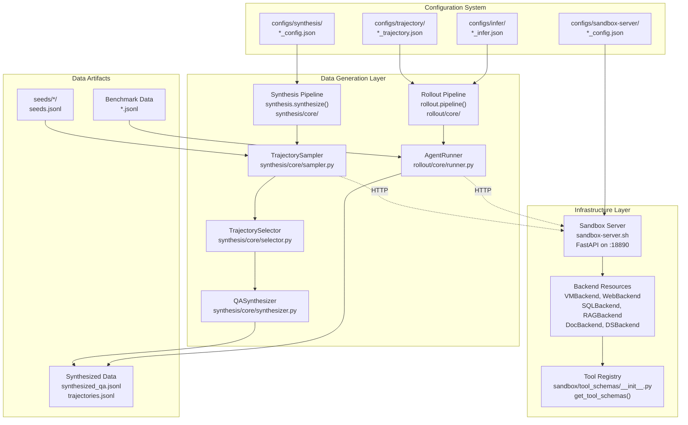
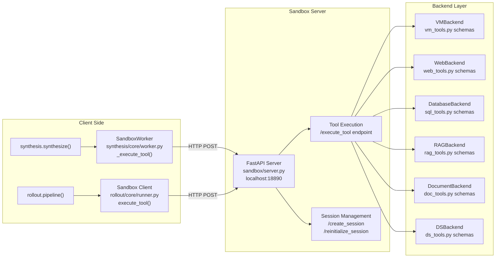
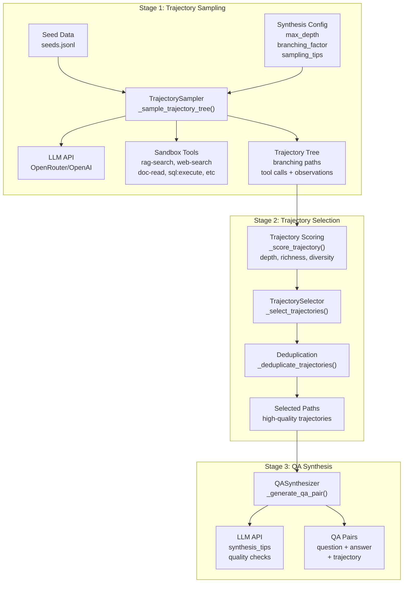
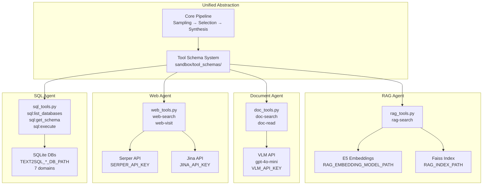
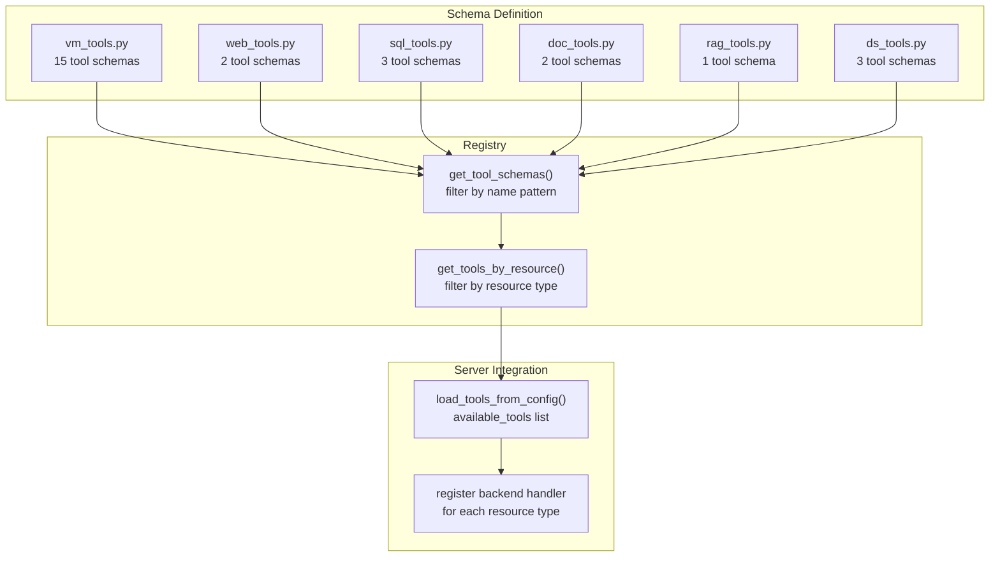
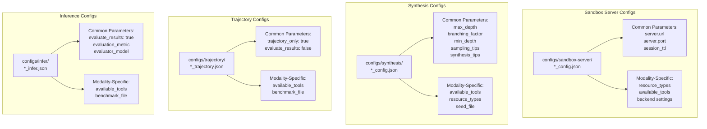
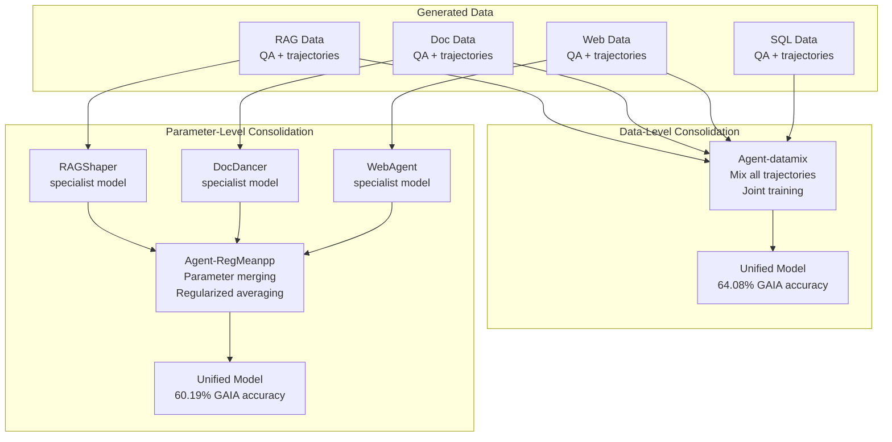

<!-- source: DeepWiki mcp.deepwiki.com · repo OpenDCAI/AgentFlow · page 2 Core Concepts · fetched 2026-11-02 -->

# Core Concepts

<details>
<summary>Relevant source files</summary>

The following files were used as context for generating this wiki page:

- [README.md](README.md)
- [README_zh.md](README_zh.md)
- [assets/intro.png](assets/intro.png)
- [assets/method.png](assets/method.png)
- [assets/wechat.jpg](assets/wechat.jpg)
- [assets/wechatshow.png](assets/wechatshow.png)

</details>


This page introduces the fundamental architectural concepts and design patterns that underpin AgentFlow's unified agent data synthesis framework. It provides an overview of the core components, their interactions, and the key abstractions that enable cross-domain agent development.

For detailed information about specific topics:
- The three-stage data generation methodology: see [Three-Stage Data Synthesis Pipeline](#2.1)
- Specific agent implementations and use cases: see [Agent Types and Modalities](#2.2)
- Tool system internals: see [Tool Schemas and Abstraction Layer](#2.3)
- Model training strategies: see [Agentic Model Consolidation](#2.4)

## System Architecture Overview

AgentFlow is built on a modular architecture that separates infrastructure concerns (tool execution environment) from data generation logic (synthesis and rollout pipelines) and model development (training and evaluation).



**Sources:** [README.md:44-103](), [configs/](https://github.com/OpenDCAI/AgentFlow/tree/main/configs)

## Core Component Interactions

The following diagram shows how the key classes and modules interact during data generation:



**Sources:** [synthesis/core/sampler.py](), [rollout/core/runner.py](), [sandbox/tool_schemas/]()

## The Three-Stage Pipeline

AgentFlow generates high-quality agent training data through a three-stage process:



**Sources:** [README.md:77-84](), [synthesis/core/sampler.py](), [synthesis/core/selector.py](), [synthesis/core/synthesizer.py]()

The pipeline is modality-agnostic and operates consistently across all agent types. Stage 1 builds a branching trajectory tree through LLM-driven exploration with concurrent expansion and action deduplication. Stage 2 filters trajectories based on scoring criteria. Stage 3 generates multi-hop QA pairs grounded in the collected observations.

For implementation details, see [Three-Stage Data Synthesis Pipeline](#2.1).

## Agent Types and Tool Ecosystems

AgentFlow supports seven distinct agent modalities, each defined by its available tool set:

| Agent Type | Tools | Backend Implementation | Configuration |
|------------|-------|------------------------|---------------|
| RAG | `rag-search` | `RAGBackend` (E5 + Faiss) | `configs/sandbox-server/rag_config.json` |
| MM-Doc | `doc-search`, `doc-read` | `DocumentBackend` (VLM + PDF) | `configs/sandbox-server/doc_config.json` |
| Web Research | `web-search`, `web-visit` | `WebBackend` (Serper + Jina APIs) | `configs/sandbox-server/web_config.json` |
| GUI | `vm-screenshot`, `vm-click`, `vm-type`, etc (15 tools) | `VMBackend` (Docker VM) | `configs/sandbox-server/vm_config.json` |
| Text2SQL | `sql:list_databases`, `sql:get_schema`, `sql:execute` | `DatabaseBackend` (SQLite) | `configs/sandbox-server/text2sql_config.json` |
| Data Science | `ds_inspect_data`, `ds_read_csv`, `ds_run_python` | `DSBackend` (Python sandbox) | `configs/sandbox-server/ds_config.json` |
| Embodied | Custom robotic control tools | Custom backend | Custom configuration |



**Sources:** [README.md:15-38](), [sandbox/tool_schemas/](), [configs/sandbox-server/]()

Each agent type uses the same core pipeline but with different `available_tools` and `resource_types` configurations. For detailed descriptions of each agent type and their use cases, see [Agent Types and Modalities](#2.2).

## Tool Schema System

The tool schema system provides a unified abstraction for defining and executing tools across heterogeneous environments:



**Sources:** [sandbox/tool_schemas/__init__.py](), [sandbox/tool_schemas/*.py]()

Tool schemas are defined as JSON dictionaries with `name`, `description`, and `parameters` fields. The registry supports filtering by name patterns (e.g., `"vm-*"`) and resource types (e.g., `"vm"`, `"web"`, `"sql"`). This enables the same pipeline to work across all agent types by simply changing configuration.

For complete tool schema reference, see [Tool Schemas Reference](#3.3).

## Configuration Hierarchy

AgentFlow uses a hierarchical configuration system organized by operational stage:



**Sources:** [README.md:107-112](), [configs/sandbox-server/](), [configs/synthesis/](), [configs/trajectory/](), [configs/infer/]()

Configuration files use environment variable substitution with `${VAR_NAME}` syntax to centralize credentials and machine-specific paths. Within each category, configurations share common parameters while allowing modality-specific customization.

For complete configuration reference, see [Configuration Reference](#8).

## Agentic Model Consolidation

AgentFlow explores two strategies for training unified multi-domain models:



**Sources:** [README.md:32-35](), [README.md:202-206]()

**Data-level consolidation** (Agent-datamix) mixes trajectories from all domains during training, forcing a single model to learn diverse behaviors. **Parameter-level consolidation** (Agent-RegMeanpp) first trains specialist models on individual domains, then merges their parameters using regularized averaging.

Benchmark results show data-level mixing outperforms parameter-level merging (64.08% vs 60.19% on GAIA), indicating joint training on mixed trajectories is more effective for multi-domain capability.

For training strategies and deployment, see [Agentic Model Consolidation](#2.4) and [Model Training and Deployment](#10).

## Data Flow Through the System

The complete end-to-end data flow:

```mermaid
graph LR
    subgraph "Input"
        Seeds["seeds.jsonl"]
        Benchmarks["benchmark.jsonl"]
    end
    
    subgraph "Synthesis Mode"
        SynthConfig["synthesis/*_config.json"]
        SynthFunc["synthesis.synthesize()"]
        SynthOutput["synthesized_qa.jsonl<br/>trajectories.jsonl"]
    end
    
    subgraph "Rollout Mode"
        TrajConfig["trajectory/*_trajectory.json"]
        RolloutFunc["rollout.pipeline()<br/>trajectory_only=true"]
        TrajOutput["trajectory results<br/>trajectories.jsonl"]
    end
    
    subgraph "Training"
        CombineData["Combine datasets"]
        Training["Model Training"]
        Model["Trained Model"]
    end
    
    subgraph "Inference Mode"
        InferConfig["infer/*_infer.json"]
        InferFunc["rollout.pipeline()<br/>evaluate_results=true"]
        vLLM["vLLM Server :8222<br/>--enable-auto-tool-choice"]
        Results["Evaluation Results<br/>Metrics"]
    end
    
    Seeds --> SynthConfig
    SynthConfig --> SynthFunc
    SynthFunc --> SynthOutput
    
    Benchmarks --> TrajConfig
    TrajConfig --> RolloutFunc
    RolloutFunc --> TrajOutput
    
    SynthOutput --> CombineData
    TrajOutput --> CombineData
    CombineData --> Training
    Training --> Model
    
    Model --> vLLM
    Benchmarks --> InferConfig
    InferConfig --> InferFunc
    vLLM --> InferFunc
    InferFunc --> Results
```

**Sources:** [README.md:69-103](), [synthesis/](), [rollout/]()

The same `rollout.pipeline()` function operates in two modes: trajectory generation (step 3, `trajectory_only=true`) and inference (step 6, `evaluate_results=true`), distinguished only by configuration. The sandbox server acts as a persistent service supporting all data generation and inference stages.

---

