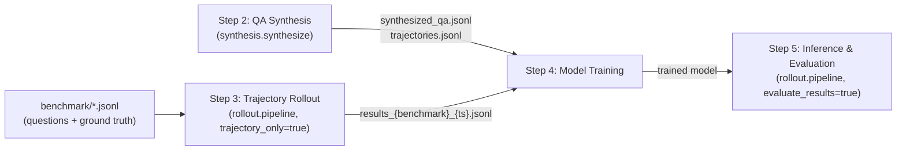
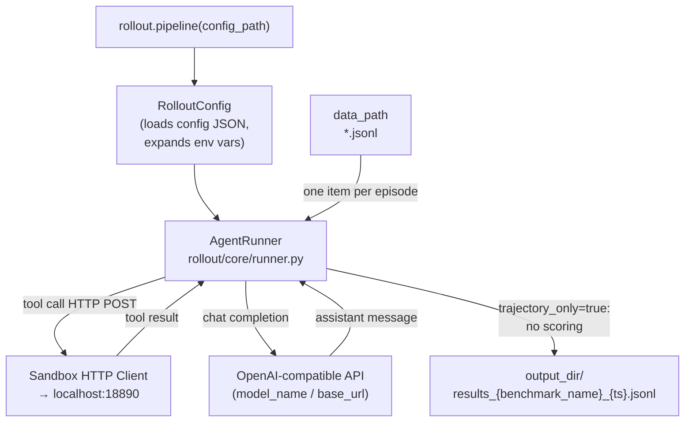
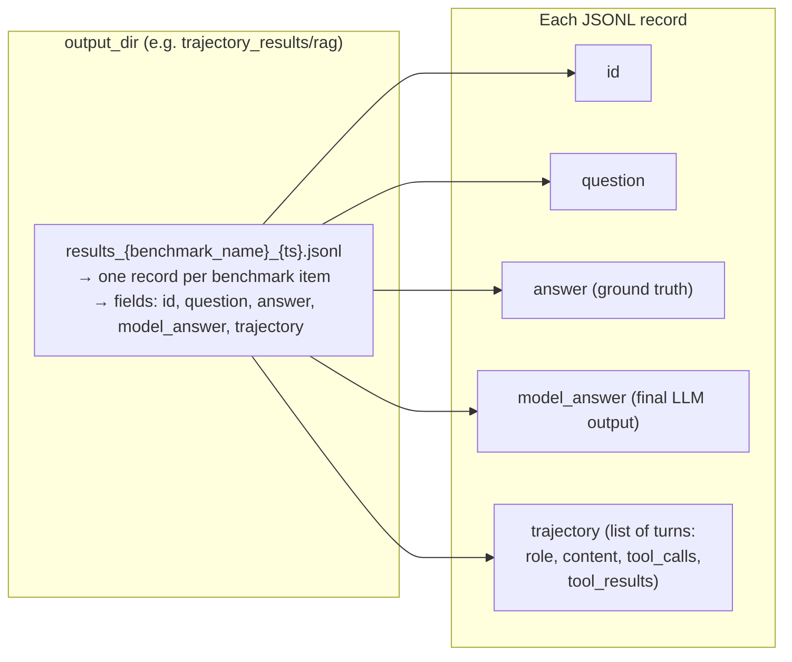
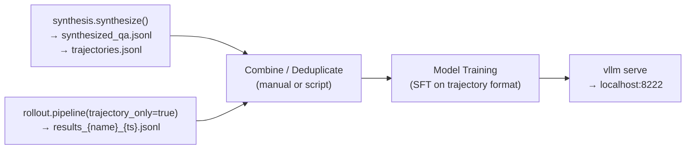

<!-- source: DeepWiki mcp.deepwiki.com · repo OpenDCAI/AgentFlow · page 5.1 Trajectory Rollout · fetched 2026-11-02 -->

# Trajectory Rollout

<details>
<summary>Relevant source files</summary>

The following files were used as context for generating this wiki page:

- [configs/infer/doc_infer.json](configs/infer/doc_infer.json)
- [configs/infer/rag_infer.json](configs/infer/rag_infer.json)
- [configs/synthesis/text2sql_config.json](configs/synthesis/text2sql_config.json)
- [configs/trajectory/doc_trajectory.json](configs/trajectory/doc_trajectory.json)
- [configs/trajectory/rag_trajectory.json](configs/trajectory/rag_trajectory.json)
- [examples/RAGAgent.md](examples/RAGAgent.md)
- [seeds/rag/seeds.jsonl](seeds/rag/seeds.jsonl)

</details>


This page explains how to run the trajectory rollout pipeline to generate agent training trajectories from benchmark data. Trajectory rollout uses a capable teacher LLM to execute multi-turn tool-use episodes against known benchmark questions. The resulting conversation logs become supervised training data for fine-tuning.

**Scope:** This page covers only the trajectory generation mode of `rollout.pipeline` (i.e., configurations with `trajectory_only: true` and `evaluate_results: false`). For running a trained model against benchmarks to measure accuracy, see [Model Inference](#5.2). For generating QA pairs and trajectories from seed topics via tree sampling, see [Data Synthesis Pipeline](#4).

---

## Role in the Overall Pipeline

Trajectory rollout is Step 3 in the full AgentFlow workflow. It bridges data synthesis and model training:

**Diagram: Trajectory Rollout in the AgentFlow Workflow**



Sources: [examples/RAGAgent.md:111-148]()

Both synthesis and trajectory rollout contribute training data, but they differ in origin: synthesis data comes from free exploration over seed topics, while rollout data comes from executing the agent against structured benchmark questions with known answers.

---

## Prerequisites

Before running trajectory rollout:

1. **Sandbox server must be running** with the appropriate resource configuration. See [Sandbox Server](#3) for startup instructions.
2. **Benchmark data file** must be present at the path specified in `data_path`.
3. **API credentials** must be set, either directly in the config or via environment variables (see [Environment Variables](#8.5)).

**Benchmark data format** (`benchmark/rag_benchmark.jsonl`):

```jsonl
{"id": "task_001", "question": "What is the capital of France?", "answer": "Paris"}
{"id": "task_002", "question": "Who wrote 'Romeo and Juliet'?", "answer": "William Shakespeare"}
```

Each record requires at minimum `id`, `question`, and `answer` fields. The `answer` field is not used for scoring during trajectory rollout (evaluation is disabled), but it is stored in the output for later use.

Sources: [examples/RAGAgent.md:327-341]()

---

## Running Trajectory Rollout

### Python API

```python
from rollout import pipeline

pipeline(config_path="configs/trajectory/rag_trajectory.json")
```

### CLI

```bash
python -m rollout.pipeline \
    --config configs/trajectory/rag_trajectory.json \
    --output-dir trajectory_results/rag
```

The same `rollout.pipeline` entry point is used for both trajectory generation and model inference. The mode is determined entirely by configuration flags.

Sources: [examples/RAGAgent.md:293-306]()

---

## Configuration

Trajectory rollout configs live in `configs/trajectory/`. The two defining flags that distinguish this mode from inference are:

| Flag | Trajectory Rollout | Inference |
|---|---|---|
| `trajectory_only` | `true` | absent / `false` |
| `evaluate_results` | `false` | `true` |
| `save_summary` | `false` | `true` |
| Typical model | Teacher LLM (e.g., `gpt-4.1`) | Trained model via vLLM |
| Config directory | `configs/trajectory/` | `configs/infer/` |
| Output directory | `trajectory_results/` | `infer_results/` |

### Full Parameter Reference (RolloutConfig)

| Parameter | Type | Example | Description |
|---|---|---|---|
| `benchmark_name` | `str` | `"rag_trajectory"` | Run identifier, used in output filenames |
| `model_name` | `str` | `"gpt-4.1-2025-04-14"` | LLM used to generate trajectories |
| `api_key` | `str` | `"${OPENROUTER_API_KEY}"` | API key (supports env var substitution) |
| `base_url` | `str` | `"https://openrouter.ai/api/v1"` | API base URL |
| `max_turns` | `int` | `50` | Maximum conversation turns per episode |
| `max_retries` | `int` | `3` | Maximum LLM call retries on failure |
| `max_workers` | `int` | `1` | Parallel worker count |
| `available_tools` | `list[str]` | `["rag_search"]` | Tools exposed to the agent |
| `system_prompt` | `list[str]` | `[...]` | System prompt lines (joined with newlines) |
| `evaluate_results` | `bool` | `false` | Must be `false` for trajectory mode |
| `trajectory_only` | `bool` | `true` | Must be `true` for trajectory mode |
| `sandbox_server_url` | `str` | `"http://127.0.0.1:18890"` | Sandbox server address |
| `sandbox_timeout` | `int` | `120` | Sandbox call timeout in seconds |
| `data_path` | `str` | `"benchmark/rag_benchmark.jsonl"` | Input benchmark file |
| `output_dir` | `str` | `"trajectory_results/rag"` | Output directory |
| `save_results` | `bool` | `true` | Write result records to JSONL |
| `save_trajectories` | `bool` | `true` | Include full conversation turns in output |
| `save_summary` | `bool` | `false` | Suppress summary file (not needed for training) |
| `parallel` | `bool` | `false` | Enable parallel episode execution |

Sources: [configs/trajectory/rag_trajectory.json:1-39](), [configs/trajectory/doc_trajectory.json:1-28](), [examples/RAGAgent.md:430-450]()

### Example: RAG Trajectory Config

The complete `configs/trajectory/rag_trajectory.json`:

[configs/trajectory/rag_trajectory.json:1-39]()

### Example: Document Trajectory Config

The `configs/trajectory/doc_trajectory.json` is structured identically but uses `doc_search` and `doc_read` tools and a `max_turns` of `40`:

[configs/trajectory/doc_trajectory.json:1-28]()

---

## Internal Execution Model

**Diagram: rollout.pipeline Execution — Code Entities**



For each item in `data_path`, `AgentRunner` runs a multi-turn episode:
1. The question is sent to the LLM with the system prompt and tool schemas attached.
2. The LLM responds with either a tool call or a final answer.
3. If a tool call, the sandbox server executes it and returns the result.
4. Steps 2–3 repeat until the LLM produces a final answer or `max_turns` is reached.
5. The full conversation (question → tool calls → observations → final answer) is written to the output file.

Because `evaluate_results` is `false`, no scoring is performed. The stored trajectory serves as a demonstration for supervised fine-tuning.

Sources: [examples/RAGAgent.md:287-341](), [configs/trajectory/rag_trajectory.json:1-39]()

---

## Output Format

Output is written to `output_dir/results_{benchmark_name}_{timestamp}.jsonl`. With `save_trajectories: true`, each line contains the full episode record including all conversation turns (the trajectory).

**Diagram: Output File Naming and Content**



Note: `save_summary: false` is set in trajectory configs to suppress the summary JSON file (which is used only during evaluation).

Sources: [configs/trajectory/rag_trajectory.json:33-38](), [examples/RAGAgent.md:336-341]()

---

## Tool Configuration per Agent Type

The `available_tools` list in the config determines which tools the agent can call. The sandbox server must be started with a matching backend config that enables those tools.

| Agent Type | `available_tools` | Sandbox Config |
|---|---|---|
| RAG | `["rag_search"]` | `configs/sandbox-server/rag_config.json` |
| Document | `["doc_search", "doc_read"]` | `configs/sandbox-server/doc_config.json` |
| Web | `["web_search", "web_visit"]` | `configs/sandbox-server/web_config.json` |
| Text2SQL | `["sql:list_databases", "sql:get_schema", "sql:execute"]` | `configs/sandbox-server/text2sql_config.json` |
| Data Science | `["ds_inspect_data", "ds_read_csv", "ds_run_python"]` | `configs/sandbox-server/ds_config.json` |
| GUI | `["vm_screenshot", "vm_click", "vm_type", ...]` | `configs/sandbox-server/vm_config.json` |

Tool name variants (e.g., `rag_search`, `rag-search`, `rag:search`) are all accepted; the sandbox normalizes them to the canonical backend form.

Sources: [configs/trajectory/rag_trajectory.json:11](), [configs/trajectory/doc_trajectory.json:10](), [examples/RAGAgent.md:30-34]()

---

## Relationship to the Full Training Data Pipeline

Trajectory rollout output is combined with synthesis output before training:

**Diagram: Data Flow into Model Training**



The synthesis pipeline (section 4) generates trajectories through tree-based exploration from seed topics. The trajectory rollout generates demonstrations from structured benchmark questions with known ground truth. Together they provide broader coverage for training.

For the next step (running the trained model), see [Model Inference](#5.2).

Sources: [examples/RAGAgent.md:111-148](), [examples/RAGAgent.md:344-358]()

---

