# Page: Overview

# Overview

<details>
<summary>Relevant source files</summary>

The following files were used as context for generating this wiki page:

- [README.md](README.md)
- [README_zh.md](README_zh.md)
- [assets/intro.png](assets/intro.png)
- [assets/method.png](assets/method.png)
- [assets/wechat.jpg](assets/wechat.jpg)
- [assets/wechatshow.png](assets/wechatshow.png)

</details>


AgentFlow is a unified framework for synthesizing high-quality training and evaluation data for AI agents across heterogeneous environments. This document provides an overview of the framework's architecture, core components, and operational workflow.

**Scope**: This page covers the high-level architecture and key concepts of the AgentFlow system. For detailed setup instructions, see [Installation and Setup](#1.1). For a complete working example, see [Quick Start Tutorial](#1.2). For in-depth explanations of individual subsystems, refer to [Core Concepts](#2), [Sandbox Server](#3), and [Data Synthesis Pipeline](#4).

**Sources**: [README.md:18-46]()

## What is AgentFlow?

AgentFlow is the first unified agent data synthesis framework that generates training data and trajectories for AI agents operating in diverse environments. Unlike traditional approaches that require separate infrastructure for each agent type, AgentFlow provides a single, extensible platform that supports:

- 📚 **RAG Agents** - Retrieval-augmented generation with vector search
- 🖼️ **MM-Doc Agents** - Multimodal document understanding with VLMs
- 🔍 **Deep Research Agents** - Web search and browsing
- 🖱️ **GUI Agents** - Desktop automation via VM interaction
- 🟰 **Text2SQL Agents** - Natural language to SQL query conversion
- 📊 **Data Analysis Agents** - Python-based data science workflows
- 🤖 **Embodied Agents** - Physical environment interaction

The framework enables developers to synthesize agent training data with just a few lines of code, abstracting away the complexity of managing different execution environments, tool schemas, and data generation pipelines.

**Sources**: [README.md:20-46]()

## Key Features

### Unified Data Synthesis Paradigm

AgentFlow implements a **three-stage pipeline** that works consistently across all agent types:

1. **Trajectory Sampling**: An LLM-driven agent explores a sandbox environment starting from seed inputs, building a branching trajectory tree through iterative tool execution
2. **Trajectory Selection**: Trajectories are scored by depth, information richness, and tool diversity, then filtered to select high-quality paths
3. **QA Synthesis**: For each selected trajectory, multi-hop question-answer pairs are generated with built-in quality validation

This pipeline is implemented in the `synthesis` module and can be invoked via `synthesis.synthesize()` for the complete workflow.

**Sources**: [README.md:71-84]()

### All-in-One Sandbox Architecture

The sandbox server (launched via `sandbox-server.sh`) provides a unified execution environment that abstracts tool invocation across different backends:

- **Port**: `18890` (default)
- **Protocol**: HTTP/REST API
- **Session Management**: Stateful sessions for VM, database, and document resources
- **Tool Registry**: Centralized schema definitions in `sandbox/tool_schemas/`

Each agent type uses the same sandbox server with different tool configurations, enabling code reuse and consistent interfaces.

**Sources**: [README.md:55-59](), [README.md:107-112]()

### Agentic Model Consolidation

AgentFlow explores two strategies for building unified multi-domain models:

1. **Data-level consolidation** (`Agent-datamix`): Mix trajectories from all domains during joint training
2. **Parameter-level consolidation** (`Agent-RegMeanpp`): Train specialist models separately, then merge parameters using regularized averaging

According to benchmark results, data-level consolidation outperforms parameter-level merging (64.08% vs 60.19% on GAIA validation set).

**Sources**: [README.md:60-63](), [README.md:200-206]()

## System Architecture

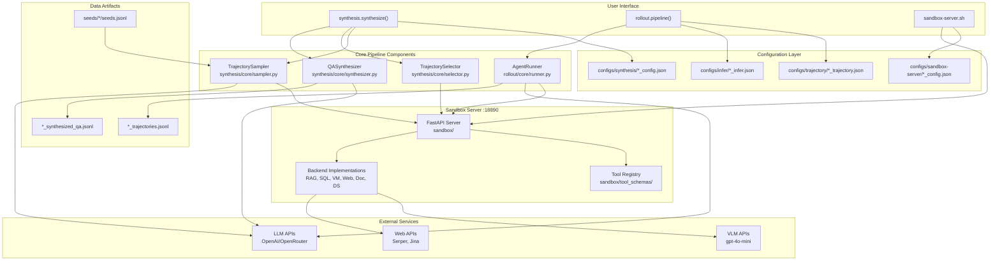

**AgentFlow System Architecture**: This diagram shows the complete system architecture with actual code entities. The framework is organized into four layers: user-facing APIs, configuration files, core pipeline components, and the sandbox execution environment. All agent types interact with the same infrastructure, differing only in their configuration and tool selection.

**Sources**: [README.md:103-159](), High-level diagrams provided

## Configuration-Driven Design

AgentFlow uses a strict separation of configuration by operational purpose:

| Purpose | Directory | Example File | Used By |
|---------|-----------|--------------|---------|
| Sandbox Server Setup | `configs/sandbox-server/` | `web_config.json` | `sandbox-server.sh` |
| QA Synthesis | `configs/synthesis/` | `rag_config.json` | `synthesis.synthesize()` |
| Trajectory Generation | `configs/trajectory/` | `doc_trajectory.json` | `rollout.pipeline()` |
| Model Inference | `configs/infer/` | `web_infer.json` | `rollout.pipeline()` |

Within each category, configurations share common parameter semantics while allowing modality-specific customization. For example, all synthesis configs include `max_depth`, `branching_factor`, and `sampling_tips` parameters, but differ in their `available_tools` and `resource_types` settings.

Environment variables (e.g., `OPENAI_API_KEY`, `RAG_EMBEDDING_MODEL_PATH`) are used for credentials and machine-specific paths, referenced in configs using `${VAR_NAME}` syntax.

**Sources**: [README.md:151-159](), Configuration system diagram from high-level overview

## End-to-End Workflow

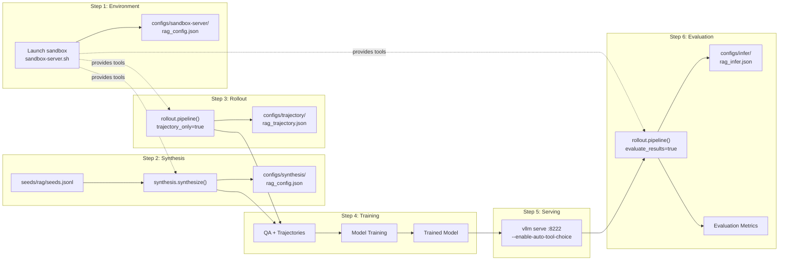

**Complete Workflow Pipeline**: This diagram shows the six-step process from environment setup to evaluation, with actual command-line tools and functions. The `rollout.pipeline()` function operates in two modes (trajectory generation vs. inference) distinguished only by configuration parameters.

**Sources**: [README.md:103-149](), End-to-end workflow diagram from high-level overview

## Tool Schema and Backend System

AgentFlow's modularity comes from its tool schema abstraction layer. Each agent type defines:

1. **Tool Schemas**: JSON specifications in `sandbox/tool_schemas/` defining tool names, descriptions, and parameters
2. **Backend Implementation**: Resource handlers that execute tool calls (e.g., `RAGBackend`, `VMBackend`, `DatabaseBackend`)
3. **Configuration**: Sandbox server configs specifying which tools to expose and their initialization parameters

The `get_tool_schemas()` and `get_tools_by_resource()` functions in `sandbox/tool_schemas/__init__.py` provide the registry interface. Tools are exposed via FastAPI endpoints at `http://localhost:18890`.

**Sources**: High-level tool schema diagram, [README.md:27-30]()

## Code Entry Points

The primary entry points for using AgentFlow are:

### Data Synthesis
```python
from synthesis import synthesize
synthesize(config_path="configs/synthesis/web_config.json")
```

This function orchestrates the three-stage pipeline: sampling trajectories via `TrajectorySampler`, selecting high-quality paths via `TrajectorySelector`, and generating QA pairs via `QASynthesizer`.

### Trajectory Rollout
```python
from rollout import pipeline
pipeline(config_path="configs/trajectory/web_trajectory.json")
```

When `trajectory_only=true` in config, this generates trajectories on benchmark data. The `AgentRunner` class in `rollout/core/runner.py` handles multi-turn agent execution.

### Model Inference
```python
from rollout import pipeline
pipeline(config_path="configs/infer/web_infer.json")
```

When `evaluate_results=true` in config, this runs inference with LLM-as-judge evaluation using the metrics specified in the configuration.

**Sources**: [README.md:115-149]()

## Data Outputs

AgentFlow produces several categories of data artifacts:

1. **Synthesized QA Pairs**: JSON Lines files containing question-answer pairs with grounding trajectories
2. **Agent Trajectories**: Complete execution traces including tool calls, observations, and reasoning steps
3. **Training Datasets**: Combined QA and trajectory data formatted for model training
4. **Benchmarks**: Human-annotated evaluation sets like BrowseComp-V3 and MMLongBench-Doc

These outputs enable both training new agent models and evaluating their capabilities across diverse tasks.

**Sources**: [README.md:161-197]()

## Model Family

The AgentFlow project has produced several pre-trained models demonstrating the framework's effectiveness:

| Agent Type | Model | Performance Highlights |
|------------|-------|----------------------|
| RAG | RAGShaper 6.5k | 50.3% EM / 62.0% F1 (avg across benchmarks) |
| MM-Doc | DocDancer (Qwen3-30B) | 54.4% acc on MMLongBench-Doc |
| Deep Research | DeepResearch Agent | 64.08% acc on GAIA |
| Multi-domain | Agent-datamix | Best overall consolidation (64.08% GAIA) |
| Multi-domain | Agent-RegMeanpp | Parameter merging baseline (60.19% GAIA) |

All models are available on HuggingFace under the OpenDCAI organization.

**Sources**: [README.md:161-181](), [README.md:200-267]()

## Next Steps

- For installation instructions, see [Installation and Setup](#1.1)
- For a hands-on walkthrough, see [Quick Start Tutorial](#1.2)
- To understand the core methodology, see [Three-Stage Data Synthesis Pipeline](#2.1)
- To learn about individual agent types, see [Agent Types and Modalities](#2.2)
- For detailed configuration reference, see [Configuration Reference](#8)

---

# Page: Installation and Setup

# Installation and Setup

<details>
<summary>Relevant source files</summary>

The following files were used as context for generating this wiki page:

- [.gitignore](.gitignore)
- [install.sh](install.sh)
- [requirements.txt](requirements.txt)

</details>


This page guides you through installing AgentFlow and its dependencies, configuring the development environment, and verifying the installation. It covers both automated and manual installation methods, dependency management, and environment variable configuration.

For information about running your first workflow after installation, see [Quick Start Tutorial](#1.2). For details on configuring the sandbox server after installation, see [Server Configuration](#3.1).

---

## Prerequisites

AgentFlow requires Python 3.8 or higher and pip for package management. The framework has been tested on Linux and macOS systems.

**Required System Components:**
- Python 3.8+ (with pip)
- Git (for cloning the repository)
- Sufficient disk space for model files and databases (~10GB recommended)
- Network access for API calls and package downloads

**Optional System Components:**
- Docker (required only for GUI agent with VM backend)
- CUDA-compatible GPU (optional, for local model inference)

**Verify Python Installation:**
```bash
python3 --version  # Should show 3.8 or higher
python3 -m pip --version
```

**Sources:** [install.sh:9-28]()

---

## Installation Methods

### Method 1: Automated Installation Script

The `install.sh` script provides one-click installation with support for optional dependency groups.

#### Installation Flow Diagram

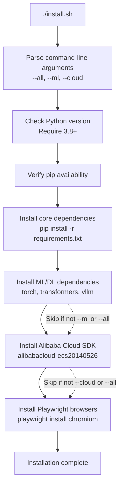

**Sources:** [install.sh:1-111]()

#### Basic Installation (Core Dependencies Only)

```bash
git clone https://github.com/OpenDCAI/AgentFlow.git
cd AgentFlow
./install.sh
```

This installs all core dependencies from [requirements.txt:1-78]() including:
- FastAPI and Pydantic for server components
- OpenAI SDK for LLM API access
- Playwright for web automation
- Document processing libraries (PyPDF2, pdfplumber, etc.)
- Evaluation metrics libraries (pandas, scipy, etc.)

**Sources:** [install.sh:70-74]()

#### Install with ML/DL Dependencies

For local model inference or training:

```bash
./install.sh --ml
```

This additionally installs:
- `torch>=2.6.0`
- `transformers>=4.51.1`
- `accelerate>=1.5.1`
- `torchvision`
- `vllm>=0.10.0` (commented in requirements.txt, installed by script)

**Sources:** [install.sh:76-85](), [requirements.txt:68-73]()

#### Install All Dependencies

```bash
./install.sh --all
```

This installs core, ML/DL, and Alibaba Cloud dependencies.

**Sources:** [install.sh:51-53]()

### Method 2: Manual Installation

If you prefer manual control or need to customize the installation:

```bash
# 1. Clone repository
git clone https://github.com/OpenDCAI/AgentFlow.git
cd AgentFlow

# 2. Create virtual environment (recommended)
python3 -m venv venv
source venv/bin/activate  # On Windows: venv\Scripts\activate

# 3. Install core dependencies
pip install -r requirements.txt

# 4. (Optional) Install ML/DL dependencies
pip install "torch>=2.6.0" "transformers>=4.51.1" "accelerate>=1.5.1" torchvision

# 5. Install Playwright browsers
playwright install chromium
```

**Sources:** [install.sh:73](), [requirements.txt:1-78]()

---

## Dependency Categories

The following table maps dependency groups to their purposes and corresponding agent types:

| Category | Key Packages | Required For | requirements.txt Lines |
|----------|-------------|--------------|----------------------|
| **Core** | `requests`, `fastapi`, `pydantic`, `openai`, `httpx` | All components | [requirements.txt:6-18]() |
| **Sandbox & Desktop** | `playwright`, `PyAutoGUI`, `docker`, `opencv-python` | GUI Agent, Web Agent | [requirements.txt:21-33]() |
| **Document Processing** | `pypdf`, `PyPDF2`, `pdfplumber`, `PyMuPDF`, `python-docx` | Document Agent | [requirements.txt:36-49]() |
| **Evaluation** | `pandas`, `scipy`, `rapidfuzz`, `imagehash` | All agents (metrics) | [requirements.txt:52-61]() |
| **ML/DL (Optional)** | `torch`, `transformers`, `vllm`, `accelerate` | Model training/inference | [requirements.txt:68-73]() |
| **Cloud (Optional)** | `alibabacloud-ecs20140526` | Alibaba Cloud deployments | [requirements.txt:63-66]() |

### Dependency Resolution Diagram

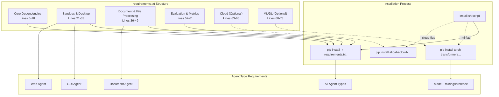

**Sources:** [requirements.txt:1-78](), [install.sh:70-96]()

---

## Environment Configuration

AgentFlow uses environment variables for API keys, model paths, and database locations. These variables are referenced in configuration files using `${VARIABLE_NAME}` syntax.

### Required Environment Variables

Create a `.env` file in the project root (this file is gitignored per [.gitignore:43-46]()):

```bash
# LLM API Keys
OPENAI_API_KEY=sk-...
OPENROUTER_API_KEY=sk-...

# Web Search APIs (for Web Agent)
SERPER_API_KEY=...
JINA_API_KEY=...

# Vision Language Model API (for Document Agent)
VLM_API_KEY=...
```

### Optional Environment Variables

```bash
# RAG Agent - Embedding Model and Index Paths
RAG_EMBEDDING_MODEL_PATH=/path/to/embedding_model
RAG_INDEX_PATH=/path/to/faiss_index

# Text2SQL Agent - Database Paths
TEXT2SQL_FINANCE_DB_PATH=/path/to/finance.db
TEXT2SQL_RETAIL_DB_PATH=/path/to/retail.db
TEXT2SQL_HEALTHCARE_DB_PATH=/path/to/healthcare.db
TEXT2SQL_EDUCATION_DB_PATH=/path/to/education.db
TEXT2SQL_ECOMMERCE_DB_PATH=/path/to/ecommerce.db
TEXT2SQL_SPORTS_DB_PATH=/path/to/sports.db
TEXT2SQL_ENTERTAINMENT_DB_PATH=/path/to/entertainment.db

# vLLM Server Configuration (for model deployment)
VLLM_API_BASE=http://localhost:8222/v1
VLLM_API_KEY=EMPTY
```

### Environment Variable to Configuration Mapping

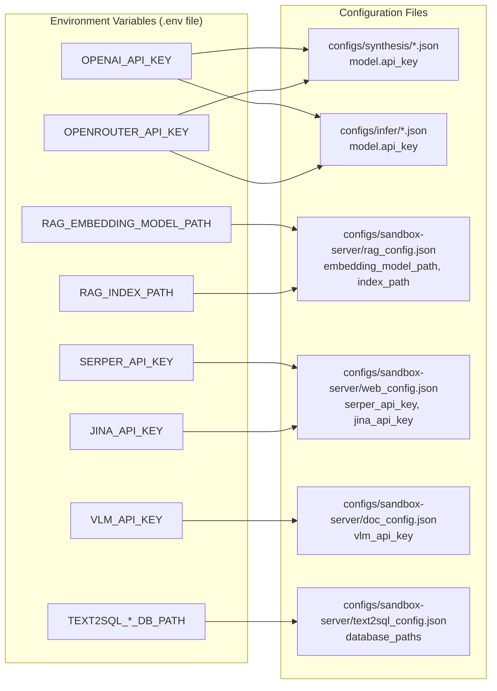

**Sources:** Configuration schema references from Diagram 4 in high-level system architecture

### Loading Environment Variables

AgentFlow automatically loads `.env` files using the `python-dotenv` package ([requirements.txt:17]()):

```python
# Automatically loaded by configuration modules
from dotenv import load_dotenv
load_dotenv()
```

Configuration files reference these variables using placeholder syntax:
```json
{
  "model": {
    "api_key": "${OPENAI_API_KEY}"
  }
}
```

**Sources:** [requirements.txt:17](), [.gitignore:43-46]()

---

## Agent-Specific Setup Requirements

Different agent types require additional setup beyond core installation:

### RAG Agent

**Additional Requirements:**
- Embedding model (e.g., `intfloat/e5-base-v2`)
- Faiss index for vector search
- Knowledge base documents

**Setup:**
```bash
# Download embedding model
mkdir -p embeddingmodel  # This directory is gitignored
# Place your embedding model files here

# Set environment variables
export RAG_EMBEDDING_MODEL_PATH=/path/to/embeddingmodel
export RAG_INDEX_PATH=/path/to/faiss_index
```

**Sources:** [.gitignore:1-2](), RAG Agent documentation from Diagram 3

### Document Agent

**Additional Requirements:**
- Vision Language Model API access (e.g., GPT-4o-mini)
- PDF processing libraries (already in core dependencies)

**Setup:**
```bash
export VLM_API_KEY=your_vlm_api_key
```

**Sources:** [requirements.txt:36-49]()

### Web Agent

**Additional Requirements:**
- Serper API key (for Google search)
- Jina API key (for web scraping)
- Playwright browsers

**Setup:**
```bash
export SERPER_API_KEY=your_serper_key
export JINA_API_KEY=your_jina_key
playwright install chromium  # Already done by install.sh
```

**Sources:** [install.sh:100-101](), [requirements.txt:21]()

### GUI Agent

**Additional Requirements:**
- Docker installed and running
- Ubuntu desktop VM image (Docker container)

**Setup:**
```bash
# Verify Docker is running
docker ps

# The VM image will be pulled automatically when starting the sandbox server
```

**Sources:** [requirements.txt:33](), Diagram 3 GUI Agent section

### Text2SQL Agent

**Additional Requirements:**
- SQLite database files (7 domain-specific databases)

**Setup:**
```bash
# Create sql directory (gitignored)
mkdir -p sql

# Place your .db files in sql/ directory
# Set environment variables for each database
export TEXT2SQL_FINANCE_DB_PATH=./sql/finance.db
export TEXT2SQL_RETAIL_DB_PATH=./sql/retail.db
# ... (additional databases)
```

**Sources:** [.gitignore:92-93]()

### Data Science Agent

**Additional Requirements:**
- Python scientific stack (already in core dependencies)

**Setup:**
No additional setup required. Dependencies include:
- `pandas`
- `numpy`
- `scipy`
- `scikit-image`

**Sources:** [requirements.txt:52-60]()

---

## Post-Installation Verification

### Verify Core Installation

Check that all core packages are installed:

```bash
python3 -c "import fastapi, openai, playwright, pandas; print('Core packages OK')"
```

### Verify Optional ML/DL Installation

If you installed ML dependencies:

```bash
python3 -c "import torch, transformers, accelerate; print(f'PyTorch {torch.__version__}, Transformers {transformers.__version__}')"
```

### Test Sandbox Server Startup

The sandbox server is the core execution environment for all agents. Test basic startup:

```bash
# This command will be covered in detail in section 3.1
python3 -m sandbox.server --help
```

You should see help text describing server options including `--config`, `--port`, and `--host` flags.

### Verify Playwright Installation

```bash
playwright --version
python3 -c "from playwright.sync_api import sync_playwright; print('Playwright OK')"
```

### Directory Structure Verification

After installation, verify the expected directory structure:

```
AgentFlow/
├── configs/               # Configuration files
│   ├── sandbox-server/    # Sandbox server configs
│   ├── synthesis/         # Data synthesis configs
│   ├── trajectory/        # Trajectory rollout configs
│   └── infer/             # Inference configs
├── sandbox/               # Sandbox server implementation
│   ├── tool_schemas/      # Tool schema definitions
│   └── server.py          # FastAPI server
├── synthesis/             # Data synthesis pipeline
├── rollout/               # Trajectory rollout and inference
├── seeds/                 # Seed data for synthesis
├── requirements.txt       # Core dependencies
├── install.sh             # Installation script
└── .env                   # Environment variables (create this)
```

**Sources:** [.gitignore:1-93](), Diagram 2 from high-level system architecture

---

## Common Installation Issues

### Issue: Playwright Browser Installation Fails

**Symptom:**
```
[WARN] Playwright browser install failed
```

**Solution:**
```bash
# Install browsers manually
python3 -m playwright install chromium

# On Linux, you may need system dependencies
python3 -m playwright install-deps chromium
```

**Sources:** [install.sh:100-101]()

### Issue: PyAutoGUI ImportError on Linux

**Symptom:**
```
ImportError: No module named 'Xlib'
```

**Solution:**
```bash
# Install system dependencies
sudo apt-get install python3-xlib  # Ubuntu/Debian
# or
pip install python3-xlib==0.15
```

**Sources:** [requirements.txt:24]()

### Issue: PDF Processing Errors

**Symptom:**
```
ImportError: cannot import name 'Image' from 'PIL'
```

**Solution:**
```bash
# Reinstall Pillow with correct version
pip install --force-reinstall Pillow==10.1.0
```

**Sources:** [requirements.txt:25]()

### Issue: Large Model Files Fill Disk

**Symptom:** Disk space exhausted during model download

**Solution:**
The `.gitignore` file excludes large model files. Store models outside the repository:

```bash
# Model files are automatically gitignored
# Store in a separate location and reference via environment variables
mkdir ~/agentflow-models
export RAG_EMBEDDING_MODEL_PATH=~/agentflow-models/embedding
```

**Sources:** [.gitignore:1-2](), [.gitignore:70-77]()

---

## Installation Verification Checklist

Use this checklist to ensure a complete installation:

- [ ] Python 3.8+ installed and accessible
- [ ] Core dependencies installed (`pip list | grep fastapi`)
- [ ] Playwright browsers installed (`playwright --version`)
- [ ] `.env` file created with required API keys
- [ ] Environment variables loadable (`python -c "from dotenv import load_dotenv; load_dotenv()"`)
- [ ] Agent-specific requirements met (e.g., Docker for GUI agent)
- [ ] No errors when importing core packages
- [ ] Sandbox server help text displays correctly

---

## Next Steps

After completing installation:

1. **Configure the Sandbox Server**: See [Server Configuration](#3.1) for details on setting up the sandbox server for your chosen agent type.

2. **Run the Quick Start Tutorial**: Follow [Quick Start Tutorial](#1.2) for a complete end-to-end example using the Web Agent.

3. **Explore Agent Examples**: Review [Agent Examples](#6) for detailed workflows for each agent type.

4. **Understand Core Concepts**: Read [Core Concepts](#2) to understand the three-stage pipeline and tool abstraction system.

**Sources:** Overall AgentFlow documentation structure from TOC and high-level diagrams

---

# Page: Quick Start Tutorial

# Quick Start Tutorial

<details>
<summary>Relevant source files</summary>

The following files were used as context for generating this wiki page:

- [README.md](README.md)
- [README_zh.md](README_zh.md)
- [assets/intro.png](assets/intro.png)
- [assets/method.png](assets/method.png)
- [assets/wechat.jpg](assets/wechat.jpg)
- [assets/wechatshow.png](assets/wechatshow.png)
- [configs/infer/web_infer.json](configs/infer/web_infer.json)
- [examples/WebAgent.md](examples/WebAgent.md)

</details>


This tutorial provides a complete end-to-end walkthrough of AgentFlow using the **WebAgent (Deep Research)** as an example. You will learn how to synthesize training data, train a model, and run inference on benchmarks.

**Scope**: This guide covers the basic workflow from sandbox setup to model evaluation. For installation instructions, see [Installation and Setup](#1.1). For detailed WebAgent-specific features and advanced configurations, see [Web Agent](#6.3). For comprehensive configuration reference, see [Configuration Reference](#8).

---

## Prerequisites

Before starting this tutorial, ensure you have:

1. **Completed installation** (see [Installation and Setup](#1.1))
2. **API keys** configured as environment variables:
   - `OPENAI_API_KEY` or `OPENROUTER_API_KEY` (for LLM calls)
   - `SERPER_API_KEY` (for web search)
   - `JINA_API_KEY` (for web content extraction)
3. **Python environment** activated with AgentFlow dependencies installed

**Sources:** [README.md:85-101]()

---

## Workflow Overview

The AgentFlow pipeline consists of six sequential steps:

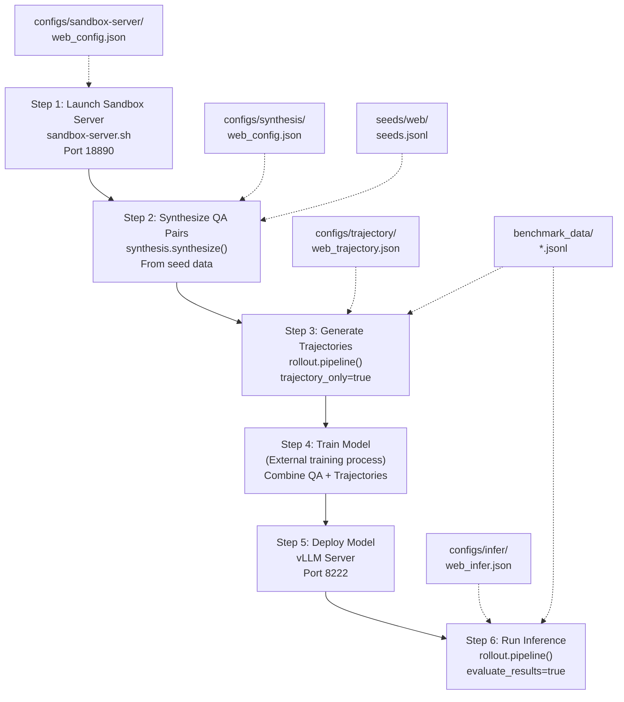

**Sources:** [README.md:103-149](), Diagram 2 from high-level architecture

---

## Step 1: Launch Sandbox Server

The sandbox server provides a unified tool execution environment. For WebAgent, it exposes `web_search` and `web_visit` tools via a FastAPI HTTP server.

### Command

```bash
./sandbox-server.sh \
    --config configs/sandbox-server/web_config.json \
    --port 18890 \
    --host 0.0.0.0
```

### What Happens

1. The script reads [configs/sandbox-server/web_config.json]()
2. Initializes `WebBackend` with Serper and Jina API clients
3. Registers tool schemas from [sandbox/tool_schemas/web_tools.py]()
4. Starts FastAPI server at `http://localhost:18890`

### Configuration Parameters

| Parameter | Description | Example Value |
|-----------|-------------|---------------|
| `server.url` | Base URL for sandbox | `"http://localhost"` |
| `server.port` | Port number | `18890` |
| `session_ttl` | Session timeout (seconds) | `3600` |
| `resource_types` | Enabled resource types | `["web"]` |
| `SERPER_API_KEY` | Web search API key | `"${SERPER_API_KEY}"` |
| `JINA_API_KEY` | Content extraction API key | `"${JINA_API_KEY}"` |

### Verification

Test the server is running:

```bash
curl http://localhost:18890/health
# Expected: {"status": "ok"}
```

**Sources:** [README.md:107-113](), [configs/sandbox-server/](), [sandbox/tool_schemas/web_tools.py]()

---

## Step 2: Synthesize QA Pairs

The synthesis stage generates multi-hop question-answer pairs by having an LLM explore the sandbox environment starting from seed inputs.

### Command

```python
from synthesis import synthesize

synthesize(config_path="configs/synthesis/web_config.json")
```

### What Happens

The `synthesize()` function executes the three-stage pipeline:

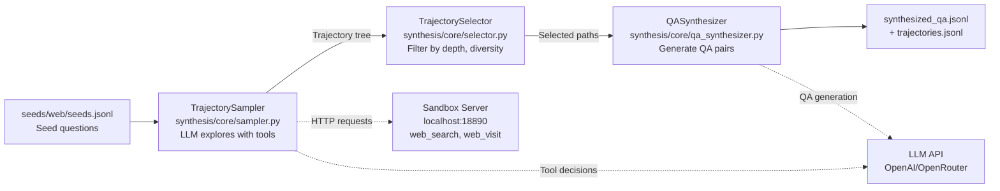

### Key Configuration Parameters

| Parameter | Description | Default Value |
|-----------|-------------|---------------|
| `model_name` | LLM for trajectory sampling | `"gpt-4o-2024-11-20"` |
| `max_depth` | Maximum trajectory depth | `10` |
| `branching_factor` | Exploration branches per step | `3` |
| `min_depth` | Minimum depth for selection | `3` |
| `num_parallel_workers` | Concurrent workers | `5` |
| `output_dir` | Directory for outputs | `"outputs/web_synthesis"` |

### Example Output

**synthesized_qa.jsonl:**
```json
{
  "question": "What year was the company founded that now owns the social media platform where the most-followed sports team posts?",
  "answer": "2004",
  "trajectory": [...],
  "metadata": {...}
}
```

**Sources:** [README.md:77-83](), [README.md:115-121](), [synthesis/core/](), Diagram 5 from high-level architecture

---

## Step 3: Generate Trajectories

The rollout stage executes the agent on benchmark datasets to generate training trajectories without evaluation.

### Command

```python
from rollout import pipeline

pipeline(config_path="configs/trajectory/web_trajectory.json")
```

### What Happens

1. `AgentRunner` from [rollout/core/runner.py]() loads benchmark data
2. For each question, runs multi-turn conversation with tool execution
3. Records complete trajectories (observations, actions, tool calls)
4. Saves to trajectory files without computing metrics

### Configuration Differences from Synthesis

| Parameter | Synthesis Config | Trajectory Config |
|-----------|------------------|-------------------|
| Purpose | Generate new QA pairs | Generate trajectories from existing QA |
| Input | `seeds.jsonl` | Benchmark datasets |
| `trajectory_only` | `false` | `true` |
| `evaluate_results` | N/A | `false` |

### Example Trajectory Structure

```json
{
  "question": "What is the capital of the country where the Eiffel Tower is located?",
  "steps": [
    {
      "thought": "I need to search for information about the Eiffel Tower",
      "tool_name": "web_search",
      "tool_input": {"query": ["Eiffel Tower location"]},
      "observation": "The Eiffel Tower is located in Paris, France..."
    },
    {
      "thought": "Now I know it's in France, I need the capital",
      "tool_name": "web_search", 
      "tool_input": {"query": ["capital of France"]},
      "observation": "Paris is the capital and most populous city of France..."
    }
  ],
  "answer": "Paris"
}
```

**Sources:** [README.md:123-129](), [rollout/core/runner.py](), [configs/trajectory/]()

---

## Step 4: Train and Deploy Model

After generating both QA pairs (Step 2) and trajectories (Step 3), combine them into a training dataset and train your model. AgentFlow does not prescribe a specific training framework.

### Data Preparation

Combine outputs from Steps 2 and 3:

```bash
# Concatenate all synthesized data
cat outputs/web_synthesis/synthesized_qa.jsonl \
    outputs/web_trajectory/trajectories.jsonl \
    > training_data/web_agent_combined.jsonl
```

### Training

Use your preferred training framework (e.g., transformers, DeepSpeed). The key is formatting data to teach tool-use patterns.

### Model Deployment with vLLM

Once trained, deploy the model with tool-calling support:

```bash
vllm serve \
    --model YOUR_TRAINED_MODEL \
    --served-model-name webagent \
    --tensor-parallel-size 8 \
    --enable-auto-tool-choice \
    --tool-call-parser hermes \
    --port 8222
```

### Critical Parameters

| Parameter | Purpose |
|-----------|---------|
| `--enable-auto-tool-choice` | Enables tool calling functionality |
| `--tool-call-parser hermes` | Specifies tool format parser |
| `--port 8222` | Inference endpoint port |

**Sources:** [README.md:131-141]()

---

## Step 5: Run Inference and Evaluation

The final step evaluates your trained model on benchmark datasets using LLM-as-judge.

### Command

```python
from rollout import pipeline

pipeline(config_path="configs/infer/web_infer.json")
```

### Configuration for Inference

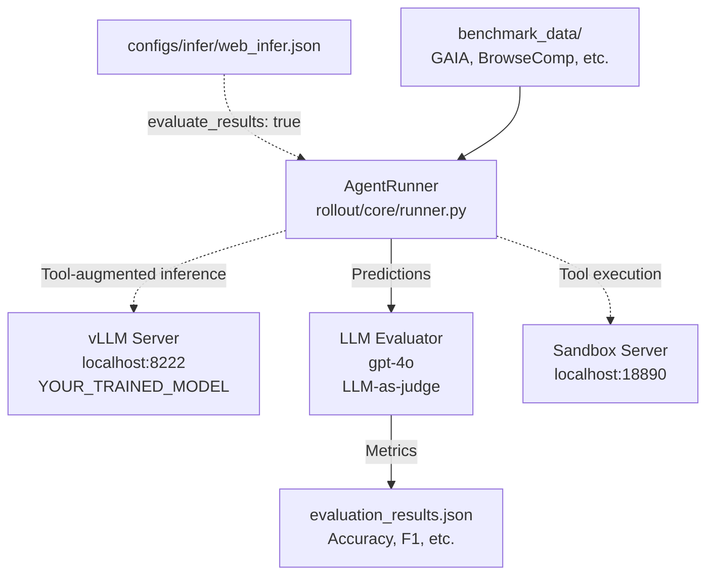

### Key Configuration Parameters

| Parameter | Description | Example Value |
|-----------|-------------|---------------|
| `evaluate_results` | Enable evaluation | `true` |
| `evaluation_metric` | Metric to compute | `"accuracy"` |
| `evaluator_model` | LLM judge model | `"gpt-4o-2024-11-20"` |
| `model_endpoint` | Inference endpoint | `"http://localhost:8222/v1"` |
| `benchmark_path` | Test dataset path | `"benchmark_data/gaia_validation.jsonl"` |

### Example Evaluation Output

```json
{
  "accuracy": 0.6408,
  "num_samples": 165,
  "num_correct": 106,
  "avg_steps": 4.2,
  "per_question_results": [...]
}
```

**Sources:** [README.md:143-149](), [configs/infer/](), [rollout/core/runner.py]()

---

## Understanding Data Flow

This diagram shows how data flows through the system and which code entities handle each transformation:

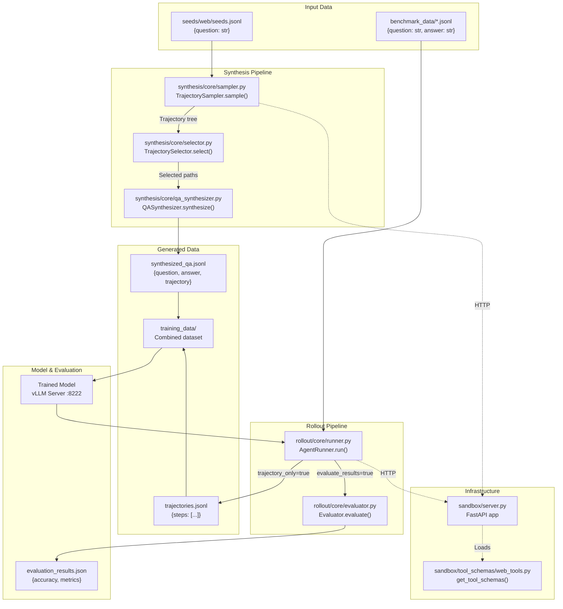

**Sources:** Diagram 1, 2, and 5 from high-level architecture

---

## Next Steps

After completing this tutorial, you can:

1. **Explore other agent types**: Try [RAG Agent](#6.1), [Document Agent](#6.2), [Text2SQL Agent](#6.4), etc.
2. **Customize configurations**: See [Synthesis Config Schema](#8.2), [Inference Config Schema](#8.4)
3. **Add new tools**: Learn how to extend the framework in [Extending Tool Schemas](#9.3)
4. **Train consolidated models**: Explore [Agentic Model Consolidation](#2.4) strategies
5. **Deep dive into components**: 
   - [Three-Stage Data Synthesis Pipeline](#2.1)
   - [Sandbox Server](#3)
   - [Rollout and Inference](#5)

**Sources:** Table of contents structure

---

# Page: Core Concepts

# Core Concepts

<details>
<summary>Relevant source files</summary>

The following files were used as context for generating this wiki page:

- [README.md](README.md)
- [README_zh.md](README_zh.md)
- [assets/intro.png](assets/intro.png)
- [assets/method.png](assets/method.png)
- [assets/wechat.jpg](assets/wechat.jpg)
- [assets/wechatshow.png](assets/wechatshow.png)

</details>


This page introduces the fundamental architectural concepts and design patterns that underpin AgentFlow's unified agent data synthesis framework. It provides an overview of the core components, their interactions, and the key abstractions that enable cross-domain agent development.

For detailed information about specific topics:
- The three-stage data generation methodology: see [Three-Stage Data Synthesis Pipeline](#2.1)
- Specific agent implementations and use cases: see [Agent Types and Modalities](#2.2)
- Tool system internals: see [Tool Schemas and Abstraction Layer](#2.3)
- Model training strategies: see [Agentic Model Consolidation](#2.4)

## System Architecture Overview

AgentFlow is built on a modular architecture that separates infrastructure concerns (tool execution environment) from data generation logic (synthesis and rollout pipelines) and model development (training and evaluation).

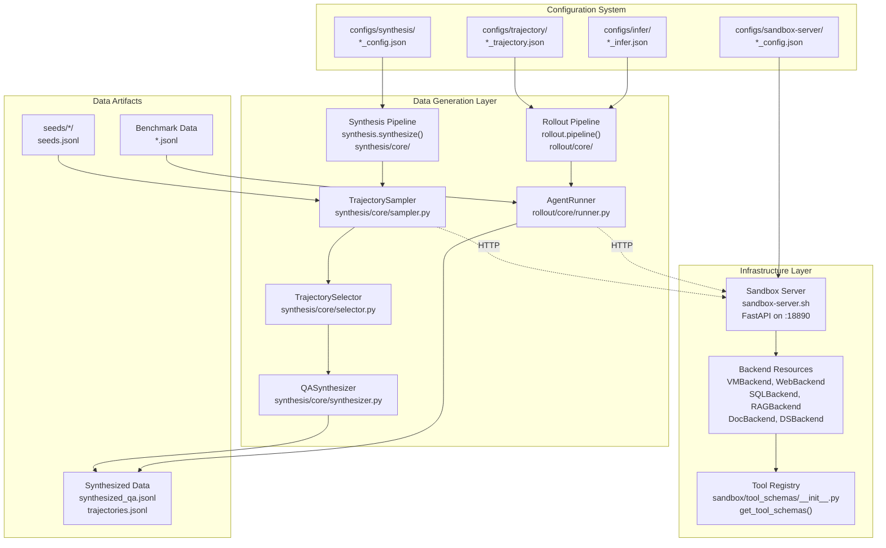

**Sources:** [README.md:44-103](), [configs/](https://github.com/OpenDCAI/AgentFlow/tree/main/configs)

## Core Component Interactions

The following diagram shows how the key classes and modules interact during data generation:

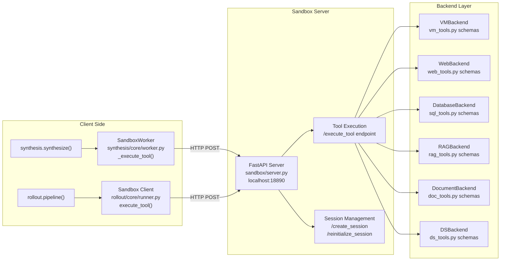

**Sources:** [synthesis/core/sampler.py](), [rollout/core/runner.py](), [sandbox/tool_schemas/]()

## The Three-Stage Pipeline

AgentFlow generates high-quality agent training data through a three-stage process:

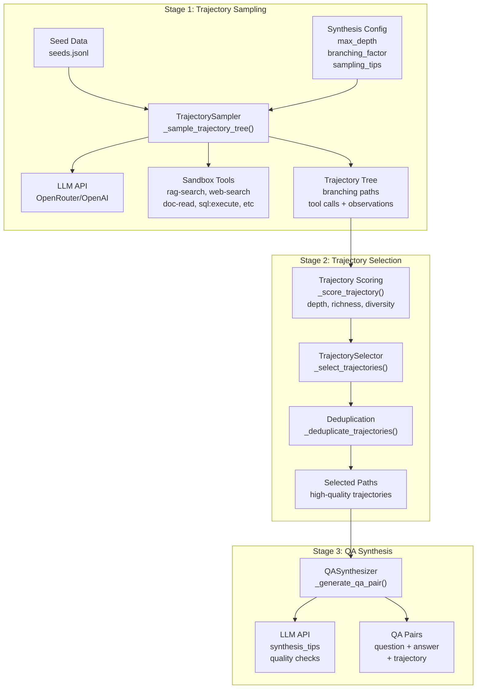

**Sources:** [README.md:77-84](), [synthesis/core/sampler.py](), [synthesis/core/selector.py](), [synthesis/core/synthesizer.py]()

The pipeline is modality-agnostic and operates consistently across all agent types. Stage 1 builds a branching trajectory tree through LLM-driven exploration with concurrent expansion and action deduplication. Stage 2 filters trajectories based on scoring criteria. Stage 3 generates multi-hop QA pairs grounded in the collected observations.

For implementation details, see [Three-Stage Data Synthesis Pipeline](#2.1).

## Agent Types and Tool Ecosystems

AgentFlow supports seven distinct agent modalities, each defined by its available tool set:

| Agent Type | Tools | Backend Implementation | Configuration |
|------------|-------|------------------------|---------------|
| RAG | `rag-search` | `RAGBackend` (E5 + Faiss) | `configs/sandbox-server/rag_config.json` |
| MM-Doc | `doc-search`, `doc-read` | `DocumentBackend` (VLM + PDF) | `configs/sandbox-server/doc_config.json` |
| Web Research | `web-search`, `web-visit` | `WebBackend` (Serper + Jina APIs) | `configs/sandbox-server/web_config.json` |
| GUI | `vm-screenshot`, `vm-click`, `vm-type`, etc (15 tools) | `VMBackend` (Docker VM) | `configs/sandbox-server/vm_config.json` |
| Text2SQL | `sql:list_databases`, `sql:get_schema`, `sql:execute` | `DatabaseBackend` (SQLite) | `configs/sandbox-server/text2sql_config.json` |
| Data Science | `ds_inspect_data`, `ds_read_csv`, `ds_run_python` | `DSBackend` (Python sandbox) | `configs/sandbox-server/ds_config.json` |
| Embodied | Custom robotic control tools | Custom backend | Custom configuration |

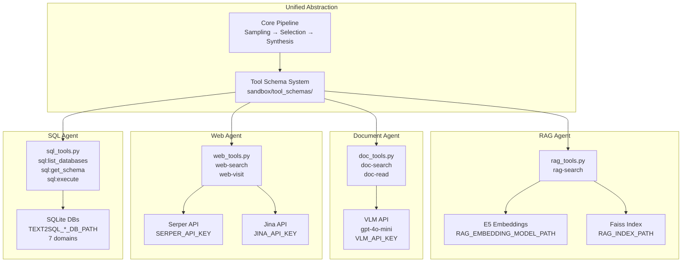

**Sources:** [README.md:15-38](), [sandbox/tool_schemas/](), [configs/sandbox-server/]()

Each agent type uses the same core pipeline but with different `available_tools` and `resource_types` configurations. For detailed descriptions of each agent type and their use cases, see [Agent Types and Modalities](#2.2).

## Tool Schema System

The tool schema system provides a unified abstraction for defining and executing tools across heterogeneous environments:

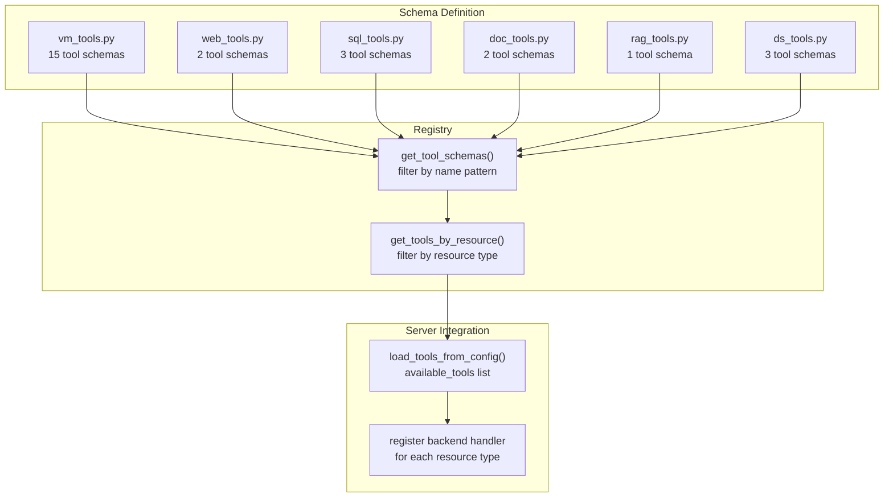

**Sources:** [sandbox/tool_schemas/__init__.py](), [sandbox/tool_schemas/*.py]()

Tool schemas are defined as JSON dictionaries with `name`, `description`, and `parameters` fields. The registry supports filtering by name patterns (e.g., `"vm-*"`) and resource types (e.g., `"vm"`, `"web"`, `"sql"`). This enables the same pipeline to work across all agent types by simply changing configuration.

For complete tool schema reference, see [Tool Schemas Reference](#3.3).

## Configuration Hierarchy

AgentFlow uses a hierarchical configuration system organized by operational stage:

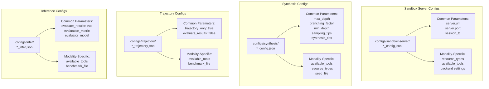

**Sources:** [README.md:107-112](), [configs/sandbox-server/](), [configs/synthesis/](), [configs/trajectory/](), [configs/infer/]()

Configuration files use environment variable substitution with `${VAR_NAME}` syntax to centralize credentials and machine-specific paths. Within each category, configurations share common parameters while allowing modality-specific customization.

For complete configuration reference, see [Configuration Reference](#8).

## Agentic Model Consolidation

AgentFlow explores two strategies for training unified multi-domain models:

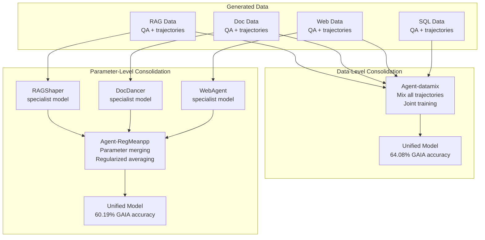

**Sources:** [README.md:32-35](), [README.md:202-206]()

**Data-level consolidation** (Agent-datamix) mixes trajectories from all domains during training, forcing a single model to learn diverse behaviors. **Parameter-level consolidation** (Agent-RegMeanpp) first trains specialist models on individual domains, then merges their parameters using regularized averaging.

Benchmark results show data-level mixing outperforms parameter-level merging (64.08% vs 60.19% on GAIA), indicating joint training on mixed trajectories is more effective for multi-domain capability.

For training strategies and deployment, see [Agentic Model Consolidation](#2.4) and [Model Training and Deployment](#10).

## Data Flow Through the System

The complete end-to-end data flow:

```mermaid
graph LR
    subgraph "Input"
        Seeds["seeds.jsonl"]
        Benchmarks["benchmark.jsonl"]
    end
    
    subgraph "Synthesis Mode"
        SynthConfig["synthesis/*_config.json"]
        SynthFunc["synthesis.synthesize()"]
        SynthOutput["synthesized_qa.jsonl<br/>trajectories.jsonl"]
    end
    
    subgraph "Rollout Mode"
        TrajConfig["trajectory/*_trajectory.json"]
        RolloutFunc["rollout.pipeline()<br/>trajectory_only=true"]
        TrajOutput["trajectory results<br/>trajectories.jsonl"]
    end
    
    subgraph "Training"
        CombineData["Combine datasets"]
        Training["Model Training"]
        Model["Trained Model"]
    end
    
    subgraph "Inference Mode"
        InferConfig["infer/*_infer.json"]
        InferFunc["rollout.pipeline()<br/>evaluate_results=true"]
        vLLM["vLLM Server :8222<br/>--enable-auto-tool-choice"]
        Results["Evaluation Results<br/>Metrics"]
    end
    
    Seeds --> SynthConfig
    SynthConfig --> SynthFunc
    SynthFunc --> SynthOutput
    
    Benchmarks --> TrajConfig
    TrajConfig --> RolloutFunc
    RolloutFunc --> TrajOutput
    
    SynthOutput --> CombineData
    TrajOutput --> CombineData
    CombineData --> Training
    Training --> Model
    
    Model --> vLLM
    Benchmarks --> InferConfig
    InferConfig --> InferFunc
    vLLM --> InferFunc
    InferFunc --> Results
```

**Sources:** [README.md:69-103](), [synthesis/](), [rollout/]()

The same `rollout.pipeline()` function operates in two modes: trajectory generation (step 3, `trajectory_only=true`) and inference (step 6, `evaluate_results=true`), distinguished only by configuration. The sandbox server acts as a persistent service supporting all data generation and inference stages.

---

# Page: Three-Stage Data Synthesis Pipeline

# Three-Stage Data Synthesis Pipeline

<details>
<summary>Relevant source files</summary>

The following files were used as context for generating this wiki page:

- [README.md](README.md)
- [README_zh.md](README_zh.md)
- [assets/intro.png](assets/intro.png)
- [assets/method.png](assets/method.png)
- [assets/wechat.jpg](assets/wechat.jpg)
- [assets/wechatshow.png](assets/wechatshow.png)
- [configs/synthesis/doc_ds_config.json](configs/synthesis/doc_ds_config.json)
- [configs/synthesis/ds_config.json](configs/synthesis/ds_config.json)
- [sandbox/tool_schemas/ds_tools.py](sandbox/tool_schemas/ds_tools.py)
- [synthesis/pipeline.py](synthesis/pipeline.py)

</details>


The three-stage data synthesis pipeline is AgentFlow's core methodology for generating high-quality training data from agent trajectories. This page describes the architectural design, implementation, and execution flow of the three sequential stages: Trajectory Sampling, Trajectory Selection, and QA Synthesis. For information about specific agent types that use this pipeline, see [Agent Types and Modalities](#2.2). For configuration details, see [Synthesis Configuration](#4.1).

## Overview

The pipeline transforms seed inputs into synthetic QA pairs by having an LLM-driven agent explore a sandbox environment, capturing its interaction trajectories, filtering them for quality, and generating grounded question-answer pairs. This approach is modality-agnostic and works across all supported agent types (RAG, Document, Web, SQL, Data Science, GUI).

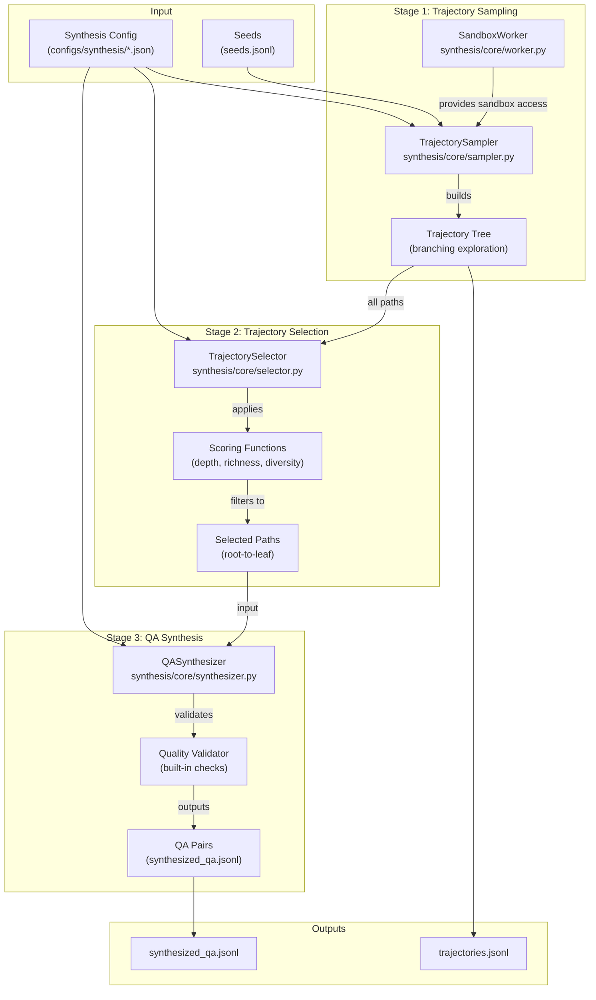

**Sources:** [README.md:77-84](), [synthesis/pipeline.py:39-230]()

## Architecture and Components

The pipeline is implemented by the `SynthesisPipeline` class, which orchestrates three core components:

| Component | Class | Purpose | Location |
|-----------|-------|---------|----------|
| **Worker** | `SandboxWorker` | Manages sandbox connection and tool execution | [synthesis/core/worker.py]() |
| **Sampler** | `TrajectorySampler` | Explores environment and builds trajectory tree | [synthesis/core/sampler.py]() |
| **Selector** | `TrajectorySelector` | Scores and filters trajectories for quality | [synthesis/core/selector.py]() |
| **Synthesizer** | `QASynthesizer` | Generates QA pairs from selected trajectories | [synthesis/core/synthesizer.py]() |

The pipeline coordinator (`SynthesisPipeline`) processes seeds sequentially and manages the flow between stages:

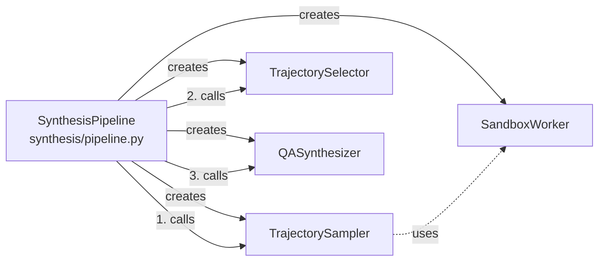

**Sources:** [synthesis/pipeline.py:39-119](), [synthesis/core/__init__.py:1-7]()

## Stage 1: Trajectory Sampling

Trajectory sampling is the exploration phase where an LLM-driven agent iteratively interacts with the sandbox environment, building a branching tree of action sequences.

### Sampling Algorithm

The `TrajectorySampler` implements a breadth-first exploration strategy with concurrent expansion:

1. **Initialize** with seed input as the root node
2. **Expand** each frontier node by generating `branching_factor` action proposals
3. **Execute** proposed actions via `SandboxWorker.execute_action()`
4. **Record** observations and add child nodes to the tree
5. **Continue** until reaching `max_depth` or all paths terminate

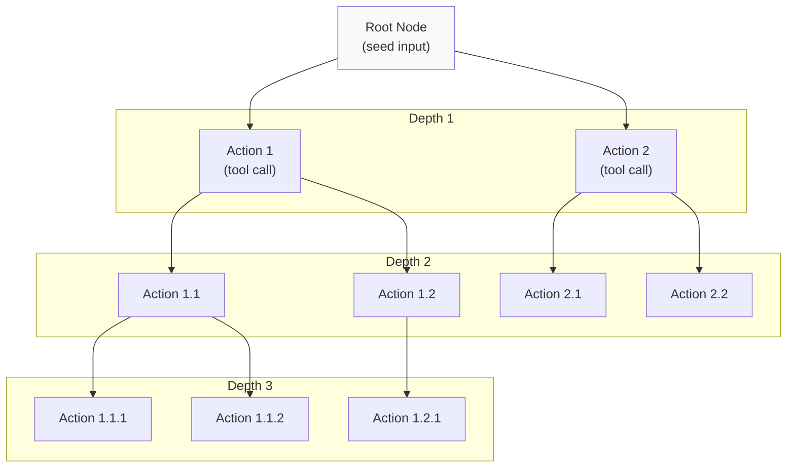

**Key Configuration Parameters:**

| Parameter | Default | Description |
|-----------|---------|-------------|
| `max_depth` | 20 | Maximum trajectory depth |
| `branching_factor` | 2 | Number of actions to propose per node |
| `depth_threshold` | 2 | Minimum depth before allowing termination |

**Sources:** [synthesis/core/sampler.py](), [configs/synthesis/rag_config.json:6-8](), [README.md:79]()

### Action Proposal and Deduplication

At each node, the sampler:

1. **Constructs prompt** with trajectory history and available tools
2. **Queries LLM** for `branching_factor` distinct action proposals
3. **Deduplicates** semantically similar actions
4. **Validates** action format and parameter types
5. **Executes** each valid action through the sandbox

The `sampling_tips` configuration parameter guides the LLM's exploration strategy:

```json
{
  "sampling_tips": [
    "Your data lives under the provided seed_path; start with ds_inspect_data.",
    "Prefer ds_run_python for any non-trivial computation.",
    "When reading CSVs, use filenames like users.csv (avoid embedding seed_path)."
  ]
}
```

**Sources:** [synthesis/core/sampler.py](), [configs/synthesis/ds_config.json:16-22]()

### Trajectory Tree Structure

Each node in the trajectory tree contains:

- **State**: Current execution context
- **Action**: Tool call with parameters
- **Observation**: Tool execution result
- **Parent**: Reference to parent node
- **Children**: List of child nodes
- **Depth**: Distance from root

The tree is serialized to `trajectories.jsonl` for later analysis and debugging:

```json
{
  "source_id": "src_0001_a1b2c3d4",
  "seed": "Analyze customer purchase patterns",
  "trajectory": [
    {"action": "ds_inspect_data", "result": "Found 3 CSV files..."},
    {"action": "ds_read_csv", "params": {"csv_file": "orders.csv"}, "result": "..."},
    {"action": "ds_run_python", "params": {"code": "..."}, "result": "..."}
  ],
  "depth": 3,
  "terminal": true
}
```

**Sources:** [synthesis/pipeline.py:176-189](), [synthesis/core/sampler.py]()

## Stage 2: Trajectory Selection

After sampling, the trajectory tree contains many paths of varying quality. The selection stage filters for high-value trajectories suitable for QA synthesis.

### Selection Criteria

The `TrajectorySelector` evaluates each root-to-leaf path using three metrics:

1. **Depth Score**: Prefers longer trajectories indicating multi-hop reasoning
2. **Information Richness**: Measures diversity and informativeness of observations
3. **Tool Diversity**: Rewards usage of multiple distinct tools

```mermaid
graph LR
    AllPaths["All Root-to-Leaf Paths"]
    
    subgraph "Scoring Functions"
        DepthScore["depth_score()<br/>(length-based)"]
        RichnessScore["richness_score()<br/>(entropy-based)"]
        DiversityScore["diversity_score()<br/>(tool variety)"]
    end
    
    subgraph "Filtering"
        MinDepth["min_depth filter<br/>(default: 3)"]
        Similarity["similarity filter<br/>(cosine < 0.7)"]
        TopK["top-K selection<br/>(max_selected_traj)"]
    end
    
    Selected["Selected Paths"]
    
    AllPaths --> DepthScore
    AllPaths --> RichnessScore
    AllPaths --> DiversityScore
    
    DepthScore --> MinDepth
    RichnessScore --> MinDepth
    DiversityScore --> MinDepth
    
    MinDepth --> Similarity
    Similarity --> TopK
    TopK --> Selected
```

**Sources:** [synthesis/core/selector.py](), [README.md:81]()

### Selection Algorithm

The selection process follows these steps:

1. **Extract all root-to-leaf paths** from the trajectory tree
2. **Filter by minimum depth** (configurable via `min_depth`)
3. **Compute composite score** as weighted sum of depth, richness, diversity
4. **Remove similar paths** using cosine similarity on action sequences
5. **Select top-K paths** (configurable via `max_selected_traj`)

**Configuration Parameters:**

| Parameter | Default | Description |
|-----------|---------|-------------|
| `min_depth` | 3 | Minimum trajectory length to consider |
| `max_selected_traj` | 3 | Maximum trajectories to select per seed |
| `path_similarity_threshold` | 0.7 | Cosine similarity threshold for deduplication |

**Sources:** [synthesis/core/selector.py](), [configs/synthesis/rag_config.json:10-12]()

### Path Similarity Detection

To avoid redundant trajectories, the selector computes pairwise similarity between action sequences using:

1. **Action embedding**: Convert each action to vector representation
2. **Sequence aggregation**: Average embeddings along the path
3. **Cosine similarity**: Measure angle between path vectors
4. **Threshold filtering**: Discard paths with similarity > threshold

This ensures selected trajectories explore distinct regions of the action space.

**Sources:** [synthesis/core/selector.py]()

## Stage 3: QA Synthesis

The final stage generates question-answer pairs grounded in the observations collected during trajectory execution.

### Synthesis Process

The `QASynthesizer` processes each selected trajectory:

1. **Construct context** from trajectory observations
2. **Generate question** requiring multi-hop reasoning across observations
3. **Extract answer** directly from the observation data
4. **Validate QA pair** using quality checks
5. **Retry** if validation fails (up to `max_retries`)

```mermaid
graph TB
    Trajectory["Selected Trajectory"]
    
    subgraph "Synthesis"
        Context["build_context()<br/>(observations → text)"]
        Prompt["construct_prompt()<br/>(synthesis_tips + qa_examples)"]
        LLM["LLM Query<br/>(model_name)"]
        Parse["parse_response()<br/>(extract Q/A)"]
    end
    
    subgraph "Validation"
        Checks["Quality Checks"]
        CheckAnswer["answer in observations"]
        CheckQuestion["question requires reasoning"]
        CheckFormat["proper JSON format"]
        
        Checks --> CheckAnswer
        Checks --> CheckQuestion
        Checks --> CheckFormat
    end
    
    Output["QA Pair<br/>(synthesized_qa.jsonl)"]
    Retry["Retry<br/>(max 3 times)"]
    
    Trajectory --> Context
    Context --> Prompt
    Prompt --> LLM
    LLM --> Parse
    Parse --> Checks
    
    Checks -->|"pass"| Output
    Checks -->|"fail"| Retry
    Retry --> Prompt
```

**Sources:** [synthesis/core/synthesizer.py](), [README.md:83]()

### Synthesis Guidance

The synthesis process is guided by configuration parameters:

**`synthesis_tips`**: Constraints for question generation
```json
{
  "synthesis_tips": [
    "Create questions requiring multi-hop reasoning.",
    "Ensure answers are grounded in computed results.",
    "Avoid questions based on data previews or 'head()' calls."
  ]
}
```

**`qa_examples`**: Few-shot examples to guide the LLM
```json
{
  "qa_examples": [
    {
      "question": "Join orders.csv with products.csv. What is the total revenue?",
      "answer": "10734"
    }
  ]
}
```

**Sources:** [configs/synthesis/ds_config.json:24-46](), [synthesis/core/synthesizer.py]()

### Quality Validation

Built-in validation checks ensure QA pair quality:

1. **Answer grounding**: Answer must be derivable from observations
2. **Multi-hop reasoning**: Question requires information from multiple steps
3. **Format compliance**: Proper JSON structure with required fields
4. **Answer specificity**: Factoid answers, not vague or ambiguous
5. **Question complexity**: Not answerable from single observation alone

Failed pairs are logged for debugging, and synthesis retries with adjusted prompts.

**Sources:** [synthesis/core/synthesizer.py]()

### Output Format

Each synthesized QA pair is written to `synthesized_qa.jsonl`:

```json
{
  "source_id": "src_0001_a1b2c3d4",
  "question": "After clustering users by order patterns, which cluster has the highest mean revenue?",
  "answer": "cluster=1, size=2",
  "trajectory": [...],
  "seed": "Analyze customer purchase patterns"
}
```

**Sources:** [synthesis/pipeline.py:191-204]()

## Pipeline Execution

### Entry Points

The pipeline can be executed via two interfaces:

**1. Python API:**
```python
from synthesis import synthesize

synthesize(config_path="configs/synthesis/web_config.json")
```

**2. Command Line:**
```bash
python -m synthesis.pipeline --config configs/synthesis/web_config.json
```

**Sources:** [synthesis/__init__.py:1-9](), [synthesis/pipeline.py:13-30](), [README.md:115-121]()

### Execution Flow

```mermaid
graph TB
    Start["synthesize()"]
    LoadConfig["Load SynthesisConfig"]
    LoadSeeds["Load seeds from seeds_file"]
    CreatePipeline["Create SynthesisPipeline"]
    
    subgraph "Per-Seed Processing"
        CreateWorker["Create SandboxWorker"]
        StartWorker["Start worker<br/>(connect to sandbox)"]
        CreateSession["Create sandbox session<br/>(per resource_type)"]
        
        RunSampler["Run TrajectorySampler<br/>(Stage 1)"]
        RunSelector["Run TrajectorySelector<br/>(Stage 2)"]
        RunSynthesizer["Run QASynthesizer<br/>(Stage 3)"]
        
        WriteQA["Write to synthesized_qa.jsonl"]
        WriteTraj["Write to trajectories.jsonl"]
        
        ReinitSession["Reinitialize session<br/>(cleanup for next seed)"]
    end
    
    End["Pipeline Complete"]
    
    Start --> LoadConfig
    LoadConfig --> LoadSeeds
    LoadSeeds --> CreatePipeline
    CreatePipeline --> CreateWorker
    
    CreateWorker --> StartWorker
    StartWorker --> CreateSession
    CreateSession --> RunSampler
    RunSampler --> RunSelector
    RunSelector --> RunSynthesizer
    RunSynthesizer --> WriteQA
    RunSynthesizer --> WriteTraj
    WriteTraj --> ReinitSession
    
    ReinitSession -.->|"next seed"| CreateSession
    ReinitSession --> End
```

**Sources:** [synthesis/pipeline.py:66-156](), [synthesis/__init__.py:11-61]()

### Session Management

For stateful resources (VM, SQL, Document), the pipeline reinitializes sandbox sessions between seeds to ensure isolation:

1. **Initial session creation** (per `resource_types`)
2. **Trajectory sampling** in isolated environment
3. **Session reinitialization** after seed processing
4. **Cleanup** when pipeline completes

This prevents cross-contamination between seeds that might share resources (e.g., same database).

**Sources:** [synthesis/pipeline.py:111-136]()

## Configuration Reference

The three-stage pipeline is configured via JSON files in `configs/synthesis/`. Key parameters:

### Sampling Parameters

| Parameter | Type | Description | Example |
|-----------|------|-------------|---------|
| `max_depth` | int | Maximum trajectory depth | 20 |
| `branching_factor` | int | Actions per node | 2 |
| `depth_threshold` | int | Min depth before termination | 2 |
| `sampling_tips` | array | LLM guidance for exploration | See below |

### Selection Parameters

| Parameter | Type | Description | Example |
|-----------|------|-------------|---------|
| `min_depth` | int | Minimum trajectory length | 3 |
| `max_selected_traj` | int | Max trajectories per seed | 3 |
| `path_similarity_threshold` | float | Deduplication threshold | 0.7 |

### Synthesis Parameters

| Parameter | Type | Description | Example |
|-----------|------|-------------|---------|
| `synthesis_tips` | array | QA generation constraints | See below |
| `qa_examples` | array | Few-shot examples | See below |
| `number_of_seed` | int/null | Limit number of seeds | null (all) |

### Infrastructure Parameters

| Parameter | Type | Description | Example |
|-----------|------|-------------|---------|
| `model_name` | string | LLM model identifier | `"openai/gpt-oss-120b"` |
| `sandbox_server_url` | string | Sandbox HTTP endpoint | `"http://127.0.0.1:18890"` |
| `available_tools` | array | Tools for this agent type | `["ds_inspect_data", ...]` |
| `resource_types` | array | Sandbox resource types | `["rag", "text2sql"]` |
| `seeds_file` | string | Path to seed data | `"seeds/ds/seeds.jsonl"` |

For complete configuration schema and examples, see [Synthesis Config Schema](#8.2).

**Sources:** [configs/synthesis/ds_config.json](), [configs/synthesis/rag_config.json](), [synthesis/core/config.py]()

---

# Page: Agent Types and Modalities

# Agent Types and Modalities

<details>
<summary>Relevant source files</summary>

The following files were used as context for generating this wiki page:

- [README.md](README.md)
- [README_zh.md](README_zh.md)
- [assets/intro.png](assets/intro.png)
- [assets/method.png](assets/method.png)
- [assets/wechat.jpg](assets/wechat.jpg)
- [assets/wechatshow.png](assets/wechatshow.png)

</details>


This page provides a comprehensive overview of the seven agent types supported by AgentFlow, their unique characteristics, tool ecosystems, backend implementations, and use cases. Each agent type represents a distinct modality of interaction, from document understanding to web browsing to database querying.

For information about the unified three-stage data synthesis pipeline that applies to all agent types, see [Three-Stage Data Synthesis Pipeline](#2.1). For details on how tool schemas abstract these interactions, see [Tool Schemas and Abstraction Layer](#2.3). For practical examples of implementing each agent type, see [Agent Examples](#6).

## Overview of Supported Agent Types

AgentFlow supports seven distinct agent modalities, each designed for specific task domains:

| Agent Type | Primary Tools | Backend | Key Use Case | Example Config |
|------------|--------------|---------|--------------|----------------|
| **RAG** | `rag-search` | E5 + Faiss | Information retrieval with vector search | `configs/sandbox-server/rag_config.json` |
| **MM-Doc** | `doc-search`, `doc-read` | VLM (gpt-4o-mini) | Multimodal document understanding | `configs/sandbox-server/doc_config.json` |
| **Deep Research (Web)** | `web-search`, `web-visit` | Serper API + Jina API | Web search and browsing | `configs/sandbox-server/web_config.json` |
| **GUI** | `vm-screenshot`, `vm-click`, `vm-type`, etc. | Docker VM (Ubuntu Desktop) | Desktop automation | `configs/sandbox-server/vm_config.json` |
| **Text2SQL** | `sql:list_databases`, `sql:get_schema`, `sql:execute` | SQLite databases | Natural language to SQL | `configs/sandbox-server/text2sql_config.json` |
| **Data Analysis** | `ds_inspect_data`, `ds_read_csv`, `ds_run_python` | Python sandbox (pandas, numpy) | Data science workflows | `configs/sandbox-server/ds_config.json` |
| **Embodied** | Custom action spaces | Simulation environment | Robot manipulation | Configuration varies |

**Sources:** [README.md:22-38](), [README.md:157-181]()

## Agent Type Architecture

The following diagram illustrates how different agent types connect to their respective tool schemas and backend implementations:

```mermaid
graph TB
    subgraph "Core Pipeline (Modality-Agnostic)"
        Pipeline["Three-Stage Pipeline<br/>TrajectorySampler → TrajectorySelector → QASynthesizer"]
    end
    
    subgraph "RAG Agent"
        RAGTools["Tool: rag-search"]
        RAGBackend["RAGBackend<br/>E5 embeddings<br/>Faiss index"]
        RAGConfig["rag_config.json"]
        RAGBench["Benchmarks:<br/>HotPotQA, AmbigQA<br/>Bamboogle, PopQA"]
    end
    
    subgraph "Document Agent"
        DocTools["Tools:<br/>doc-search<br/>doc-read"]
        DocBackend["DocumentBackend<br/>VLM: gpt-4o-mini<br/>PDF parsing"]
        DocConfig["doc_config.json"]
        DocBench["Benchmarks:<br/>MMLongBench-Doc<br/>DocBench"]
    end
    
    subgraph "Web Agent"
        WebTools["Tools:<br/>web-search<br/>web-visit"]
        WebBackend["WebBackend<br/>Serper API<br/>Jina API<br/>LLM summarization"]
        WebConfig["web_config.json"]
        WebBench["Benchmarks:<br/>GAIA, BrowseComp-V3<br/>BC-zh"]
    end
    
    subgraph "GUI Agent"
        GUITools["Tools:<br/>vm-screenshot<br/>vm-click, vm-type<br/>vm-key, vm-scroll"]
        GUIBackend["VMBackend<br/>Docker containers<br/>noVNC server"]
        GUIConfig["vm_config.json"]
    end
    
    subgraph "SQL Agent"
        SQLTools["Tools:<br/>sql:list_databases<br/>sql:get_schema<br/>sql:execute"]
        SQLBackend["DatabaseBackend<br/>SQLite engines<br/>7 domains"]
        SQLConfig["text2sql_config.json"]
    end
    
    subgraph "DS Agent"
        DSTools["Tools:<br/>ds_inspect_data<br/>ds_read_csv<br/>ds_run_python"]
        DSBackend["DSBackend<br/>Python exec sandbox<br/>pandas, numpy<br/>security whitelist"]
        DSConfig["ds_config.json"]
    end
    
    Pipeline -->|configures| RAGTools
    Pipeline -->|configures| DocTools
    Pipeline -->|configures| WebTools
    Pipeline -->|configures| GUITools
    Pipeline -->|configures| SQLTools
    Pipeline -->|configures| DSTools
    
    RAGConfig -->|defines| RAGTools
    RAGTools -->|executed by| RAGBackend
    
    DocConfig -->|defines| DocTools
    DocTools -->|executed by| DocBackend
    
    WebConfig -->|defines| WebTools
    WebTools -->|executed by| WebBackend
    
    GUIConfig -->|defines| GUITools
    GUITools -->|executed by| GUIBackend
    
    SQLConfig -->|defines| SQLTools
    SQLTools -->|executed by| SQLBackend
    
    DSConfig -->|defines| DSTools
    DSTools -->|executed by| DSBackend
```

**Sources:** [README.md:22-38](), Diagram 3 from provided diagrams

## RAG Agent

The RAG (Retrieval-Augmented Generation) agent performs information retrieval using vector search over a knowledge corpus. It represents the simplest agent modality with a single tool.

### Tool Schema

- **`rag-search`**: Searches a vector index using semantic similarity
  - Parameters: `query` (string)
  - Returns: List of relevant text chunks with metadata

### Backend Implementation

The `RAGBackend` uses:
- **E5 embeddings**: Specified via `RAG_EMBEDDING_MODEL_PATH` environment variable
- **Faiss index**: Vector index loaded from `RAG_INDEX_PATH`
- **Dense retrieval**: Semantic search over embedded documents

### Configuration

Sandbox server configuration at [configs/sandbox-server/rag_config.json]():
```json
{
    "server": {
        "url": "http://localhost",
        "port": 18890
    },
    "resource_type": "rag",
    "rag": {
        "embedding_model_path": "${RAG_EMBEDDING_MODEL_PATH}",
        "index_path": "${RAG_INDEX_PATH}"
    }
}
```

### Benchmarks and Performance

| Benchmark | Metric | RAGShaper 6.5k Performance |
|-----------|--------|----------------------------|
| Bamboogle | EM / F1 | 60.0 / 72.6 |
| PopQA | EM / F1 | 38.9 / 49.6 |
| NQ | EM / F1 | 41.3 / 54.8 |
| AmbigQA | EM / F1 | 61.1 / 71.1 |

**Sources:** [README.md:157-168](), [README.md:207-223](), [configs/sandbox-server/rag_config.json]()

## Document Agent (MM-Doc)

The Document agent handles multimodal document understanding tasks, navigating through multi-page PDFs containing text, tables, charts, and images.

### Tool Schemas

- **`doc-search`**: Searches for relevant pages in a document
  - Parameters: `query` (string), `document_id` (string)
  - Returns: Page numbers and relevance scores

- **`doc-read`**: Reads specific pages using VLM
  - Parameters: `document_id` (string), `page_numbers` (list of integers)
  - Returns: Multimodal content extraction (text, tables, images)

### Backend Implementation

The `DocumentBackend` leverages:
- **VLM integration**: Uses `gpt-4o-mini` (configurable via `VLM_API_KEY`)
- **PDF parsing**: Extracts page images and text
- **Multimodal understanding**: Processes heterogeneous content types

### Configuration

Document agent synthesis configuration emphasizes:
- Multi-hop reasoning across pages
- Cross-modal information extraction
- Navigation strategies for long documents

### Benchmarks and Performance

| Benchmark | Metric | DocDancer (Qwen3-30B) Performance |
|-----------|--------|-----------------------------------|
| MMLongBench-Doc | Accuracy | 54.4 |
| MMLongBench-Doc | F1 | 53.9 |
| LasJ | Score | 65.3 |
| DocBench | LasJ | 81.2 |

Human baseline on MMLongBench-Doc: 65.8% accuracy

**Sources:** [README.md:234-257](), [configs/sandbox-server/doc_config.json]()

## Web Agent (Deep Research)

The Web agent performs deep research through web search and browsing, combining search APIs with content extraction for multi-hop web reasoning.

### Tool Schemas

- **`web-search`**: Performs web search queries
  - Parameters: `query` (string), `num_results` (integer)
  - Returns: Search results with titles, URLs, snippets

- **`web-visit`**: Visits and extracts content from URLs
  - Parameters: `url` (string)
  - Returns: Cleaned page content, extracted text

### Backend Implementation

The `WebBackend` integrates:
- **Serper API**: For web search (requires `SERPER_API_KEY`)
- **Jina API**: For content extraction (requires `JINA_API_KEY`)
- **LLM summarization**: Condenses long web pages

### Tool Execution Flow

```mermaid
graph LR
    Query["User Query"]
    Search["web-search<br/>(Serper API)"]
    Results["Search Results<br/>(titles, URLs, snippets)"]
    Visit["web-visit<br/>(Jina API)"]
    Content["Page Content<br/>(cleaned text)"]
    LLM["LLM Summarization"]
    Summary["Condensed Content"]
    
    Query --> Search
    Search --> Results
    Results --> Visit
    Visit --> Content
    Content --> LLM
    LLM --> Summary
```

### Benchmarks and Performance

| Benchmark | Description | Agent-datamix Performance |
|-----------|-------------|---------------------------|
| GAIA | General AI Assistant | 64.08% |
| BrowseComp-V3 | Multimodal browsing | 28.00% |
| BC-zh | Chinese browsing | 34.00% |

**Sources:** [README.md:15-21](), [README.md:199-206](), [configs/sandbox-server/web_config.json](), [sandbox/tool_schemas/web_tools.py]()

## GUI Agent

The GUI agent interacts with graphical user interfaces through desktop automation, executing actions like clicking, typing, and scrolling on a virtual Ubuntu desktop.

### Tool Schemas

The GUI agent provides 15 tools for desktop interaction:

| Tool | Purpose | Key Parameters |
|------|---------|----------------|
| `vm-screenshot` | Capture current screen | None |
| `vm-click` | Click at coordinates | `x`, `y`, `button` (left/right) |
| `vm-double-click` | Double-click | `x`, `y` |
| `vm-type` | Type text | `text` |
| `vm-key` | Press key combination | `key` (e.g., "ctrl+c") |
| `vm-scroll` | Scroll direction | `direction` (up/down), `clicks` |
| `vm-drag` | Drag and drop | `start_x`, `start_y`, `end_x`, `end_y` |
| `vm-move` | Move mouse | `x`, `y` |

### Backend Implementation

The `VMBackend` manages:
- **Docker containers**: Runs Ubuntu Desktop in isolated containers
- **noVNC server**: Provides VNC access for automation
- **Session management**: Creates and destroys VM instances
- **State persistence**: Maintains VM state across interactions

### Session Lifecycle

```mermaid
sequenceDiagram
    participant Agent as AgentRunner
    participant Sandbox as Sandbox Server
    participant VM as VMBackend
    participant Docker as Docker Container
    
    Agent->>Sandbox: create_session(vm)
    Sandbox->>VM: initialize()
    VM->>Docker: docker run ubuntu-desktop
    Docker-->>VM: container_id
    VM-->>Sandbox: session_id
    Sandbox-->>Agent: session_id
    
    Agent->>Sandbox: execute(vm-screenshot)
    Sandbox->>VM: capture_screen()
    VM->>Docker: VNC capture
    Docker-->>VM: image_bytes
    VM-->>Sandbox: screenshot
    Sandbox-->>Agent: observation
    
    Agent->>Sandbox: execute(vm-click, x=100, y=200)
    Sandbox->>VM: click(100, 200)
    VM->>Docker: send_click_event
    Docker-->>VM: success
    VM-->>Sandbox: result
    Sandbox-->>Agent: observation
    
    Agent->>Sandbox: destroy_session()
    Sandbox->>VM: cleanup()
    VM->>Docker: docker stop
    Docker-->>VM: stopped
```

### Configuration

VM configuration requires Docker setup and specifies:
- Container image
- VNC port and display settings
- Resource limits
- Session timeout (TTL)

**Sources:** [README.md:401-413](), [configs/sandbox-server/vm_config.json](), [sandbox/tool_schemas/vm_tools.py]()

## Text2SQL Agent

The Text2SQL agent converts natural language questions into SQL queries, executing them against multiple database domains.

### Tool Schemas

- **`sql:list_databases`**: Lists available databases
  - Returns: Database names and descriptions

- **`sql:get_schema`**: Retrieves schema for a database
  - Parameters: `database_name` (string)
  - Returns: Table schemas with columns and types

- **`sql:execute`**: Executes a SQL query
  - Parameters: `database_name` (string), `query` (string)
  - Returns: Query results as table

### Backend Implementation

The `DatabaseBackend` manages:
- **SQLite engines**: One per database domain
- **Multiple databases**: 7 distinct domains (e.g., sakila, chinook)
- **Schema caching**: Efficient schema retrieval
- **Query execution**: Safe SQL execution with timeouts

### Database Domains

AgentFlow includes databases across domains:
- **sakila**: Film rental data (actors, films, rentals)
- **chinook**: Music store (customers, invoices, tracks)
- **northwind**: Sales data
- **world**: Geographic information
- And 3 additional domains

### Example Query Workflow

```mermaid
graph TD
    Question["Natural Language Question"]
    ListDB["sql:list_databases"]
    DBList["Available Databases"]
    Schema["sql:get_schema<br/>(selected database)"]
    SchemaInfo["Table schemas<br/>Column types<br/>Relationships"]
    GenerateSQL["LLM generates<br/>SQL query"]
    Execute["sql:execute<br/>(database, query)"]
    Results["Query Results"]
    Answer["Final Answer"]
    
    Question --> ListDB
    ListDB --> DBList
    DBList --> Schema
    Schema --> SchemaInfo
    SchemaInfo --> GenerateSQL
    GenerateSQL --> Execute
    Execute --> Results
    Results --> Answer
```

### Configuration

SQL backend configuration maps environment variables to database paths:
```
TEXT2SQL_SAKILA_DB_PATH=/path/to/sakila.db
TEXT2SQL_CHINOOK_DB_PATH=/path/to/chinook.db
```

**Sources:** [README.md:290-400](), [configs/sandbox-server/text2sql_config.json](), [sandbox/tool_schemas/sql_tools.py]()

## Data Science Agent

The Data Science agent performs data analysis tasks using Python, pandas, and visualization libraries in a sandboxed environment.

### Tool Schemas

- **`ds_inspect_data`**: Inspects dataset properties
  - Parameters: `dataset_path` (string)
  - Returns: Shape, columns, data types, basic statistics

- **`ds_read_csv`**: Reads CSV file
  - Parameters: `file_path` (string), `nrows` (optional integer)
  - Returns: DataFrame preview

- **`ds_run_python`**: Executes Python code
  - Parameters: `code` (string)
  - Returns: Execution results, prints, variables

### Backend Implementation

The `DSBackend` provides:
- **Python sandbox**: Isolated execution environment
- **Library support**: pandas, numpy, matplotlib, seaborn
- **Security whitelist**: Restricted module imports
- **Memory limits**: Prevents resource exhaustion
- **Output capture**: Redirects stdout/stderr

### Security Model

```mermaid
graph TB
    Code["Python Code"]
    Whitelist["Module Whitelist<br/>pandas, numpy<br/>matplotlib, seaborn<br/>scipy, sklearn"]
    Sandbox["Execution Sandbox<br/>restricted imports<br/>no file system access<br/>timeout enforcement"]
    Results["Execution Results<br/>stdout, stderr<br/>variables, plots"]
    
    Code --> Whitelist
    Whitelist -->|allowed| Sandbox
    Whitelist -->|blocked| Error["ImportError"]
    Sandbox --> Results
```

### Supported Analysis Types

- Exploratory Data Analysis (EDA)
- Feature engineering
- Statistical analysis
- Machine learning model training
- Data visualization
- Hypothesis testing

### Example Use Case

From [README.md:268-288]():
```
Question: Which feature has the highest importance in predicting 
'time / retired' according to the Random Forest model?

Answer: laps
```

This requires:
1. `ds_read_csv` to load race results
2. `ds_run_python` to train Random Forest
3. `ds_run_python` to extract feature importances

**Sources:** [README.md:268-289](), [configs/sandbox-server/ds_config.json](), [sandbox/tool_schemas/ds_tools.py]()

## Embodied Agent

The Embodied agent controls simulated robots for manipulation tasks in physics-based environments.

### Characteristics

- **Custom action spaces**: Defined per simulation environment
- **State observations**: Robot joint positions, object locations
- **Continuous control**: Fine-grained motor commands
- **Visual feedback**: Camera observations from simulation

### Example Tasks

From [README.md:414-437]():
- Place objects on target surfaces
- Open/close laptop lids
- Arrange items in containers
- Multi-step manipulation sequences

### Configuration

Embodied agent configuration varies by simulation environment and is not included in the standard sandbox server configs. Custom integration required for specific robotics platforms.

**Sources:** [README.md:414-437]()

## Cross-Modal Capabilities and Model Consolidation

AgentFlow enables training unified models that operate across multiple agent modalities through two consolidation strategies:

### Data-Level Consolidation (Agent-datamix)

Mix trajectories from all agent types during training:
```
Training Data = RAG trajectories + Doc trajectories + Web trajectories + SQL trajectories + ...
```

Performance (Qwen3-30B-A3B-Think):
- GAIA (Web): 64.08%
- BrowseComp-V3 (Web): 28.00%
- MMLongBench-Doc (Doc): 63.59%
- DocBench (Doc): 83.29%
- HotPotQA (RAG): 38.00% EM / 42.53% F1

### Parameter-Level Consolidation (Agent-RegMeanpp)

Train specialist models separately, then merge parameters:
1. Train RAGShaper on RAG data
2. Train DocDancer on document data
3. Train WebAgent on web data
4. Merge using regularized parameter averaging

Performance is generally lower than data-level mixing (60.19% vs 64.08% on GAIA), suggesting joint training is more effective.

**Sources:** [README.md:199-206](), [README.md:32-35]()

## Configuration Patterns Across Agent Types

All agent types follow consistent configuration patterns:

| Configuration Type | Purpose | Common Parameters |
|-------------------|---------|-------------------|
| Sandbox Server | Backend setup | `server.url`, `server.port`, `resource_type`, backend-specific paths |
| Synthesis | Data generation | `max_depth`, `branching_factor`, `sampling_tips`, `synthesis_tips` |
| Trajectory | Trajectory rollout | `trajectory_only: true`, `evaluate_results: false` |
| Inference | Model evaluation | `evaluate_results: true`, `evaluation_metric`, `evaluator_model` |

### Common Configuration Parameters

Synthesis configs for all agent types share:
- `max_depth`: Maximum trajectory depth (e.g., 5-7)
- `branching_factor`: Exploration width (e.g., 2-4)
- `sampling_tips`: LLM instructions for exploration
- `synthesis_tips`: LLM instructions for QA generation
- `llm_model`: Model for trajectory sampling
- `synthesis_model`: Model for QA synthesis

**Sources:** [README.md:151-159](), Diagram 4 from provided diagrams

## Tool Schema Registry

All tool schemas are registered in a central registry accessible via:

```python
from sandbox.tool_schemas import get_tool_schemas, get_tools_by_resource

# Get all RAG tools
rag_tools = get_tools_by_resource("rag")

# Get all VM tools
vm_tools = get_tools_by_resource("vm")

# Get specific tool by name pattern
search_tools = get_tool_schemas(name_pattern=".*search.*")
```

Tool schemas are defined in:
- [sandbox/tool_schemas/rag_tools.py]()
- [sandbox/tool_schemas/doc_tools.py]()
- [sandbox/tool_schemas/web_tools.py]()
- [sandbox/tool_schemas/vm_tools.py]()
- [sandbox/tool_schemas/sql_tools.py]()
- [sandbox/tool_schemas/ds_tools.py]()

Each schema includes:
- Tool name
- Description
- Parameter specifications (name, type, required/optional)
- Return value format

**Sources:** [sandbox/tool_schemas/__init__.py](), Diagram 6 from provided diagrams

## Summary

AgentFlow's seven agent types demonstrate the framework's versatility across diverse interaction modalities. The key design principle is **modality-agnostic pipeline with modality-specific tools**: the same three-stage synthesis pipeline applies to all agent types, while tool schemas and backend implementations provide the necessary specialization. This architecture enables rapid development of new agent types by simply defining new tool schemas and implementing corresponding backends, without modifying core synthesis logic.

**Sources:** [README.md:18-46](), [README.md:50-68]()

---

# Page: Tool Schemas and Abstraction Layer

# Tool Schemas and Abstraction Layer

<details>
<summary>Relevant source files</summary>

The following files were used as context for generating this wiki page:

- [README.md](README.md)
- [README_zh.md](README_zh.md)
- [assets/intro.png](assets/intro.png)
- [assets/method.png](assets/method.png)
- [assets/wechat.jpg](assets/wechat.jpg)
- [assets/wechatshow.png](assets/wechatshow.png)
- [rollout/core/runner.py](rollout/core/runner.py)
- [sandbox/tests/test_tool_schemas.py](sandbox/tests/test_tool_schemas.py)
- [sandbox/tool_schemas/__init__.py](sandbox/tool_schemas/__init__.py)
- [sandbox/tool_schemas/doc_tools.py](sandbox/tool_schemas/doc_tools.py)
- [sandbox/tool_schemas/rag_tools.py](sandbox/tool_schemas/rag_tools.py)
- [sandbox/tool_schemas/sql_tools.py](sandbox/tool_schemas/sql_tools.py)
- [sandbox/tool_schemas/vm_tools.py](sandbox/tool_schemas/vm_tools.py)
- [sandbox/tool_schemas/web_tools.py](sandbox/tool_schemas/web_tools.py)
- [synthesis/core/sampler.py](synthesis/core/sampler.py)

</details>


## Overview

The tool schema system provides a **unified abstraction layer** that enables consistent agent interaction across heterogeneous environments (RAG, Web, VM, SQL, Document, Data Science). Tool schemas are JSON-like dictionaries that define the interface for each tool — including its name, description, and parameters — without coupling to the underlying implementation. This separation allows the same agent reasoning code to work across all domains by simply swapping the available tool set.

This page covers tool schema definitions, the registry system, and how schemas flow through the execution pipeline. For information about the actual tool execution backends, see [Backend Resources](#3.2). For how schemas are used during data synthesis, see [Trajectory Sampling](#4.3).

## Tool Schema Format

Each tool schema is a dictionary with the following structure:

| Field | Type | Description |
|-------|------|-------------|
| `name` | `str` | Tool identifier (e.g., `"web-search"`, `"vm-click"`) |
| `description` | `str` | Natural language description of tool functionality |
| `parameters` | `List[Dict]` | Parameter specifications, each with `name`, `type`, `description`, and `required` |

### Parameter Specification

Each parameter dictionary contains:

| Field | Type | Description |
|-------|------|-------------|
| `name` | `str` | Parameter identifier |
| `type` | `str` | Data type: `"string"`, `"integer"`, `"number"`, `"boolean"`, `"array"`, `"object"` |
| `description` | `str` | Natural language parameter description |
| `required` | `bool` | Whether parameter is mandatory |
| `array_type` | `str` | *(Optional)* Element type for array parameters |

**Example Tool Schema:**

```python
{
    "name": "web-search",
    "description": "Perform batched web searches and return top results for each query.",
    "parameters": [
        {
            "name": "query",
            "type": "array",
            "array_type": "string",
            "description": "Array of query strings. Include multiple complementary search queries in a single call.",
            "required": True
        },
        {
            "name": "num_results",
            "type": "integer",
            "description": "Number of results to return per query (default: 5)",
            "required": False
        }
    ]
}
```

**Sources:** [sandbox/tool_schemas/web_tools.py:24-47](), [sandbox/tool_schemas/__init__.py:1-7]()

---

## Resource-Based Tool Organization

Tool schemas are organized into **resource modules** by domain, each exposing a `get_<resource>_tool_schemas()` function that returns a list of schema dictionaries.

```mermaid
graph TB
    subgraph "sandbox/tool_schemas/"
        Registry["__init__.py<br/>get_tool_schemas()"]
        
        RAG["rag_tools.py<br/>get_rag_tool_schemas()"]
        Web["web_tools.py<br/>get_web_tool_schemas()"]
        VM["vm_tools.py<br/>get_vm_tool_schemas()"]
        Doc["doc_tools.py<br/>get_doc_tool_schemas()"]
        SQL["sql_tools.py<br/>get_sql_tool_schemas()"]
        DS["ds_tools.py<br/>get_ds_tool_schemas()"]
    end
    
    Registry -->|imports| RAG
    Registry -->|imports| Web
    Registry -->|imports| VM
    Registry -->|imports| Doc
    Registry -->|imports| SQL
    Registry -->|imports| DS
    
    RAG -->|"['rag-search']"| RAGTools["1 tool"]
    Web -->|"['web-search', 'web-visit']"| WebTools["2 tools"]
    VM -->|"['vm-click', 'vm-type', ...]"| VMTools["14 tools"]
    Doc -->|"['doc-search', 'doc-read']"| DocTools["2 tools"]
    SQL -->|"['sql:list', 'sql:get_schema', 'sql:execute']"| SQLTools["3 tools"]
    DS -->|"['ds_inspect', 'ds_read_csv', 'ds_run_python']"| DSTools["3 tools"]
```

### Resource Type Mapping

| Resource Type | Module | Tool Count | Example Tools |
|--------------|--------|------------|---------------|
| `rag` | `rag_tools.py` | 1 | `rag-search` |
| `web` | `web_tools.py` | 2 | `web-search`, `web-visit` |
| `vm` | `vm_tools.py` | 14 | `vm-click`, `vm-type`, `vm-scroll`, `vm-screenshot` |
| `doc` | `doc_tools.py` | 2 | `doc-search`, `doc-read` |
| `sql` | `sql_tools.py` | 3 | `text2sql-list_databases`, `text2sql-get_schema`, `text2sql-execute` |
| `ds` | `ds_tools.py` | 3 | `ds_inspect_data`, `ds_read_csv`, `ds_run_python` |

**Sources:** [sandbox/tool_schemas/__init__.py:10-15](), [sandbox/tool_schemas/vm_tools.py:15-37](), [sandbox/tool_schemas/web_tools.py:11-21]()

---

## Tool Registry System

The central registry in [sandbox/tool_schemas/__init__.py]() provides functions for accessing and filtering tool schemas.

### Registry Functions

```mermaid
graph LR
    subgraph "Registry API"
        GetTools["get_tool_schemas(allowed_tools)"]
        GetNames["get_all_tool_names()"]
        GetByResource["get_tools_by_resource(resource_types)"]
    end
    
    subgraph "Filtering Logic"
        Aliases["_tool_name_aliases(name)"]
        PatternMatch["Pattern matching:<br/>wildcards, prefixes"]
    end
    
    subgraph "Resource Modules"
        Resources["get_rag_tool_schemas()<br/>get_web_tool_schemas()<br/>..."]
    end
    
    GetTools -->|filters by name| PatternMatch
    GetByResource -->|filters by resource| Resources
    GetNames -->|aggregates from| Resources
    PatternMatch -.->|uses| Aliases
```

#### `get_tool_schemas(allowed_tools)`

Returns all tool schemas, optionally filtered by tool names.

**Parameters:**
- `allowed_tools` (`Optional[List[str]]`): List of tool name patterns. If `None`, returns all tools.

**Filtering Patterns:**
- **Exact name**: `"vm-click"` → matches only `vm-click`
- **Wildcard**: `"vm-*"` → matches all VM tools
- **Prefix**: `"text2sql"` → matches all SQL tools
- **Aliases**: `"vm_click"` → also matches `vm-click` (see Tool Name Aliasing)

**Example:**
```python
from sandbox.tool_schemas import get_tool_schemas

# Get all tools
all_tools = get_tool_schemas()

# Get specific tools
web_tools = get_tool_schemas(["web-search", "web-visit"])

# Use wildcard
vm_tools = get_tool_schemas(["vm-*"])
```

#### `get_all_tool_names()`

Returns a list of all available tool names across all resource types.

```python
from sandbox.tool_schemas import get_all_tool_names

names = get_all_tool_names()
# Returns: ["rag-search", "web-search", "web-visit", "vm-click", ...]
```

#### `get_tools_by_resource(resource_types)`

Filters tools by resource type.

**Parameters:**
- `resource_types` (`List[str]`): Resource identifiers (`"rag"`, `"web"`, `"vm"`, `"doc"`, `"sql"`, `"ds"`)

**Example:**
```python
from sandbox.tool_schemas import get_tools_by_resource

# Get only web and RAG tools
schemas = get_tools_by_resource(["web", "rag"])
```

**Sources:** [sandbox/tool_schemas/__init__.py:34-73](), [sandbox/tool_schemas/__init__.py:76-86](), [sandbox/tool_schemas/__init__.py:89-117]()

---

## Tool Name Aliasing

The registry supports **flexible tool name matching** to accommodate different naming conventions (hyphens, underscores, colons).

### Aliasing Rules

The `_tool_name_aliases(name)` function generates equivalent name variants:

```mermaid
graph TD
    Original["Original: 'text2sql-execute'"]
    
    Hyphen["Hyphenated: 'text2sql-execute'"]
    Colon["Colon: 'text2sql:execute'"]
    Underscore["Underscore: 'text2sql_execute'"]
    
    Original --> Hyphen
    Original --> Colon
    Original --> Underscore
    
    style Original fill:#f9f9f9
```

**Supported Transformations:**
- Hyphens (`-`) ↔ Colons (`:`) ↔ Underscores (`_`)

**Example:**
```python
# All of these match the same tool
get_tool_schemas(["text2sql-execute"])
get_tool_schemas(["text2sql:execute"])
get_tool_schemas(["text2sql_execute"])
```

This aliasing is applied during filtering in `get_tool_schemas()` and `get_tools_by_resource()`, ensuring consistent tool access regardless of naming convention used in configuration files.

**Sources:** [sandbox/tool_schemas/__init__.py:18-31](), [sandbox/tool_schemas/__init__.py:50-52]()

---

## Schema Definition Flow

The following diagram illustrates how tool schemas flow from definition to agent execution:

```mermaid
graph TB
    subgraph "1. Schema Definition"
        DefRAG["rag_tools.py:<br/>get_rag_search_schema()"]
        DefWeb["web_tools.py:<br/>get_web_search_schema()"]
        DefVM["vm_tools.py:<br/>get_vm_click_schema()"]
    end
    
    subgraph "2. Registration"
        Registry["__init__.py:<br/>get_tool_schemas()"]
    end
    
    subgraph "3. Configuration"
        SynthConfig["synthesis_config.json:<br/>available_tools: ['web-*']"]
        RolloutConfig["rollout_config.json:<br/>available_tools: ['rag-search']"]
    end
    
    subgraph "4. Runtime Loading"
        Sampler["synthesis/core/sampler.py:<br/>TrajectorySampler"]
        Runner["rollout/core/runner.py:<br/>AgentRunner"]
    end
    
    subgraph "5. Execution"
        LLMPrompt["LLM Prompt:<br/>Available tools: [schemas]"]
        ToolCall["Tool Call:<br/>{name, parameters}"]
        Backend["sandbox/backends/:<br/>Execute tool"]
    end
    
    DefRAG --> Registry
    DefWeb --> Registry
    DefVM --> Registry
    
    Registry --> SynthConfig
    Registry --> RolloutConfig
    
    SynthConfig --> Sampler
    RolloutConfig --> Runner
    
    Sampler --> LLMPrompt
    Runner --> LLMPrompt
    
    LLMPrompt --> ToolCall
    ToolCall --> Backend
```

### Integration Points

#### In Synthesis Pipeline

The `TrajectorySampler` loads tool schemas to construct prompts for trajectory exploration:

1. Read `available_tools` from synthesis config
2. Call `get_tool_schemas(allowed_tools)` to filter schemas
3. Convert schemas to prompt format
4. Include in system message for LLM

#### In Rollout Pipeline

The `AgentRunner` uses schemas for model inference:

1. Initialize with `RolloutConfig`
2. Load tool schemas via `get_tool_schemas()`
3. Convert to OpenAI function calling format using `convert_tool_schema_to_openai()`
4. Pass to LLM during multi-turn conversation
5. Execute tool calls via `Sandbox` client

**Key Code Locations:**
- Schema loading: [rollout/core/runner.py:59-70]()
- Schema conversion: [rollout/core/utils.py]() (`convert_tool_schema_to_openai()`)
- Tool execution: [rollout/core/runner.py]() (`_execute_tool_call()`)

**Sources:** [rollout/core/runner.py:37-57](), [rollout/core/runner.py:59-90]()

---

## Example Tool Schema Implementations

### RAG Tool

**Schema:**
```python
{
    "name": "rag-search",
    "description": "Search the pre-built RAG index for the most relevant text chunks.",
    "parameters": [
        {
            "name": "query",
            "type": "string",
            "description": "Search query string",
            "required": True
        },
        {
            "name": "top_k",
            "type": "integer",
            "description": "Number of results to return (default: 5)",
            "required": False
        }
    ]
}
```

**Sources:** [sandbox/tool_schemas/rag_tools.py:23-43]()

### VM Tool

**Schema:**
```python
{
    "name": "vm-click",
    "description": "Click at the given (x, y) coordinate. Returns accessibility_tree.",
    "parameters": [
        {
            "name": "x",
            "type": "integer",
            "description": "X coordinate",
            "required": True
        },
        {
            "name": "y",
            "type": "integer",
            "description": "Y coordinate",
            "required": True
        },
        {
            "name": "button",
            "type": "string",
            "description": "Mouse button: left/right/middle (default: left)",
            "required": False
        }
    ]
}
```

**Sources:** [sandbox/tool_schemas/vm_tools.py:40-55]()

### SQL Tool (Dynamic Registration)

SQL tools use a registration pattern to track dynamically available tools:

```python
_REGISTERED_SQL_TOOLS: List[Dict[str, Any]] = []

def register_sql_tool(schema: Dict[str, Any]) -> Dict[str, Any]:
    _REGISTERED_SQL_TOOLS.append(schema)
    return schema

def get_list_databases_schema() -> Dict[str, Any]:
    return register_sql_tool({
        "name": "text2sql-list_databases",
        "description": "List all available databases that can be queried.",
        "parameters": []
    })
```

This pattern allows backends to register tools at import time.

**Sources:** [sandbox/tool_schemas/sql_tools.py:12-29]()

---

## Schema Validation and Testing

The tool schema system includes automated tests to ensure schema consistency:

```mermaid
graph LR
    subgraph "Test Suite"
        TestGetAll["test_get_all_tools():<br/>Verify all schemas have<br/>name & description"]
        TestFiltering["test_get_specific_tools():<br/>Test exact name filtering"]
        TestWildcard["test_wildcard_tools():<br/>Test pattern matching"]
        TestResource["test_get_by_resource():<br/>Test resource filtering"]
    end
    
    subgraph "Validation Checks"
        CheckFields["Required fields present"]
        CheckTypes["Parameter types valid"]
        CheckUnique["Tool names unique"]
    end
    
    TestGetAll --> CheckFields
    TestFiltering --> CheckUnique
    TestWildcard --> CheckFields
    TestResource --> CheckTypes
```

**Test Examples:**

```python
def test_get_all_tools():
    """Verify all schemas have required fields"""
    schemas = get_tool_schemas()
    assert len(schemas) > 0
    assert all("name" in s for s in schemas)
    assert all("description" in s for s in schemas)

def test_wildcard_tools():
    """Test wildcard pattern matching"""
    schemas = get_tool_schemas(["vm-*"])
    assert len(schemas) > 0
    assert all(s["name"].startswith("vm-") for s in schemas)
```

**Sources:** [sandbox/tests/test_tool_schemas.py:17-33](), [sandbox/tests/test_tool_schemas.py:35-41]()

---

## Design Principles

The tool schema system follows these architectural principles:

1. **Separation of Concerns**: Schema definitions (interface) are decoupled from backend implementations (execution)
2. **Declarative Configuration**: Tools are defined as pure data structures (JSON-serializable dictionaries)
3. **Resource Modularity**: Each domain (RAG, Web, VM, etc.) maintains its own schema module
4. **Flexible Filtering**: Support for exact matches, wildcards, prefixes, and resource-based selection
5. **Name Normalization**: Aliasing system handles different naming conventions transparently

This design enables:
- **Agent Portability**: Same agent code works across all domains
- **Easy Extension**: Add new tools by creating schema dictionaries
- **Configuration-Driven**: Switch tool sets without code changes
- **Testability**: Schemas can be validated independently of backends

**Sources:** [sandbox/tool_schemas/__init__.py:1-117](), [README.md:53-58]()

---

# Page: Agentic Model Consolidation

# Agentic Model Consolidation

<details>
<summary>Relevant source files</summary>

The following files were used as context for generating this wiki page:

- [README.md](README.md)
- [README_zh.md](README_zh.md)
- [assets/intro.png](assets/intro.png)
- [assets/method.png](assets/method.png)
- [assets/wechat.jpg](assets/wechat.jpg)
- [assets/wechatshow.png](assets/wechatshow.png)

</details>


Agentic Model Consolidation is the process of training unified foundation models that can operate across multiple agent domains (RAG, Document, Web, GUI, Text2SQL, Data Science, etc.) rather than maintaining separate specialist models for each domain. AgentFlow explores two distinct consolidation strategies: **data-level consolidation** (mixing trajectories during training) and **parameter-level consolidation** (merging trained specialist models).

For information about the three-stage data synthesis pipeline that generates the training data for these models, see [Three-Stage Data Synthesis Pipeline](#2.1). For details on the individual agent types that contribute data, see [Agent Types and Modalities](#2.2). For information about deploying and using consolidated models, see [Model Deployment with vLLM](#10.2).

---

## Overview and Motivation

Traditional approaches to multi-domain agentic systems require maintaining separate fine-tuned models for each domain (e.g., a RAG specialist, a document specialist, a web browsing specialist). This creates deployment complexity, increases inference costs, and prevents knowledge transfer between domains. Agentic Model Consolidation addresses these challenges by creating single models capable of handling diverse agent tasks.

**Sources:** [README.md:60-62](), [README.md:202-205]()

---

## Consolidation Strategies

### Data-Level Consolidation (Agent-datamix)

```mermaid
graph TB
    subgraph "Domain-Specific Data Generation"
        RAG["RAG Agent Data<br/>synthesis + rollout"]
        Doc["Document Agent Data<br/>synthesis + rollout"]
        Web["Web Agent Data<br/>synthesis + rollout"]
        SQL["SQL Agent Data<br/>synthesis + rollout"]
        DS["DS Agent Data<br/>synthesis + rollout"]
    end
    
    subgraph "Data Mixing"
        Mix["Mixed Training Dataset<br/>All trajectories combined"]
        
        RAG --> Mix
        Doc --> Mix
        Web --> Mix
        SQL --> Mix
        DS --> Mix
    end
    
    subgraph "Unified Training"
        Train["Single Training Run<br/>Joint optimization"]
        Model["Agent-datamix Model<br/>Multi-domain capable"]
        
        Mix --> Train
        Train --> Model
    end
    
    subgraph "Evaluation"
        Bench1["RAG Benchmarks<br/>HotPotQA, AmbigQA"]
        Bench2["Doc Benchmarks<br/>MMLongBench-Doc"]
        Bench3["Web Benchmarks<br/>GAIA, BrowseComp"]
        
        Model --> Bench1
        Model --> Bench2
        Model --> Bench3
    end
```

Data-level consolidation trains a single model on a mixed dataset containing trajectories from all agent domains. During training, the model learns to handle diverse tool schemas, reasoning patterns, and environment interactions in a unified parameter space.

**Key characteristics:**
- Trajectories from all domains are merged into a single training dataset
- One training run produces a multi-domain model
- Knowledge transfer occurs naturally during joint optimization
- The model learns to adapt its behavior based on available tools and task context

**Sources:** [README.md:62](), [README.md:179](), [README.md:204]()

---

### Parameter-Level Consolidation (Agent-RegMeanpp)

```mermaid
graph TB
    subgraph "Specialist Training"
        RAGData["RAG Training Data"]
        DocData["Doc Training Data"]
        WebData["Web Training Data"]
        
        RAGModel["RAGShaper Model<br/>RAG specialist"]
        DocModel["DocDancer Model<br/>Doc specialist"]
        WebModel["DeepResearch Model<br/>Web specialist"]
        
        RAGData --> RAGModel
        DocData --> DocModel
        WebData --> WebModel
    end
    
    subgraph "Parameter Merging"
        Merge["RegMean++ Algorithm<br/>Regularized averaging"]
        
        RAGModel --> Merge
        DocModel --> Merge
        WebModel --> Merge
    end
    
    subgraph "Unified Model"
        Final["Agent-RegMeanpp Model<br/>Multi-domain capable"]
        
        Merge --> Final
    end
    
    subgraph "Evaluation"
        BenchRAG["RAG Benchmarks"]
        BenchDoc["Doc Benchmarks"]
        BenchWeb["Web Benchmarks"]
        
        Final --> BenchRAG
        Final --> BenchDoc
        Final --> BenchWeb
    end
```

Parameter-level consolidation first trains specialist models independently on domain-specific data, then merges their parameters using regularized mean averaging. This approach preserves specialized knowledge while attempting to combine capabilities.

**Key characteristics:**
- Multiple independent training runs produce specialist models
- Parameter merging occurs post-training using RegMean++ algorithm
- Each specialist maintains domain-specific optimization
- Final model attempts to balance all domain capabilities

**Sources:** [README.md:180](), [README.md:205]()

---

## Training Data Sources

Both consolidation strategies rely on data generated through AgentFlow's synthesis and rollout pipelines. The data sources include:

| Agent Type | Synthesis Path | Rollout Path | Output Format |
|------------|---------------|--------------|---------------|
| RAG | `configs/synthesis/rag_config.json` | `configs/trajectory/rag_trajectory.json` | QA pairs + trajectories |
| Document | `configs/synthesis/doc_config.json` | `configs/trajectory/doc_trajectory.json` | QA pairs + trajectories |
| Web | `configs/synthesis/web_config.json` | `configs/trajectory/web_trajectory.json` | QA pairs + trajectories |
| Text2SQL | `configs/synthesis/text2sql_config.json` | - | QA pairs + trajectories |
| Data Science | `configs/synthesis/ds_config.json` | - | QA pairs + trajectories |

Each agent type generates:
1. **Synthesized QA pairs**: Multi-hop questions with factoid answers derived from trajectory observations
2. **Trajectory data**: Complete agent execution traces including tool calls, observations, and reasoning steps

**Sources:** [README.md:154-158](), [configs/synthesis/](), [configs/trajectory/]()

---

## Performance Comparison

Based on the Qwen3-30B-A3B-Think base model, empirical evaluation demonstrates clear performance differences between consolidation strategies:

### Benchmark Results

| Strategy | Type | GAIA (Acc.) | BC (Acc.) | BC-zh (Acc.) | MMBD (Acc.) | DocB (Acc.) | HotPotQA (EM/F1) | AmbigQA (EM/F1) | Bamboogle (EM/F1) |
|----------|------|-------------|-----------|--------------|-------------|-------------|------------------|-----------------|-------------------|
| **Data Mixing** | Data-level | **64.08** | **28.00** | **34.00** | 63.59 | **83.29** | 38.00 / 42.53 | 49.50 / 58.84 | 53.10 / 60.20 |
| **RegMean++** | Parameter-level | 60.19 | 22.50 | 28.00 | 64.66 | 80.76 | 45.50 / 58.27 | 58.80 / 69.36 | 52.80 / 66.48 |

**Key findings:**
- Data-level consolidation (Agent-datamix) achieves **64.08%** on GAIA vs **60.19%** for parameter-level (Agent-RegMeanpp)
- Web browsing tasks (GAIA, BC, BC-zh) show stronger performance with data-level mixing
- Document tasks show more balanced performance between strategies
- Joint training on mixed trajectories is more effective than post-hoc parameter fusion

**Sources:** [README.md:202-205]()

---

## Implementation: Data-Level Consolidation

### Step 1: Generate Domain-Specific Data

Run synthesis and rollout for each agent type:

```bash
# RAG agent data
python -m synthesis.synthesize --config configs/synthesis/rag_config.json
python -m rollout.pipeline --config configs/trajectory/rag_trajectory.json

# Document agent data
python -m synthesis.synthesize --config configs/synthesis/doc_config.json
python -m rollout.pipeline --config configs/trajectory/doc_trajectory.json

# Web agent data
python -m synthesis.synthesize --config configs/synthesis/web_config.json
python -m rollout.pipeline --config configs/trajectory/web_trajectory.json
```

**Sources:** [README.md:115-129]()

---

### Step 2: Merge Training Data

Combine all generated trajectories and QA pairs into a unified dataset:

```mermaid
graph LR
    subgraph "Input Data"
        RAG_QA["rag_synthesized_qa.jsonl"]
        RAG_Traj["rag_trajectories.jsonl"]
        Doc_QA["doc_synthesized_qa.jsonl"]
        Doc_Traj["doc_trajectories.jsonl"]
        Web_QA["web_synthesized_qa.jsonl"]
        Web_Traj["web_trajectories.jsonl"]
    end
    
    subgraph "Merging Process"
        Combine["Concatenate JSONL files<br/>Shuffle samples"]
    end
    
    subgraph "Output"
        Mixed["mixed_training_data.jsonl<br/>All domains combined"]
    end
    
    RAG_QA --> Combine
    RAG_Traj --> Combine
    Doc_QA --> Combine
    Doc_Traj --> Combine
    Web_QA --> Combine
    Web_Traj --> Combine
    
    Combine --> Mixed
```

Each trajectory record contains:
- `task`: The original question/instruction
- `trajectory`: List of tool calls and observations
- `answer`: Ground truth answer
- `domain`: Source agent type (rag, doc, web, etc.)
- `available_tools`: Tool schema list for this domain

**Sources:** [README.md:202-205]()

---

### Step 3: Train Unified Model

The training process uses the merged dataset with all tool schemas:

```python
# Pseudocode illustrating training configuration
training_config = {
    "data_path": "mixed_training_data.jsonl",
    "model": "Qwen3-30B-A3B-Think",
    "available_tools": [
        # All tool schemas from all domains
        "rag-search",           # RAG domain
        "doc-search", "doc-read",  # Document domain
        "web-search", "web-visit",  # Web domain
        "sql:list_databases", "sql:get_schema", "sql:execute",  # SQL domain
        # ... etc
    ],
    "enable_tool_choice": true,
    "train_batch_size": 128,
    "epochs": 3
}
```

The model learns to:
1. Identify which tools are available for a given task
2. Select appropriate tools based on task requirements
3. Chain tool calls to accomplish multi-step reasoning
4. Adapt behavior across different domains

**Sources:** [README.md:134-141](), [sandbox/tool_schemas/]()

---

## Implementation: Parameter-Level Consolidation

### Step 1: Train Specialist Models

Train separate models for each domain using domain-specific data:

```bash
# Train RAG specialist
python train.py \
    --data rag_training_data.jsonl \
    --model Qwen3-30B-A3B-Think \
    --tools rag-search \
    --output RAGShaper

# Train Document specialist  
python train.py \
    --data doc_training_data.jsonl \
    --model Qwen3-30B-A3B-Think \
    --tools doc-search,doc-read \
    --output DocDancer

# Train Web specialist
python train.py \
    --data web_training_data.jsonl \
    --model Qwen3-30B-A3B-Think \
    --tools web-search,web-visit \
    --output DeepResearch
```

**Sources:** [README.md:174-180]()

---

### Step 2: Parameter Merging with RegMean++

```mermaid
graph TB
    subgraph "Specialist Model Parameters"
        P1["RAGShaper Weights<br/>θ_rag"]
        P2["DocDancer Weights<br/>θ_doc"]
        P3["DeepResearch Weights<br/>θ_web"]
    end
    
    subgraph "RegMean++ Algorithm"
        Init["Initialize merged weights<br/>θ_merged = mean(θ_rag, θ_doc, θ_web)"]
        Reg["Apply regularization<br/>Minimize interference"]
        Opt["Fine-tune on validation set<br/>Balance domain performance"]
        
        Init --> Reg
        Reg --> Opt
    end
    
    subgraph "Output"
        Final["Agent-RegMeanpp<br/>θ_final"]
    end
    
    P1 --> Init
    P2 --> Init
    P3 --> Init
    
    Opt --> Final
```

The RegMean++ algorithm:
1. Computes element-wise mean of specialist model parameters
2. Applies regularization to minimize catastrophic forgetting
3. Optionally fine-tunes on a small mixed validation set to balance capabilities

**Sources:** [README.md:180](), [README.md:205]()

---

## Configuration Example: Data-Level Consolidation

The synthesis configurations for different domains share common structure but specify domain-specific tools and resources:

### RAG Synthesis Config (`configs/synthesis/rag_config.json`)
```json
{
    "sandbox_url": "http://localhost:18890",
    "resource_type": "rag",
    "available_tools": ["rag-search"],
    "sampler_model": "gpt-4o-mini",
    "max_depth": 5,
    "branching_factor": 3,
    "qa_generator_model": "gpt-4o-mini"
}
```

### Document Synthesis Config (`configs/synthesis/doc_config.json`)
```json
{
    "sandbox_url": "http://localhost:18890",
    "resource_type": "doc",
    "available_tools": ["doc-search", "doc-read"],
    "sampler_model": "gpt-4o-mini",
    "max_depth": 6,
    "branching_factor": 3,
    "qa_generator_model": "gpt-4o-mini"
}
```

### Web Synthesis Config (`configs/synthesis/web_config.json`)
```json
{
    "sandbox_url": "http://localhost:18890",
    "resource_type": "web",
    "available_tools": ["web-search", "web-visit"],
    "sampler_model": "gpt-4o-mini",
    "max_depth": 5,
    "branching_factor": 2,
    "qa_generator_model": "gpt-4o-mini"
}
```

When creating a consolidated dataset, trajectories from all these configurations are merged while preserving their `available_tools` metadata, allowing the model to learn tool selection based on task context.

**Sources:** [configs/synthesis/rag_config.json](), [configs/synthesis/doc_config.json](), [configs/synthesis/web_config.json]()

---

## Model Deployment

Both consolidated models can be deployed using vLLM with tool-augmented inference:

```bash
# Deploy Agent-datamix
vllm serve \
    --model OpenDCAI/AgentFlow-Qwen3-30B-A3B-Think-DataMix \
    --served-model-name agent-datamix \
    --tensor-parallel-size 8 \
    --enable-auto-tool-choice \
    --tool-call-parser hermes \
    --port 8222

# Deploy Agent-RegMeanpp
vllm serve \
    --model OpenDCAI/AgentFlow-Qwen3-30B-A3B-Think-RegMeanpp \
    --served-model-name agent-regmeanpp \
    --tensor-parallel-size 8 \
    --enable-auto-tool-choice \
    --tool-call-parser hermes \
    --port 8223
```

The deployed models support dynamic tool schemas - they can handle any subset of tools they were trained on:

```python
# Example inference with different tool configurations
import openai

client = openai.OpenAI(base_url="http://localhost:8222/v1")

# RAG task with rag-search tool
response = client.chat.completions.create(
    model="agent-datamix",
    messages=[{"role": "user", "content": "What is the capital of France?"}],
    tools=[{"type": "function", "function": RAG_SEARCH_SCHEMA}]
)

# Document task with doc-search and doc-read tools
response = client.chat.completions.create(
    model="agent-datamix",
    messages=[{"role": "user", "content": "Analyze this PDF document..."}],
    tools=[
        {"type": "function", "function": DOC_SEARCH_SCHEMA},
        {"type": "function", "function": DOC_READ_SCHEMA}
    ]
)
```

**Sources:** [README.md:134-141]()

---

## Choosing a Consolidation Strategy

### Use Data-Level Consolidation When:

- **Starting from scratch**: No existing specialist models
- **Maximizing cross-domain performance**: Web browsing and general tasks benefit most
- **Enabling knowledge transfer**: Want the model to share reasoning patterns across domains
- **Computational resources available**: Can afford one large training run on mixed data

### Use Parameter-Level Consolidation When:

- **Specialist models already exist**: Have pre-trained domain experts to combine
- **Preserving specialist capabilities**: Want to maintain domain-specific optimizations
- **Limited training compute**: Can train specialists separately on different machines
- **Experimentation flexibility**: Can easily swap in/out different specialist models

### Performance Trade-offs

Based on benchmark results, data-level consolidation generally outperforms parameter-level merging:
- **Web tasks advantage**: +3.89% on GAIA, +5.5% on BC, +6.0% on BC-zh
- **Document tasks**: Mixed results, with slight advantages varying by benchmark
- **RAG tasks**: Parameter-level shows strength on some metrics (e.g., Bamboogle F1)

**Sources:** [README.md:202-205]()

---

## Advanced Topics

### Tool Schema Compatibility

For consolidation to work effectively, tool schemas across domains must be properly structured. AgentFlow uses a unified tool schema format registered in the sandbox server:

```mermaid
graph TB
    subgraph "Tool Schema Registry"
        Reg["get_tool_schemas()<br/>sandbox/tool_schemas/__init__.py"]
    end
    
    subgraph "Domain-Specific Schemas"
        RAGTools["rag_tools.py<br/>rag-search schema"]
        DocTools["doc_tools.py<br/>doc-search, doc-read schemas"]
        WebTools["web_tools.py<br/>web-search, web-visit schemas"]
        SQLTools["sql_tools.py<br/>sql:* schemas"]
        DSTools["ds_tools.py<br/>ds_* schemas"]
        VMTools["vm_tools.py<br/>vm-* schemas"]
    end
    
    Reg --> RAGTools
    Reg --> DocTools
    Reg --> WebTools
    Reg --> SQLTools
    Reg --> DSTools
    Reg --> VMTools
```

All tools follow the same structural format, ensuring the consolidated model can handle any tool it encounters during inference.

**Sources:** [sandbox/tool_schemas/__init__.py](), [sandbox/tool_schemas/rag_tools.py](), [sandbox/tool_schemas/doc_tools.py](), [sandbox/tool_schemas/web_tools.py]()

---

### Scaling to Additional Domains

To add a new domain to an existing consolidated model:

1. **Generate domain-specific data** using synthesis and rollout pipelines
2. **Re-train data-level model** with expanded dataset including new domain
3. **For parameter-level**: Train new specialist, then re-merge all specialists

The modular architecture makes adding new agent types straightforward - simply implement the tool schemas and backend, then follow the standard consolidation workflow.

**Sources:** [README.md:57-58]()

---

## Related Model Family

AgentFlow provides pre-trained models for both consolidation strategies and individual specialists:

| Model Type | HuggingFace Path | Description |
|------------|------------------|-------------|
| Data-level | `OpenDCAI/AgentFlow-Qwen3-30B-A3B-Think-DataMix` | Multi-domain via trajectory mixing |
| Parameter-level | `OpenDCAI/AgentFlow-Qwen3-30B-A3B-Think-RegMeanpp` | Multi-domain via parameter merging |
| RAG Specialist | `OpenDCAI/AgentFlow-Qwen3-30B-A3B-Think-RAGShaper` | RAG-only specialist |
| Doc Specialist | `OpenDCAI/AgentFlow-Qwen3-30B-A3B-Think-DocDancer` | Document-only specialist |
| Web Specialist | `OpenDCAI/AgentFlow-Qwen3-30B-A3B-Think-Web` | Web browsing specialist |

**Sources:** [README.md:174-180]()

---

# Page: Sandbox Server

# Sandbox Server

<details>
<summary>Relevant source files</summary>

The following files were used as context for generating this wiki page:

- [configs/sandbox-server/doc_config.json](configs/sandbox-server/doc_config.json)
- [configs/sandbox-server/rag_config.json](configs/sandbox-server/rag_config.json)
- [configs/sandbox-server/text2sql_config.json](configs/sandbox-server/text2sql_config.json)
- [configs/sandbox-server/web_config.json](configs/sandbox-server/web_config.json)
- [sandbox/cli/sandbox-server.py](sandbox/cli/sandbox-server.py)

</details>


The Sandbox Server is a FastAPI-based HTTP service that provides a unified tool execution environment for all AgentFlow agent types. It runs on `localhost:18890` by default and exposes backend resources (RAG retrieval, SQL databases, web APIs, VMs, document processors, data science environments) through standardized tool execution endpoints. The server handles session management, resource lifecycle, and provides a consistent interface that decouples the synthesis and rollout pipelines from backend implementation details.

For information about configuring the server, see [Server Configuration](#3.1). For details on individual backend resource types, see [Backend Resources](#3.2). For tool schema specifications, see [Tool Schemas Reference](#3.3).

## Architecture Overview

The Sandbox Server implements a three-layer architecture: an HTTP API layer built with FastAPI, a tool registry that maps tool names to execution handlers, and a backend layer that implements the actual resource logic.

### Server Component Architecture

```mermaid
graph TB
    subgraph "HTTP API Layer (FastAPI)"
        Server["SandboxServer<br/>sandbox.server.server"]
        ToolExec["/tool/execute<br/>POST endpoint"]
        SessionAPI["/session/* endpoints<br/>create, list, reinit"]
        HealthAPI["/health<br/>GET endpoint"]
        
        Server --> ToolExec
        Server --> SessionAPI
        Server --> HealthAPI
    end
    
    subgraph "Registry Layer"
        ToolRegistry["ToolRegistry<br/>get_tool_schemas()<br/>get_tools_by_resource()"]
        SchemaRAG["rag_tools.py<br/>RAG_SEARCH"]
        SchemaDoc["doc_tools.py<br/>DOC_SEARCH, DOC_READ"]
        SchemaWeb["web_tools.py<br/>WEB_SEARCH, WEB_VISIT"]
        SchemaSQL["sql_tools.py<br/>SQL_LIST, SQL_SCHEMA, SQL_EXECUTE"]
        SchemaVM["vm_tools.py<br/>15 VM tools"]
        SchemaDS["ds_tools.py<br/>DS_INSPECT, DS_READ, DS_RUN_PYTHON"]
        
        SchemaRAG --> ToolRegistry
        SchemaDoc --> ToolRegistry
        SchemaWeb --> ToolRegistry
        SchemaSQL --> ToolRegistry
        SchemaVM --> ToolRegistry
        SchemaDS --> ToolRegistry
    end
    
    subgraph "Backend Layer"
        RAGBackend["RAGBackend<br/>E5 encoder + Faiss index"]
        DocBackend["DocumentBackend<br/>VLM + PDF parsing"]
        WebBackend["WebBackend<br/>Serper + Jina APIs"]
        SQLBackend["DatabaseBackend<br/>SQLite engines"]
        VMBackend["VMBackend<br/>Docker containers"]
        DSBackend["DSBackend<br/>Python sandbox"]
    end
    
    ToolExec --> ToolRegistry
    ToolRegistry --> RAGBackend
    ToolRegistry --> DocBackend
    ToolRegistry --> WebBackend
    ToolRegistry --> SQLBackend
    ToolRegistry --> VMBackend
    ToolRegistry --> DSBackend
    
    subgraph "Configuration Files"
        RAGConfig["rag_config.json"]
        DocConfig["doc_config.json"]
        WebConfig["web_config.json"]
        SQLConfig["text2sql_config.json"]
    end
    
    RAGConfig -.configures.-> RAGBackend
    DocConfig -.configures.-> DocBackend
    WebConfig -.configures.-> WebBackend
    SQLConfig -.configures.-> SQLBackend
    
    subgraph "Clients"
        SynthWorker["SandboxWorker<br/>synthesis pipeline"]
        RolloutClient["Sandbox client<br/>rollout pipeline"]
    end
    
    SynthWorker -->|"HTTP POST"| ToolExec
    RolloutClient -->|"HTTP POST"| ToolExec
```

**Sources:** [sandbox/cli/sandbox-server.py:1-207](), [configs/sandbox-server/rag_config.json:1-36](), [configs/sandbox-server/doc_config.json:1-25](), [configs/sandbox-server/web_config.json:1-20](), [configs/sandbox-server/text2sql_config.json:1-23]()

## Starting the Server

The server is launched using the `sandbox-server.py` CLI script, which accepts a configuration file path and optional host/port overrides.

### Command-Line Interface

```bash
# Using absolute path
python sandbox/cli/sandbox-server.py --config /path/to/config.json

# Using relative path (relative to current working directory)
python sandbox/cli/sandbox-server.py --config ./configs/sandbox-server/rag_config.json

# Override host/port (config file values take precedence)
python sandbox/cli/sandbox-server.py --config ./configs/sandbox-server/web_config.json --port 8080

# Show configuration info without starting
python sandbox/cli/sandbox-server.py --config ./configs/sandbox-server/doc_config.json --show-config
```

### Startup Process

The startup script performs the following sequence:

| Step | Action | Code Reference |
|------|--------|---------------|
| 1. Resolve Config Path | Finds config file using absolute or relative path | [sandbox/cli/sandbox-server.py:31-46]() |
| 2. Extract Server Endpoint | Reads `server.url` and `server.port` from config, with CLI fallback | [sandbox/cli/sandbox-server.py:49-85]() |
| 3. Load Configuration | Uses `ConfigLoader` to parse JSON and resolve environment variables | [sandbox/cli/sandbox-server.py:153-157]() |
| 4. Create Server | Instantiates `SandboxServer` with resolved configuration | [sandbox/cli/sandbox-server.py:171]() |
| 5. Start FastAPI | Runs `server.run()` to bind to host/port and serve requests | [sandbox/cli/sandbox-server.py:186]() |

### Configuration Resolution Order

The server endpoint (host and port) is resolved using the following priority:

```mermaid
graph LR
    ConfigURL["config.server.url<br/>e.g. http://127.0.0.1:18890"]
    ConfigHost["config.server.host"]
    ConfigPort["config.server.port"]
    CLIHost["--host CLI argument"]
    CLIPort["--port CLI argument"]
    DefaultHost["Default: 127.0.0.1"]
    DefaultPort["Default: 18890"]
    
    FinalHost["Final Host"]
    FinalPort["Final Port"]
    
    ConfigURL -->|"highest priority"| FinalHost
    ConfigURL -->|"highest priority"| FinalPort
    ConfigHost -->|"if URL not set"| FinalHost
    ConfigPort -->|"if URL not set"| FinalPort
    CLIHost -->|"if config not set"| FinalHost
    CLIPort -->|"if config not set"| FinalPort
    DefaultHost -->|"if all not set"| FinalHost
    DefaultPort -->|"if all not set"| FinalPort
```

**Sources:** [sandbox/cli/sandbox-server.py:49-85]()

## HTTP API Endpoints

The server exposes three categories of endpoints:

### Tool Execution Endpoint

**POST `/tool/execute`**

Executes a tool with the specified parameters in the context of a session.

**Request Format:**
```json
{
  "session_id": "session-uuid-here",
  "tool_name": "rag-search",
  "parameters": {
    "query": "What is machine learning?",
    "top_k": 5
  }
}
```

**Response Format:**
```json
{
  "success": true,
  "result": { /* tool-specific output */ },
  "error": null
}
```

### Session Management Endpoints

| Endpoint | Method | Purpose | Response Fields |
|----------|--------|---------|----------------|
| `/session/create` | POST | Create new session with specified resource types | `session_id`, `resource_types`, `created_at` |
| `/session/list` | GET | List all active sessions | Array of session objects |
| `/session/{session_id}/reinit` | POST | Reinitialize session (reset state while keeping session ID) | `session_id`, `reinitialized_at` |
| `/session/{session_id}/delete` | DELETE | Delete session and cleanup resources | `deleted`, `session_id` |

### Health Check Endpoint

**GET `/health`**

Returns server health status and metadata.

**Response Format:**
```json
{
  "status": "healthy",
  "version": "1.0.0",
  "enabled_resources": ["rag", "web", "sql"],
  "active_sessions": 3
}
```

**Sources:** Based on standard FastAPI patterns and sandbox server architecture.

## Configuration Structure

All sandbox server configurations follow a common JSON schema structure with two main sections: `server` for service settings and `apis` or `resources` for backend-specific settings.

### Common Configuration Schema

```json
{
  "server": {
    "url": "http://127.0.0.1:18890",
    "port": 18890,
    "session_ttl": 600,
    "title": "Sandbox Server"
  },
  "resources": {
    "<resource_name>": {
      "enabled": true,
      "description": "Resource description",
      "backend_class": "sandbox.server.backends.resources.<name>.BackendClass",
      "config": { /* backend-specific configuration */ }
    }
  }
}
```

### Server Section Parameters

| Parameter | Type | Default | Description |
|-----------|------|---------|-------------|
| `url` | string | `http://127.0.0.1:18890` | Full server URL (takes precedence over separate host/port) |
| `host` | string | `127.0.0.1` | Server bind address (if `url` not specified) |
| `port` | integer | `18890` | Server bind port |
| `session_ttl` | integer | `600` | Session timeout in seconds (0 = no timeout) |
| `title` | string | `"Sandbox Server"` | Server title displayed in API docs |

### Environment Variable Substitution

Configuration files support `${VAR_NAME}` syntax for environment variable substitution with optional defaults:

```json
{
  "apis": {
    "websearch": {
      "serper_api_key": "${SERPER_API_KEY}",
      "jina_api_key": "${JINA_API_KEY:-default_value}",
      "model_path": "${MODEL_PATH:-}"
    }
  }
}
```

Syntax: `${VAR_NAME:-default}` uses `default` if `VAR_NAME` is unset or empty.

**Sources:** [configs/sandbox-server/rag_config.json:1-36](), [configs/sandbox-server/doc_config.json:1-25](), [configs/sandbox-server/web_config.json:1-20](), [configs/sandbox-server/text2sql_config.json:1-23]()

## Backend Resource Types

The server supports six distinct backend resource types, each with specific configuration requirements.

### RAG Backend

Provides vector retrieval using E5 embeddings and Faiss indexing.

**Configuration Keys:**
- `model_name`: Path to E5 embedding model (via `${RAG_EMBEDDING_MODEL_PATH}`)
- `index_path`: Path to Faiss index file (via `${RAG_INDEX_PATH}`)
- `corpus_path`: Path to corpus JSONL file (via `${RAG_CORPUS_PATH}`)
- `device`: Device placement format (e.g., `cuda:0`, `cuda:0/cuda:1`, `cpu`)
- `default_top_k`: Default number of results (default: `10`)
- `batcher_trigger_batch_size`: Batch size trigger (default: `16`)
- `batcher_max_batch_size`: Maximum batch size (default: `32`)
- `batcher_max_wait_time`: Maximum wait time in seconds (default: `0.05`)

**Device Format:**
- `"cuda:0"` - Encoder on cuda:0, index on CPU
- `"cuda:0/cuda:1"` - Encoder on cuda:0, index on cuda:1
- `"cpu"` - All components on CPU

**Warmup Support:** Can be pre-warmed by specifying in `warmup.resources` array.

**Sources:** [configs/sandbox-server/rag_config.json:7-34]()

### Document Backend

Provides multimodal document processing using VLM (Vision-Language Model) for image understanding and text extraction.

**Configuration Keys:**
- `seed_path`: Path to document seed directory
- `max_search_results`: Maximum search results to return (default: `10`)
- `max_image_num`: Maximum images to process per document (default: `10`)
- `max_text_token`: Maximum text tokens to extract (default: `20000`)
- `vlm_model`: VLM model identifier (e.g., `openai/gpt-4o-mini`)
- `vlm_api_key`: VLM API key (via `${VLM_API_KEY}`)
- `vlm_api_url`: VLM API endpoint (default: OpenRouter)
- `vlm_max_tokens`: Maximum tokens in VLM response (default: `16384`)
- `vlm_timeout`: Request timeout in seconds (default: `300`)
- `vlm_retry_max_attempts`: Maximum retry attempts (default: `10`)

**Sources:** [configs/sandbox-server/doc_config.json:7-23]()

### Web Backend

Provides web search and content extraction using Serper (search) and Jina (content reading) APIs.

**Configuration Keys:**
- `serper_api_key`: Serper API key (via `${SERPER_API_KEY}`)
- `jina_api_key`: Jina Reader API key (via `${JINA_API_KEY}`)
- `visit_method`: Content extraction method (`"jina"` or other)
- `content_limit`: Maximum content length in characters (default: `50000`)
- `enable_llm_summary`: Enable LLM summarization (default: `true`)
- `summary_model`: LLM model for summarization (e.g., `openai/gpt-oss-120b`)
- `openai_api_key`: API key for summary LLM (via `${OPENROUTER_API_KEY}`)
- `openai_api_url`: API endpoint for summary LLM

**Sources:** [configs/sandbox-server/web_config.json:6-17]()

### Text2SQL Backend

Provides SQL query execution across multiple SQLite database files.

**Configuration Keys:**
- `databases`: Dictionary mapping database names to file paths

**Supported Databases:**
```json
{
  "retail": "${TEXT2SQL_RETAIL_DB_PATH:-}",
  "music": "${TEXT2SQL_MUSIC_DB_PATH:-}",
  "hospital": "${TEXT2SQL_HOSPITAL_DB_PATH:-}",
  "finance": "${TEXT2SQL_FINANCE_DB_PATH:-}",
  "chinook": "${TEXT2SQL_CHINOOK_DB_PATH:-}",
  "sakila": "${TEXT2SQL_SAKILA_DB_PATH:-}",
  "adventureworks": "${TEXT2SQL_ADVENTUREWORKS_DB_PATH:-}"
}
```

**Database Schema Inspection:** The backend exposes tools for listing databases, retrieving schemas, and executing queries.

**Sources:** [configs/sandbox-server/text2sql_config.json:9-20]()

### VM Backend (GUI Agent)

Provides Docker-based virtual machine environment for GUI automation (configuration not shown in provided files but referenced in architecture).

### Data Science Backend

Provides sandboxed Python execution environment with pandas, NumPy, and data analysis libraries (configuration not shown in provided files but referenced in architecture).

## Tool Execution Flow

The following diagram illustrates the complete request-response flow when a client executes a tool:

```mermaid
sequenceDiagram
    participant Client as "Client<br/>(SynthWorker/Rollout)"
    participant API as "FastAPI<br/>/tool/execute"
    participant Registry as "ToolRegistry"
    participant Backend as "Backend<br/>(RAG/Web/SQL/etc)"
    participant Resource as "External Resource<br/>(Faiss/API/DB)"
    
    Client->>API: POST /tool/execute<br/>{session_id, tool_name, parameters}
    API->>API: Validate session exists
    API->>Registry: get_tool_schema(tool_name)
    Registry-->>API: Tool schema + handler
    API->>API: Validate parameters<br/>against schema
    API->>Backend: execute_tool(tool_name, params, session_ctx)
    Backend->>Resource: Query/Execute
    Resource-->>Backend: Raw result
    Backend->>Backend: Format result<br/>according to schema
    Backend-->>API: Formatted result
    API-->>Client: {"success": true, "result": {...}}
```

**Sources:** Based on standard tool execution architecture and FastAPI patterns.

## Session Management

Sessions provide isolated execution contexts for stateful backends. Each session maintains:

- **Session ID:** Unique identifier (UUID)
- **Resource Types:** List of enabled resource types (e.g., `["rag"]`, `["web", "sql"]`)
- **Session State:** Backend-specific state (open database connections, VM instances, etc.)
- **TTL (Time-to-Live):** Automatic cleanup after inactivity period

### Session Lifecycle

```mermaid
stateDiagram-v2
    [*] --> Creating: POST /session/create
    Creating --> Active: Session ID assigned
    Active --> Active: Tool execution
    Active --> Reinitialized: POST /session/{id}/reinit
    Reinitialized --> Active: State reset, ID preserved
    Active --> Expired: TTL timeout
    Active --> Deleted: DELETE /session/{id}/delete
    Expired --> [*]
    Deleted --> [*]
```

### Session TTL Configuration

The `session_ttl` parameter controls automatic session cleanup:

- `session_ttl: 600` - Session expires after 600 seconds (10 minutes) of inactivity
- `session_ttl: 0` - No automatic expiration (sessions persist until explicitly deleted)

**Example Usage:**
```json
{
  "server": {
    "session_ttl": 300
  }
}
```

**Sources:** [configs/sandbox-server/rag_config.json:5](), [configs/sandbox-server/doc_config.json:5](), [configs/sandbox-server/text2sql_config.json:6]()

## Configuration Examples by Agent Type

### RAG Agent Configuration

Complete example showing E5 + Faiss setup with GPU acceleration and warmup:

```json
{
  "server": {
    "url": "http://127.0.0.1:18890",
    "port": 18890,
    "session_ttl": 600
  },
  "resources": {
    "rag": {
      "enabled": true,
      "description": "RAG retrieval backend - document search (E5 + Faiss)",
      "backend_class": "sandbox.server.backends.resources.rag.RAGBackend",
      "config": {
        "model_name": "${RAG_EMBEDDING_MODEL_PATH}",
        "index_path": "${RAG_INDEX_PATH}",
        "corpus_path": "${RAG_CORPUS_PATH}",
        "device": "cuda:2",
        "default_top_k": 10
      }
    }
  },
  "warmup": {
    "enabled": true,
    "resources": ["rag"]
  }
}
```

**Sources:** [configs/sandbox-server/rag_config.json:1-36]()

### Web Agent Configuration

Example showing Serper + Jina API integration with LLM summarization:

```json
{
  "server": {
    "url": "http://127.0.0.1:18890",
    "port": 18890
  },
  "apis": {
    "websearch": {
      "serper_api_key": "${SERPER_API_KEY}",
      "jina_api_key": "${JINA_API_KEY}",
      "visit_method": "jina",
      "content_limit": 50000,
      "enable_llm_summary": true,
      "summary_model": "openai/gpt-oss-120b",
      "openai_api_key": "${OPENROUTER_API_KEY}",
      "openai_api_url": "https://openrouter.ai/api/v1"
    }
  }
}
```

**Sources:** [configs/sandbox-server/web_config.json:1-20]()

### Document Agent Configuration

Example showing VLM integration for multimodal document processing:

```json
{
  "server": {
    "url": "http://127.0.0.1:18890",
    "port": 18890,
    "session_ttl": 300
  },
  "apis": {
    "doc": {
      "seed_path": "seeds/doc/seed/2210.02442v1",
      "max_search_results": 10,
      "max_image_num": 10,
      "max_text_token": 20000,
      "vlm_model": "openai/gpt-4o-mini",
      "vlm_api_key": "${VLM_API_KEY}",
      "vlm_api_url": "https://openrouter.ai/api/v1",
      "vlm_max_tokens": 16384,
      "vlm_timeout": 300,
      "vlm_retry_max_attempts": 10
    }
  }
}
```

**Sources:** [configs/sandbox-server/doc_config.json:1-25]()

### Text2SQL Agent Configuration

Example showing multi-database SQLite setup:

```json
{
  "server": {    
    "url": "http://127.0.0.1:18890",
    "port": 18890,
    "session_ttl": 600
  },
  "apis": {
    "text2sql": {
      "databases": {
        "retail": "${TEXT2SQL_RETAIL_DB_PATH:-}",
        "music": "${TEXT2SQL_MUSIC_DB_PATH:-}",
        "hospital": "${TEXT2SQL_HOSPITAL_DB_PATH:-}",
        "finance": "${TEXT2SQL_FINANCE_DB_PATH:-}",
        "chinook": "${TEXT2SQL_CHINOOK_DB_PATH:-}",
        "sakila": "${TEXT2SQL_SAKILA_DB_PATH:-}",
        "adventureworks": "${TEXT2SQL_ADVENTUREWORKS_DB_PATH:-}"
      }
    }
  }
}
```

**Sources:** [configs/sandbox-server/text2sql_config.json:1-23]()

## Server Logging and Debugging

### Log Levels

The server supports four log levels configured via `--log-level` CLI argument:

| Level | Usage | Output |
|-------|-------|--------|
| `DEBUG` | Development, detailed tracing | All requests, parameter values, internal state changes |
| `INFO` | Production default | Startup info, session events, tool execution summary |
| `WARNING` | Important events | Configuration issues, deprecated features, slow operations |
| `ERROR` | Failures | Tool execution failures, backend errors, API failures |

### Startup Information Display

When starting the server, the following information is displayed:

```
================================================================================
🚀 Sandbox Server starting...
================================================================================
📁 Project root: /path/to/AgentFlow
⚙️  Config file: /path/to/config.json
🌐 Server address: http://127.0.0.1:18890
📊 Log level: INFO
================================================================================

================================================================================
🌐 Access URL: http://127.0.0.1:18890
📖 API docs: http://127.0.0.1:18890/docs
🔍 Health check: http://127.0.0.1:18890/health

💡 Tip: For resource warmup, configure the warmup_resources parameter on the client side
   Example: Sandbox(config=SandboxConfig(warmup_resources=['rag']))
================================================================================
```

**Sources:** [sandbox/cli/sandbox-server.py:140-182]()

### Show Configuration Mode

Use `--show-config` flag to display configuration without starting the server:

```bash
python sandbox/cli/sandbox-server.py --config ./configs/sandbox-server/rag_config.json --show-config
```

Output:
```
📋 Configuration info:
   Server title: Sandbox Server
   Session TTL: 600s

   Enabled resources (1):
     ✅ rag: RAG retrieval backend - document search (E5 + Faiss)
```

**Sources:** [sandbox/cli/sandbox-server.py:160-168]()

---

# Page: Server Configuration

# Server Configuration

<details>
<summary>Relevant source files</summary>

The following files were used as context for generating this wiki page:

- [configs/sandbox-server/doc_config.json](configs/sandbox-server/doc_config.json)
- [configs/sandbox-server/rag_config.json](configs/sandbox-server/rag_config.json)
- [configs/sandbox-server/text2sql_config.json](configs/sandbox-server/text2sql_config.json)
- [configs/sandbox-server/web_config.json](configs/sandbox-server/web_config.json)
- [sandbox/cli/sandbox-server.py](sandbox/cli/sandbox-server.py)

</details>


This page documents the configuration parameters and structure for the AgentFlow Sandbox Server. It covers the JSON configuration file format, server section parameters, resource/API configuration, environment variable substitution, and how configurations are loaded at startup.

For information about specific backend resource types and their configuration parameters, see [Backend Resources](#3.2). For details on tool schemas exposed by the server, see [Tool Schemas Reference](#3.3). For session lifecycle management, see [Session Management](#3.4).

---

## Configuration File Structure

Sandbox server configurations are stored as JSON files in the `configs/sandbox-server/` directory. Each configuration file defines a complete server setup for a specific agent type or use case.

### Top-Level Sections

```mermaid
graph TB
    ConfigFile["Configuration File<br/>(*.json)"]
    
    ServerSection["server<br/>{url, port, session_ttl, ...}"]
    ResourcesSection["resources<br/>{resource_name: {enabled, config, ...}}"]
    ApisSection["apis<br/>{api_name: {api-specific params}}"]
    WarmupSection["warmup<br/>{enabled, resources[]}"]
    
    ConfigFile --> ServerSection
    ConfigFile --> ResourcesSection
    ConfigFile --> ApisSection
    ConfigFile --> WarmupSection
    
    ServerSection -.->|"used by"| ConfigLoader["ConfigLoader"]
    ResourcesSection -.->|"used by"| ConfigLoader
    ApisSection -.->|"used by"| ConfigLoader
    WarmupSection -.->|"used by"| ConfigLoader
    
    ConfigLoader -->|"creates"| SandboxServer["SandboxServer"]
```

**Configuration Section Summary:**

| Section | Required | Purpose |
|---------|----------|---------|
| `server` | Yes | Defines server network settings and global parameters |
| `resources` | No | Configures stateful backend resources (e.g., RAG, SQL databases) |
| `apis` | No | Configures stateless API integrations (e.g., web search, VLM) |
| `warmup` | No | Specifies resources to pre-initialize on server startup |

**Sources:** [configs/sandbox-server/rag_config.json:1-35](), [configs/sandbox-server/doc_config.json:1-23](), [configs/sandbox-server/web_config.json:1-18](), [configs/sandbox-server/text2sql_config.json:1-22]()

---

## Server Section Parameters

The `server` section defines core network and operational parameters for the sandbox server instance.

### Parameter Reference

| Parameter | Type | Required | Default | Description |
|-----------|------|----------|---------|-------------|
| `url` | string | No | `http://127.0.0.1:18890` | Full server URL including protocol, host, and port |
| `host` | string | No | extracted from `url` | Server bind address (alternative to `url`) |
| `port` | integer | No | `18890` | Server listen port |
| `session_ttl` | integer | No | N/A | Session time-to-live in seconds; sessions expire after this period of inactivity |
| `title` | string | No | Auto-generated | Server title displayed in API documentation |

### Parameter Resolution Priority

The server address is resolved using the following priority (highest to lowest):

1. `server.url` in configuration file (hostname and port extracted)
2. `server.host` and `server.port` in configuration file
3. CLI arguments `--host` and `--port`
4. Default values: `host=127.0.0.1`, `port=18890`

```mermaid
graph LR
    ConfigFile["config.json<br/>server.url / server.host / server.port"]
    CLIArgs["CLI Arguments<br/>--host / --port"]
    Defaults["Defaults<br/>127.0.0.1:18890"]
    
    ResolveFunc["resolve_server_endpoint()"]
    
    ConfigFile -->|"Priority 1"| ResolveFunc
    CLIArgs -->|"Priority 2"| ResolveFunc
    Defaults -->|"Priority 3"| ResolveFunc
    
    ResolveFunc --> FinalHost["Final host"]
    ResolveFunc --> FinalPort["Final port"]
    
    FinalHost --> ServerRun["server.run()"]
    FinalPort --> ServerRun
```

**Sources:** [sandbox/cli/sandbox-server.py:49-85](), [configs/sandbox-server/rag_config.json:2-6]()

### Example Configurations

**Minimal configuration (defaults):**
```json
{
  "server": {
    "url": "http://127.0.0.1:18890"
  }
}
```

**Configuration with session management:**
```json
{
  "server": {
    "url": "http://127.0.0.1:18890",
    "port": 18890,
    "session_ttl": 600
  }
}
```

**Sources:** [configs/sandbox-server/text2sql_config.json:3-7](), [configs/sandbox-server/doc_config.json:2-6]()

---

## Resources vs APIs Configuration

The configuration file supports two distinct patterns for defining backend capabilities: `resources` and `apis`. Understanding when to use each is critical for proper server setup.

### Resources Section

The `resources` section defines **stateful backends** that manage persistent state across multiple requests and require session management. Resources are instantiated once and shared across sessions.

**Structure:**
```json
{
  "resources": {
    "resource_name": {
      "enabled": true,
      "description": "Human-readable description",
      "backend_class": "fully.qualified.BackendClass",
      "config": {
        "resource_specific_param1": "value1",
        "resource_specific_param2": "value2"
      }
    }
  }
}
```

**Example (RAG Backend):**
```json
{
  "resources": {
    "rag": {
      "enabled": true,
      "description": "RAG retrieval backend - document search (E5 + Faiss)",
      "backend_class": "sandbox.server.backends.resources.rag.RAGBackend",
      "config": {
        "model_name": "${RAG_EMBEDDING_MODEL_PATH}",
        "index_path": "${RAG_INDEX_PATH}",
        "corpus_path": "${RAG_CORPUS_PATH}",
        "device": "cuda:2",
        "default_top_k": 10
      }
    }
  }
}
```

**Sources:** [configs/sandbox-server/rag_config.json:7-29]()

### APIs Section

The `apis` section defines **stateless API integrations** that do not maintain session state. API configurations are typically consumed directly by tool implementations.

**Structure:**
```json
{
  "apis": {
    "api_name": {
      "param1": "value1",
      "param2": "value2"
    }
  }
}
```

**Example (Web Search API):**
```json
{
  "apis": {
    "websearch": {
      "serper_api_key": "${SERPER_API_KEY}",
      "jina_api_key": "${JINA_API_KEY}",
      "visit_method": "jina",
      "content_limit": 50000,
      "enable_llm_summary": true,
      "summary_model": "openai/gpt-oss-120b"
    }
  }
}
```

**Sources:** [configs/sandbox-server/web_config.json:6-17]()

**Example (Document VLM API):**
```json
{
  "apis": {
    "doc": {
      "seed_path": "seeds/doc/seed/2210.02442v1",
      "max_search_results": 10,
      "vlm_model": "openai/gpt-4o-mini",
      "vlm_api_key": "${VLM_API_KEY}",
      "vlm_api_url": "https://openrouter.ai/api/v1"
    }
  }
}
```

**Sources:** [configs/sandbox-server/doc_config.json:7-22]()

### Comparison

```mermaid
graph TB
    subgraph "resources Section"
        direction TB
        ResClass["backend_class specified"]
        ResState["Maintains state"]
        ResSession["Requires session management"]
        ResExamples["Examples: RAG, SQL databases, VMs"]
        
        ResClass --> ResState
        ResState --> ResSession
        ResSession --> ResExamples
    end
    
    subgraph "apis Section"
        direction TB
        ApiNoClass["No backend_class"]
        ApiStateless["Stateless"]
        ApiNoSession["No session needed"]
        ApiExamples["Examples: Web search, VLM calls"]
        
        ApiNoClass --> ApiStateless
        ApiStateless --> ApiNoSession
        ApiNoSession --> ApiExamples
    end
    
    ConfigFile["Configuration File"] --> ResClass
    ConfigFile --> ApiNoClass
```

| Aspect | `resources` | `apis` |
|--------|-------------|--------|
| State | Stateful | Stateless |
| Backend Class | Required (`backend_class` field) | Not used |
| Session Management | Yes | No |
| Initialization | Instantiated on server start | Configuration only |
| Examples | RAG, SQL, VM | Web search, VLM, Jina |

**Sources:** [configs/sandbox-server/rag_config.json:7-29](), [configs/sandbox-server/web_config.json:6-17](), [configs/sandbox-server/text2sql_config.json:8-21]()

---

## Environment Variable Substitution

Configuration files support environment variable substitution using the syntax `${VAR_NAME}` or `${VAR_NAME:-default_value}`. This enables separation of sensitive credentials and machine-specific paths from configuration files.

### Substitution Syntax

| Syntax | Behavior | Example |
|--------|----------|---------|
| `${VAR_NAME}` | Replace with environment variable value; error if not set | `"${SERPER_API_KEY}"` |
| `${VAR_NAME:-}` | Replace with environment variable value; empty string if not set | `"${TEXT2SQL_RETAIL_DB_PATH:-}"` |
| `${VAR_NAME:-default}` | Replace with environment variable value; use `default` if not set | `"${PORT:-18890}"` |

### Common Environment Variables

**API Keys:**
```json
{
  "apis": {
    "websearch": {
      "serper_api_key": "${SERPER_API_KEY}",
      "jina_api_key": "${JINA_API_KEY}",
      "openai_api_key": "${OPENROUTER_API_KEY}"
    }
  }
}
```

**Resource Paths:**
```json
{
  "resources": {
    "rag": {
      "config": {
        "model_name": "${RAG_EMBEDDING_MODEL_PATH}",
        "index_path": "${RAG_INDEX_PATH}",
        "corpus_path": "${RAG_CORPUS_PATH}"
      }
    }
  }
}
```

**Database Paths:**
```json
{
  "apis": {
    "text2sql": {
      "databases": {
        "retail": "${TEXT2SQL_RETAIL_DB_PATH:-}",
        "music": "${TEXT2SQL_MUSIC_DB_PATH:-}",
        "hospital": "${TEXT2SQL_HOSPITAL_DB_PATH:-}"
      }
    }
  }
}
```

**Sources:** [configs/sandbox-server/web_config.json:8-15](), [configs/sandbox-server/rag_config.json:20-22](), [configs/sandbox-server/text2sql_config.json:10-19]()

### Configuration Example with Comments

Configuration files often include `_comment_*` fields to document expected environment variables:

```json
{
  "resources": {
    "rag": {
      "config": {
        "_comment_required": "Provide local RAG resource paths via environment variables: RAG_EMBEDDING_MODEL_PATH / RAG_INDEX_PATH / RAG_CORPUS_PATH",
        "model_name": "${RAG_EMBEDDING_MODEL_PATH}",
        "index_path": "${RAG_INDEX_PATH}",
        "corpus_path": "${RAG_CORPUS_PATH}"
      }
    }
  }
}
```

For a complete list of environment variables used across all configurations, see [Environment Variables](#8.5).

**Sources:** [configs/sandbox-server/rag_config.json:19-22](), [configs/sandbox-server/doc_config.json:9-10](), [configs/sandbox-server/text2sql_config.json:10]()

---

## Starting the Server

The sandbox server is started using the `sandbox-server.py` CLI script located at [sandbox/cli/sandbox-server.py]().

### Command-Line Usage

```bash
# Basic usage with config file
python sandbox/cli/sandbox-server.py --config configs/sandbox-server/rag_config.json

# Override port
python sandbox/cli/sandbox-server.py --config configs/sandbox-server/web_config.json --port 8080

# Specify host and port
python sandbox/cli/sandbox-server.py --config configs/sandbox-server/doc_config.json --host 0.0.0.0 --port 9000

# Show configuration without starting
python sandbox/cli/sandbox-server.py --config configs/sandbox-server/rag_config.json --show-config

# Enable debug logging
python sandbox/cli/sandbox-server.py --config configs/sandbox-server/text2sql_config.json --log-level DEBUG
```

### CLI Arguments

| Argument | Required | Description |
|----------|----------|-------------|
| `--config`, `-c` | Yes | Path to configuration file (absolute or relative to current directory) |
| `--host` | No | Server bind address (overrides config file) |
| `--port`, `-p` | No | Server listen port (overrides config file) |
| `--log-level` | No | Logging level: DEBUG, INFO, WARNING, ERROR (default: INFO) |
| `--show-config` | No | Display configuration and exit without starting server |

**Sources:** [sandbox/cli/sandbox-server.py:88-129]()

### Startup Process

```mermaid
graph TB
    CLIParse["Parse CLI arguments<br/>sandbox-server.py"]
    FindConfig["find_config_file()<br/>Resolve config path"]
    ResolveEndpoint["resolve_server_endpoint()<br/>Determine host:port"]
    
    LoadConfig["ConfigLoader.load()<br/>Parse JSON + env vars"]
    CreateServer["ConfigLoader.create_server()<br/>Instantiate SandboxServer"]
    
    InitResources["Initialize resources<br/>(if resources section exists)"]
    ServerRun["server.run()<br/>Start FastAPI with uvicorn"]
    
    CLIParse --> FindConfig
    FindConfig --> ResolveEndpoint
    ResolveEndpoint --> LoadConfig
    LoadConfig --> CreateServer
    CreateServer --> InitResources
    InitResources --> ServerRun
    
    ConfigFile["config.json"] --> FindConfig
    EnvVars["Environment Variables"] --> LoadConfig
```

**Startup sequence:**

1. **Parse CLI arguments** - [sandbox/cli/sandbox-server.py:131-138]()
2. **Find configuration file** - [sandbox/cli/sandbox-server.py:31-46]()
3. **Resolve server endpoint** - [sandbox/cli/sandbox-server.py:49-85]()
4. **Load configuration** - [sandbox/cli/sandbox-server.py:156-157]()
5. **Create server instance** - [sandbox/cli/sandbox-server.py:171]()
6. **Start server** - [sandbox/cli/sandbox-server.py:186]()

**Sources:** [sandbox/cli/sandbox-server.py:88-207]()

---

## Warmup Configuration

The optional `warmup` section controls which resources are pre-initialized during server startup. Warmup is useful for resources with expensive initialization (e.g., loading large embedding models).

### Warmup Structure

```json
{
  "warmup": {
    "enabled": true,
    "resources": ["rag", "sql"]
  }
}
```

| Parameter | Type | Required | Description |
|-----------|------|----------|-------------|
| `enabled` | boolean | No | Whether to perform warmup on startup (default: false) |
| `resources` | array[string] | No | List of resource names to initialize (must match keys in `resources` section) |

### Example Configuration

```json
{
  "server": {
    "url": "http://127.0.0.1:18890",
    "port": 18890
  },
  "resources": {
    "rag": {
      "enabled": true,
      "backend_class": "sandbox.server.backends.resources.rag.RAGBackend",
      "config": {
        "model_name": "${RAG_EMBEDDING_MODEL_PATH}",
        "index_path": "${RAG_INDEX_PATH}"
      }
    }
  },
  "warmup": {
    "enabled": true,
    "resources": ["rag"]
  }
}
```

**Notes:**
- Warmup initialization occurs on the **server side** during startup
- Client-side warmup can also be triggered via `SandboxConfig(warmup_resources=['rag'])`
- Server startup displays: "💡 Tip: For resource warmup, configure the warmup_resources parameter on the client side"

**Sources:** [configs/sandbox-server/rag_config.json:31-34](), [sandbox/cli/sandbox-server.py:179-180]()

---

## Configuration Loading Process

The configuration loading process involves multiple steps to parse, validate, and instantiate server components.

```mermaid
graph TB
    ConfigPath["config.json path"]
    
    LoaderInit["ConfigLoader.__init__()"]
    LoadMethod["ConfigLoader.load(config_path)"]
    
    ReadJSON["Read JSON file"]
    SubstEnv["Substitute environment variables<br/>${VAR_NAME}"]
    ParseServer["Parse server section"]
    ParseResources["Parse resources section"]
    ParseApis["Parse apis section"]
    
    ValidateConfig["Validate configuration"]
    CreateConfig["Create Config object"]
    
    GetResources["get_enabled_resources()"]
    CreateServer["create_server(host, port)"]
    
    ServerInstance["SandboxServer instance"]
    
    ConfigPath --> LoaderInit
    LoaderInit --> LoadMethod
    LoadMethod --> ReadJSON
    ReadJSON --> SubstEnv
    SubstEnv --> ParseServer
    SubstEnv --> ParseResources
    SubstEnv --> ParseApis
    
    ParseServer --> ValidateConfig
    ParseResources --> ValidateConfig
    ParseApis --> ValidateConfig
    
    ValidateConfig --> CreateConfig
    CreateConfig --> GetResources
    CreateConfig --> CreateServer
    
    CreateServer --> ServerInstance
```

### Key Components

| Component | Location | Responsibility |
|-----------|----------|----------------|
| `ConfigLoader` | `sandbox.server.config_loader` | Loads and parses configuration files |
| `Config` | `sandbox.server.config_loader` | Configuration data object |
| `resolve_server_endpoint()` | [sandbox/cli/sandbox-server.py:49-85]() | Resolves final host:port |
| `get_enabled_resources()` | `ConfigLoader` | Returns resources where `enabled=true` |
| `create_server()` | `ConfigLoader` | Instantiates `SandboxServer` |

**Sources:** [sandbox/cli/sandbox-server.py:153-171]()

---

## Complete Configuration Examples

### RAG Agent Configuration

```json
{
  "server": {
    "url": "http://127.0.0.1:18890",
    "port": 18890,
    "session_ttl": 600
  },
  "resources": {
    "rag": {
      "enabled": true,
      "description": "RAG retrieval backend - document search (E5 + Faiss)",
      "backend_class": "sandbox.server.backends.resources.rag.RAGBackend",
      "config": {
        "model_name": "${RAG_EMBEDDING_MODEL_PATH}",
        "index_path": "${RAG_INDEX_PATH}",
        "corpus_path": "${RAG_CORPUS_PATH}",
        "device": "cuda:2",
        "default_top_k": 10,
        "batcher_trigger_batch_size": 16,
        "batcher_max_batch_size": 32,
        "batcher_max_wait_time": 0.05
      }
    }
  },
  "warmup": {
    "enabled": true,
    "resources": ["rag"]
  }
}
```

**Sources:** [configs/sandbox-server/rag_config.json:1-35]()

### Web Agent Configuration

```json
{
  "server": {
    "url": "http://127.0.0.1:18890",
    "port": 18890
  },
  "apis": {
    "websearch": {
      "serper_api_key": "${SERPER_API_KEY}",
      "jina_api_key": "${JINA_API_KEY}",
      "visit_method": "jina",
      "content_limit": 50000,
      "enable_llm_summary": true,
      "summary_model": "openai/gpt-oss-120b",
      "openai_api_key": "${OPENROUTER_API_KEY}",
      "openai_api_url": "https://openrouter.ai/api/v1"
    }
  }
}
```

**Sources:** [configs/sandbox-server/web_config.json:1-18]()

### Text2SQL Agent Configuration

```json
{
  "server": {    
    "url": "http://127.0.0.1:18890",
    "port": 18890,
    "session_ttl": 600
  },
  "apis": {
    "text2sql": {
      "databases": {
        "retail": "${TEXT2SQL_RETAIL_DB_PATH:-}",
        "music": "${TEXT2SQL_MUSIC_DB_PATH:-}",
        "hospital": "${TEXT2SQL_HOSPITAL_DB_PATH:-}",
        "finance": "${TEXT2SQL_FINANCE_DB_PATH:-}",
        "chinook": "${TEXT2SQL_CHINOOK_DB_PATH:-}",
        "sakila": "${TEXT2SQL_SAKILA_DB_PATH:-}",
        "adventureworks": "${TEXT2SQL_ADVENTUREWORKS_DB_PATH:-}"
      }
    }
  }
}
```

**Sources:** [configs/sandbox-server/text2sql_config.json:1-22]()

### Document Agent Configuration

```json
{
  "server": {
    "url": "http://127.0.0.1:18890",
    "port": 18890,
    "session_ttl": 300
  },
  "apis": {
    "doc": {
      "seed_path": "seeds/doc/seed/2210.02442v1",
      "max_search_results": 10,
      "max_image_num": 10,
      "max_text_token": 20000,
      "vlm_model": "openai/gpt-4o-mini",
      "vlm_api_key": "${VLM_API_KEY}",
      "vlm_api_url": "https://openrouter.ai/api/v1",
      "vlm_max_tokens": 16384,
      "vlm_timeout": 300,
      "vlm_retry_max_attempts": 10
    }
  }
}
```

**Sources:** [configs/sandbox-server/doc_config.json:1-23]()

---

# Page: Backend Resources

# Backend Resources

<details>
<summary>Relevant source files</summary>

The following files were used as context for generating this wiki page:

- [configs/infer/ds_infer.json](configs/infer/ds_infer.json)
- [configs/sandbox-server/doc_config.json](configs/sandbox-server/doc_config.json)
- [configs/sandbox-server/ds_config.json](configs/sandbox-server/ds_config.json)
- [configs/sandbox-server/rag_config.json](configs/sandbox-server/rag_config.json)
- [configs/sandbox-server/text2sql_config.json](configs/sandbox-server/text2sql_config.json)
- [configs/sandbox-server/web_config.json](configs/sandbox-server/web_config.json)
- [configs/trajectory/ds_trajectory.json](configs/trajectory/ds_trajectory.json)
- [examples/DSAgent.md](examples/DSAgent.md)
- [sandbox/result_formatter.py](sandbox/result_formatter.py)
- [sandbox/server/backends/tools/ds_tool.py](sandbox/server/backends/tools/ds_tool.py)

</details>


This page documents the six backend resource types supported by the AgentFlow sandbox server, covering their configuration parameters, implementation components, and operational behavior. Each backend encapsulates a distinct execution environment — from vector search and SQL query execution to sandboxed Python and web APIs.

For server-level parameters (port, session TTL, URL), see [Server Configuration](#3.1). For the tool schema definitions exposed by each backend, see [Tool Schemas Reference](#3.3). For session lifecycle management, see [Session Management](#3.4).

---

## Backend Types Overview

The sandbox server supports six backend resource types, each registered under a distinct key in the config file and providing a set of named tools to agents.

**Backend-to-Config Key Mapping**

| Backend | Config File | Config Key | Tool Prefix | Config Style |
|---|---|---|---|---|
| RAG | `rag_config.json` | `resources.rag` | `rag:` | `resources` block |
| Text2SQL | `text2sql_config.json` | `apis.text2sql` | `text2sql:` | `apis` block |
| Web | `web_config.json` | `apis.websearch` | `web:` | `apis` block |
| Document | `doc_config.json` | `apis.doc` | `doc:` | `apis` block |
| Data Science | `ds_config.json` | `apis.ds` | `ds_` | `apis` block |
| VM/GUI | `vm_config.json` | `apis.vm` | `vm-` | `apis` block |

> Note: The RAG backend uses a `resources` block and declares an explicit `backend_class`, while the remaining backends use an `apis` block. This distinction affects how the server initializes them.

**Backend Architecture Overview**

```mermaid
graph TB
  subgraph "configs/sandbox-server/"
    rc["rag_config.json"]
    sc["text2sql_config.json"]
    wc["web_config.json"]
    dc["doc_config.json"]
    dsc["ds_config.json"]
    vmc["vm_config.json"]
  end

  subgraph "sandbox/server/backends/"
    RAGBackend["RAGBackend\n(resources/rag.py)"]
    SQLBackend["DatabaseBackend\n(tools/sql_tool.py)"]
    WebBackend["WebBackend\n(tools/web_tool.py)"]
    DocBackend["DocumentBackend\n(tools/doc_tool.py)"]
    DSBackend["DSBackend\n(tools/ds_tool.py)"]
    VMBackend["VMBackend\n(tools/vm_tool.py)"]
  end

  subgraph "Tool Execution Endpoint"
    Server["FastAPI Server\nlocalhost:18890"]
  end

  rc --> RAGBackend
  sc --> SQLBackend
  wc --> WebBackend
  dc --> DocBackend
  dsc --> DSBackend
  vmc --> VMBackend

  RAGBackend --> Server
  SQLBackend --> Server
  WebBackend --> Server
  DocBackend --> Server
  DSBackend --> Server
  VMBackend --> Server
```

Sources: [configs/sandbox-server/rag_config.json:1-35](), [configs/sandbox-server/text2sql_config.json:1-22](), [configs/sandbox-server/web_config.json:1-18](), [configs/sandbox-server/doc_config.json:1-23](), [configs/sandbox-server/ds_config.json:1-20]()

---

## RAG Backend

The RAG backend provides dense vector retrieval using an E5 embedding model and a Faiss index. It is the only backend that uses the `resources` config block and explicitly declares `backend_class`.

### Configuration

```json
{
  "resources": {
    "rag": {
      "enabled": true,
      "backend_class": "sandbox.server.backends.resources.rag.RAGBackend",
      "config": {
        "model_name": "${RAG_EMBEDDING_MODEL_PATH}",
        "index_path": "${RAG_INDEX_PATH}",
        "corpus_path": "${RAG_CORPUS_PATH}",
        "device": "cuda:2",
        "default_top_k": 10,
        "batcher_trigger_batch_size": 16,
        "batcher_max_batch_size": 32,
        "batcher_max_wait_time": 0.05
      }
    }
  },
  "warmup": {
    "enabled": true,
    "resources": ["rag"]
  }
}
```

**RAG Configuration Parameters**

| Parameter | Type | Description |
|---|---|---|
| `model_name` | string | Path to the E5 embedding model (env var `RAG_EMBEDDING_MODEL_PATH`) |
| `index_path` | string | Path to the Faiss index file (env var `RAG_INDEX_PATH`) |
| `corpus_path` | string | Path to the document corpus (env var `RAG_CORPUS_PATH`) |
| `device` | string | Device placement. Formats: `cuda:0`, `cuda:0/cuda:1`, `cpu`. Encoder goes to first device, index to second. |
| `default_top_k` | int | Number of passages to retrieve per query |
| `batcher_trigger_batch_size` | int | Minimum batch size to trigger a batched encode |
| `batcher_max_batch_size` | int | Maximum items per encode batch |
| `batcher_max_wait_time` | float | Seconds to wait before flushing an incomplete batch |

The optional `warmup` block causes the server to pre-load and exercise the backend at startup, preventing cold-start latency on the first query.

**Exposed tool:** `rag:search` — accepts a query string, returns top-k passages formatted by `RAGSearchResult` in [sandbox/result_formatter.py:422-472]().

Sources: [configs/sandbox-server/rag_config.json:1-35](), [sandbox/result_formatter.py:422-472]()

---

## Text2SQL Backend

The Text2SQL backend serves SQLite databases and provides three tools for database discovery, schema inspection, and query execution.

### Configuration

```json
{
  "apis": {
    "text2sql": {
      "databases": {
        "retail":        "${TEXT2SQL_RETAIL_DB_PATH:-}",
        "music":         "${TEXT2SQL_MUSIC_DB_PATH:-}",
        "hospital":      "${TEXT2SQL_HOSPITAL_DB_PATH:-}",
        "finance":       "${TEXT2SQL_FINANCE_DB_PATH:-}",
        "chinook":       "${TEXT2SQL_CHINOOK_DB_PATH:-}",
        "sakila":        "${TEXT2SQL_SAKILA_DB_PATH:-}",
        "adventureworks":"${TEXT2SQL_ADVENTUREWORKS_DB_PATH:-}"
      }
    }
  }
}
```

**Text2SQL Configuration Parameters**

| Parameter | Type | Description |
|---|---|---|
| `databases` | object | Map of logical database names to SQLite file paths. Paths provided via environment variables; defaults to empty string if unset (`:-`). |

**Pre-defined database domains:** retail, music, hospital, finance, chinook, sakila, adventureworks.

**Exposed tools:**

| Tool | Description |
|---|---|
| `text2sql:list_databases` | Lists all registered database names |
| `text2sql:get_schema` | Returns table/column/foreign-key schema for a given database |
| `text2sql:execute` | Executes a SQL query and returns rows (truncated at 100 rows) |

Result formatting is handled by `SQLResult` in [sandbox/result_formatter.py:578-695](), which formats each of the three tool responses differently: a comma-separated list for `list_databases`, a structured table description for `get_schema`, and a pipe-delimited table for `execute`.

Sources: [configs/sandbox-server/text2sql_config.json:1-22](), [sandbox/result_formatter.py:578-695]()

---

## Web Backend

The Web backend wraps two external APIs — Serper for search and Jina for page fetching — with an optional LLM summarization pass over retrieved content.

### Configuration

```json
{
  "apis": {
    "websearch": {
      "serper_api_key": "${SERPER_API_KEY}",
      "jina_api_key": "${JINA_API_KEY}",
      "visit_method": "jina",
      "content_limit": 50000,
      "enable_llm_summary": true,
      "summary_model": "openai/gpt-oss-120b",
      "openai_api_key": "${OPENROUTER_API_KEY}",
      "openai_api_url": "https://openrouter.ai/api/v1"
    }
  }
}
```

**Web Configuration Parameters**

| Parameter | Type | Description |
|---|---|---|
| `serper_api_key` | string | API key for Serper search (env var `SERPER_API_KEY`) |
| `jina_api_key` | string | API key for Jina Reader (env var `JINA_API_KEY`) |
| `visit_method` | string | Method for fetching page content. Currently `"jina"` |
| `content_limit` | int | Maximum characters of raw content to process before summarization |
| `enable_llm_summary` | bool | Whether to compress fetched content using an LLM before returning |
| `summary_model` | string | Model name for LLM summarization (OpenRouter-compatible name) |
| `openai_api_key` | string | API key for the summarization model (env var `OPENROUTER_API_KEY`) |
| `openai_api_url` | string | Base URL for the OpenAI-compatible summarization API |

**Exposed tools:**

| Tool | Description |
|---|---|
| `web:search` | Queries Serper and returns formatted search results |
| `web:visit` | Fetches URL content via Jina, optionally summarized |

Result formatting: `WebSearchResult` ([sandbox/result_formatter.py:366-415]()) and `VisitResult` ([sandbox/result_formatter.py:479-538]()).

Sources: [configs/sandbox-server/web_config.json:1-18](), [sandbox/result_formatter.py:366-538]()

---

## Document Backend

The Document backend provides search and reading capabilities over structured documents (PDF/multimodal). It uses a VLM (Vision Language Model) to read document pages and answer queries about them.

### Configuration

```json
{
  "apis": {
    "doc": {
      "seed_path": "seeds/doc/seed/2210.02442v1",
      "max_search_results": 10,
      "max_image_num": 10,
      "max_text_token": 20000,
      "vlm_model": "openai/gpt-4o-mini",
      "vlm_api_key": "${VLM_API_KEY}",
      "vlm_api_url": "https://openrouter.ai/api/v1",
      "vlm_max_tokens": 16384,
      "vlm_timeout": 300,
      "vlm_retry_max_attempts": 10
    }
  }
}
```

**Document Configuration Parameters**

| Parameter | Type | Description |
|---|---|---|
| `seed_path` | string | Path to the document directory used during synthesis |
| `max_search_results` | int | Maximum number of pages/chunks returned per `doc:search` call |
| `max_image_num` | int | Maximum number of page images forwarded to the VLM per call |
| `max_text_token` | int | Maximum text tokens extracted from a document page |
| `vlm_model` | string | VLM model identifier (OpenRouter format) |
| `vlm_api_key` | string | API key for the VLM endpoint (env var `VLM_API_KEY`) |
| `vlm_api_url` | string | Base URL for the VLM API |
| `vlm_max_tokens` | int | Max tokens the VLM may generate per response |
| `vlm_timeout` | int | Seconds before a VLM request times out |
| `vlm_retry_max_attempts` | int | Number of retry attempts on VLM failure |

**Exposed tools:**

| Tool | Description |
|---|---|
| `doc:search` | Retrieves the most relevant document sections for a query |
| `doc:read` | Reads a specific page/section using the VLM |

`doc_config.json` also includes `session_ttl: 300`, indicating document sessions are stateful and expire after 5 minutes of inactivity.

Result formatting is handled by `DocResult` ([sandbox/result_formatter.py:545-571]()).

Sources: [configs/sandbox-server/doc_config.json:1-23](), [sandbox/result_formatter.py:545-571]()

---

## Data Science (DS) Backend

The DS backend provides a sandboxed Python execution environment for CSV-based data analysis. It is the most complex backend in terms of security controls.

### Configuration

```json
{
  "apis": {
    "ds": {
      "ds_max_csv": 100,
      "ds_summary_max_chars": 12000,
      "enable_llm_summary": true,
      "summary_model": "openai/gpt-oss-120b",
      "openai_api_key": "${OPENAI_API_KEY}",
      "openai_api_url": "${OPENAI_API_URL}",
      "llm_summary_temperature": 0.3,
      "llm_summary_max_tokens": 2000,
      "content_limit": 50000
    }
  }
}
```

**DS Configuration Parameters**

| Parameter | Type | Description |
|---|---|---|
| `ds_max_csv` | int | Max number of CSV files scanned by `ds_inspect_data` |
| `ds_summary_max_chars` | int | Max characters of raw inspection output before truncation |
| `enable_llm_summary` | bool | If true and output exceeds `ds_summary_max_chars`, compress with LLM |
| `summary_model` | string | Model used for LLM summarization |
| `openai_api_key` | string | API key for the summarization model (env var `OPENAI_API_KEY`) |
| `openai_api_url` | string | Base URL for the OpenAI-compatible API (env var `OPENAI_API_URL`) |
| `llm_summary_temperature` | float | Temperature for LLM summarization (default `0.3`) |
| `llm_summary_max_tokens` | int | Max tokens in LLM summary response (default `2000`) |
| `content_limit` | int | Character limit applied to content before passing to LLM |

### Tool Classes

Three tool classes are defined in [sandbox/server/backends/tools/ds_tool.py]():

| Class | Tool Name | `resource_type` |
|---|---|---|
| `InspectDataTool` | `ds_inspect_data` | `ds` |
| `ReadCsvTool` | `ds_read_csv` | `ds` |
| `RunPythonTool` | `ds_run_python` | `ds` |

### Python Sandbox Security

The `RunPythonTool` executes arbitrary Python using `exec()` inside a restricted namespace. Two mechanisms enforce isolation:

1. **Import whitelist** — `_safe_import` ([sandbox/server/backends/tools/ds_tool.py:235-239]()) blocks any module not in `ALLOWED_MODULES` ([sandbox/server/backends/tools/ds_tool.py:222-233]()). Permitted modules include `pandas`, `numpy`, `scipy`, `sklearn`, `matplotlib`, `seaborn`, and standard library modules.

2. **Path containment** — `_resolve_csv_path` ([sandbox/server/backends/tools/ds_tool.py:67-82]()) resolves file paths relative to the session's `seed_path` and raises `ValueError` if the resolved path escapes the base directory. `_patch_pandas_io` ([sandbox/server/backends/tools/ds_tool.py:242-263]()) monkey-patches `pd.read_csv` to apply this check transparently.

Additional controls inside `run_python_impl` ([sandbox/server/backends/tools/ds_tool.py:276-417]()):
- `stdout` is capped at 5,000 characters before returning.
- `matplotlib` figures are captured to PNG and returned as base64.
- `plt.close('all')` is called both before and after execution to prevent figure state leakage between calls.
- A temporary working directory is set via `_temporary_chdir` ([sandbox/server/backends/tools/ds_tool.py:266-273]()).

**DS Backend Data Flow**

```mermaid
flowchart TD
  A["Agent call:\nds_run_python(code, seed_path)"] --> B["RunPythonTool.execute()"]
  B --> C["run_python_impl(code, base_dir)"]

  subgraph "Sandbox Environment"
    C --> D["_safe_import\n(whitelist check)"]
    C --> E["_patch_pandas_io\n(path containment)"]
    C --> F["_temporary_chdir\n(set cwd to seed_path)"]
    F --> G["exec(code, globals_ns)"]
    G --> H["stdout capture\n(max 5000 chars)"]
    G --> I["plt capture\n(PNG -> base64)"]
  end

  H --> J["LLM summary?\n(if enable_llm_summary\nand len > ds_summary_max_chars)"]
  I --> J
  J --> K["Return {result, images}"]
  K --> L["DocResult.to_str()"]
```

Sources: [sandbox/server/backends/tools/ds_tool.py:1-603](), [configs/sandbox-server/ds_config.json:1-20]()

---

## VM/GUI Backend

The VM backend enables GUI interaction through a Docker-based Ubuntu desktop. It is used by the GUI agent type. Configuration is provided in `configs/sandbox-server/vm_config.json`.

**Exposed tools** (tool name prefix `vm-`):

| Tool | Action |
|---|---|
| `vm-screenshot` | Captures current desktop state as an image |
| `vm-click` | Sends a mouse click at specified coordinates |
| `vm-type` | Types a string into the focused element |
| `vm-key` | Sends a key combination |
| `vm-scroll` | Scrolls in a specified direction |

The VM backend is stateful — each session corresponds to an isolated Docker container. Session TTL and reinitialization are critical for this backend; see [Session Management](#3.4) for details.

Result formatting is handled by `VMResult` ([sandbox/result_formatter.py:291-307]()), which extracts only the `accessibility_tree` field from the raw response, discarding screenshot binary data that is not suitable for text-based agents.

Sources: [sandbox/result_formatter.py:291-307]()

---

## Result Formatting

Every backend routes its tool output through a `ToolResult` subclass before the response is returned to the caller. The `ResultFormatter` factory ([sandbox/result_formatter.py:702-861]()) dispatches to the correct class based on the `tool` and `resource_type` fields in the response metadata.

**ResultFormatter Dispatch Logic**

```mermaid
flowchart TD
  Start["ResultFormatter.format(response)"] --> E1{"tool == 'web:search'\nand resource_type != 'rag'?"}
  E1 -->|yes| WebSearchResult
  E1 -->|no| E2{"tool == 'web:visit'?"}
  E2 -->|yes| VisitResult
  E2 -->|no| E3{"tool == 'rag:search'?"}
  E3 -->|yes| RAGSearchResult
  E3 -->|no| E4{"tool starts with\n'text2sql:' or 'sql:'?"}
  E4 -->|yes| SQLResult
  E4 -->|no| E5{"tool starts with\n'doc:' or 'ds:' or\n'doc_' or 'ds_'?"}
  E5 -->|yes| DocResult
  E5 -->|no| E6["Lookup FORMATTER_MAP\nby resource_type or\ntool prefix"]
  E6 --> E7{"Found?"}
  E7 -->|yes| "Matched class\n(BashResult, VMResult, etc.)"]
  E7 -->|no| ValueError["raise ValueError\n(unregistered tool type)"]
```

**ToolResult Subclasses by Backend**

| Backend | `ToolResult` subclass | Key output field |
|---|---|---|
| RAG | `RAGSearchResult` | `data.context` |
| Web search | `WebSearchResult` | `data.result` |
| Web visit | `VisitResult` | `data.result` |
| SQL | `SQLResult` | `data.result` (nested, varies by tool) |
| Document / DS | `DocResult` | `data.result` |
| VM | `VMResult` | `data.accessibility_tree` |
| Bash | `BashResult` | `data.stdout` |
| Code | `CodeExecutionResult` | `data.stdout` |

Custom formatters can be registered at runtime using `ResultFormatter.register_formatter(tool_type, FormatterClass)` ([sandbox/result_formatter.py:839-860]()).

Sources: [sandbox/result_formatter.py:700-861]()

---

## Environment Variables Summary

All sensitive credentials and machine-specific paths are injected via environment variables using `${VAR_NAME}` substitution. The complete set used across backend configs:

| Variable | Used By |
|---|---|
| `RAG_EMBEDDING_MODEL_PATH` | RAG backend — embedding model path |
| `RAG_INDEX_PATH` | RAG backend — Faiss index path |
| `RAG_CORPUS_PATH` | RAG backend — document corpus path |
| `TEXT2SQL_RETAIL_DB_PATH` | SQL backend — retail SQLite path |
| `TEXT2SQL_MUSIC_DB_PATH` | SQL backend — music SQLite path |
| `TEXT2SQL_HOSPITAL_DB_PATH` | SQL backend — hospital SQLite path |
| `TEXT2SQL_FINANCE_DB_PATH` | SQL backend — finance SQLite path |
| `TEXT2SQL_CHINOOK_DB_PATH` | SQL backend — chinook SQLite path |
| `TEXT2SQL_SAKILA_DB_PATH` | SQL backend — sakila SQLite path |
| `TEXT2SQL_ADVENTUREWORKS_DB_PATH` | SQL backend — adventureworks SQLite path |
| `SERPER_API_KEY` | Web backend — Serper search API |
| `JINA_API_KEY` | Web backend — Jina fetch API |
| `OPENROUTER_API_KEY` | Web, DS backends — LLM summarization |
| `VLM_API_KEY` | Document backend — VLM API |
| `OPENAI_API_KEY` | DS backend — LLM summarization |
| `OPENAI_API_URL` | DS backend — LLM API base URL |

For the full reference including synthesis and inference configs, see [Environment Variables](#8.5).

Sources: [configs/sandbox-server/rag_config.json:19-22](), [configs/sandbox-server/text2sql_config.json:12-18](), [configs/sandbox-server/web_config.json:8-9](), [configs/sandbox-server/doc_config.json:17](), [configs/sandbox-server/ds_config.json:13-14]()

---

# Page: Tool Schemas Reference

# Tool Schemas Reference

<details>
<summary>Relevant source files</summary>

The following files were used as context for generating this wiki page:

- [rollout/core/runner.py](rollout/core/runner.py)
- [sandbox/tests/test_tool_schemas.py](sandbox/tests/test_tool_schemas.py)
- [sandbox/tool_schemas/__init__.py](sandbox/tool_schemas/__init__.py)
- [sandbox/tool_schemas/doc_tools.py](sandbox/tool_schemas/doc_tools.py)
- [sandbox/tool_schemas/rag_tools.py](sandbox/tool_schemas/rag_tools.py)
- [sandbox/tool_schemas/sql_tools.py](sandbox/tool_schemas/sql_tools.py)
- [sandbox/tool_schemas/vm_tools.py](sandbox/tool_schemas/vm_tools.py)
- [sandbox/tool_schemas/web_tools.py](sandbox/tool_schemas/web_tools.py)
- [synthesis/core/sampler.py](synthesis/core/sampler.py)

</details>


This page is a complete reference for all tool schemas defined in the `sandbox/tool_schemas/` package. Tool schemas are structured dictionaries that describe available tools to the LLM agent — they control which tools appear in prompts and what parameters those tools accept. This page covers the schema format, the registry API, and the full parameter specification for every tool grouped by resource type.

This page focuses on the **schema definitions** themselves. For how the sandbox server executes these tools at runtime, see [Backend Resources](#3.2). For how to configure which tools are available to an agent, see [Synthesis Configuration](#4.1) and [Inference Config Schema](#8.4).

---

## Schema Structure

Every tool schema is a Python `dict` with three top-level keys. Parameter entries inside `parameters` support an additional `array_type` key when `type` is `"array"`.

| Key | Type | Description |
|---|---|---|
| `name` | `string` | Unique tool identifier. Used as the function name in LLM API calls. |
| `description` | `string` | Natural-language description passed to the LLM. |
| `parameters` | `list[dict]` | Ordered list of parameter descriptors. |

Each entry in `parameters` has:

| Key | Type | Description |
|---|---|---|
| `name` | `string` | Parameter name. |
| `type` | `string` | One of `string`, `integer`, `number`, `boolean`, `array`, `object`. |
| `description` | `string` | Shown to the LLM to guide usage. |
| `required` | `boolean` | Whether the LLM must supply this parameter. |
| `array_type` | `string` | Element type when `type` is `"array"` (e.g., `"string"`). |

Sources: [sandbox/tool_schemas/__init__.py:1-127](), [sandbox/tests/test_tool_schemas.py:95-104]()

---

## Registry API

All tool schemas are aggregated in `sandbox/tool_schemas/__init__.py`. Three public functions form the registry interface.

**`get_tool_schemas(allowed_tools=None)`** — Returns all schemas, or a filtered subset when `allowed_tools` is supplied. Accepts exact tool names and wildcard patterns (see [Filtering](#filtering-and-wildcards) below).

**`get_all_tool_names()`** — Returns a flat list of every registered tool name string.

**`get_tools_by_resource(resource_type)`** — Returns all tools whose name begins with `resource_type:`, `resource_type_`, or `resource_type-`.

Sources: [sandbox/tool_schemas/__init__.py:34-114]()

### Module Dependency Map

**Diagram: Tool Schema Registry — Module Structure**

```mermaid
graph TD
    subgraph "sandbox/tool_schemas/"
        init["__init__.py\nget_tool_schemas()\nget_all_tool_names()\nget_tools_by_resource()"]
        rag["rag_tools.py\nget_rag_tool_schemas()"]
        web["web_tools.py\nget_web_tool_schemas()"]
        vm["vm_tools.py\nget_vm_tool_schemas()"]
        doc["doc_tools.py\nget_doc_tool_schemas()"]
        sql["sql_tools.py\nget_sql_tool_schemas()"]
        ds["ds_tools.py\nget_ds_tool_schemas()"]
    end

    rag --> init
    web --> init
    vm --> init
    doc --> init
    sql --> init
    ds --> init

    subgraph "Consumers"
        sampler["synthesis/core/sampler.py\nTrajectorySampler._generate_next_action()"]
        runner["rollout/core/runner.py\nAgentRunner._load_tool_schemas()"]
    end

    init --> sampler
    init --> runner
```

Sources: [sandbox/tool_schemas/__init__.py:10-16](), [synthesis/core/sampler.py:17-17](), [rollout/core/runner.py:132-142]()

---

## Filtering and Wildcards

`get_tool_schemas()` applies name matching when `allowed_tools` is a non-empty list. Names are compared after expanding across the three separator styles (`-`, `_`, `:`) via the internal `_tool_name_aliases()` helper, so `"rag-search"`, `"rag_search"`, and `"rag:search"` are all treated as equivalent.

**Exact match** — include a specific tool name:
```
allowed_tools=["web-search", "rag-search"]
```

**Wildcard by prefix** — include all tools matching a prefix followed by `*`. The separator before `*` can be any of `-`, `_`, or `:`:
```
allowed_tools=["vm-*"]        # all vm tools
allowed_tools=["text2sql:*"]  # all SQL tools
```

**Mixed**:
```
allowed_tools=["web-search", "vm-*"]
```

Sources: [sandbox/tool_schemas/__init__.py:59-87](), [sandbox/tests/test_tool_schemas.py:33-48]()

### Filtering Logic

**Diagram: `get_tool_schemas` Filtering Flow**

```mermaid
flowchart TD
    A["get_tool_schemas(allowed_tools)"] --> B{"allowed_tools\nis None or empty?"}
    B -- "Yes" --> C["Return all schemas\n(rag + web + vm + doc + ds + sql)"]
    B -- "No" --> D["Split entries into\nexact names and wildcard prefixes"]
    D --> E["Expand each name via\n_tool_name_aliases()\n(-, _, : variants)"]
    E --> F["For each schema in all_schemas\ncheck name in allowed_set\nor name.startswith(prefix)"]
    F --> G["Return filtered list"]
```

Sources: [sandbox/tool_schemas/__init__.py:59-87]()

---

## Tool Reference by Resource Type

### RAG Tools

Defined in `sandbox/tool_schemas/rag_tools.py`. Exposes one tool backed by the E5 + Faiss retrieval backend.

#### `rag-search`

> Search the pre-built RAG index for the most relevant text chunks.

| Parameter | Type | Required | Default | Description |
|---|---|---|---|---|
| `query` | `string` | Yes | — | Query text to look up in the index. |
| `top_k` | `integer` | No | 10 | Number of top relevant text chunks to retrieve. |

Sources: [sandbox/tool_schemas/rag_tools.py:23-49]()

---

### Web Tools

Defined in `sandbox/tool_schemas/web_tools.py`. Two tools backed by Serper and Jina APIs.

#### `web-search`

> Perform batched web searches and return top results for each query.

| Parameter | Type | Required | Description |
|---|---|---|---|
| `query` | `array of string` | Yes | Array of query strings. Multiple complementary queries can be sent in a single call. |

#### `web-visit`

> Visit web pages and extract relevant content based on the goal.

| Parameter | Type | Required | Description |
|---|---|---|---|
| `urls` | `array of string` | Yes | Array of URLs to visit and extract content from. |
| `goal` | `string` | Yes | The purpose for content extraction; guides what is extracted from each page. |

Sources: [sandbox/tool_schemas/web_tools.py:24-74]()

---

### Document Tools

Defined in `sandbox/tool_schemas/doc_tools.py`. Two tools backed by a VLM (e.g., `gpt-4o-mini`) and PDF parsing. The `seed_path` parameter is injected automatically from `seed.jsonl` kwargs at runtime — the LLM should not supply it.

#### `doc-search`

> Search for keywords in the document across headings, paragraphs, tables, and image captions.

| Parameter | Type | Required | Default | Description |
|---|---|---|---|---|
| `key_words` | `array of string` | Yes | — | Keywords to search for in the document. |
| `max_search_results` | `integer` | No | 10 | Maximum results returned per keyword. |

#### `doc-read`

> Read specific document sections using a visual language model, processing both text and images.

| Parameter | Type | Required | Default | Description |
|---|---|---|---|---|
| `section_ids` | `array of string` | Yes | — | Section IDs to read (e.g., `["1.2.1", "1.2.2"]`). Obtained from `doc-search` results. |
| `goal` | `string` | Yes | — | Guides the VLM to focus on relevant content within the sections. |
| `max_image_num` | `integer` | No | 10 | Maximum number of visual inputs (pages/images/tables) to include. |
| `max_text_token` | `integer` | No | 20000 | Maximum text length in characters. |

Sources: [sandbox/tool_schemas/doc_tools.py:24-102]()

---

### SQL Tools

Defined in `sandbox/tool_schemas/sql_tools.py`. Three tools using a registration pattern: each schema function calls `register_sql_tool()` at module load time, which appends to a module-level `_REGISTERED_SQL_TOOLS` list. Tool names use the `text2sql-` prefix.

#### `text2sql-list_databases`

> List all available databases that can be queried.

No parameters.

#### `text2sql-get_schema`

> Get table structure (tables, columns, foreign keys) of a specific database.

| Parameter | Type | Required | Description |
|---|---|---|---|
| `db_id` | `string` | Yes | Database ID as returned by `text2sql-list_databases`. |
| `table_names` | `array of string` | No | Filter to specific tables. If omitted, all tables are returned. |

#### `text2sql-execute`

> Execute a SQL SELECT query on a specific database.

| Parameter | Type | Required | Description |
|---|---|---|---|
| `db_id` | `string` | Yes | Database ID to query. |
| `query` | `string` | Yes | SQL query string. Only `SELECT` statements are permitted. |

Sources: [sandbox/tool_schemas/sql_tools.py:24-77]()

---

### VM Tools

Defined in `sandbox/tool_schemas/vm_tools.py`. Fourteen tools for desktop GUI automation backed by Docker VM containers. All tools return an accessibility tree; the shared note `VM_RESPONSE_NOTE` appended to each description discourages redundant `vm-screenshot` calls for UI state.

| Tool Name | Description | Required Parameters | Optional Parameters |
|---|---|---|---|
| `vm-click` | Click at `(x, y)`. | `x: integer`, `y: integer` | `button: string` (left/right/middle) |
| `vm-double_click` | Double-click at `(x, y)`. | `x: integer`, `y: integer` | — |
| `vm-screenshot` | Capture the current VM screen. | — | — |
| `vm-type` | Type text into the active input. | `text: string` | `interval: number` (seconds between keystrokes) |
| `vm-key` | Press a single key (e.g., `enter`, `tab`, `escape`). | `key: string` | — |
| `vm-hotkey` | Press a key combination (e.g., `['ctrl','c']`). | `keys: array of string` | — |
| `vm-scroll` | Scroll at `(x, y)`. | `x: integer`, `y: integer`, `clicks: integer` (positive=up) | — |
| `vm-drag` | Drag from `(start_x, start_y)` to `(end_x, end_y)`. | `start_x`, `start_y`, `end_x`, `end_y: integer` | — |
| `vm-move` | Move mouse to `(x, y)`. | `x: integer`, `y: integer` | — |
| `vm-mouse_down` | Press and hold a mouse button. | — | `button: string` |
| `vm-mouse_up` | Release a mouse button. | — | `button: string` |
| `vm-right_click` | Right-click at `(x, y)` or current cursor if omitted. | — | `x: integer`, `y: integer` |
| `vm-key_down` | Press and hold a key. | `key: string` | — |
| `vm-key_up` | Release a key. | `key: string` | — |

Sources: [sandbox/tool_schemas/vm_tools.py:15-241]()

---

### Data Science (DS) Tools

Defined in `sandbox/tool_schemas/ds_tools.py` and imported via `get_ds_tool_schemas()`. The backend executes Python in a sandboxed environment with a security whitelist. Three tools are registered:

| Tool Name | Description |
|---|---|
| `ds_inspect_data` | Inspect available datasets and their metadata. |
| `ds_read_csv` | Read and preview CSV data files. |
| `ds_run_python` | Execute Python code (pandas, NumPy) in the sandbox. |

> **Note:** The source file `sandbox/tool_schemas/ds_tools.py` is not reproduced here. Parameter details are available by inspecting the file directly. The tools are accessible through `get_tool_schemas(["ds_*"])` or `get_tools_by_resource("ds")`.

Sources: [sandbox/tool_schemas/__init__.py:14-14](), [sandbox/tool_schemas/__init__.py:47-54]()

---

## Tool Name to Schema Function Map

**Diagram: Tool Names and Their Defining Functions**

```mermaid
graph LR
    subgraph "rag_tools.py"
        rf["get_rag_search_schema()"] --> rn["rag-search"]
    end

    subgraph "web_tools.py"
        wf1["get_web_search_schema()"] --> wn1["web-search"]
        wf2["get_web_visit_schema()"] --> wn2["web-visit"]
    end

    subgraph "doc_tools.py"
        df1["get_doc_search_schema()"] --> dn1["doc-search"]
        df2["get_doc_read_schema()"] --> dn2["doc-read"]
    end

    subgraph "sql_tools.py"
        sf1["get_list_databases_schema()"] --> sn1["text2sql-list_databases"]
        sf2["get_get_schema_schema()"] --> sn2["text2sql-get_schema"]
        sf3["get_execute_query_schema()"] --> sn3["text2sql-execute"]
    end

    subgraph "vm_tools.py"
        vf["get_vm_tool_schemas()\n(14 individual schema functions)"] --> vn["vm-click\nvm-double_click\nvm-screenshot\nvm-type\nvm-key\nvm-hotkey\nvm-scroll\nvm-drag\nvm-move\nvm-mouse_down\nvm-mouse_up\nvm-right_click\nvm-key_down\nvm-key_up"]
    end

    subgraph "ds_tools.py"
        dsf["get_ds_tool_schemas()"] --> dsn["ds_inspect_data\nds_read_csv\nds_run_python"]
    end
```

Sources: [sandbox/tool_schemas/rag_tools.py:11-20](), [sandbox/tool_schemas/web_tools.py:11-21](), [sandbox/tool_schemas/doc_tools.py:11-21](), [sandbox/tool_schemas/sql_tools.py:20-77](), [sandbox/tool_schemas/vm_tools.py:15-37](), [sandbox/tool_schemas/__init__.py:10-16]()

---

## How Schemas Are Consumed

Schemas flow from the registry into two runtime contexts:

1. **Synthesis pipeline** — `TrajectorySampler` in `synthesis/core/sampler.py` calls `get_tool_schemas(self.config.available_tools)` at the start of each trajectory tree. It formats the schemas into human-readable tool descriptions embedded in the exploration prompt (the `_build_exploration_prompt` method renders name, description, and each parameter with type and required flag).

2. **Rollout/inference pipeline** — `AgentRunner` in `rollout/core/runner.py` calls `get_tool_schemas(allowed_tools)` in `_load_tool_schemas()`, then converts each schema to OpenAI function-calling format via `convert_tool_schema_to_openai()` before passing it to the LLM API as the `tools` argument.

The `available_tools` field in synthesis and rollout configuration files (e.g., `["rag-search"]`, `["vm-*"]`) maps directly to the `allowed_tools` argument of `get_tool_schemas()`.

Sources: [synthesis/core/sampler.py:70-74](), [synthesis/core/sampler.py:247-263](), [rollout/core/runner.py:129-142]()

---

# Page: Session Management

# Session Management

<details>
<summary>Relevant source files</summary>

The following files were used as context for generating this wiki page:

- [configs/sandbox-server/doc_config.json](configs/sandbox-server/doc_config.json)
- [configs/sandbox-server/rag_config.json](configs/sandbox-server/rag_config.json)
- [configs/sandbox-server/text2sql_config.json](configs/sandbox-server/text2sql_config.json)
- [configs/sandbox-server/web_config.json](configs/sandbox-server/web_config.json)
- [configs/synthesis/doc_ds_config.json](configs/synthesis/doc_ds_config.json)
- [configs/synthesis/ds_config.json](configs/synthesis/ds_config.json)
- [sandbox/tool_schemas/ds_tools.py](sandbox/tool_schemas/ds_tools.py)
- [synthesis/pipeline.py](synthesis/pipeline.py)

</details>


This page explains how the sandbox server creates, tracks, reuses, and expires sessions for agent tool execution. Sessions are the mechanism by which the sandbox server associates stateful backend resources (databases, document indexes, VM environments) with a particular agent run.

This page focuses on the sandbox server's session layer. For the configuration of the server itself, see [Server Configuration](#3.1). For the backend resources that sessions wrap, see [Backend Resources](#3.2).

---

## What Is a Session?

A **session** is a server-side object that binds a named `resource_type` to a live backend instance. When the synthesis or rollout pipeline calls a tool, the sandbox server routes the call to the backend associated with the active session for that resource type.

Sessions carry two identifying fields:

| Field | Description |
|---|---|
| `session_name` | A string identifier for the session, set via `custom_name` in the init config |
| `resource_type` | The backend type the session wraps (e.g., `rag`, `text2sql`, `doc`) |

Sessions are relevant mainly for **stateful** backends. Stateless backends (e.g., the web search backend) do not require explicit session management — their tools operate without shared server-side state between calls.

Sources: [synthesis/pipeline.py:119-129]()

---

## Session Lifecycle

**Diagram: Session States and Client-Side Operations**

```mermaid
stateDiagram-v2
    [*] --> "nonexistent": "Server starts"
    "nonexistent" --> "active": "create_session(resource_type, res_config)"
    "active" --> "active": "tool call succeeds"
    "active" --> "active": "reinitialize(resource_type, res_config)"
    "active" --> "expired": "TTL elapsed (session_ttl seconds)"
    "expired" --> "active": "create_session() recreates"
    "active" --> "nonexistent": "worker.stop()"
```

Sources: [synthesis/pipeline.py:111-196](), [configs/sandbox-server/text2sql_config.json:5-7](), [configs/sandbox-server/doc_config.json:4-6]()

The three client-side operations that change session state are:

- `worker.sandbox.create_session(resource_type, res_config)` — allocates a new backend instance for the given resource type
- `worker.sandbox.reinitialize(resource_type, res_config)` — resets an existing session's backend state without deallocating it
- `worker.sandbox.list_sessions()` — returns all currently active sessions on the server

---

## Session TTL

Each server configuration defines a `session_ttl` (in seconds) under the `server` block. After a session has been idle for this many seconds, the server expires it automatically.

| Config File | Backend | `session_ttl` |
|---|---|---|
| `configs/sandbox-server/text2sql_config.json` | Text2SQL | 600 s |
| `configs/sandbox-server/doc_config.json` | Document | 300 s |
| `configs/sandbox-server/rag_config.json` | RAG | *(not set; server default applies)* |
| `configs/sandbox-server/web_config.json` | Web search | *(not set; stateless)* |

The `session_ttl` value should be chosen to be longer than the expected duration of a single seed's tool-call sequence. For Text2SQL, which may involve many exploratory queries, the default is 600 s; for document processing, 300 s is sufficient.

Sources: [configs/sandbox-server/text2sql_config.json:5-7](), [configs/sandbox-server/doc_config.json:4-6](), [configs/sandbox-server/rag_config.json:1-35](), [configs/sandbox-server/web_config.json:1-18]()

---

## Server-Side Endpoints

The sandbox server (FastAPI, port `18890`) exposes the following session management endpoints, accessed via the sandbox client:

| Operation | Client method | HTTP endpoint |
|---|---|---|
| Create session | `sandbox.create_session(resource_type, config)` | `POST /sessions` |
| List sessions | `sandbox.list_sessions()` | `GET /sessions` |
| Reinitialize session | `sandbox.reinitialize(resource_type, config)` | `POST /sessions/reinitialize` |

These endpoints are consumed by both the `SandboxWorker` in the synthesis pipeline and the sandbox client in the rollout pipeline.

Sources: [synthesis/pipeline.py:114-143]()

---

## Per-Seed Session Isolation in the Synthesis Pipeline

The synthesis pipeline in `synthesis/pipeline.py` uses sessions to enforce **per-seed isolation**: each seed is processed with a freshly initialized backend, so artifacts from one seed's tool calls do not bleed into the next seed's trajectory.

**Diagram: Per-Seed Session Management in `SynthesisPipeline.run_async`**

```mermaid
sequenceDiagram
    participant P as "SynthesisPipeline.run_async"
    participant W as "SandboxWorker"
    participant S as "sandbox (SandboxClient)"
    participant Srv as "FastAPI Server :18890"

    P->>W: "worker.start(create_sessions=False)"
    note over W: "no session created yet"

    loop "for each seed"
        P->>S: "list_sessions()"
        S->>Srv: "GET /sessions"
        Srv-->>S: "sessions list"
        S-->>P: "[{session_name, resource_type}, ...]"

        alt "resource_type already in existing_types"
            P->>S: "reinitialize(resource_type, res_config)"
            S->>Srv: "POST /sessions/reinitialize"
        else "resource_type not yet created"
            P->>S: "create_session(resource_type, res_config)"
            S->>Srv: "POST /sessions"
        end

        note over P: "res_config[custom_name] = resource_type + _ + source_id"

        P->>W: "sampler.sample_trajectory_tree(seed_content)"
        note over W: "tool calls use active session"
    end

    P->>W: "worker.stop()"
```

Sources: [synthesis/pipeline.py:79-196]()

### Key behaviors

1. **Deferred session creation**: `worker.start(create_sessions=False)` is called at startup [synthesis/pipeline.py:85](), meaning no session is allocated until the first seed begins processing.

2. **Conditional reinit vs. create**: Before each seed, `list_sessions()` is called to check which resource types already have sessions [synthesis/pipeline.py:113-131](). If a session for the required `resource_type` already exists, `reinitialize()` is called instead of `create_session()` [synthesis/pipeline.py:140-143](). This avoids leaking stale backend state across seeds.

3. **Custom session naming**: Each session receives a `custom_name` composed of the resource type and the seed's `source_id` (e.g., `text2sql_src_0001_ab12cd34`) [synthesis/pipeline.py:139](). This makes sessions identifiable in logs and `list_sessions()` output.

4. **Config-driven init**: The `res_config` passed to `create_session` or `reinitialize` is read from `config.resource_init_configs[resource_type]` [synthesis/pipeline.py:134-138](). This allows per-resource initialization parameters (e.g., database path, seed document path) to be controlled through the synthesis configuration.

---

## `resource_init_configs` and Session Initialization Parameters

The synthesis config field `resource_init_configs` maps each `resource_type` to a dictionary of initialization parameters sent to the server during `create_session` or `reinitialize`. The relevant structure in the pipeline is:

```
resource_init_configs:
  <resource_type>:
    content:
      <key>: <value>
      ...
```

At runtime, the pipeline extracts `init_config["content"]` as the base dict [synthesis/pipeline.py:135-138](), appends `custom_name`, and sends the result. This allows callers to pass resource-specific startup parameters (such as a database path or document directory) without modifying the synthesis pipeline code.

Sources: [synthesis/pipeline.py:134-143](), [configs/synthesis/ds_config.json:1-52](), [configs/synthesis/doc_ds_config.json:14-18]()

---

## Session Management in `list_sessions()` Response

The `list_sessions()` call returns either a plain list or a dict with a `sessions` key. The pipeline handles both formats:

[synthesis/pipeline.py:115-129]()

Each item in the sessions list is a dict expected to contain at minimum:

| Key | Type | Description |
|---|---|---|
| `session_name` | string | The custom name assigned at creation |
| `resource_type` | string | Backend type (e.g., `rag`, `text2sql`) |

These fields are used to detect existing sessions by resource type before deciding whether to call `create_session` or `reinitialize`.

---

## Summary: Session API at a Glance

**Diagram: Client–Server Session API Mapping**

```mermaid
graph LR
    subgraph "synthesis/pipeline.py (SynthesisPipeline)"
        LA["worker.sandbox.list_sessions()"]
        CA["worker.sandbox.create_session(resource_type, res_config)"]
        RA["worker.sandbox.reinitialize(resource_type, res_config)"]
        ST["worker.stop()"]
    end

    subgraph "FastAPI Server :18890"
        LE["GET /sessions"]
        CE["POST /sessions"]
        RE["POST /sessions/reinitialize"]
        TL["session_ttl (auto-expiry)"]
    end

    LA --> LE
    CA --> CE
    RA --> RE
    ST --> |"deallocates sessions"| TL
```

Sources: [synthesis/pipeline.py:113-196](), [configs/sandbox-server/text2sql_config.json:1-22](), [configs/sandbox-server/doc_config.json:1-24]()

---

# Page: Data Synthesis Pipeline

# Data Synthesis Pipeline

<details>
<summary>Relevant source files</summary>

The following files were used as context for generating this wiki page:

- [configs/synthesis/doc_config.json](configs/synthesis/doc_config.json)
- [configs/synthesis/doc_ds_config.json](configs/synthesis/doc_ds_config.json)
- [configs/synthesis/ds_config.json](configs/synthesis/ds_config.json)
- [configs/synthesis/rag_config.json](configs/synthesis/rag_config.json)
- [configs/synthesis/web_config.json](configs/synthesis/web_config.json)
- [configs/synthesis/web_rag_config.json](configs/synthesis/web_rag_config.json)
- [sandbox/tool_schemas/ds_tools.py](sandbox/tool_schemas/ds_tools.py)
- [synthesis/pipeline.py](synthesis/pipeline.py)

</details>


This page describes the data synthesis pipeline: the system that generates labeled QA pairs and tool-use trajectories from seed data. It covers the architecture, the three-stage execution flow, the primary classes, configuration parameters, and output artifacts.

For details on running the rollout pipeline against existing benchmarks (as opposed to synthesizing new data from seeds), see [Rollout and Inference](#5). For reference documentation on every configuration parameter, see [Synthesis Config Schema](#8.2).

---

## Overview

The synthesis pipeline takes a set of seed documents or topics and produces two artifacts:
1. **`synthesized_qa.jsonl`** — labeled QA pairs with multi-hop reasoning chains
2. **`trajectories.jsonl`** — the tool-use trajectories that ground those QA pairs

The pipeline consists of three sequential stages per seed, orchestrated by `SynthesisPipeline` in [synthesis/pipeline.py]():

| Stage | Class | Input | Output |
|---|---|---|---|
| 1. Trajectory Sampling | `TrajectorySampler` | Seed content + tools | Trajectory tree (nodes) |
| 2. Trajectory Selection | `TrajectorySelector` | Trajectory tree | Filtered trajectory list |
| 3. QA Synthesis | `QASynthesizer` | Selected trajectories | QA pairs |

The pipeline is modality-agnostic. Which tools an agent uses during sampling (e.g. `rag-search`, `web-search`, `doc-read`, `ds_run_python`) is controlled entirely by configuration. The same `SynthesisPipeline` class handles RAG, Web, Document, SQL, and Data Science agents.

Sources: [synthesis/pipeline.py:39-207]()

---

## Architecture

**Diagram: SynthesisPipeline class relationships**

```mermaid
graph TD
    subgraph "synthesis/pipeline.py"
        SP["SynthesisPipeline"]
        SP_run["run_async(seeds)"]
        SP_save_qa["_save_qa_pairs()"]
        SP_save_traj["_save_trajectories()"]
        SP --> SP_run
        SP --> SP_save_qa
        SP --> SP_save_traj
    end

    subgraph "synthesis/core"
        SC["SynthesisConfig"]
        SW["SandboxWorker"]
        TS["TrajectorySampler"]
        TSel["TrajectorySelector"]
        QA["QASynthesizer"]
    end

    subgraph "Sandbox"
        SandboxHTTP["Sandbox Server\nlocalhost:18890"]
    end

    SP_run --> SW
    SP_run --> TS
    SP_run --> TSel
    SP_run --> QA
    SW --> SandboxHTTP
    TS --> SW
    SC -.->|"configures"| SP
    SC -.->|"configures"| TS
    SC -.->|"configures"| TSel
    SC -.->|"configures"| QA
    SC -.->|"configures"| SW
```

Sources: [synthesis/pipeline.py:24-30](), [synthesis/pipeline.py:79-93]()

---

## Execution Flow

`SynthesisPipeline.run_async` processes seeds one at a time. For each seed, it reinitializes the sandbox session (for isolation), runs the three stages, and appends results to the output files.

**Diagram: run_async per-seed execution sequence**

```mermaid
sequenceDiagram
    participant P as "SynthesisPipeline\n.run_async()"
    participant W as "SandboxWorker"
    participant SB as "Sandbox Server\n:18890"
    participant TS as "TrajectorySampler"
    participant TSel as "TrajectorySelector"
    participant QA as "QASynthesizer"
    participant FS as "Output Files\n(JSONL)"

    P->>W: "start(create_sessions=False)"
    loop "for each seed"
        P->>SB: "reinitialize(resource_type, config)"
        P->>TS: "sample_trajectory_tree(seed_content, seed_kwargs)"
        TS->>SB: "tool calls via HTTP"
        SB-->>TS: "tool results"
        TS-->>P: "trajectory_tree, root_id"
        P->>TSel: "select_trajectories(nodes, root_id, ...)"
        TSel-->>P: "selected_trajectories"
        loop "for each selected trajectory"
            P->>QA: "synthesize_qa(trajectory, qa_idx)"
            QA-->>P: "QAPair"
        end
        P->>FS: "_save_qa_pairs(qa_pairs)"
        P->>FS: "_save_trajectories(trajectories_data)"
    end
    P->>W: "stop()"
```

Sources: [synthesis/pipeline.py:66-196]()

---

## Stage 1: Trajectory Sampling

`TrajectorySampler.sample_trajectory_tree` uses the LLM to explore information available via the configured tools. Starting from the seed content, it builds a tree of tool-call/observation nodes, branching at each step up to `branching_factor` alternative actions.

Key parameters that govern this stage:

| Parameter | Description | Example values |
|---|---|---|
| `max_depth` | Maximum number of tool-call steps per branch | `10` (RAG), `50` (Web), `20` (Doc) |
| `branching_factor` | Number of parallel branches at each step | `2` |
| `depth_threshold` | Minimum depth before branching is considered complete | `2` |
| `available_tools` | Which tool schemas the LLM can invoke | `["rag-search"]`, `["web-search","web-visit"]` |
| `sampling_tips` | Natural language hints injected into the LLM system prompt | See config files |

The `available_tools` list determines which schemas from the tool registry are presented to the LLM. For example, the RAG config exposes only `rag-search`, while the DS config exposes `ds_inspect_data`, `ds_read_csv`, and `ds_run_python`.

See [Trajectory Sampling](#4.3) for details.

Sources: [configs/synthesis/rag_config.json:7-13](), [configs/synthesis/web_config.json:6-11](), [configs/synthesis/ds_config.json:6-14]()

---

## Stage 2: Trajectory Selection

`TrajectorySelector.select_trajectories` filters the sampled tree down to a set of high-quality paths. It applies depth filtering and removes paths that are too similar to each other.

| Parameter | Description | Example |
|---|---|---|
| `min_depth` | Discard paths shorter than this many steps | `3` |
| `max_selected_traj` | Maximum number of trajectories to keep per seed | `1`–`3` |
| `path_similarity_threshold` | Cosine similarity threshold above which two paths are considered duplicates | `0.7` |

See [Trajectory Selection](#4.4) for details.

Sources: [configs/synthesis/rag_config.json:12-14](), [configs/synthesis/ds_config.json:9-11]()

---

## Stage 3: QA Synthesis

`QASynthesizer.synthesize_qa` takes a single selected trajectory and uses the LLM to generate a QA pair grounded in the tool-call evidence collected during sampling. The `synthesis_tips` and `qa_examples` fields in the config directly shape the prompt used for this step.

| Parameter | Description |
|---|---|
| `synthesis_tips` | List of instructions for the QA generation prompt |
| `qa_examples` | Few-shot examples of question/answer format |
| `seed_description` | Label for what the seed represents (used in prompts) |

Example `qa_examples` from the RAG config:
```json
[
  {
    "question": "What year was the company founded that developed the framework used in the project?",
    "answer": "2004"
  }
]
```

See [QA Synthesis](#4.5) for details.

Sources: [configs/synthesis/rag_config.json:43-56](), [configs/synthesis/doc_config.json:41-69](), [configs/synthesis/ds_config.json:23-47]()

---

## Configuration by Modality

All synthesis configs live in `configs/synthesis/`. The following table summarizes the key behavioral differences across modalities:

**Diagram: SynthesisConfig fields mapped to components**

```mermaid
graph LR
    subgraph "SynthesisConfig fields"
        LLM["model_name\napi_key\nbase_url"]
        SamplerCfg["max_depth\nbranching_factor\ndepth_threshold\navailable_tools\nsampling_tips"]
        SelectorCfg["min_depth\nmax_selected_traj\npath_similarity_threshold"]
        QACfg["synthesis_tips\nqa_examples\nseed_description"]
        SandboxCfg["sandbox_server_url\nsandbox_auto_start\nsandbox_config_path\nsandbox_timeout\nresource_types\nresource_init_configs"]
        IOCfg["seeds_file\noutput_dir\nnumber_of_seed"]
    end

    LLM --> TS["TrajectorySampler"]
    LLM --> QA["QASynthesizer"]
    SamplerCfg --> TS
    SelectorCfg --> TSel["TrajectorySelector"]
    QACfg --> QA
    SandboxCfg --> SW["SandboxWorker"]
    IOCfg --> SP["SynthesisPipeline"]
```

Sources: [configs/synthesis/rag_config.json:1-60](), [configs/synthesis/web_config.json:1-44](), [configs/synthesis/doc_config.json:1-73](), [configs/synthesis/ds_config.json:1-52]()

| Config file | `available_tools` | `max_depth` | `max_selected_traj` | `resource_types` |
|---|---|---|---|---|
| `rag_config.json` | `["rag-search"]` | 10 | 2 | `["rag"]` |
| `web_config.json` | `["web-search","web-visit"]` | 50 | 2 | `[]` |
| `web_rag_config.json` | `["rag-search","web-search","web-visit"]` | 50 | 2 | `[]` |
| `doc_config.json` | `["doc-search","doc-read"]` | 20 | 2 | `[]` |
| `ds_config.json` | `["ds_inspect_data","ds_read_csv","ds_run_python"]` | 20 | 1 | `[]` |
| `doc_ds_config.json` | `["doc-search","doc-read","ds_inspect_data","ds_read_csv","ds_run_python"]` | 20 | 3 | `[]` |

Sources: [configs/synthesis/rag_config.json](), [configs/synthesis/web_config.json](), [configs/synthesis/web_rag_config.json](), [configs/synthesis/doc_config.json](), [configs/synthesis/ds_config.json](), [configs/synthesis/doc_ds_config.json]()

---

## Outputs

`SynthesisPipeline` writes results to two JSONL files under `results/ds_synthesized_qa/`:

| File | Written by | Content |
|---|---|---|
| `synthesized_qa.jsonl` | `_save_qa_pairs()` | One JSON object per QA pair, appended after each seed |
| `trajectories.jsonl` | `_save_trajectories()` | One JSON object per selected trajectory, appended after each seed |

Both files are appended incrementally, so a partially completed run preserves already-synthesized data.

Sources: [synthesis/pipeline.py:42-64](), [synthesis/pipeline.py:209-219]()

---

## Seed Isolation

Each seed gets its own fresh sandbox session. Before processing a seed, `run_async` calls `reinitialize` on any existing sessions of the required resource types, or `create_session` if none exists. The session is named `{resource_type}_{source_id}` where `source_id` is a hash of the seed content and index. This ensures tool state (e.g., a RAG index, a SQL database) is reset between seeds.

Sources: [synthesis/pipeline.py:111-143]()

---

## Entry Point

The pipeline can be invoked from the command line via `synthesis/pipeline.py`:

```
python -m synthesis.pipeline \
  --config configs/synthesis/rag_config.json \
  --seeds seeds/rag/seeds.jsonl \
  --output-dir results/rag
```

Or programmatically:

```python
config = SynthesisConfig.from_json("configs/synthesis/rag_config.json")
pipeline = SynthesisPipeline(config=config)
pipeline.run(seeds)  # synchronous wrapper over run_async
```

`SynthesisConfig` supports both `.json` and `.yaml` formats. Seeds must be in JSONL format, where each line is a JSON object with at minimum a `"content"` field and an optional `"kwargs"` field.

See [Running Synthesis](#4.6) for full invocation examples, and [Seed Data Format](#4.2) for the required seed file format.

Sources: [synthesis/pipeline.py:222-282]()

---

# Page: Synthesis Configuration

# Synthesis Configuration

<details>
<summary>Relevant source files</summary>

The following files were used as context for generating this wiki page:

- [configs/synthesis/doc_config.json](configs/synthesis/doc_config.json)
- [configs/synthesis/doc_ds_config.json](configs/synthesis/doc_ds_config.json)
- [configs/synthesis/ds_config.json](configs/synthesis/ds_config.json)
- [configs/synthesis/rag_config.json](configs/synthesis/rag_config.json)
- [configs/synthesis/web_config.json](configs/synthesis/web_config.json)
- [configs/synthesis/web_rag_config.json](configs/synthesis/web_rag_config.json)
- [sandbox/tool_schemas/ds_tools.py](sandbox/tool_schemas/ds_tools.py)
- [synthesis/pipeline.py](synthesis/pipeline.py)

</details>


This page covers the synthesis configuration files consumed by the data synthesis pipeline — specifically the JSON/YAML files under `configs/synthesis/` and the `SynthesisConfig` class that parses them. These settings govern LLM access, trajectory tree exploration, trajectory selection, sandbox connectivity, and QA generation guidance.

For information on how these configs are used at runtime, see [Running Synthesis](#4.6). For the sandbox server configs they reference, see [Server Configuration](#3.1). For the trajectory and inference configs used in the rollout pipeline, see [Trajectory Config Schema](#8.3) and [Inference Config Schema](#8.4).

---

## Overview

Each synthesis config is a single JSON (or YAML) file passed to `SynthesisPipeline` via `SynthesisConfig.from_json()` or `SynthesisConfig.from_yaml()`. It captures everything the pipeline needs to run one modality end-to-end: which LLM to call, how deep to explore, which tools the agent may use, how to filter trajectories, and what hints to inject into LLM prompts.

**Config files by modality:**

| File | Modality | Available Tools | Max Depth |
|---|---|---|---|
| `configs/synthesis/rag_config.json` | RAG | `rag-search` | 10 |
| `configs/synthesis/doc_config.json` | Document | `doc-search`, `doc-read` | 20 |
| `configs/synthesis/ds_config.json` | Data Science | `ds_inspect_data`, `ds_read_csv`, `ds_run_python` | 20 |
| `configs/synthesis/web_config.json` | Web | `web-search`, `web-visit` | 50 |
| `configs/synthesis/web_rag_config.json` | Web + RAG | `rag-search`, `web-search`, `web-visit` | 50 |
| `configs/synthesis/doc_ds_config.json` | Doc + DS | `doc-search`, `doc-read`, `ds_inspect_data`, `ds_read_csv`, `ds_run_python` | 20 |

Sources: [configs/synthesis/rag_config.json:1-60](), [configs/synthesis/doc_config.json:1-73](), [configs/synthesis/ds_config.json:1-52](), [configs/synthesis/web_config.json:1-44](), [configs/synthesis/web_rag_config.json:1-51](), [configs/synthesis/doc_ds_config.json:1-51]()

---

## How the Config is Loaded

`SynthesisConfig` is imported in [synthesis/pipeline.py:24-30]() from `synthesis/core`. The `main()` function in [synthesis/pipeline.py:222-282]() shows the two loading paths:

- `SynthesisConfig.from_json(path)` — for `.json` files
- `SynthesisConfig.from_yaml(path)` — for `.yaml` / `.yml` files

After loading, `config.validate()` is called in [synthesis/pipeline.py:51-53](); a non-empty error list raises `ValueError`. The config object is then threaded into all three pipeline components:

**Config loading and dispatch:**

```mermaid
flowchart TD
    A["--config path"] --> B{"file extension?"}
    B -- ".json" --> C["SynthesisConfig.from_json()"]
    B -- ".yaml/.yml" --> D["SynthesisConfig.from_yaml()"]
    C --> E["SynthesisConfig instance"]
    D --> E
    E --> F["config.validate()"]
    F -- "errors list non-empty" --> G["raise ValueError"]
    F -- "ok" --> H["SynthesisPipeline(config, output_dir)"]
    H --> I["SandboxWorker(config)"]
    H --> J["TrajectorySampler(worker, config)"]
    H --> K["TrajectorySelector(config)"]
    H --> L["QASynthesizer(config)"]
```

Sources: [synthesis/pipeline.py:222-282](), [synthesis/pipeline.py:39-65](), [synthesis/pipeline.py:78-93]()

---

## Parameter Reference

Parameters fall into six groups. Each is described below.

### LLM Settings

Controls which model is called during both trajectory sampling and QA synthesis.

| Parameter | Type | Description |
|---|---|---|
| `model_name` | string | Model identifier passed to the API (e.g., `"openai/gpt-oss-120b"`) |
| `api_key` | string | API key; supports `${ENV_VAR}` substitution |
| `base_url` | string | Base URL for the API endpoint |

`api_key` and `base_url` support environment variable substitution using `${VAR_NAME}` syntax. For example, `"${OPENROUTER_API_KEY}"` is replaced at load time with the value of `$OPENROUTER_API_KEY`. See [Environment Variables](#8.5) for all recognized variables.

Sources: [configs/synthesis/rag_config.json:3-5](), [configs/synthesis/web_config.json:2-4]()

---

### Trajectory Sampling Parameters

These parameters control how the `TrajectorySampler` builds the trajectory tree. See [Trajectory Sampling](#4.3) for implementation details.

| Parameter | Type | Description |
|---|---|---|
| `max_depth` | integer | Maximum number of turns in a single trajectory branch |
| `branching_factor` | integer | Number of child branches to expand at each node |
| `depth_threshold` | integer | Minimum depth at which branching may begin |
| `number_of_seed` | integer \| null | Truncate seed list to this count; `null` processes all seeds |

`max_depth` is the primary lever for controlling trajectory richness. Web configs use 50 to allow for deep multi-hop research chains; RAG configs use 10 since retrieval chains are shorter.

Sources: [configs/synthesis/rag_config.json:7-10](), [configs/synthesis/doc_config.json:6-9](), [configs/synthesis/web_config.json:6-9](), [synthesis/pipeline.py:68-69]()

---

### Trajectory Selection Parameters

Used by `TrajectorySelector` to filter the sampled tree down to the highest-quality paths. See [Trajectory Selection](#4.4).

| Parameter | Type | Description |
|---|---|---|
| `min_depth` | integer | Minimum trajectory depth required for selection |
| `max_selected_traj` | integer | Maximum trajectories to select per seed |
| `path_similarity_threshold` | float | Jaccard/cosine similarity threshold above which two paths are considered duplicates and one is dropped |

`path_similarity_threshold` prevents redundant QA pairs from near-identical trajectories. The default `0.7` is consistent across all modality configs.

`max_selected_traj` is passed explicitly from the pipeline at [synthesis/pipeline.py:155-161]():

```
selector.select_trajectories(
    nodes=trajectory_tree,
    root_id=sampler.root_id,
    seed_data=seed_content,
    source_id=source_id,
    max_selected_traj=self.config.max_selected_traj
)
```

Sources: [configs/synthesis/rag_config.json:11-13](), [configs/synthesis/doc_config.json:10-12](), [synthesis/pipeline.py:155-161]()

---

### Sandbox and Tool Settings

These settings connect the synthesis pipeline to the running sandbox server. See [Server Configuration](#3.1) for the sandbox-server side of this relationship.

| Parameter | Type | Description |
|---|---|---|
| `sandbox_server_url` | string | HTTP URL of the sandbox server (default: `"http://127.0.0.1:18890"`) |
| `sandbox_auto_start` | boolean | If `true`, the pipeline attempts to start the sandbox process automatically |
| `sandbox_config_path` | string | Path to the sandbox server config JSON, used when `sandbox_auto_start` is `true` |
| `sandbox_timeout` | integer | HTTP request timeout in seconds for sandbox calls |
| `available_tools` | array of strings | Tool names the LLM agent is allowed to call during sampling |
| `resource_types` | array of strings | Resource type names for which sessions are created per seed |
| `resource_init_configs` | object | Per-resource-type initialization payloads; keyed by resource type name |

`available_tools` directly determines which tool schemas are injected into the LLM prompt. The tool names correspond to schemas defined in `sandbox/tool_schemas/` (see [Tool Schemas Reference](#3.3)).

`resource_types` and `resource_init_configs` control per-seed session lifecycle. For each listed resource type, the pipeline either creates a new session or reinitializes an existing one, injecting a `custom_name` derived from the source ID. This logic is in [synthesis/pipeline.py:111-143]().

**Example: RAG resource initialization:**

```json
"resource_types": ["rag"],
"resource_init_configs": {
  "rag": {
    "content": {
      "top_k": 10
    }
  }
}
```

Modalities that do not need session state (web, doc, DS in some configs) set `"resource_types": []`.

Sources: [configs/synthesis/rag_config.json:17-31](), [configs/synthesis/doc_config.json:16-22](), [synthesis/pipeline.py:111-143]()

---

### Seed and Output Settings

| Parameter | Type | Description |
|---|---|---|
| `seeds_file` | string | Default path to the seeds JSONL file; overridden by `--seeds` CLI arg |
| `seed_description` | string | Human-readable label for what a seed represents; injected into sampling prompts |
| `output_dir` | string | Default output directory; overridden by `--output-dir` CLI arg |

The `seeds_file` path resolution order is: `--seeds` CLI arg → `config.seeds_file` → `$SEEDS_FILE` env var ([synthesis/pipeline.py:245-247]()).

Sources: [configs/synthesis/rag_config.json:57-59](), [synthesis/pipeline.py:245-252]()

---

### Prompt Guidance: Tips and Examples

These fields are injected as natural-language guidance into LLM prompts. They are the primary mechanism for steering domain-specific sampling and QA generation behavior.

| Parameter | Type | Used In | Purpose |
|---|---|---|---|
| `sampling_tips` | array of strings | `TrajectorySampler` | Instructs the LLM how to explore the trajectory tree |
| `synthesis_tips` | array of strings | `QASynthesizer` | Instructs the LLM how to form QA pairs from a trajectory |
| `qa_examples` | array of `{question, answer}` | `QASynthesizer` | Few-shot examples demonstrating expected QA format and complexity |

**How tips differ per modality:**

```mermaid
flowchart LR
    subgraph "sampling_tips examples"
        ST_RAG["RAG:\n'Explore deeply to build\nmulti-hop reasoning chains'\n'Capture hard metadata\n(dates, versions, IDs)'"]
        ST_DOC["Doc:\n'Focus on multi-page evidence\n(at least TWO pages/sections)'\n'Ensure visual elements\nare involved'"]
        ST_DS["DS:\n'Start with ds_inspect_data'\n'Prefer ds_run_python\nfor non-trivial computation'"]
        ST_WEB["Web:\n'Use web-visit at least once\nto extract evidence'\n'Build dependency chains\n(A→B→C→D...)'"]
    end

    subgraph "synthesis_tips examples"
        SYN_RAG["RAG:\n'Create questions requiring\nmulti-hop reasoning (>=3 hops)'\n'Answers should be\nspecific facts'"]
        SYN_DS["DS:\n'At least 1 question must involve\nmulti-table joins (3+ tables)'\n'Include ML: KMeans + Regression'"]
        SYN_DOC["Doc:\n'Every QA must satisfy:\nmulti-page, visual-grounded,\nmulti-hop'"]
    end
```

Sources: [configs/synthesis/rag_config.json:35-55](), [configs/synthesis/doc_config.json:28-68](), [configs/synthesis/ds_config.json:16-47](), [configs/synthesis/web_config.json:17-39]()

---

## Parameter-to-Pipeline-Stage Mapping

The following diagram shows which config fields are consumed by each stage of the three-stage pipeline.

**SynthesisConfig field consumption by pipeline component:**

```mermaid
flowchart TD
    CFG["SynthesisConfig"]

    subgraph "Stage 1: TrajectorySampler"
        S1A["model_name / api_key / base_url"]
        S1B["max_depth"]
        S1C["branching_factor"]
        S1D["depth_threshold"]
        S1E["available_tools"]
        S1F["sampling_tips"]
        S1G["seed_description"]
    end

    subgraph "Stage 2: TrajectorySelector"
        S2A["min_depth"]
        S2B["max_selected_traj"]
        S2C["path_similarity_threshold"]
    end

    subgraph "Stage 3: QASynthesizer"
        S3A["model_name / api_key / base_url"]
        S3B["synthesis_tips"]
        S3C["qa_examples"]
    end

    subgraph "SandboxWorker"
        SW1["sandbox_server_url"]
        SW2["sandbox_auto_start"]
        SW3["sandbox_config_path"]
        SW4["sandbox_timeout"]
        SW5["resource_types"]
        SW6["resource_init_configs"]
    end

    subgraph "SynthesisPipeline (orchestrator)"
        PL1["number_of_seed"]
        PL2["seeds_file"]
        PL3["output_dir"]
    end

    CFG --> S1A & S1B & S1C & S1D & S1E & S1F & S1G
    CFG --> S2A & S2B & S2C
    CFG --> S3A & S3B & S3C
    CFG --> SW1 & SW2 & SW3 & SW4 & SW5 & SW6
    CFG --> PL1 & PL2 & PL3
```

Sources: [synthesis/pipeline.py:39-197](), [configs/synthesis/rag_config.json:1-60]()

---

## Cross-Modality Parameter Comparison

The table below compares key parameter values across all shipped synthesis configs to make it easy to adapt them for new modalities.

| Parameter | `rag_config` | `doc_config` | `ds_config` | `web_config` | `web_rag_config` | `doc_ds_config` |
|---|---|---|---|---|---|---|
| `max_depth` | 10 | 20 | 20 | 50 | 50 | 20 |
| `branching_factor` | 2 | 2 | 2 | 2 | 2 | 2 |
| `depth_threshold` | 2 | 2 | 2 | 2 | 2 | 2 |
| `min_depth` | 3 | 3 | 3 | 3 | 3 | 3 |
| `max_selected_traj` | 2 | 2 | 1 | 2 | 2 | 3 |
| `path_similarity_threshold` | 0.7 | 0.7 | 0.7 | 0.7 | 0.7 | 0.7 |
| `resource_types` | `["rag"]` | `[]` | *(absent)* | *(absent)* | *(absent)* | `[]` |
| `sandbox_auto_start` | `true` | `true` | *(absent)* | *(absent)* | *(absent)* | `true` |
| `sandbox_timeout` | 120 | 300 | *(absent)* | *(absent)* | *(absent)* | 300 |

> **Note:** Parameters marked *(absent)* indicate the field is not present in that config file, which means the `SynthesisConfig` class uses its default value for that field.

Sources: [configs/synthesis/rag_config.json:7-30](), [configs/synthesis/doc_config.json:6-22](), [configs/synthesis/ds_config.json:6-13](), [configs/synthesis/web_config.json:6-13](), [configs/synthesis/web_rag_config.json:7-15](), [configs/synthesis/doc_ds_config.json:6-22]()

---

## Environment Variable Substitution

Config values may contain `${VAR_NAME}` placeholders that are substituted at load time from the process environment. This keeps credentials out of committed config files.

| Placeholder | Typical Use |
|---|---|
| `${OPENROUTER_API_KEY}` | `api_key` in most configs |
| `${OPENAI_API_KEY}` | `api_key` in `ds_config.json` |
| `${OPENAI_API_URL}` | `base_url` in `ds_config.json` |

For a complete list of all environment variables used across the system, see [Environment Variables](#8.5).

Sources: [configs/synthesis/rag_config.json:3-5](), [configs/synthesis/ds_config.json:2-4]()

---

## Annotated Example Config

The following is `configs/synthesis/rag_config.json` with each field annotated by its group:

```json
{
  // --- LLM Settings ---
  "model_name": "openai/gpt-oss-120b",
  "api_key": "${OPENROUTER_API_KEY}",
  "base_url": "https://openrouter.ai/api/v1",

  // --- Trajectory Sampling ---
  "max_depth": 10,
  "branching_factor": 2,
  "depth_threshold": 2,

  // --- Trajectory Selection ---
  "min_depth": 3,
  "max_selected_traj": 2,
  "path_similarity_threshold": 0.7,

  // --- Seed Settings ---
  "number_of_seed": null,
  "seed_description": "Starting entity and its description",

  // --- Sandbox / Tool Settings ---
  "resource_types": ["rag"],
  "resource_init_configs": {
    "rag": { "content": { "top_k": 10 } }
  },
  "sandbox_server_url": "http://127.0.0.1:18890",
  "sandbox_auto_start": true,
  "sandbox_config_path": "configs/sandbox-server/rag_config.json",
  "sandbox_timeout": 120,
  "available_tools": ["rag-search"],

  // --- Prompt Guidance ---
  "sampling_tips": ["Explore deeply...", "..."],
  "synthesis_tips": ["Create questions requiring multi-hop reasoning...", "..."],
  "qa_examples": [{ "question": "...", "answer": "2004" }],

  // --- Output Settings ---
  "seeds_file": "seeds/rag/seeds.jsonl",
  "output_dir": "results"
}
```

Sources: [configs/synthesis/rag_config.json:1-60]()

---

# Page: Seed Data Format

# Seed Data Format

<details>
<summary>Relevant source files</summary>

The following files were used as context for generating this wiki page:

- [configs/synthesis/doc_config.json](configs/synthesis/doc_config.json)
- [configs/synthesis/doc_ds_config.json](configs/synthesis/doc_ds_config.json)
- [configs/synthesis/ds_config.json](configs/synthesis/ds_config.json)
- [configs/synthesis/rag_config.json](configs/synthesis/rag_config.json)
- [configs/synthesis/web_config.json](configs/synthesis/web_config.json)
- [configs/synthesis/web_rag_config.json](configs/synthesis/web_rag_config.json)
- [sandbox/tool_schemas/ds_tools.py](sandbox/tool_schemas/ds_tools.py)
- [synthesis/pipeline.py](synthesis/pipeline.py)

</details>


This page documents the format and structure of seed data files used as input to the AgentFlow data synthesis pipeline. Seeds define the starting context from which the `TrajectorySampler` builds trajectory trees for each agent type. For information on how seeds drive the trajectory exploration process, see [Trajectory Sampling](#4.3). For the configuration parameters that reference seed files (such as `seeds_file`, `seed_description`, and `number_of_seed`), see [Synthesis Configuration](#4.1).

---

## What Seeds Are

A seed is a single structured record that provides the LLM agent with a starting context — a topic, a resource path, or an entity description — from which it explores using the available tools. Each seed produces one trajectory tree during the sampling stage, and ultimately contributes zero or more QA pairs to the final output.

---

## File Location and Configuration

Seed files are stored under the `seeds/` directory, organized by agent type:

| Agent Type      | Default Seed File Path        | `seed_description` (from config)         |
|-----------------|-------------------------------|------------------------------------------|
| RAG             | `seeds/rag/seeds.jsonl`       | Starting entity and its description      |
| Document        | `seeds/doc/seeds.jsonl`       | Outline of PDF document                  |
| Data Science    | `seeds/ds/seeds.jsonl`        | Data directory containing CSV files      |
| Web             | `seeds/web/seeds.jsonl`       | Starting entity and its description      |

The active seed file is specified in the synthesis config via the `seeds_file` field. The pipeline also accepts the path via the `--seeds` CLI argument or the `SEEDS_FILE` environment variable, checked in that order of precedence ([synthesis/pipeline.py:244-248]()).

---

## File Format: JSONL

Seed files use **JSONL (JSON Lines)** format: each line is a complete, self-contained JSON object representing one seed. Blank lines are ignored.

```
{"content": "...", "kwargs": {...}}
{"content": "...", "kwargs": {...}}
```

The loader in `SynthesisPipeline.main()` reads the file line by line and calls `json.loads()` on each non-empty line ([synthesis/pipeline.py:256-270]()).

---

## Seed Object Structure

Every seed object must conform to the following structure:

**Diagram: Seed Object Field Mapping to Code**

```mermaid
graph TD
    SeedObj["seed (Dict)"]
    SeedObj --> ContentField["\"content\" (str)\nRequired"]
    SeedObj --> KwargsField["\"kwargs\" (dict)\nOptional, defaults to {}"]

    ContentField --> SeedContent["seed_content\n= seed.get('content', '')"]
    KwargsField --> SeedKwargs["seed_kwargs\n= seed.get('kwargs', {})"]

    SeedContent --> SamplerCall["sampler.sample_trajectory_tree\n(seed_content, seed_kwargs)"]
    SeedKwargs --> SamplerCall

    SeedContent --> SourceID["generate_source_id\n(seed_content, seed_idx)"]
    SourceID --> SessionName["session custom_name\n= resource_type + '_' + source_id"]
```

Sources: [synthesis/pipeline.py:97-99](), [synthesis/pipeline.py:147](), [synthesis/pipeline.py:139]()

### `content` (required, string)

A free-text description that tells the agent what to explore. The meaning of this field varies by agent type, and is captured in the `seed_description` synthesis config parameter.

- For **RAG and Web agents**: a named entity and a short factual description.
- For **Document agents**: a summary or outline of the PDF being explored.
- For **Data Science agents**: a brief description of the dataset (e.g., its domain and table names).

If a seed is missing the `content` key, the loader raises a `ValueError` ([synthesis/pipeline.py:264-265]()).

### `kwargs` (optional, dict)

A dictionary of extra parameters passed directly to the `TrajectorySampler`. If absent, it defaults to `{}` ([synthesis/pipeline.py:266-268]()). The most common use is to supply `seed_path`.

#### `seed_path` — Path Injection for File-Based Agents

For agents that operate on local files (Document and Data Science), `kwargs` must contain a `seed_path` key pointing to the resource directory or file. The sandbox backends and tool schemas for these agent types automatically inject `seed_path` from the seed context, so the LLM does not need to include it in tool call arguments.

From the DS tool schema documentation:
- `ds_inspect_data`: "Takes no parameters; `seed_path` is injected automatically." ([sandbox/tool_schemas/ds_tools.py:93-94]())
- `ds_read_csv`: "Do not include `seed_path` in `csv_file`. `seed_path` is injected automatically from seed context." ([sandbox/tool_schemas/ds_tools.py:33-35]())
- `ds_run_python`: "`seed_path` is injected automatically from seed context." ([sandbox/tool_schemas/ds_tools.py:64-65]())

The Document agent config sampling tips confirm the same pattern: "Note: `seed_path` is automatically provided from `seed.jsonl` kwargs, you don't need to specify it when calling `doc-search` or `doc-read`." ([configs/synthesis/doc_config.json:38]())

---

## Agent-Specific Seed Examples

The examples below illustrate valid seed records for each major agent type.

**Diagram: Seed Format by Agent Type (from configs to JSONL)**

```mermaid
graph LR
    subgraph "RAG / Web Agent"
        RAGCfg["seeds_file:\nseeds/rag/seeds.jsonl\nseeds/web/seeds.jsonl"]
        RAGSeed["{ content: 'Entity name - description',\n  kwargs: {} }"]
        RAGCfg --> RAGSeed
    end

    subgraph "Document Agent"
        DocCfg["seeds_file:\nseeds/doc/seeds.jsonl"]
        DocSeed["{ content: 'PDF outline / title',\n  kwargs: { seed_path: '/path/to/file.pdf' } }"]
        DocCfg --> DocSeed
    end

    subgraph "Data Science Agent"
        DSCfg["seeds_file:\nseeds/ds/seeds.jsonl"]
        DSSeed["{ content: 'Dataset description',\n  kwargs: { seed_path: '/path/to/data_dir' } }"]
        DSCfg --> DSSeed
    end
```

Sources: [configs/synthesis/rag_config.json:32-58](), [configs/synthesis/doc_config.json:26-71](), [configs/synthesis/ds_config.json:16-51](), [configs/synthesis/web_config.json:16-43]()

### RAG Agent

```json
{"content": "Apple Inc. - American multinational technology company headquartered in Cupertino, California, founded in 1976", "kwargs": {}}
```

### Web Agent

```json
{"content": "OpenAI - AI research laboratory founded in 2015, known for developing GPT models and DALL-E", "kwargs": {}}
```

### Document Agent

```json
{"content": "Annual Report 2023 - Financial Highlights, Risk Factors, Board Composition, Revenue Breakdown by Segment", "kwargs": {"seed_path": "/data/docs/annual_report_2023.pdf"}}
```

### Data Science Agent

```json
{"content": "E-commerce dataset containing users, orders, and products tables for customer segmentation analysis", "kwargs": {"seed_path": "/data/ecommerce"}}
```

---

## How Seeds Are Consumed in the Pipeline

**Diagram: Seed Loading and Processing in `SynthesisPipeline`**

```mermaid
sequenceDiagram
    participant main as "main() in pipeline.py"
    participant loader as "seeds JSONL loader"
    participant pipeline as "SynthesisPipeline.run_async()"
    participant sampler as "TrajectorySampler"
    participant selector as "TrajectorySelector"
    participant synthesizer as "QASynthesizer"

    main->>loader: "open seeds_path, json.loads each line"
    loader-->>main: "List[Dict] seeds"
    main->>pipeline: "pipeline.run(seeds)"
    loop "for each seed"
        pipeline->>pipeline: "seed_content = seed['content']"
        pipeline->>pipeline: "seed_kwargs = seed['kwargs']"
        pipeline->>pipeline: "source_id = generate_source_id(seed_content, seed_idx)"
        pipeline->>sampler: "sample_trajectory_tree(seed_content, seed_kwargs)"
        sampler-->>pipeline: "trajectory_tree, root_id"
        pipeline->>selector: "select_trajectories(nodes, root_id, seed_data, source_id)"
        selector-->>pipeline: "selected_trajectories"
        pipeline->>synthesizer: "synthesize_qa(trajectory, qa_idx)"
        synthesizer-->>pipeline: "QA pairs"
    end
```

Sources: [synthesis/pipeline.py:66-203](), [synthesis/pipeline.py:96-107](), [synthesis/pipeline.py:145-185]()

Key behaviors:
- Seeds are processed one at a time, serially ([synthesis/pipeline.py:96]()).
- `generate_source_id` creates a stable identifier by MD5-hashing `seed_content` and combining it with the seed index ([synthesis/pipeline.py:33-36]()). This identifier is used to name sandbox sessions, making debugging easier.
- If `config.number_of_seed` is set (non-null), the seeds list is truncated before processing begins ([synthesis/pipeline.py:68-69]()).
- A failure in any individual seed is caught and logged without aborting the rest of the run ([synthesis/pipeline.py:187-191]()).

---

## Session Isolation Per Seed

For agent types that use stateful sandbox resources (e.g., RAG), the pipeline reinitializes or creates a new sandbox session for each seed. The session is named `{resource_type}_{source_id}` to provide isolation and traceability between seeds ([synthesis/pipeline.py:133-143]()).

This means each seed processes against a clean state, preventing tool results from one seed leaking into the trajectory of the next.

---

## Validation Rules

The following validations are applied when loading seeds ([synthesis/pipeline.py:262-270]()):

| Rule | Error |
|------|-------|
| Each line must deserialize to a `dict` | `ValueError: Each seed must be a dict...` |
| `content` key must be present | `ValueError: Seed missing 'content' field` |
| `kwargs` is optional; defaults to `{}` if absent | No error; silently filled in |

The `number_of_seed` config parameter (see [Synthesis Configuration](#4.1)) can be used to limit the number of seeds processed in a run, which is useful for testing with a small subset of a large seed file.

---

# Page: Trajectory Sampling

# Trajectory Sampling

<details>
<summary>Relevant source files</summary>

The following files were used as context for generating this wiki page:

- [README.md](README.md)
- [README_zh.md](README_zh.md)
- [assets/intro.png](assets/intro.png)
- [assets/method.png](assets/method.png)
- [assets/wechat.jpg](assets/wechat.jpg)
- [assets/wechatshow.png](assets/wechatshow.png)
- [configs/synthesis/doc_ds_config.json](configs/synthesis/doc_ds_config.json)
- [configs/synthesis/ds_config.json](configs/synthesis/ds_config.json)
- [sandbox/tool_schemas/ds_tools.py](sandbox/tool_schemas/ds_tools.py)
- [synthesis/pipeline.py](synthesis/pipeline.py)

</details>


This page describes the trajectory sampling stage — the first of three stages in AgentFlow's data synthesis pipeline. It covers the tree construction process, the role of the LLM agent, how the sandbox is used during sampling, and the configuration parameters that control sampling behavior.

For how sampled trajectories are then filtered, see [Trajectory Selection](#4.4). For how QA pairs are generated from selected trajectories, see [QA Synthesis](#4.5). For an overview of all three stages, see [Three-Stage Data Synthesis Pipeline](#2.1).

---

## Purpose

Trajectory sampling produces a **trajectory tree**: a branching record of an LLM agent iteratively exploring a sandbox environment starting from a seed input. Each node in the tree is a (tool call, observation) pair. The result is a set of root-to-leaf paths that will be scored and filtered in the next stage.

The output of this stage feeds directly into `TrajectorySelector`.

---

## High-Level Flow

**Diagram: Trajectory Sampling Flow**

```mermaid
flowchart TD
    S["Seed input\n(seeds.jsonl)"] --> W["SandboxWorker\n(synthesis/core)"]
    W --> SS["Sandbox Server\n(localhost:18890)"]
    SS --> T["Tool execution\n(available_tools)"]
    T --> O["Observation"]
    O --> TS["TrajectorySampler\n(synthesis/core)"]
    TS -->|"propose next tool call"| LLM["LLM via API\n(model_name / base_url)"]
    LLM -->|"tool call"| W
    TS -->|"build tree node"| N["TrajectoryNode\n(step, action, observation)"]
    N -->|"expand (branching_factor times)"| TS
    TS -->|"stop at max_depth or no valid actions"| TR["Trajectory Tree\n(root-to-leaf paths)"]
    TR --> SEL["TrajectorySelector\n(Stage 2)"]
```

Sources: [README.md:79-80](), [synthesis/pipeline.py:91-93]()

---

## Key Components

| Component | Location | Role |
|---|---|---|
| `TrajectorySampler` | `synthesis/core/` | Builds the trajectory tree; drives the LLM + tool loop |
| `SandboxWorker` | `synthesis/core/` | HTTP client to the sandbox server; executes tool calls |
| `SynthesisConfig` | `synthesis/core/` | Holds all sampling parameters; validated on init |
| `SynthesisPipeline` | `synthesis/pipeline.py` | Orchestrates workers, samplers, selectors, synthesizers |
| Sandbox Server | `localhost:18890` | Executes tools (RAG, SQL, doc, web, DS, VM, etc.) |

The `SynthesisPipeline` instantiates these components and coordinates the per-seed sampling loop:

[synthesis/pipeline.py:79-93]()

---

## The Trajectory Tree

**Diagram: Trajectory Tree Structure (TrajectorySampler)**

```mermaid
graph TD
    Root["root\n(seed content)"]
    Root -->|"branch 1"| N1["node_1\n(tool_call_A, obs_A)"]
    Root -->|"branch 2"| N2["node_2\n(tool_call_B, obs_B)"]
    N1 -->|"branch 1"| N3["node_3\n(tool_call_C, obs_C)"]
    N1 -->|"branch 2"| N4["node_4\n(tool_call_D, obs_D)"]
    N2 -->|"branch 1"| N5["node_5\n(tool_call_E, obs_E)"]
    N2 -->|"de-duplicated / pruned"| SKIP["(skipped — duplicate action)"]
    N3 --> L1["leaf_1\n(depth=3)"]
    N4 --> L2["leaf_2\n(depth=3)"]
    N5 --> L3["leaf_3\n(depth=3)"]
```

**Tree construction rules:**

- **Root** is a seed input string from `seeds.jsonl`.
- At each non-leaf node, the LLM proposes up to `branching_factor` distinct tool calls.
- Each proposed tool call is executed against the sandbox; the observation becomes the new node's payload.
- **Action de-duplication**: if a proposed tool call is identical (or very similar) to one already seen at the same tree level, it is skipped.
- Expansion stops when `max_depth` is reached or no valid new tool calls are proposed.

Sources: [README.md:79-80](), [configs/synthesis/ds_config.json:1-52]()

---

## Sampling Configuration Parameters

These parameters live in `configs/synthesis/*.json` and are loaded into `SynthesisConfig`.

| Parameter | Type | Example | Description |
|---|---|---|---|
| `max_depth` | int | `20` | Maximum steps from root to leaf |
| `branching_factor` | int | `2` | Number of branches to attempt at each node |
| `depth_threshold` | int | `2` | Minimum depth before a branch is considered valid |
| `min_depth` | int | `3` | Minimum depth for a trajectory to be eligible for selection |
| `max_selected_traj` | int | `1–3` | Maximum trajectories selected per seed (used by `TrajectorySelector`) |
| `path_similarity_threshold` | float | `0.7` | Threshold for filtering near-duplicate paths (used in selection) |
| `model_name` | string | `"openai/gpt-oss-120b"` | LLM used to propose tool calls |
| `base_url` | string | `"https://openrouter.ai/api/v1"` | LLM API endpoint |
| `api_key` | string | `"${OPENROUTER_API_KEY}"` | API key (env var reference) |
| `available_tools` | list | `["ds_inspect_data", "ds_read_csv", "ds_run_python"]` | Tool names available to the LLM |
| `sampling_tips` | list of strings | (see below) | Injected into the LLM prompt during sampling |
| `sandbox_server_url` | string | `"http://127.0.0.1:18890"` | Address of the sandbox server |
| `sandbox_timeout` | int | `300` | Per-tool-call timeout (seconds) |
| `number_of_seed` | int or null | `null` | Limit seeds processed; `null` means all |

Sources: [configs/synthesis/ds_config.json:1-52](), [configs/synthesis/doc_ds_config.json:1-51]()

---

## Sampling Tips

`sampling_tips` is a list of strings injected into the LLM system prompt during the sampling loop. They guide the agent toward useful tool call sequences specific to the modality.

**Example — Data Science agent:**

```
"Your data lives under the provided seed_path; start with ds_inspect_data."
"Prefer ds_run_python for any non-trivial computation (joins, aggregation, segmentation, clustering)."
"When reading CSVs, use filenames like users.csv/products.csv/orders.csv (avoid embedding seed_path in csv_file)."
```

**Example — Document + DS combined agent:**

```
"For documents: use doc-search and doc-read to locate and extract evidence."
"For data: use ds:inspect_data, ds:read_csv, and ds:run_python for analysis."
"Chain operations appropriately based on the seed type."
```

These tips are modality-specific and tuned per config file.

Sources: [configs/synthesis/ds_config.json:16-22](), [configs/synthesis/doc_ds_config.json:33-39]()

---

## Per-Seed Session Lifecycle

Each seed is processed with a fresh sandbox session to ensure isolation between seeds. The `SynthesisPipeline` manages this lifecycle:

1. `SandboxWorker.start(create_sessions=False)` — starts the worker without creating any sessions.
2. For each seed: sessions matching `resource_types` are created or reinitialized via the sandbox server's session management API.
3. `TrajectorySampler` runs the sampling loop against the active session.
4. After the seed completes, results are written to the output files before the next seed begins.

This prevents state from leaking between seeds when the sandbox resource is stateful (e.g., SQL databases, VM state, document indexes).

**Diagram: Per-Seed Lifecycle in SynthesisPipeline**

```mermaid
sequenceDiagram
    participant P as "SynthesisPipeline"
    participant W as "SandboxWorker"
    participant SS as "Sandbox Server\n(:18890)"
    participant LLM as "LLM API"

    P->>W: "start(create_sessions=False)"
    loop "for each seed in seeds.jsonl"
        P->>SS: "reinit_session(resource_type)"
        P->>W: "TrajectorySampler.sample(seed)"
        loop "until max_depth or no new actions"
            W->>LLM: "propose tool call (with sampling_tips)"
            LLM-->>W: "tool_call"
            W->>SS: "execute tool call"
            SS-->>W: "observation"
            W-->>P: "tree node (action, observation)"
        end
        P->>P: "write QA + trajectory to .jsonl"
    end
```

Sources: [synthesis/pipeline.py:66-140]()

---

## Tool Availability and Agent Behavior

The LLM agent sees only the tools listed in `available_tools`. Tools are resolved against the sandbox's tool schema registry. Different synthesis configs expose different tool subsets:

| Config | Available Tools |
|---|---|
| `ds_config.json` | `ds_inspect_data`, `ds_read_csv`, `ds_run_python` |
| `doc_ds_config.json` | `doc-search`, `doc-read`, `ds_inspect_data`, `ds_read_csv`, `ds_run_python` |
| Web agent | `web-search`, `web-visit` |
| RAG agent | `rag-search` |
| SQL agent | `sql:list_databases`, `sql:get_schema`, `sql:execute` |

The tool schemas passed to the LLM are defined in `sandbox/tool_schemas/` — for example, DS tools are in [sandbox/tool_schemas/ds_tools.py:1-96](). Each schema includes a `description` field and a `parameters` list that become part of the LLM function-calling payload.

For a complete reference of tool schemas, see [Tool Schemas Reference](#3.3). For sandbox configuration, see [Server Configuration](#3.1).

Sources: [configs/synthesis/ds_config.json:14](), [configs/synthesis/doc_ds_config.json:24-30](), [sandbox/tool_schemas/ds_tools.py:11-22]()

---

## Output Files

After all seeds are processed, `SynthesisPipeline` writes two output files:

| File | Content |
|---|---|
| `results/ds_synthesized_qa/synthesized_qa.jsonl` | QA pairs generated by `QASynthesizer` (stage 3 output) |
| `results/ds_synthesized_qa/trajectories.jsonl` | Full trajectory records — one per selected path |

The trajectory records written here form the training data used downstream. Each record corresponds to one root-to-leaf path from the trajectory tree, carrying the full sequence of (tool call, observation) pairs.

For how trajectories are scored and filtered before being written, see [Trajectory Selection](#4.4).

Sources: [synthesis/pipeline.py:59-64]()

---

# Page: Trajectory Selection

# Trajectory Selection

<details>
<summary>Relevant source files</summary>

The following files were used as context for generating this wiki page:

- [README.md](README.md)
- [README_zh.md](README_zh.md)
- [assets/intro.png](assets/intro.png)
- [assets/method.png](assets/method.png)
- [assets/wechat.jpg](assets/wechat.jpg)
- [assets/wechatshow.png](assets/wechatshow.png)
- [configs/synthesis/doc_ds_config.json](configs/synthesis/doc_ds_config.json)
- [configs/synthesis/ds_config.json](configs/synthesis/ds_config.json)
- [sandbox/tool_schemas/ds_tools.py](sandbox/tool_schemas/ds_tools.py)
- [synthesis/pipeline.py](synthesis/pipeline.py)

</details>


This page documents Stage 2 of AgentFlow's three-stage data synthesis pipeline: **Trajectory Selection**. It covers how root-to-leaf paths from the sampled trajectory tree are scored, filtered, and reduced to a high-quality subset before QA generation.

- For details on how the trajectory tree is built (Stage 1), see [4.3](#4.3).
- For details on how QA pairs are generated from selected paths (Stage 3), see [4.5](#4.5).
- For configuration parameters that govern selection behavior, see [8.2](#8.2).

---

## Role in the Pipeline

After `TrajectorySampler` builds a branching trajectory tree by exploring the sandbox environment from a seed input, `TrajectorySelector` is responsible for reducing that tree to a small set of high-quality, non-redundant root-to-leaf paths. Only the paths that pass selection are forwarded to `QASynthesizer`.

**Pipeline position — class-level view:**

```mermaid
flowchart LR
  seed["seed input"]
  sampler["TrajectorySampler\n(synthesis/core/sampler.py)"]
  tree["trajectory tree\n(branching paths)"]
  selector["TrajectorySelector\n(synthesis/core/selector.py)"]
  selected["selected paths\n(List of trajectories)"]
  synthesizer["QASynthesizer\n(synthesis/core/synthesizer.py)"]
  qa["QA pairs\n(synthesized_qa.jsonl)"]

  seed --> sampler --> tree --> selector --> selected --> synthesizer --> qa
```

Sources: [synthesis/pipeline.py:24-30](), [synthesis/pipeline.py:89-93](), README.md:77-83

---

## Selection Criteria

As stated in the README, all root-to-leaf paths are scored and filtered using three criteria:

| Criterion | Description |
|---|---|
| **Depth** | Longer paths (more tool calls) contain richer multi-hop evidence. Paths shorter than `min_depth` are discarded. |
| **Information richness** | Paths with larger or more substantive observations are preferred. |
| **Tool diversity** | Paths that exercise more varied tool types are scored higher, which encourages coverage across retrieval and reasoning steps. |

After scoring, a **similarity filter** removes paths that are too similar to already-selected paths. The similarity cutoff is set by `path_similarity_threshold`. Finally, selection is capped at `max_selected_traj` paths per seed.

Sources: README.md:81-82, [configs/synthesis/ds_config.json:9-11](), [configs/synthesis/doc_ds_config.json:9-11]()

---

## Selection Decision Flow

The following diagram maps each decision step to the configuration parameter that controls it.

**Selection logic — decision flow:**

```mermaid
flowchart TD
  all_paths["all root-to-leaf paths\n(from TrajectorySampler)"]
  depth_check{"path depth\n>= min_depth?"}
  discard1["discard path"]
  score["score path\n(depth + richness + diversity)"]
  sort["sort by score\n(descending)"]
  sim_check{"similarity to\nalready-selected\n< path_similarity_threshold?"}
  discard2["skip (too similar)"]
  add["add to selected set"]
  count_check{"selected count\n< max_selected_traj?"}
  done["final selected paths"]

  all_paths --> depth_check
  depth_check -- "no" --> discard1
  depth_check -- "yes" --> score
  score --> sort
  sort --> sim_check
  sim_check -- "no" --> discard2
  sim_check -- "yes" --> count_check
  count_check -- "no" --> done
  count_check -- "yes" --> add
  add --> sim_check
```

Sources: README.md:81-82, [configs/synthesis/ds_config.json:6-11](), [configs/synthesis/doc_ds_config.json:6-11]()

---

## Configuration Parameters

These fields in the synthesis config JSON file directly control `TrajectorySelector` behavior. They are part of `SynthesisConfig` ([synthesis/pipeline.py:26]()).

| Parameter | Type | Description | Example value |
|---|---|---|---|
| `min_depth` | integer | Minimum number of steps a path must have to be eligible for selection. | `3` |
| `depth_threshold` | integer | Auxiliary depth threshold used in scoring; paths above this receive an additional score boost. | `2` |
| `max_selected_traj` | integer | Maximum number of paths to select per seed. | `1`–`3` |
| `path_similarity_threshold` | float (0–1) | Maximum allowed similarity between any two selected paths. Paths above this threshold relative to an already-selected path are dropped. | `0.7` |

Setting `max_selected_traj` to `1` (as in `ds_config.json`) selects only the single best-scoring path per seed. Setting it to `3` (as in `doc_ds_config.json`) allows up to three diverse paths, which produces more training samples per seed at the cost of some quality variance.

Sources: [configs/synthesis/ds_config.json:9-11](), [configs/synthesis/doc_ds_config.json:9-11]()

---

## TrajectorySelector in the Pipeline

`TrajectorySelector` is instantiated in `SynthesisPipeline.run_async` and operates synchronously on the trajectory tree produced by `TrajectorySampler` for each seed.

```
synthesis/pipeline.py
  └─ SynthesisPipeline.run_async()
       ├─ sampler = TrajectorySampler(worker, config)   # Stage 1
       ├─ selector = TrajectorySelector(config)          # Stage 2
       └─ synthesizer = QASynthesizer(config)            # Stage 3
```

The `TrajectorySelector` receives the `SynthesisConfig` object, which carries all selection parameters. It does not communicate with the sandbox server — selection is a pure in-memory operation on the trajectory data structure returned by the sampler.

Sources: [synthesis/pipeline.py:89-93](), [synthesis/pipeline.py:26-30]()

---

## Relationship Between Sampling and Selection Parameters

The selection parameters work in conjunction with the sampling parameters. The table below shows how parameters from both stages interact.

| Sampling parameter | Effect on tree | Selection parameter that responds |
|---|---|---|
| `max_depth` | Controls maximum path length | `min_depth` (lower bound on accepted depth) |
| `branching_factor` | Controls how many branches exist at each node | `max_selected_traj` (cap on paths kept from any subtree) |
| `max_depth` | Produces deeper paths with more tool calls | `depth_threshold` (score threshold for depth bonus) |
| (action de-duplication in sampler) | Reduces redundant siblings | `path_similarity_threshold` (further de-duplicates at the path level) |

The de-duplication happens at two levels: the sampler avoids identical tool calls at the same node, and the selector additionally removes paths that are too similar at the full-path level.

Sources: README.md:79-82, [configs/synthesis/ds_config.json:6-11](), [configs/synthesis/doc_ds_config.json:6-11]()

---

## Output

`TrajectorySelector` returns a list of path objects, each representing a full root-to-leaf sequence of `(tool_call, observation)` pairs. These paths are consumed by `QASynthesizer`, which uses the accumulated observations as grounding evidence to generate multi-hop QA pairs.

The number of selected paths per seed is bounded by `max_selected_traj`. In the pipeline, each selected path typically produces one QA pair, so `max_selected_traj` also controls the density of training examples generated per seed.

Selected trajectories are eventually written to `trajectories.jsonl` in the results directory, alongside `synthesized_qa.jsonl`.

Sources: [synthesis/pipeline.py:58-64](), [synthesis/pipeline.py:89-93](), README.md:82-83

---

# Page: QA Synthesis

# QA Synthesis

<details>
<summary>Relevant source files</summary>

The following files were used as context for generating this wiki page:

- [README.md](README.md)
- [README_zh.md](README_zh.md)
- [assets/intro.png](assets/intro.png)
- [assets/method.png](assets/method.png)
- [assets/wechat.jpg](assets/wechat.jpg)
- [assets/wechatshow.png](assets/wechatshow.png)
- [configs/synthesis/doc_ds_config.json](configs/synthesis/doc_ds_config.json)
- [configs/synthesis/ds_config.json](configs/synthesis/ds_config.json)
- [sandbox/tool_schemas/ds_tools.py](sandbox/tool_schemas/ds_tools.py)
- [synthesis/pipeline.py](synthesis/pipeline.py)

</details>


QA Synthesis is the third and final stage of AgentFlow's three-stage data synthesis pipeline. It takes the trajectories that survived the selection stage and uses an LLM to produce multi-hop, factoid question-answer pairs grounded in the evidence collected during agent exploration. The output — `synthesized_qa.jsonl` — is the primary training artifact for supervised fine-tuning of agentic models.

This page covers the QA generation and validation logic inside `QASynthesizer`. For the preceding stage that produces the input to this stage, see [Trajectory Selection](#4.4). For how to invoke the full pipeline that includes this stage, see [Running Synthesis](#4.6). For the configuration file fields that control QA generation behaviour, see [Synthesis Configuration](#4.1).

---

## Position in the Pipeline

**Diagram: QASynthesizer in the three-stage pipeline**

```mermaid
flowchart LR
    S["seeds/*.jsonl"]
    TS["TrajectorySampler\n(synthesis/core)"]
    TR["TrajectorySelector\n(synthesis/core)"]
    QA["QASynthesizer\n(synthesis/core)"]
    OUT_QA["synthesized_qa.jsonl"]
    OUT_TRAJ["trajectories.jsonl"]

    S --> TS
    TS --> TR
    TR --> QA
    QA --> OUT_QA
    TR --> OUT_TRAJ
```

Sources: [synthesis/pipeline.py:88-93](), [synthesis/pipeline.py:58-60]()

The three components are instantiated sequentially in `SynthesisPipeline.run_async`:

| Component | Class | Role |
|---|---|---|
| Stage 1 | `TrajectorySampler` | Explores the sandbox, builds a trajectory tree |
| Stage 2 | `TrajectorySelector` | Scores and filters paths by depth, richness, diversity |
| Stage 3 | `QASynthesizer` | Generates QA pairs from selected paths |

The `QASynthesizer` receives its configuration through the shared `SynthesisConfig` object, which carries all three stages' parameters.

Sources: [synthesis/pipeline.py:24-30](), [synthesis/pipeline.py:88-93]()

---

## Input: Selected Trajectories

`TrajectorySelector` produces a list of `(path, observations)` pairs. Each path is a root-to-leaf sequence of tool calls and their responses drawn from the trajectory tree sampled in Stage 1. A selected path has already passed filters for:

- Minimum depth (`min_depth`)
- Maximum depth (`max_depth`)
- Similarity de-duplication (`path_similarity_threshold`)
- Maximum count per seed (`max_selected_traj`)

`QASynthesizer` receives this filtered set. For each path, it assembles the concatenated observations as the factual "evidence document" and asks the LLM to derive a question-answer pair from it.

Sources: [synthesis/pipeline.py:88-95](), [configs/synthesis/ds_config.json:7-11]()

---

## QA Generation Process

**Diagram: QASynthesizer data flow**

```mermaid
flowchart TD
    SEL["Selected trajectory path\n(tool calls + observations)"]
    CFG_TIPS["synthesis_tips\n(from SynthesisConfig)"]
    CFG_EX["qa_examples\n(from SynthesisConfig)"]
    PROMPT["LLM prompt\n(evidence + tips + few-shot examples)"]
    LLM["LLM API\n(model_name / base_url)"]
    VALIDATE["Quality validation"]
    EMIT["Emit QA record\nto synthesized_qa.jsonl"]
    DROP["Discard"]

    SEL --> PROMPT
    CFG_TIPS --> PROMPT
    CFG_EX --> PROMPT
    PROMPT --> LLM
    LLM --> VALIDATE
    VALIDATE -->|"passes"| EMIT
    VALIDATE -->|"fails"| DROP
```

Sources: [synthesis/pipeline.py:88-93](), [configs/synthesis/ds_config.json:24-47](), [configs/synthesis/doc_ds_config.json:41-45]()

The LLM prompt is constructed from three sources:

| Prompt Component | Config Field | Purpose |
|---|---|---|
| Collected observations (evidence) | *(derived from trajectory)* | Grounds the question in verifiable facts |
| Generation directives | `synthesis_tips` | Steers the LLM toward desired question types |
| Few-shot examples | `qa_examples` | Demonstrates expected output format and difficulty level |

As described in the README, the process includes "built-in quality checks" — generated QA pairs that do not meet the required format or that are unanswerable from the provided evidence are discarded rather than written to the output file.

Sources: [README.md:79-83](), [configs/synthesis/ds_config.json:24-47]()

---

## Configuration Parameters

The following fields in the synthesis config file directly control QA Synthesis behaviour. All other fields (e.g. `max_depth`, `branching_factor`) belong to the earlier stages.

**Diagram: Config fields consumed by QASynthesizer**

```mermaid
flowchart LR
    subgraph "SynthesisConfig (synthesis/core)"
        ST["synthesis_tips\n(list of strings)"]
        QE["qa_examples\n(list of dicts: question/answer)"]
        MS["max_selected_traj\n(int)"]
        MN["model_name"]
        AK["api_key"]
        BU["base_url"]
    end

    QAS["QASynthesizer"]

    ST --> QAS
    QE --> QAS
    MS -->|"caps input from TrajectorySelector"| QAS
    MN --> QAS
    AK --> QAS
    BU --> QAS

    QAS --> OUT["synthesized_qa.jsonl"]
```

Sources: [configs/synthesis/ds_config.json:1-52](), [configs/synthesis/doc_ds_config.json:1-51]()

| Field | Type | Description |
|---|---|---|
| `synthesis_tips` | `list[str]` | Directives injected into the LLM prompt to control question type, difficulty, and format |
| `qa_examples` | `list[dict]` | Few-shot `{question, answer}` pairs that demonstrate the desired output style |
| `max_selected_traj` | `int` | Upper bound on trajectories fed to the synthesizer per seed (also a `TrajectorySelector` parameter) |
| `model_name` | `str` | LLM used for generation (same model used by the sampler) |
| `api_key` | `str` | API key; supports `${ENV_VAR}` substitution |
| `base_url` | `str` | API endpoint (OpenRouter, OpenAI-compatible) |

Sources: [configs/synthesis/ds_config.json:1-52]()

---

## Synthesis Tips by Modality

`synthesis_tips` is the primary knob for controlling QA quality. The content differs substantially across agent types to match the evidence available in each domain.

**Data Science (`ds_config.json`)**

```
"synthesis_tips": [
    "Generate ONLY complex data-analysis questions grounded in the provided CSV schema.",
    "At least 1 question must involve multi-table joins (3+ tables).",
    "Include at least 1 question requiring Statistical Hypothesis Testing.",
    "At least 2 questions must involve Machine Learning (Clustering + Predictive Modeling).",
    "Include questions on Feature Correlation (Pearson/Spearman).",
    "Answers must be computed from the full, cleaned dataset.",
    "Numeric results rounded to 2 decimal places."
]
```

**Document + Data Science (`doc_ds_config.json`)**

```
"synthesis_tips": [
    "Create questions requiring multi-hop reasoning.",
    "If using data analysis, ensure answers are grounded in computed results.",
    "If using documents, ensure answers are grounded in extracted evidence."
]
```

The tips are modality-specific but share a common pattern: they require answers to be **grounded in the trajectory observations**, **multi-hop** in nature, and **unambiguous** (one correct factoid answer).

Sources: [configs/synthesis/ds_config.json:24-32](), [configs/synthesis/doc_ds_config.json:41-45]()

---

## Few-Shot Examples (`qa_examples`)

The `qa_examples` field provides concrete demonstrations of the desired output. For DS synthesis, these illustrate the precision expected of numerical answers:

| Example question (abbreviated) | Answer |
|---|---|
| "Total revenue = sum(quantity * unit_price) across all orders?" | `"10734"` |
| "How many orders have a user_id missing from users.csv?" | `"invalid_users=0, invalid_products=0"` |
| "Which KMeans cluster has the highest mean total_revenue?" | `"cluster=1, size=2"` |

An empty `qa_examples` list (as in `doc_ds_config.json`) relies entirely on `synthesis_tips` and the evidence text to guide output format.

Sources: [configs/synthesis/ds_config.json:34-47](), [configs/synthesis/doc_ds_config.json:47]()

---

## Output Format

Successfully validated QA pairs are appended to `synthesized_qa.jsonl` (one JSON object per line). The corresponding trajectories are written separately to `trajectories.jsonl`.

| Output file | Content |
|---|---|
| `synthesized_qa.jsonl` | One QA record per line; includes `question`, `answer`, and provenance fields |
| `trajectories.jsonl` | The selected trajectory paths used to ground each QA pair |

Both files are written to `results/ds_synthesized_qa/` as determined by `SynthesisPipeline.__init__`.

Sources: [synthesis/pipeline.py:44-64]()

---

## Quality Validation

The README states that QA synthesis has "built-in quality checks." The following conditions cause a generated pair to be discarded:

- The answer is not derivable from the observed evidence in the trajectory.
- The output does not conform to the required schema (missing `question` or `answer` fields).
- The question is trivially answerable without multi-hop reasoning (checked against `synthesis_tips` constraints).

Failed validations result in no record being written; the seed is not retried with a new trajectory unless additional trajectories remain within `max_selected_traj`.

Sources: [README.md:79-83](), [synthesis/pipeline.py:88-180]()

---

# Page: Running Synthesis

# Running Synthesis

<details>
<summary>Relevant source files</summary>

The following files were used as context for generating this wiki page:

- [configs/synthesis/doc_config.json](configs/synthesis/doc_config.json)
- [configs/synthesis/doc_ds_config.json](configs/synthesis/doc_ds_config.json)
- [configs/synthesis/ds_config.json](configs/synthesis/ds_config.json)
- [configs/synthesis/rag_config.json](configs/synthesis/rag_config.json)
- [configs/synthesis/web_config.json](configs/synthesis/web_config.json)
- [configs/synthesis/web_rag_config.json](configs/synthesis/web_rag_config.json)
- [sandbox/tool_schemas/ds_tools.py](sandbox/tool_schemas/ds_tools.py)
- [synthesis/pipeline.py](synthesis/pipeline.py)

</details>


This page explains how to execute the data synthesis pipeline — both via command line and the Python API — and describes the inputs, outputs, and runtime behavior. It covers the operational mechanics of launching a synthesis run.

For details on what each stage does internally, see the dedicated pages: [Trajectory Sampling](#4.3), [Trajectory Selection](#4.4), and [QA Synthesis](#4.5). For configuration parameter reference, see [Synthesis Configuration](#4.1) and [Seed Data Format](#4.2).

---

## Prerequisites

Before running synthesis, the sandbox server must be running and accessible. Synthesis issues HTTP requests to the sandbox server for every tool call made during trajectory sampling.

| Prerequisite | Details |
|---|---|
| Sandbox server | Must be running at the URL specified by `sandbox_server_url` in the config |
| LLM API access | `OPENROUTER_API_KEY` or `OPENAI_API_KEY` must be set, depending on config |
| Seed file | A `.jsonl` file with at least one valid seed object (see [Seed Data Format](#4.2)) |
| Config file | A `.json` or `.yaml` synthesis config (see [Synthesis Configuration](#4.1)) |

If `sandbox_auto_start` is set to `true` in the config, the pipeline will attempt to start the sandbox server automatically using `sandbox_config_path`. Otherwise, the sandbox must be started manually before invoking synthesis.

Sources: [configs/synthesis/rag_config.json:26-29](), [configs/synthesis/doc_config.json:19-22]()

---

## Command-Line Execution

The synthesis pipeline is invoked through `synthesis/pipeline.py`. It uses Python's `argparse` module and exposes three arguments.

**Signature:**

```
python -m synthesis.pipeline \
  --config <path-to-config.json> \
  [--seeds <path-to-seeds.jsonl>] \
  [--output-dir <output-directory>]
```

| Argument | Required | Description |
|---|---|---|
| `--config` | Yes | Path to a `.json` or `.yaml` synthesis config file |
| `--seeds` | No | Path to a `.jsonl` seeds file; overrides `seeds_file` in config |
| `--output-dir` | No | Output directory; overrides `output_dir` in config and the `OUTPUT_DIR` env var |

**Seed path resolution order:**
1. `--seeds` CLI argument
2. `seeds_file` field in the config file
3. `SEEDS_FILE` environment variable

If none of these resolve to a path, the process raises a `ValueError` and exits.

Sources: [synthesis/pipeline.py:222-276]()

---

### Examples by Agent Type

The following table shows the corresponding config file for each agent type.

| Agent Type | Config File |
|---|---|
| RAG | `configs/synthesis/rag_config.json` |
| Document | `configs/synthesis/doc_config.json` |
| Web | `configs/synthesis/web_config.json` |
| Data Science | `configs/synthesis/ds_config.json` |
| Doc + DS (combined) | `configs/synthesis/doc_ds_config.json` |
| Web + RAG (combined) | `configs/synthesis/web_rag_config.json` |

**RAG Agent:**
```bash
python -m synthesis.pipeline \
  --config configs/synthesis/rag_config.json \
  --seeds seeds/rag/seeds.jsonl
```

**Document Agent:**
```bash
python -m synthesis.pipeline \
  --config configs/synthesis/doc_config.json \
  --seeds seeds/doc/seeds.jsonl
```

**Data Science Agent:**
```bash
python -m synthesis.pipeline \
  --config configs/synthesis/ds_config.json \
  --seeds seeds/ds/seeds.jsonl
```

**Web Agent:**
```bash
python -m synthesis.pipeline \
  --config configs/synthesis/web_config.json \
  --seeds seeds/web/seeds.jsonl
```

Sources: [configs/synthesis/rag_config.json:58-59](), [configs/synthesis/doc_config.json:71-72](), [configs/synthesis/ds_config.json:49-51](), [configs/synthesis/web_config.json:41-43]()

---

## Python API

`SynthesisPipeline` can be instantiated and called directly in Python, bypassing the CLI. This is useful for integration into notebooks or larger orchestration scripts.

```python
from synthesis.pipeline import SynthesisPipeline
from synthesis.core import SynthesisConfig
import json

# Load config
config = SynthesisConfig.from_json("configs/synthesis/rag_config.json")

# Load seeds
seeds = []
with open("seeds/rag/seeds.jsonl") as f:
    for line in f:
        seeds.append(json.loads(line))

# Run pipeline
pipeline = SynthesisPipeline(config=config, output_dir="results/rag_run_1")
pipeline.run(seeds)
```

`pipeline.run()` is a synchronous wrapper around `run_async()`. If you are already inside an async context, call `await pipeline.run_async(seeds)` directly.

Sources: [synthesis/pipeline.py:39-207]()

---

## Execution Flow

The following diagram maps runtime execution to the classes and methods involved.

**Diagram: SynthesisPipeline execution flow**

```mermaid
sequenceDiagram
    participant "main()" as main
    participant "SynthesisPipeline" as Pipeline
    participant "SandboxWorker" as Worker
    participant "TrajectorySampler" as Sampler
    participant "TrajectorySelector" as Selector
    participant "QASynthesizer" as Synthesizer

    main ->> Pipeline: "__init__(config, output_dir)"
    main ->> Pipeline: "run(seeds)"
    Pipeline ->> Pipeline: "asyncio.run(run_async(seeds))"
    Pipeline ->> Worker: "__init__(config, worker_id)"
    Pipeline ->> Worker: "start(create_sessions=False)"

    loop "for each seed"
        Pipeline ->> Worker: "sandbox.list_sessions()"
        Pipeline ->> Worker: "sandbox.reinitialize() or create_session()"
        Pipeline ->> Sampler: "sample_trajectory_tree(seed_content, seed_kwargs)"
        Sampler -->> Pipeline: "trajectory_tree, root_id"
        Pipeline ->> Selector: "select_trajectories(nodes, root_id, seed_data, source_id)"
        Selector -->> Pipeline: "selected_trajectories"
        loop "for each trajectory"
            Pipeline ->> Synthesizer: "synthesize_qa(trajectory, qa_idx)"
            Synthesizer -->> Pipeline: "QAPair"
        end
        Pipeline ->> Pipeline: "_save_qa_pairs(qa_pairs)"
        Pipeline ->> Pipeline: "_save_trajectories(trajectories_data)"
    end

    Pipeline ->> Worker: "stop()"
```

Sources: [synthesis/pipeline.py:66-207]()

---

## Output Files

`SynthesisPipeline.__init__` resolves the output directory to `results/ds_synthesized_qa/` relative to the project root, regardless of the `--output-dir` argument passed at the CLI (the `output_dir` argument is accepted but the implementation overrides it with this fixed path).

Two files are written incrementally as each seed is processed:

| File | Content |
|---|---|
| `synthesized_qa.jsonl` | One JSON object per line; each is a QA pair with question, answer, reasoning, and trajectory reference |
| `trajectories.jsonl` | One JSON object per line; each is a selected trajectory with its full tool-call sequence |

Both files are opened in **append mode** (`"a"`), so re-running synthesis adds to existing output rather than overwriting it. Take care to clean up or rename output files if starting a fresh run.

Sources: [synthesis/pipeline.py:42-64](), [synthesis/pipeline.py:209-219]()

---

## Session Lifecycle Per Seed

For agent types that use stateful sandbox resources (e.g., RAG with a vector index, SQL with a database), the pipeline reinitializes the session for each new seed to ensure isolation. The logic applied per seed is:

1. Call `sandbox.list_sessions()` to find which resource types already have active sessions.
2. For each `resource_type` in `config.resource_types`:
   - If a session for that type already exists → call `sandbox.reinitialize(resource_type, res_config)`.
   - If no session exists yet → call `sandbox.create_session(resource_type, res_config)`.
3. A `custom_name` of the form `{resource_type}_{source_id}` is injected into `res_config` to tag the session.

Agent types with an empty `resource_types` list (e.g., Web, Document) skip this step entirely.

**Diagram: Session initialization path per seed**

```mermaid
flowchart TD
    A["Start processing seed"] --> B{"config.resource_types\nnon-empty?"}
    B -- "No" --> C["Skip session setup"]
    B -- "Yes" --> D["sandbox.list_sessions()"]
    D --> E["for each resource_type in resource_types"]
    E --> F{"resource_type in\nexisting_types?"}
    F -- "Yes" --> G["sandbox.reinitialize(resource_type, res_config)"]
    F -- "No" --> H["sandbox.create_session(resource_type, res_config)"]
    G --> I["Proceed to TrajectorySampler"]
    H --> I
    C --> I
```

Sources: [synthesis/pipeline.py:110-144]()

---

## Config and Seeds File Resolution

The diagram below traces how configuration and seed data are loaded from disk before any synthesis runs.

**Diagram: Configuration and seed loading in main()**

```mermaid
flowchart LR
    subgraph "CLI args"
        arg_config["--config"]
        arg_seeds["--seeds"]
        arg_outdir["--output-dir"]
    end

    subgraph "synthesis/pipeline.py main()"
        load_config["SynthesisConfig.from_json()\nor SynthesisConfig.from_yaml()"]
        resolve_seeds["seeds_path = args.seeds\nor config.seeds_file\nor os.environ SEEDS_FILE"]
        resolve_outdir["output_dir = args.output_dir\nor config.output_dir\nor env OUTPUT_DIR\nor 'synthesis_results'"]
        read_seeds["open(seeds_path)\njson.loads() per line\nvalidate 'content' key"]
        init_pipeline["SynthesisPipeline(config, output_dir)"]
        run["pipeline.run(seeds)"]
    end

    arg_config --> load_config
    arg_seeds --> resolve_seeds
    arg_outdir --> resolve_outdir
    load_config --> resolve_seeds
    load_config --> resolve_outdir
    resolve_seeds --> read_seeds
    read_seeds --> init_pipeline
    resolve_outdir --> init_pipeline
    load_config --> init_pipeline
    init_pipeline --> run
```

Sources: [synthesis/pipeline.py:222-277]()

---

## Limiting Seeds for Testing

To run synthesis on a subset of seeds (for testing configuration or verifying a new agent type), set `number_of_seed` in the config to a positive integer. The pipeline trims the seed list before processing:

```json
"number_of_seed": 5
```

This is equivalent to passing only the first 5 seeds. Setting it to `null` processes all seeds.

Sources: [synthesis/pipeline.py:68-69](), [configs/synthesis/rag_config.json:15]()

---

## Common Failure Modes

| Symptom | Likely Cause |
|---|---|
| `ValueError: Configuration errors: ...` | Invalid or missing required fields in the config file; check `SynthesisConfig.validate()` |
| `ValueError: Missing seeds path` | No `--seeds` arg, no `seeds_file` in config, and no `SEEDS_FILE` env var set |
| `❌ Failed to start worker` | Sandbox server not reachable at `sandbox_server_url`; verify it is running |
| `⚠️ No trajectories sampled, skipping seed` | LLM produced no valid tool calls; check model credentials and `available_tools` |
| `⚠️ No trajectories selected, skipping seed` | All sampled trajectories failed the depth/similarity filter; lower `min_depth` or `path_similarity_threshold` |
| Output file grows unexpectedly | Files are opened in append mode; delete or rotate output files before re-running |

Sources: [synthesis/pipeline.py:81-191]()

---

# Page: Rollout and Inference

# Rollout and Inference

<details>
<summary>Relevant source files</summary>

The following files were used as context for generating this wiki page:

- [configs/infer/rag_infer.json](configs/infer/rag_infer.json)
- [configs/trajectory/rag_trajectory.json](configs/trajectory/rag_trajectory.json)
- [examples/RAGAgent.md](examples/RAGAgent.md)
- [rollout/core/runner.py](rollout/core/runner.py)
- [sandbox/tests/test_tool_schemas.py](sandbox/tests/test_tool_schemas.py)
- [sandbox/tool_schemas/__init__.py](sandbox/tool_schemas/__init__.py)
- [sandbox/tool_schemas/doc_tools.py](sandbox/tool_schemas/doc_tools.py)
- [sandbox/tool_schemas/rag_tools.py](sandbox/tool_schemas/rag_tools.py)
- [sandbox/tool_schemas/sql_tools.py](sandbox/tool_schemas/sql_tools.py)
- [sandbox/tool_schemas/vm_tools.py](sandbox/tool_schemas/vm_tools.py)
- [sandbox/tool_schemas/web_tools.py](sandbox/tool_schemas/web_tools.py)
- [seeds/rag/seeds.jsonl](seeds/rag/seeds.jsonl)
- [synthesis/core/sampler.py](synthesis/core/sampler.py)

</details>


This page documents the **rollout pipeline**, which serves two distinct purposes in AgentFlow: (1) running a capable LLM agent on benchmark data to generate **training trajectories**, and (2) running a trained model on benchmark data to produce **evaluated inference results**. Both modes share the same code path (`rollout.pipeline`) and differ only in configuration flags.

For the three-stage data synthesis pipeline that generates QA pairs from seed data, see [Data Synthesis Pipeline](#4). For model training and deployment with vLLM, see [Model Training and Deployment](#10).

---

## Overview

The rollout pipeline executes a tool-using agent on a set of benchmark questions. Depending on configuration, it either records the agent's trajectories for use as training data, or scores the agent's answers against ground truth for evaluation.

**Two operational modes:**

| Mode | Key Config Flags | Primary Use |
|------|-----------------|-------------|
| Trajectory Rollout | `trajectory_only: true`, `evaluate_results: false` | Generate training data from strong LLM |
| Model Inference | `evaluate_results: true`, `trajectory_only: false` | Evaluate trained model on benchmarks |

The entry point for both modes is `rollout.pipeline`, configured via JSON files in `configs/trajectory/` (rollout mode) or `configs/infer/` (inference mode).

---

## Pipeline Flow

**Rollout and Inference Pipeline Modes**

```mermaid
flowchart TD
    subgraph "Inputs"
        BenchmarkData["benchmark/*.jsonl\n(id, question, answer)"]
        ConfigFile["configs/trajectory/*.json\nor configs/infer/*.json"]
        SandboxServer["Sandbox Server\n:18890"]
    end

    subgraph "rollout.pipeline"
        LoadConfig["Load RolloutConfig"]
        LoadData["Load BenchmarkItem list"]
        InitRunner["AgentRunner.start()\n- connect Sandbox\n- create session\n- load tool schemas"]
        RunTasks["AgentRunner.run_task()\nper BenchmarkItem"]
        SaveResults["Save TaskResult list\nresults_*.jsonl"]
    end

    subgraph "Trajectory Mode\ntrajectory_only=true"
        SaveTraj["Save trajectories\nfor training"]
    end

    subgraph "Inference Mode\nevaluate_results=true"
        Evaluate["LLM-as-judge\nevaluator_model_name"]
        SaveEval["Save evaluation_*.json\nsummary_*.json"]
    end

    BenchmarkData --> LoadData
    ConfigFile --> LoadConfig
    SandboxServer --> InitRunner
    LoadConfig --> InitRunner
    LoadData --> RunTasks
    InitRunner --> RunTasks
    RunTasks --> SaveResults
    SaveResults --> SaveTraj
    SaveResults --> Evaluate
    Evaluate --> SaveEval
```

Sources: [configs/trajectory/rag_trajectory.json](), [configs/infer/rag_infer.json](), [rollout/core/runner.py:30-349](), [examples/RAGAgent.md:287-406]()

---

## Benchmark Data Format

Both modes read from a `.jsonl` file where each line is a task:

```jsonl
{"id": "task_001", "question": "What is the capital of France?", "answer": "Paris"}
{"id": "task_002", "question": "Who wrote 'Romeo and Juliet'?", "answer": "William Shakespeare"}
```

These are loaded into `BenchmarkItem` instances (defined in `rollout/core/models.py`). The `kwargs` field on a `BenchmarkItem` is forwarded to tool calls — for example, Document agent tasks include a `seed_path` in `kwargs` that the `doc-search` and `doc-read` tools require.

Sources: [examples/RAGAgent.md:326-342](), [rollout/core/runner.py:144-198]()

---

## 5.1 Trajectory Rollout

Trajectory rollout runs a capable frontier LLM (e.g., `gpt-4.1-2025-04-14`) against a benchmark dataset and records the full tool-use trajectory for each question. These trajectories serve as supervised training data for smaller models.

**Invoking trajectory rollout:**

```python
from rollout import pipeline
pipeline(config_path="configs/trajectory/rag_trajectory.json")
```

Or via CLI:

```bash
python -m rollout.pipeline --config configs/trajectory/rag_trajectory.json
```

**Key configuration fields for trajectory mode** (`configs/trajectory/rag_trajectory.json`):

| Field | Value | Purpose |
|-------|-------|---------|
| `model_name` | `gpt-4.1-2025-04-14` | Strong LLM to generate trajectories |
| `trajectory_only` | `true` | Skip evaluation, just record trajectories |
| `evaluate_results` | `false` | No scoring |
| `save_trajectories` | `true` | Persist trajectory messages to disk |
| `data_path` | `benchmark/rag_benchmark.jsonl` | Source benchmark |
| `output_dir` | `trajectory_results/rag` | Output location |
| `available_tools` | `["rag_search"]` | Tools exposed to the agent |
| `sandbox_server_url` | `http://127.0.0.1:18890` | Sandbox endpoint |

The output is a single timestamped file `results_rag_trajectory_{timestamp}.jsonl` in `output_dir`, containing `TaskResult` objects with the full `Trajectory` embedded.

Sources: [configs/trajectory/rag_trajectory.json](), [examples/RAGAgent.md:287-342]()

---

## 5.2 Model Inference

Model inference runs a trained model (served via vLLM) against a benchmark and scores its answers. The model endpoint is configured as the `base_url` pointing to the vLLM server (default port `8222`).

**Invoking model inference:**

```python
from rollout import pipeline
pipeline(config_path="configs/infer/rag_infer.json")
```

**Key configuration fields for inference mode** (`configs/infer/rag_infer.json`):

| Field | Value | Purpose |
|-------|-------|---------|
| `model_name` | `YOUR_MODEL_NAME` | Model name as served by vLLM |
| `base_url` | `VLLM_URL` | vLLM server URL |
| `evaluate_results` | `true` | Run evaluation after inference |
| `evaluation_metric` | `f1_score` | Scoring function |
| `evaluator_model_name` | `openai/gpt-oss-120b` | LLM-as-judge model |
| `evaluator_base_url` | `YOUR_BASE_URL` | Evaluator API endpoint |
| `max_workers` | `1` | Parallel task execution |
| `max_retries` | `3` | Retry failed LLM calls |

**Output files** (in `infer_results/rag/`):

| File | Contents |
|------|----------|
| `results_rag_infer_{timestamp}.jsonl` | Per-task inference results (`TaskResult`) |
| `evaluation_rag_infer_{timestamp}.json` | Per-task scores, includes `average_score` |
| `summary_rag_infer_{timestamp}.json` | Aggregate run summary |

Sources: [configs/infer/rag_infer.json](), [examples/RAGAgent.md:364-405]()

---

## 5.3 Evaluation System

When `evaluate_results` is `true`, the pipeline runs an LLM-as-judge evaluation after all tasks complete. The evaluator model receives the predicted answer and ground truth and returns a numeric score.

**Supported evaluation metrics:**

| Metric | Description |
|--------|-------------|
| `f1_score` | Token-level F1 between predicted and ground truth answer |
| `exact_match` | Binary match after normalization |

The evaluator is configured as a separate LLM endpoint from the agent model:

```
evaluator_model_name  →  evaluator_base_url  →  evaluator_api_key
```

This allows using a different (often stronger) model as judge than the model being evaluated. Evaluator behavior is tuned with `evaluator_temperature` (default `0.0`) and `evaluator_max_retries`.

**Evaluation Configuration Fields:**

| Field | Type | Description |
|-------|------|-------------|
| `evaluate_results` | `bool` | Enable evaluation pass |
| `evaluation_metric` | `str` | `f1_score` or `exact_match` |
| `evaluator_model_name` | `str` | LLM judge model identifier |
| `evaluator_api_key` | `str` | API key for evaluator endpoint |
| `evaluator_base_url` | `str` | Base URL for evaluator API |
| `evaluator_temperature` | `float` | Temperature for judge (typically `0.0`) |
| `evaluator_max_retries` | `int` | Retry limit for evaluator calls |
| `evaluator_extra_params` | `dict` | Additional kwargs for evaluator API |

Sources: [configs/infer/rag_infer.json:28-35](), [examples/RAGAgent.md:430-449]()

---

## 5.4 Agent Runner Architecture

The `AgentRunner` class in [rollout/core/runner.py]() is the central component that executes the agent loop for a single task. It manages the sandbox connection, tool schemas, and the multi-turn conversation with the LLM.

**AgentRunner Internal Structure**

```mermaid
classDiagram
    class AgentRunner {
        +config: RolloutConfig
        +worker_id: str
        +client: OpenAI
        +sandbox: Sandbox
        +tool_schemas: list
        +start() bool
        +stop() void
        +run_task(task: BenchmarkItem) TaskResult
        -_run_conversation(messages, trajectory, task_kwargs) str
        -_execute_tool(tool_name, parameters, kwargs) Any
        -_load_tool_schemas() void
    }

    class SyncAgentRunner {
        -_runner: AgentRunner
        +start() bool
        +stop() void
        +run_task(task: BenchmarkItem) TaskResult
        +__enter__()
        +__exit__()
    }

    class RolloutConfig {
        +model_name: str
        +api_key: str
        +base_url: str
        +max_turns: int
        +available_tools: list
        +trajectory_only: bool
        +evaluate_results: bool
        +sandbox_server_url: str
        +resource_types: list
        +get_system_prompt() str
    }

    class Sandbox {
        +start()
        +create_session(resource_configs)
        +execute(tool_name, parameters)
        +destroy_session(resource_types)
        +close()
    }

    class TaskResult {
        +task_id: str
        +question: str
        +predicted_answer: str
        +ground_truth: str
        +trajectory: Trajectory
        +success: bool
        +error: str
    }

    class Trajectory {
        +task_id: str
        +messages: list
        +tool_calls: list
        +final_answer: str
        +total_turns: int
        +execution_time_ms: float
    }

    AgentRunner --> RolloutConfig
    AgentRunner --> Sandbox
    AgentRunner --> TaskResult
    AgentRunner --> Trajectory
    SyncAgentRunner --> AgentRunner
```

Sources: [rollout/core/runner.py:30-380]()

### Lifecycle

The `AgentRunner` follows a start/run/stop lifecycle:

1. **`start()`** — Creates a `Sandbox` instance, connects to the sandbox server, creates sessions for `resource_types`, and loads tool schemas via `get_tool_schemas(allowed_tools)` from `sandbox.tool_schemas`.
2. **`run_task(task)`** — Executes one `BenchmarkItem` and returns a `TaskResult`. Builds the initial `messages` list (system prompt + user question) and calls `_run_conversation`.
3. **`stop()`** — Destroys sandbox sessions and closes the HTTP connection.

`SyncAgentRunner` wraps `AgentRunner` with a synchronous interface using `asyncio.new_event_loop()`, enabling use without `async/await`. It also supports the context manager protocol (`__enter__`/`__exit__`).

Sources: [rollout/core/runner.py:59-128](), [rollout/core/runner.py:351-380]()

### Multi-Turn Conversation Loop

`_run_conversation()` implements the agent loop [rollout/core/runner.py:221-321]():

**Agent Conversation Loop**

```mermaid
flowchart TD
    A["Start: messages = [system, user]"]
    B["async_chat_completion()\ncall LLM API"]
    C{"assistant_message\nhas tool_calls?"}
    D["_execute_tool()\nvia Sandbox.execute()"]
    E["Append tool result\nas role=tool message"]
    F["increment turn_count"]
    G{"turn_count < max_turns?"}
    H["extract_final_answer()\nfrom last content"]
    I["return final answer"]
    J["max turns reached:\nextract from last assistant message"]

    A --> B
    B --> C
    C -- "yes" --> D
    D --> E
    E --> F
    F --> G
    G -- "yes" --> B
    G -- "no" --> J
    C -- "no" --> H
    H --> I
    J --> I
```

Key behaviors:
- Only the first tool call per LLM response is executed (one at a time): [rollout/core/runner.py:269]()
- `task_kwargs` from the `BenchmarkItem` are merged into tool parameters at [rollout/core/runner.py:280](), enabling per-task context (e.g., `seed_path` for document agents)
- `extract_final_answer()` post-processes the LLM's content to strip reasoning prefixes

Sources: [rollout/core/runner.py:221-321]()

### Tool Schema Loading

During `start()`, `AgentRunner._load_tool_schemas()` calls `get_tool_schemas(allowed_tools)` from `sandbox.tool_schemas` [rollout/core/runner.py:129-142](). The `allowed_tools` list comes from `RolloutConfig.available_tools`.

The `get_tool_schemas` function in [sandbox/tool_schemas/__init__.py:34-87]() supports:
- **Exact names**: `"rag_search"`, `"web-search"`
- **Wildcards**: `"vm_*"` matches all VM tools
- **Name aliases**: `rag_search`, `rag-search`, and `rag:search` are all equivalent

The resulting schemas are converted to OpenAI function-calling format via `convert_tool_schema_to_openai()` before being passed to the LLM API.

**Tool Schema Resolution**

```mermaid
flowchart LR
    subgraph "Config"
        available_tools["available_tools:\n[\"rag_search\"]"]
    end

    subgraph "sandbox/tool_schemas/__init__.py"
        get_tool_schemas["get_tool_schemas(allowed_tools)"]
        aliases["_tool_name_aliases()\nrag_search / rag-search / rag:search"]
        all_schemas["All schemas:\nget_rag_tool_schemas()\nget_web_tool_schemas()\nget_vm_tool_schemas()\nget_doc_tool_schemas()\nget_ds_tool_schemas()\nget_sql_tool_schemas()"]
    end

    subgraph "rollout/core/runner.py"
        convert["convert_tool_schema_to_openai()"]
        tool_schemas["self.tool_schemas\n(OpenAI format)"]
    end

    available_tools --> get_tool_schemas
    get_tool_schemas --> aliases
    all_schemas --> get_tool_schemas
    get_tool_schemas --> convert
    convert --> tool_schemas
```

Sources: [rollout/core/runner.py:129-142](), [sandbox/tool_schemas/__init__.py:34-87]()

---

## Configuration Reference

### `RolloutConfig` Fields

The full set of parameters accepted by trajectory and inference config files:

| Parameter | Type | Default | Description |
|-----------|------|---------|-------------|
| `benchmark_name` | `str` | — | Identifier used in output filenames |
| `model_name` | `str` | `"gpt-4.1-2025-04-14"` | LLM model name or served model name |
| `api_key` | `str` | `""` | API key (use `${ENV_VAR}` for secrets) |
| `base_url` | `str` | `""` | API base URL (OpenRouter or vLLM) |
| `max_turns` | `int` | `100` | Max conversation turns before forced termination |
| `max_retries` | `int` | `3` | LLM API call retry limit |
| `max_workers` | `int` | `1` | Number of parallel task workers |
| `available_tools` | `list[str]` | `[]` | Tools exposed to agent (supports wildcards) |
| `system_prompt` | `str\|list` | built-in | Agent system prompt (list is joined with `\n`) |
| `evaluate_results` | `bool` | `true` | Whether to score agent answers |
| `evaluation_metric` | `str` | `"exact_match"` | Scoring function |
| `trajectory_only` | `bool` | `false` | Skip evaluation, record trajectories only |
| `data_path` | `str` | — | Path to benchmark `.jsonl` |
| `output_dir` | `str` | — | Output directory |
| `sandbox_server_url` | `str` | `"http://127.0.0.1:18890"` | Sandbox server address |
| `sandbox_timeout` | `int` | `120` | Sandbox HTTP timeout (seconds) |
| `save_results` | `bool` | `true` | Write `results_*.jsonl` |
| `save_trajectories` | `bool` | `true` | Embed trajectory in results |
| `save_summary` | `bool` | `false` | Write `summary_*.json` |
| `parallel` | `bool` | `false` | Enable parallel execution |
| `resource_types` | `list[str]` | `[]` | Resource types for session init |

Sources: [configs/trajectory/rag_trajectory.json](), [configs/infer/rag_infer.json](), [examples/RAGAgent.md:430-449]()

---

## Relationship to Other Components

```mermaid
flowchart LR
    subgraph "Data Generation"
        traj_cfg["configs/trajectory/*.json"]
        rollout_pipeline["rollout.pipeline\ntrajectory_only=true"]
        traj_results["trajectory_results/\n*.jsonl (training data)"]
        traj_cfg --> rollout_pipeline
        rollout_pipeline --> traj_results
    end

    subgraph "Model Evaluation"
        infer_cfg["configs/infer/*.json"]
        infer_pipeline["rollout.pipeline\nevaluate_results=true"]
        eval_results["infer_results/\nevaluation_*.json"]
        infer_cfg --> infer_pipeline
        infer_pipeline --> eval_results
    end

    subgraph "Core"
        AgentRunner["AgentRunner\nrollout/core/runner.py"]
        Sandbox["Sandbox\n:18890"]
        LLM["LLM API\n(OpenRouter or vLLM)"]
    end

    rollout_pipeline --> AgentRunner
    infer_pipeline --> AgentRunner
    AgentRunner --> Sandbox
    AgentRunner --> LLM

    traj_results --> Training["Model Training\n(see page 10)"]
    Training --> vLLM["vLLM Server\n:8222"]
    vLLM --> infer_pipeline
```

Sources: [rollout/core/runner.py](), [examples/RAGAgent.md:287-406]()

---

# Page: Trajectory Rollout

# Trajectory Rollout

<details>
<summary>Relevant source files</summary>

The following files were used as context for generating this wiki page:

- [configs/infer/doc_infer.json](configs/infer/doc_infer.json)
- [configs/infer/rag_infer.json](configs/infer/rag_infer.json)
- [configs/synthesis/text2sql_config.json](configs/synthesis/text2sql_config.json)
- [configs/trajectory/doc_trajectory.json](configs/trajectory/doc_trajectory.json)
- [configs/trajectory/rag_trajectory.json](configs/trajectory/rag_trajectory.json)
- [examples/RAGAgent.md](examples/RAGAgent.md)
- [seeds/rag/seeds.jsonl](seeds/rag/seeds.jsonl)

</details>


This page explains how to run the trajectory rollout pipeline to generate agent training trajectories from benchmark data. Trajectory rollout uses a capable teacher LLM to execute multi-turn tool-use episodes against known benchmark questions. The resulting conversation logs become supervised training data for fine-tuning.

**Scope:** This page covers only the trajectory generation mode of `rollout.pipeline` (i.e., configurations with `trajectory_only: true` and `evaluate_results: false`). For running a trained model against benchmarks to measure accuracy, see [Model Inference](#5.2). For generating QA pairs and trajectories from seed topics via tree sampling, see [Data Synthesis Pipeline](#4).

---

## Role in the Overall Pipeline

Trajectory rollout is Step 3 in the full AgentFlow workflow. It bridges data synthesis and model training:

**Diagram: Trajectory Rollout in the AgentFlow Workflow**

```mermaid
flowchart LR
    S2["Step 2: QA Synthesis\n(synthesis.synthesize)"]
    S3["Step 3: Trajectory Rollout\n(rollout.pipeline, trajectory_only=true)"]
    S4["Step 4: Model Training"]
    S5["Step 5: Inference & Evaluation\n(rollout.pipeline, evaluate_results=true)"]

    S2 -->|"synthesized_qa.jsonl\ntrajectories.jsonl"| S4
    S3 -->|"results_{benchmark}_{ts}.jsonl"| S4
    S4 -->|"trained model"| S5

    Bench["benchmark/*.jsonl\n(questions + ground truth)"]
    Bench --> S3
```

Sources: [examples/RAGAgent.md:111-148]()

Both synthesis and trajectory rollout contribute training data, but they differ in origin: synthesis data comes from free exploration over seed topics, while rollout data comes from executing the agent against structured benchmark questions with known answers.

---

## Prerequisites

Before running trajectory rollout:

1. **Sandbox server must be running** with the appropriate resource configuration. See [Sandbox Server](#3) for startup instructions.
2. **Benchmark data file** must be present at the path specified in `data_path`.
3. **API credentials** must be set, either directly in the config or via environment variables (see [Environment Variables](#8.5)).

**Benchmark data format** (`benchmark/rag_benchmark.jsonl`):

```jsonl
{"id": "task_001", "question": "What is the capital of France?", "answer": "Paris"}
{"id": "task_002", "question": "Who wrote 'Romeo and Juliet'?", "answer": "William Shakespeare"}
```

Each record requires at minimum `id`, `question`, and `answer` fields. The `answer` field is not used for scoring during trajectory rollout (evaluation is disabled), but it is stored in the output for later use.

Sources: [examples/RAGAgent.md:327-341]()

---

## Running Trajectory Rollout

### Python API

```python
from rollout import pipeline

pipeline(config_path="configs/trajectory/rag_trajectory.json")
```

### CLI

```bash
python -m rollout.pipeline \
    --config configs/trajectory/rag_trajectory.json \
    --output-dir trajectory_results/rag
```

The same `rollout.pipeline` entry point is used for both trajectory generation and model inference. The mode is determined entirely by configuration flags.

Sources: [examples/RAGAgent.md:293-306]()

---

## Configuration

Trajectory rollout configs live in `configs/trajectory/`. The two defining flags that distinguish this mode from inference are:

| Flag | Trajectory Rollout | Inference |
|---|---|---|
| `trajectory_only` | `true` | absent / `false` |
| `evaluate_results` | `false` | `true` |
| `save_summary` | `false` | `true` |
| Typical model | Teacher LLM (e.g., `gpt-4.1`) | Trained model via vLLM |
| Config directory | `configs/trajectory/` | `configs/infer/` |
| Output directory | `trajectory_results/` | `infer_results/` |

### Full Parameter Reference (RolloutConfig)

| Parameter | Type | Example | Description |
|---|---|---|---|
| `benchmark_name` | `str` | `"rag_trajectory"` | Run identifier, used in output filenames |
| `model_name` | `str` | `"gpt-4.1-2025-04-14"` | LLM used to generate trajectories |
| `api_key` | `str` | `"${OPENROUTER_API_KEY}"` | API key (supports env var substitution) |
| `base_url` | `str` | `"https://openrouter.ai/api/v1"` | API base URL |
| `max_turns` | `int` | `50` | Maximum conversation turns per episode |
| `max_retries` | `int` | `3` | Maximum LLM call retries on failure |
| `max_workers` | `int` | `1` | Parallel worker count |
| `available_tools` | `list[str]` | `["rag_search"]` | Tools exposed to the agent |
| `system_prompt` | `list[str]` | `[...]` | System prompt lines (joined with newlines) |
| `evaluate_results` | `bool` | `false` | Must be `false` for trajectory mode |
| `trajectory_only` | `bool` | `true` | Must be `true` for trajectory mode |
| `sandbox_server_url` | `str` | `"http://127.0.0.1:18890"` | Sandbox server address |
| `sandbox_timeout` | `int` | `120` | Sandbox call timeout in seconds |
| `data_path` | `str` | `"benchmark/rag_benchmark.jsonl"` | Input benchmark file |
| `output_dir` | `str` | `"trajectory_results/rag"` | Output directory |
| `save_results` | `bool` | `true` | Write result records to JSONL |
| `save_trajectories` | `bool` | `true` | Include full conversation turns in output |
| `save_summary` | `bool` | `false` | Suppress summary file (not needed for training) |
| `parallel` | `bool` | `false` | Enable parallel episode execution |

Sources: [configs/trajectory/rag_trajectory.json:1-39](), [configs/trajectory/doc_trajectory.json:1-28](), [examples/RAGAgent.md:430-450]()

### Example: RAG Trajectory Config

The complete `configs/trajectory/rag_trajectory.json`:

[configs/trajectory/rag_trajectory.json:1-39]()

### Example: Document Trajectory Config

The `configs/trajectory/doc_trajectory.json` is structured identically but uses `doc_search` and `doc_read` tools and a `max_turns` of `40`:

[configs/trajectory/doc_trajectory.json:1-28]()

---

## Internal Execution Model

**Diagram: rollout.pipeline Execution — Code Entities**

```mermaid
flowchart TD
    Entry["rollout.pipeline(config_path)"]
    Config["RolloutConfig\n(loads config JSON,\nexpands env vars)"]
    Runner["AgentRunner\nrollout/core/runner.py"]
    SandboxClient["Sandbox HTTP Client\n→ localhost:18890"]
    LLM["OpenAI-compatible API\n(model_name / base_url)"]
    
    BenchFile["data_path\n*.jsonl"]
    OutFile["output_dir/\nresults_{benchmark_name}_{ts}.jsonl"]

    Entry --> Config
    Config --> Runner
    BenchFile -->|"one item per episode"| Runner
    Runner -->|"tool call HTTP POST"| SandboxClient
    Runner -->|"chat completion"| LLM
    LLM -->|"assistant message"| Runner
    SandboxClient -->|"tool result"| Runner
    Runner -->|"trajectory_only=true:\nno scoring"| OutFile
```

For each item in `data_path`, `AgentRunner` runs a multi-turn episode:
1. The question is sent to the LLM with the system prompt and tool schemas attached.
2. The LLM responds with either a tool call or a final answer.
3. If a tool call, the sandbox server executes it and returns the result.
4. Steps 2–3 repeat until the LLM produces a final answer or `max_turns` is reached.
5. The full conversation (question → tool calls → observations → final answer) is written to the output file.

Because `evaluate_results` is `false`, no scoring is performed. The stored trajectory serves as a demonstration for supervised fine-tuning.

Sources: [examples/RAGAgent.md:287-341](), [configs/trajectory/rag_trajectory.json:1-39]()

---

## Output Format

Output is written to `output_dir/results_{benchmark_name}_{timestamp}.jsonl`. With `save_trajectories: true`, each line contains the full episode record including all conversation turns (the trajectory).

**Diagram: Output File Naming and Content**

```mermaid
flowchart LR
    subgraph "output_dir (e.g. trajectory_results/rag)"
        Results["results_{benchmark_name}_{ts}.jsonl\n→ one record per benchmark item\n→ fields: id, question, answer,\n   model_answer, trajectory"]
    end

    subgraph "Each JSONL record"
        F1["id"]
        F2["question"]
        F3["answer (ground truth)"]
        F4["model_answer (final LLM output)"]
        F5["trajectory (list of turns:\n  role, content, tool_calls,\n  tool_results)"]
    end

    Results --> F1
    Results --> F2
    Results --> F3
    Results --> F4
    Results --> F5
```

Note: `save_summary: false` is set in trajectory configs to suppress the summary JSON file (which is used only during evaluation).

Sources: [configs/trajectory/rag_trajectory.json:33-38](), [examples/RAGAgent.md:336-341]()

---

## Tool Configuration per Agent Type

The `available_tools` list in the config determines which tools the agent can call. The sandbox server must be started with a matching backend config that enables those tools.

| Agent Type | `available_tools` | Sandbox Config |
|---|---|---|
| RAG | `["rag_search"]` | `configs/sandbox-server/rag_config.json` |
| Document | `["doc_search", "doc_read"]` | `configs/sandbox-server/doc_config.json` |
| Web | `["web_search", "web_visit"]` | `configs/sandbox-server/web_config.json` |
| Text2SQL | `["sql:list_databases", "sql:get_schema", "sql:execute"]` | `configs/sandbox-server/text2sql_config.json` |
| Data Science | `["ds_inspect_data", "ds_read_csv", "ds_run_python"]` | `configs/sandbox-server/ds_config.json` |
| GUI | `["vm_screenshot", "vm_click", "vm_type", ...]` | `configs/sandbox-server/vm_config.json` |

Tool name variants (e.g., `rag_search`, `rag-search`, `rag:search`) are all accepted; the sandbox normalizes them to the canonical backend form.

Sources: [configs/trajectory/rag_trajectory.json:11](), [configs/trajectory/doc_trajectory.json:10](), [examples/RAGAgent.md:30-34]()

---

## Relationship to the Full Training Data Pipeline

Trajectory rollout output is combined with synthesis output before training:

**Diagram: Data Flow into Model Training**

```mermaid
flowchart LR
    Synth["synthesis.synthesize()\n→ synthesized_qa.jsonl\n→ trajectories.jsonl"]
    Rollout["rollout.pipeline(trajectory_only=true)\n→ results_{name}_{ts}.jsonl"]
    Combine["Combine / Deduplicate\n(manual or script)"]
    Train["Model Training\n(SFT on trajectory format)"]
    Serve["vllm serve\n→ localhost:8222"]

    Synth --> Combine
    Rollout --> Combine
    Combine --> Train
    Train --> Serve
```

The synthesis pipeline (section 4) generates trajectories through tree-based exploration from seed topics. The trajectory rollout generates demonstrations from structured benchmark questions with known ground truth. Together they provide broader coverage for training.

For the next step (running the trained model), see [Model Inference](#5.2).

Sources: [examples/RAGAgent.md:111-148](), [examples/RAGAgent.md:344-358]()

---

# Page: Model Inference

# Model Inference

<details>
<summary>Relevant source files</summary>

The following files were used as context for generating this wiki page:

- [configs/infer/doc_infer.json](configs/infer/doc_infer.json)
- [configs/infer/rag_infer.json](configs/infer/rag_infer.json)
- [configs/synthesis/text2sql_config.json](configs/synthesis/text2sql_config.json)
- [configs/trajectory/doc_trajectory.json](configs/trajectory/doc_trajectory.json)
- [configs/trajectory/rag_trajectory.json](configs/trajectory/rag_trajectory.json)
- [examples/RAGAgent.md](examples/RAGAgent.md)
- [seeds/rag/seeds.jsonl](seeds/rag/seeds.jsonl)

</details>


This page covers how to run a trained model against benchmark datasets using the AgentFlow rollout pipeline in inference mode. It focuses on the specific configuration and behaviors that distinguish inference from trajectory generation.

- For generating trajectories from benchmark data using a frontier model (not a trained model), see [Trajectory Rollout](#5.1).
- For details on the evaluation scoring logic, see [Evaluation System](#5.3).
- For deploying a trained model with vLLM before running inference, see [Model Deployment with vLLM](#10.2).
- For details on the `AgentRunner` class that executes each task, see [Agent Runner Architecture](#5.4).

---

## Overview

Model inference in AgentFlow reuses the same `rollout.pipeline` entry point used for trajectory generation. The distinction is in how the configuration file is written: inference configs live under `configs/infer/`, point `base_url` at a vLLM-served trained model, and typically set `evaluate_results: true` to score outputs automatically.

The pipeline connects three external services: the vLLM model server, the sandbox server (for tool execution), and optionally a separate evaluator model for scoring.

**Comparison of rollout modes:**

| Parameter | Trajectory Rollout | Model Inference |
|---|---|---|
| Config location | `configs/trajectory/` | `configs/infer/` |
| `model_name` | Frontier model (e.g. `gpt-4.1-2025-04-14`) | Trained model name |
| `base_url` | OpenRouter / OpenAI | vLLM server URL |
| `trajectory_only` | `true` | `false` (absent or omitted) |
| `evaluate_results` | `false` | `true` (typically) |
| `evaluator_model_name` | Not needed | Required if evaluating |
| Primary purpose | Generate training data | Benchmark a trained model |

Sources: [configs/trajectory/rag_trajectory.json:1-39](), [configs/infer/rag_infer.json:1-46](), [configs/infer/doc_infer.json:1-29]()

---

## How Inference Works

**Inference pipeline data flow:**

```mermaid
flowchart TD
    A["configs/infer/*.json"] --> B["rollout.pipeline()"]
    C["benchmark/*.jsonl"] --> B
    B --> D["AgentRunner"]
    D --> E["vLLM Server\n(trained model)\nport 8222"]
    D --> F["Sandbox Server\n:18890\nTool Execution"]
    E -- "tool_calls" --> F
    F -- "tool_results" --> E
    E -- "final_answer" --> D
    D --> G["results_*.jsonl\ntrajectories_*.jsonl"]
    D --> H["Evaluator Model\n(if evaluate_results=true)"]
    H --> I["evaluation_*.json\nsummary_*.json"]
```

Sources: [examples/RAGAgent.md:364-406](), [configs/infer/rag_infer.json:1-46]()

The `rollout.pipeline` function is called with a path to an inference config file. It reads the benchmark data from `data_path`, runs the trained model through multi-turn conversations with tool access, optionally evaluates each answer, and writes output files to `output_dir`.

---

## Step 1: Deploy the Trained Model

Before running inference, the trained model must be served via vLLM. Tool-call support requires `--enable-auto-tool-choice` and a compatible parser.

```bash
vllm serve \
    --model YOUR_TRAINED_MODEL \
    --served-model-name ragagent \
    --tensor-parallel-size 8 \
    --enable-auto-tool-choice \
    --tool-call-parser hermes \
    --port 8222
```

The `--tool-call-parser hermes` flag is required for AgentFlow's tool-call format. Once running, the model is reachable at `http://localhost:8222/v1`.

Sources: [examples/RAGAgent.md:344-360]()

---

## Step 2: Start the Sandbox Server

The sandbox server must be running during inference so the agent can execute tool calls. Use the same config as during training/trajectory generation.

```bash
./start_sandbox_server.sh --config configs/sandbox-server/rag_config.json
```

The sandbox server listens at the URL specified in `sandbox_server_url` in the inference config (default `http://127.0.0.1:18890`).

Sources: [configs/infer/rag_infer.json:37-38](), [examples/RAGAgent.md:152-214]()

---

## Step 3: Run Inference

**Python API:**

```python
from rollout import pipeline

pipeline(config_path="configs/infer/rag_infer.json")
```

**CLI:**

```bash
python -m rollout.pipeline --config configs/infer/rag_infer.json
```

Sources: [examples/RAGAgent.md:368-373]()

---

## Inference Configuration

Inference configs reside in `configs/infer/`. Each agent type has its own file. The structure mirrors the rollout config but with inference-specific fields filled in.

**Diagram: Config fields mapped to code parameters**

```mermaid
graph LR
    subgraph "configs/infer/rag_infer.json"
        A["model_name"]
        B["base_url"]
        C["api_key"]
        D["max_turns"]
        E["available_tools"]
        F["system_prompt"]
        G["evaluate_results"]
        H["evaluation_metric"]
        I["evaluator_model_name"]
        J["evaluator_api_key"]
        K["evaluator_base_url"]
        L["sandbox_server_url"]
        M["data_path"]
        N["output_dir"]
        O["save_results"]
        P["save_trajectories"]
        Q["max_retries"]
        R["max_workers"]
        S["parallel"]
    end

    subgraph "rollout.pipeline / AgentRunner"
        T["LLM client\n(OpenAI-compatible)"]
        U["Sandbox HTTP client"]
        V["Evaluator LLM client"]
        W["Output file writer"]
    end

    A --> T
    B --> T
    C --> T
    D --> T
    E --> T
    F --> T
    L --> U
    G --> V
    H --> V
    I --> V
    J --> V
    K --> V
    M --> W
    N --> W
    O --> W
    P --> W
```

Sources: [configs/infer/rag_infer.json:1-46](), [configs/infer/doc_infer.json:1-29]()

### Full Parameter Reference

| Parameter | Type | Description |
|---|---|---|
| `benchmark_name` | `str` | Identifier used in output filenames |
| `model_name` | `str` | Model name as registered in vLLM (`--served-model-name`) |
| `api_key` | `str` | API key for the vLLM server (often empty for local) |
| `base_url` | `str` | vLLM server base URL (e.g. `http://localhost:8222/v1`) |
| `max_turns` | `int` | Maximum multi-turn conversation depth per task |
| `max_retries` | `int` | LLM call retry attempts on transient failures |
| `max_workers` | `int` | Parallel worker count (set to 1 when `parallel: false`) |
| `available_tools` | `list[str]` | Tool names the model may call (must match sandbox server) |
| `system_prompt` | `str` or `list[str]` | System prompt injected at conversation start |
| `evaluate_results` | `bool` | Whether to score model answers after inference |
| `evaluation_metric` | `str` | Metric passed to the evaluator (`f1_score`, `exact_match`, etc.) |
| `evaluator_model_name` | `str` | Model used to judge answers (e.g. `openai/gpt-oss-120b`) |
| `evaluator_api_key` | `str` | API key for the evaluator model |
| `evaluator_base_url` | `str` | Base URL for the evaluator model API |
| `evaluator_temperature` | `float` | Temperature for evaluator calls (typically `0.0`) |
| `evaluator_max_retries` | `int` | Retry count for evaluator API calls |
| `evaluator_extra_params` | `dict` | Extra kwargs forwarded to evaluator API calls |
| `sandbox_server_url` | `str` | Sandbox server address (default `http://127.0.0.1:18890`) |
| `sandbox_timeout` | `int` | Tool call timeout in seconds |
| `data_path` | `str` | Path to benchmark JSONL file |
| `output_dir` | `str` | Directory where output files are written |
| `save_results` | `bool` | Write per-task results to JSONL |
| `save_trajectories` | `bool` | Write full multi-turn trajectories to JSONL |
| `parallel` | `bool` | Enable concurrent task execution |

Sources: [configs/infer/rag_infer.json:1-46](), [configs/infer/doc_infer.json:1-29](), [examples/RAGAgent.md:430-449]()

---

## Benchmark Data Format

The benchmark file at `data_path` must be a JSONL file with one task per line:

```jsonl
{"id": "task_001", "question": "What is the capital of France?", "answer": "Paris"}
{"id": "task_002", "question": "Who wrote 'Romeo and Juliet'?", "answer": "William Shakespeare"}
```

- `id`: unique task identifier, used in output filenames
- `question`: the input prompt given to the agent
- `answer`: the ground truth, used by the evaluator when `evaluate_results: true`

Sources: [examples/RAGAgent.md:327-332]()

---

## Output Files

All output is written to `output_dir`. Filenames include the `benchmark_name` and a timestamp.

| File | Written when | Contents |
|---|---|---|
| `results_{benchmark_name}_{timestamp}.jsonl` | `save_results: true` | Per-task model answers and metadata |
| `trajectories_{benchmark_name}_{timestamp}.jsonl` | `save_trajectories: true` | Full multi-turn conversation logs |
| `evaluation_{benchmark_name}_{timestamp}.json` | `evaluate_results: true` | Per-task scores and aggregate metrics |
| `summary_{benchmark_name}_{timestamp}.json` | Default | Run-level summary including `average_score` |

Sources: [examples/RAGAgent.md:399-406](), [configs/infer/rag_infer.json:41-45]()

---

## Inference vs. Trajectory Rollout: Configuration Contrast

**Diagram: rollout.pipeline operating in two modes**

```mermaid
flowchart LR
    subgraph "Trajectory Mode\nconfigs/trajectory/"
        TC["rag_trajectory.json\ndoc_trajectory.json"]
        TC --> TP["trajectory_only: true\nevaluate_results: false\nmodel: frontier LLM"]
    end

    subgraph "Inference Mode\nconfigs/infer/"
        IC["rag_infer.json\ndoc_infer.json"]
        IC --> IP["evaluate_results: true\nmodel: trained model\nbase_url: vLLM URL\nevaluator_model_name: judge LLM"]
    end

    TP --> RP["rollout.pipeline()"]
    IP --> RP

    RP --> OUT1["trajectory_results/\n*.jsonl"]
    RP --> OUT2["infer_results/\nresults_*.jsonl\nevaluation_*.json\nsummary_*.json"]
```

Sources: [configs/trajectory/rag_trajectory.json:1-39](), [configs/trajectory/doc_trajectory.json:1-28](), [configs/infer/rag_infer.json:1-46](), [configs/infer/doc_infer.json:1-29]()

---

## Per-Agent Inference Configs

Each agent type ships with its own inference config under `configs/infer/`. Key differences are in `available_tools` and `system_prompt`.

| Agent | Config file | `available_tools` | Notes |
|---|---|---|---|
| RAG | `configs/infer/rag_infer.json` | `["rag_search"]` | `evaluate_results: true`, `evaluation_metric: f1_score` |
| Document | `configs/infer/doc_infer.json` | `["doc_search", "doc_read"]` | `evaluate_results: false` by default |

Additional agent configs (Web, SQL, DS, GUI) follow the same structure with their respective tool sets. Refer to [Inference Config Schema](#8.4) for the complete schema reference.

Sources: [configs/infer/rag_infer.json:13-29](), [configs/infer/doc_infer.json:13-28]()

---

## Evaluation During Inference

When `evaluate_results: true`, the pipeline invokes a separate evaluator LLM after each task completes. The evaluator receives the model's final answer and the ground truth from the benchmark and returns a score using the specified `evaluation_metric`.

Supported metrics include `f1_score` and `exact_match`. The evaluator model is configured independently from the inference model, allowing a strong judge model (e.g. `openai/gpt-oss-120b`) to score outputs from a smaller trained model.

See [Evaluation System](#5.3) for full details on how the LLM-as-judge system works and how to add custom metrics.

Sources: [configs/infer/rag_infer.json:28-35](), [examples/RAGAgent.md:386-396]()

---

# Page: Evaluation System

# Evaluation System

<details>
<summary>Relevant source files</summary>

The following files were used as context for generating this wiki page:

- [configs/infer/doc_infer.json](configs/infer/doc_infer.json)
- [configs/infer/rag_infer.json](configs/infer/rag_infer.json)
- [configs/synthesis/text2sql_config.json](configs/synthesis/text2sql_config.json)
- [configs/trajectory/doc_trajectory.json](configs/trajectory/doc_trajectory.json)
- [configs/trajectory/rag_trajectory.json](configs/trajectory/rag_trajectory.json)
- [examples/RAGAgent.md](examples/RAGAgent.md)
- [seeds/rag/seeds.jsonl](seeds/rag/seeds.jsonl)

</details>


This page documents the evaluation subsystem embedded in the rollout pipeline, which scores model outputs against ground truth using an LLM-as-judge approach. Evaluation is an optional step activated only during inference runs.

For context on the broader rollout pipeline that contains evaluation, see [Rollout and Inference](#5). For the configuration schema governing evaluator parameters, see [Inference Config Schema](#8.4). For details on the `AgentRunner` that produces the outputs being evaluated, see [Agent Runner Architecture](#5.4).

---

## Overview

The evaluation system activates when `evaluate_results: true` is set in an inference configuration. At that point, the rollout pipeline passes each agent's final answer and the benchmark's ground truth to a configurable LLM judge, which scores the response according to a specified metric.

There are two distinct operating modes for the rollout pipeline:

| Mode | `evaluate_results` | `trajectory_only` | Purpose |
|---|---|---|---|
| Trajectory generation | `false` | `true` | Collect training trajectories without scoring |
| Inference + evaluation | `true` | `false` | Score model outputs against ground truth |

Trajectory generation configs (e.g., `configs/trajectory/rag_trajectory.json`) explicitly set `evaluate_results: false`, even if `evaluation_metric` is present. Inference configs (e.g., `configs/infer/rag_infer.json`) set `evaluate_results: true` and supply the full evaluator configuration block.

---

## Activation and Configuration

Evaluation is governed by the `RolloutConfig` object. The relevant configuration keys are:

| Parameter | Type | Description |
|---|---|---|
| `evaluate_results` | `bool` | Master switch; set `true` to run evaluation after inference |
| `evaluation_metric` | `str` | Scoring method; see supported metrics below |
| `evaluator_model_name` | `str` | Model identifier for the LLM judge |
| `evaluator_api_key` | `str` | API key for the evaluator model endpoint |
| `evaluator_base_url` | `str` | Base URL for the evaluator model endpoint |
| `evaluator_temperature` | `float` | Sampling temperature for the judge (typically `0.0` for deterministic scoring) |
| `evaluator_max_retries` | `int` | Maximum retries on evaluator API failures |
| `evaluator_extra_params` | `dict` | Additional parameters forwarded to the evaluator API |

A representative configuration block from `configs/infer/rag_infer.json`:

```json
"evaluate_results": true,
"evaluation_metric": "f1_score",
"evaluator_model_name": "openai/gpt-oss-120b",
"evaluator_api_key": "sk-",
"evaluator_base_url": "YOUR_BASE_URL",
"evaluator_temperature": 0.0,
"evaluator_max_retries": 3,
"evaluator_extra_params": {}
```

The evaluator model is independent from the agent model. This separation allows a high-capacity judge (e.g., `openai/gpt-oss-120b`) to evaluate a smaller trained model being tested.

Sources: [configs/infer/rag_infer.json:28-45](), [configs/trajectory/rag_trajectory.json:26-38](), [examples/RAGAgent.md:376-406]()

---

## Supported Metrics

The `evaluation_metric` field selects the scoring strategy applied by the LLM judge. The following values appear in the codebase configurations:

| Metric | Config Value | Description |
|---|---|---|
| F1 Score | `f1_score` | Token-level overlap between predicted and reference answer |
| Exact Match | `exact_match` | Binary score; `1` if the answer exactly matches the reference |

The RAG inference config uses `f1_score` as its metric [configs/infer/rag_infer.json:29](). The trajectory config also declares `evaluation_metric: "f1_score"` [configs/trajectory/rag_trajectory.json:27](), but that field has no effect when `evaluate_results: false`.

Sources: [configs/infer/rag_infer.json:29](), [configs/trajectory/rag_trajectory.json:27](), [examples/RAGAgent.md:389]()

---

## Pipeline Integration

**Diagram: Evaluation Flow Within the Rollout Pipeline**

```mermaid
flowchart TD
    A["rollout.pipeline(config_path)"] --> B["Load RolloutConfig"]
    B --> C{"evaluate_results?"}
    C -- "false" --> D["AgentRunner: run tasks"]
    D --> E["Save trajectories to output_dir"]
    E --> F["End (no scoring)"]
    C -- "true" --> G["AgentRunner: run tasks"]
    G --> H["Collect final answers"]
    H --> I["Evaluator LLM: judge answers vs. ground truth"]
    I --> J{"evaluation_metric"}
    J -- "f1_score" --> K["Compute token F1"]
    J -- "exact_match" --> L["Compute exact match"]
    K & L --> M["Aggregate average_score"]
    M --> N["Write evaluation_{benchmark}_{timestamp}.json"]
    M --> O["Write summary_{benchmark}_{timestamp}.json"]
    G --> P["Write results_{benchmark}_{timestamp}.jsonl"]
```

Sources: [examples/RAGAgent.md:364-406](), [configs/infer/rag_infer.json:28-45]()

---

## Trajectory Mode vs. Evaluation Mode

**Diagram: Configuration Flags Controlling Pipeline Behavior**

```mermaid
flowchart LR
    subgraph "Trajectory Config (rag_trajectory.json)"
        T1["trajectory_only: true"]
        T2["evaluate_results: false"]
        T3["save_summary: false"]
        T4["save_trajectories: true"]
    end

    subgraph "Inference Config (rag_infer.json)"
        I1["trajectory_only: (absent/false)"]
        I2["evaluate_results: true"]
        I3["evaluation_metric: f1_score"]
        I4["evaluator_model_name: gpt-oss-120b"]
        I5["evaluator_temperature: 0.0"]
        I6["evaluator_max_retries: 3"]
    end

    subgraph "rollout.pipeline outputs"
        direction TB
        O1["results_{name}_{ts}.jsonl"]
        O2["evaluation_{name}_{ts}.json (average_score)"]
        O3["summary_{name}_{ts}.json"]
    end

    T1 & T2 --> O1
    I2 --> O1
    I2 --> O2
    I2 --> O3
```

When `trajectory_only: true`, the pipeline skips evaluation entirely and omits the summary and evaluation output files. When `evaluate_results: true`, all three output file types are produced.

Sources: [configs/trajectory/rag_trajectory.json:26-38](), [configs/infer/rag_infer.json:28-45](), [examples/RAGAgent.md:399-406]()

---

## Output Files

After an inference run with `evaluate_results: true`, three output files are written to `output_dir`:

| File Pattern | Content |
|---|---|
| `results_{benchmark_name}_{timestamp}.jsonl` | Per-task inference results; one JSON object per line, containing the task ID, question, predicted answer, and full trajectory |
| `evaluation_{benchmark_name}_{timestamp}.json` | Per-task evaluation scores and aggregate `average_score` |
| `summary_{benchmark_name}_{timestamp}.json` | Run-level summary (model name, benchmark, total tasks, timing) |

For the RAG agent, these are written to `infer_results/rag/` as configured in `output_dir` [configs/infer/rag_infer.json:41]().

The `average_score` field in the evaluation file is the primary metric used to compare model performance across runs.

Sources: [examples/RAGAgent.md:399-406](), [configs/infer/rag_infer.json:41]()

---

## Evaluator Model Separation

The evaluator model is configured independently from the agent model. This design is intentional:

- The **agent model** (`model_name`, `api_key`, `base_url`) is the model under test — typically a trained model served via vLLM at a local endpoint.
- The **evaluator model** (`evaluator_model_name`, `evaluator_api_key`, `evaluator_base_url`) is a separate, typically more capable LLM used as the judge.

In the RAG inference config, the agent model is `YOUR_MODEL_NAME` at `VLLM_URL` (the fine-tuned model under test), while the evaluator is `openai/gpt-oss-120b` at a separate API endpoint [configs/infer/rag_infer.json:6-8]() [configs/infer/rag_infer.json:30-33]().

This separation means:
1. Evaluation quality is not bounded by the capability of the model being evaluated.
2. The evaluator endpoint can be a remote API (e.g., OpenRouter) while the agent runs locally via vLLM.
3. `evaluator_temperature: 0.0` is recommended to ensure deterministic, reproducible scoring.

Sources: [configs/infer/rag_infer.json:1-46](), [examples/RAGAgent.md:389-396]()

---

## Disabling Evaluation

Some inference configs ship with `evaluate_results: false` as a starting point. For example, `configs/infer/doc_infer.json` has evaluation disabled [configs/infer/doc_infer.json:21](), indicating that the user must manually enable it and supply evaluator credentials before running scored inference.

To enable evaluation for any agent type, update the inference config with:

```json
"evaluate_results": true,
"evaluation_metric": "f1_score",
"evaluator_model_name": "<judge_model>",
"evaluator_api_key": "<api_key>",
"evaluator_base_url": "<base_url>",
"evaluator_temperature": 0.0,
"evaluator_max_retries": 3
```

Sources: [configs/infer/doc_infer.json:21](), [configs/infer/rag_infer.json:28-35]()

---

# Page: Agent Runner Architecture

# Agent Runner Architecture

<details>
<summary>Relevant source files</summary>

The following files were used as context for generating this wiki page:

- [rollout/core/runner.py](rollout/core/runner.py)
- [sandbox/tests/test_tool_schemas.py](sandbox/tests/test_tool_schemas.py)
- [sandbox/tool_schemas/__init__.py](sandbox/tool_schemas/__init__.py)
- [sandbox/tool_schemas/doc_tools.py](sandbox/tool_schemas/doc_tools.py)
- [sandbox/tool_schemas/rag_tools.py](sandbox/tool_schemas/rag_tools.py)
- [sandbox/tool_schemas/sql_tools.py](sandbox/tool_schemas/sql_tools.py)
- [sandbox/tool_schemas/vm_tools.py](sandbox/tool_schemas/vm_tools.py)
- [sandbox/tool_schemas/web_tools.py](sandbox/tool_schemas/web_tools.py)
- [synthesis/core/sampler.py](synthesis/core/sampler.py)

</details>


This page describes the internal architecture of the `AgentRunner` class in `rollout/core/runner.py`, which orchestrates multi-turn LLM conversations with tool execution during rollout and inference. It covers initialization, the conversation loop, tool dispatch, and the synchronous wrapper.

For how `AgentRunner` is invoked as part of the broader rollout pipeline, see [Trajectory Rollout](#5.1) and [Model Inference](#5.2). For the evaluation system that consumes `TaskResult` outputs, see [Evaluation System](#5.3). For tool schema definitions and sandbox backends, see [Tool Schemas Reference](#3.3) and [Backend Resources](#3.2).

---

## Overview

`AgentRunner` is the core execution unit in the rollout subsystem. Given a `BenchmarkItem` (a question + optional kwargs), it drives a multi-turn conversation with an LLM, dispatches tool calls to the sandbox server, and returns a `TaskResult` containing the predicted answer and a full `Trajectory`.

Two classes serve this role:

| Class | Location | Use Case |
|---|---|---|
| `AgentRunner` | [rollout/core/runner.py:30-348]() | Async; used internally by the pipeline |
| `SyncAgentRunner` | [rollout/core/runner.py:351-379]() | Synchronous wrapper for contexts without an event loop |

`SyncAgentRunner` creates its own event loop per call via `asyncio.new_event_loop()` and delegates entirely to `AgentRunner`. It also implements the context manager protocol (`__enter__` / `__exit__`), making it usable with `with` statements.

Sources: [rollout/core/runner.py:1-379]()

---

## Class Relationships

**Class and dependency diagram**

```mermaid
graph TD
    AgentRunner["AgentRunner"]
    SyncAgentRunner["SyncAgentRunner"]
    RolloutConfig["RolloutConfig\n(rollout/core/config.py)"]
    Sandbox["Sandbox\n(sandbox/__init__.py)"]
    ToolSchemas["get_tool_schemas()\n(sandbox/tool_schemas/__init__.py)"]
    OpenAIClient["OpenAI client\n(create_openai_client)"]
    BenchmarkItem["BenchmarkItem"]
    TaskResult["TaskResult"]
    Trajectory["Trajectory"]
    Message["Message"]
    ToolCall["ToolCall"]

    SyncAgentRunner -->|"wraps"| AgentRunner
    AgentRunner -->|"reads config"| RolloutConfig
    AgentRunner -->|"holds"| Sandbox
    AgentRunner -->|"loads schemas via"| ToolSchemas
    AgentRunner -->|"calls LLM via"| OpenAIClient
    AgentRunner -->|"accepts"| BenchmarkItem
    AgentRunner -->|"produces"| TaskResult
    TaskResult -->|"contains"| Trajectory
    Trajectory -->|"contains"| Message
    Trajectory -->|"contains"| ToolCall
```

Sources: [rollout/core/runner.py:14-27](), [rollout/core/runner.py:30-57](), [rollout/core/runner.py:351-379]()

---

## Lifecycle

An `AgentRunner` instance goes through three phases: **start**, **run tasks**, and **stop**.

**Lifecycle sequence diagram**

```mermaid
sequenceDiagram
    participant Caller
    participant AgentRunner
    participant Sandbox
    participant ToolSchemas as "get_tool_schemas()"

    Caller->>AgentRunner: "start()"
    AgentRunner->>Sandbox: "Sandbox(server_url, worker_id, ...)"
    AgentRunner->>Sandbox: "sandbox.start()"
    AgentRunner->>Sandbox: "sandbox.create_session(resource_configs)"
    AgentRunner->>ToolSchemas: "get_tool_schemas(allowed_tools)"
    ToolSchemas-->>AgentRunner: "local tool schemas"
    AgentRunner->>AgentRunner: "convert_tool_schema_to_openai() for each"
    AgentRunner-->>Caller: "True (started)"

    loop "For each task"
        Caller->>AgentRunner: "run_task(BenchmarkItem)"
        AgentRunner-->>Caller: "TaskResult"
    end

    Caller->>AgentRunner: "stop()"
    AgentRunner->>Sandbox: "sandbox.destroy_session(resource_types)"
    AgentRunner->>Sandbox: "sandbox.close()"
```

Sources: [rollout/core/runner.py:59-128]()

### Initialization (`__init__`)

[rollout/core/runner.py:37-57]()

The constructor stores the `RolloutConfig`, assigns a `worker_id` (defaulting to `runner_{timestamp}`), creates the OpenAI client, and sets up empty fields for the sandbox and tool schemas. No I/O occurs at construction time.

### Start (`start`)

[rollout/core/runner.py:59-109]()

`start()` performs three actions in sequence:

1. **Create and start the sandbox** — instantiates `Sandbox` using `config.sandbox_server_url`, `config.sandbox_auto_start`, `config.sandbox_config_path`, and `config.sandbox_timeout`. The `warmup_resources` parameter is set from `config.resource_types`.

2. **Create sessions** — calls `sandbox.create_session(resource_configs)` for all configured `resource_types`. Each resource type's init config is read from `config.resource_init_configs`. A `partial` status is treated as non-fatal.

3. **Load tool schemas** — calls `_load_tool_schemas()`, which queries `get_tool_schemas(allowed_tools)` and converts each schema to OpenAI function-calling format via `convert_tool_schema_to_openai()`.

If any step raises an exception, `stop()` is called before returning `False`.

### Stop (`stop`)

[rollout/core/runner.py:111-127]()

`stop()` calls `sandbox.destroy_session(resource_types)` and then `sandbox.close()`, resetting `self.sandbox` to `None` and `_started` to `False`.

---

## Tool Schema Loading

[rollout/core/runner.py:129-142]()

`_load_tool_schemas()` loads the AgentFlow-internal tool schema format from `sandbox/tool_schemas/__init__.py` and converts it to the OpenAI API format.

```
config.available_tools
       │
       ▼
get_tool_schemas(allowed_tools)    ← sandbox/tool_schemas/__init__.py
       │
       │  List[Dict]  (internal format)
       ▼
convert_tool_schema_to_openai()    ← rollout/core/utils.py
       │
       ▼
self.tool_schemas                  ← passed to chat completion API
```

`config.available_tools` is a list of tool name patterns (e.g., `["web-search", "web-visit"]` or wildcards like `["vm-*"]`). If `None`, all tools are loaded. See [Tool Schemas Reference](#3.3) for the full set of available tools.

Sources: [rollout/core/runner.py:129-142](), [sandbox/tool_schemas/__init__.py:34-87]()

---

## Task Execution (`run_task`)

[rollout/core/runner.py:144-219]()

`run_task` accepts a `BenchmarkItem` and returns a `TaskResult`. It:

1. Initializes a `Trajectory` with `task_id`, `question`, and `start_time`.
2. Builds the initial message list: a system message (from `config.get_system_prompt()`) and a user message (from `task.question`).
3. Calls `_run_conversation(messages, trajectory, task_kwargs=task.kwargs)`.
4. Populates `trajectory.final_answer`, `trajectory.success`, `trajectory.end_time`, and `trajectory.execution_time_ms`.
5. Returns a `TaskResult` with `predicted_answer`, `ground_truth`, and conditionally the `Trajectory` (only if `config.save_trajectories` is `True`).

On exception, `TaskResult` is returned with `success=False`, `predicted_answer=""`, and the error message. `bdb.BdbQuit` is re-raised to allow debugger interrupts to propagate.

Sources: [rollout/core/runner.py:144-219]()

---

## Conversation Loop (`_run_conversation`)

This is the core of the agent execution logic. It runs until the LLM produces a response with no tool calls, or until `config.max_turns` is reached.

**Conversation loop state machine**

```mermaid
stateDiagram-v2
    [*] --> "BuildMessages"
    "BuildMessages" --> "CallLLM" : "api_messages = [m.to_dict() for m in messages]"
    "CallLLM" --> "HasToolCalls" : "response = async_chat_completion(...)"
    "HasToolCalls" --> "ExecuteTool" : "assistant_message.tool_calls != None"
    "HasToolCalls" --> "ExtractAnswer" : "no tool calls"
    "ExecuteTool" --> "AppendToolResult" : "_execute_tool(tool_name, tool_args, **task_kwargs)"
    "AppendToolResult" --> "IncrementTurn"
    "IncrementTurn" --> "CheckMaxTurns"
    "CheckMaxTurns" --> "BuildMessages" : "turn_count < max_turns"
    "CheckMaxTurns" --> "FallbackExtract" : "turn_count >= max_turns"
    "ExtractAnswer" --> [*] : "extract_final_answer(content)"
    "FallbackExtract" --> [*] : "scan reversed messages for last assistant content"
```

Sources: [rollout/core/runner.py:221-321]()

Key behaviors:

- **One tool call per turn**: even when the LLM returns multiple tool calls, only the first is executed (`assistant_message.tool_calls[:1]`). [rollout/core/runner.py:269]()
- **Task kwargs injection**: `task.kwargs` from the `BenchmarkItem` are merged into tool parameters before execution. This is how document-agent tasks pass `seed_path` automatically. [rollout/core/runner.py:280]()
- **Message recording**: both assistant messages and tool result messages are appended to `trajectory.messages` as `Message` objects. Tool call metadata is recorded as `ToolCall` objects in `trajectory.tool_calls`. [rollout/core/runner.py:282-303]()
- **Final answer extraction**: `extract_final_answer()` from `rollout/core/utils.py` parses the assistant's final text response.
- **Max turns fallback**: if the loop exits without a clean answer, the last assistant message with non-empty content is used. [rollout/core/runner.py:316-321]()

### Message Format

Each message in the conversation is a `Message` object:

| Field | Purpose |
|---|---|
| `role` | `"system"`, `"user"`, `"assistant"`, or `"tool"` |
| `content` | Text content of the message |
| `tool_calls` | List of tool call dicts (assistant messages only) |
| `tool_call_id` | ID linking tool result to originating call |
| `name` | Tool name (tool result messages only) |

Sources: [rollout/core/runner.py:257-303]()

---

## Tool Execution (`_execute_tool`)

[rollout/core/runner.py:323-348]()

`_execute_tool` is a thin wrapper around `sandbox.execute(tool_name, parameters)`. It merges any `**kwargs` (from `task.kwargs`) into `parameters` before dispatch, enabling implicit parameter injection without modifying the LLM-generated tool arguments.

**Tool execution data flow**

```mermaid
graph LR
    LLM["LLM response\n(tool_name, arguments)"]
    Merge["Parameter merge\n{**tool_args, **task_kwargs}"]
    SandboxExecute["sandbox.execute(tool_name, parameters)"]
    SandboxServer["Sandbox Server\nlocalhost:18890"]
    Result["Tool result dict\n{code, message, data}"]
    Format["format_tool_result_for_message()"]
    ToolMsg["Message(role=tool, content=...)"]

    LLM --> Merge
    Merge --> SandboxExecute
    SandboxExecute -->|"HTTP POST"| SandboxServer
    SandboxServer --> Result
    Result --> Format
    Format --> ToolMsg
```

On sandbox exception, `_execute_tool` catches it and returns `{"code": -1, "message": str(e), "data": None}` rather than propagating the error, so the conversation loop can continue.

Sources: [rollout/core/runner.py:323-348](), [rollout/core/runner.py:291-303]()

---

## Data Models Reference

These models are defined in `rollout/core/models.py` and used throughout `AgentRunner`:

| Model | Fields | Description |
|---|---|---|
| `BenchmarkItem` | `id`, `question`, `answer`, `kwargs` | Input to `run_task` |
| `Trajectory` | `task_id`, `question`, `messages`, `tool_calls`, `final_answer`, `success`, `error`, `start_time`, `end_time`, `execution_time_ms`, `total_turns` | Full execution record |
| `Message` | `role`, `content`, `tool_calls`, `tool_call_id`, `name` | Single conversation turn |
| `ToolCall` | `tool_name`, `parameters`, `result`, `success` | Single tool invocation record |
| `TaskResult` | `task_id`, `question`, `predicted_answer`, `ground_truth`, `trajectory`, `success`, `error` | Output of `run_task` |

Sources: [rollout/core/runner.py:18-20]()

---

## SyncAgentRunner

[rollout/core/runner.py:351-379]()

`SyncAgentRunner` wraps `AgentRunner` for use in synchronous Python contexts. Each method creates a new event loop, runs the corresponding async coroutine to completion, and closes the loop.

```python
# Context manager usage
with SyncAgentRunner(config, worker_id="w1") as runner:
    result = runner.run_task(task)
```

`__enter__` calls `start()` and `__exit__` calls `stop()`. The `_run_async` helper [rollout/core/runner.py:357-362]() manages the loop lifecycle.

> **Note**: Because a new loop is created per call, `SyncAgentRunner` does not share state across calls at the event loop level. It is not suitable for high-concurrency use; the async `AgentRunner` should be used directly in those cases.

Sources: [rollout/core/runner.py:351-379]()

---

## Configuration Parameters Used

`AgentRunner` reads the following fields from `RolloutConfig`:

| Config Field | Used In | Effect |
|---|---|---|
| `api_key`, `base_url` | `__init__` | OpenAI client credentials |
| `sandbox_server_url` | `start()` | Sandbox HTTP endpoint |
| `sandbox_auto_start` | `start()` | Whether runner starts the sandbox process |
| `sandbox_config_path` | `start()` | Path to sandbox server config file |
| `sandbox_timeout` | `start()` | Request timeout for sandbox calls |
| `resource_types` | `start()` | Which resource sessions to create |
| `resource_init_configs` | `start()` | Per-resource initialization parameters |
| `available_tools` | `_load_tool_schemas()` | Tool name filter (supports wildcards) |
| `model_name` | `_run_conversation()` | LLM model identifier |
| `max_turns` | `_run_conversation()` | Turn limit per task |
| `max_retries` | `_run_conversation()` | LLM call retry count |
| `save_trajectories` | `run_task()` | Whether to include `Trajectory` in result |

For full configuration schema documentation, see [Inference Config Schema](#8.4) and [Trajectory Config Schema](#8.3).

Sources: [rollout/core/runner.py:37-57](), [rollout/core/runner.py:59-109](), [rollout/core/runner.py:241-252]()

---

# Page: Agent Examples

# Agent Examples

<details>
<summary>Relevant source files</summary>

The following files were used as context for generating this wiki page:

- [README.md](README.md)
- [README_zh.md](README_zh.md)
- [assets/intro.png](assets/intro.png)
- [assets/method.png](assets/method.png)
- [assets/wechat.jpg](assets/wechat.jpg)
- [assets/wechatshow.png](assets/wechatshow.png)

</details>


This page is the orientation guide for AgentFlow's agent example collection. It describes the five-step workflow shared by all agent types, shows how each modality maps to specific code entities, and provides representative sample interactions. Detailed, step-by-step instructions for each modality are in the sub-pages.

For background on the three-stage data synthesis methodology used in all examples, see [Three-Stage Data Synthesis Pipeline](#2.1). For conceptual descriptions of what each agent type does, see [Agent Types and Modalities](#2.2). For configuration file parameter reference, see [Configuration Reference](#8). For training and deploying models produced by these pipelines, see [Model Training and Deployment](#10).

---

## Common Workflow

All six agent examples follow the same five-step workflow. The modality is determined entirely by the config file paths — no code changes are required to switch between agent types.

**Five-Step Workflow: Entry Points and Config Directories**

```mermaid
flowchart LR
    S1["./sandbox-server.sh"] --> S2["synthesis.synthesize()"]
    S2 --> S3["rollout.pipeline()"]
    S3 --> S4["vllm serve port 8222"]
    S4 --> S5["rollout.pipeline()"]

    C1["configs/sandbox-server/"] -.-> S1
    C2["configs/synthesis/"] -.-> S2
    C3["configs/trajectory/"] -.-> S3
    C4["configs/infer/"] -.-> S5
```

Sources: [README.md:107-149]()

| Step | Entry Point | Config Path | Purpose |
| ---- | ----------- | ----------- | ------- |
| 1 | `./sandbox-server.sh` | `configs/sandbox-server/{agent}_config.json` | Start tool execution environment |
| 2 | `synthesis.synthesize()` | `configs/synthesis/{agent}_config.json` | Generate QA pairs from seed data |
| 3 | `rollout.pipeline()` | `configs/trajectory/{agent}_trajectory.json` | Generate training trajectories (`trajectory_only: true`) |
| 4 | `vllm serve` | — | Serve trained model, enable tool-calling |
| 5 | `rollout.pipeline()` | `configs/infer/{agent}_infer.json` | Run benchmark evaluation (`evaluate_results: true`) |

`rollout.pipeline` is reused in steps 3 and 5. The `trajectory_only` and `evaluate_results` flags in the respective config files determine its behavior. See [Rollout and Inference](#5) for details.

The vLLM serve command requires `--enable-auto-tool-choice --tool-call-parser hermes` to handle the structured tool calls produced by trained agent models. See [Model Deployment with vLLM](#10.2).

Sources: [README.md:131-149]()

---

## Agent Types at a Glance

**Agent Types Mapped to Tools, Backends, and Config Files**

```mermaid
graph TD
    RAGAgent["RAG Agent"] --> RAGTool["rag-search"]
    RAGAgent --> RAGBack["E5 + Faiss backend"]
    RAGAgent --> RAGCfg["rag_config.json"]

    DocAgent["Document Agent"] --> DocTool1["doc-search"]
    DocAgent --> DocTool2["doc-read"]
    DocAgent --> DocBack["VLM gpt-4o-mini + PDF parser"]
    DocAgent --> DocCfg["doc_config.json"]

    WebAgent["Web Agent"] --> WebTool1["web-search"]
    WebAgent --> WebTool2["web-visit"]
    WebAgent --> WebBack["Serper API + Jina API"]
    WebAgent --> WebCfg["web_config.json"]

    SQLAgent["Text2SQL Agent"] --> SQLTool1["sql:list_databases"]
    SQLAgent --> SQLTool2["sql:get_schema"]
    SQLAgent --> SQLTool3["sql:execute"]
    SQLAgent --> SQLBack["SQLite databases"]
    SQLAgent --> SQLCfg["text2sql_config.json"]

    DSAgent["Data Science Agent"] --> DSTool1["ds_inspect_data"]
    DSAgent --> DSTool2["ds_read_csv"]
    DSAgent --> DSTool3["ds_run_python"]
    DSAgent --> DSBack["Sandboxed Python executor"]
    DSAgent --> DSCfg["ds_config.json"]

    GUIAgent["GUI Agent"] --> GUITool1["vm-screenshot"]
    GUIAgent --> GUITool2["vm-click"]
    GUIAgent --> GUITool3["vm-type"]
    GUIAgent --> GUIBack["Docker VM Ubuntu Desktop"]
    GUIAgent --> GUICfg["vm_config.json"]
```

Sources: [README.md:22-36](), [README.md:153-158]()

The following table summarizes key properties of each agent type:

| Agent Type | Tools | Backend | Sandbox Config | Pre-trained Model | Sub-page |
| ---------- | ----- | ------- | -------------- | ----------------- | -------- |
| RAG | `rag-search` | E5 + Faiss | `rag_config.json` | RAGShaper | [RAG Agent](#6.1) |
| Document | `doc-search`, `doc-read` | VLM + PDF parser | `doc_config.json` | DocDancer | [Document Agent](#6.2) |
| Web | `web-search`, `web-visit` | Serper API, Jina API | `web_config.json` | DeepResearch Agent | [Web Agent](#6.3) |
| Text2SQL | `sql:list_databases`, `sql:get_schema`, `sql:execute` | SQLite (7 domains) | `text2sql_config.json` | — | [Text2SQL Agent](#6.4) |
| Data Science | `ds_inspect_data`, `ds_read_csv`, `ds_run_python` | Sandboxed Python | `ds_config.json` | — | [Data Science Agent](#6.5) |
| GUI | `vm-screenshot`, `vm-click`, `vm-type`, `vm-key`, `vm-scroll` | Docker VM (Ubuntu Desktop) | `vm_config.json` | — | [GUI Agent](#6.6) |

Sources: [README.md:22-36](), [README.md:173-181]()

---

## Configuration File Naming Convention

Each agent type has four configuration files, one per pipeline stage. All files live under `configs/`.

| Agent | Sandbox Config | Synthesis Config | Trajectory Config | Inference Config |
| ----- | -------------- | ---------------- | ----------------- | ---------------- |
| RAG | `sandbox-server/rag_config.json` | `synthesis/rag_config.json` | `trajectory/rag_trajectory.json` | `infer/rag_infer.json` |
| Document | `sandbox-server/doc_config.json` | `synthesis/doc_config.json` | `trajectory/doc_trajectory.json` | `infer/doc_infer.json` |
| Web | `sandbox-server/web_config.json` | `synthesis/web_config.json` | `trajectory/web_trajectory.json` | `infer/web_infer.json` |
| Text2SQL | `sandbox-server/text2sql_config.json` | `synthesis/text2sql_config.json` | `trajectory/text2sql_trajectory.json` | `infer/text2sql_infer.json` |
| Data Science | `sandbox-server/ds_config.json` | `synthesis/ds_config.json` | `trajectory/ds_trajectory.json` | `infer/ds_infer.json` |
| GUI | `sandbox-server/vm_config.json` | `synthesis/vm_config.json` | `trajectory/vm_trajectory.json` | `infer/vm_infer.json` |

Sources: [README.md:153-158]()

---

## Sample Interactions

The following examples illustrate the kinds of tasks each agent type handles.

### RAG Agent

The RAG agent uses `rag-search` iteratively to retrieve document passages, then reasons across the retrieved content to answer multi-hop factoid questions.

> **Question:** A major literary work commissioned by the Holy Roman Emperor whose reign began in 1508 was part of his grand artistic legacy. While this patron commissioned famous manuscript anthologies during this period, this specific allegorical epic was distinctively designed for the printing press to ensure a wider audience. What is the exact publication year of its first edition?
>
> **Answer:** 1517

Sources: [README.md:224-231]()

### Document Agent

The Document agent uses `doc-search` to locate relevant pages in a PDF and `doc-read` (which calls a VLM) to extract information from text, tables, and charts.

> **Question:** What is the difference in percentage-point increase between the overall mean score improvement shown in the bar chart of pre-test versus post-test scores and the improvement for the TIC Principle concept reported in the percentages table?
>
> **Answer:** 14.92%

Sources: [README.md:258-265]()

### Text2SQL Agent

The Text2SQL agent calls `sql:list_databases` to discover available schemas, `sql:get_schema` to inspect table structure, and `sql:execute` to run synthesized SQL. Below is a sample question against a movie rental database schema with tables `actor`, `film`, `film_actor`, `film_category`, `category`, `inventory`, and `rental`:

> **Question:** Which film categories have more than 10 actors who have appeared in popular films, and how many such actors are there in each category?

The agent generates a multi-CTE SQL query that joins `film`, `inventory`, `rental`, `film_actor`, and `category` to compute per-category actor counts against an average-rental-count threshold.

Sources: [README.md:290-399]()

### Data Science Agent

The Data Science agent calls `ds_read_csv` to load a dataset, then uses `ds_run_python` to execute pandas and scikit-learn code in a sandboxed Python environment.

Input table: `race_results.csv` — columns include `Rank`, `Driver`, `Team`, `Laps`, `Time / Retire`, `Grid`, `Points`.

> **Question:** Which feature has the highest importance in predicting 'time / retired' according to the Random Forest model?
>
> **Answer:** laps

Sources: [README.md:268-288]()

### GUI Agent

The GUI agent uses `vm-screenshot` to observe the desktop state, then issues `vm-click`, `vm-type`, `vm-key`, and `vm-scroll` to interact with the Ubuntu Desktop running in a Docker container.

> **Instruction:** Launch the terminal from the GUI, identify any home directory config files related to shell startup, and then generate a clean, sorted list that combines both currently active aliases and those hidden in your configuration files so I can see the full definitions of commands like `alert` or `ll`.

Sources: [README.md:401-412]()

---

## Pre-trained Models and Benchmarks

AgentFlow provides pre-trained models for the RAG, Document, and Web agent types. These can be used directly for evaluation or as a baseline before fine-tuning on custom data.

| Agent | Pre-trained Model | Base Architecture | Key Benchmarks |
| ----- | ----------------- | ----------------- | -------------- |
| RAG | RAGShaper (6.5k) | Qwen3-30B-A3B | Bamboogle, PopQA, NQ, AmbigQA |
| Document | DocDancer | Qwen3-30B-A3B | MMLongBench-Doc, DocBench |
| Web | DeepResearch Agent | Qwen3-30B-A3B | GAIA, BrowseComp, BrowseComp-zh |
| Multi-domain (data mixing) | Agent-datamix | Qwen3-30B-A3B | Web + Doc + RAG benchmarks |
| Multi-domain (param merging) | Agent-RegMeanpp | Qwen3-30B-A3B | Web + Doc + RAG benchmarks |

Sources: [README.md:173-205]()

The `Agent-datamix` model is trained by mixing trajectories from all domains into a single training run. `Agent-RegMeanpp` is produced by training specialist models per domain and then merging parameters using regularized averaging. On the GAIA benchmark, data-level mixing (64.08%) outperforms parameter-level merging (60.19%). For the full performance table, see [Benchmarks](#7).

For instructions on preparing training data from synthesized QA pairs and trajectories, see [Preparing Training Data](#10.1).

---

# Page: RAG Agent

# RAG Agent

<details>
<summary>Relevant source files</summary>

The following files were used as context for generating this wiki page:

- [configs/infer/rag_infer.json](configs/infer/rag_infer.json)
- [configs/synthesis/doc_config.json](configs/synthesis/doc_config.json)
- [configs/synthesis/rag_config.json](configs/synthesis/rag_config.json)
- [configs/synthesis/web_config.json](configs/synthesis/web_config.json)
- [configs/synthesis/web_rag_config.json](configs/synthesis/web_rag_config.json)
- [configs/trajectory/rag_trajectory.json](configs/trajectory/rag_trajectory.json)
- [examples/RAGAgent.md](examples/RAGAgent.md)
- [seeds/rag/seeds.jsonl](seeds/rag/seeds.jsonl)

</details>


This page covers a complete end-to-end walkthrough of building, training, and evaluating a **RAG (Retrieval-Augmented Generation) Agent** using AgentFlow. The RAG Agent retrieves text chunks from a local vector index (E5 + Faiss) and synthesizes answers with an LLM. This page covers environment setup, sandbox configuration, QA data synthesis, trajectory rollout, model deployment, and inference evaluation.

For background on how the three-stage pipeline works conceptually, see [2.1](#2.1). For a reference of all synthesis config parameters, see [8.2](#8.2). For sandbox server configuration details, see [3.1](#3.1) and [3.2](#3.2).

---

## Overview

The RAG Agent answers questions by:
1. Issuing queries against a pre-built Faiss index using the `rag_search` tool
2. Synthesizing an answer from the retrieved text chunks

The tool name has three accepted variants: `rag_search`, `rag-search`, and `rag:search`. The sandbox normalizes all three to the canonical backend form `rag:search`.

| Tool | Description | Parameters |
|------|-------------|------------|
| `rag_search` | Retrieve top-k text chunks from the Faiss index | `query` (string), `top_k` (int, optional, default 10) |

The complete pipeline from data creation to evaluated inference runs in five stages:

**Pipeline stages diagram**

```mermaid
flowchart LR
    S1["Step 1\nSandbox Server\nrag_config.json"] --> S2["Step 2\nQA Synthesis\nsynthesis/rag_config.json"]
    S2 --> S3["Step 3\nTrajectory Rollout\nrag_trajectory.json"]
    S3 --> S4["Step 4\nModel Training\n+ vLLM Deploy"]
    S4 --> S5["Step 5\nInference & Eval\nrag_infer.json"]
```

Sources: [examples/RAGAgent.md:24-26]()

---

## Prerequisites

### API Keys

| Variable | Purpose |
|----------|---------|
| `OPENROUTER_API_KEY` | LLM calls during synthesis and rollout |

### RAG Resources

The sandbox RAG backend (`sandbox.server.backends.resources.rag.RAGBackend`) requires three local resources, specified via environment variables:

| Variable | Content |
|----------|---------|
| `RAG_EMBEDDING_MODEL_PATH` | E5-compatible embedding model directory |
| `RAG_INDEX_PATH` | Faiss index file |
| `RAG_CORPUS_PATH` | Corpus in JSONL format (one passage per line) |

```bash
export RAG_EMBEDDING_MODEL_PATH=/path/to/e5-base-v2
export RAG_INDEX_PATH=/path/to/faiss.index
export RAG_CORPUS_PATH=/path/to/corpus.jsonl
```

Example resources compatible with the default configuration are available from Hugging Face (`intfloat/e5-base-v2`, `PeterJinGo/wiki-18-e5-index`, `PeterJinGo/wiki-18-corpus`).

> If the corpus is large, the backend checks for a `corpus.jsonl.offsets` file alongside `RAG_CORPUS_PATH` for random-access reads. If none is found, the full corpus is loaded into memory.

### Files Checklist

| File | Purpose |
|------|---------|
| `configs/sandbox-server/rag_config.json` | Sandbox server configuration |
| `configs/synthesis/rag_config.json` | QA synthesis parameters |
| `configs/trajectory/rag_trajectory.json` | Trajectory rollout parameters |
| `configs/infer/rag_infer.json` | Inference and evaluation parameters |
| `seeds/rag/seeds.jsonl` | Seed data for synthesis |
| `benchmark/rag_benchmark.jsonl` | Benchmark data for rollout and inference |

Sources: [examples/RAGAgent.md:38-107]()

---

## Step 1: Start the Sandbox Server

The sandbox server exposes the `rag_search` tool as an HTTP endpoint. It is started with the RAG-specific configuration file.

```bash
./start_sandbox_server.sh --config configs/sandbox-server/rag_config.json
```

**Sandbox server configuration diagram**

```mermaid
graph TB
    subgraph "configs/sandbox-server/rag_config.json"
        ServerBlock["server\nurl: http://127.0.0.1:18890\nport: 18890\nsession_ttl: 600"]
        ResourceBlock["resources.rag\nenabled: true\nbackend_class: RAGBackend"]
        ConfigBlock["resources.rag.config\nmodel_name: RAG_EMBEDDING_MODEL_PATH\nindex_path: RAG_INDEX_PATH\ncorpus_path: RAG_CORPUS_PATH\ndevice: cuda:2\ndefault_top_k: 10"]
        WarmupBlock["warmup\nenabled: true\nresources: rag"]
    end

    RAGBackend["sandbox.server.backends\n.resources.rag.RAGBackend"]
    FastAPI["FastAPI server\nlocalhost:18890"]

    ServerBlock --> FastAPI
    ResourceBlock --> RAGBackend
    ConfigBlock --> RAGBackend
    RAGBackend --> FastAPI
    WarmupBlock --> RAGBackend
```

Sources: [examples/RAGAgent.md:164-214]()

### Key Configuration Fields

| Field | Description |
|-------|-------------|
| `server.url` | Address the server binds to |
| `server.port` | Port (default `18890`) |
| `server.session_ttl` | Session expiry in seconds |
| `resources.rag.backend_class` | `sandbox.server.backends.resources.rag.RAGBackend` |
| `resources.rag.config.model_name` | Resolved from `${RAG_EMBEDDING_MODEL_PATH}` |
| `resources.rag.config.index_path` | Resolved from `${RAG_INDEX_PATH}` |
| `resources.rag.config.corpus_path` | Resolved from `${RAG_CORPUS_PATH}` |
| `resources.rag.config.device` | `cpu`, `cuda:0`, etc. |
| `resources.rag.config.default_top_k` | Default number of retrieved chunks |
| `resources.rag.config.batcher_trigger_batch_size` | Batch trigger size (default `16`) |
| `resources.rag.config.batcher_max_batch_size` | Max batch size (default `32`) |
| `resources.rag.config.batcher_max_wait_time` | Max batch wait in seconds (default `0.05`) |
| `warmup.enabled` | Whether to warm up the backend at startup |

Sources: [examples/RAGAgent.md:164-210]()

---

## Step 2: Synthesize QA Data

QA synthesis generates multi-hop question–answer pairs and their corresponding agent trajectories from seed topics, using the three-stage pipeline internally (sampling → selection → synthesis).

### Seed Data Format

Seed file: `seeds/rag/seeds.jsonl`

Each line is a JSON object:

```
{"content": "Python programming language", "kwargs": {}}
{"content": "Machine learning", "kwargs": {}}
```

| Field | Required | Description |
|-------|----------|-------------|
| `content` | Yes | Starting entity/topic for the agent to explore |
| `kwargs` | No | Extra metadata, defaults to `{}` |

Seeds determine the knowledge domains covered by the synthesized training data. Each seed causes the `TrajectorySampler` to explore the RAG index from that topic, building a trajectory tree from which QA pairs are extracted.

Sources: [seeds/rag/seeds.jsonl:1-4](), [examples/RAGAgent.md:218-225]()

### Running QA Synthesis

**Python API:**
```python
from synthesis import synthesize
synthesize(config_path="configs/synthesis/rag_config.json")
```

**CLI:**
```bash
python -m synthesis.pipeline \
    --config configs/synthesis/rag_config.json \
    --seeds seeds/rag/seeds.jsonl \
    --output-dir synthesis_results/rag
```

**Internal data flow diagram**

```mermaid
flowchart TD
    Seeds["seeds/rag/seeds.jsonl\ncontent + kwargs"] --> TrajectorySampler
    SandboxServer["Sandbox Server :18890\nrag_search tool"] --> TrajectorySampler

    subgraph "synthesis.synthesize"
        TrajectorySampler["TrajectorySampler\nBuilds trajectory tree\nmax_depth=10, branching_factor=2"]
        TrajectorySelector["TrajectorySelector\nFilters by depth, similarity\nmin_depth=3, path_similarity_threshold=0.7"]
        QASynthesizer["QASynthesizer\nGenerates multi-hop QA pairs\nLLM: openai/gpt-oss-120b"]
        TrajectorySampler --> TrajectorySelector
        TrajectorySelector --> QASynthesizer
    end

    QASynthesizer --> SynthQA["results/synthesized_qa.jsonl"]
    QASynthesizer --> SynthTraj["results/trajectories.jsonl"]
```

Sources: [examples/RAGAgent.md:228-283](), [configs/synthesis/rag_config.json:1-60]()

### Synthesis Config Parameters

Config file: `configs/synthesis/rag_config.json`

| Parameter | Value | Description |
|-----------|-------|-------------|
| `model_name` | `openai/gpt-oss-120b` | LLM for sampling and QA generation |
| `max_depth` | `10` | Max depth of the trajectory tree |
| `branching_factor` | `2` | Branches created at each node |
| `depth_threshold` | `2` | Depth before branching begins |
| `min_depth` | `3` | Minimum trajectory depth to be selectable |
| `max_selected_traj` | `2` | Max trajectories selected per seed |
| `path_similarity_threshold` | `0.7` | Deduplicate similar paths above this threshold |
| `resource_types` | `["rag"]` | Backend resource types to initialize per session |
| `resource_init_configs.rag.content.top_k` | `10` | Chunks retrieved per `rag_search` call |
| `available_tools` | `["rag-search"]` | Tools exposed to the sampling LLM |
| `sandbox_auto_start` | `true` | Auto-start sandbox if not already running |
| `sandbox_config_path` | `configs/sandbox-server/rag_config.json` | Config used when auto-starting |
| `sandbox_timeout` | `120` | Timeout for sandbox tool calls (seconds) |

Sources: [configs/synthesis/rag_config.json:1-60]()

### Sampling and Synthesis Tips

These are included in the config and injected into LLM prompts to guide behavior.

**Sampling tips** (guide trajectory exploration):

- Explore deeply to build multi-hop reasoning chains
- Focus on gathering specific facts and evidence
- Build dependency chains (A→B→C→D...)
- Capture hard metadata (dates, versions, IDs, counts)

**Synthesis tips** (guide QA generation):

- Create questions requiring multi-hop reasoning (≥3 hops)
- Keep questions concise (≤2 sentences)
- Answers should be specific facts (names, dates, locations)
- Ensure answer is grounded in trajectory evidence

Sources: [configs/synthesis/rag_config.json:35-56]()

### Output Files

| File | Description |
|------|-------------|
| `results/synthesized_qa.jsonl` | Synthesized QA pairs, one JSON per line |
| `results/trajectories.jsonl` | Agent trajectories with tool calls and reasoning traces |

---

## Step 3: Synthesize Trajectory Data (Rollout)

This step runs an existing LLM (e.g., `gpt-4.1-2025-04-14`) against a benchmark dataset using the rollout pipeline to generate additional trajectory data for training. Unlike Step 2, this operates in `trajectory_only` mode — no QA generation, no evaluation.

**Python API:**
```python
from rollout import pipeline
pipeline(config_path="configs/trajectory/rag_trajectory.json")
```

**CLI:**
```bash
python -m rollout.pipeline \
    --config configs/trajectory/rag_trajectory.json \
    --output-dir trajectory_results/rag
```

### Trajectory Config Parameters

Config file: `configs/trajectory/rag_trajectory.json`

| Parameter | Value | Description |
|-----------|-------|-------------|
| `model_name` | `gpt-4.1-2025-04-14` | LLM to run against benchmark |
| `max_turns` | `50` | Max conversation turns per task |
| `available_tools` | `["rag_search"]` | Tools available to the agent |
| `evaluate_results` | `false` | Disable evaluation |
| `trajectory_only` | `true` | Save trajectories only, skip scoring |
| `data_path` | `benchmark/rag_benchmark.jsonl` | Input benchmark |
| `output_dir` | `trajectory_results/rag` | Output directory |
| `save_results` | `true` | Persist per-task results |
| `save_trajectories` | `true` | Persist trajectory files |
| `parallel` | `false` | Disable parallel execution |

Sources: [configs/trajectory/rag_trajectory.json:1-39]()

### Benchmark Data Format

`benchmark/rag_benchmark.jsonl` — one JSON per line:

```
{"id": "task_001", "question": "What is the capital of France?", "answer": "Paris"}
```

### System Prompt

The trajectory config specifies a system prompt injected at the start of each conversation. It instructs the agent to search the knowledge base first and ground answers in retrieved context.

Sources: [configs/trajectory/rag_trajectory.json:13-24]()

### Output

Results written to `trajectory_results/rag/`:

| File | Description |
|------|-------------|
| `results_rag_trajectory_{timestamp}.jsonl` | Per-task trajectory results |

---

## Step 4: Model Training and Deployment

After generating data in Steps 2 and 3, train a model on the combined output. For model training procedures, see [10.1](#10.1).

Once trained, deploy with vLLM:

```bash
vllm serve \
    --model YOUR_TRAINED_MODEL \
    --served-model-name ragagent \
    --tensor-parallel-size 8 \
    --enable-auto-tool-choice \
    --tool-call-parser hermes \
    --port 8222
```

The deployed model serves an OpenAI-compatible API at `http://localhost:8222`. For vLLM deployment details, see [10.2](#10.2).

Sources: [examples/RAGAgent.md:344-360]()

---

## Step 5: Inference and Evaluation

Run the trained model against the benchmark and score results using F1.

**Python API:**
```python
from rollout import pipeline
pipeline(config_path="configs/infer/rag_infer.json")
```

### Inference Config Parameters

Config file: `configs/infer/rag_infer.json`

| Parameter | Value | Description |
|-----------|-------|-------------|
| `model_name` | `YOUR_MODEL_NAME` | Trained model name |
| `base_url` | `VLLM_URL` | vLLM endpoint URL |
| `max_turns` | `50` | Max conversation turns |
| `max_retries` | `3` | Max LLM call retries |
| `max_workers` | `1` | Parallel workers |
| `available_tools` | `["rag_search"]` | Tools available to the agent |
| `evaluate_results` | `true` | Enable evaluation |
| `evaluation_metric` | `f1_score` | Scoring metric |
| `evaluator_model_name` | `openai/gpt-oss-120b` | Judge LLM |
| `evaluator_temperature` | `0.0` | Judge sampling temperature |
| `data_path` | `benchmark/rag_benchmark.jsonl` | Input benchmark |
| `output_dir` | `infer_results/rag` | Output directory |
| `save_results` | `true` | Persist per-task results |
| `save_trajectories` | `true` | Persist trajectory files |

Sources: [configs/infer/rag_infer.json:1-46]()

### Output Files

Results are written to `infer_results/rag/`:

| File | Description |
|------|-------------|
| `results_rag_infer_{timestamp}.jsonl` | Per-task inference results |
| `evaluation_rag_infer_{timestamp}.json` | Evaluation details including `average_score` |
| `summary_rag_infer_{timestamp}.json` | Run summary |

---

## End-to-End Architecture Diagram

**Code entity view of the full RAG Agent pipeline**

```mermaid
flowchart TD
    subgraph "Resources"
        EnvVars["Environment Variables\nRAG_EMBEDDING_MODEL_PATH\nRAG_INDEX_PATH\nRAG_CORPUS_PATH"]
        SeedsFile["seeds/rag/seeds.jsonl"]
        BenchmarkFile["benchmark/rag_benchmark.jsonl"]
    end

    subgraph "Sandbox Layer"
        SandboxCfg["configs/sandbox-server/rag_config.json"]
        RAGBackend["sandbox.server.backends\n.resources.rag.RAGBackend\n(E5 + Faiss)"]
        SandboxServer["FastAPI :18890\nrag_search endpoint"]
        EnvVars --> RAGBackend
        SandboxCfg --> RAGBackend
        RAGBackend --> SandboxServer
    end

    subgraph "Synthesis Stage"
        SynthCfg["configs/synthesis/rag_config.json\navailable_tools: rag-search\nmax_depth: 10"]
        SynthFn["synthesis.synthesize"]
        TrajectorySampler["TrajectorySampler"]
        TrajectorySelector["TrajectorySelector"]
        QASynthesizer["QASynthesizer"]
        SynthCfg --> SynthFn
        SeedsFile --> SynthFn
        SynthFn --> TrajectorySampler
        TrajectorySampler --> TrajectorySelector
        TrajectorySelector --> QASynthesizer
        SandboxServer -.-> TrajectorySampler
    end

    subgraph "Rollout Stage"
        TrajCfg["configs/trajectory/rag_trajectory.json\ntrajectory_only: true"]
        RolloutFn["rollout.pipeline"]
        AgentRunner["AgentRunner"]
        TrajCfg --> RolloutFn
        BenchmarkFile --> RolloutFn
        RolloutFn --> AgentRunner
        SandboxServer -.-> AgentRunner
    end

    subgraph "Outputs"
        SynthQA["results/synthesized_qa.jsonl"]
        SynthTraj["results/trajectories.jsonl"]
        TrajResults["trajectory_results/rag/\nresults_rag_trajectory_{timestamp}.jsonl"]
    end

    QASynthesizer --> SynthQA
    QASynthesizer --> SynthTraj
    AgentRunner --> TrajResults

    subgraph "Inference Stage"
        InferCfg["configs/infer/rag_infer.json\nevaluate_results: true\nevaluation_metric: f1_score"]
        InferFn["rollout.pipeline"]
        InferRunner["AgentRunner"]
        vLLM["vLLM :8222\nragagent model"]
        SynthQA & SynthTraj & TrajResults --> TrainData["Model Training"]
        TrainData --> vLLM
        InferCfg --> InferFn
        BenchmarkFile --> InferFn
        InferFn --> InferRunner
        vLLM -.-> InferRunner
        SandboxServer -.-> InferRunner
        InferRunner --> InferOut["infer_results/rag/\nresults + evaluation + summary"]
    end
```

Sources: [examples/RAGAgent.md:112-148](), [configs/synthesis/rag_config.json:1-60](), [configs/trajectory/rag_trajectory.json:1-39](), [configs/infer/rag_infer.json:1-46]()

---

## Configuration Files Summary

**Config file to pipeline stage mapping**

```mermaid
graph LR
    subgraph "Configuration Files"
        A["configs/sandbox-server/rag_config.json"]
        B["configs/synthesis/rag_config.json"]
        C["configs/trajectory/rag_trajectory.json"]
        D["configs/infer/rag_infer.json"]
    end

    subgraph "Commands"
        E["./start_sandbox_server.sh"]
        F["synthesis.synthesize"]
        G["rollout.pipeline\ntrajectory_only=true"]
        H["rollout.pipeline\nevaluate_results=true"]
    end

    A --> E
    B --> F
    C --> G
    D --> H
```

Sources: [examples/RAGAgent.md:156-159](), [examples/RAGAgent.md:239-252](), [examples/RAGAgent.md:292-305](), [examples/RAGAgent.md:368-373]()

---

## FAQ

**Q: Which tool name variant should I use?**

All three variants (`rag_search`, `rag-search`, `rag:search`) are accepted. The sandbox normalizes them to `rag:search` internally. The synthesis config uses `rag-search` while the rollout and infer configs use `rag_search`; both work.

**Q: Why does `rag_search` return a single string instead of a list?**

The `RAGBackend` formats retrieved chunks into a single concatenated `context` string for prompt-friendly insertion. Adjust `top_k` in `resource_init_configs.rag.content.top_k` (synthesis) or pass it directly in the tool call to control chunk count.

**Q: The sandbox server fails to start with missing path errors.**

Confirm that `RAG_EMBEDDING_MODEL_PATH`, `RAG_INDEX_PATH`, and `RAG_CORPUS_PATH` are set in the environment before invoking `start_sandbox_server.sh`. The config uses `${VAR_NAME}` substitution syntax.

**Q: Can I use a hybrid RAG + web search agent?**

Yes. The `configs/synthesis/web_rag_config.json` config sets `available_tools` to `["rag-search", "web-search", "web-visit"]` and includes tips that require using both tool types within each trajectory.

Sources: [examples/RAGAgent.md:453-467](), [configs/synthesis/web_rag_config.json:17-17]()

---

# Page: Document Agent (DocDancer)

# Document Agent (DocDancer)

<details>
<summary>Relevant source files</summary>

The following files were used as context for generating this wiki page:

- [configs/synthesis/doc_config.json](configs/synthesis/doc_config.json)
- [configs/synthesis/rag_config.json](configs/synthesis/rag_config.json)
- [configs/synthesis/web_config.json](configs/synthesis/web_config.json)
- [configs/synthesis/web_rag_config.json](configs/synthesis/web_rag_config.json)
- [examples/DocDancer.md](examples/DocDancer.md)

</details>


This page covers the end-to-end workflow for building and using the **DocDancer** document understanding agent within AgentFlow. It explains the two document tools, the five-stage pipeline from sandbox setup through evaluation, configuration parameters, seed and benchmark data formats, and output file conventions.

For the generic three-stage synthesis pipeline that DocDancer uses internally, see [2.1](#2.1). For pre-trained model weights and benchmark comparisons (MMLongBench-Doc, DocBench), see [10.3](#10.3). For sandbox server configuration in general, see [3.1](#3.1).

---

## Overview

DocDancer is a multimodal document understanding agent. Given a long, structured PDF document (preprocessed into XML sections and page images), it answers complex questions that require reading across multiple pages and reasoning over both text and visual elements (figures, tables, charts).

The agent is equipped with two tools:

| Tool | Purpose |
|------|---------|
| `doc-search` | Search document headings, paragraphs, tables, and image captions by keyword |
| `doc-read` | Read specific sections by ID using a VLM, processing text and images together |

The generated model, **DocDancer (Qwen3-30B)**, is evaluated on **MMLongBench-Doc** and **DocBench**.

---

## Pipeline Architecture

**DocDancer Five-Stage Pipeline**

```mermaid
flowchart TD
    S1["Step 1: Sandbox Server\nstart_sandbox_server.sh\n--config doc_config.json"]
    S2["Step 2: QA Synthesis\nsynthesis.synthesize()\ndoc_config.json"]
    S3["Step 3: Trajectory Rollout\nrollout.pipeline()\ndoc_trajectory.json"]
    S4["Step 4: Model Training & Deploy\nvllm serve --model YOUR_MODEL\n--tool-call-parser hermes"]
    S5["Step 5: Inference & Evaluation\nrollout.pipeline()\ndoc_infer.json"]

    Seeds["seeds/doc/seeds.jsonl"]
    Bench["benchmark/doc_benchmark.jsonl"]

    S1 -->|"doc-search + doc-read tools available"| S2
    S1 -->|"doc-search + doc-read tools available"| S3
    Seeds --> S2
    S2 -->|"results/doc/synthesized_qa.jsonl\nresults/doc/trajectories.jsonl"| S4
    Bench --> S3
    S3 -->|"trajectory_results/doc/*.jsonl"| S4
    S4 -->|"vLLM at :8222"| S5
    Bench --> S5
    S5 --> Out["infer_results/doc/\nresults + evaluation + summary"]
```

Sources: [examples/DocDancer.md:24-104]()

---

## Document Tools

**Tool-to-Backend Mapping**

```mermaid
flowchart LR
    Agent["AgentRunner\n(rollout/core/runner.py)"]

    subgraph "Sandbox Server :18890"
        DS["doc-search"]
        DR["doc-read"]
        DocBackend["DocumentBackend\n(configs/sandbox-server/doc_config.json)"]
        DS --> DocBackend
        DR --> DocBackend
    end

    subgraph "VLM API"
        VLM["openai/gpt-4o-mini\nvlm_api_url"]
    end

    subgraph "Document Assets"
        XML["outline.xml\n(section tree)"]
        Images["page images\n(seed_path)"]
    end

    Agent -->|"HTTP POST /tool"| DS
    Agent -->|"HTTP POST /tool"| DR
    DocBackend -->|"keyword search"| XML
    DocBackend -->|"VLM call"| VLM
    VLM -->|"reads"| Images
```

Sources: [examples/DocDancer.md:28-34](), [examples/DocDancer.md:120-165]()

### `doc-search`

Scans the XML-structured document for sections containing any of the supplied keywords. Returns matching section IDs, headings, snippets, and page numbers.

| Parameter | Type | Required | Description |
|-----------|------|----------|-------------|
| `key_words` | `array[string]` | Yes | Keywords to search across headings, paragraphs, tables, image captions |
| `max_search_results` | `integer` | No | Max results per keyword (server default: `10`) |

### `doc-read`

Extracts structured information from one or more section IDs by issuing a VLM call. Processes both text content and rendered page images.

| Parameter | Type | Required | Description |
|-----------|------|----------|-------------|
| `section_ids` | `array[string]` | Yes | Section IDs returned by `doc-search` |
| `goal` | `string` | Yes | Extraction objective passed to the VLM |
| `max_image_num` | `integer` | No | Max visual inputs per call (server default: `10`) |
| `max_text_token` | `integer` | No | Max text characters (server default: `20000`) |

Sources: [examples/DocDancer.md:28-34]()

---

## Step 1: Start the Sandbox Server

```bash
./start_sandbox_server.sh --config configs/sandbox-server/doc_config.json
```

The `--port` and `--host` flags are ignored; all network settings come from the config file.

**`configs/sandbox-server/doc_config.json` fields:**

| Field | Description |
|-------|-------------|
| `server.url` | Listen address (e.g., `http://127.0.0.1:18890`) |
| `server.port` | Port number (default `18890`) |
| `server.session_ttl` | Session TTL in seconds (default `300`) |
| `apis.doc.seed_path` | Default document folder (overridden per-seed via `kwargs.seed_path`) |
| `apis.doc.max_search_results` | Per-keyword result cap |
| `apis.doc.max_image_num` | Max images per `doc-read` call |
| `apis.doc.max_text_token` | Max text characters per `doc-read` call |
| `apis.doc.vlm_model` | VLM model name (e.g., `openai/gpt-4o-mini`) |
| `apis.doc.vlm_api_key` | VLM API key — supports `${ENV_VAR}` substitution |
| `apis.doc.vlm_api_url` | VLM API base URL |
| `apis.doc.vlm_max_tokens` | Max tokens in VLM response |
| `apis.doc.vlm_timeout` | VLM request timeout (seconds) |
| `apis.doc.vlm_retry_max_attempts` | Retry count on VLM failure |

Sources: [examples/DocDancer.md:113-168]()

---

## Step 2: QA Synthesis

This step runs `TrajectorySampler` → `TrajectorySelector` → `QASynthesizer` over each document seed to produce training QA pairs and their backing trajectories.

```python
from synthesis import synthesize

synthesize(config_path="configs/synthesis/doc_config.json")
```

Or via CLI:

```bash
python -m synthesis.pipeline \
    --config configs/synthesis/doc_config.json \
    --seeds seeds/doc/seeds.jsonl \
    --output-dir synthesis_results
```

### Seed Data Format

Seed data lives at `seeds/doc/seeds.jsonl`, one JSON object per line.

```
{"content": "<XML outline of document>", "kwargs": {"seed_path": "seeds/doc/seed/2210.02442v1"}}
```

| Field | Required | Description |
|-------|----------|-------------|
| `content` | Yes | Full text of the preprocessed `outline.xml` file, representing the document's section hierarchy |
| `kwargs.seed_path` | Yes | Path to the document folder containing images, XML assets, and processed pages. Injected automatically into `doc-search` / `doc-read` calls — agents do not supply it manually |

For preprocessing PDFs into this format, see `./projects/docdancer/PDF_preprocess`.

Sources: [examples/DocDancer.md:55-64](), [examples/DocDancer.md:174-194]()

### Synthesis Config

Key parameters from `configs/synthesis/doc_config.json`:

| Parameter | Default | Description |
|-----------|---------|-------------|
| `model_name` | `openai/gpt-oss-120b` | LLM for sampling and QA generation |
| `max_depth` | `20` | Max depth of the trajectory exploration tree |
| `branching_factor` | `2` | Branches per node |
| `depth_threshold` | `2` | Min depth before branching begins |
| `min_depth` | `3` | Minimum depth for a trajectory to be eligible for selection |
| `max_selected_traj` | `2` | Max trajectories selected per seed |
| `path_similarity_threshold` | `0.7` | Deduplication threshold |
| `available_tools` | `["doc-search", "doc-read"]` | Tools offered to the agent |
| `sandbox_server_url` | `http://127.0.0.1:18890` | Must match Step 1 server address |
| `sandbox_timeout` | `300` | Seconds before sandbox call times out |
| `number_of_seed` | `null` | Limit seeds to process (null = all) |

Sources: [configs/synthesis/doc_config.json:1-73]()

### Sampling and Synthesis Tips

The config embeds two sets of prompt hints that guide the LLM agent's behavior.

**`sampling_tips`** (guide trajectory exploration):
- Require evidence from at least two different pages/sections
- Require at least one visual element (chart, figure, table, layout)
- Use `doc-search` with visual keywords (`Figure`, `Chart`, `Table`, `panel`, `footnote`)
- Chain across pages after finding a chart or table
- Avoid page numbers, section IDs, or figure numbers in search queries
- `seed_path` is injected automatically — do not pass it explicitly

**`synthesis_tips`** (guide QA generation):
- Each QA must satisfy: multi-page (≥2 pages), visual-grounded, multi-hop (≥2 reasoning steps)
- Questions must not reference page numbers, section IDs, or explicit figure numbers
- Preferred question templates: text claim + chart verification, table + chart consistency, footnote-constrained mapping, layout comparison
- Never hallucinate; discard trajectories that don't satisfy all constraints

Sources: [configs/synthesis/doc_config.json:28-68]()

### Synthesis Outputs

| File | Description |
|------|-------------|
| `results/doc/synthesized_qa.jsonl` | Generated QA pairs, one per line |
| `results/doc/trajectories.jsonl` | Agent exploration trajectories corresponding to each QA pair |

---

## Step 3: Trajectory Rollout

Runs the agent against an existing benchmark to collect raw trajectories for training (no evaluation).

```python
from rollout import pipeline

pipeline(config_path="configs/trajectory/doc_trajectory.json")
```

### Rollout Config (`configs/trajectory/doc_trajectory.json`)

| Parameter | Value | Description |
|-----------|-------|-------------|
| `max_turns` | `40` | Max conversation turns per task |
| `available_tools` | `["doc_search", "doc_read"]` | Tools available during rollout |
| `evaluate_results` | `false` | Do not score outputs |
| `trajectory_only` | `true` | Save trajectories only, skip QA evaluation |
| `save_trajectories` | `true` | Persist trajectory files |
| `data_path` | `benchmark/doc_benchmark.jsonl` | Benchmark input |
| `output_dir` | `trajectory_results/doc` | Where results are written |

### Benchmark Data Format (`benchmark/doc_benchmark.jsonl`)

```
{"doc_id": "task_001", "doc_type": "Administration/Industry file", "question": "...<XML outline>...", "answer": "Capt. John W. Sanders", "evidence_pages": "[2]", "evidence_sources": "['Figure', 'Pure-text (Plain-text)']", "answer_format": "Str", "kwargs": {"seed_path": "benchmark/doc_benchmark/Input/0b85477..."}}
```

| Field | Required | Description |
|-------|----------|-------------|
| `doc_id` | Yes | Unique task ID (also accepts `task_id`, `id`) |
| `question` | Yes | Full question text including XML document outline (also accepts `query`, `input`) |
| `answer` | Yes | Ground truth answer (also accepts `ground_truth`, `expected`) |
| `doc_type` | No | Document category label |
| `evidence_pages` | No | String representation of a list of relevant page numbers |
| `evidence_sources` | No | String representation of evidence types (e.g., `Figure`, `Pure-text`) |
| `answer_format` | No | Expected answer type: `Str`, `Int`, `List`, `None`, etc. |
| `kwargs.seed_path` | Yes | Path to the preprocessed document folder |

### Rollout Outputs

Results are written to `trajectory_results/doc/`:

| File | Description |
|------|-------------|
| `results_doc_trajectory_{timestamp}.jsonl` | One entry per task with the full agent trajectory |

Sources: [examples/DocDancer.md:302-393]()

---

## Step 4: Model Training and Deployment

Combine `synthesized_qa.jsonl` and trajectory files from Steps 2–3 into a training dataset, then train your model. For detailed training data preparation and training procedures, see [10.1](#10.1).

After training, deploy with vLLM:

```bash
vllm serve \
    --model YOUR_TRAINED_MODEL \
    --served-model-name docagent \
    --tensor-parallel-size 8 \
    --enable-auto-tool-choice \
    --tool-call-parser hermes \
    --port 8222
```

| Flag | Description |
|------|-------------|
| `--served-model-name docagent` | Model alias used in API calls |
| `--enable-auto-tool-choice` | Required for tool-calling agents |
| `--tool-call-parser hermes` | Parser format for tool call output |
| `--port 8222` | Port referenced in `doc_infer.json` |

Once running, the model exposes an OpenAI-compatible API at `http://localhost:8222`.

Sources: [examples/DocDancer.md:396-424]()

---

## Step 5: Inference and Evaluation

```python
from rollout import pipeline

pipeline(config_path="configs/infer/doc_infer.json")
```

### Inference Config (`configs/infer/doc_infer.json`)

| Parameter | Default | Description |
|-----------|---------|-------------|
| `model_name` | `gpt-4.1-2025-04-14` | Model to run inference with |
| `max_turns` | `50` | Max turns per task |
| `max_retries` | `3` | LLM call retries on failure |
| `max_workers` | `1` | Parallel workers |
| `available_tools` | `["doc_search", "doc_read"]` | Tools available during inference |
| `evaluate_results` | `false` | Set to `true` to score outputs |
| `evaluation_metric` | — | e.g., `"contains_answer"`, `"exact_match"` |
| `evaluator_model_name` | — | LLM used for LLM-as-judge evaluation |
| `data_path` | `benchmark/doc_benchmark.jsonl` | Benchmark input |
| `output_dir` | `infer_results/doc` | Output location |
| `parallel` | `false` | Enable parallel task execution |

### Inference Outputs

| File | Description |
|------|-------------|
| `results_doc_infer_{timestamp}.jsonl` | Per-task inference results |
| `evaluation_doc_infer_{timestamp}.json` | Evaluation details including `average_score` |
| `summary_doc_infer_{timestamp}.json` | Run-level summary statistics |

### Evaluation Benchmarks

Official evaluation follows the procedures of:
- **MMLongBench-Doc** — uses the LasJ (LLM-as-Judge) metric; prompt documented at `./projects/docdancer/eval/LasJ_prompt_for_MMLongDocBench.md`
- **DocBench** — uses the official DocBench evaluation scripts

For benchmark datasets and reported scores, see [7.2](#7.2).

Sources: [examples/DocDancer.md:427-494]()

---

## Configuration Summary

The diagram below maps each configuration file to the pipeline stage and code entry point that consumes it.

**Config Files to Code Entry Points**

```mermaid
flowchart LR
    subgraph "configs/sandbox-server/"
        C1["doc_config.json"]
    end

    subgraph "configs/synthesis/"
        C2["doc_config.json"]
    end

    subgraph "configs/trajectory/"
        C3["doc_trajectory.json"]
    end

    subgraph "configs/infer/"
        C4["doc_infer.json"]
    end

    E1["start_sandbox_server.sh\n(DocumentBackend)"]
    E2["synthesis.synthesize()\nTrajectorySampler\nTrajectorySelector\nQASynthesizer"]
    E3["rollout.pipeline()\nAgentRunner\ntrajectory_only=true"]
    E4["rollout.pipeline()\nAgentRunner\nevaluate_results=true"]

    C1 --> E1
    C2 --> E2
    C3 --> E3
    C4 --> E4
```

Sources: [examples/DocDancer.md:67-103](), [configs/synthesis/doc_config.json:1-73]()

---

## Environment Variables

| Variable | Used By | Description |
|----------|---------|-------------|
| `OPENROUTER_API_KEY` | `configs/synthesis/doc_config.json` | LLM API key for synthesis and rollout |
| `OPENAI_API_KEY` | `configs/sandbox-server/doc_config.json` | VLM API key for `doc-read` tool |

Both are referenced via `${VAR_NAME}` substitution in JSON config files. See [8.5](#8.5) for the full environment variable reference.

Sources: [configs/synthesis/doc_config.json:3](), [examples/DocDancer.md:49-52]()

---

# Page: Web Agent

# Web Agent

<details>
<summary>Relevant source files</summary>

The following files were used as context for generating this wiki page:

- [configs/infer/web_infer.json](configs/infer/web_infer.json)
- [configs/synthesis/doc_config.json](configs/synthesis/doc_config.json)
- [configs/synthesis/rag_config.json](configs/synthesis/rag_config.json)
- [configs/synthesis/web_config.json](configs/synthesis/web_config.json)
- [configs/synthesis/web_rag_config.json](configs/synthesis/web_rag_config.json)
- [examples/WebAgent.md](examples/WebAgent.md)

</details>


This page covers the **Web Agent** (also referred to as the Deep Research Agent) in AgentFlow, documenting its tools, configuration, seed data format, and the end-to-end workflow from data synthesis through model inference. The Web Agent uses `web-search` and `web-visit` as its two core tools to answer multi-hop research questions by searching and browsing the internet.

For general information on the three-stage synthesis pipeline that powers data generation, see [2.1](#2.1). For the rollout and inference system, see [5](#5). For the BrowseComp-V3 benchmark used to evaluate web agents, see [7.1](#7.1).

---

## Overview

The Web Agent is configured to perform **deep web research**: given a question, it formulates search queries, visits specific URLs to extract content, and synthesizes multi-hop answers from gathered evidence. The AgentFlow framework supports data synthesis for training this agent, trajectory rollout against benchmarks, and evaluation of trained models.

**Tools available to the Web Agent:**

| Tool | Description | Key Parameters |
|---|---|---|
| `web-search` | Batch web search via Serper API | `query`: array of search query strings |
| `web-visit` | Visit URLs and extract goal-relevant content | `urls`: array of URLs, `goal`: extraction objective string |

The sandbox server backend for both tools is configured in `configs/sandbox-server/web_config.json` and relies on three external services:

| Service | Purpose | Config Key |
|---|---|---|
| Serper API | Google search results | `apis.websearch.serper_api_key` |
| Jina API | Web content extraction | `apis.websearch.jina_api_key` |
| OpenAI-compatible LLM | Optional content summarization | `apis.websearch.summary_model` |

---

## Pipeline Architecture

**Diagram: Web Agent end-to-end pipeline with configuration files and code modules**

```mermaid
flowchart TD
    subgraph "Step 1: Sandbox Server"
        WebCfg["configs/sandbox-server/web_config.json"]
        Sandbox["Sandbox Server\n:18890\nweb-search / web-visit"]
        WebCfg --> Sandbox
    end

    subgraph "Step 2: QA Synthesis"
        Seeds["seeds/web/seeds.jsonl"]
        SynthCfg["configs/synthesis/web_config.json"]
        Synthesize["synthesis.synthesize()"]
        SynthOut["results/synthesized_qa.jsonl\nresults/trajectories.jsonl"]
        Seeds --> Synthesize
        SynthCfg --> Synthesize
        Synthesize --> SynthOut
    end

    subgraph "Step 3: Trajectory Rollout"
        TrajCfg["configs/trajectory/web_trajectory.json"]
        RolloutPipeline1["rollout.pipeline()\ntrajectory_only=true"]
        TrajOut["trajectory_results/web/\nresults_web_trajectory_{timestamp}.jsonl"]
        TrajCfg --> RolloutPipeline1
        RolloutPipeline1 --> TrajOut
    end

    subgraph "Step 4: Training and Serving"
        TrainData["synthesized_qa.jsonl\n+ trajectories.jsonl"]
        vLLM["vLLM Server\n:8222\n--enable-auto-tool-choice\n--tool-call-parser hermes"]
        SynthOut --> TrainData
        TrajOut --> TrainData
        TrainData --> vLLM
    end

    subgraph "Step 5: Inference and Evaluation"
        InferCfg["configs/infer/web_infer.json"]
        RolloutPipeline2["rollout.pipeline()\nevaluate_results=true"]
        InferOut["infer_results/web/\nresults_web_infer_{timestamp}.jsonl\nevaluation_web_infer_{timestamp}.json"]
        InferCfg --> RolloutPipeline2
        RolloutPipeline2 --> InferOut
    end

    Sandbox -.->|"tool execution"| Synthesize
    Sandbox -.->|"tool execution"| RolloutPipeline1
    Sandbox -.->|"tool execution"| RolloutPipeline2
    vLLM -.->|"model API"| RolloutPipeline2
```

Sources: [examples/WebAgent.md:71-107]()

---

## Step 1: Sandbox Server

Start the sandbox server before running any synthesis or inference steps.

```bash
./start_sandbox_server.sh --config configs/sandbox-server/web_config.json
```

The server listens on `http://127.0.0.1:18890` by default. The `--port` and `--host` CLI flags are ignored; use `server.url` and `server.port` inside the config file to control the listen address.

**Sandbox server configuration fields** ([examples/WebAgent.md:123-145]()):

| Field | Description |
|---|---|
| `server.url` | Address the server listens on |
| `server.port` | Port number (default `18890`) |
| `server.log_level` | `DEBUG` / `INFO` / `WARNING` / `ERROR` |
| `apis.websearch.serper_api_key` | Serper search API key |
| `apis.websearch.jina_api_key` | Jina content extraction API key |
| `apis.websearch.visit_method` | Web visit backend; `"jina"` is recommended |
| `apis.websearch.content_limit` | Maximum characters returned per extraction |
| `apis.websearch.enable_llm_summary` | Whether to run LLM summarization on extracted content |
| `apis.websearch.summary_model` | Model used for summarization (OpenAI-compatible) |
| `apis.websearch.openai_api_key` | API key for the summarization model |
| `apis.websearch.openai_api_url` | Base URL for the summarization model endpoint |

Sources: [examples/WebAgent.md:111-165]()

---

## Step 2: QA Synthesis

### Seed Data Format

Seed data drives where the agent starts exploring. Each seed represents a topic or entity; the agent searches, visits pages, builds an evidence chain, and generates multi-hop QA pairs from the resulting trajectory.

**File location:** `seeds/web/seeds.jsonl`
**Format:** JSONL — one JSON object per line.

```
{"content": "Python programming language", "kwargs": {}}
{"content": "Machine learning", "kwargs": {}}
{"content": "Natural language processing", "kwargs": {}}
```

| Field | Required | Description |
|---|---|---|
| `content` | Yes | Seed topic or entity string. The agent begins web exploration here. |
| `kwargs` | No | Extra parameters passed into the synthesis pipeline. Defaults to `{}`. |

The `seeds_file` field in `configs/synthesis/web_config.json` must point to this file.

Sources: [examples/WebAgent.md:56-67](), [examples/WebAgent.md:175-192]()

### Running QA Synthesis

The synthesis pipeline uses `synthesis.synthesize()` (Python API) or `python -m synthesis.pipeline` (CLI):

```python
from synthesis import synthesize

synthesize(config_path="configs/synthesis/web_config.json")
```

Internally this instantiates `TrajectorySampler`, `TrajectorySelector`, and `QASynthesizer` in sequence.

**Diagram: synthesis pipeline code entities for the Web Agent**

```mermaid
flowchart LR
    SeedFile["seeds/web/seeds.jsonl"] --> TrajectorySampler

    subgraph "synthesis pipeline"
        TrajectorySampler["TrajectorySampler\nLLM explores web via web-search / web-visit\nBuilds trajectory tree\nmax_depth=50, branching_factor=2"]
        TrajectorySelector["TrajectorySelector\nFilters by depth >= min_depth\nDeduplicates by path_similarity_threshold=0.7\nmax_selected_traj=2"]
        QASynthesizer["QASynthesizer\nGenerates multi-hop QA pairs\nApplies synthesis_tips constraints"]
        TrajectorySampler --> TrajectorySelector --> QASynthesizer
    end

    QASynthesizer --> Out1["results/synthesized_qa.jsonl"]
    QASynthesizer --> Out2["results/trajectories.jsonl"]
    
    Sandbox["Sandbox Server :18890"] -.->|"web-search, web-visit"| TrajectorySampler
    LLM["LLM\nopenai/gpt-oss-120b"] -.->|"tool-use reasoning"| TrajectorySampler
    LLM -.->|"QA generation"| QASynthesizer
```

Sources: [examples/WebAgent.md:199-207](), [configs/synthesis/web_config.json:1-44]()

### Synthesis Configuration

Full reference: `configs/synthesis/web_config.json` [configs/synthesis/web_config.json:1-44]()

| Parameter | Default in web_config | Description |
|---|---|---|
| `model_name` | `"openai/gpt-oss-120b"` | LLM for trajectory sampling and QA synthesis |
| `api_key` | `${OPENROUTER_API_KEY}` | API key (supports env var substitution) |
| `base_url` | `https://openrouter.ai/api/v1` | LLM API base URL |
| `max_depth` | `50` | Maximum depth of the trajectory tree |
| `branching_factor` | `2` | Number of child branches per tree node |
| `depth_threshold` | `2` | Minimum depth before branching begins |
| `min_depth` | `3` | Minimum depth for a trajectory to be eligible for selection |
| `max_selected_traj` | `2` | Maximum trajectories selected per seed |
| `path_similarity_threshold` | `0.7` | Cosine similarity threshold for deduplication |
| `available_tools` | `["web-search", "web-visit"]` | Tools the agent can invoke |
| `sandbox_server_url` | `http://127.0.0.1:18890` | Must match the running sandbox server |
| `seeds_file` | `seeds/web/seeds.jsonl` | Input seed data |
| `output_dir` | `results` | Directory for synthesized QA and trajectory output |
| `number_of_seed` | `null` | If set, limits how many seeds are processed |

**Sampling tips** control agent exploration behavior during trajectory tree construction. **Synthesis tips** constrain QA generation quality. The web config enforces:
- At least one `web-visit` call per trajectory (to ensure page-level evidence)
- Multi-hop questions requiring ≥ 3 reasoning hops
- Answers as specific facts (names, dates, locations)

Sources: [configs/synthesis/web_config.json:1-44](), [examples/WebAgent.md:225-288]()

---

## Step 3: Trajectory Rollout

This step runs the agent on an existing benchmark dataset to produce training trajectories without generating QA pairs.

```python
from rollout import pipeline

pipeline(config_path="configs/trajectory/web_trajectory.json")
```

**Key fields in `configs/trajectory/web_trajectory.json`** ([examples/WebAgent.md:311-351]()):

| Field | Value | Description |
|---|---|---|
| `max_turns` | `40` | Maximum conversation turns per task |
| `available_tools` | `["web-search", "web-visit"]` | Tools enabled during rollout |
| `trajectory_only` | `true` | Saves trajectory data, skips evaluation |
| `evaluate_results` | `false` | No evaluation scoring |
| `data_path` | `benchmark/web_benchmark.jsonl` | Benchmark input file |
| `output_dir` | `trajectory_results/web` | Where results are saved |
| `system_prompt` | array of strings | Injected system prompt describing tool usage and strategy |

**Benchmark data format** (`benchmark/web_benchmark.jsonl`):

```
{"id": "web_001", "question": "...", "answer": "..."}
```

Supported field aliases:

| Canonical field | Accepted aliases |
|---|---|
| `id` | `task_id` |
| `question` | `query`, `input` |
| `answer` | `ground_truth`, `expected` |

**Output:** `trajectory_results/web/results_web_trajectory_{timestamp}.jsonl`

Sources: [examples/WebAgent.md:291-382]()

---

## Step 4: Model Training and Deployment

After collecting training data from Steps 2 and 3, train a model externally, then deploy it with vLLM. See [10.2](#10.2) for full vLLM deployment documentation.

```bash
vllm serve \
    --model YOUR_TRAINED_MODEL \
    --served-model-name webagent \
    --tensor-parallel-size 8 \
    --enable-auto-tool-choice \
    --tool-call-parser hermes \
    --port 8222
```

The `--enable-auto-tool-choice` and `--tool-call-parser hermes` flags are required for the agent to emit tool calls in a format the sandbox server understands.

Sources: [examples/WebAgent.md:385-413]()

---

## Step 5: Inference and Evaluation

Run the trained model against a benchmark and score results using an LLM judge.

```python
from rollout import pipeline

pipeline(config_path="configs/infer/web_infer.json")
```

**Key fields in `configs/infer/web_infer.json`** [configs/infer/web_infer.json:1-49]():

| Field | Description |
|---|---|
| `model_name` | Model to evaluate (point to your vLLM deployment) |
| `base_url` | vLLM API endpoint URL |
| `max_turns` | Max turns per task (`40`) |
| `available_tools` | `["web_search", "web_visit"]` |
| `evaluate_results` | `true` — enables evaluation |
| `evaluation_metric` | `"contains_answer"` — checks if the answer is contained in the model output |
| `evaluator_model_name` | LLM used as the judge |
| `evaluator_api_key` | API key for the evaluator LLM |
| `evaluator_base_url` | Base URL for the evaluator LLM |
| `data_path` | Benchmark data path |
| `output_dir` | `infer_results/web` |

**Output files** (saved to `infer_results/web/`):

| File | Contents |
|---|---|
| `results_web_infer_{timestamp}.jsonl` | Per-task inference results |
| `evaluation_web_infer_{timestamp}.json` | Evaluation details including `average_score` |
| `summary_web_infer_{timestamp}.json` | Run summary |

Sources: [examples/WebAgent.md:416-461](), [configs/infer/web_infer.json:1-49]()

---

## Variant: Combined Web + RAG Config

A hybrid configuration (`configs/synthesis/web_rag_config.json`) is available that enables both `rag-search` and web tools in the same synthesis run. This forces the agent to use both retrieval sources, producing training data that requires combining internal knowledge base lookups with live web evidence.

**Tools enabled:** `["rag-search", "web-search", "web-visit"]`

Additional synthesis tips specific to this config [configs/synthesis/web_rag_config.json:21-40]():
- Use both RAG and web tools at least once per trajectory
- Prefer web tools for public/fresh facts, RAG for internal context
- Generated questions must require both RAG and web evidence to answer

Sources: [configs/synthesis/web_rag_config.json:1-51]()

---

## Configuration Summary

**Diagram: configuration files and their roles in code**

```mermaid
flowchart TD
    subgraph "configs/sandbox-server/"
        SBoxCfg["web_config.json\nserper_api_key\njina_api_key\nvisit_method\ncontent_limit\nenable_llm_summary"]
    end

    subgraph "configs/synthesis/"
        SynthWebCfg["web_config.json\nmodel_name, max_depth=50\nbranching_factor=2\navailable_tools: web-search, web-visit\nsampling_tips, synthesis_tips"]
        SynthWebRagCfg["web_rag_config.json\navailable_tools: rag-search, web-search, web-visit"]
    end

    subgraph "configs/trajectory/"
        TrajCfg["web_trajectory.json\ntrajectory_only=true\nevaluate_results=false\nmax_turns=40\nsystem_prompt"]
    end

    subgraph "configs/infer/"
        InferCfg["web_infer.json\nevaluate_results=true\nevaluation_metric=contains_answer\nevaluator_model_name"]
    end

    SBoxCfg -->|"start_sandbox_server.sh"| SandboxServer["Sandbox Server :18890"]
    SynthWebCfg -->|"synthesis.synthesize()"| SynthesisPipeline["synthesis pipeline\nTrajectorySampler\nTrajectorySelector\nQASynthesizer"]
    SynthWebRagCfg -->|"synthesis.synthesize()"| SynthesisPipeline
    TrajCfg -->|"rollout.pipeline()"| RolloutPipeline["rollout pipeline\nAgentRunner"]
    InferCfg -->|"rollout.pipeline()"| RolloutPipeline
    SandboxServer -.->|"tool calls"| SynthesisPipeline
    SandboxServer -.->|"tool calls"| RolloutPipeline
```

Sources: [examples/WebAgent.md:1-507](), [configs/synthesis/web_config.json:1-44](), [configs/infer/web_infer.json:1-49]()

---

# Page: Text2SQL Agent

# Text2SQL Agent

<details>
<summary>Relevant source files</summary>

The following files were used as context for generating this wiki page:

- [configs/sandbox-server/GUI_config.json](configs/sandbox-server/GUI_config.json)
- [configs/sandbox-server/doc_config.json](configs/sandbox-server/doc_config.json)
- [configs/sandbox-server/rag_config.json](configs/sandbox-server/rag_config.json)
- [configs/sandbox-server/text2sql_config.json](configs/sandbox-server/text2sql_config.json)
- [configs/sandbox-server/web_config.json](configs/sandbox-server/web_config.json)
- [configs/synthesis/GUI_config.json](configs/synthesis/GUI_config.json)
- [examples/Text2SQL.md](examples/Text2SQL.md)
- [seeds/GUI/seeds.jsonl](seeds/GUI/seeds.jsonl)

</details>


This page covers the complete workflow for building a Text2SQL agent using AgentFlow: database preparation, sandbox server setup, QA data synthesis, model deployment, and inference evaluation. The Text2SQL agent translates natural language questions into executable SQL queries against one or more SQLite databases.

For general concepts about how the three-stage synthesis pipeline works, see [2.1](#2.1). For a reference of all synthesis configuration parameters, see [8.2](#8.2). For the sandbox server's configuration schema, see [8.1](#8.1).

---

## Overview

The Text2SQL agent uses three tools exposed by the `DatabaseBackend` in the sandbox server:

| Tool | Description | Required Parameters |
|------|-------------|---------------------|
| `sql:list_databases` | Lists all database IDs registered in the sandbox | None |
| `sql:get_schema` | Returns tables, columns, and foreign key relationships | `db_id` (required), `table_names` (optional) |
| `sql:execute` | Executes a read-only SQL query (`SELECT`/`WITH`/`PRAGMA`) | `db_id` (required), `query` (required) |

The agent is restricted to read-only queries. Any attempt to execute `INSERT`, `UPDATE`, `DELETE`, or `DROP` will be rejected by the backend.

**Pipeline stages:**

```
Database Setup → Sandbox Server → QA Synthesis → Model Training → Inference & Evaluation
```

Sources: [examples/Text2SQL.md:20-35]()

---

## Pipeline Architecture

The following diagram maps each pipeline stage to its corresponding configuration files and code components.

**Diagram: Text2SQL Pipeline — Code Entities**

```mermaid
flowchart TD
    subgraph "Stage 1: Database Preparation"
        DB1["chinook.sqlite"]
        DB2["sakila.sqlite"]
        DB3["adventureworks.sqlite"]
    end

    subgraph "Stage 2: Sandbox Server"
        SCFG["configs/sandbox-server/text2sql_config.json"]
        BACKEND["sandbox.server.backends.resources.database.DatabaseBackend"]
        SERVER["sandbox CLI :18890\nsql:list_databases\nsql:get_schema\nsql:execute"]

        SCFG -->|"configures"| BACKEND
        BACKEND -->|"registers tools on"| SERVER
    end

    subgraph "Stage 3: QA Synthesis"
        SEEDS["seeds/text2sql/seeds.jsonl"]
        SYNCFG["configs/synthesis/text2sql_config.json"]
        SAMPLER["TrajectorySampler"]
        SELECTOR["TrajectorySelector"]
        SYNTHESIZER["QASynthesizer"]
        OUT1["results/text2sql/synthesized_qa.jsonl"]
        OUT2["results/text2sql/trajectories.jsonl"]

        SEEDS -->|"seed input"| SAMPLER
        SYNCFG -->|"configures"| SAMPLER
        SAMPLER --> SELECTOR
        SELECTOR --> SYNTHESIZER
        SYNTHESIZER --> OUT1
        SYNTHESIZER --> OUT2
    end

    subgraph "Stage 4: Model Deployment"
        VLLM["vLLM :8222\n--enable-auto-tool-choice\n--tool-call-parser hermes"]
    end

    subgraph "Stage 5: Inference"
        INFCFG["configs/infer/text2sql_infer.json"]
        PIPELINE["rollout.pipeline()"]
        RESULTS["infer_results/text2sql/"]

        INFCFG -->|"configures"| PIPELINE
        PIPELINE --> RESULTS
    end

    DB1 & DB2 & DB3 -->|"paths in databases map"| SCFG
    SERVER -.->|"tool calls"| SAMPLER
    OUT1 & OUT2 -->|"training data"| VLLM
    VLLM -.->|"model API :8222"| PIPELINE
    SERVER -.->|"tool calls"| PIPELINE
```

Sources: [examples/Text2SQL.md:67-103](), [configs/sandbox-server/text2sql_config.json:1-22]()

---

## Step 1: Database Preparation

Place SQLite database files (`.sqlite` or `.db`) in a local directory. The sandbox server references these files by absolute path.

**Expected directory layout:**

```
sample_databases/
└── sqlite/
    ├── chinook.sqlite
    ├── sakila.sqlite
    └── adventureworks.sqlite
```

The actual database IDs (used in tool calls) are the keys in the `databases` map within the sandbox config, not the filenames.

Sources: [examples/Text2SQL.md:107-120]()

---

## Step 2: Sandbox Server

### Configuration

The sandbox server for Text2SQL is configured in [configs/sandbox-server/text2sql_config.json:1-22](). The `resources.sql.config.databases` map binds a logical database ID to an absolute file path.

```json
{
  "server": {
    "url": "http://127.0.0.1:18890",
    "port": 18890,
    "session_ttl": 600
  },
  "apis": {
    "text2sql": {
      "databases": {
        "retail":        "${TEXT2SQL_RETAIL_DB_PATH:-}",
        "music":         "${TEXT2SQL_MUSIC_DB_PATH:-}",
        "hospital":      "${TEXT2SQL_HOSPITAL_DB_PATH:-}",
        "finance":       "${TEXT2SQL_FINANCE_DB_PATH:-}",
        "chinook":       "${TEXT2SQL_CHINOOK_DB_PATH:-}",
        "sakila":        "${TEXT2SQL_SAKILA_DB_PATH:-}",
        "adventureworks":"${TEXT2SQL_ADVENTUREWORKS_DB_PATH:-}"
      }
    }
  }
}
```

Database paths use environment variable substitution (`${VAR_NAME:-default}`) to avoid hardcoding machine-specific paths. For the complete reference on environment variables, see [8.5](#8.5).

**Key configuration fields:**

| Field | Type | Description |
|-------|------|-------------|
| `server.url` | `str` | Server bind address |
| `server.port` | `int` | HTTP port (default `18890`) |
| `server.session_ttl` | `int` | Session expiry in seconds |
| `apis.text2sql.databases` | `dict[str, str]` | Map of `db_id` → absolute path to `.sqlite` file |

Sources: [configs/sandbox-server/text2sql_config.json:1-22]()

### Starting the Server

```bash
python3 -m sandbox.cli.sandbox-server \
    --config configs/sandbox-server/text2sql_config.json
```

On startup, the server registers three tools under the `sql:` namespace. Verify with:

```bash
curl http://127.0.0.1:18890/health
# {"status": "healthy"}
```

Expected log lines on successful start:

```
INFO:ResourceRouter:Registered resource type: sql
INFO:HTTPServiceServer:Registered tool: sql:execute
INFO:HTTPServiceServer:Registered tool: sql:get_schema
INFO:HTTPServiceServer:Registered tool: sql:list_databases
```

Sources: [examples/Text2SQL.md:159-196]()

---

## Step 3: QA Data Synthesis

### Seed Data

Seeds define the starting point for trajectory exploration. Each seed targets a specific database and optionally restricts the exploration to a set of tables.

**File:** `seeds/text2sql/seeds.jsonl`

```jsonl
{"content": "Database: chinook", "kwargs": {"focus_tables": ["Customer", "Invoice", "InvoiceLine", "Track", "Album", "Artist", "Genre"], "exploration_mode": "hard_customer_revenue_and_genre_mix"}}
{"content": "Database: sakila", "kwargs": {"focus_tables": ["film", "film_actor", "actor", "film_category", "category", "inventory", "rental", "payment"], "exploration_mode": "hard_category_revenue_and_actor_depth"}}
```

| Field | Required | Description |
|-------|----------|-------------|
| `content` | Yes | Database identifier string, e.g., `"Database: chinook"` |
| `kwargs.focus_tables` | No | Tables the agent should prioritize exploring |
| `kwargs.exploration_mode` | No | Free-form hint describing the exploration strategy |

For the full seed data format specification, see [4.2](#4.2).

Sources: [examples/Text2SQL.md:200-220]()

### Synthesis Configuration

The synthesis pipeline is configured in `configs/synthesis/text2sql_config.json`. Key parameters controlling exploration depth, tool access, and output quality are shown below.

**Diagram: Synthesis Config Parameters → Pipeline Components**

```mermaid
flowchart LR
    subgraph "configs/synthesis/text2sql_config.json"
        direction TB
        M["model_name\napi_key\nbase_url"]
        T["available_tools\nresource_types\nsandbox_server_url"]
        D["max_depth\nbranching_factor\ndepth_threshold"]
        S["min_depth\nmax_selected_traj\npath_similarity_threshold"]
        Q["target_qa_count\nsynthesis_tips"]
        P["sampling_tips"]
        SDS["seeds_file\noutput_dir"]
    end

    M -->|"LLM client config"| SAMPLER["TrajectorySampler"]
    T -->|"tool access"| SAMPLER
    D -->|"tree shape"| SAMPLER
    P -->|"system prompt hints"| SAMPLER

    S -->|"filter criteria"| SELECTOR["TrajectorySelector"]

    Q -->|"generation params"| SYNTH["QASynthesizer"]

    SDS -->|"I/O paths"| ALL["synthesis.synthesize()"]
```

**Core synthesis configuration parameters:**

| Parameter | Type | Example | Description |
|-----------|------|---------|-------------|
| `model_name` | `str` | `"openai/gpt-4o"` | LLM used for trajectory sampling and QA generation |
| `max_depth` | `int` | `4` | Maximum depth of the trajectory tree |
| `branching_factor` | `int` | `1` | Branches generated per node |
| `depth_threshold` | `int` | `2` | Minimum depth before branching is allowed |
| `min_depth` | `int` | `2` | Minimum depth for a trajectory to qualify for selection |
| `max_selected_traj` | `int` | `1` | Maximum trajectories selected per seed |
| `path_similarity_threshold` | `float` | `0.8` | Cosine similarity threshold for deduplication |
| `target_qa_count` | `int` | `100` | Target number of synthesized QA pairs |
| `available_tools` | `list[str]` | `["sql:list_databases", "sql:get_schema", "sql:execute"]` | Tools the agent may invoke |
| `resource_types` | `list[str]` | `["sql"]` | Resource backends to activate |
| `sandbox_server_url` | `str` | `"http://127.0.0.1:18890"` | Sandbox server address |
| `sandbox_auto_start` | `bool` | `true` | Auto-start sandbox if unreachable |
| `seeds_file` | `str` | `"seeds/text2sql/seeds.jsonl"` | Path to seed JSONL file |
| `output_dir` | `str` | `"results/text2sql"` | Directory for output files |

`sampling_tips` and `synthesis_tips` are arrays of strings injected into the LLM system prompt to guide exploration and QA generation respectively. For Text2SQL, `sampling_tips` should emphasize multi-table joins, subqueries, and aggregations. `synthesis_tips` should specify SQL validity requirements.

Sources: [examples/Text2SQL.md:222-286]()

### Running Synthesis

**Python API:**

```python
from synthesis import synthesize

synthesize(config_path="configs/synthesis/text2sql_config.json")
```

**Output files:**

| File | Description |
|------|-------------|
| `results/text2sql/synthesized_qa.jsonl` | One JSON object per line: `question`, `sql`, `reasoning_steps`, `difficulty` |
| `results/text2sql/trajectories.jsonl` | Full agent trajectories corresponding to each QA pair |

**Sample output record:**

```json
{
  "question": "Which film categories have more than 10 actors who have appeared in popular films?",
  "sql": "WITH film_popularity AS (...) SELECT ...",
  "reasoning_steps": ["..."],
  "difficulty": "hard"
}
```

The pipeline validates that generated SQL is both executable and returns non-empty results. If a query produces empty results, the agent retries with relaxed filter conditions before discarding the trajectory.

Sources: [examples/Text2SQL.md:289-326]()

---

## Step 4: Model Training and Deployment

After generating training data in Step 3, train a model using the `synthesized_qa.jsonl` and `trajectories.jsonl` files. For training data preparation details, see [10.1](#10.1).

Deploy the trained model with vLLM:

```bash
vllm serve \
    --model YOUR_TRAINED_MODEL \
    --served-model-name text2sql-agent \
    --tensor-parallel-size 8 \
    --enable-auto-tool-choice \
    --tool-call-parser hermes \
    --port 8222
```

The `--enable-auto-tool-choice` and `--tool-call-parser hermes` flags are required for the model to emit structured tool calls. The deployed model exposes an OpenAI-compatible API at `http://localhost:8222/v1`. For full vLLM deployment documentation, see [10.2](#10.2).

Sources: [examples/Text2SQL.md:329-357]()

---

## Step 5: Inference and Evaluation

### Inference Configuration

`configs/infer/text2sql_infer.json` controls the rollout pipeline during inference.

```json
{
  "benchmark_name": "text2sql_infer",
  "model_name": "text2sql-agent",
  "api_key": "<YOUR_API_KEY>",
  "base_url": "http://localhost:8222/v1",

  "max_turns": 20,
  "max_retries": 3,

  "available_tools": ["sql:list_databases", "sql:get_schema", "sql:execute"],

  "system_prompt": [
    "You are an expert SQL assistant.",
    "Translate natural language questions into executable SQL queries.",
    "Always verify your SQL is executable before responding."
  ],

  "evaluate_results": true,
  "evaluation_metric": "execution_accuracy",
  "data_path": "benchmark/text2sql_benchmark.jsonl",
  "output_dir": "infer_results/text2sql"
}
```

| Parameter | Description |
|-----------|-------------|
| `model_name` | Must match `--served-model-name` in vLLM |
| `base_url` | vLLM server endpoint |
| `max_turns` | Maximum conversation turns per task |
| `evaluate_results` | If `true`, runs LLM-as-judge evaluation after inference |
| `evaluation_metric` | `"execution_accuracy"` compares executed query output |
| `data_path` | Benchmark JSONL file with ground truth |

### Running Inference

```python
from rollout import pipeline

pipeline(config_path="configs/infer/text2sql_infer.json")
```

### Output Files

| File | Description |
|------|-------------|
| `results_text2sql_infer_{timestamp}.jsonl` | Per-task inference results |
| `evaluation_text2sql_infer_{timestamp}.json` | Aggregate evaluation metrics |

For details on the evaluation system and supported metrics, see [5.3](#5.3).

Sources: [examples/Text2SQL.md:359-404]()

---

## Agent Exploration Strategy

The agent follows a consistent multi-step pattern when exploring a database during synthesis:

**Diagram: Agent Tool Call Sequence During Trajectory Sampling**

```mermaid
sequenceDiagram
    participant LLM as "TrajectorySampler (LLM)"
    participant SRV as "sandbox server :18890"
    participant DB as "DatabaseBackend (SQLite)"

    LLM->>SRV: "sql:list_databases"
    SRV->>DB: "enumerate registered db_ids"
    DB-->>SRV: "[chinook, sakila, adventureworks]"
    SRV-->>LLM: "database list"

    LLM->>SRV: "sql:get_schema(db_id=chinook)"
    SRV->>DB: "PRAGMA table_info / foreign_key_list"
    DB-->>SRV: "tables, columns, FK relationships"
    SRV-->>LLM: "schema"

    LLM->>SRV: "sql:execute(db_id=chinook, query=SELECT ...)"
    SRV->>DB: "execute read-only query"
    DB-->>SRV: "result rows"
    SRV-->>LLM: "query results"

    note over LLM: "Repeat sql:execute to\nvalidate and refine queries"

    LLM->>LLM: "QASynthesizer generates\nquestion + sql + reasoning_steps"
```

The `sampling_tips` config field shapes this behavior: the recommended tips instruct the agent to confirm database IDs first, then retrieve schema, then iteratively execute and verify SQL before recording the trajectory.

Sources: [examples/Text2SQL.md:247-267](), [examples/Text2SQL.md:289-312]()

---

## Supported Databases

The default `configs/sandbox-server/text2sql_config.json` pre-registers seven databases, all configured via environment variables:

| Environment Variable | Database ID | Domain |
|----------------------|-------------|--------|
| `TEXT2SQL_RETAIL_DB_PATH` | `retail` | Retail |
| `TEXT2SQL_MUSIC_DB_PATH` | `music` | Music |
| `TEXT2SQL_HOSPITAL_DB_PATH` | `hospital` | Healthcare |
| `TEXT2SQL_FINANCE_DB_PATH` | `finance` | Finance |
| `TEXT2SQL_CHINOOK_DB_PATH` | `chinook` | Music store |
| `TEXT2SQL_SAKILA_DB_PATH` | `sakila` | DVD rental |
| `TEXT2SQL_ADVENTUREWORKS_DB_PATH` | `adventureworks` | Sales/inventory |

Any entry with an empty path is effectively disabled. To add a new database, add an entry to the `databases` map in `configs/sandbox-server/text2sql_config.json` and restart the server.

Sources: [configs/sandbox-server/text2sql_config.json:1-22]()

---

## FAQ

**Why are generated SQL queries returning empty results?**

The synthesis pipeline validates both executability and non-empty results. The agent retries with relaxed `WHERE` conditions if a query returns zero rows. If failures persist, verify that the target tables in your database contain sufficient data for the query patterns requested in `sampling_tips`.

**How do I generate harder SQL?**

Modify the `sampling_tips` array in `configs/synthesis/text2sql_config.json` to emphasize:
- Multi-table JOINs (3+ tables)
- Nested subqueries and CTEs
- Window functions (`ROW_NUMBER`, `RANK`)
- Complex `HAVING` clauses

**How do I use a different LLM provider?**

Set `OPENAI_API_KEY` and `OPENAI_API_BASE` environment variables, or configure `api_key` and `base_url` directly in the synthesis config. See [8.5](#8.5) for the full environment variable reference.

**How do I add a new database at runtime?**

Add an entry to `apis.text2sql.databases` in `configs/sandbox-server/text2sql_config.json` and restart the sandbox server process.

Sources: [examples/Text2SQL.md:437-485]()

---

# Page: Data Science Agent

# Data Science Agent

<details>
<summary>Relevant source files</summary>

The following files were used as context for generating this wiki page:

- [configs/infer/doc_infer.json](configs/infer/doc_infer.json)
- [configs/infer/ds_infer.json](configs/infer/ds_infer.json)
- [configs/sandbox-server/ds_config.json](configs/sandbox-server/ds_config.json)
- [configs/synthesis/text2sql_config.json](configs/synthesis/text2sql_config.json)
- [configs/trajectory/doc_trajectory.json](configs/trajectory/doc_trajectory.json)
- [configs/trajectory/ds_trajectory.json](configs/trajectory/ds_trajectory.json)
- [examples/DSAgent.md](examples/DSAgent.md)
- [sandbox/result_formatter.py](sandbox/result_formatter.py)
- [sandbox/server/backends/tools/ds_tool.py](sandbox/server/backends/tools/ds_tool.py)

</details>


This page covers the Data Science (DS) agent in AgentFlow: its tools, backend implementation, security model, seed format, configuration files, and end-to-end workflow for synthesizing QA pairs and trajectories from local CSV datasets. It does **not** cover model training or vLLM deployment (see [Model Training and Deployment](#10) for those topics), and it does not duplicate the general three-stage pipeline mechanics (see [Three-Stage Data Synthesis Pipeline](#2.1)).

---

## Overview

The DS agent performs multi-step data analysis by calling three sandbox tools against a directory of CSV files. The agent can inspect available datasets, preview individual files, and execute arbitrary Python analysis code in a sandboxed environment. Tool outputs are accumulated into trajectories; a QA synthesis step then derives question-answer pairs from the most informative trajectories.

The `resource_type` for all DS tools is `"ds"`, and tool names use the `ds_` prefix (underscores, not colons, unlike some other resource types).

---

## Tools

The DS agent exposes three tools, all implemented in [sandbox/server/backends/tools/ds_tool.py]().

| Tool Name | Class | Core Function | Description |
|---|---|---|---|
| `ds_inspect_data` | `InspectDataTool` | `summarize_csvs_in_folder()` | Scans a CSV directory; returns shape, column names, dtype counts, missing values, and duplicate counts for each file |
| `ds_read_csv` | `ReadCsvTool` | `read_csv_impl()` | Previews the first N rows of a named CSV (default 50); returns CSV text |
| `ds_run_python` | `RunPythonTool` | `run_python_impl()` | Executes Python code in a restricted sandbox with pandas, numpy, scipy, statsmodels, sklearn, matplotlib, seaborn pre-imported |

Each class inherits from `BaseApiTool` and is registered with `register_api_tool` at module load time.

Sources: [sandbox/server/backends/tools/ds_tool.py:424-602]()

---

## Backend Architecture

**Diagram: DS Tool Classes and Their Runtime Dependencies**

```mermaid
graph TD
    subgraph "sandbox/server/backends/tools/ds_tool.py"
        InspectDataTool["InspectDataTool\n(ds_inspect_data)"]
        ReadCsvTool["ReadCsvTool\n(ds_read_csv)"]
        RunPythonTool["RunPythonTool\n(ds_run_python)"]

        summarize_csvs_in_folder["summarize_csvs_in_folder()"]
        read_csv_impl["read_csv_impl()"]
        run_python_impl["run_python_impl()"]
        _llm_summarize_text["_llm_summarize_text()"]

        InspectDataTool -->|"calls"| summarize_csvs_in_folder
        InspectDataTool -->|"optionally calls"| _llm_summarize_text
        ReadCsvTool -->|"calls"| read_csv_impl
        RunPythonTool -->|"calls"| run_python_impl
        RunPythonTool -->|"optionally calls"| _llm_summarize_text
    end

    subgraph "Sandbox Config: ds_config.json"
        cfg_llm["enable_llm_summary\nsummary_model\nds_max_csv\nds_summary_max_chars"]
    end

    subgraph "External"
        openai_client["openai.OpenAI client"]
        pandas_lib["pandas / numpy / sklearn\nmatplotlib / seaborn"]
    end

    InspectDataTool -->|"reads"| cfg_llm
    RunPythonTool -->|"reads"| cfg_llm
    _llm_summarize_text -->|"calls"| openai_client
    run_python_impl -->|"uses"| pandas_lib
    read_csv_impl -->|"uses"| pandas_lib
```

Sources: [sandbox/server/backends/tools/ds_tool.py:424-602](), [configs/sandbox-server/ds_config.json:1-20]()

---

## Python Execution Sandbox

`run_python_impl()` executes code via `exec()` inside a tightly controlled namespace rather than a subprocess. The design isolates the execution in three ways:

### 1. Module Whitelist

`_safe_import()` replaces the built-in `__import__` in the execution namespace. Any import whose root module is not in `ALLOWED_MODULES` raises `ImportError`.

[sandbox/server/backends/tools/ds_tool.py:222-239]()

Allowed root modules include: `pandas`, `numpy`, `scipy`, `statsmodels`, `sklearn`, `matplotlib`, `seaborn`, `plotly`, `os`, `sys`, `re`, `datetime`, `json`, `math`, `collections`, `itertools`, and others. Network libraries and subprocess are not on the whitelist.

### 2. Filesystem Restriction

`_patch_pandas_io()` is a context manager that monkey-patches `pd.read_csv` during execution. Any relative file path is resolved against `base_dir` via `_resolve_csv_path()`, which also rejects paths that escape `base_dir` via traversal (`..`).

[sandbox/server/backends/tools/ds_tool.py:241-263]()

`_temporary_chdir()` sets the working directory to `base_dir` for the duration of execution.

[sandbox/server/backends/tools/ds_tool.py:266-273]()

### 3. Controlled Globals

The `globals_ns` dictionary passed to `exec()` pre-imports all allowed libraries (`pd`, `np`, `scipy`, `sm`, `sklearn`, `plt`, `sns`, etc.) and injects two helper functions: `load_csv(name)` (path-safe CSV loader) and `save_file(data, name)` (path-safe file saver). Standard builtins are replaced with a safe subset.

[sandbox/server/backends/tools/ds_tool.py:306-351]()

**Diagram: Security Layers in run_python_impl**

```mermaid
flowchart LR
    agent_code["Agent-submitted\nPython code string"]

    subgraph "run_python_impl() execution context"
        direction TB
        whitelist["_safe_import()\nALLOWED_MODULES whitelist"]
        fsrestrict["_patch_pandas_io()\n+ _resolve_csv_path()\n→ base_dir boundary"]
        chdirctx["_temporary_chdir(base_dir)"]
        safe_builtins["safe_builtins dict\n(no open, no subprocess, etc.)"]
        globals_ns["globals_ns\npd, np, plt, sns, load_csv, save_file"]
        exec_call["exec(code, globals_ns, locals_ns)"]
    end

    stdout_capture["io.StringIO\nstdout capture\n(max 5000 chars)"]
    image_capture["plt.gcf()\nbase64 PNG capture"]
    result["result dict\n{text, images}"]

    agent_code --> exec_call
    whitelist --> exec_call
    fsrestrict --> exec_call
    chdirctx --> exec_call
    safe_builtins --> globals_ns
    globals_ns --> exec_call
    exec_call --> stdout_capture
    exec_call --> image_capture
    stdout_capture --> result
    image_capture --> result
```

Sources: [sandbox/server/backends/tools/ds_tool.py:276-417]()

---

## LLM Summary Feature

Both `InspectDataTool` and `RunPythonTool` support an optional LLM-based summarization step. When `enable_llm_summary` is `true` in the sandbox config and the raw output exceeds `ds_summary_max_chars`, `_llm_summarize_text()` is called using the configured `summary_model`. This condenses long outputs while preserving computed numbers and conclusions.

[sandbox/server/backends/tools/ds_tool.py:147-180](), [configs/sandbox-server/ds_config.json:8-18]()

Relevant sandbox config parameters:

| Parameter | Default | Description |
|---|---|---|
| `ds_max_csv` | 100 | Maximum number of CSVs scanned by `ds_inspect_data` |
| `ds_summary_max_chars` | 12000 | Character threshold before LLM summarization triggers |
| `enable_llm_summary` | `true` | Whether to enable LLM summarization |
| `summary_model` | `openai/gpt-oss-120b` | Model used for summaries |
| `llm_summary_temperature` | 0.3 | Temperature for summary model |
| `llm_summary_max_tokens` | 2000 | Max tokens for summary output |
| `content_limit` | 50000 | Characters fed to the LLM (input truncation) |

The API key and base URL are read from `openai_api_key` / `openai_api_url` in the config, falling back to `OPENROUTER_API_KEY` and `OPENAI_API_KEY` environment variables.

Sources: [sandbox/server/backends/tools/ds_tool.py:450-470](), [sandbox/server/backends/tools/ds_tool.py:552-576](), [configs/sandbox-server/ds_config.json:1-20]()

---

## Result Formatting

DS tool responses are formatted by `DocResult` in [sandbox/result_formatter.py](). The `ResultFormatter.format()` method matches any tool name starting with `ds_`, `ds:`, or `ds-` to this class.

[sandbox/result_formatter.py:545-571](), [sandbox/result_formatter.py:793-800]()

`DocResult.to_str()` extracts `data["result"]` as a plain string and strips trailing whitespace. On failure it returns `[Doc/DS tool failed] <message>`.

---

## Seed Data Format

DS seeds are JSONL files where each entry has two fields:

- `content`: a natural language description of the analysis task, used to guide trajectory sampling
- `kwargs.seed_path`: the **directory** containing the CSV files for this seed (relative or absolute path)

**Example seed entry:**
```json
{"content": "Analyze the data in the provided CSV files.", "kwargs": {"seed_path": "seeds/ds/seed"}}
```

The default seed file is `seeds/ds/seeds.jsonl`. The `seed_path` is passed directly through to tool execution; if it is incorrect, `ds_read_csv` will report `File does not exist` and `ds_inspect_data` will report the directory does not exist.

Sources: [examples/DSAgent.md:58-71]()

---

## Configuration Files

### Sandbox Server Config

**File:** `configs/sandbox-server/ds_config.json`

[configs/sandbox-server/ds_config.json:1-20]()

Controls the server network settings and the DS backend's behavior. The LLM summary API credentials should be set via environment variables (`OPENAI_API_KEY`, `OPENAI_API_URL`) and referenced as `${VAR}` in the config.

### Synthesis Config

**File:** `configs/synthesis/ds_config.json`

Key fields (same schema as other synthesis configs, see [Synthesis Config Schema](#8.2)):

| Field | Description |
|---|---|
| `model_name` / `api_key` / `base_url` | LLM for trajectory sampling and QA synthesis |
| `available_tools` | Must be `["ds_inspect_data", "ds_read_csv", "ds_run_python"]` |
| `resource_types` | `["ds"]` |
| `seeds_file` | Path to `seeds/ds/seeds.jsonl` |
| `max_depth` / `branching_factor` | Control trajectory tree shape |
| `max_selected_traj` | Max trajectories selected per seed |
| `sampling_tips` | Guidance injected into the LLM during tree exploration |
| `synthesis_tips` | Guidance injected into the LLM during QA generation |
| `sandbox_auto_start` | Set `true` to auto-launch sandbox from this config |

### Trajectory Rollout Config

**File:** `configs/trajectory/ds_trajectory.json`

[configs/trajectory/ds_trajectory.json:1-39]()

| Field | Value |
|---|---|
| `available_tools` | `["ds_inspect_data", "ds_read_csv", "ds_run_python"]` |
| `max_turns` | 30 |
| `trajectory_only` | `true` |
| `evaluate_results` | `false` |
| `data_path` | `benchmark/ds_benchmark.jsonl` |
| `output_dir` | `trajectory_results/ds` |

The system prompt instructs the model to start with `ds_inspect_data`, confirm schema with `ds_read_csv`, then compute with `ds_run_python`, and reply with only the final answer.

### Inference Config

**File:** `configs/infer/ds_infer.json`

[configs/infer/ds_infer.json:1-43]()

Differs from the trajectory config in two ways: `evaluate_results: true` and `evaluation_metric: "exact_match"`. The `model_name` and `base_url` must point to a deployed vLLM endpoint.

---

## End-to-End Workflow

**Diagram: DS Agent Data Synthesis Workflow**

```mermaid
flowchart TD
    subgraph "Step 1: Sandbox"
        ds_config_json["configs/sandbox-server/ds_config.json"]
        sandbox_server["Sandbox Server :18890\nDSBackend\n(ds_inspect_data, ds_read_csv, ds_run_python)"]
        ds_config_json -->|"start_sandbox_server.sh --config"| sandbox_server
    end

    subgraph "Step 2: QA Synthesis"
        seeds_jsonl["seeds/ds/seeds.jsonl\n{content, kwargs.seed_path}"]
        synth_config["configs/synthesis/ds_config.json"]
        synthesis_pipeline["synthesis/pipeline.py\nTrajectorySampler → TrajectorySelector → QASynthesizer"]
        seeds_jsonl --> synthesis_pipeline
        synth_config --> synthesis_pipeline
    end

    subgraph "Step 3: Trajectory Rollout (optional)"
        traj_config["configs/trajectory/ds_trajectory.json\ntrajectory_only=true"]
        ds_benchmark["benchmark/ds_benchmark.jsonl"]
        rollout_pipeline["rollout.pipeline\nAgentRunner"]
        traj_config --> rollout_pipeline
        ds_benchmark --> rollout_pipeline
    end

    subgraph "Outputs"
        synthesized_qa["results/ds_synthesized_qa/\nsynthesized_qa.jsonl\ntrajectories.jsonl"]
        traj_results["trajectory_results/ds/\ntrajectories.jsonl"]
    end

    sandbox_server -->|"tool calls via HTTP"| synthesis_pipeline
    sandbox_server -->|"tool calls via HTTP"| rollout_pipeline
    synthesis_pipeline --> synthesized_qa
    rollout_pipeline --> traj_results
```

Sources: [examples/DSAgent.md:76-150](), [configs/trajectory/ds_trajectory.json:1-39](), [configs/infer/ds_infer.json:1-43]()

### Step 1: Start the Sandbox Server

```bash
./start_sandbox_server.sh --config configs/sandbox-server/ds_config.json
```

Alternatively, set `"sandbox_auto_start": true` in the synthesis or rollout config to launch the server automatically.

### Step 2: Synthesize QA Data

```bash
python3 synthesis/pipeline.py \
  --config configs/synthesis/ds_config.json \
  --seeds seeds/ds/seeds.jsonl \
  --output-dir results/any_dir
```

Output files (appended incrementally):
- `results/ds_synthesized_qa/synthesized_qa.jsonl`
- `results/ds_synthesized_qa/trajectories.jsonl`

### Step 3: Trajectory Rollout (Optional)

To generate trajectory-only data from a benchmark without QA synthesis:

```bash
python -m rollout.pipeline \
  --config configs/trajectory/ds_trajectory.json \
  --output-dir trajectory_results/ds
```

With `trajectory_only: true`, the pipeline saves trajectories and skips evaluation. Running inference with evaluation requires a deployed model and ground-truth answers in the benchmark file; see [Model Inference](#5.2) and [Evaluation System](#5.3).

Sources: [examples/DSAgent.md:94-150]()

---

## Agent System Prompt

The system prompt (defined in both `ds_trajectory.json` and `ds_infer.json`) gives the agent a fixed three-step strategy:

1. Call `ds_inspect_data` first to enumerate available CSV files and understand their structure
2. Call `ds_read_csv` to preview a specific file and confirm column names/values
3. Call `ds_run_python` for any computation, aggregation, or statistical analysis

The agent is instructed to reply with the final answer only (no extra explanation) unless the question asks otherwise.

[configs/trajectory/ds_trajectory.json:12-28](), [configs/infer/ds_infer.json:16-32]()

---

## Relationship to Other Agent Types

The DS agent follows the same framework patterns as other agent types (see [Agent Types and Modalities](#2.2)). Compared to the Text2SQL agent (see [Text2SQL Agent](#6.4)), which uses structured SQL queries against a fixed schema, the DS agent uses free-form Python execution, making it suitable for statistical analysis, machine learning, and visualization tasks that cannot be expressed as SQL. The session-bound `seed_path` context plays a role analogous to the database path in the SQL backend.

---

# Page: GUI Agent

# GUI Agent

<details>
<summary>Relevant source files</summary>

The following files were used as context for generating this wiki page:

- [configs/sandbox-server/GUI_config.json](configs/sandbox-server/GUI_config.json)
- [configs/synthesis/GUI_config.json](configs/synthesis/GUI_config.json)
- [configs/synthesis/doc_config.json](configs/synthesis/doc_config.json)
- [configs/synthesis/rag_config.json](configs/synthesis/rag_config.json)
- [configs/synthesis/web_config.json](configs/synthesis/web_config.json)
- [configs/synthesis/web_rag_config.json](configs/synthesis/web_rag_config.json)
- [examples/Text2SQL.md](examples/Text2SQL.md)
- [seeds/GUI/seeds.jsonl](seeds/GUI/seeds.jsonl)

</details>


This page covers building and running a GUI agent with AgentFlow — an agent that interacts with a virtual machine's graphical desktop environment through mouse and keyboard automation tools. The GUI agent follows the same three-stage data synthesis pipeline used by all AgentFlow agent types, but is distinguished by its `VMBackend` resource, Docker-based VM provisioning, and a richer tool set for UI interaction.

For general information about the three-stage pipeline, see page [2.1](#2.1). For an overview of all agent types, see page [2.2](#2.2). For the sandbox server configuration system, see page [3](#3).

---

## Overview

The GUI agent enables an LLM to explore and interact with a full Ubuntu desktop environment. Instead of querying APIs or databases, the agent takes screenshots to observe the current UI state, then issues mouse and keyboard actions to navigate it. This allows the framework to synthesize training data grounded in real graphical interactions.

**Pipeline summary:**

```
VM Docker Setup → Sandbox Server (VMBackend) → QA Synthesis → Model Training → Inference
```

**Pipeline diagram: GUI Agent End-to-End**

```mermaid
flowchart TD
    A["Docker VM\n(Ubuntu Desktop 1920x1080)"] -->|"started manually"| B["Sandbox Server :18890\n(VMBackend)"]
    B -->|"exposes vm-* tools via HTTP"| C["TrajectorySampler\n(synthesis pipeline)"]
    D["seeds/GUI/seeds.jsonl"] -->|"exploration starting points"| C
    E["configs/synthesis/GUI_config.json"] -->|"model + trajectory params"| C
    C -->|"vm-screenshot, vm-click, vm-type, ..."| F["Trajectory Tree"]
    F --> G["TrajectorySelector"]
    G --> H["QASynthesizer"]
    H --> I["results/synthesized_qa.jsonl\nresults/trajectories.jsonl"]
```

Sources: [configs/synthesis/GUI_config.json:1-55](), [configs/sandbox-server/GUI_config.json:1-36](), [seeds/GUI/seeds.jsonl:1-5]()

---

## Prerequisites

Before running the GUI agent pipeline, the following must be in place:

| Requirement | Details |
|---|---|
| Docker | Required to run the Ubuntu desktop VM container |
| VM Docker image | An Ubuntu Desktop image accessible at `VM_IMAGE_PATH` |
| OpenRouter API key | Used by the LLM for synthesis (`OPENROUTER_API_KEY`) |
| VM client password | Password for the desktop environment (`VM_CLIENT_PASSWORD`) |
| Recording path | Directory for optional session recordings (`VM_RECORDING_PATH`) |

Unlike other agent types (RAG, SQL, DS), the GUI agent sets `sandbox_auto_start: false` in its synthesis config. The sandbox server must be started manually before running synthesis, because the Docker VM requires additional setup that cannot be reliably automated.

Sources: [configs/sandbox-server/GUI_config.json:23-29](), [configs/synthesis/GUI_config.json:26]()

---

## Environment Variables

The sandbox server configuration uses environment variable substitution for credentials and paths. These must be exported before starting the server.

| Variable | Used In | Description |
|---|---|---|
| `VM_CLIENT_PASSWORD` | `GUI_config.json` (sandbox) | Password for the VM desktop user |
| `VM_IMAGE_PATH` | `GUI_config.json` (sandbox) | Path to the Docker VM image |
| `VM_RECORDING_PATH` | `GUI_config.json` (sandbox) | Directory to store session screen recordings (defaults to `sandbox_recordings`) |
| `OPENROUTER_API_KEY` | `GUI_config.json` (synthesis) | API key for the LLM (OpenRouter) |

```bash
export VM_CLIENT_PASSWORD="your-vm-password"
export VM_IMAGE_PATH="/path/to/ubuntu-desktop-image"
export VM_RECORDING_PATH="sandbox_recordings"
export OPENROUTER_API_KEY="your-openrouter-key"
```

Sources: [configs/sandbox-server/GUI_config.json:24-28](), [configs/synthesis/GUI_config.json:3-4]()

---

## Sandbox Server Setup

### Configuration

The sandbox server for the GUI agent is configured in `configs/sandbox-server/GUI_config.json`. It registers a single resource of type `vm`, backed by `VMBackend`.

**Key configuration fields:**

| Field | Value | Description |
|---|---|---|
| `server.port` | `18890` | HTTP port for the sandbox server |
| `server.session_ttl` | `600` | Session lifetime in seconds (10 min — longer than most agents due to VM latency) |
| `resources.vm.backend_class` | `sandbox.server.backends.resources.vm.VMBackend` | Python class implementing the VM resource |
| `resources.vm.config.provider` | `docker` | Container runtime |
| `resources.vm.config.os_type` | `Ubuntu` | Guest operating system |
| `resources.vm.config.screen_size` | `[1920, 1080]` | Virtual display resolution |
| `resources.vm.config.headless` | `true` | No physical display required |
| `resources.vm.config.pool_size` | `1` | Number of pre-warmed VM instances |
| `resources.vm.config.recording` | `true` | Record sessions to `VM_RECORDING_PATH` |
| `warmup.enabled` | `true` | Pre-initialize VM pool on server start |

Sources: [configs/sandbox-server/GUI_config.json:1-36]()

### Starting the Server

```bash
python3 -m sandbox.cli.sandbox-server --config configs/sandbox-server/GUI_config.json
```

The server exposes VM tools at `http://127.0.0.1:18890`. Health check:

```bash
curl http://127.0.0.1:18890/health
# Expected: {"status": "healthy"}
```

> **Important:** Because `sandbox_auto_start: false` in the synthesis config, the server must be running before invoking `synthesis.synthesize`.

Sources: [configs/synthesis/GUI_config.json:26](), [configs/sandbox-server/GUI_config.json:3-5]()

---

## Component Architecture

**Diagram: GUI Agent Component Relationships (Code Entities)**

```mermaid
graph TB
    subgraph "Configuration Layer"
        SandboxCfg["configs/sandbox-server/GUI_config.json"]
        SynthCfg["configs/synthesis/GUI_config.json"]
        SeedFile["seeds/GUI/seeds.jsonl"]
    end

    subgraph "Sandbox Server :18890"
        FastAPI["FastAPI Server\n(sandbox.cli.sandbox-server)"]
        VMBackend["sandbox.server.backends.resources.vm.VMBackend"]
        DockerVM["Docker Container\nUbuntu Desktop 1920x1080"]
        ToolSchemas["sandbox/tool_schemas/vm_tools.py"]

        FastAPI -->|"routes to"| VMBackend
        VMBackend -->|"automates"| DockerVM
        ToolSchemas -->|"defines schema for"| FastAPI
    end

    subgraph "Synthesis Pipeline"
        Synthesize["synthesis.synthesize()"]
        TrajSampler["TrajectorySampler"]
        SandboxWorker["SandboxWorker"]
        TrajSelector["TrajectorySelector"]
        QASynth["QASynthesizer"]

        Synthesize --> TrajSampler
        TrajSampler -->|"uses"| SandboxWorker
        TrajSampler --> TrajSelector
        TrajSelector --> QASynth
    end

    SandboxCfg -->|"configures"| FastAPI
    SynthCfg -->|"configures"| Synthesize
    SeedFile -->|"seeds"| TrajSampler
    SandboxWorker -->|"HTTP POST /execute\nvm-* tools"| FastAPI
```

Sources: [configs/sandbox-server/GUI_config.json:1-36](), [configs/synthesis/GUI_config.json:1-55]()

---

## VM Tool Set

The GUI agent has access to 14 VM interaction tools, all prefixed with `vm-`. These are defined in `sandbox/tool_schemas/vm_tools.py` and registered by `VMBackend`.

**Diagram: VM Tool Categories**

```mermaid
graph LR
    subgraph "Observation"
        vmscreenshot["vm-screenshot"]
    end
    subgraph "Mouse: Click"
        vmclick["vm-click"]
        vmdouble_click["vm-double_click"]
        vmright_click["vm-right_click"]
    end
    subgraph "Mouse: Motion and Press"
        vmmove["vm-move"]
        vmscroll["vm-scroll"]
        vmdrag["vm-drag"]
        vmmouse_down["vm-mouse_down"]
        vmmouse_up["vm-mouse_up"]
    end
    subgraph "Keyboard"
        vmtype["vm-type"]
        vmkey["vm-key"]
        vmkey_down["vm-key_down"]
        vmkey_up["vm-key_up"]
        vmhotkey["vm-hotkey"]
    end
```

**Tool reference table:**

| Tool | Category | Description |
|---|---|---|
| `vm-screenshot` | Observation | Capture the current state of the VM display |
| `vm-click` | Mouse | Left-click at a screen coordinate |
| `vm-double_click` | Mouse | Double-click at a screen coordinate |
| `vm-right_click` | Mouse | Right-click at a screen coordinate |
| `vm-scroll` | Mouse | Scroll up or down at a screen coordinate |
| `vm-drag` | Mouse | Click-drag from one coordinate to another |
| `vm-move` | Mouse | Move the mouse cursor without clicking |
| `vm-mouse_down` | Mouse | Press and hold a mouse button |
| `vm-mouse_up` | Mouse | Release a held mouse button |
| `vm-type` | Keyboard | Type a text string |
| `vm-key` | Keyboard | Press a single key (e.g., `Return`, `Escape`) |
| `vm-key_down` | Keyboard | Press and hold a key |
| `vm-key_up` | Keyboard | Release a held key |
| `vm-hotkey` | Keyboard | Execute a keyboard shortcut (e.g., `ctrl+c`) |

The agent always begins by calling `vm-screenshot` to observe the current screen state before deciding which action to take. This observe-then-act pattern is reinforced through `sampling_tips` in the synthesis configuration.

Sources: [configs/synthesis/GUI_config.json:29](), [configs/sandbox-server/GUI_config.json:8-30]()

---

## Seed Data Format

Seeds define the starting task descriptions for each trajectory exploration. For the GUI agent, each seed describes a high-level UI interaction goal.

**File location:** `seeds/GUI/seeds.jsonl`

**Format:**

```jsonl
{"content": "Explore the VM desktop GUI: open file manager, create a folder, and rename a file", "kwargs": {}}
{"content": "Explore the VM GUI: open a terminal, run a basic command, and verify the output", "kwargs": {}}
{"content": "Explore the VM GUI: use a web browser to visit a local or internal page and take a screenshot", "kwargs": {}}
```

| Field | Required | Description |
|---|---|---|
| `content` | ✅ Yes | Natural language description of the UI task to explore |
| `kwargs` | Optional | Additional parameters passed to the session initializer; typically empty `{}` for GUI tasks |

Unlike RAG or SQL seeds, GUI seeds do not need to reference a specific resource identifier — the VM is the implicit environment. The `content` field instructs the LLM on what to explore, and the trajectory tree is built from that starting point.

Sources: [seeds/GUI/seeds.jsonl:1-5]()

---

## Synthesis Configuration

The synthesis configuration `configs/synthesis/GUI_config.json` controls the LLM model, trajectory exploration parameters, and QA generation behavior.

**Key parameters:**

| Parameter | Value | Description |
|---|---|---|
| `model_name` | `openai/gpt-oss-120b` | LLM used during sampling and synthesis |
| `api_key` | `${OPENROUTER_API_KEY}` | API key via environment variable |
| `base_url` | `https://openrouter.ai/api/v1` | OpenRouter endpoint |
| `max_depth` | `10` | Maximum depth of the trajectory exploration tree |
| `branching_factor` | `1` | Number of child branches per node (linear exploration) |
| `depth_threshold` | `1` | Minimum depth before branching is considered |
| `min_depth` | `3` | Minimum depth for a trajectory to be eligible for selection |
| `max_selected_traj` | `1` | Maximum trajectories selected per seed |
| `path_similarity_threshold` | `0.7` | Cosine similarity cutoff for deduplication |
| `resource_types` | `["vm"]` | Tells the sandbox which resource to allocate |
| `sandbox_auto_start` | `false` | **Must start sandbox manually before synthesis** |
| `sandbox_config_path` | `configs/sandbox-server/vm_config.json` | Config used if auto-start were enabled |
| `available_tools` | *(14 vm-* tools)* | Full list of VM tools made available to the LLM |
| `seeds_file` | `seeds/vm/seeds.jsonl` | Path to seed data |
| `output_dir` | `results` | Directory for output files |

**Sampling tips** (from `GUI_config.json`):
- Use VM tools to explore the UI and gather concrete evidence
- Record precise UI states, labels, and values
- Prefer actionable steps that lead to verifiable facts

**Synthesis tips** (from `GUI_config.json`):
- Create questions requiring multi-step UI interactions
- Keep questions concise (≤3 sentences)
- Answers should be specific and verifiable from the UI state
- Provide clear reasoning steps based on observed UI evidence

**Example QA pair format:**

```json
{
  "question": "What is the displayed version number in the settings window?",
  "answer": "1.2.3"
}
```

Sources: [configs/synthesis/GUI_config.json:1-55]()

---

## Running the Synthesis Pipeline

### Step 1: Export Environment Variables

```bash
export VM_CLIENT_PASSWORD="your-vm-password"
export VM_IMAGE_PATH="/path/to/ubuntu-desktop-image"
export VM_RECORDING_PATH="sandbox_recordings"
export OPENROUTER_API_KEY="your-openrouter-key"
```

### Step 2: Start the Sandbox Server

The server must be started before synthesis because `sandbox_auto_start` is `false`.

```bash
python3 -m sandbox.cli.sandbox-server --config configs/sandbox-server/GUI_config.json
```

Confirm the server is ready and the VM pool is warmed up before proceeding.

### Step 3: Run QA Synthesis

**Python API:**

```python
from synthesis import synthesize

synthesize(config_path="configs/synthesis/GUI_config.json")
```

**Output files:**

| File | Description |
|---|---|
| `results/synthesized_qa.jsonl` | Generated QA pairs (one JSON per line) |
| `results/trajectories.jsonl` | Agent exploration trajectories with VM tool calls |

### Step 4: Model Training and Deployment

Train a model on the synthesized data and deploy with vLLM:

```bash
vllm serve \
    --model YOUR_TRAINED_MODEL \
    --served-model-name gui-agent \
    --tensor-parallel-size 8 \
    --enable-auto-tool-choice \
    --tool-call-parser hermes \
    --port 8222
```

### Step 5: Inference

```python
from rollout import pipeline

pipeline(config_path="configs/infer/gui_infer.json")
```

Sources: [configs/synthesis/GUI_config.json:26](), [configs/sandbox-server/GUI_config.json:1-36]()

---

## Differences from Other Agent Types

The GUI agent has several characteristics that distinguish it from other AgentFlow agents:

| Property | GUI Agent | Typical Other Agents |
|---|---|---|
| `sandbox_auto_start` | `false` | `true` |
| `session_ttl` | `600 s` | `300 s` |
| `branching_factor` | `1` | `1`–`2` |
| `max_depth` | `10` | `4`–`50` |
| Backend infrastructure | Docker VM | SQLite / Faiss / HTTP APIs |
| State persistence | Full desktop session | Per-request or pooled connection |
| Warmup required | Yes (VM pool) | No (or lightweight) |
| Recording support | Yes | No |

The `sandbox_auto_start: false` setting is the most significant operational difference. All other AgentFlow agents (RAG, SQL, DS, Web, Doc) can be started automatically by the synthesis pipeline if the sandbox server is not already running. The Docker VM backend requires manual startup so that the pool warmup completes and the Docker image is validated before agent sessions begin.

The higher `session_ttl` (600 vs 300 seconds) accommodates VM operations, which are slower than database queries or API calls. Each sandbox session holds an active Docker container with an X11 display session.

Sources: [configs/sandbox-server/GUI_config.json:5-6](), [configs/synthesis/GUI_config.json:26]()

---

## Trajectory Interaction Pattern

Every GUI agent trajectory follows a consistent observe-then-act loop driven by `sampling_tips`:

**Diagram: Single-Turn Interaction Pattern in TrajectorySampler**

```mermaid
sequenceDiagram
    participant LLM as "LLM (gpt-oss-120b)"
    participant Worker as "SandboxWorker"
    participant Server as "FastAPI :18890"
    participant Backend as "VMBackend"
    participant VM as "Docker Ubuntu VM"

    LLM->>Worker: "call vm-screenshot"
    Worker->>Server: "POST /execute {tool: vm-screenshot}"
    Server->>Backend: "dispatch to VMBackend"
    Backend->>VM: "capture display"
    VM-->>Backend: "PNG image bytes"
    Backend-->>Server: "base64 screenshot"
    Server-->>Worker: "tool result"
    Worker-->>LLM: "screen state image"
    LLM->>Worker: "call vm-click {x: 100, y: 200}"
    Worker->>Server: "POST /execute {tool: vm-click, x:100, y:200}"
    Server->>Backend: "dispatch"
    Backend->>VM: "xdotool click"
    VM-->>Backend: "ok"
    Backend-->>Server: "success"
    Server-->>Worker: "tool result"
    Worker-->>LLM: "action confirmed"
```

Sources: [configs/synthesis/GUI_config.json:33-37](), [configs/sandbox-server/GUI_config.json:8-30]()

---

## Configuration Reference

### Sandbox Server Config (`configs/sandbox-server/GUI_config.json`)

| Field | Type | Description |
|---|---|---|
| `server.url` | `string` | Server bind URL |
| `server.port` | `int` | HTTP port (default `18890`) |
| `server.session_ttl` | `int` | Seconds before idle session is destroyed |
| `resources.vm.enabled` | `bool` | Enable the VM resource type |
| `resources.vm.backend_class` | `string` | Fully qualified Python class for backend |
| `resources.vm.config.provider` | `string` | Container provider (`docker`) |
| `resources.vm.config.os_type` | `string` | Guest OS (`Ubuntu`) |
| `resources.vm.config.screen_size` | `[int, int]` | Display resolution |
| `resources.vm.config.headless` | `bool` | Run without physical display |
| `resources.vm.config.pool_size` | `int` | Number of pre-warmed VM instances |
| `resources.vm.config.pool_reset` | `bool` | Reset VM to clean state between sessions |
| `resources.vm.config.client_password` | `string` | Desktop user password (`${VM_CLIENT_PASSWORD}`) |
| `resources.vm.config.vm_path` | `string` | Path to Docker image (`${VM_IMAGE_PATH}`) |
| `resources.vm.config.recording` | `bool` | Enable screen recording |
| `resources.vm.config.recording_path` | `string` | Recording directory (`${VM_RECORDING_PATH}`) |
| `warmup.enabled` | `bool` | Pre-initialize pool on server start |
| `warmup.resources` | `list[string]` | Resources to warm up (`["vm"]`) |

Sources: [configs/sandbox-server/GUI_config.json:1-36]()

### Synthesis Config (`configs/synthesis/GUI_config.json`)

| Field | Type | Description |
|---|---|---|
| `model_name` | `string` | LLM model for synthesis |
| `api_key` | `string` | API key (env var substitution supported) |
| `base_url` | `string` | LLM API endpoint |
| `max_depth` | `int` | Max trajectory tree depth |
| `branching_factor` | `int` | Branches per trajectory node |
| `depth_threshold` | `int` | Min depth before branching |
| `min_depth` | `int` | Min depth for trajectory selection |
| `max_selected_traj` | `int` | Max trajectories selected per seed |
| `path_similarity_threshold` | `float` | Deduplication threshold (0–1) |
| `number_of_seed` | `int \| null` | Limit seeds used (`null` = all) |
| `resource_types` | `list[string]` | Resource types to allocate (`["vm"]`) |
| `resource_init_configs` | `object` | Per-resource initialization overrides |
| `sandbox_server_url` | `string` | Sandbox server address |
| `sandbox_auto_start` | `bool` | Auto-start sandbox (`false` for GUI) |
| `sandbox_config_path` | `string` | Sandbox config path (used if auto-start) |
| `sandbox_timeout` | `int` | Tool call timeout in seconds |
| `available_tools` | `list[string]` | VM tools exposed to the LLM |
| `sampling_tips` | `list[string]` | Hints injected into trajectory sampling prompt |
| `synthesis_tips` | `list[string]` | Hints injected into QA generation prompt |
| `qa_examples` | `list[object]` | Few-shot QA examples for synthesis |
| `seeds_file` | `string` | Path to JSONL seed file |
| `output_dir` | `string` | Output directory for results |

Sources: [configs/synthesis/GUI_config.json:1-55]()

---

# Page: Benchmarks

# Benchmarks

<details>
<summary>Relevant source files</summary>

The following files were used as context for generating this wiki page:

- [README.md](README.md)
- [README_zh.md](README_zh.md)
- [assets/intro.png](assets/intro.png)
- [assets/method.png](assets/method.png)
- [assets/wechat.jpg](assets/wechat.jpg)
- [assets/wechatshow.png](assets/wechatshow.png)
- [projects/BrowseComp-V3/.gitignore](projects/BrowseComp-V3/.gitignore)
- [projects/BrowseComp-V3/README.md](projects/BrowseComp-V3/README.md)
- [projects/BrowseComp-V3/data/.gitkeep](projects/BrowseComp-V3/data/.gitkeep)
- [projects/BrowseComp-V3/eval_rollout_results.py](projects/BrowseComp-V3/eval_rollout_results.py)
- [projects/BrowseComp-V3/image/ability_heatmap.png](projects/BrowseComp-V3/image/ability_heatmap.png)
- [projects/BrowseComp-V3/image/domain_2.png](projects/BrowseComp-V3/image/domain_2.png)
- [projects/BrowseComp-V3/image/fail_new.png](projects/BrowseComp-V3/image/fail_new.png)
- [projects/BrowseComp-V3/image/hop.png](projects/BrowseComp-V3/image/hop.png)
- [projects/BrowseComp-V3/image/main_result.png](projects/BrowseComp-V3/image/main_result.png)
- [projects/BrowseComp-V3/image/maxturn.png](projects/BrowseComp-V3/image/maxturn.png)
- [projects/BrowseComp-V3/image/overview.png](projects/BrowseComp-V3/image/overview.png)

</details>


This page describes the evaluation benchmarks supported by AgentFlow, how they integrate with the inference pipeline, and consolidated performance results for the AgentFlow model family.

- For BrowseComp-V3 specifics including data decryption and the OmniSeeker framework, see [BrowseComp-V3](#7.1).
- For individual dataset benchmark configurations (HotPotQA, MMLongBench-Doc, GAIA, etc.), see [Dataset Benchmarks](#7.2).
- For the LLM-as-judge evaluation implementation, see [Evaluation System](#5.3).
- For running model inference against these benchmarks, see [Model Inference](#5.2).

---

## Role of Benchmarks in AgentFlow

Benchmarks serve two distinct functions:

1. **Trajectory generation input** — Benchmark questions are passed into `rollout.pipeline` with `trajectory_only: true`. The resulting agent trajectories become supervised training data.
2. **Model evaluation** — After training, models are evaluated by running `rollout.pipeline` with `evaluate_results: true` and an `evaluation_metric` field set in the inference config under `configs/infer/`.

Both uses share the same `rollout.pipeline` entry point, differentiated only by configuration flags. See [Trajectory Config Schema](#8.3) and [Inference Config Schema](#8.4) for the parameter definitions.

---

## Benchmark Overview

| Modality | Benchmark | Metric | Inference Config |
|----------|-----------|--------|-----------------|
| Web | GAIA | Accuracy | `configs/infer/web_infer.json` |
| Web | BrowseComp (BC) | Accuracy | `configs/infer/web_infer.json` |
| Web | BrowseComp-zh (BC-zh) | Accuracy | `configs/infer/web_infer.json` |
| Document | MMLongBench-Doc (MMBD) | Accuracy, F1, LasJ | `configs/infer/doc_infer.json` |
| Document | DocBench (DocB) | LasJ | `configs/infer/doc_infer.json` |
| RAG | HotPotQA | EM / F1 | `configs/infer/rag_infer.json` |
| RAG | AmbigQA | EM / F1 | `configs/infer/rag_infer.json` |
| RAG | Bamboogle | EM / F1 | `configs/infer/rag_infer.json` |
| RAG | PopQA | EM / F1 | `configs/infer/rag_infer.json` |
| RAG | NQ (Natural Questions) | EM / F1 | `configs/infer/rag_infer.json` |

*LasJ = LLM-as-Judge score. EM = Exact Match.*

Sources: [README.md:199-256]()

---

## Evaluation Pipeline

The following diagram maps the evaluation workflow to specific code entities. The same `rollout.pipeline()` function is used for all modalities, differentiated by which inference config is passed.

**Benchmark Evaluation: Code Entity Map**

```mermaid
flowchart TD
    subgraph "Inference Configs"
        WIC["configs/infer/web_infer.json"]
        DIC["configs/infer/doc_infer.json"]
        RIC["configs/infer/rag_infer.json"]
    end

    subgraph "Benchmark Data Files"
        WBD["GAIA / BrowseComp .jsonl"]
        DBD["MMLongBench-Doc / DocBench .jsonl"]
        RBD["HotPotQA / AmbigQA / Bamboogle .jsonl"]
    end

    subgraph "Execution"
        RP["rollout.pipeline()"]
        AR["AgentRunner\nrollout/core/runner.py"]
    end

    subgraph "Infrastructure"
        VM["vLLM Server :8222\ntrained model"]
        SS["Sandbox Server :18890\nweb/doc/rag tools"]
    end

    subgraph "Evaluation Output"
        EV["Accuracy / EM / F1 / LasJ"]
    end

    WIC --> RP
    DIC --> RP
    RIC --> RP
    WBD --> RP
    DBD --> RP
    RBD --> RP
    RP --> AR
    VM --> AR
    SS --> AR
    AR --> EV
```

The inference config fields that distinguish evaluation from trajectory generation:

| Config Parameter | Trajectory Rollout | Benchmark Evaluation |
|---|---|---|
| `trajectory_only` | `true` | `false` |
| `evaluate_results` | `false` | `true` |
| `evaluation_metric` | *(absent)* | `"em"`, `"f1"`, `"llm_judge"` |
| `evaluator_model` | *(absent)* | model identifier string |

Sources: [README.md:152-158](), [configs/infer/]()

---

## BrowseComp-V3

BrowseComp-V3 lives in `projects/BrowseComp-V3/` and is hosted on HuggingFace at `Halcyon-Zhang/BrowseComp-V3`. It contains 300 hand-crafted multimodal questions requiring deep multi-hop reasoning over web-searched image and text evidence.

Key properties:

| Property | Value |
|---|---|
| Question count | 300 |
| Evidence type | Text + images (publicly searchable) |
| Encryption | AES-256-GCM on questions and answers |
| Evaluation | Final answer accuracy + subgoal-driven process score |
| SOTA accuracy | ~36% (GPT-5.2) |

The project also includes **OmniSeeker**, a general multimodal browsing agent framework designed for this benchmark.

**BrowseComp-V3: Data Decryption and Inference Flow**

```mermaid
flowchart TD
    HFD["HuggingFace Dataset\nHalcyon-Zhang/BrowseComp-V3"]
    TJ["data/train.jsonl\nencrypted fields"]
    IMG["data/images/"]
    PK["Passphrase\nA_Visual_Vertical_Verifiable_Benchmark_for_Multimodal_Browsing_Agents"]
    DS["projects/BrowseComp-V3/scripts/decryption_script.py"]
    DJ["decrypted .jsonl\nid category image question answer sub_goals"]
    IC["configs/infer/web_infer.json\nevaluate_results: true"]
    RP["rollout.pipeline()"]
    AR["AgentRunner\nrollout/core/runner.py"]
    EV["LLM-as-Judge\nfinal answer + process subgoals"]

    HFD --> TJ
    HFD --> IMG
    PK --> DS
    TJ --> DS
    DS --> DJ
    DJ --> RP
    IMG --> RP
    IC --> RP
    RP --> AR
    AR --> EV
```

### Encrypted Data Format

Each record in `train.jsonl` contains:

| Field | Type | Description |
|-------|------|-------------|
| `id` | string | Unique question identifier |
| `category` | string | Domain category |
| `sub_category` | string | Sub-domain |
| `image` | string | Primary image filename |
| `image_paths` | JSON string | All associated image paths |
| `encrypted_question` | string | AES-256-GCM encrypted question text |
| `encrypted_answer` | string | AES-256-GCM encrypted answer |
| `sub_goals` | JSON string | Expert-validated process subgoals |
| `metadata` | JSON string | Additional metadata |

Images are located under `data/images/` in the dataset. For the complete decryption procedure and evaluation setup, see [BrowseComp-V3](#7.1).

Sources: [projects/BrowseComp-V3/README.md:1-90]()

---

## Dataset Benchmarks

The remaining benchmarks are standard NLP and information-seeking datasets. Each requires the corresponding sandbox backend to be running before evaluation:

- **Web (GAIA)**: Multi-step English information-seeking tasks. Requires the web sandbox (`configs/sandbox-server/web_config.json`) with Serper and Jina API access.
- **RAG (HotPotQA, AmbigQA, Bamboogle, PopQA, NQ)**: Retrieval-augmented QA. Requires the RAG sandbox with E5 embeddings and a Faiss index loaded at `RAG_INDEX_PATH`.
- **Document (MMLongBench-Doc, DocBench)**: Multi-page, multimodal document QA. Requires the document sandbox with VLM API access.

For sandbox setup and seed data for each benchmark, see [Dataset Benchmarks](#7.2) and [Backend Resources](#3.2).

---

## Performance Results

### Consolidated Models (Qwen3-30B-A3B-Think)

Comparison of the two model consolidation strategies across all benchmark modalities. See [Agentic Model Consolidation](#2.4) for the methodology.

| Strategy | Model | GAIA | BC | BC-zh | MMBD | DocB | HotPotQA EM/F1 | AmbigQA EM/F1 | Bamboogle EM/F1 |
|---|---|---|---|---|---|---|---|---|---|
| Data Mixing | `Agent-datamix` | **64.08** | **28.00** | **34.00** | 63.59 | **83.29** | 38.00/42.53 | 49.50/58.84 | 53.10/60.20 |
| RegMean++ | `Agent-RegMeanpp` | 60.19 | 22.50 | 28.00 | **64.66** | 80.76 | 45.50/58.27 | **58.80/69.36** | **52.80/66.48** |

**Notable patterns:**
- Data mixing dominates all web benchmarks by a substantial margin.
- Parameter merging achieves a modest edge on MMLongBench-Doc.
- Parameter merging shows a large advantage on AmbigQA and Bamboogle F1.

Sources: [README.md:202-205]()

### RAG Agent: RAGShaper

`RAGShaper` is a Qwen3-30B-A3B fine-tune trained on AgentFlow-synthesized RAG trajectories (~6.5k examples). Evaluated on Bamboogle, PopQA, Natural Questions, and AmbigQA using EM and F1.

| Model | Bamboogle EM/F1 | PopQA EM/F1 | NQ EM/F1 | AmbigQA EM/F1 | Avg EM/F1 |
|-------|----------------|-------------|---------|--------------|----------|
| IR-COT | 16.0/27.9 | 32.4/39.9 | 19.3/35.5 | 24.5/40.6 | 23.1/36.0 |
| RECOMP | 21.7/28.6 | 40.5/45.8 | —/— | —/— | —/— |
| Search-o1 | 30.4/39.9 | 47.0/50.0 | 30.3/40.7 | 42.5/53.4 | 37.6/46.0 |
| Search-R1 | 30.4/43.2 | 41.3/46.4 | 36.0/45.0 | 49.2/60.4 | 39.2/48.8 |
| ReasonRAG | 22.4/29.1 | 41.1/44.4 | 28.1/38.9 | 39.7/51.9 | 32.8/41.1 |
| HL-Data 4.5k | 50.4/67.5 | 35.2/48.3 | 31.5/47.4 | 52.1/69.0 | 42.3/58.0 |
| **RAGShaper 4.5k** | 58.5/70.3 | 37.4/47.8 | 38.3/50.0 | **61.3/71.4** | 48.8/59.8 |
| **RAGShaper 6.5k** | **60.0/72.6** | 38.9/49.6 | **41.3/54.8** | 61.1/71.1 | **50.3/62.0** |

Sources: [README.md:210-222]()

### Document Agent: DocDancer

`DocDancer` is fine-tuned on Qwen3-4B and Qwen3-30B-A3B using AgentFlow-synthesized document trajectories. Uses `doc-search` and `doc-read` tools with a VLM backend.

| Method | Model | MMBD Acc. | F1 | LasJ | DocBench LasJ |
|--------|-------|-----------|----|------|---------------|
| Tesseract | GPT-4o | 30.1 | 30.5 | — | — |
| Tesseract | Gemini-2.0-Flash | 39.6 | 37.2 | — | — |
| VisRAG | GPT-4o | 29.0 | 27.8 | — | — |
| RAGAnything | GPT-4o-mini | 42.8 | — | — | 63.4 |
| Doc-React | GPT-4o | 38.1 | 38.3 | — | — |
| MDocAgent | GPT-4o | 42.0 | — | — | — |
| SimpleDoc | Claude-4-Sonnet | — | — | 58.6 | — |
| DocLens | Claude-4-Sonnet | — | — | 63.3 | — |
| **DocDancer** | Qwen3-4B (ft) | 48.4 | 49.2 | 59.4 | 79.8 |
| **DocDancer** | Qwen3-30B-A3B (ft) | **54.4** | **53.9** | **65.3** | **81.2** |
| Human Baseline | — | 65.8 | 66.0 | — | 81.2 |

Sources: [README.md:239-256]()

---

## Related Papers

| Paper | Relevance |
|-------|-----------|
| *RAGShaper: Eliciting Sophisticated Agentic RAG Skills via Automated Data Synthesis* | RAGShaper model, HotPotQA / AmbigQA / Bamboogle results |
| *DocDancer: Towards Agentic Document-Grounded Information Seeking* | DocDancer model, MMLongBench-Doc / DocBench results |
| *Exploring Information Seeking Agent Consolidation* | Agent-datamix / Agent-RegMeanpp, multi-benchmark comparison |
| *BrowseComp-V3: A Visual, Vertical, and Verifiable Benchmark for Multimodal Browsing Agents* | BrowseComp-V3 dataset and OmniSeeker framework |

Sources: [README.md:162-171]()

---

# Page: BrowseComp-V3

# BrowseComp-V3

<details>
<summary>Relevant source files</summary>

The following files were used as context for generating this wiki page:

- [projects/BrowseComp-V3/.gitignore](projects/BrowseComp-V3/.gitignore)
- [projects/BrowseComp-V3/README.md](projects/BrowseComp-V3/README.md)
- [projects/BrowseComp-V3/data/.gitkeep](projects/BrowseComp-V3/data/.gitkeep)
- [projects/BrowseComp-V3/eval_rollout_results.py](projects/BrowseComp-V3/eval_rollout_results.py)
- [projects/BrowseComp-V3/image/ability_heatmap.png](projects/BrowseComp-V3/image/ability_heatmap.png)
- [projects/BrowseComp-V3/image/domain_2.png](projects/BrowseComp-V3/image/domain_2.png)
- [projects/BrowseComp-V3/image/fail_new.png](projects/BrowseComp-V3/image/fail_new.png)
- [projects/BrowseComp-V3/image/hop.png](projects/BrowseComp-V3/image/hop.png)
- [projects/BrowseComp-V3/image/main_result.png](projects/BrowseComp-V3/image/main_result.png)
- [projects/BrowseComp-V3/image/maxturn.png](projects/BrowseComp-V3/image/maxturn.png)
- [projects/BrowseComp-V3/image/overview.png](projects/BrowseComp-V3/image/overview.png)

</details>


This page covers the **BrowseComp-V3** benchmark located in `projects/BrowseComp-V3/`. It describes the benchmark's purpose, dataset format, decryption workflow, inference pipeline, and evaluation methodology. For information about other evaluation benchmarks used across AgentFlow (HotPotQA, GAIA, MMLongBench-Doc), see [Dataset Benchmarks](#7.2). For training and deploying the Web Agent that this benchmark evaluates, see [Web Agent](#6.3).

---

## Overview

BrowseComp-V3 (BrowseComp-V³) is an evaluation benchmark for **multimodal web browsing agents**. It contains 300 hand-crafted questions that require multi-level, cross-modal reasoning and active web search — they cannot be resolved from a model's parametric knowledge alone. The benchmark emphasizes three properties encoded in the "V³" name:

| Dimension | Description |
|-----------|-------------|
| **Visual** | Tasks involve image inputs; models must integrate multimodal information |
| **Vertical** | Tasks require deep, multi-hop reasoning chains across multiple sources |
| **Verifiable** | All supporting evidence is publicly searchable; evaluation uses an expert-validated subgoal-driven process score |

Key findings from the benchmark: even state-of-the-art models achieve only ~36% final answer accuracy, with critical bottlenecks in multimodal information integration and fine-grained perception.

Sources: [projects/BrowseComp-V3/README.md:1-11]()

---

## Dataset Format and Encryption

The dataset is distributed with encrypted question-answer pairs to protect intellectual property. The encryption scheme is:

| Parameter | Value |
|-----------|-------|
| Algorithm | AES-256-GCM (Galois/Counter Mode) |
| Key derivation | SHA-256 hash of passphrase |
| IV and tag | 16-byte base64-encoded values per record |
| Passphrase | `A_Visual_Vertical_Verifiable_Benchmark_for_Multimodal_Browsing_Agents` |

### `train.jsonl` Record Schema

Each line in `train.jsonl` is a JSON object with the following fields:

| Field | Type | Description |
|-------|------|-------------|
| `id` | string | Unique sample identifier |
| `category` | string | Top-level domain (e.g., `Culture_Art`) |
| `sub_category` | string | More specific topic area |
| `image` | string | Primary image filename |
| `image_paths` | JSON string | List of all image paths for the sample |
| `encrypted_question` | dict | `{iv, ciphertext, tag}` — AES-256-GCM encrypted question text |
| `encrypted_answer` | dict | `{iv, ciphertext, tag}` — AES-256-GCM encrypted answer text |
| `metadata` | JSON string | Difficulty level and other annotations |
| `sub_goals` | JSON string | Expert-defined subgoals for process evaluation |

Images are stored under `data/images/` in the dataset root.

Sources: [projects/BrowseComp-V3/README.md:40-68]()

---

## End-to-End Pipeline

**Diagram: BrowseComp-V3 End-to-End Workflow**

```mermaid
flowchart TD
    A["HuggingFace Dataset\n(Halcyon-Zhang/BrowseComp-V3)"] --> B["data/train.jsonl\n+ data/images/"]
    B --> C1["scripts/decryption_script.py\n(single JSON output)"]
    B --> C2["scripts/decrypt_batch.py\n(per-sample JSON files)"]
    C2 --> D["decrypted_samples/\n(one .json per sample)"]
    C1 --> D2["decrypted_bcv3.json\n(full dataset)"]
    D --> E["run_rollout.py\n--data_dir decrypted_samples/"]
    E --> F["results/<model_name>/<domain>/<id>.json"]
    F --> G["eval_rollout_results.py\n--input_dir results/gpt-4o"]
    G --> H["eval_<model>.jsonl\n(final_score + process_score)"]
    H --> I["summarize_eval_scores.py\n(aggregate by domain/level/difficulty)"]
```

Sources: [projects/BrowseComp-V3/README.md:40-175]()

---

## Step 1: Download and Decrypt

### Obtaining the Dataset

Download from Hugging Face (`Halcyon-Zhang/BrowseComp-V3`). Place `train.jsonl` and `data/images/` in a working directory (e.g. `data/`).

### Decryption Scripts

Two decryption scripts are provided under `projects/BrowseComp-V3/scripts/`:

**Diagram: Decryption Script Responsibilities**

```mermaid
flowchart LR
    EU["scripts/encryption_utils.py\nderive_key()\ndecrypt_text()"]
    DS["scripts/decryption_script.py\n--input, --key, --output\n--keep-encrypted"]
    DB["scripts/decrypt_batch.py\n--input, --key-file, --output-dir\n--copy-images, --limit"]
    EU --> DS
    EU --> DB
    DS --> OUT1["decrypted_bcv3.json\n(single file, full dataset)"]
    DB --> OUT2["decrypted_samples/\n(one JSON per sample)"]
    DB --> OUT3["decrypted_samples/data/images/\n(copied images, optional)"]
```

#### `scripts/decryption_script.py` — Full Dataset

Outputs a single JSON file with all decrypted records. Use `--keep-encrypted` to retain the original encrypted fields alongside the plaintext.

```
python scripts/decryption_script.py \
  --input data/train.jsonl \
  --key "A_Visual_Vertical_Verifiable_Benchmark_for_Multimodal_Browsing_Agents" \
  --output decrypted_bcv3.json
```

#### `scripts/decrypt_batch.py` — Per-Sample Files (Recommended for Rollout)

Outputs one JSON file per sample named after the sample's `id` field (e.g. `001_Culture_Art_L3_p2_t2_m0_r2_w0_c0_g5.json`). The `--copy-images` flag copies referenced images into `output-dir/data/images/` so relative image paths resolve correctly at inference time. The `--limit N` flag decrypts only the first N samples for quick testing.

```
echo "A_Visual_Vertical_Verifiable_Benchmark_for_Multimodal_Browsing_Agents" > key.txt

python scripts/decrypt_batch.py \
  --input data/train.jsonl \
  --key-file key.txt \
  --output-dir decrypted_samples/ \
  --copy-images /path/to/dataset_root
```

> **Note:** Run from the repository root. The script resolves `scripts/encryption_utils.py` automatically.

#### Python API

The core cryptographic primitives are exposed directly via `scripts/encryption_utils.py`:

```python
import sys
sys.path.insert(0, "scripts")
from encryption_utils import derive_key, decrypt_text

key = derive_key("A_Visual_Vertical_Verifiable_Benchmark_for_Multimodal_Browsing_Agents")
# encrypted_dict = {"iv": "...", "ciphertext": "...", "tag": "..."}
# plaintext = decrypt_text(encrypted_dict, key)
```

### Troubleshooting

| Error | Cause | Fix |
|-------|-------|-----|
| Decryption failed / integrity error | Wrong passphrase or corrupted data | Use exact passphrase (case-sensitive); verify iv/ciphertext/tag |
| Unrecognized format | Input is not `train.jsonl`-style | Scripts skip lines without encrypted fields; check input format |
| File not found | Wrong working directory | Use absolute paths; for batch mode ensure key file exists |

Sources: [projects/BrowseComp-V3/README.md:40-127]()

---

## Step 2: Run Inference

`run_rollout.py` runs a single VLM call per sample (question + images) against the decrypted per-sample JSONs. It uses the OpenAI-compatible API.

```
export OPENAI_API_KEY="your-key"
# optional: export OPENAI_API_BASE="https://..."

python run_rollout.py \
  --data_dir decrypted_samples/ \
  --output_dir results \
  --model_name gpt-4o
```

### Key Arguments

| Argument | Description |
|----------|-------------|
| `--data_dir` | Directory containing per-sample decrypted JSON files |
| `--output_dir` | Root directory for results; output goes to `<output_dir>/<model_name>/<domain>/<id>.json` |
| `--model_name` | Model identifier passed to the OpenAI-compatible API |
| `--data_root` | Root for resolving relative image paths (default: same as `--data_dir`). Set to the directory containing `data/` if using `--copy-images` |
| `--dry_run` | Build messages and verify image encoding without making an API call; prints content structure for the first sample |

Output files are JSON objects stored at `results/<model_name>/<domain>/<id>.json`. These are the direct input for `eval_rollout_results.py`.

> For **tool-aided rollout** (using `web-search` and `web-visit` tools) and the **OmniSeeker** framework, see the upstream BrowseComp-V3 GitHub repository. Within AgentFlow, the Web Agent infrastructure described in [Web Agent](#6.3) provides the corresponding tool backends.

Sources: [projects/BrowseComp-V3/README.md:129-148]()

---

## Step 3: Evaluate Results

`eval_rollout_results.py` scores each rollout result file using an LLM judge. It computes two scores per sample:

| Score | Description |
|-------|-------------|
| `final_score` | Binary or graded correctness of the final answer |
| `process_score` | Subgoal-driven process evaluation — how many expert-defined sub-goals were achieved |

```
python eval_rollout_results.py \
  --input_dir results/gpt-4o \
  --judge_model gpt-4o
```

- `OPENAI_API_KEY` (and optionally `OPENAI_API_BASE`) must be set, or placed in a `.env` file in the working directory.
- Output: `eval_<model>.jsonl` written to the same directory as `--input_dir`, or to a path specified via `--output_path`.

The evaluator uses an LLM-as-judge pattern consistent with AgentFlow's broader evaluation system — see [Evaluation System](#5.3) for details on how LLM judging is implemented across the framework.

Sources: [projects/BrowseComp-V3/README.md:151-163](), [projects/BrowseComp-V3/eval_rollout_results.py:1-50]()

---

## Step 4: Summarize Results

`summarize_eval_scores.py` aggregates per-sample scores across multiple dimensions:

```
python summarize_eval_scores.py results/gpt-4o/eval_gpt-4o.jsonl
```

Output is printed to stdout and includes per-model bucketed statistics across:

| Dimension | Buckets |
|-----------|---------|
| Domain (1-level) | Top-level `category` values |
| Domain (2-level) | `category/sub_category` pairs |
| Level | Difficulty level annotation from `metadata` |
| Difficulty | Combined difficulty score |

Each bucket reports sample count and average `final_score` / `process_score`.

Sources: [projects/BrowseComp-V3/README.md:166-175]()

---

## Script and Module Map

**Diagram: Script Dependencies and Data Flow**

```mermaid
flowchart TD
    EU["scripts/encryption_utils.py\nderive_key(passphrase)\ndecrypt_text(encrypted_dict, key)"]
    DS["scripts/decryption_script.py"]
    DB["scripts/decrypt_batch.py"]
    RR["run_rollout.py\nOpenAI-compatible API client"]
    ER["eval_rollout_results.py\nLLM-as-judge\nThreadPoolExecutor"]
    SE["summarize_eval_scores.py\nAggregates by domain/level"]

    EU --> DS
    EU --> DB
    DS --> |"decrypted_bcv3.json"| RR
    DB --> |"decrypted_samples/*.json"| RR
    RR --> |"results/<model>/<domain>/<id>.json"| ER
    ER --> |"eval_<model>.jsonl"| SE
```

Sources: [projects/BrowseComp-V3/README.md:40-175](), [projects/BrowseComp-V3/eval_rollout_results.py:1-20]()

---

## Requirements

Install from the project root:

```
pip install -r requirements.txt
```

Dependencies: `openai`, `cryptography`, `python-dotenv`, `requests`. No `Pillow` is required for basic rollout (images are base64-encoded using the standard library).

Sources: [projects/BrowseComp-V3/README.md:178-187]()

---

## Dataset Statistics and Results Summary

| Metric | Value |
|--------|-------|
| Total questions | 300 |
| Construction method | Hand-crafted by human experts |
| SOTA accuracy (GPT-5.2) | ~36% |
| Evaluation dimensions | Final answer correctness + process score |
| License | CC BY 4.0 |

Domain distribution and dataset statistics are visualized in `image/domain_2.png` and `image/statistic.png`. For detailed analysis (scaling, failure modes, ability heatmaps), see the upstream project page.

Sources: [projects/BrowseComp-V3/README.md:1-4, 15-36]()

---

## Citation

```bibtex
@article{zhang2026browsecompv3,
  title   = {BrowseComp-$V^3$: A Visual, Vertical, and Verifiable Benchmark for Multimodal Browsing Agents},
  author  = {Huanyao Zhang and others},
  journal = {arXiv preprint arXiv:2602.12876},
  year    = {2026}
}
```

Sources: [projects/BrowseComp-V3/README.md:191-199]()

---

# Page: Dataset Benchmarks

# Dataset Benchmarks

<details>
<summary>Relevant source files</summary>

The following files were used as context for generating this wiki page:

- [README.md](README.md)
- [README_zh.md](README_zh.md)
- [assets/intro.png](assets/intro.png)
- [assets/method.png](assets/method.png)
- [assets/wechat.jpg](assets/wechat.jpg)
- [assets/wechatshow.png](assets/wechatshow.png)
- [configs/infer/rag_infer.json](configs/infer/rag_infer.json)
- [configs/trajectory/rag_trajectory.json](configs/trajectory/rag_trajectory.json)
- [examples/RAGAgent.md](examples/RAGAgent.md)
- [seeds/rag/seeds.jsonl](seeds/rag/seeds.jsonl)

</details>


This page documents the standard evaluation benchmarks used in AgentFlow for RAG, Document, and Web agent types: **HotPotQA**, **AmbigQA**, **Bamboogle**, **PopQA**, **NQ**, **MMLongBench-Doc**, **DocBench**, and **GAIA**. For the BrowseComp-V3 benchmark (a multimodal web browsing benchmark shipped directly with AgentFlow), see [7.1](#7.1). For details on the evaluation system (LLM-as-judge, metrics, `rollout.pipeline`), see [5.3](#5.3).

---

## Benchmark Overview

| Benchmark | Abbreviation | Agent Type | Metrics | Domain |
|---|---|---|---|---|
| HotPotQA | — | RAG | EM, F1 | Multi-hop QA |
| AmbigQA | — | RAG | EM, F1 | Ambiguous questions |
| Bamboogle | — | RAG | EM, F1 | Google-proof questions |
| PopQA | — | RAG | EM, F1 | Popular entity QA |
| Natural Questions | NQ | RAG | EM, F1 | Open-domain QA |
| MMLongBench-Doc | MMBD | Document | Acc, F1, LasJ | Multimodal long documents |
| DocBench | DocB | Document | LasJ | Document QA |
| GAIA | — | Web (Deep Research) | Accuracy | General agent capability |

Each benchmark is consumed by `rollout.pipeline` via a `data_path` in the corresponding inference config under `configs/infer/`. The evaluation metric is declared as `evaluation_metric` in that config.

Sources: [README.md:202-222](), [configs/infer/rag_infer.json:1-46]()

---

## Benchmark-to-Configuration Mapping

**Diagram: Benchmark, Agent, Config, and Data Path Relationships**

```mermaid
graph TB
  subgraph "RAG Agent"
    RAGBench["benchmark/rag_benchmark.jsonl"]
    RAGCfg["configs/infer/rag_infer.json"]
    RAGTrajCfg["configs/trajectory/rag_trajectory.json"]
    RAGCfg -->|"data_path"| RAGBench
    RAGTrajCfg -->|"data_path"| RAGBench
    HotPotQA["HotPotQA"]
    AmbigQA["AmbigQA"]
    Bamboogle["Bamboogle"]
    PopQA["PopQA"]
    NQ["NQ"]
    RAGBench -.->|"contains"| HotPotQA
    RAGBench -.->|"contains"| AmbigQA
    RAGBench -.->|"contains"| Bamboogle
    RAGBench -.->|"contains"| PopQA
    RAGBench -.->|"contains"| NQ
  end

  subgraph "Document Agent"
    DocBench_cfg["configs/infer/doc_infer.json"]
    MMBD["MMLongBench-Doc (MMBD)"]
    DocB["DocBench"]
    DocBench_cfg -.->|"evaluation target"| MMBD
    DocBench_cfg -.->|"evaluation target"| DocB
  end

  subgraph "Web Agent"
    WebCfg["configs/infer/web_infer.json"]
    GAIA["GAIA"]
    WebCfg -.->|"evaluation target"| GAIA
  end

  subgraph "Evaluation Engine"
    Pipeline["rollout.pipeline"]
    Metric_f1["evaluation_metric: f1_score"]
    Metric_acc["evaluation_metric: accuracy"]
    Metric_llm["evaluation_metric: llm_judge"]
    Pipeline --> Metric_f1
    Pipeline --> Metric_acc
    Pipeline --> Metric_llm
  end

  RAGCfg -->|"evaluate_results: true"| Pipeline
  DocBench_cfg -->|"evaluate_results: true"| Pipeline
  WebCfg -->|"evaluate_results: true"| Pipeline
```

Sources: [configs/infer/rag_infer.json:1-46](), [configs/trajectory/rag_trajectory.json:1-41](), [README.md:199-222]()

---

## Evaluation Pipeline Flow

**Diagram: Code Entities Involved in Benchmark Evaluation**

```mermaid
sequenceDiagram
  participant User
  participant Pipeline as "rollout.pipeline"
  participant Cfg as "configs/infer/*_infer.json"
  participant Runner as "rollout/core/runner.py (AgentRunner)"
  participant Sandbox as "Sandbox Server :18890"
  participant Evaluator as "Evaluation System (5.3)"

  User->>Pipeline: "pipeline(config_path=configs/infer/rag_infer.json)"
  Pipeline->>Cfg: "load config (data_path, evaluation_metric, evaluate_results: true)"
  Pipeline->>Runner: "instantiate AgentRunner"
  Runner->>Sandbox: "HTTP tool calls (rag_search)"
  Sandbox-->>Runner: "tool results"
  Runner-->>Pipeline: "trajectory + final answer"
  Pipeline->>Evaluator: "evaluate answer (f1_score / accuracy / llm_judge)"
  Evaluator-->>Pipeline: "score per sample"
  Pipeline->>User: "output_dir/*_results.jsonl + summary"
```

Sources: [configs/infer/rag_infer.json:1-46](), [configs/trajectory/rag_trajectory.json:1-41](), [README.md:143-149]()

---

## RAG Agent Benchmarks

These benchmarks evaluate the `rag_search` tool-based agent. The benchmark data is referenced by `data_path` in `configs/infer/rag_infer.json` and `configs/trajectory/rag_trajectory.json` as `benchmark/rag_benchmark.jsonl`. The evaluation metric is `f1_score`, with both Exact Match (EM) and F1 reported.

### HotPotQA

Multi-hop question answering requiring reasoning over multiple Wikipedia paragraphs. Requires the agent to chain several `rag_search` calls to bridge intermediate facts before forming an answer.

### AmbigQA

Questions with multiple valid interpretations. The agent must retrieve enough context to identify the correct interpretation and produce a specific answer. Evaluated on EM and F1.

### Bamboogle

A set of "Google-proof" questions specifically constructed to be unanswerable by a simple web or keyword search. Requires deep multi-hop retrieval reasoning.

### PopQA

Questions about popular entities extracted from Wikipedia. Tests the agent's ability to retrieve factual entity properties from the knowledge base.

### Natural Questions (NQ)

Open-domain questions from real Google search queries, answered against Wikipedia. Measures retrieval recall and answer precision.

---

### RAG Agent Performance Results

The following table compares RAGShaper models (trained with AgentFlow synthesized data) against baseline methods across all five RAG benchmarks:

| Model | Bamboogle EM | Bamboogle F1 | PopQA EM | PopQA F1 | NQ EM | NQ F1 | AmbigQA EM | AmbigQA F1 | Avg EM | Avg F1 |
|---|---|---|---|---|---|---|---|---|---|---|
| IR-COT | 16.0 | 27.9 | 32.4 | 39.9 | 19.3 | 35.5 | 24.5 | 40.6 | 23.1 | 36.0 |
| Search-o1 | 30.4 | 39.9 | 47.0 | 50.0 | 30.3 | 40.7 | 42.5 | 53.4 | 37.6 | 46.0 |
| Search-R1 | 30.4 | 43.2 | 41.3 | 46.4 | 36.0 | 45.0 | 49.2 | 60.4 | 39.2 | 48.8 |
| HL-Data 4.5k | 50.4 | 67.5 | 35.2 | 48.3 | 31.5 | 47.4 | 52.1 | 69.0 | 42.3 | 58.0 |
| **RAGShaper 4.5k** | 58.5 | 70.3 | 37.4 | 47.8 | 38.3 | 50.0 | **61.3** | **71.4** | 48.8 | 59.8 |
| **RAGShaper 6.5k** | **60.0** | **72.6** | 38.9 | 49.6 | **41.3** | **54.8** | 61.1 | 71.1 | **50.3** | **62.0** |

Sources: [README.md:207-222]()

---

## Document Agent Benchmarks

These benchmarks evaluate the `doc-search` and `doc-read` tool-based agent (DocDancer). The agent navigates multi-page documents with heterogeneous content including text, tables, charts, and images.

### MMLongBench-Doc (MMBD)

A multimodal long-document benchmark requiring the agent to answer questions grounded in visual and textual evidence across many pages. Reports Accuracy, F1, and LasJ (LLM-as-Judge).

### DocBench (DocB)

A document QA benchmark focused on precise information extraction. Evaluated using LasJ (LLM-as-Judge).

---

### Document Agent Performance Results

| Method | Model | MMBD Acc | MMBD F1 | MMBD LasJ | DocBench LasJ |
|---|---|---|---|---|---|
| Tesseract (OCR) | GPT-4o | 30.1 | 30.5 | — | — |
| Tesseract (OCR) | Gemini-2.0-Flash | 39.6 | 37.2 | — | — |
| VisRAG | GPT-4o | 29.0 | 27.8 | — | — |
| RAGAnything | GPT-4o-mini | 42.8 | — | — | 63.4 |
| Doc-React | GPT-4o | 38.1 | 38.3 | — | — |
| SimpleDoc | Claude-4-Sonnet | — | — | 58.6 | — |
| DocLens | Claude-4-Sonnet | — | — | 63.3 | — |
| **DocDancer** | Qwen3-4B (ft) | **48.4** | **49.2** | **59.4** | **79.8** |
| **DocDancer** | Qwen3-30B-A3B (ft) | **54.4** | **53.9** | **65.3** | **81.2** |
| Human Baseline | — | 65.8 | 66.0 | — | 81.2 |

Sources: [README.md:234-256]()

---

## Web Agent Benchmarks

### GAIA

The General AI Assistants benchmark measures multi-step tool-use and reasoning capability across diverse tasks. It is the primary web agent benchmark in AgentFlow's cross-domain evaluation. Metric: Accuracy.

GAIA is also used as the primary axis for comparing the two consolidation strategies (data-level vs. parameter-level). See [2.4](#2.4) for details on those strategies.

---

### Cross-Domain Performance (Qwen3-30B-A3B-Think)

This table shows how the consolidated models perform across all benchmark categories simultaneously:

| Strategy | GAIA Acc | BC Acc | BC-zh Acc | MMBD Acc | DocB Acc | HotPotQA EM/F1 | AmbigQA EM/F1 | Bamboogle EM/F1 |
|---|---|---|---|---|---|---|---|---|
| Data Mixing (Agent-datamix) | **64.08** | **28.00** | **34.00** | 63.59 | **83.29** | 38.00 / 42.53 | 49.50 / 58.84 | 53.10 / 60.20 |
| RegMean++ (Agent-RegMeanpp) | 60.19 | 22.50 | 28.00 | **64.66** | 80.76 | 45.50 / 58.27 | **58.80 / 69.36** | **52.80 / 66.48** |

Sources: [README.md:199-205]()

---

## Evaluation Metrics

| Metric | Abbreviation | Used By | Description |
|---|---|---|---|
| Exact Match | EM | RAG benchmarks | 1 if prediction exactly matches gold answer (normalized), else 0 |
| F1 Score | F1 | RAG benchmarks | Token-level overlap between prediction and gold answer |
| Accuracy | Acc | Web/Doc benchmarks | Fraction of correct predictions |
| LLM-as-Judge | LasJ | Doc benchmarks | LLM scores the answer quality; configured via `evaluator_model_name` |

The `evaluation_metric` field in inference configs selects which metric `rollout.pipeline` applies. For example, `configs/infer/rag_infer.json` sets `"evaluation_metric": "f1_score"`. The `evaluator_model_name`, `evaluator_api_key`, and related fields configure the LLM judge for LasJ scoring.

Sources: [configs/infer/rag_infer.json:27-35]()

---

## Running Inference on a Benchmark

To evaluate a trained model against a benchmark, populate `configs/infer/rag_infer.json` with your model's endpoint and call `rollout.pipeline`:

```python
from rollout import pipeline

pipeline(config_path="configs/infer/rag_infer.json")
```

Key fields to configure in the inference config:

| Field | Description | Example |
|---|---|---|
| `model_name` | Served model name | `"your-ragshaper-model"` |
| `base_url` | vLLM server URL | `"http://localhost:8222/v1"` |
| `data_path` | Benchmark data file | `"benchmark/rag_benchmark.jsonl"` |
| `evaluation_metric` | Metric to use | `"f1_score"` |
| `evaluate_results` | Whether to score outputs | `true` |
| `output_dir` | Where results are written | `"infer_results/rag"` |
| `evaluator_model_name` | LLM judge model (LasJ only) | `"openai/gpt-oss-120b"` |

For trajectory generation (no evaluation), use `configs/trajectory/rag_trajectory.json`, which sets `"evaluate_results": false` and `"trajectory_only": true`. For full inference config schema details, see [8.4](#8.4).

Sources: [configs/infer/rag_infer.json:1-46](), [configs/trajectory/rag_trajectory.json:1-41]()

---

# Page: Configuration Reference

# Configuration Reference

<details>
<summary>Relevant source files</summary>

The following files were used as context for generating this wiki page:

- [configs/sandbox-server/doc_config.json](configs/sandbox-server/doc_config.json)
- [configs/sandbox-server/rag_config.json](configs/sandbox-server/rag_config.json)
- [configs/sandbox-server/text2sql_config.json](configs/sandbox-server/text2sql_config.json)
- [configs/sandbox-server/web_config.json](configs/sandbox-server/web_config.json)
- [configs/synthesis/doc_config.json](configs/synthesis/doc_config.json)
- [configs/synthesis/rag_config.json](configs/synthesis/rag_config.json)
- [configs/synthesis/web_config.json](configs/synthesis/web_config.json)
- [configs/synthesis/web_rag_config.json](configs/synthesis/web_rag_config.json)

</details>


This page is a comprehensive reference for all configuration file formats used in AgentFlow. It documents the structure, parameters, and conventions for the four categories of configuration files: sandbox-server, synthesis, trajectory, and inference. It also covers the environment variable substitution mechanism used across all configs.

This page focuses on configuration *format and parameters*. For narrative guidance on running the pipeline, see the synthesis pipeline documentation ([4](#4)), rollout and inference documentation ([5](#5)), and the sandbox server documentation ([3](#3)). For detailed per-schema references, see the child pages of this section:

- Sandbox server config schema — [8.1](#8.1)
- Synthesis config schema — [8.2](#8.2)
- Trajectory config schema — [8.3](#8.3)
- Inference config schema — [8.4](#8.4)
- Environment variables — [8.5](#8.5)

---

## Configuration Directory Layout

All configuration files live under `configs/`, organized by operational purpose:

```
configs/
├── sandbox-server/       # Backend resource and server settings
│   ├── rag_config.json
│   ├── doc_config.json
│   ├── web_config.json
│   ├── text2sql_config.json
│   ├── vm_config.json
│   └── ds_config.json
├── synthesis/            # Synthesis pipeline settings (QA generation)
│   ├── rag_config.json
│   ├── doc_config.json
│   ├── web_config.json
│   ├── web_rag_config.json
│   └── text2sql_config.json
├── trajectory/           # Rollout: trajectory-only generation
│   ├── rag_trajectory.json
│   └── doc_trajectory.json
└── infer/                # Rollout: model inference and evaluation
    ├── rag_infer.json
    └── doc_infer.json
```

Each directory maps to a distinct stage in the operational pipeline.

Sources: [configs/sandbox-server/rag_config.json:1-35](), [configs/sandbox-server/doc_config.json:1-23](), [configs/synthesis/rag_config.json:1-60]()

---

## The Four Configuration Categories

| Category | Directory | Consumed By | Primary Purpose |
|---|---|---|---|
| Sandbox Server | `configs/sandbox-server/` | `sandbox-server.sh` startup | Define tool backends, ports, credentials |
| Synthesis | `configs/synthesis/` | `synthesis.synthesize()` | Control trajectory sampling and QA generation |
| Trajectory | `configs/trajectory/` | `rollout.pipeline()` | Run agent on benchmarks, output trajectories only |
| Inference | `configs/infer/` | `rollout.pipeline()` | Run agent on benchmarks with model evaluation |

The `rollout.pipeline()` function accepts both trajectory and inference configs, distinguished by the `trajectory_only` and `evaluate_results` boolean flags.

Sources: [configs/synthesis/rag_config.json:1-60](), [configs/synthesis/web_config.json:1-44]()

---

## Environment Variable Substitution

All configuration files support shell-style variable substitution. The config loader replaces `${VAR_NAME}` tokens with the corresponding environment variable value at load time. A default value can be specified with `${VAR_NAME:-default}`.

**Substitution syntax:**

| Syntax | Behavior |
|---|---|
| `"${VAR_NAME}"` | Substitutes the value of `VAR_NAME`; error if unset |
| `"${VAR_NAME:-}"` | Substitutes `VAR_NAME` or empty string if unset |
| `"${VAR_NAME:-default}"` | Substitutes `VAR_NAME` or `"default"` if unset |

**Examples from actual config files:**

From [configs/sandbox-server/rag_config.json:20-22]():
```json
"model_name": "${RAG_EMBEDDING_MODEL_PATH}",
"index_path":  "${RAG_INDEX_PATH}",
"corpus_path": "${RAG_CORPUS_PATH}"
```

From [configs/sandbox-server/text2sql_config.json:12-18]():
```json
"databases": {
  "retail":        "${TEXT2SQL_RETAIL_DB_PATH:-}",
  "music":         "${TEXT2SQL_MUSIC_DB_PATH:-}",
  "hospital":      "${TEXT2SQL_HOSPITAL_DB_PATH:-}"
}
```

From [configs/synthesis/rag_config.json:3-5]():
```json
"api_key":  "${OPENROUTER_API_KEY}",
"base_url": "https://openrouter.ai/api/v1"
```

The `:-` (empty default) pattern in text2sql configs is explicitly used to avoid committing machine-specific absolute paths, as noted in the inline `_comment_databases` field [configs/sandbox-server/text2sql_config.json:10]().

For the full list of all environment variables used across configs, see [8.5](#8.5).

Sources: [configs/sandbox-server/rag_config.json:19-27](), [configs/sandbox-server/text2sql_config.json:10-18](), [configs/sandbox-server/web_config.json:8-9]()

---

## Config Categories and Their Relationships

The following diagram shows how each configuration category maps to code components and pipeline stages.

**Diagram: Config Files to Code Component Mapping**

```mermaid
graph TB
    subgraph "configs/sandbox-server/"
        SS_RAG["rag_config.json"]
        SS_DOC["doc_config.json"]
        SS_WEB["web_config.json"]
        SS_SQL["text2sql_config.json"]
        SS_DS["ds_config.json"]
        SS_VM["vm_config.json"]
    end

    subgraph "configs/synthesis/"
        SYN_RAG["rag_config.json"]
        SYN_DOC["doc_config.json"]
        SYN_WEB["web_config.json"]
        SYN_SQL["text2sql_config.json"]
    end

    subgraph "configs/trajectory/"
        TRAJ_RAG["rag_trajectory.json"]
        TRAJ_DOC["doc_trajectory.json"]
    end

    subgraph "configs/infer/"
        INF_RAG["rag_infer.json"]
        INF_DOC["doc_infer.json"]
    end

    SandboxScript["sandbox-server.sh"]
    SandboxServer["FastAPI sandbox server :18890"]
    SynthFunc["synthesis.synthesize()"]
    RolloutTraj["rollout.pipeline() trajectory_only=true"]
    RolloutInfer["rollout.pipeline() evaluate_results=true"]

    SS_RAG --> SandboxScript
    SS_DOC --> SandboxScript
    SS_WEB --> SandboxScript
    SS_SQL --> SandboxScript
    SS_DS --> SandboxScript
    SS_VM --> SandboxScript
    SandboxScript --> SandboxServer

    SYN_RAG --> SynthFunc
    SYN_DOC --> SynthFunc
    SYN_WEB --> SynthFunc
    SYN_SQL --> SynthFunc

    TRAJ_RAG --> RolloutTraj
    TRAJ_DOC --> RolloutTraj

    INF_RAG --> RolloutInfer
    INF_DOC --> RolloutInfer

    SandboxServer -. "tool calls (HTTP)" .-> SynthFunc
    SandboxServer -. "tool calls (HTTP)" .-> RolloutTraj
    SandboxServer -. "tool calls (HTTP)" .-> RolloutInfer
```

Sources: [configs/sandbox-server/rag_config.json:1-35](), [configs/synthesis/rag_config.json:26-29](), [configs/synthesis/doc_config.json:19-22]()

---

## Sandbox Server Config Structure

Sandbox server configs use one of two top-level structures depending on the backend type. The newer `resources`-based schema is used for backends like RAG; the `apis`-based schema is used for web, doc, and SQL backends.

**Diagram: Sandbox Server Config Schema Variants**

```mermaid
graph LR
    subgraph "resources schema - rag_config.json"
        R_server["server: url / port / session_ttl"]
        R_resources["resources:"]
        R_rag["rag:"]
        R_enabled["enabled: true"]
        R_backend["backend_class: RAGBackend"]
        R_config["config: model_name / index_path / ..."]
        R_warmup["warmup: enabled / resources"]

        R_resources --> R_rag
        R_rag --> R_enabled
        R_rag --> R_backend
        R_rag --> R_config
    end

    subgraph "apis schema - web_config.json"
        A_server["server: url / port"]
        A_apis["apis:"]
        A_websearch["websearch:"]
        A_keys["serper_api_key / jina_api_key"]
        A_visit["visit_method / content_limit"]
        A_llm["enable_llm_summary / summary_model"]

        A_apis --> A_websearch
        A_websearch --> A_keys
        A_websearch --> A_visit
        A_websearch --> A_llm
    end

    subgraph "apis schema - text2sql_config.json"
        T_server["server: url / port / session_ttl"]
        T_apis["apis:"]
        T_sql["text2sql:"]
        T_dbs["databases: retail / music / hospital / ..."]

        T_apis --> T_sql
        T_sql --> T_dbs
    end
```

The `resources` schema uses a `backend_class` string (e.g., `"sandbox.server.backends.resources.rag.RAGBackend"`) to identify the Python class that handles the backend. The `apis` schema uses named keys under `apis` that match the tool group name.

For the complete parameter reference, see [8.1](#8.1).

Sources: [configs/sandbox-server/rag_config.json:1-35](), [configs/sandbox-server/web_config.json:1-18](), [configs/sandbox-server/text2sql_config.json:1-22](), [configs/sandbox-server/doc_config.json:1-23]()

---

## Synthesis Config Structure

All synthesis configs share a common set of top-level parameters. The table below lists each parameter with its type, default behavior, and the configs in which it appears.

**Shared synthesis config parameters:**

| Parameter | Type | Description |
|---|---|---|
| `model_name` | string | LLM model identifier (e.g., `"openai/gpt-oss-120b"`) |
| `api_key` | string | API key, typically `"${OPENROUTER_API_KEY}"` |
| `base_url` | string | API base URL |
| `max_depth` | integer | Maximum trajectory tree depth during sampling |
| `branching_factor` | integer | Number of child nodes per trajectory branch |
| `depth_threshold` | integer | Minimum depth before branching is allowed |
| `min_depth` | integer | Minimum depth for a trajectory to be selected |
| `max_selected_traj` | integer | Maximum number of trajectories to select per seed |
| `path_similarity_threshold` | float | Cosine similarity threshold for deduplication |
| `number_of_seed` | integer or null | Number of seeds to process; `null` means all |
| `resource_types` | array | Resource types to initialize (e.g., `["rag"]`) |
| `resource_init_configs` | object | Per-resource initialization parameters |
| `sandbox_server_url` | string | URL of the running sandbox server |
| `sandbox_auto_start` | boolean | Whether to auto-start the sandbox server |
| `sandbox_config_path` | string | Path to sandbox config if `sandbox_auto_start` is true |
| `sandbox_timeout` | integer | Timeout in seconds for sandbox tool calls |
| `available_tools` | array | Tool names exposed to the LLM agent |
| `seed_description` | string | Human-readable description of seed format |
| `sampling_tips` | array of strings | Prompt hints injected during trajectory sampling |
| `synthesis_tips` | array of strings | Prompt hints injected during QA synthesis |
| `qa_examples` | array of objects | Few-shot examples for QA generation; each has `question` and `answer` |
| `seeds_file` | string | Path to the `seeds.jsonl` input file |
| `output_dir` | string | Directory path for output files |

The `sampling_tips` and `synthesis_tips` arrays directly shape LLM behavior. Their content is injected into the prompts sent to the `TrajectorySampler` and `QASynthesizer` respectively. For agent-specific values, compare [configs/synthesis/rag_config.json:35-41]() vs [configs/synthesis/doc_config.json:28-40]().

For the full parameter reference, see [8.2](#8.2).

Sources: [configs/synthesis/rag_config.json:1-60](), [configs/synthesis/doc_config.json:1-73](), [configs/synthesis/web_config.json:1-44](), [configs/synthesis/web_rag_config.json:1-51]()

---

## Trajectory vs. Inference Config Structure

Trajectory and inference configs are both consumed by `rollout.pipeline()`, and share a common base structure with synthesis configs (model, sandbox, tools). They are distinguished by two boolean flags:

| Parameter | Trajectory Config | Inference Config |
|---|---|---|
| `trajectory_only` | `true` | `false` |
| `evaluate_results` | `false` | `true` |
| `evaluation_metric` | not set | e.g., `"em"`, `"f1"` |
| `evaluator_model` | not set | e.g., `"openai/gpt-4o"` |

For the complete parameter reference:
- Trajectory configs — [8.3](#8.3)
- Inference configs — [8.4](#8.4)

---

## Config Parameter Coverage by Agent Type

The following table summarizes which `available_tools` and `resource_types` values are used for each agent modality, illustrating how the same config schema supports different backends.

| Agent Type | `available_tools` | `resource_types` | Sandbox Config |
|---|---|---|---|
| RAG | `["rag-search"]` | `["rag"]` | `rag_config.json` |
| Document | `["doc-search", "doc-read"]` | `[]` | `doc_config.json` |
| Web | `["web-search", "web-visit"]` | `[]` | `web_config.json` |
| Web+RAG | `["rag-search", "web-search", "web-visit"]` | `[]` | `rag_config.json` + `web_config.json` |
| Text2SQL | `["sql:list_databases", "sql:get_schema", "sql:execute"]` | `[]` | `text2sql_config.json` |
| Data Science | `["ds_inspect_data", "ds_read_csv", "ds_run_python"]` | `[]` | `ds_config.json` |
| GUI | `["vm-screenshot", "vm-click", "vm-type", ...]` | `[]` | `vm_config.json` |

Sources: [configs/synthesis/rag_config.json:17-31](), [configs/synthesis/doc_config.json:16-24](), [configs/synthesis/web_config.json:13-14](), [configs/synthesis/web_rag_config.json:15-17]()

---

## Per-Parameter Cross-Reference Diagram

The following diagram connects synthesis config parameters to the internal code components that consume them.

**Diagram: Synthesis Config Parameters to Internal Classes**

```mermaid
graph TB
    subgraph "configs/synthesis/*.json"
        P_model["model_name / api_key / base_url"]
        P_traj["max_depth / branching_factor / depth_threshold"]
        P_select["min_depth / max_selected_traj / path_similarity_threshold"]
        P_sandbox["sandbox_server_url / sandbox_auto_start / sandbox_config_path / sandbox_timeout"]
        P_tools["available_tools / resource_types / resource_init_configs"]
        P_tips["sampling_tips / synthesis_tips / qa_examples"]
        P_io["seeds_file / output_dir / number_of_seed / seed_description"]
    end

    subgraph "synthesis/core/"
        TrajSampler["TrajectorySampler (sampler.py)"]
        TrajSelector["TrajectorySelector (selector.py)"]
        QASynth["QASynthesizer (synthesizer.py)"]
        SandboxWorker["SandboxWorker"]
    end

    subgraph "rollout/core/"
        AgentRunner["AgentRunner (runner.py)"]
        SandboxClient["Sandbox client"]
    end

    P_model --> TrajSampler
    P_model --> QASynth
    P_traj --> TrajSampler
    P_select --> TrajSelector
    P_sandbox --> SandboxWorker
    P_tools --> TrajSampler
    P_tools --> SandboxWorker
    P_tips --> TrajSampler
    P_tips --> QASynth
    P_io --> TrajSampler
    P_io --> QASynth
```

Sources: [configs/synthesis/rag_config.json:1-60](), [configs/synthesis/doc_config.json:1-73]()

---

## Doc Config: Backend-Specific Fields

The document sandbox config (`configs/sandbox-server/doc_config.json`) exposes several fields specific to the VLM-backed document backend that do not appear in other sandbox configs:

| Field | Type | Description |
|---|---|---|
| `seed_path` | string | Default seed document path for the doc backend |
| `max_search_results` | integer | Maximum number of results returned per `doc-search` call |
| `max_image_num` | integer | Maximum images passed to the VLM per call |
| `max_text_token` | integer | Maximum text token budget per doc-read operation |
| `vlm_model` | string | VLM model identifier (e.g., `"openai/gpt-4o-mini"`) |
| `vlm_api_key` | string | API key for the VLM, typically `"${VLM_API_KEY}"` |
| `vlm_api_url` | string | Base URL for the VLM API |
| `vlm_max_tokens` | integer | Max token output from the VLM |
| `vlm_timeout` | integer | Per-request timeout in seconds |
| `vlm_retry_max_attempts` | integer | Number of retry attempts on VLM failure |

Sources: [configs/sandbox-server/doc_config.json:1-23]()

---

## Web Config: Backend-Specific Fields

The web sandbox config (`configs/sandbox-server/web_config.json`) configures the `WebBackend` which integrates Serper and Jina external APIs:

| Field | Type | Description |
|---|---|---|
| `serper_api_key` | string | API key for Serper web search |
| `jina_api_key` | string | API key for Jina content fetching |
| `visit_method` | string | Page visit method; `"jina"` is the default |
| `content_limit` | integer | Maximum characters fetched per page visit |
| `enable_llm_summary` | boolean | Whether to summarize fetched content with an LLM |
| `summary_model` | string | Model to use for LLM summarization |
| `openai_api_key` | string | API key for the summarization LLM |
| `openai_api_url` | string | Base URL for the summarization LLM API |

Sources: [configs/sandbox-server/web_config.json:1-18]()

---

## RAG Config: Backend-Specific Fields

The RAG sandbox config (`configs/sandbox-server/rag_config.json`) uses the `resources` schema and includes batching settings for the E5 + Faiss retrieval backend:

| Field (under `resources.rag.config`) | Type | Description |
|---|---|---|
| `model_name` | string | Path to the embedding model (`${RAG_EMBEDDING_MODEL_PATH}`) |
| `index_path` | string | Path to the Faiss index file |
| `corpus_path` | string | Path to the document corpus |
| `device` | string | Device string: `"cuda:0"`, `"cuda:0/cuda:1"`, or `"cpu"` |
| `default_top_k` | integer | Default number of results per retrieval |
| `batcher_trigger_batch_size` | integer | Batch size that triggers a forward pass |
| `batcher_max_batch_size` | integer | Maximum batch size for encoding |
| `batcher_max_wait_time` | float | Seconds to wait before flushing a partial batch |

The `warmup` section under the top-level key controls whether the backend is warmed up at server start:

```json
"warmup": {
  "enabled": true,
  "resources": ["rag"]
}
```

Sources: [configs/sandbox-server/rag_config.json:1-35]()

---

For detailed per-schema references with complete parameter tables, see the child pages:

- [8.1 Sandbox Server Config Schema](#8.1)
- [8.2 Synthesis Config Schema](#8.2)
- [8.3 Trajectory Config Schema](#8.3)
- [8.4 Inference Config Schema](#8.4)
- [8.5 Environment Variables](#8.5)

---

# Page: Sandbox Server Config Schema

# Sandbox Server Config Schema

<details>
<summary>Relevant source files</summary>

The following files were used as context for generating this wiki page:

- [configs/sandbox-server/doc_config.json](configs/sandbox-server/doc_config.json)
- [configs/sandbox-server/rag_config.json](configs/sandbox-server/rag_config.json)
- [configs/sandbox-server/text2sql_config.json](configs/sandbox-server/text2sql_config.json)
- [configs/sandbox-server/web_config.json](configs/sandbox-server/web_config.json)

</details>


This page is a reference for all parameters in the `configs/sandbox-server/*.json` configuration files. These files control the sandbox server process: its network binding, backend resource initialization, and modality-specific API options.

This page covers **only the configuration file schema**. For a conceptual explanation of the sandbox server and how it fits into the pipeline, see [Server Configuration](#3.1). For documentation of the backend resource classes themselves, see [Backend Resources](#3.2). For environment variable definitions, see [Environment Variables](#8.5).

---

## File Layout

Each agent modality has its own config file under `configs/sandbox-server/`:

| File | Modality | Top-level blocks present |
|---|---|---|
| `configs/sandbox-server/rag_config.json` | RAG | `server`, `resources`, `warmup` |
| `configs/sandbox-server/doc_config.json` | Document (MM-Doc) | `server`, `apis` |
| `configs/sandbox-server/web_config.json` | Web (Deep Research) | `server`, `apis` |
| `configs/sandbox-server/text2sql_config.json` | Text2SQL | `server`, `apis` |
| `configs/sandbox-server/vm_config.json` | GUI | `server`, `apis` |
| `configs/sandbox-server/ds_config.json` | Data Science | `server`, `apis` |

The server is launched with one config at a time:

```
./sandbox-server.sh --config configs/sandbox-server/rag_config.json
```

The config file controls which backend is loaded, so different modalities require separate server processes.

Sources: [configs/sandbox-server/rag_config.json:1-35](), [configs/sandbox-server/doc_config.json:1-23](), [configs/sandbox-server/web_config.json:1-18](), [configs/sandbox-server/text2sql_config.json:1-22]()

---

## Top-Level Schema

Every config file follows one of two structural patterns depending on the backend architecture:

**Schema A — `apis`-style** (doc, web, text2sql, vm, ds):

```json
{
  "server": { ... },
  "apis": {
    "<backend_key>": { ... }
  }
}
```

**Schema B — `resources`-style** (rag):

```json
{
  "server": { ... },
  "resources": {
    "<resource_key>": {
      "enabled": true,
      "backend_class": "...",
      "config": { ... }
    }
  },
  "warmup": { ... }
}
```

The `resources` schema is more explicit: it names the backend class directly and declares whether the resource is active. The `apis` schema implicitly binds the backend by the key name.

Sources: [configs/sandbox-server/rag_config.json:1-35](), [configs/sandbox-server/doc_config.json:1-23]()

---

## `server` Block

Present in every config file. Controls how the FastAPI server binds and manages sessions.

| Parameter | Type | Required | Default | Description |
|---|---|---|---|---|
| `url` | string | yes | — | Full base URL the server announces (used by clients to call back). Typically `http://127.0.0.1:18890`. |
| `port` | integer | yes | — | Port the HTTP server listens on. Standard value is `18890`. |
| `session_ttl` | integer | no | backend-defined | Time-to-live in seconds for idle sessions. Omit to use backend default. |

`session_ttl` is relevant for stateful backends (RAG, doc, SQL) that hold per-session state between calls. Web has no session_ttl because it is stateless.

**Examples from configs:**

| Config | `port` | `session_ttl` |
|---|---|---|
| `rag_config.json` | 18890 | 600 |
| `doc_config.json` | 18890 | 300 |
| `web_config.json` | 18890 | *(absent)* |
| `text2sql_config.json` | 18890 | 600 |

Sources: [configs/sandbox-server/rag_config.json:2-6](), [configs/sandbox-server/doc_config.json:2-6](), [configs/sandbox-server/web_config.json:2-5](), [configs/sandbox-server/text2sql_config.json:3-7]()

---

## `resources` Block (RAG only)

Used by `rag_config.json`. Each key under `resources` defines one backend resource.

### Structure

```
resources
└── <resource_name>          # e.g. "rag"
    ├── enabled              # bool
    ├── description          # string (informational)
    ├── backend_class        # fully-qualified Python class path
    └── config               # dict passed directly to the backend constructor
```

### `rag` resource parameters

| Parameter | Type | Required | Description |
|---|---|---|---|
| `enabled` | bool | yes | Whether to load this resource at startup. |
| `description` | string | no | Human-readable label. |
| `backend_class` | string | yes | Dotted import path of the Python class. For RAG: `sandbox.server.backends.resources.rag.RAGBackend`. |
| `config.model_name` | string | yes | Path to the sentence-transformer / E5 embedding model. Supply via `${RAG_EMBEDDING_MODEL_PATH}`. |
| `config.index_path` | string | yes | Path to the Faiss index file. Supply via `${RAG_INDEX_PATH}`. |
| `config.corpus_path` | string | yes | Path to the text corpus file. Supply via `${RAG_CORPUS_PATH}`. |
| `config.device` | string | yes | Device string for encoder and index. Format: `"cuda:0"` (both on same device), `"cuda:0/cuda:1"` (split encoder/index), `"cpu"`. |
| `config.default_top_k` | integer | no | Default number of retrieved passages per query. |
| `config.batcher_trigger_batch_size` | integer | no | Batching queue threshold to trigger an encode call. |
| `config.batcher_max_batch_size` | integer | no | Maximum queries fused into one encode call. |
| `config.batcher_max_wait_time` | float | no | Maximum seconds to wait before flushing an incomplete batch. |

Sources: [configs/sandbox-server/rag_config.json:7-34]()

---

## `warmup` Block (RAG only)

Controls whether backends are pre-warmed at server startup before accepting requests.

| Parameter | Type | Description |
|---|---|---|
| `enabled` | bool | If `true`, listed resources are initialized and queried with a dummy request before the server begins serving. |
| `resources` | string[] | Names of resources to warm up. Must match keys in the `resources` block. |

```json
"warmup": {
  "enabled": true,
  "resources": ["rag"]
}
```

Sources: [configs/sandbox-server/rag_config.json:31-34]()

---

## `apis` Block

Used by all modalities except RAG. Each key under `apis` maps to a backend type. The supported keys are:

| Key | Config file | Backend |
|---|---|---|
| `doc` | `doc_config.json` | `DocumentBackend` |
| `websearch` | `web_config.json` | `WebBackend` |
| `text2sql` | `text2sql_config.json` | `DatabaseBackend` |
| `vm` | `vm_config.json` | `VMBackend` |
| `ds` | `ds_config.json` | `DSBackend` |

### `doc` backend parameters

| Parameter | Type | Required | Default | Description |
|---|---|---|---|---|
| `seed_path` | string | yes | — | Path to the root directory of the document corpus used for seeding. |
| `max_search_results` | integer | no | 10 | Maximum number of search results returned by `doc-search`. |
| `max_image_num` | integer | no | 10 | Maximum number of page images passed to the VLM per `doc-read` call. |
| `max_text_token` | integer | no | 20000 | Maximum number of text tokens extracted from a document. |
| `vlm_model` | string | yes | — | Model identifier for the VLM used to interpret document pages (e.g. `openai/gpt-4o-mini`). |
| `vlm_api_key` | string | yes | — | API key for the VLM. Supply via `${VLM_API_KEY}`. |
| `vlm_api_url` | string | yes | — | Base URL of the VLM API endpoint. |
| `vlm_max_tokens` | integer | no | 16384 | Maximum tokens in a single VLM response. |
| `vlm_timeout` | integer | no | 300 | Timeout in seconds for VLM API calls. |
| `vlm_retry_max_attempts` | integer | no | 10 | Number of retry attempts on VLM API failure. |

Sources: [configs/sandbox-server/doc_config.json:8-22]()

### `websearch` backend parameters

| Parameter | Type | Required | Default | Description |
|---|---|---|---|---|
| `serper_api_key` | string | yes | — | API key for Serper (Google Search). Supply via `${SERPER_API_KEY}`. |
| `jina_api_key` | string | yes | — | API key for Jina Reader (URL-to-text). Supply via `${JINA_API_KEY}`. |
| `visit_method` | string | no | `"jina"` | Method used to fetch and parse web pages. Only `"jina"` is currently supported. |
| `content_limit` | integer | no | 50000 | Maximum character length of the returned page content. |
| `enable_llm_summary` | bool | no | `true` | Whether to use an LLM to summarize retrieved pages. |
| `summary_model` | string | no | — | Model identifier for the summarization LLM. Only used when `enable_llm_summary` is `true`. |
| `openai_api_key` | string | conditional | — | API key for the summarization LLM. Required when `enable_llm_summary` is `true`. Supply via `${OPENROUTER_API_KEY}`. |
| `openai_api_url` | string | conditional | — | Base URL for the summarization LLM API. |

Sources: [configs/sandbox-server/web_config.json:7-16]()

### `text2sql` backend parameters

| Parameter | Type | Required | Description |
|---|---|---|---|
| `databases` | object | yes | A map of database names to their SQLite file paths. Keys are used as the logical database name in tool calls. Values are absolute file paths, typically supplied via environment variables. |

The `databases` map supports up to seven named databases. Each value uses the `${VAR:-}` env-var syntax so the key is present but empty when the variable is not set (preventing errors for unused databases).

```json
"databases": {
  "retail":         "${TEXT2SQL_RETAIL_DB_PATH:-}",
  "music":          "${TEXT2SQL_MUSIC_DB_PATH:-}",
  "hospital":       "${TEXT2SQL_HOSPITAL_DB_PATH:-}",
  "finance":        "${TEXT2SQL_FINANCE_DB_PATH:-}",
  "chinook":        "${TEXT2SQL_CHINOOK_DB_PATH:-}",
  "sakila":         "${TEXT2SQL_SAKILA_DB_PATH:-}",
  "adventureworks": "${TEXT2SQL_ADVENTUREWORKS_DB_PATH:-}"
}
```

Adding a new database requires adding a new key-value pair here and setting the corresponding environment variable.

Sources: [configs/sandbox-server/text2sql_config.json:9-20]()

---

## Environment Variable Substitution

Config values can reference environment variables using two syntaxes:

| Syntax | Behavior |
|---|---|
| `"${VAR_NAME}"` | Replaced with the value of `VAR_NAME`. Error if unset. |
| `"${VAR_NAME:-}"` | Replaced with the value of `VAR_NAME`, or empty string if unset. |
| `"${VAR_NAME:-default}"` | Replaced with the value of `VAR_NAME`, or `default` if unset. |

This substitution is applied at server startup before the config is parsed by backend constructors. Sensitive values (API keys, model paths) are **never** hardcoded in the config files—only env-var references appear.

Sources: [configs/sandbox-server/rag_config.json:19-22](), [configs/sandbox-server/text2sql_config.json:12-19](), [configs/sandbox-server/web_config.json:8-9](), [configs/sandbox-server/doc_config.json:16-17]()

---

## Schema Overview Diagram

**Diagram: Config File Schema by Block**

```mermaid
graph TD
    RootA["rag_config.json"]
    RootB["doc_config.json"]
    RootC["web_config.json"]
    RootD["text2sql_config.json"]

    ServerA["server\nurl / port / session_ttl"]
    ServerB["server\nurl / port / session_ttl"]
    ServerC["server\nurl / port"]
    ServerD["server\nurl / port / session_ttl"]

    ResBlock["resources\n(Schema B)"]
    RAGRes["rag\nenabled / description\nbackend_class\nconfig: model_name, index_path\ncorpus_path, device, top_k\nbatcher_*"]
    WarmupBlock["warmup\nenabled / resources"]

    APIsA["apis\n(Schema A)"]
    DocAPI["doc\nseed_path, max_search_results\nmax_image_num, max_text_token\nvlm_model, vlm_api_key\nvlm_api_url, vlm_max_tokens\nvlm_timeout, vlm_retry_max_attempts"]

    APIsB["apis\n(Schema A)"]
    WebAPI["websearch\nserper_api_key, jina_api_key\nvisit_method, content_limit\nenable_llm_summary\nsummary_model\nopenai_api_key, openai_api_url"]

    APIsC["apis\n(Schema A)"]
    SQLiteAPI["text2sql\ndatabases:\nretail, music, hospital\nfinance, chinook\nsakila, adventureworks"]

    RootA --> ServerA
    RootA --> ResBlock
    RootA --> WarmupBlock
    ResBlock --> RAGRes

    RootB --> ServerB
    RootB --> APIsA
    APIsA --> DocAPI

    RootC --> ServerC
    RootC --> APIsB
    APIsB --> WebAPI

    RootD --> ServerD
    RootD --> APIsC
    APIsC --> SQLiteAPI
```

Sources: [configs/sandbox-server/rag_config.json:1-35](), [configs/sandbox-server/doc_config.json:1-23](), [configs/sandbox-server/web_config.json:1-18](), [configs/sandbox-server/text2sql_config.json:1-22]()

---

## Backend Class Mapping Diagram

**Diagram: Config Keys to Backend Python Classes**

```mermaid
graph LR
    RAGCfg["rag_config.json\nresources.rag"]
    DocCfg["doc_config.json\napis.doc"]
    WebCfg["web_config.json\napis.websearch"]
    SQLCfg["text2sql_config.json\napis.text2sql"]

    RAGClass["sandbox.server.backends\n.resources.rag.RAGBackend\n(E5 + Faiss)"]
    DocClass["sandbox.server.backends\n.resources.doc.DocumentBackend\n(VLM + PDF)"]
    WebClass["sandbox.server.backends\n.resources.web.WebBackend\n(Serper + Jina)"]
    SQLClass["sandbox.server.backends\n.resources.sql.DatabaseBackend\n(SQLite)"]

    RAGCfg -->|"backend_class field"| RAGClass
    DocCfg -->|"key 'doc'"| DocClass
    WebCfg -->|"key 'websearch'"| WebClass
    SQLCfg -->|"key 'text2sql'"| SQLClass
```

Sources: [configs/sandbox-server/rag_config.json:11](), [configs/sandbox-server/doc_config.json:8](), [configs/sandbox-server/web_config.json:7](), [configs/sandbox-server/text2sql_config.json:9]()

---

## Common Configuration Mistakes

| Mistake | Symptom | Fix |
|---|---|---|
| Unset env var with `${VAR}` syntax (no `:-`) | Server startup error | Either set the variable or use `${VAR:-}` to allow empty |
| `session_ttl` missing for stateful backend | Sessions never expire, memory leak | Add `session_ttl` to `server` block |
| `visit_method` set to anything other than `"jina"` | Web tool errors | Use `"jina"` |
| Database path left empty via `:-` default | `sql:execute` returns "database not found" | Set the corresponding `TEXT2SQL_*_DB_PATH` env var |
| `device` specifying a CUDA device that doesn't exist | `RAGBackend` constructor crashes | Check `nvidia-smi` and update device string |

---

## Related Pages

- [Server Configuration](#3.1) — Conceptual overview of the sandbox server and how to launch it
- [Backend Resources](#3.2) — Documentation of what each backend does and how it executes tools
- [Tool Schemas Reference](#3.3) — Parameters and behavior of each tool exposed by the server
- [Session Management](#3.4) — How sessions are created and scoped per request
- [Environment Variables](#8.5) — Complete list of environment variables referenced in these configs

---

# Page: Synthesis Config Schema

# Synthesis Config Schema

<details>
<summary>Relevant source files</summary>

The following files were used as context for generating this wiki page:

- [configs/synthesis/doc_config.json](configs/synthesis/doc_config.json)
- [configs/synthesis/rag_config.json](configs/synthesis/rag_config.json)
- [configs/synthesis/web_config.json](configs/synthesis/web_config.json)
- [configs/synthesis/web_rag_config.json](configs/synthesis/web_rag_config.json)

</details>


This page is a complete reference for the `configs/synthesis/*.json` configuration files. These files control the behavior of the three-stage data synthesis pipeline, covering LLM settings, trajectory exploration parameters, sandbox connectivity, tool availability, and QA generation guidance.

For a conceptual explanation of how these parameters interact during synthesis, see the [Data Synthesis Pipeline](#4) section, particularly [Synthesis Configuration](#4.1). For the configuration files used in trajectory-only rollout runs, see [Trajectory Config Schema](#8.3). For sandbox server configuration, see [Sandbox Server Config Schema](#8.1).

---

## Config File Locations

Each agent type has a dedicated synthesis config file under `configs/synthesis/`:

| File | Agent Type | Key Tools |
|---|---|---|
| `configs/synthesis/rag_config.json` | RAG Agent | `rag-search` |
| `configs/synthesis/doc_config.json` | Document Agent | `doc-search`, `doc-read` |
| `configs/synthesis/web_config.json` | Web Agent | `web-search`, `web-visit` |
| `configs/synthesis/web_rag_config.json` | Hybrid Web+RAG | `rag-search`, `web-search`, `web-visit` |

All files are consumed by `synthesis.synthesize` ([Diagram 2 in Architecture Overview](#1)).

---

## Parameter Groups Overview

**Diagram: Synthesis Config Parameter Groups and Their Consumers**

```mermaid
graph TB
    config["synthesis/*_config.json"]

    config --> llm["LLM Settings\nmodel_name, api_key, base_url"]
    config --> sampling["Trajectory Sampling\nmax_depth, branching_factor, depth_threshold"]
    config --> selection["Trajectory Selection\nmin_depth, max_selected_traj,\npath_similarity_threshold"]
    config --> sandbox["Sandbox Connectivity\nsandbox_server_url, sandbox_auto_start,\nsandbox_config_path, sandbox_timeout"]
    config --> tools["Tool Configuration\navailable_tools, resource_types,\nresource_init_configs"]
    config --> seeds["Seed and Output\nseeds_file, seed_description,\nnumber_of_seed, output_dir"]
    config --> prompts["Prompt Guidance\nsampling_tips, synthesis_tips,\nqa_examples"]

    llm --> TrajectorySampler["TrajectorySampler\n(synthesis/core/sampler.py)"]
    sampling --> TrajectorySampler
    sandbox --> TrajectorySampler
    tools --> TrajectorySampler

    selection --> TrajectorySelector["TrajectorySelector\n(synthesis/core/selector.py)"]

    prompts --> QASynthesizer["QASynthesizer\n(synthesis/core/synthesizer.py)"]
    llm --> QASynthesizer
    seeds --> SynthesisEntry["synthesis.synthesize\nentry point"]
```

Sources: [configs/synthesis/rag_config.json:1-60](), [configs/synthesis/doc_config.json:1-73](), [configs/synthesis/web_config.json:1-44](), [configs/synthesis/web_rag_config.json:1-51]()

---

## Full Parameter Reference

### LLM Model Settings

These parameters configure the language model used for trajectory exploration and QA generation.

| Parameter | Type | Required | Example | Description |
|---|---|---|---|---|
| `model_name` | string | Yes | `"openai/gpt-oss-120b"` | Model identifier passed to the LLM API. Accepts OpenRouter or OpenAI model strings. |
| `api_key` | string | Yes | `"${OPENROUTER_API_KEY}"` | API key. Supports `${ENV_VAR}` substitution. |
| `base_url` | string | Yes | `"https://openrouter.ai/api/v1"` | Base URL for the LLM API endpoint. |

The `${...}` syntax triggers environment variable substitution at config load time. See [Environment Variables](#8.5) for the full list of recognized variables.

Sources: [configs/synthesis/rag_config.json:3-5](), [configs/synthesis/doc_config.json:2-4]()

---

### Trajectory Sampling Parameters

These parameters govern how the `TrajectorySampler` builds the trajectory tree from each seed.

| Parameter | Type | Required | Default | Description |
|---|---|---|---|---|
| `max_depth` | integer | Yes | — | Maximum number of tool-call steps in a single trajectory path. Larger values allow deeper reasoning chains but increase cost. |
| `branching_factor` | integer | Yes | — | Number of parallel branches explored at each step of the trajectory tree. |
| `depth_threshold` | integer | Yes | — | Minimum depth a trajectory branch must reach before it is eligible for selection. Branches shorter than this are pruned. |

**Typical values by agent type:**

| Config | `max_depth` | `branching_factor` | `depth_threshold` |
|---|---|---|---|
| `rag_config.json` | 10 | 2 | 2 |
| `doc_config.json` | 20 | 2 | 2 |
| `web_config.json` | 50 | 2 | 2 |
| `web_rag_config.json` | 50 | 2 | 2 |

Web agents use a higher `max_depth` (50) because multi-hop web research chains are naturally longer than local retrieval tasks.

Sources: [configs/synthesis/rag_config.json:7-9](), [configs/synthesis/doc_config.json:6-8](), [configs/synthesis/web_config.json:6-8]()

---

### Trajectory Selection Parameters

After sampling, these parameters control which trajectories are kept by the `TrajectorySelector`.

| Parameter | Type | Required | Description |
|---|---|---|---|
| `min_depth` | integer | Yes | Trajectories with fewer steps than this value are discarded before QA synthesis. |
| `max_selected_traj` | integer | Yes | Maximum number of trajectories selected per seed. Limits how many QA pairs are generated from one seed. |
| `path_similarity_threshold` | float | Yes | Jaccard or cosine similarity threshold (0–1) above which two trajectory paths are considered duplicates. The lower-scored duplicate is dropped. |

All four example configs use `min_depth: 3`, `max_selected_traj: 2`, and `path_similarity_threshold: 0.7`.

Sources: [configs/synthesis/rag_config.json:11-13](), [configs/synthesis/doc_config.json:10-12]()

---

### Sandbox Connectivity Settings

These parameters control how the synthesis pipeline connects to and optionally starts the sandbox server.

| Parameter | Type | Required | Description |
|---|---|---|---|
| `sandbox_server_url` | string | Yes | HTTP URL of the running sandbox server. Default is `"http://127.0.0.1:18890"`. |
| `sandbox_auto_start` | boolean | No | If `true`, the pipeline attempts to start the sandbox server automatically using `sandbox_config_path`. If `false` or absent, the server must already be running. |
| `sandbox_config_path` | string | Conditional | Path to the sandbox server config file used when `sandbox_auto_start` is `true`. Example: `"configs/sandbox-server/rag_config.json"`. |
| `sandbox_timeout` | integer | No | Per-tool-call timeout in seconds. Defaults vary by agent; `doc_config.json` uses 300 due to VLM latency. |

`web_config.json` and `web_rag_config.json` omit `sandbox_auto_start` and `sandbox_config_path`, meaning the sandbox server must be started manually for those agents.

Sources: [configs/synthesis/rag_config.json:26-29](), [configs/synthesis/doc_config.json:19-22](), [configs/synthesis/web_config.json:13-14]()

---

### Tool and Resource Configuration

These parameters define which tools the agent can call and how backend resources are initialized within the sandbox.

| Parameter | Type | Required | Description |
|---|---|---|---|
| `available_tools` | array of strings | Yes | List of tool names the LLM agent is allowed to invoke. Names must match tool schemas registered in the sandbox. |
| `resource_types` | array of strings | No | List of resource type identifiers that should be initialized in the sandbox session (e.g., `["rag"]`). |
| `resource_init_configs` | object | No | Per-resource initialization parameters keyed by resource type name. Structure is resource-specific. |

**Tool lists by config:**

| Config | `available_tools` |
|---|---|
| `rag_config.json` | `["rag-search"]` |
| `doc_config.json` | `["doc-search", "doc-read"]` |
| `web_config.json` | `["web-search", "web-visit"]` |
| `web_rag_config.json` | `["rag-search", "web-search", "web-visit"]` |

**`resource_init_configs` example (RAG):**

The RAG config passes a `top_k` parameter to the `rag` resource:

```
"resource_types": ["rag"],
"resource_init_configs": {
  "rag": {
    "content": {
      "top_k": 10
    }
  }
}
```
[configs/synthesis/rag_config.json:17-24]()

The document config passes empty values because the sandbox server handles document backend initialization via its own config:

```
"resource_types": [],
"resource_init_configs": {}
```
[configs/synthesis/doc_config.json:16-17]()

For the full list of available tool names and their schemas, see [Tool Schemas Reference](#3.3).

Sources: [configs/synthesis/rag_config.json:17-31](), [configs/synthesis/doc_config.json:16-24](), [configs/synthesis/web_config.json:14]()

---

### Seed and Output Settings

| Parameter | Type | Required | Description |
|---|---|---|---|
| `seeds_file` | string | Yes | Path to the `seeds.jsonl` file providing the starting entities for trajectory exploration. Each line is a JSON object. |
| `seed_description` | string | No | Human-readable description of what each seed represents. Used as context in prompts. |
| `number_of_seed` | integer or null | No | Number of seeds to process. `null` means process all seeds in `seeds_file`. |
| `output_dir` | string | Yes | Directory where synthesized QA pairs and trajectory data are written. |

For the required format of `seeds.jsonl`, see [Seed Data Format](#4.2).

Sources: [configs/synthesis/rag_config.json:15-16](), [configs/synthesis/rag_config.json:33-34](), [configs/synthesis/rag_config.json:58-59]()

---

### Prompt Guidance Parameters

These parameters inject domain-specific instructions and examples into the LLM prompts used during sampling and synthesis. They directly influence the quality and character of the generated data.

| Parameter | Type | Description |
|---|---|---|
| `sampling_tips` | array of strings | Guidance injected into the trajectory-sampling prompt. Instructs the LLM on exploration strategy, tool usage patterns, and desired evidence types. |
| `synthesis_tips` | array of strings | Guidance injected into the QA-synthesis prompt. Constrains question complexity, answer format, and quality requirements. |
| `qa_examples` | array of objects | Few-shot examples of valid `{question, answer}` pairs. Shown to the QA synthesizer as formatting and quality anchors. |

**Diagram: Prompt Guidance Parameter Flow**

```mermaid
flowchart LR
    subgraph "Config File"
        ST["sampling_tips\n(array of strings)"]
        SYT["synthesis_tips\n(array of strings)"]
        QAE["qa_examples\n(array of objects)"]
    end

    subgraph "TrajectorySampler"
        SP["sampling system prompt\nconstruction"]
    end

    subgraph "QASynthesizer"
        QP["synthesis prompt\nconstruction"]
    end

    ST --> SP
    SYT --> QP
    QAE --> QP

    SP --> LLM1["LLM API\n(trajectory exploration)"]
    QP --> LLM2["LLM API\n(QA generation)"]
```

Sources: [configs/synthesis/rag_config.json:35-56](), [configs/synthesis/doc_config.json:28-69](), [configs/synthesis/web_config.json:16-39]()

**Typical `sampling_tips` themes by agent:**

| Agent | Key Instructions in `sampling_tips` |
|---|---|
| RAG | "Explore deeply", "Build dependency chains", "Capture hard metadata" |
| Doc | "Combine ≥2 pages", "Involve visual elements", "Chain across pages" |
| Web | "Use `web-visit` at least once", "Build dependency chains" |
| Web+RAG | "Use both RAG and web tools at least once", "Prefer web for fresh facts" |

**Typical `synthesis_tips` themes by agent:**

| Agent | Key Instructions in `synthesis_tips` |
|---|---|
| RAG | "Multi-hop ≥3 hops", "Answers are specific facts (names, dates)" |
| Doc | "Multi-page ≥2 pages", "Visual-grounded", "No page numbers in questions" |
| Web | "web-visit evidence is required to answer" |
| Web+RAG | "Require both RAG and web evidence" |

Sources: [configs/synthesis/rag_config.json:35-48](), [configs/synthesis/doc_config.json:28-53](), [configs/synthesis/web_config.json:16-32](), [configs/synthesis/web_rag_config.json:21-40]()

---

## Config Comparison Across Agent Types

The following diagram maps each agent config file to the parameters that differ meaningfully between them.

**Diagram: Parameter Differences Across Synthesis Config Files**

```mermaid
graph LR
    subgraph "rag_config.json"
        R1["max_depth: 10"]
        R2["available_tools: rag-search"]
        R3["resource_types: rag"]
        R4["sandbox_auto_start: true"]
        R5["sandbox_timeout: 120"]
    end

    subgraph "doc_config.json"
        D1["max_depth: 20"]
        D2["available_tools: doc-search, doc-read"]
        D3["resource_types: empty"]
        D4["sandbox_auto_start: true"]
        D5["sandbox_timeout: 300"]
    end

    subgraph "web_config.json"
        W1["max_depth: 50"]
        W2["available_tools: web-search, web-visit"]
        W3["no resource_types field"]
        W4["no sandbox_auto_start"]
        W5["no sandbox_timeout"]
    end

    subgraph "web_rag_config.json"
        WR1["max_depth: 50"]
        WR2["available_tools: rag-search, web-search, web-visit"]
        WR3["no resource_types field"]
        WR4["no sandbox_auto_start"]
        WR5["no sandbox_timeout"]
    end

    shared["Shared defaults:\nbranching_factor: 2\ndepth_threshold: 2\nmin_depth: 3\nmax_selected_traj: 2\npath_similarity_threshold: 0.7\nsandbox_server_url: 127.0.0.1:18890"]

    R1 & D1 & W1 & WR1 -.->|"vary from"| shared
```

Sources: [configs/synthesis/rag_config.json:1-60](), [configs/synthesis/doc_config.json:1-73](), [configs/synthesis/web_config.json:1-44](), [configs/synthesis/web_rag_config.json:1-51]()

---

## Complete Parameter Summary Table

| Parameter | Type | Present In | Notes |
|---|---|---|---|
| `model_name` | string | all | OpenRouter/OpenAI model identifier |
| `api_key` | string | all | Supports `${ENV_VAR}` substitution |
| `base_url` | string | all | LLM API endpoint base URL |
| `max_depth` | integer | all | 10 (RAG), 20 (Doc), 50 (Web) |
| `branching_factor` | integer | all | Always 2 in provided configs |
| `depth_threshold` | integer | all | Always 2 in provided configs |
| `min_depth` | integer | all | Always 3 in provided configs |
| `max_selected_traj` | integer | all | Always 2 in provided configs |
| `path_similarity_threshold` | float | all | Always 0.7 in provided configs |
| `number_of_seed` | integer \| null | rag, doc | `null` = use all seeds |
| `resource_types` | array | rag, doc | Empty array if no init needed |
| `resource_init_configs` | object | rag, doc | Per-resource backend parameters |
| `sandbox_server_url` | string | all | Default `http://127.0.0.1:18890` |
| `sandbox_auto_start` | boolean | rag, doc | Absent in web configs |
| `sandbox_config_path` | string | rag, doc | Used when `sandbox_auto_start` is true |
| `sandbox_timeout` | integer | rag, doc | Seconds; doc uses 300 for VLM latency |
| `available_tools` | array | all | Must match registered sandbox tools |
| `seed_description` | string | all | Injected as context in prompts |
| `seeds_file` | string | all | Path to `seeds.jsonl` |
| `output_dir` | string | all | Destination for synthesized output |
| `sampling_tips` | array | all | Injected into exploration prompt |
| `synthesis_tips` | array | all | Injected into QA generation prompt |
| `qa_examples` | array | all | Few-shot `{question, answer}` pairs |

---

## Related Pages

- [Synthesis Configuration (usage guide)](#4.1) — how to tune these parameters for your use case
- [Seed Data Format](#4.2) — required structure of the `seeds.jsonl` file referenced by `seeds_file`
- [Trajectory Config Schema](#8.3) — `configs/trajectory/*.json`, which reuse many of the same fields
- [Inference Config Schema](#8.4) — `configs/infer/*.json`, which extend the base schema with evaluation settings
- [Sandbox Server Config Schema](#8.1) — the `sandbox_config_path` target files
- [Environment Variables](#8.5) — all `${VAR_NAME}` substitutions used in config files

---

# Page: Trajectory Config Schema

# Trajectory Config Schema

<details>
<summary>Relevant source files</summary>

The following files were used as context for generating this wiki page:

- [configs/infer/doc_infer.json](configs/infer/doc_infer.json)
- [configs/infer/rag_infer.json](configs/infer/rag_infer.json)
- [configs/synthesis/text2sql_config.json](configs/synthesis/text2sql_config.json)
- [configs/trajectory/doc_trajectory.json](configs/trajectory/doc_trajectory.json)
- [configs/trajectory/rag_trajectory.json](configs/trajectory/rag_trajectory.json)
- [examples/RAGAgent.md](examples/RAGAgent.md)
- [seeds/rag/seeds.jsonl](seeds/rag/seeds.jsonl)

</details>


Trajectory configs are JSON files stored under `configs/trajectory/` that control how the rollout pipeline generates agent trajectories from benchmark data. These configs are passed to `rollout.pipeline` and configure a trajectory-only run: the agent executes against benchmark questions and the resulting tool-call traces are saved as training data, but no accuracy evaluation is performed.

This page is specifically about `configs/trajectory/*.json`. For evaluation runs (which score model outputs), see the Inference Config Schema at [8.4](#8.4). For the synthesis pipeline configs (which drive trajectory tree sampling from seeds), see the Synthesis Config Schema at [8.2](#8.2). For how the rollout pipeline itself works, see [5.1](#5.1).

---

## Role in the Pipeline

The trajectory config is the input to Step 3 of the AgentFlow workflow — running a capable teacher model (e.g., `gpt-4.1`) against benchmark questions to produce labeled trajectories that will be used as training data.

**Diagram: Trajectory Config in the End-to-End Workflow**

```mermaid
flowchart LR
    subgraph "Step 2: QA Synthesis"
        A["synthesis/*.json"]
    end
    subgraph "Step 3: Trajectory Rollout"
        B["configs/trajectory/*.json"]
        C["rollout.pipeline()"]
        D["benchmark/*.jsonl"]
        E["trajectory_results/*/\nresults_*.jsonl"]
        B --> C
        D --> C
        C --> E
    end
    subgraph "Step 4: Training"
        F["Model Training"]
        E --> F
    end
    subgraph "Step 5: Inference"
        G["configs/infer/*.json"]
    end
    A -.->|"prior step"| B
    B -.->|"differs from"| G
```

Sources: [configs/trajectory/rag_trajectory.json:1-39](), [configs/trajectory/doc_trajectory.json:1-28](), [examples/RAGAgent.md:287-342]()

---

## Config Files

Two trajectory configs ship with the repository:

| File | Agent Type | Tools |
|------|-----------|-------|
| `configs/trajectory/rag_trajectory.json` | RAG | `rag_search` |
| `configs/trajectory/doc_trajectory.json` | Document | `doc_search`, `doc_read` |

Additional trajectory configs for other agent types follow the same schema and can be created by copying an existing file.

Sources: [configs/trajectory/rag_trajectory.json:1-39](), [configs/trajectory/doc_trajectory.json:1-28]()

---

## Full Parameter Reference

The trajectory config is consumed by `rollout.pipeline` and maps to the `RolloutConfig` object internally.

| Parameter | Type | Required | Default | Description |
|-----------|------|----------|---------|-------------|
| `benchmark_name` | `string` | Yes | — | Identifies the run; appears in output filenames |
| `model_name` | `string` | Yes | — | LLM model identifier (OpenAI-compatible) |
| `api_key` | `string` | Yes | — | API key; supports `${ENV_VAR}` substitution |
| `base_url` | `string` | Yes | — | API base URL (e.g., OpenRouter or local vLLM endpoint) |
| `max_turns` | `integer` | No | `100` | Maximum conversation turns per task before stopping |
| `available_tools` | `array[string]` | Yes | — | Tool names the agent may call; must match sandbox-registered tools |
| `system_prompt` | `array[string]` or `string` | No | Built-in default | System prompt lines; array elements are joined with newlines |
| `evaluate_results` | `boolean` | No | `true` | **Must be `false` for trajectory configs** — disables QA scoring |
| `evaluation_metric` | `string` | No | `"exact_match"` | Metric to use if `evaluate_results` were enabled; present for reference |
| `sandbox_server_url` | `string` | No | `"http://127.0.0.1:18890"` | URL of the running sandbox server |
| `sandbox_timeout` | `integer` | No | `120` | Seconds to wait for sandbox tool responses |
| `data_path` | `string` | Yes | — | Path to benchmark JSONL file; each line must have `id`, `question`, `answer` fields |
| `output_dir` | `string` | Yes | — | Directory where trajectory result files are written |
| `save_results` | `boolean` | No | `true` | Persist per-task result records to disk |
| `save_trajectories` | `boolean` | No | `true` | **Should be `true`** — saves full message histories as training trajectories |
| `trajectory_only` | `boolean` | No | `false` | **Must be `true` for trajectory configs** — suppresses evaluation post-processing |
| `save_summary` | `boolean` | No | `true` | Writes a run summary JSON; set to `false` since there are no metrics to summarize |
| `parallel` | `boolean` | No | `false` | Enables parallel task execution across workers |
| `max_retries` | `integer` | No | `3` | Number of retries on LLM call failures |
| `max_workers` | `integer` | No | `1` | Number of parallel workers when `parallel` is `true` |
| `_comment` | `string` | No | — | Human-readable annotation; ignored at runtime |

Sources: [configs/trajectory/rag_trajectory.json:1-39](), [configs/trajectory/doc_trajectory.json:1-28](), [examples/RAGAgent.md:431-449]()

---

## Distinguishing Fields: Trajectory vs. Inference

Three boolean flags define the behavioral difference between a trajectory config and an inference config. Getting these wrong causes the pipeline to either skip saving trajectories or attempt evaluation that will fail.

**Diagram: Flag Comparison Between Config Types**

```mermaid
flowchart TB
    subgraph "configs/trajectory/*.json"
        T1["trajectory_only: true"]
        T2["evaluate_results: false"]
        T3["save_trajectories: true"]
        T4["save_summary: false"]
    end
    subgraph "configs/infer/*.json"
        I1["trajectory_only: false (absent)"]
        I2["evaluate_results: true"]
        I3["save_trajectories: true"]
        I4["save_summary: true (absent defaults to true)"]
    end
    subgraph "rollout.pipeline() behavior"
        P1["AgentRunner executes tasks"]
        P2["Trajectory records saved"]
        P3["LLM-as-judge scoring"]
        P4["summary JSON written"]
    end
    T1 -->|"skips eval post-processing"| P1
    T2 -->|"no scoring"| P1
    T3 --> P2
    I2 -->|"triggers"| P3
    I4 -->|"triggers"| P4
```

Sources: [configs/trajectory/rag_trajectory.json:26-38](), [configs/trajectory/doc_trajectory.json:19-27](), [configs/infer/rag_infer.json:28-45](), [configs/infer/doc_infer.json:21-28]()

---

## `available_tools` and Sandbox Alignment

The `available_tools` array must list tool names that are registered in the running sandbox server. The sandbox server normalizes minor name variants (e.g., `rag_search`, `rag-search`, and `rag:search` all resolve to the same backend), but it is safest to use the canonical underscore form.

The agent can only call tools listed here; tools available on the server but absent from this array are invisible to the LLM.

| Agent Type | `available_tools` value | Sandbox backend config |
|------------|------------------------|----------------------|
| RAG | `["rag_search"]` | `configs/sandbox-server/rag_config.json` |
| Document | `["doc_search", "doc_read"]` | `configs/sandbox-server/doc_config.json` |

Sources: [configs/trajectory/rag_trajectory.json:11-11](), [configs/trajectory/doc_trajectory.json:10-10](), [examples/RAGAgent.md:453-458]()

---

## `system_prompt` Format

`system_prompt` may be a single string or an array of strings. When an array is provided, elements are joined with newlines before being sent to the LLM as the system message. This allows multiline prompts to be written readably in JSON.

Example from `rag_trajectory.json`:

[configs/trajectory/rag_trajectory.json:13-24]()

The system prompt in a trajectory config should describe the agent's role and available tools. It does not need to instruct the agent to produce structured evaluation output since `evaluate_results: false`.

---

## `data_path`: Benchmark Input Format

The file at `data_path` must be a JSONL file where each line is a JSON object. The required fields are:

| Field | Type | Description |
|-------|------|-------------|
| `id` | `string` | Unique task identifier |
| `question` | `string` | The question posed to the agent |
| `answer` | `string` | Ground-truth answer (used only if evaluation is later enabled) |

Example:
```jsonl
{"id": "task_001", "question": "What is the capital of France?", "answer": "Paris"}
{"id": "task_002", "question": "Who wrote Romeo and Juliet?", "answer": "William Shakespeare"}
```

Sources: [examples/RAGAgent.md:327-332]()

---

## Output Files

With the default settings (`save_results: true`, `save_trajectories: true`, `save_summary: false`), the pipeline writes one file per run to `output_dir`:

| File Pattern | Description |
|-------------|-------------|
| `results_{benchmark_name}_{timestamp}.jsonl` | One record per task: input, model output, tool call trace |

When `save_summary: false` (as is typical for trajectory configs), no summary JSON is written because there are no aggregate metrics to report.

Sources: [examples/RAGAgent.md:336-342](), [configs/trajectory/rag_trajectory.json:33-38]()

---

## Annotated Example: `rag_trajectory.json`

[configs/trajectory/rag_trajectory.json:1-39]()

```json
{
  "_comment": "RAG Inference Configuration - Rollout mode without evaluation",

  "benchmark_name": "rag_trajectory",        // used in output filenames
  "model_name": "gpt-4.1-2025-04-14",        // teacher model for trajectory generation
  "api_key": "${OPENROUTER_API_KEY}",         // environment variable substitution
  "base_url": "https://openrouter.ai/api/v1",

  "max_turns": 50,

  "available_tools": ["rag_search"],

  "system_prompt": [ ... ],                  // array joined with newlines

  "evaluate_results": false,                 // no LLM-as-judge scoring
  "evaluation_metric": "f1_score",           // retained for reference only

  "sandbox_server_url": "http://127.0.0.1:18890",

  "data_path": "benchmark/rag_benchmark.jsonl",
  "output_dir": "trajectory_results/rag",

  "save_results": true,
  "save_trajectories": true,
  "trajectory_only": true,                   // key flag: skips eval post-processing
  "save_summary": false,                     // no metrics → no summary file
  "parallel": false
}
```

Sources: [configs/trajectory/rag_trajectory.json:1-39]()

---

## Annotated Example: `doc_trajectory.json`

[configs/trajectory/doc_trajectory.json:1-28]()

Notable differences from the RAG config:

- `max_turns: 40` — document tasks use fewer turns
- `available_tools: ["doc_search", "doc_read"]` — two tools instead of one
- `sandbox_server_url` is explicitly set (no default assumed)
- `evaluation_metric` is omitted entirely (not required when `evaluate_results: false`)
- `parallel` field is absent (defaults to `false`)

Sources: [configs/trajectory/doc_trajectory.json:1-28]()

---

## Config Relationship Diagram

**Diagram: `RolloutConfig` fields mapped to config files and pipeline components**

```mermaid
flowchart TB
    subgraph "configs/trajectory/rag_trajectory.json"
        F1["benchmark_name"]
        F2["model_name / api_key / base_url"]
        F3["max_turns"]
        F4["available_tools"]
        F5["system_prompt"]
        F6["evaluate_results: false"]
        F7["trajectory_only: true"]
        F8["save_trajectories: true"]
        F9["sandbox_server_url"]
        F10["data_path"]
        F11["output_dir"]
    end
    subgraph "rollout.pipeline()"
        R1["RolloutConfig"]
        R2["AgentRunner"]
        R3["SandboxClient"]
        R4["LLM API call"]
        R5["trajectory_results/rag/\nresults_*.jsonl"]
    end
    F2 --> R4
    F4 --> R2
    F5 --> R2
    F3 --> R2
    F9 --> R3
    F10 --> R2
    F11 --> R5
    F6 -->|"skips evaluation"| R1
    F7 -->|"skips eval post-processing"| R1
    F8 -->|"writes trajectories"| R5
    F1 -->|"names output files"| R5
    R1 --> R2
    R2 --> R3
    R2 --> R4
```

Sources: [configs/trajectory/rag_trajectory.json:1-39](), [examples/RAGAgent.md:292-342]()

---

# Page: Inference Config Schema

# Inference Config Schema

<details>
<summary>Relevant source files</summary>

The following files were used as context for generating this wiki page:

- [configs/infer/doc_infer.json](configs/infer/doc_infer.json)
- [configs/infer/rag_infer.json](configs/infer/rag_infer.json)
- [configs/synthesis/text2sql_config.json](configs/synthesis/text2sql_config.json)
- [configs/trajectory/doc_trajectory.json](configs/trajectory/doc_trajectory.json)
- [configs/trajectory/rag_trajectory.json](configs/trajectory/rag_trajectory.json)
- [examples/RAGAgent.md](examples/RAGAgent.md)
- [seeds/rag/seeds.jsonl](seeds/rag/seeds.jsonl)

</details>


Inference configs (`configs/infer/*.json`) control how `rollout.pipeline` runs a trained model against a benchmark dataset and optionally evaluates the results using a judge model. This page documents every field in these configuration files.

This page is scoped to the `configs/infer/` directory. For trajectory generation configs (which also use `rollout.pipeline` but in data-collection mode), see [Trajectory Config Schema](#8.3). For the underlying rollout pipeline that consumes these configs, see [Model Inference](#5.2) and [Evaluation System](#5.3).

---

## File Locations

| File | Agent Type |
|------|-----------|
| `configs/infer/rag_infer.json` | RAG Agent |
| `configs/infer/doc_infer.json` | Document Agent |

Both files are loaded by `rollout.pipeline` at runtime. The pipeline distinguishes inference mode from trajectory-only mode primarily by the `evaluate_results` flag and the absence of `trajectory_only: true`.

Sources: [configs/infer/rag_infer.json:1-46](), [configs/infer/doc_infer.json:1-29]()

---

## Config Structure Overview

**Diagram: Inference Config Field Groups**

```mermaid
graph TD
    root["infer/*.json"]

    root --> model_group["Model Settings"]
    root --> exec_group["Execution Settings"]
    root --> eval_group["Evaluation Settings"]
    root --> sandbox_group["Sandbox Settings"]
    root --> io_group["I/O Settings"]

    model_group --> mn["model_name"]
    model_group --> ak["api_key"]
    model_group --> bu["base_url"]

    exec_group --> mt["max_turns"]
    exec_group --> mr["max_retries"]
    exec_group --> mw["max_workers"]
    exec_group --> at["available_tools"]
    exec_group --> sp["system_prompt"]
    exec_group --> par["parallel"]

    eval_group --> er["evaluate_results"]
    eval_group --> em["evaluation_metric"]
    eval_group --> emn["evaluator_model_name"]
    eval_group --> eak["evaluator_api_key"]
    eval_group --> ebu["evaluator_base_url"]
    eval_group --> et["evaluator_temperature"]
    eval_group --> emr["evaluator_max_retries"]
    eval_group --> eep["evaluator_extra_params"]

    sandbox_group --> ssu["sandbox_server_url"]
    sandbox_group --> sto["sandbox_timeout"]

    io_group --> bn["benchmark_name"]
    io_group --> dp["data_path"]
    io_group --> od["output_dir"]
    io_group --> sv["save_results"]
    io_group --> st["save_trajectories"]
```

Sources: [configs/infer/rag_infer.json:1-46](), [configs/infer/doc_infer.json:1-29]()

---

## Inference vs. Trajectory Config Comparison

Both inference and trajectory configs share the same `RolloutConfig` schema and are consumed by the same `rollout.pipeline` entry point. The key behavioral difference is controlled by two boolean flags.

| Flag | Inference Config | Trajectory Config |
|------|-----------------|-------------------|
| `evaluate_results` | `true` (typically) | `false` |
| `trajectory_only` | absent / `false` | `true` |
| `save_summary` | absent | `false` |
| Evaluator fields | present | absent |

When `evaluate_results: true`, the pipeline invokes the LLM-as-judge evaluation subsystem. When `trajectory_only: true`, the pipeline skips evaluation and writes only the raw trajectory data.

Sources: [configs/infer/rag_infer.json:28-29](), [configs/trajectory/rag_trajectory.json:26-37]()

---

## Complete Parameter Reference

### Model Settings

These fields identify the inference model endpoint.

| Parameter | Type | Example | Description |
|-----------|------|---------|-------------|
| `model_name` | `string` | `"YOUR_MODEL_NAME"` | Model identifier as expected by the serving endpoint. For vLLM deployments, this matches `--served-model-name`. |
| `api_key` | `string` | `""` | API key for the inference endpoint. Can be empty for local vLLM servers. |
| `base_url` | `string` | `"VLLM_URL"` | Base URL of the OpenAI-compatible API endpoint (e.g., `http://localhost:8222/v1`). |

Sources: [configs/infer/rag_infer.json:4-7](), [configs/infer/doc_infer.json:4-7]()

---

### Execution Settings

These fields control agent execution behavior during inference.

| Parameter | Type | Default | Description |
|-----------|------|---------|-------------|
| `benchmark_name` | `string` | required | Logical name for this run; appears in output filenames. |
| `max_turns` | `integer` | `100` | Maximum number of conversation turns (user + assistant + tool) per task. |
| `max_retries` | `integer` | `3` | Number of times to retry a failed LLM API call before marking the task as errored. |
| `max_workers` | `integer` | `1` | Number of parallel workers when `parallel: true`. Set to `1` for sequential execution. |
| `available_tools` | `array[string]` | `[]` | Tool names exposed to the agent. Must match tool names registered in the sandbox server. See [Tool Schemas Reference](#3.3). |
| `system_prompt` | `string` or `array[string]` | built-in | The system prompt sent to the model. Arrays are joined with newlines. |
| `parallel` | `boolean` | `false` | If `true`, tasks are processed concurrently using `max_workers` threads. |

Sources: [configs/infer/rag_infer.json:9-26](), [configs/infer/doc_infer.json:9-20]()

---

### Evaluation Settings

These fields are active only when `evaluate_results: true`. They configure the LLM-as-judge that scores inference outputs.

| Parameter | Type | Example | Description |
|-----------|------|---------|-------------|
| `evaluate_results` | `boolean` | `true` | Master switch for evaluation. When `false`, the pipeline saves outputs but does not score them. |
| `evaluation_metric` | `string` | `"f1_score"` | Scoring method. Supported values include `"f1_score"` and `"exact_match"`. See [Evaluation System](#5.3). |
| `evaluator_model_name` | `string` | `"openai/gpt-oss-120b"` | Model used as the judge. Can differ from the inference model. |
| `evaluator_api_key` | `string` | `"sk-..."` | API key for the evaluator model endpoint. |
| `evaluator_base_url` | `string` | `"YOUR_BASE_URL"` | Base URL for the evaluator model endpoint. |
| `evaluator_temperature` | `float` | `0.0` | Sampling temperature for the evaluator. `0.0` produces deterministic judgments. |
| `evaluator_max_retries` | `integer` | `3` | Max retries for evaluator API calls. |
| `evaluator_extra_params` | `object` | `{}` | Additional parameters forwarded verbatim to the evaluator API call. |

> **Note:** `doc_infer.json` sets `evaluate_results: false` even though it lives in `configs/infer/`. This causes the pipeline to run inference and save outputs without scoring, which is useful when evaluation is handled externally.

Sources: [configs/infer/rag_infer.json:28-36](), [configs/infer/doc_infer.json:21-21]()

---

### Sandbox Settings

| Parameter | Type | Example | Description |
|-----------|------|---------|-------------|
| `sandbox_server_url` | `string` | `"http://127.0.0.1:18890"` | URL of the running sandbox server that provides tool execution. See [Server Configuration](#3.1). |
| `sandbox_timeout` | `integer` | `120` | Per-call timeout in seconds for tool execution requests to the sandbox. |

Sources: [configs/infer/rag_infer.json:37-38]()

---

### I/O Settings

| Parameter | Type | Example | Description |
|-----------|------|---------|-------------|
| `data_path` | `string` | `"benchmark/rag_benchmark.jsonl"` | Path to the benchmark dataset. Each line is a JSON object with at minimum `id`, `question`, and `answer` fields. |
| `output_dir` | `string` | `"infer_results/rag"` | Directory where output files are written. Created if it does not exist. |
| `save_results` | `boolean` | `true` | If `true`, per-task inference outputs are written to a `.jsonl` results file. |
| `save_trajectories` | `boolean` | `true` | If `true`, the full tool-call conversation history for each task is saved. |

Sources: [configs/infer/rag_infer.json:40-45](), [configs/infer/doc_infer.json:23-28]()

---

## Annotated Examples

### RAG Inference Config

[configs/infer/rag_infer.json:1-46]()

```
{
  "_comment": "RAG Benchmark Configuration - For document QA tasks",

  "benchmark_name": "rag_infer",
  "model_name": "YOUR_MODEL_NAME",     // Replace with vLLM served-model-name
  "api_key": "",                        // Empty for local vLLM
  "base_url": "VLLM_URL",              // e.g. http://localhost:8222/v1

  "max_turns": 50,
  "max_retries": 3,
  "max_workers": 1,

  "available_tools": ["rag_search"],

  "system_prompt": [...],

  "evaluate_results": true,            // Triggers LLM-as-judge scoring
  "evaluation_metric": "f1_score",
  "evaluator_model_name": "openai/gpt-oss-120b",
  "evaluator_api_key": "sk-",
  "evaluator_base_url": "YOUR_BASE_URL",
  "evaluator_temperature": 0.0,
  "evaluator_max_retries": 3,
  "evaluator_extra_params": {},

  "sandbox_server_url": "http://127.0.0.1:18890",
  "sandbox_timeout": 120,

  "data_path": "benchmark/rag_benchmark.jsonl",
  "output_dir": "infer_results/rag",

  "save_results": true,
  "save_trajectories": true,
  "parallel": false
}
```

### Document Inference Config (Evaluation Disabled)

[configs/infer/doc_infer.json:1-29]()

```
{
  "_comment": "Doc Benchmark Configuration - For document QA tasks",

  "benchmark_name": "doc_infer",
  "model_name": "YOUR_MODEL_NAME",
  "api_key": "",
  "base_url": "VLLM_URL",

  "max_turns": 50,
  "max_retries": 3,
  "max_workers": 1,

  "available_tools": ["doc_search", "doc_read"],

  "system_prompt": [...],

  "evaluate_results": false,           // No scoring; outputs saved only

  "data_path": "benchmark/doc_benchmark/Input/doc_benchmark.jsonl",
  "output_dir": "infer_results/doc",

  "save_results": true,
  "save_trajectories": true,
  "parallel": false
}
```

Sources: [configs/infer/rag_infer.json:1-46](), [configs/infer/doc_infer.json:1-29]()

---

## Output Files

When the pipeline runs with an inference config, it writes files to `output_dir` with names derived from `benchmark_name`.

| File Pattern | Controlled By | Content |
|-------------|---------------|---------|
| `results_{benchmark_name}_{timestamp}.jsonl` | `save_results: true` | Per-task model outputs, tool calls, and final answers. |
| `evaluation_{benchmark_name}_{timestamp}.json` | `evaluate_results: true` | Judgment scores per task, including `average_score`. |
| `summary_{benchmark_name}_{timestamp}.json` | implicit | Aggregate run statistics. |

Sources: [examples/RAGAgent.md:399-406]()

---

## Runtime Data Flow

**Diagram: rollout.pipeline Execution with Inference Config**

```mermaid
sequenceDiagram
    participant cfg as "infer/*.json"
    participant pipeline as "rollout.pipeline"
    participant runner as "AgentRunner"
    participant sandbox as "SandboxServer :18890"
    participant llm as "vLLM :8222"
    participant evaluator as "EvaluatorModel"

    cfg ->> pipeline: "load config"
    pipeline ->> runner: "init(model_name, base_url, available_tools)"
    loop "for each task in data_path"
        runner ->> llm: "chat completion (system_prompt + question)"
        llm -->> runner: "tool call or final answer"
        runner ->> sandbox: "execute tool (available_tools)"
        sandbox -->> runner: "tool result"
        runner ->> llm: "chat completion (tool result)"
    end
    runner ->> pipeline: "raw results"
    alt "evaluate_results == true"
        pipeline ->> evaluator: "judge(question, answer, prediction)"
        evaluator -->> pipeline: "score"
        pipeline ->> pipeline: "write evaluation_*.json"
    end
    pipeline ->> pipeline: "write results_*.jsonl"
```

Sources: [configs/infer/rag_infer.json:1-46](), [examples/RAGAgent.md:364-406]()

---

## Relationship to Other Config Types

**Diagram: Config Files and Their rollout.pipeline Modes**

```mermaid
graph LR
    subgraph "configs/infer/"
        rag_infer["rag_infer.json\nevaluate_results=true"]
        doc_infer["doc_infer.json\nevaluate_results=false"]
    end

    subgraph "configs/trajectory/"
        rag_traj["rag_trajectory.json\ntrajectory_only=true"]
        doc_traj["doc_trajectory.json\ntrajectory_only=true"]
    end

    subgraph "rollout.pipeline"
        infer_mode["Inference Mode\n(score outputs)"]
        save_mode["Save-Only Mode\n(no scoring)"]
        traj_mode["Trajectory Mode\n(training data)"]
    end

    rag_infer --> infer_mode
    doc_infer --> save_mode
    rag_traj --> traj_mode
    doc_traj --> traj_mode
```

Sources: [configs/infer/rag_infer.json:28-29](), [configs/infer/doc_infer.json:21-21](), [configs/trajectory/rag_trajectory.json:26-37](), [configs/trajectory/doc_trajectory.json:19-27]()

---

## Environment Variable Substitution

Inference configs support `${VAR_NAME}` syntax for sensitive values. Common substitutions used across inference configs:

| Placeholder | Environment Variable | Used In |
|------------|---------------------|---------|
| `${OPENROUTER_API_KEY}` | `OPENROUTER_API_KEY` | `api_key` (for reference / trajectory configs) |
| `VLLM_URL` | set manually | `base_url` for the deployed model |

For the full list of supported environment variables, see [Environment Variables](#8.5).

Sources: [configs/trajectory/rag_trajectory.json:6-7](), [examples/RAGAgent.md:374-396]()

---

# Page: Environment Variables

# Environment Variables

<details>
<summary>Relevant source files</summary>

The following files were used as context for generating this wiki page:

- [configs/sandbox-server/doc_config.json](configs/sandbox-server/doc_config.json)
- [configs/sandbox-server/rag_config.json](configs/sandbox-server/rag_config.json)
- [configs/sandbox-server/text2sql_config.json](configs/sandbox-server/text2sql_config.json)
- [configs/sandbox-server/web_config.json](configs/sandbox-server/web_config.json)
- [configs/synthesis/doc_config.json](configs/synthesis/doc_config.json)
- [configs/synthesis/rag_config.json](configs/synthesis/rag_config.json)
- [configs/synthesis/web_config.json](configs/synthesis/web_config.json)
- [configs/synthesis/web_rag_config.json](configs/synthesis/web_rag_config.json)

</details>


This page documents every environment variable recognized by AgentFlow's configuration system. It covers where each variable is declared, which configuration files consume it, what it enables, and whether it is required or optional.

This page is limited to environment variable substitution — it does not explain the structure of the configuration files themselves. For that, see the relevant config schema pages: sandbox server config ([8.1](#8.1)), synthesis config ([8.2](#8.2)), trajectory config ([8.3](#8.3)), and inference config ([8.4](#8.4)).

---

## Substitution Syntax

Configuration files use shell-style variable substitution. The loader replaces `${VAR_NAME}` with the value of the environment variable at load time. An optional default can be specified with `${VAR_NAME:-default}`, which substitutes `default` when the variable is unset or empty.

| Syntax | Behavior |
|---|---|
| `${VAR_NAME}` | Substitute the value; fail or leave empty if unset |
| `${VAR_NAME:-}` | Substitute the value; replace with empty string if unset |
| `${VAR_NAME:-default}` | Substitute the value; replace with `default` if unset |

For example, in [configs/sandbox-server/text2sql_config.json:12-18](), each database path uses `:-` with an empty default, so missing variables cause the database to be unconfigured rather than causing a hard error.

---

## Variable Reference

### API Keys

These variables supply credentials to external HTTP APIs. All are used inside `configs/sandbox-server/` and `configs/synthesis/` files.

| Variable | Required | Used In | Purpose |
|---|---|---|---|
| `OPENROUTER_API_KEY` | Yes (synthesis) | synthesis configs, `web_config.json` | LLM calls via OpenRouter for trajectory sampling, QA synthesis, and web content summarization |
| `OPENAI_API_KEY` | Alternative to above | inference/trajectory configs | Direct OpenAI API access; interchangeable with OpenRouter depending on `base_url` |
| `SERPER_API_KEY` | Yes (Web agent) | `web_config.json` | Serper search API used by `web-search` tool |
| `JINA_API_KEY` | Yes (Web agent) | `web_config.json` | Jina reader API used by `web-visit` tool |
| `VLM_API_KEY` | Yes (Doc agent) | `doc_config.json` | VLM API (e.g., `gpt-4o-mini` via OpenRouter) for document image understanding |

Sources: [configs/sandbox-server/web_config.json:8-14](), [configs/sandbox-server/doc_config.json:16-17](), [configs/synthesis/rag_config.json:4-5](), [configs/synthesis/doc_config.json:3-4](), [configs/synthesis/web_config.json:3-4]()

---

### RAG Backend Paths

These variables point to local filesystem resources required by the RAG backend (`RAGBackend` class). They must be absolute paths on the machine running the sandbox server.

| Variable | Required | Used In | Purpose |
|---|---|---|---|
| `RAG_EMBEDDING_MODEL_PATH` | Yes | `rag_config.json` (`model_name`) | Local path to the E5 encoder model directory |
| `RAG_INDEX_PATH` | Yes | `rag_config.json` (`index_path`) | Local path to the Faiss index file |
| `RAG_CORPUS_PATH` | Yes | `rag_config.json` (`corpus_path`) | Local path to the document corpus file |

Sources: [configs/sandbox-server/rag_config.json:19-22]()

---

### Text2SQL Database Paths

Each variable maps to a named SQLite database used by the `text2sql` backend. All use `:-` (empty default), so unset variables simply leave that database unavailable without blocking others.

| Variable | Database Name | Required |
|---|---|---|
| `TEXT2SQL_RETAIL_DB_PATH` | `retail` | Optional |
| `TEXT2SQL_MUSIC_DB_PATH` | `music` | Optional |
| `TEXT2SQL_HOSPITAL_DB_PATH` | `hospital` | Optional |
| `TEXT2SQL_FINANCE_DB_PATH` | `finance` | Optional |
| `TEXT2SQL_CHINOOK_DB_PATH` | `chinook` | Optional |
| `TEXT2SQL_SAKILA_DB_PATH` | `sakila` | Optional |
| `TEXT2SQL_ADVENTUREWORKS_DB_PATH` | `adventureworks` | Optional |

At least one database path must be set for the `sql:list_databases`, `sql:get_schema`, and `sql:execute` tools to have anything to operate on.

Sources: [configs/sandbox-server/text2sql_config.json:10-19]()

---

## Variable-to-Config File Mapping

The following diagram shows which environment variables are consumed by which configuration files.

**Diagram: Environment variable consumption per config file**

```mermaid
graph LR
    subgraph "API Key Variables"
        OR["OPENROUTER_API_KEY"]
        OA["OPENAI_API_KEY"]
        SE["SERPER_API_KEY"]
        JI["JINA_API_KEY"]
        VL["VLM_API_KEY"]
    end

    subgraph "RAG Path Variables"
        RE["RAG_EMBEDDING_MODEL_PATH"]
        RI["RAG_INDEX_PATH"]
        RC["RAG_CORPUS_PATH"]
    end

    subgraph "SQL Path Variables"
        DB1["TEXT2SQL_RETAIL_DB_PATH"]
        DB2["TEXT2SQL_MUSIC_DB_PATH"]
        DB3["TEXT2SQL_HOSPITAL_DB_PATH"]
        DB4["TEXT2SQL_FINANCE_DB_PATH"]
        DB5["TEXT2SQL_CHINOOK_DB_PATH"]
        DB6["TEXT2SQL_SAKILA_DB_PATH"]
        DB7["TEXT2SQL_ADVENTUREWORKS_DB_PATH"]
    end

    subgraph "configs/sandbox-server/"
        WC["web_config.json"]
        DC["doc_config.json"]
        RC2["rag_config.json"]
        TC["text2sql_config.json"]
    end

    subgraph "configs/synthesis/"
        SR["rag_config.json"]
        SD["doc_config.json"]
        SW["web_config.json"]
        SWR["web_rag_config.json"]
    end

    OR --> WC
    OR --> SR
    OR --> SD
    OR --> SW
    OR --> SWR
    SE --> WC
    JI --> WC
    VL --> DC
    RE --> RC2
    RI --> RC2
    RC --> RC2
    DB1 --> TC
    DB2 --> TC
    DB3 --> TC
    DB4 --> TC
    DB5 --> TC
    DB6 --> TC
    DB7 --> TC
```

Sources: [configs/sandbox-server/web_config.json:1-18](), [configs/sandbox-server/doc_config.json:1-23](), [configs/sandbox-server/rag_config.json:1-35](), [configs/sandbox-server/text2sql_config.json:1-22](), [configs/synthesis/rag_config.json:1-6](), [configs/synthesis/doc_config.json:1-5](), [configs/synthesis/web_config.json:1-5](), [configs/synthesis/web_rag_config.json:1-6]()

---

## Variable-to-Agent-Type Mapping

The following diagram maps each variable to the agent type and backend class that depends on it. This is useful when setting up an environment for a specific agent type.

**Diagram: Variables required per agent type and backend**

```mermaid
graph TD
    subgraph "Web Agent"
        WA["web-search / web-visit tools"]
        WB["WebBackend"]
        SE2["SERPER_API_KEY"]
        JI2["JINA_API_KEY"]
        OR2["OPENROUTER_API_KEY\n(web summarization)"]
        SE2 --> WB
        JI2 --> WB
        OR2 --> WB
        WB --> WA
    end

    subgraph "Document Agent"
        DA["doc-search / doc-read tools"]
        DB["DocumentBackend"]
        VL2["VLM_API_KEY"]
        VL2 --> DB
        DB --> DA
    end

    subgraph "RAG Agent"
        RA["rag-search tool"]
        RB["RAGBackend"]
        RE2["RAG_EMBEDDING_MODEL_PATH"]
        RI2["RAG_INDEX_PATH"]
        RC3["RAG_CORPUS_PATH"]
        RE2 --> RB
        RI2 --> RB
        RC3 --> RB
        RB --> RA
    end

    subgraph "Text2SQL Agent"
        SA["sql:list / sql:get_schema / sql:execute tools"]
        SB["DatabaseBackend"]
        DB1b["TEXT2SQL_*_DB_PATH\n(one per database)"]
        DB1b --> SB
        SB --> SA
    end

    subgraph "Synthesis / Rollout LLM"
        LLM["TrajectorySampler\nQASynthesizer\nAgentRunner"]
        OR3["OPENROUTER_API_KEY\nor OPENAI_API_KEY"]
        OR3 --> LLM
    end
```

Sources: [configs/sandbox-server/web_config.json:7-16](), [configs/sandbox-server/doc_config.json:8-20](), [configs/sandbox-server/rag_config.json:8-28](), [configs/sandbox-server/text2sql_config.json:9-19](), [configs/synthesis/rag_config.json:3-5]()

---

## Setting Variables

All variables should be set in the shell environment before launching the sandbox server or running synthesis/rollout commands. A typical approach is a sourced shell script:

```sh
# LLM access
export OPENROUTER_API_KEY="sk-or-..."

# Web agent
export SERPER_API_KEY="..."
export JINA_API_KEY="..."

# Document agent
export VLM_API_KEY="sk-or-..."

# RAG agent
export RAG_EMBEDDING_MODEL_PATH="/data/models/e5-mistral-7b-instruct"
export RAG_INDEX_PATH="/data/rag/index.faiss"
export RAG_CORPUS_PATH="/data/rag/corpus.jsonl"

# Text2SQL agent
export TEXT2SQL_RETAIL_DB_PATH="/data/sql/retail.db"
export TEXT2SQL_CHINOOK_DB_PATH="/data/sql/chinook.db"
```

The comments in the config files explicitly note that absolute paths should not be committed to version control; these environment variables are the intended mechanism for supplying them. See [configs/sandbox-server/rag_config.json:19-19]() and [configs/sandbox-server/text2sql_config.json:10-10]() for the embedded `_comment_required` documentation.

---

## Quick-Reference Summary Table

| Variable | Category | Required For | Config File Location |
|---|---|---|---|
| `OPENROUTER_API_KEY` | API Key | All synthesis, Web summarization | `synthesis/*.json`, `sandbox-server/web_config.json` |
| `OPENAI_API_KEY` | API Key | Direct OpenAI access | inference/trajectory configs |
| `SERPER_API_KEY` | API Key | Web Agent (`web-search`) | `sandbox-server/web_config.json` |
| `JINA_API_KEY` | API Key | Web Agent (`web-visit`) | `sandbox-server/web_config.json` |
| `VLM_API_KEY` | API Key | Document Agent (`doc-search`, `doc-read`) | `sandbox-server/doc_config.json` |
| `RAG_EMBEDDING_MODEL_PATH` | Path | RAG Agent (`rag-search`) | `sandbox-server/rag_config.json` |
| `RAG_INDEX_PATH` | Path | RAG Agent (`rag-search`) | `sandbox-server/rag_config.json` |
| `RAG_CORPUS_PATH` | Path | RAG Agent (`rag-search`) | `sandbox-server/rag_config.json` |
| `TEXT2SQL_RETAIL_DB_PATH` | Path | Text2SQL Agent | `sandbox-server/text2sql_config.json` |
| `TEXT2SQL_MUSIC_DB_PATH` | Path | Text2SQL Agent | `sandbox-server/text2sql_config.json` |
| `TEXT2SQL_HOSPITAL_DB_PATH` | Path | Text2SQL Agent | `sandbox-server/text2sql_config.json` |
| `TEXT2SQL_FINANCE_DB_PATH` | Path | Text2SQL Agent | `sandbox-server/text2sql_config.json` |
| `TEXT2SQL_CHINOOK_DB_PATH` | Path | Text2SQL Agent | `sandbox-server/text2sql_config.json` |
| `TEXT2SQL_SAKILA_DB_PATH` | Path | Text2SQL Agent | `sandbox-server/text2sql_config.json` |
| `TEXT2SQL_ADVENTUREWORKS_DB_PATH` | Path | Text2SQL Agent | `sandbox-server/text2sql_config.json` |

Sources: [configs/sandbox-server/web_config.json:1-18](), [configs/sandbox-server/doc_config.json:1-23](), [configs/sandbox-server/rag_config.json:1-35](), [configs/sandbox-server/text2sql_config.json:1-22](), [configs/synthesis/rag_config.json:1-6](), [configs/synthesis/web_config.json:1-5]()

---

# Page: Developer Guide

# Developer Guide

<details>
<summary>Relevant source files</summary>

The following files were used as context for generating this wiki page:

- [.gitignore](.gitignore)
- [install.sh](install.sh)
- [requirements.txt](requirements.txt)

</details>


This page provides orientation for developers who want to understand AgentFlow's internal structure, contribute to the project, or extend it with new capabilities. It covers the codebase layout, key module interfaces, and the primary extension points.

- For instructions on setting up a development environment, see [Development Environment](#9.1).
- For a step-by-step guide to implementing a new agent type end-to-end, see [Adding New Agent Types](#9.2).
- For details on registering new tools in the tool schema system, see [Extending Tool Schemas](#9.3).
- For user-facing configuration reference, see [Configuration Reference](#8).

---

## Codebase Layout

The repository is organized into five top-level modules, each with a distinct responsibility.

```
AgentFlow/
├── sandbox/               # Sandbox server: FastAPI service + backend implementations
│   ├── server.py          # FastAPI app entry point
│   ├── tool_schemas/      # Tool schema definitions and registry
│   │   ├── __init__.py    # get_tool_schemas(), get_tools_by_resource()
│   │   ├── vm_tools.py
│   │   ├── web_tools.py
│   │   ├── sql_tools.py
│   │   ├── doc_tools.py
│   │   ├── rag_tools.py
│   │   └── ds_tools.py
│   └── backends/          # Backend implementations per resource type
├── synthesis/             # Three-stage data synthesis pipeline
│   └── core/
│       ├── sampler.py     # TrajectorySampler
│       ├── selector.py    # TrajectorySelector
│       └── synthesizer.py # QASynthesizer
├── rollout/               # Agent runner for trajectory generation and inference
│   └── core/
│       └── runner.py      # AgentRunner
├── configs/               # Configuration files (no executable code)
│   ├── sandbox-server/
│   ├── synthesis/
│   ├── trajectory/
│   └── infer/
└── seeds/                 # Seed data per agent modality
    └── */seeds.jsonl
```

Sources: [requirements.txt:1-78](), [install.sh:1-110](), `.gitignore`

---

## Module Dependency Map

The following diagram maps the primary code modules and their runtime dependencies. Node names correspond to actual file paths or class names.

**Diagram: Runtime Module Dependencies**

```mermaid
graph TD
    subgraph "synthesis/"
        TrajectorySampler["TrajectorySampler\nsynthesis/core/sampler.py"]
        TrajectorySelector["TrajectorySelector\nsynthesis/core/selector.py"]
        QASynthesizer["QASynthesizer\nsynthesis/core/synthesizer.py"]
        SynthesizeFn["synthesis.synthesize()\nsynthesis/__init__.py"]

        SynthesizeFn --> TrajectorySampler
        TrajectorySampler --> TrajectorySelector
        TrajectorySelector --> QASynthesizer
    end

    subgraph "rollout/"
        AgentRunner["AgentRunner\nrollout/core/runner.py"]
        PipelineFn["rollout.pipeline()\nrollout/__init__.py"]

        PipelineFn --> AgentRunner
    end

    subgraph "sandbox/"
        FastAPIServer["FastAPI Server\nsandbox/server.py\nlocalhost:18890"]
        ToolRegistry["Tool Registry\nsandbox/tool_schemas/__init__.py\nget_tool_schemas()\nget_tools_by_resource()"]
        VMBackend["VMBackend"]
        WebBackend["WebBackend"]
        SQLBackend["SQLBackend"]
        DocBackend["DocumentBackend"]
        RAGBackend["RAGBackend"]
        DSBackend["DSBackend"]

        FastAPIServer --> ToolRegistry
        FastAPIServer --> VMBackend
        FastAPIServer --> WebBackend
        FastAPIServer --> SQLBackend
        FastAPIServer --> DocBackend
        FastAPIServer --> RAGBackend
        FastAPIServer --> DSBackend
    end

    TrajectorySampler -->|"HTTP tool calls"| FastAPIServer
    AgentRunner -->|"HTTP tool calls"| FastAPIServer
```

Sources: [requirements.txt:1-20]()

---

## Key Abstractions

### Tool Schema System

Tool schemas are the interface contract between LLM agents and the sandbox server. Each schema module exports a list of dictionaries following the OpenAI function-calling format. The central registry in `sandbox/tool_schemas/__init__.py` aggregates these and exposes two functions:

| Function | Purpose |
|---|---|
| `get_tool_schemas(tool_names)` | Return schemas for a named subset of tools |
| `get_tools_by_resource(resource_type)` | Return all schemas belonging to a resource type |

The available schema modules and their tool counts are:

| Module | Resource Type | Tools |
|---|---|---|
| `sandbox/tool_schemas/vm_tools.py` | `vm` | ~15 (screenshot, click, type, key, scroll, …) |
| `sandbox/tool_schemas/web_tools.py` | `web` | 2 (web-search, web-visit) |
| `sandbox/tool_schemas/sql_tools.py` | `sql` | 3 (list_databases, get_schema, execute) |
| `sandbox/tool_schemas/doc_tools.py` | `doc` | 2 (doc-search, doc-read) |
| `sandbox/tool_schemas/rag_tools.py` | `rag` | 1 (rag-search) |
| `sandbox/tool_schemas/ds_tools.py` | `ds` | 3 (ds_inspect_data, ds_read_csv, ds_run_python) |

### Backend Resources

Each resource type has a backend class that the FastAPI server instantiates based on the sandbox configuration file. Backends handle session management (initialization, reinitialization, cleanup) and the actual tool execution logic. Adding a new agent type requires a new backend class and a corresponding tool schema module.

### Pipeline Stages

The synthesis pipeline is composed of three sequential classes:

| Class | File | Input | Output |
|---|---|---|---|
| `TrajectorySampler` | `synthesis/core/sampler.py` | Seed items + config | Trajectory tree |
| `TrajectorySelector` | `synthesis/core/selector.py` | Trajectory tree | Filtered trajectories |
| `QASynthesizer` | `synthesis/core/synthesizer.py` | Selected trajectories | QA pairs |

The rollout pipeline uses `AgentRunner` (`rollout/core/runner.py`) for both training trajectory generation (`trajectory_only=true`) and inference (`evaluate_results=true`). The mode is controlled entirely by configuration, not by different code paths.

---

## Configuration as the Extension Interface

All modality-specific behavior is injected through configuration files rather than through code switches. This means adding a new modality does not require modifying existing pipeline code.

**Diagram: Configuration Files Mapped to Code Entry Points**

```mermaid
graph LR
    subgraph "configs/sandbox-server/"
        SSRag["rag_config.json"]
        SSWeb["web_config.json"]
        SSDoc["doc_config.json"]
        SSSQL["text2sql_config.json"]
        SSDS["ds_config.json"]
        SSVM["vm_config.json"]
    end

    subgraph "configs/synthesis/"
        SynRag["rag_config.json"]
        SynWeb["web_config.json"]
        SynDoc["doc_config.json"]
        SynSQL["text2sql_config.json"]
        SynDS["ds_config.json"]
    end

    subgraph "configs/trajectory/"
        TrajRag["rag_trajectory.json"]
        TrajDoc["doc_trajectory.json"]
    end

    subgraph "configs/infer/"
        InfRag["rag_infer.json"]
        InfDoc["doc_infer.json"]
    end

    subgraph "Entry Points"
        SandboxServer["sandbox/server.py\n--config flag"]
        SynthesizeFn["synthesis.synthesize()\nconfig= kwarg"]
        PipelineTraj["rollout.pipeline()\ntrajectory_only=true"]
        PipelineInfer["rollout.pipeline()\nevaluate_results=true"]
    end

    SSRag & SSWeb & SSDoc & SSSQL & SSDS & SSVM --> SandboxServer
    SynRag & SynWeb & SynDoc & SynSQL & SynDS --> SynthesizeFn
    TrajRag & TrajDoc --> PipelineTraj
    InfRag & InfDoc --> PipelineInfer
```

Sources: [install.sh:109-109]()

---

## Development Dependencies

The project uses a tiered dependency model defined in `requirements.txt`:

| Tier | Install Command | Contents |
|---|---|---|
| Core | `pip install -r requirements.txt` | `requests`, `fastapi`, `pydantic`, `openai`, `httpx`, `pyyaml`, `tqdm`, `python-dotenv`, and supporting libraries |
| ML/DL (optional) | `./install.sh --ml` | `torch`, `transformers`, `accelerate`, `torchvision`, `vllm` |
| Cloud (optional) | `./install.sh --cloud` | Alibaba Cloud SDK |

The `install.sh` script handles all three tiers and also runs `playwright install chromium` for browser automation support.

Key runtime dependencies and their roles:

| Package | Role |
|---|---|
| `fastapi` | Sandbox server HTTP layer |
| `openai` | LLM API client (OpenAI and OpenRouter) |
| `httpx` / `httpx-retries` | HTTP client used by synthesis and rollout workers |
| `playwright` | Browser automation for web agent backends |
| `PyMuPDF` / `pdfplumber` | PDF parsing for document backends |
| `docker` | VM backend container management |
| `faiss` (external) | Vector index for RAG backend |
| `pytest` | Test runner |

Sources: [requirements.txt:1-78](), [install.sh:70-101]()

---

## Environment Variables

Credentials and machine-specific paths are never hardcoded in configuration files. Instead, configs use `${VAR_NAME}` substitution syntax. The following environment variables are expected across modalities:

| Variable | Used By |
|---|---|
| `OPENAI_API_KEY` | LLM calls in synthesis and rollout |
| `OPENROUTER_API_KEY` | Alternative LLM provider |
| `SERPER_API_KEY` | Web backend search |
| `JINA_API_KEY` | Web backend page reading |
| `VLM_API_KEY` | Document backend VLM calls |
| `RAG_EMBEDDING_MODEL_PATH` | RAG backend E5 model |
| `RAG_INDEX_PATH` | RAG backend Faiss index |
| `TEXT2SQL_*_DB_PATH` | SQL backend database files |

Store these in a `.env` file (which is `.gitignore`d) and load with `python-dotenv`, or export them in the shell before running any pipeline command.

Sources: [.gitignore:44-46](), [requirements.txt:14-14]()

---

## Where to Go Next

| Goal | Page |
|---|---|
| Set up a local dev environment, understand directory layout in depth | [Development Environment](#9.1) |
| Implement a new agent type from scratch | [Adding New Agent Types](#9.2) |
| Add a single new tool to an existing agent type | [Extending Tool Schemas](#9.3) |
| Understand the three pipeline stages in depth | [Three-Stage Data Synthesis Pipeline](#2.1) |
| Understand sandbox session management | [Session Management](#3.4) |
| Reference all config parameters | [Configuration Reference](#8) |

---

# Page: Development Environment

# Development Environment

<details>
<summary>Relevant source files</summary>

The following files were used as context for generating this wiki page:

- [.gitignore](.gitignore)
- [install.sh](install.sh)
- [requirements.txt](requirements.txt)

</details>


This page describes how to set up a local development environment for working on the AgentFlow codebase, explains the repository layout, and documents development workflows. It is targeted at contributors who want to extend or modify the framework.

- For end-user installation and the quick-start tutorial, see [1.1](#1.1) and [1.2](#1.2).
- For adding a new agent type or extending tool schemas, see [9.2](#9.2) and [9.3](#9.3).

---

## Prerequisites

| Requirement | Minimum Version | Notes |
|---|---|---|
| Python | 3.8+ | Checked by `install.sh` at startup |
| pip | any | Must be discoverable via `python -m pip` |
| Docker | any | Required for GUI agent (VM backend) |
| Playwright browsers | chromium | Installed automatically by `install.sh` |

`install.sh` detects the Python interpreter by checking for `python3` then `python` in `PATH` [install.sh:10-18]().

---

## Repository Layout

The following diagram maps top-level directories to their roles in the system.

**Repository Directory Structure**

```mermaid
graph TD
    root["AgentFlow/"]

    root --> sandbox["sandbox/"]
    root --> synthesis["synthesis/"]
    root --> rollout["rollout/"]
    root --> configs["configs/"]
    root --> seeds["seeds/"]
    root --> examples["examples/"]
    root --> benchmarks["benchmarks/"]
    root --> reqs["requirements.txt"]
    root --> install["install.sh"]

    sandbox --> tool_schemas["tool_schemas/\n(vm_tools.py, web_tools.py,\nsql_tools.py, doc_tools.py,\nrag_tools.py, ds_tools.py)"]
    sandbox --> sandbox_utils["utils/"]

    synthesis --> synth_core["core/\n(sampler.py, selector.py,\nsynthesizer.py)"]

    rollout --> rollout_core["core/\n(runner.py)"]

    configs --> cfg_sandbox["sandbox-server/\n(*_config.json)"]
    configs --> cfg_synthesis["synthesis/\n(*_config.json)"]
    configs --> cfg_trajectory["trajectory/\n(*_trajectory.json)"]
    configs --> cfg_infer["infer/\n(*_infer.json)"]

    seeds --> seeds_data["*/seeds.jsonl"]
```

Sources: `.gitignore`, `requirements.txt`, high-level architecture diagrams

---

## Installation

### Core Installation

The recommended path is the provided shell script:

```bash
bash install.sh
```

This installs everything listed under the "Core", "Sandbox & Desktop Environment", "Document & File Processing", and "Evaluation & Metrics" groups in `requirements.txt`, then installs the Playwright chromium browser [install.sh:70-101]().

### Optional Dependency Groups

`install.sh` accepts flags to extend the installation:

| Flag | What it installs | When needed |
|---|---|---|
| `--ml` | `torch>=2.6.0`, `transformers>=4.51.1`, `accelerate>=1.5.1`, `torchvision` | Training or running local models |
| `--cloud` | `alibabacloud-ecs20140526`, `alibabacloud-tea-openapi`, `alibabacloud-tea-util` | Alibaba Cloud VM provisioning |
| `--all` | All of the above | Full installation |

Example:

```bash
bash install.sh --ml        # core + ML/DL
bash install.sh --all       # everything
```

The ML/DL packages are commented out in `requirements.txt` [requirements.txt:68-74]() and must be installed via the flag or manually, because they are large and not needed for data synthesis alone.

### Manual Installation

If you prefer to manage a virtual environment yourself:

```bash
python3 -m venv .venv
source .venv/bin/activate
pip install -r requirements.txt
python -m playwright install chromium
```

The `.gitignore` excludes `venv/`, `env/`, `ENV/`, and `.venv` [.gitignore:26-30](), so any of those names are safe to use.

Sources: [install.sh:1-110](), [requirements.txt:1-78](), [.gitignore:26-30]()

---

## Core Dependency Groups

The `requirements.txt` is organized into functional groups:

**Dependency Map**

```mermaid
graph LR
    reqs["requirements.txt"]

    reqs --> core["Core\n(requests, fastapi, pydantic,\nopenai>=1.0.0, httpx, pyyaml,\ntqdm, filelock, python-dotenv)"]
    reqs --> sandbox_deps["Sandbox & Desktop\n(playwright, flask, PyAutoGUI,\nPillow, numpy, opencv-python,\nlxml, docker)"]
    reqs --> doc_deps["Document & File Processing\n(openpyxl, python-docx, pypdf,\nPyMuPDF, pdfplumber, easyocr,\nbeautifulsoup4)"]
    reqs --> eval_deps["Evaluation & Metrics\n(pandas, scipy, rapidfuzz,\nimagehash, scikit-image)"]
    reqs --> ml_deps["ML/DL (optional)\n(torch>=2.6.0,\ntransformers>=4.51.1,\naccelerator>=1.5.1, vllm)"]
    reqs --> cloud_deps["Cloud (optional)\n(alibabacloud-ecs20140526,\nalibabacloud-tea-openapi)"]
    reqs --> test_deps["Testing\n(pytest, cryptography)"]

    core --> FastAPI["FastAPI sandbox server"]
    core --> OpenAI["openai client\n(LLM calls)"]
    sandbox_deps --> GUIAgent["GUI Agent\n(VM automation)"]
    sandbox_deps --> WebAgent["Web Agent\n(playwright browsing)"]
    doc_deps --> DocAgent["Document Agent\n(PDF/Office parsing)"]
    eval_deps --> Evaluation["Evaluation pipeline"]
    ml_deps --> Training["Model training\n& vLLM serving"]
```

Sources: [requirements.txt:1-78]()

---

## Environment Variables

All credentials and machine-specific paths are injected through environment variables rather than hardcoded in config files. The `python-dotenv` package (listed in core deps [requirements.txt:17]()) is used to load a `.env` file if present. The `.gitignore` excludes `.env` and `.env.local` [.gitignore:44-46]().

| Variable | Used By | Purpose |
|---|---|---|
| `OPENAI_API_KEY` | All synthesis and rollout | Primary LLM provider |
| `OPENROUTER_API_KEY` | All synthesis and rollout | Alternative LLM provider |
| `SERPER_API_KEY` | Web agent sandbox backend | Web search (Serper API) |
| `JINA_API_KEY` | Web agent sandbox backend | Web content extraction (Jina API) |
| `VLM_API_KEY` | Document agent sandbox backend | Multimodal VLM calls |
| `RAG_EMBEDDING_MODEL_PATH` | RAG sandbox backend | Local E5 embedding model path |
| `RAG_INDEX_PATH` | RAG sandbox backend | Faiss index file path |
| `TEXT2SQL_*_DB_PATH` | SQL sandbox backend | Per-domain SQLite database paths |

Config files reference these as `${VAR_NAME}` placeholders, which are substituted at load time. See [8.5](#8.5) for the complete environment variable reference.

A recommended `.env` file structure for a development setup:

```
OPENAI_API_KEY=sk-...
OPENROUTER_API_KEY=...
SERPER_API_KEY=...
JINA_API_KEY=...
VLM_API_KEY=...
RAG_EMBEDDING_MODEL_PATH=/path/to/e5-model
RAG_INDEX_PATH=/path/to/faiss.index
```

Sources: [.gitignore:44-46](), [requirements.txt:17]()

---

## Key Code Entry Points

The following diagram maps the primary operations a developer will perform to the exact Python modules and functions they invoke.

**Entry Points by Operation**

```mermaid
graph TD
    subgraph "Data Generation"
        synth_call["synthesis.synthesize(config=...)"]
        rollout_call["rollout.pipeline(config=...)"]
    end

    subgraph "synthesis/ package"
        TrajectorySampler["synthesis/core/sampler.py\nTrajectorySampler"]
        TrajectorySelector["synthesis/core/selector.py\nTrajectorySelector"]
        QASynthesizer["synthesis/core/synthesizer.py\nQASynthesizer"]
        SandboxWorker["synthesis/core/\nSandboxWorker"]

        synth_call --> TrajectorySampler
        TrajectorySampler --> TrajectorySelector
        TrajectorySelector --> QASynthesizer
        TrajectorySampler --> SandboxWorker
    end

    subgraph "rollout/ package"
        AgentRunner["rollout/core/runner.py\nAgentRunner"]
        SandboxClient["rollout/core/\nSandbox client"]

        rollout_call --> AgentRunner
        AgentRunner --> SandboxClient
    end

    subgraph "sandbox/ package"
        SandboxServer["sandbox/\nFastAPI server\n:18890"]
        ToolRegistry["sandbox/tool_schemas/__init__.py\nget_tool_schemas()\nget_tools_by_resource()"]
        Backends["sandbox/ backends\n(RAGBackend, WebBackend,\nSQLBackend, DocBackend,\nVMBackend, DSBackend)"]

        SandboxServer --> ToolRegistry
        SandboxServer --> Backends
    end

    SandboxWorker -->|"HTTP"| SandboxServer
    SandboxClient -->|"HTTP"| SandboxServer
```

Sources: high-level architecture diagrams (Diagram 5, Diagram 6)

---

## Files Excluded from Version Control

The `.gitignore` documents which artifacts are generated locally and should not be committed.

| Pattern | Reason |
|---|---|
| `embeddingmodel/` | Large embedding model weights |
| `*.bin`, `*.safetensors`, `*.pt`, `*.pth` | All model weight formats |
| `venv/`, `env/`, `.venv` | Virtual environment directories |
| `results/` | Evaluation output files |
| `sandbox_recordings/` | GUI agent screen recordings |
| `osworld-image/` | VM disk images |
| `sql/` | Local SQL workspace databases |
| `*.db`, `*.sqlite`, `*.sqlite3` | SQLite database files |
| `.env`, `.env.local` | Credentials and local config |
| `logs/`, `*.log` | Runtime log files |
| `uploads/` | Temporary file upload cache |
| `__pycache__/`, `*.pyc` | Python bytecode cache |
| `.pytest_cache/`, `.mypy_cache/` | Tool caches |

Sources: [.gitignore:1-93]()

---

## Development Workflow Overview

The typical inner loop for developing a new feature or agent type:

```mermaid
sequenceDiagram
    participant Dev as "Developer"
    participant Sandbox as "sandbox/ server (:18890)"
    participant Synth as "synthesis.synthesize"
    participant Rollout as "rollout.pipeline"

    Dev->>Sandbox: "start: ./start_sandbox_server.sh\n--config configs/sandbox-server/*_config.json"
    Note over Sandbox: "Loads tool schemas via ToolRegistry\nStarts FastAPI on :18890"

    Dev->>Synth: "python -m synthesis.synthesize\n--config configs/synthesis/*_config.json"
    Synth->>Sandbox: "HTTP tool calls\n(TrajectorySampler via SandboxWorker)"
    Sandbox-->>Synth: "tool results"
    Synth-->>Dev: "synthesized_qa.jsonl + trajectories.jsonl"

    Dev->>Rollout: "python -m rollout.pipeline\n--config configs/trajectory/*_trajectory.json"
    Rollout->>Sandbox: "HTTP tool calls (AgentRunner)"
    Sandbox-->>Rollout: "tool results"
    Rollout-->>Dev: "trajectory rollout results"

    Dev->>Rollout: "python -m rollout.pipeline\n--config configs/infer/*_infer.json"
    Rollout-->>Dev: "evaluation metrics"
```

Sources: [install.sh:109](), high-level architecture (Diagram 2)

---

## Running Tests

The `pytest` package is listed as a testing dependency [requirements.txt:76](), and a `.pytest_cache/` entry exists in `.gitignore` [.gitignore:61]().

Run the test suite from the repository root:

```bash
pytest
```

The `cryptography` package is also a test dependency [requirements.txt:77](), used by the BrowseComp-V3 benchmark data decryption tests. See [7.1](#7.1) for details.

Sources: [requirements.txt:75-77](), [.gitignore:61]()

---

## IDE and Editor Configuration

The `.gitignore` excludes `.vscode/` and `.idea/` [.gitignore:33-34](), meaning IDE-specific project files are not tracked. Developers can commit workspace-level settings in these directories without affecting other contributors.

Swap files (`*.swp`, `*.swo`, `*~`) from editors such as Vim are also excluded [.gitignore:35-36]().

Sources: [.gitignore:32-36]()

---

# Page: Adding New Agent Types

# Adding New Agent Types

<details>
<summary>Relevant source files</summary>

The following files were used as context for generating this wiki page:

- [configs/synthesis/doc_config.json](configs/synthesis/doc_config.json)
- [configs/synthesis/rag_config.json](configs/synthesis/rag_config.json)
- [configs/synthesis/web_config.json](configs/synthesis/web_config.json)
- [configs/synthesis/web_rag_config.json](configs/synthesis/web_rag_config.json)
- [rollout/core/runner.py](rollout/core/runner.py)
- [sandbox/tests/test_tool_schemas.py](sandbox/tests/test_tool_schemas.py)
- [sandbox/tool_schemas/__init__.py](sandbox/tool_schemas/__init__.py)
- [sandbox/tool_schemas/doc_tools.py](sandbox/tool_schemas/doc_tools.py)
- [sandbox/tool_schemas/rag_tools.py](sandbox/tool_schemas/rag_tools.py)
- [sandbox/tool_schemas/sql_tools.py](sandbox/tool_schemas/sql_tools.py)
- [sandbox/tool_schemas/vm_tools.py](sandbox/tool_schemas/vm_tools.py)
- [sandbox/tool_schemas/web_tools.py](sandbox/tool_schemas/web_tools.py)
- [synthesis/core/sampler.py](synthesis/core/sampler.py)

</details>


## Purpose and Scope

This page is a step-by-step guide for implementing a new agent type in AgentFlow. It covers every file that must be created or modified, the required interfaces for each component, and how the pieces connect at runtime.

This page does not cover the synthesis or rollout pipeline operation in depth — see [4. Data Synthesis Pipeline](#4) and [5. Rollout and Inference](#5) for that. For a reference of tool schema parameters for existing types, see [3.3 Tool Schemas Reference](#3.3). For the configuration file format, see [8. Configuration Reference](#8).

---

## How an Agent Type Is Assembled

An agent type is defined by four independent components that are linked entirely through configuration — no changes to the core pipeline code are needed.

**Diagram: Components Required for a New Agent Type**

```mermaid
graph TD
    SchemaFile["sandbox/tool_schemas/type_tools.py\nget_type_tool_schemas()"]
    Registry["sandbox/tool_schemas/__init__.py\nget_tool_schemas()\nall_schemas"]
    Backend["sandbox backend class\nhandles execute(tool_name, params)"]
    SandboxServerCfg["configs/sandbox-server/type_config.json"]
    SandboxServer["Sandbox Server\nlocalhost:18890\nFastAPI"]
    SynthCfg["configs/synthesis/type_config.json\navailable_tools\nsampling_tips\nsynthesis_tips"]
    TrajCfg["configs/trajectory/type_trajectory.json"]
    InferCfg["configs/infer/type_infer.json"]
    Seeds["seeds/type/seeds.jsonl"]
    TrajectorySampler["TrajectorySampler\nsynthesis/core/sampler.py"]
    AgentRunner["AgentRunner\nrollout/core/runner.py"]

    SchemaFile -->|"add import + include in all_schemas"| Registry
    Registry -->|"get_tool_schemas(available_tools)"| TrajectorySampler
    Registry -->|"get_tool_schemas(available_tools)"| AgentRunner
    SandboxServerCfg -->|"startup --config"| SandboxServer
    Backend -->|"registers with"| SandboxServer
    SandboxServer -->|"Sandbox.execute()"| TrajectorySampler
    SandboxServer -->|"Sandbox.execute()"| AgentRunner
    SynthCfg -->|"SynthesisConfig"| TrajectorySampler
    Seeds -->|"seeds_file"| TrajectorySampler
    TrajCfg -->|"RolloutConfig"| AgentRunner
    InferCfg -->|"RolloutConfig"| AgentRunner
```

Sources: [sandbox/tool_schemas/__init__.py:1-127](), [synthesis/core/sampler.py:20-94](), [rollout/core/runner.py:30-142]()

---

## Step 1: Define Tool Schemas

Create `sandbox/tool_schemas/<type>_tools.py`. The file must expose a function named `get_<type>_tool_schemas()` that returns a list of schema dictionaries.

### Schema Dictionary Structure

Each tool is one dictionary with three keys:

| Key | Type | Description |
|---|---|---|
| `name` | `str` | Tool identifier used in API calls and config `available_tools` lists |
| `description` | `str` | Natural language description embedded in the LLM exploration prompt |
| `parameters` | `list[dict]` | Ordered list of parameter descriptors |

Each parameter descriptor has:

| Key | Type | Required | Description |
|---|---|---|---|
| `name` | `str` | yes | Parameter name |
| `type` | `str` | yes | One of: `string`, `integer`, `number`, `boolean`, `array`, `object` |
| `description` | `str` | yes | Passed to the LLM |
| `required` | `bool` | yes | Whether the LLM must supply this parameter |
| `array_type` | `str` | only when `type` is `array` | Element type, e.g. `"string"` |

### Naming Convention

Tool names follow the pattern `<type>-<action>`. The function `_tool_name_aliases()` in [sandbox/tool_schemas/__init__.py:18-31]() treats `-`, `_`, and `:` as interchangeable separators when filtering. A config entry of `"mytype-search"` is therefore equivalent to `"mytype_search"` and `"mytype:search"`. Wildcard filtering is also supported: `"mytype-*"` selects all tools whose names start with `mytype-`.

### Existing Schema Files for Reference

| Agent Type | Schema File | Tool Names |
|---|---|---|
| RAG | `sandbox/tool_schemas/rag_tools.py` | `rag-search` |
| Web | `sandbox/tool_schemas/web_tools.py` | `web-search`, `web-visit` |
| Document | `sandbox/tool_schemas/doc_tools.py` | `doc-search`, `doc-read` |
| Text2SQL | `sandbox/tool_schemas/sql_tools.py` | `text2sql-list_databases`, `text2sql-get_schema`, `text2sql-execute` |
| GUI/VM | `sandbox/tool_schemas/vm_tools.py` | `vm-click`, `vm-type`, `vm-key`, `vm-scroll`, and 10 others |
| Data Science | `sandbox/tool_schemas/ds_tools.py` | `ds_inspect_data`, `ds_read_csv`, `ds_run_python` |

Two implementation patterns exist in the codebase:

- **Simple list pattern** (used in `rag_tools.py`, `web_tools.py`, `doc_tools.py`): Each getter function constructs and returns schema dicts inline. See [sandbox/tool_schemas/rag_tools.py:11-49]() for the minimal case.
- **Module-level registration pattern** (used in `sql_tools.py`): A module-level list `_REGISTERED_SQL_TOOLS` is populated by calling individual schema functions at import time (see [sandbox/tool_schemas/sql_tools.py:12-77]()). This pattern is only necessary if schema registration order matters; the simple list pattern is sufficient for most new types.

Parameter array types are declared with `"type": "array"` and `"array_type": "<element_type>"`. See [sandbox/tool_schemas/web_tools.py:33-45]() for an example with `array` of `string`.

Sources: [sandbox/tool_schemas/rag_tools.py:1-49](), [sandbox/tool_schemas/web_tools.py:1-74](), [sandbox/tool_schemas/doc_tools.py:1-102](), [sandbox/tool_schemas/sql_tools.py:1-77](), [sandbox/tool_schemas/vm_tools.py:1-242]()

---

## Step 2: Register with the Tool Registry

Edit `sandbox/tool_schemas/__init__.py` in three places:

**1. Import block** — add the new getter alongside existing imports at [sandbox/tool_schemas/__init__.py:10-15]():

```
from .type_tools import get_type_tool_schemas
```

**2. `all_schemas` concatenation** — include the new schemas in `get_tool_schemas()` at [sandbox/tool_schemas/__init__.py:47-53]():

```
all_schemas = (
    get_rag_tool_schemas()
    + get_web_tool_schemas()
    + ...
    + get_type_tool_schemas()    # add this line
)
```

**3. `__all__` export list** — add the function name at [sandbox/tool_schemas/__init__.py:117-127]().

After these changes, the following calls will work as expected:
- `get_tool_schemas(["mytype-search"])` — returns the specific tool
- `get_tool_schemas(["mytype-*"])` — returns all tools with the `mytype-` prefix
- `get_tools_by_resource("mytype")` — returns all tools for the resource type

The test file `sandbox/tests/test_tool_schemas.py` contains assertions that validate schema structure. Run the existing test class `TestToolSchemaIntegration.test_all_tools_valid` after registration to confirm the new schemas satisfy the required fields.

**Diagram: Tool Schema Loading Flow**

```mermaid
sequenceDiagram
    participant newfile as "type_tools.py"
    participant init as "__init__.py\nget_tool_schemas()"
    participant sampler as "TrajectorySampler\nsample_trajectory_tree()"
    participant runner as "AgentRunner\n_load_tool_schemas()"
    participant prompt as "_build_exploration_prompt()"
    participant oai as "convert_tool_schema_to_openai()"

    newfile->>init: "get_type_tool_schemas() added to all_schemas"
    sampler->>init: "get_tool_schemas(config.available_tools)"
    init-->>sampler: "filtered List[Dict]"
    sampler->>prompt: "self.available_tools embedded verbatim"
    runner->>init: "get_tool_schemas(config.available_tools)"
    init-->>runner: "filtered List[Dict]"
    runner->>oai: "convert each schema → OpenAI function format"
    oai-->>runner: "self.tool_schemas (OpenAI format)"
```

Sources: [sandbox/tool_schemas/__init__.py:34-87](), [synthesis/core/sampler.py:70-74](), [rollout/core/runner.py:129-142](), [synthesis/core/sampler.py:247-314]()

---

## Step 3: Implement the Sandbox Backend

The sandbox server is a FastAPI service (default port `18890`) that dispatches tool execution requests to backend objects. Each agent type needs a backend class registered with the server.

The server startup configuration is read from the file specified with `--config`. Backends in the existing implementation include:

| Agent Type | Backend Reference | Execution Environment |
|---|---|---|
| RAG | `RAGBackend` | E5 embeddings + Faiss index |
| Web | `WebBackend` | Serper API (search) + Jina API (page fetch) |
| Text2SQL | `DatabaseBackend` | SQLite engines loaded from files |
| Document | `DocumentBackend` | VLM (`gpt-4o-mini`) + PDF parser |
| Data Science | `DSBackend` | Sandboxed Python with pandas/numpy whitelist |
| GUI/VM | `VMBackend` | Docker container running Ubuntu desktop |

### Backend Contract

The sandbox server routes a tool call from the client to the backend using the tool name prefix. When `AgentRunner._execute_tool()` calls `await self.sandbox.execute(tool_name, parameters)` ([rollout/core/runner.py:344]()), the server dispatches to the backend registered for that tool prefix.

The backend must return responses in the standard format:

```
{"code": 0, "data": <result_payload>, "message": ""}
```

A non-zero `code` is interpreted as failure. The `format_tool_result()` utility (imported in `sampler.py` at [synthesis/core/sampler.py:11]()) formats this response into a string for the LLM observation.

`TrajectorySampler._execute_action()` at [synthesis/core/sampler.py:206-221]() calls `self.worker.execute_tool(tool_name, parameters, **self.seed_kwargs)`. The `**seed_kwargs` mechanism passes per-seed parameters (such as a file path) into the tool call automatically. Implement the backend so that any extra keyword arguments are handled gracefully.

---

## Step 4: Create Configuration Files

Four JSON configuration files are required. All use `${VAR_NAME}` syntax for environment variable substitution (see [8.5 Environment Variables](#8.5)).

### 4.1 Sandbox Server Config

**Path:** `configs/sandbox-server/<type>_config.json`

Specifies the network settings and backend initialization parameters. Copy the closest existing config as a starting point (e.g., `configs/sandbox-server/rag_config.json` for a single-resource type). For full parameter reference see [8.1 Sandbox Server Config Schema](#8.1).

Key shared fields: `server.url`, `server.port` (default `18890`), `session_ttl`.

### 4.2 Synthesis Config

**Path:** `configs/synthesis/<type>_config.json`

Controls all three stages of the data synthesis pipeline. See [configs/synthesis/rag_config.json:1-60]() for a minimal working example. For the full parameter reference see [8.2 Synthesis Config Schema](#8.2).

Fields specific to the new agent type:

| Field | Type | Description |
|---|---|---|
| `available_tools` | `list[str]` | Tool names from the new schema; passed to `get_tool_schemas()` |
| `resource_types` | `list[str]` | Backend resource identifiers; used to create sandbox sessions |
| `resource_init_configs` | `dict` | Per-resource initialization params (e.g., `top_k` for RAG) |
| `sandbox_config_path` | `str` | Path to the sandbox server config above |
| `seed_description` | `str` | One-line description of what a seed entry contains; added to the exploration prompt |
| `sampling_tips` | `list[str]` | Bullet points injected into `_build_exploration_prompt()` at [synthesis/core/sampler.py:288-292]() |
| `synthesis_tips` | `list[str]` | Bullet points injected into the QA synthesis prompt |
| `qa_examples` | `list[dict]` | Few-shot examples of `{question, answer}` pairs |
| `seeds_file` | `str` | Path to `seeds/<type>/seeds.jsonl` |
| `output_dir` | `str` | Directory for synthesized QA pairs and trajectories |

The `sampling_tips` field is the primary domain-specialization lever. Concrete, domain-specific instructions here (such as "always call `mytype-lookup` before `mytype-detail`") directly control LLM exploration behavior. See [configs/synthesis/doc_config.json:28-40]() for a detailed multi-instruction example.

### 4.3 Trajectory Rollout Config

**Path:** `configs/trajectory/<type>_trajectory.json`

Used with `rollout.pipeline` to generate training trajectories from benchmark data. Set `trajectory_only: true` and `evaluate_results: false`. See [8.3 Trajectory Config Schema](#8.3).

### 4.4 Inference Config

**Path:** `configs/infer/<type>_infer.json`

Used with `rollout.pipeline` to evaluate a trained model. Set `evaluate_results: true` and configure `evaluation_metric` and `evaluator_model`. See [8.4 Inference Config Schema](#8.4).

Sources: [configs/synthesis/rag_config.json:1-60](), [configs/synthesis/doc_config.json:1-73](), [configs/synthesis/web_config.json:1-44]()

---

## Step 5: Create Seed Data

**Path:** `seeds/<type>/seeds.jsonl`

Each line is a JSON object. At minimum it should contain a content field that describes the starting entity or document for exploration. The `seeds_file` field in the synthesis config points to this file.

### The `kwargs` Mechanism

If the new tools require per-seed context (such as a file path or database ID), add a `kwargs` object to each seed entry. `TrajectorySampler` stores this as `self.seed_kwargs` and merges it into every tool call at [synthesis/core/sampler.py:213](). `AgentRunner._run_conversation()` passes `task.kwargs` to `_execute_tool()` the same way at [rollout/core/runner.py:280]().

Example: the document agent seeds include `"kwargs": {"seed_path": "/data/documents/report.pdf"}`, so `doc-search` and `doc-read` automatically receive the correct file path without the LLM having to supply it.

Sources: [synthesis/core/sampler.py:46-74](), [rollout/core/runner.py:221-281]()

---

## Summary Checklist

| # | Action | Location |
|---|---|---|
| 1 | Create tool schema module with `get_<type>_tool_schemas()` | `sandbox/tool_schemas/<type>_tools.py` |
| 2 | Import and include in `all_schemas`; add to `__all__` | `sandbox/tool_schemas/__init__.py` |
| 3 | Implement backend class; return `{"code", "data", "message"}` | `sandbox/backends/<type>/` |
| 4 | Create sandbox server config | `configs/sandbox-server/<type>_config.json` |
| 5 | Create synthesis config with `available_tools`, tips, and examples | `configs/synthesis/<type>_config.json` |
| 6 | Create trajectory rollout config (`trajectory_only: true`) | `configs/trajectory/<type>_trajectory.json` |
| 7 | Create inference config (`evaluate_results: true`) | `configs/infer/<type>_infer.json` |
| 8 | Create seed data | `seeds/<type>/seeds.jsonl` |

After completing these steps, run `get_tool_schemas(["<type>-*"])` to verify schema registration, start the sandbox server with the new config to verify backend startup, and execute a minimal synthesis run (`"number_of_seed": 1`, `"max_depth": 3`) to exercise the end-to-end path.

---

# Page: Extending Tool Schemas

# Extending Tool Schemas

<details>
<summary>Relevant source files</summary>

The following files were used as context for generating this wiki page:

- [configs/sandbox-server/doc_config.json](configs/sandbox-server/doc_config.json)
- [configs/sandbox-server/rag_config.json](configs/sandbox-server/rag_config.json)
- [configs/sandbox-server/text2sql_config.json](configs/sandbox-server/text2sql_config.json)
- [configs/sandbox-server/web_config.json](configs/sandbox-server/web_config.json)
- [rollout/core/runner.py](rollout/core/runner.py)
- [sandbox/tests/test_tool_schemas.py](sandbox/tests/test_tool_schemas.py)
- [sandbox/tool_schemas/__init__.py](sandbox/tool_schemas/__init__.py)
- [sandbox/tool_schemas/doc_tools.py](sandbox/tool_schemas/doc_tools.py)
- [sandbox/tool_schemas/rag_tools.py](sandbox/tool_schemas/rag_tools.py)
- [sandbox/tool_schemas/sql_tools.py](sandbox/tool_schemas/sql_tools.py)
- [sandbox/tool_schemas/vm_tools.py](sandbox/tool_schemas/vm_tools.py)
- [sandbox/tool_schemas/web_tools.py](sandbox/tool_schemas/web_tools.py)
- [synthesis/core/sampler.py](synthesis/core/sampler.py)

</details>


This page explains how to add new tools to AgentFlow's tool schema system — both the schema definition that describes a tool to the LLM and the wiring that makes the registry and filtering machinery aware of it. It does **not** cover implementing the backend server-side handler that actually runs the tool (see [9.2 Adding New Agent Types](#9.2) for the full end-to-end flow including backend implementation) nor the sandbox server configuration files (see [3.1 Server Configuration](#3.1)).

---

## Overview

Tool schemas serve two roles simultaneously:

1. **LLM prompt construction** — The schema is rendered into a textual description of tool name, purpose, and parameters that the LLM reads to decide which tool to call and with what arguments.
2. **OpenAI function-calling format** — The rollout runner converts the schema to the OpenAI `tools` parameter format so the model can emit structured tool calls.

Every tool schema is a plain Python dictionary. All schemas are collected in per-resource modules under `sandbox/tool_schemas/` and aggregated through a single registry in `sandbox/tool_schemas/__init__.py`. Both the synthesis sampler (`synthesis/core/sampler.py`) and the rollout runner (`rollout/core/runner.py`) read from this registry.

---

## Schema Dictionary Format

Each tool is represented as a `Dict[str, Any]` with the following top-level keys:

| Key | Type | Required | Description |
|---|---|---|---|
| `name` | `str` | ✅ | Unique tool identifier. Must follow the prefix naming convention. |
| `description` | `str` | ✅ | Human-readable description used verbatim in LLM prompts. |
| `parameters` | `List[Dict]` | ✅ | List of parameter descriptors (may be empty). |

Each element of `parameters` is a dict with:

| Key | Type | Required | Description |
|---|---|---|---|
| `name` | `str` | ✅ | Parameter name |
| `type` | `str` | ✅ | One of `string`, `integer`, `number`, `boolean`, `array`, `object` |
| `description` | `str` | ✅ | Shown in both prompts and validation |
| `required` | `bool` | ✅ | Whether the LLM must supply this parameter |
| `array_type` | `str` | ❌ | Element type when `type` is `"array"` (e.g. `"string"`) |

**Schema Structure Diagram**

```mermaid
graph TD
    S["Schema Dict"]
    S --> N["name: str"]
    S --> D["description: str"]
    S --> P["parameters: list"]
    P --> P1["Parameter Dict"]
    P1 --> PN["name: str"]
    P1 --> PT["type: string|integer|number|boolean|array|object"]
    P1 --> PD["description: str"]
    P1 --> PR["required: bool"]
    P1 --> PA["array_type: str (if type==array)"]
```

The test suite in `sandbox/tests/test_tool_schemas.py` validates that all schemas in the registry conform to this structure (`test_all_tools_valid`, `test_tool_schema_structure`, `test_parameter_structure`).

Sources: `sandbox/tool_schemas/web_tools.py`, `sandbox/tool_schemas/vm_tools.py`, `sandbox/tool_schemas/rag_tools.py`, `sandbox/tool_schemas/doc_tools.py`, `sandbox/tool_schemas/sql_tools.py`, `sandbox/tests/test_tool_schemas.py:65-104`

---

## Naming Convention

Tool names use a `{resource_type}{separator}{operation}` pattern. The separator can be `-`, `_`, or `:` — the registry treats all three as equivalent via `_tool_name_aliases` in `sandbox/tool_schemas/__init__.py`.

**Examples from existing modules:**

| Module | Tool name | Resource prefix |
|---|---|---|
| `rag_tools.py` | `rag-search` | `rag` |
| `web_tools.py` | `web-search`, `web-visit` | `web` |
| `doc_tools.py` | `doc-search`, `doc-read` | `doc` |
| `sql_tools.py` | `text2sql-list_databases`, `text2sql-get_schema`, `text2sql-execute` | `text2sql` |
| `vm_tools.py` | `vm-click`, `vm-type`, `vm-screenshot`, … | `vm` |
| `ds_tools.py` | `ds_inspect_data`, `ds_read_csv`, `ds_run_python` | `ds` |

The alias expansion in `_tool_name_aliases` means a caller filtering by `vm_*` will match tools named `vm-click`, `vm:click`, or `vm_click`. This is handled at the registry level — the schema itself only needs one canonical name.

Sources: `sandbox/tool_schemas/__init__.py:18-31`

---

## The Registry

`sandbox/tool_schemas/__init__.py` is the single point of aggregation. It imports all per-resource getter functions and exposes three public functions:

| Function | Signature | Purpose |
|---|---|---|
| `get_tool_schemas` | `(allowed_tools: Optional[List[str]]) -> List[Dict]` | Returns all schemas, or a filtered subset |
| `get_all_tool_names` | `() -> List[str]` | Returns all registered tool names |
| `get_tools_by_resource` | `(resource_type: str) -> List[Dict]` | Returns all schemas whose name starts with `resource_type` (any separator) |

`get_tool_schemas` supports two filter modes:

- **Exact name**: `"web-search"` matches only that tool (with alias expansion)
- **Wildcard prefix**: `"vm_*"` or `"vm-*"` or `"vm:*"` match all tools with that prefix

**Registry Data Flow Diagram**

```mermaid
graph LR
    subgraph "sandbox/tool_schemas/"
        rag["rag_tools.py\nget_rag_tool_schemas()"]
        web["web_tools.py\nget_web_tool_schemas()"]
        vm["vm_tools.py\nget_vm_tool_schemas()"]
        doc["doc_tools.py\nget_doc_tool_schemas()"]
        ds["ds_tools.py\nget_ds_tool_schemas()"]
        sql["sql_tools.py\nget_sql_tool_schemas()"]
        init["__init__.py\nget_tool_schemas(allowed_tools)"]
    end

    rag --> init
    web --> init
    vm --> init
    doc --> init
    ds --> init
    sql --> init

    init --> sampler["synthesis/core/sampler.py\nTrajectorySampler.sample_trajectory_tree()"]
    init --> runner["rollout/core/runner.py\nAgentRunner._load_tool_schemas()"]

    sampler -->|"renders to text prompts"| llm1["LLM (synthesis)"]
    runner -->|"convert_tool_schema_to_openai()"| llm2["LLM (rollout)"]
```

Sources: `sandbox/tool_schemas/__init__.py`, `synthesis/core/sampler.py:70-74`, `rollout/core/runner.py:129-142`

---

## How Schemas Are Consumed

Understanding the two consumption paths is important when writing descriptions and parameter names, as each path renders the schema differently.

### Synthesis Sampler Path

`TrajectorySampler.sample_trajectory_tree` in `synthesis/core/sampler.py` calls `get_tool_schemas(self.config.available_tools)` to populate `self.available_tools`. The sampler then renders the schemas into a text block inside `_build_exploration_prompt`:

```
1. web-search: Perform batched web searches...
   Parameters:
   - query (array of string) (required): Array of query strings...
```

The `array_type` field is explicitly used here — it formats array parameters as `"array of {array_type}"` rather than just `"array"`. This text appears verbatim in every LLM prompt during trajectory sampling.

Sources: `synthesis/core/sampler.py:248-262`

### Rollout Runner Path

`AgentRunner._load_tool_schemas` in `rollout/core/runner.py` calls `get_tool_schemas(allowed_tools)` and then converts each schema using `convert_tool_schema_to_openai` (from `rollout/core/utils.py`). The converted schemas are passed as the `tools` argument to every `async_chat_completion` call, enabling native OpenAI function-calling.

Sources: `rollout/core/runner.py:129-142`, `rollout/core/runner.py:246-252`

---

## Adding a New Tool Schema: Step-by-Step

### Step 1: Create the Schema Module

Create `sandbox/tool_schemas/myresource_tools.py`. Follow the pattern of any existing module. The minimal structure is:

```
sandbox/tool_schemas/myresource_tools.py
```

Define one getter function per tool returning a schema dict, and one aggregator function that returns all of them as a list. See `sandbox/tool_schemas/web_tools.py:11-21` for the simplest example (two tools, two getters, one aggregator).

**Two patterns exist in the codebase:**

| Pattern | Example module | Description |
|---|---|---|
| Direct list return | `rag_tools.py`, `web_tools.py`, `doc_tools.py`, `vm_tools.py` | `get_*_tool_schemas()` constructs and returns schemas inline |
| Registration decorator | `sql_tools.py` | `register_sql_tool()` appends to a module-level list `_REGISTERED_SQL_TOOLS`; individual getters call it at module load time |

The registration pattern in `sql_tools.py` is useful when you want schemas to self-register on import, but both patterns produce identical results from the registry's perspective.

Sources: `sandbox/tool_schemas/sql_tools.py:12-17`, `sandbox/tool_schemas/web_tools.py:11-21`, `sandbox/tool_schemas/vm_tools.py:15-37`

### Step 2: Register in `__init__.py`

Open `sandbox/tool_schemas/__init__.py` and make two edits:

1. **Import the getter** at the top of the file alongside the existing imports [sandbox/tool_schemas/__init__.py:10-15]()
2. **Add the getter call** inside `get_tool_schemas` where `all_schemas` is assembled [sandbox/tool_schemas/__init__.py:47-54]()
3. **Export it** in the `__all__` list [sandbox/tool_schemas/__init__.py:117-127]()

**Wiring Diagram: Where to Edit**

```mermaid
graph TD
    subgraph "__init__.py edits"
        A["1. Add import:\nfrom .myresource_tools import get_myresource_tool_schemas"]
        B["2. Add to all_schemas in get_tool_schemas():\n+ get_myresource_tool_schemas()"]
        C["3. Add to __all__:\nget_myresource_tool_schemas"]
    end

    A --> B --> C

    C --> D["get_tool_schemas(allowed_tools)\nget_tools_by_resource(resource_type)\nget_all_tool_names()"]
```

Sources: `sandbox/tool_schemas/__init__.py:10-16`, `sandbox/tool_schemas/__init__.py:47-54`, `sandbox/tool_schemas/__init__.py:117-127`

### Step 3: Write Parameter Descriptors Carefully

Both consumers of the schema render descriptions directly to the LLM. Follow these guidelines from existing schemas:

- **Be explicit about units and defaults** — for example, `"Number of top relevant text chunks to retrieve (default: 10)"` from `rag_tools.py`.
- **Explain array semantics** — for example, `"Include multiple complementary search queries in a single call."` from `web_tools.py`.
- **Mark optionality clearly** — set `"required": False` and state the default in the description.
- **For array parameters**, always include `"array_type"` — the sampler prompt builder reads this field explicitly.

Sources: `sandbox/tool_schemas/rag_tools.py:44-47`, `sandbox/tool_schemas/web_tools.py:33-45`, `sandbox/tool_schemas/vm_tools.py:48-54`

### Step 4: Configure `available_tools` in Synthesis/Rollout Configs

Once the schema is registered, expose it to an agent by listing the tool name (or a wildcard prefix) in the `available_tools` field of a synthesis or rollout configuration file. For example:

```json
{
  "available_tools": ["myresource-search", "myresource-list"]
}
```

or with a wildcard:

```json
{
  "available_tools": ["myresource-*"]
}
```

The registry's wildcard expansion will resolve all tools with the `myresource` prefix regardless of which separator the tool names use.

Sources: `sandbox/tool_schemas/__init__.py:59-86`

---

## Filtering and Alias Resolution

The `get_tool_schemas` function resolves separators (`-`, `_`, `:`) as equivalent when matching. The internal function `_tool_name_aliases` generates this equivalence set for any given name.

**Example alias expansions:**

| Input name/pattern | Aliases generated |
|---|---|
| `"vm-click"` | `{"vm-click", "vm:click", "vm_click"}` |
| `"text2sql:execute"` | `{"text2sql:execute", "text2sql-execute", "text2sql_execute"}` |
| `"vm_*"` | prefix set `{"vm_", "vm-", "vm:"}` → matches any tool starting with any of these |

This means you can reference a tool by any separator variant in config files, and it will always match.

Sources: `sandbox/tool_schemas/__init__.py:18-31`, `sandbox/tool_schemas/__init__.py:59-87`

---

## Testing New Schemas

The test file `sandbox/tests/test_tool_schemas.py` contains the validation suite. When adding a new schema module, verify:

1. **`test_all_tools_valid`** passes — every schema has `name`, `description`, and valid parameter types.
2. **`test_get_specific_tools`** pattern — add a test that filters by your new tool name and asserts it is returned.
3. **`test_wildcard_tools`** pattern — add a test using your resource prefix wildcard and verify all new tools appear.
4. **`test_get_tools_by_resource`** — call `get_tools_by_resource("myresource")` and confirm the correct count.

Valid `type` values for parameters (enforced by `test_all_tools_valid`):

```
"string"  "integer"  "number"  "boolean"  "array"  "object"
```

Any other value will cause the integration test to fail.

Sources: `sandbox/tests/test_tool_schemas.py:91-104`, `sandbox/tests/test_tool_schemas.py:17-63`

---

## Summary of Touch Points

When adding a new tool, these are the files that must be changed or created:

| File | Change |
|---|---|
| `sandbox/tool_schemas/myresource_tools.py` | Create: define schema dicts and getter functions |
| `sandbox/tool_schemas/__init__.py` | Edit: import getter, add to `all_schemas`, add to `__all__` |
| `configs/synthesis/myresource_config.json` | Edit: add tool names to `available_tools` array |
| `configs/trajectory/myresource_trajectory.json` | Edit: add tool names to `available_tools` array |
| `configs/infer/myresource_infer.json` | Edit: add tool names to `available_tools` array |
| `sandbox/tests/test_tool_schemas.py` | Edit: add tests for the new tool names and wildcard |

The backend handler that actually executes the tool when called is a separate concern, registered with the sandbox server. See [9.2 Adding New Agent Types](#9.2) for that implementation path.

Sources: `sandbox/tool_schemas/__init__.py`, `rollout/core/runner.py:129-142`, `synthesis/core/sampler.py:70-74`

---

# Page: Model Training and Deployment

# Model Training and Deployment

<details>
<summary>Relevant source files</summary>

The following files were used as context for generating this wiki page:

- [README.md](README.md)
- [README_zh.md](README_zh.md)
- [assets/intro.png](assets/intro.png)
- [assets/method.png](assets/method.png)
- [assets/wechat.jpg](assets/wechat.jpg)
- [assets/wechatshow.png](assets/wechatshow.png)
- [configs/infer/rag_infer.json](configs/infer/rag_infer.json)
- [configs/trajectory/rag_trajectory.json](configs/trajectory/rag_trajectory.json)
- [examples/RAGAgent.md](examples/RAGAgent.md)
- [seeds/rag/seeds.jsonl](seeds/rag/seeds.jsonl)

</details>


This page covers how synthesized data is assembled for training, how trained models are deployed using vLLM, and the available pre-trained models in the AgentFlow model family. The actual training loop is external to this repository — AgentFlow provides the data generation pipeline and the deployment and evaluation infrastructure that surrounds it.

For generating the raw data that feeds into training, see [Data Synthesis Pipeline](#4) and [Rollout and Inference](#5). For evaluation benchmark details, see [Benchmarks](#7).

---

## End-to-End Workflow

The path from raw data to a running evaluated model involves four distinct stages. AgentFlow owns stages 1, 3, and 4; stage 2 uses any standard fine-tuning framework.

**Figure: Training and Deployment Lifecycle**

```mermaid
flowchart LR
    subgraph "Stage 1: Data Generation"
        A["synthesis.synthesize\n(configs/synthesis)"]
        B["rollout.pipeline\n(configs/trajectory)"]
        A --> C["synthesized_qa.jsonl\ntrajectories.jsonl"]
        B --> D["trajectory_results/*/"]
    end
    subgraph "Stage 2: Training (external)"
        C --> E["Fine-tuning\n(SFT / RLHF)"]
        D --> E
        E --> F["Trained Model\nWeights"]
    end
    subgraph "Stage 3: Deployment"
        F --> G["vllm serve\n--port 8222\n--enable-auto-tool-choice\n--tool-call-parser hermes"]
    end
    subgraph "Stage 4: Evaluation"
        G --> H["rollout.pipeline\n(configs/infer)"]
        H --> I["infer_results/*/\nmetrics"]
    end
```

Sources: [README.md:131-149](), [configs/trajectory/rag_trajectory.json:1-39](), [configs/infer/rag_infer.json:1-46]()

---

## 10.1 Preparing Training Data

### Output Files from the Synthesis Pipeline

Running `synthesis.synthesize` (with a config from `configs/synthesis/`) produces a pair of output files per agent domain:

| File | Content | Used For |
|---|---|---|
| `synthesized_qa.jsonl` | Multi-hop QA pairs with ground-truth answers | Supervised fine-tuning question/answer pairs |
| `trajectories.jsonl` | Full agent trajectories (tool calls + observations) | Trajectory-level SFT / imitation learning |

Running `rollout.pipeline` with a trajectory config (e.g. `configs/trajectory/rag_trajectory.json`) writes trajectory rollouts to the directory specified by `output_dir`. For the RAG example this is `trajectory_results/rag/`.

The key flag that distinguishes a trajectory-generation run from an evaluation run is `trajectory_only: true` in the config.

```json
// configs/trajectory/rag_trajectory.json (key fields)
{
  "output_dir": "trajectory_results/rag",
  "save_results": true,
  "save_trajectories": true,
  "trajectory_only": true,
  "evaluate_results": false
}
```

Sources: [configs/trajectory/rag_trajectory.json:32-38]()

### Data-Level vs. Parameter-Level Consolidation

AgentFlow supports two strategies for building a multi-domain capable model from domain-specific datasets.

**Figure: Consolidation Strategy Paths**

```mermaid
flowchart TD
    RAG["RAG\ntrajectories.jsonl"]
    Doc["Doc\ntrajectories.jsonl"]
    Web["Web\ntrajectories.jsonl"]
    SQL["SQL\ntrajectories.jsonl"]

    subgraph "Data-Level Consolidation"
        Mix["Combined Dataset\n(Agent-datamix)"]
        RAG --> Mix
        Doc --> Mix
        Web --> Mix
        SQL --> Mix
        Mix --> ModelMix["Single Unified Model\nAgent-datamix"]
    end

    subgraph "Parameter-Level Consolidation"
        RAG --> SR["RAGShaper\nSpecialist"]
        Doc --> SD["DocDancer\nSpecialist"]
        Web --> SW["DeepResearch\nSpecialist"]
        SR --> Merge["RegMean++\nParameter Merge"]
        SD --> Merge
        SW --> Merge
        Merge --> ModelMerge["Merged Model\nAgent-RegMeanpp"]
    end
```

Sources: [README.md:62-63](), [README.md:202-205]()

**Benchmark comparison (Qwen3-30B-A3B-Think base):**

| Strategy | Method | GAIA Acc. | BC Acc. | BC-zh Acc. | MMLongBench-Doc | DocBench |
|---|---|---|---|---|---|---|
| Data-level | Data Mixing | **64.08** | **28.00** | **34.00** | 63.59 | **83.29** |
| Parameter-level | RegMean++ | 60.19 | 22.50 | 28.00 | **64.66** | 80.76 |

Data-level mixing outperforms parameter-level merging on most web and document benchmarks, while RegMean++ shows stronger RAG-specific results (see [README.md:202-205]()).

Sources: [README.md:199-205]()

---

## 10.2 Model Deployment with vLLM

Trained models must be served through vLLM with specific flags to support the tool-call protocol expected by `rollout.pipeline`.

### Required vLLM Flags

```bash
vllm serve \
    --model YOUR_TRAINED_MODEL \
    --served-model-name webagent \
    --tensor-parallel-size 8 \
    --enable-auto-tool-choice \
    --tool-call-parser hermes \
    --port 8222
```

| Flag | Purpose |
|---|---|
| `--enable-auto-tool-choice` | Enables automatic tool-call decision-making by the model |
| `--tool-call-parser hermes` | Parses tool calls using the Hermes format expected by the agent framework |
| `--tensor-parallel-size 8` | Distributes model shards across 8 GPUs; adjust to available hardware |
| `--port 8222` | The default port referenced by inference configs |
| `--served-model-name` | The `model_name` value to reference in the inference config |

Sources: [README.md:133-141]()

### Pointing an Inference Config at vLLM

Once vLLM is running, update the inference config to reference it. Below is the structure for `configs/infer/rag_infer.json`:

```
model_name    →  value of --served-model-name in vllm serve
base_url      →  http://<host>:8222/v1
api_key       →  empty string or any token (vLLM does not validate by default)
```

The config also specifies a separate evaluator model (an LLM-as-judge) for scoring agent responses:

| Config Field | Role |
|---|---|
| `model_name` | The deployed agent model (served by vLLM) |
| `base_url` | OpenAI-compatible vLLM endpoint URL |
| `evaluator_model_name` | LLM used to judge response correctness |
| `evaluator_base_url` | Endpoint for the evaluator model |
| `evaluate_results` | Must be `true` for evaluation mode |
| `evaluation_metric` | e.g. `"f1_score"` |

Sources: [configs/infer/rag_infer.json:1-46]()

### Running Inference

After vLLM is up and the inference config is updated, run:

```python
from rollout import pipeline

pipeline(config_path="configs/infer/rag_infer.json")
```

Results are written to the directory specified by `output_dir` in the config (e.g. `infer_results/rag/`).

**Figure: rollout.pipeline Modes Mapped to Config Fields**

```mermaid
flowchart TD
    subgraph "Trajectory Generation Mode"
        TC["configs/trajectory/\nrag_trajectory.json"]
        TC --> |"trajectory_only: true\nevaluate_results: false"| TP["rollout.pipeline\n(trajectory mode)"]
        TP --> TR["trajectory_results/rag/\n.jsonl trajectories"]
    end
    subgraph "Inference / Evaluation Mode"
        IC["configs/infer/\nrag_infer.json"]
        IC --> |"trajectory_only: false\nevaluate_results: true"| IP["rollout.pipeline\n(inference mode)"]
        IP --> |"OpenAI-compatible calls"| VL["vllm serve\n:8222"]
        VL --> IP
        IP --> IR["infer_results/rag/\nmetrics + trajectories"]
    end
```

Sources: [configs/trajectory/rag_trajectory.json:26-38](), [configs/infer/rag_infer.json:28-44](), [README.md:143-149]()

---

## 10.3 Model Family and Pre-trained Models

The AgentFlow project has released a family of fine-tuned models on HuggingFace, all based on **Qwen3-30B-A3B-Think** unless otherwise noted.

### Available Models

| Agent Domain | Model Name | HuggingFace ID | Consolidation |
|---|---|---|---|
| RAG | RAGShaper | `OpenDCAI/AgentFlow-Qwen3-30B-A3B-Think-RAGShaper` | Domain-specific |
| MM-Doc | DocDancer | `OpenDCAI/AgentFlow-Qwen3-30B-A3B-Think-DocDancer` | Domain-specific |
| Deep Research (Web) | DeepResearch Agent | `OpenDCAI/AgentFlow-Qwen3-30B-A3B-Think-Web` | Domain-specific |
| General (data mix) | Agent-datamix | `OpenDCAI/AgentFlow-Qwen3-30B-A3B-Think-DataMix` | Data-level |
| General (RegMean++) | Agent-RegMeanpp | `OpenDCAI/AgentFlow-Qwen3-30B-A3B-Think-RegMeanpp` | Parameter-level |

DocDancer is also available as a smaller variant: `Qwen3-4B (ft)`, which achieves 48.4% on MMLongBench-Doc vs. 54.4% for the 30B variant.

Sources: [README.md:172-181]()

### Model Capability Summary

**RAGShaper** (trained on 6.5k examples):

| Benchmark | EM | F1 |
|---|---|---|
| Bamboogle | 60.0 | 72.6 |
| PopQA | 38.9 | 49.6 |
| NQ | 41.3 | 54.8 |
| AmbigQA | 61.1 | 71.1 |
| **Average** | **50.3** | **62.0** |

Compared to prior best (HL-Data 4.5k) at Avg EM 42.3 / F1 58.0.

**DocDancer** (Qwen3-30B-A3B-Think):

| Benchmark | Acc / F1 | LasJ |
|---|---|---|
| MMLongBench-Doc | 54.4 / 53.9 | 65.3 |
| DocBench | — | 81.2 |

Sources: [README.md:209-256]()

### Associated Datasets

The following synthesized training datasets are also published on HuggingFace:

| Agent Domain | Dataset |
|---|---|
| MM-Doc | `OpenDCAI/AgentFlow-Qwen3-30B-A3B-Think-DocDancer` |
| RAG | `OpenDCAI/AgentFlow-Qwen3-30B-A3B-Think-RAGShaper` |
| Deep Research | `OpenDCAI/AgentFlow-Qwen3-30B-A3B-Think-Web` |

Sources: [README.md:182-188]()

### Associated Papers

| Model | Paper |
|---|---|
| DocDancer | *DocDancer: Towards Agentic Document-Grounded Information Seeking* (arXiv 2601.05163) |
| RAGShaper | *RAGShaper: Eliciting Sophisticated Agentic RAG Skills via Automated Data Synthesis* (arXiv 2601.08699) |
| Agent-datamix / Agent-RegMeanpp | *Exploring Information Seeking Agent Consolidation* (arXiv 2602.00585) |

Sources: [README.md:164-169]()

---

# Page: Preparing Training Data

# Preparing Training Data

<details>
<summary>Relevant source files</summary>

The following files were used as context for generating this wiki page:

- [README.md](README.md)
- [README_zh.md](README_zh.md)
- [assets/intro.png](assets/intro.png)
- [assets/method.png](assets/method.png)
- [assets/wechat.jpg](assets/wechat.jpg)
- [assets/wechatshow.png](assets/wechatshow.png)
- [configs/synthesis/doc_ds_config.json](configs/synthesis/doc_ds_config.json)
- [configs/synthesis/ds_config.json](configs/synthesis/ds_config.json)
- [sandbox/tool_schemas/ds_tools.py](sandbox/tool_schemas/ds_tools.py)
- [synthesis/pipeline.py](synthesis/pipeline.py)

</details>


This page covers how to collect, format, and combine the output files produced by AgentFlow's synthesis and rollout pipelines into datasets ready for model training. It focuses on the data files themselves and how to assemble them — including single-domain and multi-domain strategies.

For details on running the synthesis pipeline, see [Data Synthesis Pipeline](#4). For the rollout pipeline, see [Rollout and Inference](#5). For deploying a trained model, see [Model Deployment with vLLM](#10.2).

---

## Overview

AgentFlow generates training data through two independent processes that each produce output files on disk:

1. **Synthesis pipeline** (`synthesis.synthesize`) — produces `synthesized_qa.jsonl` (QA pairs) and `trajectories.jsonl` (agent trajectories) from seed data.
2. **Rollout pipeline** (`rollout.pipeline` with a trajectory config) — produces `trajectories.jsonl` from benchmark data by running the agent against real questions.

Both file types are used as training signal. QA pairs train the model to produce correct answers; trajectories train it on the correct multi-turn tool-use patterns.

The actual model training step happens outside the AgentFlow codebase — AgentFlow's role is strictly data production. The README describes the workflow as [README.md:131-141]():

```
Step 3: Synthesize trajectories with rollout.pipeline
Step 4: After training the model, serve it with vLLM
```

---

## Data Sources

**Diagram: How pipeline runs map to output files**

```mermaid
flowchart TD
    SeedsFile["seeds/*/seeds.jsonl"] --> SynthFunc["synthesis.synthesize()"]
    SynthCfg["configs/synthesis/*.json"] --> SynthFunc
    SandboxSrv["Sandbox Server :18890"] --> SynthFunc

    SynthFunc --> QAFILE["synthesized_qa.jsonl"]
    SynthFunc --> TRAJFILE1["trajectories.jsonl\n(synthesis output)"]

    BenchmarkData["Benchmark .jsonl"] --> RolloutFunc["rollout.pipeline()"]
    TrajCfg["configs/trajectory/*.json"] --> RolloutFunc
    SandboxSrv --> RolloutFunc

    RolloutFunc --> TRAJFILE2["trajectories.jsonl\n(rollout output)"]

    QAFILE --> TrainingDataset["Combined Training Dataset"]
    TRAJFILE1 --> TrainingDataset
    TRAJFILE2 --> TrainingDataset
```

Sources: [README.md:115-129](), [synthesis/pipeline.py:59-65]()

---

### Synthesis Pipeline Output

The `SynthesisPipeline` class in [synthesis/pipeline.py:39-64]() initializes two output file paths:

- `self.qa_file_path` → `synthesized_qa.jsonl`
- `self.traj_file_path` → `trajectories.jsonl`

For the DS modality, the output directory is hardcoded to `results/ds_synthesized_qa/` [synthesis/pipeline.py:44-47](). Other modality synthesis configs specify `output_dir` in their respective config files (e.g., `"output_dir": "results"` in [configs/synthesis/ds_config.json:51]()).

The pipeline uses three components in sequence to produce these files:

| Component | Class | Role |
|---|---|---|
| Sampling | `TrajectorySampler` | LLM explores sandbox, builds trajectory tree |
| Selection | `TrajectorySelector` | Scores and filters trajectories by depth and diversity |
| Synthesis | `QASynthesizer` | Generates `(question, answer)` pairs from selected trajectories |

Sources: [synthesis/pipeline.py:91-93]()

---

### Rollout Pipeline Output

Running `rollout.pipeline` with a trajectory config (e.g., `configs/trajectory/web_trajectory.json`) executes the agent against benchmark questions and records the resulting turns. This is distinct from the synthesis pipeline: there are no seeds, and no QA synthesis step. The output is trajectories only.

Trajectory configs share these key flags [README.md:107-112]():

| Parameter | Value | Effect |
|---|---|---|
| `trajectory_only` | `true` | Skip evaluation, save trajectories |
| `evaluate_results` | `false` | Do not score answers |

The same `rollout.pipeline` function is used for inference evaluation, but with `evaluate_results: true` instead.

Sources: [README.md:123-129]()

---

## Output File Formats

Both output files use newline-delimited JSON (JSONL): one record per line.

### `synthesized_qa.jsonl`

Each record contains a synthesized QA pair grounded in a trajectory. The `QASynthesizer` component is responsible for generating these. Based on the synthesis config examples in [configs/synthesis/ds_config.json:34-47](), each record contains at minimum:

| Field | Description |
|---|---|
| `question` | Multi-hop factoid question grounded in observed tool outputs |
| `answer` | Expected answer, often a specific value or structured response |

QA examples in configs illustrate the intended format [configs/synthesis/ds_config.json:34-47]():

```json
{
  "question": "Join orders.csv with products.csv on product_id. What is the total revenue...",
  "answer": "10734"
}
```

### `trajectories.jsonl`

Each record is a complete agent trajectory: a sequence of (user message, assistant tool call, tool observation) turns. Trajectories come from both the synthesis pipeline and the rollout pipeline. Both converge on the same file format, which is used for supervised fine-tuning of the tool-use behavior.

Sources: [synthesis/pipeline.py:59-65](), [configs/synthesis/ds_config.json:34-47]()

---

## Single-Domain Datasets

Running the synthesis pipeline once for a given modality produces one domain's dataset. The modality is determined by the `available_tools` and `seeds_file` in the synthesis config.

**Diagram: Code entities per modality dataset**

```mermaid
flowchart LR
    subgraph "RAG Domain"
        RAGCfg["configs/synthesis/rag_config.json\navailable_tools: rag-search"]
        RAGSeeds["seeds/rag/seeds.jsonl"]
        RAGOut["results/rag/\nsynthesized_qa.jsonl\ntrajectories.jsonl"]
        RAGCfg --> RAGOut
        RAGSeeds --> RAGOut
    end

    subgraph "Doc Domain"
        DocCfg["configs/synthesis/doc_config.json\navailable_tools: doc-search doc-read"]
        DocSeeds["seeds/doc/seeds.jsonl"]
        DocOut["results/doc/\nsynthesized_qa.jsonl\ntrajectories.jsonl"]
        DocCfg --> DocOut
        DocSeeds --> DocOut
    end

    subgraph "Web Domain"
        WebCfg["configs/synthesis/web_config.json\navailable_tools: web-search web-visit"]
        WebSeeds["seeds/web/seeds.jsonl"]
        WebOut["results/web/\nsynthesized_qa.jsonl\ntrajectories.jsonl"]
        WebCfg --> WebOut
        WebSeeds --> WebOut
    end

    subgraph "DS Domain"
        DSCfg["configs/synthesis/ds_config.json\navailable_tools: ds_inspect_data ds_run_python"]
        DSSeeds["seeds/ds/seeds.jsonl"]
        DSOut["results/ds_synthesized_qa/\nsynthesized_qa.jsonl\ntrajectories.jsonl"]
        DSCfg --> DSOut
        DSSeeds --> DSOut
    end
```

Sources: [configs/synthesis/ds_config.json:14](), [configs/synthesis/doc_ds_config.json:24-30](), [README.md:153-158]()

---

## Multi-Domain Consolidation

AgentFlow supports two strategies for building a single model that handles multiple agent domains.

### Strategy 1: Data-Level Mixing (Agent-datamix)

Concatenate `synthesized_qa.jsonl` and `trajectories.jsonl` from all domains into one training dataset and train a single model jointly.

This is the simpler approach and produces better overall performance on web/doc tasks. The resulting model is `Agent-datamix`.

### Strategy 2: Parameter-Level Merging (Agent-RegMeanpp)

Train a specialist model per domain (e.g., `RAGShaper` on RAG data, `DocDancer` on doc data, `DeepResearch Agent` on web data), then merge the model parameters using regularized averaging (RegMean++).

**Diagram: Two consolidation paths**

```mermaid
flowchart TD
    RAGFiles["RAG\nsynthesized_qa.jsonl + trajectories.jsonl"]
    DocFiles["Doc\nsynthesized_qa.jsonl + trajectories.jsonl"]
    WebFiles["Web\nsynthesized_qa.jsonl + trajectories.jsonl"]
    SQLFiles["SQL\nsynthesized_qa.jsonl + trajectories.jsonl"]

    RAGFiles --> DataMix["Data-Level Mix\nConcatenate all files\nJoint fine-tuning"]
    DocFiles --> DataMix
    WebFiles --> DataMix
    SQLFiles --> DataMix

    DataMix --> AgentDatamix["Agent-datamix\nAgentFlow-Qwen3-30B-A3B-Think-DataMix"]

    RAGFiles --> RAGShaper["RAGShaper\n(specialist fine-tune)"]
    DocFiles --> DocDancer["DocDancer\n(specialist fine-tune)"]
    WebFiles --> DeepResearch["DeepResearch Agent\n(specialist fine-tune)"]

    RAGShaper --> RegMeanpp["Parameter Merging\nRegMean++"]
    DocDancer --> RegMeanpp
    DeepResearch --> RegMeanpp

    RegMeanpp --> AgentRegMean["Agent-RegMeanpp\nAgentFlow-Qwen3-30B-A3B-Think-RegMeanpp"]
```

Sources: [README.md:62](), [README.md:174-181](), [README.md:202-205]()

### Performance Comparison

Based on benchmark results from [README.md:202-205]():

| Strategy | Model | GAIA (Acc.) | BC (Acc.) | HotPotQA (EM/F1) | AmbigQA (EM/F1) |
|---|---|---|---|---|---|
| Data-level mixing | Agent-datamix | **64.08** | **28.00** | 38.00 / 42.53 | 49.50 / 58.84 |
| Parameter merging | Agent-RegMeanpp | 60.19 | 22.50 | 45.50 / 58.27 | 58.80 / 69.36 |

Data-level mixing outperforms parameter merging on web benchmarks; parameter merging shows stronger performance on some RAG benchmarks.

---

## Checklist: Preparing Training Data

The following steps summarize the complete data preparation workflow before handing off to a training job:

1. **Launch sandbox** for each modality with the appropriate config from `configs/sandbox-server/`.
2. **Run synthesis** (`synthesis.synthesize`) with each `configs/synthesis/*.json`. Collects `synthesized_qa.jsonl` and `trajectories.jsonl` per domain.
3. **Run rollout** (`rollout.pipeline`) with each `configs/trajectory/*.json`. Adds more `trajectories.jsonl` entries from benchmark data.
4. **Combine files**: either concatenate across domains (data-level mixing) or keep separate (for specialist training before parameter merging).
5. **Pass to training**: feed the resulting JSONL files to your fine-tuning framework. AgentFlow does not include a training script — the data files are the deliverable.

Sources: [README.md:107-141](), [synthesis/pipeline.py:39-65]()

---

# Page: Model Deployment with vLLM

# Model Deployment with vLLM

<details>
<summary>Relevant source files</summary>

The following files were used as context for generating this wiki page:

- [configs/infer/rag_infer.json](configs/infer/rag_infer.json)
- [configs/infer/web_infer.json](configs/infer/web_infer.json)
- [configs/trajectory/rag_trajectory.json](configs/trajectory/rag_trajectory.json)
- [examples/RAGAgent.md](examples/RAGAgent.md)
- [examples/WebAgent.md](examples/WebAgent.md)
- [seeds/rag/seeds.jsonl](seeds/rag/seeds.jsonl)

</details>


This page covers how to deploy a trained AgentFlow model using vLLM so that it can serve tool-augmented inference through an OpenAI-compatible API. It explains the required vLLM flags, how to connect the deployed server to the rollout inference pipeline, and how inference configuration files are structured for this purpose.

For information about preparing the training data that produces the model being deployed here, see [Preparing Training Data](#10.1). For an overview of pre-built models that can be deployed without custom training, see [Model Family and Pre-trained Models](#10.3). For a complete end-to-end walkthrough including deployment, see the per-agent example guides in [Agent Examples](#6).

---

## Where Deployment Fits in the Workflow

Model deployment occurs at **Step 5** of the AgentFlow pipeline — after training data has been synthesized (Steps 2–3) and a model has been trained (Step 4). The deployed vLLM server is the inference target consumed by the rollout pipeline during evaluation (Step 6).

**Diagram: End-to-End Pipeline Position of vLLM**

```mermaid
flowchart LR
    S1["sandbox-server\n(tool execution)"] --> S2["synthesis.synthesize\n(QA + trajectories)"]
    S2 --> S3["rollout.pipeline\ntrajectory_only=true"]
    S3 --> S4["Model Training\n(external)"]
    S4 --> S5["vllm serve\n:8222"]
    S5 --> S6["rollout.pipeline\nevaluate_results=true"]
    S1 -. "tools" .-> S6
```

Sources: [examples/RAGAgent.md:114-148](), [examples/WebAgent.md:72-108]()

---

## Launching the vLLM Server

Both the RAG and Web agent example guides document the same deployment pattern. The command below applies to any AgentFlow-trained model.

```bash
vllm serve \
    --model YOUR_TRAINED_MODEL \
    --served-model-name YOUR_MODEL_ALIAS \
    --tensor-parallel-size 8 \
    --enable-auto-tool-choice \
    --tool-call-parser hermes \
    --port 8222
```

After startup, the server exposes an OpenAI-compatible HTTP API at `http://localhost:8222`.

### Parameter Reference

| Parameter | Description |
|---|---|
| `--model` | Path to the trained model directory or HuggingFace model ID |
| `--served-model-name` | The model name exposed via the API; this must match `model_name` in the inference config |
| `--tensor-parallel-size` | Number of GPUs to split the model across; set to match your hardware |
| `--enable-auto-tool-choice` | Required — enables tool call generation in the model output |
| `--tool-call-parser` | Instructs vLLM how to parse tool call syntax; AgentFlow models use `hermes` format |
| `--port` | Port the HTTP server listens on; `8222` is the convention used across all examples |

Sources: [examples/RAGAgent.md:348-361](), [examples/WebAgent.md:386-413]()

---

## Why `--enable-auto-tool-choice` and `--tool-call-parser hermes` Are Required

AgentFlow models are trained to produce tool calls interleaved with reasoning text. Without `--enable-auto-tool-choice`, vLLM will not parse tool call tokens from the model output. Without `--tool-call-parser hermes`, the extracted tool call format will not match the schema the rollout pipeline expects.

The `hermes` parser corresponds to the NousResearch Hermes tool call format, which is the format AgentFlow training data is structured around. Any model trained on AgentFlow trajectories must be served with this parser.

Sources: [examples/WebAgent.md:400-413](), [examples/RAGAgent.md:348-361]()

---

## Connecting the Inference Config to vLLM

Once vLLM is running, the inference config file must be updated to point the rollout pipeline at the deployed server. The two relevant fields are `base_url` and `model_name`.

**Diagram: Inference Config → vLLM → rollout.pipeline**

```mermaid
flowchart TD
    subgraph "configs/infer/rag_infer.json"
        F1["model_name: YOUR_MODEL_NAME"]
        F2["api_key: (empty)"]
        F3["base_url: VLLM_URL"]
    end

    subgraph "vllm serve"
        V1["--served-model-name YOUR_MODEL_ALIAS"]
        V2["--port 8222"]
        V3["OpenAI-compatible API\nhttp://localhost:8222"]
    end

    subgraph "rollout.pipeline"
        R1["AgentRunner\nLLM client"]
    end

    F1 -- "must match served-model-name" --> V1
    F3 -- "points to" --> V3
    V3 --> R1
    F1 --> R1
    F2 -- "no auth needed for local" --> R1
```

Sources: [configs/infer/rag_infer.json:1-46](), [configs/infer/web_infer.json:1-49]()

### Inference Config Fields for vLLM

The following fields in any `configs/infer/*.json` file control the connection to vLLM:

| Field | Example Value | Purpose |
|---|---|---|
| `model_name` | `"ragagent"` | Must match `--served-model-name` in vLLM |
| `api_key` | `""` | Leave empty for local deployments |
| `base_url` | `"http://localhost:8222/v1"` | Base URL of the vLLM OpenAI-compatible endpoint |

These three fields replace the OpenRouter/OpenAI values used during data synthesis and trajectory rollout. No other changes to the inference config are needed when switching from a cloud LLM to a locally deployed vLLM instance.

Sources: [configs/infer/rag_infer.json:4-7](), [configs/infer/web_infer.json:4-6]()

---

## Running Inference Against the Deployed Model

After updating the inference config, invoke `rollout.pipeline` as you would for any evaluation run:

```python
from rollout import pipeline

pipeline(config_path="configs/infer/rag_infer.json")
```

The rollout pipeline will use the `base_url` and `model_name` from the config to send chat completion requests to the vLLM server. Tool calls returned by the model are executed against the sandbox server (`sandbox_server_url`) and responses are injected back into the conversation. See [Model Inference](#5.2) for full details on the inference pipeline behavior and [Evaluation System](#5.3) for documentation on evaluation metrics.

Sources: [configs/infer/rag_infer.json:1-46](), [examples/RAGAgent.md:364-406]()

---

## Full Config/Server Relationship Diagram

The following diagram shows how `configs/infer/rag_infer.json` and `configs/infer/web_infer.json` map to the two running servers during inference.

**Diagram: Dual-Server Inference Architecture**

```mermaid
flowchart LR
    subgraph "Inference Config"
        IC1["base_url → VLLM_URL\nmodel_name → YOUR_MODEL_NAME\napi_key → (empty)"]
        IC2["sandbox_server_url\n→ http://127.0.0.1:18890"]
        IC3["evaluate_results: true\nevaluation_metric: f1_score\nevaluator_model_name: ..."]
    end

    subgraph "vllm serve :8222"
        VM["--enable-auto-tool-choice\n--tool-call-parser hermes\nOpenAI-compatible API"]
    end

    subgraph "sandbox-server :18890"
        SB["FastAPI tool executor\nrag_search / web_search\nweb_visit / sql:execute\netc."]
    end

    subgraph "rollout.pipeline"
        RP["AgentRunner\nmulti-turn loop"]
        EV["LLM-as-judge\nevaluator"]
    end

    IC1 --> RP
    IC2 --> RP
    IC3 --> EV

    RP -- "chat completion\nwith tool schemas" --> VM
    VM -- "tool_call response" --> RP
    RP -- "tool execution\nHTTP POST" --> SB
    SB -- "tool result" --> RP
    RP -- "final answer" --> EV
```

Sources: [configs/infer/rag_infer.json:1-46](), [configs/infer/web_infer.json:1-49](), [examples/RAGAgent.md:344-406](), [examples/WebAgent.md:385-462]()

---

## Per-Agent Deployment Examples

The vLLM command is the same across agent types; only `--model`, `--served-model-name`, and `--tensor-parallel-size` differ.

| Agent Type | Example `--served-model-name` | Inference Config |
|---|---|---|
| RAG | `ragagent` | `configs/infer/rag_infer.json` |
| Web (Deep Research) | `webagent` | `configs/infer/web_infer.json` |
| Document | `docalent` | `configs/infer/doc_infer.json` |
| Text2SQL | `sqlagent` | `configs/infer/text2sql_infer.json` |
| Data Science | `dsagent` | `configs/infer/ds_infer.json` |

All deployments use `--tool-call-parser hermes` and `--enable-auto-tool-choice` regardless of agent type.

Sources: [examples/RAGAgent.md:344-362](), [examples/WebAgent.md:385-413]()

---

## Summary of Required Steps

1. Train a model using synthesized QA pairs and trajectories (see [Preparing Training Data](#10.1)).
2. Start vLLM with `--enable-auto-tool-choice --tool-call-parser hermes --port 8222`.
3. Set `base_url` in the inference config to the vLLM endpoint URL (e.g., `http://localhost:8222/v1`).
4. Set `model_name` in the inference config to match the value passed to `--served-model-name`.
5. Leave `api_key` empty for local deployments.
6. Ensure the sandbox server is running at the address specified by `sandbox_server_url`.
7. Run `rollout.pipeline` with the inference config.

Sources: [examples/RAGAgent.md:344-406](), [examples/WebAgent.md:385-462](), [configs/infer/rag_infer.json:1-46](), [configs/infer/web_infer.json:1-49]()

---

# Page: Model Family and Pre-trained Models

# Model Family and Pre-trained Models

<details>
<summary>Relevant source files</summary>

The following files were used as context for generating this wiki page:

- [README.md](README.md)
- [README_zh.md](README_zh.md)
- [assets/intro.png](assets/intro.png)
- [assets/method.png](assets/method.png)
- [assets/wechat.jpg](assets/wechat.jpg)
- [assets/wechatshow.png](assets/wechatshow.png)

</details>


This page documents the pre-trained models released as part of the AgentFlow project, including their training origins, benchmark performance, and HuggingFace identifiers. It covers the five publicly available checkpoints: **RAGShaper**, **DocDancer**, **DeepResearch Agent**, **Agent-datamix**, and **Agent-RegMeanpp**.

For guidance on deploying these models with vLLM, see [Model Deployment with vLLM](#10.2). For preparing training data to produce your own fine-tunes, see [Preparing Training Data](#10.1). For understanding the two consolidation strategies that produced Agent-datamix and Agent-RegMeanpp, see [Agentic Model Consolidation](#2.4).

---

## Overview

All released models share the same base architecture: **Qwen3-30B-A3B** in thinking (chain-of-thought) mode. Each checkpoint diverges at the fine-tuning stage, trained on domain-specific or mixed trajectories generated by AgentFlow's three-stage synthesis pipeline.

The family divides into two groups:

| Group | Models | Training Strategy |
|---|---|---|
| **Specialist** | RAGShaper, DocDancer, DeepResearch Agent | Single-domain trajectories |
| **Generalist** | Agent-datamix, Agent-RegMeanpp | Multi-domain consolidation |

Sources: [README.md:172-180]()

---

## Model Taxonomy and Training Origins

**Model Family and Training Data**

```mermaid
graph TD
    base["Qwen3-30B-A3B-Think\n(Base Model)"]

    subgraph "Specialist Fine-tunes"
        rag["RAGShaper\nOpenDCAI/AgentFlow-Qwen3-30B-A3B-Think-RAGShaper"]
        doc["DocDancer\nOpenDCAI/AgentFlow-Qwen3-30B-A3B-Think-DocDancer"]
        web["DeepResearch Agent\nOpenDCAI/AgentFlow-Qwen3-30B-A3B-Think-Web"]
    end

    subgraph "Generalist Fine-tunes"
        datamix["Agent-datamix\nOpenDCAI/AgentFlow-Qwen3-30B-A3B-Think-DataMix"]
        regmean["Agent-RegMeanpp\nOpenDCAI/AgentFlow-Qwen3-30B-A3B-Think-RegMeanpp"]
    end

    ragdata["RAG Trajectories\nconfigs/synthesis/rag_config.json\nconfigs/trajectory/rag_trajectory.json"]
    docdata["Doc Trajectories\nconfigs/synthesis/doc_config.json\nconfigs/trajectory/doc_trajectory.json"]
    webdata["Web Trajectories\nconfigs/synthesis/web_config.json\nconfigs/trajectory/web_trajectory.json"]

    ragdata --> rag
    docdata --> doc
    webdata --> web

    ragdata --> datamix
    docdata --> datamix
    webdata --> datamix

    rag --> regmean
    doc --> regmean
    web --> regmean

    base -.->|"fine-tuned"| rag
    base -.->|"fine-tuned"| doc
    base -.->|"fine-tuned"| web
    base -.->|"fine-tuned"| datamix
```

Sources: [README.md:172-180](), [README.md:200-205]()

---

## Specialist Models

### RAGShaper

**RAGShaper** is trained on agentic RAG trajectories synthesized from multi-hop question answering seeds. The agent uses the `rag-search` tool backed by an E5 + Faiss retrieval index, as configured via `configs/sandbox-server/rag_config.json`.

Two training-set sizes are published:

| Model Variant | Training Size | Avg EM | Avg F1 |
|---|---|---|---|
| RAGShaper 4.5k | 4,500 examples | 48.8 | 59.8 |
| RAGShaper 6.5k | 6,500 examples | **50.3** | **62.0** |

Detailed RAG benchmark results (Bamboogle, PopQA, NQ, AmbigQA):

| Model | Bamboogle EM | Bamboogle F1 | PopQA EM | PopQA F1 | NQ EM | NQ F1 | AmbigQA EM | AmbigQA F1 |
|---|---|---|---|---|---|---|---|---|
| IR-COT | 16.0 | 27.9 | 32.4 | 39.9 | 19.3 | 35.5 | 24.5 | 40.6 |
| Search-o1 | 30.4 | 39.9 | 47.0 | 50.0 | 30.3 | 40.7 | 42.5 | 53.4 |
| Search-R1 | 30.4 | 43.2 | 41.3 | 46.4 | 36.0 | 45.0 | 49.2 | 60.4 |
| HL-Data 4.5k | 50.4 | 67.5 | 35.2 | 48.3 | 31.5 | 47.4 | 52.1 | 69.0 |
| **RAGShaper 4.5k** | 58.5 | 70.3 | 37.4 | 47.8 | 38.3 | 50.0 | **61.3** | **71.4** |
| **RAGShaper 6.5k** | **60.0** | **72.6** | 38.9 | 49.6 | **41.3** | **54.8** | 61.1 | 71.1 |

**Reference paper:** RAGShaper: Eliciting Sophisticated Agentic RAG Skills via Automated Data Synthesis (arXiv:2601.08699)

**HuggingFace ID:** `OpenDCAI/AgentFlow-Qwen3-30B-A3B-Think-RAGShaper`

Sources: [README.md:207-222]()

---

### DocDancer

**DocDancer** is trained on multimodal document agent trajectories. The agent navigates long documents using the `doc-search` and `doc-read` tools, which internally invoke a VLM (`gpt-4o-mini`) for visual page understanding, as configured via `configs/sandbox-server/doc_config.json`.

Two checkpoint sizes are released, using Qwen3 at different parameter counts:

| Model | Base | MMLongBench-Doc (acc) | F1 | LasJ | DocBench LasJ |
|---|---|---|---|---|---|
| DocDancer | Qwen3-4B (ft) | 48.4 | 49.2 | 59.4 | 79.8 |
| DocDancer | Qwen3-30B-A3B (ft) | **54.4** | **53.9** | **65.3** | **81.2** |
| Human Baseline | — | 65.8 | 66.0 | — | 81.2 |

Selected baselines for context:

| Method | Model | MMLongBench-Doc | DocBench LasJ |
|---|---|---|---|
| Tesseract (OCR) | Gemini-2.0-Flash | 39.6 | — |
| RAGAnything | GPT-4o-mini | 42.8 | 63.4 |
| MDocAgent | GPT-4o | 42.0 | — |
| DocLens | Claude-4-Sonnet | — | 63.3 |

**Reference paper:** DocDancer: Towards Agentic Document-Grounded Information Seeking (arXiv:2601.05163)

**HuggingFace ID:** `OpenDCAI/AgentFlow-Qwen3-30B-A3B-Think-DocDancer`

Sources: [README.md:234-256]()

---

### DeepResearch Agent

**DeepResearch Agent** is trained on deep web research trajectories. The agent uses `web-search` (via Serper API) and `web-visit` (via Jina API) tools, as configured via `configs/sandbox-server/web_config.json`. It is evaluated on the GAIA benchmark and BrowseComp-V3 (BC / BC-zh).

Benchmark performance as a standalone specialist:

| Benchmark | Accuracy |
|---|---|
| GAIA | Reported as part of consolidation comparison |
| BrowseComp (BC) | Reported as part of consolidation comparison |
| BrowseComp-zh (BC-zh) | Reported as part of consolidation comparison |

Performance figures for DeepResearch as a standalone model are most visible in the consolidation comparison table (see [Generalist Models](#generalist-models) below).

**HuggingFace ID:** `OpenDCAI/AgentFlow-Qwen3-30B-A3B-Think-Web`

Sources: [README.md:172-180]()

---

## Generalist Models

These models are trained to operate across RAG, document, and web agent domains simultaneously, using two distinct consolidation strategies. The goal is a single checkpoint that performs competitively across all domains without requiring domain-specific specialization.

### Consolidation Strategy Diagram

**Training Strategies for Generalist Models**

```mermaid
graph LR
    subgraph "Domain Datasets"
        rd["RAG Data\nrag_trajectory.json"]
        dd["Doc Data\ndoc_trajectory.json"]
        wd["Web Data\nweb_trajectory.json"]
    end

    subgraph "Data-Level Consolidation"
        mix["Mixed Dataset\nAll domains concatenated"]
        datamix_model["Agent-datamix\nAgentFlow-Qwen3-30B-A3B-Think-DataMix\nSingle joint training run"]
        rd --> mix
        dd --> mix
        wd --> mix
        mix --> datamix_model
    end

    subgraph "Parameter-Level Consolidation"
        s1["RAGShaper checkpoint"]
        s2["DocDancer checkpoint"]
        s3["DeepResearch Agent checkpoint"]
        regmean_model["Agent-RegMeanpp\nAgentFlow-Qwen3-30B-A3B-Think-RegMeanpp\nRegularized parameter merging"]
        rd --> s1
        dd --> s2
        wd --> s3
        s1 --> regmean_model
        s2 --> regmean_model
        s3 --> regmean_model
    end
```

Sources: [README.md:200-205](), [README.md:172-180]()

---

### Agent-datamix

**Agent-datamix** uses data-level consolidation: all domain-specific trajectories (RAG, Doc, Web) are mixed into a single training corpus and the model is trained jointly. No specialist models are required as intermediaries.

**HuggingFace ID:** `OpenDCAI/AgentFlow-Qwen3-30B-A3B-Think-DataMix`

---

### Agent-RegMeanpp

**Agent-RegMeanpp** uses parameter-level consolidation: RAGShaper, DocDancer, and DeepResearch Agent are each trained independently, then their weight matrices are merged using a regularized mean (RegMean++) algorithm. This approach does not require re-training from scratch but requires all specialist checkpoints to be available.

**HuggingFace ID:** `OpenDCAI/AgentFlow-Qwen3-30B-A3B-Think-RegMeanpp`

---

## Generalist Benchmark Comparison

Both consolidation strategies are evaluated on the same benchmark suite using the Qwen3-30B-A3B-Think base. Results show that data-level consolidation (Agent-datamix) outperforms parameter-level consolidation (Agent-RegMeanpp) on Web tasks, while RegMeanpp performs better on RAG tasks.

| Level | Strategy | GAIA (Acc.) | BC (Acc.) | BC-zh (Acc.) | MMBD (Acc.) | DocB (Acc.) | HotPotQA (EM/F1) | AmbigQA (EM/F1) | Bamboogle (EM/F1) |
|---|---|---|---|---|---|---|---|---|---|
| **Data-level** | Data Mixing | **64.08** | **28.00** | **34.00** | 63.59 | **83.29** | 38.00 / 42.53 | 49.50 / 58.84 | 53.10 / 60.20 |
| **Parameter-level** | RegMean++ | 60.19 | 22.50 | 28.00 | **64.66** | 80.76 | **45.50 / 58.27** | **58.80 / 69.36** | **52.80 / 66.48** |

**Benchmark abbreviations:**
- `GAIA` — GAIA web agent benchmark
- `BC` — BrowseComp-V3
- `BC-zh` — BrowseComp-V3 (Chinese)
- `MMBD` — MMLongBench-Doc
- `DocB` — DocBench

Sources: [README.md:200-205]()

---

## Model–Inference Config Mapping

Each pre-trained model has a corresponding inference configuration in `configs/infer/`. These configs specify the evaluation benchmark, the vLLM endpoint, and the scoring metric. Passing a config to `rollout.pipeline` runs inference against the deployed model.

**Model to Inference Config and Benchmark**

```mermaid
graph LR
    subgraph "Deployed Models (vLLM :8222)"
        m1["AgentFlow-Qwen3-30B-A3B-Think-RAGShaper"]
        m2["AgentFlow-Qwen3-30B-A3B-Think-DocDancer"]
        m3["AgentFlow-Qwen3-30B-A3B-Think-Web"]
        m4["AgentFlow-Qwen3-30B-A3B-Think-DataMix"]
        m5["AgentFlow-Qwen3-30B-A3B-Think-RegMeanpp"]
    end

    subgraph "Inference Configs"
        ic1["configs/infer/rag_infer.json"]
        ic2["configs/infer/doc_infer.json"]
        ic3["configs/infer/web_infer.json"]
    end

    subgraph "Evaluation Benchmarks"
        b1["HotPotQA, AmbigQA\nBamboogle, PopQA"]
        b2["MMLongBench-Doc\nDocBench"]
        b3["GAIA, BrowseComp-V3"]
    end

    subgraph "rollout.pipeline"
        rp["pipeline(config_path=...)"]
    end

    m1 --> ic1
    m2 --> ic2
    m3 --> ic3
    m4 --> ic1
    m4 --> ic2
    m4 --> ic3
    m5 --> ic1
    m5 --> ic2
    m5 --> ic3

    ic1 --> rp
    ic2 --> rp
    ic3 --> rp

    ic1 --> b1
    ic2 --> b2
    ic3 --> b3
```

Sources: [README.md:143-149](), [README.md:153-158]()

---

## Published Datasets

Each specialist model has a corresponding training dataset also published on HuggingFace:

| Model | Dataset HuggingFace ID |
|---|---|
| DocDancer | `OpenDCAI/AgentFlow-Qwen3-30B-A3B-Think-DocDancer` |
| RAGShaper | `OpenDCAI/AgentFlow-Qwen3-30B-A3B-Think-RAGShaper` |
| DeepResearch Agent | `OpenDCAI/AgentFlow-Qwen3-30B-A3B-Think-Web` |

Generalist models (Agent-datamix, Agent-RegMeanpp) do not have separate dataset releases; their training data is derived from the combination of the above three specialist datasets.

Sources: [README.md:182-188]()

---

## Associated Papers

| Paper | arXiv | Corresponding Model |
|---|---|---|
| RAGShaper: Eliciting Sophisticated Agentic RAG Skills via Automated Data Synthesis | 2601.08699 | RAGShaper |
| DocDancer: Towards Agentic Document-Grounded Information Seeking | 2601.05163 | DocDancer |
| Exploring Information Seeking Agent Consolidation | 2602.00585 | Agent-datamix, Agent-RegMeanpp |
| BrowseComp-V3: A Visual, Vertical, and Verifiable Benchmark | 2602.12876 | DeepResearch Agent (evaluation) |

Sources: [README.md:162-171]()