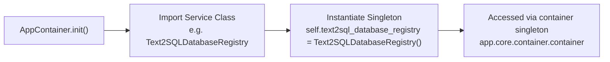
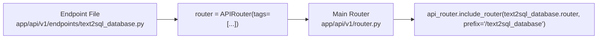
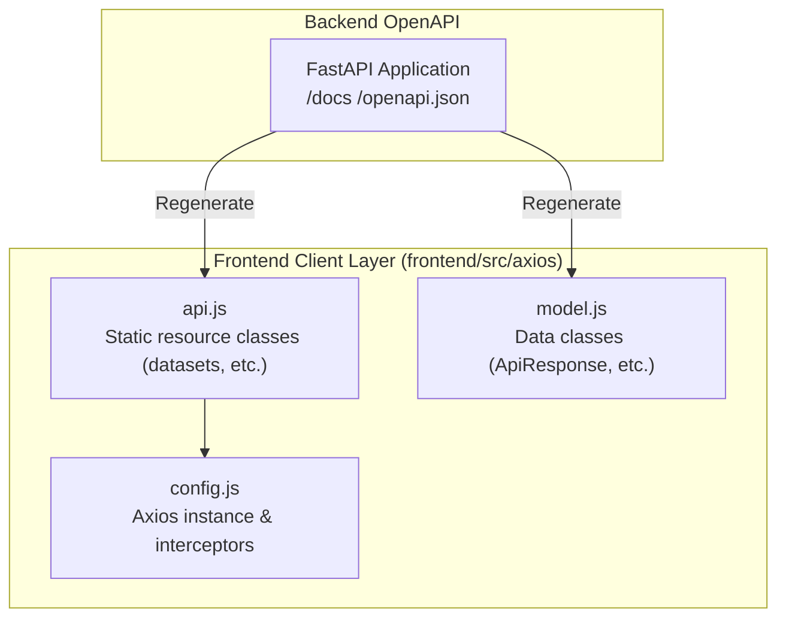

<!-- source: DeepWiki mcp.deepwiki.com · repo OpenDCAI/DataFlow-WebUI · page 10.3 Extending the API and Frontend · fetched 2026-11-02 -->

# Extending the API and Frontend

<details>
<summary>Relevant source files</summary>

The following files were used as context for generating this wiki page:

- [backend/app/api/v1/endpoints/preferences.py](backend/app/api/v1/endpoints/preferences.py)
- [backend/app/api/v1/endpoints/text2sql_database.py](backend/app/api/v1/endpoints/text2sql_database.py)
- [backend/app/api/v1/router.py](backend/app/api/v1/router.py)
- [backend/app/core/container.py](backend/app/core/container.py)
- [backend/app/core/logger_setup.py](backend/app/core/logger_setup.py)
- [backend/app/schemas/preferences.py](backend/app/schemas/preferences.py)
- [backend/app/schemas/text2sql_database.py](backend/app/schemas/text2sql_database.py)
- [backend/app/services/text2sql_database_registry.py](backend/app/services/text2sql_database_registry.py)
- [frontend/public/favicon.ico](frontend/public/favicon.ico)
- [frontend/src/assets/logo/logo.ico](frontend/src/assets/logo/logo.ico)
- [frontend/src/axios/api.js](frontend/src/axios/api.js)
- [frontend/src/axios/model.js](frontend/src/axios/model.js)
- [frontend/src/router/Manage/index.js](frontend/src/router/Manage/index.js)
- [frontend/src/router/index.js](frontend/src/router/index.js)

</details>


This page covers the technical procedure for extending both the backend REST API and the Vue 3 frontend in DataFlow-WebUI. It details how to implement FastAPI routers and services, register them in the dependency container and main API router, regenerate the Axios client layer from OpenAPI specifications, and consistently integrate new frontend views and routes into the Vue application.

For broader architectural details, see [Backend Services](#3) and [Frontend Application](#4). For specific endpoint definitions and schemas, consult the [API Reference](#5).

---

## 1. Backend Extension Workflow

Adding a new feature to the backend involves four main steps: implementing a service registry or logic layer, defining Pydantic request/response schemas, creating a FastAPI APIRouter endpoint file, and registering the service in the dependency container and main router.

### Backend Architecture and Code Entities

The diagram below bridges the natural language concept of backend feature extension to the concrete code entities (`AppContainer`, `api_router`, registries, and endpoint modules) involved in the process.

```mermaid
graph TB
    subgraph "NaturalLanguageSpace["Natural Language Concepts"]"
        NLService["Business Logic / Storage"]
        NLRouter["API Endpoints"]
        NLContainer["Service Container"]
        NLMainRouter["API Route Aggregator"]
    end

    subgraph "CodeEntitySpace["Code Entity Space"]"
        ServiceClass["Text2SQLDatabaseRegistry<br/>app/services/text2sql_database_registry.py"]
        EndpointModule["text2sql_database.py<br/>app/api/v1/endpoints/text2sql_database.py"]
        ContainerInstance["container: AppContainer<br/>app/core/container.py"]
        MainRouter["api_router: APIRouter<br/>app/api/v1/router.py"]
    end

    NLService --> ServiceClass
    NLRouter --> EndpointModule
    NLContainer --> ContainerInstance
    NLMainRouter --> MainRouter

    ContainerInstance --> ServiceClass
    MainRouter --> EndpointModule
```

**Sources:** [backend/app/core/container.py:3-56](), [backend/app/api/v1/router.py:1-28](), [backend/app/services/text2sql_database_registry.py:40-200]()

---

## 2. Registering Services and Routers

### Service Container Registration

To avoid circular imports and ensure a controlled initialization order, services are managed by the `AppContainer` class defined in `backend/app/core/container.py`. When adding a new service or registry, initialize it within the `init()` method of `AppContainer`.



**Sources:** [backend/app/core/container.py:20-56]()

### API Router Registration

Once endpoint functions are defined using `APIRouter` (e.g., in `backend/app/api/v1/endpoints/text2sql_database.py`), the router must be included in the central `api_router` instance.



**Sources:** [backend/app/api/v1/router.py:1-28](), [backend/app/api/v1/endpoints/text2sql_database.py:1-18]()

---

## 3. Frontend Client Regeneration

DataFlow-WebUI uses an OpenAPI-driven Axios client layer located in `frontend/src/axios/`. When backend endpoints, request bodies, or response schemas change, the client wrapper classes and models must be regenerated to maintain type safety and API synchronization.

### Axios Client and Model Structure

The frontend interacts with backend APIs through static methods grouped by resource domains (e.g., `datasets`, `pipelines`) in `frontend/src/axios/api.js`, backed by data models in `frontend/src/axios/model.js`.



**Sources:** [frontend/src/axios/api.js:1-61](), [frontend/src/axios/model.js:1-33]()

---

## 4. Frontend Routing and View Extension

Frontend views are structured around a main workspace and a management layout nested under the `/m` route prefix.

### Frontend Views and Routing Architecture

The diagram below bridges the natural language concept of adding user interfaces to the actual Vue router and view components.

```mermaid
graph TB
    subgraph "NaturalLanguageSpace["Natural Language Concepts"]"
        NLMainRoute["Main Application Root"]
        NLManageRoutes["Management Views (Serving, DBManager, Settings)"]
        NLViewComponents["Vue Single File Components"]
    end

    subgraph "CodeEntitySpace["Code Entity Space"]"
        MainRouterConfig["router: createRouter<br/>frontend/src/router/index.js"]
        ManageSubRouter["Manage<br/>frontend/src/router/Manage/index.js"]
        AsyncView["AsyncLoad(() => import('@/views/...'))"]
    end

    NLMainRoute --> MainRouterConfig
    NLManageRoutes --> ManageSubRouter
    NLViewComponents --> AsyncView

    MainRouterConfig --> ManageSubRouter
    ManageSubRouter --> AsyncView
```

**Sources:** [frontend/src/router/index.js:1-31](), [frontend/src/router/Manage/index.js:1-66]()

### Management Sub-Routes Integration

When adding a new management panel or administrative view:
1. Create the view component under `frontend/src/views/manage/{feature}/index.vue`.
2. Register the route inside the management router definition `frontend/src/router/Manage/index.js`:

```javascript
{
    path: 'dm',
    component: () => AsyncLoad(() => import('@/views/manage/dbManager/index.vue')),
    meta: {
        title: 'Dataflow-DBManager'
    }
}
```[frontend/src/router/Manage/index.js:20-26]()

3. Link the view from navigation components to allow seamless user access.

---

## 5. End-to-End Extension Checklist

When implementing a complete feature spanning both backend and frontend, follow this checklist to ensure all integration points are satisfied:

| Layer | Component | Actions Required | Code Pointer |
|-------|-----------|------------------|--------------|
| **Backend Storage** | Registry Class | Implement persistence methods (YAML/JSON) | [backend/app/services/text2sql_database_registry.py:40-200]() |
| **Backend DI** | Container | Instantiate service in `AppContainer.init()` | [backend/app/core/container.py:20-56]() |
| **Backend Schemas** | Pydantic Models | Define `*In`, `*Out`, and query schemas | [backend/app/schemas/text2sql_database.py]() |
| **Backend API** | APIRouter | Implement endpoints using `ApiResponse` and `ok()` | [backend/app/api/v1/endpoints/text2sql_database.py:1-55]() |
| **Backend Router** | Main Router | Include router via `api_router.include_router()` | [backend/app/api/v1/router.py:14-28]() |
| **Frontend API** | Axios Client | Regenerate or update `api.js` and `model.js` | [frontend/src/axios/api.js:1-61]() |
| **Frontend Views** | SFC Component | Author view components under `frontend/src/views/` | [frontend/src/router/Manage/index.js:1-66]() |
| **Frontend Router**| Vue Router | Register view routes under `/m` or root | [frontend/src/router/Manage/index.js:6-62]() |

**Sources:** [backend/app/core/container.py:20-56](), [backend/app/api/v1/router.py:14-28](), [frontend/src/router/Manage/index.js:1-66]()

---

