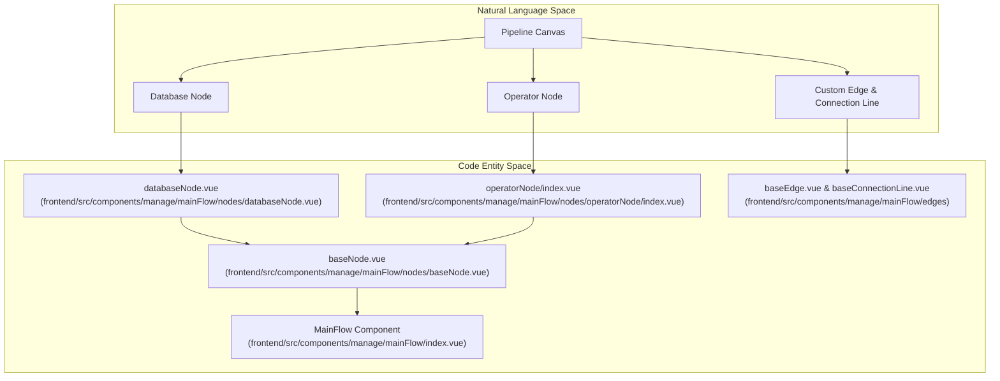
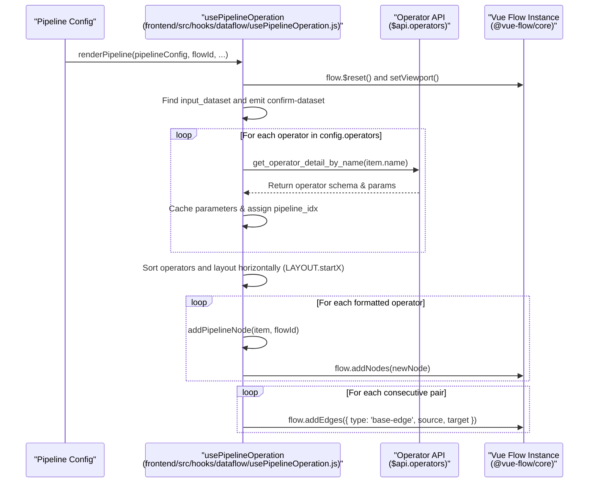

<!-- source: DeepWiki mcp.deepwiki.com · repo OpenDCAI/DataFlow-WebUI · page 4.2 Pipeline Visualization · fetched 2026-11-02 -->

# Pipeline Visualization

Relevant source files

The following files were used as context for generating this wiki page:

- [backend/app/services/agents/claude_adapter.py](backend/app/services/agents/claude_adapter.py)
- [backend/app/services/pipeline_compile_check.py](backend/app/services/pipeline_compile_check.py)
- [frontend/package.json](frontend/package.json)
- [frontend/src/assets/ui/pipeline.jpg](frontend/src/assets/ui/pipeline.jpg)
- [frontend/src/components/general/loading.vue](frontend/src/components/general/loading.vue)
- [frontend/src/components/general/timeRounder.vue](frontend/src/components/general/timeRounder.vue)
- [frontend/src/components/manage/chatPanel/index.vue](frontend/src/components/manage/chatPanel/index.vue)
- [frontend/src/components/manage/mainFlow/edges/baseConnectionLine.vue](frontend/src/components/manage/mainFlow/edges/baseConnectionLine.vue)
- [frontend/src/components/manage/mainFlow/edges/baseEdge.vue](frontend/src/components/manage/mainFlow/edges/baseEdge.vue)
- [frontend/src/components/manage/mainFlow/index.vue](frontend/src/components/manage/mainFlow/index.vue)
- [frontend/src/components/manage/mainFlow/nodes/baseNode.vue](frontend/src/components/manage/mainFlow/nodes/baseNode.vue)
- [frontend/src/components/manage/mainFlow/nodes/databaseNode.vue](frontend/src/components/manage/mainFlow/nodes/databaseNode.vue)
- [frontend/src/components/manage/mainFlow/nodes/operatorNode/index.vue](frontend/src/components/manage/mainFlow/nodes/operatorNode/index.vue)
- [frontend/src/hooks/dataflow/useEdgeSync.js](frontend/src/hooks/dataflow/useEdgeSync.js)
- [frontend/src/hooks/dataflow/usePipelineOperation.js](frontend/src/hooks/dataflow/usePipelineOperation.js)
- [frontend/src/style/dataflow.scss](frontend/src/style/dataflow.scss)
- [frontend/yarn.lock](frontend/yarn.lock)

## Purpose and Scope

This page documents the pipeline visualization system, which provides the interactive visual canvas for building and viewing AI/ML data processing pipelines. It leverages Vue Flow (`@vue-flow/core`) to render node-based graphs comprising base nodes, operator nodes (`operatorNode`), database nodes (`databaseNode`), custom edges (`baseEdge`), and connection lines (`baseConnectionLine`).

Sources: [frontend/package.json:17-18](), [frontend/src/components/manage/mainFlow/index.vue:32-44]()

---

## Vue Flow Integration and Theming

The visualization layer is mounted via `MainFlow` (`frontend/src/components/manage/mainFlow/index.vue`), which hosts the `<VueFlow>` instance. It supports dynamic theming (light and dark mode) by mapping CSS variables like `--node-background`, `--node-border-color`, and `--node-shadow-color` inside `baseNode.vue` and applying `@vue-flow/core/dist/style.css` and `@vue-flow/core/dist/theme-default.css`.

### Natural Language Space to Code Entity Space: UI Components & Flows

Sources: [frontend/src/components/manage/mainFlow/index.vue:1-44](), [frontend/src/components/manage/mainFlow/nodes/baseNode.vue:1-122](), [frontend/src/components/manage/mainFlow/nodes/databaseNode.vue:1-83](), [frontend/src/components/manage/mainFlow/nodes/operatorNode/index.vue:1-75]()

---

## Node Components: Base, Operator, and Database Nodes

Nodes are structured hierarchically: `baseNode.vue` acts as the generic container providing the banner, icon block, delete controls, and default source/target handles (`Handle` from `@vue-flow/core`).

### Operator Nodes (`operatorNode`)

`operatorNode/index.vue` extends base node rendering by injecting init parameters, prompt template comboboxes (`fv-combobox`), run parameters with individual handles (`Handle`), and real-time execution logs/progress bars (`fv-progress-bar`, `fv-progress-ring`).

### Database Nodes (`databaseNode`)

`databaseNode.vue` represents the input dataset source (`db-node`). It loads dataset columns via API (`$api.datasets.get_dataset_columns`) and populates run parameters dynamically so that downstream operators can link to dataset columns.

Sources: [frontend/src/components/manage/mainFlow/nodes/baseNode.vue:1-121](), [frontend/src/components/manage/mainFlow/nodes/databaseNode.vue:1-179](), [frontend/src/components/manage/mainFlow/nodes/operatorNode/index.vue:1-74]()

---

## Edges and Connection Lines

Edges govern sequence order and data flow mapping between nodes.

### Base Edges (`baseEdge`)

`baseEdge.vue` implements custom SVG Bezier paths (`getBezierPath`) enhanced with linear gradients (`#edge-gradient`) and drop shadow filters (`#edge-glow`), coupled with `EdgeLabelRenderer` for HTML-rendered edge labels.

### Connection Lines (`baseConnectionLine`)

`baseConnectionLine.vue` renders the interactive line displayed while dragging a connection between handles, featuring a customized SVG circle indicator at the target coordinate.

Sources: [frontend/src/components/manage/mainFlow/edges/baseEdge.vue:1-124](), [frontend/src/components/manage/mainFlow/edges/baseConnectionLine.vue:1-85]()

---

## Pipeline Rendering via `usePipelineOperation`

The `usePipelineOperation` composable translates declarative pipeline configuration objects into visual graphs on the Vue Flow canvas.

### Natural Language Space to Code Entity Space: Rendering Pipeline Flow

Sources: [frontend/src/hooks/dataflow/usePipelineOperation.js:9-179]()

---

## Edge Synchronization (`useEdgeSync`)

The `useEdgeSync` hook provides automatic connection and synchronization logic. When auto-connection mode is enabled (`isAutoConnection`), drawing a node edge triggers `autoConnectRunEdges()`, which maps matching parameters between connected nodes. Updating run parameter values invokes `syncRunValue()`, propagating data flow across connected `run_key` edges.

Sources: [frontend/src/components/manage/mainFlow/index.vue:27-32](), [frontend/src/components/manage/mainFlow/index.vue:186](), [frontend/src/hooks/dataflow/useEdgeSync.js:1-1]()

---

