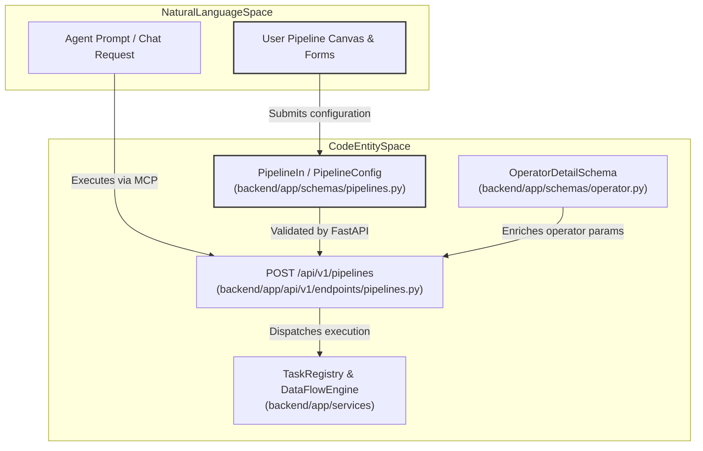
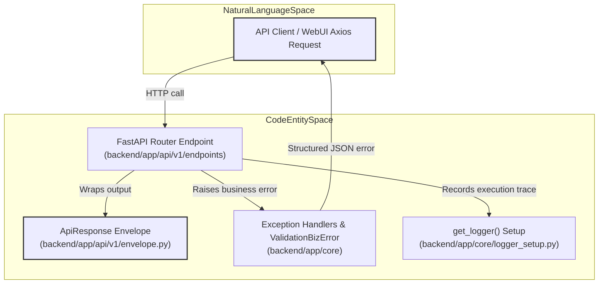

<!-- source: DeepWiki mcp.deepwiki.com · repo OpenDCAI/DataFlow-WebUI · page 6 Data Models and Schemas · fetched 2026-11-02 -->

# Data Models and Schemas

Relevant source files

The following files were used as context for generating this wiki page:

- [backend/app/api/v1/endpoints/pipelines.py](backend/app/api/v1/endpoints/pipelines.py)
- [backend/app/schemas/pipelines.py](backend/app/schemas/pipelines.py)
- [backend/app/schemas/task.py](backend/app/schemas/task.py)
- [backend/app/services/pipeline_registry.py](backend/app/services/pipeline_registry.py)
- [backend/tests/__init__.py](backend/tests/__init__.py)
- [backend/tests/conftest.py](backend/tests/conftest.py)

## Purpose and Scope

This page provides a high-level reference for the Pydantic models, data schemas, API response envelopes, and error handling structures implemented in the DataFlow-WebUI codebase. These data structures ensure type safety, validation, and serialization across the FastAPI backend, service registries, and Vue 3 frontend.

As a parent page, this document summarizes the main structural categories. For comprehensive details, please refer to the dedicated child pages:
- **Pipeline Data Models**: See [Pipeline Data Models](#6.1) for `PipelineConfig`, `PipelineOperator`, `PipelineInputDataset`, execution models, and validation issue structures [backend/app/schemas/pipelines.py:1-142]().
- **Operator Data Models**: See [Operator Data Models](#6.2) for `OperatorSchema`, `OperatorDetailSchema`, parameter structures, and metadata extraction [backend/app/schemas/operator.py:1-55]().
- **API Envelope and Error Handling**: See [API Envelope and Error Handling](#6.3) for response wrappers (`ApiResponse`), business error types, and exception handlers.

---

## High-Level Architecture and Data Flow

The following diagram bridges the **Natural Language Space** (conceptual workflow definitions and user inputs) to the **Code Entity Space** (concrete Pydantic models and backend endpoints in `backend/app/schemas/` and `backend/app/api/v1/`).

Sources: [backend/app/schemas/pipelines.py:1-142](), [backend/app/api/v1/endpoints/pipelines.py:1-118]()

---

## 6.1 Pipeline Data Models

Pipeline data models define how workflows, execution steps, and validation results are structured. They manage everything from the canvas coordinates of an operator to the sequential array of steps executed by the runtime engine.

- **`PipelineOperator` & `PipelineInputDataset`**: Represent individual nodes and input sources placed on the canvas, recording locations `(x, y)` and parameters [backend/app/schemas/pipelines.py:37-53]().
- **`PipelineConfig`**: Core structure combining `file_path`, `input_dataset`, and an ordered `operators` list [backend/app/schemas/pipelines.py:55-68]().
- **`PipelineIn`, `PipelineUpdateIn`, & `PipelineOut`**: Encapsulate payloads for creating, updating, and querying saved pipelines with metadata and `ExecutionStatus` [backend/app/schemas/pipelines.py:70-94]().
- **`PipelineValidationResult` & `PipelineValidationIssue`**: Convey static diagnostics, syntax warnings, field-flow mismatches, and repair hints during configuration validation [backend/app/schemas/pipelines.py:121-142]().

For detailed specifications, field definitions, and validation workflows, see [Pipeline Data Models](#6.1).

Sources: [backend/app/schemas/pipelines.py:1-142](), [backend/app/api/v1/endpoints/pipelines.py:64-80]()

---

## 6.2 Operator Data Models

Operator data models represent the metadata, types, and parameter signatures of data processing operators discovered across the system. 

- **`OperatorSchema`**: A lightweight model used for catalog listing in the frontend UI, containing operator names, classification types (`level_1`, `level_2`), and allowed prompts [backend/app/schemas/operator.py:1-10]().
- **`OperatorParameterSchema` & `ParameterGroupsSchema`**: Introspect method signatures to separate initialization parameters (`__init__`) from runtime parameters (`run`) [backend/app/schemas/operator.py:16-31]().
- **`OperatorDetailSchema`**: Comprehensive metadata including detailed descriptions and full parameter specs [backend/app/schemas/operator.py:34-48]().

For detailed introspection mechanics and schema generation flows, see [Operator Data Models](#6.2).

Sources: [backend/app/schemas/operator.py:1-55](), [backend/app/services/pipeline_registry.py:1-62]()

---

## 6.3 API Envelope and Error Handling

The API envelope and error-handling layer ensure consistent response formatting and robust exception management across all REST endpoints.

Sources: [backend/app/api/v1/envelope.py:1-11](), [backend/app/api/v1/endpoints/pipelines.py:21-62]()

- **Standard Response Envelope**: Wraps payloads in an `ApiResponse` structure using helper functions like `ok()` and `created()` [backend/app/api/v1/endpoints/pipelines.py:11-12]().
- **Business Errors**: Specialized exception types (such as validation or dataflow engine errors) that translate to clear HTTP status codes.
- **Exception Handlers & Logging**: Centralized handlers catch unhandled exceptions and record structured logs via `get_logger()` [backend/app/api/v1/endpoints/pipelines.py:13-16]().

For complete implementation details on response codes, error types, and middleware handlers, see [API Envelope and Error Handling](#6.3).

Sources: [backend/app/api/v1/endpoints/pipelines.py:11-30](), [backend/app/api/v1/envelope.py:1-11]()

---

