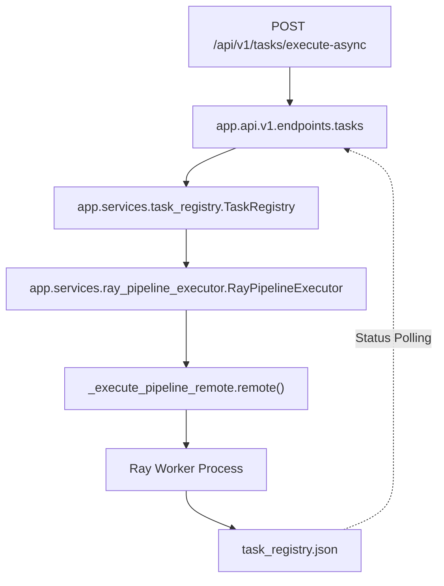
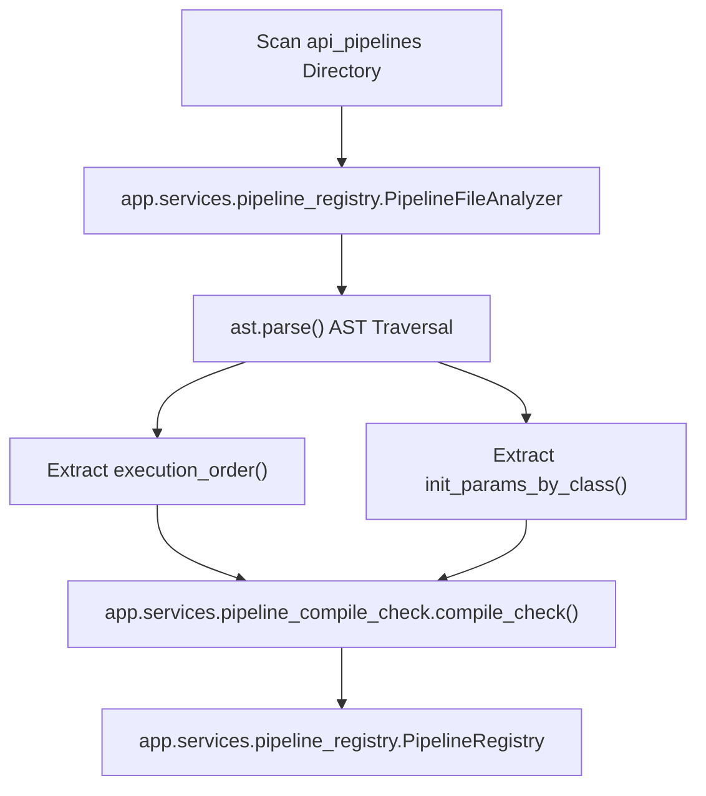
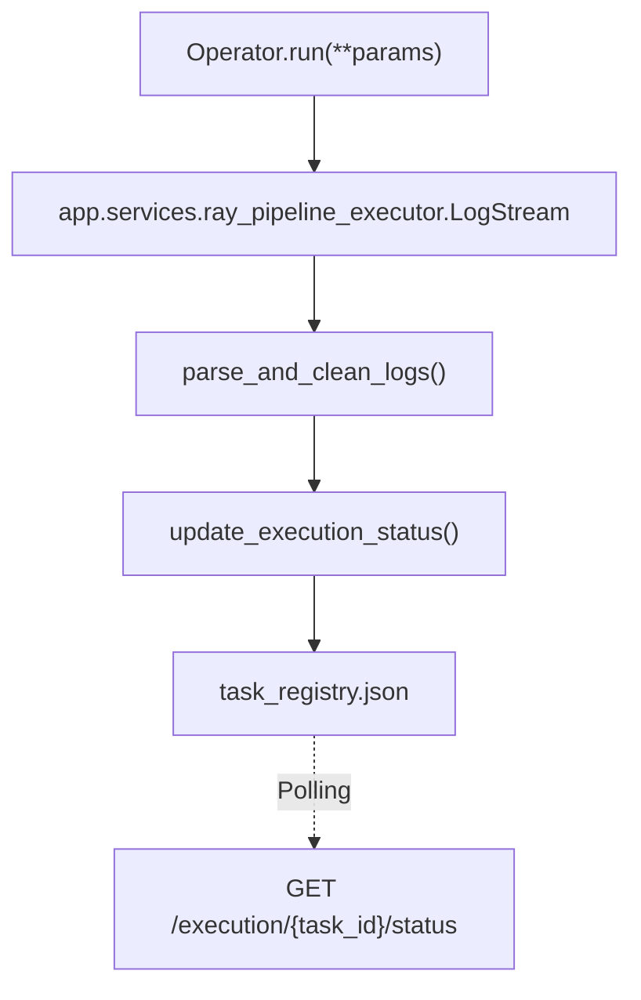
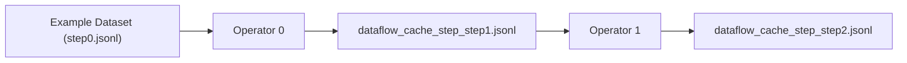

<!-- source: DeepWiki mcp.deepwiki.com · repo OpenDCAI/DataFlow-WebUI · page 7 Advanced Topics · fetched 2026-11-02 -->

# Advanced Topics

Relevant source files

The following files were used as context for generating this wiki page:

- [backend/app/services/dataflow_engine.py](backend/app/services/dataflow_engine.py)
- [backend/app/services/param_coercion.py](backend/app/services/param_coercion.py)
- [backend/app/services/ray_pipeline_executor.py](backend/app/services/ray_pipeline_executor.py)

This section covers advanced architectural features and implementation details for power users, system administrators, and contributors who need a deep understanding of DataFlow-WebUI's underlying execution mechanisms. Topics span distributed background task execution, static pipeline analysis via AST parsing, real-time logging and progress tracking, and file-based caching storage abstractions.

For information about basic pipeline creation and configuration, see [Pipelines](#2.1). For API endpoint usage, see [Task Execution Endpoints](#5.2). For extending the system with custom operators, see [Development Guide](#10).

---

## 7.1 Distributed Execution with Ray

DataFlow-WebUI leverages [Ray](https://www.ray.io) to handle asynchronous, non-blocking background execution of data processing pipelines. The `RayPipelineExecutor` class coordinates task submissions from FastAPI endpoints to isolated worker processes, ensuring that long-running LLM workflows do not starve the main server loop [backend/app/services/ray_pipeline_executor.py:1-40]().

The execution coordinator communicates with `TaskRegistry` via file-backed state updates, managing task lifecycles from initial queueing through execution to completion or cancellation [backend/app/services/ray_pipeline_executor.py:162-210](), [backend/app/services/task_registry.py:250-320]().

Title: Ray Distributed Execution Architecture

For details, see [Distributed Execution with Ray](#7.1).

Sources: [backend/app/services/ray_pipeline_executor.py:1-210](), [backend/app/services/task_registry.py:250-320]()

---

## 7.2 Pipeline File Analysis and Validation

To achieve zero-configuration pipeline discovery, DataFlow-WebUI scans Python pipeline files under `api_pipelines/` and inspects their structure using Python's Abstract Syntax Tree (AST) module. The `PipelineFileAnalyzer` class extracts operator execution orders, initialization arguments, and runtime parameters statically [backend/app/services/pipeline_registry.py:17-150]().

Additionally, static validation routines such as `pipeline_compile_check` verify structural integrity, field referencing, serving bindings, and dynamic lambda/def code parameters before execution is permitted [backend/app/services/ray_pipeline_executor.py:23-24](), [backend/app/services/pipeline_registry.py:300-450]().

Title: Pipeline AST Analysis Flow

For details, see [Pipeline File Analysis and Validation](#7.2).

Sources: [backend/app/services/pipeline_registry.py:17-150](), [backend/app/services/ray_pipeline_executor.py:23-24]()

---

## 7.3 Real-time Execution Monitoring

Monitoring active pipeline executions requires capturing standard output and standard error streams in real time while parsing progress indicators such as `tqdm` status bars. The `LogStream` class subclasses `io.StringIO` to intercept worker stdout, parse percentage completion metrics, and throttle updates to disk [backend/app/services/ray_pipeline_executor.py:45-98]().

Operator-level metrics, logs, and statuses are written continuously to task files, allowing the frontend application to poll execution states and render live progress bars and log panels [backend/app/services/ray_pipeline_executor.py:162-200](), [backend/app/services/task_registry.py:259-293]().

Title: Real-time Monitoring and Log Streaming

For details, see [Real-time Execution Monitoring](#7.3).

Sources: [backend/app/services/ray_pipeline_executor.py:45-200](), [backend/app/services/task_registry.py:259-293]()

---

## 7.4 Storage and Caching

Data flow between sequential pipeline operators is managed via the `FileStorage` abstraction (`dataflow.utils.storage`) [backend/app/services/dataflow_engine.py:3](), [backend/app/services/ray_pipeline_executor.py:4](). Each operator consumes records from an input cache file and serializes outputs to the subsequent step's file [backend/app/services/ray_pipeline_executor.py:219-235](), [backend/app/services/ray_pipeline_executor.py:449-567]().

Intermediate datasets are stored as line-delimited JSON (`.jsonl`) files under `backend/data/cache_local/{task_id}_output/`. This structured layout enables direct step inspection, selective result sample retrieval, and complete execution artifact downloads [backend/app/services/task_registry.py:326-434](), [backend/app/api/v1/endpoints/tasks.py:118-192]().

Title: FileStorage and Cache Stepping Architecture

For details, see [Storage and Caching](#7.4).

Sources: [backend/app/services/dataflow_engine.py:3](), [backend/app/services/ray_pipeline_executor.py:219-235](), [backend/app/services/task_registry.py:326-434](), [backend/app/api/v1/endpoints/tasks.py:118-192]()

---

