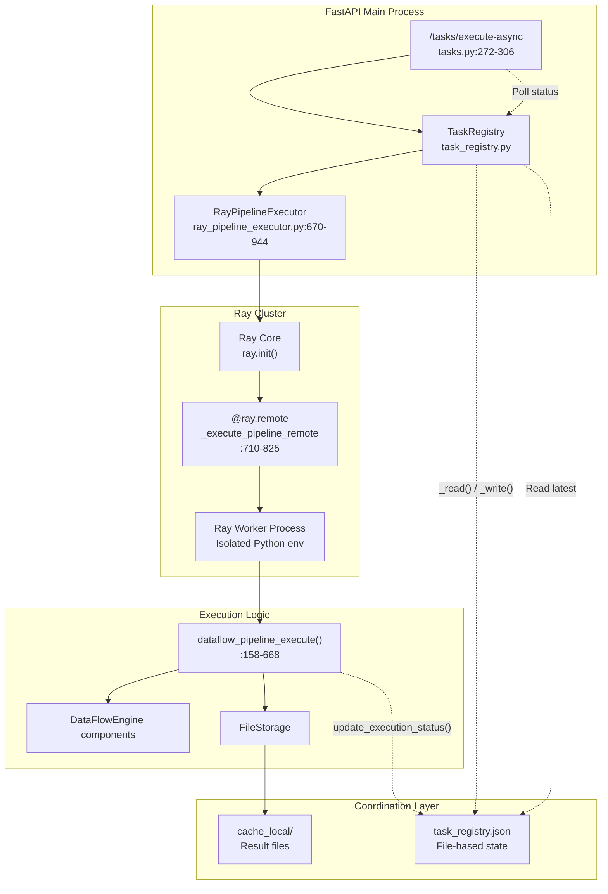
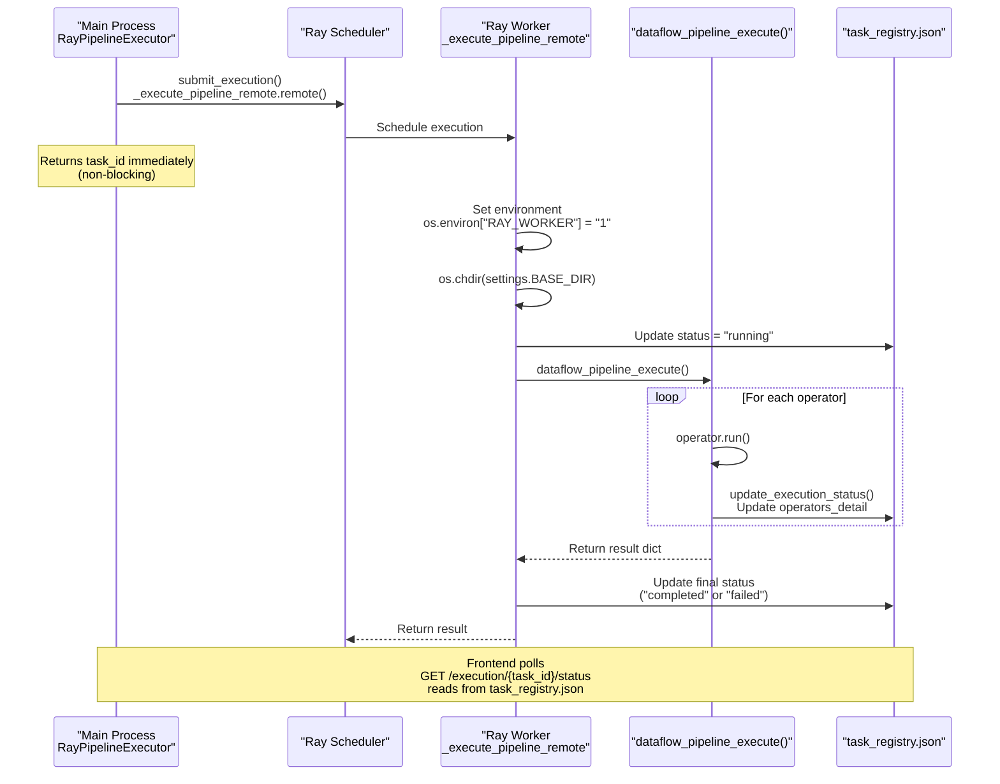
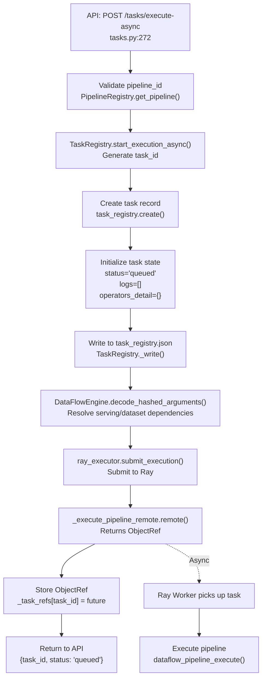
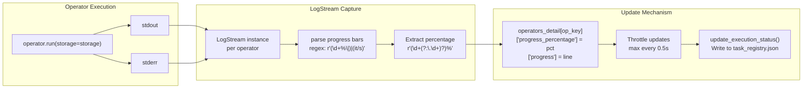
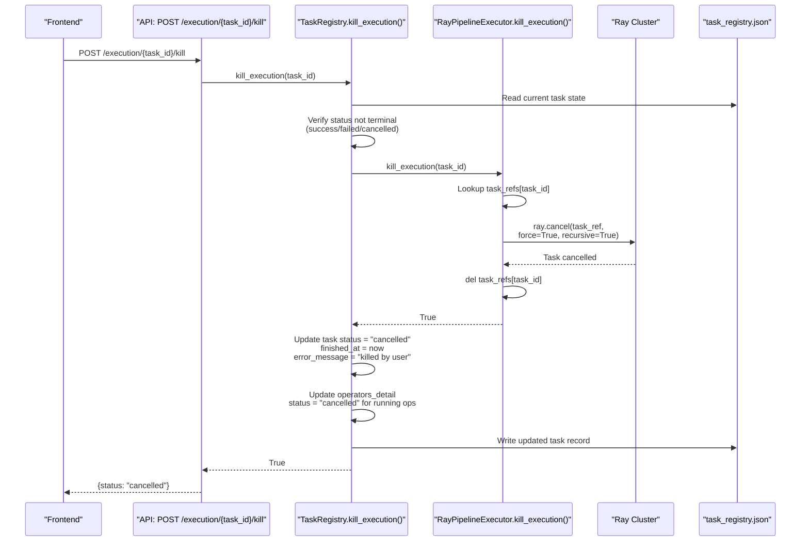
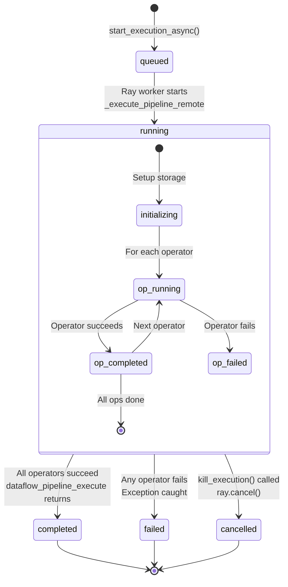

<!-- source: DeepWiki mcp.deepwiki.com · repo OpenDCAI/DataFlow-WebUI · page 7.1 Distributed Execution with Ray · fetched 2026-11-02 -->

# Distributed Execution with Ray

<details>
<summary>Relevant source files</summary>

The following files were used as context for generating this wiki page:

- [backend/app/api/v1/endpoints/tasks.py](backend/app/api/v1/endpoints/tasks.py)
- [backend/app/services/dataflow_engine.py](backend/app/services/dataflow_engine.py)
- [backend/app/services/param_coercion.py](backend/app/services/param_coercion.py)
- [backend/app/services/ray_pipeline_executor.py](backend/app/services/ray_pipeline_executor.py)
- [backend/app/services/task_registry.py](backend/app/services/task_registry.py)

</details>


This document explains how DataFlow-WebUI implements distributed pipeline execution using [Ray](https://www.ray.io), a framework for building distributed applications. Ray enables asynchronous, non-blocking pipeline execution where workers run in separate processes, isolated from the main FastAPI server.

For information about the synchronous execution path, see [DataFlow Engine](#3.3). For details on how task status is tracked and persisted, see [Task Registry and Execution](#3.2). For monitoring and real-time status updates, see [Real-time Execution Monitoring](#7.3).

---

## Overview

The Ray integration provides:

- **Asynchronous execution**: Pipelines run in isolated Ray workers without blocking the API server
- **Task isolation**: Each execution runs in a separate process with its own Python environment
- **Cancellation support**: Running tasks can be forcibly terminated via `ray.cancel()`
- **File-based coordination**: Main process and Ray workers coordinate through `task_registry.json` updates
- **Real-time progress tracking**: Custom `LogStream` class captures stdout/stderr and parses progress bars

The system uses a **single-worker architecture** (`max_concurrency=1`) to prevent resource contention, meaning only one pipeline executes at a time.

Sources: [backend/app/services/ray_pipeline_executor.py:1-944](), [backend/app/services/task_registry.py:436-516]()

---

## System Architecture



**Diagram: Ray Execution Architecture**

The main FastAPI process submits tasks to Ray, which schedules execution in isolated worker processes. Workers execute `dataflow_pipeline_execute()` and update status by directly modifying `task_registry.json`. The API polls this file to report status to the frontend.

Sources: [backend/app/services/ray_pipeline_executor.py:670-944](), [backend/app/services/task_registry.py:436-516](), [backend/app/api/v1/endpoints/tasks.py:272-306]()

---

## RayPipelineExecutor Class

The `RayPipelineExecutor` class manages the Ray cluster lifecycle and task submission.

### Key Attributes

| Attribute | Type | Purpose |
|-----------|------|---------|
| `max_concurrency` | `int` | Maximum parallel executions (hardcoded to 1) |
| `_initialized` | `bool` | Tracks whether Ray has been initialized |
| `_task_refs` | `Dict[str, ray.ObjectRef]` | Maps task_id to Ray task references for cancellation |

### Key Methods

| Method | Purpose | Returns |
|--------|---------|---------|
| `_ensure_initialized()` | Lazy-initializes Ray cluster on first use | `None` |
| `submit_execution()` | Submits pipeline to Ray for async execution | `str` (task_id) |
| `_execute_pipeline_remote()` | Static method decorated with `@ray.remote`, executes in worker | `Dict[str, Any]` |
| `kill_execution()` | Cancels running Ray task using `ray.cancel()` | `bool` |
| `shutdown()` | Shuts down Ray cluster | `None` |

Sources: [backend/app/services/ray_pipeline_executor.py:670-707]()

---

## Ray Initialization

Ray is initialized lazily on the first task submission using `_ensure_initialized()`:

```python
def _ensure_initialized(self):
    if not self._initialized:
        if not ray.is_initialized():
            ray.init(
                num_cpus=self.max_concurrency,  # 1 CPU
                ignore_reinit_error=True,
                log_to_driver=True,
                logging_level="info"
            )
        self._initialized = True
```

**Configuration:**
- `num_cpus=1`: Limits to single concurrent execution
- `ignore_reinit_error=True`: Allows reinitialization if Ray was previously shut down
- `log_to_driver=True`: Routes Ray worker logs to main process stdout

Sources: [backend/app/services/ray_pipeline_executor.py:689-708]()

---

## Remote Execution with @ray.remote

The core execution logic runs in a Ray worker via the `@ray.remote` decorator:



**Diagram: Remote Execution Flow**

The `@ray.remote` decorator on `_execute_pipeline_remote()` [backend/app/services/ray_pipeline_executor.py:710-825]() creates a serializable function that Ray can execute in a worker process. The method:

1. Sets `RAY_WORKER` environment variable to identify worker context
2. Changes working directory to `settings.BASE_DIR` for consistent file paths
3. Updates status to "running" in `task_registry.json`
4. Calls `dataflow_pipeline_execute()` with full pipeline configuration
5. Updates final status ("completed" or "failed") to the file

Sources: [backend/app/services/ray_pipeline_executor.py:710-825](), [backend/app/services/ray_pipeline_executor.py:158-668]()

---

## Task Submission Flow



**Diagram: Task Submission Process**

### Key Steps

1. **API Layer** [backend/app/api/v1/endpoints/tasks.py:272-306](): Receives POST request with `pipeline_id`
2. **Task Creation** [backend/app/services/task_registry.py:436-516](): 
   - Generates unique `task_id` via `_generate_task_id()`
   - Creates initial task record with status "queued"
   - Writes to `task_registry.json`
3. **Dependency Resolution** [backend/app/services/task_registry.py:501]():
   - `DataFlowEngine.decode_hashed_arguments()` resolves serving instances, datasets, prompts
   - Creates `dataflow_runtime` dict with resolved dependencies
4. **Ray Submission** [backend/app/services/ray_pipeline_executor.py:827-876]():
   - Calls `ray_executor.submit_execution()`
   - Returns `ObjectRef` immediately (non-blocking)
   - Stores reference in `_task_refs` for later cancellation
5. **API Response**: Returns `{task_id, status: "queued"}` to client

Sources: [backend/app/api/v1/endpoints/tasks.py:272-306](), [backend/app/services/task_registry.py:436-516](), [backend/app/services/ray_pipeline_executor.py:827-876]()

---

## File-Based Coordination

The main process and Ray workers coordinate through direct file I/O on `task_registry.json`:

| Operation | Performed By | File Location | Purpose |
|-----------|--------------|---------------|---------|
| **Create task** | Main Process | [backend/app/services/task_registry.py:81-109]() | Initial task record with status "queued" |
| **Update to "running"** | Ray Worker | [backend/app/services/ray_pipeline_executor.py:781-790]() | Mark execution start |
| **Real-time updates** | Ray Worker | [backend/app/services/ray_pipeline_executor.py:180-200]() | Update `operators_detail` during execution |
| **Final update** | Ray Worker | [backend/app/services/ray_pipeline_executor.py:796-804]() | Write complete result with status "completed"/"failed" |
| **Status polling** | Main Process | [backend/app/services/task_registry.py:259-293]() | Read latest status for API responses |
| **Cancellation** | Main Process | [backend/app/services/task_registry.py:518-588]() | Mark as "cancelled" after Ray task killed |

### update_execution_status() Function

The `update_execution_status()` function [backend/app/services/ray_pipeline_executor.py:180-200]() enables real-time status updates from the Ray worker:

```python
def update_execution_status(status: str = None, partial_output: Dict[str, Any] = None):
    """实时更新执行状态到文件"""
    try:
        with open(execution_path, "r", encoding="utf-8") as f:
            data = json.load(f)
        if task_id in data.get("tasks", {}):
            if status:
                data["tasks"][task_id]["status"] = status
            if partial_output:
                if "output" not in data["tasks"][task_id]:
                    data["tasks"][task_id]["output"] = {}
                data["tasks"][task_id]["output"].update(partial_output)
            with open(execution_path, "w", encoding="utf-8") as f:
                json.dump(data, f, indent=2)
    except Exception as e:
        logger.error(f"Failed to update execution status: {e}")
```

**Usage:** Called by Ray worker to update:
- Operator-level status (initializing → running → completed/failed)
- Progress percentages from `LogStream`
- Log messages per operator

Sources: [backend/app/services/ray_pipeline_executor.py:180-200](), [backend/app/services/ray_pipeline_executor.py:461-468](), [backend/app/services/ray_pipeline_executor.py:557-561]()

---

## Real-Time Logging with LogStream

The `LogStream` class captures stdout/stderr from operators and parses progress information:



**Diagram: LogStream Progress Tracking**

### Implementation

The `LogStream` class [backend/app/services/ray_pipeline_executor.py:41-94]() extends `io.StringIO` and overrides `write()`:

**Key attributes:**
- `op_key`: Operator identifier (e.g., `FilterOperator_0`)
- `operators_detail`: Shared dict containing all operator states
- `update_func`: Reference to `update_execution_status()`
- `update_interval`: Throttle to 0.5 seconds between disk writes

**Progress bar parsing:**
- **Pattern matching**: `r'(\d+%\|)|(it/s)|(s/it)'` detects tqdm-style progress bars
- **Percentage extraction**: `r'(\d+(?:\.\d+)?)%'` extracts numeric percentage
- **Carriage return handling**: Strips `\r` characters to avoid log pollution

Sources: [backend/app/services/ray_pipeline_executor.py:41-94](), [backend/app/services/ray_pipeline_executor.py:118-156]()

---

## Task Cancellation

Ray tasks can be forcibly terminated using `ray.cancel()`:



**Diagram: Task Cancellation Flow**

### Implementation Details

**RayPipelineExecutor.kill_execution()** [backend/app/services/ray_pipeline_executor.py:909-940]():
```python
def kill_execution(self, task_id: str) -> bool:
    if task_id not in self._task_refs:
        return False
    
    task_ref = self._task_refs[task_id]
    ray.cancel(task_ref, force=True, recursive=True)
    del self._task_refs[task_id]
    return True
```

**Key parameters:**
- `force=True`: Forcibly terminates even if task is running
- `recursive=True`: Cancels all child tasks (if any)

**TaskRegistry.kill_execution()** [backend/app/services/task_registry.py:518-588]():
1. Reads latest task state from file
2. Validates task is not already terminal
3. Calls Ray executor to cancel task
4. Updates task status to "cancelled"
5. Updates all running operators to "cancelled" status
6. Writes back to `task_registry.json`

Sources: [backend/app/services/ray_pipeline_executor.py:909-940](), [backend/app/services/task_registry.py:518-588](), [backend/app/api/v1/endpoints/tasks.py:309-343]()

---

## Execution Lifecycle States



**Diagram: Task State Transitions**

### State Descriptions

| State | Description | Set By | File Location |
|-------|-------------|--------|---------------|
| **queued** | Task created, waiting for Ray worker | TaskRegistry | [backend/app/services/task_registry.py:493]() |
| **running** | Worker executing operators | Ray Worker | [backend/app/services/ray_pipeline_executor.py:785]() |
| **completed** | All operators succeeded | Ray Worker | [backend/app/services/ray_pipeline_executor.py:601]() |
| **failed** | An operator failed or exception occurred | Ray Worker | [backend/app/services/ray_pipeline_executor.py:640]() |
| **cancelled** | Task killed by user | TaskRegistry | [backend/app/services/task_registry.py:553]() |

Sources: [backend/app/services/ray_pipeline_executor.py:255-259](), [backend/app/services/ray_pipeline_executor.py:431](), [backend/app/services/ray_pipeline_executor.py:461-462](), [backend/app/services/ray_pipeline_executor.py:541-542]()

---

## Configuration and Environment

### Ray Initialization Configuration

[backend/app/services/ray_pipeline_executor.py:699-704]():
```python
ray.init(
    num_cpus=self.max_concurrency,  # 1
    ignore_reinit_error=True,
    log_to_driver=True,
    logging_level="info"
)
```

### Worker Environment Setup

The Ray worker sets specific environment variables and working directory:

- `RAY_WORKER="1"` [backend/app/services/ray_pipeline_executor.py:745](): Identifies worker context
- `DF_API_KEY_{serving_id}` [backend/app/services/ray_pipeline_executor.py:302](): API keys for LLM serving instances

Working directory is set via `os.chdir(settings.BASE_DIR)` to ensure paths resolve correctly.

Sources: [backend/app/services/ray_pipeline_executor.py:744-765](), [backend/app/services/ray_pipeline_executor.py:699-704]()

---

## Global Executor Instance

The singleton executor instance is defined at the module level:

```python
ray_executor = RayPipelineExecutor(max_concurrency=1)
```

Sources: [backend/app/services/ray_pipeline_executor.py:944](), [backend/app/services/task_registry.py:451]()

---

## Error Handling

Errors during Ray execution are captured as `DataFlowEngineError` instances containing execution context and operator logs. Failed runs serialize the exception details into `task_registry.json` for API inspection.

Sources: [backend/app/services/ray_pipeline_executor.py:23-39](), [backend/app/services/ray_pipeline_executor.py:609-668]()

---

## Comparison: Synchronous vs Asynchronous Execution

| Aspect | Synchronous | Asynchronous (Ray) |
|--------|-------------|-------------------|
| **API Endpoint** | `/tasks/execute` | `/tasks/execute-async` |
| **Execution Context** | FastAPI worker thread | Ray worker process |
| **Blocking** | Yes - API waits for completion | No - returns immediately |
| **Status Updates** | Only at completion | Real-time via file polling |
| **Progress Tracking** | Not available | Yes - via `LogStream` |
| **Cancellation** | Not supported | Yes - via `ray.cancel()` |

Sources: [backend/app/api/v1/endpoints/tasks.py:196-306]()

---

