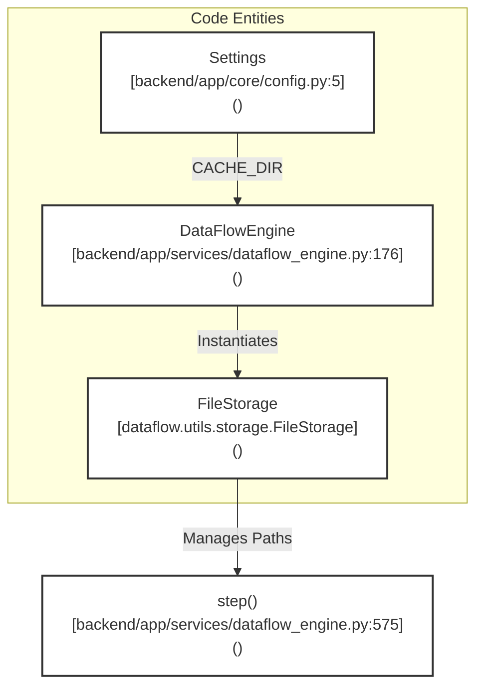
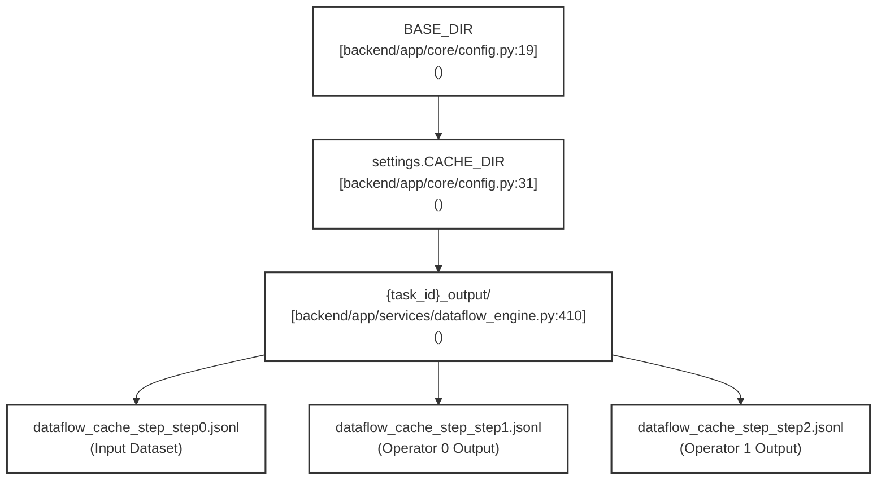
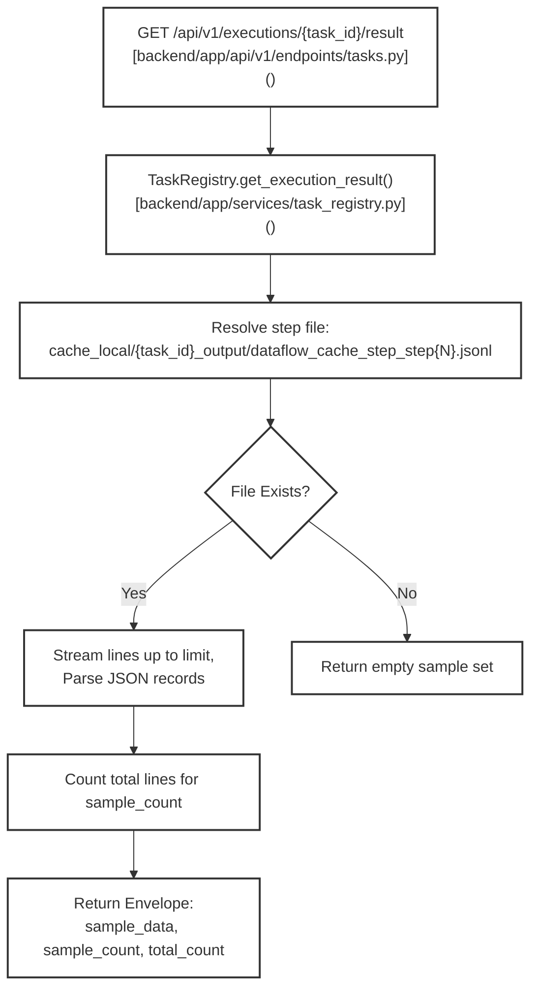

<!-- source: DeepWiki mcp.deepwiki.com · repo OpenDCAI/DataFlow-WebUI · page 7.4 Storage and Caching · fetched 2026-11-02 -->

# Storage and Caching

<details>
<summary>Relevant source files</summary>

The following files were used as context for generating this wiki page:

- [backend/app/core/config.py](backend/app/core/config.py)
- [backend/app/services/dataflow_engine.py](backend/app/services/dataflow_engine.py)
- [backend/app/services/param_coercion.py](backend/app/services/param_coercion.py)
- [backend/app/services/ray_pipeline_executor.py](backend/app/services/ray_pipeline_executor.py)

</details>


This page provides full technical documentation for the storage and caching architecture used throughout pipeline execution in DataFlow-WebUI. It covers the `dataflow.utils.storage.FileStorage` abstraction, the layout of the `cache_local` directory, sequential data flow between operators using `dataflow_cache_step_*.jsonl` files, and result persistence/download mechanisms.

For the high-level execution lifecycle, see [Execution Model](#2.4). For orchestrating engine services, see [DataFlow Engine](#3.3). For task execution REST APIs, see [Task Execution Endpoints](#5.2).

---

## Overview

The platform uses a file-based caching mechanism to store, pass, and inspect intermediate dataframes between pipeline operators. Rather than relying on volatile in-memory buffers, every operator in a pipeline reads its input records from a designated step cache file and flushes its processed output into the subsequent step's cache file. 

This layout provides:
- **Resumability and Debugging**: Intermediate checkpoints are persisted as flat files on disk, making individual pipeline stages independently readable and inspectable.
- **Ray Compatibility**: File paths are cleanly serializable and passable across distributed Ray actor boundaries (`RayPipelineExecutor`).
- **Standardized Formats**: The system standardizes on line-oriented JSON (`.jsonl`) streams for lightweight parsing and memory efficiency.

Sources: [backend/app/services/dataflow_engine.py:1-25](), [backend/app/services/ray_pipeline_executor.py:1-10]()

---

## FileStorage Abstraction

### Initialization and Parameters

The core storage utility is implemented by the `FileStorage` class (`dataflow.utils.storage.FileStorage`). During execution preparation within `DataFlowEngine`, a master storage instance is instantiated to coordinate the sequence.



When initializing `FileStorage`, parameters dictate the input source and cache directory layout:

| Parameter | Type | Description |
|-----------|------|-------------|
| `first_entry_file_name` | `str` | Absolute path to the source dataset (`dataset['root']`). |
| `cache_path` | `str` | Target directory for intermediate cache files (`cache_local/{task_id}_output`). |
| `file_name_prefix` | `str` | Prefix for generated files (defaults to `dataflow_cache_step`). |
| `cache_type` | `str` | File extension/format (defaults to `jsonl`). |

Sources: [backend/app/services/dataflow_engine.py:384-425]()

### Sequential Advancement via `step()`

To hand off data between operators, `FileStorage` exposes a `.step()` iterator method. 

```python
# Iteration loop inside DataFlowEngine.run() or RayPipelineExecutor
for op_idx, (operator, run_params, op_name, op_key) in enumerate(run_op):
    run_params["storage"] = storage.step()
    operator.run(**run_params)
```

Each invocation of `storage.step()` increments the internal step pointer, returning a configured sub-storage view where:
1. The **input stream** reads from the output of step `N-1`.
2. The **output stream** writes to the cache file of step `N`.

Sources: [backend/app/services/dataflow_engine.py:575-576](), [backend/app/services/ray_pipeline_executor.py:455-456]()

---

## Cache Directory Layout (`cache_local`)

All task executions write cache artifacts inside the local caching folder defined by `settings.CACHE_DIR` (`backend/app/core/config.py:31`). Each task is assigned an isolated directory named after its `task_id`.



### File Naming Conventions
Files strictly adhere to the pattern `{file_name_prefix}_step{N}.jsonl`:
- **Step 0**: Represents the input dataset. If the source dataset is already a `.jsonl` file, it may be referenced directly or copied as step 0.
- **Step N** ($N \ge 1$): Contains the serialized records output by the operator at index $N-1$.

Sources: [backend/app/services/dataflow_engine.py:410-420](), [backend/app/core/config.py:31-32]()

---

## Sequential Data Flow

During execution, data flows through operators via files managed by `FileStorage`. The sequence below illustrates coordination between `DataFlowEngine`, `FileStorage`, and operators.

```mermaid
sequenceDiagram
    participant Engine as "DataFlowEngine<br/>[backend/app/services/dataflow_engine.py]"
    participant Storage as "FileStorage<br/>[dataflow.utils.storage]"
    participant Op as "PipelineOperator<br/>(OperatorABC)"
    participant Disk as "File System<br/>(cache_local)"

    Engine->>Storage: FileStorage(first_entry_file_name, cache_path)
    Note over Engine,Storage: Initialize execution context
    
    loop For each operator in sequence
        Engine->>Storage: storage.step()
        Storage-->>Engine: Sub-storage instance (In: Step K, Out: Step K+1)
        Engine->>Op: run(storage=sub_storage, **run_params)
        
        Op->>Storage: read_lines()
        Storage->>Disk: Open dataflow_cache_step_stepK.jsonl
        Disk-->>Storage: Line records
        Storage-->>Op: Parsed records
        
        Note over Op: Process records (Filter/Map/LLM)
        
        Op->>Storage: write_line(record)
        Storage->>Disk: Flush to dataflow_cache_step_stepK+1.jsonl
        Op-->>Engine: Execution Success
    end

    style Engine fill:#fff,stroke:#333,stroke-width:2px
    style Storage fill:#fff,stroke:#333,stroke-width:2px
    style Op fill:#fff,stroke:#333,stroke-width:2px
    style Disk fill:#fff,stroke:#333,stroke-width:2px
```

Sources: [backend/app/services/dataflow_engine.py:568-689](), [backend/app/services/ray_pipeline_executor.py:449-586]()

---

## Result Persistence and Retrieval

### Accessing Intermediate Results
Task execution results and metadata are maintained by `TaskRegistry`. When an API caller requests execution details or samples, the service queries the step output files directly from the cache path.



Sources: [backend/app/services/task_registry.py:326-434]()

### Downloading Results
Full intermediate or final cache files can be downloaded using the download endpoint, which wraps the cache file in a FastAPI `FileResponse`.

```python
# Conceptual download route mapping
@router.get("/execution/{task_id}/download")
def download_task_result(task_id: str, step: int = None):
    # Resolves target step file path under cache_path
    # Returns FileResponse with media_type="application/jsonl"
```

Sources: [backend/app/api/v1/endpoints/tasks.py:118-192]()

---

## Distributed Execution & Working Directory Alignment

When pipelines are executed asynchronously via Ray (`RayPipelineExecutor`), worker nodes execute code inside isolated processes. To guarantee that relative paths in `FileStorage` resolve successfully, the executor forces the worker working directory to match the application base directory:

```python
# Inside Ray worker initialization routine
correct_dir = settings.BASE_DIR
os.chdir(correct_dir)
```

Additionally, runtime configuration dictionaries serialize storage paths (`dataflow_runtime['storage']`) so Ray remote tasks instantiate `FileStorage` with identical filesystem targets.

Sources: [backend/app/services/ray_pipeline_executor.py:750-764](), [backend/app/services/ray_pipeline_executor.py:224-232]()

---

## Cache Lifecycle and Cleanup

- **Persistence**: Cache directories under `cache_local/` are retained indefinitely after task completion or failure. This ensures that users can inspect failing operator checkpoints or download outputs post-execution.
- **Manual Management**: Because automatic garbage collection is currently omitted, high-volume pipeline usage requires periodic manual clearing of `cache_local/` directories to reclaim disk space.

Sources: [backend/app/services/dataflow_engine.py:410-414](), [backend/app/services/task_registry.py:326-434]()

---

